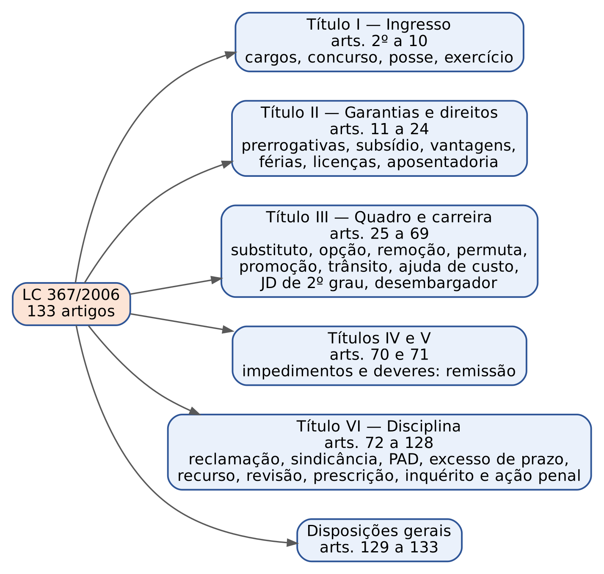
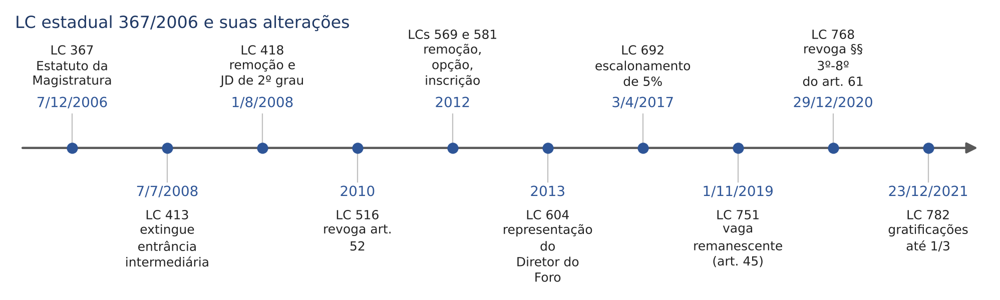
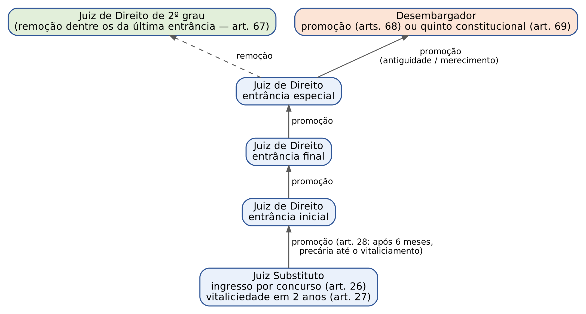
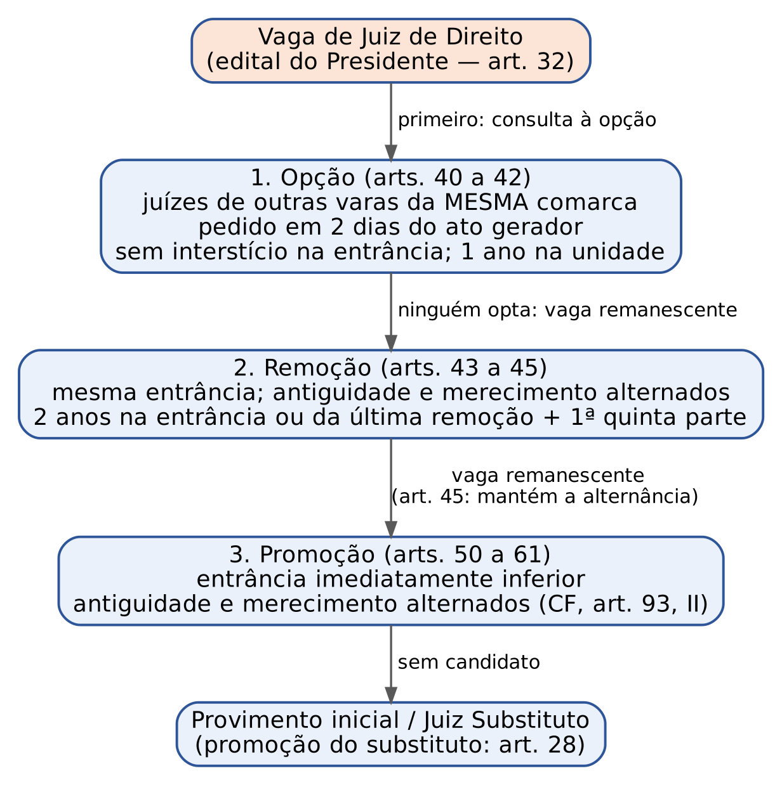
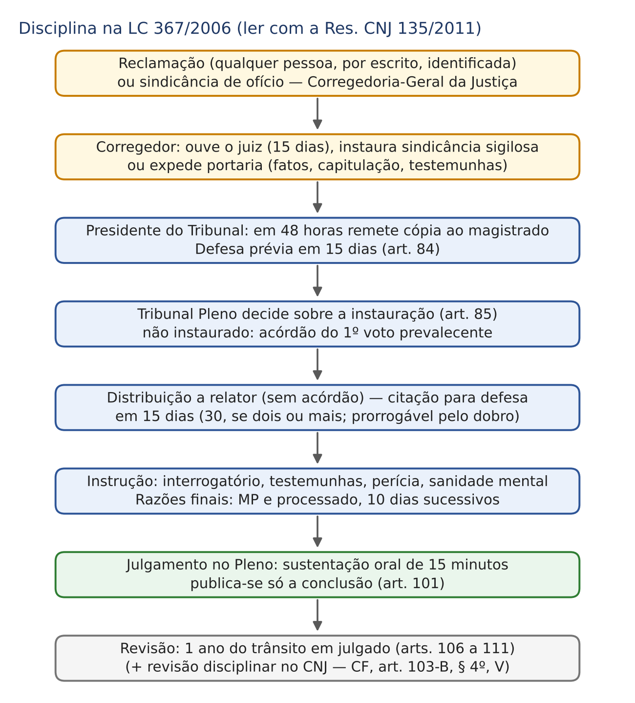

# CAPÍTULO 16 — ESTATUTO DA MAGISTRATURA DE SANTA CATARINA (LCs ESTADUAIS 367/2006 E 413/2008)

:::INCIDENCIA
Pontos: TJSC p. A.2 e A.3. Nível A. Lote: nenhuma questão FGV ou FCC 2024-2026 sobre as LCs 367/2006 e 413/2008 no banco (FGV 0, FCC 0); por isso os boxes PRATIQUE são exercícios próprios.
O que tende a cair: prazos e requisitos da movimentação (opção, remoção, permuta, promoção, trânsito), vitaliciamento e promoção precária do substituto, vantagens e seus limites, rito disciplinar e prescrição, e o confronto entre a lei estadual, a LOMAN e as Resoluções do CNJ.
:::

O capítulo é o lugar do DIREITO LOCAL da carreira. O regime nacional (Constituição, arts. 93 a 95; LOMAN; Resoluções CNJ 75, 106, 603 e 654) está no Cap. 10; deveres e vedações, no Cap. 11; o Código de Ética, no Cap. 12; sanções, PAD nacional e prescrição da Resolução CNJ 135/2011, no Cap. 13; corregedorias e CNJ, no Cap. 14; a divisão e organização judiciárias (LC estadual 339/2006: comarcas, entrâncias, órgãos), no Cap. 15. Aqui se lê a LC estadual 367/2006 na versão compilada da ALESC (conferida em 11/11/2026), com as alterações das LCs 413/2008, 418/2008, 516/2010, 569/2012, 581/2012, 604/2013, 692/2017, 751/2019, 768/2020 e 782/2021, e se aponta, dispositivo por dispositivo, onde a regra estadual cede à norma nacional. Esse é o ponto que a banca do TJSC pode explorar: a lei seca catarinense tem prazos próprios (2 dias para opção, 5 para inscrição, 15 de trânsito, 60 para preencher a vaga), mas parte deles convive com regras do CNJ e com a jurisprudência recente do STF que os relativizam.

## 16.1 O Estatuto no sistema de fontes

### 16.1.1 Natureza, iniciativa e lugar na hierarquia

A LC 367, de 7/12/2006 (DOE 18.021, de 7/12/2006; PLC 57/2006, de iniciativa do Tribunal de Justiça), "regulamenta o Regime Jurídico da Magistratura Catarinense" (art. 1º). Revogou as disposições em contrário, "em especial os dispositivos em conflito com a Lei n. 5.624, de 09 de novembro de 1979", e com os diplomas que tratavam da magistratura e com disposições regimentais (art. 133). A iniciativa do tribunal decorre do art. 96, II, da CF (alteração da organização e da divisão judiciárias, criação de cargos e fixação de subsídios) e, no plano estadual, do art. 78 da Constituição catarinense.

O Estatuto estadual é norma de terceiro nível. Acima dele estão a Constituição (arts. 93 a 95), a LOMAN, recebida como o estatuto de que trata o art. 93 enquanto não editada a lei complementar nacional, e as Resoluções do CNJ editadas com base no art. 103-B, § 4º, I, da CF (Cap. 10, 10.1). A própria lei reconhece a posição subordinada ao remeter à CF e à LOMAN nas garantias (art. 11), nas férias (art. 20), nos deveres e proibições (art. 71), nas penas (art. 103) e, na omissão, à legislação processual penal, à LOMAN e ao Regimento Interno (art. 129).

:::ATENCAO Três chaves de leitura
1. O Estado não pode inovar no estatuto da magistratura: matérias de carreira reservadas à lei complementar nacional (art. 93) só admitem lei estadual nos espaços que a Constituição abre (organização judiciária, entrâncias, subsídio por lei de iniciativa do tribunal) ou em norma procedimental compatível. Onde a LC 367 colide com a LOMAN ou com resolução do CNJ válida, prevalece a norma nacional (Cap. 10, 10.1.1).
2. Muitas regras estaduais são REPRODUÇÃO da CF ou da LOMAN (dois terços para recusar o mais antigo; três consecutivas ou cinco alternadas; dois anos e quinta parte). Em prova, a identidade de texto facilita; a pegadinha está nos pontos em que a lei catarinense DIVERGE ou acrescenta.
3. A versão a estudar é a compilada. Dispositivos com redação alterada ou revogada (arts. 14, § 1º; 15, § 2º; 17; 18; 33, § 1º; 41; 43 a 45; 52; 61, §§ 3º a 8º; 67) são as armadilhas típicas de quem estuda por material antigo.
:::

### 16.1.2 Estrutura da lei e evolução

A lei tem 133 artigos, distribuídos em seis títulos e disposições gerais. Os Títulos IV e V são remissivos: impedimentos e suspeições são regulados pela "legislação processual" e, na omissão, pelo Regimento Interno (art. 70); deveres e proibições, pela Constituição, pela LOMAN e pela legislação aplicável (art. 71). Ao contrário do que às vezes se supõe, o Estatuto catarinense NÃO tem catálogo próprio de deveres (ver Cap. 11).

| Lei complementar | O que mudou na LC 367/2006 |
|---|---|
| 413, de 7/7/2008 | extinção da entrância intermediária: arts. 14, § 1º (percentuais do subsídio), 25 (quadro) e 57 (quadros de antiguidade); ver 16.7 |
| 418, de 1/8/2008 | remoção (arts. 43 a 45) e Juiz de Direito de 2º grau (art. 67) |
| 516/2010 | revogou o art. 52 (pedido de promoção na própria comarca elevada de entrância) |
| 569/2012 | requisitos da remoção (art. 44 e §§) |
| 581/2012 | desistência da inscrição (art. 33, § 1º), opção (arts. 41 e 42, parágrafo único) e ajuda de custo (art. 64, § 4º) |
| 604/2013 | representação do Diretor do Foro (art. 18) |
| 692, de 3/4/2017 | escalonamento de 5% do subsídio (art. 14, § 1º) |
| 751, de 1/11/2019 | vaga remanescente da remoção (art. 45) |
| 768, de 29/12/2020 | revogou os §§ 3º a 8º do art. 61 (candidatos remanescentes de listas de merecimento) |
| 782, de 23/12/2021 | gratificações até 1/3 do subsídio e licença compensatória (arts. 15, §§ 2º e 3º, e 17) |

A ficha da ALESC registra duas ações diretas: a ADI 4.458 (2010), com medida indeferida e agravo interno desprovido em 10/11/2022, e a ADI 6.564 (2020), "aguardando julgamento", esta lançada também na ficha da LC 692/2017, que instituiu o escalonamento de 5% (o objeto das ações não foi localizado; ver nota).

:::DICA Pergunta de prova oral
"Qual o fundamento de validade do Estatuto catarinense?" A LC 367 regula a carreira nos espaços que a Constituição confere ao Estado (arts. 96, II, e 125, § 1º) e como norma procedimental complementar, cedendo à LOMAN e às Resoluções do CNJ, como ela própria admite (arts. 11, 20, 71, 103 e 129). Exemplos: rito e prescrição disciplinar (Res. 135/2011), votação do merecimento (Res. 106/2010), desempate na antiguidade (ADI 4.462 ED).
:::

## 16.2 Ingresso na magistratura

### 16.2.1 Criação de cargos e concurso

A ampliação do quadro depende de lei complementar (art. 2º), com número de cargos fixado por estudos de necessidade, considerada a média de processos pendentes por magistrado e a proporcionalidade com a população (parágrafo único). É a versão estadual do art. 93, XIII, da CF ("o número de juízes na unidade jurisdicional será proporcional à efetiva demanda judicial e à respectiva população").

O ingresso na magistratura de primeiro grau depende de concurso público de provas e títulos (art. 3º). Regras do art. 4º:

- validade de 2 anos a contar da homologação do resultado, "renovável por igual período";
- realização pelo Tribunal de Justiça, "com a participação da Ordem dos Advogados do Brasil em todas as suas fases" (como exige o art. 93, I, da CF);
- regulamento próprio aprovado pelo Tribunal Pleno, hoje necessariamente conformado à Resolução CNJ 75/2009 e ao ENAM (Resolução CNJ 531/2023), que são do Cap. 10 (10.3);
- comissão permanente do Tribunal para promover o concurso (art. 5º, § 1º).

### 16.2.2 Requisitos e documentos

O art. 5º separa o que o candidato deve COMPROVAR do que deve APRESENTAR:

| Comprovar (inciso I) | Apresentar (inciso II) |
|---|---|
| nacionalidade brasileira | negativa de protesto das comarcas em que residiu nos últimos 5 anos |
| exercício dos direitos civis e políticos; quitação eleitoral e militar | folha corrida das Justiças Estadual, Federal e Eleitoral e atestado de antecedentes das Polícias Federal e Estadual |
| bacharelado em Direito (diploma de faculdade oficial ou reconhecida) | certidão completa da distribuição da comarca onde reside ou residiu, compreendendo os últimos 10 anos |
| idoneidade moral e social | *curriculum vitae* comprovado, detalhado e em ordem cronológica |
| atividade jurídica "nos termos da Constituição Federal e da legislação em vigor" | |
| sanidade física e mental | |

Idoneidade moral e social, exercício e comprovação da atividade jurídica são aferidos "em conformidade com o regulamento e com o edital" (§ 2º). A lei estadual NÃO fixa o triênio: remete à CF (art. 93, I: três anos de atividade jurídica), cujo regime (momento da comprovação, atividades computáveis) é o da Resolução CNJ 75/2009 (Cap. 10, 10.3.2).

:::PEGADINHA 5 x 10
Negativa de PROTESTO: últimos 5 anos, de todas as comarcas em que residiu. Certidão de DISTRIBUIÇÃO: últimos 10 anos, da comarca onde reside ou residiu. Inverter os prazos é a troca natural de uma questão de lei seca.
:::

### 16.2.3 Nomeação, compromisso, posse, exercício e matrícula

Os aprovados são nomeados por ato do Presidente do Tribunal, obedecida a ordem de classificação final (art. 6º). Ao tomar posse, o magistrado presta compromisso PERANTE O TRIBUNAL PLENO (art. 7º), segundo fórmula própria para cada cargo ("Prometo desempenhar, leal e honradamente, o cargo de..." Desembargador, Juiz de Direito de Segundo Grau ou Juiz Substituto — § 1º), tomado por termo em livro próprio, assinado pelo compromissado e pelo Presidente (§ 2º), e apresenta declaração de bens (§ 3º).

Prazos para entrar em exercício (art. 8º):

- regra: até 15 dias após a posse;
- prorrogação: mais 15 dias, se houver justo motivo, a pedido escrito formulado ANTES do vencimento do prazo (§ 1º);
- casos especiais: o Presidente, por despacho fundamentado, pode conceder prazo maior (§ 2º).

Nomeado e compromissado, o Desembargador toma assento na Câmara em que houver vaga, na data da posse; o Juiz de Direito de Segundo Grau atua perante o Tribunal; o juiz assume a unidade que lhe competir (art. 9º). Após o exercício, é matriculado em cadastro próprio na Secretaria do Tribunal; se já integrava quadro funcional do Judiciário estadual, pode manter matrícula e informações funcionais (art. 10).

:::PRATIQUE Ingresso (exercícios elaborados para esta apostila — não são questões de banca)
1. Candidato aprovado toma posse em 3/3/2026 e, no 16º dia, requer prorrogação do prazo para entrar em exercício, alegando doença de familiar. O pedido pode ser deferido com base no art. 8º, § 1º? Resolução: não, porque o pedido deve ser formulado "antes do vencimento do prazo fixado no *caput*". Resta o § 2º: em caso especial, o Presidente pode conceder prazo maior por despacho fundamentado; a via é excepcional, mas não está atrelada ao prazo do § 1º.
2. Diante de quem o Juiz Substituto presta compromisso? Resolução: perante o Tribunal Pleno (art. 7º), por termo em livro próprio assinado por ele e pelo Presidente, com apresentação de declaração de bens.
3. Afirmação: "O concurso para juiz substituto do TJSC vale por 2 anos da publicação do edital, prorrogável uma vez". Resolução: errada quanto ao termo inicial: a validade de 2 anos conta-se "da homologação do seu resultado" e é renovável por igual período (art. 4º).
:::

## 16.3 O Juiz Substituto e o vitaliciamento

### 16.3.1 Ingresso, vitaliciedade e suspensão do prazo

"O ingresso na Magistratura dar-se-á no cargo de Juiz Substituto" (art. 26), que "adquirirá a vitaliciedade após 2 (dois) anos de efetivo exercício no cargo" (art. 27), reproduzindo o art. 95, I, da CF. O art. 27 acrescenta três regras:

- o processo administrativo instaurado contra Juiz Substituto SUSPENDE o prazo de vitaliciamento, "que prosseguirá com o trânsito em julgado da decisão" (§ 1º);
- o procedimento para aquisição da vitaliciedade e a contagem do prazo serão regulamentados pelo Tribunal (§ 2º);
- o período de estágio probatório é computado como tempo de serviço (§ 3º).

Desde 2025, o regulamento local está condicionado pela Resolução CNJ 654/2025 (processo de vitaliciamento padronizado, avaliação semestral, curso de formação inicial, prorrogação por afastamentos superiores a 90 dias, decisão em sessão pública com efeitos retroativos ao fim do biênio), desenvolvida no Cap. 10 (10.4.2). O art. 131 da LC 367 mandou aplicar o procedimento da lei aos substitutos então em exercício (regra transitória de 2006).

:::ATENCAO Suspensão do prazo pelo PAD
A suspensão do art. 27, § 1º, é regra catarinense distinta da prorrogação por afastamentos da Resolução 654 (Cap. 10). Ela impede que o simples decurso do biênio, com PAD pendente, consolide a vitaliciedade de quem pode ser demitido (Res. 135, art. 23, § 1º, tem regra idêntica). Em prova, a leitura literal: PAD instaurado suspende; o prazo prossegue com o trânsito em julgado.
:::

### 16.3.2 Promoção precária do substituto não vitalício

Regra própria do Estado, frequentemente ignorada: "Completado o interstício mínimo de 6 (seis) meses de efetivo exercício no cargo, o Juiz Substituto, ainda que não vitalício, poderá concorrer à promoção, salvo se houver outros candidatos, e deve ser ouvido o Conselho da Magistratura após a manifestação da Corregedoria-Geral da Justiça" (art. 28). "A promoção terá caráter precário e será consolidada com a aquisição da vitaliciedade" (parágrafo único).

São quatro elementos: interstício de 6 meses no cargo; subsidiariedade (só se não houver outros candidatos); manifestação da Corregedoria-Geral e, depois, oitiva do Conselho da Magistratura; e caráter precário (negado o vitaliciamento, a promoção cai com a perda do cargo).

O substituto JÁ vitalício tem opção, remoção e promoção "nos mesmos casos e da mesma forma que a do Juiz de Direito" (art. 37).

### 16.3.3 Função itinerante e substituição

"O Juiz Substituto tem função itinerante, exerce a sua jurisdição na Circunscrição Judiciária na qual foi lotado e nesta reside, salvo autorização do Tribunal" (art. 29). Compete-lhe, vitalício ou não, substituir os Juízes de Direito da circunscrição "nas faltas, nos impedimentos, nas suspeições, nos afastamentos, nas licenças, nas férias e nas hipóteses de vacância do cargo" (art. 30). Regras de exercício:

- em substituição ou em regime de cooperação, a jurisdição é de competência PLENA (§ 1º);
- licença, férias ou vacância de um ou mais Juízes de Direito da circunscrição: serve onde sua presença for mais necessária, por DESIGNAÇÃO do Presidente do Tribunal (§ 2º);
- demais hipóteses (faltas, impedimentos, suspeições): substituição imediata, INDEPENDENTE de designação, observada a antiguidade se houver mais de um substituto na circunscrição (§ 3º).

A residência na circunscrição (e não na comarca) é o modo catarinense de cumprir, quanto ao substituto, o dever do art. 93, VII, da CF, dirigido ao juiz titular (Cap. 11, 11.2.4).

:::EXEMPLO Substituto e impedimento do titular
Situação: na Circunscrição de Alfa estão lotados dois Juízes Substitutos, X (mais antigo) e Y. O Juiz de Direito da Vara Criminal declara-se suspeito num processo; no mesmo dia, o titular da Vara Cível entra em férias.
Solução: a suspeição gera substituição imediata, independentemente de designação, pelo substituto mais antigo, X (art. 30, § 3º). As férias do titular da Vara Cível exigem designação do Presidente, que alocará um dos substitutos onde sua presença for mais necessária (§ 2º). Em ambos os casos, competência plena (§ 1º).
:::

:::PRATIQUE Juiz Substituto (exercícios elaborados para esta apostila — não são questões de banca)
1. Juiz Substituto com 7 meses de exercício inscreve-se em edital de promoção para comarca de entrância inicial; há outro inscrito, Juiz Substituto vitalício. Pode ser promovido? Resolução: não; o substituto não vitalício só concorre "salvo se houver outros candidatos" (art. 28). Concorre o vitalício, a quem se aplicam as regras do Juiz de Direito (art. 37).
2. Juiz Substituto responde a PAD instaurado no 20º mês de exercício; a decisão absolutória transita em julgado 8 meses depois. Quando se completa o biênio? Resolução: o prazo ficou suspenso da instauração até o trânsito em julgado e prossegue a partir daí (art. 27, § 1º); faltando 4 meses, completa-se 4 meses após o trânsito em julgado (respeitadas as regras de prorrogação por afastamento da Res. CNJ 654/2025, se houver afastamento cautelar).
3. Juiz Substituto pretende residir na capital, fora da circunscrição em que foi lotado. Basta comunicar? Resolução: não; reside na circunscrição "salvo autorização do Tribunal" (art. 29); a autorização é exceção, não direito subjetivo.
:::

## 16.4 Garantias e prerrogativas

As garantias são as constitucionais: vitaliciedade, inamovibilidade e irredutibilidade de subsídios (art. 11; CF, art. 95; Cap. 10, 10.5). As prerrogativas do art. 12 reproduzem, com acréscimos, o art. 33 da LOMAN (Cap. 10, 10.11.1):

O art. 12 assegura: ser ouvido como testemunha em dia, hora e local previamente ajustados (I); não ser preso senão por ordem escrita e FUNDAMENTADA do Tribunal de Justiça, salvo flagrante de crime inafiançável, com imediata comunicação e apresentação ao Presidente (II; o adjetivo "fundamentada" é acréscimo estadual, e o rito da apresentação está no art. 128, 16.17); prisão especial ou sala de Estado-Maior até o trânsito em julgado (III); não ser intimado a comparecer senão por autoridade judicial (IV); porte de arma de defesa pessoal (V); e carteira funcional expedida pelo Tribunal (VI, sem correspondente no art. 33 da LOMAN).

Parágrafo único: havendo, no curso de investigação, indício de crime praticado por magistrado, a autoridade policial, civil ou militar, remete os autos ao Tribunal de Justiça, que prossegue na investigação. A regra é desdobrada no art. 114 (inquérito judicial; 16.17). O foro por prerrogativa e o regime penal do juiz são do Cap. 13 (13.8).

:::PRATIQUE Prerrogativas (exercício elaborado para esta apostila — não é questão de banca)
Delegado de polícia, investigando fraude em licitação municipal, encontra mensagens que indicam participação de Juiz de Direito e expede intimação para que o magistrado compareça à delegacia para depor como investigado. Que providências a LC 367 impõe? Resolução: (1) o juiz não está sujeito a intimação para comparecimento salvo se expedida por autoridade judicial (art. 12, IV); (2) havendo indício de crime de magistrado, a autoridade policial deve remeter os autos ao Tribunal de Justiça para que prossiga a investigação (art. 12, parágrafo único, e art. 114, § 1º), cabendo ao Tribunal Pleno deliberar sobre o prosseguimento e à Corregedoria-Geral da Justiça conduzir as investigações (art. 114, §§ 1º e 2º).
:::

## 16.5 Subsídio e vantagens

### 16.5.1 Subsídio e escalonamento

O subsídio do Desembargador corresponde a "noventa inteiros e vinte e cinco centésimos por cento do subsídio mensal de Ministro do Supremo Tribunal Federal, sendo revisto na mesma proporção e época" (art. 14, *caput*), o que coincide com o subteto estadual do art. 37, XI, da CF.

O § 1º teve duas redações que convém distinguir:

| Redação | Regra |
|---|---|
| LC 413/2008 (já revogada) | percentuais fixos sobre o subsídio do Desembargador: entrância especial 90%; final 85,50%; inicial 81,22%; Juiz Substituto 73,91% |
| LC 692/2017 (vigente) | "escalonamento de 5% (cinco por cento) entre os níveis da carreira, em ordem decrescente, a partir do subsídio de Desembargador", revisto na mesma proporção e época do subsídio de Ministro do STF |

A LC 692 determinou implementação "gradual, respeitada a disponibilidade orçamentária e financeira" (art. 2º) e é objeto da ADI 6.564, pendente segundo a ficha da ALESC. O escalonamento respeita a moldura do art. 93, V, da CF (diferença entre categorias não superior a 10% nem inferior a 5%). Lido como diferença de 5% em relação ao nível imediatamente superior, resulta: entrância especial 95% do subsídio de Desembargador; final 90,25%; inicial 85,74%; Juiz Substituto 81,45% (cálculo desta apostila; ver nota).

A remuneração é devida no primeiro dia útil seguinte ao legalmente fixado para o repasse mensal do duodécimo (art. 14, § 2º).

### 16.5.2 Vantagens do art. 15

Além do subsídio, "poderão ser outorgadas" as vantagens do art. 15, em três grupos. O rol deve ser lido com o art. 65, § 2º, da LOMAN, que veda vantagens pecuniárias nela não previstas ou em bases superiores às nela fixadas, e com o teto do art. 37, XI, da CF (a classificação como indenizatória não depende do rótulo legal).

| Grupo | Parcelas |
|---|---|
| Indenizatórias (I) | ajuda de custo para mudança e transporte; auxílio-alimentação; auxílio-moradia; diárias; auxílio-funeral; auxílio-transporte; indenização de férias não gozadas; indenização de transporte; licença-prêmio convertida em pecúnia; outras previstas em lei |
| Permanentes (II) | remuneração ou provento do magistério (CF, art. 95, parágrafo único, I); benefícios de planos de previdência de entidades fechadas, ainda que extintas |
| Eventuais ou temporárias (III) | representação; assistência médico-social; gratificação eleitoral; magistério por hora-aula no Poder Público; bolsa de estudo remuneratória; abono de permanência (CF, art. 40, § 19); exercício em comarca de difícil provimento (g); diretor do foro ou regional (h); exercício cumulativo de atribuições (i); substituições (j); coordenação de juizados (l); direção de escola judicial (m); juiz auxiliar da Presidência, Vice-Presidências, Corregedoria ou 2º grau (n); Turma de Recursos (o); diferença de entrância (p) |

Limites e alternativas:

- auxílio-moradia e auxílio-transporte (alíneas c e f do inciso I) não podem exceder 10% do subsídio (§ 1º);
- gratificações das alíneas g, i, l, m, n e o do inciso III: até 1/3 do subsídio, após ato regulador do Conselho da Magistratura (§ 2º, redação da LC 782/2021; a redação original limitava a 15%);
- licença compensatória: a critério da Administração, a gratificação do § 2º pode ser substituída por licença na proporção de até 1 dia para cada 3 de exercício naquelas condições, "exceto em regime de simples colaboração e cooperação", aplicando-se, no que couber, as regras de férias (§ 3º, incluído pela LC 782/2021, com efeitos a partir de 1/1/2022).

### 16.5.3 Substituição, representação e diárias

- Substituição: o magistrado recebe a diferença entre o subsídio do seu cargo e o da entrância da comarca substituída, além de diárias e transporte, se for o caso (art. 16). Nas férias e licenças remuneradas, o Juiz Substituto recebe a MÉDIA do que efetivamente recebeu a esse título nos últimos 12 meses (parágrafo único).
- Representação dos dirigentes (art. 17, LC 782/2021): Presidente, Vice-Presidentes, Corregedor-Geral da Justiça e Corregedor-Geral do Foro Extrajudicial recebem 1/3 do subsídio; a critério da Administração, substituível por licença compensatória de até 1 dia para cada 3 de exercício. Na redação original: 20% para o Presidente e 15% para Vice-Presidentes e Corregedor.
- Diretor do Foro e Diretor Regional (art. 18, LC 604/2013): representação não cumulativa de 6% do subsídio (foro com 1 vara ou juizado), 10% (2 a 6) ou 15% (mais de 6). A redação original fixava 6% em qualquer caso.
- Diárias: em serviço fora da sede, ressarcimento do transporte e diária fixada pelo Tribunal (art. 19).

:::PEGADINHA Os números que mudaram
Presidente: era 20%, hoje 1/3. Gratificações do art. 15, § 2º: eram 15%, hoje até 1/3. Diretor do Foro: era 6% fixo, hoje 6%, 10% ou 15% conforme o número de varas ou juizados. Subsídio: eram percentuais fixos (LC 413), hoje escalonamento de 5% (LC 692). Material anterior a 2022 está desatualizado em todos esses pontos.
:::

:::PRATIQUE Vantagens (exercícios elaborados para esta apostila — não são questões de banca)
1. Juíza designada para coordenar o juizado especial da comarca pede que a gratificação seja convertida em licença compensatória. A conversão é direito dela? Resolução: não; a substituição da gratificação por licença é "a critério da Administração" (art. 15, § 3º), na proporção de até 1 dia para cada 3 de exercício.
2. Juiz Substituto atua em regime de simples cooperação numa vara sobrecarregada e pede licença compensatória. Resolução: o § 3º do art. 15 exclui expressamente o "regime de simples colaboração e cooperação".
3. Diretor do Foro de comarca com 5 varas e 1 juizado especial: qual o percentual da representação? Resolução: o foro é integrado por 6 unidades (varas ou juizados especiais), o que o coloca na faixa de 2 a 6: 10% do subsídio (art. 18, II). Com mais uma unidade, passaria a 15% (inciso III).
:::

## 16.6 Férias, licenças, licença-prêmio e aposentadoria

### 16.6.1 Férias e licenças

Férias "nos termos da Lei Complementar Federal" (art. 20), isto é, 60 dias anuais (LOMAN, art. 66; Cap. 10, 10.9), remuneradas "com acréscimo de, pelo menos, um terço do subsídio" (parágrafo único).

O art. 21 lista as licenças concedidas SEM prejuízo do subsídio: tratamento de saúde; doença em pessoa da família; curso de pós-graduação, quando houver necessidade de afastamento, nos termos de ato do Tribunal; repouso à gestante; paternidade; casamento; falecimento de cônjuge ou companheiro, ascendente, descendente, irmão ou dependente; prestação de serviços exclusivamente à Justiça Eleitoral; exercício da presidência de associação de classe; prêmio; demais casos previstos em lei. As licenças são regulamentadas pelo Regimento Interno (parágrafo único). O afastamento para aperfeiçoamento segue também a Resolução CNJ 64/2008 (Cap. 10, 10.9.2).

### 16.6.2 Licença-prêmio

"Após cada qüinqüênio ininterrupto de exercício, o magistrado fará jus a 3 (três) meses de licença-prêmio" (art. 22). Regras:

- impedimentos: penalidade disciplinar ou licença não remunerada para tratamento de assuntos particulares durante o período aquisitivo (§ 1º);
- fruição: pode ser deferida em parcelas mensais; por necessidade do serviço, o Presidente pode indeferi-la ou determinar que o magistrado reassuma imediatamente (§ 2º);
- indeferimento ou suspensão justificados: gozo no mês subsequente ou anotação para gozo oportuno, a requerimento (§ 3º);
- conversão em pecúnia: figura entre as parcelas indenizatórias (art. 15, I, i).

A licença-prêmio não consta do rol da LOMAN, e o STF tem esse rol por exaustivo: magistrados não têm direito a licença-prêmio ou especial (STF, MS n. 23.557, Relator Ministro Moreira Alves, Tribunal Pleno, j. 1/3/2001, Informativo 218), e o art. 65, § 2º, veda a concessão de vantagens não previstas, de modo que lei estadual não pode criá-las (STF, ADI n. 2.952/RJ, Tribunal Pleno, j. 31/3/2023, Informativo 1089, unânime). O art. 22 da LC 367 é, portanto, de validade questionável; sua extensão à magistratura costuma ser defendida pela simetria com o Ministério Público (ver nota). Para a prova de lei seca, basta a letra.

### 16.6.3 Aposentadoria

A aposentadoria "atenderá ao disposto na legislação pertinente" (art. 23), e o procedimento de verificação da invalidez é disciplinado no Regimento Interno (parágrafo único). O tempo de advocacia é computado integralmente como serviço público para aposentadoria, "observado o disposto na Constituição Federal e na legislação previdenciária" (art. 24). A ressalva final é decisiva: desde a EC 20/1998 conta-se tempo de CONTRIBUIÇÃO, de modo que a advocacia só aproveita com a respectiva contribuição; o regime próprio e a EC 103/2019 estão na Apostila de Direito Previdenciário, e a aposentadoria como sanção, no Cap. 13 (13.3.4).

:::PRATIQUE Licença-prêmio (exercício elaborado para esta apostila — não é questão de banca)
Juiz completa quinquênio ininterrupto em 2026, mas sofreu advertência em 2023. Tem direito a licença-prêmio desse período? Resolução: não; não se concede licença-prêmio a quem, durante o período aquisitivo, sofrer penalidade disciplinar (art. 22, § 1º). Note que, para fins de reincidência e prejuízo, a sanção só deixa de ser considerada 5 anos após sua imposição (art. 113), regra que não afasta o impedimento específico do § 1º.
:::

## 16.7 Quadro da magistratura e a LC 413/2008

### 16.7.1 O quadro e os quadros de antiguidade

Desde a LC 413/2008, o Quadro da Magistratura classifica-se em: Juiz Substituto; Juiz de Direito de Entrância Inicial; Juiz de Direito de Entrância Final; Juiz de Direito de Entrância Especial; Desembargador (art. 25). Há, correspondentemente, 5 quadros de antiguidade (art. 57). Na redação original eram seis, com a Entrância Intermediária entre a inicial e a final. O Juiz de Direito de Segundo Grau não é degrau autônomo: é Juiz de Direito da última entrância provido, por remoção, para atuar perante o Tribunal (art. 67; 16.12).

O quadro de antiguidade indica o tempo na entrância, de serviço efetivo na magistratura e para a aposentadoria (art. 58); é atualizado anualmente pela Presidência e publicado no Diário da Justiça, cabendo recurso administrativo ao magistrado prejudicado, na forma do Regimento (art. 59).

### 16.7.2 A LC 413/2008: transformação de cargos

A LC 413, de 7/7/2008 (DOE 18.396; PLC 17.5/2008, do Tribunal), "transforma cargos do Quadro da Magistratura e altera dispositivos" das LCs 339/2006 e 367/2006 (ponto A.3 do edital do TJSC). O quadro dispositivo por dispositivo (elevação para a entrância final dos cargos de 18 comarcas, extinção da intermediária, vigência retroativa à Resolução 16/2008-TJ, de 4/6/2008) está no Cap. 15 (15.3.2). Para a carreira, interessam quatro regras: os ocupantes dos cargos elevados ingressam no quadro da entrância final "imediatamente após o último integrante" então existente, mantidas lotação e posição (art. 1º, §§ 1º e 2º); na promoção e na remoção, só têm a inscrição deferida se não houver candidato inscrito do quadro PRECEDENTE da entrância final (§ 3º); o interstício para remoção soma o tempo na extinta intermediária (§ 4º); e o Pleno aprova, em 30 dias, três quadros de antiguidade transitórios (§ 5º). Na LC 367, a lei alterou os arts. 14, § 1º (percentuais do subsídio, depois substituídos pelo escalonamento da LC 692/2017), 25 e 57 (art. 3º).

:::DICA Como a LC 413 pode ser cobrada
A lei é de efeitos concretos e transitórios, mas tem três pontos de prova: (1) o número de entrâncias depois dela (três: inicial, final e especial) e o de quadros de antiguidade (cinco); (2) a regra de inserção dos elevados "imediatamente após o último integrante" da entrância final, com preferência dos integrantes do quadro precedente na promoção e na remoção; (3) a retroação dos efeitos a 4/6/2008, data da resolução do Tribunal que antecipou a transformação. Em prova oral, o exemplo ilustra o espaço estadual na organização judiciária (CF, art. 125, § 1º; art. 96, II, b e d) e a iniciativa privativa do Tribunal.
:::

:::PRATIQUE LC 413/2008 (exercícios elaborados para esta apostila — não são questões de banca)
1. Em 2008, juiz da antiga entrância intermediária lotado em Videira e juiz de entrância final lotado em Itajaí disputam remoção para vara de Blumenau. Pela LC 413, quem tem preferência? Resolução: o juiz do quadro precedente de entrância final: o elevado só tem a inscrição deferida se não houver candidato inscrito daquele quadro (art. 1º, § 3º).
2. Quantos quadros de antiguidade há hoje no TJSC e quais? Resolução: cinco: Juiz Substituto, Entrâncias Inicial, Final e Especial, e Desembargador (art. 57, redação da LC 413/2008).
3. A LC 413 entrou em vigor em 7/7/2008. Desde quando os juízes elevados integram o quadro de antiguidade da entrância final? Resolução: desde a publicação da Resolução n. 16/2008-TJ, de 4/6/2008, por força da retroação expressa (arts. 1º, § 1º, e 4º).
:::

## 16.8 Movimentação na carreira: regras comuns

"A movimentação dos Magistrados na carreira dar-se-á por opção, remoção, permuta ou promoção" (art. 31). A OPÇÃO é figura catarinense sem correspondente na LOMAN (16.9). As regras comuns:

| Tema | Regra da LC 367 |
|---|---|
| Abertura | o Presidente do Tribunal determina a abertura de edital para preenchimento de cargo vago (art. 32), publicado no Diário da Justiça, sem prejuízo de outras formas de divulgação (parágrafo único) |
| Inscrição | requerimento escrito à Presidência, por intermédio da Coordenadoria de Magistrados, preferencialmente por correio eletrônico, em 5 dias da publicação do edital (art. 33) |
| Desistência | só no dia útil seguinte ao encerramento das inscrições (§ 1º, LC 581/2012); é irretratável e irrevogável (§ 2º) |
| Editais | um edital distinto e sucessivo para cada vaga de promoção ou remoção da mesma entrância, com indicação do cargo e do critério (art. 34); promoção precedida de remoção: edital único, com a ressalva de que candidato à remoção prejudica o pedido de promoção (§ 1º) |
| Prazo de provimento | 60 dias do encerramento das inscrições, prorrogável pelo Presidente, ouvido o Corregedor-Geral, em caso de relevante interesse público (§ 2º) |
| Momento dos requisitos | data da publicação do ato que gerou a vaga ou, se cargo criado, data da instalação do órgão (art. 35) |
| Recusa | proclamado o resultado, o magistrado não pode recusar a promoção, a remoção e a opção (art. 36) |
| Votação | sessão pública, voto aberto, identificação e registro dos votos em ata (art. 61) |
| Impedimento disciplinar | quem sofreu censura e remoção compulsória no período de 1 ano, contado da publicação do edital, não concorre à remoção, à permuta nem à promoção por merecimento (art. 39) |
| Extinção ou mudança de sede da comarca | é facultado remover-se para a nova sede ou para comarca de igual entrância; consultado, o juiz informa ao Presidente em 5 dias (art. 38) |

:::ATENCAO Lei estadual x Resolução CNJ 106/2010
Na promoção, prevalecem os prazos nacionais: vaga declarada em até 10 dias do fato gerador e promoção em até 40 dias da abertura, prorrogável uma vez (Res. 106, art. 1º, §§ 1º e 2º; Cap. 10, 10.6.1), e não os 60 dias do art. 34, § 2º. O impedimento do art. 39 (1 ano) convive com o da Resolução 106 (pena igual ou superior à de censura nos últimos 12 meses, art. 3º) e com o art. 44, parágrafo único, da LOMAN; lida a conjunção "e" do art. 39 como alternativa, as regras convergem. Para a permuta ENTRE tribunais, a Resolução 603/2024 é mais rigorosa (3 anos para advertência e censura; 5 para remoção compulsória ou disponibilidade).
:::

:::PRATIQUE Regras comuns (exercícios elaborados para esta apostila — não são questões de banca)
1. Edital publicado na segunda-feira, 2/3/2026. Até quando o juiz pode se inscrever, e até quando pode desistir? Resolução: inscrição em 5 dias da publicação (art. 33); a desistência só no dia útil seguinte ao encerramento do prazo de inscrição (§ 1º), e é irretratável (§ 2º). (A forma de contagem, corrida ou em dias úteis, depende do regulamento do Tribunal; ver nota.)
2. A vaga surge por aposentadoria publicada em 10/4/2026; o juiz completa 2 anos na entrância em 20/4/2026, antes da publicação do edital. Pode concorrer à remoção? Resolução: não; os requisitos devem estar atendidos "na data da publicação do ato que gerou a vaga" (art. 35), ou seja, em 10/4/2026.
3. Juiz removido pelo voto do Tribunal desiste, alegando razões familiares supervenientes. Resolução: proclamado o resultado, não pode recusar a remoção (art. 36); a desistência só cabia no dia útil seguinte ao encerramento das inscrições (art. 33, § 1º).
:::

## 16.9 Opção

"Ocorrendo a vaga, é assegurado o direito de por ela optarem os Magistrados de outras varas da mesma comarca, desde que aceita pelo Tribunal de Justiça" (art. 40). A opção é movimentação HORIZONTAL e INTERNA: o juiz troca de vara sem mudar de comarca nem de entrância. Regras (redação da LC 581/2012):

- prazo: 2 dias, contados da publicação do ato gerador da vaga (art. 41);
- edital de consulta: se a vaga derivar de falecimento ou de nova unidade a ser instalada, publica-se edital de consulta à opção (parágrafo único), porque não há "ato gerador" publicado antes;
- interstício: NÃO se exige o de 2 anos de exercício na entrância (art. 42);
- permanência: o juiz deve cumprir 1 ano na unidade para exercer nova opção (art. 42, parágrafo único);
- trânsito: não há nas opções (art. 62, § 7º);
- aceitação: a opção depende de o Tribunal aceitá-la (art. 40) e, proclamado o resultado, não pode ser recusada pelo magistrado (art. 36).

:::PEGADINHA Os prazos da opção
Hoje: 2 dias da PUBLICAÇÃO do ato gerador. Redação original: 5 dias da ABERTURA da vaga, e edital de consulta só no caso de falecimento. A LC 581/2012 encurtou o prazo, mudou o termo inicial e acrescentou o edital de consulta para unidade nova e o interstício de 1 ano na unidade.
:::

## 16.10 Remoção

### 16.10.1 Conceito e precedência

"A remoção dar-se-á de um cargo para outro na mesma entrância e sempre precederá às promoções por merecimento, bem como ao provimento inicial de comarca ou vara" (art. 43, LC 418/2008). Aplicam-se à remoção, alternadamente, os critérios de antiguidade e merecimento, observadas, no que couber, as regras da promoção (§ 1º); na remoção por antiguidade, "a recusa, por interesse da administração, observará quorum qualificado" (§ 2º).

A letra do art. 43, como a do art. 81 da LOMAN, fala em precedência sobre a promoção por MERECIMENTO. Mas o art. 50 manda preencher a vaga por promoção depois de "resolvidos, previamente, os casos de opção e de remoção", sem distinguir o critério; e o STF, ao julgar a ADI 6.757/RR (j. 20/2/2025; Cap. 10, 10.7.1), assentou que a remoção precede a promoção "independentemente desta ocorrer por antiguidade ou por merecimento", cancelando o Tema 964, com prazo de 12 meses para adequação dos tribunais. Em Santa Catarina, portanto, a ordem é: opção, remoção, promoção.

### 16.10.2 Requisitos e vedação

"O candidato à remoção deverá comprovar o interstício mínimo de dois anos de exercício na entrância ou da última remoção e integrar a primeira quinta parte da lista de antiguidade desta, salvo, com relação a este último requisito, se não houver quem aceite o lugar vago" (art. 44, LC 569/2012). Observações:

- os dois requisitos alcançam a remoção por qualquer critério (a redação de 2008 exigia a quinta parte apenas na remoção por merecimento);
- a ressalva ("se não houver quem aceite o lugar vago") vale SÓ para a quinta parte, não para o interstício;
- transição: aos integrantes da carreira ao tempo da LC 569/2012 que não tinham o interstício, assegurou-se UMA remoção pela regra anterior (§ 1º);
- vedação: "É vedada a remoção voluntária em caso de acúmulo injustificado de processos na vara ou gabinete que estejam sob a jurisdição do Magistrado" (§ 2º), na linha do art. 93, II, e, da CF, que a EC 130/2023 estendeu à remoção a pedido (art. 93, VIII-A, remetendo às alíneas a, b, c e e).

### 16.10.3 A vaga remanescente e a alternância

"Preenchida a vaga pelo critério de remoção, a remanescente ocupará o seu lugar de modo a não alterar o critério da alternância estabelecido no art. 93, inciso II, da Constituição Federal" (art. 45, LC 751/2019). "A vaga decorrente de remoção será uma vez mais preenchida pelo mesmo critério fixado neste artigo e a seguinte destina-se, obrigatoriamente, ao provimento por promoção" (parágrafo único). Na redação de 2008, a vaga remanescente da remoção ia obrigatoriamente à promoção; desde 2019, há uma segunda rodada de remoção, e a alternância antiguidade/merecimento da promoção não é afetada pelas remoções intermediárias.

:::EXEMPLO Cadeia de vagas
Situação: vaga na 3ª Vara Cível de comarca de entrância especial. A próxima promoção na entrância seria por merecimento. Nenhum juiz da comarca opta. Juiz A, da comarca X (especial), remove-se para a vaga.
Solução: a vaga de A na comarca X, decorrente de remoção, é oferecida uma vez mais à remoção (art. 45, parágrafo único). Se B, da comarca Y, nela se remover, a vaga de B em Y vai obrigatoriamente à promoção, e a promoção será por merecimento, porque a remanescente "ocupa o lugar" da vaga original sem alterar a alternância (art. 45, *caput*).
:::

:::ATENCAO Recusa na remoção por antiguidade
O art. 43, § 2º, prevê recusa "por interesse da administração", com quórum qualificado; mas o art. 93, VIII-A, da CF manda aplicar à remoção a pedido as alíneas a, b, c e e do inciso II, NÃO a alínea d (recusa do mais antigo), e o Cap. 10 (10.7.1) conclui que não há recusa na remoção. Lei seca: o § 2º; regime constitucional: a tensão.
:::

## 16.11 Permuta

"A permuta só é admissível entre juízes da mesma entrância e dar-se-á por requerimento conjunto dos interessados" (art. 46). Trata-se da permuta INTERNA, entre juízes do TJSC; a permuta entre tribunais, com base no art. 93, VIII-B, da CF, rege-se pela Resolução CNJ 603/2024 (Cap. 10, 10.7.3).

- Interstício: 2 anos de exercício na entrância, comprovados no protocolo do requerimento (art. 47); entre magistrados da MESMA comarca, dispensa-se o interstício, respeitado o direito de opção e a critério do Tribunal (parágrafo único).
- Impedimentos (art. 48): não se concede permuta quando um dos juízes (I) for o mais antigo na entrância e na comarca; (II) faltar menos de 1 ano para completar o tempo da aposentadoria voluntária ou compulsória, ou já o tiver completado; (III) estiver licenciado; (IV) estiver inscrito em edital de promoção ou remoção; (V) estiver na situação do art. 39 (censura e remoção compulsória no último ano).
- Quarentena: após a permuta, só se requer remoção ou nova permuta depois de 2 anos, salvo a permuta na mesma comarca (art. 49).
- Trânsito: não há nas permutas na mesma comarca (art. 62, § 7º).

Contraste com a permuta entre tribunais (Res. CNJ 603/2024, Cap. 10, 10.7.3): lá não há direito subjetivo, exigem-se 2 anos de exercício no tribunal, a aposentadoria próxima impede se faltarem 5 anos ou menos e as sanções impedem por 3 anos (advertência e censura) ou 5 (remoção compulsória e disponibilidade).

:::PRATIQUE Opção, remoção e permuta (exercícios elaborados para esta apostila — não são questões de banca)
1. Juiz da 1ª Vara Criminal de Joinville, no cargo há 8 meses e na entrância há 3 anos, pretende optar pela 2ª Vara Cível da mesma comarca, que vagou. Pode? E se tivesse feito outra opção há 10 meses? Resolução: o interstício de 2 anos na entrância não se aplica à opção (art. 42), de modo que, em regra, pode optar em 2 dias da publicação do ato gerador (art. 41). Se tivesse feito opção há 10 meses, não poderia: exige-se 1 ano na unidade para nova opção (art. 42, parágrafo único).
2. Dois juízes de entrância final, de comarcas distintas, requerem permuta; um deles, com 74 anos e 4 meses, é o mais antigo da sua comarca, mas não da entrância. Há impedimento? Resolução: sim, pela proximidade da aposentadoria compulsória (75 anos): falta menos de 1 ano (art. 48, II). O inciso I não se aplica, porque exige ser o mais antigo "na entrância E na comarca".
3. Juiz removido há 14 meses pede nova remoção, alegando que é o único interessado e integra a primeira quinta parte. Resolução: falta o interstício de 2 anos "da última remoção" (art. 44); a ressalva "se não houver quem aceite o lugar vago" afasta apenas o requisito da quinta parte.
:::

## 16.12 Promoção

### 16.12.1 Regras gerais

"Ocorrendo vaga de Juiz de Direito, resolvidos, previamente, os casos de opção e de remoção, far-se-á o preenchimento por promoção, obedecidos, alternadamente, os critérios de antigüidade e merecimento, e, dependendo, no segundo caso, sempre que possível, de lista tríplice organizada pelo Tribunal" (art. 50). Condição negativa comum: "Não poderá concorrer à promoção o Juiz de Direito em atraso com a prestação da tutela jurisdicional pela injustificada retenção de autos em seu poder além do prazo legal, vedada a devolução ao cartório sem o devido despacho ou decisão" (art. 51; CF, art. 93, II, e). O art. 52, que permitia ao juiz de comarca elevada de entrância pedir que a promoção se efetivasse na própria comarca, foi revogado pela LC 516/2010.

### 16.12.2 Antiguidade

- Recusa: o Tribunal "somente poderá recusar o juiz mais antigo pelo voto de dois terços de seus membros efetivos" (art. 53), repetindo-se a votação em relação ao imediato até fixar a indicação (§ 1º). A CF acrescenta voto FUNDAMENTADO, procedimento próprio e ampla defesa (art. 93, II, d; Cap. 10, 10.6.2).
- Apuração: na entrância; empate resolvido, sucessivamente, pelo mais antigo na carreira, no serviço público e na idade (art. 53, § 2º).
- Termo inicial: "computar-se-á a data da posse no cargo e nas respectivas entrâncias" (art. 55).
- Antiguidade na carreira: tempo de efetivo exercício na magistratura, deduzidas as interrupções (art. 56). Contam como efetivo exercício (§ 1º): suspensão das funções em processo criminal do qual foi absolvido; trânsito; licença remunerada; férias; convocação pelo Presidente do Tribunal ou pelo Corregedor-Geral; serviço exclusivo à Justiça Eleitoral; presidência de entidade de classe. Juízes em disponibilidade ou aposentados que retornam contam o tempo anterior na judicatura do Estado (§ 2º).

:::ATENCAO Desempate e critério de antiguidade depois de 2026
Pela orientação nacional do STF (ADI 4.462 ED e ADI 6.766, Cap. 10, 10.6.2), a antiguidade é o tempo de efetivo exercício no cargo; em posses simultâneas prevalece a classificação no concurso; a idade é critério só subsidiário; e o tempo de serviço público, alheio à judicatura, não desempata. Logo, o "serviço público" do art. 53, § 2º, é incompatível com essa orientação, e a idade não pode preceder a classificação. Prova sobre a letra da LC 367: o texto; prova sobre o regime vigente: o STF.
:::

### 16.12.3 Merecimento

"A promoção por merecimento, quando não ocorrer a hipótese de promoção obrigatória, dependerá de lista tríplice organizada pelo Tribunal, obedecido o interstício de 2 (dois) anos de exercício na respectiva entrância, e deverá o Magistrado integrar a primeira quinta parte da lista de antigüidade, salvo se não houver, com tais requisitos, quem aceite o lugar vago ou for recusado" (art. 54). Desdobramentos:

- mais de uma vaga: preenchimento VAGA A VAGA; formada a lista da primeira, apura-se para a seguinte a quinta parte, afastados os já selecionados (§ 1º);
- promoção obrigatória: de quem figure por 3 vezes consecutivas ou 5 alternadas em lista de merecimento (§ 2º);
- concorrência entre obrigatórios: se dois ou mais estiverem na mesma lista pela terceira consecutiva ou quinta alternada, há escrutínio entre eles, com preferência do mais votado (§ 3º).

Aferição (art. 60): desempenho segundo critérios objetivos de produtividade e presteza, frequência e aproveitamento em cursos oficiais ou reconhecidos de aperfeiçoamento (CF, art. 93, II, c). À Corregedoria-Geral da Justiça compete manter cadastro permanente, atualizado e documentado das informações funcionais e informar aos Desembargadores, com 5 dias de antecedência da sessão, os dados necessários à escolha (§ 1º); ato do Tribunal regulamenta a aferição (§ 2º), necessariamente conforme a Resolução CNJ 106/2010 (Cap. 10, 10.6.3).

### 16.12.4 Quórum e votação

As votações para opção, remoção, permuta e promoção são feitas "em sessão pública, por meio de voto aberto, com a identificação e o registro dos votos na ata" (art. 61), como impõe o art. 93, X, da CF. Para a lista tríplice:

- a lista só deixa de ser formada se houver um único candidato, observado, para a recusa, o quórum qualificado (§ 1º);
- compõem-na os três candidatos mais votados que obtiverem, no mínimo, metade mais um dos votos dos Desembargadores PRESENTES, em tantas votações quantas necessárias (§ 2º);
- não atingido o quórum por número suficiente, fazem-se escrutínios sucessivos dos quais participam os mais votados em número igual ao DOBRO dos lugares a preencher (§ 9º);
- formada a lista, novo escrutínio: a escolha recai no mais votado (§ 10).

Os §§ 3º a 8º, que disciplinavam os candidatos REMANESCENTES de listas anteriores (deliberação preliminar sobre sua permanência na lista, escrutínio prévio, relação pela Coordenadoria de Magistrados), foram revogados pela LC 768/2020. Segundo o parecer legislativo do projeto, a revogação se justificou pela semelhança desses dispositivos com norma pernambucana suspensa cautelarmente pelo STF na ADI 2.307.

:::ATENCAO Escrutínio x notas
A Resolução 106 adota, como regra, notas por critério com tri-média e admite, alternativamente, escrutínios sucessivos por maioria absoluta previstos no regimento (arts. 11 e 11-A; Cap. 10); o modelo da LC 367 só subsiste no que for compatível. O contraste que rende em prova: "metade mais um dos PRESENTES" (lei estadual) x maioria absoluta (Resolução 106) x dois terços dos MEMBROS (recusa do mais antigo).
:::

:::PRATIQUE Promoção (exercícios elaborados para esta apostila — não são questões de banca)
1. Juíza figura pela terceira vez consecutiva em lista de merecimento, ao lado de colega que figura pela quinta vez alternada. Como se decide? Resolução: ambos têm direito à promoção obrigatória (art. 54, § 2º); concorrendo na mesma lista, há escrutínio entre eles e prefere o mais votado (§ 3º).
2. Na sessão estão presentes 40 dos 94 Desembargadores. Quantos votos são necessários para integrar a lista tríplice pela LC 367? E para recusar o mais antigo? Resolução: metade mais um dos presentes, 21 votos (art. 61, § 2º); a recusa do mais antigo exige dois terços dos membros EFETIVOS do Tribunal (art. 53), calculados sobre a composição, não sobre os presentes (o número de membros é hipotético).
3. Dois juízes tomaram posse na entrância final no mesmo dia; o primeiro é mais velho e tem mais tempo de serviço público; o segundo foi mais bem classificado no concurso de ingresso. Quem é o mais antigo? Resolução: pela letra do art. 53, § 2º, desempatar-se-ia pela antiguidade na carreira e, depois, pelo serviço público e pela idade; pela orientação do STF (ADI 4.462 ED e ADI 6.766), o tempo de serviço público é critério inválido e a classificação no concurso prevalece sobre a idade, de modo que, persistindo o empate na carreira, prevalece o segundo.
:::

## 16.13 Trânsito, comunicações e ajuda de custo

### 16.13.1 Trânsito

Nos casos de remoção, permuta ou promoção, o trânsito é de 15 dias, prorrogável por igual período a critério do Conselho da Magistratura (art. 62). Regras:

Em casos especiais, o Presidente pode conceder prorrogação maior, por despacho fundamentado e a pedido (§ 1º). O trânsito é efetivo exercício na entrância de destino (§ 2º) e conta-se do primeiro dia útil subsequente à publicação do ato (§ 3º); seu início pode ser adiado ou reduzido no interesse do serviço, ouvido o Corregedor-Geral (§ 4º), e o Conselho da Magistratura pode evitar movimentações em época prejudicial (§ 5º). Não gozado na época, não se usufrui depois, vedada a cumulação em movimentações sucessivas (§ 6º); não há trânsito nas opções e nas permutas na mesma comarca (§ 7º).

O magistrado comunica ao Presidente e ao Corregedor-Geral as datas em que assume ou deixa o exercício (remoção, permuta, promoção, férias, licenças e afastamentos); atrasos e omissões são anotados pela Corregedoria em cadastro específico (art. 63).

### 16.13.2 Ajuda de custo

| Hipótese | Ajuda de custo |
|---|---|
| Promoção (art. 64) | parcela fixa de 1 mês de subsídio do NOVO cargo + parcela variável (transporte e bagagem do juiz e da família, mediante requerimento comprovado — § 1º) |
| Remoção a pedido na mesma entrância (§ 2º) | as mesmas vantagens, numa ÚNICA remoção, desde que ocorra pelo menos 2 anos depois da data em que fez jus à ajuda anterior |
| Remoção antes desses 2 anos (§ 3º) | só a parte variável |
| Promoção menos de 1 ano após ajuda recebida por remoção (§ 4º, LC 581/2012) | não é devida a parcela fixa |
| Nomeação de Juiz Substituto (art. 65) | unicamente 1 mês de subsídio do cargo, após o compromisso |
| Advogado ou membro do MP nomeado Desembargador (art. 66) | o correspondente ao subsídio do cargo |

A base é o art. 65, I, da LOMAN, citado no próprio art. 64.

:::PRATIQUE Trânsito e ajuda de custo (exercícios elaborados para esta apostila — não são questões de banca)
1. Ato de remoção publicado na sexta-feira, 6/3/2026. Quando começa o trânsito e quanto dura? Resolução: no primeiro dia útil subsequente à publicação, segunda-feira, 9/3/2026 (art. 62, § 3º), por 15 dias, prorrogáveis por igual período pelo Conselho da Magistratura (*caput*), ou mais, em caso especial, pelo Presidente (§ 1º).
2. Juiz recebeu ajuda de custo por remoção em maio de 2025 e foi promovido em fevereiro de 2026. O que recebe? Resolução: só a parte variável (transporte e bagagem), porque a promoção ocorreu em prazo inferior a 1 ano da ajuda recebida por remoção (art. 64, § 4º).
3. Juiz promovido não usufruiu o trânsito porque o Presidente adiou seu início por necessidade do serviço e, logo depois, foi removido. Pode somar os dois trânsitos? Resolução: não; o trânsito não gozado na época oportuna não pode ser usufruído depois, e é vedada a cumulação em movimentações imediatamente subsequentes (art. 62, § 6º).
:::

## 16.14 Juiz de Direito de Segundo Grau e Desembargador

### 16.14.1 Juiz de Direito de Segundo Grau

O provimento dos cargos de Juiz de Direito de Segundo Grau, que atuam perante o Tribunal, "dar-se-á por remoção dentre os Juízes de Direito integrantes da última entrância, alternadamente, pelos critérios de antigüidade e merecimento, com observância do art. 36" da LC 339/2006 (art. 67, LC 418/2008). Na remoção por merecimento, a LC 339 exige 2 anos de exercício na última entrância e integração à primeira quinta parte da lista de antiguidade, salvo se não houver quem aceite (Cap. 15). A redação original da LC 367 limitava o acesso à primeira METADE da lista nominativa de antiguidade da última entrância, sem alternância.

Competências (incisos I a V): substituir Desembargador nas faltas, impedimentos, afastamentos, licenças, férias e vacância; compor Câmaras Especiais; exercer a função de Juiz-Corregedor quando não estiver substituindo nem integrando Câmara Especial; integrar comissões especiais; outras atribuições de Ato Regimental. Limites: no Tribunal Pleno não há substituição de Desembargador por Juiz de Direito de Segundo Grau (§ 1º); na substituição, tem a mesma competência do titular, EXCETO em matéria administrativa (§ 2º). A convocação nacional (Resolução CNJ 72/2009; LOMAN, art. 118) está no Cap. 10 (10.8).

### 16.14.2 Desembargador

A investidura no cargo de Desembargador faz-se por promoção na carreira, alternadamente por antiguidade e merecimento, ressalvado o quinto constitucional do art. 94 da CF (art. 68). Para o quinto, há comissão específica com competência para realizar a audiência dos candidatos, composta pelo Presidente, pelos Vice-Presidentes, pelo Corregedor-Geral da Justiça, pelo Vice-Corregedor-Geral da Justiça e por outros 2 membros indicados pelo Tribunal Pleno (art. 69). A Comissão analisa os requisitos e, constatada a ausência de algum, o Tribunal comunica ao órgão de representação (OAB ou Ministério Público) para o saneamento (parágrafo único). A paridade de gênero no acesso por merecimento (Resolução CNJ 525/2023) é do Cap. 10 (10.6.4) e do Cap. 28.

:::PEGADINHA Juiz de Direito de Segundo Grau
1. Não é promovido: é REMOVIDO, porque é Juiz de Direito da última entrância e permanece nela.
2. Não substitui no Pleno (art. 67, § 1º).
3. Substituindo Desembargador, julga como o titular, mas não exerce a competência administrativa (§ 2º).
4. A regra da "primeira metade da lista" foi substituída, em 2008, pela alternância antiguidade/merecimento com quinta parte no merecimento.
:::

## 16.15 Disciplina: princípios e procedimentos preliminares

### 16.15.1 Princípios e hierarquia

"Os processos para apuração de infrações serão sigilosos, reservados e obedecerão ao princípio do contraditório, assegurado ao acusado ampla defesa, com a utilização dos meios e recursos admitidos em direito" (art. 72). As penas aplicáveis aos magistrados de primeiro grau são as da LOMAN (art. 103), e o rito estadual opera, desde 2011, sob a Resolução CNJ 135/2011, que prevalece no que for incompatível (Cap. 13, 13.4.6). O contraste é constante:

| Tema | LC 367/2006 | Resolução CNJ 135/2011 (Cap. 13) |
|---|---|---|
| Publicidade | processos "sigilosos, reservados" (art. 72); publica-se só a conclusão (art. 101) | julgamento em sessão pública, à luz do art. 93, IX e X, da CF |
| Órgão | Tribunal Pleno (onde há Órgão Especial, como no TJSC, ele pode exercer as atribuições delegadas do Pleno, CF, art. 93, XI; ver nota) | Pleno ou Órgão Especial; CNJ concorrentemente |
| Penas | as da LOMAN (art. 103) | rol do art. 3º, desde a Res. 693/2026: advertência, censura, remoção compulsória, disponibilidade, disponibilidade com proposta de perda do cargo, demissão do não vitalício |
| Prescrição | art. 112 (16.16.4) | art. 24 (16.16.4) |
| Revisão | Pleno, 1 ano do trânsito (arts. 106 a 111) | revisão disciplinar pelo CNJ (CF, art. 103-B, § 4º, V) e reexame necessário da pena máxima (RICNJ, art. 88-A) |

### 16.15.2 Reclamação disciplinar

A reclamação é "o meio adequado para noticiar à Corregedoria-Geral da Justiça irregularidade atribuída a Magistrado de Primeiro Grau e poderá ser apresentada por qualquer pessoa" (art. 73). Requisitos: forma escrita, dirigida ao Corregedor-Geral, com identificação e endereço do reclamante, "sob pena de não ser conhecida" (art. 74). Apresentada, o Corregedor pode (art. 75): ouvir o juiz, em 15 dias, facultada a juntada de documentos; instaurar sindicância SIGILOSA; ou expedir portaria para deflagrar o processo administrativo. Arquivamento a qualquer tempo (parágrafo único) se o fato não configurar infração disciplinar ou ilícito penal, se estiver extinta a pretensão punitiva ou se houver perda do objeto. A matéria jurisdicional, por si, não é objeto de reclamação (Cap. 14, 14.3.2, sobre o arquivamento liminar previsto no Código de Normas da Corregedoria).

### 16.15.3 Sindicância

Procedimento investigativo da Corregedoria-Geral, "de ofício ou a requerimento de qualquer interessado, destinado a apurar infração administrativa imputada a Magistrado" (art. 76). Instrução pelo Corregedor ou por Juiz-Corregedor delegado (art. 77), que pode conceder prazo para complementação probatória (art. 78). Durante a sindicância, o Corregedor pode requerer ao Tribunal Pleno a suspensão preventiva do magistrado, por prazo determinado e prorrogável (§ 1º); nos casos urgentes, a medida é adotada *ad referendum* do Pleno, que a aprecia na sessão seguinte (§ 2º). O afastamento cautelar na Resolução 135 (art. 15) é examinado no Cap. 13 (13.4.5).

Concluída a investigação, o Juiz-Corregedor apresenta relatório (art. 79), e o Corregedor-Geral arquiva a sindicância ou expede portaria para deflagrar o processo disciplinar (art. 80). A portaria descreve os fatos, a capitulação legal e, se necessário, o rol de testemunhas, e é remetida ao Presidente do Tribunal (parágrafo único). Se o relatório concluir por ilícito penal, os autos vão ao Tribunal Pleno, independentemente da instauração imediata do processo disciplinar (art. 81). Mesmo sem processo, o Corregedor pode determinar correções ou convocar o magistrado para ORIENTAÇÃO, visando ao aprimoramento das atividades judicantes (art. 82).

:::EXEMPLO Reclamação anônima por rede social
Situação: perfil anônimo publica vídeo em que Juiz de Direito trata com rispidez uma parte em audiência; cidadão não identificado encaminha o link por e-mail à Corregedoria, pedindo providências.
Solução: a reclamação do art. 73 exige identificação e endereço do reclamante, sob pena de não conhecimento (art. 74). Isso não impede a atuação de ofício: a sindicância pode ser instaurada pela Corregedoria "de ofício" (art. 76), se o fato for verossímil e disciplinarmente relevante (urbanidade, LOMAN, art. 35, IV; Código de Ética, arts. 22 e 23). Conforme a apuração, o Corregedor arquiva, convoca o magistrado para orientação (art. 82) ou expede portaria (art. 80). A conduta em redes e com as partes é do Cap. 11.
:::

## 16.16 Processo disciplinar, recursos, revisão e prescrição

### 16.16.1 Processo disciplinar

"O processo disciplinar é o instrumento destinado a apurar responsabilidade de Magistrado por infração praticada no exercício de suas atribuições" (art. 83). Fases:

- Defesa prévia: em 48 horas do recebimento da portaria, o Presidente remete ao magistrado cópia dela e dos documentos, para defesa prévia em 15 dias (art. 84).
- Admissibilidade e instauração: o Tribunal Pleno decide sobre a instauração (art. 85); se decidir NÃO instaurar, lavra o acórdão o autor do primeiro voto prevalecente (parágrafo único); instaurado, o feito é distribuído a relator "independentemente de acórdão" (art. 86).
- Defesa: 15 dias; 30, comum, se dois ou mais processados; prorrogável pelo dobro para diligências indispensáveis (art. 87); a sindicância integra os autos como peça informativa (art. 88).
- Garantias e instrução: acompanhamento pessoal ou por procurador (art. 89); intimação pessoal para o interrogatório, acusados ouvidos separadamente, reinquirição pelo procurador por intermédio do relator (art. 90); revelia com defensor dativo (art. 91); indeferimento de pedidos protelatórios e de perícia desnecessária (§§ 1º e 2º); testemunhas intimadas por mandado, depoimento oral, vedado trazê-lo por escrito, acareação em contradição (arts. 92 e 93); incidente de sanidade mental com junta que inclua psiquiatra, em autos apartados (art. 94).
- Razões finais e julgamento: MP e processado, 10 dias cada, sucessivamente (art. 95); sustentação oral de 15 minutos, falando primeiro o mais antigo (art. 97); nulidade total por vício insanável e parcial por vício sanável (art. 98).
- Consequências: cópia ao MP se houver crime (art. 99); extinta a punibilidade pela prescrição, o Pleno decide sobre o registro nos assentamentos (art. 100); publica-se só a conclusão (art. 101).

A Resolução 135 prevalece sobre esse rito nos pontos do quadro de 16.15.1 e ainda no prazo de 140 dias, no quórum de maioria absoluta para punir (CF, art. 93, X) e na vedação de revitimização (art. 18-A; Cap. 13, 13.4).

### 16.16.2 Representação por excesso de prazo

"A representação por excesso de prazo contra Magistrado de Primeiro Grau poderá ser formulada por qualquer interessado, pelo Ministério Público, pelo Presidente do Tribunal de Justiça ou, de ofício, pelos Desembargadores nos termos dos artigos 198 e 199 do Código de Processo Civil" (art. 102). A remissão é ao CPC/1973; o correspondente atual é o art. 235 do CPC/2015 (representação ao corregedor do tribunal ou ao CNJ contra juiz que exceder injustificadamente os prazos). Procedimento:

- forma: via eletrônica identificável ou petição em duas vias, com documentos e PROVA DE REQUERIMENTO PRÉVIO ao juiz da causa, dirigida ao Corregedor-Geral (§ 1º);
- defesa: não sendo caso de indeferimento liminar, o representado recebe ofício pessoal com a segunda via e documentos e tem 15 dias para defesa, com indicação das provas (§ 2º);
- desfecho: decorrido o prazo, o Corregedor arquiva, extingue por perda de objeto ou propõe ao Pleno a aplicação de sanção (§ 3º).

:::PEGADINHA Requerimento prévio
A representação por excesso de prazo na LC 367 exige prova de requerimento prévio dirigido ao juiz da causa (art. 102, § 1º). É requisito de admissibilidade próprio do Estatuto catarinense; o art. 235 do CPC não o prevê.
:::

### 16.16.3 Penas, recurso administrativo e revisão

Penas: as da LOMAN (art. 103; Cap. 13, 13.3). Recurso administrativo das decisões em processos disciplinares (art. 104):

- ao Conselho da Magistratura, em 10 dias da ciência, se a decisão for do Corregedor-Geral da Justiça;
- ao Tribunal Pleno, no mesmo prazo, se do relator;
- interposição por petição fundamentada ao prolator, que pode reconsiderar; mantida a decisão, submete-a ao colegiado na primeira sessão seguinte (§ 1º); o prolator relata, com voto (§ 2º); mantida a decisão, lavra o acórdão o prolator; provido o recurso, o primeiro Desembargador a votar nesse sentido (§ 3º);
- o recurso NÃO suspende a decisão impugnada (art. 105).

Revisão (arts. 106 a 111): de ofício ou por provocação de qualquer interessado, em 1 ano do trânsito em julgado (art. 106), quando (art. 107) a decisão for contrária ao texto expresso da lei ou à evidência dos autos; se fundar em depoimentos, exames ou documentos comprovadamente falsos; ou surgirem, depois dela, novas provas ou circunstâncias que determinem ou autorizem modificação da condenação. Vedada a reiteração (parágrafo único). O pedido é distribuído a relator sorteado no Pleno (art. 108), que pode indeferi-lo de plano se intempestivo, sem fundamentação ou improcedente, com recurso ao Pleno (parágrafo único); não sendo caso de arquivamento sumário, o relator pode determinar o apensamento dos autos originais, requisitando providências em 10 dias (art. 109). A revisão de ofício é determinada pela MAIORIA ABSOLUTA do Pleno, por proposta de qualquer Desembargador, do Procurador-Geral ou do Presidente da Seccional da OAB (art. 110). Julgada procedente, o Pleno pode alterar a classificação da infração, absolver, modificar a pena ou anular o processo (art. 111).

A revisão estadual não se confunde com a revisão disciplinar do CNJ (CF, art. 103-B, § 4º, V: processos disciplinares de juízes e membros de tribunais "julgados há menos de um ano"), que é concorrente e independe dela (Cap. 13, 13.6).

### 16.16.4 Prescrição e reabilitação

A pretensão punitiva prescreve (art. 112): em 2 anos para advertência e censura; em 5 anos para demissão, remoção compulsória, disponibilidade e aposentadoria compulsória. Se o fato também for crime, aplica-se a prescrição penal quando superior a 5 anos (§ 1º). Termo inicial (§ 2º): o dia em que o ilícito se tornou conhecido de autoridade competente para agir, ou, nas faltas continuadas ou permanentes, o dia em que cessaram. Interrupção (§ 3º): pela expedição da portaria instauradora e pela decisão do processo.

Reabilitação: decorridos 5 anos da imposição da sanção sem nova infração, ela não pode mais ser considerada em prejuízo do infrator, "ainda que para efeito de reincidência" (art. 113).

| | LC 367, art. 112 | Res. CNJ 135, art. 24 |
|---|---|---|
| Prazo | 2 anos (advertência, censura); 5 anos (demais) | 5 anos, para qualquer falta |
| Crime | prazo penal, se superior a 5 anos | prazo do Código Penal |
| Termo inicial | conhecimento por autoridade competente para agir; cessação da falta continuada ou permanente | conhecimento do fato pelo tribunal |
| Interrupção | expedição da portaria; decisão do processo | decisão do Pleno ou Órgão Especial que instaura o PAD; recontagem a partir do 141º dia, pelo prazo correspondente à pena aplicada (180 dias a 5 anos, na leitura do CNJ; Cap. 13, 13.5) |

A regra que se aplica hoje é a da Resolução 135, como norma nacional posterior editada com fundamento no art. 103-B, § 4º, da CF (Cap. 13, 13.5). O quadro serve à prova de lei seca e à prova oral, em que se espera que o candidato aponte a divergência e indique a norma prevalente.

:::PRATIQUE Disciplina (exercícios elaborados para esta apostila — não são questões de banca)
1. O Corregedor-Geral indefere pedido de produção de prova numa sindicância, e o juiz quer recorrer. Para quem, em que prazo e com que efeito? Resolução: ao Conselho da Magistratura, em 10 dias da ciência (art. 104, I), por petição fundamentada ao próprio Corregedor, que pode reconsiderar (§ 1º); o recurso não suspende a decisão (art. 105).
2. Condenado à censura em PAD transitado em julgado há 14 meses, o juiz descobre que o depoimento decisivo era falso e pede revisão. Resolução: pela LC 367, o pedido é intempestivo, porque a revisão cabe em 1 ano do trânsito (art. 106), e seria indeferido de plano (art. 108, parágrafo único). Resta discutir a revisão disciplinar no CNJ, cujo marco de um ano conta do julgamento (CF, art. 103-B, § 4º, V; Cap. 13), também esgotado; e as vias judiciais.
3. Advertência aplicada em março de 2021; nova falta em abril de 2026. A advertência pesa na dosimetria? Resolução: não; decorridos 5 anos da imposição sem nova infração, a sanção não pode ser considerada em prejuízo do infrator, nem para reincidência (art. 113).
:::

## 16.17 Inquérito judicial, ação penal originária e prisão em flagrante

O Tribunal Pleno é o órgão competente para instaurar inquérito judicial (art. 114). Havendo indício de crime de magistrado de primeiro grau no curso de qualquer investigação, a autoridade policial ou administrativa remete os autos ao Pleno para deliberar sobre o prosseguimento (§ 1º); as investigações são conduzidas pela Corregedoria-Geral da Justiça, que pode requisitar auxílio policial (§ 2º); medidas judiciais dependem de autorização do Pleno (§ 3º); concluídas, os autos vão ao Pleno, que os remete ao Ministério Público (§ 4º).

Ação penal originária (arts. 115 a 127), em linhas compatíveis com a Lei 8.038/1990 (aplicável aos tribunais de justiça) e com o Regimento Interno:

- arquivamento pelo relator quando o requerer o Procurador-Geral (art. 116); extinção da punibilidade julgada após ouvi-lo (art. 117);
- relator sorteado no Pleno; resposta escrita em 15 dias, com notificação pessoal ou por edital de 15 dias (art. 118);
- recebimento ou rejeição pelo Pleno, com sustentação oral de até 15 minutos e deliberação em sessão reservada, proclamado o resultado em sessão pública (art. 119);
- interrogatório, defensor ao revel e defesa prévia em 3 dias (arts. 120 a 122); instrução com o relator nas atribuições do juiz singular (art. 123); diligências, alegações finais em 5 dias e remessa ao REVISOR (arts. 124 a 127).

Prisão em flagrante por crime inafiançável (art. 128): remetidos os autos, o Presidente convoca o Pleno em no máximo 48 horas, enviando a cada Desembargador cópia do auto; o Pleno delibera, mediante relatório do Presidente, "em escrutínio secreto", sobre a subsistência da prisão e o local de custódia; decidindo pelo relaxamento, expede-se *incontinenti* o alvará de soltura, com cópia à autoridade que apresentou o magistrado.

Disposições gerais: na omissão, aplicam-se a legislação processual penal, a LOMAN e o Regimento Interno (art. 129); o uso da via eletrônica é disciplinado pelo Regimento Interno, no Tribunal, e pelo Código de Normas da Corregedoria, no primeiro grau (art. 130). O foro por prerrogativa, a perda do cargo como efeito da condenação e os crimes de abuso de autoridade são do Cap. 13 (13.8).

:::SENTENCA Fundamentação-modelo: deliberação sobre flagrante de magistrado
"Trata-se de auto de prisão em flagrante de Juiz de Direito, comunicado e apresentado à Presidência nos termos do art. 33, II, da LOMAN e do art. 12, II, da LC estadual 367/2006, e submetido a este Tribunal Pleno no prazo do art. 128 da mesma lei. O crime imputado é inafiançável, o que torna legítima a prisão independentemente de ordem prévia do Tribunal. A manutenção da custódia, porém, exige a presença dos requisitos da prisão preventiva, que não se extraem do auto: o investigado não apresenta risco concreto à instrução nem à aplicação da lei penal, e as medidas cautelares diversas da prisão bastam. Relaxada a custódia por ausência de fundamento para sua conversão, expeça-se *incontinenti* alvará de soltura, com cópia à autoridade policial, e remetam-se os autos ao relator para prosseguimento do inquérito judicial (art. 114), sem prejuízo da apuração disciplinar pela Corregedoria-Geral da Justiça."
:::

## 16.18 Resumo para revisão pré-prova

| Instituto | Regra da LC 367/2006 | Pegadinha ou confronto | Fonte |
|---|---|---|---|
| Natureza | regime jurídico da magistratura catarinense; iniciativa do TJ | cede à CF, à LOMAN e às Resoluções do CNJ; deveres por remissão (sem rol próprio) | arts. 1º, 11, 20, 71, 103, 129 |
| Concurso | provas e títulos; OAB em todas as fases; validade 2 anos da homologação, renovável por igual | negativa de protesto 5 anos; certidão de distribuição 10 anos | arts. 3º a 6º |
| Posse e exercício | compromisso perante o Pleno; declaração de bens; exercício em 15 dias | +15 se pedido antes do vencimento; maior prazo pelo Presidente em caso especial | arts. 7º e 8º |
| Vitaliciedade | 2 anos de efetivo exercício | PAD suspende o prazo até o trânsito em julgado; estágio conta como tempo de serviço | art. 27; Res. CNJ 654/2025 |
| Promoção do substituto | após 6 meses, ainda que não vitalício, se não houver outros candidatos | precária; consolida-se com a vitaliciedade; ouvidos CGJ e Conselho da Magistratura | art. 28 |
| Subsídio | Desembargador: 90,25% do Ministro do STF; escalonamento de 5% | LC 413 (percentuais fixos) superada pela LC 692/2017; ADI 6.564 pendente | art. 14 |
| Vantagens | indenizatórias, permanentes e eventuais | moradia e transporte até 10%; gratificações até 1/3; licença compensatória 1 por 3, não na simples cooperação | art. 15 |
| Representação | dirigentes: 1/3; Diretor do Foro: 6%, 10% ou 15% | eram 20% / 15% e 6% fixo | arts. 17 e 18 |
| Licença-prêmio | 3 meses por quinquênio ininterrupto | penalidade ou licença para assuntos particulares impedem | art. 22 |
| Quadro | Substituto; entrâncias inicial, final, especial; Desembargador; 5 quadros de antiguidade | a intermediária foi extinta pela LC 413/2008 | arts. 25 e 57 |
| Inscrição | 5 dias do edital; desistência no dia útil seguinte ao encerramento | irretratável; requisitos na data do ato gerador da vaga | arts. 33 a 35 |
| Provimento | 60 dias do fim das inscrições | Res. 106: 10 dias para declarar e 40 para promover | art. 34; Res. CNJ 106 |
| Impedimento | censura e remoção compulsória no último ano | não concorre à remoção, permuta e merecimento | art. 39 |
| Opção | vaga na mesma comarca; 2 dias do ato gerador | sem interstício na entrância; 1 ano na unidade; sem trânsito | arts. 40 a 42 |
| Remoção | mesma entrância; alternância; precede a promoção | 2 anos na entrância ou da última remoção + quinta parte; vedada com acúmulo | arts. 43 a 45; ADI 6.757 |
| Vaga remanescente | uma nova rodada de remoção; depois, promoção | não altera a alternância | art. 45 (LC 751/2019) |
| Permuta | mesma entrância; requerimento conjunto; 2 anos | impedimentos do art. 48; quarentena de 2 anos | arts. 46 a 49 |
| Antiguidade | recusa por 2/3 dos membros efetivos; desempate carreira, serviço público, idade | STF: classificação no concurso; serviço público inválido | arts. 53 a 56; ADI 4.462 ED |
| Merecimento | lista tríplice; 2 anos; quinta parte; 3 consecutivas ou 5 alternadas | escrutínio entre obrigatórios; vaga a vaga | art. 54 |
| Votação | pública, aberta, nominal; lista com metade mais um dos presentes | §§ 3º a 8º (remanescentes) revogados pela LC 768/2020 | art. 61 |
| Trânsito | 15 dias, +15 pelo Conselho da Magistratura | conta do 1º dia útil após a publicação; não cumula; não há em opção e permuta na comarca | art. 62 |
| Ajuda de custo | promoção: 1 subsídio + variável | remoção: só uma, após 2 anos; promoção em menos de 1 ano da remoção: sem parcela fixa | arts. 64 a 66 |
| JD de 2º grau | remoção dentre os da última entrância, alternada | não substitui no Pleno; sem competência administrativa | art. 67 |
| Reclamação | qualquer pessoa, por escrito, identificada | arquivamento: atipicidade, extinção, perda de objeto | arts. 73 a 75 |
| Sindicância | Corregedoria; suspensão preventiva pelo Pleno ou *ad referendum* | orientação sem processo | arts. 76 a 82 |
| PAD | 48 h; defesa prévia 15 dias; Pleno instaura; defesa 15 (30) dias; razões 10 dias; sustentação 15 min | publicidade e prescrição pela Res. 135 | arts. 83 a 101 |
| Recurso | 10 dias: Conselho da Magistratura (Corregedor) ou Pleno (relator) | sem efeito suspensivo | arts. 104 e 105 |
| Revisão | 1 ano do trânsito; de ofício por maioria absoluta | proposta de Desembargador, PGJ ou Presidente da OAB-SC | arts. 106 a 111 |
| Prescrição | 2 e 5 anos; portaria e decisão interrompem | Res. 135: 5 anos, conhecimento pelo tribunal, interrupção pela instauração | art. 112; Res. 135, art. 24 |
| Flagrante | Pleno em 48 horas; escrutínio secreto | alvará *incontinenti* se relaxada | art. 128 |

## 16.19 Artigos de lei e atos normativos incidentes

- Constituição Federal: arts. 37, XI; 40, § 19; 93, I, II, V, VII, VIII-A, VIII-B, IX, X e XIII; 94; 95; 96, II; 103-B, § 4º, I e V; 125, § 1º.
- LOMAN (LC 35/1979): arts. 33, 35, 42, 44, parágrafo único, 65, I, e § 2º, 66, 81 e 118.
- LC estadual 367/2006 (SC): arts. 1º a 133, na redação das LCs 413/2008, 418/2008, 516/2010, 569/2012, 581/2012, 604/2013, 692/2017, 751/2019, 768/2020 e 782/2021.
- LC estadual 413/2008 (SC): arts. 1º a 4º.
- LC estadual 339/2006 (SC): arts. 8º, 26 e 36 (Cap. 15).
- CPC/2015: art. 235 (sucessor dos arts. 198 e 199 do CPC/1973, citados no art. 102 da LC 367).
- Resolução CNJ 106/2010: arts. 1º, 3º, 11 e 11-A (Cap. 10).
- Resolução CNJ 135/2011: arts. 3º, 15 e 24, na redação das Resoluções 680/2026 e 693/2026 (Cap. 13).
- Resolução CNJ 603/2024 (permuta entre tribunais) e Resolução CNJ 654/2025 (vitaliciamento) (Cap. 10).

## 16.20 Julgados, temas e súmulas do capítulo

- STF, MS 23.557 (j. 1/3/2001) e ADI 2.952/RJ (j. 31/3/2023): rol exaustivo de direitos e vantagens da LOMAN; magistrados sem licença-prêmio; lei estadual não cria vantagem (aplicados ao art. 22).
- STF, ADI 2.307 (cautelar): suspensão de norma pernambucana sobre candidatos remanescentes de listas, invocada na revogação dos §§ 3º a 8º do art. 61 pela LC 768/2020.
- STF, ADIs 4.458 e 6.564: ações registradas pela ALESC contra a LC 367/2006 (a segunda também contra a LC 692/2017), sem desenvolvimento.

Remissões a outros capítulos: regime nacional da carreira, Resoluções 75, 106, 531, 603 e 654, ADI 6.757 (remoção x promoção) e ADIs 4.462 ED e 6.766 (antiguidade) (Cap. 10); deveres, residência e redes sociais (Cap. 11); Código de Ética (Cap. 12); penas, PAD, prescrição e revisão na Resolução 135 e foro penal (Cap. 13); quadro dispositivo da LC 413/2008 (Cap. 15, 15.3.2); Corregedoria-Geral da Justiça de SC e Código de Normas (Cap. 14); LC 339/2006, entrâncias e órgãos (Cap. 15); paridade de gênero (Cap. 28); Apostila de Direito Previdenciário (aposentadoria e contagem de tempo).

:::NOTA Notas de verificação
Conferido em 11/11/2026, na versão compilada do portal de legislação da ALESC: texto integral da LC 367/2006 (inclusive dispositivos riscados, para identificar redações anteriores) e textos das LCs 413/2008, 418/2008, 692/2017, 751/2019, 768/2020 e 782/2021. As LCs 516/2010, 569/2012, 581/2012 e 604/2013 foram identificadas apenas pelas anotações de redação no texto compilado (não abertas). O parecer legislativo do PLC 12.0/2020 (LC 768/2020), com a menção à ADI 2.307, foi lido em resumo de página do portal da ALESC. ADIs 6.757, 4.462 ED e 6.766, Resoluções CNJ 106, 603 e 654 e o art. 24 da Resolução 135: dados extraídos dos Caps. 10 e 13 desta apostila, não reconferidos aqui.
Revisão de 12/11/2026: reconferidos no texto compilado da ALESC o art. 14, § 1º (escalonamento de 5%, redação da LC 692/2017), o art. 17 (representação de 1/3, com o Corregedor-Geral do Foro Extrajudicial, e licença compensatória do parágrafo único, redação da LC 782/2021), o art. 18 (LC 604/2013), os arts. 33, § 1º, 41 e 64, § 4º (LC 581/2012), o art. 44, § 2º (LC 569/2012) e o art. 52 (revogado pela LC 516/2010), pelas anotações de redação; as leis alteradoras em si não foram abertas. A LC 744/2019 não altera a LC 367 (não consta da ficha de alterações); é a LC 339 que, no art. 47, § 4º, remete aos arts. 40 e 50 da LC 367. MS 23.557 (Informativo 218) e ADI 2.952 (Informativo 1089) conferidos em repositório de jurisprudência (Damásio), sem o relator da ADI. Deduplicação: o quadro da LC 413/2008 passou a ter sede no Cap. 15; as ADIs 6.757, 4.462 ED e 6.766 ficaram só por remissão ao Cap. 10.
Incertos: (1) objeto das ADIs 4.458 e 6.564: só se viu a anotação da ALESC (ADI 4.458 com medida indeferida e agravo desprovido em 10/11/2022; ADI 6.564 pendente e lançada também na ficha da LC 692/2017); a pesquisa na web não as localizou, e o portal do STF não abriu; (2) os percentuais do escalonamento de 5% (95%, 90,25%, 85,74% e 81,45%) são cálculo desta apostila, na leitura de 5% sobre o nível imediatamente superior, e a implementação foi gradual (LC 692, art. 2º); (3) licença-prêmio: não se localizou decisão do STF sobre o art. 22 da LC 367 em particular; a AO 1.397 (juiz aposentado de SC, indenização de licenças-prêmio não gozadas) teve julgamento suspenso por vista em 2011, com resultado não confirmado; (4) a contagem dos prazos de inscrição e opção (dias corridos ou úteis) depende de regulamento do TJSC não consultado; (5) o Regimento Interno do TJSC não foi relido nesta revisão: não se verificou quais competências disciplinares e de carreira o Pleno delegou ao Órgão Especial; o capítulo usa "Tribunal Pleno" como na lei; (6) o banco não tem nenhuma questão FGV ou FCC 2024-2026 sobre as LCs 367 e 413: todos os boxes PRATIQUE são exercícios próprios. Ficou corrigida a afirmação do Cap. 11 de que o Estatuto catarinense teria "rol próprio de deveres": o art. 71 é meramente remissivo.
:::
