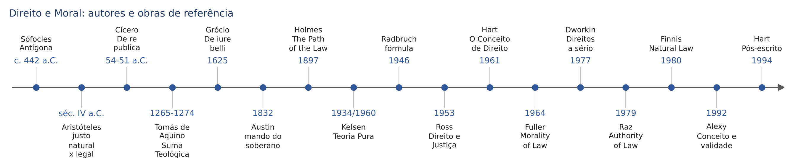
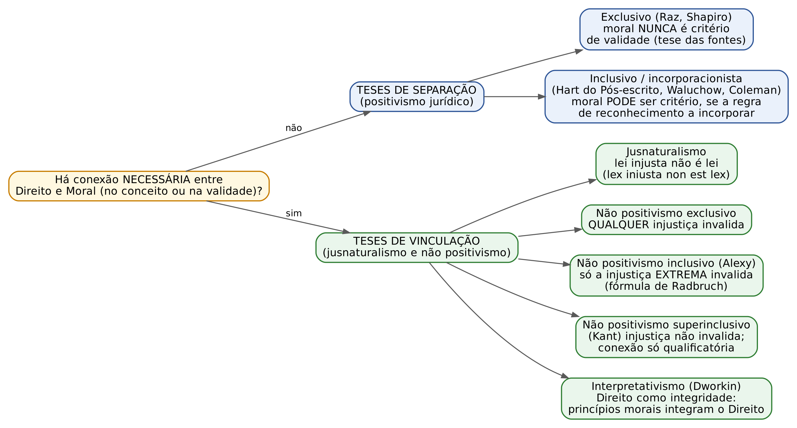
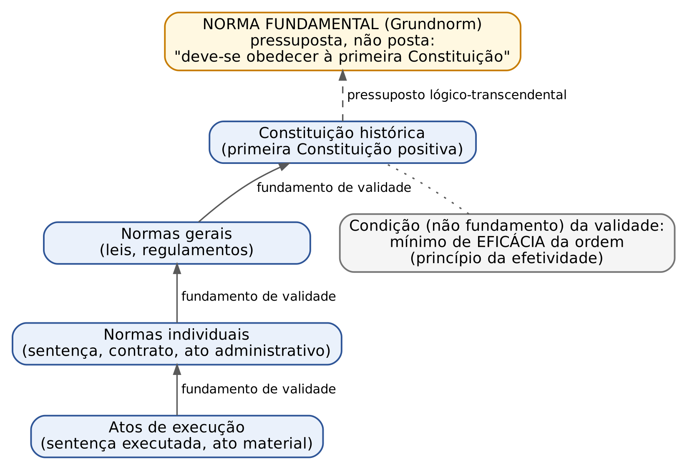
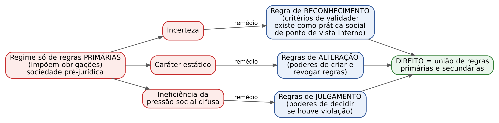
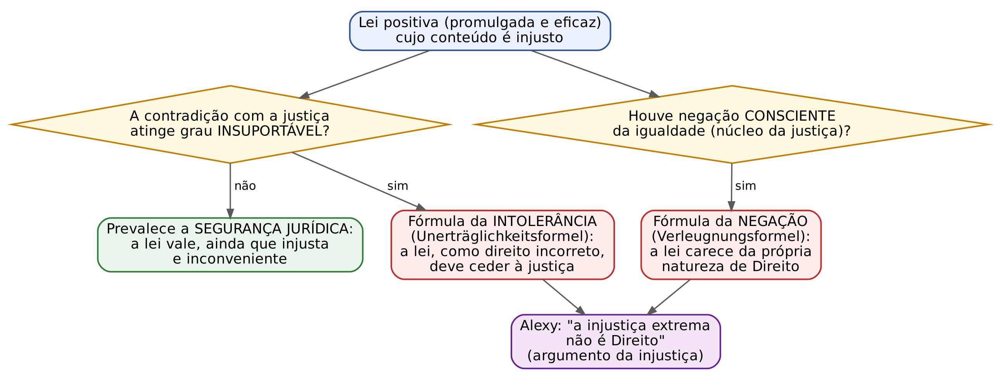
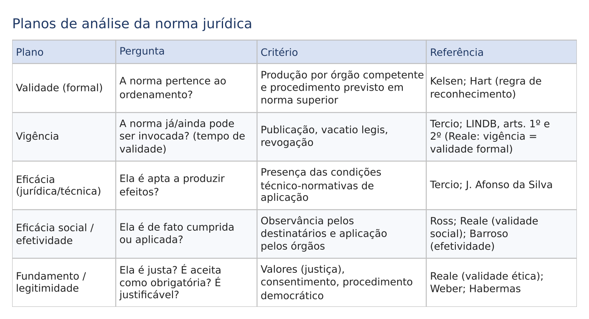
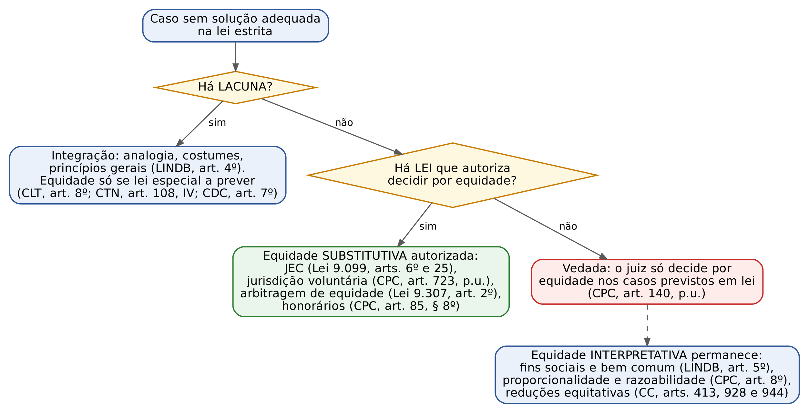

# CAPÍTULO 18 — O CONCEITO DE DIREITO, DIREITO E MORAL, VALIDADE E EQUIDADE

:::INCIDENCIA
TRF5 p. D.2; TJRS p. D.2; TJSC p. E.2. Nível A+.
Lote: 10 questões (FGV 7, FCC 3), duas de provas de juiz (TJCE 2025, TRF3 2025) e uma do ENAM 2025.1.
O que mais cai: Kelsen (pureza metódica, norma fundamental, validade x eficácia, identidade Estado-Direito), Hart (regras primárias e secundárias, regra de reconhecimento), Bobbio (três aspectos do positivismo), fórmula de Radbruch e equidade aristotélica (régua de Lesbos; art. 140, parágrafo único, do CPC).
:::

| Subtema | FGV | FCC | Padrão de cobrança |
|---|---|---|---|
| Positivismo jurídico: Kelsen, Hart, Bobbio | 3 (Q3179591, Q3505845, Q2351226) | 1 (Q4037485) | Atribuição de teses; assertivas de "debate" entre personagens; troca de conceitos (método x teoria; proposição x norma) |
| Conceito de Direito: culturalismo e teoria crítica | 2 (Q3349794, Q2513205) | 1 (Q3531653) | Interpretação de texto (Tobias Barreto, Lyra Filho, giro descolonial) |
| Juízos de fato e de valor | — | 1 (Q3947211) | Classificação de enunciados em caso prático |
| Lei, razão e direito natural | 1 (Q4216281) | — | Identificar a visão positiva da lei em máximas clássicas |
| Equidade | 1 (Q3362335, ENAM) | — | Régua de Lesbos e decisão por equidade autorizada em lei |

O ponto pede quatro blocos que a banca cobra separadamente: (i) o CONCEITO de Direito e sua relação com a Moral (teses de separação e de vinculação); (ii) as GRANDES CORRENTES que respondem a essa pergunta — jusnaturalismo, positivismo, realismo e pós-positivismo, este último com a distinção entre regras, princípios e valores exigida pelo TRF5; (iii) os PLANOS da norma (validade, vigência, eficácia, efetividade e legitimidade); (iv) a EQUIDADE como técnica de decisão. A justiça como valor e a equidade aristotélica como espécie de justiça estão no Cap. 17 (17.3.2 e 17.11.2); a interpretação (moldura kelseniana, lógica do razoável) no Cap. 19; a discricionariedade (Hart x Dworkin), a resposta correta, a ponderação e a argumentação no Cap. 20; a norma jurídica, sua estrutura e o direito subjetivo no Cap. 21; fontes, lacunas e integração no Cap. 22; vigência temporal e direito intertemporal no Cap. 23; unidade, coerência e completude do ordenamento (Bobbio) no Cap. 24; legitimidade weberiana no Cap. 25; pragmatismo e Holmes como pragmatista no Cap. 35. O neoconstitucionalismo e seus marcos estão na Apostila de Direito Constitucional, Cap. 1 (01.3), e a hermenêutica constitucional e a ponderação, no Cap. 5.

## 18.1 O conceito de Direito

### 18.1.1 O problema da definição

A pergunta "o que é o Direito?" não se responde por definição léxica. Kant já observava, na Crítica da Razão Pura, que os juristas ainda procuravam uma definição para seu conceito de direito. Hart abre O Conceito de Direito (1961) com a constatação de que poucas perguntas sobre a sociedade humana foram feitas com tanta persistência e respondidas de modo tão diverso, e identifica três questões recorrentes por trás dela: (i) como o Direito se distingue de ordens baseadas em ameaças e como se relaciona com elas; (ii) como a obrigação jurídica se distingue da obrigação moral e como se relaciona com ela; (iii) o que são regras e em que medida o Direito é uma questão de regras. As três reaparecem ao longo do capítulo: a primeira na crítica de Hart a Austin (18.4.4), a segunda no debate entre separação e vinculação (18.2), a terceira na discussão sobre regras e princípios (18.6.2).

Bobbio, em O Positivismo Jurídico (lições de 1960-1961), oferece a chave metodológica mais cobrada: há definições ONTOLÓGICAS ou avalorativas do Direito (dizem o que o Direito É, como fato) e definições DEONTOLÓGICAS ou valorativas (dizem o que o Direito DEVE SER, em função de um valor). A definição kantiana — o conjunto das condições sob as quais o arbítrio de um pode conciliar-se com o arbítrio de outro segundo uma lei universal de liberdade — é, para Bobbio, deontológica: se tomada como definição do que existe, negaria juridicidade a quase todos os ordenamentos históricos. O positivismo jurídico adota definição estritamente fatual; Bobbio aponta como precursor medieval Marsílio de Pádua (Defensor Pacis), que distinguia a lei como indicação do justo e do injusto (sentido impróprio) da lei como preceito coativo sancionado (sentido próprio).

:::PEGADINHA
A frase "o Direito é o conjunto das condições sob as quais o arbítrio de um pode harmonizar-se com o arbítrio de outro segundo uma lei universal de liberdade" é de KANT (Metafísica dos Costumes, Doutrina do Direito), não de Kelsen. Material de concurso em circulação atribui a fórmula a Kelsen; a atribuição está errada. Kelsen define o Direito como ordem normativa coativa da conduta humana (18.4.3).
:::

### 18.1.2 As grandes famílias de respostas

Para fins de prova, as concepções de Direito se agrupam pelo elemento que elegem como decisivo:

| Concepção | Elemento decisivo | O Direito é... | Autores |
|---|---|---|---|
| Jusnaturalista | Valor (justiça, razão, natureza) | o justo, de que a lei positiva é expressão ou desvio | Aristóteles (justo natural), Cícero, Tomás de Aquino, Grócio, Finnis |
| Normativista (positivismo analítico) | Norma válida | ordem de normas postas, identificadas por critérios formais | Kelsen, Hart, Bobbio, Raz |
| Realista | Fato (decisão, comportamento, psicologia) | o que os tribunais efetivamente farão; normas como diretivas efetivamente seguidas | Holmes, Llewellyn, Frank; Hägerström, Olivecrona, Ross |
| Sociológica | Fato social | ordem de convivência que emerge da sociedade ("direito vivo") | Ehrlich, Duguit, Gurvitch (ver Cap. 1) |
| Culturalista / tridimensional | Fato, valor e norma em dialética | experiência histórico-cultural; norma como integração de fatos segundo valores | Reale; Escola do Recife (Tobias Barreto) |
| Interpretativista / não positivista | Prática interpretativa e correção moral | prática argumentativa cujo conteúdo depende da melhor justificação moral | Dworkin, Alexy |
| Crítica | Conflito e poder | processo histórico de libertação ou instrumento de dominação, irredutível à lei | Marx (ver Cap. 1), Lyra Filho (Direito Achado na Rua), teoria crítica descolonial |

Reale (Teoria Tridimensional do Direito; Lições Preliminares de Direito) sustenta que fato, valor e norma estão sempre presentes em qualquer expressão da vida jurídica, numa dialética de implicação e polaridade: a norma é a integração de fatos segundo valores, e cada um dos três aspectos corresponde a um plano de validade — vigência (validade formal, técnico-jurídica), eficácia (validade social) e fundamento (validade ética). Esse trinômio volta em 18.7.

#### Tobias Barreto e a Escola do Recife

Tobias Barreto (1839-1889), figura central da Escola do Recife, combateu o jusnaturalismo com um culturalismo de inspiração alemã (Jhering, Haeckel): o Direito não é dado pela natureza, mas produto da cultura, isto é, do trabalho humano de domesticação da luta natural pela vida. A célebre oposição entre o NATURAL (o que é) e o CULTURAL (o que se constrói contra o natural) é o eixo da questão abaixo.

:::QUESTAO FGV 2025 — SEASIC-SE — Nível superior (Q3349794)
Cobrado: interpretar trecho de Questões Vigentes (1888) em que Tobias Barreto afirma que a escravidão pode ser "natural" (há formigas escravocratas), mas é cultural que ela não exista, cabendo ao trabalho cultural harmonizar as desigualdades medindo todos "por uma só bitola".
Gabarito: E (fator cultural, construção histórica que reforça a desigualdade natural, mas não é inevitável, sendo tarefa de juristas e políticos desfazê-la).
Armadilha: a alternativa D usa o vocabulário jusnaturalista (natureza racional e autodeterminada), que é exatamente o que Tobias rejeita; A e C reproduzem argumentos escravocratas que o texto refuta. O ponto de prova é que, para o culturalismo, o Direito é obra da cultura CONTRA a natureza, e não revelação dela.
:::

#### Concepções críticas: o Direito para além da lei

Roberto Lyra Filho (O que é Direito, 1982), matriz da Nova Escola Jurídica Brasileira e de O Direito Achado na Rua, propõe uma concepção dialética: o Direito não se confunde com a lei estatal, que é apenas uma de suas formas de positivação; ele emerge das lutas sociais e se define como "modelo avançado de legítima organização social da liberdade". A positivação legal reflete as correlações de forças entre classes e grupos, de modo que lei e Direito podem divergir.

:::QUESTAO FGV 2024 — TJ-SC — Assistente Social (Q2513205)
Cobrado: completar a ideia de que Direito e lei não são equivalentes, sendo o Direito produto de necessidades humanas constituídas em relações sociais dialéticas e contraditórias; pergunta-se de que dependem as formas de positivação na lei.
Gabarito: A (dos interesses em disputa, das correlações de forças e dos níveis de organização e mobilização das classes e segmentos sociais).
Armadilha: C, D e E descrevem funções do Direito estatal (impositividade, manutenção da ordem, disciplinamento), que são o que a concepção crítica põe em questão; B é jargão sem nexo com o enunciado. A chave é a palavra "dialéticas": a positivação é resultado de conflito, não de um ato técnico neutro.
:::

A teoria crítica latino-americana mais recente fala em "giro descolonial": a crítica não apenas ao Direito burguês, mas à matriz eurocêntrica de racionalidade que se apresentou como universal na modernidade e ocultou sua face colonial (a "colonialidade do poder", na formulação de Aníbal Quijano; a "transmodernidade", em Enrique Dussel).

:::QUESTAO FCC 2025 — DPE-AM — Defensor Público (Q3531653)
Cobrado: segundo a obra A superação do direito como norma: uma revisão descolonial da teoria do direito brasileiro, o giro descolonial pressupõe criticar qual paradigma.
Gabarito: A (o paradigma europeu de racionalidade erigido na modernidade, negando-se a desvinculação entre racionalidade/modernidade e colonialidade).
Armadilha: as alternativas trocam os termos da fórmula — "colonial de dominação" no lugar de "europeu de racionalidade", "desenvolvimento/exploração" no lugar de "racionalidade/modernidade", "atualidade" no lugar de "modernidade". O núcleo descolonial é que modernidade e colonialidade são as duas faces do mesmo processo: a racionalidade moderna europeia não é neutra nem universal. Questão de atribuição literal a obra específica, típica da FCC nas Defensorias.
:::

### 18.1.3 Juízos de fato e juízos de valor

A distinção entre ser e dever ser atravessa todo o capítulo. Hume (Tratado da Natureza Humana, 1739-1740) observou que muitos autores passam, sem justificação, de proposições com "é" para proposições com "deve" — a chamada lei de Hume ou guilhotina de Hume: de premissas puramente descritivas não se deduz conclusão normativa. G. E. Moore (Principia Ethica, 1903) cunhou a expressão "falácia naturalista" para a tentativa de definir "bom" por propriedades naturais; a literatura jurídica costuma usar a expressão, em sentido amplo, para a passagem indevida do ser ao dever ser — e é com ela que se critica o jusnaturalismo que extrai normas da "natureza".

Bobbio funda nessa distinção o positivismo como ABORDAGEM AVALORATIVA: o juízo de fato é tomada de CONHECIMENTO da realidade, cuja finalidade é informar; o juízo de valor é tomada de POSIÇÃO diante da realidade, cuja finalidade é influir sobre o outro. Seu exemplo: "o céu é rubro" (fato) x "este céu rubro é belo" (valor). A ciência, inclusive a ciência do Direito, compõe-se só de juízos de fato; daí a distinção entre juízo de VALIDADE (esta norma pertence ao ordenamento?) e juízo de VALOR (esta norma é justa?).

:::QUESTAO FCC 2026 — SEFAZ-MT — Fiscal de Tributos Estaduais (Q3947211)
Cobrado: classificar três enunciados de uma fiscalização: (I) receita declarada inferior à movimentação bancária; (II) alegação de que é injusto exigir as obrigações acessórias porque a carga tributária é excessiva; (III) afirmação de que sonegar em crise é legítima defesa.
Gabarito: B (I é juízo de fato, verificável e contestável com dados; II e III são juízos de valor, por exprimirem avaliações normativas).
Resolução em passos: (1) pergunte se o enunciado pode ser verdadeiro ou falso por confronto com dados — I pode; (2) pergunte se ele qualifica como justo, injusto, legítimo ou devido — II e III o fazem; (3) a "verificabilidade" de III é aparente: a crise é fato, mas "apenas se defendendo" é justificação moral.
Armadilha: E inverte a classificação ao dizer que atribuir responsabilidade torna I valorativo e que opiniões "comuns" seriam fatos; D confunde ser confirmável empiricamente o fato subjacente com ser fático o juízo sobre ele.
:::

## 18.2 Direito e Moral

### 18.2.1 Critérios clássicos de distinção

A distinção entre Direito e Moral é obra da modernidade. Na Antiguidade e na Idade Média, Direito, Moral e Religião formavam um contínuo; a separação se torna problema teórico com a secularização, o pluralismo religioso e a necessidade de delimitar o poder do Estado sobre as consciências.

| Critério | Direito | Moral | Formulação |
|---|---|---|---|
| Foro (exterioridade x interioridade) | Foro externo: atos exteriores | Foro interno: intenção, consciência | Thomasius (Fundamenta juris naturae et gentium, 1705); justo, honesto e decoroso |
| Coercibilidade | Coercível: admite execução pela força | Incoercível: cumprimento forçado esvazia o valor moral | Thomasius; Kant |
| Motivo (legalidade x moralidade) | Basta a conformidade externa do ato à lei (legalidade) | Exige que o dever seja o motivo da ação (moralidade) | Kant (Metafísica dos Costumes, 1797) |
| Heteronomia x autonomia | Norma imposta por vontade alheia, vale independentemente da adesão do destinatário | Norma que o sujeito dá a si mesmo | Kant; Del Vecchio |
| Bilateralidade atributiva | Relação entre dois sujeitos com atribuição de exigibilidade a um deles | Unilateral: impõe dever sem atribuir a outrem pretensão de exigir | Reale; Del Vecchio (bilateralidade x unilateralidade) |
| Sanção | Sanção externa e INSTITUCIONALIZADA (órgãos, procedimento, medida) | Sanção interna (remorso) ou externa difusa (reprovação social) | Bobbio, Teoria da Norma Jurídica |

Kelsen recusa os critérios de conteúdo e de motivação: Direito e Moral não se distinguem pelo que ordenam nem pela interioridade, mas pela FORMA da sanção. O Direito é ordem COATIVA, que reage à conduta indesejada com um ato de força socialmente organizado; a Moral não estatui sanções desse tipo, apenas aprovação e desaprovação.

As relações de conteúdo se expressam na teoria dos círculos, cobrada como quadro:

| Teoria | Imagem | Ideia | Autor associado |
|---|---|---|---|
| Círculos concêntricos | O Direito está contido na Moral | Todo dever jurídico é também moral; o Direito é o "mínimo ético" | Bentham; Jellinek (teoria do mínimo ético) |
| Círculos secantes | Interseção parcial | Há campo comum, mas também normas jurídicas moralmente indiferentes (prazos, formas) e deveres morais juridicamente irrelevantes | Du Pasquier |
| Círculos independentes | Esferas separadas | Direito e Moral não se confundem; a validade jurídica não depende de conteúdo moral | Kelsen (no plano da validade) |

:::DICA
Reale refina a teoria do mínimo ético: o Direito não se reduz a um mínimo da Moral, pois há normas jurídicas amorais (regras técnicas de trânsito, prazos processuais) e até imorais tidas por válidas; nem toda a Moral é juridicizável. A fórmula de Reale sobre o campo comum é a do "círculo secante" com a dimensão própria da bilateralidade atributiva, que é o critério distintivo que ele considera decisivo.
:::

### 18.2.2 Separação e vinculação: o mapa do debate

O debate contemporâneo não é sobre se Direito e Moral se influenciam — todos admitem que o legislador incorpora valores morais e que o Direito pode ser criticado moralmente. A pergunta é se existe conexão NECESSÁRIA entre eles, no CONCEITO de Direito ou nos CRITÉRIOS DE VALIDADE. Os positivistas respondem "não" (tese da separação ou da separabilidade); os não positivistas respondem "sim" (tese da vinculação ou da conexão).

Alexy (Begriff und Geltung des Rechts, 1992 — O Conceito e a Validade do Direito; e escritos posteriores sobre a dupla natureza do Direito) organiza as posições segundo o EFEITO da injustiça sobre a validade:

| Posição | Tese | Efeito da injustiça sobre a validade |
|---|---|---|
| Positivismo exclusivo | A moral é necessariamente EXCLUÍDA do conceito de Direito | Nenhum, jamais |
| Positivismo inclusivo | A moral não é necessariamente excluída nem incluída: depende do que o Direito positivo dispuser | Só se o próprio ordenamento incorporar critérios morais |
| Não positivismo exclusivo | Toda injustiça invalida | Qualquer injustiça retira validade (jusnaturalismo forte: *lex iniusta non est lex*) |
| Não positivismo inclusivo | A injustiça invalida somente quando ultrapassa um limiar | Só a injustiça EXTREMA (fórmula de Radbruch) |
| Não positivismo superinclusivo | A injustiça nunca invalida; a conexão é apenas qualificatória | A norma injusta é válida, mas juridicamente defeituosa (Kant, na leitura de Alexy) |

Alexy filia-se ao não positivismo inclusivo. Note que a tese da conexão em Alexy tem caráter CLASSIFICATÓRIO (só a injustiça extrema exclui a juridicidade) e QUALIFICATÓRIO (a injustiça abaixo do limiar torna a norma juridicamente defeituosa, sem invalidá-la).

:::PEGADINHA
Separação NÃO significa indiferença moral nem dever de obediência à lei injusta. Hart insistia que a tese positivista é conceitual: identificar o Direito existente não depende de juízo moral, e é justamente essa clareza que permite dizer "isto é Direito, mas é iníquo demais para ser obedecido". A ideia de que "lei é lei" e deve ser obedecida por ser lei é o que Bobbio chama de positivismo ÉTICO ou ideológico, não o positivismo como método (18.4.2).
:::

### 18.2.3 O debate Hart-Fuller e a lei injusta

Em 1958, a Harvard Law Review (vol. 71) publicou Positivism and the Separation of Law and Morals, de Hart, e a resposta de Lon Fuller, Positivism and Fidelity to Law — A Reply to Professor Hart. O pano de fundo eram os julgamentos alemães do pós-guerra, entre eles o da delatora que, para livrar-se do marido, o denunciou por críticas a Hitler, com base em leis nazistas; condenado à morte, ele não foi executado e, após a guerra, ela foi processada. O tribunal considerou que a lei nazista era contrária à "consciência sã e ao sentimento de justiça de todos os seres humanos decentes".

- Hart: seria mais HONESTO reconhecer que a lei nazista era Direito válido e, se se quisesse punir a delatora, editar lei retroativa, assumindo abertamente o sacrifício do princípio da irretroatividade. Negar validade à lei iníqua confunde a pergunta "o que é o Direito" com "o que deve ser obedecido".
- Fuller: o Direito possui uma MORALIDADE INTERNA, condição da própria existência de um sistema jurídico; o regime nazista violou-a de forma tão sistemática (leis secretas, retroativas, contraditórias, aplicadas em desacordo com seu texto) que não merecia o nome de ordem jurídica.

Em The Morality of Law (1964), Fuller enumera os oito princípios da moralidade interna (a alegoria do rei Rex, que fracassa de oito modos ao tentar legislar): (1) generalidade; (2) promulgação (publicidade); (3) irretroatividade; (4) clareza; (5) não contradição; (6) possibilidade de cumprimento; (7) constância no tempo; (8) congruência entre a regra declarada e a ação oficial. É um "direito natural PROCEDIMENTAL" (não substantivo): não diz o que o Direito deve ordenar, mas como deve ser feito para ser Direito.

:::DOUTRINA H. L. A. Hart — O conteúdo mínimo de direito natural (O Conceito de Direito, cap. IX)
Hart, positivista, admite um "conteúdo mínimo de direito natural": dadas cinco verdades elementares sobre a condição humana — vulnerabilidade, igualdade aproximada, altruísmo limitado, recursos limitados, compreensão e força de vontade limitadas —, todo sistema que pretenda a sobrevivência do grupo conterá regras protegendo pessoas, propriedade e promessas. A conexão é NATURAL e contingente (decorre de fatos sobre os seres humanos), não conceitual: não compromete a tese da separação.
:::

### 18.2.4 Moral positiva, moral crítica e a jurisdição

Hart, na polêmica com Lord Devlin sobre o Relatório Wolfenden (1957), que propôs descriminalizar a homossexualidade consentida entre adultos, distinguiu MORAL POSITIVA (a moral efetivamente aceita por um grupo) e MORAL CRÍTICA (os princípios gerais com que se avalia a moral positiva). Devlin (The Enforcement of Morals, 1965) sustentava que a sociedade pode usar o Direito Penal para preservar sua moral compartilhada, pois esta seria parte de sua identidade; Hart (Law, Liberty and Morality, 1963), na trilha do princípio do dano de Mill, negava legitimidade ao "moralismo jurídico".

Para o juiz brasileiro, a distinção tem consequência prática: a Constituição positiva conteúdos morais (dignidade, igualdade, moralidade administrativa), e o juiz aplica esses conteúdos como normas jurídicas, não sua moral pessoal. O apelo à moral social majoritária como fundamento de restrição de direitos de minorias é exatamente o que o controle de constitucionalidade contramajoritário rejeita (ver Cap. 40, ADO 26, e Apostila de Direito Constitucional, Cap. 8). A ética da função judicial — diferente da relação conceitual entre Direito e Moral — está nos Caps. 11 e 12.

:::EXEMPLO Fundamentação moral pessoal em sentença
Situação: em ação de alimentos, o juiz consigna que reduz a pensão porque a genitora "leva vida desregrada", reprovável segundo "os valores da família brasileira".
Solução: (1) o critério legal é o binômio necessidade-possibilidade (CC, art. 1.694, § 1º), indiferente ao juízo moral sobre a conduta da genitora, e quem titulariza os alimentos é a criança; (2) a invocação da moral pessoal ou majoritária como razão de decidir é argumento EXTRAJURÍDICO, vedado pela exigência de fundamentação (CF, art. 93, IX; CPC, art. 489, § 1º, III: motivo que se prestaria a justificar qualquer decisão); (3) o Protocolo para Julgamento com Perspectiva de Gênero (Resolução CNJ 492/2023, ver Cap. 28) identifica esse padrão como estereótipo de gênero. A moral entra na decisão apenas quando positivada (princípios constitucionais), e mediante argumentação controlável.
:::

## 18.3 Jusnaturalismo

### 18.3.1 Teses comuns

Sob o rótulo "jusnaturalismo" abrigam-se doutrinas muito diversas, unidas por um núcleo de quatro teses: (i) DUALISMO — além do direito posto pelos homens, existe um direito natural; (ii) SUPERIORIDADE — o direito natural é critério de validade ou de correção do direito positivo; (iii) COGNOSCIBILIDADE — esse direito pode ser conhecido (pela observação da natureza, pela revelação ou pela razão); (iv) UNIVERSALIDADE — vale para todos os homens, embora a imutabilidade tenha sido relativizada pelas versões modernas e contemporâneas. Bobbio resume a relação: para o jusnaturalista, o direito positivo que contraria o natural não é (ou não é plenamente) Direito; para o positivista, só o positivo é Direito, e o natural, quando muito, moral.

A periodização cobrada distingue o fundamento do direito natural em cada época:

| Fase | Fundamento | Autores e marcos | Tese característica |
|---|---|---|---|
| Clássico (cosmológico) | A ordem da natureza (*physis*, cosmos) | Antígona de Sófocles; sofistas (*physis* x *nomos*); Aristóteles; estoicos; Cícero; jurisconsultos romanos | Há um justo por natureza, igual em toda parte, e um justo por convenção |
| Teológico (medieval) | A vontade ou a razão divina | Agostinho; Tomás de Aquino; voluntarismo de Escoto e Ockham; Escola de Salamanca | A lei natural é participação da lei eterna na criatura racional |
| Racionalista (moderno) | A razão humana, independentemente de Deus | Grócio; Hobbes; Pufendorf; Locke; Thomasius; Wolff; Rousseau; Kant | Direitos naturais demonstráveis pela razão; contrato social; codificação |
| Contemporâneo | Razão prática, bens humanos básicos, moralidade do procedimento, "natureza das coisas" | Stammler; Radbruch pós-1945; Fuller; Finnis; Villey; Maritain | Retorno após 1945; limites morais ao direito posto; direitos humanos |

### 18.3.2 Jusnaturalismo clássico

A Antígona de Sófocles (c. 442 a.C.) é o paradigma literário: Antígona enterra o irmão Polinices contra o édito de Creonte, invocando as "leis não escritas e infalíveis dos deuses", que não são de hoje nem de ontem. A tragédia opõe a lei da cidade a uma lei superior. Os SOFISTAS formularam a antítese *physis* x *nomos*: para uns (Cálicles, no Górgias de Platão), a natureza consagra o direito do mais forte e a lei é convenção dos fracos; para outros (Antifonte, Alcidamas), a natureza faz todos iguais e a lei é que cria as diferenças.

ARISTÓTELES (Ética a Nicômaco, V, 7) distingue o justo POLÍTICO em NATURAL (*physikon dikaion*), que tem a mesma força em toda parte, independentemente de ser reconhecido, e LEGAL ou convencional (*nomikon*), indiferente em sua origem até ser estabelecido (ver 17.3.2). Na Retórica, refere a lei comum, conforme à natureza, citando Antígona. Os ESTOICOS identificaram a natureza com o *logos* universal, de que participam todos os homens — origem do cosmopolitismo e da igualdade natural.

CÍCERO (De re publica, livro III, fragmento conservado por Lactâncio) fixou a fórmula clássica: a verdadeira lei é a reta razão conforme à natureza (*vera lex recta ratio naturae congruens*), difundida em todos, constante e eterna, que nem o Senado nem o povo podem revogar. Os jurisconsultos romanos tripartiram o Direito: *ius naturale* (o que a natureza ensinou a todos os animais, segundo Ulpiano), *ius gentium* (comum a todos os povos) e *ius civile* (próprio de cada cidade).

### 18.3.3 Jusnaturalismo teológico

AGOSTINHO (De libero arbitrio, I) afirmou que não parece ser lei aquela que não for justa — matriz da máxima *lex iniusta non est lex*. Em A Cidade de Deus, sem justiça os reinos seriam grandes bandos de ladrões (*remota itaque iustitia quid sunt regna nisi magna latrocinia?*).

TOMÁS DE AQUINO (Suma Teológica, I-II, questões 90 a 97, o "Tratado da Lei") define a lei como ordenação da razão para o bem comum, promulgada por quem tem o cuidado da comunidade, e distingue quatro espécies:

| Lei | Conceito | Observação |
|---|---|---|
| Eterna (*lex aeterna*) | A razão da sabedoria divina que governa todo o universo | Fonte de todas as demais |
| Natural (*lex naturalis*) | Participação da lei eterna na criatura racional | Primeiro preceito: fazer o bem e evitar o mal; inclinações naturais (conservação, procriação e educação dos filhos, conhecer a verdade sobre Deus e viver em sociedade) |
| Humana (*lex humana*) | Determinação particular feita pela razão humana a partir da lei natural | Deriva da natural por CONCLUSÃO (não matar, de não fazer mal) ou por DETERMINAÇÃO (a pena concreta) |
| Divina (*lex divina*) | Revelada nas Escrituras (Antiga e Nova Lei) | Necessária porque a razão humana é falível e porque o homem tem fim sobrenatural |

A lei humana que se afasta da lei natural "já não será lei, mas corrupção da lei" (*non lex sed legis corruptio*, I-II, q. 95, a. 2). Tomás, porém, é prudente: a lei injusta por contrariar o bem humano não obriga em consciência, salvo para evitar escândalo ou perturbação; a que contraria o bem divino nunca deve ser observada (q. 96, a. 4).

O VOLUNTARISMO franciscano (Duns Escoto, Guilherme de Ockham) deslocou o fundamento da razão para a VONTADE divina: o bem é bom porque Deus o quer, e não o contrário — linha que, secularizada, desembocará no voluntarismo político moderno e no positivismo (o Direito como vontade do soberano). A Escola de SALAMANCA (Francisco de Vitória, Francisco Suárez) retomou o tomismo para pensar o direito das gentes e a condição dos povos indígenas da América.

### 18.3.4 Jusnaturalismo racionalista (Escola Clássica do Direito Natural)

HUGO GRÓCIO (De iure belli ac pacis, 1625) é tido como fundador do jusnaturalismo moderno pela hipótese, que ele próprio qualificou de ímpia, de que o direito natural valeria "ainda que se admitisse que Deus não existe" (*etiamsi daremus non esse Deum*): o direito natural é ditame da reta razão, tão imutável que nem Deus pode alterá-lo, como não pode fazer que dois mais dois não sejam quatro. Com Grócio nasce também o direito internacional moderno.

Seguem-se, com fundamentos distintos: HOBBES (Leviatã, 1651), para quem a lei natural (buscar a paz) leva ao pacto e ao soberano, cuja lei civil passa a ser o critério do justo — antecipação do positivismo; PUFENDORF (De iure naturae et gentium, 1672), sistematizador; LOCKE (Segundo Tratado sobre o Governo, 1690), direitos naturais de vida, liberdade e propriedade, governo limitado e direito de resistência; THOMASIUS, a distinção entre justo, honesto e decoroso (18.2.1); WOLFF, o sistema dedutivo; ROUSSEAU (Do Contrato Social, 1762), vontade geral; KANT, o direito racional como condição de coexistência das liberdades.

Os traços que a banca explora: (i) direitos naturais demonstráveis pela razão, eternos e universais; (ii) o Estado existe para assegurá-los, e a lei positiva obriga moralmente na medida em que com eles se conforma; (iii) método dedutivo, more geometrico; (iv) produtos históricos — as Declarações de direitos (Virgínia, 1776; França, 1789) e as grandes CODIFICAÇÕES (Código Civil francês de 1804), nas quais, paradoxalmente, o jusnaturalismo se positivou e preparou o próprio declínio: codificado o direito racional, bastava aplicar o Código (Escola da Exegese).

### 18.3.5 Declínio e críticas

O jusnaturalismo declina no século XIX sob três pressões: a ESCOLA HISTÓRICA (Savigny, Da vocação de nosso tempo para a legislação e a ciência do Direito, 1814), que vê o Direito como produto do espírito do povo (*Volksgeist*) e não da razão abstrata; o POSITIVISMO jurídico, que identifica o Direito com o direito posto; e o empirismo filosófico. As críticas cobradas:

- epistemológica: não há acordo sobre o conteúdo do direito natural (pena de morte, propriedade, escravidão foram justificadas "pela natureza");
- lógica: a passagem do ser natural ao dever ser incorre na lei de Hume (18.1.3);
- política: Kelsen e Ross denunciam o caráter IDEOLÓGICO do direito natural, que serve tanto para legitimar a ordem existente quanto para combatê-la. Ross escreveu que, "como uma prostituta", o direito natural está à disposição de todos (Direito e Justiça, 1953);
- histórica: Bobbio mostra que o direito natural foi muitas vezes conservador (fundamento da obediência), e não só revolucionário.

:::QUESTAO FGV 2026 — MPE-ES — Agente Especializado e Técnico (Q4216281)
Cobrado: entre cinco máximas clássicas sobre as leis, identificar a que exprime visão POSITIVA delas.
Gabarito: E ("a lei é a razão humana, enquanto governa todos os povos da Terra").
Fundamento: a frase é de Montesquieu (Do Espírito das Leis, 1748, livro I, cap. 3), que define a lei em geral como a razão humana e as leis políticas e civis de cada nação como casos particulares em que se aplica essa razão — formulação de matriz racionalista.
Armadilha: A ("em meio às armas, calam-se as leis", *silent enim leges inter arma*, Cícero, Pro Milone) descreve a impotência da lei; B lamenta a falta de quem as execute (eco de Dante, Purgatório, canto XVI: "Le leggi son, ma chi pon mano ad esse?"); C ("o mais corrupto dos Estados tem o maior número de leis", *corruptissima re publica plurimae leges*, Tácito, Anais, III, 27) é crítica à inflação legislativa. D vem do Críton de Platão (fala das Leis a Sócrates, na tradução de Jowett: "for who would like a State that has no laws?") e, no contexto, ELOGIA as leis; a banca a tratou como não positiva, de modo que o gabarito é discutível (ver nota de verificação). Em prova, prefira a máxima que DEFINE a lei como razão (E).
:::

### 18.3.6 Jusnaturalismo contemporâneo

O retorno do direito natural no século XX deu-se em duas ondas: uma neokantiana (STAMMLER, "direito natural de conteúdo variável", forma a priori de justiça com conteúdo histórico) e outra, mais forte, após 1945, diante da experiência dos regimes totalitários que operaram por meio de leis formalmente válidas. Marcos:

- RADBRUCH (1946), a fórmula que leva seu nome (18.6.5);
- a Declaração Universal dos Direitos Humanos (1948), que proclama a dignidade "inerente" e direitos "iguais e inalienáveis" (ver Cap. 27), e as constituições do pós-guerra (Lei Fundamental de Bonn, 1949, art. 1º);
- MARITAIN (Os Direitos do Homem e a Lei Natural, 1942) e o neotomismo;
- MICHEL VILLEY, o "realismo jurídico clássico" (Direito como a coisa justa, *id quod iustum est*, a partir de Aristóteles e do direito romano);
- FULLER, a moralidade interna (direito natural procedimental, 18.2.3);
- JOHN FINNIS (Natural Law and Natural Rights, 1980), a "nova teoria do direito natural".

:::DOUTRINA John Finnis — Natural Law and Natural Rights (1980)
Finnis reformula o tomismo sem derivar normas da natureza (evita a falácia naturalista): parte de BENS HUMANOS BÁSICOS, autoevidentes e incomensuráveis, apreendidos pela razão prática — vida, conhecimento, jogo (*play*), experiência estética, sociabilidade ou amizade, razoabilidade prática e religião. A razoabilidade prática, por sua vez, tem exigências metodológicas (plano coerente de vida, imparcialidade, não agir contra um bem básico etc.). O Direito é necessário para coordenar a busca do bem comum, e a lei injusta é Direito apenas em sentido "secundário" ou periférico (*central case* x *peripheral case*): Finnis lê o *lex iniusta non est lex* como afirmação de que a lei injusta não tem a força moral obrigatória que o caso central do Direito pretende ter, e não como negação de sua existência como fato social.
:::

## 18.4 Positivismo jurídico

### 18.4.1 Origens e escolas

Não confundir POSITIVISMO FILOSÓFICO (Comte, Curso de Filosofia Positiva, 1830-1842: lei dos três estados, só o conhecimento dos fenômenos e de suas relações é científico; ver Cap. 1) com POSITIVISMO JURÍDICO, que é a doutrina segundo a qual só o direito positivo é Direito. Bobbio insiste que o adjetivo "positivo" no positivismo jurídico vem de *ius positum*, por oposição a *ius naturale*, e não de Comte, embora ambos partilhem o ideal de ciência avalorativa.

| Escola | Lugar e época | Tese | Autores |
|---|---|---|---|
| Escola da Exegese | França, século XIX, pós-Código Napoleão | Identificação do Direito com a lei (o Código); interpretação como busca da vontade do legislador; juiz "boca da lei" (Montesquieu) | Demolombe, Aubry e Rau, Laurent; a frase atribuída a Bugnet: "não conheço o direito civil, ensino o Código Napoleão" |
| Jurisprudência dos conceitos (Pandectística) | Alemanha, século XIX | Sistema de conceitos lógicos extraídos do direito romano (Pandectas); a "pirâmide de conceitos"; método construtivo | Puchta, Windscheid, o primeiro Jhering |
| Jurisprudência analítica | Inglaterra, século XIX | Direito como comando do soberano habitualmente obedecido, sancionado; separação entre o Direito que é e o que deve ser | Bentham, Austin (The Province of Jurisprudence Determined, 1832) |
| Positivismo normativista | Áustria e EUA, século XX | Teoria pura; Direito como sistema escalonado de normas | Kelsen (Escola de Viena) |
| Positivismo analítico contemporâneo | Inglaterra, século XX | Direito como prática social de regras; regra de reconhecimento | Hart, Raz, MacCormick (fase inicial) |

A JURISPRUDÊNCIA DOS INTERESSES (Heck), derivada do segundo Jhering (A finalidade no Direito), e a JURISPRUDÊNCIA DOS VALORES (pós-1945, Larenz) são reações ao formalismo conceitual dentro do pensamento alemão, com reflexo em interpretação (Cap. 19).

### 18.4.2 Bobbio: os três aspectos e os sete problemas

Bobbio (O Positivismo Jurídico: Lições de Filosofia do Direito) resume as características fundamentais do positivismo em SETE pontos ou problemas, e os reagrupa em TRÊS aspectos:

| Aspecto | Problema | Resposta positivista |
|---|---|---|
| (a) Modo de abordar o Direito (MÉTODO) | 1. Modo de abordar | O Direito como FATO e não como valor; ciência avalorativa; teoria formal da validade (a validade não implica valor) |
| (b) TEORIA do Direito | 2. Definição | Teoria da COATIVIDADE (o Direito definido pela coação; Bobbio nota que o primeiro formulador foi o jusnaturalista Thomasius) |
| | 3. Fontes | A LEI como fonte preeminente; costume só *secundum* e eventualmente *praeter legem*, nunca *contra legem*; equidade e natureza das coisas como fontes "aparentes" |
| | 4. Norma | Teoria IMPERATIVISTA (norma como comando) |
| | 5. Ordenamento | COERÊNCIA (exclusão de antinomias) e COMPLETUDE (exclusão de lacunas) |
| | 6. Interpretação | Interpretação MECANICISTA, declarativa, que privilegia o elemento lógico sobre o criativo |
| (c) IDEOLOGIA do Direito | 7. Obediência | Dever de obediência absoluta à lei enquanto tal (*Gesetz ist Gesetz*), que Bobbio prefere chamar de positivismo ÉTICO |

Na avaliação final, Bobbio acolhe o positivismo como MÉTODO, considera a TEORIA em boa parte superada (sobretudo o imperativismo estrito, a completude e o mecanicismo interpretativo) e rejeita a IDEOLOGIA em sua versão extremista (forte), admitindo apenas uma versão moderada (fraca), segundo a qual o Direito, por ser ordem, realiza valores próprios — certeza, paz, igualdade formal — que justificam uma obediência não incondicionada. Para não incorrer em erro: o positivismo como método é compatível com a crítica moral do Direito; quem é positivista no método pode ser antipositivista na ideologia, e esse era o caso do próprio Bobbio.

:::QUESTAO FGV 2024 — Câmara Municipal de São Paulo — Procurador Legislativo (Q2351226)
Cobrado: três afirmações de um aluno sobre os aspectos do positivismo em Bobbio.
Gabarito: C (apenas a II, sobre a ideologia em sentido forte e fraco, está correta).
Armadilha: a I atribui à TEORIA o que é do MÉTODO (o modo de análise avalorativo, em oposição ao jusnaturalismo); a III atribui ao MÉTODO o que é da TEORIA (as concepções coativa, legal e imperativa). Basta memorizar a correspondência do quadro acima. Resolução detalhada também na Apostila de Direito Constitucional, Cap. 1 (01.3).
:::

:::QUESTAO FGV 2025 — TRF 3ª Região — Juiz Federal Substituto (Q3179591)
Cobrado: alternativa correta sobre o positivismo kelseniano.
Gabarito: C (a teoria imperativista da norma está estreitamente vinculada à concepção legalista-estatal do Direito, que vê o Estado como única fonte e a lei como única expressão de seu poder normativo). É tese de Bobbio sobre o positivismo em geral, que a banca encaixou no enunciado.
Erros das demais: B — a PROPOSIÇÃO jurídica é produzida pela CIÊNCIA do Direito (enunciado descritivo, verdadeiro ou falso), não pela jurisprudência dos tribunais, e as normas não são produzidas só pelo legislativo (sentenças são normas individuais); D — a norma fundamental é PRESSUPOSTA, não reconduzível a Deus ou à natureza (seria jusnaturalismo); E — confunde coerência (exclusão de antinomias) com completude (exclusão de lacunas). A alternativa A descreve corretamente a pureza metódica, mas situa a tese na "Teoria Geral do Direito", e não na Teoria Pura do Direito; é o detalhe que a torna incorreta para a banca (ver nota de verificação).
:::

### 18.4.3 Hans Kelsen: a Teoria Pura do Direito

Hans Kelsen (1881-1973), autor da Constituição austríaca de 1920 e do modelo de controle concentrado, escreveu a Teoria Pura do Direito (1ª ed. 1934; 2ª ed. 1960, profundamente revista), a Teoria Geral do Direito e do Estado (1945), O que é Justiça? e, postumamente, a Teoria Geral das Normas (1979).

PUREZA METÓDICA. A teoria é "pura" porque pretende conhecer apenas o Direito, livrando a ciência jurídica de elementos estranhos: a SOCIOLOGIA e a psicologia (que estudam fatos sob o princípio da causalidade), a ÉTICA e a POLÍTICA (que valoram). A pureza é do MÉTODO, não do objeto: Kelsen não nega que o Direito tenha causas e efeitos sociais ou que possa ser moralmente criticado; nega que isso seja tarefa da ciência jurídica.

SER E DEVER SER; CAUSALIDADE E IMPUTAÇÃO. Entre ser (*Sein*) e dever ser (*Sollen*) há um dualismo intransponível: do fato de algo ser não se segue que deva ser. As ciências naturais ligam fatos pelo princípio da CAUSALIDADE (se A é, B é); as ciências normativas, pelo princípio da IMPUTAÇÃO (se A é, B deve ser). A NORMA é o SENTIDO OBJETIVO de um ato de vontade dirigido à conduta de outrem: o ato do parlamentar que levanta a mão é fato; seu sentido jurídico só existe porque uma norma superior o qualifica. Daí o exemplo kelseniano: a ordem do assaltante e a do fiscal de tributos têm o mesmo sentido subjetivo, mas só a segunda tem sentido OBJETIVO de dever, porque autorizada por norma válida.

NORMA E PROPOSIÇÃO. A NORMA jurídica é prescritiva, produzida pela autoridade (legislador, juiz, administrador, contratantes) e não é verdadeira nem falsa, mas válida ou inválida. A PROPOSIÇÃO jurídica (*Rechtssatz*) é o enunciado descritivo com que a CIÊNCIA do Direito descreve as normas, e pode ser verdadeira ou falsa. A estrutura da norma completa é a de um juízo hipotético que liga o ilícito à sanção; Kelsen chamou, na Teoria Geral do Direito e do Estado, de norma PRIMÁRIA a que estatui a sanção e de SECUNDÁRIA a que prescreve a conduta devida — terminologia inversa à de Hart (ver Cap. 21).

O DIREITO COMO ORDEM COATIVA. O Direito é ordem normativa da conduta humana, coativa (reage com atos de força) e socialmente imanente. O monopólio da força pela comunidade jurídica distingue o Direito da Moral (18.2.1) e da ordem de um bando de salteadores (que pode ter sentido subjetivo de dever, mas não objetivo, salvo se se tornar ordem eficaz e duradoura e se pressupuser uma norma fundamental).

ESCALONAMENTO E NORMA FUNDAMENTAL. O ordenamento é sistema DINÂMICO: as normas inferiores valem porque produzidas na forma determinada por normas superiores (delegação de competência), e não por seu conteúdo (sistema estático, próprio da Moral, em que as normas se deduzem de uma norma de conteúdo evidente). A cadeia de fundamentação termina na NORMA FUNDAMENTAL (*Grundnorm*), que não é posta, mas PRESSUPOSTA pelo jurista como condição lógico-transcendental (em sentido kantiano) de interpretar o material como Direito válido: "deve-se obedecer à Constituição historicamente primeira". Na Teoria Geral das Normas, Kelsen passou a qualificá-la como FICÇÃO, no sentido de Vaihinger. A estrutura escalonada (*Stufenbau*) foi desenvolvida a partir de Adolf Merkl.

VALIDADE E EFICÁCIA. Validade é a existência específica da norma, o fato de ela "dever ser" observada; eficácia é o fato de ser efetivamente observada e aplicada. São distintas: uma norma pode valer sem ser eficaz. Mas há relação: um MÍNIMO de eficácia é CONDIÇÃO da validade — de cada norma (o desuso, *desuetudo*, faz cessar a validade) e, sobretudo, da ordem como um todo (princípio da efetividade: uma ordem revolucionária vitoriosa torna-se válida). A eficácia é condição, NÃO fundamento: o fundamento de validade de uma norma é sempre outra norma.

IDENTIDADE ENTRE ESTADO E DIREITO. Kelsen rejeita o dualismo tradicional entre Estado (realidade sociológica ou poder) e Direito (ordem que o Estado cria e à qual se submete). O Estado, como comunidade jurídica, É a ordem jurídica (relativamente centralizada) ou sua personificação; os elementos do Estado (território, povo, poder) são os âmbitos espacial, pessoal e de eficácia da ordem jurídica. O dualismo seria ideológico: serve para legitimar o Estado pelo Direito, como se ele fosse anterior e se autolimitasse.

:::QUESTAO FCC 2026 — DPE-BA — Defensor Público (Q4037485)
Cobrado: o que Kelsen afirma, na Teoria Geral do Direito e do Estado, ao analisar o Estado como entidade sociológica ou jurídica.
Gabarito: B (o Estado, como comunidade jurídica, não é algo separado de sua ordem jurídica).
Armadilha: A e C afirmam a separação; D e E invertem o sinal ao dizer que o DUALISMO caracterizaria o positivismo ou seria pressuposto da autonomia da ordem jurídica — Kelsen sustenta exatamente o contrário: o dualismo é ideológico e a pureza exige o monismo Estado-Direito.
:::

INTERPRETAÇÃO E JUSTIÇA. A interpretação pela ciência revela uma MOLDURA de significados possíveis; a escolha do órgão aplicador dentro dela é ato de vontade, política jurídica, não conhecimento (ver Cap. 19). Quanto à justiça, Kelsen é RELATIVISTA: os valores são irracionais do ponto de vista científico; a justiça absoluta é ideal irracional; sua opção pessoal é a justiça da liberdade, da paz, da democracia e da tolerância (O que é Justiça?).

:::PRATIQUE Exercício elaborado para esta apostila (não é questão de banca)
Certo ou errado? (1) "Kelsen parte da separação entre fato e valor e sustenta que a validade de uma norma não pode advir de elemento factual, mas somente de norma superior." (2) "Para Hart, a validade das regras não pode fundar-se no reconhecimento pela comunidade." (3) "O pós-positivismo é uma tentativa de reavivar o positivismo clássico." (4) "Para o pragmatismo, as ideias são fins em si mesmas."
Resolução: (1) CERTO (dualismo ser x dever ser; fundamento de validade é sempre norma). (2) ERRADO: a regra de reconhecimento é justamente prática social. (3) ERRADO: o pós-positivismo supera o positivismo pela normatividade dos princípios e pela conexão com a moral. (4) ERRADO: as ideias são instrumentos (Cap. 35).
:::

:::PEGADINHA
"Validade" e "eficácia" em Kelsen: (1) eficácia é CONDIÇÃO, não FUNDAMENTO de validade; (2) a norma isolada pode ser válida e ineficaz, mas a ordem globalmente ineficaz perde validade; (3) a norma fundamental não é norma positiva nem de direito natural: é pressuposto do pensamento jurídico. Alternativas que digam que a Grundnorm "é a Constituição", "é posta pelo constituinte originário" ou "decorre da natureza" estão erradas.
:::

### 18.4.4 H. L. A. Hart: O Conceito de Direito

Herbert Hart (1907-1992), professor de Jurisprudence em Oxford, renovou o positivismo com o instrumental da filosofia da linguagem ordinária. O Conceito de Direito (1961) é construído pela CRÍTICA AO MODELO DE AUSTIN (Direito como ordens do soberano baseadas em ameaças, habitualmente obedecidas):

- a situação do assaltante (*gunman*) mostra a diferença entre "ser obrigado" (*being obliged*, estado psicológico diante de ameaça) e "ter uma obrigação" (*having an obligation*, que supõe regra);
- há normas que não impõem deveres, mas CONFEREM PODERES (testar, contratar, casar, legislar, julgar), e não se reduzem a ameaças;
- as leis se aplicam também a quem as edita;
- há Direito de origem não legislada (costume);
- o "hábito de obediência" não explica a continuidade da autoridade legislativa na sucessão de soberanos nem a persistência das leis após a morte de quem as editou.

REGRAS PRIMÁRIAS E SECUNDÁRIAS. Regras PRIMÁRIAS impõem deveres (exigem ações ou abstenções). Um regime só de regras primárias (sociedade pré-jurídica) teria três defeitos, cada qual remediado por uma espécie de regra SECUNDÁRIA, que versa sobre as primárias e CONFERE PODERES:

| Defeito do regime primário | Regra secundária que o remedia | Função |
|---|---|---|
| Incerteza (dúvida sobre quais são as regras) | Regra de RECONHECIMENTO | Fixa os critérios de identificação e validade das regras do sistema |
| Caráter estático (não há como mudá-las deliberadamente) | Regras de ALTERAÇÃO (*change*) | Conferem poder de introduzir, modificar e revogar regras (legislação; também negócios privados) |
| Ineficiência da pressão social difusa | Regras de JULGAMENTO (*adjudication*) | Conferem poder de determinar, com autoridade, se uma regra foi violada, e regulam a aplicação de sanções |

O Direito é a UNIÃO de regras primárias e secundárias; nessa união está, para Hart, a "chave da ciência da jurisprudência".

REGRA DE RECONHECIMENTO E PONTO DE VISTA INTERNO. A regra de reconhecimento é a regra última do sistema: não é válida nem inválida, simplesmente EXISTE como fato social complexo — a prática convergente dos tribunais, autoridades e particulares que identificam o Direito por certos critérios e os aceitam do PONTO DE VISTA INTERNO (aceitação como padrão crítico de comportamento, que justifica cobranças e críticas), e não apenas do ponto de vista externo (observação de regularidades, como a de quem prevê que os motoristas pararão no sinal vermelho). Diferentemente da Grundnorm kelseniana, que é pressuposta, a regra de reconhecimento é FATO verificável. Condições mínimas de existência de um sistema jurídico: as regras primárias válidas são geralmente obedecidas pelos cidadãos, e as secundárias são efetivamente aceitas como padrões comuns pelas autoridades.

TEXTURA ABERTA E DISCRICIONARIEDADE. A linguagem geral das regras tem um núcleo de certeza e uma zona de penumbra (o exemplo do "veículo" proibido no parque); nos casos da penumbra, o juiz exerce DISCRICIONARIEDADE e cria Direito intersticialmente. O desenvolvimento do tema (e a crítica de Dworkin) está no Cap. 20.

PÓS-ESCRITO (1994, publicado postumamente na 2ª edição). Respondendo a Dworkin, Hart declarou-se positivista "suave" (*soft positivism*): a regra de reconhecimento PODE incorporar, como critérios de validade, princípios morais ou valores substantivos (como fazem cartas de direitos), sem que isso seja necessário — é o positivismo INCLUSIVO (18.4.5). Afirmou também que sua teoria é DESCRITIVA e geral, moralmente neutra, enquanto a de Dworkin é justificatória e voltada a uma cultura jurídica particular.

:::QUESTAO FGV 2025 — TJ-CE — Juiz Substituto (Q3505845)
Cobrado: debate entre Joana (o Direito como união de regras primárias e secundárias, caracterizadas estas pela criação de poderes, não de obrigações), Maria (o mundo pré-jurídico se caracterizaria pela inclusão das regras secundárias) e Antônia (a validade das regras jurídicas é influenciada pela regra de reconhecimento).
Gabarito: D (apenas Joana e Antônia estão certas).
Resolução em passos: (1) Joana descreve corretamente a tese central do cap. V de O Conceito de Direito; (2) Maria inverte a lógica: o mundo pré-jurídico é justamente o de regras SÓ primárias, e a introdução das secundárias marca a passagem ao jurídico; (3) Antônia está correta: a regra de reconhecimento fornece os critérios de validade.
Armadilha: o verbo "influenciada" em Antônia parece fraco, mas não torna a assertiva falsa; o erro está todo em Maria.
:::

:::DICA
Duas inversões que a FGV explora: (1) primárias e secundárias têm sentidos OPOSTOS em Kelsen (primária = a que estatui a sanção) e em Hart (primária = a que impõe o dever de conduta); (2) Kelsen pressupõe uma norma (Grundnorm), Hart constata um fato social (regra de reconhecimento). Para Kelsen o fundamento último é lógico-transcendental; para Hart, empírico-social.
:::

### 18.4.5 Joseph Raz e o positivismo exclusivo

Joseph Raz (1939-2022), discípulo de Hart, formulou o positivismo EXCLUSIVO (ou "duro"). Obras: Practical Reason and Norms (1975), The Authority of Law (1979), The Morality of Freedom (1986), Ethics in the Public Domain (1994).

- TESE DAS FONTES (*sources thesis*): a existência e o conteúdo do Direito determinam-se exclusivamente por FATOS SOCIAIS (fontes), sem recurso a argumentos morais. Se uma norma remete à "justiça" ou à "dignidade", ela não incorpora a moral ao Direito; antes, AUTORIZA o juiz a aplicar razões extrajurídicas, e nesses casos ele cria Direito.
- AUTORIDADE: o Direito necessariamente PRETENDE autoridade legítima (não necessariamente a tem). Pela tese da justificação normal, uma autoridade é legítima quando o destinatário age melhor segundo as razões que já se lhe aplicam se seguir as diretivas da autoridade do que se tentar segui-las por conta própria (concepção da autoridade como SERVIÇO).
- RAZÕES EXCLUDENTES (*exclusionary reasons*): as diretivas autoritativas são razões de segunda ordem que excluem a ponderação, pelo destinatário, das razões de primeira ordem que elas substituem. Se a identificação do Direito exigisse avaliação moral, ele não poderia cumprir essa função — daí a moral não poder ser critério de validade.

| Ponto | Positivismo exclusivo | Positivismo inclusivo (incorporacionismo) |
|---|---|---|
| Moral como critério de validade | Nunca | Possível, se a regra de reconhecimento a incorporar (contingente) |
| Princípios constitucionais morais | Autorizam o juiz a decidir por razões extrajurídicas (criação de Direito) | São Direito, porque a regra de reconhecimento os incorpora |
| Fundamento | Tese das fontes; natureza da autoridade | Tese da convencionalidade da regra de reconhecimento; flexibilidade |
| Autores | Raz, Scott Shapiro, Andrei Marmor | Hart (Pós-escrito), Wil Waluchow (Inclusive Legal Positivism, 1994), Jules Coleman, Matthew Kramer |

:::PEGADINHA
Positivismo inclusivo NÃO é pós-positivismo. O inclusivista admite moral na validade apenas CONTINGENTEMENTE (porque o Direito positivo a incorporou); o não positivista (Alexy, Dworkin) afirma conexão NECESSÁRIA. Questão que diga que "o positivismo inclusivo sustenta a conexão necessária entre Direito e Moral" está errada.
:::

### 18.4.6 Quadro comparativo dos positivistas

| | Austin | Kelsen | Hart | Bobbio | Raz |
|---|---|---|---|---|---|
| Obra-chave | The Province of Jurisprudence Determined (1832) | Teoria Pura do Direito (1934/1960) | O Conceito de Direito (1961) | Teoria da Norma (1958), Teoria do Ordenamento (1960), O Positivismo Jurídico | The Authority of Law (1979) |
| Unidade básica | Comando do soberano | Norma (sentido objetivo de ato de vontade) | Regra social (primária e secundária) | Norma e ordenamento | Razão para a ação autoritativa |
| Fundamento último | Hábito de obediência ao soberano | Norma fundamental pressuposta | Regra de reconhecimento (fato social) | Norma fundamental (com leitura própria: poder e norma) | Fontes sociais |
| Coação | Essencial (sanção) | Essencial (ordem coativa) | Não essencial a cada norma | Sanção institucionalizada como traço do ordenamento | Não definidora |
| Moral | Separada | Separada (relativismo) | Separada; conteúdo mínimo de direito natural; Pós-escrito inclusivo | Separada no método; crítica à ideologia | Exclusão (tese das fontes) |

## 18.5 Realismo jurídico

O realismo desloca o centro do Direito da norma para a CONDUTA efetiva de juízes e destinatários. Tem duas vertentes, que a banca exige distinguir.

### 18.5.1 Realismo norte-americano

Precursor e referência obrigatória é OLIVER WENDELL HOLMES JR. (The Path of the Law, 1897): "as profecias do que os tribunais farão de fato, e nada mais pretensioso, é o que entendo por Direito". Holmes propõe olhar o Direito do ponto de vista do "homem mau" (*bad man*), que só se importa com as consequências materiais de sua conduta; em The Common Law (1881), afirma que a vida do Direito não tem sido lógica, mas experiência. Holmes é estudado também como pragmatista (Cap. 35).

O movimento realista propriamente dito floresce nas décadas de 1920 e 1930:

- KARL LLEWELLYN (The Bramble Bush, 1930): o que os agentes oficiais fazem acerca das disputas é o próprio Direito; distinção entre *paper rules* (regras de papel) e *real rules* (práticas efetivas);
- JEROME FRANK (Law and the Modern Mind, 1930): o desejo de certeza jurídica é um mito infantil (busca do "pai"); a decisão é produto da personalidade do juiz; Frank é "cético quanto aos FATOS" (*fact skeptic*), porque a incerteza maior está na determinação dos fatos em primeira instância, e não só nas regras (*rule skepticism*, de Llewellyn);
- JOHN CHIPMAN GRAY: as leis são FONTES do Direito, não o Direito; só é Direito o que os tribunais estabelecem.

Herdeiros: o movimento *Critical Legal Studies* (Duncan Kennedy, Roberto Mangabeira Unger) e, em outra direção, a análise econômica (Cap. 36) e os estudos empíricos de comportamento judicial. A tese de Holmes sobre a decisão também ressoa na economia comportamental (Cap. 37).

### 18.5.2 Realismo escandinavo

A Escola de Uppsala (AXEL HÄGERSTRÖM, fundador; KARL OLIVECRONA, Law as Fact, 1939; VILHELM LUNDSTEDT) e o dinamarquês ALF ROSS (Direito e Justiça, 1953; Tû-tû, 1951) aplicam ao Direito o empirismo e a crítica antimetafísica: noções como "direito subjetivo", "dever" e "força obrigatória" seriam resíduos mágicos ou palavras sem referência semântica, que funcionam como instrumentos de técnica de apresentação (o Tû-tû é palavra vazia de uma tribo imaginária que liga fatos a consequências).

ROSS define o direito VIGENTE (*gældende ret*) como o conjunto de normas que efetivamente operam na mente do juiz, porque ele as sente como socialmente obrigatórias e por isso as obedece: uma proposição sobre o direito vigente é uma PREVISÃO de que a norma será aplicada pelos tribunais em decisões futuras. A vigência tem dois componentes: a EFETIVIDADE externa (regularidade observável das decisões) e a ADESÃO interna do juiz (ideologia normativa). A ciência do Direito é ciência empírica, cujas proposições são verificáveis.

| | Realismo norte-americano | Realismo escandinavo |
|---|---|---|
| Matriz | Pragmatismo; prática da *common law* | Empirismo filosófico; crítica à metafísica (Uppsala) |
| Foco | Comportamento do juiz e previsão das decisões | Fenômenos psicológicos e sociais (sentimento de obrigatoriedade) |
| Conceito de Direito | O que os tribunais efetivamente farão | Normas que efetivamente operam na mente do juiz, sentidas como obrigatórias |
| Autores | Holmes (precursor), Llewellyn, Frank, Gray | Hägerström, Olivecrona, Lundstedt, Ross |
| Pergunta típica | "O que este tribunal decidirá?" | "Esta norma é vigente, isto é, é aplicada e sentida como vinculante?" |

:::PEGADINHA
Para ROSS, "vigência" é conceito EMPÍRICO (efetividade prevista na aplicação judicial); para KELSEN, "validade" é conceito NORMATIVO (existência específica do dever ser) e eficácia é só sua condição. Alternativa que atribua a Ross a ideia de que a validade decorre de norma superior pressuposta, ou a Kelsen a de que a norma vale porque é aplicada, está errada. E o realismo não diz que o juiz "cria o Direito do nada": diz que o Direito se identifica com a decisão provável.
:::

## 18.6 Pós-positivismo e não positivismo

### 18.6.1 Conceito e contexto

"Pós-positivismo" é rótulo sobretudo da literatura brasileira e ibérica (o termo corrente na filosofia analítica é "não positivismo" ou "antipositivismo") para as teorias que, a partir da segunda metade do século XX, buscam superar a legalidade estrita sem retornar a um direito natural metafísico. Na síntese de Barroso, é a confluência entre jusnaturalismo e positivismo: reaproximação entre Direito e ética, normatividade dos princípios, centralidade da dignidade e dos direitos fundamentais, reabilitação da razão prática e da argumentação. Barroso o apresenta como o marco FILOSÓFICO do neoconstitucionalismo (os marcos histórico e teórico estão na Apostila de Direito Constitucional, Cap. 1, 01.3).

| Corrente | Relação Direito-Moral | Fundamento da validade | Papel do juiz |
|---|---|---|---|
| Jusnaturalismo | Identidade ou subordinação: o Direito injusto não é Direito | Conformidade com o direito natural | Aplicar o justo, mesmo contra a lei |
| Positivismo | Separação conceitual | Fato social ou norma pressuposta; critérios formais | Aplicar a lei; discricionariedade nos casos não regulados |
| Realismo | Irrelevante para o conceito; o que importa é o comportamento | Efetividade (aplicação provável) | O juiz é quem, de fato, faz o Direito |
| Pós-positivismo | Conexão necessária, mediada por princípios e argumentação | Positividade + eficácia + correção (Alexy); integridade (Dworkin) | Decidir por argumentos de princípio, com ônus argumentativo reforçado |

### 18.6.2 Regras, princípios e valores

O TRF5 pede expressamente "regras, princípios e valores". A distinção forte (qualitativa ou lógica) entre regras e princípios é a contribuição central de Dworkin e Alexy; a dogmática da ponderação e da proporcionalidade (adequação, necessidade e proporcionalidade em sentido estrito) é desenvolvida no Cap. 20 e na Apostila de Direito Constitucional, Cap. 5.

| | Dworkin (Levando os Direitos a Sério, 1977; "O modelo de regras I", 1967) | Alexy (Teoria dos Direitos Fundamentais, 1985) |
|---|---|---|
| Regras | Aplicam-se no modo TUDO OU NADA (*all-or-nothing*): se os fatos ocorrem, ou a regra é válida e a consequência se impõe, ou é inválida; exceções podem ser enumeradas | MANDAMENTOS DEFINITIVOS: contêm determinações no âmbito do fática e juridicamente possível; ou se cumprem ou não |
| Princípios | Têm DIMENSÃO DE PESO (*dimension of weight*); enunciam razões que apontam numa direção sem impor decisão; vinculam por sua moralidade, não por seu *pedigree* | MANDAMENTOS DE OTIMIZAÇÃO: ordenam que algo se realize na maior medida possível, conforme as possibilidades fáticas e jurídicas; satisfazem-se em graus |
| Conflito de regras | Uma delas é inválida (ou excepcionada) | Cláusula de exceção ou declaração de invalidade (dimensão da VALIDADE) |
| Colisão de princípios | Prevalece o de maior peso no caso, sem invalidar o outro | PONDERAÇÃO; relação de precedência CONDICIONADA às circunstâncias; lei de colisão (dimensão do PESO) |
| Distinção ao lado de | Políticas (*policies*): objetivos coletivos; princípios: exigências de justiça, equidade ou moralidade relativas a direitos individuais | Valores (ver abaixo) |

PRINCÍPIOS E VALORES. Alexy distingue os conceitos DEONTOLÓGICOS (dever, proibição, permissão: o que é DEVIDO) dos AXIOLÓGICOS (o que é BOM, o melhor). Princípios e valores têm a mesma estrutura de otimização, mas os princípios estão no plano deontológico (o que é devido é o melhor, na medida do possível), e os valores no axiológico (o que é melhor). A Constituição positiva princípios, que são NORMAS; os valores são o seu correlato axiológico. Alexy prefere o modelo de princípios ao de valores porque o Direito trata do devido, e o discurso de valores favorece o subjetivismo. Habermas critica a ponderação justamente por "axiologizar" direitos, que deveriam funcionar como trunfos deontológicos, e não como bens otimizáveis.

:::DICA
Em Dworkin, "princípio" tem sentido estrito, ligado a direitos, e opõe-se a "política" (*policy*), ligada a metas coletivas. Daí a tese de que os juízes, nos casos difíceis, devem decidir com base em ARGUMENTOS DE PRINCÍPIO, e não de política: o Legislativo pode perseguir metas coletivas; o Judiciário protege direitos. Alexy, ao contrário, admite que princípios tenham por objeto tanto direitos individuais quanto bens coletivos.
:::

:::ATENCAO
Críticas brasileiras cobradas: Humberto Ávila (Teoria dos Princípios) recusa a distinção forte, sustenta que regras também podem ser ponderadas (superabilidade) e que princípios não se reduzem a mandamentos de otimização, e propõe a categoria dos POSTULADOS normativos (proporcionalidade, razoabilidade, proibição de excesso) como metanormas de aplicação; Virgílio Afonso da Silva (O proporcional e o razoável) distingue proporcionalidade (de matriz alemã, com três sub-regras) e razoabilidade (de matriz anglo-saxã); Lenio Streck denuncia o "panprincipiologismo" (criação de princípios sem normatividade para justificar decisões discricionárias). Detalhamento no Cap. 20 e na Apostila de Direito Constitucional, Cap. 5.
:::

### 18.6.3 Ronald Dworkin: o Direito como integridade

Ronald Dworkin (1931-2013), sucessor de Hart na cátedra de Oxford, atacou o positivismo em "O modelo de regras I" (1967), recolhido em Levando os Direitos a Sério (1977). Segundo ele, o positivismo se assenta em três teses: (i) do *PEDIGREE* — o Direito se identifica por critérios de origem, não de conteúdo (regra de reconhecimento); (ii) da DISCRICIONARIEDADE — onde as regras acabam, o juiz decide discricionariamente; (iii) da OBRIGAÇÃO — só há obrigação jurídica onde há regra válida que a imponha.

O contra-argumento parte dos PRINCÍPIOS. Em Riggs v. Palmer (Nova York, 1889), o neto que assassinou o avô para herdar foi excluído da herança, embora a lei de testamentos, lida literalmente, lhe desse razão: o tribunal aplicou o princípio de que ninguém pode beneficiar-se da própria torpeza. Esse princípio é Direito, vincula o juiz, mas não tem *pedigree* identificável por uma regra de reconhecimento: vale por sua adequação moral e por sua presença na prática institucional. Logo, (i) a tese do *pedigree* falha; (ii) nos casos difíceis o juiz não tem discricionariedade em sentido forte, pois está vinculado a princípios; (iii) há obrigações jurídicas derivadas de princípios.

Em O Império do Direito (Law's Empire, 1986), Dworkin desenvolve o DIREITO COMO INTEGRIDADE: o Direito é um conceito INTERPRETATIVO, e as proposições jurídicas são verdadeiras se decorrem dos princípios de justiça, equidade (*fairness*) e devido processo que oferecem a MELHOR INTERPRETAÇÃO CONSTRUTIVA da prática jurídica da comunidade. A interpretação tem duas dimensões: ADEQUAÇÃO (*fit*) aos materiais institucionais e JUSTIFICAÇÃO (apresentar a prática à sua melhor luz moral). Imagens cobradas:

- ROMANCE EM CADEIA (*chain novel*): cada juiz é como um romancista que recebe capítulos escritos por outros e deve continuar a obra como se fosse de um único autor, com coerência de narrativa e de valores;
- JUIZ HÉRCULES: juiz ideal, de capacidade e paciência sobre-humanas, capaz de construir o esquema de princípios que justifica todo o Direito da comunidade;
- ÚNICA RESPOSTA CORRETA (*right answer thesis*): mesmo nos casos difíceis há, em regra, uma resposta correta, ainda que controvertida (desenvolvimento no Cap. 20).

Dworkin critica também o "aguilhão semântico" (*semantic sting*): o erro de supor que os juristas só podem divergir sobre o Direito se partilharem critérios de uso da palavra; para ele, as divergências jurídicas são TEÓRICAS, sobre os fundamentos do Direito, e não empíricas. Contrapõe três concepções: CONVENCIONALISMO (o Direito são as convenções passadas; corresponde ao positivismo), PRAGMATISMO JURÍDICO (o juiz decide olhando para o futuro, sem compromisso com a coerência; ver Cap. 35) e INTEGRIDADE, que ele defende. Em Justiça para Ouriços (Justice for Hedgehogs, 2011), sustenta a unidade do valor e trata o Direito como ramo da moralidade política.

:::PEGADINHA
Dworkin NÃO é jusnaturalista no sentido clássico (não invoca direito natural metafísico), nem positivista. O ponto de partida é a prática jurídica efetiva, interpretada moralmente. E a crítica dele mira o positivismo de HART; afirmar que "Dworkin, na crítica a Hart, reconhece que o positivismo propõe um modelo de regras e princípios" está errado: a crítica é que o positivismo é um modelo SÓ de regras.
:::

### 18.6.4 Robert Alexy: dupla natureza do Direito e pretensão de correção

Robert Alexy (Kiel, 1945) construiu sua obra em três pilares: Teoria da Argumentação Jurídica (1978; ver Cap. 20), Teoria dos Direitos Fundamentais (1985; ver 18.6.2) e O Conceito e a Validade do Direito (1992). Sua definição de Direito combina TRÊS elementos: (i) LEGALIDADE CONFORME O ORDENAMENTO (*ordnungsgemäße Gesetztheit*, a dimensão autoritativa); (ii) EFICÁCIA SOCIAL; (iii) CORREÇÃO MATERIAL (*inhaltliche Richtigkeit*). Os dois primeiros são os do positivismo e compõem a dimensão REAL ou fática do Direito; o terceiro, a dimensão IDEAL ou crítica. Daí a tese da DUPLA NATUREZA do Direito.

Os argumentos centrais:

- ARGUMENTO DA CORREÇÃO: todo sistema jurídico e toda decisão jurídica formulam necessariamente uma PRETENSÃO DE CORREÇÃO. O exemplo é o de uma constituição cujo art. 1º dissesse "X é uma república soberana, federal e injusta", ou de uma sentença que condenasse alguém "em virtude de uma interpretação errônea do direito vigente": haveria contradição PERFORMATIVA entre o ato e o conteúdo. Sistema que não formula a pretensão não é sistema jurídico (efeito classificatório); o que a formula e não a satisfaz é juridicamente defeituoso (efeito qualificatório).
- ARGUMENTO DA INJUSTIÇA: as normas extremamente injustas perdem o caráter jurídico — é a fórmula de Radbruch, que Alexy resume em "a injustiça extrema não é Direito" (*extremes Unrecht ist kein Recht*).
- ARGUMENTO DOS PRINCÍPIOS: nos casos duvidosos, o juiz deve decidir, e o faz ponderando princípios, alguns dos quais têm conteúdo moral; com isso a moral penetra necessariamente na aplicação do Direito.

PERSPECTIVAS DO OBSERVADOR E DO PARTICIPANTE. Alexy concede ao positivismo que, do ponto de vista do OBSERVADOR (quem pergunta como se decide num sistema), a tese da separação é plausível; mas, do ponto de vista do PARTICIPANTE (o juiz que pergunta qual é a decisão correta), a tese da conexão é necessária. É sutileza muito cobrada em prova oral.

Alexy e Dworkin coincidem na conexão necessária e na normatividade dos princípios, mas divergem quanto à resposta correta: para Alexy, ela é uma IDEIA REGULATIVA, a ser buscada no discurso racional segundo um procedimento, mas nem sempre alcançável; para Dworkin, é uma tese substantiva sobre a prática.

### 18.6.5 Gustav Radbruch e sua fórmula

Gustav Radbruch (1878-1949), penalista e filósofo neokantiano, Ministro da Justiça na República de Weimar. Na Filosofia do Direito (1932), relativista, identificou na ideia de Direito três valores em tensão: JUSTIÇA (igualdade), CONVENIÊNCIA ou adequação a fins (*Zweckmäßigkeit*) e SEGURANÇA JURÍDICA; diante da impossibilidade de conhecer cientificamente o justo, atribuía prioridade à segurança, e afirmava que o juiz deve aplicar a lei mesmo que injusta. Depois da experiência nazista, publicou Injustiça Legal e Direito Supralegal (*Gesetzliches Unrecht und übergesetzliches Recht*, 1946) e o breve Cinco Minutos de Filosofia do Direito (1945), em que se lê que a ideia de que lei é lei deixou os juristas alemães indefesos diante de leis arbitrárias e criminosas.

A FÓRMULA tem duas partes:

- FÓRMULA DA INTOLERÂNCIA (*Unerträglichkeitsformel*): o conflito entre justiça e segurança jurídica resolve-se em favor do direito positivo, assegurado por promulgação e poder, ainda que injusto e inconveniente em seu conteúdo, SALVO se a contradição entre a lei e a justiça atingir grau tão INSUPORTÁVEL que a lei, como "direito incorreto", deva ceder à justiça;
- FÓRMULA DA NEGAÇÃO (*Verleugnungsformel*): onde a justiça nem sequer é buscada, onde a IGUALDADE, núcleo da justiça, é conscientemente negada na criação do direito positivo, a lei não é apenas direito incorreto: carece da própria natureza de Direito.

APLICAÇÕES. Os tribunais alemães usaram a fórmula para negar validade a normas do regime nazista (por exemplo, a regulamentação que privava judeus emigrados da nacionalidade e dos bens) e, depois da reunificação, nos casos dos "atiradores do Muro" (*Mauerschützen*): o Tribunal Federal de Justiça (BGH) afastou a causa de justificação da lei de fronteiras da RDA, e o Tribunal Constitucional Federal, em decisão de 24/10/1996, confirmou as condenações, afastando a proibição absoluta de retroatividade (art. 103, 2, da Lei Fundamental) diante de injustiça extrema. A Corte Europeia de Direitos Humanos (Streletz, Kessler e Krenz c. Alemanha, Grande Câmara, j. 22/3/2001) não viu violação do art. 7º da Convenção, embora com fundamento distinto (as condutas já eram puníveis à luz do próprio direito da RDA e do direito internacional).

CRÍTICAS. Hart (1958) preferia a honestidade da lei retroativa declarada; positivistas apontam a indeterminação do limiar "insuportável" e o risco de insegurança; Alexy responde que o limiar extremo é suficientemente claro nos casos de genocídio, perseguição racial e assassinato sistemático, e que a fórmula opera como cláusula de emergência, não como critério cotidiano.

:::DOUTRINA Espelho da banca — TRF 2ª Região, Juiz Federal, discursiva de 2017 (reproduzido na Sinopse vol. 59)
Ao corrigir questão sobre o fazer justiça em decisões judiciais (a partir de paradoxo de Pascal), a banca apontou como erro comum LIGAR O NAZISMO AO POSITIVISMO: a filosofia jurídica nazista pregava um Direito imbuído de moral (o "são sentimento do povo"), e a ascensão dos fascismos esteve ligada a rupturas da legalidade; Kelsen foi demitido de sua cátedra em 1933. E registrou que Radbruch não pregava que a norma injusta não devesse ser cumprida, mas que a norma EXTREMAMENTE injusta não é Direito. Lição para a prova oral: evitar a narrativa simplista "o positivismo levou ao nazismo".
:::

:::DICA Fórmula de Radbruch — padrão de assertivas
Certas: (1) a lei positiva prevalece mesmo injusta e inconveniente; (2) cede apenas diante de injustiça insuportável ou extrema; (3) a negação consciente da igualdade retira a natureza jurídica; (4) Alexy a incorpora como argumento da injustiça, no não positivismo inclusivo. Erradas: "toda lei injusta é inválida" (seria não positivismo exclusivo); "a fórmula foi formulada antes da Segunda Guerra" (é de 1946); "Radbruch sempre foi jusnaturalista" (foi relativista neokantiano antes de 1945).
:::

### 18.6.6 Balanço crítico

Ao pós-positivismo opõem-se: (i) o risco de DECISIONISMO e de ativismo, quando a ponderação vira álibi para escolhas subjetivas; (ii) o déficit democrático da prevalência de juízos morais de juízes sobre escolhas legislativas; (iii) a crítica positivista de que boa parte do que se apresenta como novidade é compatível com o positivismo inclusivo (Dimitri Dimoulis, Positivismo Jurídico, 2006) ou com o positivismo ético-normativo de Jeremy Waldron e Tom Campbell, que defendem, por razões morais e democráticas, que os juízes se atenham a regras claras. A resposta pós-positivista mais consistente é o ônus argumentativo: a moral entra no Direito pela porta dos princípios e sob controle racional da fundamentação — e o CPC/2015 positivou essa exigência.

:::LEI CPC, art. 489, § 2º
"No caso de colisão entre normas, o juiz deve justificar o objeto e os critérios gerais da ponderação efetuada, enunciando as razões que autorizam a interferência na norma afastada e as premissas fáticas que fundamentam a conclusão."
A literalidade fala em colisão entre "normas" (não só entre princípios), opção criticada pela doutrina por permitir ponderação de regras.
:::

:::SENTENCA Aplicação de princípio contra o sentido literal de regra
"A regra do art. X, lida em sua literalidade, conduziria à procedência do pedido. Ocorre que, no caso, sua aplicação colide com o princípio de que ninguém pode beneficiar-se da própria ilicitude, cuja incidência decorre de [base normativa]. Na forma do art. 489, § 2º, do CPC, explicito o objeto da ponderação (a regra de X e o princípio Y), o critério (a finalidade da regra não abrange a hipótese de [fato], de modo que sua incidência frustraria o próprio fim que a justifica) e as premissas fáticas ([fatos provados, com indicação da prova]). A solução é restrita às circunstâncias deste caso e não infirma a validade da regra."
:::

## 18.7 Validade, vigência, eficácia, efetividade e legitimidade

### 18.7.1 Por que distinguir os planos

As cinco palavras do ponto do TRF5 designam perguntas diferentes sobre a mesma norma. A banca cobra (i) o conceito de cada plano, (ii) a independência entre eles (uma norma pode ser válida e ineficaz, vigente e ilegítima) e (iii) a atribuição a autores. O detalhamento temporal da vigência (vacatio legis, revogação, repristinação, ultratividade) está no Cap. 23 e na Apostila de Direito Civil, Cap. 1; a eficácia das normas constitucionais (classificações de José Afonso da Silva e outros), na Apostila de Direito Constitucional, Cap. 4.

### 18.7.2 Validade

VALIDADE FORMAL é a pertinência da norma ao ordenamento, aferida pela produção por órgão COMPETENTE, segundo o PROCEDIMENTO previsto em norma superior. VALIDADE MATERIAL é a compatibilidade de CONTEÚDO com a norma superior (a lei que contraria direito fundamental é formalmente perfeita, mas materialmente inválida). Em Kelsen, a validade é a existência específica da norma; o fundamento de validade de uma norma só pode ser outra norma (18.4.3). Em Hart, é a satisfação dos critérios da regra de reconhecimento. Em Ross, o que importa é a vigência empírica (18.5.2). Em Reale, a validade se desdobra em três: formal (vigência), social (eficácia) e ética (fundamento).

BOBBIO (Teoria da Norma Jurídica) formula os três critérios INDEPENDENTES de valoração da norma: JUSTIÇA (correspondência aos valores supremos — problema deontológico, da filosofia do Direito como teoria da justiça), VALIDADE (existência da norma como regra jurídica — problema ontológico, da teoria geral do Direito) e EFICÁCIA (cumprimento efetivo — problema fenomenológico, da sociologia do Direito). Daí seis proposições: uma norma pode ser justa sem ser válida; válida sem ser justa; válida sem ser eficaz; eficaz sem ser válida; justa sem ser eficaz; eficaz sem ser justa. E Bobbio associa a redução de um critério ao outro a três teorias reducionistas: o jusnaturalismo reduz a validade à justiça; o positivismo extremado reduz a justiça à validade; o realismo reduz a validade à eficácia.

| Redução | Quem a pratica | Erro, segundo Bobbio |
|---|---|---|
| Validade = justiça | Jusnaturalismo (lei injusta não é lei) | Confunde o que o Direito é com o que deve ser |
| Justiça = validade | Positivismo ético extremado (*Gesetz ist Gesetz*; Hobbes: a lei do soberano é o critério do justo) | Elimina a crítica moral do Direito |
| Validade = eficácia | Realismo jurídico; escola sociológica | Elimina o caráter normativo; toda norma ineficaz deixaria de ser Direito |

Não confundir validade com EXISTÊNCIA no sentido da teoria do fato jurídico (Pontes de Miranda: planos da existência, da validade e da eficácia do negócio jurídico), que é tema de Direito Civil (Apostila de Direito Civil, Cap. 8).

### 18.7.3 Vigência e vigor

VIGÊNCIA é a qualidade da norma que já pode (ou ainda pode) ser invocada; Tercio Sampaio Ferraz Jr. a define como o TEMPO DE VALIDADE: o período que vai do momento em que a norma entra em vigor até o momento em que é revogada ou se esgota o prazo prescrito para sua duração. A norma publicada e em vacatio legis é VÁLIDA, mas ainda não VIGENTE. Tercio distingue ainda VIGOR, a força vinculante da norma, sua imperatividade: a norma revogada perde a vigência, mas pode conservar vigor para os fatos ocorridos durante sua vigência (ultratividade).

:::LEI LINDB, arts. 1º e 2º (vigência e revogação)
Art. 1º, caput: "Salvo disposição contrária, a lei começa a vigorar em todo o país quarenta e cinco dias depois de oficialmente publicada." § 1º: no exterior, quando admitida, a obrigatoriedade inicia-se "três meses depois de oficialmente publicada". § 3º: nova publicação para correção, antes da entrada em vigor, reinicia o prazo; § 4º: correções a texto já em vigor "consideram-se lei nova".
Art. 2º, caput: "Não se destinando à vigência temporária, a lei terá vigor até que outra a modifique ou revogue." § 3º: "Salvo disposição em contrário, a lei revogada não se restaura por ter a lei revogadora perdido a vigência."
Pegadinha de linguagem: a LINDB usa "vigorar", "vigência" e "vigor" sem a distinção técnica de Tercio. Regime completo no Cap. 23.
:::

### 18.7.4 Eficácia e efetividade

EFICÁCIA JURÍDICA ou técnica é a APTIDÃO da norma para produzir efeitos, pela presença das condições técnico-normativas exigíveis (a norma que depende de regulamentação tem eficácia técnica limitada). EFICÁCIA SOCIAL é o fato de a norma ser efetivamente observada pelos destinatários e aplicada pelas autoridades. EFETIVIDADE, na formulação de Barroso (O Direito Constitucional e a Efetividade de suas Normas), é a eficácia social: a realização concreta do Direito, a materialização dos preceitos legais no mundo dos fatos, a aproximação entre o dever ser normativo e o ser da realidade social. Na sociologia do Direito, distingue-se ainda a EFICIÊNCIA (relação entre meios e custos) e a eficácia como alcance dos fins visados pela norma; a legislação SIMBÓLICA (Marcelo Neves) é a que tem função político-ideológica e baixa eficácia instrumental (ver Cap. 1, 01.5.2).

:::PEGADINHA
(1) Norma em vacatio legis é válida e não vigente; norma revogada pode ter vigor (ultratividade) sem vigência. (2) Norma vigente pode ser socialmente ineficaz (lei que "não pegou"); no Brasil não há revogação por desuso (LINDB, art. 2º, caput), embora a teoria kelseniana admita a *desuetudo* como causa de perda de validade — a pergunta da banca é sempre "segundo quem". (3) Efetividade não é eficácia jurídica: efetividade é eficácia SOCIAL.
:::

### 18.7.5 Legitimidade

LEGALIDADE é a conformidade ao Direito posto; LEGITIMIDADE é a qualidade do poder ou da ordem que é reconhecida como justificada e digna de obediência. Weber distingue a legitimidade tradicional, carismática e racional-legal, esta fundada na crença na legalidade dos estatutos e na competência de quem os edita (ver Cap. 25); Luhmann, a legitimação pelo procedimento (ver Cap. 1); Habermas (Facticidade e Validade, 1992), a legitimidade que decorre de procedimentos democráticos de formação discursiva da opinião e da vontade, com cooriginariedade entre autonomia privada e pública, entre direitos humanos e soberania popular. Em Habermas, a tensão entre FACTICIDADE (imposição coercitiva) e VALIDADE (pretensão de aceitabilidade racional) é interna ao próprio Direito moderno.

| Autor | Fonte da legitimidade |
|---|---|
| Jusnaturalismo | Conformidade com o direito natural |
| Kelsen | Não é problema da ciência jurídica; o "princípio de legitimidade" designa apenas que a norma vale enquanto não for anulada na forma prevista pela própria ordem |
| Weber | Crença dos dominados (tradição, carisma, legalidade) |
| Luhmann | Procedimento (aceitação generalizada de decisões de conteúdo ainda indeterminado) |
| Habermas | Procedimento democrático discursivo; conexão entre Direito, moral e política |
| Alexy | Pretensão de correção e sua institucionalização no discurso racional |

:::PRATIQUE Planos da norma — exercício elaborado para esta apostila (não é questão de banca)
1. Lei federal publicada em 2/3/2026, com vacatio de 180 dias, é questionada em 15/4/2026. Ela é válida? Vigente? Eficaz?
2. Lei municipal que proíbe determinada conduta nunca foi fiscalizada nem aplicada em vinte anos. Ela perdeu a validade?
3. Para Ross, uma norma promulgada e não revogada, mas que os tribunais sistematicamente se recusam a aplicar, é direito vigente?
Resolução: 1. Válida (produzida por órgão competente, segundo o procedimento), mas ainda não vigente nem apta a produzir efeitos (eficácia jurídica suspensa até o fim da vacatio). 2. No direito brasileiro, não: a revogação depende de lei posterior (LINDB, art. 2º); é norma válida, vigente e socialmente ineficaz. Para Kelsen, em tese, o desuso poderia fazer cessar a validade da norma isolada; a resposta depende do referencial pedido. 3. Não: para Ross, vigência é a previsão de aplicação judicial, e a recusa sistemática indica que a norma não opera na mente do juiz.
:::

## 18.8 Equidade

### 18.8.1 A equidade aristotélica

A EQUIDADE (*epieikeia*) é, em Aristóteles (Ética a Nicômaco, V, 10), o corretivo da justiça legal: a lei é geral e fala para a maioria dos casos; quando surge um caso que escapa à generalidade, é justo corrigir a omissão como o próprio legislador o faria se estivesse presente. O equitativo é justo — não é coisa de outro gênero — e superior a uma espécie de justo, aquele que erra por ser absoluto. A imagem é a RÉGUA DE CHUMBO dos construtores de LESBOS, que se adapta à forma da pedra. Os sentidos da palavra (*epieikeia*, *aequitas*, *fairness* rawlsiana, técnica de decisão) estão no quadro do Cap. 17 (17.11.2); aqui se trata da equidade como CRITÉRIO DE JULGAMENTO.

:::QUESTAO FGV 2025 — ENAM 2025.1 — Exame Nacional da Magistratura (Q3362335)
Cobrado: trecho da Ética a Nicômaco sobre a régua de chumbo de Lesbos, que se altera conforme a forma da pedra, perguntando a que critério de julgamento, "expressamente positivado" (juizados especiais, arbitragem), alude a metáfora.
Gabarito: A (julgamento por equidade).
Armadilha: interpretação teleológica, extensiva e evolutiva são MÉTODOS de interpretação da lei, não critérios de decisão autorizados a substituir a lei estrita; precedentes não têm relação com a metáfora. A pista do enunciado é "expressamente positivado em juizado especial e arbitragem": Lei 9.099/1995, arts. 6º e 25, e Lei 9.307/1996, art. 2º.
:::

### 18.8.2 Funções da equidade

| Função | Conteúdo | Base normativa |
|---|---|---|
| Interpretativa | Escolher, entre os sentidos possíveis do texto, o que conduz ao resultado mais justo e adequado ao caso; abrandar o rigor sem contrariar a lei | LINDB, art. 5º; CPC, art. 8º |
| Integrativa | Preencher lacuna quando a lei a autoriza como meio de integração | CLT, art. 8º; CTN, art. 108, IV; CDC, art. 7º |
| Corretiva ou de ajuste | Reduzir ou graduar consequências legais em atenção às circunstâncias, por autorização expressa | CC, arts. 413, 928, parágrafo único, e 944, parágrafo único |
| Substitutiva (decisão por equidade) | Decidir segundo o critério de justiça do caso, sem vinculação à legalidade estrita | CPC, art. 140, parágrafo único; Lei 9.099/1995, arts. 6º e 25; CPC, art. 723, parágrafo único; Lei 9.307/1996, art. 2º |

Distinções cobradas: (i) julgar COM equidade (todo juiz deve interpretar com sensibilidade às circunstâncias) x julgar POR equidade (decidir sem a lei estrita, o que exige autorização); (ii) equidade x ARBÍTRIO: a decisão por equidade continua fundamentada, controlável e limitada pela ordem pública, pelos princípios do ordenamento e pelos fins sociais; (iii) equidade x "USO ALTERNATIVO DO DIREITO" (decidir *contra legem* em nome da justiça social), que não tem amparo legal; (iv) a norma de equidade é INDIVIDUAL, vale para o caso, e não se confunde com criação legislativa geral.

### 18.8.3 A equidade no direito positivo brasileiro

:::LEI CPC, art. 140; Lei 9.099/1995, arts. 6º e 25; CPC, art. 723, parágrafo único
CPC, art. 140: "O juiz não se exime de decidir sob a alegação de lacuna ou obscuridade do ordenamento jurídico. Parágrafo único. O juiz só decidirá por equidade nos casos previstos em lei."
Lei 9.099/1995, art. 6º: "O Juiz adotará em cada caso a decisão que reputar mais justa e equânime, atendendo aos fins sociais da lei e às exigências do bem comum." Art. 25: "O árbitro conduzirá o processo com os mesmos critérios do Juiz, na forma dos arts. 5º e 6º desta Lei, podendo decidir por eqüidade."
CPC, art. 723, parágrafo único (jurisdição voluntária): "O juiz não é obrigado a observar critério de legalidade estrita, podendo adotar em cada caso a solução que considerar mais conveniente ou oportuna."
Pegadinha: o advérbio "só" do art. 140, parágrafo único. A proibição do *non liquet* (caput) não autoriza a equidade: diante de lacuna, o juiz integra pelos meios do art. 4º da LINDB (analogia, costumes, princípios gerais), que NÃO menciona a equidade.
:::

:::LEI CTN, art. 108, e Lei 9.307/1996, art. 2º
CTN, art. 108: na ausência de disposição expressa, a autoridade utilizará "sucessivamente, na ordem indicada": analogia, princípios gerais de direito tributário, princípios gerais de direito público e equidade. § 1º: a analogia não pode resultar na exigência de tributo não previsto em lei. § 2º: "O emprêgo da eqüidade não poderá resultar na dispensa do pagamento de tributo devido."
Lei 9.307/1996, art. 2º: "A arbitragem poderá ser de direito ou de eqüidade, a critério das partes." § 3º: "A arbitragem que envolva a administração pública será sempre de direito e respeitará o princípio da publicidade."
:::

Outras autorizações frequentes em prova: CLT, art. 8º (a Justiça do Trabalho, na falta de disposições legais ou contratuais, decide pela jurisprudência, por analogia, "por eqüidade" e outros princípios e normas gerais, sempre de modo que nenhum interesse de classe ou particular prevaleça sobre o interesse público); CDC, art. 7º (direitos que derivem dos princípios gerais do direito, analogia, costumes e "eqüidade"); CC, art. 413 (redução equitativa da cláusula penal), art. 928, parágrafo único (indenização equitativa devida pelo incapaz) e art. 944, parágrafo único (redução equitativa da indenização quando houver excessiva desproporção entre a gravidade da culpa e o dano).

HONORÁRIOS POR EQUIDADE. O CPC, art. 85, § 8º, manda fixar honorários por "apreciação equitativa" nas causas de proveito econômico inestimável ou irrisório ou de valor muito baixo; a Lei 14.365/2022 acrescentou o § 6º-A (proíbe a apreciação equitativa quando o valor da condenação, do proveito ou da causa for líquido ou liquidável, salvo nas hipóteses do § 8º) e o § 8º-A (na fixação equitativa, o juiz observará os valores recomendados pelo Conselho Seccional da OAB ou o mínimo de 10% do § 2º, o que for maior). É o exemplo mais nítido de equidade como técnica excepcional, que só opera dentro da autorização legal.

O STJ fechou essa válvula no Tema 1.076 (REsp n. 1.850.512, Corte Especial, j. 16/3/2022): sem equidade nas causas de valor ELEVADO; ela só cabe quando o proveito for inestimável ou irrisório ou o valor da causa muito baixo. Gancho humanístico: leitura estrita do art. 140, parágrafo único, que recusa a equidade como correção de resultado tido por excessivo. Tese, estado do Tema 1.255 do STF (restrito, desde a questão de ordem de 11/3/2025, às causas com a Fazenda Pública sucumbente) e desdobramentos: Apostila de Direito Processual Civil, Cap. 8 (08.4).

:::SENTENCA Julgamento por equidade no Juizado Especial Cível (Lei 9.099/1995, art. 6º)
"Nos termos do art. 6º da Lei 9.099/1995, adoto a solução que reputo mais justa e equânime, atendendo aos fins sociais da lei e às exigências do bem comum, sem me afastar dos parâmetros do ordenamento. A multa contratual, embora prevista, mostra-se manifestamente excessiva diante do cumprimento substancial da obrigação ([fatos provados]); por isso, reduzo-a equitativamente (CC, art. 413) a [valor em algarismos e por extenso], valor que preserva sua função coercitiva sem converter o inadimplemento mínimo em fonte de enriquecimento."
Observação: a equidade do art. 6º não autoriza decidir contra norma cogente nem dispensa fundamentação; ela opera como critério de escolha e de ajuste dentro do ordenamento.
:::

:::EXEMPLO Equidade fora das hipóteses legais
Situação: em ação de cobrança pelo procedimento comum, o juiz entende que a aplicação dos juros contratuais, embora lícitos, seria "injusta" diante da situação econômica do devedor e os reduz "por equidade".
Solução: (1) não há autorização legal para decisão por equidade no caso (CPC, art. 140, parágrafo único); (2) se houver fundamento normativo para revisão (abusividade, lesão, onerosidade excessiva), o juiz deve decidir com base nele, e não em equidade; (3) eventual dificuldade do devedor pode ser tratada por técnicas legais (parcelamento do art. 916 do CPC na execução, conciliação, superendividamento quando cabível). A decisão "por equidade" sem previsão legal é nula por ausência de fundamentação adequada e viola a legalidade; a sensibilidade às circunstâncias deve ser veiculada pelos instrumentos que o ordenamento oferece.
:::

## 18.9 Resumo para revisão pré-prova

| Conceito / autor | Ideia ou regra | Detalhes e pegadinhas | Fonte |
|---|---|---|---|
| Definição ontológica x deontológica | O que o Direito é x o que deve ser | Kant define deontologicamente (fórmula da coexistência das liberdades — NÃO é de Kelsen) | Bobbio, O Positivismo Jurídico |
| Reale | Tridimensionalidade: fato, valor e norma em dialética | Vigência = validade formal; eficácia = validade social; fundamento = validade ética | Teoria Tridimensional; Lições Preliminares |
| Tobias Barreto | Culturalismo: o Direito é obra da cultura contra a natureza | Escravidão "natural" x cultural (Q3349794, gabarito E) | Questões Vigentes (1888) |
| Lyra Filho | Direito ≠ lei; positivação reflete correlação de forças | Q2513205, gabarito A | O que é Direito (1982) |
| Giro descolonial | Crítica ao paradigma europeu de racionalidade moderna e sua face colonial | Q3531653, gabarito A; FCC troca termos | Teoria crítica latino-americana |
| Juízo de fato x de valor | Fato: conhecimento, verificável; valor: tomada de posição | Q3947211, gabarito B; lei de Hume | Hume; Bobbio |
| Critérios Direito x Moral | Exterioridade, coercibilidade, heteronomia, bilateralidade atributiva, sanção institucionalizada | Kelsen distingue só pela forma coativa da sanção | Thomasius, Kant, Reale, Bobbio |
| Teoria dos círculos | Concêntricos (mínimo ético), secantes, independentes | Mínimo ético: Bentham e Jellinek; secantes: Du Pasquier | Doutrina clássica |
| Separação x vinculação | A questão é a conexão NECESSÁRIA | Positivismo exclusivo, inclusivo; não positivismo exclusivo, inclusivo (Alexy), superinclusivo | Alexy, Conceito e Validade (1992) |
| Hart x Fuller (1958) | Lei nazista era Direito (Hart) x moralidade interna (Fuller) | Oito desiderata de Fuller: direito natural procedimental | Harvard Law Review, vol. 71 |
| Conteúdo mínimo de direito natural | Cinco truísmos sobre a condição humana | Conexão natural, não conceitual | Hart, cap. IX |
| Jusnaturalismo clássico | Justo natural x legal; *recta ratio* | Antígona; Aristóteles; Cícero | EN, V; De re publica, III |
| Jusnaturalismo teológico | Lei eterna, natural, humana e divina | *Non lex sed legis corruptio*; voluntarismo de Ockham | Tomás, ST I-II, q. 90-97 |
| Jusnaturalismo racionalista | Razão humana, independente de Deus | *Etiamsi daremus non esse Deum*; codificação | Grócio (1625) |
| Jusnaturalismo contemporâneo | Bens humanos básicos; moralidade interna; fórmula de Radbruch | Finnis: sete bens; lei injusta como caso periférico | Finnis (1980); Fuller (1964) |
| Montesquieu | A lei é a razão humana enquanto governa todos os povos | Q4216281, gabarito E | Espírito das Leis, I, 3 |
| Bobbio, três aspectos | Método, teoria, ideologia | Sete problemas; acolhe o método, rejeita a ideologia forte (Q2351226, C) | O Positivismo Jurídico |
| Imperativismo | Ligado à concepção legalista-estatal | Q3179591, gabarito C | Bobbio |
| Kelsen, pureza | Pureza do MÉTODO, não do objeto | Separa sociologia (causalidade) e ética/política (valor) | Teoria Pura (1934/1960) |
| Kelsen, norma x proposição | Norma: autoridade, válida/inválida; proposição: ciência, verdadeira/falsa | Primária = sanção (inverso de Hart) | Teoria Pura; Teoria Geral |
| Norma fundamental | Pressuposta, não posta; lógico-transcendental; depois "ficção" | Não é a Constituição nem direito natural | Teoria Pura; Teoria Geral das Normas |
| Validade x eficácia (Kelsen) | Eficácia é condição, não fundamento | *Desuetudo*; princípio da efetividade | Teoria Pura |
| Estado = Direito | Monismo; dualismo é ideológico | Q4037485, gabarito B | Teoria Geral do Direito e do Estado (1945) |
| Hart | Regras primárias (deveres) + secundárias (poderes): reconhecimento, alteração, julgamento | Pré-jurídico = só primárias (Q3505845, D) | O Conceito de Direito (1961) |
| Regra de reconhecimento | Fato social; ponto de vista interno | Não é válida nem inválida: existe | Hart |
| Pós-escrito | Positivismo suave/inclusivo; teoria descritiva | Resposta a Dworkin | Hart (1994) |
| Raz | Tese das fontes; autoridade como serviço; razões excludentes | Positivismo exclusivo | The Authority of Law (1979) |
| Realismo norte-americano | Direito = previsão do que os tribunais farão | Holmes (*bad man*); Llewellyn (*paper rules*); Frank (*fact skeptic*) | The Path of the Law (1897) |
| Realismo escandinavo | Vigência = efetividade + sentimento de obrigatoriedade do juiz | Ross; Tû-tû; Uppsala | Direito e Justiça (1953) |
| Regras x princípios | Tudo ou nada x peso (Dworkin); mandamentos definitivos x de otimização (Alexy) | Princípio x política (Dworkin); princípio deontológico x valor axiológico (Alexy) | Dworkin (1977); Alexy (1985) |
| Dworkin | Integridade; romance em cadeia; Hércules; resposta correta | Riggs v. Palmer; três teses do positivismo (*pedigree*, discricionariedade, obrigação) | Levando os Direitos a Sério; O Império do Direito |
| Alexy | Legalidade + eficácia + correção; dupla natureza | Argumentos da correção, da injustiça e dos princípios; observador x participante | Conceito e Validade do Direito (1992) |
| Fórmula de Radbruch | Lei injusta vale, salvo injustiça insuportável; negação consciente da igualdade retira natureza jurídica | 1946; Mauerschützen (BVerfG, 24/10/1996) | Injustiça Legal e Direito Supralegal |
| Bobbio, três critérios | Justiça, validade e eficácia independentes | Reduções: jusnaturalismo, positivismo ético, realismo | Teoria da Norma Jurídica |
| Vigência x vigor | Tempo de validade x força vinculante | Vacatio: válida e não vigente; ultratividade: vigor sem vigência | Tercio Sampaio Ferraz Jr. |
| Efetividade | Eficácia social; realização concreta | Não confundir com eficácia jurídica | Barroso |
| Legitimidade | Justificação reconhecida do poder | Weber, Luhmann, Habermas (Cap. 25 e Cap. 1) | Facticidade e Validade (1992) |
| Equidade aristotélica | Correção da lei por sua generalidade | Régua de Lesbos (Q3362335, ENAM, A) | EN, V, 10 |
| Equidade no CPC | Juiz SÓ decide por equidade nos casos previstos em lei | LINDB, art. 4º não menciona equidade | CPC, art. 140, parágrafo único |
| Autorizações legais | JEC (arts. 6º e 25), jurisdição voluntária (art. 723, p.u.), arbitragem (art. 2º), honorários (art. 85, § 8º) | Arbitragem com Administração: sempre de direito | Leis 9.099, 9.307; CPC |
| Equidade tributária | Último critério de integração | Não pode dispensar tributo devido | CTN, art. 108, IV e § 2º |
| Tema 1.076 STJ | Sem equidade em causa de valor elevado | Equidade só para proveito inestimável/irrisório ou valor muito baixo | REsp 1.850.512; Apostila de Processo Civil, 08.4 |

## 18.10 Artigos de lei e atos normativos incidentes

- Constituição Federal: art. 93, IX (fundamentação das decisões).
- LINDB (Decreto-Lei 4.657/1942): arts. 1º e 2º (vigência e revogação); art. 4º (integração sem menção à equidade); art. 5º (fins sociais e bem comum).
- CPC (Lei 13.105/2015): art. 8º (fins sociais, bem comum, dignidade, proporcionalidade, razoabilidade, legalidade); art. 85, §§ 6º-A, 8º e 8º-A (honorários por apreciação equitativa); art. 140 e parágrafo único (vedação do *non liquet*; equidade só nos casos previstos em lei); art. 489, § 1º, III, e § 2º (fundamentação; justificação da ponderação); art. 723, parágrafo único (jurisdição voluntária sem legalidade estrita).
- Lei 9.099/1995: arts. 6º e 25 (decisão justa e equânime; árbitro pode decidir por equidade).
- Lei 9.307/1996: art. 2º, caput e § 3º (arbitragem de direito ou de equidade; com a Administração, sempre de direito).
- CTN (Lei 5.172/1966): art. 108, IV, §§ 1º e 2º.
- CLT (Decreto-Lei 5.452/1943): art. 8º.
- CDC (Lei 8.078/1990): art. 7º.
- Código Civil (Lei 10.406/2002): arts. 413, 928, parágrafo único, e 944, parágrafo único (reduções e fixações equitativas).
- Resolução CNJ 492/2023 (Protocolo para Julgamento com Perspectiva de Gênero), mencionada em exemplo (desenvolvimento no Cap. 28).

## 18.11 Julgados, temas e súmulas do capítulo

- Tribunal Constitucional Federal alemão, decisão de 24/10/1996 (atiradores do Muro): aplicação da fórmula de Radbruch na esteira do BGH; afastamento da proibição absoluta de retroatividade diante de injustiça extrema.
- Corte Europeia de Direitos Humanos, Streletz, Kessler e Krenz c. Alemanha (Grande Câmara, j. 22/3/2001): ausência de violação ao art. 7º da Convenção nas condenações dos dirigentes da RDA.
- Riggs v. Palmer (Corte de Apelações de Nova York, 1889): princípio de que ninguém se beneficia da própria torpeza; caso-paradigma de Dworkin.

Remissões a outros capítulos: justiça, equidade como espécie de justiça e régua de Lesbos (Cap. 17, 17.3.2 e 17.11.2); sociologia do Direito, Marx, Weber, Luhmann, Ehrlich e legislação simbólica (Cap. 1); interpretação, moldura kelseniana e lógica do razoável (Cap. 19); discricionariedade Hart x Dworkin, resposta correta, ponderação e argumentação (Cap. 20); estrutura da norma e direito subjetivo (Cap. 21); fontes, lacunas e integração (Cap. 22); vigência e direito intertemporal (Cap. 23); ordenamento em Bobbio (Cap. 24); legitimidade weberiana (Cap. 25); Holmes e pragmatismo (Cap. 35); neoconstitucionalismo e Q2351226 (Apostila de Direito Constitucional, Cap. 1); hermenêutica constitucional e ponderação (Apostila de Direito Constitucional, Cap. 5); eficácia das normas constitucionais (Apostila de Direito Constitucional, Cap. 4); planos do negócio jurídico (Apostila de Direito Civil, Cap. 8); honorários por equidade, Tema 1.076 do STJ e Tema 1.255 do STF (Apostila de Direito Processual Civil, Cap. 8, 08.4).

:::NOTA Notas de verificação
Conferido no Planalto (11/11/2026, aba própria do Chrome): LINDB, arts. 1º, 2º, 4º e 5º; CPC, arts. 8º, 85, §§ 6º-A, 8º e 8º-A, 140, 489 e 723; Lei 9.099/1995, arts. 6º e 25; Lei 9.307/1996, art. 2º; CTN, art. 108; CLT, art. 8º; CDC, art. 7º; CC, arts. 413, 928 e 944.
Conferido na web: Tema 1076 do STJ (tese no portal de teses; relator, órgão e data do REsp 1.850.512 em repositório de informativos, Informativo 730); data da decisão do BVerfG (24/10/1996) em texto da Humanistische Union, que liga a fórmula de Radbruch à jurisprudência do BGH, sem confirmar se a própria decisão do BVerfG a nomeia; data do caso Streletz (22/3/2001). Tema 1.076 (limpeza, 12/11/2026): no STF, o Tema 1.255 (RE 1.412.069) teve o alcance restrito às causas com a Fazenda Pública na questão de ordem de 11/3/2025 (notícia do STJ de 28/3/2025, que afastou a suspensão dos recursos entre particulares); manifestação de amicus de 7/2026 e artigo do Conjur de 25/2/2026 indicam mérito ainda pendente; não se localizou julgamento de mérito até 12/11/2026. O desenvolvimento passou à Apostila de Direito Processual Civil, 08.4 (aqui, só remissão). A citação BVerfGE 95, 96 não foi vista e foi omitida.
Conferido no Drive: Bobbio, O Positivismo Jurídico (sete pontos, três aspectos, juízo de fato x de valor, Marsílio de Pádua, Thomasius, prefácio que cita o debate Hart-Fuller na Harvard Law Review, vol. 71, 1958); o arquivo não contém o capítulo final (versões extremista e moderada da ideologia), descritas a partir do sumário e da Apostila de Direito Constitucional; os rótulos "forte/fraca" constam da questão Q2351226. Lidos também os materiais Juspositivismo e Pós-positivismo (2026), a Sinopse vol. 59 (partes sobre escolas, realismo, conceito de Direito, equidade e as questões FGV TJSC 2022, FGV TJMS 2023 e o espelho da discursiva do TRF2 2017) e trechos de Paulo Nader (o arquivo cobre só a parte inicial da obra; capítulos sobre direito natural, positivismo e Teoria Pura não estão nele). O arquivo de Reale não foi aberto (no Cap. 17 constatou-se que só contém as páginas iniciais). O material Introdução à Filosofia do Direito foi pesquisado por palavra-chave, sem conteúdo útil a este capítulo.
Imprecisões das fontes não reproduzidas: a Sinopse atribui a Kelsen a definição kantiana de Direito (corrigida em 18.1.1); Nader afirma que Radbruch teria aderido às correntes empiristas, o que contradiz seu neokantismo.
Atribuições de memória, com alta segurança, sem conferência em fonte nesta tarefa: passagens de Kant (Crítica da Razão Pura sobre a definição do Direito), Hume, Moore, Cícero (De re publica, via Lactâncio), Agostinho, Tomás (q. 95, a. 2; q. 96, a. 4), Grócio, Montesquieu (I, 3), Tácito (Anais, III, 27), Cícero (Pro Milone), Holmes (frase das profecias), Ross (metáfora da prostituta; Tû-tû), Finnis (sete bens), Fuller (oito desiderata), Hart (cinco truísmos; *gunman*), datas de obras citadas, e a expressão de Lyra Filho "modelo avançado de legítima organização social da liberdade". Conferido na limpeza: a alternativa B de Q4216281 é eco de Dante, Purgatório, canto XVI ("Le leggi son, ma chi pon mano ad esse?"), e a D, do Críton (fala das Leis; tradução de Jowett vista em ellopos.net).
Autores da obra citada em Q3531653 não identificados com segurança; por isso não nomeados.
Gabaritos discutíveis: Q3179591 — a C, gabarito, é tese de Bobbio, não de Kelsen. Q4216281 — reexaminado: a alternativa D, no contexto do Críton, é elogio das leis, de modo que o gabarito oficial (E) é discutível por haver duas visões positivas; a E é a mais nítida por DEFINIR a lei como razão (Montesquieu). Q3179591 — crítica reexaminada e mantida: a A descreve com correção a pureza metódica (e Kelsen escreveu também uma Teoria Geral do Direito e do Estado, 1945), de modo que seu erro, para a banca, é no máximo de rótulo. Os demais gabaritos coincidem com o exposto.
Limpeza (12/11/2026): remissão aos planos do negócio jurídico corrigida para a Apostila de Direito Civil, Cap. 8; a questão FGV 2022 TJ-SC (fora do recorte 2024-2026) foi convertida em PRATIQUE próprio e a referência à FGV 2023 TJ-MS foi retirada do box; Radbruch, Hart, Kelsen e Dworkin conferidos nos demais capítulos (Caps. 19 a 24 remetem a este).
:::
