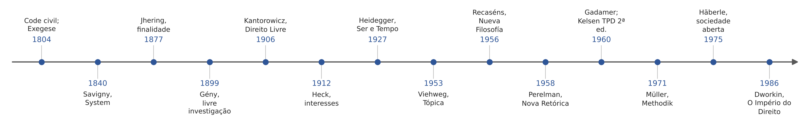
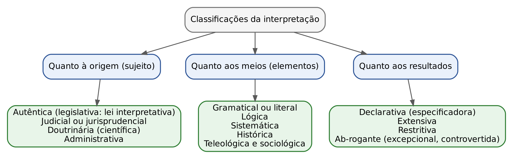
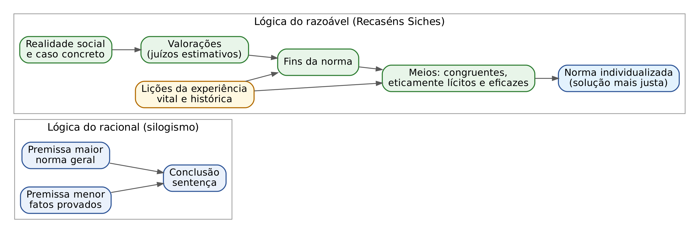
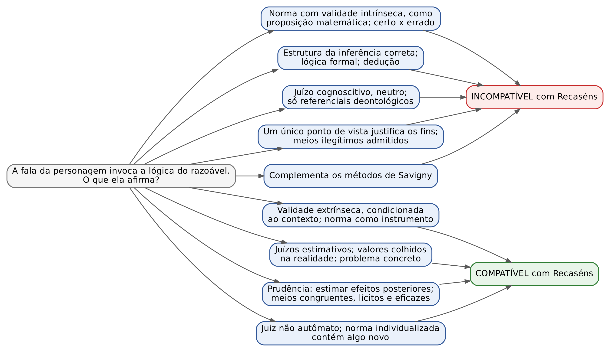
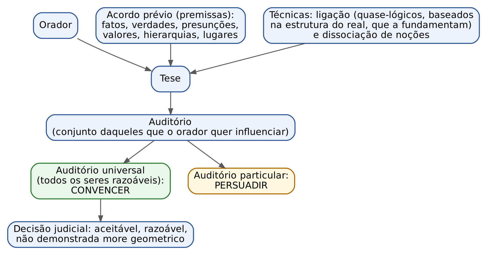
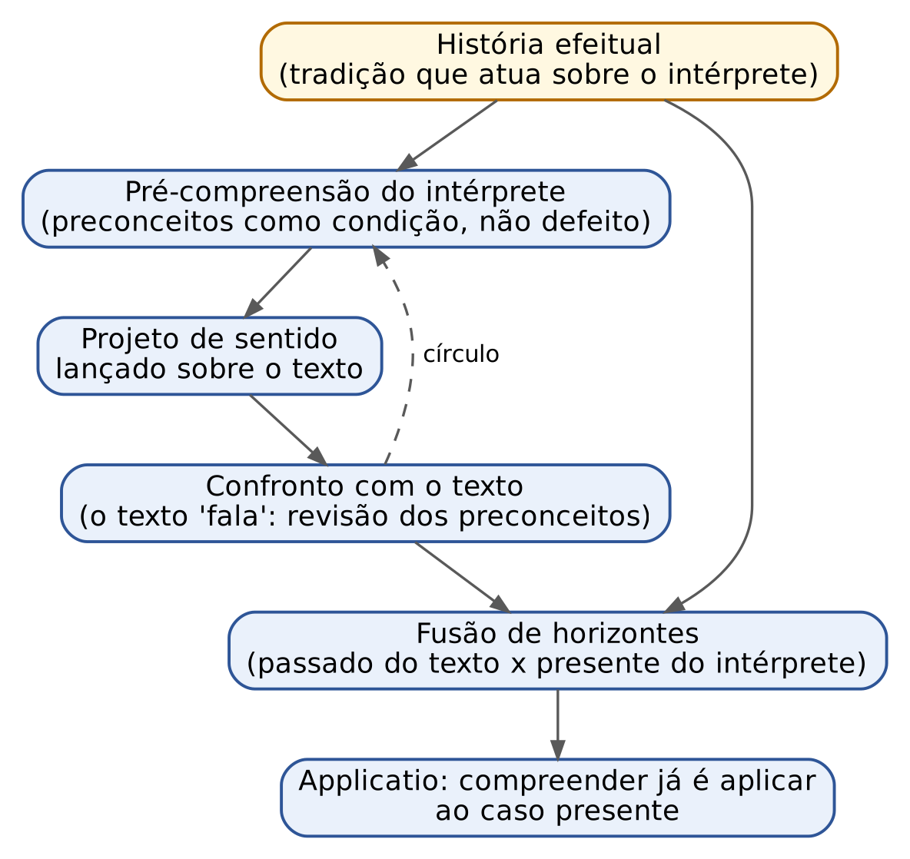
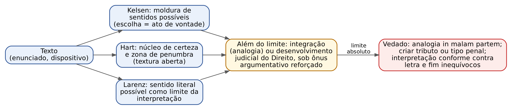

# CAPÍTULO 19 — A INTERPRETAÇÃO DO DIREITO: DO SILOGISMO À LÓGICA DO RAZOÁVEL

:::INCIDENCIA
TRF5 p. D.3; TJRS p. D.3; TJSC p. E.3. Nível A+.
Lote: 27 questões (FGV 27, FCC 0), 17 delas de provas da magistratura (ENAM 2024.2 e 2025.1; TRF1, TRF5 e TRF6; TJSC, TJCE, TJMS, TJTO, TJSE, TJPR, TJPE e TJBA).
O que mais cai, de longe: a lógica do razoável de Recaséns Siches em casos narrados com o vocabulário próprio da FGV (validade intrínseca x extrínseca, "estrutura da inferência correta", estimativa dos efeitos, juízo estimativo), seguida do "código" das teorias da interpretação (originalismo, realismo, tópica pura, metódica estruturante).
:::

| Subtema | FGV | FCC | Padrão de cobrança |
|---|---|---|---|
| Lógica do razoável (Recaséns Siches) | 10 (Q3373931, Q3324317, Q3742433, Q3786426, Q3505846, Q3425361, Q3453311, Q3301316, Q3532408, Q4349524) | — | Fala de parte ou juiz "lastreada na lógica do razoável"; pede-se o que é compatível (valores, contexto, efeitos, validade extrínseca) e o que não é (validade intrínseca, inferência correta, juízo cognoscitivo, complementaridade com Savigny) |
| Teorias da interpretação: formalismo, originalismo, interesses, Direito Livre, realismo | 7 (Q3898947, Q3044149, Q3049902, Q4079337, Q3742355, Q3390824, Q3453277) | — | Qual teoria se harmoniza com a fala; armadilha da "aproximação entre criação e aplicação" |
| Tópica e pensamento problemático | 4 (Q3058633, Q3882271, Q3301277, Q2565229) | — | Tópica pura (texto como um topos) x pensamento problemático (texto como limite) |
| Metódica estruturante e concretização | 2 (Q2387551, Q4083773) | — | Ambiente sociopolítico no processo que parte do texto e culmina na norma |
| Classificações da interpretação | 1 (Q2346690) | — | Tipologia quanto à origem (autêntica) |
| Direitos fundamentais, ponderação e interpretação conforme | 3 (Q3362310, Q3350304, Q2360661) | — | Conteúdo *prima facie*, teoria externa, interpretação conforme |

O capítulo tem duplo papel. Para o ponto D.3 do TJRS e E.3 do TJSC, que é a letra da Resolução CNJ 75/2009 (interpretação; superação do raciocínio lógico-dedutivo; lógica do razoável), ele é o lugar de desenvolvimento completo, e por isso Recaséns Siches recebe a seção mais extensa. Para o ponto D.3 do TRF5, que acrescenta linguagem, argumentação, razoabilidade, proporcionalidade, coerência, integridade e limites, ele organiza a matéria pelo ângulo filosófico. A dogmática constitucional da interpretação (métodos de Canotilho, princípios de interpretação constitucional, interpretação conforme, mutação, ponderação e proporcionalidade em estrutura trifásica) está na Apostila de Direito Constitucional, Cap. 5, que já comenta parte destas mesmas questões; aqui elas recebem só o enfoque humanístico e remissão. Teorias da decisão e da argumentação jurídica (Alexy, MacCormick, Atienza, discricionariedade Hart x Dworkin, precedentes) são do Cap. 20.

## 19.1 Hermenêutica, interpretação, linguagem e contexto

### 19.1.1 Hermenêutica, interpretação, integração e aplicação

A distinção tradicional, difundida no Brasil por Carlos Maximiliano (Hermenêutica e Aplicação do Direito), separa a HERMENÊUTICA, teoria que estuda e sistematiza os processos de determinação do sentido e do alcance das expressões do Direito, da INTERPRETAÇÃO, atividade concreta de fixar esse sentido, e da APLICAÇÃO, enquadramento de um caso concreto na norma adequada. A INTEGRAÇÃO, por sua vez, é o preenchimento de lacunas (analogia, costumes, princípios gerais, equidade: Cap. 22). A sequência hermenêutica, interpretação, aplicação reproduz a imagem de um saber que primeiro conhece e depois executa.

Essa separação é o primeiro alvo das teorias contemporâneas. Para a hermenêutica filosófica (Gadamer, 19.7) compreender, interpretar e aplicar formam um ato unitário; para Eros Grau, que fala em "interpretação/aplicação" e afirma que não se interpreta o Direito "em tiras", a norma é produzida pelo intérprete a partir do texto e dos fatos do caso; para Müller (19.8) a norma de decisão só existe no caso. A banca explora essa ruptura com a fórmula da "aproximação entre os momentos de criação e de aplicação" do Direito, que identifica as teorias pós-formalistas e é sempre incompatível com o formalismo, a jurisprudência dos conceitos e o originalismo.

:::DOUTRINA Luís Roberto Barroso — Curso de Direito Constitucional Contemporâneo
O trecho reproduzido no enunciado do ENAM 2024.2 (Q3058633) resume a visão hoje corrente: interpretar é revelar ou atribuir sentido a textos e a outros elementos normativos (princípios implícitos, costumes, precedentes) para resolver problemas, atividade informada por métodos que buscam legitimidade, racionalidade e controlabilidade; a aplicação é o momento final, em que a disposição abstrata se converte em norma de decisão. Note a fórmula "revelar ou atribuir": a dupla possibilidade é a própria fronteira entre a concepção cognoscitiva (revelar o que já está no texto) e a decisória (atribuir um sentido entre vários possíveis).
:::

### 19.1.2 Linguagem: ambiguidade, vagueza e textura aberta

O Direito é feito de linguagem, e a "virada linguística" da filosofia do século XX (o segundo Wittgenstein, das Investigações Filosóficas, com a tese de que o significado está no uso, e a teoria dos atos de fala de Austin e Searle) deslocou o problema da interpretação: não se trata de descobrir uma essência por trás da palavra, mas de compreender usos em contextos. Três noções da semiótica (Charles Morris, a partir de Peirce) organizam a análise:

| Dimensão | Relação | Problema típico no Direito |
|---|---|---|
| Sintática | Signo com signo | Ambiguidade sintática: a quem se refere o qualificativo ("servidor e dependente portador de deficiência") |
| Semântica | Signo com objeto | Ambiguidade semântica (palavra com mais de um sentido: "prescrição"); vagueza (limites imprecisos: "prazo razoável", "boa-fé") |
| Pragmática | Signo com usuários e contexto | O sentido depende de quem fala, para quem, em que situação; ideologias e "senso comum teórico dos juristas" (Warat) |

AMBIGUIDADE e VAGUEZA não se confundem. Na ambiguidade, há sentidos distintos e o problema é escolher; na vagueza, o sentido é único, mas sua extensão é imprecisa nas bordas. HART (O Conceito de Direito, cap. VII), apropriando-se da noção de *open texture* de Friedrich Waismann, sustenta que toda regra geral tem TEXTURA ABERTA: há um NÚCLEO DE CERTEZA, em que a aplicação é óbvia, e uma ZONA DE PENUMBRA, em que a linguagem não decide. O exemplo célebre, do debate com Fuller em 1958, é a regra que proíbe "veículos no parque": automóvel está no núcleo; bicicleta, patins, ambulância e tanque de guerra num monumento estão na penumbra. Para Hart, na penumbra o juiz exerce discricionariedade (o debate com Dworkin está no Cap. 20); Fuller respondeu que o sentido não se fixa pela palavra isolada, mas pelo propósito da regra, antecipando o argumento teleológico.

:::PEGADINHA Textura aberta não é lacuna
A textura aberta é propriedade da LINGUAGEM (indeterminação semântica na periferia do conceito); a lacuna é ausência de NORMA para o caso (Cap. 22). Um caso de penumbra tem norma aplicável, cujo alcance é duvidoso. A alternativa que trate a vagueza de "veículo" como lacuna a ser colmatada por analogia está errada.
:::

### 19.1.3 Texto, norma e contexto

A premissa de toda a teoria contemporânea é que TEXTO (enunciado, dispositivo, "significante") e NORMA (sentido construído, "significado") não se confundem: a norma é o resultado da interpretação, e não o seu objeto. Dessa premissa decorrem a polissemia (de um texto, várias normas), a possibilidade de norma sem dispositivo específico, a mutação (muda o sentido, fica o texto) e a técnica da declaração de nulidade sem redução de texto. O desenvolvimento dogmático, com o vocabulário da FGV ("correspondência biunívoca", "relação de sobreposição", "conflitualidades intrínsecas", "referenciais semióticos"), está na Apostila de Direito Constitucional, Cap. 5, 05.1.1 e 05.1.3; não se repete aqui.

O CONTEXTO entra por três portas: o contexto linguístico (o sistema, o restante do texto), o contexto situacional do caso (os fatos e o problema) e o contexto histórico-social (os valores e as condições de vida da época da aplicação). As teorias se distinguem pela medida em que admitem cada uma delas e, sobretudo, pela resposta à pergunta decisiva: o contexto pode levar o intérprete PARA FORA do texto? Se não pode (o texto é ponto de partida e limite), estamos na zona das teorias contemporâneas moderadas; se pode, estamos no realismo, na tópica pura ou na Escola do Direito Livre.

:::QUESTAO FGV 2026 — AL-RO — Analista Legislativo (Q3882271)
Cobrado: a CCJ conclui que não há relação de sobreposição entre o enunciado linguístico e a norma, cabendo ao intérprete, diante de vários significados possíveis e resolvidas as conflitualidades intrínsecas, decidir qual deve preponderar. Qual a natureza dessa linha argumentativa?
Gabarito: C (harmônica com o pensamento problemático).
Armadilha: originalismo e jurisprudência dos conceitos (A e D) pressupõem exatamente a sobreposição que a CCJ nega; a fala não é refratária à mutação (B), que pressupõe a dissociação texto-norma; e nada nela exclui influxos axiológicos (E). "Pensamento problemático" é o gênero amplo das teorias que dão relevo ao problema na construção da norma (ver 19.5).
:::

:::QUESTAO FGV 2026 — PGE-AC — Procurador do Estado (Q4079337)
Cobrado: o autor sustenta que um artigo da Constituição deve receber sentido substancialmente distinto do até então adotado, em razão das vicissitudes do ambiente sociopolítico e das especificidades do problema, após resolver as conflitualidades nos planos linguístico e axiológico.
Gabarito: C (a linha aproxima os momentos de criação e de aplicação da norma e se distancia da jurisprudência dos conceitos).
Armadilha: A erra na segunda metade, porque a pluralidade de sentidos é justamente o pressuposto da nulidade sem redução de texto; B e D invertem a teoria (a interpretação constitucional dialoga com o plano axiológico, e as conflitualidades intrínsecas não "deturpam" nada: são resolvidas pelo intérprete); E atribui à lógica do razoável a negação da mutação, quando Recaséns é justamente o autor da sensibilidade do sentido às circunstâncias.
:::

### 19.1.4 A hermenêutica filosófica geral: de Schleiermacher a Betti

A hermenêutica nasce como técnica de interpretação de textos sagrados (exegese bíblica), clássicos e jurídicos. Quatro passos a transformam em teoria geral da compreensão, e a prova oral costuma pedir essa genealogia:

| Autor | Obra e ideia central | O que fica para o Direito |
|---|---|---|
| Friedrich Schleiermacher (1768-1834) | Hermenêutica GERAL, arte de compreender qualquer discurso; interpretação gramatical (a língua) e psicológica ou técnica (a individualidade do autor); círculo entre parte e todo | A ideia de que o sentido das partes depende do todo e vice-versa (base do elemento sistemático) e o ideal de compreender o autor "melhor do que ele próprio" |
| Wilhelm Dilthey (1833-1911) | Fundamentação das ciências do espírito: as ciências naturais EXPLICAM (*Erklären*), as ciências do espírito COMPREENDEM (*Verstehen*) | O Direito como objeto cultural, que não se esgota em relações causais |
| Martin Heidegger (Ser e Tempo, 1927) | Compreender não é método, é modo de ser do homem (existencial); toda compreensão tem uma pré-estrutura; o círculo hermenêutico é ontológico, não um vício lógico | O intérprete nunca é neutro; a "pré-compreensão" deixa de ser defeito e passa a ser condição |
| Emilio Betti (Teoria generale dell'interpretazione, 1955) | Hermenêutica como METODOLOGIA que garante objetividade; cânones (autonomia do objeto, totalidade, atualidade do entender, adequação) | Defesa da objetividade contra Gadamer; o intérprete deve submeter-se ao objeto |

O debate Betti x Gadamer reproduz a tensão do Direito: Betti quer método que assegure a objetividade da interpretação; Gadamer sustenta que a verdade da compreensão não é produto de método (o título Verdade e Método é irônico: a verdade está além do método). Os desdobramentos de Gadamer estão em 19.7.

## 19.2 Os métodos clássicos e as escolas

### 19.2.1 Savigny: os elementos da interpretação

SAVIGNY (Sistema do Direito Romano Atual, 1840) definiu a interpretação como reconstrução do pensamento contido na lei e apontou QUATRO ELEMENTOS: GRAMATICAL (a linguagem de que o legislador se serve), LÓGICO (a articulação do pensamento, a relação lógica entre as partes), HISTÓRICO (a situação jurídica existente ao tempo da lei e a mudança que ela introduziu) e SISTEMÁTICO (o vínculo íntimo que liga institutos e regras numa grande unidade). Dois pontos são cobrados e muito confundidos:

- Para Savigny, os elementos NÃO são quatro espécies de interpretação entre as quais se possa escolher, mas quatro operações que devem atuar CONJUNTAMENTE. A crítica posterior de Recaséns à "pluralidade de métodos" (19.4.5) é dirigida, na verdade, à leitura escolar que transformou os elementos em métodos alternativos sem critério de escolha.
- O elemento TELEOLÓGICO não está na lista de Savigny. Ele entra com o segundo Jhering (A Finalidade no Direito, 1877: o fim é o criador de todo o Direito) e com a jurisprudência dos interesses. Alternativa que atribua a Savigny a interpretação teleológica ou sociológica está errada.

Na FGV, "os métodos de interpretação preconizados por Savigny" funcionam como marcador de formalismo e de vinculação ao texto: aparecem como alternativa errada sempre que a fala descreve atividade decisória, sensibilidade a valores ou ao contexto, e como alternativa errada também quando se diz que a lógica do razoável os COMPLEMENTA (Q3786426, 19.4.7).

:::ESQUEMA Subjetivismo x objetivismo: o que se busca ao interpretar?
| | Teoria subjetiva (*voluntas legislatoris*) | Teoria objetiva (*voluntas legis*) |
|---|---|---|
| Objeto da busca | A vontade histórica do legislador | O sentido objetivo da lei, autônomo em relação ao autor |
| Autores de referência | Savigny e Windscheid (na leitura corrente) | Binding, Wach e Kohler (fim do século XIX) |
| Elemento privilegiado | Histórico (trabalhos preparatórios) | Sistemático e teleológico, atualizados |
| Virtude | Respeito à decisão democrática; segurança | Adaptação da lei a situações novas |
| Crítica | Legislador é ficção (órgão coletivo); "vontade" de quem? petrifica o Direito | Abre espaço à vontade do intérprete |
O direito positivo brasileiro inclina-se ao objetivismo atualizador: o art. 5º da LINDB manda atender "aos fins sociais a que ela se dirige e às exigências do bem comum", e o CPC, art. 8º, reproduz a fórmula acrescentando dignidade, proporcionalidade, razoabilidade, legalidade, publicidade e eficiência. Na teoria constitucional norte-americana, o par equivalente é originalismo x "Constituição viva" (19.2.4).
:::

### 19.2.2 Classificações da interpretação e normas legais de interpretação

Quanto à ORIGEM (ou ao sujeito), a interpretação é AUTÊNTICA (feita pelo próprio órgão que editou a norma, por meio de outra norma de igual hierarquia: a lei interpretativa), JUDICIAL ou jurisprudencial, DOUTRINÁRIA ou científica, e, para parte da doutrina, ADMINISTRATIVA. Quanto aos MEIOS (elementos), gramatical, lógica, sistemática, histórica, teleológica e sociológica. Quanto aos RESULTADOS, DECLARATIVA (o sentido coincide com a letra), EXTENSIVA (a lei disse menos do que queria: *lex minus dixit quam voluit*), RESTRITIVA (disse mais: *lex plus dixit quam voluit*) e, excepcionalmente, AB-ROGANTE (quando o dispositivo é inconciliável com outro ou com o sistema e não admite sentido útil), figura controvertida que se aproxima da declaração de invalidade.

:::QUESTAO FGV 2024 — Prefeitura de Caraguatatuba — Procurador (Q2346690)
Cobrado: entre teleológica, autêntica, literal, sistemática e lógica, qual é tipologia de interpretação quanto à origem.
Gabarito: B (autêntica).
Armadilha: as demais são classificações quanto aos MEIOS. O enunciado repete a definição de Carlos Maximiliano (hermenêutica como teoria científica dos processos de interpretação), o que denuncia a matriz clássica da questão.
:::

:::PEGADINHA "Interpretação autêntica" em Kelsen não é a do manual
Na Teoria Pura do Direito (2ª ed., 1960, cap. VIII), interpretação AUTÊNTICA é a realizada pelo ÓRGÃO JURÍDICO APLICADOR (legislador que aplica a Constituição, juiz que aplica a lei, administração), que CRIA Direito; NÃO AUTÊNTICA é a da ciência jurídica e dos particulares, que apenas descreve a moldura de sentidos possíveis. Logo, para Kelsen, a sentença é interpretação autêntica; para a classificação tradicional, sentença é interpretação judicial e "autêntica" é só a do próprio legislador. Kelsen admite até que a interpretação autêntica produza norma situada FORA da moldura, que valerá enquanto não anulada. Ver 19.10.
:::

O Direito brasileiro contém diversas normas positivas de interpretação, o que tornou errada a alternativa E de Q3058633 (ENAM), segundo a qual não haveria norma positivada sobre o tema: LINDB, art. 5º; CPC, art. 8º; ECA, art. 6º (fins sociais, bem comum, direitos e deveres individuais e coletivos e condição peculiar de pessoa em desenvolvimento); CTN, arts. 107 a 112 (com o art. 111 impondo interpretação LITERAL da legislação sobre suspensão ou exclusão do crédito, isenção e dispensa de obrigações acessórias, e o art. 112 a interpretação mais favorável ao acusado em matéria de infrações); CC, art. 112 (nas declarações de vontade atende-se mais à intenção do que ao sentido literal da linguagem), art. 113 (boa-fé e usos; com os critérios do § 1º incluídos pela Lei 13.874/2019), art. 114 (negócios benéficos e renúncia interpretam-se estritamente), art. 423 (cláusulas ambíguas ou contraditórias na adesão: interpretação mais favorável ao aderente), art. 819 (fiança não admite interpretação extensiva) e art. 843 (transação interpreta-se restritivamente); CDC, art. 47 (interpretação mais favorável ao consumidor).

:::ATENCAO CTN, art. 107, com a Lei Complementar 236/2026
O art. 107 do CTN, que por décadas se resumia ao *caput* ("A legislação tributária será interpretada conforme o disposto neste Capítulo"), recebeu três parágrafos pela LC 236/2026: a resolução de dúvidas sobre a legislação tributária e aduaneira e a fixação de sua interpretação se fazem por solução de consulta ou pareceres jurídicos (§ 1º), com efeitos vinculantes restritos ao âmbito do órgão emissor (§ 2º), e a solução da consulta produz efeitos exclusivamente quanto ao consulente, sem prejuízo da vinculação interna (§ 3º). É exemplo recente de institucionalização de interpretação ADMINISTRATIVA vinculante interna. O regime tributário completo está na Apostila de Direito Tributário.
:::

Três figuras vizinhas são confundidas sistematicamente. A INTERPRETAÇÃO EXTENSIVA amplia o alcance das palavras para abarcar hipótese que a norma já queria abranger; é interpretação, e não integração. A INTERPRETAÇÃO ANALÓGICA (ou *intra legem*) é a extensão autorizada pela própria lei, que após uma enumeração casuística usa fórmula genérica ("ou por outro motivo torpe"; "ou outro meio insidioso ou cruel", no homicídio qualificado). A ANALOGIA é técnica de INTEGRAÇÃO: aplica-se a caso não previsto norma feita para caso semelhante, por identidade de razão. Em matéria penal incriminadora, a analogia *in malam partem* é vedada pelo princípio da legalidade (correlata Q2511470, FGV 2024, Câmara dos Deputados: punir conduta não prevista em lei é analogia *in malam partem*, inadmissível — gabarito C); em matéria tributária, o emprego da analogia não pode resultar na exigência de tributo não previsto em lei (CTN, art. 108, § 1º).

### 19.2.3 As escolas: da exegese à livre investigação

O mapa das escolas do século XIX, com Escola da Exegese, jurisprudência dos conceitos, jurisprudência analítica e positivismo normativista, está no Cap. 18 (18.4.1), com o foco no conceito de Direito; a leitura das escolas como TEORIAS DA INTERPRETAÇÃO, com o vocabulário da FGV, está na Apostila de Direito Constitucional, Cap. 5 (05.2.1 a 05.2.3). Aqui se registra apenas o que interessa à superação do raciocínio dedutivo.

| Escola | Tese sobre a interpretação | Papel do juiz | Reação que provocou |
|---|---|---|---|
| Exegese (França, pós-1804) | Todo o Direito está no Código; interpretar é buscar a vontade do legislador; *in claris cessat interpretatio* | Aplicador mecânico, "boca da lei" | Gény e a escola científica |
| Jurisprudência dos conceitos (Puchta, primeiro Jhering) | Sistema de conceitos do qual se DEDUZEM as soluções ("pirâmide de conceitos"; método construtivo) | Operador lógico do sistema | Segundo Jhering; Heck |
| Jurisprudência dos interesses (Heck, 1912) | A lei resolve conflitos de interesses; o juiz investiga os interesses ponderados pelo legislador e os fins | Auxiliar pensante do legislador, ainda vinculado à lei | Jurisprudência dos valores |
| Livre investigação científica (Gény, Méthode d'interprétation, 1899) | Esgotada a lei, interpretada segundo a vontade do legislador, o juiz investiga livremente (sem autoridade positiva), mas cientificamente, a natureza das coisas | Pesquisador objetivo | Direito Livre radicaliza |
| Direito Livre (Kantorowicz, sob o pseudônimo Gnaeus Flavius, 1906; Ehrlich) | Ao lado do Direito estatal há o "direito livre"; diante das lacunas e da insuficiência da lei, o juiz decide pelo sentimento de justiça e pelas necessidades sociais, até contra a letra (na vertente radical) | Criador | Críticas de insegurança; precursor do realismo |
| Jurisprudência dos valores (pós-1945) | A Constituição como ordem de valores; ponderação | Concretizador de valores | Críticas de decisionismo |

A expressão *in claris cessat interpretatio* é hoje rejeitada: a "clareza" de um texto já é resultado de uma interpretação, e não seu pressuposto. Toda norma, por mais clara, é interpretada; o que varia é o esforço. A frase continua útil na prova como marcador do formalismo exegético.

:::QUESTAO FGV 2025 — TRF6 — Juiz Federal Substituto (Q3742355)
Cobrado: o demandante sustenta aproximação entre criação e aplicação, sentido mutável com texto imutável e forte influência do problema concreto; o demandado, que a interpretação não pode descurar de aspectos sociais, morais e econômicos, influenciados pela realidade e pelos fins da norma.
Gabarito: C (a interpretação do demandado é refratária ao formalismo clássico e harmônica com a jurisprudência dos interesses).
Armadilha: a fala do demandante não é tópica pura (não abandona o texto) nem se harmoniza com Savigny ou com a lógica do razoável na leitura proposta em D. Comentário completo na Apostila de Direito Constitucional, 05.2.2.
:::

### 19.2.4 Originalismo, realismo e os polos do espectro

O ORIGINALISMO é a versão norte-americana do subjetivismo para a interpretação constitucional: o sentido é o fixado no momento da adoção do texto, seja pela intenção dos constituintes (*original intent*), seja pelo significado público original das palavras (*original public meaning*). Seus argumentos são democráticos (quem decide é o constituinte) e de segurança (previsibilidade, contenção do intérprete). O oposto é a "Constituição viva" (*living constitution*). O REALISMO JURÍDICO (Cap. 18, 18.5) está no polo contrário: o Direito é o que os tribunais efetivamente decidem, e o texto não vincula. Entre os polos, todas as demais teorias.

:::QUESTAO FGV 2026 — TJ-PR — Juiz Substituto (Q3898947)
Cobrado: o demandante afirma que os aspectos semióticos de um artigo da Constituição não podem ser "impregnados" por referenciais axiológicos contemporâneos, sob pena de perda de previsibilidade e de cada intérprete moldar a norma a seus interesses.
Gabarito: B (refratária à Escola do Direito Livre, mas compatível com os alicerces do originalismo).
Armadilha: A e C oferecem a lógica do razoável com termos sedutores ("prudência", "validade intrínseca") — mas Recaséns é o oposto da recusa aos valores contemporâneos, e "validade intrínseca" é exatamente o que ele nega (19.4); D associa a fala ao realismo, polo oposto; E a diz compatível com a mutação, que pressupõe precisamente a impregnação valorativa recusada.
Resolução em passos: (1) a fala nega a influência de valores atuais sobre o texto = recusa da atividade decisória; (2) busca sentido fixo em nome da segurança = originalismo; (3) a Escola do Direito Livre, que deixa o juiz decidir pelas necessidades sociais, é o seu oposto.
No mesmo sentido: Q3044149 (magistrado guiado pela jurisprudência dos conceitos é compatível com o originalismo — gabarito A) e Q3049902 (intérpretes exercem atividade cognoscitiva, não criativa, porque não compartilham a legitimidade do constituinte — originalismo, gabarito A), ambas comentadas na Apostila de Direito Constitucional, 05.2.1.
:::

:::QUESTAO FGV 2025 — TJ-TO — Juiz Substituto (Q3453277)
Cobrado: o autor invoca direito fundamental de primeira dimensão com posição de preeminência absoluta; o ente demandado responde que nenhum preceito pode ser interpretado dissociado da situação concreta e da base de valores, as quais PODEM AFASTAR o alicerce semiótico inicial para que se realize a justiça no caso.
Gabarito: C (os argumentos do demandado são compatíveis com o realismo jurídico).
Armadilha: a chave é "afastar o alicerce semiótico" — abandonar o texto. Isso não é tópica moderada, nem metódica estruturante, nem lógica do razoável; é realismo (ou tópica pura). A alternativa A (refratários à tópica pura) inverte; D e E atribuem ao demandante teorias (externa e conteúdo *prima facie*) que pressupõem justamente a relativização que ele nega.
No mesmo sentido: Q3390824 (FGV 2025, DPE-PE: normas constitucionais não necessariamente conectadas a referenciais semióticos, cabendo ao juiz delinear o padrão que realize a justiça social — realismo, gabarito B). Ambas na Apostila de Direito Constitucional, 05.2.3.
:::

## 19.3 A superação do raciocínio puramente lógico-dedutivo

### 19.3.1 O silogismo judicial e seus pressupostos

O modelo do SILOGISMO JUDICIAL, herdeiro do racionalismo iluminista e da Escola da Exegese, descreve a sentença como dedução: a PREMISSA MAIOR é a norma geral, a PREMISSA MENOR é a constatação dos fatos, a CONCLUSÃO é o dispositivo. Beccaria o formulou para o juiz penal no século XVIII ("em todo delito, o juiz deve fazer um silogismo perfeito"), e a imagem casa com a separação de poderes de Montesquieu: se o juiz apenas deduz, não cria, e a lei permanece obra exclusiva do legislador.

O modelo repousa em quatro pressupostos, cada um deles atacado no século XX:

| Pressuposto | Em que consiste | Quem o derrubou e como |
|---|---|---|
| Completude e clareza da premissa maior | A norma está dada, pronta, antes do caso | Textura aberta (Hart), moldura (Kelsen), conceitos indeterminados, princípios: a premissa maior é CONSTRUÍDA pelo intérprete |
| Neutralidade da premissa menor | Os fatos se "constatam" | Os fatos são selecionados e qualificados à luz da norma; Jerome Frank (ceticismo quanto aos fatos); psicologia do testemunho (Cap. 9) |
| Separação entre premissas | Norma e fato são estabelecidos independentemente | Karl Engisch: o "ir e vir do olhar" entre norma e fato; o círculo hermenêutico |
| Neutralidade da conclusão | A decisão decorre necessariamente | Kelsen: a escolha dentro da moldura é ato de vontade; Recaséns: a sentença é juízo estimativo |

A crítica mais citada é a de HOLMES (The Common Law, 1881): "a vida do Direito não tem sido lógica; tem sido experiência"; para ele o Direito não pode ser tratado como se contivesse apenas axiomas e corolários de um livro de matemática. Paulo Nader (Filosofia do Direito) registra que foi Recaséns Siches, todavia, quem "desferiu o ataque mais vigoroso" à influência da lógica formal no Direito, rechaçando a ideia de que a decisão corresponde a um silogismo, porque a sentença constitui um ato mental indiviso, e criticando o método que considera isoladamente a lei, o fato e a sentença.

### 19.3.2 O que sobrevive do silogismo

A superação do raciocínio PURAMENTE lógico-dedutivo não significa banir a lógica. Três precisões evitam erro em prova:

- O próprio Recaséns admite a lógica formal "dentro de limites perfeitamente delimitados e circunscritos" (deduzir consequências de formas *a priori*, medir quantidades), mas a declara imprópria para interpretar e para criar a norma individualizada, tarefa do *logos* do humano (Nueva Filosofía de la Interpretación del Derecho, extrato publicado na revista Diánoia, v. 2, n. 2, 1956, p. 50).
- As teorias da argumentação (Alexy, MacCormick) mantêm a dedução como JUSTIFICAÇÃO INTERNA: a decisão deve seguir logicamente das premissas; o problema real está na JUSTIFICAÇÃO EXTERNA, a escolha e a fundamentação das premissas. MacCormick defende que nos casos fáceis a justificação dedutiva basta. Ver Cap. 20.
- A técnica da subsunção continua sendo o modo ordinário de aplicação das REGRAS. Foi por isso que a alternativa D de Q3058633 (ENAM) estava errada ao afirmar que a ponderação se tornou prevalente no Brasil, "superando de vez" a subsunção (19.5).

:::DICA Prova oral: "o juiz faz silogismo?"
Resposta em três tempos. (1) Sim, como forma de APRESENTAÇÃO da decisão: a sentença deve ser logicamente consistente, e uma conclusão que não decorra das premissas é nula por contradição ou falta de fundamentação. (2) Não, como DESCRIÇÃO do processo de decisão: as premissas não estão dadas; a escolha da norma, a fixação do seu sentido e a qualificação dos fatos envolvem valoração (Kelsen, Engisch, Recaséns, Perelman, Gadamer). (3) Por isso a legitimidade da decisão depende da justificação das premissas, que o art. 489, § 1º, do CPC transformou em dever: não basta reproduzir o ato normativo, é preciso explicar sua relação com a causa (inciso I), e não basta invocar conceito jurídico indeterminado, é preciso explicar o motivo concreto de sua incidência (inciso II).
:::

## 19.4 A lógica do razoável de Luis Recaséns Siches

### 19.4.1 Autor, obra e matriz filosófica

Luis RECASÉNS SICHES (1903-1977), jusfilósofo espanhol nascido na Guatemala, discípulo de José Ortega y Gasset, exilou-se no México após a Guerra Civil e ali produziu a parte mais influente de sua obra: Vida Humana, Sociedad y Derecho (3ª ed., 1953), Nueva Filosofía de la Interpretación del Derecho (1956), Tratado General de Filosofía del Derecho (1959) e Experiencia Jurídica, Naturaleza de la Cosa y Lógica "Razonable" (1971). A matriz é o RACIOVITALISMO de Ortega: contra a razão físico-matemática, a "razão vital e histórica". Recaséns cita Ortega para precisar que razão, em sentido rigoroso, é toda ação intelectual que nos põe em contato com a realidade, e adverte que opor a razão vital à razão físico-matemática não significa conceder licença ao irracionalismo. A lógica do razoável é, assim, uma lógica (racionalidade controlável) e não um apelo ao sentimento.

Recaséns integra também a corrente que Miguel Reale reúne sob a ideia de que a experiência jurídica tem três fatores, fato, valor e norma, ao lado de Radbruch, Pound, Cossio e García Máynez. Daí a afinidade com o tridimensionalismo e a recepção ampla no Brasil.

### 19.4.2 Lógica do racional x lógica do razoável

A tese central é a dualidade de lógicas. A LÓGICA DO RACIONAL (lógica formal tradicional, de tipo matemático) é a lógica da inferência correta: analisa a estrutura dos raciocínios e garante que, de premissas verdadeiras, se chegue a conclusões verdadeiras; opera com juízos de existência e com proposições que valem *a priori*, independentemente do contexto. A LÓGICA DO RAZOÁVEL (ou do humano, ou da razão vital e histórica) é a lógica dos problemas humanos práticos, políticos e jurídicos: trabalha com valorações, fins, meios e experiência, e o seu critério não é o verdadeiro ou falso, mas o adequado, o justo, o eficaz e o prudente para uma situação concreta.

| | Lógica do racional | Lógica do razoável |
|---|---|---|
| Objeto | Ideias e formas *a priori*; quantidades | Problemas da vida humana em situação |
| Operação típica | Inferência dedutiva; "estrutura da inferência correta" | Valoração, escolha de fins e de meios, ponderação de efeitos |
| Juízos | De existência e de necessidade lógica; cognoscitivos | ESTIMATIVOS (de valor) |
| Critério | Verdadeiro ou falso; certo ou errado | Adequado, justo, eficaz, prudente |
| Validade | Intrínseca, universal, independente do contexto | Extrínseca, condicionada à situação e aos fins |
| Exemplo | Teorema matemático | A norma jurídica e a sentença |

O ponto mais cobrado pela FGV é a VALIDADE. Recaséns afirma que o erro capital da teoria tradicional consiste em tratar como teoremas o que deve ser tratado como instrumentos para a ação prática; as normas positivas são atos de vontade do legislador que respondem a necessidades sociais do seu tempo, "não são princípios *a priori* com validade absoluta", e a validade das normas jurídico-positivas está necessariamente condicionada pelo CONTEXTO SITUACIONAL (Dianoia, pp. 39 a 41). Na linguagem da banca: a norma NÃO TEM VALIDADE INTRÍNSECA, como as proposições matemáticas; sua validade é EXTRÍNSECA, relativa às circunstâncias e aos fins.

:::PEGADINHA "Validade" aqui não é a de Kelsen
A "validade extrínseca" da lógica do razoável não tem nada a ver com a validade formal kelseniana (pertinência ao sistema por derivação de norma superior: Cap. 18). Recaséns fala da idoneidade da norma como instrumento: uma norma é "válida", nesse sentido, na medida em que serve aos fins para os quais foi editada, nas circunstâncias em que é aplicada. Quando a alternativa diz que, para a lógica do razoável, a norma tem validade "intrínseca", "como as proposições matemáticas", "situada no plano deontológico" e imune ao contexto, está errada; quando diz que a validade é "extrínseca", "condicionada ao contexto" ou "relativa às circunstâncias", está certa.
:::

### 19.4.3 O exemplo do urso na plataforma

Recaséns ilustra a insuficiência da lógica tradicional com um exemplo que diz colher de Radbruch, que por sua vez o teria tomado de Petrażycki: na plataforma de uma estação ferroviária da Polônia havia um cartaz que dizia "é proibida a entrada na plataforma com cães"; um camponês tentou entrar acompanhado de um urso e, barrado, alegou que a proibição falava em cães. Pela lógica tradicional, diz Recaséns, o viajante teria razão, porque não há modo de incluir os ursos no conceito de "cão". No entanto, qualquer pessoa sensata percebe que a solução é a oposta. A interpretação correta parte das RAZÕES da norma: a segurança e a comodidade dos viajantes, a experiência de que cães mordem, incomodam e transmitem pulgas, e a proibição como meio eficaz e lícito para esse fim. Se o fim é afastar animais perigosos ou incômodos, o urso está proibido com mais razão.

O exemplo trabalha nos dois sentidos, e a recepção brasileira costuma acrescentar o caso inverso: o cão-guia do viajante cego, que a letra proíbe, mas que os fins da norma não alcançam (no Brasil, o ingresso e a permanência com cão-guia em meios de transporte e em estabelecimentos abertos ao público, de uso público e privados de uso coletivo, são garantidos pela Lei 11.126, de 27/6/2005, art. 1º, na redação da Lei 13.146/2015). A literalidade gera, ao mesmo tempo, uma regra SUBINCLUSIVA (deixa de fora o urso) e SOBREINCLUSIVA (alcança o cão-guia). A lógica do razoável corrige as duas falhas com a mesma operação: perguntar pelo sentido do fim, pelos valores em jogo e pela adequação do meio.

:::NOTA O exemplo do urso e a analogia
Pode-se objetar que proibir o urso é analogia (integração), e não interpretação. Recaséns recusa a distinção rígida: o que se busca é se a valoração que levou o legislador à proibição se aplica ao caso novo (ele formula assim a regra para os casos não previstos, Dianoia, p. 53). Para a prova, retenha: (a) o exemplo é de Recaséns, colhido em Radbruch; (b) demonstra que a lógica formal leva a resultado absurdo; (c) a solução vem da consideração dos fins, valores e experiência; (d) em Direito Penal incriminador a técnica teria o limite da legalidade estrita (19.10).
:::

### 19.4.4 A estrutura do *logos* do razoável

O razoável não é intuição solta; tem estrutura. A síntese corrente na doutrina brasileira (por exemplo, o verbete "Lógica do razoável" da Enciclopédia Jurídica da PUC-SP) aponta que o *logos* do razoável:

- está limitado ou condicionado pela realidade concreta do mundo social em que opera (dimensão histórica);
- está impregnado de valorações, isto é, de critérios estimativos (dimensão axiológica);
- tais valorações são concretas, referidas a uma situação humana determinada (dimensão concreta);
- as valorações são a base para a formulação de propósitos ou fins (dimensão teleológica);
- a formulação de fins está também condicionada pelas possibilidades oferecidas pela realidade (dimensão cultural);
- é regido por razões de congruência ou adequação: entre a realidade social e os valores, entre os valores e os fins, entre os fins e a realidade, e entre os fins e os meios, quanto à conveniência, à CORREÇÃO ÉTICA e à EFICÁCIA dos meios (dimensão de proporcionalidade);
- está orientado pelas lições da experiência da vida humana e da história (dimensão fática).

No texto original, Recaséns sublinha especialmente três exigências sobre os MEIOS: devem ser congruentes com os fins; devem ser ETICAMENTE LÍCITOS, pois, em suas palavras, "la bondad de un fin nunca puede justificar la maldad de un medio" (Dianoia, p. 47); e devem ser EFICAZES, o que só a experiência vital e histórica pode confirmar. É por isso que alternativa segundo a qual o juiz deve buscar a solução mais adequada "ainda que os meios empregados sejam ilegítimos" está sempre errada (Q3301316).

A PRUDÊNCIA é o nome clássico desse saber. A FGV o traduz na fórmula "na perspectiva da prudência, a estimativa dos efeitos posteriores" (Q3742433) ou "os efeitos posteriores, a serem ponderados e estimados, devem ser considerados" (Q3324317). O fundamento textual é a crítica de Recaséns ao método de inferência que extrai consequências das premissas sem se preocupar com os efeitos que produzem na vida real (Dianoia, p. 38). Daí a aproximação com o pragmatismo e com o consequencialismo do art. 20 da LINDB, mas com uma diferença: em Recaséns as consequências são avaliadas à luz de VALORES e da justiça do caso, e não apenas de utilidade (o consequencialismo e seus limites estão no Cap. 35; o art. 20 da LINDB, no Cap. 24).

### 19.4.5 A crítica à pluralidade de métodos: o método único

A segunda tese capital é a crítica à doutrina dos múltiplos métodos de interpretação (literal, subjetivo ou histórico, objetivo, sistemático, analógico, de equidade). Recaséns constata que essa doutrina nunca ofereceu um critério para escolher entre os métodos quando eles conduzem a resultados diferentes; invoca Schreier, para quem não há razão justificada para preferir um método a outro, e Cardozo, que confessava não saber explicar congruentemente por que empregava um ou outro. A classificação, diz Recaséns, nasceu de "sentir-se confundido pelo problema", e as divisões tradicionais "já não têm razão de ser" (Dianoia, pp. 51 a 53).

Sua proposta é abandonar a pluralidade e adotar uma única regra: "o juiz deve interpretar a lei em cada caso do modo e segundo o método que levem à solução mais justa entre todas as possíveis" (Dianoia, p. 52). A lógica do razoável, portanto, NÃO é mais um método a somar aos de Savigny; é o ÚNICO método de interpretação jurídica, que absorve e substitui os demais.

:::PEGADINHA Complementar x substituir
A FGV cobrou três vezes a mesma armadilha: dizer que a lógica do razoável atua "de modo complementar aos métodos clássicos preconizados por Savigny" (Q3786426), que os métodos clássicos devem "direcionar, mas não exaurir" a atuação do intérprete, que deveria complementá-los com a lógica do razoável (Q3505846, assertiva I), ou que ela "não pode ser compreendida à margem das contribuições da metódica estruturante" (Q3786426, alternativa D). As três estão ERRADAS. Para Recaséns, a lógica do razoável é o método único; e é anterior e independente da metódica de Müller.
:::

### 19.4.6 A função judicial: juízo estimativo e norma individualizada

Para Recaséns, o ato de sentenciar não consiste, nem exclusiva nem substancialmente, numa operação dedutiva (Dianoia, p. 31). O juiz, ao aplicar a norma geral, a individualiza e interpreta, e esse processo "contém algo novo" que não estava na norma geral (Dianoia, p. 35): a sentença é norma individualizada, e a função judicial tem dimensão CRIADORA. No campo do Direito, diz ainda, "parte-se de juízos estimativos" (Dianoia, p. 42), ao contrário da matemática e da física. Quando falta lei para o tipo de conflito, o juiz deve realizar "as mesmas operações (sociológicas e estimativas)" que incumbem ao legislador (Dianoia, p. 49).

Daí três consequências cobradas:

- o julgamento é juízo ESTIMATIVO (valorativo), e não meramente COGNOSCITIVO; a sentença enuncia um juízo normativo realizado a partir de pontos de vista valorativos (Q3505846, assertiva III, correta);
- referenciais semióticos (o texto) e axiológicos (os valores) não se excluem: os valores concorrem para a atribuição de significado ao texto (Q3425361, assertiva I, correta);
- o juiz não é autômato: a "segurança" do formalismo é ilusória, e Recaséns pergunta, numa frase que a doutrina gosta de repetir, segurança em quê? A segurança jurídica é valor, mas a serviço da justiça.

:::DOUTRINA Recaséns Siches — Nueva Filosofía de la Interpretación del Derecho
Tese em uma frase: a interpretação do Direito não se faz com a lógica do racional (matemática, dedutiva, de validade intrínseca), mas com a lógica do razoável (do humano, da razão vital e histórica), que opera com valorações concretas, fins, meios congruentes, eticamente lícitos e eficazes e lições da experiência, e que constitui o método único de interpretação, devendo o juiz adotar, em cada caso, a solução mais justa entre as possíveis.
Conceitos-chave: *logos de lo razonable*; *razón vital e histórica*; *juicios estimativos*; norma como instrumento; validade condicionada ao contexto situacional; prudência; norma individualizada.
Críticas: risco de subjetivismo e de insegurança ("o justo para quem?"); indeterminação do critério da "solução mais justa"; a reabilitação da argumentação por Perelman e a teoria da argumentação de Alexy procuram dar a essa razoabilidade critérios de controle intersubjetivo.
:::

### 19.4.7 O "código" FGV da lógica do razoável e as questões

:::ESQUEMA Vocabulário da banca
| Expressão no enunciado | Lógica do razoável? | Por quê |
|---|---|---|
| "validade intrínseca"; "como as proposições matemáticas"; "referenciais de certo e errado" | NÃO | É a lógica do racional |
| "validade extrínseca"; "condicionada ao contexto"; "sensibilidade ao ambiente" | SIM | Norma como instrumento situado |
| "estrutura da inferência correta"; "raciocínio lógico-dedutivo"; "lógica formal" | NÃO | Objeto da lógica formal |
| "estimativa dos efeitos posteriores"; "prudência" | SIM | Atenção às consequências reais |
| "juízo cognoscitivo, não estimativo"; "neutralidade" | NÃO | O julgamento é estimativo |
| "referenciais axiológicos colhidos no ambiente sociopolítico"; "problema concreto" | SIM | Valorações concretas |
| "complementa os métodos de Savigny" | NÃO | É método único |
| "fins justificados por um único ponto de vista"; "afastando os demais" | NÃO | Pluralidade de valores e congruências |
| "solução adequada ainda que os meios sejam ilegítimos" | NÃO | Meios eticamente lícitos |
| "prestigiar a previsibilidade, sem adequar a norma ao problema" | NÃO | A norma se adapta à situação |
:::

:::QUESTAO FGV 2025 — TRF5 — Juiz Federal Substituto (Q3373931)
Cobrado: o apelante alega que a sentença afrontou os alicerces da lógica do razoável ao interpretar um artigo de lei; o relator dá razão ao apelante. O que a sentença fez?
Gabarito: E (defendeu que a norma, a exemplo das proposições matemáticas, se ajusta à racionalidade própria dos referenciais de certo e errado).
Resolução em passos: (1) a pergunta pede o que a sentença fez de INCOMPATÍVEL com Recaséns; (2) A (afastou a inferência correta), B (fatos humanos relacionados a valorações), C (afastou a validade intrínseca) e D (permeabilidade a valores do ambiente sociopolítico) descrevem condutas COMPATÍVEIS — logo, não afrontam nada; (3) só E descreve a lógica do racional.
Armadilha: o candidato apressado marca A ou C, que "soam" como erros (afastar algo), mas afastar a inferência correta e a validade intrínseca é exatamente o que Recaséns propõe.
:::

:::QUESTAO FGV 2025 — TJ-SC — Juiz Substituto (Q3324317)
Cobrado: diante de um argumento de previsibilidade e segurança e de outro contra a petrificação da norma diante da mutabilidade da realidade, o juiz estrutura a decisão pela lógica do razoável. O que ele entendeu, corretamente?
Gabarito: E (os efeitos posteriores, a serem ponderados e estimados, devem ser considerados pela norma jurídica).
Armadilha: A (validade intrínseca), B (a lógica deve desenvolver a estrutura da inferência correta), C (valores não devem penetrar no plano deontológico) e D (fins justificados por um único ponto de vista) são as quatro negações clássicas da lógica do razoável. É a questão-modelo da banca para o TJSC: memorize as cinco alternativas.
No mesmo sentido: Q3742433 (FGV 2025, TRF6, Juiz Federal: o mecanicismo subsuntivo não se ajusta à mutabilidade da realidade; a lógica do razoável significa considerar, na perspectiva da prudência, a estimativa dos efeitos posteriores — gabarito B; erradas as que prestigiam o raciocínio lógico-dedutivo, evitam diretrizes pragmáticas, reconhecem validade intrínseca ou preterem os valores).
:::

:::QUESTAO FGV 2025 — TJ-MS — Juiz Substituto (Q3786426)
Cobrado: contra argumentos do autor baseados na lógica do razoável, o réu afirma que esse método é sensível a referenciais axiológicos e ao problema concreto, atuando de modo COMPLEMENTAR aos métodos clássicos de Savigny.
Gabarito: B (os argumentos do demandado apenas se mostram corretos ao associar a lógica do razoável a referenciais axiológicos e ao problema concreto).
Resolução em passos: (1) separe a fala do réu em duas afirmações; (2) a primeira (valores e problema concreto) é correta; (3) a segunda (complementaridade com Savigny) é errada, porque a lógica do razoável é método único (19.4.5).
Armadilha: D diz que a fala é "integralmente" harmônica e acrescenta dependência da metódica estruturante — duplo erro; C atribui à lógica do razoável a validade intrínseca; A e E descrevem a posição do autor como originalista ou de alijamento do juiz, o oposto de Recaséns.
:::

:::QUESTAO FGV 2025 — TJ-CE — Juiz Substituto (Q3505846)
Cobrado: três argumentos atribuídos à lógica do razoável: (I) os métodos clássicos devem direcionar, mas não exaurir, a atuação do intérprete, que deve complementá-los com a lógica do razoável; (II) o julgamento é juízo cognoscitivo, não estimativo; (III) a sentença enuncia juízo normativo realizado a partir de pontos de vista valorativos.
Gabarito: C (apenas III é compatível).
Armadilha: a assertiva I é a mais sedutora, porque fala em "justo no caso concreto"; o erro está na COMPLEMENTARIDADE. A II inverte a natureza do julgamento.
:::

:::QUESTAO FGV 2025 — TRF1 — Juiz Federal Substituto (Q3425361)
Cobrado: (I) referenciais semióticos não são refratários aos axiológicos, que concorrem para a atribuição de significado; (II) a interpretação é indissociável da individualização da inferência correta, materializada no conteúdo da norma; (III) a validade da norma deve ser reconhecida em perspectiva extrínseca.
Gabarito: D (apenas I e III são compatíveis).
Armadilha: a II usa a expressão-chave da lógica formal ("inferência correta") travestida de vocabulário moderno ("individualização", "conteúdo da norma").
:::

:::QUESTAO FGV 2025 — TJ-TO — Juiz Substituto (Q3453311)
Cobrado: o réu sustenta que, para a lógica do razoável, as normas estabilizam as relações sociais e exigem relação de SOBREPOSIÇÃO entre o conteúdo e o "programa da norma", afastando o intérprete da atividade criativa que os valores potencializariam.
Gabarito: D (a exatidão própria das proposições matemáticas não pode ser transposta para os conteúdos normativos).
Armadilha: a fala do réu mistura vocabulário de Müller ("programa da norma") com tese formalista (sobreposição, ausência de criação); nem Müller nem Recaséns admitem sobreposição entre texto e norma. As alternativas A (lógica formal sempre preferível), B (sentido imanente), C (só referenciais deônticos) e E (juízos de fato e neutralidade) reproduzem a lógica do racional.
:::

:::QUESTAO FGV 2025 — TJ-SE — Juiz Substituto (Q3301316)
Cobrado: se o juiz encampar a tese de que a norma deve ser individualizada pelos parâmetros da lógica do razoável, o que deve fazer?
Gabarito: E (distanciar-se de concepções que se desenvolvem a partir da estrutura lógica da inferência correta).
Armadilha: A (previsibilidade sem adequação ao problema), B (validade intrínseca, como as proposições matemáticas), C (identificar um ponto de vista central, afastando os demais) e D (solução mais adequada ainda que os meios sejam ilegítimos). A D é a mais perigosa para quem associa o razoável ao "resultado justo a qualquer custo"; Recaséns exige meios eticamente lícitos.
:::

:::QUESTAO FGV 2025 — MPE-RJ — Promotor de Justiça Substituto (Q3532408)
Cobrado: o Promotor afirma que significantes constitucionais não podem ter seu significado atribuído à margem de referenciais axiológicos colhidos no ambiente sociopolítico, sem considerar o caso e o impacto da norma na realidade; sua validade "não seria intrínseca, mas extrínseca".
Gabarito: C (compatível com a lógica do razoável e o contextualismo).
Armadilha: A (tópica pura e pragmatismo) erra na tópica pura, que admite abandonar o texto, coisa que o Promotor não diz; B junta consequencialismo com originalismo, que é incompatível com a influência de valores atuais; D nega a afinidade com o pensamento problemático; E afirma que a lei não poderia reduzir o rol de beneficiários de direito previsto em norma de eficácia CONTIDA, quando a restrição legislativa é justamente a característica dessa espécie (Apostila de Direito Constitucional, Cap. 4).
:::

:::QUESTAO FGV 2026 — TJ-PE — Juiz Substituto (Q4349524)
Cobrado: João invoca direito previsto em norma de eficácia limitada e programática, interpretado conforme os padrões axiológicos do ambiente sociopolítico, com efeitos antes da regulamentação; o Município responde que contam também os fatores linguísticos (balizas textuais) e teleológicos.
Gabarito: D (a linha de João é compatível com a lógica do razoável, e a do Município é incompatível com o confinamento do intérprete ao plano puramente cognoscitivo).
Armadilha: o Município não é originalista: ao falar em "resolução das conflitualidades" e em vários fatores, admite que o intérprete decide. Comentário completo na Apostila de Direito Constitucional, 05.2.5.
:::

:::SENTENCA Fundamentação com a lógica do razoável (modelo)
A cláusula do regimento interno do condomínio proíbe "a circulação de animais nas áreas comuns". A interpretação literal conduziria a resultado oposto à finalidade da regra, pois alcançaria o cão-guia da condômina com deficiência visual. A norma condominial, como toda norma, não tem validade alheia às circunstâncias: é instrumento a serviço de fins, que aqui são a segurança, a higiene e o sossego dos moradores. Interpretada à luz desses fins, e considerados os efeitos concretos de cada solução, a vedação não abrange o animal de assistência, cuja presença não compromete aqueles valores e é meio indispensável à autonomia da moradora, sem prejuízo de exigências razoáveis de higiene e contenção. Decide-se, assim, não por exceção arbitrária à regra, mas pela sua aplicação conforme o sentido que a justifica (CPC, art. 8º; LINDB, art. 5º).
:::

### 19.4.8 Balanço crítico

A lógica do razoável é a resposta que o edital (Resolução CNJ 75/2009) oferece à pergunta "o que substitui o silogismo?". Seus méritos são a reabilitação do juízo prático (*phronesis*), o realismo sobre o papel criador do juiz e a ênfase nos fins, nos valores e nas consequências. Suas fraquezas são a indeterminação do critério (a "solução mais justa" de quem?) e a confiança no juiz sensato, que as teorias posteriores tentam controlar: Perelman pelo auditório universal, Alexy pelas regras do discurso, Dworkin pela integridade, Müller pela vinculação estrutural ao texto, e o legislador brasileiro pelo dever analítico de fundamentação (CPC, art. 489, § 1º e § 2º). Não confunda a LÓGICA DO RAZOÁVEL (método de interpretação, Recaséns) com o PRINCÍPIO DA RAZOABILIDADE (parâmetro de controle de atos estatais, de origem norte-americana: 19.9).

## 19.5 A tópica de Theodor Viehweg

### 19.5.1 Tese, conceitos e obra

Theodor VIEHWEG (1907-1988), em Tópica e Jurisprudência (*Topik und Jurisprudenz*, 1953), recupera a tópica de Aristóteles (os Tópicos, parte do Órganon dedicada aos raciocínios dialéticos, que partem de opiniões geralmente aceitas, os *endoxa*) e de Cícero (Topica), e a contrapõe ao pensamento SISTEMÁTICO-DEDUTIVO que dominou a ciência jurídica moderna desde o *mos geometricus* do jusnaturalismo racionalista. As noções que a banca cobra:

- TÓPICA é uma técnica do pensamento PROBLEMÁTICO: parte do problema (a aporia, a questão que admite mais de uma resposta) e não do sistema; o sistema é que se organiza a partir dos problemas, e não o inverso.
- TOPOI (lugares comuns) são pontos de vista utilizáveis e aceitáveis em toda parte, que servem de premissas à argumentação: princípios gerais, brocardos, máximas, valores partilhados ("ninguém pode beneficiar-se da própria torpeza", "o acessório segue o principal", "quem pode o mais pode o menos", a boa-fé, a equidade).
- As premissas não são verdades demonstradas, mas opiniões ACEITAS no debate; sua legitimação vem da aceitação do interlocutor. A solução é obtida pela discussão, em estrutura dialógica.
- O sistema jurídico, para a tópica, é ABERTO e fragmentário.

### 19.5.2 Tópica pura, tópica moderada e pensamento problemático

A banca diferencia a TÓPICA PURA (o texto normativo é apenas mais um *topos*, de peso relativo, e o objetivo é a solução justa do caso, mesmo que se distancie dos balizamentos textuais) das versões moderadas, que valorizam o problema mas mantêm o texto como ponto de partida e limite. O PENSAMENTO PROBLEMÁTICO é o gênero mais amplo que abarca toda teoria que dá relevo ao problema concreto na construção da norma: Recaséns, Hesse, Müller e a própria tópica. Por isso uma fala pode ser "compatível com o pensamento problemático" e "refratária à tópica pura" ao mesmo tempo (Apostila de Direito Constitucional, 05.2.4).

:::ESQUEMA Pensamento sistemático x pensamento problemático
| | Sistemático (axiomático-dedutivo) | Problemático (tópico) |
|---|---|---|
| Ponto de partida | O sistema e suas premissas | O problema concreto |
| Premissas | Axiomas, normas tidas por verdadeiras | *Topoi*, opiniões aceitas |
| Raciocínio | Dedução | Argumentação dialógica |
| Sistema | Fechado e completo | Aberto e fragmentário |
| Critério de acerto | Correção lógica | Aceitação pelo interlocutor; justiça do caso |
| Risco | Rigidez, injustiça do caso | Casuísmo, insegurança, esvaziamento da norma |
:::

A crítica clássica à tópica, formulada entre outros por Claus-Wilhelm Canaris (Pensamento Sistemático e Conceito de Sistema na Ciência do Direito), é que ela desconsidera a vinculação do juiz à lei e ao sistema e não oferece critério para escolher entre *topoi* concorrentes, o que leva ao casuísmo. Na interpretação constitucional, Canotilho a apresenta como método tópico-problemático e aponta o risco de inverter a relação entre norma e problema (Apostila de Direito Constitucional, 05.3.1).

:::QUESTAO FGV 2024 — ENAM — Exame Nacional da Magistratura 2024.2 (Q3058633)
Cobrado: a partir de trecho de Barroso sobre a superação dos elementos tradicionais de interpretação, identificar a afirmativa correta sobre a hermenêutica contemporânea.
Gabarito: A (ao vincular-se à lógica do razoável, o método tópico-problemático confere ao julgador o papel de construir, por argumentação consistente, a melhor solução para o problema, visando à justiça do caso concreto).
Resolução das erradas: B inverte a *common law*, cujo raciocínio parte dos FATOS e dos casos, e atribui à tópica a separação absoluta entre sujeito e objeto, que é tese formalista; C equipara a valoração de conceitos jurídicos indeterminados ao poder discricionário, quando a doutrina (inclusive Barroso) os distingue — preencher conceito indeterminado é interpretar, não escolher livremente entre opções igualmente válidas; D afirma que a ponderação "superou de vez" a subsunção, quando esta continua sendo a técnica ordinária de aplicação das regras; E nega a existência de normas positivas de interpretação, que existem (LINDB, art. 5º; CPC, art. 8º; CTN, arts. 107 a 112; CC, arts. 112 a 114: ver 19.2.2).
Ponto de prova: o ENAM associa expressamente tópica e lógica do razoável como faces do pensamento problemático orientado à justiça do caso.
:::

:::QUESTAO FGV 2025 — TJ-SE — Juiz Substituto (Q3301277)
Cobrado: ao sentenciar, o juiz percebe que as peculiaridades do caso conferem maior peso a certos valores, todos albergados pela Constituição compromissória, e atribui ao texto significado distinto do sustentado pelas partes, após resolver as conflitualidades intrínsecas.
Gabarito: B (o magistrado aproximou os momentos de criação e aplicação, distanciou-se do originalismo e mostrou-se sensível ao pensamento problemático).
Armadilha: A confunde preferência de valores no caso com realismo (o juiz não abandonou o texto); D supõe que a Constituição compromissória imponha equidistância abstrata entre valores (é o caso que define os pesos); E pressupõe sobreposição entre texto e norma.
No mesmo sentido: Q2565229 (FGV 2024, TCE-PA: o primeiro magistrado, que vê estreita conexão entre interpretação e aplicação e relevância do problema, harmoniza-se com a metódica concretista; o segundo, para quem o problema direciona a solução ainda que se distancie dos balizamentos do texto, com a tópica pura — gabarito E). Ambas na Apostila de Direito Constitucional, 05.2.4 e 05.2.7.
:::

## 19.6 A nova retórica de Chaïm Perelman

### 19.6.1 Autor, obra e projeto

Chaïm PERELMAN (1912-1984), filósofo belga de origem polonesa, partiu do positivismo lógico (De la Justice, 1945, sobre a justiça formal: Cap. 17, 17.1.1) e, ao constatar que a lógica formal nada podia dizer sobre valores, foi buscar nos antigos uma "lógica dos juízos de valor". Encontrou-a na retórica e na dialética aristotélicas. Com Lucie OLBRECHTS-TYTECA publicou o Tratado da Argumentação: a Nova Retórica (*Traité de l'argumentation. La nouvelle rhétorique*, 1958) e, depois, Lógica Jurídica: Nova Retórica (1976). O projeto é romper com a herança cartesiana, que só reconhece como racional o evidente e o demonstrável *more geometrico*, e mostrar que existe uma racionalidade própria do campo do VEROSSÍMIL, do PREFERÍVEL e do RAZOÁVEL, no qual se movem a ética, a política e o Direito.

### 19.6.2 Conceitos centrais

- DEMONSTRAÇÃO x ARGUMENTAÇÃO: a demonstração (lógica formal) é impessoal, coercitiva e independe de auditório; a argumentação visa obter ou aumentar a ADESÃO DOS ESPÍRITOS às teses apresentadas, é sempre relativa a um auditório e admite graus.
- AUDITÓRIO é o conjunto daqueles que o orador quer influenciar com sua argumentação. O AUDITÓRIO PARTICULAR é um grupo determinado; o AUDITÓRIO UNIVERSAL é constituído pela humanidade inteira, ou ao menos por todos os seres razoáveis, construção do próprio orador que funciona como padrão de racionalidade.
- PERSUADIR x CONVENCER: a argumentação que pretende valer só para um auditório particular é PERSUASIVA; a que pretende obter a adesão de todo ser razoável é CONVINCENTE. A banca troca os pares.
- ACORDO PRÉVIO: toda argumentação parte de premissas aceitas, que se dividem em objetos de acordo relativos ao REAL (fatos, verdades, presunções) e ao PREFERÍVEL (valores, hierarquias, lugares do preferível).
- TÉCNICAS ARGUMENTATIVAS: processos de LIGAÇÃO (argumentos quase-lógicos, como a regra de justiça, a reciprocidade e a transitividade; argumentos baseados na estrutura do real, como o pragmático e o de autoridade; argumentos que fundam a estrutura do real, como o exemplo, a ilustração, o modelo e a analogia) e processos de DISSOCIAÇÃO de noções (o par aparência-realidade, letra-espírito).
- RAZOÁVEL x RACIONAL: o racional corresponde à lógica formal e à coerência; o razoável, ao que é aceitável num meio e momento, e o desarrazoado é o que a comunidade não pode aceitar. No Direito, o juiz busca decisão não apenas conforme à lei, mas EQUITATIVA, RAZOÁVEL e ACEITÁVEL pelas partes, pelas instâncias superiores e pela opinião esclarecida.

:::PEGADINHA Perelman, Recaséns e Viehweg
Os três se opõem à lógica formal como modelo do raciocínio jurídico e todos falam em "razoável", mas por caminhos diferentes. Viehweg: técnica do pensamento problemático, catálogos de *topoi* (1953). Perelman: teoria da argumentação, auditório universal, adesão dos espíritos (1958). Recaséns: lógica do humano de matriz raciovitalista, valorações, fins e meios, método único de interpretação (1956). Alternativa que atribua o "auditório universal" a Recaséns, ou o "*logos* do razoável" a Perelman, está errada. A aproximação legítima é a do ENAM (Q3058633): tópica e lógica do razoável como formas do pensamento problemático.
:::

:::DOUTRINA Perelman — Lógica Jurídica
Tese: a decisão judicial não é demonstração, mas resultado de argumentação dirigida a auditórios (partes, tribunais, comunidade jurídica), que deve ser aceitável, razoável e equitativa; a paz judicial exige que a decisão seja aceita, o que impõe ao juiz conciliar a fidelidade ao sistema com a justiça do caso.
Críticas: o auditório universal é construção do próprio orador, o que relativiza seu papel de controle; a teoria descreve bem a argumentação, mas oferece poucos critérios para distinguir argumento bom de argumento meramente eficaz (crítica que Alexy procurará responder com as regras do discurso racional: Cap. 20).
:::

## 19.7 A hermenêutica filosófica de Gadamer e a recepção brasileira

### 19.7.1 Verdade e Método

Hans-Georg GADAMER (1900-2002), discípulo de Heidegger, publicou Verdade e Método: traços fundamentais de uma hermenêutica filosófica (*Wahrheit und Methode*, 1960). A obra não propõe um método de interpretação; ao contrário, sustenta que a verdade das ciências do espírito não é produto de método e procura descrever o que ACONTECE quando compreendemos. O índice da obra mostra a arquitetura que interessa ao jurista: na segunda parte, "o círculo hermenêutico e o problema dos preconceitos", "os preconceitos como condição da compreensão", "o significado hermenêutico da distância temporal", "o princípio da história efeitual", "o problema hermenêutico da aplicação" e "o significado paradigmático da hermenêutica jurídica"; na terceira, "a virada ontológica da hermenêutica no fio condutor da linguagem", com a tese de que "o ser que pode ser compreendido é linguagem".

| Conceito | Conteúdo | Uso jurídico |
|---|---|---|
| Pré-compreensão e preconceitos (*Vorurteile*) | Toda compreensão parte de juízos prévios herdados da tradição; Gadamer REABILITA o preconceito contra o Iluminismo, que o desacreditara: não há intérprete sem preconceitos, e a tarefa é pô-los à prova | O juiz não é neutro; o controle não está em eliminar a pré-compreensão, mas em explicitá-la e submetê-la ao texto e ao caso |
| Círculo hermenêutico | O intérprete projeta um sentido, que o texto confirma ou corrige, num movimento circular entre parte e todo e entre pré-compreensão e texto | O sentido da norma se forma no vaivém entre texto, sistema e caso |
| Distância temporal | Não é obstáculo a superar, mas condição produtiva que filtra preconceitos | A norma antiga se compreende a partir do presente |
| História efeitual (*Wirkungsgeschichte*) | A tradição atua sobre o intérprete, que pertence a ela; consciência histórico-efeitual é consciência dessa determinação, nunca completa | A jurisprudência e a doutrina acumuladas condicionam a leitura do texto |
| Fusão de horizontes (*Horizontverschmelzung*) | A compreensão é encontro entre o horizonte do texto e o do intérprete, do qual surge algo novo | Nem reprodução da vontade do legislador nem criação livre |
| *Applicatio* | Compreender é sempre aplicar: compreensão, interpretação e aplicação formam um processo unitário | Rompe a sequência "primeiro interpreto, depois aplico" (19.1.1) |

O valor PARADIGMÁTICO da hermenêutica jurídica para Gadamer está justamente na *applicatio*: o jurista que compreende a lei a compreende para um caso, e o sentido da lei se concretiza na aplicação. Para o filósofo, a distinção entre uma função cognitiva e uma função normativa da interpretação cinde o que é uno.

### 19.7.2 Críticas: Betti e Habermas

BETTI acusou Gadamer de abrir caminho ao subjetivismo, por recusar cânones metódicos que assegurem a objetividade da interpretação. HABERMAS, no debate da década de 1960 e depois em Direito e Democracia (1992), acusou a hermenêutica gadameriana de CONSERVADORA, por fundar a compreensão na autoridade da tradição, que pode ter sido forjada em condições de dominação; contra ela propôs uma hermenêutica crítica, apoiada na crítica da ideologia e no discurso. Gadamer respondeu que "tradição" não é o *status quo* sociológico, mas a condição de possibilidade de toda compreensão, e que os preconceitos se legitimam ou se modificam no diálogo. Dworkin, em O Império do Direito, aproximou-se do ponto: os intérpretes pensam no interior de uma tradição interpretativa da qual não podem escapar totalmente, e Gadamer acerta ao apresentar a interpretação como algo que reconhece as imposições da história ao mesmo tempo que luta contra elas.

### 19.7.3 A recepção brasileira: a Crítica Hermenêutica do Direito

No Brasil, a hermenêutica filosófica foi difundida sobretudo por Lenio STRECK (Hermenêutica Jurídica e(m) Crise; Verdade e Consenso; Crítica Hermenêutica do Direito), que combina Heidegger, Gadamer e Dworkin. Teses que circulam em provas discursivas e orais:

- crítica ao SOLIPSISMO judicial, isto é, à decisão fundada na consciência do julgador ("decido conforme minha consciência"), e ao "livre convencimento" como espaço de discricionariedade;
- crítica ao "panprincipiologismo", a criação de princípios sem densidade normativa para justificar qualquer decisão;
- defesa de uma resposta constitucionalmente adequada, inspirada na integridade de Dworkin, e da ideia de que não se pode atribuir qualquer sentido a qualquer texto (os limites do texto e da tradição: 19.10);
- a hermenêutica como condição de possibilidade e não como método: não há "métodos" que garantam a resposta correta, há exigência de fundamentação que explicite e controle a pré-compreensão.

:::NOTA Habermas: as quatro respostas à indeterminação do Direito
Em Direito e Democracia, cap. 5, Habermas examina quatro modelos de racionalidade da jurisprudência: a "jurisprudência hermenêutica" (Gadamer, com juristas como Esser, Hassemer, Larenz, Hesse, Müller e Häberle), que derrubou o mito da subsunção, mas seria conservadora; o realismo, que abandona a segurança jurídica; o positivismo de Hart, que preserva a segurança ao preço do decisionismo na zona de penumbra; e Dworkin, que tentaria conciliar segurança e aceitabilidade racional pela integridade, mas com um juiz "Hércules" monológico, que Habermas substitui por procedimentos discursivos. É mapa útil para a prova oral sobre "limites da interpretação".
:::

## 19.8 Concretização, teoria estruturante e sociedade aberta

### 19.8.1 Friedrich Müller: a teoria estruturante do Direito

Friedrich MÜLLER (Estrutura da Norma e Normatividade, 1966; Metodologia Jurídica, *Juristische Methodik*, 1971; Teoria Estruturante do Direito, *Strukturierende Rechtslehre*, 1984) parte da distinção entre TEXTO DA NORMA (enunciado, ponto de partida) e NORMA (construída no processo de concretização). A norma jurídica tem dois componentes: o PROGRAMA DA NORMA, resultado da interpretação dos dados linguísticos (com os elementos gramatical, histórico, sistemático e teleológico), e o ÂMBITO DA NORMA, o recorte da realidade social que o programa seleciona como relevante. Do processo resulta a NORMA JURÍDICA geral e, para o caso, a NORMA DE DECISÃO. O texto tem dupla função: aponta a direção e marca o limite (os elementos metodológicos ligados ao texto prevalecem sobre os demais em caso de conflito). Daí ser a teoria "intermediária" por excelência: o intérprete decide e a realidade entra na norma, mas sem abandonar o texto.

:::PEGADINHA Programa da norma não é texto
"Programa da norma" NÃO é sinônimo de "texto da norma": é o resultado da interpretação dos dados linguísticos. E a teoria estruturante nega a "sobreposição" entre texto e norma. Por isso a fala de Q3453311, que pede sobreposição entre o conteúdo normativo e o programa da norma para afastar a atividade criativa, mistura vocabulário de Müller com tese formalista (19.4.7).
:::

:::QUESTAO FGV 2024 — CGM-BH — Auditor Interno (Q2387551)
Cobrado: o juiz anuncia que seguirá a metódica concretista de Friedrich Müller numa ação sobre fato gerador de IPTU.
Gabarito: C (o ambiente sociopolítico deve ser considerado no processo intelectivo que toma por base o texto e culmina com a norma).
Armadilha: A deixa os valores elastecerem ou comprimirem o texto sem baliza (aproximação do realismo); B é formalismo (certeza do texto, separação entre criação e aplicação); D é tópica pura. Na Apostila de Direito Constitucional, 05.3.5, com a figura da estrutura da norma.
:::

:::QUESTAO FGV 2026 — TJ-BA — Juiz Substituto (Q4083773)
Cobrado: diante da pluralidade de valores e do potencial expansivo da linguagem, o juiz resolve as conflitualidades nos planos linguístico e axiológico e delineia a norma adequada às especificidades do problema.
Gabarito: C (o processo não se ajusta à tópica pura, mas é compatível com a declaração parcial de inconstitucionalidade sem redução de texto).
Armadilha: A afirma que a norma assim obtida seria necessariamente princípio — o processo intelectivo não define a natureza da norma resultante, que pode ser regra; B (Savigny) e D (separação sujeito-objeto, atividade puramente cognoscitiva) são formalistas; E nega a convivência entre texto e valores. Ver Apostila de Direito Constitucional, 05.2.7.
:::

### 19.8.2 Konrad Hesse e Peter Häberle

KONRAD HESSE (A Força Normativa da Constituição, 1959) entende a interpretação constitucional como CONCRETIZAÇÃO, que pressupõe a pré-compreensão do intérprete (herança gadameriana) e um problema concreto, mas com PRIMADO DO TEXTO, e formulou os princípios da interpretação constitucional (unidade, concordância prática, conformidade funcional, efeito integrador, força normativa). PETER HÄBERLE (A Sociedade Aberta dos Intérpretes da Constituição, 1975) democratiza a interpretação: não há *numerus clausus* de intérpretes; todos que vivem a Constituição a interpretam, ainda que a última palavra jurídica caiba à jurisdição constitucional, o que inspira o *amicus curiae* e as audiências públicas. O desenvolvimento está na Apostila de Direito Constitucional, 05.3.3, 05.3.6 e 05.4.

:::ESQUEMA As teorias pós-formalistas lado a lado
| Autor | Obra (ano) | Palavra-chave | O texto é limite? | O que a FGV cobra |
|---|---|---|---|---|
| Recaséns Siches | Nueva Filosofía de la Interpretación del Derecho (1956) | Lógica do razoável | Sim, como ponto de partida; a solução se busca pelos fins e valores | Validade extrínseca; juízo estimativo; efeitos; método único |
| Viehweg | Tópica e Jurisprudência (1953) | *Topoi*; problema | Na tópica pura, não | Tópica pura x pensamento problemático |
| Perelman | Tratado da Argumentação (1958) | Auditório; adesão | Sim (fidelidade ao sistema) | Auditório universal; persuadir x convencer |
| Gadamer | Verdade e Método (1960) | Pré-compreensão; *applicatio* | Sim (o texto "fala" e corrige o intérprete) | Círculo hermenêutico; fusão de horizontes |
| Hesse | A Força Normativa da Constituição (1959) | Concretização | Sim, com primado do texto | Método hermenêutico-concretizador |
| Müller | Juristische Methodik (1971) | Programa e âmbito da norma | Sim, limite estrutural | Texto x norma; norma de decisão |
| Häberle | Sociedade Aberta dos Intérpretes (1975) | Pluralismo de intérpretes | Sim | *Amicus curiae*; audiências públicas |
| Dworkin | O Império do Direito (1986) | Integridade; romance em cadeia | Sim (adequação à história institucional) | Coerência e integridade; art. 926 do CPC |
:::

## 19.9 Razoabilidade, proporcionalidade, coerência e integridade

### 19.9.1 Razoabilidade e proporcionalidade como critérios interpretativos

O ponto D.3 do TRF5 menciona razoabilidade e proporcionalidade ao lado da hermenêutica porque ambas funcionam como CRITÉRIOS DE CORREÇÃO DA INTERPRETAÇÃO e da decisão, e não só como parâmetros de controle de constitucionalidade. A estrutura trifásica da proporcionalidade (adequação, necessidade e proporcionalidade em sentido estrito), suas duas faces (proibição de excesso e de proteção insuficiente) e o debate sobre a fungibilidade com a razoabilidade estão na Apostila de Direito Constitucional, 05.7, e no Cap. 7 daquela apostila; aqui interessa a dimensão filosófica.

| | Proporcionalidade | Razoabilidade | Lógica do razoável |
|---|---|---|---|
| Origem | Direito de polícia prussiano; Tribunal Constitucional alemão (*Verhältnismäßigkeit*) | Tradição anglo-americana; devido processo legal substantivo (*reasonableness*) | Recaséns Siches, filosofia raciovitalista |
| Natureza | Estrutura de controle de restrições a direitos (meio-fim), escalonada | Exigência de racionalidade, congruência e não arbitrariedade | Método de interpretação e de decisão |
| Para Alexy | Decorre logicamente da natureza dos princípios como mandamentos de otimização | — | — |
| Para Ávila | Postulado aplicativo, pressupõe relação meio-fim | Postulado autônomo (equidade, congruência, equivalência) | — |
| Positivação | CPC, art. 8º; Lei 9.784/1999, art. 2º | CPC, art. 8º; Lei 9.784/1999, art. 2º | Não positivada (doutrina) |

Há parentesco evidente entre a razoabilidade-equidade de Ávila (consideração das peculiaridades do caso que a norma geral não previu) e a lógica do razoável (correção da regra pelo seu fim), e entre a proporcionalidade e a exigência de congruência entre fins e meios em Recaséns. Mas são categorias distintas, e a prova cobra a distinção.

:::QUESTAO FGV 2025 — ENAM — Exame Nacional da Magistratura 2025.1 (Q3362310)
Cobrado: o juiz afirma que interpretar a Constituição exige identificar os significados possíveis e, resolvidas as conflitualidades intrínsecas, escolher o que deve preponderar; tratando-se de direito fundamental, é preciso ainda proceder à concordância prática com outros direitos da mesma natureza. Que premissa ele adota?
Gabarito: E (os direitos fundamentais apresentam conteúdos *prima facie*).
Resolução em passos: (1) se o direito precisa ser harmonizado com outros para se chegar ao seu alcance final, o conteúdo inicial é provisório; (2) conteúdo provisório que só se torna definitivo após o confronto com direitos colidentes = conteúdo *prima facie*, próprio da teoria dos princípios de Alexy e da TEORIA EXTERNA das restrições; (3) a teoria interna (limites imanentes, C) define o conteúdo de uma vez, sem ponderação posterior.
Armadilha: A (nega o conteúdo essencial) e B (a posição definitiva prescindiria da restrição) contradizem a teoria externa; D (tópica pura) não está descrita, porque o juiz parte do texto.
No mesmo sentido: Q3350304 (FGV 2025, TRT24, Analista: colisão entre direitos fundamentais, segundo o entendimento prevalecente no Brasil, analisa-se pela teoria externa — gabarito D; erradas a posição preferente *in abstracto*, a solução no plano da validade e a teoria interna). A dogmática das teorias interna e externa está na Apostila de Direito Constitucional, Cap. 7.
:::

:::QUESTAO FGV 2024 — PC-SC — Delegado de Polícia (Q2360661)
Cobrado: o STF, em agosto de 2023, afastou a tese da legítima defesa da honra e determinou que os arts. 23, II, e 25 do CP e 65 do CPP sejam interpretados de modo a excluí-la do instituto da legítima defesa. Que princípio de hermenêutica constitucional foi empregado?
Gabarito: C (interpretação conforme à Constituição).
Armadilha: concordância prática (D) harmoniza bens constitucionais em colisão; aqui se fixou o sentido válido de LEIS à luz da Constituição, excluindo um sentido incompatível. O julgado (ADPF 779) e os limites da interpretação conforme estão na Apostila de Direito Constitucional, 05.5.
:::

### 19.9.2 Coerência e integridade

COERÊNCIA e INTEGRIDADE entraram no direito positivo com o CPC de 2015: "Os tribunais devem uniformizar sua jurisprudência e mantê-la estável, íntegra e coerente" (art. 926). A origem filosófica é distinta para cada termo.

COERÊNCIA, na teoria da argumentação de Neil MacCormick, desdobra-se em coerência NORMATIVA (as normas e a decisão devem fazer sentido em conjunto, à luz de princípios e valores comuns; não basta a mera não contradição lógica, que é a CONSISTÊNCIA) e coerência NARRATIVA (a reconstrução dos fatos deve ser plausível à luz do que sabemos do mundo). No plano da jurisprudência, coerência significa tratar casos iguais de modo igual e justificar a distinção dos diferentes.

INTEGRIDADE é o conceito central de DWORKIN em O Império do Direito (1986). O Direito como integridade exige que o Estado aja segundo um conjunto único e coerente de princípios, inclusive em relação àqueles com quem discorda; na jurisdição, o juiz lê a história institucional (leis, precedentes) sob sua melhor luz moral (romance em cadeia, ajuste e justificação: Cap. 18, 18.6.3). A integridade é MAIS do que coerência: Dworkin dá o exemplo da Câmara dos Lordes que reduziu a imunidade dos advogados por negligência (Saif Ali v. Sydney Mitchell, 1980) e observa que, ao fazê-lo, ela "preferiu a integridade à coerência estrita", porque a coerência estrita com os precedentes perpetuaria uma exceção injustificável à luz dos princípios da responsabilidade civil. A integridade pode, assim, exigir a ruptura com uma cadeia de precedentes para honrar as razões que os justificavam. Precedentes, *distinguishing* e *overruling*, no Cap. 20.

:::DICA Coerência x integridade em uma frase cada
Coerência: as decisões devem formar um conjunto consistente e congruente (igualdade de tratamento, não contradição, sentido comum). Integridade: as decisões devem exprimir um conjunto único de PRINCÍPIOS de justiça e equidade, lidos na sua melhor luz, ainda que isso exija rever decisões passadas incoerentes com esses princípios. A banca cobrou (correlata Q3058637, ENAM 2024.2, Cap. 20) que coerência e integridade são pressupostos para que a jurisprudência possa ser universalizada e legitimamente aplicada a casos semelhantes.
:::

:::EXEMPLO Integridade na prática do juiz de primeiro grau
Situação: em ações idênticas sobre o mesmo encargo bancário, a vara vem decidindo de modo oposto conforme o assessor que minuta a sentença; o tribunal ainda não uniformizou a questão.
Solução fundamentada: o dever de manter jurisprudência estável, íntegra e coerente (CPC, art. 926) é dirigido aos tribunais, mas a igualdade perante a jurisdição e a exigência de fundamentação (art. 489, § 1º, VI, que veda deixar de seguir precedente invocado sem demonstrar distinção ou superação) impõem ao juízo, no mínimo, coerência interna: fixar o entendimento da unidade, explicitá-lo e só dele se afastar com justificação expressa. A integridade acrescenta que esse entendimento deve ser o que melhor se ajusta aos princípios do sistema (boa-fé objetiva, transparência, proteção do consumidor), e não apenas o mais repetido.
:::

## 19.10 Limites da interpretação

### 19.10.1 Por que a interpretação tem limites

Se a norma é construída pelo intérprete, o risco é o de que ele diga "qualquer coisa sobre qualquer coisa". Todas as teorias pós-formalistas sérias enfrentam o problema, e a prova oral costuma pedir uma síntese. Os limites operam em quatro planos:

- LIMITE TEXTUAL. O texto é ponto de partida e limite. KELSEN fala na MOLDURA de sentidos possíveis, dentro da qual a escolha do órgão aplicador é ato de vontade (Cap. 18, 18.4.3); HART, no núcleo de certeza e na zona de penumbra; LARENZ (Metodologia da Ciência do Direito), no SENTIDO LITERAL POSSÍVEL como fronteira entre a interpretação e o desenvolvimento judicial do Direito; MÜLLER, na função limitadora do texto da norma. Umberto ECO (Os Limites da Interpretação, 1990) formulou, para a teoria literária, a tese de que o texto tem uma intenção própria (*intentio operis*) que limita as leituras admissíveis, contra a "semiose ilimitada" do desconstrucionismo.
- LIMITE SISTEMÁTICO E DA TRADIÇÃO. O sentido deve ajustar-se ao ordenamento e à história institucional (integridade de Dworkin; tradição e história efeitual de Gadamer; Streck: a pré-compreensão é controlada pelo texto e pela tradição).
- LIMITE FUNCIONAL E INSTITUCIONAL. O intérprete não pode usurpar a função legislativa: o STF não atua, em regra, como legislador positivo; a interpretação conforme tem como limites a letra e o fim inequívoco da lei; a mutação constitucional não pode contrariar o texto (Apostila de Direito Constitucional, 05.5, 05.9 e 05.10.5; ativismo e autocontenção no Cap. 25).
- LIMITES DE GARANTIA. Em matéria penal incriminadora, vedação de analogia *in malam partem* e de interpretação extensiva que crie tipo ou agrave pena; em matéria tributária, a analogia não pode exigir tributo não previsto em lei, e a equidade não pode dispensar tributo devido (CTN, art. 108, §§ 1º e 2º); a legislação sobre isenção e exclusão do crédito se interpreta literalmente (CTN, art. 111).

E um limite PROCEDIMENTAL que atravessa todos: a obrigação de fundamentar, que torna a interpretação controlável (CF, art. 93, IX; CPC, art. 489, §§ 1º e 2º; LINDB, art. 20, que veda decidir com base em valores jurídicos abstratos sem considerar as consequências práticas, e cujo regime está no Cap. 24).

:::PEGADINHA Kelsen e o limite da moldura
Kelsen descreve a moldura como resultado da interpretação científica, mas reconhece que a interpretação AUTÊNTICA pode produzir norma que se situe completamente FORA da moldura, a qual valerá enquanto não for anulada. A moldura é limite para a ciência, não garantia de que o órgão aplicador a respeite. Alternativa que diga que, para Kelsen, a interpretação autêntica é nula se exceder a moldura está errada.
:::

### 19.10.2 Limites das teorias anti-formalistas: o que cada uma admite

| Teoria | Admite decidir contra o texto? | Controle proposto |
|---|---|---|
| Formalismo, originalismo | Não (nem mesmo atualizar o sentido) | O próprio texto e a intenção original |
| Jurisprudência dos interesses | Não; interpreta a lei pelos interesses que ela pondera | Os juízos de valor do legislador |
| Lógica do razoável | Em regra não; corrige a letra pelo fim, buscando a solução mais justa entre as possíveis | Congruência de fins e meios, licitude ética dos meios, experiência, prudência |
| Tópica moderada, hermenêutica, metódica estruturante | Não; o texto é limite | Aceitação argumentativa, tradição, estrutura da norma |
| Tópica pura, Direito Livre (versão radical), realismo | Sim | Fraco: o sentimento de justiça, as necessidades sociais, o resultado |

:::EXEMPLO Limites da interpretação em conduta judicial
Situação: em palestra para estudantes, magistrado afirma que "a lei é só um ponto de vista" e que, quando a considera injusta, decide "conforme a consciência", porque o juiz é "o intérprete final da justiça".
Solução fundamentada: a fala, além de juridicamente insustentável, toca deveres funcionais. Juridicamente, o juiz brasileiro decide fundamentadamente com base no ordenamento (CF, art. 93, IX; CPC, arts. 8º, 140 e 489), e a equidade só é fonte de decisão nos casos previstos em lei (CPC, art. 140, parágrafo único); a tese corresponde à tópica pura ou ao realismo, que nenhuma teoria hermenêutica séria adota como norma de conduta judicial. Do ponto de vista ético, a manifestação pública deve preservar a confiança na imparcialidade e na vinculação do juiz ao Direito (Código de Ética da Magistratura Nacional e regras de manifestação pública: Caps. 11 e 12). Não há infração na mera defesa acadêmica de uma teoria; o problema surge quando a fala anuncia ao público que o juiz se desvincula da lei, o que compromete a aparência de imparcialidade e a segurança dos jurisdicionados.
:::

:::DICA Prova oral: "quais os limites da interpretação?"
Roteiro em cinco pontos, com autores: (1) texto como limite (Kelsen: moldura; Hart: penumbra; Larenz: sentido literal possível; Müller); (2) sistema e integridade (Dworkin; CPC, art. 926); (3) tradição e controle da pré-compreensão (Gadamer; Streck contra o solipsismo); (4) separação de funções (interpretação conforme e seus limites; legislador negativo; mutação dentro do texto); (5) garantias (legalidade penal e tributária) e fundamentação (CPC, art. 489; LINDB, art. 20). Feche com Recaséns: a busca da solução mais justa não autoriza meios ilegítimos — e o meio do juiz é a fundamentação conforme o Direito.
:::

## 19.11 Resumo para revisão pré-prova

| Conceito, autor ou instituto | Ideia ou regra | Detalhes e pegadinhas | Fonte |
|---|---|---|---|
| Hermenêutica x interpretação x aplicação | Teoria dos processos de interpretação; fixação do sentido; enquadramento do caso | Para Gadamer, Grau e Müller, interpretação e aplicação formam um só processo; "aproximação entre criação e aplicação" = pós-formalismo | 19.1.1 |
| Ambiguidade x vagueza; textura aberta | Vários sentidos x extensão imprecisa; núcleo de certeza e zona de penumbra | Hart (cap. VII), noção tomada de Waismann; "veículos no parque"; textura aberta não é lacuna | 19.1.2 |
| Texto x norma | Norma é resultado da interpretação do texto | Base da polissemia, da mutação e da nulidade sem redução de texto | 19.1.3; Const. 05.1 |
| Schleiermacher, Dilthey, Heidegger, Betti | Hermenêutica geral; compreender x explicar; compreensão como existencial; cânones de objetividade | Betti x Gadamer: método x verdade | 19.1.4 |
| Savigny (1840) | Quatro elementos: gramatical, lógico, histórico, sistemático, a serem usados conjuntamente | Teleológico NÃO é de Savigny (Jhering, Heck); "métodos de Savigny" = marcador formalista | 19.2.1 |
| Subjetivismo x objetivismo | *Voluntas legislatoris* x *voluntas legis* | LINDB, art. 5º, e CPC, art. 8º: fins sociais e bem comum | 19.2.1 |
| Classificações | Origem (autêntica, judicial, doutrinária); meios; resultados (declarativa, extensiva, restritiva, ab-rogante) | Autêntica em Kelsen = do órgão aplicador, que cria Direito; Q2346690 | 19.2.2 |
| Extensiva x analógica x analogia | Amplia o alcance; extensão autorizada por fórmula genérica; integração por identidade de razão | Analogia *in malam partem* vedada no penal; CTN, art. 108, § 1º | 19.2.2 |
| Normas legais de interpretação | LINDB, art. 5º; CPC, art. 8º; ECA, art. 6º; CTN, arts. 107 a 112; CC, arts. 112 a 114, 423, 819, 843; CDC, art. 47 | CTN, art. 107, com §§ 1º a 3º pela LC 236/2026 (consulta e pareceres) | 19.2.2 |
| Escolas | Exegese; conceitos; interesses (Heck); livre investigação (Gény); Direito Livre (Kantorowicz); valores | *In claris cessat interpretatio* hoje rejeitado | 19.2.3; Cap. 18 |
| Originalismo x realismo | Sentido fixado na origem x Direito é o que os tribunais decidem | Q3898947 (originalismo, refratário ao Direito Livre); Q3453277 (afastar o alicerce semiótico = realismo) | 19.2.4 |
| Silogismo judicial | Norma (maior), fato (menor), sentença (conclusão) | Holmes: vida do Direito é experiência; Engisch: ir e vir do olhar; sobrevive como justificação interna | 19.3 |
| Recaséns Siches | Lógica do razoável x lógica do racional; razão vital e histórica (Ortega) | Nueva Filosofía de la Interpretación del Derecho (1956); Tratado (1959) | 19.4.1-2 |
| Validade na lógica do razoável | Norma como instrumento, validade EXTRÍNSECA condicionada ao contexto | "Validade intrínseca, como proposições matemáticas" = errado | 19.4.2 |
| Exemplo do urso | Cartaz proíbe cães; camponês entra com urso | Colhido em Radbruch; literalidade subinclusiva e sobreinclusiva | 19.4.3 |
| Estrutura do razoável | Realidade, valorações concretas, fins, meios congruentes, eticamente lícitos e eficazes, experiência | Prudência = estimativa dos efeitos posteriores (Q3324317, Q3742433) | 19.4.4 |
| Método único | A pluralidade de métodos não tem critério de escolha; juiz adota o método que leve à solução mais justa | "Complementa Savigny" = errado (Q3786426, Q3505846) | 19.4.5 |
| Função judicial em Recaséns | Juízo ESTIMATIVO; norma individualizada contém algo novo | "Juízo cognoscitivo", "inferência correta" = errado (Q3505846, Q3425361, Q3301316) | 19.4.6 |
| Viehweg (1953) | Tópica: pensamento problemático, *topoi*, premissas aceitas | Tópica pura (texto como um *topos*) x pensamento problemático (texto como limite); crítica de Canaris | 19.5 |
| Perelman (1958) | Nova retórica: argumentação, adesão dos espíritos, auditório | Universal = convencer; particular = persuadir; acordo prévio (real e preferível); ligação e dissociação | 19.6 |
| Gadamer (1960) | Pré-compreensão, círculo, distância temporal, história efeitual, fusão de horizontes, *applicatio* | Preconceito é condição, não defeito; hermenêutica jurídica é paradigmática; crítica de Habermas (conservadorismo) | 19.7 |
| Streck | Crítica Hermenêutica do Direito | Contra o solipsismo e o panprincipiologismo; resposta constitucionalmente adequada | 19.7.3 |
| Müller | Texto x norma; programa e âmbito da norma; norma de decisão | Programa da norma não é o texto; não há sobreposição | 19.8.1; Const. 05.3.5 |
| Hesse; Häberle | Concretização com primado do texto; sociedade aberta dos intérpretes | *Amicus curiae*, audiências públicas | 19.8.2 |
| Proporcionalidade x razoabilidade x lógica do razoável | Controle meio-fim; racionalidade e não arbitrariedade; método de interpretação | Não confundir o princípio da razoabilidade com a lógica do razoável | 19.9.1 |
| Conteúdo *prima facie* e teoria externa | Direito fundamental provisório até a ponderação | Q3362310 (ENAM), Q3350304 | 19.9.1 |
| Coerência x integridade | Consistência e congruência (MacCormick: normativa e narrativa) x conjunto único de princípios (Dworkin: romance em cadeia) | Integridade pode exigir romper com precedentes (Saif Ali); CPC, art. 926 | 19.9.2 |
| Limites da interpretação | Texto (Kelsen, Hart, Larenz, Müller, Eco); sistema e tradição; função; garantias; fundamentação | Kelsen: interpretação autêntica pode sair da moldura e valer até ser anulada | 19.10 |

## 19.12 Artigos de lei e atos normativos incidentes

- Constituição Federal: art. 5º, XXXIX (legalidade penal) e LIV (devido processo legal, fundamento da proporcionalidade); art. 93, IX (fundamentação).
- LINDB (Decreto-Lei 4.657/1942): art. 5º (fins sociais e bem comum); art. 20 (consequências práticas; desenvolvimento no Cap. 24).
- CPC (Lei 13.105/2015): art. 8º (fins sociais, bem comum, dignidade, proporcionalidade, razoabilidade, legalidade, publicidade e eficiência); art. 140 e parágrafo único (vedação do *non liquet*; equidade só nos casos previstos em lei); art. 489, § 1º, I, II e VI, e § 2º (fundamentação; justificação da ponderação); art. 926 (jurisprudência estável, íntegra e coerente); art. 927.
- CTN (Lei 5.172/1966): art. 106, I (lei expressamente interpretativa); art. 107, §§ 1º a 3º (incluídos pela LC 236/2026); arts. 108 a 112.
- Código Civil (Lei 10.406/2002): arts. 112, 113 (com o § 1º, I a V, e § 2º, incluídos pela Lei 13.874/2019), 114, 423, 819 e 843.
- CDC (Lei 8.078/1990): art. 47.
- ECA (Lei 8.069/1990): art. 6º.
- Lei 9.784/1999: art. 2º (razoabilidade e proporcionalidade na Administração).
- Resolução CNJ 75/2009, Anexo VI (conteúdo programático de Filosofia do Direito: interpretação, superação do raciocínio lógico-dedutivo, lógica do razoável), mencionada como fonte do ponto.

## 19.13 Julgados, temas e súmulas do capítulo

Não há julgados desenvolvidos neste capítulo; ver remissões. O único julgado mencionado (STF, ADPF 779, legítima defesa da honra, a propósito de Q2360661) é desenvolvido na Apostila de Direito Constitucional, 05.5.

Remissões a outros capítulos: justiça formal de Perelman (Cap. 17, 17.1.1); escolas positivistas, Kelsen, Hart, realismo, Dworkin e equidade (Cap. 18, 18.4 a 18.8); teorias da argumentação, justificação interna e externa, discricionariedade Hart x Dworkin e precedentes (Cap. 20); lacunas, analogia e integração (Cap. 22); LINDB, arts. 20 a 30 (Cap. 24); ativismo e autocontenção (Cap. 25); pragmatismo e consequencialismo (Cap. 35); vieses na decisão (Cap. 37); hermenêutica constitucional, vocabulário FGV, métodos, princípios, interpretação conforme, ponderação, proporcionalidade e mutação (Apostila de Direito Constitucional, Cap. 5); teorias interna e externa dos direitos fundamentais (Apostila de Direito Constitucional, Cap. 7); eficácia das normas constitucionais (Apostila de Direito Constitucional, Cap. 4); interpretação do negócio jurídico (Apostila de Direito Civil, Cap. 8); interpretação da legislação tributária (Apostila de Direito Tributário); analogia e interpretação analógica em matéria penal (Apostila de Direito Penal).

:::NOTA Notas de verificação
Conferido no Planalto (11/11/2026, aba própria do Chrome): CTN, arts. 106 a 112 (constatada a inclusão dos §§ 1º a 3º do art. 107 pela LC 236/2026); CC, arts. 112, 113, 114, 423, 819 e 843; CDC, art. 47; ECA, art. 6º; LINDB, arts. 5º, 20 e 21; CPC, arts. 8º, 140, 489, § 1º, I a V, 926 e 927. Na limpeza (12/11/2026, Planalto): CPC, art. 489, § 1º, VI, e § 2º; Lei 9.784/1999, art. 2º, caput e parágrafo único; Lei 11.126/2005, art. 1º (redação da Lei 13.146/2015).
Recaséns Siches conferido em fonte primária: extrato de Nueva Filosofía de la Interpretación del Derecho publicado na revista Dianoia (UNAM), "El logos de lo razonable como base para la interpretación jurídica", pp. 24 a 54 (exemplo do urso colhido em Radbruch e atribuído por Recaséns, com dúvida, a Petrażycki, pp. 43 e 44; validade condicionada ao contexto situacional, pp. 39 a 41; juízos estimativos, p. 42; meios eticamente lícitos e eficazes, p. 47; método único e "solução mais justa", pp. 51 a 53; lógica formal em limites circunscritos, p. 50; Ortega, p. 33). O extrato saiu em Diánoia, v. 2, n. 2, 1956 (conferido no portal da revista, 12/11/2026); as datas das obras (1953, 1956, 1959, 1971) são as correntes, sem conferência de cada edição. A lista de sete características do *logos* do razoável foi conferida no verbete de Alvaro de Azevedo Gonzaga (Enciclopédia Jurídica da PUC-SP); a formulação das congruências é síntese doutrinária. A versão do exemplo com o cão-guia é acréscimo da doutrina brasileira (o mesmo verbete), não de Recaséns. As fórmulas da FGV "validade intrínseca/extrínseca" e "estimativa dos efeitos posteriores" são paráfrases da banca; os textos de Recaséns vistos falam em validade condicionada ao contexto e em efeitos na vida real, sem usar "prudência".
Lidos no Drive: Paulo Nader, Filosofia do Direito (parte inicial: crítica à lógica formal, Holmes e Recaséns; "ato mental indiviso"); Gadamer, Verdade e Método (só sumário, prefácio e pp. iniciais; a seção sobre hermenêutica jurídica não está no arquivo); "Sobre Gadamer" (Ziel Ferreira Lopes, A hermenêutica jurídica de Habermas: revendo suas críticas a Gadamer, em Habermas 90 anos, 2020), fonte das passagens sobre Habermas, Dworkin, Saif Ali e a citação de Dworkin sobre Gadamer; material Pós-positivismo (2026). A Sinopse vol. 59 tem o capítulo de interpretação nas pp. 143 a 168, fora do trecho que o conector abre (até a p. 136). O material Introdução à Filosofia do Direito não tem conteúdo sobre o tema; o arquivo de Reale não foi aberto (no Cap. 17 constatou-se que só contém as páginas iniciais).
Atribuições de memória, com alta segurança, sem conferência nesta tarefa: datas e títulos de Savigny, Jhering, Gény, Kantorowicz, Heck, Heidegger, Betti, Viehweg, Perelman e Olbrechts-Tyteca, Müller, Hesse, Häberle, Eco e Dworkin; a frase de Beccaria sobre o silogismo perfeito; Engisch e o "ir e vir do olhar"; Waismann como fonte da *open texture* de Hart e o exemplo dos veículos no parque (debate Hart-Fuller, 1958); a crítica de Canaris à tópica; as classificações de MacCormick (coerência normativa e narrativa); as teses de Streck e de Eros Grau resumidas no texto; Binding, Wach e Kohler como autores da teoria objetiva.
Escopo: as questões já comentadas na Apostila de Direito Constitucional (Q3742355, Q3390824, Q3453277, Q3044149, Q3049902, Q2565229, Q3301277, Q2387551, Q4083773, Q4349524, Q2360661) receberam aqui boxes curtos com remissão, para evitar repetição.
Gabaritos: todos coincidem com o exposto. Em Q3453311, a fala do réu atribui à lógica do razoável a "sobreposição" com o "programa da norma", mistura de vocabulário que não corresponde a nenhum autor; o gabarito (D) não depende disso. Em Q3058633, a alternativa A é correta na síntese da banca, embora tópica e lógica do razoável tenham autores e matrizes distintos (19.6, pegadinha).
Limpeza (12/11/2026): o parágrafo sobre integridade (19.9.2) foi enxugado com remissão ao Cap. 18 (18.6.3); este capítulo é a sede de Q3058633 e Q3362310 (o Cap. 20 só remete). Das atribuições de memória acima, nenhuma pôde ser conferida em fonte nesta limpeza, salvo o debate Hart-Fuller (Harvard Law Review, v. 71, 1958), visto no Cap. 18.
:::
