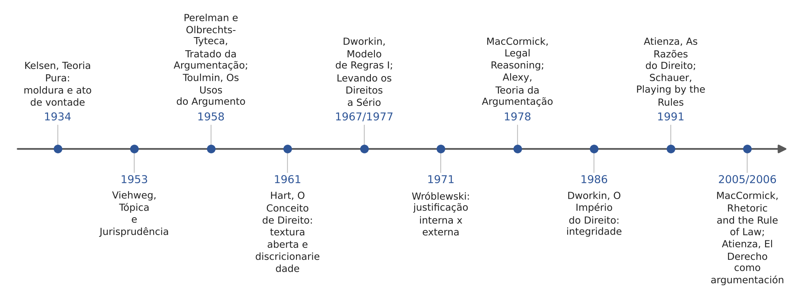
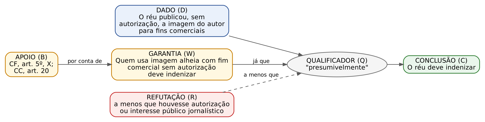
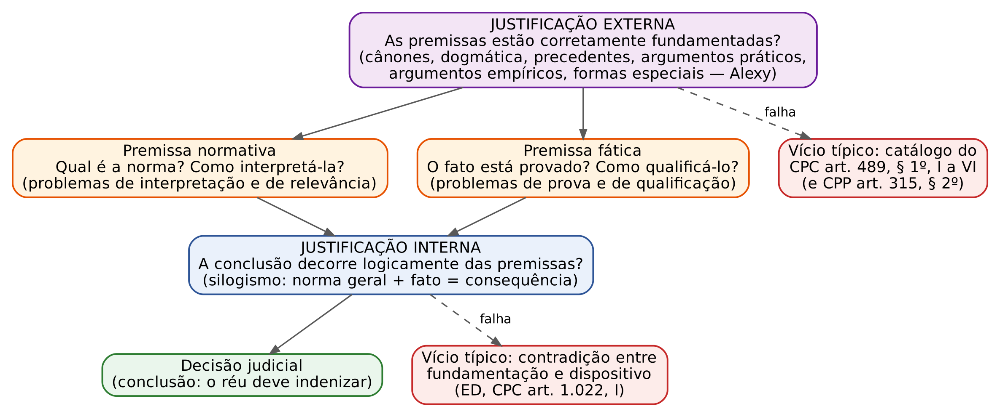
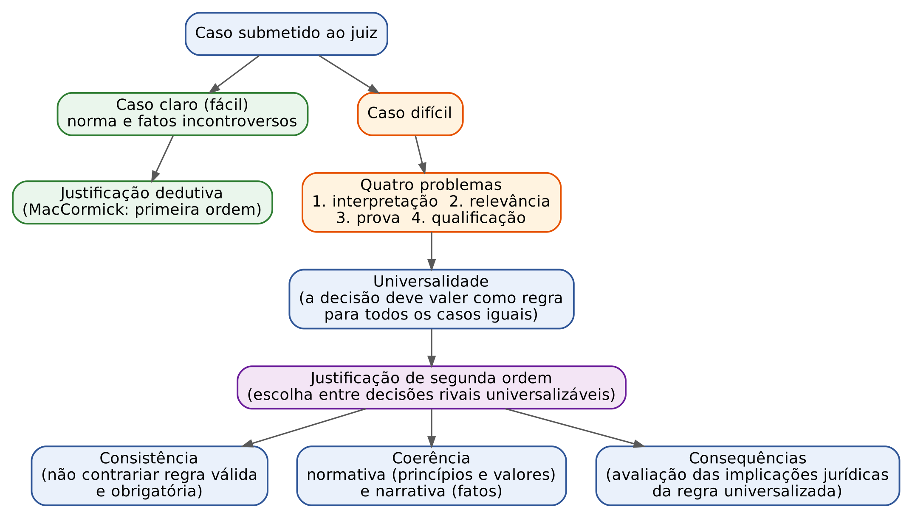
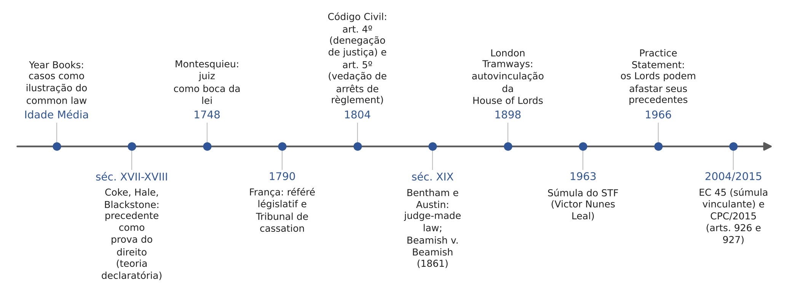
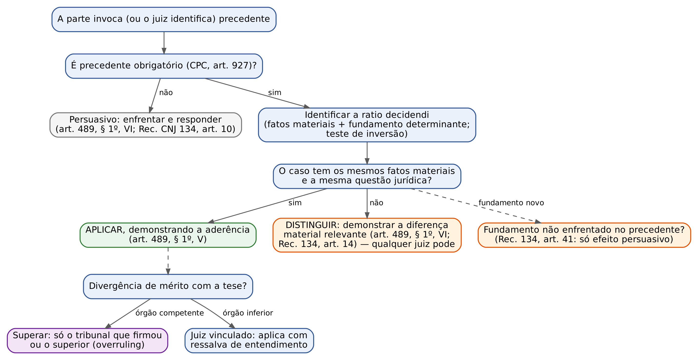
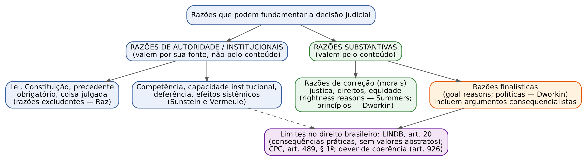

# CAPÍTULO 20 — DECISÃO JUDICIAL, ARGUMENTAÇÃO JURÍDICA E PRECEDENTES

:::INCIDENCIA
TRF5 p. D.4 e E.2 (precedentes como fonte); TJRS p. E.2 (jurisprudência, súmula vinculante, civil law x common law). Nível A+.
Lote: 4 questões (FGV 4, FCC 0), todas sobre precedentes (ENAM 2024.2, TJSC 2024, TJPR 2026, TRF2 2026); correlatas de outros lotes sobre lógica do razoável, ponderação e consequencialismo.
O que mais cai: dever de distinguir com fundamentação (art. 489, § 1º, V e VI, do CPC), deveres do art. 926 (integridade e coerência), Recomendação CNJ 134/2022; na teoria, Hart x Dworkin (discricionariedade e resposta correta), justificação interna x externa e atribuição de teses a Alexy, MacCormick e Atienza.
:::

O capítulo trata da DECISÃO como problema teórico: como o juiz raciocina, quando há espaço de escolha, como se justifica racionalmente essa escolha e que peso têm as decisões anteriores e as consequências. A interpretação em sentido estrito (moldura kelseniana, tópica de Viehweg, nova retórica de Perelman, lógica do razoável de Recaséns Siches, hermenêutica filosófica) é do Cap. 19; o conceito de Direito, a distinção regras x princípios e as obras de Dworkin e Alexy como teorias do Direito, do Cap. 18 (18.4.4, 18.6.2 a 18.6.4); fontes, lacunas e integração, do Cap. 22; LINDB, arts. 20 a 30, do Cap. 24; pragmatismo filosófico e jurídico (Holmes, Posner), do Cap. 35; análise econômica, do Cap. 36; vieses cognitivos na decisão, do Cap. 37. O regime processual dos precedentes (art. 927, IRDR, IAC, repetitivos, reclamação, modulação) está na Apostila de Direito Processual Civil, Cap. 39, e a fundamentação analítica da sentença, no Cap. 20 da mesma apostila; a técnica da ponderação, na Apostila de Direito Constitucional, Cap. 5 (05.6). Aqui fica o ENFOQUE TEÓRICO que a prova oral explora e que as questões de juiz usam como pano de fundo.

## 20.1 Raciocínio jurídico e decisão judicial

### 20.1.1 O modelo silogístico e sua insuficiência

A imagem clássica da decisão é o SILOGISMO JUDICIAL: premissa maior (norma geral), premissa menor (fato qualificado juridicamente), conclusão (consequência jurídica individual). É a herança da Escola da Exegese e do ideal iluminista do juiz "boca da lei" (20.5.1). As teorias contemporâneas não abandonam o silogismo; deslocam o problema. O silogismo descreve corretamente a FORMA final da justificação, mas nada diz sobre como se obtêm e se justificam as premissas, que é onde residem as controvérsias reais: qual norma se aplica, com que sentido, que fatos estão provados e como qualificá-los. A crítica ao raciocínio lógico-dedutivo como MÉTODO de interpretação está no Cap. 19; aqui interessa a decisão como ato que precisa ser justificado.

Duas distinções organizam o campo:

- CONTEXTO DE DESCOBERTA x CONTEXTO DE JUSTIFICAÇÃO. A distinção, de origem epistemológica (Hans Reichenbach, para as ciências), foi trazida à teoria da decisão para separar o PROCESSO psicológico e social pelo qual o juiz chega a uma conclusão (intuição, valores, vieses, pressões institucionais) das RAZÕES que apresenta para mostrá-la correta. Manuel Atienza abre As Razões do Direito (1991) com essa distinção: as teorias da argumentação são teorias do contexto de JUSTIFICAÇÃO. O estudo do contexto de descoberta pertence à psicologia e à sociologia da decisão (realismo jurídico, Cap. 18, 18.5; vieses, Cap. 37).
- JUSTIFICAÇÃO INTERNA x JUSTIFICAÇÃO EXTERNA (20.4.1): a primeira controla a passagem lógica das premissas à conclusão; a segunda, a correção das próprias premissas.

:::PEGADINHA
Afirmar que as teorias da argumentação "descrevem como os juízes efetivamente decidem" está ERRADO: elas são teorias normativas (e analíticas) da JUSTIFICAÇÃO. Quem se ocupa de como os juízes de fato decidem é o realismo (Holmes, Frank, Llewellyn) e, hoje, a economia comportamental. Também está errado dizer que a teoria da argumentação "rejeita a lógica": Alexy e MacCormick exigem a justificação dedutiva como condição necessária, embora não suficiente.
:::

### 20.1.2 Casos fáceis e casos difíceis

A distinção entre casos fáceis (*easy cases*, casos claros) e difíceis (*hard cases*) atravessa todas as teorias do capítulo, mas cada autor a define de modo próprio:

| Autor | Caso fácil | Caso difícil | Consequência teórica |
|---|---|---|---|
| Hart (O Conceito de Direito, 1961, cap. VII) | Fato situado no NÚCLEO de significado da regra | Fato situado na ZONA DE PENUMBRA, pela textura aberta da linguagem (o "veículo" proibido no parque: bicicleta? patins? tanque de guerra num monumento?) | O juiz exerce DISCRICIONARIEDADE e cria Direito intersticialmente |
| Dworkin (Levando os Direitos a Sério, 1977) | Regra clara aplicável | Nenhuma regra estabelecida dita a solução, ou a regra aplicável leva a resultado que os princípios repelem | O juiz continua vinculado: decide por PRINCÍPIOS, em busca da resposta correta |
| MacCormick (Legal Reasoning and Legal Theory, 1978) | Basta a justificação dedutiva | Há problema de INTERPRETAÇÃO, RELEVÂNCIA, PROVA ou QUALIFICAÇÃO | Exige justificação de SEGUNDA ORDEM (universalidade, consistência, coerência, consequências) |
| Alexy (Teoria da Argumentação Jurídica, 1978) | Justificação interna simples | Premissas carecem de justificação externa | Discurso jurídico regrado, com pretensão de correção |
| Atienza (As Razões do Direito; El Derecho como argumentación) | Solução decorre das regras sem controvérsia relevante | Caso controvertido que admite mais de uma solução razoável | Acrescenta os CASOS TRÁGICOS: não há solução que não sacrifique elemento essencial de um valor fundamental |

Os quatro problemas de MacCormick são cobrados como lista e convém fixá-los com exemplos de vara:

- INTERPRETAÇÃO: a norma é conhecida, mas o texto admite mais de um sentido (o "dano moral" do art. 186 do CC abrange a pessoa jurídica?);
- RELEVÂNCIA (ou pertinência): discute-se se há norma aplicável ao caso (há regra para o fato ou trata-se de lacuna?);
- PROVA: controvérsia sobre a ocorrência dos fatos primários;
- QUALIFICAÇÃO (ou classificação): os fatos estão provados, mas discute-se se se enquadram no conceito normativo (a conduta provada configura "uso indevido de imagem"?).

Os dois primeiros afetam a premissa normativa; os dois últimos, a premissa fática.

:::DICA
CASO TRÁGICO não é sinônimo de caso difícil. No caso difícil, há solução justificável, ainda que controvertida; no trágico (Atienza), qualquer solução sacrifica algo essencial e o juiz não pode senão escolher o mal menor, com a consciência de que a decisão, embora juridicamente correta, não é plenamente justa. Exemplos usuais em sala: escolhas alocativas em saúde com recursos insuficientes para todos, colisões extremas entre vida e autonomia. O conceito é útil na prova oral para mostrar que a teoria da argumentação reconhece seus limites.
:::

### 20.1.3 Modelos de decisão: formalismo, ceticismo e o meio-termo

Hart situou sua posição entre dois extremos, que chamou, num ensaio de 1977 sobre a teoria do Direito norte-americana, de "pesadelo" e "nobre sonho":

| Modelo | Tese | Representantes | Crítica |
|---|---|---|---|
| FORMALISMO (conceitualismo, "nobre sonho") | O Direito tem resposta determinada para todo caso; o juiz descobre e aplica | Escola da Exegese, jurisprudência dos conceitos, Langdell; em versão sofisticada, a tese da resposta correta de Dworkin (assim o lia Hart) | Ignora a textura aberta e a necessidade de escolha |
| CETICISMO PERANTE AS REGRAS ("pesadelo") | As regras não vinculam; o Direito é o que os tribunais decidem; os juízes decidem e depois racionalizam | Realismo norte-americano (Frank, Llewellyn) e escandinavo; Escola do Direito Livre | Não explica o ponto de vista interno nem a existência de casos claros |
| POSIÇÃO INTERMEDIÁRIA | As regras determinam a maioria dos casos (núcleo); na penumbra há discricionariedade limitada | Hart | Dworkin: confunde ausência de regra com ausência de Direito |
| DECISIONISMO | A decisão é ato de vontade não redutível a razões | Kelsen na aplicação dentro da moldura (Cap. 19); em sentido político, Carl Schmitt | Teorias da argumentação: a escolha pode e deve ser racionalmente controlada |

Correlata: Q3058633 (FGV 2024, ENAM 2024.2; comentada no Cap. 19, 19.5) explorou duas confusões que tocam este capítulo: equiparar a valoração de conceito jurídico indeterminado ao poder discricionário (20.2.4) e afirmar que a ponderação "superou de vez" a subsunção (v. Cap. 19).

:::PRATIQUE Exercício elaborado para esta apostila (não é questão de banca)
1. Em ação de indenização, as partes divergem apenas sobre se o fato provado (divulgação de áudio em grupo de mensagens com 300 participantes) configura "publicação" para fins de responsabilidade. Na tipologia de MacCormick, trata-se de problema de: (a) interpretação; (b) relevância; (c) prova; (d) qualificação.
2. Certo ou errado: "Para Atienza, todo caso difícil é trágico, porque admite mais de uma resposta".
3. Certo ou errado: "O contexto de descoberta é o objeto próprio das teorias da argumentação jurídica".
Resolução: 1 — (d): os fatos estão provados; discute-se seu enquadramento no conceito normativo (se a dúvida fosse sobre o sentido abstrato da palavra "publicação" no texto legal, seria interpretação; na prática, os dois problemas se tocam, e a banca costuma marcar QUALIFICAÇÃO quando o enunciado frisa que os fatos estão provados). 2 — errado: caso trágico é o que não admite solução sem sacrifício de valor essencial; caso difícil admite solução justificável. 3 — errado: o objeto é o contexto de justificação.
:::

## 20.2 Discricionariedade judicial: Hart x Dworkin

### 20.2.1 Hart: textura aberta e criação intersticial

Para Hart, a linguagem geral das regras tem TEXTURA ABERTA (expressão tomada de Friedrich Waismann): há um núcleo de casos indiscutíveis e uma penumbra em que a aplicação é incerta. A incerteza decorre de duas limitações humanas que o legislador não pode superar: a relativa IGNORÂNCIA DE FATO (não se preveem todas as combinações de circunstâncias) e a relativa INDETERMINAÇÃO DE FINALIDADE. Daí que, nos casos de penumbra, o tribunal exerce DISCRICIONARIEDADE e o Direito é, nessa medida, INCOMPLETO: o juiz cria Direito novo.

O Pós-escrito (1994) precisou a tese, respondendo a Dworkin:

- a criação judicial é INTERSTICIAL e limitada: o juiz não tem os poderes amplos do legislador e não pode introduzir reformas de grande escala;
- a discricionariedade NÃO é arbitrariedade: o juiz deve ter sempre razões gerais para a decisão e agir como um "legislador consciencioso", decidindo segundo suas melhores convicções e valores, e normalmente recorrendo à analogia e a princípios que justifiquem a solução à luz do Direito existente;
- a busca de princípios pelo juiz é compatível com o positivismo: o próprio Hart admite que os juízes recorram a princípios, mas quando estes se esgotam ou se equilibram, resta escolha.

### 20.2.2 Dworkin: os três sentidos de discricionariedade

Em "O modelo de regras I" (1967, recolhido em Levando os Direitos a Sério), Dworkin distingue três sentidos da palavra:

| Sentido | Significado | Exemplo | Dworkin aceita? |
|---|---|---|---|
| FRACO (1) | Os padrões que a autoridade deve aplicar não podem ser aplicados mecanicamente e exigem JULGAMENTO | O sargento manda escolher "os cinco homens mais experientes" | Sim: todo juiz exerce |
| FRACO (2) | A autoridade tem a ÚLTIMA PALAVRA: sua decisão não pode ser revista por outra | O árbitro de linha decide se a bola saiu | Sim: tribunais de última instância |
| FORTE | A autoridade NÃO ESTÁ VINCULADA por padrões estabelecidos pela autoridade em questão: pode escolher livremente | O sargento manda escolher "quaisquer cinco homens" | NÃO: nos casos difíceis o juiz continua vinculado por princípios |

A tese positivista da discricionariedade, para Dworkin, só é interessante no sentido FORTE, e é nele que é falsa: os princípios (Cap. 18, 18.6.3) vinculam o juiz mesmo onde as regras se esgotam. O juiz pode errar ao identificá-los e pesá-los, e outros juízes podem divergir, mas a divergência não prova a inexistência de resposta; prova apenas que a resposta é CONTROVERTIDA. Dworkin acrescenta o argumento democrático: se o juiz criasse Direito novo nos casos difíceis e o aplicasse retroativamente à parte vencida, violaria a expectativa de que só se é responsabilizado por deveres preexistentes; por isso os juízes devem decidir com ARGUMENTOS DE PRINCÍPIO (que reconhecem direitos), e não de POLÍTICA (que perseguem metas coletivas), tarefa do Legislativo.

:::ESQUEMA Hart x Dworkin — o debate em uma tabela
| Ponto | Hart | Dworkin |
|---|---|---|
| O que é o Direito | Sistema de regras primárias e secundárias identificadas pela regra de reconhecimento | Prática interpretativa: regras, princípios e a melhor justificação moral da prática |
| Casos difíceis | Penumbra da textura aberta; Direito incompleto | Casos em que regras não ditam a solução; o Direito não se esgota nas regras |
| Discricionariedade | Sim, em sentido forte, limitada e intersticial | Só em sentido fraco; nega a discricionariedade forte |
| Juiz nos casos difíceis | Cria Direito novo como legislador consciencioso | Descobre (constrói) direitos preexistentes, como o juiz Hércules |
| Resposta correta | Não há, necessariamente, uma única | Há, em regra, uma resposta correta (20.3) |
| Natureza da teoria | Descritiva, geral, moralmente neutra (Pós-escrito) | Interpretativa e justificatória, voltada a uma prática particular |
| Retroatividade | Inevitável no espaço de criação | Problema que a tese dos direitos evita |
:::

:::PRATIQUE Exercício elaborado para esta apostila (não é questão de banca)
Certo ou errado? (i) "Para o positivismo de Dworkin, quando a aplicação das regras é duvidosa ou o caso não é por elas contemplado, a decisão discricionária cria novo Direito." (ii) "Dworkin considera que as regras vinculam e que os princípios dependem da análise discricionária do julgador."
Resolução: ambas ERRADAS. (i) troca o autor: a criação judicial na penumbra é tese de HART, e Dworkin não é positivista; (ii) inverte Dworkin, para quem os princípios VINCULAM e afastam a discricionariedade forte. É o padrão de banca: atribuir a Dworkin a tese de Hart.
:::

### 20.2.3 Kelsen e o positivismo depois de Hart

Kelsen chega à discricionariedade por outro caminho: a norma superior é uma MOLDURA com várias possibilidades de aplicação; a escolha entre elas é ato de VONTADE, política jurídica, e não conhecimento (Teoria Pura, cap. VIII; desenvolvimento no Cap. 19). Hart e Kelsen convergem na tese de que a ciência do Direito não pode indicar a única decisão correta; divergem no fundamento (linguagem e finalidade em Hart; estrutura escalonada e distinção conhecimento x vontade em Kelsen) e na amplitude (para Kelsen, o órgão aplicador pode até produzir norma FORA da moldura, que valerá enquanto não anulada).

No positivismo posterior, Joseph Raz sustenta que, onde as fontes sociais se esgotam, os juízes têm o DEVER de decidir recorrendo a razões morais, e nesse caso criam Direito: a discricionariedade não é liberdade de decidir sem razões, mas dever de decidir com razões que ainda não são jurídicas (positivismo exclusivo, Cap. 18, 18.4.5).

### 20.2.4 A discussão brasileira

- LENIO STRECK (Verdade e Consenso; O que é isto — decido conforme minha consciência?, 2010) é o crítico mais cobrado do SOLIPSISMO judicial e da discricionariedade, que associa ao positivismo e ao uso retórico da ponderação ("panprincipiologismo"). A partir da hermenêutica filosófica (Gadamer) e de Dworkin, defende o DIREITO FUNDAMENTAL A UMA RESPOSTA CONSTITUCIONALMENTE ADEQUADA e atuou pela supressão do "livre" convencimento no CPC/2015 (o art. 371 manda o juiz indicar as razões da formação de seu convencimento).
- EROS GRAU (Ensaio e Discurso sobre a Interpretação/Aplicação do Direito) recusa a existência de discricionariedade JUDICIAL: o juiz não escolhe entre indiferentes jurídicos, como o administrador; produz a norma de decisão por interpretação, atividade prudencial (*juris prudentia*), que admite mais de uma solução correta, mas não liberdade de escolha fora do Direito.
- DISCRICIONARIEDADE ADMINISTRATIVA x CONCEITO JURÍDICO INDETERMINADO: a doutrina majoritária (na linha alemã) distingue a escolha entre alternativas igualmente válidas, conferida por lei ao administrador (mérito), da concretização de conceito indeterminado, que é interpretação e se submete a controle judicial, ressalvada a "zona de certeza" positiva e negativa (Celso Antônio Bandeira de Mello). O CPC, art. 489, § 1º, II, exige que o juiz explique "o motivo concreto" da incidência do conceito indeterminado — a versão processual da exigência de justificação externa.

:::PEGADINHA
"Discricionariedade judicial" e "livre convencimento" não são a mesma coisa. A primeira concerne à escolha da premissa NORMATIVA; o segundo, à valoração da PROVA. O CPC/2015 não eliminou a apreciação da prova pelo juiz (art. 371), mas eliminou a ideia de liberdade sem dever de justificação. Assertiva que diga que o CPC/2015 "adotou o sistema da prova legal" ao suprimir o "livre" está errada.
:::

:::EXEMPLO Caso difícil na vara e a resposta das três teorias
Situação: ação em que filha socioafetiva pede o reconhecimento de multiparentalidade e direitos sucessórios concorrentes com filhos biológicos; a legislação civil não regula expressamente a hipótese.
Hart: há penumbra (o conceito de "filho" e o regime sucessório não foram pensados para a hipótese); o juiz decide discricionariamente, mas com razões gerais, por analogia e princípios, como legislador consciencioso.
Dworkin: não há discricionariedade forte; o juiz deve construir a melhor interpretação da prática (igualdade entre filhos, CF, art. 227, § 6º; afetividade como valor reconhecido pela jurisprudência) e reconhecer o direito preexistente que essa interpretação revela.
Teoria da argumentação: o juiz deve explicitar a premissa normativa e justificá-la externamente (interpretação, precedentes, dogmática, consequências), de modo universalizável — a mesma solução valerá para todos os casos com os mesmos fatos materiais — e enfrentar os argumentos contrários (art. 489, § 1º, IV). O tema da multiparentalidade foi objeto de tese de repercussão geral do STF, que hoje é precedente obrigatório e converte o caso, em grande medida, em caso fácil (Apostila de Direito Civil, parte de Família).
:::

## 20.3 A tese da resposta correta

### 20.3.1 Dworkin

Dworkin formulou a tese contra o ceticismo em "Não existe mesmo nenhuma resposta certa em casos controversos?" (1978, recolhido em Uma Questão de Princípio) e a desenvolveu em O Império do Direito (1986). Pontos essenciais:

- a tese é JURÍDICA e não metafísica: afirma que, em sistemas jurídicos complexos e maduros, é improvável que dois argumentos rivais se ajustem igualmente bem aos materiais e tenham igual força justificatória; o empate perfeito é possível em teoria, mas raro;
- a resposta correta é a que resulta da melhor interpretação construtiva da prática, nas dimensões de ADEQUAÇÃO (*fit*) e JUSTIFICAÇÃO (Cap. 18, 18.6.3);
- o JUIZ HÉRCULES é um recurso expositivo, não um modelo psicológico: indica o que um juiz faria se tivesse tempo e capacidade ilimitados; os juízes reais devem aspirar a esse padrão;
- a controvérsia não prova a inexistência da resposta: juristas divergem sobre questões que têm resposta, como em qualquer debate teórico.

### 20.3.2 As alternativas

| Autor | Posição sobre a resposta correta | Fundamento |
|---|---|---|
| Dworkin | Há, em regra, uma resposta correta, mesmo nos casos difíceis | Integridade; melhor interpretação construtiva |
| Alexy | A única resposta correta é IDEIA REGULATIVA: deve ser buscada no discurso, mas nem sempre é alcançável; o procedimento pode admitir mais de uma resposta discursivamente possível | Teoria procedimental do discurso; pretensão de correção |
| Aulis Aarnio (The Rational as Reasonable, 1987) | Não há uma única resposta correta; busca-se a RESPOSTA MAIS ADEQUADA, aceitável por um auditório racional que compartilha valores (auditório particular ideal, inspirado em Perelman) | Racionalidade como razoabilidade; relativismo moderado de valores |
| MacCormick | Pode haver mais de uma resposta igualmente justificável; a racionalidade prática tem limites | Pluralismo de valores; a argumentação reduz, mas não elimina, a escolha |
| Hart | Nos casos de penumbra não há resposta jurídica predeterminada | Textura aberta; discricionariedade |
| Kelsen | A ciência indica as possibilidades da moldura; a escolha é ato de vontade | Distinção conhecimento x vontade |
| Lenio Streck | Direito fundamental a uma resposta CONSTITUCIONALMENTE ADEQUADA (não "a única", em sentido metafísico, mas a correta à luz da tradição e da integridade) | Hermenêutica filosófica + Dworkin |
| Habermas (Facticidade e Validade, 1992) | A correção depende da aceitabilidade racional em discurso; distingue discursos de JUSTIFICAÇÃO de normas e de APLICAÇÃO (com Klaus Günther), nos quais se busca a norma adequada ao caso | Teoria do discurso |

:::PEGADINHA
Alexy NÃO adota a tese da única resposta correta como afirmação ontológica. A FGV gosta de atribuir a Alexy a tese de Dworkin (ou o contrário). Fórmula segura para a prova oral: Dworkin sustenta a resposta correta como tese substantiva sobre a prática; Alexy a mantém como ideia regulativa, ligada à pretensão de correção, e reconhece que o discurso real pode terminar com mais de uma resposta possível. Aarnio fala em "resposta mais adequada" e não em "única resposta".
:::

### 20.3.3 Relevância prática

A tese da resposta correta não é academicismo: funda (i) o dever de FUNDAMENTAÇÃO exaustiva diante de argumentos relevantes (art. 489, § 1º, IV), porque se há resposta correta as partes têm direito a que o juiz enfrente as razões contrárias; (ii) o dever de INTEGRIDADE e COERÊNCIA dos tribunais (art. 926; 20.5.4), inspirado expressamente em Dworkin; (iii) a crítica à "jurisprudência lotérica", em que casos iguais recebem soluções diferentes conforme o órgão julgador. Do ponto de vista institucional, mesmo quem nega a única resposta correta reconhece que o sistema precisa ENCERRAR a controvérsia: é a função dos precedentes obrigatórios, que fixam uma resposta autoritativa, revisável apenas por superação fundamentada.

:::PRATIQUE Exercício elaborado para esta apostila (não é questão de banca)
1. Associe: (I) resposta correta como ideia regulativa; (II) resposta mais adequada para um auditório racional; (III) resposta constitucionalmente adequada; (IV) melhor interpretação construtiva da prática. Autores: Dworkin, Alexy, Aarnio, Streck.
2. Certo ou errado: "Para Dworkin, a existência de divergência entre juristas sobre a solução de um caso demonstra que o juiz exerce discricionariedade em sentido forte".
3. Certo ou errado: "Para Hart, discricionariedade judicial equivale a arbitrariedade, pois o juiz decide segundo preferências pessoais".
Resolução: 1 — I Alexy; II Aarnio; III Streck; IV Dworkin. 2 — errado: divergência mostra controvérsia, não ausência de resposta, e Dworkin nega a discricionariedade forte. 3 — errado: no Pós-escrito, Hart exige razões gerais e conduta de legislador consciencioso; a discricionariedade é limitada e intersticial.
:::

## 20.4 Teorias da argumentação jurídica

### 20.4.1 Origem, precursores e a "teoria padrão"

As teorias da argumentação jurídica respondem a um problema que o positivismo deixou aberto: se, nos casos difíceis, a decisão não decorre logicamente do Direito posto, como evitar que seja mero ato de vontade? A resposta comum é que a escolha pode ser RACIONALMENTE JUSTIFICADA e CONTROLADA intersubjetivamente. Atienza distingue duas gerações:

- PRECURSORES (anos 1950): Theodor Viehweg (Tópica e Jurisprudência, 1953), Chaim Perelman e Lucie Olbrechts-Tyteca (Tratado da Argumentação: a Nova Retórica, 1958) e Stephen Toulmin (Os Usos do Argumento, 1958) — todos rejeitam a lógica formal como modelo exclusivo do raciocínio prático. Viehweg e Perelman estão no Cap. 19; Toulmin, abaixo.
- TEORIA PADRÃO (*standard*) da argumentação jurídica (anos 1970): Neil MacCormick (Legal Reasoning and Legal Theory, 1978) e Robert Alexy (Teoria da Argumentação Jurídica, 1978, tese defendida em Göttingen em 1976). Ambos combinam lógica e argumentação prática: a justificação dedutiva é necessária, mas insuficiente. Ao lado deles, Aulis Aarnio e Aleksander Peczenik, na mesma linha.

Toulmin propôs um modelo de argumento que não se reduz ao silogismo e é útil para analisar a fundamentação de qualquer decisão:

| Elemento | Função | Na sentença |
|---|---|---|
| Pretensão ou conclusão (*claim*) | O que se pretende sustentar | O réu deve indenizar |
| Dados ou razões (*data, grounds*) | Fatos que apoiam a pretensão | Uso comercial de imagem sem autorização, provado por documento |
| Garantia (*warrant*) | Regra de inferência que autoriza passar dos dados à conclusão | Quem usa imagem alheia com fim comercial sem autorização deve indenizar |
| Respaldo (*backing*) | Fundamento da garantia | Dispositivos constitucionais e legais, precedentes |
| Qualificador modal (*qualifier*) | Grau de força da conclusão | "Presumivelmente", "necessariamente" |
| Condições de refutação (*rebuttal*) | Circunstâncias que afastariam a conclusão | Salvo autorização ou interesse jornalístico legítimo |

:::DICA
O modelo de Toulmin explica por que o raciocínio jurídico é DERROTÁVEL: a conclusão vale "salvo" as condições de refutação. A ideia aparece em questões sobre derrotabilidade das normas (FGV 2026, TRF2, Q3996903, lote do Cap. 21, gabarito C: as normas funcionam como *defaults* que admitem exceções diante da complexidade fática). Atenção: o enunciado dessa questão atribui o fenômeno a "Karl Lorenz"; o tema é associado, na teoria do Direito, sobretudo a Hart (o conceito de *defeasibility*, em ensaio de 1949) — ver Cap. 21.
:::

### 20.4.2 Justificação interna e justificação externa

A distinção é de Jerzy Wróblewski ("Legal Decision and Its Justification", 1971) e foi incorporada por Alexy e MacCormick:

- JUSTIFICAÇÃO INTERNA: verifica se a decisão SE SEGUE LOGICAMENTE das premissas apresentadas. É formal: responde à exigência de não contradição. Alexy a representa em esquemas lógicos: na forma mais simples, (1) para todo x, se x é T, então deve ser R; (2) a é T; (3) logo, a deve ser R. Na forma geral, exige tantos passos de desenvolvimento quantos forem necessários para que a aplicação da norma ao caso não seja discutível (cada termo vago deve ser decomposto até chegar a expressões cuja aplicação ao caso seja indiscutível), e ao menos uma norma universal na justificação — exigência ligada ao princípio de UNIVERSALIDADE e à justiça formal (tratar igualmente os iguais).
- JUSTIFICAÇÃO EXTERNA: verifica se as PREMISSAS (normativa e fática) estão corretamente fundamentadas. É material: responde à exigência de razões suficientes. É o campo próprio da argumentação.

Daniel Mitidiero (Precedentes, 2022), apoiado em Alexy, Aarnio, Chiassoni e Wróblewski, acrescenta à justificação interna a exigência de COMPLETUDE (a fundamentação deve contemplar os fundamentos arguidos pelas partes, por força do contraditório como direito de influência), e define a interpretação racional como aquela que é justificada e cujo resultado é COERENTE e UNIVERSALIZÁVEL. A versão processual brasileira está nos arts. 489, § 1º, do CPC e 315, § 2º, do CPP.

:::LEI CPC, art. 489, § 1º (a mesma enumeração consta do CPP, art. 315, § 2º, incluído pela Lei 13.964/2019)
"§ 1º Não se considera fundamentada qualquer decisão judicial, seja ela interlocutória, sentença ou acórdão, que:
I - se limitar à indicação, à reprodução ou à paráfrase de ato normativo, sem explicar sua relação com a causa ou a questão decidida;
II - empregar conceitos jurídicos indeterminados, sem explicar o motivo concreto de sua incidência no caso;
III - invocar motivos que se prestariam a justificar qualquer outra decisão;
IV - não enfrentar todos os argumentos deduzidos no processo capazes de, em tese, infirmar a conclusão adotada pelo julgador;
V - se limitar a invocar precedente ou enunciado de súmula, sem identificar seus fundamentos determinantes nem demonstrar que o caso sob julgamento se ajusta àqueles fundamentos;
VI - deixar de seguir enunciado de súmula, jurisprudência ou precedente invocado pela parte, sem demonstrar a existência de distinção no caso em julgamento ou a superação do entendimento."
:::

Lido pela teoria da argumentação, o § 1º é um catálogo de falhas de JUSTIFICAÇÃO EXTERNA: I (premissa normativa sem ponte com o caso), II (termo vago sem decomposição — exatamente o que Alexy exige na justificação interna geral), III (ausência de universalidade concreta: razão que serve para tudo não justifica nada), IV (não enfrentamento de contra-argumentos, exigência dialética), V e VI (uso de precedente sem identificação da *ratio* e sem demonstração de aderência ou de distinção). A leitura dogmática de cada inciso, com a jurisprudência do STF e do STJ sobre fundamentação sucinta e *per relationem*, está na Apostila de Direito Processual Civil, Cap. 20 (20.3).

### 20.4.3 Neil MacCormick

Neil MacCormick (1941-2009), professor em Edimburgo, discípulo de Hart, partiu do positivismo hartiano e chegou ao que chamou de POSITIVISMO INSTITUCIONAL e, depois, de "pós-positivismo" (Rhetoric and the Rule of Law, 2005; Institutions of Law, 2007), com o Direito definido como ORDEM NORMATIVA INSTITUCIONAL.

Em Legal Reasoning and Legal Theory (1978) sustenta:

- JUSTIFICAÇÃO DEDUTIVA (de primeira ordem): é possível e necessária; nos casos claros basta, desde que se pressuponham o dever do juiz de aplicar as regras válidas e a identificação das regras pela regra de reconhecimento;
- nos casos difíceis (os quatro problemas de 20.1.2), exige-se JUSTIFICAÇÃO DE SEGUNDA ORDEM, que consiste em escolher entre deliberações rivais. Antes, um requisito geral:
  - UNIVERSALIDADE: a decisão deve fundar-se numa proposição de Direito universal (*ruling*) que o juiz esteja disposto a aplicar a todos os casos iguais em seus aspectos relevantes. MacCormick insiste que "não há justificação sem universalização" (Rhetoric and the Rule of Law, citado por Mitidiero). Universal não significa geral: a regra pode ser muito específica, desde que não contenha nomes próprios;
- e três critérios da segunda ordem:
  - CONSISTÊNCIA: a decisão não pode contradizer regra válida e obrigatória do sistema (critério lógico, de não contradição);
  - COERÊNCIA: a decisão deve "fazer sentido" com o sistema. COERÊNCIA NORMATIVA: a regra adotada deve ser justificável por princípios e valores do ordenamento (é por meio dos princípios e da analogia que se mostra a coerência); COERÊNCIA NARRATIVA: a reconstrução dos fatos deve ser plausível à luz do conhecimento comum sobre o mundo e o comportamento humano (critério para a premissa fática, quando não há prova direta);
  - CONSEQUÊNCIAS: entre as soluções consistentes e coerentes, escolhe-se pela avaliação das consequências DA REGRA universalizada (20.6.2).

:::PEGADINHA
CONSISTÊNCIA x COERÊNCIA em MacCormick: consistência é ausência de CONTRADIÇÃO com regra válida (tudo ou nada); coerência é compatibilidade de SENTIDO e de valores (questão de grau). Uma decisão pode ser consistente (não viola regra nenhuma) e incoerente (persegue valores que o sistema repele). E as consequências que MacCormick manda avaliar são as consequências JURÍDICAS da regra universalizada (que casos ela abrangerá, que comportamentos autorizará), não a previsão empírica dos efeitos da sentença sobre as partes ou a economia.
:::

### 20.4.4 Robert Alexy

A Teoria da Argumentação Jurídica (1978) tem como subtítulo "A teoria do discurso racional como teoria da justificação jurídica". O prefácio parte de decisão do Tribunal Constitucional Federal alemão de 14/2/1973 (BVerfGE 34, 269, caso Soraya, sobre os limites do desenvolvimento judicial do Direito) segundo a qual as decisões do juiz devem basear-se em "argumentação racional". O livro tem duas partes: uma teoria do discurso prático GERAL e sua aplicação ao discurso JURÍDICO.

TESE DO CASO ESPECIAL (*Sonderfallthese*): o discurso jurídico é um caso especial do discurso prático geral, porque (i) trata de questões práticas (o que deve ser feito), (ii) com pretensão de CORREÇÃO, (iii) mas sob condições limitadoras: vinculação à LEI, aos PRECEDENTES e à DOGMÁTICA, e, no processo, a regras procedimentais (prazos, ônus, papéis). A pretensão de correção no Direito não é a de que a decisão seja a mais justa em absoluto, mas a de que seja racionalmente fundamentável NO MARCO do ordenamento vigente.

DISCURSO PRÁTICO GERAL. Alexy reúne regras extraídas de Habermas, Hare, Toulmin, Baier e da Escola de Erlangen, em seis grupos: regras fundamentais (não contradição; sinceridade — só se afirma aquilo em que se crê; universalidade — quem aplica um predicado a um objeto deve aplicá-lo a todo objeto igual em aspectos relevantes; uso comum da linguagem), regras de RAZÃO (dever geral de fundamentar o que se afirma, salvo razões para recusar; e, com base na situação ideal de fala de Habermas: todo falante pode participar, problematizar qualquer afirmação, introduzir afirmações e expressar desejos e necessidades, sem coerção), regras sobre a CARGA DA ARGUMENTAÇÃO (quem pretende tratar desigualmente deve fundamentar; quem ataca proposição não discutida deve dar razão), FORMAS de argumento, regras de FUNDAMENTAÇÃO (entre elas, a versão do princípio de universalizabilidade) e regras de TRANSIÇÃO (passagem a discursos teóricos, de análise da linguagem e de teoria do discurso).

DISCURSO JURÍDICO. Justificação interna (20.4.2) e justificação externa em SEIS GRUPOS de regras e formas:

| Grupo | Conteúdo | Observação |
|---|---|---|
| 1. Argumentação EMPÍRICA | Prova de fatos e enunciados empíricos (inclusive sobre consequências) | Remete às ciências empíricas |
| 2. Interpretação (cânones) | Semântico, genético, histórico, comparativo, sistemático, teleológico | Argumentos que expressam vinculação ao texto e à vontade do legislador prevalecem prima facie, salvo razões em contrário |
| 3. Argumentação DOGMÁTICA | Uso de enunciados da dogmática jurídica | Funções de estabilização, progresso, descarga, técnica, controle e heurística |
| 4. Uso de PRECEDENTES | Quando se pode citar precedente a favor ou contra, deve-se fazê-lo; quem quer afastar-se dele assume a CARGA DA ARGUMENTAÇÃO | Fundamento: universalidade e justiça formal; o precedente não é absoluto |
| 5. Argumentação PRÁTICA GERAL | Razões morais e de finalidade, quando as anteriores não bastam | Liga o Direito à moral |
| 6. Formas ESPECIAIS de argumentos jurídicos | Analogia, argumento a contrário, *a fortiori*, *ad absurdum* | Válidas se suas premissas forem justificadas |

Alexy desenvolveu depois a teoria dos PRINCÍPIOS e da PONDERAÇÃO (Teoria dos Direitos Fundamentais, 1985): lei da colisão, lei da ponderação ("quanto maior o grau de não satisfação ou de afetação de um princípio, tanto maior deve ser a importância da satisfação do outro") e fórmula do peso; a ponderação é, para ele, uma forma de ARGUMENTAÇÃO racional, e não alternativa a ela — "ponderar é argumentar" (exposição no Cap. 18, 18.6.2, e técnica na Apostila de Direito Constitucional, 05.6). Na teoria do Direito, a pretensão de correção sustenta o argumento contra o positivismo (Cap. 18, 18.6.4).

CRÍTICAS cobradas: (i) Habermas: a ponderação "axiologiza" os direitos e não tem medida racional, rebaixando-os a bens otimizáveis; (ii) Klaus Günther: o discurso de APLICAÇÃO (adequação da norma a todas as circunstâncias do caso) não se confunde com o de JUSTIFICAÇÃO da norma, e Alexy teria subestimado a diferença; (iii) Atienza: a teoria é procedimental demais, pouco atenta à argumentação sobre FATOS e ao uso real dos argumentos; (iv) críticos realistas: as regras do discurso ideal não são realizáveis em processos com prazos e partes interessadas — Alexy responde que funcionam como ideal regulativo e critério crítico.

Correlata: Q3362310 (FGV 2025, ENAM 2025.1; comentada no Cap. 19, 19.9.1) cobrou o conteúdo *prima facie* dos direitos fundamentais, premissa da teoria externa de Alexy (v. Cap. 19 e Apostila de Direito Constitucional, Cap. 7).

### 20.4.5 Manuel Atienza

Manuel Atienza (Alicante) é o sistematizador das teorias da argumentação no mundo ibero-americano. Em As Razões do Direito (Las razones del derecho, 1991) expõe e critica os precursores e a teoria padrão; em El Derecho como argumentación (2006) e no Curso de argumentación jurídica (2013) propõe entender o próprio Direito como ATIVIDADE ARGUMENTATIVA, perspectiva que se fortalece no ESTADO CONSTITUCIONAL, em que o poder deve justificar-se e os princípios exigem ponderação.

Contribuições cobráveis:

- As TRÊS CONCEPÇÕES (ou dimensões) da argumentação: FORMAL (lógica: a estrutura das inferências, independentemente da verdade das premissas), MATERIAL (as razões que tornam verdadeiras ou corretas as premissas: teoria das razões e das fontes) e PRAGMÁTICA (a argumentação como interação, nas vertentes RETÓRICA — persuadir um auditório — e DIALÉTICA — discussão regrada entre participantes). A boa argumentação jurídica integra as três.
- CRÍTICA À TEORIA PADRÃO: concentra-se nos casos difíceis de interpretação e descuida da argumentação sobre fatos e da argumentação legislativa; é excessivamente idealizada; não oferece método para a ponderação na prática.
- CASOS TRÁGICOS (20.1.2).
- Com Juan Ruiz Manero (Las piezas del Derecho, 1996), classifica os enunciados jurídicos em regras e princípios, de ação e de fim, e as razões em PERENTÓRIAS (excluem a deliberação sobre seu conteúdo, como as regras) e NÃO PERENTÓRIAS (devem ser ponderadas, como os princípios) — ponte com as razões institucionais de 20.6.3.
- ESQUEMA DE ARGUMENTAÇÃO: Atienza propõe representar a argumentação como fluxo de problemas e soluções intermediárias (o que os passos da fundamentação respondem), em linha próxima à de Toulmin.

:::ESQUEMA MacCormick x Alexy x Atienza
| Ponto | MacCormick | Alexy | Atienza |
|---|---|---|---|
| Obra-chave | Legal Reasoning and Legal Theory (1978); Rhetoric and the Rule of Law (2005) | Teoria da Argumentação Jurídica (1978) | As Razões do Direito (1991); El Derecho como argumentación (2006) |
| Matriz | Positivismo de Hart, depois institucionalismo | Teoria do discurso (Habermas) e filosofia analítica | Síntese crítica; constitucionalismo argumentativo |
| Lógica | Justificação dedutiva necessária | Justificação interna com esquemas lógicos | Dimensão formal, ao lado da material e da pragmática |
| Casos difíceis | Segunda ordem: universalidade, consistência, coerência, consequências | Justificação externa em seis grupos; ponderação de princípios | Casos difíceis e trágicos |
| Resposta correta | Nem sempre única | Ideia regulativa | Ceticismo moderado; objetivismo mínimo |
| Marca para a prova | Coerência normativa e narrativa; argumento consequencialista | Tese do caso especial; carga da argumentação para afastar precedente | Três concepções: formal, material, pragmática |
:::

:::PRATIQUE Exercício elaborado para esta apostila (não é questão de banca)
1. Certo ou errado: "Para Alexy, quem pretende afastar-se de um precedente invocável assume a carga da argumentação".
2. Certo ou errado: "A coerência narrativa, em MacCormick, refere-se à compatibilidade da decisão com os princípios do ordenamento".
3. Uma sentença reproduz o texto de dispositivo legal e conclui pela procedência, sem explicar por que os fatos se enquadram na hipótese. Que tipo de justificação falhou e qual inciso do art. 489, § 1º, do CPC foi violado?
Resolução: 1 — certo (grupo 4 da justificação externa; fundamento na universalidade). 2 — errado: compatibilidade com princípios é coerência NORMATIVA; a narrativa diz respeito à reconstrução plausível dos fatos. 3 — falhou a justificação EXTERNA da premissa (falta a ponte entre norma e caso); inciso I (reprodução ou paráfrase de ato normativo sem explicar sua relação com a causa).
:::

:::SENTENCA Fundamentação de caso difícil com justificação de segunda ordem
"A controvérsia não se resolve pela mera subsunção, pois o art. X admite duas leituras: (a) [...] e (b) [...]. Adoto a leitura (b) pelas seguintes razões: (1) é a única compatível com o princípio Y, que o ordenamento consagra em [dispositivos] (coerência); (2) não contraria regra válida alguma, ao passo que a leitura (a) conflita com o art. Z (consistência); (3) a regra de decisão que dela resulta — 'em casos de [fatos materiais], aplica-se [consequência]' — é a que este Juízo aplicará a todos os casos com as mesmas características (universalidade); (4) a leitura (a), universalizada, autorizaria [consequência jurídica indesejável], incompatível com [valor] (consequências). Enfrento, por fim, o argumento da parte ré de que [...], que não infirma a conclusão porque [...] (CPC, art. 489, § 1º, IV)."
:::

## 20.5 Precedentes, jurisprudência e as tradições de civil law e common law

### 20.5.1 Formação histórica das duas tradições

O TJRS pede expressamente "distinções e semelhanças" entre *civil law* e *common law* quanto a fontes, precedentes, força vinculante, interpretação e formação da jurisprudência. A comparação clássica (René David, Os Grandes Sistemas do Direito Contemporâneo; John Merryman, The Civil Law Tradition) opõe uma tradição de direito LEGISLADO e codificado, de matriz romano-germânica, a uma tradição de direito construído a partir dos CASOS. Daniel Mitidiero (Precedentes: da persuasão à vinculação, 4. ed., 2022) mostra que a oposição é menos nítida do que parece: as duas tradições partiram de uma mesma TEORIA DECLARATÓRIA da jurisdição e de uma visão cognitivista da interpretação, com consequências opostas.

COMMON LAW (arquétipo inglês):

- Nos Year Books medievais e nos relatórios posteriores, os casos eram ILUSTRAÇÃO e PROVA da existência do *common law*, concebido como costume imemorial do reino que os juízes apenas declaravam. Coke, Hale e Blackstone consolidaram a doutrina clássica: as decisões são a principal e mais autorizada evidência do Direito, mas não são o Direito; o juiz é um "oráculo" (*oracle of the law*). O precedente tinha força PERSUASIVA: podia ser recusado se contrário ao Direito.
- No século XIX, a crítica de Jeremy Bentham (que chamou o *common law* de "judge-made law", direito feito pelos juízes e, por isso, essencialmente retroativo) e de John Austin, somada à organização hierárquica das cortes e à melhora dos relatórios, levou à VINCULAÇÃO. A House of Lords discutiu a autovinculação em vários casos (Beamish v. Beamish, 1861, com a afirmação isolada de Lord Campbell), mas a doutrina aponta London Tramways Co. v. London County Council (1898) como o marco inequívoco da vinculação da House aos próprios precedentes: nasce o *stare decisis* em sentido estrito (*stare decisis et non quieta movere*).
- Em 1966, pelo Practice Statement, os Lords declararam que, embora tratando suas decisões anteriores como normalmente vinculantes, poderiam delas se afastar "quando parecer correto fazê-lo", atentos ao perigo de perturbar retroativamente contratos, arranjos patrimoniais e fiscais e à especial necessidade de certeza no direito penal.
- Nos Estados Unidos, a vinculação horizontal da Suprema Corte sempre foi mais flexível do que a inglesa; a superação de precedentes constitucionais é admitida com ônus argumentativo reforçado (o exemplo clássico é Brown v. Board of Education, 1954, que superou a doutrina "separados mas iguais" de Plessy v. Ferguson, 1896).

CIVIL LAW (arquétipo francês):

- Montesquieu (O Espírito das Leis, 1748) concebeu o poder de julgar como, de certo modo, NULO: os juízes seriam apenas "a boca que pronuncia as palavras da lei", "seres inanimados" que não podem moderar sua força nem seu rigor. A segurança, a liberdade e a igualdade viriam da lei clara, e a interpretação judicial era vista com desconfiança.
- A Revolução criou o *référé législatif* (consulta obrigatória ao Legislativo em caso de dúvida interpretativa) e o Tribunal de Cassação (1790), concebido como órgão de controle da aplicação da lei, junto ao Legislativo.
- O Código Civil de 1804 (Portalis) aboliu na prática o *référé*: o art. 4º pune por denegação de justiça o juiz que se recusa a julgar a pretexto de silêncio, obscuridade ou insuficiência da lei; o art. 5º proíbe os juízes de decidir "por via de disposição geral e regulamentar" (vedação dos *arrêts de règlement* do Antigo Regime). O juiz deve interpretar, mas sua decisão não vale como norma geral.
- A Escola da Exegese levou ao extremo o culto da lei; François Gény (1899) e a "livre investigação científica", a jurisprudência dos interesses e a Escola do Direito Livre (Cap. 19) abriram espaço à criação judicial.

### 20.5.2 Distinções e semelhanças

| Aspecto | Common law | Civil law |
|---|---|---|
| Fonte primária | Precedente judicial (*case law*), ao lado da legislação (*statute law*), hoje abundante | Lei (codificação); costume, princípios e jurisprudência como fontes secundárias ou meios de integração |
| Papel histórico do juiz | Oráculo que declara o Direito costumeiro; depois, criador assumido (*judge-made law*) | Aplicador da lei; criação judicial negada pela ideologia da separação de poderes |
| Raciocínio típico | Indutivo e analógico, de caso a caso; distinção de fatos materiais | Dedutivo, da norma geral ao caso; sistematização dogmática |
| Unidade de análise | O caso decidido e sua *ratio decidendi* | O texto normativo e seu sentido |
| Força vinculante | *Stare decisis* vertical e horizontal, de origem costumeira, não legal | Tradicionalmente persuasiva; vinculação por lei (no Brasil, CF e CPC) |
| Formação da jurisprudência | Precedente único pode vincular | Jurisprudência como reiteração de julgados; súmulas como enunciados abstratos |
| Interpretação da lei | Tradicionalmente restritiva (a lei como exceção ao *common law*), com regras próprias (*literal, golden, mischief rule*) | Métodos clássicos de Savigny e teleologia (Cap. 19) |
| Técnicas de não aplicação | *Distinguishing*, *overruling* e variantes | Interpretação, analogia, declaração de inconstitucionalidade |
| Cultura jurídica | Juristas formados na prática forense; juízes recrutados entre advogados experientes | Formação universitária dogmática; juízes de carreira |

APROXIMAÇÃO. As tradições convergem: o *common law* produz cada vez mais legislação, e os países de *civil law* adotam constituições rígidas com princípios, controle judicial de constitucionalidade e mecanismos de vinculação a precedentes. A doutrina fala em "commonlawlização" ou em sistemas HÍBRIDOS. O Brasil é o exemplo frequentemente citado: tradição romano-germânica, controle difuso de matriz norte-americana desde 1891, súmula do STF desde 1963 (criada por emenda regimental por iniciativa de Victor Nunes Leal, como método de trabalho), súmula vinculante (EC 45/2004) e sistema de precedentes obrigatórios do CPC/2015.

DIFERENÇAS QUE PERMANECEM no modelo brasileiro (base das críticas de Lenio Streck e Georges Abboud a um "precedente à brasileira"): (i) a vinculação decorre da LEI e não de uma tradição; (ii) o precedente é produzido por procedimentos previamente desenhados para formá-lo (IRDR, IAC, repetitivos, repercussão geral, relevância), que anunciam desde o início que se criará norma para o futuro (precedentes "formalmente vinculantes"); (iii) o tribunal fixa uma TESE, enunciado abstrato, com risco de que seja aplicada como se fosse lei, por subsunção do texto, desligada dos fatos que a originaram — exatamente o que o art. 926, § 2º, do CPC procura evitar ao exigir que as súmulas se atenham às circunstâncias fáticas dos precedentes.

:::DOUTRINA Daniel Mitidiero — Precedentes: da persuasão à vinculação (4. ed., 2022)
Tese central: na passagem do precedente como razão PERSUASIVA (prova da existência do Direito) ao precedente como razão EXCLUDENTE (expressão do significado do Direito), desfaz-se o mito da teoria declaratória e dos juízes como oráculos; o Direito é fruto de prática interpretativa a partir de fontes dotadas de autoridade, e a interpretação judicial reconstrói, não apenas declara. Daí a distinção entre CORTES DE JUSTIÇA (TJs e TRFs, que controlam a justiça da decisão e uniformizam a JURISPRUDÊNCIA, arts. 947 e 976) e CORTES SUPREMAS (STF e STJ, que dão unidade ao Direito por meio de PRECEDENTES, arts. 926 e 927). Para a prova oral: o fundamento da vinculação é a SEGURANÇA JURÍDICA, a LIBERDADE (previsibilidade para orientar condutas) e a IGUALDADE perante a ordem jurídica (casos iguais, decisões iguais), e não a hierarquia em si.
:::

### 20.5.3 Precedente, jurisprudência, súmula e tese

Michele Taruffo distingue PRECEDENTE e JURISPRUDÊNCIA por dois critérios: QUANTITATIVO (precedente é, em regra, uma decisão; jurisprudência é uma pluralidade, por vezes centenas de decisões) e QUALITATIVO (o precedente fornece uma regra universalizável aplicável, por analogia de fatos, ao caso seguinte; a jurisprudência tende a se expressar em máximas ou enunciados desligados dos fatos). Na terminologia do CPC/2015, mais oscilante, os conceitos operacionais (decisão, precedente, jurisprudência, súmula, tese) e a leitura do art. 927 estão na Apostila de Direito Processual Civil, Cap. 39 (39.1 e 39.2).

O debate sobre a JURISPRUDÊNCIA COMO FONTE (teorias negativista, que a vê só como interpretação; jurisprudencialista, que a admite como fonte formal; e intermediária) e a classificação da súmula vinculante como fonte formal são do Cap. 22. Aqui basta: (i) no *civil law* clássico, a jurisprudência não era fonte formal, mas "costume judicial" ou meio de interpretação; (ii) com a vinculação legal, os precedentes obrigatórios passaram a funcionar como FONTE FORMAL, ao lado da lei, o que a doutrina majoritária hoje reconhece.

FORÇA NORMATIVA EM GRAUS. O estudo comparativo Interpreting Precedents (1997), organizado por MacCormick e Robert Summers, concluiu que a diferença entre *civil law* e *common law* quanto à força do precedente é de GRAU, e não de natureza: há um contínuo, e não uma dicotomia. A doutrina costuma sintetizar esse contínuo numa escala que serve bem ao Brasil (reconstrução corrente, não transcrição da obra): (1) vinculação formal (com ou sem possibilidade de superação pelo próprio tribunal); (2) precedente não formalmente vinculante, mas com FORÇA (afastá-lo sem justificação é erro); (3) precedente que apenas fornece APOIO adicional; (4) precedente meramente ILUSTRATIVO. A escada brasileira correspondente (vinculante com reclamação, vinculante sem reclamação, persuasivo) está na Apostila de Direito Processual Civil, 39.2.3.

SÚMULA VINCULANTE (TJRS): editada pelo STF, por dois terços dos membros, após reiteradas decisões sobre matéria constitucional, com efeito vinculante sobre os demais órgãos do Judiciário e a administração pública direta e indireta das três esferas (CF, art. 103-A, conferido); objeto: validade, interpretação e eficácia de normas determinadas, havendo controvérsia atual que acarrete grave insegurança jurídica e relevante multiplicação de processos (§ 1º); contra o ato que a contrarie ou a aplique indevidamente cabe reclamação (§ 3º). Comparada ao *stare decisis*, a súmula vinculante é ENUNCIADO GERAL E ABSTRATO, não decisão de caso, e vincula também a Administração; não vincula o Legislativo na função legiferante nem o próprio STF. Regime completo (Lei 11.417/2006, legitimados, quórum, modulação, reclamação): Apostila de Direito Processual Civil, 39.8.

:::PEGADINHA
"A súmula vinculante é a versão brasileira do stare decisis" — assertiva perigosa. Semelhança: força obrigatória para órgãos inferiores. Diferenças: o *stare decisis* nasce de tradição e se aplica a partir da *ratio* do caso, comparando fatos materiais; a súmula vinculante nasce da Constituição, é texto abstrato aprovado por quórum qualificado após reiteradas decisões e alcança a Administração. Em prova objetiva, a FGV tende a considerar correta a aproximação funcional (ambos promovem segurança e isonomia) e errada a identificação de natureza.
:::

### 20.5.4 Ratio decidendi e obiter dictum: teorias de identificação

A *ratio decidendi* (*holding*, na terminologia norte-americana; "fundamentos determinantes", no CPC, arts. 489, § 1º, V, e 979, § 2º) é a parte do precedente que vincula; o *obiter dictum* é o que foi dito de passagem, sem necessidade para o resultado. Identificá-la é o problema central da teoria dos precedentes, e as provas cobram os critérios:

| Teoria | Autor | Critério | Limite |
|---|---|---|---|
| Teste de INVERSÃO | Eugene Wambaugh (The Study of Cases, fim do séc. XIX) | Inverte-se a proposição: se a decisão mudaria, ela é *ratio*; se não mudaria, é *obiter* | Falha quando há dois fundamentos suficientes e independentes (invertido um, o outro sustenta o resultado) |
| FATOS MATERIAIS | Arthur Goodhart ("Determining the Ratio Decidendi of a Case", 1930) | A *ratio* é a decisão do juiz sobre os fatos que ele tratou como materiais (relevantes); o caso futuro com os mesmos fatos materiais deve ter a mesma solução | Depende do nível de generalidade com que se descrevem os fatos |
| REGRA NECESSÁRIA à decisão | Rupert Cross; MacCormick | A *ratio* é a proposição de Direito, expressa ou implicitamente tratada pelo juiz como passo necessário para chegar à conclusão | Pode haver mais de uma *ratio* |
| Abordagem argumentativa | MacCormick, Schauer | A *ratio* é a regra universalizável que justifica a decisão; quem aplica o precedente reconstrói-a à luz das razões | Exige trabalho interpretativo também do juiz posterior |

Frederick Schauer ("Precedent", Stanford Law Review, 1987) mostra que o argumento do precedente é independente do conteúdo: seguir precedente é tratar o fato de algo ter sido decidido como razão para decidir do mesmo modo AGORA, mesmo que o juiz atual pense que a decisão anterior estava errada; seu custo é a eventual injustiça no caso, e seu benefício, previsibilidade, igualdade e eficiência decisória. O problema-chave é a SEMELHANÇA RELEVANTE: dois casos sempre são iguais em alguns aspectos e diferentes em outros; a categorização dos fatos determina a força do precedente.

No colegiado, só é *ratio* o fundamento compartilhado pela MAIORIA (o problema dos votos convergentes no resultado e divergentes nos fundamentos). As técnicas de não aplicação e de alteração — *distinguishing* (restritivo e ampliativo), *overruling*, *prospective overruling*, *signaling*, *transformation*, *overriding*, *anticipatory overruling* — e os critérios de superação (incongruência social e inconsistência sistêmica, na formulação de Melvin Eisenberg) estão na Apostila de Direito Processual Civil, 39.3 a 39.5. Para este capítulo, o ponto teórico é que a DISTINÇÃO é argumentação sobre fatos materiais e razões do precedente, e qualquer juiz pode fazê-la; a SUPERAÇÃO é juízo sobre a correção do próprio precedente, reservado ao órgão que o firmou ou ao superior.

:::QUESTAO FGV 2026 — TRF 2ª Região — Juiz Federal Substituto (Q3996862)
Caso: revisão de RMI; tese restritiva firmada em REsp repetitivo; a instrução revela circunstância fática não examinada no paradigma (regime contributivo específico de atividade regulamentada). Gabarito: B (o precedente repetitivo vincula todos os órgãos jurisdicionais, mas sua aplicação exige análise da compatibilidade entre o caso concreto e o contexto fático considerado no paradigma).
Passos: (1) o repetitivo é obrigatório (art. 927, III), também para o primeiro grau — afasta C; (2) vincular não dispensa identificar a *ratio* e os fatos materiais (art. 489, § 1º, V) — afasta A; (3) peculiaridade fática relevante autoriza DISTINÇÃO pelo próprio juiz, que não depende de superação pelo tribunal superior — afasta D; (4) não há suspensão do processo à espera do STJ — afasta E.
No mesmo sentido: FGV 2026, TJ-PR, Juiz Substituto (Q3898902), gabarito D: para não aplicar o repetitivo do STJ diante de particularidade fática, o juiz deve demonstrar fundamentadamente a distinção na sentença; erradas as alternativas que mandam suscitar IAC, julgar por "livre convencimento" sem mencionar o precedente, aplicá-lo e deixar a distinção para o STJ, ou declarar o precedente "inconstitucional".
Armadilha comum às duas: tratar a distinção como desobediência. Na teoria, distinguir é APLICAR CORRETAMENTE o precedente, porque ele só vincula nos limites de seus fatos materiais e fundamentos (Recomendação CNJ 134/2022, art. 39, parágrafo único).
:::

### 20.5.5 Os deveres do art. 926 e a teoria da decisão

O art. 926 do CPC ("os tribunais devem uniformizar sua jurisprudência e mantê-la estável, íntegra e coerente") é a positivação de categorias da teoria da argumentação e de Dworkin:

| Dever | Conteúdo | Matriz teórica |
|---|---|---|
| Uniformizar | O tribunal não pode conviver com divergência interna sobre a mesma questão | Justiça formal; universalidade |
| Manter estável | Mudança só com justificação adequada e específica (art. 927, § 4º), considerada a modulação (§ 3º) | Segurança jurídica e proteção da confiança; carga da argumentação para afastar precedente (Alexy) |
| Integridade | Decidir em consonância com o Direito como um todo (Constituição, leis, precedentes, princípios), sem soluções *ad hoc* | Dworkin, Direito como integridade; romance em cadeia |
| Coerência | Não contradição entre os julgados (formal) e conexão de sentido entre os fundamentos (substancial, graduável) | MacCormick (consistência e coerência normativa); Mitidiero |

:::QUESTAO FGV 2024 — ENAM 2024.2 (Q3058637)
Cobrado: três afirmações sobre os deveres do art. 926: (I) o dever de uniformizar impede o tribunal de ser omisso diante de divergência interna entre órgãos fracionários; (II) as mudanças de posicionamento devem ser justificadas adequadamente e ter eficácia modulada em respeito à segurança jurídica; (III) coerência e integridade são pressupostos para que a jurisprudência possa ser universalizada e legitimamente aplicada a casos semelhantes. Gabarito: E (todas corretas).
Fundamento teórico de III: a UNIVERSALIZABILIDADE é condição de racionalidade da justificação (Hare, Alexy, MacCormick); só uma jurisprudência íntegra e coerente fornece regras universalizáveis para casos futuros.
Armadilha: II diz que a superação "deve" ter eficácia modulada, enquanto o art. 927, § 3º, diz que "pode haver modulação". A banca leu a assertiva como dever de CONSIDERAR a modulação (a decisão que supera sem se manifestar sobre ela é omissa, na linha da Recomendação CNJ 134/2022). Gabarito discutível nesse ponto; análise completa na Apostila de Direito Processual Civil, 39.1.2.
:::

### 20.5.6 A Recomendação CNJ 134/2022

A Recomendação CNJ 134, de 9/9/2022, "dispõe sobre o tratamento dos precedentes no Direito brasileiro" e, como recomendação, orienta sem obrigar. Foi alterada pelas Recomendações 143/2023 e 172/2026 (quadro completo na Apostila de Direito Processual Civil, 39.7). Pontos de teoria da decisão: aplicar precedente é operação cognitiva que exige fundamentação, e a vinculação limita-se às questões e fundamentos efetivamente suscitados e analisados (art. 39 e parágrafo único); não há vinculação quando o precedente não enfrentou fundamento existente no caso futuro, hipótese em que terá efeito apenas persuasivo (art. 41); a distinção exige diferença material relevante e não pode ser via indireta de superação (art. 14).

:::QUESTAO FGV 2024 — TJ-SC — Juiz Substituto (Q2386962)
Cobrado: o que é correto afirmar com base na Recomendação CNJ 134/2022. Gabarito: C (os tribunais podem criar, no âmbito dos Juizados Especiais, órgãos uniformizadores da respectiva jurisprudência, para apreciar IRDRs suscitados a partir de processos de sua competência — art. 37 da Recomendação).
Por que as outras falham (conferido no texto compilado da Recomendação): A — o art. 21 recomenda justamente que questões com POTENCIAL de repetição possam ser julgadas em IAC, sem aguardar a repetição efetiva; B — a tese de IRDR ou IAC vincula os órgãos da área do tribunal "inclusive" os juizados especiais (art. 33, § 1º), e não tem nos juizados mero efeito persuasivo; D — o art. 43 recomenda o contrário: dar EFEITO SUSPENSIVO aos recursos contra decisões em IRDR e repetitivos, apesar da literalidade dos arts. 985 e 1.040 do CPC, para evitar risco à isonomia; E — a superação pode ocorrer de ofício ou a requerimento dos legitimados a suscitar o incidente (partes, MP, Defensoria — art. 45), e não de "qualquer interessado" sem processo em curso.
Armadilha: alternativas que soam "garantistas" (persuasão nos juizados, ampla legitimidade para pedir superação) contrariam a lógica da Recomendação, que é de fortalecer a vinculação e a isonomia.
:::

:::EXEMPLO Juiz que discorda do precedente obrigatório
Situação: juiz de vara cível de SC entende, com bons argumentos doutrinários, que tese de IRDR do TJSC é equivocada; o caso se ajusta inteiramente aos fatos materiais do precedente.
Solução: (1) não há distinção possível — fatos materiais idênticos; (2) a divergência de mérito não autoriza superação pelo juiz de primeiro grau: a revisão da tese cabe ao próprio tribunal (CPC, art. 986), de ofício ou por provocação; (3) o juiz aplica a tese, demonstrando a aderência (art. 489, § 1º, V), e pode registrar RESSALVA DE ENTENDIMENTO fundamentada, que contribui para o debate e para eventual *signaling*; (4) decidir contra a tese a pretexto de "independência" seria desrespeito ao precedente, corrigível por reclamação (art. 988, IV) e incompatível com o dever de integridade. Do ponto de vista da ética judicial, a independência do magistrado (Cap. 12) não abrange a liberdade de ignorar precedentes obrigatórios: a autonomia é para julgar segundo o Direito, que hoje inclui os precedentes vinculantes.
:::

## 20.6 Consequencialismo e razões jurídicas, morais e institucionais

### 20.6.1 O que é argumento consequencialista

Argumento consequencialista é o que justifica uma decisão pelas CONSEQUÊNCIAS que ela produz ou pela regra que estabelece, e não (ou não só) por sua conformidade a uma norma ou a um princípio de correção. O TRF5 junta, no mesmo ponto, "consequencialismo", "pragmatismo" e "razões jurídicas, morais e institucionais". A filosofia pragmatista (Peirce, James, Dewey), o pragmatismo jurídico de Holmes e Posner e o utilitarismo de Bentham e Mill estão no Cap. 35; a análise econômica, no Cap. 36. Aqui interessa o consequencialismo como TIPO DE ARGUMENTO na justificação judicial e seus limites.

É preciso distinguir:

| Espécie | O que avalia | Exemplo | Autores |
|---|---|---|---|
| Consequências JURÍDICAS (lógicas) da regra | Que casos a regra universalizada abrangerá e se suas implicações são aceitáveis à luz dos valores do sistema | "Se aceito esta interpretação, toda locação residencial com fiador ficará sujeita a [...]" | MacCormick |
| Consequências PRÁTICAS (empíricas, comportamentais) da decisão | Efeitos prováveis no mundo: incentivos, custos, impacto em políticas públicas | "A decisão elevará o custo do crédito" | Posner, AED; LINDB, art. 20 |
| Consequencialismo FORTE | A correção da decisão É definida por suas consequências | Utilitarismo de atos aplicado à jurisdição | Posner (pragmatismo cotidiano) |
| Consequencialismo FRACO ou moderado | Consequências são uma razão entre outras, dentro dos limites do Direito posto | O juiz escolhe, entre interpretações admissíveis, a de melhores efeitos | MacCormick; doutrina majoritária brasileira |

### 20.6.2 MacCormick e a avaliação de consequências

Em MacCormick, o argumento consequencialista é o último critério da justificação de segunda ordem (20.4.3) e tem três notas: (i) avaliam-se as consequências da REGRA DE DECISÃO universalizada (o *ruling*), não os efeitos do caso individual; (ii) a avaliação é VALORATIVA, segundo critérios de justiça, senso comum, política pública e conveniência jurídica, e não mera previsão empírica; (iii) o argumento opera DENTRO dos limites postos pela consistência e pela coerência. Em Rhetoric and the Rule of Law (2005) distingue as consequências "comportamentais" (efeitos causais prováveis da decisão sobre condutas, de previsão incerta) das "jurídicas" (as implicações normativas da regra), afirmando que a argumentação judicial lida sobretudo com estas.

### 20.6.3 Críticas e limites do consequencialismo judicial

As críticas são cobradas como lista:

- INCERTEZA EPISTÊMICA: o juiz não tem informação nem método para prever efeitos sistêmicos; prognoses especulativas travestem preferências (Luís Fernando Schuartz, "Consequencialismo jurídico, racionalidade decisória e malandragem", 2008, denuncia o uso retórico de consequências não demonstradas, o consequencialismo "malandro");
- CAPACIDADE INSTITUCIONAL: o Legislativo e a Administração dispõem de estrutura técnica, participação e responsabilidade política para avaliar consequências; o Judiciário decide com informação limitada ao processo (Cass Sunstein e Adrian Vermeule, "Interpretation and Institutions", 2003);
- DIREITOS COMO TRUNFOS: para Dworkin, argumentos de POLÍTICA (metas coletivas) não podem prevalecer sobre direitos individuais nos casos difíceis; o juiz decide por princípios (Cap. 18, 18.6.2);
- SEGURANÇA JURÍDICA: decisões guiadas por consequências variáveis perdem previsibilidade e universalidade;
- SEPARAÇÃO DE PODERES: o juiz consequencialista arrisca substituir a escolha do legislador pela própria.

A resposta do Direito brasileiro não foi proibir nem impor o consequencialismo, mas DISCIPLINÁ-LO: o art. 20 da LINDB exige que decisões baseadas em valores jurídicos abstratos considerem as consequências práticas, e o parágrafo único exige que a motivação demonstre a necessidade e a adequação da medida, "inclusive em face das possíveis alternativas" (texto conferido). É um dever de JUSTIFICAÇÃO EXTERNA reforçada quando a premissa normativa é um princípio ou conceito aberto — não autorização para decidir contra a lei por considerações de conveniência. A leitura dos arts. 20 a 30 da LINDB e do Decreto 9.830/2019 é do Cap. 24.

Texto integral do art. 20 da LINDB e dogmática da motivação consequencialista: Cap. 24 (24.9.2).

:::PEGADINHA
O art. 20 da LINDB NÃO consagra o pragmatismo posneriano nem autoriza o juiz a escolher a solução "economicamente mais eficiente". A FGV explora: (i) Q3692373 (ENAM 2025.2, Cap. 24): a consideração das consequências limita-se aos fatos e fundamentos que se podem conhecer no exercício diligente da função (Decreto 9.830/2019), gabarito A; (ii) Q3453309 (TJTO 2025, Cap. 35): o referencial de predição da AED exige ponderar as consequências do acolhimento da pretensão, gabarito A, e não "interpretar o Direito para alcançar os resultados mais eficientes" (E); (iii) Q3324317 (TJSC 2025) e Q3742433 (TRF6 2025), ambas do Cap. 19: na lógica do razoável de Recaséns Siches, devem ser considerados, com prudência, os EFEITOS POSTERIORES da norma — a estimativa das consequências integra a razoabilidade, sem converter o juiz em legislador.
:::

### 20.6.4 Razões jurídicas, morais e institucionais

O ponto do TRF5 pede a distinção entre tipos de RAZÕES. A literatura oferece várias tipologias convergentes:

- Robert Summers ("Two Types of Substantive Reasons", 1978) distingue RAZÕES DE AUTORIDADE (*authority reasons*: lei, precedente, que valem por sua fonte) e RAZÕES SUBSTANTIVAS, estas divididas em RAZÕES DE CORREÇÃO (*rightness reasons*: o que é justo, devido, à luz de normas morais socioculturais) e RAZÕES FINALÍSTICAS (*goal reasons*: a decisão é boa porque promove um fim social desejável, o que inclui os argumentos consequencialistas).
- Joseph Raz (Practical Reason and Norms, 1975; The Authority of Law, 1979) explica a normatividade das regras e da autoridade pelas RAZÕES EXCLUDENTES: a norma válida é razão para agir e, ao mesmo tempo, razão para NÃO agir com base em certas razões de primeira ordem (inclusive o juízo pessoal do destinatário sobre o mérito). É a chave para entender por que o juiz aplica precedente obrigatório de que discorda.
- Frederick Schauer (Playing by the Rules, 1991) define as regras como GENERALIZAÇÕES ENTRINCHEIRADAS: são sobreinclusivas e subinclusivas em relação a suas justificações, e sua vantagem está precisamente em resistir à reavaliação caso a caso (previsibilidade, igualdade, divisão de poder, eficiência), com o custo de eventuais resultados subótimos. Seguir regras é, portanto, decisão institucional consciente.
- Atienza e Ruiz Manero: razões PERENTÓRIAS (regras) e NÃO PERENTÓRIAS (princípios) (20.4.5).
- MacCormick, no institucionalismo tardio, e Alexy, na tese do caso especial, incorporam a dimensão INSTITUCIONAL ao próprio conceito de argumentação jurídica: o discurso jurídico é limitado por lei, precedente, dogmática e procedimento.

RAZÕES INSTITUCIONAIS em sentido estrito são as que levam em conta o PAPEL do órgão que decide: competência, legitimidade democrática, capacidade técnica, posição na hierarquia, efeitos dinâmicos da decisão sobre outros atores. Daí derivam: a DEFERÊNCIA a escolhas técnicas da Administração e do legislador; o MINIMALISMO judicial (Sunstein, One Case at a Time, 1999: decidir de modo estreito e raso quando há incerteza moral e factual); as "virtudes passivas" de Alexander Bickel (não decidir o que não precisa ser decidido); a teoria dos DIÁLOGOS institucionais; e a autocontenção diante de políticas públicas (ativismo e judicialização da política: Cap. 25).

:::ESQUEMA Razões jurídicas, morais e institucionais — como responder na prova oral
| Tipo | Natureza | Exemplos | Peso na decisão |
|---|---|---|---|
| Razões JURÍDICAS de autoridade | Valem pela fonte; excludentes | Constituição, lei, precedente obrigatório, coisa julgada, súmula vinculante | Prioridade prima facie; afastamento exige ônus argumentativo (inconstitucionalidade, distinção, superação) |
| Razões MORAIS (de correção) | Valem pelo conteúdo; ligadas a justiça e direitos | Dignidade, igualdade, vedação de enriquecimento pela própria torpeza | Entram pela porta dos princípios e da interpretação (Dworkin, Alexy); não autorizam ignorar regra válida fora das hipóteses de inconstitucionalidade ou de injustiça extrema (Radbruch, Cap. 18) |
| Razões FINALÍSTICAS / consequencialistas | Valem pelo resultado que promovem | Efeitos econômicos, impacto orçamentário, incentivos | Admissíveis dentro das possibilidades interpretativas; exigem demonstração (LINDB, art. 20); não são trunfo contra direitos |
| Razões INSTITUCIONAIS | Valem pelo papel do órgão e pelo sistema | Competência, capacidade institucional, deferência, estabilidade da jurisprudência, efeito multiplicador | Calibram a intensidade do controle e a amplitude da decisão; justificam seguir precedente de que se discorda |
:::

Modelo de redação da motivação consequencialista (LINDB, arts. 20 e 21) e roteiro do juiz no controle de ato administrativo: Cap. 24 (24.9.2 e 24.9.7).

:::PRATIQUE Exercício elaborado para esta apostila (não é questão de banca)
1. Certo ou errado: "Para Raz, a autoridade de uma norma consiste em fornecer razões excludentes, que afastam a deliberação do destinatário sobre certas razões de primeira ordem".
2. Certo ou errado: "O art. 20 da LINDB autoriza o juiz a deixar de aplicar regra legal válida quando sua aplicação gerar consequências econômicas indesejáveis".
3. Na tipologia de Summers, o argumento "a interpretação proposta reduzirá a litigiosidade e o custo do crédito" é razão: (a) de autoridade; (b) de correção; (c) finalística.
Resolução: 1 — certo. 2 — errado: o art. 20 disciplina decisões baseadas em valores jurídicos abstratos, impondo a consideração e a demonstração das consequências; não cria hipótese de afastamento de regra válida. 3 — (c): razão finalística, de natureza consequencialista.
:::

## 20.7 Resumo para revisão pré-prova

| Conceito / autor | Ideia ou regra | Detalhes e pegadinhas | Fonte |
|---|---|---|---|
| Silogismo judicial | Forma da justificação final | Não justifica as premissas; ponto de partida, não método completo | Tradição exegética; crítica no Cap. 19 |
| Descoberta x justificação | Processo de chegar à decisão x razões que a mostram correta | Teorias da argumentação tratam da JUSTIFICAÇÃO | Reichenbach; Atienza (1991) |
| Casos fáceis x difíceis | Núcleo x penumbra (Hart); regras não ditam a solução (Dworkin) | Quatro problemas de MacCormick: interpretação, relevância, prova, qualificação | Hart (1961); MacCormick (1978) |
| Casos trágicos | Nenhuma solução sem sacrifício de valor essencial | Não confundir com caso difícil | Atienza |
| Formalismo x ceticismo | "Nobre sonho" x "pesadelo" | Hart fica no meio | Hart (1977) |
| Hart, discricionariedade | Textura aberta; criação intersticial; legislador consciencioso | Ignorância de fato e indeterminação de finalidade; Pós-escrito (1994) | O Conceito de Direito |
| Dworkin, discricionariedade | Fraca (julgamento; última palavra) x forte (sem padrões) | Nega só a FORTE; princípios vinculam; argumentos de princípio, não de política | Modelo de Regras I (1967) |
| Kelsen | Moldura; escolha é ato de vontade | Pode haver norma fora da moldura | Teoria Pura (Cap. 19) |
| Streck | Resposta constitucionalmente adequada; crítica ao solipsismo | Supressão do "livre" convencimento (CPC, art. 371) | Verdade e Consenso |
| Eros Grau | Não há discricionariedade judicial; interpretação prudencial | Discricionariedade é do administrador | Ensaio e Discurso |
| Resposta correta | Dworkin: tese substantiva; Alexy: ideia regulativa | Aarnio: resposta mais adequada; Hércules é recurso expositivo | Uma Questão de Princípio; O Império do Direito |
| Toulmin | Dados, garantia, respaldo, qualificador, refutação, conclusão | Raciocínio derrotável | Os Usos do Argumento (1958) |
| Justificação interna x externa | Lógica da conclusão x correção das premissas | Distinção de Wróblewski (1971); art. 489, § 1º = falhas de justificação externa | Alexy; MacCormick |
| MacCormick | Dedução + segunda ordem | Universalidade; consistência (não contradição); coerência normativa e narrativa; consequências da regra | Legal Reasoning (1978) |
| Alexy, caso especial | Discurso jurídico = caso especial do discurso prático geral | Pretensão de correção sob vinculação a lei, precedente e dogmática | TAJ (1978); BVerfGE 34, 269 |
| Alexy, justificação externa | Seis grupos | Empírica, cânones, dogmática, precedentes, prática geral, formas especiais | TAJ |
| Alexy, precedentes | Citar quando possível; quem se afasta assume a carga da argumentação | Fundamento: universalidade e justiça formal | TAJ |
| Críticas a Alexy | Habermas (axiologização), Günther (discurso de aplicação), Atienza (fatos, prática) | Alexy: regras do discurso como ideal regulativo | Facticidade e Validade (1992) |
| Atienza | Concepções formal, material e pragmática (retórica e dialética) | Teoria padrão = MacCormick + Alexy | As Razões do Direito; El Derecho como argumentación |
| Common law, história | Precedente como prova do Direito (Coke, Hale, Blackstone) → vinculação | Beamish (1861); London Tramways (1898); Practice Statement (1966) | Mitidiero (2022) |
| Civil law, história | Juiz boca da lei; référé législatif; cassação; Código de 1804, arts. 4º e 5º | Vedação de arrêts de règlement | Montesquieu (1748); Mitidiero |
| Sistema brasileiro | Híbrido: vinculação por LEI e procedimentos de formação | Teses abstratas; art. 926, § 2º (circunstâncias fáticas) | CPC, arts. 926 e 927 |
| Precedente x jurisprudência | Quantitativo e qualitativo | Precedente: uma decisão com regra universalizável | Taruffo |
| Súmula vinculante | STF, 2/3, reiteradas decisões constitucionais; vincula Judiciário e Administração | Não é stare decisis: enunciado abstrato; não vincula Legislativo nem o STF | CF, art. 103-A |
| Ratio decidendi | Inversão (Wambaugh); fatos materiais (Goodhart); regra necessária | Só o fundamento da maioria; obiter não vincula | Goodhart (1930) |
| Schauer, precedente | Razão independente do conteúdo; problema da semelhança relevante | Seguir mesmo achando errado | Precedent (1987) |
| Distinção x superação | Qualquer juiz distingue; só o órgão competente supera | Q3996862 (B) e Q3898902 (D) | CPC, art. 489, § 1º, V e VI |
| Art. 926 | Uniformizar, estabilidade, integridade, coerência | Q3058637 (E); "deve" modular = dever de considerar | Dworkin; MacCormick |
| Rec. CNJ 134/2022 | Juizados podem ter órgãos uniformizadores para IRDR (art. 37) | IAC para potencial de repetição (art. 21); efeito suspensivo (art. 43); superação: ofício, partes, MP, DP (art. 45) | Q2386962 (C) |
| Consequencialismo | Consequências jurídicas (MacCormick) x práticas (Posner, AED) | Forte x fraco; Schuartz ("malandragem") | LINDB, art. 20 |
| Razões | Autoridade x substantivas (correção, finalísticas) | Raz: razões excludentes; Schauer: generalizações entrincheiradas | Summers (1978); Raz (1975) |
| Razões institucionais | Papel e capacidade do órgão decisor | Sunstein e Vermeule (2003); minimalismo; Bickel | Interpretation and Institutions |

## 20.8 Artigos de lei e atos normativos incidentes

- Constituição Federal: art. 93, IX (fundamentação das decisões); art. 103-A (súmula vinculante).
- CPC (Lei 13.105/2015): art. 140 e parágrafo único (vedação do *non liquet*; equidade só nos casos previstos em lei); art. 371 (indicação das razões do convencimento); art. 489, §§ 1º a 3º (fundamentação; ponderação; interpretação da decisão conforme a boa-fé); arts. 926 e 927 (deveres de uniformização; precedentes obrigatórios, inclusive o inciso III-A incluído pela Lei 15.484/2026); art. 986 (revisão da tese de IRDR); art. 988, IV (reclamação para garantir a observância de IRDR e IAC).
- CPP (Decreto-Lei 3.689/1941): art. 315, § 2º (incluído pela Lei 13.964/2019; mesma enumeração do art. 489, § 1º, do CPC).
- LINDB (Decreto-Lei 4.657/1942): arts. 4º e 5º (integração; fins sociais e bem comum); art. 20 (consequências práticas), com remissão aos arts. 21 a 30 (Cap. 24).
- Lei 11.417/2006 (súmula vinculante), por remissão.
- Recomendação CNJ 134/2022 (tratamento dos precedentes): arts. 10, 14, 21, 33, § 1º, 37, 39, 41, 43 e 45; alterada pelas Recomendações CNJ 143/2023 e 172/2026.
- Código Civil francês de 1804, arts. 4º e 5º (referência histórica).

## 20.9 Julgados, temas e súmulas do capítulo

- Tribunal Constitucional Federal alemão, BVerfGE 34, 269 (caso Soraya, j. 14/2/1973): as decisões judiciais devem basear-se em argumentação racional; ponto de partida declarado da Teoria da Argumentação Jurídica de Alexy.
- House of Lords, Beamish v. Beamish (1861): afirmação, por Lord Campbell, da vinculação da House a seus precedentes, sem adesão expressa dos demais Lords.
- House of Lords, London Tramways Co. v. London County Council (1898): marco inequívoco da autovinculação da House of Lords (*stare decisis* horizontal).
- House of Lords, Practice Statement (1966): os Lords passam a poder afastar-se de seus precedentes quando parecer correto, com cautela quanto à retroatividade e ao direito penal.
- Suprema Corte dos Estados Unidos, Brown v. Board of Education (1954): superação de Plessy v. Ferguson (1896); exemplo de *overruling* constitucional.

Remissões a outros capítulos: conceito de Direito, regras x princípios, Dworkin, Alexy e Radbruch (Cap. 18, 18.4.4 e 18.6); interpretação, Kelsen (moldura), Viehweg, Perelman, Recaséns Siches e Q3058633, Q3324317, Q3742433, Q3362310 (Cap. 19); derrotabilidade e Q3996903 (Cap. 21); fontes, jurisprudência como fonte, súmula vinculante como fonte, lacunas e antinomias (Cap. 22); LINDB, arts. 20 a 30, e Q3692373 (Cap. 24); ativismo e judicialização da política (Cap. 25); pragmatismo, Holmes, Posner e Q3453309 (Cap. 35); análise econômica e Q3966726 (Cap. 36); vieses na decisão (Cap. 37); independência judicial (Cap. 12); regime dos precedentes, Recomendação CNJ 134/2022, súmula vinculante, IRDR e técnicas de distinção e superação (Apostila de Direito Processual Civil, Cap. 39); fundamentação da sentença e art. 489, § 1º (Apostila de Direito Processual Civil, Cap. 20); ponderação e proporcionalidade (Apostila de Direito Constitucional, Cap. 5, 05.6 e 05.7); teoria externa dos direitos fundamentais (Apostila de Direito Constitucional, Cap. 7).

:::NOTA Notas de verificação
Conferido no Planalto (11/11/2026, aba própria do Chrome): CPC, arts. 140, 489, 926 e 927 (inclusive o inciso III-A, incluído pela Lei 15.484/2026); CPP, art. 315, §§ 1º e 2º (Lei 13.964/2019); LINDB, arts. 4º, 5º, 20 e 23 (início); CF, art. 103-A, caput e § 1º. O art. 93, IX, da CF não foi capturado na página e é citado apenas por número.
Conferido na web: Recomendação CNJ 134/2022 (texto compilado no portal do CNJ, via leitura assistida): data, ementa e arts. 21, 33, § 1º, 37 e §§, 39, 40, 41, 43 e 45; as alterações pelas Recomendações 143/2023 e 172/2026 foram tomadas da Apostila de Direito Processual Civil (Cap. 39), que as conferiu.
Conferido no Drive: Mitidiero, Precedentes (4. ed., 2022) — história do precedente inglês (Coke, Hale, Blackstone, Bentham, Austin, Beamish, London Tramways, texto do Practice Statement), Montesquieu ("boca da lei", "seres inanimados"), référé législatif e art. 4º do Code civil (Portalis), súmula do STF de 1963, justificação interna e externa (com a atribuição a Wróblewski, 1971), coerência e universalização (MacCormick, Rhetoric and the Rule of Law). O arquivo do Drive contém só parte do livro. Alexy, Teoria da Argumentação Jurídica (trad. Zilda Hutchinson Schild Silva) — o arquivo vai até o fim da Parte II (discurso prático geral); conferidos o prefácio (BVerfGE 34, 269, 14/2/1973), a tese do caso especial, as regras de razão e o sumário da Parte III (seis grupos de justificação externa; uso de precedentes e regra da carga da argumentação); o conteúdo da Parte III (esquemas J.1.1 e J.1.2, cânones, funções da dogmática) foi descrito de memória com alta segurança. Material Pós-positivismo (2026): Dworkin, Alexy (ideia regulativa); os itens CEBRASPE DPE-PI 2022 (fora do recorte) foram convertidos em PRATIQUE próprio. Sinopse vol. 59 (até a p. 136): jurisprudência como fonte e súmula vinculante x stare decisis.
Atribuições de memória, com alta segurança, não conferidas em fonte nesta tarefa: Reichenbach (descoberta x justificação); três sentidos de discricionariedade em Dworkin; Pós-escrito de Hart ("legislador consciencioso"; a criação "intersticial" foi vista citada, p. 275, em resenha da Otago Law Review); Waismann (textura aberta); Raz (razões excludentes); Eros Grau (negação da discricionariedade judicial); Streck (obras citadas); Aarnio (resposta mais adequada; a obra foi vista citada por Mitidiero); MacCormick (quatro problemas; consistência, coerência normativa e narrativa; consequências); Atienza (três concepções; casos trágicos; Las piezas del Derecho, com Ruiz Manero); Taruffo (precedente x jurisprudência); Wambaugh e Cross; Schauer (1991); Sunstein e Vermeule (2003); Sunstein (1999); Bickel; Schuartz (2008); Günther; Brown v. Board (1954) e Plessy (1896); data do Practice Statement apenas pelo ano. Conferido na limpeza (12/11/2026): Goodhart, Yale Law Journal, v. 40, 1930, p. 161; Schauer, Precedent, 39 Stanford Law Review 571 (1987); Summers, Two Types of Substantive Reasons, Cornell Law Review, v. 63, 1978, pp. 707-788; Interpreting Precedents (MacCormick e Summers, org., Ashgate, 1997) e sua conclusão de que a diferença de força normativa é de grau (contínuo), vista em artigo da Revista de Informação Legislativa; a escala de quatro graus NÃO foi vista no original (o capítulo sobre força vinculante é de Peczenik) e ficou apresentada como reconstrução doutrinária; origem da derrotabilidade em Hart, The Ascription of Responsibility and Rights (1949), conferida em Gavião Filho e Prevedello, Revista Direito GV, 2019.
Questões: as quatro do lote foram usadas (Q3996862 com Q3898902 no mesmo box; Q3058637; Q2386962). Q3058637: gabarito oficial E, discutível quanto ao "devem" modular da afirmação II: o CPC, art. 927, § 3º (conferido no Planalto em 12/11/2026), diz que "pode haver modulação"; o § 4º exige fundamentação adequada e específica (ver box). Q3996903 (Cap. 21) atribui a derrotabilidade a "Karl Lorenz": nenhuma fonte vista confirma a atribuição; a introdução do termo na teoria do Direito é creditada a Hart (1949); trate-a como impropriedade do enunciado. Deduplicação (12/11/2026): Q3058633 e Q3362310 (sede no Cap. 19) reduzidas a uma linha com remissão.
Passada final (12/11/2026): box LEI do art. 20 da LINDB e SENTENCA sobre consequências reduzidos a remissão ao Cap. 24 (24.9.2 e 24.9.7).
:::
