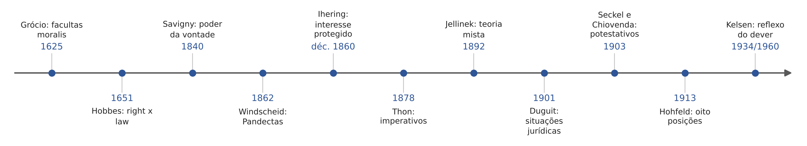
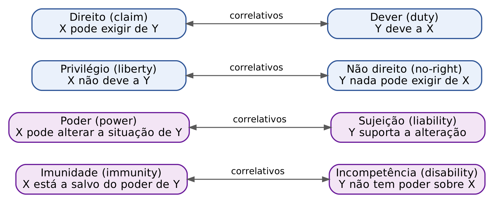
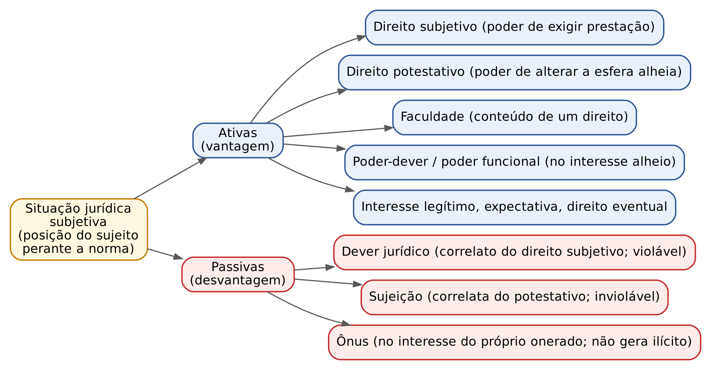
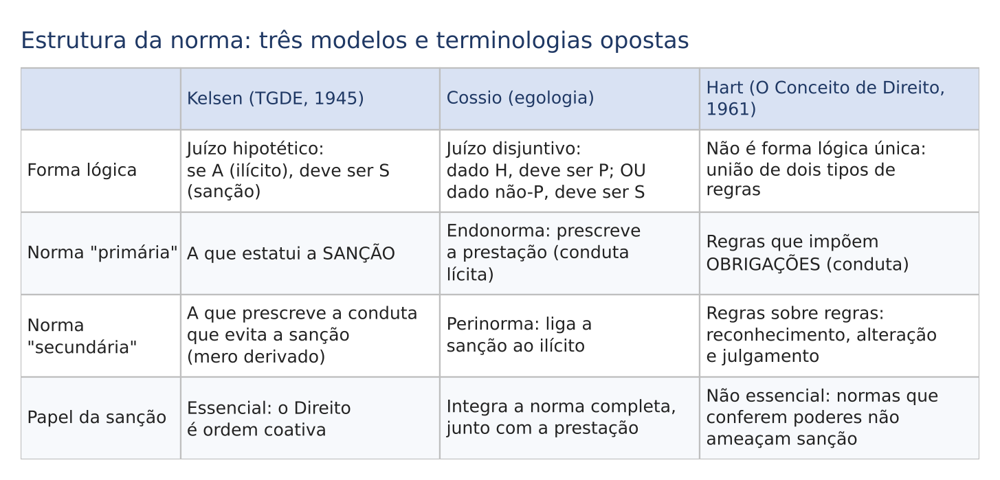
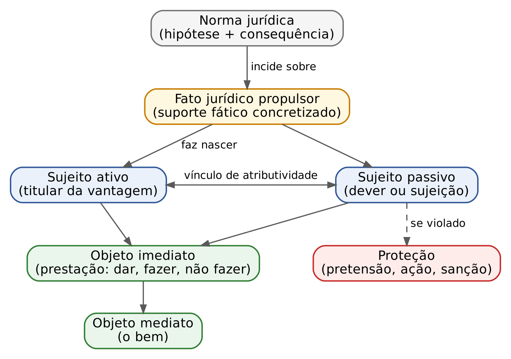
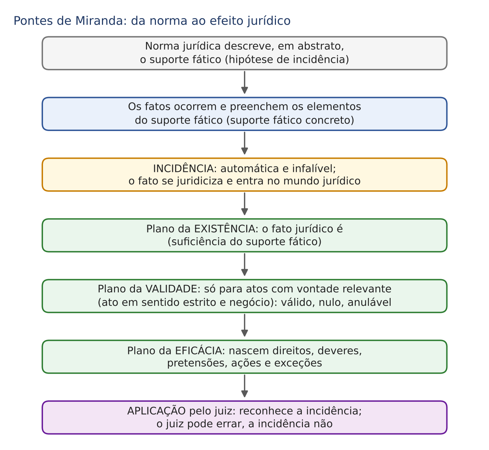

# CAPÍTULO 21 — DIREITO OBJETIVO E SUBJETIVO, NORMA, RELAÇÃO E FATO JURÍDICO

:::INCIDENCIA
TRF5 p. E.1 (direito objetivo e subjetivo, norma, estrutura, relação jurídica, sujeitos, objeto, fatos e situações jurídicas); TJRS p. E.1; TJSC p. F.1. Nível A.
Lote: 1 questão (FGV 1, FCC 0: derrotabilidade das normas, TRF2 2026); correlatas da FGV sobre direito subjetivo e direito adquirido (TJ-PA 2026, Cap. 23) e sobre imperativismo (TRF3 2025, Cap. 18).
O que mais cai: atribuição das teorias do direito subjetivo (vontade, interesse, mista, garantia, negativistas), Kelsen e o direito subjetivo como reflexo do dever, direito potestativo x subjetivo, classificação das normas quanto à sanção, sanção premial (Bobbio) e estrutura da norma (Kelsen, Cossio, Hart).
:::

O capítulo cobre a parte ESTÁTICA da teoria geral do Direito: as categorias com que o jurista descreve posições, normas, vínculos e fatos. Ficam fora, com remissão: o conceito de Direito, o positivismo de Kelsen e Hart como teorias gerais e os planos de validade, vigência, eficácia e efetividade (Cap. 18, 18.4 e 18.7); norma x texto, interpretação e lógica do razoável (Cap. 19); regras x princípios e ponderação (Cap. 18, 18.6.2, e Cap. 20); fontes, lacunas e antinomias (Cap. 22); vigência no tempo e direito adquirido (Cap. 23); unidade, coerência e completude do ordenamento (Cap. 24). O regime DOGMÁTICO civil (tabela de situações jurídicas, prescrição e decadência, classificação dos fatos e negócios, planos do negócio) está na Apostila de Direito Civil, Cap. 2 (02.4) e Cap. 8 (08.1 a 08.3); aqui se desenvolvem os autores, as teorias e as distinções de teoria geral que a banca de magistratura cobra e que a prova oral explora.

## 21.1 Direito objetivo e direito subjetivo

### 21.1.1 A polissemia e a distinção

A palavra "direito" designa, entre outras coisas, (i) o conjunto de normas vigentes numa comunidade (direito OBJETIVO, *norma agendi*); (ii) a posição de vantagem que essas normas atribuem a alguém (direito SUBJETIVO, *facultas agendi*); (iii) a ciência que estuda as normas; (iv) o justo (*ius* como *id quod iustum est*, na tradição aristotélico-tomista, Cap. 17, 17.3.3). O inglês separa *law* (direito objetivo) de *right* (direito subjetivo); o alemão e as línguas latinas usam a mesma palavra e precisam do adjetivo (*objektives* e *subjektives Recht*; *diritto oggettivo* e *soggettivo*).

Direito objetivo é o ordenamento visto como conjunto de normas que regulam condutas e organizam competências, independentemente de qualquer titular. Direito subjetivo é a mesma ordem vista do ângulo de quem dela extrai uma posição favorável: o poder ou a possibilidade de exigir de outrem, de modo garantido, o que a norma lhe atribui. A distinção é de PERSPECTIVA, não de substância: o crédito de 10.000 (dez mil) reais é direito subjetivo do credor e, ao mesmo tempo, aplicação das normas do Código Civil sobre obrigações.

A questão da PRECEDÊNCIA divide a doutrina e é típica de prova oral:

| Posição | Tese | Expoentes e leitura |
|---|---|---|
| Precedência do direito subjetivo | Há direitos anteriores ao Estado; o direito objetivo existe para declará-los e garanti-los | Jusnaturalismo moderno, Locke; Declaração de 1789 ("direitos naturais e imprescritíveis"); entre nós, Vicente Ráo é apontado como adepto |
| Precedência do direito objetivo | Só há direito subjetivo onde a norma o atribui | Positivismo; Pontes de Miranda (o direito subjetivo nasce da incidência da norma sobre o fato) |
| Concomitância | Os dois são faces correlatas de um mesmo fenômeno; não há prioridade lógica nem cronológica | Miguel Reale (Lições Preliminares de Direito) |
| Negação do direito subjetivo | Só existe o direito objetivo e as situações que ele produz | Duguit; Kelsen (com nuances); realismo escandinavo |

:::DOUTRINA Michel Villey, A formação do pensamento jurídico moderno
A noção de direito subjetivo é MODERNA. Villey sustenta que os romanos e Tomás de Aquino entendiam *ius* como a coisa justa, a parte devida a cada um numa relação, e não como poder do indivíduo; a virada estaria no nominalismo de Guilherme de Ockham (século XIV, na querela franciscana sobre a pobreza), que passa a conceber o *ius* como *potestas* do sujeito. Hugo Grócio (De iure belli ac pacis, 1625) define o direito, em um de seus sentidos, como qualidade moral da pessoa que a habilita a ter ou fazer algo justamente (*facultas*). Hobbes (Leviatã, 1651, cap. XIV) contrapõe *right* (liberdade de fazer ou omitir) a *law* (que determina e obriga): direito e lei diferem como liberdade e obrigação. O individualismo liberal e as declarações do século XVIII consumam a passagem.
Uso em prova: a pergunta "o direito subjetivo é categoria universal?" admite a resposta histórica (é construção moderna, ligada ao individualismo) e a resposta analítica (as posições jurídicas existem em qualquer ordem, ainda que sem o nome).
:::

### 21.1.2 As teorias sobre a natureza do direito subjetivo

O debate do século XIX, travado sobretudo na pandectística alemã, pergunta o que é, essencialmente, o direito subjetivo. A banca cobra a ATRIBUIÇÃO (quem disse o quê) e a CRÍTICA que derrubou cada teoria.

TEORIA DA VONTADE (*Willenstheorie*). Savigny (Sistema do Direito Romano Atual, 1840) e Windscheid (Tratado das Pandectas, 1862): o direito subjetivo é um PODER ou SENHORIO DA VONTADE (*Willensmacht*, *Willensherrschaft*) conferido pela ordem jurídica. A matriz é kantiana: o Direito delimita esferas de liberdade. Críticas clássicas: (i) há direitos sem vontade — a criança, o nascituro, a pessoa sem discernimento, a pessoa jurídica, o ausente são titulares e não querem nada juridicamente relevante; (ii) há direitos que existem contra a vontade do titular ou na sua ignorância (o herdeiro que desconhece a herança; o direito irrenunciável); (iii) a vontade é o elemento do EXERCÍCIO, não da titularidade. Windscheid, diante das críticas, passou a dizer que a vontade relevante é a da ORDEM JURÍDICA, não a do titular, o que, na prática, desloca a teoria para o direito objetivo.

TEORIA DO INTERESSE (*Interessentheorie*). Rudolf von Ihering (O Espírito do Direito Romano, vol. III): direitos são INTERESSES JURIDICAMENTE PROTEGIDOS. Dois elementos: um SUBSTANCIAL (o interesse, a utilidade, o fim prático) e um FORMAL (a proteção jurídica, a ação judicial), que é a "casca" protetora do primeiro. A teoria explica a titularidade dos incapazes (têm interesse, embora não vontade). Críticas: (i) há interesses protegidos que não são direitos subjetivos (o interesse reflexo do consumidor na norma de concorrência, o interesse do contribuinte na boa administração); (ii) há direitos sem interesse atual do titular (o direito do tutor, os poderes funcionais exercidos no interesse alheio); (iii) confunde o FIM do direito com o próprio direito. Ihering também escreveu A Luta pelo Direito (1872): defender o direito subjetivo é dever do titular para consigo e para com a comunidade, porque a lesão ao direito subjetivo é lesão ao direito objetivo.

TEORIA MISTA OU ECLÉTICA. Georg Jellinek (Sistema dos Direitos Públicos Subjetivos, 1892), seguido por Saleilles e Michoud: o direito subjetivo é o poder da vontade humana, reconhecido e protegido pela ordem jurídica, que tem por objeto um bem ou interesse — o interesse protegido que a vontade tem o poder de realizar. Crítica: soma os defeitos das duas anteriores (o incapaz continua sem vontade; o interesse continua sendo fim, não essência).

TEORIA DA GARANTIA. O direito subjetivo seria a GARANTIA ou PROTEÇÃO que o direito objetivo concede ao titular e que ele pode invocar em caso de violação — na prática, a possibilidade de pôr em movimento a tutela jurisdicional. A manualística a associa a August Thon (Norma Jurídica e Direito Subjetivo, 1878), autor também de uma das versões mais rigorosas do imperativismo (21.3.2). Crítica: confunde o direito com a sua proteção e subordina-o inteiramente ao direito objetivo; os direitos sem ação (obrigação natural) desmentiriam a teoria.

TEORIAS NEGATIVISTAS. Léon Duguit (L'État, le droit objectif et la loi positive, 1901; As transformações gerais do direito privado, 1912), a partir da sociologia da solidariedade de Durkheim, nega o direito subjetivo como resíduo metafísico do individualismo: ninguém tem poder de impor sua vontade a outrem; o que há são SITUAÇÕES JURÍDICAS, objetivas (gerais, permanentes, criadas pela lei, como a de proprietário ou de funcionário) e subjetivas (individuais, temporárias, criadas por ato jurídico, como a de credor num contrato), e a propriedade é FUNÇÃO SOCIAL. Kelsen (21.1.3) e o realismo escandinavo (Olivecrona, Ross: "direito subjetivo" como palavra sem referência semântica, ferramenta de apresentação; ver Cap. 18, 18.5.2) completam o quadro negativista, cada um com seu fundamento.

TEORIAS CULTURALISTA E EGOLÓGICA. Miguel Reale define o direito subjetivo como a possibilidade de exigir, de maneira garantida, aquilo que as normas atribuem a alguém como próprio; insere-o no gênero SITUAÇÕES SUBJETIVAS (direito subjetivo, interesse legítimo, poder, faculdade) e o liga à BILATERALIDADE ATRIBUTIVA (21.4). Carlos Cossio, na teoria egológica, vê no direito subjetivo uma expressão da LIBERDADE do sujeito na interferência intersubjetiva de condutas; o próprio ilícito é uma possibilidade da liberdade, não sua negação.

| Teoria | Autor | O direito subjetivo é... | Crítica que a banca usa |
|---|---|---|---|
| Vontade | Savigny; Windscheid | Poder ou senhorio da vontade conferido pela ordem jurídica | Incapazes, nascituro e pessoa jurídica são titulares sem vontade |
| Interesse | Ihering | Interesse juridicamente protegido (elemento substancial + elemento formal) | Há interesses protegidos que não são direitos; confunde fim e essência |
| Mista | Jellinek; Saleilles; Michoud | Poder da vontade reconhecido e protegido, tendo por objeto um bem ou interesse | Herda as críticas das duas |
| Garantia | Associada a Thon | A proteção (garantia) que a ordem concede ao titular | Confunde direito e proteção; ignora direitos sem ação |
| Negativista sociológica | Duguit | Não existe: só situações jurídicas e funções sociais | Nega o que a prática processual pressupõe |
| Normativista | Kelsen | Reflexo do dever alheio; em sentido técnico, poder jurídico de acionar a sanção | Ver 21.1.3 |
| Realista escandinava | Olivecrona; Ross | Conceito vazio, útil como técnica de apresentação | Ver Cap. 18 |
| Culturalista | Reale | Possibilidade de exigir, de modo garantido, o que a norma atribui como próprio | Concomitância com o direito objetivo |

:::PEGADINHA
(1) A teoria do interesse é de IHERING; a da vontade, de SAVIGNY e WINDSCHEID; a mista, de JELLINEK. A banca troca os nomes ou atribui a Ihering a fórmula "poder da vontade". (2) A teoria da garantia NÃO define o direito como "interesse tutelado mediante o reconhecimento da vontade individual" — essa é a teoria mista, e a assertiva que atribui essa fórmula à teoria da garantia é ERRADA. (3) Duguit não nega a existência de posições jurídicas individuais: nega que sejam PODERES da vontade e as rebatiza de situações jurídicas subjetivas.
:::

### 21.1.3 Kelsen: o direito subjetivo como técnica

Na Teoria Pura do Direito (2ª ed., 1960, cap. IV), Kelsen dissolve o dualismo entre direito objetivo e subjetivo, que considera IDEOLÓGICO: ele serviria para apresentar o direito subjetivo (sobretudo a propriedade) como anterior e superior à ordem estatal, imunizando-o contra a mudança legislativa. O conceito central da teoria é o DEVER jurídico, não o direito: um indivíduo está juridicamente obrigado a uma conduta quando a ordem jurídica liga à conduta oposta um ato coativo (sanção). O dever, diz Kelsen, não é algo distinto da norma: "um indivíduo é juridicamente obrigado a uma determinada conduta" é idêntico a "uma norma jurídica prescreve aquela conduta".

Daí os sentidos de "direito subjetivo" que Kelsen distingue:

- DIREITO REFLEXO: a posição de quem é beneficiado pelo dever alheio. Se A deve pagar a B, dizer que B "tem direito" é apenas descrever, do ângulo de B, o dever de A. O direito reflexo nada acrescenta ao dever; é redundante.
- DIREITO SUBJETIVO EM SENTIDO TÉCNICO: o PODER JURÍDICO conferido ao beneficiário de fazer valer, mediante ação, o não cumprimento do dever — de pôr em movimento o procedimento que leva à sanção. Aqui sim há algo novo: o indivíduo participa da produção da norma individual (a sentença). É o sentido próprio do direito privado.
- PERMISSÃO POSITIVA de uma autoridade (licença): a conduta é permitida por norma que limita ou exclui a validade de uma proibição geral.
- DIREITOS POLÍTICOS: o poder de participar da criação de normas gerais (o voto) ou de iniciar o controle de normas inconstitucionais; os direitos e liberdades fundamentais só são direitos subjetivos em sentido técnico quando a ordem atribui ao indivíduo o poder de provocar a anulação da norma que os viole.

O material do Drive (Teoria Geral do Direito, 2026) transcreve o trecho decisivo da Teoria Pura (trad. Martins Fontes, 7ª ed., p. 152): a estatuição de direitos subjetivos "não é - como a estatuição de deveres jurídicos - uma função essencial do Direito objetivo"; ela "apenas representa uma conformação possível, mas não necessária", uma "técnica particular" de que o Direito pode, mas não precisa, servir-se. A frase sintetiza a posição: há ordens jurídicas sem direitos subjetivos em sentido técnico (o Direito penal moderno, em que a ação é do Estado), mas não há ordem jurídica sem deveres.

Kelsen trata também a PESSOA como construção normativa: pessoa física é a personificação de um complexo de normas que regulam a conduta de um indivíduo; pessoa jurídica, a de uma ordem parcial (estatuto); ambas são centros de imputação, não realidades pré-jurídicas (21.7.2).

:::DICA
Em prova discursiva ou oral sobre Kelsen e o direito subjetivo, quatro frases bastam: (1) o conceito primário é o dever, e o direito reflexo é mera duplicação do dever; (2) o direito subjetivo em sentido técnico é o poder jurídico de acionar a sanção (ação); (3) a atribuição de direitos subjetivos é técnica possível e não necessária do direito objetivo (ex.: direito penal); (4) o dualismo direito objetivo x subjetivo tem função ideológica. A Sinopse vol. 59 aproxima a visão de Kelsen da teoria da garantia, porque o titular funciona como quem leva ao Estado a violação do dever alheio: a aproximação é aceitável se feita com essa ressalva.
:::

### 21.1.4 Hohfeld: as posições jurídicas fundamentais

Wesley Newcomb Hohfeld (Some Fundamental Legal Conceptions as Applied in Judicial Reasoning, Yale Law Journal, 1913 e 1917) mostrou que a palavra *right* é usada pelos tribunais para designar quatro posições DIFERENTES, e que a confusão entre elas gera erros de raciocínio. Ele as organizou em dois quadrados de relações CORRELATIVAS (a posição de um implica a posição correspondente do outro) e OPOSTAS (a presença de uma exclui a outra na mesma pessoa):

| Posição de X | Correlativa (posição de Y) | Oposta (ausência em X) | Exemplo |
|---|---|---|---|
| Direito em sentido estrito (*claim-right*) | Dever (*duty*) | Não direito (*no-right*) | Credor que pode exigir o pagamento |
| Privilégio ou liberdade (*privilege*, *liberty*) | Não direito (*no-right*) | Dever (*duty*) | Liberdade de usar o próprio imóvel: ninguém pode exigir que não use |
| Poder (*power*) | Sujeição (*liability*) | Incompetência (*disability*) | Mandante que revoga o mandato; testador |
| Imunidade (*immunity*) | Incompetência (*disability*) | Sujeição (*liability*) | Cláusula pétrea em face do poder reformador; imunidade tributária |

A grade de Hohfeld é o melhor instrumento analítico para separar figuras que o Brasil estuda sob outros nomes: o direito subjetivo em sentido estrito é o *claim*; a FACULDADE é o privilégio; o DIREITO POTESTATIVO é o *power*, cujo correlato é a SUJEIÇÃO (21.2.1); as garantias contra o legislador (direito adquirido, cláusulas pétreas, imunidades) são *immunities*. Ela também desfaz falácias frequentes: ter liberdade de fazer algo (privilégio) não implica que alguém tenha o dever de permitir ou de facilitar (para isso é preciso um *claim* adicional); ter o poder de praticar um ato não implica que praticá-lo seja lícito (o poder de alienar coisa alheia *a non domino* pode existir em certas hipóteses de aparência, e a alienação ser ilícita perante o dono).

:::DOUTRINA Recepção de Hohfeld
A teoria é central na *analytical jurisprudence* anglo-americana e foi retomada por Hart e por Alexy (Teoria dos Direitos Fundamentais, cap. 4, que reconstrói os direitos fundamentais como sistema de posições: direitos a algo, liberdades e competências). Na doutrina civil brasileira, a distinção poder/sujeição corresponde ao par direito potestativo/sujeição de Chiovenda. Em prova de magistratura, Hohfeld aparece mais em discursiva e oral do que em objetiva: vale como diferencial de resposta ao pedir-se "distinga direito subjetivo, faculdade e direito potestativo".
:::

### 21.1.5 Estrutura, classes e desdobramentos do direito subjetivo

ELEMENTOS. A doutrina consolidou quatro: SUJEITO (titular), OBJETO (o bem ou a prestação sobre que recai), CONTEÚDO (as faculdades de agir que o direito compreende: usar, gozar, dispor, reivindicar) e PROTEÇÃO (a garantia, normalmente a ação). A relação com o sujeito passivo é tratada em 21.7.

CLASSES MAIS COBRADAS.

| Critério | Espécies | Observação |
|---|---|---|
| Oponibilidade | Absolutos (*erga omnes*: reais, da personalidade, de autor) x relativos (contra pessoa determinada: crédito) | No absoluto, o sujeito passivo é a coletividade, com dever geral de abstenção (Windscheid: obrigação passiva universal) |
| Conteúdo | Patrimoniais (reais, obrigacionais, intelectuais na faceta econômica) x extrapatrimoniais (personalidade, familiares puros) | A distinção existencial x patrimonial e seu regime: Apostila de Direito Civil, Cap. 2 (02.4.6) |
| Sujeito passivo | Privados x públicos subjetivos (contra o Estado) | Jellinek: teoria dos quatro *status* (passivo, negativo, positivo e ativo); remissão à Apostila de Direito Constitucional (teoria geral dos direitos fundamentais) |
| Autonomia | Principais x acessórios (juros, garantias) | O acessório segue o principal |
| Transmissibilidade | Transmissíveis x personalíssimos | Personalíssimos se extinguem com o titular |
| Atualidade | Atuais (adquiridos) x futuros (deferidos ou não deferidos) e eventuais; expectativa | Direito adquirido e expectativa: Cap. 23 e LINDB, art. 6º, § 2º |

DIREITO, PRETENSÃO, AÇÃO E EXCEÇÃO. A partir de Windscheid (A *actio* do direito civil romano do ponto de vista do direito atual, 1856), a dogmática separa o DIREITO SUBJETIVO da PRETENSÃO (*Anspruch*): o poder de exigir de outrem uma ação ou omissão, que nasce com a exigibilidade (em regra, com a violação) e se extingue pela prescrição. O Código Civil acolheu expressamente a construção:

:::LEI Código Civil, art. 189
"Violado o direito, nasce para o titular a pretensão, a qual se extingue, pela prescrição, nos prazos a que aludem os arts. 205 e 206."
:::

Pontes de Miranda desdobra a eficácia do fato jurídico em degraus: DIREITO (posição), PRETENSÃO (exigibilidade), AÇÃO de direito material (poder de impor a realização, independentemente da vontade do obrigado) e EXCEÇÃO (poder de encobrir a eficácia da pretensão alheia). Há direito sem pretensão (a dívida de jogo, CC, art. 814, e a dívida prescrita: o pagamento voluntário é válido e não se repete, CC, art. 882) e pretensão sem ação material eficaz. É a distinção germânica entre DÉBITO (*Schuld*) e RESPONSABILIDADE (*Haftung*): na obrigação natural, há *Schuld* sem *Haftung*. O regime da prescrição e o critério de Agnelo Amorim Filho estão na Apostila de Direito Civil, Cap. 2 (02.4.5) e Cap. 11.

LIMITES: RELATIVIDADE E ABUSO. A concepção absoluta do direito subjetivo, como esfera de soberania do titular (*qui iure suo utitur neminem laedit*), foi superada pela teoria da RELATIVIDADE dos direitos (Louis Josserand, De l'esprit des droits et de leur relativité, 1927): todo direito tem um fim social, e seu exercício desviado é abusivo. O Código Civil adotou critério OBJETIVO, que dispensa intenção de prejudicar (art. 187: comete ato ilícito o titular que, ao exercer o direito, "excede manifestamente os limites impostos pelo seu fim econômico ou social, pela boa-fé ou pelos bons costumes"). Regime completo: Apostila de Direito Civil, Cap. 10.

A FGV (TJ-PA 2026, Juiz, Q3951813, gabarito A) cobrou a projeção intertemporal da distinção: a mudança do direito OBJETIVO não alcança o direito SUBJETIVO já incorporado ao patrimônio pela realização completa do suporte fático sob a lei anterior (CF, art. 5º, XXXVI; LINDB, art. 6º) — box e armadilhas no Cap. 23 (23.4.2).

:::PRATIQUE Questão discursiva — exercício elaborado para esta apostila (não é questão de banca)
Enunciado: "O direito objetivo contempla o direito subjetivo? Fundamente." (até 30 linhas)
Resolução (roteiro): sim, são faces correlatas do mesmo fenômeno; direito objetivo é o complexo de normas que regem a conduta (*norma agendi*); direito subjetivo, a permissão ou o poder que essas normas conferem para agir e exigir de outrem determinado comportamento (*facultas agendi*). Exponha as teorias da vontade (Savigny e Windscheid), do interesse (Ihering) e mista (Jellinek, Saleilles, Michoud), com as críticas, e a posição de Kelsen (direito reflexo x direito em sentido técnico). Diferenciais: a concomitância de Reale, o caráter histórico-moderno da categoria (Villey), a distinção entre direito subjetivo e direito potestativo e o desdobramento direito-pretensão (art. 189 do CC).
:::

:::PASSO Roteiro de resposta oral: "o que é direito subjetivo?"
1. Definição operacional: posição de vantagem atribuída pela norma, que permite ao titular exigir de outrem, de modo garantido, uma conduta (*facultas agendi*), correlata a um dever.
2. Relação com o direito objetivo: mesma realidade vista de dois ângulos; posições sobre a precedência (jusnaturalista, positivista, concomitância de Reale).
3. Teorias: vontade, interesse, mista, garantia; cada uma com a crítica decisiva.
4. Negativistas: Duguit (situações jurídicas, função social) e Kelsen (dever como conceito primário; direito em sentido técnico como poder de ação).
5. Distinções: direito subjetivo x potestativo x faculdade x poder-dever x ônus (21.2).
6. Projeção prática: pretensão e prescrição (art. 189), abuso do direito (art. 187), direito adquirido (art. 5º, XXXVI, da CF).
:::

:::PRATIQUE Direito objetivo e subjetivo — exercício elaborado para esta apostila (não é questão de banca)
1. "Para a teoria da vontade, a criança titular de herança não tem direito subjetivo, mas apenas interesse protegido." A frase descreve corretamente a teoria?
2. Segundo Kelsen, o que distingue o direito subjetivo "em sentido técnico" do direito reflexo?
3. Por que se diz que a dívida de jogo é caso de *Schuld* sem *Haftung*?
Resolução: 1. Não. A frase descreve a CRÍTICA à teoria da vontade (incapazes têm direitos sem vontade), formulada sobretudo a partir da teoria do interesse; os voluntaristas respondiam que a vontade é suprida pelo representante, ou, com Windscheid, que a vontade relevante é a da ordem jurídica. 2. O reflexo apenas duplica o dever alheio; o técnico acrescenta o poder jurídico do titular de provocar, por ação, a aplicação da sanção, participando da produção da norma individual. 3. Porque há débito (o pagamento voluntário é válido e irrepetível, CC, arts. 814 e 882) sem responsabilidade patrimonial exigível em juízo: há direito, mas não pretensão judicialmente exigível.
:::

## 21.2 Direitos potestativos e situações jurídicas

### 21.2.1 Direito potestativo e sujeição

O DIREITO POTESTATIVO é o poder de, por ato unilateral do titular, criar, modificar ou extinguir uma situação jurídica alheia, sem que o outro possa impedir. A categoria nasce na pandectística do início do século XX: Emil Seckel (Os direitos formativos do direito civil, 1903) cunhou a expressão *Gestaltungsrechte* (direitos formativos), e Giuseppe Chiovenda (L'azione nel sistema dei diritti, 1903) difundiu o nome *diritti potestativi* e com ele construiu sua teoria da AÇÃO como direito potestativo dirigido contra o adversário (a ação produziria, perante ele, o efeito de sujeitá-lo à atuação da lei).

Traços que a banca cobra:

- CORRELATO: não há dever, há SUJEIÇÃO. O sujeito passivo nada presta; suporta os efeitos.
- INVIOLABILIDADE: como não há prestação devida, o direito potestativo não pode ser violado; por isso dele NÃO nasce pretensão e ele NÃO prescreve. Quando a lei ou o contrato fixam prazo para seu exercício, o prazo é DECADENCIAL; sem prazo, o exercício é perpétuo (critério de Agnelo Amorim Filho: ações constitutivas veiculam direitos potestativos).
- ESPÉCIES por efeito: constitutivos (preempção, aceitação de proposta), modificativos (escolha na obrigação alternativa, conversão) e extintivos (anulação, resilição unilateral, revogação do mandato, divórcio, renúncia).
- EXERCÍCIO: extrajudicial (revogação do mandato, denúncia do contrato por prazo indeterminado) ou necessariamente judicial (anulação do negócio, quando contestada; desconstituição de paternidade).
- LIMITE: potestativo não quer dizer arbitrário; seu exercício submete-se à boa-fé e ao art. 187.

:::PEGADINHA
(1) Potestativo x subjetivo: o critério NÃO é a unilateralidade do exercício (o credor também cobra unilateralmente), mas a existência de PRESTAÇÃO devida: no direito subjetivo, o resultado depende da conduta do devedor; no potestativo, só do titular. (2) Decadência é do direito potestativo; prescrição é da PRETENSÃO, não do direito. (3) Condição puramente potestativa (CC, art. 122: a que sujeita o negócio "ao puro arbítrio de uma das partes") é OUTRA coisa: é elemento acidental ilícito do negócio, não categoria de situação jurídica. A homonímia é a armadilha.
:::

Os exemplos do cotidiano forense (divórcio após a EC 66/2010, partilha de bens, anulação de negócio, revogação de mandato, opção do art. 1.222) e os julgados do STJ que qualificam partilha e divórcio como potestativos estão na Apostila de Direito Civil, Cap. 2 (02.4.3), com remissões ao Direito de Família.

### 21.2.2 Situações jurídicas subjetivas

A noção de SITUAÇÃO JURÍDICA é mais ampla que a de direito subjetivo e é o gênero preferido pela teoria contemporânea. Duguit a usou para SUBSTITUIR o direito subjetivo (21.1.2); Reale a usa como GÊNERO que abrange direito subjetivo, interesse legítimo, poder e faculdade; Pietro Perlingieri (O direito civil na legalidade constitucional) a toma como categoria central do direito civil-constitucional, entendida como o centro de interesses juridicamente relevante, que reúne poderes e deveres (situações complexas) e que pode existir sem contraparte determinada (situações unissubjetivas). A relação jurídica passa a ser vista como LIGAÇÃO entre situações (crédito e débito).

| Situação | Natureza | Correlato e regime | Exemplo |
|---|---|---|---|
| Direito subjetivo | Ativa: poder de exigir prestação | Dever; violável; pretensão sujeita a prescrição | Crédito |
| Direito potestativo | Ativa: poder de alterar a esfera alheia | Sujeição; inviolável; decadência se houver prazo | Anulação; divórcio |
| Faculdade | Ativa: possibilidade de agir contida em um direito, sem autonomia | Não prescreve isoladamente | Usar e fruir da coisa |
| Poder-dever (poder funcional, *munus*) | Ativa e passiva ao mesmo tempo: poder conferido no interesse de outrem, irrenunciável e de exercício obrigatório | O beneficiário tem direito ao correto exercício | Poder familiar; curatela; competências públicas, inclusive a JURISDIÇÃO |
| Interesse legítimo; expectativa; direito eventual | Ativas em formação ou de proteção indireta | Tutela limitada (atos conservatórios, CC, art. 130) | Credor sob condição suspensiva |
| Dever jurídico | Passiva: conduta exigível em favor de outrem | Descumprimento = ilícito | Pagar, abster-se |
| Sujeição | Passiva: suportar a alteração | Não há ilícito possível | Mandatário diante da revogação |
| Ônus | Passiva: comportamento necessário para obter vantagem ou evitar desvantagem própria | Descumprimento não é ilícito; só perda da vantagem | Ônus da prova; registro do título |

:::NOTA O poder jurisdicional como poder-dever
A jurisdição ilustra bem o poder-dever: o juiz não é titular de direito subjetivo de julgar, mas de competência exercida no interesse da coletividade e das partes, irrenunciável (vedação do *non liquet*: CPC, art. 140; LINDB, art. 4º) e indelegável. Por isso a recusa de decidir, a demora injustificada e o exercício para fim alheio ao interesse público são ilícitos funcionais, e não "não exercício de um direito" (deveres da LOMAN e regime disciplinar: Cap. 11 e Cap. 13). Na grade de Hohfeld, o juiz tem *power* (de alterar a situação das partes pela sentença), e as partes estão em *liability*; sua *immunity* corresponde às garantias da magistratura (Cap. 10).
:::

:::PRATIQUE Situações jurídicas — exercício elaborado para esta apostila (não é questão de banca)
1. Classifique: (a) o direito do condômino de pedir a divisão da coisa comum; (b) a posição do réu quanto à prova de fato extintivo; (c) a posição do tutor quanto à administração dos bens do tutelado.
2. Hohfeld: qual é o correlativo do privilégio (*liberty*) e qual é o seu oposto?
Resolução: 1. (a) Direito potestativo (o outro condômino fica em sujeição; exercível "a todo tempo", CC, art. 1.320); (b) ônus (CPC, art. 373, II: o descumprimento não é ilícito, apenas leva à perda da causa quanto ao ponto); (c) poder-dever (*munus*: exercido no interesse do tutelado, irrenunciável, sujeito a prestação de contas). 2. Correlativo: não direito (*no-right*) da outra parte; oposto: dever (*duty*) do próprio titular.
:::

## 21.3 Norma jurídica: conceito e estrutura

### 21.3.1 Conceito e distinções preliminares

Norma jurídica é o SENTIDO DEÔNTICO (obrigatório, proibido, permitido) atribuído à conduta humana por um ato de autoridade ou por outra fonte reconhecida pelo ordenamento, cuja observância é garantida, em última instância, pela possibilidade de coação organizada. Três distinções preliminares evitam a maior parte dos erros e já foram desenvolvidas em outros capítulos: NORMA x TEXTO (o dispositivo é o objeto da interpretação; a norma é seu resultado: Cap. 19, 19.1.3); NORMA x PROPOSIÇÃO JURÍDICA (a norma prescreve e é válida ou inválida; a proposição da ciência descreve e é verdadeira ou falsa: Cap. 18, 18.4.3); REGRA x PRINCÍPIO (Cap. 18, 18.6.2). Interessa aqui a ESTRUTURA lógica da norma, seus caracteres, suas classes e a sanção.

### 21.3.2 Imperativismo e suas críticas

A TEORIA IMPERATIVISTA concebe a norma jurídica como COMANDO: ordem de um superior a um inferior. Em John Austin (The Province of Jurisprudence Determined, 1832), a lei é o comando do soberano, habitualmente obedecido, apoiado em ameaça de mal (sanção); em August Thon (1878), o Direito é o conjunto de imperativos dirigidos à conduta, e todo o resto (permissões, direitos, competências) se reduz a imperativos. Bobbio (Teoria da Norma Jurídica, 1958) mostra que o imperativismo, em sua forma estrita, nasce junto com a concepção LEGALISTA-ESTATAL do Direito, para a qual o Estado é a única fonte e a lei a única expressão do poder normativo — exatamente a afirmação dada como correta pela FGV no TRF3 2025 (Q3179591, gabarito C, comentada no Cap. 18, 18.4.2).

As críticas que levaram à sua superação:

- NORMAS PERMISSIVAS: não ordenam, permitem; Bobbio as explica como normas que eliminam, total ou parcialmente, um imperativo anterior, e por isso pressupõem os imperativos, sem se reduzir a eles.
- NORMAS DE COMPETÊNCIA (que conferem poderes públicos ou privados): não mandam fazer nada; dizem como produzir efeitos válidos. É a objeção central de Hart ao modelo de Austin (normas que conferem poderes não são ordens apoiadas em ameaças; a nulidade não é sanção: Cap. 18, 18.4.4).
- NORMAS DEFINITÓRIAS, INTERPRETATIVAS E REVOGATÓRIAS: não regulam conduta diretamente; Kelsen as chama de normas NÃO AUTÔNOMAS, que só têm sentido ligadas a outras.
- A pessoa do "comandante": nas ordens modernas não há vontade psicológica de um soberano; o "legislador" é procedimento.

Bobbio conclui por uma posição analítica moderada: as normas são PROPOSIÇÕES PRESCRITIVAS (pretendem influir no comportamento alheio), entre as quais os imperativos (positivos, ou comandos, e negativos, ou proibições) são o tipo mais importante, mas não o único.

### 21.3.3 A estrutura da norma: Kelsen, Cossio e Hart

A estrutura lógica mínima da norma de conduta é condicional: SE ocorre o fato descrito na hipótese (fato-tipo, suporte fático, antecedente), ENTÃO DEVE SER a consequência (preceito, estatuição, consequente). O nexo é de IMPUTAÇÃO, não de causalidade (Kelsen; Cap. 18, 18.4.3). Reale descreve a regra de conduta como composta de HIPÓTESE (ou fato-tipo) e DISPOSITIVO (ou preceito) e contrapõe a ela as REGRAS DE ORGANIZAÇÃO, que estruturam órgãos e competências e não têm forma hipotética (são categóricas: "o Supremo Tribunal Federal compõe-se de onze Ministros").

KELSEN. Na Teoria Geral do Direito e do Estado (1945), a norma jurídica completa é um juízo hipotético que liga ao ILÍCITO a SANÇÃO: "se A, deve ser S". Ele chama de PRIMÁRIA a norma que estatui a sanção e de SECUNDÁRIA a que prescreve a conduta devida (não matar), esta última logicamente supérflua, mera derivação da primária. Na Teoria Pura (2ª ed.), o juízo hipotético passa a ser a forma da PROPOSIÇÃO jurídica, que descreve a norma; a norma é o sentido do ato de vontade. Na obra póstuma (Teoria Geral das Normas, 1979, cap. 35), Kelsen retifica a terminologia: primária passa a ser a norma que estabelece a conduta e secundária a que estatui a sanção (há quem leia a retificação como mero esboço, e não reformulação acabada da teoria). Em prova, a referência mais cobrada é a de 1945.

COSSIO. A teoria egológica rejeita a redução da norma à sanção e propõe o JUÍZO DISJUNTIVO: "Dado H, deve ser P (prestação), OU dado não-P, deve ser S (sanção)". A primeira parte, a ENDONORMA, descreve a conduta lícita e é a principal; a segunda, a PERINORMA, liga a sanção ao ilícito. O "ou" expressa a liberdade do sujeito: o Direito é conduta em interferência intersubjetiva, e o ilícito é uma das possibilidades da liberdade, não sua negação.

HART. Em O Conceito de Direito (1961), primárias são as regras que impõem OBRIGAÇÕES de conduta; secundárias, as regras sobre regras — de RECONHECIMENTO (critérios de validade), de ALTERAÇÃO (como criar e revogar) e de JULGAMENTO (quem decide e como) —, que remedeiam a incerteza, o caráter estático e a ineficiência de um regime só de primárias (Cap. 18, 18.4.4).

:::PEGADINHA
"Norma primária" e "norma secundária" têm sentidos OPOSTOS conforme o autor: em Kelsen (1945), primária é a que prevê a SANÇÃO; em Hart, primária é a que impõe a CONDUTA e secundária a que trata de outras normas; em Cossio, a nomenclatura é endonorma (conduta) e perinorma (sanção). Em classificações de manual (material do Drive), "primárias" regulam condutas e "secundárias" regulam a criação, modificação e extinção das primárias — é a versão hartiana. A banca troca os autores: leia sempre "segundo quem".
:::

### 21.3.4 Derrotabilidade das normas

A DERROTABILIDADE (*defeasibility*) é a propriedade de uma norma, ou de um conceito jurídico, de ter sua aplicação AFASTADA diante de circunstâncias excepcionais não enumeradas de antemão, sem que a norma perca validade. A estrutura deixa de ser "se A, então B" e passa a ser "se A, então B, SALVO se ocorrer alguma exceção relevante". A formulação clássica é de H. L. A. Hart (The Ascription of Responsibility and Rights, 1949): conceitos como "contrato" não se definem por condições necessárias e suficientes, porque sua aplicação pode ser derrotada por alegações (erro, coação, incapacidade) cuja lista não é fechada. Desenvolveram o tema, entre outros, MacCormick, Frederick Schauer (Playing by the Rules, 1991: as regras são generalizações probabilísticas, inevitavelmente sobre e subinclusivas, e o problema é quando é legítimo afastá-las) e, no Brasil, Humberto Ávila (Teoria dos Princípios), que admite a SUPERABILIDADE das regras apenas em casos excepcionais, com requisitos materiais (a aplicação estrita frustraria a própria finalidade da regra, sem comprometer a segurança que ela promove) e procedimentais (justificação, fundamentação e comprovação das razões).

Três observações de teoria geral. (1) A derrotabilidade NÃO é invalidação nem declaração de inconstitucionalidade: a norma permanece válida e continua a reger os casos padrão. (2) Ela é a contrapartida, no plano das REGRAS, do que a ponderação faz com os PRINCÍPIOS (Cap. 20); por isso é usada para explicar o afastamento excepcional de regra no caso concreto. (3) O raciocínio derrotável é não monotônico: novas informações podem derrubar a conclusão antes justificada (o "salvo se" do modelo de Toulmin: Cap. 20, 20.4.1).

:::QUESTAO FGV 2026 — TRF2 — Juiz Federal Substituto (Q3996903)
Cobrado: o que caracteriza a derrotabilidade das normas.
Gabarito: C (as normas jurídicas funcionam como *defaults*, e não como regras estritas, o que permite conformá-las à complexidade da dinâmica fática).
Armadilha: A a confunde com a declaração de inconstitucionalidade sem redução de texto (técnica de controle, que atinge a validade de uma das incidências); D a submete à reserva de plenário e à Súmula Vinculante 10 (que trata de afastar a incidência de lei por fundamento de INCONSTITUCIONALIDADE, o que a derrotabilidade não faz); E a identifica com o art. 24 da LINDB (revisão de atos cuja produção se completou, regra de transição e segurança jurídica, Cap. 24); B diz que ela não se aplicaria a domínios de taxatividade estrita, como o penal — afirmação genérica e incorreta, porque o próprio Direito penal opera com excludentes e causas supralegais que derrotam a regra incriminadora no caso concreto.
Atenção: o enunciado atribui o fenômeno a "Karl Lorenz". A formulação clássica da *defeasibility* é de Hart (1949); não se encontrou autor com esse nome a quem a ideia seja atribuída, e a grafia lembra a de Karl Larenz (Metodologia da Ciência do Direito), que não é o autor do conceito. A atribuição do enunciado não foi objeto de alternativa e não deve ser repetida como verdadeira (ver nota de verificação e Cap. 20, 20.4.1).
:::

:::PRATIQUE Estrutura e derrotabilidade — exercício elaborado para esta apostila (não é questão de banca)
1. Formule, em linguagem de Cossio, a norma "quem causar dano a outrem por ato ilícito deve repará-lo".
2. O juiz afasta, no caso concreto, regra que exige requisito formal para concessão de benefício, porque o requisito já foi atingido por outro meio e sua exigência literal frustraria a finalidade da regra. Há declaração de inconstitucionalidade? Exige reserva de plenário?
Resolução: 1. Endonorma: dado o dano causado por ato ilícito, deve ser a reparação (prestação). Perinorma: dada a não reparação, deve ser a sanção (execução forçada sobre o patrimônio). 2. Não, se a fundamentação for de derrotabilidade (superação excepcional da regra pela sua própria finalidade), e não de incompatibilidade da regra com a Constituição; o ônus argumentativo é elevado e a decisão deve demonstrar a excepcionalidade e a preservação da segurança jurídica. Se o fundamento for constitucional, aplica-se a cláusula de reserva de plenário (art. 97 da CF e SV 10, em órgão fracionário de tribunal).
:::

## 21.4 Caracteres da norma jurídica

As listas variam conforme o autor; a banca cobra o conteúdo de cada atributo e as distinções entre coação, coercibilidade e sanção.

| Caráter | Conteúdo | Autor ou fonte associada | Observação de prova |
|---|---|---|---|
| Bilateralidade ATRIBUTIVA | A norma liga dois ou mais sujeitos e atribui a um deles o poder de exigir algo do outro, de forma garantida | Miguel Reale (Lições Preliminares; Filosofia do Direito) | É o traço que Reale usa para distinguir Direito e Moral; a Moral é bilateral (visa ao outro), mas não atributiva |
| Exterioridade | O Direito se ocupa da conduta exteriorizada; o foro íntimo é da Moral | Thomasius (*forum externum* x *forum internum*); Kant | Tendência, não regra absoluta: dolo, boa-fé e intenção importam |
| Heteronomia | A norma vale independentemente da adesão do destinatário | Kant (Moral autônoma, Direito heterônomo); Del Vecchio | Mesmo o contrato vincula pela norma que o reconhece |
| Imperatividade | A norma prescreve, não aconselha | Imperativismo; críticas em 21.3.2 | Normas permissivas e de competência relativizam |
| Coercibilidade | POSSIBILIDADE de uso da força organizada para assegurar o cumprimento | Teoria da coercibilidade (Reale, Del Vecchio) | Distinta da coação EFETIVA |
| Generalidade | Dirige-se a uma classe de destinatários | Bobbio (critério do destinatário) | Há normas individuais (sentença, ato administrativo concreto) |
| Abstração | Regula uma classe de ações ou um fato-tipo | Bobbio (critério da ação) | Norma geral pode ser concreta (lei que determina uma única providência) |

COAÇÃO, COERCIBILIDADE, COERÇÃO, SANÇÃO. A TEORIA DA COAÇÃO (Ihering: o Direito sem coação é "fogo que não queima"; Kelsen: o Direito é ordem coativa) faz da força atual elemento essencial do Direito. A TEORIA DA COERCIBILIDADE responde que o Direito é cumprido espontaneamente na imensa maioria dos casos, e que o essencial é a POSSIBILIDADE (compatibilidade) da coação, não sua presença. No vocabulário mais usado em provas (e no material do Drive): COERÇÃO é a pressão psicológica da ameaça de sanção, que atua antes da violação; COAÇÃO é a aplicação efetiva da força, depois dela; SANÇÃO é a consequência jurídica desfavorável (ou, na versão promocional, favorável) ligada à conduta. Parte da doutrina usa coerção e coação como sinônimos; a banca costuma adotar a distinção acima.

:::PEGADINHA
(1) "Toda norma jurídica é geral e abstrata" é FALSO em teoria geral: Kelsen trata a sentença como norma INDIVIDUAL, e Bobbio combina generalidade (destinatários) e abstração (ação) em quatro tipos (21.5). (2) Coercibilidade não é coação: a norma não deixa de ser jurídica porque foi cumprida espontaneamente. (3) Bilateralidade atributiva é de REALE; a fórmula "a Moral é unilateral" é simplificação: a Moral também diz respeito ao outro, mas não lhe atribui o poder de exigir.
:::

## 21.5 Classificações das normas jurídicas

As classificações são critérios de ordenação, não verdades: cada uma responde a uma pergunta diferente. As mais cobradas:

| Critério | Espécies | Ponto de prova |
|---|---|---|
| Imperatividade (vontade das partes) | COGENTES (de ordem pública, *ius cogens* interno), que se subdividem em preceptivas ou impositivas (mandam) e proibitivas (vedam); DISPOSITIVAS (*ius dispositivum*), que se subdividem em permissivas e supletivas (aplicam-se na falta de estipulação) e interpretativas | Normas cogentes não podem ser afastadas por convenção; normas dispositivas cedem à autonomia privada |
| Sanção | PERFEITAS (sanção = nulidade do ato violador); MAIS QUE PERFEITAS (nulidade + pena); MENOS QUE PERFEITAS (pena, sem nulidade); IMPERFEITAS (sem sanção jurídica) | Ver box abaixo; exemplo clássico de menos que perfeita: casamento com infração de causa suspensiva (válido, mas com sanção patrimonial: regime de separação obrigatória) |
| Generalidade e abstração (Bobbio) | Gerais e abstratas (a lei típica); gerais e concretas (lei que manda praticar uma única ação a todos); individuais e abstratas (ordem a uma pessoa para uma classe de ações: nomeação para cargo com atribuições); individuais e concretas (sentença, ordem singular) | O critério do destinatário (generalidade) e o da ação (abstração) são independentes |
| Destinatário imediato | De CONDUTA (dirigidas aos cidadãos) x de ORGANIZAÇÃO, ESTRUTURA ou COMPETÊNCIA (dirigidas a órgãos; regulam a produção de normas) | Bobbio (Teoria do Ordenamento): as normas de estrutura dão ao ordenamento sua complexidade; Hart: regras secundárias |
| Relação com outras normas (Kelsen) | Autônomas x NÃO AUTÔNOMAS (permissivas, definitórias, derrogatórias, que só têm sentido ligadas a uma norma sancionadora) | Responde às críticas ao imperativismo |
| Extensão | Gerais ou comuns; ESPECIAIS (disciplinam subconjunto do âmbito da geral, sem contrariá-la em seus fins); EXCEPCIONAIS (contrariam a regra geral para casos determinados) | Norma excepcional interpreta-se restritivamente e não admite analogia; especial e geral convivem (LINDB, art. 2º, § 2º; Cap. 22) |
| Natureza | Substantivas ou materiais x adjetivas ou processuais | Relevância para direito intertemporal (Cap. 23) |
| Hierarquia | Constitucionais; supralegais; legais; infralegais | Escalonamento: Cap. 18 e Cap. 24 |
| Âmbitos de validade (Kelsen) | Espacial, temporal, pessoal e material | Federais, estaduais, municipais; temporárias x permanentes |
| Fonte | Legislativas, consuetudinárias, jurisprudenciais, negociais | Cap. 22 |
| Sistema | Nacionais, estrangeiras e internacionais | Aplicação de norma estrangeira: Direito Internacional Privado |
| Eficácia (aplicabilidade) | Plena, contida, limitada (José Afonso da Silva) e outras classificações | Apostila de Direito Constitucional, Cap. 4 |
| Função no sistema | Normas de conduta x normas de SOBREDIREITO (normas sobre a aplicação de outras normas: LINDB) | A LINDB é "lei de introdução às normas", não só ao Código Civil (Lei 12.376/2010) |
| Tipo normativo | Regras x princípios (e postulados, em Ávila) | Cap. 18, 18.6.2 |

:::PRATIQUE Normas quanto à sanção — exercício elaborado para esta apostila (não é questão de banca)
Julgue: "Quanto à sanção, a norma é perfeita quando prevê a nulidade do ato violador; menos que perfeita quando não estipula nulidade nem castigo; e imperfeita quando determina apenas a penalidade."
Resolução: ERRADO. As definições de menos que perfeita e imperfeita foram TROCADAS: menos que perfeita é a que comina pena sem nulidade; imperfeita, a que não estabelece nem nulidade nem pena. Fórmula de memória: perfeita = nulidade; mais que perfeita = nulidade + pena; menos que perfeita = só pena; imperfeita = nada.
:::

:::DICA
A classificação quanto à sanção vem do Direito romano, que distinguia as *leges perfectae*, *plus quam perfectae*, *minus quam perfectae* e *imperfectae*. As imperfeitas servem de argumento contra a tese de que a sanção é elemento de CADA norma: a obrigação natural (dívida de jogo, dívida prescrita) é o exemplo dado em prova de dever jurídico sem coação disponível.
:::

## 21.6 Sanção jurídica

### 21.6.1 Conceito, espécies e o lugar da sanção na teoria

SANÇÃO é a consequência jurídica que o ordenamento liga a uma conduta, com o fim de assegurar a observância das normas. Na acepção tradicional, é a RESPOSTA À VIOLAÇÃO; Bobbio (Teoria da Norma Jurídica) a define assim e distingue três espécies: a sanção MORAL (interna: remorso, culpa), a SOCIAL (externa, mas difusa e desproporcionada: reprovação, exclusão do grupo) e a JURÍDICA, que é EXTERNA e INSTITUCIONALIZADA — prevista para cada violação, com medida estabelecida e aplicada por pessoas encarregadas (órgãos). A institucionalização garante certeza, proporção e imparcialidade.

Espécies de sanção jurídica pela FINALIDADE: punitivas (pena criminal, multa administrativa, sanções disciplinares), reparatórias ou ressarcitórias (indenização), restitutórias ou de execução específica (execução forçada, tutela específica, remoção do ilícito), INVALIDANTES (nulidade e anulabilidade — cuja natureza de sanção é negada por Hart, para quem a nulidade é apenas o não preenchimento das condições de um poder) e PREMIAIS (21.6.2). O material do Drive classifica ainda as sanções em COATIVAS (dependem de força, aplicadas de modo organizado pelo Estado ou, excepcionalmente, de modo difuso pelo particular, como na legítima defesa e no desforço possessório) e NÃO COATIVAS (direito de retenção, sanções premiais).

A sanção é elemento de CADA norma? Três respostas:

- KELSEN: sim, para a norma completa: o Direito é ordem coativa, e uma norma sem sanção só é jurídica se ligada a outra que a preveja (normas não autônomas).
- HART: não. Há regras que conferem poderes e regras secundárias que não ameaçam sanção; reduzir tudo à sanção distorce a função social dessas regras e ignora o ponto de vista interno de quem as aceita.
- BOBBIO: a sanção caracteriza o ORDENAMENTO como um todo, não cada norma isoladamente. Normas sem sanção (as do topo do sistema, as imperfeitas) são jurídicas porque pertencem a um ordenamento que, no conjunto, é sancionado. A juridicidade passa da norma para o sistema — ponte para a teoria do ordenamento (Cap. 24).

### 21.6.2 Função promocional do Direito e sanção premial

Em Da Estrutura à Função (Dalla struttura alla funzione, 1977), Bobbio observa que a teoria do Direito, concentrada na estrutura, só via a função PROTETIVO-REPRESSIVA: o Direito desencoraja condutas indesejadas com sanções negativas. O Estado contemporâneo, social e intervencionista, recorre cada vez mais a técnicas de ENCORAJAMENTO: torna as condutas desejadas mais fáceis ou mais vantajosas, mediante SANÇÕES POSITIVAS (prêmios, incentivos, isenções, facilidades). Daí a FUNÇÃO PROMOCIONAL do Direito. As duas técnicas convivem e não se excluem; o que muda é a ênfase.

| Técnica | Desencorajamento (função repressiva) | Encorajamento (função promocional) |
|---|---|---|
| Opera sobre | Condutas indesejadas (proibidas ou não queridas) | Condutas desejadas (obrigatórias ou só preferidas) |
| Sanção | Negativa: pena, multa, nulidade, indenização | Positiva: prêmio, redução, isenção, benefício |
| Momento | Normalmente posterior à conduta | Anterior (incentivo, facilitação) ou posterior (prêmio) |
| Modelo de Estado | Estado liberal, garantidor | Estado social, promotor |

No direito brasileiro, a sanção premial atravessa o cotidiano forense:

- Processo civil: honorários reduzidos pela metade se o réu reconhecer a procedência do pedido e, simultaneamente, cumprir integralmente a prestação (CPC, art. 90, § 4º); honorários da execução reduzidos pela metade no pagamento integral em três dias (art. 827, § 1º); isenção de custas para o réu que cumpre o mandado monitório no prazo (art. 701, § 1º).
- Processo penal: colaboração premiada (Lei 12.850/2013, art. 4º: perdão judicial, redução da pena ou substituição), regime próprio na Apostila de Processo Penal.
- Tributário: denúncia espontânea, que exclui a responsabilidade por infrações (CTN, art. 138); descontos por pagamento antecipado.
- Gestão judiciária: prêmios e selos institucionais (Prêmio CNJ de Qualidade, Cap. 3).

Não confundir sanção premial com *nudge* (Thaler e Sunstein): o *nudge* altera a arquitetura da escolha sem proibir opções nem mudar significativamente os incentivos econômicos; a sanção premial é consequência jurídica atribuída por norma (Cap. 37).

:::SENTENCA Aplicação da sanção premial do art. 90, § 4º, do CPC
"O réu, na contestação, reconheceu a procedência do pedido e comprovou o depósito integral da quantia reclamada, com correção e juros, no mesmo ato (evento n.). Homologo o reconhecimento jurídico do pedido, com resolução de mérito (CPC, art. 487, III, a). Presentes os requisitos cumulativos do art. 90, § 4º, do CPC — reconhecimento e cumprimento simultâneo e integral da prestação —, fixo os honorários advocatícios em 10% do valor da condenação, que reduzo pela metade, à vista da sanção premial legal. Expeça-se alvará em favor do autor."
Ponto de atenção: a redução exige SIMULTANEIDADE e INTEGRALIDADE; o reconhecimento sem pagamento, ou o pagamento parcial, não atrai o prêmio.
:::

:::PRATIQUE Sanção — exercício elaborado para esta apostila (não é questão de banca)
1. Segundo Bobbio, o que distingue a sanção jurídica da sanção social?
2. Para Hart, a nulidade do testamento sem as formalidades legais é sanção? Por quê?
3. A isenção de custas ao réu que cumpre o mandado monitório (CPC, art. 701, § 1º) é técnica de desencorajamento ou de encorajamento?
Resolução: 1. A institucionalização: a sanção jurídica é externa, prevista e proporcionada de antemão e aplicada por órgãos encarregados; a social é difusa e sem medida certa. 2. Não: a nulidade é o resultado de não se ter usado corretamente uma norma que confere poder; não visa a desencorajar a conduta (ninguém é "punido" por não fazer testamento válido). 3. Encorajamento: sanção positiva (premial) que torna mais vantajosa a conduta desejada (o cumprimento voluntário).
:::

## 21.7 Relação jurídica

### 21.7.1 Conceito e teorias

A RELAÇÃO JURÍDICA é a categoria com que a pandectística organizou o direito privado. Savigny (Sistema do Direito Romano Atual, 1840) a define como relação de pessoa a pessoa determinada por uma regra jurídica, e nela distingue o elemento MATERIAL (a relação social, o fato) e o elemento FORMAL (a determinação jurídica que a eleva a relação de direito). Reale exige dois requisitos: uma RELAÇÃO INTERSUBJETIVA (vínculo entre pessoas) e a CORRESPONDÊNCIA desse vínculo a uma hipótese normativa, da qual derivam consequências obrigatórias; a ligação que daí resulta é o VÍNCULO DE ATRIBUTIVIDADE, que confere a um o poder de exigir e impõe ao outro o dever de prestar (21.4).

As concepções em disputa:

| Concepção | Tese | Autores e crítica |
|---|---|---|
| Personalista (intersubjetiva) | Toda relação jurídica liga PESSOAS; mesmo no direito real, o vínculo é entre o titular e todos os demais (sujeito passivo universal, com dever geral de abstenção) | Windscheid, Ferrara; dominante. Crítica: o "sujeito passivo universal" é construção artificial |
| Realista | No direito real, há relação entre pessoa e COISA (senhorio imediato) | Tradição clássica dos direitos reais. Crítica: só pessoas têm deveres |
| Normativista (Kelsen) | A relação jurídica não é entre indivíduos, mas entre FATOS determinados por normas (o ilícito e a sanção) ou entre normas; a pessoa é centro de imputação | Teoria Pura, cap. IV |
| Civil-constitucional | A relação é a ligação entre SITUAÇÕES jurídicas; há situações sem relação (unissubjetivas) | Perlingieri; ver 21.2.2 e Apostila de Direito Civil, Cap. 2 |
| Sociológicas | A relação jurídica como estabilização de expectativas (Luhmann), ou como conduta compartilhada (egologia de Cossio) | Material do Drive; Cap. 1 |

### 21.7.2 Elementos

SUJEITOS. O sujeito ATIVO é o titular da posição de vantagem (direito subjetivo, poder); o PASSIVO, o titular da desvantagem correlata (dever, sujeição). A qualidade de sujeito pressupõe PERSONALIDADE, aptidão genérica para titularizar direitos e deveres (CC, art. 1º), que a pessoa natural adquire com o nascimento com vida, ressalvados os direitos do nascituro (art. 2º), e a pessoa jurídica com a inscrição do ato constitutivo. Três questões de teoria geral, com projeção humanística:

- PERSONALIDADE COMO ATRIBUIÇÃO NORMATIVA. Para Kelsen, pessoa não é o ser humano, mas a unidade personificada de um conjunto de deveres e direitos; a pessoa física é tão "jurídica" quanto a pessoa jurídica. A história confirma o caráter atributivo: a escravidão negou personalidade a seres humanos, e o direito moderno a atribui a entes coletivos. Daí a ligação entre personalidade e DIGNIDADE (art. 1º, III, da CF): no Estado constitucional, a personalidade de todo ser humano é pressuposto, não concessão (Cap. 39 e Cap. 41, quanto à capacidade da pessoa com deficiência).
- SUJEITOS SEM PERSONALIDADE. A dogmática admite entes DESPERSONALIZADOS com capacidade para certas relações (condomínio edilício, massa falida, espólio, herança jacente, sociedade em comum), o que mostra que "sujeito de direito" e "pessoa" não coincidem (as teorias da pessoa jurídica — ficção, realidade orgânica, realidade técnica — estão na Apostila de Direito Civil, Cap. 5).
- EXPANSÃO DA SUBJETIVIDADE. O debate sobre animais como sujeitos (seres sencientes) e sobre direitos da natureza (a Constituição do Equador de 2008 reconhece a natureza, *Pachamama*, como titular de direitos) é cobrado em discursivas e orais como tema humanístico; responda distinguindo PROTEÇÃO (dever humano de tutela, já presente no art. 225 da CF) de TITULARIDADE (atribuição de posição jurídica ao ente).

OBJETO. O objeto IMEDIATO é a PRESTAÇÃO (dar, fazer, não fazer) ou, nos direitos reais, o poder sobre o bem; o objeto MEDIATO é o BEM sobre que recai a prestação (a coisa, o serviço, a própria pessoa nos direitos da personalidade, segundo parte da doutrina). Bens e sua classificação: Apostila de Direito Civil, Cap. 7.

FATO PROPULSOR. É o fato jurídico que faz nascer, modificar ou extinguir a relação (21.8). Sem fato, a norma permanece em abstrato: a relação jurídica é sempre EFEITO da incidência da norma sobre um fato.

VÍNCULO E PROTEÇÃO. O vínculo de atributividade liga as posições; a proteção (pretensão, ação, sanção) é a garantia que a ordem oferece se o dever for descumprido. Parte da doutrina conta a proteção como quarto elemento; outros a incluem no próprio vínculo.

### 21.7.3 Espécies

- Simples (um direito e um dever) x COMPLEXAS (feixe de posições recíprocas: o contrato bilateral; a obrigação como processo, em Clóvis do Couto e Silva, com deveres anexos de boa-fé).
- Absolutas x relativas (21.1.5).
- De direito público x de direito privado, conforme a presença do Estado em posição de supremacia (os critérios da distinção público x privado — interesse, sujeito, natureza da relação — são tema da Apostila de Direito Administrativo).
- Patrimoniais x pessoais (existenciais).
- Relação jurídica PROCESSUAL: Oskar von Bülow (A Teoria das Exceções Processuais e os Pressupostos Processuais, 1868) a distinguiu da relação de direito material, como relação de direito público, progressiva e com pressupostos próprios, entre autor, juiz e réu (configurações linear, angular e triangular). Regime na Apostila de Direito Processual Civil.

:::PRATIQUE Relação jurídica — exercício elaborado para esta apostila (não é questão de banca)
1. No contrato de locação, identifique sujeitos, objeto imediato, objeto mediato e fato propulsor da obrigação de pagar aluguel.
2. Por que o condomínio edilício demonstra que "sujeito de direito" e "pessoa" não são sinônimos?
3. Para Kelsen, entre quem se estabelece a relação jurídica?
Resolução: 1. Sujeitos: locador (ativo quanto ao aluguel) e locatário (passivo); objeto imediato: a prestação de dar (pagar o aluguel); objeto mediato: a quantia; fato propulsor: o contrato (negócio jurídico) e, para cada parcela, o vencimento. 2. Porque, sem personalidade jurídica reconhecida em lei como regra, ele titulariza relações (contrata, demanda, é demandado) como ente despersonalizado. 3. Não entre indivíduos enquanto seres naturais, mas entre fatos qualificados por normas (ilícito e sanção) ou entre os centros de imputação que as normas constituem.
:::

## 21.8 Fatos jurídicos

### 21.8.1 A teoria do fato jurídico de Pontes de Miranda

Fato jurídico é o fato, natural ou humano, sobre o qual INCIDIU uma norma jurídica e que, por isso, ingressou no MUNDO JURÍDICO, apto a produzir efeitos (criar, modificar, conservar, transferir ou extinguir situações jurídicas). A construção sistemática, que a banca cobra pela nomenclatura, é de Pontes de Miranda (Tratado de Direito Privado, 60 volumes, 1954-1969), difundida e desenvolvida por Marcos Bernardes de Mello (Teoria do Fato Jurídico, em três volumes: planos da existência, da validade e da eficácia).

Conceitos-chave:

- SUPORTE FÁTICO (*Tatbestand*, fato-tipo): a descrição, na norma, do fato que a faz incidir (suporte fático ABSTRATO) e o fato correspondente ocorrido no mundo (suporte fático CONCRETO). Elementos NUCLEARES (cerne e completantes: sem eles, o fato não existe juridicamente), COMPLEMENTARES (requisitos de validade e eficácia) e INTEGRATIVOS (atos de terceiros, como o registro, que agregam eficácia).
- INCIDÊNCIA: efeito da norma de juridicizar o suporte fático concretizado. É AUTOMÁTICA e INFALÍVEL: ocorre sempre que o suporte fático se realiza, independentemente de conhecimento ou de aplicação.
- APLICAÇÃO: ato humano (do juiz, do administrador, do particular) que reconhece a incidência e lhe dá cumprimento. A aplicação pode errar; a incidência, não. A sentença que nega um direito existente não destrói a incidência: forma coisa julgada sobre o caso, que é outra questão.
- MUNDO JURÍDICO: o conjunto dos fatos juridicizados, em que se distinguem os três PLANOS — EXISTÊNCIA (o fato é jurídico se o suporte fático é suficiente), VALIDADE (apenas para atos em que a vontade é elemento nuclear: o ato jurídico em sentido estrito e o negócio jurídico podem ser válidos, nulos ou anuláveis) e EFICÁCIA (produção de efeitos: direitos, deveres, pretensões, ações, exceções). Fatos naturais e atos-fatos não passam pelo plano da validade.

:::DICA
O par INCIDÊNCIA x APLICAÇÃO é o ponto da teoria ponteana mais útil ao juiz. Ele explica a natureza DECLARATÓRIA da maioria das sentenças (o juiz reconhece efeitos que a incidência já produziu), a eficácia retroativa dessa declaração e a distinção entre o erro de julgamento (que não altera a incidência) e a coisa julgada (que torna indiscutível o julgamento, ainda que errado). Kelsen pensa diferente: para ele, a sentença é norma individual CONSTITUTIVA, e o fato só é jurídico tal como o órgão competente o verifica — o "fato" do Direito é o fato juridicamente constatado. A banca pode cobrar o contraste: Pontes (incidência automática, sentença declaratória) x Kelsen (aplicação como criação de norma individual).
:::

### 21.8.2 Classificação

O critério de Pontes é a relevância da CONDUTA HUMANA e da VONTADE no suporte fático:

| Categoria | Papel da vontade | Exemplos |
|---|---|---|
| Fato jurídico em sentido estrito | Nenhum: fato da natureza (ordinário ou extraordinário) | Nascimento, morte natural, decurso do tempo, aluvião, caso fortuito |
| Ato-fato jurídico | Há conduta humana, mas a vontade é irrelevante: o Direito considera só o resultado | Achado de tesouro, especificação, pesca e caça, pequenas compras feitas por criança, pagamento por incapaz |
| Ato jurídico em sentido estrito (CC, art. 185) | A vontade é necessária para o ato, mas os efeitos são fixados pela lei (*ex lege*) | Reconhecimento de filho, fixação de domicílio, interpelação, quitação |
| Negócio jurídico | A vontade pratica o ato e modela os efeitos, nos limites da autonomia privada (*ex voluntate*) | Contrato, testamento, renúncia |
| Ilícitos (em sentido amplo) | Fato contrário a direito, imputável, a que a lei liga efeitos desfavoráveis | Ato ilícito indenizante (CC, arts. 186 e 187), ilícito caducificante (gera perda de direito), ilícito invalidante |

A classificação dogmática completa, as diferenças de regime (ato em sentido estrito não admite condição e termo; o art. 185 manda aplicar ao ato lícito não negocial, "no que couber", as regras do negócio) e os planos do negócio jurídico (escada ponteana) estão na Apostila de Direito Civil, Cap. 8 (08.1 a 08.3) e Cap. 10.

:::PEGADINHA
(1) Achado de tesouro é ATO-FATO, não ato jurídico em sentido estrito: a lei atribui o efeito independentemente da vontade de achar (até mesmo a quem não tem discernimento). Atenção: o material do Drive (Teoria Geral do Direito, 2026) o lista como ato em sentido estrito — classificação que diverge da de Pontes e de Marcos Bernardes de Mello e que não deve ser reproduzida em prova. (2) O plano da VALIDADE não se aplica a fatos naturais nem a atos-fatos: não existe "fato natural nulo". (3) Ilícito também é fato jurídico (fato jurídico ilícito); fato jurídico não é sinônimo de fato lícito.
:::

### 21.8.3 Efeitos dos fatos jurídicos

Os fatos jurídicos ADQUIREM, MODIFICAM, CONSERVAM, TRANSFEREM e EXTINGUEM situações jurídicas.

- AQUISIÇÃO originária (sem relação com titular anterior: usucapião, ocupação, achado) x derivada (com transmissão: compra e venda, sucessão), com a consequência de que, na derivada, ninguém transfere mais direitos do que tem (*nemo plus iuris ad alium transferre potest quam ipse habet*); gratuita x onerosa; a título singular x universal.
- DIREITO ADQUIRIDO x EXPECTATIVA: o direito está adquirido quando todos os elementos do suporte fático aquisitivo se realizaram sob a lei então vigente; antes disso, há expectativa, que a lei nova pode alcançar (Q3951813 e regime no Cap. 23).
- EFICÁCIA imediata ou diferida (termo, condição); efeitos *ex tunc* e *ex nunc* (ex.: anulação e resolução).
- CONSERVAÇÃO: atos que preservam o direito (interrupção da prescrição; atos conservatórios do titular de direito eventual, CC, art. 130).
- EXTINÇÃO: perecimento do objeto, renúncia, prescrição da pretensão, decadência do direito potestativo, confusão, morte do titular de direito personalíssimo.

:::PASSO Qualificar um fato em questão de prova
1. Há norma cujo suporte fático o fato preenche? Se não, é fato ajurídico.
2. Há conduta humana no núcleo do suporte fático? Se não, fato jurídico em sentido estrito.
3. A vontade é relevante? Se não, ato-fato.
4. A vontade escolhe os efeitos? Se não, ato em sentido estrito (efeitos *ex lege*); se sim, negócio jurídico.
5. A conduta é contrária a direito? Se sim, ilícito: identificar a espécie de efeito (indenizar, perder direito, invalidar).
6. Só para ato em sentido estrito e negócio: passar ao plano da validade; para todos: plano da eficácia.
:::

## 21.9 Resumo para revisão pré-prova

| Conceito, autor ou instituto | Ideia ou regra | Detalhes e pegadinhas | Fonte |
|---|---|---|---|
| Direito objetivo x subjetivo | *Norma agendi* x *facultas agendi*; diferença de perspectiva | Precedência: jusnaturalismo (subjetivo antes), positivismo (objetivo antes), Reale (concomitância) | 21.1.1 |
| Origem histórica | Categoria moderna | Villey: Ockham e o nominalismo; Grócio (*facultas*); Hobbes (*right* x *law*) | 21.1.1 |
| Teoria da vontade | Poder ou senhorio da vontade | Savigny e Windscheid; crítica dos incapazes | 21.1.2 |
| Teoria do interesse | Interesse juridicamente protegido (substancial + formal) | Ihering; crítica: interesses protegidos que não são direitos | 21.1.2 |
| Teoria mista | Poder da vontade protegido, tendo por objeto um interesse | Jellinek, Saleilles, Michoud | 21.1.2 |
| Teoria da garantia | Direito = proteção concedida pela ordem | Associada a Thon (atribuição de manual); não confundir com a fórmula mista | 21.1.2 |
| Duguit | Nega o direito subjetivo; situações jurídicas objetivas e subjetivas; função social | Base: solidariedade social | 21.1.2 |
| Kelsen | Dever é o conceito primário; direito reflexo; direito em sentido técnico = poder de ação | Atribuir direitos é técnica possível, não necessária; dualismo ideológico | 21.1.3 |
| Hohfeld | Oito posições: *claim*/dever, privilégio/não direito, poder/sujeição, imunidade/incompetência | Correlativos x opostos | 21.1.4 |
| Pretensão | Nasce da violação; extingue-se pela prescrição | CC, art. 189; *Schuld* sem *Haftung* na obrigação natural | 21.1.5 |
| Abuso do direito | Relatividade dos direitos (Josserand) | Critério objetivo do art. 187 do CC | 21.1.5 |
| Direito potestativo | Poder de alterar unilateralmente a esfera alheia | Seckel e Chiovenda (1903); correlato: sujeição; não prescreve; decadência se houver prazo | 21.2.1 |
| Situações jurídicas | Gênero: direito, potestativo, faculdade, poder-dever, ônus, sujeição, dever | Duguit (substituto), Reale (gênero), Perlingieri (centro de interesses) | 21.2.2 |
| Jurisdição | Poder-dever, não direito subjetivo | Vedação do *non liquet* | 21.2.2 |
| Imperativismo | Norma = comando | Austin, Thon; ligado à concepção legalista-estatal (Q3179591); críticas: normas permissivas e de competência | 21.3.2 |
| Estrutura (Kelsen 1945) | Primária = sanção; secundária = conduta (supérflua) | Retificou na Teoria Geral das Normas (cap. 35): primária = conduta | 21.3.3 |
| Cossio | Juízo disjuntivo: endonorma (prestação) e perinorma (sanção) | O ilícito como possibilidade da liberdade | 21.3.3 |
| Hart | Primárias (obrigações) e secundárias (reconhecimento, alteração, julgamento) | Terminologia oposta à de Kelsen | 21.3.3 |
| Derrotabilidade | Norma como *default*: aplica-se salvo exceção relevante | Hart (1949); Schauer; Ávila (superabilidade); não é invalidação; Q3996903 (C) | 21.3.4 |
| Bilateralidade atributiva | Atribuição a um do poder de exigir do outro | Reale; distingue Direito e Moral | 21.4 |
| Coação x coercibilidade x coerção | Força efetiva x possibilidade de força x pressão psicológica | Teoria da coação (Ihering, Kelsen) x da coercibilidade | 21.4 |
| Generalidade e abstração | Destinatários x ações (Bobbio) | Normas individuais existem (sentença) | 21.4 e 21.5 |
| Normas quanto à sanção | Perfeita (nulidade); mais que perfeita (nulidade + pena); menos que perfeita (pena); imperfeita (nada) | Armadilha clássica: trocar as duas últimas | 21.5 |
| Cogentes x dispositivas | Afastáveis ou não pela vontade | Preceptivas, proibitivas; permissivas, supletivas | 21.5 |
| Sanção (Bobbio) | Moral, social, jurídica (externa e institucionalizada) | A sanção qualifica o ordenamento, não cada norma | 21.6.1 |
| Função promocional | Técnicas de encorajamento; sanções positivas | Bobbio, Da Estrutura à Função (1977); CPC, arts. 90, § 4º, 701, § 1º, 827, § 1º; colaboração premiada; CTN, art. 138 | 21.6.2 |
| Relação jurídica | Vínculo intersubjetivo qualificado por norma | Savigny; Reale (vínculo de atributividade); Kelsen (relação entre fatos/normas) | 21.7.1 |
| Elementos da relação | Sujeitos, objeto (imediato e mediato), fato propulsor, vínculo e proteção | Entes despersonalizados; debate sobre animais e natureza | 21.7.2 |
| Relação processual | Distinta da material | Bülow (1868) | 21.7.3 |
| Fato jurídico | Fato sobre o qual a norma incidiu | Pontes de Miranda; Marcos Bernardes de Mello | 21.8.1 |
| Incidência x aplicação | Automática e infalível x ato humano falível | Contraste com Kelsen (sentença constitutiva de norma individual) | 21.8.1 |
| Planos | Existência, validade, eficácia | Validade só para ato em sentido estrito e negócio | 21.8.1 |
| Classificação | Fato em sentido estrito; ato-fato; ato em sentido estrito; negócio; ilícito | Achado de tesouro = ato-fato | 21.8.2 |

## 21.10 Artigos de lei e atos normativos incidentes

- Constituição Federal: art. 1º, III (dignidade); art. 5º, XXXVI (direito adquirido, ato jurídico perfeito, coisa julgada); art. 97 (reserva de plenário, a propósito da derrotabilidade); art. 225 (proteção ambiental e da fauna).
- LINDB (Decreto-Lei 4.657/1942): art. 2º, § 2º (normas gerais e especiais); art. 4º (vedação do *non liquet* e integração); art. 6º, caput e § 2º (direito adquirido); art. 24 (Q3996903, alternativa E).
- Código Civil: arts. 1º e 2º (personalidade); art. 122 (condição puramente potestativa); art. 130 (atos conservatórios do titular de direito eventual); art. 185 (atos lícitos não negociais); arts. 186 e 187 (ilícito e abuso do direito); art. 189 (pretensão e prescrição); arts. 814 e 882 (obrigação natural); art. 1.320 (divisão da coisa comum a todo tempo).
- Código de Processo Civil: art. 90, § 4º; art. 140 (vedação do *non liquet*); art. 373 (ônus da prova); art. 487, III, a; art. 701, § 1º; art. 827, § 1º.
- Lei 12.850/2013, art. 4º (colaboração premiada como sanção premial).
- Código Tributário Nacional, art. 138 (denúncia espontânea).
- Súmula Vinculante 10 do STF (mencionada em Q3996903).

## 21.11 Julgados, temas e súmulas do capítulo

Não há julgados desenvolvidos neste capítulo; a Súmula Vinculante 10 do STF aparece apenas como alternativa incorreta da Q3996903 (derrotabilidade não é afastamento de lei por inconstitucionalidade).

Remissões a outros capítulos: Kelsen, Hart, realismo escandinavo, planos de validade, vigência e eficácia e Q3179591 (Cap. 18, 18.4, 18.5 e 18.7); norma x texto e interpretação (Cap. 19); Toulmin, raciocínio derrotável e ponderação (Cap. 20, 20.4.1); fontes, normas gerais, especiais e excepcionais (Cap. 22); direito adquirido e Q3951813 (Cap. 23); LINDB, art. 24, e ordenamento em Bobbio (Cap. 24); *nudges* (Cap. 37); prêmios institucionais do CNJ (Cap. 3); deveres e responsabilidade do magistrado (Caps. 11 e 13); situações jurídicas, potestativos e julgados do STJ sobre partilha e divórcio, imprescritibilidade e Agnelo Amorim Filho (Apostila de Direito Civil, Cap. 2, 02.4); fatos jurídicos e planos do negócio (Apostila de Direito Civil, Cap. 8); abuso do direito (Apostila de Direito Civil, Cap. 10); prescrição e decadência (Apostila de Direito Civil, Cap. 11); eficácia das normas constitucionais (Apostila de Direito Constitucional, Cap. 4).

:::NOTA Notas de verificação
Fontes lidas: banco local (Q3996903, lote; correlatas Q3951813, Q3179591); Drive: "Teoria Geral do Direito" (2026, seções 1 e 5, baseadas em Ricardo Maurício Freire Soares), Sinopse vol. 59 (Cap. 1, itens 4.1 a 4.4: direito objetivo e subjetivo, com as questões CESPE MPE-AC 2014 e CESPE TJPR 2017); Bittar (Introdução ao Estudo do Direito) abriu só até o sumário e os capítulos iniciais no conector, sem as partes sobre norma e sanção; Bobbio (O positivismo jurídico) não foi lido. Conferidos no Planalto (12/11/2026, limpeza): CC, arts. 187, 189, 814 e 882; LINDB, art. 6º e §§; CPC, arts. 90, § 4º, 701, *caput* e § 1º, e 827, § 1º. Questões de outras bancas (CESPE e Consulplan) vistas no Drive foram convertidas em PRATIQUE próprios; a Q3951813 (lote do Cap. 23) foi reduzida a remissão.
Atribuições de memória com alta segurança, não conferidas em fonte nesta tarefa: Villey e Ockham; Grócio e Hobbes (Leviatã, cap. XIV); datas de Savigny (1840), Windscheid (1856 e 1862), Thon (1878), Jellinek (1892), Duguit (1901 e 1912), Seckel e Chiovenda (1903), Hohfeld (1913 e 1917), Josserand (1927), Austin (1832), Bülow (1868), Bobbio (1958 e 1977), Hart (1949 e 1961); Kelsen, direito reflexo e direito em sentido técnico (Teoria Pura, cap. IV); terminologia de Kelsen em 1945 (a retificação na Teoria Geral das Normas, cap. 35, foi conferida em artigo doutrinário publicado no Jus Navigandi, "A norma jurídica em Kelsen"); Cossio (endonorma e perinorma); Ávila (superabilidade e seus requisitos); Schauer (1991); Constituição do Equador (2008). A "teoria da garantia" aparece na Sinopse e no material do Drive sem autor; a associação a August Thon é de memória (manualística, p. ex. Paulo Nader) e ficou com ressalva no texto; na limpeza, nova busca não a confirmou (a fonte localizada cita Thon só como autor da crítica dos incapazes à teoria da vontade): PENDENTE. A data de O Espírito do Direito Romano, vol. III, foi indicada apenas como "década de 1860" na linha do tempo.
Q3996903: gabarito C correto; o enunciado atribui a derrotabilidade a "Karl Lorenz", atribuição que não se confirmou (o conceito é de Hart, 1949; provável confusão com Karl Larenz) — registrado no box sem reproduzir a atribuição como verdadeira. Alternativa B considerada incorreta por raciocínio (a derrotabilidade opera também no penal por excludentes e causas supralegais); a banca não divulgou fundamentação.
Divergência do material do Drive: classifica achado de tesouro como ato jurídico em sentido estrito; o texto segue Pontes e Marcos Bernardes de Mello (ato-fato). O mesmo material menciona "transpersonalismo de Karl Larenz" entre as críticas ao direito subjetivo; não foi aproveitado por falta de fonte primária.
:::
