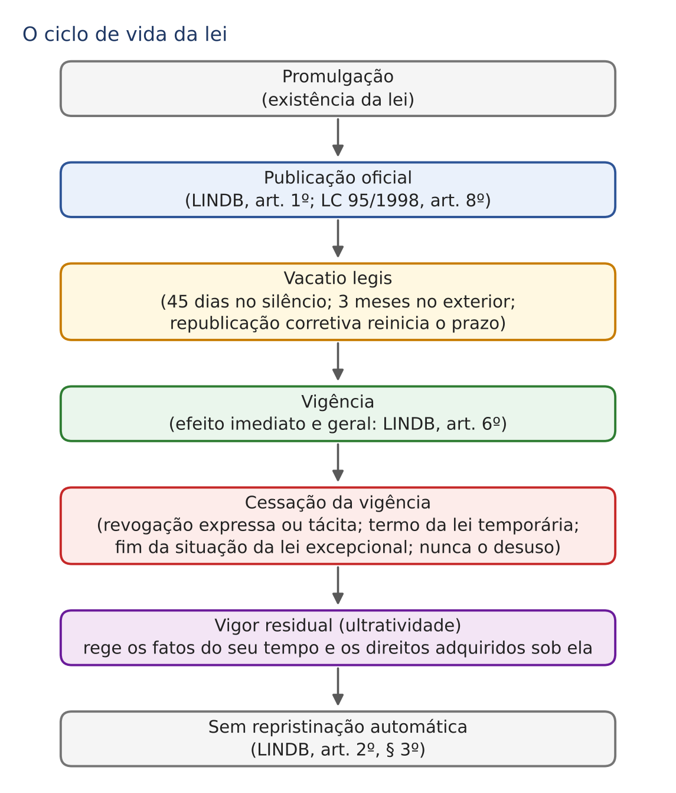
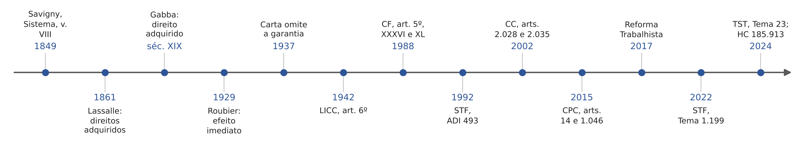
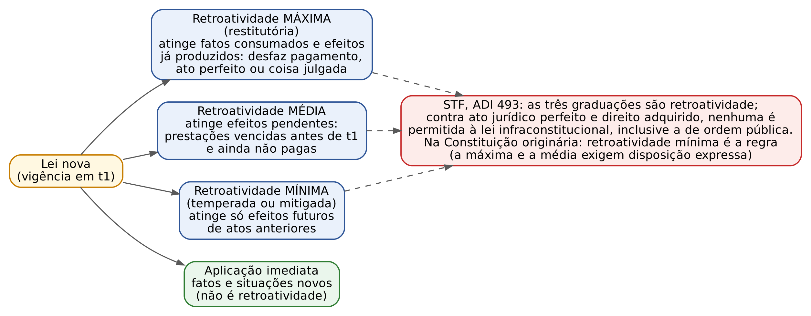
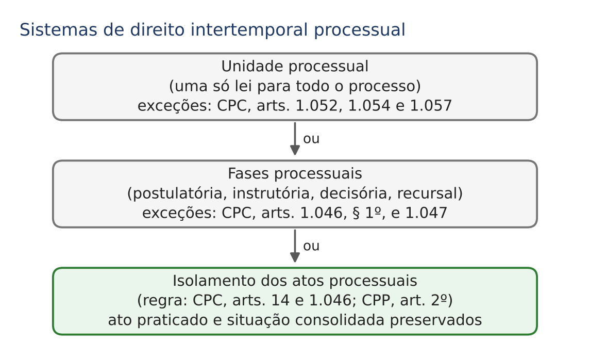
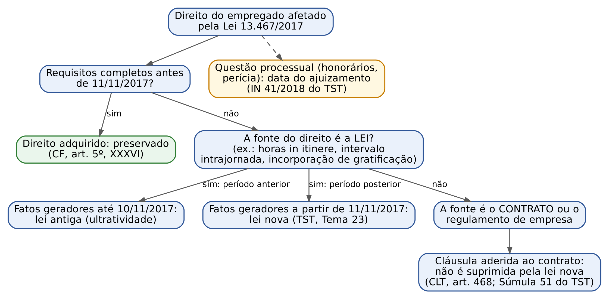
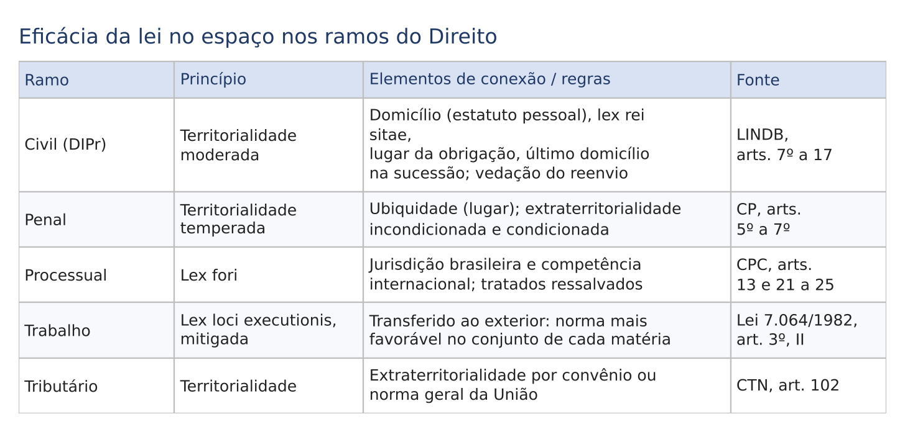
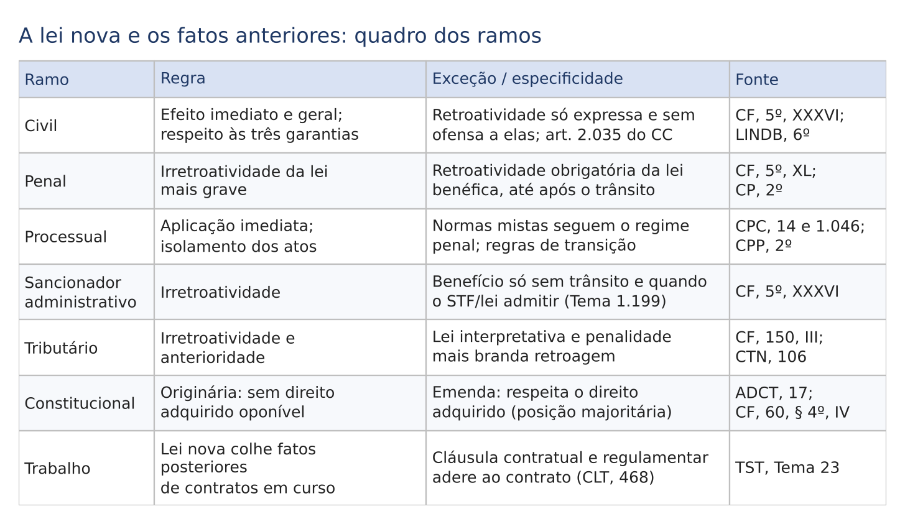
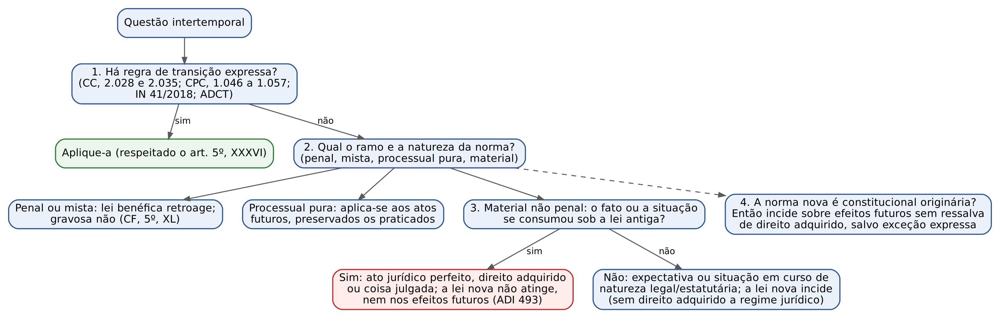

# CAPÍTULO 23 — EFICÁCIA DA LEI NO TEMPO E NO ESPAÇO E DIREITO INTERTEMPORAL NOS RAMOS DO DIREITO

:::INCIDENCIA
Pontos: TRF5 p. E.3; TJRS p. E.3; TJSC p. F.3. Nível A+. Lote: 8 questões (FGV 8, FCC 0), com correlatas de outros capítulos.
O que mais cai: regra geral de irretroatividade e seus temperamentos (ENAM 2025), direito adquirido diante de lei nova (TJ-PA 2026), lei processual nova e isolamento dos atos (TRF2 2026), elementos de conexão da LINDB (TJ-SC 2025), obrigatoriedade da lei (art. 3º).
:::

#### Mapa de cobrança

| Subtema | FGV | FCC | Padrão |
|---|---|---|---|
| Teoria geral do direito intertemporal (irretroatividade, revogação, repristinação, desuso, caducidade) | 1 | 0 | Assertiva conceitual com texto doutrinário de abertura (Gilmar Mendes); a correta é a que admite retroatividade excepcional |
| Direito adquirido e lei nova (civil e trabalhista) | 2 | 0 | Caso: requisitos completos sob a lei antiga; distratores transplantam a retroatividade penal benéfica ou invocam "ordem pública" |
| Lei processual no tempo | 2 | 0 | Caso de transição (CPC/1973 para CPC/2015; regime de intimações): isolamento dos atos |
| Obrigatoriedade da lei (art. 3º da LINDB) | 1 | 0 | Alegação de boa-fé e desconhecimento: não exime |
| Eficácia no espaço (sucessão, regime de bens) | 2 | 0 | Caso com elemento estrangeiro: lei aplicável x jurisdição; primeiro domicílio conjugal |

O lote confirma que a FGV não cobra direito intertemporal como teoria abstrata, mas como caso concreto que exige identificar (1) o ramo e a natureza da norma, (2) o momento em que a situação se consumou e (3) a existência de regra de transição. Este capítulo organiza exatamente esse raciocínio comparativo; a dogmática de cada ramo está nas apostilas próprias, com remissão em cada seção.

## 23.1 O tempo como problema jurídico

### 23.1.1 Segurança e mudança: a tensão de fundo

Todo ordenamento precisa mudar e precisa, ao mesmo tempo, permitir que as pessoas planejem a vida com base nas regras vigentes. O direito intertemporal (ou direito transitório, na expressão de Paul Roubier) é o conjunto de normas e critérios que decide, quando uma lei sucede outra, qual delas rege um fato ou uma situação jurídica. É, por isso, sobredireito: não regula condutas, regula a aplicação de outras normas.

A tensão foi formulada com precisão pelo texto que abriu a questão do ENAM 2025.1 (Gilmar Mendes e Paulo Gonet Branco, Curso de Direito Constitucional): de um lado, a segurança jurídica como "expressão máxima do Estado de Direito"; de outro, a "possibilidade e a necessidade de mudança". Três valores estão em jogo e explicam todas as soluções positivas que se verão adiante:

- segurança jurídica em sentido objetivo (estabilidade das relações e previsibilidade das regras);
- proteção da confiança legítima, a face subjetiva da segurança (quem agiu de boa-fé conforme a ordem vigente não deve ser surpreendido); o tema dogmático da proteção da confiança e os arts. 23 e 24 da LINDB ficam com o Cap. 24;
- igualdade e eficácia da reforma: se a lei nova é melhor, há interesse em aplicá-la logo e a todos, evitando a convivência prolongada de regimes distintos para pessoas em situação igual.

O direito intertemporal brasileiro equilibra esses vetores com uma regra (efeito imediato e geral da lei nova) e um limite (respeito ao ato jurídico perfeito, ao direito adquirido e à coisa julgada), ao qual se somam regras próprias de alguns ramos: a retroatividade obrigatória da lei penal benéfica, a anterioridade tributária, o isolamento dos atos processuais.

:::QUESTAO FGV 2025 — ENAM 2025.1 (Q3362333)
Após trecho de Gilmar Mendes e Paulo Gonet sobre segurança e mudança, pediu-se a afirmativa correta sobre o direito intertemporal brasileiro. Gabarito: B — a irretroatividade é a regra geral, fundada na segurança jurídica e no *tempus regit actum*, o que não impede que, havendo outros valores relevantes, a retroatividade seja excepcionalmente admitida.
Armadilhas, cada uma com o seu fundamento: A (preferência pela revogação tácita: é o contrário, a LC 95/1998, art. 9º, exige cláusula de revogação que enumere as leis revogadas; ver 23.2.3); C (repristinação tácita "excepcional": o art. 2º, § 3º, só admite a expressa; ver 23.2.4); D (desuso com "amplo respaldo": só lei revoga lei; ver 23.2.3); E (caducidade como perda gradual de efetividade e "costume negativo": caducidade é a cessação pelo implemento do termo ou da situação que a lei temporária ou excepcional regulava).
A alternativa correta é a síntese do capítulo: no Brasil a irretroatividade não é absoluta como dogma lógico; é uma garantia constitucional que protege posições determinadas (art. 5º, XXXVI) e, fora delas, admite retroatividade expressa e justificada.
:::

### 23.1.2 Os âmbitos de validade e os planos da norma

Kelsen (Teoria Pura do Direito) distingue quatro âmbitos de validade da norma: temporal, espacial, pessoal e material. Os dois primeiros são o objeto deste capítulo. A norma vale para certo tempo e certo espaço, e a sucessão de leis no tempo e a coexistência de ordenamentos no espaço são dois aspectos do mesmo problema: delimitar o âmbito de incidência. Savigny, no volume VIII do Sistema do Direito Romano Atual (1849), já tratava conjuntamente dos "limites locais" e dos "limites temporais" das regras de direito, origem da aproximação, ainda hoje didática, entre direito intertemporal e direito internacional privado (ambos são direito de conflitos: um no tempo, outro no espaço).

A distinção entre validade, vigência, eficácia e vigor está desenvolvida no Cap. 18 (18.7). Para este capítulo, basta fixar a contribuição de Tercio Sampaio Ferraz Jr. que resolve o aparente paradoxo da ultratividade: vigência é qualidade temporal da norma, o período em que ela pode ser invocada como obrigatória (entre a vacatio e a revogação); vigor é a força vinculante, a imperatividade, que pode sobreviver à vigência. A lei revogada não está mais vigente, mas mantém vigor para os fatos ocorridos sob ela. Ultratividade é, assim, vigor sem vigência; a lei na vacatio, ao contrário, já existe e é válida, mas ainda não tem vigência nem vigor.

:::ESQUEMA Extra-atividade da lei
- Extra-atividade é o gênero: a lei produz efeitos fora do seu período de vigência.
- Retroatividade: a lei nova alcança fatos ou efeitos anteriores à sua vigência (para trás).
- Ultratividade (ou pós-atividade): a lei revogada continua a reger fatos do seu tempo depois de revogada (para frente).
- Aplicação imediata: a lei nova rege fatos novos e os efeitos futuros de situações em curso, quando não houver posição protegida. NÃO é retroatividade (Roubier); a distinção entre aplicação imediata e retroatividade mínima é o ponto mais disputado da matéria (23.4.4).
:::

### 23.1.3 Obrigatoriedade da lei e o "conhecimento" do direito

A eficácia da lei no tempo começa com a vigência, e não com a ciência individual. O art. 3º da LINDB ("Ninguém se escusa de cumprir a lei, alegando que não a conhece") é tradicionalmente justificado por três teorias: a da presunção (todos conhecem a lei, presunção absoluta e, por isso, uma ficção), a da ficção propriamente dita e a da necessidade social (sem a regra, a eficácia do ordenamento dependeria da prova do conhecimento de cada um). A terceira prevalece na doutrina brasileira (Maria Helena Diniz, Tartuce) e é a que melhor se harmoniza com o Estado Democrático: o fundamento não é uma crença empiricamente falsa (ninguém conhece todas as leis), mas a impossibilidade funcional de condicionar a obrigatoriedade ao conhecimento.

A regra não é absoluta no plano dos efeitos: o erro de direito pode anular o negócio jurídico quando, sem implicar recusa à aplicação da lei, for o motivo único ou principal (art. 139, III, do CC); no direito penal, o desconhecimento da lei é inescusável, mas o erro sobre a ilicitude do fato, se inevitável, isenta de pena (art. 21 do CP). Uma coisa é invocar a ignorância para descumprir a lei; outra, o vício de vontade ou a falta de consciência potencial da ilicitude. O regime detalhado está na Apostila de Direito Civil, Cap. 1 (01.5), e na de Direito Penal.

:::QUESTAO FGV 2025 — MPE-ES — Promotor de Justiça Substituto (Q3752731)
Empresário autuado pela vigilância sanitária por descumprir norma vigente havia dois anos alegou boa-fé e desconhecimento, por nunca ter sido notificado. Gabarito: C — a ausência de conhecimento direto da norma não exime ninguém de cumpri-la; a obrigatoriedade decorre da publicação oficial e da vigência.
Armadilhas: exigência de prova de ciência efetiva (A); escusa "apenas" fora do direito penal (B, que inverte até a lógica penal, em que a ignorância da lei também é inescusável); dever estatal de provar ampla divulgação (D); obrigatoriedade restrita a pessoas jurídicas (E).
No mesmo sentido, combinando os arts. 3º, 4º e 6º da LINDB: Q3880795 (FGV 2026, ALERJ, Procurador Legislativo, Cap. 22), gabarito A — o desconhecimento não afasta a obrigatoriedade, a lacuna não autoriza o *non liquet* e a lei nova tem efeito imediato e geral, respeitadas as três garantias; erradas a retroatividade guiada pelos "fins sociais" do art. 5º e a "revisão automática" de decisões definitivas.
:::

## 23.2 O ciclo de vida da lei: vigência, revogação, repristinação e ultratividade

O regime legal desta seção (LINDB, arts. 1º e 2º; LC 95/1998, arts. 8º e 9º) está desenvolvido, com as questões de literalidade, na Apostila de Direito Civil, Cap. 1 (01.2 e 01.3). Aqui se fixa a estrutura e o que nela interessa à teoria do direito intertemporal.

### 23.2.1 Vigência e vacatio legis

A vigência depende de publicação oficial e do decurso da vacatio legis, que tem três funções: dar conhecimento da lei, permitir a adaptação dos destinatários e das instituições e, nas grandes codificações, permitir o estudo do novo diploma. A LINDB fixa prazo supletivo de 45 dias no país e de três meses no exterior, quando lá admitida a lei brasileira (art. 1º, caput e § 1º); a LC 95/1998 (art. 8º) manda que a lei indique expressamente a vigência, reservando a cláusula "entra em vigor na data de sua publicação" às leis de pequena repercussão, e manda contar o prazo incluindo a data da publicação e o último dia, entrando a lei em vigor no dia subsequente à consumação integral (§ 1º).

Dois exemplos de grandes leis mostram a técnica e são dados recorrentes em questões de transição: o CC/2002 (vigência um ano após a publicação, em 11/1/2003, conforme a orientação majoritária) e o CPC/2015 (vigência fixada pelo Plenário do STJ, em sessão administrativa, em 18/3/2016, Enunciado administrativo 1). A Lei 13.467/2017 (Reforma Trabalhista) teve vacatio de 120 dias e passou a vigorar em 11/11/2017 (ver 23.9).

Três pontos de teoria que a banca transforma em pegadinha:

- vigência sincrônica: o prazo é único para todo o território (a vigência progressiva, por Estados, existiu na antiga Introdução ao CC/1916 e não vigora mais);
- correção da lei: antes da vigência, nova publicação reinicia o prazo (art. 1º, § 3º); depois da vigência, a correção é lei nova (§ 4º), sujeita ao art. 6º;
- lei benéfica na vacatio: no direito penal prevalece que não pode ser aplicada antes de vigorar, porque ainda não tem eficácia (há posição minoritária em sentido contrário; ver Apostila de Direito Penal, Cap. 3, 03.4.5).

### 23.2.2 Princípio da continuidade e cessação da vigência

Não se destinando à vigência temporária, a lei terá vigor até que outra a modifique ou revogue (art. 2º, caput). É o princípio da continuidade (ou da permanência) das leis: a lei de vigência indeterminada só perde a vigência por ato normativo de igual ou superior hierarquia. Há, porém, outras formas de cessação, cuja distinção é cobrada:

| Forma | Conceito | Observação |
|---|---|---|
| Revogação | Supressão da vigência por lei posterior (ab-rogação total; derrogação parcial; expressa ou tácita) | Só lei revoga lei; ver 23.2.3 |
| Caducidade (autorrevogação) | Cessação pelo implemento do termo (lei temporária) ou pelo fim da situação anormal que a lei regulava (lei excepcional) | Dispensa lei revogadora; a lei continua a reger os fatos do seu tempo (ultratividade; no penal, art. 3º do CP) |
| Declaração de inconstitucionalidade | Reconhecimento da invalidade, com eficácia em regra retroativa (nulidade), salvo modulação | Não é revogação: atua no plano da validade, não da vigência; produz efeito repristinatório (23.2.4) |
| Não recepção | Incompatibilidade material de norma pré-constitucional com a Constituição nova | O STF a trata como revogação, e não como inconstitucionalidade superveniente (ver 23.8.2) |
| Suspensão pelo Senado (CF, art. 52, X) | Suspensão da execução de lei declarada inconstitucional em controle difuso | Tema do controle de constitucionalidade (Apostila de Direito Constitucional) |
| Desuso (*desuetudo*) | Perda da eficácia social pela não aplicação reiterada | NÃO revoga a lei no direito brasileiro |

:::PEGADINHA Desuso, caducidade e "costume negativo"
O costume *contra legem* não tem força ab-rogatória no Brasil: a regra do art. 2º é que só outra lei modifica ou revoga a lei. A perda de efetividade social (lacuna ontológica, na classificação de Maria Helena Diniz; ver Cap. 22) pode orientar a interpretação e a política legislativa, mas não retira a vigência. A ENAM 2025.1 (Q3362333) usou duas formulações erradas na mesma questão: desuso com "amplo respaldo" na matriz romano-germânica (D) e caducidade definida como perda gradual de efetividade, o "costume negativo" (E). Caducidade é fenômeno de vigência programada (termo ou situação), e não de eficácia social.
:::

### 23.2.3 Revogação expressa e tácita

O art. 2º, § 1º, prevê três hipóteses de revogação: quando a lei posterior expressamente o declare, quando seja com ela incompatível e quando regule inteiramente a matéria de que tratava a lei anterior. As duas últimas são tácitas (indiretas), e a terceira é chamada revogação global ou por normação integral. O § 2º afasta a revogação quando a lei nova apenas estabelece disposições gerais ou especiais "a par das já existentes", o que impede a leitura automática do critério da especialidade e abre espaço para o diálogo das fontes (Cap. 22).

O ordenamento prefere a revogação EXPRESSA, e não a tácita: a LC 95/1998 (art. 9º) determina que a cláusula de revogação enumere expressamente as leis ou disposições legais revogadas. A cláusula genérica "revogam-se as disposições em contrário" é vedada pela técnica legislativa, embora sua presença ou ausência não impeça a revogação tácita, que decorre da incompatibilidade e não de declaração. Por isso a alternativa da ENAM 2025.1 que falava em "nítida preferência pela revogação tácita" estava errada.

O critério cronológico do § 1º é a face temporal da teoria das antinomias (Bobbio: hierárquico, cronológico e da especialidade; antinomias de segundo grau). O desenvolvimento está no Cap. 22, ao qual se remete. Para o direito intertemporal, importa notar que a revogação NÃO resolve, sozinha, qual lei se aplica a fatos passados: ela apenas define o termo final da vigência; quem decide sobre os fatos pendentes são o art. 6º da LINDB e as regras próprias de cada ramo.

### 23.2.4 Repristinação e efeito repristinatório

Repristinação é a restauração da vigência da lei revogada pela perda de vigência da lei revogadora. O art. 2º, § 3º, da LINDB a admite somente se EXPRESSA ("Salvo disposição em contrário, a lei revogada não se restaura por ter a lei revogadora perdido a vigência"). Não existe repristinação tácita ou automática no direito brasileiro, nem excepcionalmente (ENAM 2025.1, alternativa C).

A razão teórica é a mesma do princípio da continuidade: a revogação é um ato normativo que se esgota ao produzir efeito; quando a lei revogadora deixa de viger, ela não "devolve" à lei anterior a vigência que lhe retirou, salvo se o legislador assim decidir, editando, em substância, lei nova com o conteúdo da antiga.

Coisa diversa é o efeito repristinatório da declaração de inconstitucionalidade. Como a lei inconstitucional é nula, a norma que ela pretendeu revogar nunca deixou validamente de viger; a declaração, por isso, "restaura" a lei anterior (art. 11, § 2º, da Lei 9.868/1999, quanto à cautelar em ADI, que torna aplicável a legislação anterior, salvo expressa manifestação em contrário). O STF nega esse efeito quando a norma anterior padece do mesmo vício, cabendo ao autor impugnar todo o complexo normativo (o regime e os julgados estão na Apostila de Direito Civil, 01.3.3, e na de Direito Constitucional, Cap. 18).

:::ESQUEMA Repristinação x efeito repristinatório
| | Repristinação (LINDB, art. 2º, § 3º) | Efeito repristinatório |
|---|---|---|
| Plano | Vigência | Validade |
| Causa | Revogação da lei revogadora | Declaração de inconstitucionalidade (ou cautelar em ADI) da lei revogadora |
| Regra | Não ocorre, salvo disposição expressa | Ocorre, salvo modulação ou manifestação em contrário; afastado se a norma restaurada tiver o mesmo vício |
| Fundamento | A revogação se esgota no tempo | A lei nula não revogou validamente nada |
:::

### 23.2.5 Ultratividade: lei antiga regendo fatos do seu tempo

A ultratividade não é exceção, mas consequência necessária do princípio *tempus regit actum*: se o fato se rege pela lei do seu tempo, a lei revogada continua a regê-lo depois de revogada. A doutrina identifica três grandes casos:

- ultratividade ordinária: a lei revogada rege a validade dos atos e os direitos adquiridos sob ela (sucessão aberta antes do CC/2002 rege-se pelo CC/1916: arts. 1.787 e 2.041 do CC; ato jurídico perfeito quanto à forma e à validade: art. 2.035, caput, primeira parte);
- ultratividade das leis temporárias e excepcionais: continuam a reger os fatos do seu período, mesmo no direito penal (art. 3º do CP), porque, do contrário, perderiam a força justamente quando necessárias;
- ultratividade da lei penal mais benéfica revogada por lei mais grave, que é a outra face da irretroatividade da *lex gravior* (23.5).

Essa visão integrada é útil na prova oral: ultratividade e retroatividade não são mecanismos opostos, mas duas manifestações do mesmo critério de escolha entre leis sucessivas (extra-atividade), que cada ramo calibra conforme o valor preponderante (segurança no civil; liberdade no penal; efetividade no processo).

## 23.3 As teorias do direito intertemporal

### 23.3.1 O problema teórico

A pergunta "a lei nova pode alcançar o passado?" desdobra-se em duas: o que conta como "passado" (o fato, seus efeitos já produzidos, seus efeitos futuros?) e que posições jurídicas merecem proteção. As respostas históricas se agrupam em duas famílias, que a banca e a prova oral pedem para distinguir.

### 23.3.2 Teorias subjetivas: o direito adquirido

As teorias subjetivas tomam como critério o patrimônio jurídico do titular: a lei nova é retroativa (e, por isso, vedada) quando suprime ou modifica direito já adquirido; é aplicável quando atinge meras expectativas ou faculdades. Ferdinand Lassalle (Sistema dos Direitos Adquiridos, 1861) e, sobretudo, Carlo Francesco Gabba (Teoria da Retroatividade das Leis) são os nomes centrais.

Gabba formulou o conceito clássico: é adquirido o direito que é consequência de um fato idôneo a produzi-lo, segundo a lei do tempo em que o fato se realizou, ainda que a ocasião de fazê-lo valer não se tenha apresentado antes da lei nova, e que, segundo a lei sob a qual o fato ocorreu, entrou imediatamente a fazer parte do patrimônio de quem o adquiriu. Os elementos são, portanto: (1) fato aquisitivo idôneo; (2) segundo a lei do tempo do fato; (3) incorporação ao patrimônio; (4) irrelevância do exercício. O § 2º do art. 6º da LINDB ("Consideram-se adquiridos assim os direitos que o seu titular, ou alguém por ele, possa exercer...") é tributário dessa construção.

A crítica clássica: o conceito de direito adquirido é circular (adquirido é o que a lei antiga atribuiu e a lei nova não pode tirar) e não resolve as situações continuadas (contratos de trato sucessivo, estatutos legais), em que a pergunta não é se o direito existe, mas qual lei rege os seus efeitos futuros.

### 23.3.3 Teorias objetivas: Roubier e o efeito imediato

Paul Roubier (Les conflits de lois dans le temps, 1929; depois Le droit transitoire) desloca o foco do direito subjetivo para a situação jurídica, examinada em suas fases de constituição, efeitos e extinção. Sua distinção fundamental:

- *facta praeterita* (fatos passados, inteiramente consumados): regidos pela lei antiga; a lei nova que os alcançasse seria retroativa;
- *facta pendentia* (situações em curso): a lei nova rege, desde a sua vigência, os efeitos que se produzirem a partir dela, o que Roubier chama de efeito imediato, e NÃO de retroatividade;
- *facta futura*: regidos, evidentemente, pela lei nova.

A grande exceção de Roubier são os contratos: em respeito à autonomia da vontade e à previsibilidade econômica, a lei antiga sobrevive (ultratividade) para reger os efeitos futuros dos contratos celebrados sob ela, salvo leis de ordem pública que imponham aplicação imediata. Situações legais ou estatutárias (estado civil, regime de propriedade, estatuto do servidor) submetem-se de imediato à lei nova.

### 23.3.4 A síntese brasileira

A primeira Introdução ao CC/1916 adotava formulação inspirada no direito adquirido. A Carta de 1937 não reproduziu a garantia constitucional de irretroatividade, e a LICC de 1942 (Decreto-Lei 4.657, hoje LINDB) adotou, no art. 6º, a fórmula do "efeito imediato e geral", de matriz roubieriana. A Lei 3.238/1957 deu ao art. 6º a redação atual, acrescentando a ressalva expressa do ato jurídico perfeito, do direito adquirido e da coisa julgada e as definições dos §§ 1º a 3º, de matriz gabbiana. Com a volta da garantia ao texto constitucional (1946 e, hoje, art. 5º, XXXVI, da CF/1988), o sistema brasileiro tornou-se misto:

- a REGRA é objetiva (efeito imediato e geral: Roubier);
- o LIMITE é subjetivo e constitucional (as três garantias, com definições inspiradas em Gabba);
- e o STF, na ADI 493 (Relator Ministro Moreira Alves, Tribunal Pleno, j. 25/6/1992), interpretou o limite de modo amplo, vedando à lei infraconstitucional até a retroatividade mínima sobre contratos, o que afasta a exceção roubieriana das leis de ordem pública (23.4.4).

Rubens Limongi França (A Irretroatividade das Leis e o Direito Adquirido) é a referência nacional na sistematização da teoria subjetiva; José Carlos de Matos Peixoto (Limite Temporal da Lei) é o autor a quem a tradição atribui a classificação dos graus de retroatividade (23.4.4), acolhida pelo STF na ADI 493.

:::ESQUEMA Teorias subjetivas x objetivas
| | Subjetivas (Lassalle, Gabba) | Objetivas (Roubier; antes, Savigny com a distinção entre aquisição e existência de direitos) |
|---|---|---|
| Critério | Direito subjetivo já incorporado ao patrimônio | Situação jurídica e o momento de seus efeitos |
| Vedado | Atingir direito adquirido | Atingir fatos passados e efeitos já produzidos |
| Efeitos futuros de situação anterior | Protegidos se compõem o direito adquirido | Regidos pela lei nova (efeito imediato), salvo contratos |
| Fraqueza | Circularidade do conceito; dificuldade com situações continuadas | Pode sacrificar a confiança nos contratos e nas posições estáveis |
| No Brasil | Definições do art. 6º, §§ 1º a 3º, e CF, art. 5º, XXXVI | Caput do art. 6º ("efeito imediato e geral"); CPC, art. 14 |
:::

:::DICA Para a prova oral
Pergunta clássica: "O Brasil adota a teoria de Gabba ou a de Roubier?" Resposta precisa: o caput do art. 6º da LINDB consagra o efeito imediato (Roubier), mas o limite constitucional e as definições legais são de matriz subjetiva (Gabba); a ADI 493 deu a esse limite alcance amplo, abrangendo os efeitos futuros dos contratos (retroatividade mínima vedada), com o que o modelo brasileiro protege mais a estabilidade contratual do que o francês, em que a irretroatividade é regra apenas legal (art. 2º do Código Civil francês) e cede ao legislador.
:::

## 23.4 Irretroatividade e as três garantias

### 23.4.1 A sede constitucional da garantia

:::LEI CF, art. 5º, XXXVI e XL; LINDB, art. 6º
CF, art. 5º, XXXVI - a lei não prejudicará o direito adquirido, o ato jurídico perfeito e a coisa julgada;
CF, art. 5º, XL - a lei penal não retroagirá, salvo para beneficiar o réu;
LINDB, art. 6º A Lei em vigor terá efeito imediato e geral, respeitados o ato jurídico perfeito, o direito adquirido e a coisa julgada.
:::

A Constituição não proíbe a retroatividade em si; proíbe que a lei PREJUDIQUE as três posições. Disso resultam quatro consequências estruturais:

- a irretroatividade fora do direito penal (e da tributação, CF, art. 150, III, "a") é relativa: a lei pode dispor expressamente sobre o passado, desde que não atinja as três garantias (retroatividade "justa" ou benéfica para todos), como nas leis de anistia, de remissão ou de reconhecimento de direitos com efeitos pretéritos;
- a garantia é dirigida ao legislador infraconstitucional em sentido amplo (lei complementar, ordinária, medida provisória, decreto, resolução), mas não ao constituinte originário (23.8);
- a garantia é individual, oponível ao Estado. Por isso, a Súmula 654 do STF: "A garantia da irretroatividade da lei, prevista no art. 5º, XXXVI, da Constituição da República, não é invocável pela entidade estatal que a tenha editado." O ente que edita lei retroativa benéfica aos particulares não pode depois impugná-la sob esse fundamento;
- a definição dos três institutos é legal (LINDB, art. 6º, §§ 1º a 3º), de modo que a matéria tem dupla face: o conteúdo é infraconstitucional, mas a violação é constitucional. Daí o STJ não conhecer de recurso especial fundado só no art. 6º da LINDB, por ser matéria constitucional (Apostila de Direito Civil, 01.8.1).

### 23.4.2 Os três institutos e as figuras vizinhas

:::LEI LINDB, art. 6º, §§ 1º a 3º
§ 1º Reputa-se ato jurídico perfeito o já consumado segundo a lei vigente ao tempo em que se efetuou.
§ 2º Consideram-se adquiridos assim os direitos que o seu titular, ou alguém por ele, possa exercer, como aqueles cujo começo do exercício tenha termo pré-fixo, ou condição pré-estabelecida inalterável, a arbítrio de outrem.
§ 3º Chama-se coisa julgada ou caso julgado a decisão judicial de que já não caiba recurso.
:::

| Figura | Núcleo | Proteção diante da lei nova | Ponto fino |
|---|---|---|---|
| Ato jurídico perfeito | Ato cujo ciclo de formação se completou sob a lei antiga | Validade e forma regidas pela lei do tempo (*tempus regit actum*); segundo a ADI 493, também os efeitos futuros do contrato | É proteção contra a LEI, não imutabilidade: não impede revisão por onerosidade excessiva nem alteração consensual |
| Direito adquirido | Direito cujos requisitos aquisitivos se completaram, exercido ou não | Não pode ser suprimido pela lei nova | Direito a termo inicial é adquirido; sob condição suspensiva, é adquirido para o direito intertemporal (art. 6º, § 2º), não para a eficácia (art. 125 do CC) |
| Coisa julgada | Decisão judicial de que já não caiba recurso | Lei nova não a desconstitui | A LINDB define a formal; o CPC define a material (art. 502); a rescisória não ofende o art. 5º, XXXVI, porque o que se veda é a LEI prejudicá-la |
| Expectativa de direito | Aquisição em curso, requisitos incompletos | Não protegida contra a lei nova | Não é juridicamente irrelevante: admite atos conservatórios (art. 130 do CC) e é objeto de regras de transição |
| Faculdade jurídica | Possibilidade genérica de agir conforme o ordenamento (ex.: faculdade de testar segundo a lei vigente) | Sem proteção; regida pela lei do momento do exercício | Não se confunde com direito adquirido não exercido |
| Regime jurídico | Estatuto legal de uma situação (servidor, previdência, moeda, instituto) | Não há direito adquirido a regime jurídico (STF, Tema 41 da repercussão geral, RE 563.965, j. 11/2/2009, ressalvada a irredutibilidade) | É o critério que explica a aplicação imediata das leis estatutárias e da Reforma Trabalhista aos efeitos futuros (23.9) |

A distinção entre direito adquirido e expectativa é a chave de quase todas as questões. O teste é simples e deve ser verbalizado no raciocínio: no dia anterior à vigência da lei nova, o titular já podia exigir o direito (ainda que não o tivesse exercido)? Se sim, é adquirido; se faltava qualquer requisito, é expectativa.

:::QUESTAO FGV 2026 — TJ-PA — Juiz Substituto (Q3951813)
Lei nova tornou mais rigorosos os requisitos de benefício trabalhista; empregados que já cumpriam integralmente os requisitos da lei antiga questionam o direito à concessão. Gabarito: A — têm direito subjetivo à concessão, pois a lei nova não pode retroagir para prejudicar direito adquirido.
Passos: (1) a questão relaciona direito objetivo e subjetivo: a lei antiga (direito objetivo) incidiu sobre os fatos e gerou o direito subjetivo; (2) completos os requisitos antes da lei nova, o direito incorporou-se ao patrimônio (art. 6º, § 2º), e o requerimento é modo de exercício, não requisito; (3) a lei nova incide sobre quem ainda não completara os requisitos.
Armadilhas: B transplanta para o direito do trabalho a retroatividade penal benéfica, que é regra exclusiva do art. 5º, XL; C afirma "retroatividade plena" da lei trabalhista; D inverte a regra (toda norma retroativa salvo previsão em contrário); E admite supressão de direitos patrimoniais "sem repercussão constitucional relevante", como se o art. 5º, XXXVI, comportasse graduação pelo valor.
No mesmo sentido, quanto à irrelevância do requerimento: Q4153603 (FGV 2026, TJ-SC, Oficial de Justiça) e Q2486029 (FGV 2024, AL-SC), ambas comentadas na Apostila de Direito Civil (01.8.3 e 01.3.3).
:::

:::QUESTAO FGV 2025 — TCE-RR — Auditor de Controle Externo (Q3186473)
Lei de 2024 teria reduzido de 10 para 5 anos o prazo "prescricional" da reivindicatória; o réu pediu a aplicação retroativa da redução a ação proposta em 2024 por proprietário de 2016. Gabarito: D — a lei nova não pode violar o direito adquirido, a coisa julgada ou o ato jurídico perfeito.
Armadilhas: A ("por ser mais benéfica" a lei pode atingir direito adquirido: de novo, a lógica penal transplantada, e benéfica para quem?); E (prescrição como matéria de ordem pública autorizaria violar direito adquirido: contraria a ADI 493).
Observação técnica: o enunciado é impreciso, porque a pretensão reivindicatória não prescreve (a perda da propriedade decorre da usucapião). A banca premiou a regra geral. Para prazo prescricional efetivamente reduzido por lei nova sem regra de transição, a solução correta é contar o prazo novo a partir da vigência da lei nova, salvo se o antigo terminar antes; nunca aplicar o prazo novo retroativamente desde o termo inicial original (ver o PASSO da Apostila de Direito Civil, 01.8.4, e o art. 2.028 do CC em 23.6).
:::

Correlata (FCC 2026, PGM-Manaus, Procurador, Q4338800, Cap. 24): a alternativa que equipara a proteção da expectativa de direito à do direito adquirido é falsa; a mudança de orientação administrativa sobre norma de conteúdo indeterminado exige regime de transição (art. 23 da LINDB), tema do Cap. 24.

### 23.4.3 Ordem pública não autoriza retroatividade

Durante décadas, sustentou-se que as leis de ordem pública teriam aplicação retroativa, ou ao menos imediata sobre contratos em curso. O STF rejeitou a tese na ADI 493 (Relator Ministro Moreira Alves, Tribunal Pleno, j. 25/6/1992), que julgou inconstitucional a aplicação de índice de correção instituído por lei nova a contratos anteriores do Sistema Financeiro da Habitação: o art. 5º, XXXVI, aplica-se a toda e qualquer lei infraconstitucional, sem distinção entre lei de direito público e de direito privado, ou entre lei de ordem pública e lei dispositiva.

A conclusão é cobrada de dois modos: (1) como afirmação direta ("a norma de ordem pública não retroage para atingir ato jurídico perfeito"); (2) como armadilha em alternativa que ressalva a "norma de ordem pública" (Q3186473, E). A tensão com o art. 2.035, parágrafo único, do CC, que manda aplicar os preceitos de ordem pública aos efeitos dos negócios anteriores, é examinada em 23.6.

### 23.4.4 Graus de retroatividade

A classificação, que a tradição atribui a Matos Peixoto e que o STF acolheu (ADI 493; RE 140.499), gradua a retroatividade pela intensidade com que a lei nova atinge o passado:

| Grau | O que a lei nova atinge | Exemplo em contrato de mútuo |
|---|---|---|
| Máxima (restitutória) | Fatos consumados e efeitos já produzidos, inclusive coisa julgada ou pagamentos feitos | Lei que manda devolver juros já pagos |
| Média | Efeitos pendentes, vencidos antes da lei mas ainda não realizados | Lei que reduz juros de prestações vencidas e não pagas |
| Mínima (temperada ou mitigada) | Apenas efeitos futuros de fatos anteriores | Lei que reduz juros das prestações que vencerem depois dela |

O ponto teórico decisivo está na terceira linha. Para Roubier, alcançar efeitos futuros de situação em curso é efeito imediato, não retroatividade. Para o STF (ADI 493), é retroatividade mínima e, quando atinge contrato (ato jurídico perfeito) ou direito adquirido, é vedada à lei infraconstitucional. O sistema brasileiro, porém, conhece retroatividade mínima LEGÍTIMA em três cenários, que explicam aparentes contradições entre gabaritos:

- normas constitucionais originárias, que têm, em regra, retroatividade mínima e podem ter máxima ou média se o disserem expressamente (23.8);
- situações estatutárias ou legais, em que não há ato jurídico perfeito nem direito adquirido a proteger (regime de servidor, regime monetário, regime de bens fixado por lei, relação de emprego quanto aos direitos de fonte legal, 23.9);
- fato passado tomado como pressuposto de efeito futuro, sem direito já incorporado (exemplo das inelegibilidades e de requisitos estatutários para cargos, como na Q3373878, FGV 2025, TRF5, comentada na Apostila de Direito Civil, 01.8.3).

:::EXEMPLO Mesma lei, dois resultados
Lei de 2026 reduz a multa moratória máxima em contratos de prestação continuada. (a) Contrato de financiamento celebrado em 2024, com cláusula de multa de 10%: para as parcelas que vencerem após a lei, a aplicação da multa reduzida seria retroatividade mínima sobre ato jurídico perfeito, vedada pela ADI 493; vale a cláusula, salvo se abusiva por outro fundamento (CDC, revisão judicial). (b) Multa fixada diretamente por lei para tributo ou tarifa pública regulada: não há contrato nem direito adquirido a regime legal; a lei nova incide sobre os fatos posteriores (no tributário, com retroatividade benigna da penalidade, art. 106, II, "c", do CTN, ver 23.5.4).
Moral: antes de perguntar "qual grau de retroatividade?", pergunte "qual a fonte da situação: a vontade (contrato) ou a lei (estatuto)?".
:::

### 23.4.5 Coisa julgada, mudança de lei e mudança de jurisprudência

A coisa julgada é a garantia mais forte das três, porque concretiza o próprio Estado de Direito na decisão individual. Três problemas de fronteira interessam à formação humanística do juiz:

- lei nova não desconstitui coisa julgada, mas a decisão de relação jurídica continuativa admite revisão por modificação superveniente do estado de fato ou de direito (art. 505, I, do CPC: alimentos, relações tributárias sucessivas), sem retroatividade: a sentença tem cláusula *rebus sic stantibus* implícita;
- a declaração de inconstitucionalidade posterior pelo STF não rescinde automaticamente a sentença transitada, que só pode ser atacada por impugnação ou rescisória nos termos do CPC (arts. 525, §§ 12 a 15, e 535, §§ 5º a 8º), cujo regime está na Apostila de Processo Civil;
- a mudança de jurisprudência não é lei: em regra, não retroage nem para beneficiar nem para prejudicar e não autoriza, por si, rescisória ou revisão criminal. A dimensão temporal das decisões judiciais é controlada por outros instrumentos: modulação de efeitos (art. 27 da Lei 9.868/1999; art. 927, § 3º, do CPC) e regime de transição para nova interpretação de norma de conteúdo indeterminado (art. 23 da LINDB, Cap. 24). No direito penal, a retroatividade da jurisprudência benéfica é objeto do Tema 1.331 do STJ, afetado e pendente na data de fechamento da Apostila de Direito Penal (03.4.10), a cuja atualização se remete.

:::ATENCAO Prospective overruling e confiança
A técnica da superação prospectiva (*prospective overruling*), desenvolvida no *common law*, permite que a corte altere o precedente com efeitos apenas para o futuro, protegendo quem confiou na orientação anterior. No Brasil, ela se positivou na modulação do art. 927, § 3º, do CPC e no art. 23 da LINDB. Para o juiz, a lição humanística é que a segurança jurídica não depende só da irretroatividade da lei: a mudança brusca de jurisprudência produz o mesmo efeito surpresa que a lei retroativa. Teoria dos precedentes: Cap. 20.
:::

## 23.5 Direito Penal e direito sancionador: a assimetria a favor da liberdade

A lei penal no tempo (tempo do crime, sucessão de leis, *abolitio criminis*, *lex mitior*, lei intermediária, combinação de leis, crimes permanentes e continuados, leis temporárias, norma penal em branco, normas mistas) está desenvolvida na Apostila de Direito Penal, Cap. 3 (03.4), com as questões do lote penal. Aqui interessa o enfoque comparativo: por que o direito penal tem regra própria e como ela se projeta (ou não) sobre os demais ramos sancionadores.

### 23.5.1 Fundamento da regra penal

No direito civil, a retroatividade é vedada para proteger posições; no penal, a irretroatividade da lei gravosa e a retroatividade da benéfica protegem a LIBERDADE e decorrem da legalidade (CF, art. 5º, XXXIX e XL; CP, arts. 1º e 2º). As justificativas teóricas se somam:

- garantista e liberal (Beccaria, Feuerbach): a lei prévia é condição da função de motivação da norma penal; ninguém pode orientar a conduta por proibição que ainda não existia;
- igualdade e proporcionalidade: se o legislador passou a considerar excessiva ou desnecessária a punição, mantê-la para fatos anteriores seria punir mais do que o próprio Estado reputa justo;
- assimetria deliberada: a lei benéfica retroage ATÉ depois do trânsito em julgado (CP, art. 2º, parágrafo único), o que significa que, no penal, a coisa julgada cede à liberdade, ao passo que no civil prevalece sobre a lei nova.

:::ESQUEMA Penal x civil no tempo
| | Direito Civil | Direito Penal |
|---|---|---|
| Regra | Efeito imediato e geral (LINDB, art. 6º) | Lei do tempo da conduta (CP, art. 4º: teoria da atividade) |
| Lei nova mais gravosa | Aplica-se a fatos futuros; não atinge as três garantias | Nunca retroage (CF, art. 5º, XL) |
| Lei nova mais benéfica | Não retroage por ser benéfica; só se o legislador disser e sem prejudicar terceiros | Retroage obrigatoriamente, de qualquer modo que favoreça, mesmo após o trânsito |
| Coisa julgada | Barreira absoluta à lei nova | Cede à lei benéfica (competência do juízo da execução após o trânsito: Súmula 611 do STF) |
| Leis temporárias e excepcionais | Ultrativas | Ultrativas (CP, art. 3º), sem ofensa ao art. 5º, XL, segundo a posição prevalente |
| Combinação de leis | Não se cogita | Vedada (Súmula 501 do STJ; STF, Tema 169) |
:::

### 23.5.2 Os temas que dialogam com a teoria geral

Quatro institutos penais testam conceitos da teoria geral e são os que a prova de formação humanística tende a cobrar:

- *Lex tertia*: a vedação de combinar leis é aplicação da separação de Poderes e da legalidade (o juiz não pode criar uma terceira lei); a comparação se faz em concreto e a lei escolhida se aplica por inteiro. "É cabível a aplicação retroativa da Lei n. 11.343/2006, desde que o resultado da incidência das suas disposições, na íntegra, seja mais favorável ao réu do que o advindo da aplicação da Lei n. 6.368/1976, sendo vedada a combinação de leis" (Súmula 501 do STJ). Há doutrina minoritária que admite a combinação (se o juiz pode aplicar cada lei, pode aplicar partes de ambas).
- Súmula 711 do STF ("A lei penal mais grave aplica-se ao crime continuado ou ao crime permanente, se a sua vigência é anterior à cessação da continuidade ou da permanência"): não é retroatividade da lei mais grave, mas aplicação da lei vigente ao tempo da conduta que se prolonga; a crítica doutrinária se concentra no crime continuado, ficção criada em favor do réu.
- Continuidade normativo-típica: revogação formal do tipo sem *abolitio criminis* quando a conduta migra para outro dispositivo (ex.: injúria racial para o art. 2º-A da Lei 7.716/1989, pela Lei 14.532/2023). Mostra que revogação (plano da vigência do dispositivo) não se confunde com descriminalização (plano da norma).
- Normas mistas ou híbridas: normas formalmente processuais com conteúdo material (ação penal, representação, causas extintivas da punibilidade) seguem o regime penal, retroagindo se benéficas. A lei processual penal pura tem aplicação imediata, preservados os atos já praticados (CPP, art. 2º).

:::JURIS STF, HC n. 185.913, Relator Ministro Gilmar Mendes, Plenário, j. 18/9/2024 (Info 1151)
Tese intertemporal: é cabível o acordo de não persecução penal (art. 28-A do CPP, incluído pela Lei 13.964/2019) em processos em curso quando da entrada em vigor da lei, mesmo sem confissão anterior, desde que o pedido seja feito antes do trânsito em julgado. Leitura teórica: o ANPP foi tratado como norma mista benéfica, com retroatividade limitada pelo trânsito em julgado (diferentemente da *lex mitior* material, que o ultrapassa). As demais teses (controle da recusa, momento da manifestação do MP) e o alinhamento do STJ (Tema 1.098) estão na Apostila de Processo Penal.
:::

O mesmo raciocínio de norma mista explica a sorte da representação no estelionato: a Lei 13.964/2019 tornou-a exigível (art. 171, § 5º, do CP), norma benéfica que o STF aplicou aos processos em curso até o trânsito (HC 208.817 AgR, j. 13/4/2023, segundo a Apostila de Direito Penal, 03.4.11); a Lei 15.397/2026 revogou o § 5º, norma mista gravosa que não alcança fatos anteriores à sua vigência (ver a mesma apostila, onde o tema está atualizado).

### 23.5.3 Direito administrativo sancionador: a retroatividade benéfica não se transplanta

A pergunta teórica é se o art. 5º, XL, da CF, por se referir à "lei penal", estende-se a todo o *ius puniendi* estatal. A doutrina do direito administrativo sancionador (Fábio Medina Osório, entre outros) sustenta a aplicação dos princípios penais ao sancionamento administrativo, com temperamentos. O STF, porém, ao julgar a aplicação da Lei 14.230/2021 à improbidade, recusou a transposição automática.

:::JURIS STF, Tema 1.199 da repercussão geral (ARE n. 843.989, Relator Ministro Alexandre de Moraes, Plenário, j. 18/8/2022)
Teses: (1) é necessária a comprovação de responsabilidade subjetiva, exigindo-se o dolo nos arts. 9º, 10 e 11 da LIA; (2) a norma benéfica da Lei 14.230/2021 (revogação da modalidade culposa) é IRRETROATIVA, em virtude do art. 5º, XXXVI, da CF, não tendo incidência em relação à eficácia da coisa julgada nem durante a execução das penas e seus incidentes; (3) a nova lei aplica-se aos atos culposos praticados na vigência do texto anterior, porém sem condenação transitada em julgado, em virtude da revogação expressa do texto anterior, devendo o juízo analisar eventual dolo; (4) o novo regime prescricional é IRRETROATIVO, aplicando-se os novos marcos temporais a partir da publicação da lei.
Leitura comparativa: a retroatividade benéfica do art. 5º, XL, é peculiar ao direito penal; no sancionador administrativo, a coisa julgada prevalece (como no civil), mas a revogação da modalidade culposa alcança os processos em curso, solução intermediária fundada na revogação expressa e não na *lex mitior*. O regime da improbidade está na Apostila de Direito Administrativo, Cap. 27.
:::

:::PEGADINHA Retroatividade benéfica fora do penal
A alternativa que estende a retroatividade da lei mais benéfica, "por analogia", ao direito civil, trabalhista ou administrativo é a armadilha mais frequente do lote (Q3951813, B; Q3186473, A; e, na Apostila de Direito Civil, Q4153603, Q3047997 e Q3265470). Fora do penal, só há retroatividade benéfica quando a própria lei a prevê (por exemplo, CTN, art. 106) ou quando o STF a reconhece em termos limitados (Tema 1.199, item 3).
:::

### 23.5.4 Direito tributário: irretroatividade, anterioridade e retroatividade benigna da penalidade

O direito tributário reforça a irretroatividade com garantias próprias: é vedado cobrar tributos em relação a fatos geradores ocorridos antes do início da vigência da lei que os houver instituído ou aumentado (CF, art. 150, III, "a"), e somam-se a anterioridade de exercício e a nonagesimal (alíneas "b" e "c"), que projetam a segurança para o FUTURO: não basta não retroagir, é preciso dar tempo ao contribuinte para planejar-se. O lançamento reporta-se à data do fato gerador e rege-se pela lei então vigente, ainda que posteriormente modificada ou revogada (CTN, art. 144), expressão tributária do *tempus regit actum* e da ultratividade.

O CTN, art. 106, prevê duas hipóteses de aplicação da lei a ato ou fato pretérito: (I) lei expressamente interpretativa, excluída a aplicação de penalidade à infração dos dispositivos interpretados; (II) ato não definitivamente julgado, quando a lei deixe de defini-lo como infração, deixe de tratá-lo como contrário a exigência de ação ou omissão (desde que não fraudulento e sem falta de pagamento de tributo) ou lhe comine penalidade menos severa. É a retroatividade benigna em matéria de INFRAÇÕES tributárias, não de tributo, e limitada pelo julgamento definitivo, diferentemente da penal. O regime está na Apostila de Direito Tributário.

:::DICA Lei interpretativa
A lei interpretativa só "retroage" porque, em tese, não inova: declara o sentido que a lei interpretada sempre teve. Se, a pretexto de interpretar, criar regra nova, submete-se ao art. 5º, XXXVI, e não pode atingir as três garantias (raciocínio idêntico ao do art. 1º, § 4º, da LINDB, para correção de lei em vigor). No penal, chamar de "interpretativa" a lei que cria qualificadora não lhe muda a natureza de *novatio legis in pejus* (Apostila de Direito Penal, 03.4.3).
:::

## 23.6 Direito Civil: o art. 2.035 e as regras de transição do Código

### 23.6.1 A lógica das disposições transitórias

As codificações trazem regras próprias de direito intertemporal, que prevalecem sobre a regra geral por especialidade, desde que não ofendam a Constituição. No CC/2002 (Livro Complementar, arts. 2.028 a 2.046), as mais cobradas são:

| Dispositivo | Regra | Leitura teórica |
|---|---|---|
| Art. 2.028 | Prazos reduzidos pelo Código: prevalece o da lei anterior se, na data de vigência, já houver transcorrido mais da metade; senão, aplica-se o novo, contado da vigência do Código (orientação pacífica quanto ao termo inicial) | Equilíbrio entre efeito imediato e proteção da expectativa qualificada |
| Art. 2.035 | Validade dos negócios anteriores pela lei anterior; efeitos produzidos após a vigência subordinados ao Código, salvo forma de execução prevista pelas partes; nenhuma convenção prevalece contra preceitos de ordem pública | Separação dos planos (escada ponteana) aplicada ao tempo |
| Arts. 1.787 e 2.041 | Sucessão regida pela lei vigente ao tempo da abertura | Ultratividade: a morte é o fato aquisitivo |
| Art. 2.039 | Regime de bens dos casamentos anteriores é o do CC/1916 | Ato jurídico perfeito, sem impedir a alteração do art. 1.639, § 2º |
| Art. 2.036 | Locação de prédio urbano continua regida pela lei especial | Revogação não ocorre quando a lei nova regula "a par" (LINDB, art. 2º, § 2º) |

:::LEI CC, art. 2.035
Art. 2.035. A validade dos negócios e demais atos jurídicos, constituídos antes da entrada em vigor deste Código, obedece ao disposto nas leis anteriores, referidas no art. 2.045, mas os seus efeitos, produzidos após a vigência deste Código, aos preceitos dele se subordinam, salvo se houver sido prevista pelas partes determinada forma de execução.
Parágrafo único. Nenhuma convenção prevalecerá se contrariar preceitos de ordem pública, tais como os estabelecidos por este Código para assegurar a função social da propriedade e dos contratos.
:::

### 23.6.2 O art. 2.035 diante da ADI 493

O dispositivo é o principal exemplo de tensão entre a lei e a jurisprudência constitucional em matéria intertemporal. A segunda parte do caput manda aplicar o Código aos efeitos posteriores dos negócios anteriores, o que, na terminologia da ADI 493, é retroatividade mínima sobre ato jurídico perfeito. Há três leituras:

- inconstitucionalidade da segunda parte do caput (parte da doutrina civilista), por contrariar a ADI 493;
- interpretação conforme (posição majoritária na doutrina civilista): o caput aplica-se ao plano da eficácia nos limites do art. 5º, XXXVI, e o que realmente incide de imediato são os preceitos de ordem pública ligados à função social (parágrafo único), que concretizam valores constitucionais (solidariedade, função social da propriedade, art. 5º, XXIII, e art. 170, III), de modo que não se trata de "lei ordinária contra a Constituição", mas de ponderação entre a garantia do ato jurídico perfeito e outras normas constitucionais;
- aplicação literal, que as bancas costumam premiar em prova objetiva quando a alternativa transcreve o artigo.

Para o magistrado, a posição mais segura é a segunda: preservar a validade pela lei antiga, preservar as cláusulas livremente pactuadas e seus efeitos futuros, e aplicar de imediato apenas os limites de ordem pública com assento constitucional (boa-fé objetiva, função social, vedação de cláusulas abusivas), por fundamento de controle de abusividade e não por retroatividade da lei. A distinção entre a ADI 493 e o art. 2.035 é ótima pergunta de prova oral.

:::SENTENCA Efeitos futuros de contrato anterior a lei nova
Onde entra: na fundamentação, ao fixar o direito aplicável a contrato de execução continuada celebrado antes da lei invocada pela parte.
Redação-modelo: "O contrato foi celebrado em 12/5/2015, sob a lei anterior, que rege sua validade e, porque se trata de ato jurídico perfeito (CF, art. 5º, XXXVI; LINDB, art. 6º, § 1º), também os efeitos futuros das cláusulas livremente pactuadas: a aplicação da lei nova às prestações vincendas configuraria retroatividade mínima, vedada à lei infraconstitucional ainda que de ordem pública (STF, ADI 493). Isso não impede o controle da cláusula à luz da boa-fé objetiva e da função social do contrato, preceitos de ordem pública com assento constitucional que se aplicam aos efeitos produzidos após a vigência do Código Civil (art. 2.035, parágrafo único), o que passo a examinar como juízo de abusividade, e não de retroatividade."
:::

### 23.6.3 Casos típicos da jurisprudência civil

A Apostila de Direito Civil (01.8.3 e 01.8.4) desenvolve, com questões, os casos-padrão: Lei dos Distratos e contratos anteriores; extensão da fiança na prorrogação da locação (Lei 12.112/2009); juros após a Lei 14.905/2024 (regime anterior até a vigência, taxa legal depois); separação judicial anterior à EC 66/2010 como ato jurídico perfeito (STF, Tema 1.053); prazos prescricionais reduzidos. A lição transversal desses casos é a que este capítulo sistematiza: a resposta depende de saber se o efeito discutido decorre da VONTADE (protegida como ato jurídico perfeito) ou da LEI (submetida ao efeito imediato).

## 23.7 Processo: aplicação imediata e isolamento dos atos

### 23.7.1 Por que o processo tem regra própria

O processo é uma sucessão de atos no tempo, o que torna inevitável a convivência de leis. A doutrina formulou três sistemas: unidade processual (uma só lei, a do início, para todo o processo), fases processuais (cada fase segue a lei vigente no seu início) e isolamento dos atos processuais (cada ato segue a lei do tempo em que é praticado). O direito brasileiro adota o terceiro, no CPC (arts. 14 e 1.046) e no CPP (art. 2º), com exceções pontuais de unidade e de fases nas disposições transitórias do CPC (arts. 1.046, § 1º, 1.047, 1.052, 1.054 e 1.057).

:::LEI CPC, arts. 14 e 1.046, caput
Art. 14. A norma processual não retroagirá e será aplicável imediatamente aos processos em curso, respeitados os atos processuais praticados e as situações jurídicas consolidadas sob a vigência da norma revogada.
Art. 1.046. Ao entrar em vigor este Código, suas disposições se aplicarão desde logo aos processos pendentes, ficando revogada a Lei nº 5.869, de 11 de janeiro de 1973.
:::

O art. 14 tem quatro comandos: irretroatividade; aplicação imediata aos processos em curso; respeito aos atos praticados (ato processual perfeito); respeito às "situações jurídicas consolidadas", expressão mais ampla que as três garantias constitucionais, que abrange, por exemplo, o direito ao recurso nascido com a publicação da decisão e o prazo já iniciado. Daí os Enunciados administrativos do STJ sobre a transição: os requisitos de admissibilidade do recurso são os da lei vigente na data da publicação da decisão recorrida.

A justificativa teórica do efeito imediato no processo é dupla: a lei processual nova presume-se mais apta à efetividade da jurisdição (interesse público), e as partes não têm direito adquirido a um procedimento, mas apenas aos atos já praticados e às faculdades processuais já nascidas. A natureza instrumental do processo explica por que aqui o efeito imediato é mais intenso do que no direito material.

:::QUESTAO FGV 2026 — TRF2 — Juiz Federal Substituto (Q3996866)
Ação proposta em 2014, instruída sob o CPC/1973; sentença em março de 2016, já sob o CPC/2015, com fundamentação genérica; a autora invoca o art. 489 do CPC/2015, os precedentes e o regime recursal novo; a autarquia sustenta que todo o processo seguiria o CPC/1973. Gabarito: C — a lei processual nova aplica-se imediatamente aos processos em curso, disciplinando os atos praticados após sua vigência e preservando a validade e os efeitos dos atos anteriores.
Passos: (1) identificar o ato: a sentença, proferida após 18/3/2016; (2) a fundamentação e o regime recursal seguem o CPC/2015; (3) a instrução feita sob o CPC/1973 permanece válida. Armadilhas: A (unidade processual), B (retroatividade sobre atos já praticados "não definitivos"), D (aplicação condicionada a juízo casuístico de prejuízo), E (exigência de regra expressa, quando a aplicação imediata é a regra geral).
Desenvolvimento e julgados da transição: Apostila de Processo Civil, Cap. 1 (01.8).
:::

:::QUESTAO FGV 2026 — MPE-GO — Promotor de Justiça Substituto (Q3865819)
Em ação civil pública de 2023, lei nova instituiu intimações eletrônicas com prazo automático a partir da disponibilização; o juiz considerou intimada a instituição financeira por disponibilização ocorrida ANTES da vigência da lei. Gabarito: A — as normas processuais têm aplicação imediata, mas devem respeitar a validade e os efeitos dos atos já realizados sob a norma revogada.
O erro do juiz foi fazer a lei nova reger ato consumado sob a lei antiga (retroatividade). Armadilhas: B (alcance de atos "que ainda não produziram todos os efeitos"), C (lei só para processos distribuídos depois, unidade processual), D (suspensão e nova intimação, sem base), E (retroatividade "que amplie o acesso à justiça").
Nota para o juiz: a premissa do enunciado é discutível, porque o regime de intimações é matéria processual (CF, art. 22, I), e lei estadual de organização judiciária não poderia alterá-lo; a banca quis apenas o raciocínio intertemporal.
:::

### 23.7.2 Normas processuais de conteúdo material

Quando a norma, embora no código de processo, tem natureza material, aplica-se o regime do direito material: prescrição, responsabilidade patrimonial, impenhorabilidade e, segundo a orientação prevalente no STJ, honorários de sucumbência, cujo marco é a sentença, por gerarem direito patrimonial do advogado. No processo penal, são as normas mistas (23.5.2). No processo do trabalho, a IN 41/2018 do TST fixou o ajuizamento da ação como marco para os honorários sucumbenciais (23.9.4). A remessa necessária também se afere pela lei vigente na data da sentença (Apostila de Processo Civil, 01.8).

:::DICA Roteiro para questão processual intertemporal
(1) Qual o ato processual em discussão? (2) Em que data foi praticado ou em que data nasceu a faculdade (publicação da decisão)? (3) Há regra transitória específica (CPC, arts. 1.046 a 1.057; IN 41/2018)? (4) A norma é puramente processual ou tem conteúdo material (honorários, prescrição, normas mistas)? A resposta-padrão de prova objetiva é: aplicação imediata aos atos futuros, preservados os atos praticados e as situações consolidadas.
:::

## 23.8 Direito Constitucional: normas constitucionais e direito adquirido

O regime constitucional detalhado (poder constituinte, recepção, emendas e cláusulas pétreas) está na Apostila de Direito Constitucional, Caps. 3 (03.8.5) e 10 (10.7). Aqui se organiza o que o ponto do edital pede: o direito intertemporal quando a norma nova é a própria Constituição.

### 23.8.1 Constituição originária: não há direito adquirido contra ela

O poder constituinte originário é juridicamente inicial e ilimitado em face da ordem anterior. Por isso, não há direito adquirido oponível à Constituição nova: suas normas têm incidência imediata e alcançam os efeitos futuros de situações constituídas sob a ordem anterior (retroatividade mínima, que é a regra), podendo ter retroatividade média ou máxima se o disserem expressamente: "os dispositivos constitucionais têm vigência imediata, alcançando os efeitos futuros de fatos passados (retroatividade mínima)" e, salvo disposição expressa, não alcançam fatos consumados nem prestações vencidas (STF, RE n. 140.499, Relator Ministro Moreira Alves, Primeira Turma, j. 12/4/1994). A preservação de situações anteriores depende de ressalva da própria Constituição: o constituinte, ao estabelecer a garantia do art. 5º, XXXVI, "diante da lei", excluiu-se dessa limitação (STF, RE n. 140.894, Relator Ministro Ilmar Galvão, Primeira Turma, j. 10/5/1994).

:::LEI ADCT, art. 17, caput
Art. 17. Os vencimentos, a remuneração, as vantagens e os adicionais, bem como os proventos de aposentadoria que estejam sendo percebidos em desacordo com a Constituição serão imediatamente reduzidos aos limites dela decorrentes, não se admitindo, neste caso, invocação de direito adquirido ou percepção de excesso a qualquer título.
:::

O art. 17 do ADCT é o exemplo textual: o constituinte determinou a redução imediata de remunerações em desacordo com a Constituição e afastou expressamente o direito adquirido. A leitura teórica é a de que a garantia do art. 5º, XXXVI, foi posta pela própria Constituição e dirige-se à "lei"; não limita o poder que a criou.

### 23.8.2 Recepção, não recepção e desconstitucionalização

A Constituição nova não revoga em bloco a legislação anterior: as normas materialmente compatíveis são recebidas, com a natureza que a nova ordem lhes atribui (o CTN, lei ordinária na origem, recebido como lei complementar, é o exemplo clássico). As incompatíveis não são recebidas, e o STF qualifica o fenômeno como revogação, e não como inconstitucionalidade superveniente: a compatibilidade da norma pré-constitucional se resolve no plano do direito intertemporal, pelo critério cronológico, e não no controle concentrado por ADI (o instrumento adequado é a ADPF). Duas teses correlatas, cobradas como pegadinha:

- não há repristinação constitucional tácita: norma revogada antes da Constituição nova não renasce por ser compatível com ela, salvo disposição expressa (é a lógica do art. 2º, § 3º, da LINDB, transposta);
- a desconstitucionalização (recepção de normas da Constituição anterior como lei ordinária) não é admitida no Brasil sem previsão expressa.

### 23.8.3 Emendas constitucionais e direito adquirido

Quanto às emendas, a questão é controvertida e de alto rendimento em prova oral. A posição majoritária (José Afonso da Silva, Ingo Sarlet, entre outros) é a de que o art. 5º, XXXVI, integra o núcleo das cláusulas pétreas (art. 60, § 4º, IV), de modo que a emenda, obra do poder derivado, também deve respeitar o direito adquirido, o ato jurídico perfeito e a coisa julgada. A jurisprudência do STF admite, porém, ressalvas decisivas:

- não há direito adquirido a regime jurídico (remuneratório, estatutário, previdenciário), respeitada a irredutibilidade do valor nominal;
- não há direito adquirido a não ser tributado sobre fatos geradores futuros: o STF validou a contribuição previdenciária dos inativos instituída pela EC 41/2003, regra "não retroativa" por incidir sobre fatos geradores posteriores à sua vigência (STF, ADI n. 3.128, Relatora Ministra Ellen Gracie, redator do acórdão Ministro Cezar Peluso, Tribunal Pleno, j. 18/8/2004);
- o teto remuneratório do art. 37, XI, introduzido e alterado por emendas, alcança vantagens pessoais percebidas anteriormente, preservada apenas a irredutibilidade nominal na transição, conforme a jurisprudência do STF desenvolvida na Apostila de Direito Constitucional (Cap. 24).

:::ESQUEMA Norma nova e direito adquirido conforme a hierarquia
| Norma nova | Direito adquirido oponível? | Fundamento |
|---|---|---|
| Constituição originária | Não, salvo ressalva expressa | Poder constituinte ilimitado; ADCT, art. 17; RE 140.894 |
| Emenda constitucional | Sim, como regra (posição majoritária), salvo regime jurídico e tributação de fatos futuros | CF, art. 60, § 4º, IV; ADI 3.128 |
| Lei e atos infraconstitucionais | Sim, sempre, inclusive contra norma de ordem pública | CF, art. 5º, XXXVI; ADI 493 |
| Lei editada pelo próprio ente, contra si | A garantia não é invocável pelo ente | Súmula 654 do STF |
:::

### 23.8.4 O caso previdenciário: o tempo como requisito

A previdência é o campo em que a distinção entre direito adquirido e expectativa produz efeitos sociais mais visíveis, porque os requisitos se completam ao longo de décadas. Três critérios orientam a solução:

- *tempus regit actum* quanto à concessão: aposentadoria rege-se pela lei vigente ao tempo em que reunidos os requisitos (orientação da Súmula 359 do STF, quanto aos proventos da inatividade do servidor; e, no RGPS, a pensão por morte rege-se pela lei vigente na data do óbito, Súmula 340 do STJ);
- reunidos os requisitos, o direito ao benefício está adquirido, ainda que o segurado continue trabalhando, o que fundamenta o direito ao cálculo pelo regime mais vantajoso entre os que vigoraram enquanto já havia direito adquirido (tema desenvolvido na Apostila de Direito Previdenciário);
- antes de reunidos os requisitos, há só expectativa: as reformas (EC 20/1998, 41/2003, 103/2019) podem alterá-los, e as regras de transição que elas trazem são opção política de proteção da confiança, não exigência do art. 5º, XXXVI.

:::EXEMPLO Transição como técnica de justiça intertemporal
Segurada a quem faltavam seis meses para aposentar-se quando sobreveio a EC 103/2019 não tinha direito adquirido; mas tratá-la como quem acabava de ingressar no sistema seria desproporcional. As regras de transição (pedágio, pontos, idade progressiva) protegem a expectativa qualificada e dão concreção à proteção da confiança. A lição humanística é que, entre o "tudo" do direito adquirido e o "nada" da expectativa, o legislador dispõe de uma escala de soluções intermediárias, e o juiz deve aplicá-las sem convertê-las em direito adquirido nem negar-lhes eficácia.
:::

:::PRATIQUE Exercício elaborado para esta apostila (não é questão de banca)
Emenda constitucional estabelece que vantagem remuneratória paga a certa carreira, criada por lei, deixa de ser devida a partir da sua publicação, inclusive para quem já a percebe, preservado o valor nominal total da remuneração mediante parcela compensatória. Servidor alega direito adquirido. Resolução: (1) a norma nova é emenda: em regra respeita direito adquirido (art. 60, § 4º, IV); (2) mas não há direito adquirido a regime jurídico remuneratório, desde que preservada a irredutibilidade nominal; (3) a emenda preservou o valor total; logo, a pretensão de manter a vantagem como rubrica autônoma improcede. Se a emenda reduzisse o valor nominal sem qualquer compensação, o argumento da irredutibilidade (art. 37, XV) ganharia força, salvo se se tratasse de excesso sobre o teto, hipótese em que a jurisprudência do STF admite o corte.
:::

## 23.9 Direito do Trabalho: a Reforma Trabalhista e os contratos em curso

### 23.9.1 O problema

A Lei 13.467/2017, publicada em 14/7/2017, entrou em vigor em 11/11/2017, depois de vacatio de 120 dias. Suprimiu ou alterou direitos de fonte legal (horas *in itinere*, intervalo intrajornada com natureza indenizatória e pagamento só do período suprimido, incorporação de gratificação de função, entre outros) e alterou regras processuais (honorários de sucumbência, honorários periciais, custas). A pergunta intertemporal: as regras materiais menos favoráveis aplicam-se aos contratos de trabalho celebrados antes de 11/11/2017?

O debate expôs, como poucos, o confronto entre as teorias de 23.3:

- tese da aplicação imediata (Roubier): o contrato de trabalho é de trato sucessivo e boa parte do seu conteúdo é estatutária, imposta por lei, e não pactuada; não há direito adquirido a regime jurídico; a lei nova rege os fatos geradores posteriores à vigência;
- tese da preservação (inspirada em Gabba e na proteção específica do trabalhador): os direitos legais incorporaram-se ao contrato no momento da admissão; a alteração prejudicial do contrato é vedada (CLT, art. 468) e a irredutibilidade salarial é garantia constitucional (CF, art. 7º, VI); aplicar a lei nova seria retroatividade mínima vedada (ADI 493) e ofenderia o princípio da condição mais benéfica.

A MP 808/2017 chegou a dispor, no art. 2º, que a Lei 13.467/2017 se aplicava, na integralidade, aos contratos de trabalho vigentes, mas perdeu a vigência sem conversão em lei em 23/4/2018, devolvendo a questão à jurisprudência.

### 23.9.2 A solução do TST: Tema 23 dos recursos repetitivos

:::JURIS TST, Tema 23 dos Recursos de Revista Repetitivos (IncJulgRREmbRep n. 528-80.2018.5.14.0004, Relator Ministro Aloysio Corrêa da Veiga, Tribunal Pleno, j. 25/11/2024)
Tese: "A Lei nº 13.467/2017 possui aplicação imediata aos contratos de trabalho em curso, passando a regular os direitos decorrentes de lei cujos fatos geradores tenham se efetivado a partir de sua vigência."
Caso: trabalhadora de frigorífico em Porto Velho pleiteava horas *in itinere* suprimidas pela Reforma; a condenação foi limitada ao período até 10/11/2017, véspera da vigência.
Fundamentos do relator, segundo as notícias oficiais: os contratos são regidos pela lei vigente na contratação quanto ao que foi ajustado, mas as mudanças legislativas alcançam os fatos posteriores; quando a lei nova não altera o ajuste entre as partes, e sim o regime jurídico de fonte legal, incide sobre eventos futuros sem violar a irredutibilidade salarial.
Votação: por maioria; ficou vencida a divergência aberta pelo Ministro Mauricio Godinho Delgado, para quem os contratos anteriores deveriam seguir as regras da época da celebração.
:::

A tese tem dois cortes que precisam ser memorizados com exatidão:

- corte material: alcança os "direitos decorrentes de lei"; não alcança o que tem fonte no contrato, no regulamento de empresa ou em norma coletiva vigente, que continua protegido pelo art. 468 da CLT (alteração contratual lesiva) e pela orientação da Súmula 51, I, do TST (cláusulas regulamentares que revoguem ou alterem vantagens só atingem os admitidos após a revogação ou alteração);
- corte temporal: alcança os fatos geradores a partir de 11/11/2017; os anteriores seguem a lei antiga (ultratividade), e o que já se incorporou ao patrimônio está protegido como direito adquirido.

### 23.9.3 Leitura teórica

O Tema 23 é a aplicação ao direito do trabalho do critério que estrutura todo o capítulo: o que vem da VONTADE adere ao contrato; o que vem da LEI submete-se ao efeito imediato, porque não há direito adquirido a regime jurídico. A solução aproxima o contrato de trabalho das situações estatutárias de Roubier e afasta a leitura ampla da ADI 493, construída para cláusulas contratuais livremente pactuadas. A crítica da corrente vencida (princípio da proteção, condição mais benéfica, vedação do retrocesso social do art. 7º, caput, da CF) permanece relevante para a prova discursiva e oral, mas, para a objetiva e para a jurisdição, o precedente é vinculante no âmbito da Justiça do Trabalho.

:::PEGADINHA Três confusões no direito do trabalho
- "A lei trabalhista mais benéfica retroage": falso; não há retroatividade benéfica fora do penal (Q3951813, B). A norma mais favorável é critério de HIERARQUIA dinâmica entre fontes simultâneas, não de sucessão de leis no tempo.
- "A lei trabalhista tem retroatividade plena": falso (Q3951813, C); nem a lei nova menos favorável alcança fatos anteriores, nem a mais favorável alcança, por si, o passado.
- "Os contratos anteriores ficam inteiramente regidos pela lei antiga": falso após o Tema 23, quanto aos direitos de fonte legal; verdadeiro quanto às cláusulas contratuais e regulamentares.
:::

### 23.9.4 Normas processuais da Reforma

As normas processuais da Reforma seguem o isolamento dos atos, com marcos fixados pela IN 41/2018 do TST (aprovada em 21/6/2018): aplicação imediata, sem atingir situações pretéritas iniciadas ou consolidadas sob a lei revogada (art. 1º); o regime de honorários periciais do art. 790-B não se aplica aos processos iniciados antes de 11/11/2017 (art. 5º); e a condenação em honorários sucumbenciais do art. 791-A é aplicável apenas às ações propostas após 11/11/2017, subsistindo, nas anteriores, as diretrizes do art. 14 da Lei 5.584/1970 (art. 6º). O marco é o AJUIZAMENTO, e não a sentença, opção justificada pela proteção da confiança: o risco da sucumbência integra o cálculo de quem decide propor a ação. Compare com o processo civil, em que a orientação prevalente toma a sentença como marco para os honorários (23.7.2): a divergência de marcos é ótima pergunta de prova oral sobre a natureza híbrida dos honorários.

:::PRATIQUE Exercício elaborado para esta apostila (não é questão de banca)
Empregado admitido em 2000 recebeu gratificação de função de 2008 a 2020 e foi revertido ao cargo efetivo em 2020, sem justo motivo, com supressão da gratificação, fundada no art. 468, § 2º, da CLT, incluído pela Reforma. Pede a incorporação. Resolução: (1) o direito à incorporação, na jurisprudência anterior, tinha fonte jurisprudencial (exigia dez anos de percepção e reversão sem justo motivo); (2) aplicado o Tema 23, a lei nova incide sobre fatos geradores posteriores a 11/11/2017; (3) o fato gerador da incorporação é a reversão; se ocorreu em 2020, rege-se pela lei nova, salvo se os requisitos da incorporação (dez anos e reversão) se tivessem completado antes de 11/11/2017, hipótese em que haveria direito adquirido; no caso, os dez anos só se completaram em 2018 e a reversão ocorreu em 2020, de modo que não há direito adquirido e o pedido, por esse fundamento, improcede. A solução exige confrontar o caso com a jurisprudência específica do TST sobre a gratificação de função após a Reforma, que deve ser conferida na apostila própria (o exercício treina o método, não a resposta de mérito).
:::

## 23.10 Eficácia da lei no espaço

### 23.10.1 Territorialidade e extraterritorialidade

O âmbito espacial de validade (Kelsen) coloca a pergunta simétrica à do tempo: que lei rege fatos com elementos ligados a mais de um ordenamento? Há dois princípios em tensão: territorialidade (a lei do Estado rege tudo o que ocorre no seu território, expressão da soberania) e extraterritorialidade (a lei acompanha a pessoa ou a relação para além do território, ou o juiz nacional aplica lei estrangeira). Nenhum ordenamento adota um deles em estado puro; o Brasil adota a territorialidade moderada (ou temperada), com regras diferentes em cada ramo.

A diferença estrutural entre os ramos merece ser verbalizada na prova oral: no direito privado, a extraterritorialidade significa que o juiz brasileiro APLICA lei estrangeira (normas de conflito indiretas, elementos de conexão); no direito público (penal, tributário, processual), significa que a lei BRASILEIRA alcança fatos ocorridos fora do território, e o juiz nacional nunca aplica lei penal ou processual estrangeira. Daí a máxima da *lex fori* no processo (CPC, art. 13) e o caráter unilateral das regras do art. 7º do CP.

### 23.10.2 Direito internacional privado na LINDB

A LINDB (arts. 7º a 19) contém as normas de conflito do direito internacional privado brasileiro. Elas não resolvem o mérito: indicam, por meio de elementos de conexão, a lei aplicável. O quadro completo dos elementos de conexão, com questões, está na Apostila de Direito Civil, Cap. 1 (01.9). Para a teoria geral, fixem-se as opções estruturais:

- estatuto pessoal pelo DOMICÍLIO (art. 7º), e não pela nacionalidade, opção da LICC de 1942 que rompeu com a Introdução ao CC/1916 e reflete a vocação de país de imigração;
- bens pela *lex rei sitae* (art. 8º); obrigações pela lei do lugar em que se constituírem, e, nos contratos entre ausentes, pelo lugar em que residir o proponente (art. 9º, § 2º);
- sucessão pela lei do último domicílio do falecido, "qualquer que seja a natureza e a situação dos bens" (art. 10, caput), com a exceção constitucional da lei mais favorável ao cônjuge e aos filhos brasileiros quanto aos bens de estrangeiro situados no país (CF, art. 5º, XXXI; LINDB, art. 10, § 1º);
- travas gerais: vedação do reenvio (art. 16), limite da ordem pública, soberania e bons costumes (art. 17), e prova do direito estrangeiro (art. 14; CPC, art. 376).

:::QUESTAO FGV 2025 — TJ-SC — Juiz Substituto (Q3324223)
Empresário sempre domiciliado em Florianópolis morreu em 2022, deixando dois imóveis em Londres e conta *offshore* em paraíso fiscal; o inventário tramita em Florianópolis. Gabarito: D — embora a sucessão observe a lei do último domicílio, a regra não é absoluta e deve observar outras regras de conexão; nem os imóveis nem a conta poderão ser trazidos, para qualquer fim, ao inventário.
Passos: (1) separar LEI APLICÁVEL (art. 10, que aponta a lei brasileira) de JURISDIÇÃO; (2) a jurisdição brasileira sobre inventário e partilha alcança os bens situados no Brasil (CPC, art. 23, II), e, pelo princípio da pluralidade dos juízos sucessórios, o juiz brasileiro não inventaria bens situados no exterior; (3) a jurisprudência do STJ nega até a consideração desses bens para equalização de quinhões e legítimas, o que derruba a alternativa E, a mais sedutora (julgado e distinção quanto ao divórcio na Apostila de Direito Civil, 01.9.4).
Armadilhas: A (unidade absoluta da sucessão pela lei do domicílio, trazendo tudo ao inventário); B e C (dividem móveis e imóveis, como se a conta pudesse vir e os imóveis não, ou o inverso); E (apenas consideração do valor nominal).
Lição teórica: a norma de conflito resolve a lei aplicável, mas a eficácia territorial da jurisdição é limite independente; unidade da lei sucessória não implica unidade do juízo.
:::

:::QUESTAO FGV 2025 — MPE-ES — Promotor de Justiça Substituto (Q3752730)
Espanhóis, ela domiciliada em Barcelona e ele em Florença, casaram-se no Brasil sem pacto, fixaram o primeiro domicílio conjugal em Buenos Aires e, quatro anos depois, mudaram-se para Curitiba. Gabarito: B — impedimentos e formalidades pela lei brasileira (lugar da celebração, art. 7º, § 1º); invalidade e regime de bens pela lei do primeiro domicílio conjugal, a argentina, porque os nubentes tinham domicílios diversos (art. 7º, §§ 3º e 4º).
Armadilhas: A (lugar da celebração regendo também o regime), C (obrigação de casar no consulado), D (mudança posterior de domicílio alterando o elemento de conexão: o elemento é fixado no momento do casamento, o que é a projeção ESPACIAL da ideia intertemporal de ato jurídico perfeito), E (nacionalidade comum como elemento de conexão).
:::

:::DICA Tempo e espaço se cruzam
O conflito móvel (mudança do elemento de conexão no tempo, como a mudança de domicílio do casal) é resolvido pela LINDB com fixação do elemento no momento relevante (primeiro domicílio conjugal para o regime de bens; último domicílio do falecido para a sucessão). É a mesma lógica do *tempus regit actum*: o fato relevante se qualifica pela lei e pelo elemento de conexão do seu tempo.
:::

### 23.10.3 Direito Penal no espaço

O Código Penal adota a territorialidade temperada (art. 5º: aplica-se a lei brasileira ao crime cometido no território nacional, sem prejuízo de convenções, tratados e regras de direito internacional), a teoria da ubiquidade para o lugar do crime (art. 6º: lugar da ação ou omissão e lugar do resultado) e hipóteses de extraterritorialidade incondicionada e condicionada (art. 7º), fundadas nos princípios da defesa (real), da justiça universal, da nacionalidade ativa e passiva e da representação (pavilhão). Desenvolvimento: Apostila de Direito Penal, Cap. 4. A combinação "Lugar: Ubiquidade; Tempo: Atividade" mostra que o CP usa critérios diferentes para o tempo (conduta, para dar segurança ao agente) e para o lugar (conduta ou resultado, para evitar lacunas de punibilidade em crimes a distância).

### 23.10.4 Direito do Trabalho no espaço

A regra clássica é a *lex loci executionis*: a relação de emprego rege-se pela lei do lugar da prestação do serviço, e não pela do lugar da contratação. A antiga Súmula 207 do TST a consagrava e foi cancelada em abril de 2012, porque a Lei 7.064/1982, originalmente restrita a empresas de engenharia, teve o âmbito ampliado pela Lei 11.962/2009 para todos os trabalhadores contratados no Brasil ou transferidos por seus empregadores para prestar serviços no exterior. Para eles, aplica-se a legislação brasileira de proteção ao trabalho naquilo que não for incompatível com a Lei 7.064/1982, quando mais favorável do que a legislação territorial, no conjunto de normas e em relação a cada matéria (art. 3º, II): critério de norma mais favorável segundo a teoria do conglobamento mitigado (por instituto). Desde a Lei 14.978/2024, ficam fora do regime o empregado designado para serviço transitório de até 90 dias (com ciência expressa e diárias sem natureza salarial) e os tripulantes de cruzeiros, regidos pela Convenção sobre Trabalho Marítimo da OIT (art. 1º, parágrafo único). É um bom exemplo de que, no direito do trabalho, a escolha da lei no espaço é orientada pelo princípio da proteção, e não só pela soberania territorial.

### 23.10.5 Processo e tributo

- Processo: a lei processual é territorial (*lex fori*): "A jurisdição civil será regida pelas normas processuais brasileiras, ressalvadas as disposições específicas previstas em tratados, convenções ou acordos internacionais de que o Brasil seja parte" (CPC, art. 13). Os limites da jurisdição nacional (concorrente e exclusiva) estão nos arts. 21 a 25 do CPC (Apostila de Processo Civil).
- Tributo: a legislação tributária dos entes federados vigora, no País, fora dos respectivos territórios, nos limites em que lhe reconheçam extraterritorialidade os convênios de que participem ou as normas gerais expedidas pela União (CTN, art. 102). A extraterritorialidade, aqui, é interfederativa e depende de norma expressa.

## 23.11 Síntese comparativa e método de solução

O quadro mostra que não há um "princípio da irretroatividade" único, mas uma regra geral (efeito imediato com respeito às três garantias) modulada por valores setoriais: a liberdade no penal (retroatividade benéfica obrigatória), a confiança do contribuinte no tributário (anterioridade), a efetividade no processo (aplicação imediata com isolamento dos atos), a proteção do trabalhador limitada pela inexistência de direito adquirido a regime legal no trabalho (Tema 23), e a supremacia do poder constituinte no constitucional. Essa leitura axiológica é a resposta esperada na prova oral quando se pergunta "por que o direito penal trata o tempo de forma diferente?".

:::PASSO Como resolver qualquer questão de direito intertemporal
1. Fixe as datas: do fato (ou da conduta, no penal), do início e do fim da situação, da lei antiga, da lei nova (vigência, não publicação) e, no processo, do ato discutido.
2. Procure regra de transição específica (CC, arts. 2.028 a 2.046; CPC, arts. 1.046 a 1.057; ADCT; IN 41/2018; disposições finais da própria lei nova). Se existir e não ofender o art. 5º, XXXVI, ela decide.
3. Qualifique a norma: penal ou mista (retroatividade benéfica, irretroatividade gravosa); processual pura (aplicação imediata aos atos futuros); material não penal (art. 6º da LINDB); constitucional originária (incidência imediata sem oposição de direito adquirido).
4. No material não penal, separe fato consumado (ato jurídico perfeito, direito adquirido, coisa julgada: intangíveis), situação em curso de fonte contratual (protegida também nos efeitos futuros: ADI 493) e situação em curso de fonte legal ou estatutária (efeito imediato sobre fatos futuros: não há direito adquirido a regime jurídico).
5. Descarte os distratores clássicos: retroatividade benéfica fora do penal; ordem pública como licença para retroagir; repristinação tácita; desuso revogando lei; requerimento como requisito do direito adquirido; unidade processual.
:::

## 23.12 Resumo para revisão pré-prova

| Conceito / autor / instituto | Ideia ou regra | Detalhes e pegadinhas | Fonte |
|---|---|---|---|
| Direito intertemporal | Sobredireito que define qual lei rege fatos e situações diante da sucessão de leis | Tensão segurança x mudança (Gilmar Mendes, ENAM 2025) | LINDB, art. 6º |
| Âmbitos de validade (Kelsen) | Temporal, espacial, pessoal, material | Tempo e espaço: dois "direitos de conflitos" (Savigny, Sistema, v. VIII) | Teoria Pura do Direito |
| Vigência x vigor (Tercio Sampaio Ferraz Jr.) | Vigência: período de obrigatoriedade; vigor: força vinculante | Ultratividade = vigor sem vigência | Doutrina |
| Obrigatoriedade | Ninguém se escusa alegando desconhecimento | Teoria da necessidade social; erro de direito no negócio (CC, 139, III) é outra coisa | LINDB, art. 3º |
| Vacatio legis | 45 dias no país; 3 meses no exterior; inclui-se o dia da publicação e o último | Republicação antes da vigência reinicia o prazo; correção depois = lei nova | LINDB, art. 1º; LC 95, art. 8º |
| Revogação | Expressa (preferida: LC 95, art. 9º) ou tácita (incompatibilidade, normação integral) | Desuso NÃO revoga; lei "a par" não revoga | LINDB, art. 2º |
| Caducidade | Fim da lei temporária ou excepcional | Não é perda de efetividade nem "costume negativo" | LINDB, art. 2º; CP, art. 3º |
| Repristinação | Só expressa | Não confundir com efeito repristinatório da inconstitucionalidade | LINDB, art. 2º, § 3º; Lei 9.868, art. 11, § 2º |
| Teorias subjetivas (Lassalle, Gabba) | Critério do direito adquirido incorporado ao patrimônio | Definição gabbiana inspira o art. 6º, § 2º | Doutrina |
| Teoria objetiva (Roubier) | Efeito imediato sobre *facta pendentia*; fatos passados intangíveis | Exceção dos contratos; caput do art. 6º | Les conflits de lois dans le temps |
| Sistema brasileiro | Regra objetiva com limite subjetivo constitucional | Brasil protege mais que a França (irretroatividade só legal lá) | CF, 5º, XXXVI |
| Graus de retroatividade (Matos Peixoto) | Máxima, média, mínima | Mínima sobre contrato: vedada à lei (ADI 493); regra na Constituição originária | ADI 493 |
| Ordem pública | Não autoriza retroatividade contra as três garantias | Armadilha frequente | ADI 493 |
| Direito adquirido x expectativa | Requisitos completos (ainda que não exercido) x incompletos | Requerimento é exercício, não requisito; condição suspensiva: adquirido para o art. 6º | LINDB, 6º, § 2º; CC, 125 e 130 |
| Regime jurídico | Não há direito adquirido a regime jurídico | Respeitada a irredutibilidade nominal | STF, Tema 41 |
| Súmula 654 do STF | Ente que editou a lei não invoca a irretroatividade | Garantia individual | Súmula 654 |
| Penal | Lei gravosa não retroage; benéfica retroage até após o trânsito | Combinação vedada (Súmula 501 STJ); Súmula 711 STF; normas mistas | CF, 5º, XL; CP, 2º |
| ANPP | Retroage a processos em curso sem trânsito; MP manifesta-se na primeira oportunidade | Norma mista com limite no trânsito | STF, HC 185.913 |
| Sancionador administrativo | Retroatividade benéfica não se transplanta | Culposa revogada alcança processos sem trânsito; prescrição nova irretroativa | STF, Tema 1.199 |
| Tributário | Irretroatividade e anterioridade; lançamento pela lei do fato gerador | Retroagem lei interpretativa e penalidade mais branda (ato não definitivamente julgado) | CF, 150, III; CTN, 106 e 144 |
| Civil (transição do CC) | Validade pela lei antiga; efeitos posteriores pelo CC, salvo forma de execução; ordem pública prevalece | Tensão com ADI 493: interpretação conforme | CC, 2.035 e 2.028 |
| Processo | Aplicação imediata; isolamento dos atos; situações consolidadas | Exceções de unidade e fases nas transitórias; normas materiais no CPC | CPC, 14 e 1.046; CPP, 2º |
| Constituição originária | Sem direito adquirido oponível; retroatividade mínima | ADCT, 17 | RE 140.894 |
| Emenda constitucional | Respeita direito adquirido (majoritária) | Salvo regime jurídico e tributação futura (inativos) | CF, 60, § 4º, IV; ADI 3.128 |
| Previdência | Lei do tempo da reunião dos requisitos; pensão pela lei do óbito | Transição protege expectativa qualificada | Súmula 359 STF; Súmula 340 STJ |
| Reforma Trabalhista | Aplicação imediata aos contratos em curso, para direitos de fonte legal e fatos geradores desde 11/11/2017 | Cláusula contratual e regulamentar preservada (CLT, 468; Súmula 51 TST); vencida a tese de Godinho Delgado | TST, Tema 23 |
| Processo do trabalho | Honorários sucumbenciais só em ações propostas após 11/11/2017 | Marco: ajuizamento | IN 41/2018 TST, art. 6º |
| Espaço (civil) | Territorialidade moderada; domicílio; *lex rei sitae*; último domicílio | Lei aplicável não é jurisdição (bens no exterior fora do inventário) | LINDB, 7º a 17; CPC, 23 |
| Espaço (penal) | Territorialidade temperada; ubiquidade; extraterritorialidade | LUTA | CP, 5º a 7º |
| Espaço (trabalho) | *Lex loci executionis*, mitigada pela norma mais favorável ao transferido | Súmula 207 do TST cancelada | Lei 7.064/1982, art. 3º, II |
| Espaço (processo e tributo) | *Lex fori*; extraterritorialidade tributária por convênio ou norma geral | O juiz não aplica lei processual estrangeira | CPC, 13; CTN, 102 |

## 23.13 Artigos de lei e atos normativos incidentes

- Constituição Federal: art. 5º, XXXI, XXXVI, XXXIX e XL; art. 7º, VI; art. 22, I; art. 37, XI e XV; art. 52, X; art. 60, § 4º, IV; art. 150, III, "a" a "c". ADCT: art. 17.
- LINDB (Decreto-Lei 4.657/1942): arts. 1º, 2º, 3º, 6º, 7º a 17 (especialmente 7º, §§ 1º, 3º e 4º; 8º; 9º; 10; 14; 16; 17); art. 23 (remissão ao Cap. 24).
- LC 95/1998: arts. 8º e 9º.
- Código Civil: arts. 125, 130, 131, 139, III, 1.787, 2.028, 2.035, 2.036, 2.039, 2.041, 2.045.
- Código Penal: arts. 1º a 7º, 21. CPP: arts. 2º e 28-A.
- CPC: arts. 13, 14, 21 a 25, 376, 502, 505, I, 927, § 3º, 1.045, 1.046, 1.047, 1.052, 1.054, 1.057.
- CTN: arts. 102, 106 e 144.
- CLT: art. 468; Lei 13.467/2017 (Reforma Trabalhista); Lei 7.064/1982, art. 1º, parágrafo único (redação da Lei 14.978/2024), e art. 3º, II; Lei 5.584/1970, art. 14.
- Lei 9.868/1999: arts. 11, § 2º, e 27. Lei 14.230/2021 (improbidade). Lei 13.964/2019 (ANPP).
- Instrução Normativa 41/2018 do TST: arts. 1º, 5º e 6º.

## 23.14 Julgados, temas e súmulas do capítulo

- STF, ADI 493 (Relator Ministro Moreira Alves, Tribunal Pleno, j. 25/6/1992): o art. 5º, XXXVI, vale para toda lei infraconstitucional, inclusive de ordem pública; retroatividade mínima sobre contrato vedada.
- STF, Tema 1.199 (ARE 843.989, j. 18/8/2022): irretroatividade da Lei 14.230/2021 quanto à coisa julgada e à prescrição; aplicação aos atos culposos sem trânsito.
- STF, HC 185.913 (Plenário, j. 18/9/2024): ANPP em processos em curso, até o trânsito em julgado.
- TST, Tema 23 dos Recursos de Revista Repetitivos (IncJulgRREmbRep 528-80.2018.5.14.0004, Pleno, j. 25/11/2024): Reforma Trabalhista aplica-se aos contratos em curso quanto a direitos de fonte legal com fatos geradores a partir da vigência.
- Súmula 654 do STF: irretroatividade não invocável pelo ente que editou a lei.
- STF, RE 140.894 (Relator Ministro Ilmar Galvão, Primeira Turma, j. 10/5/1994) e ADCT, art. 17: não há direito adquirido contra a Constituição originária.
- STF, RE 140.499 (Relator Ministro Moreira Alves, Primeira Turma, j. 12/4/1994): normas constitucionais têm retroatividade mínima; máxima e média só por disposição expressa.
- STF, Tema 41 (RE 563.965, Relatora Ministra Cármen Lúcia, Tribunal Pleno, j. 11/2/2009): não há direito adquirido a regime jurídico, respeitada a irredutibilidade.
- Súmula 501 do STJ e Súmula 711 do STF: combinação de leis vedada; lei mais grave no crime permanente e continuado.
- Súmula 359 do STF e Súmula 340 do STJ: *tempus regit actum* previdenciário.
- IN 41/2018 do TST: marcos intertemporais processuais da Reforma.

Remissões a outros capítulos: Cap. 18 (validade, vigência e eficácia); Cap. 20 (precedentes e superação prospectiva); Cap. 22 (antinomias, critério cronológico, diálogo das fontes, lacunas); Cap. 24 (segurança jurídica, proteção da confiança e art. 23 da LINDB); Apostila de Direito Civil, Cap. 1 (LINDB, arts. 1º a 19, e casos civis); Apostila de Direito Penal, Caps. 3 e 4; Apostila de Processo Civil, Cap. 1 (01.8); Apostila de Direito Constitucional, Caps. 3, 10 e 18; Apostila de Direito Administrativo, Cap. 27 (Tema 1.199); Apostilas de Direito Tributário, Previdenciário e de Processo Penal.

:::NOTA Notas de verificação
- Conferido em fonte nesta tarefa: tese, número, data, relator, órgão e votação do Tema 23 do TST (notícias oficiais do TRT2 e do TRT12; o placar exato não consta das notícias e não foi afirmado); arts. 1º, 5º e 6º da IN 41/2018 do TST; teses e dados do HC 185.913 (Info 1151); texto da Súmula 654 do STF (resultados de busca convergentes).
- Conferido na limpeza (12/11/2026), no portal de jurisprudência do STF: ADI 493 (Tribunal Pleno, j. 25/6/1992, ementa), Tema 1.199 (ARE 843.989, j. 18/8/2022), RE 140.894 (Primeira Turma, Relator Ilmar Galvão, j. 10/5/1994 — o texto anterior trazia 1996, que é a data de publicação; corrigido), RE 140.499 (Primeira Turma, Relator Moreira Alves, j. 12/4/1994: retroatividade mínima das normas constitucionais, agora citado), ADI 3.128 (Relatora Ellen Gracie, redator Cezar Peluso, j. 18/8/2004), Tema 41 (RE 563.965, Relatora Cármen Lúcia, j. 11/2/2009) e Súmula 359 do STF. No Planalto: CF, art. 5º, XXXVI e XL; ADCT, art. 17; CPC, arts. 13, 14 e 1.046; CC, art. 2.035; LINDB, art. 6º (redação da Lei 3.238/1957); CTN, arts. 102, 106 e 144; Lei 7.064/1982, arts. 1º (com a redação da Lei 11.962/2009 e o parágrafo único da Lei 14.978/2024, agora mencionado) e 3º, II; MP 808/2017, art. 2º; Carta de 1937 (busca no texto integral: não contém garantia de irretroatividade nem de direito adquirido). Súmula 340 do STJ (repositório de súmulas) e Súmula 51, I, do TST (início do enunciado em portal trabalhista). Perda de vigência da MP 808 em 23/4/2018 e cancelamento da Súmula 207 do TST em abril de 2012: fontes secundárias convergentes. Súmulas 501 do STJ e 711 do STF, HC 208.817 AgR e Lei 15.397/2026: dados das apostilas de Penal e Processo Penal do usuário.
- Ainda a confirmar: datas e títulos das obras de Lassalle (1861) e Roubier (1929); atribuição a Matos Peixoto da classificação dos graus de retroatividade (a ementa da ADI 493 e a do RE 140.499 usam a classificação sem nomear o autor; o texto passou a dizer "a tradição atribui").
- Deduplicação: o box do HC 185.913 foi reduzido à tese intertemporal (demais teses na Apostila de Processo Penal); a Q3951813 recebe box só aqui (o Cap. 21 remete).
- Q3186473: enunciado tecnicamente impreciso (reivindicatória não prescreve); gabarito D mantido pela regra geral.
- Q3865819: premissa discutível quanto à competência legislativa estadual sobre intimações; não afeta o gabarito.
- Drive: busca realizada por termos do capítulo; não houve material doutrinário adicional aproveitável além de figura da Apostila de Direito Civil (graus de retroatividade).
:::
