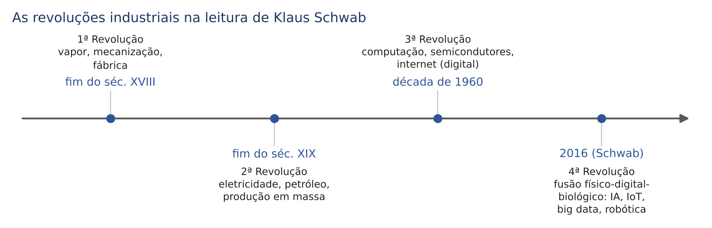
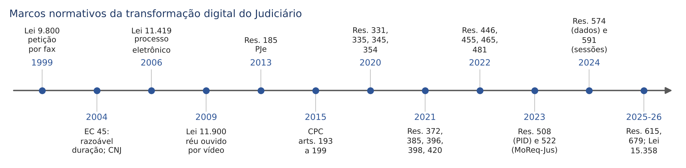
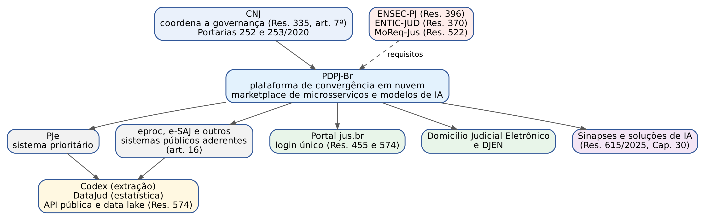
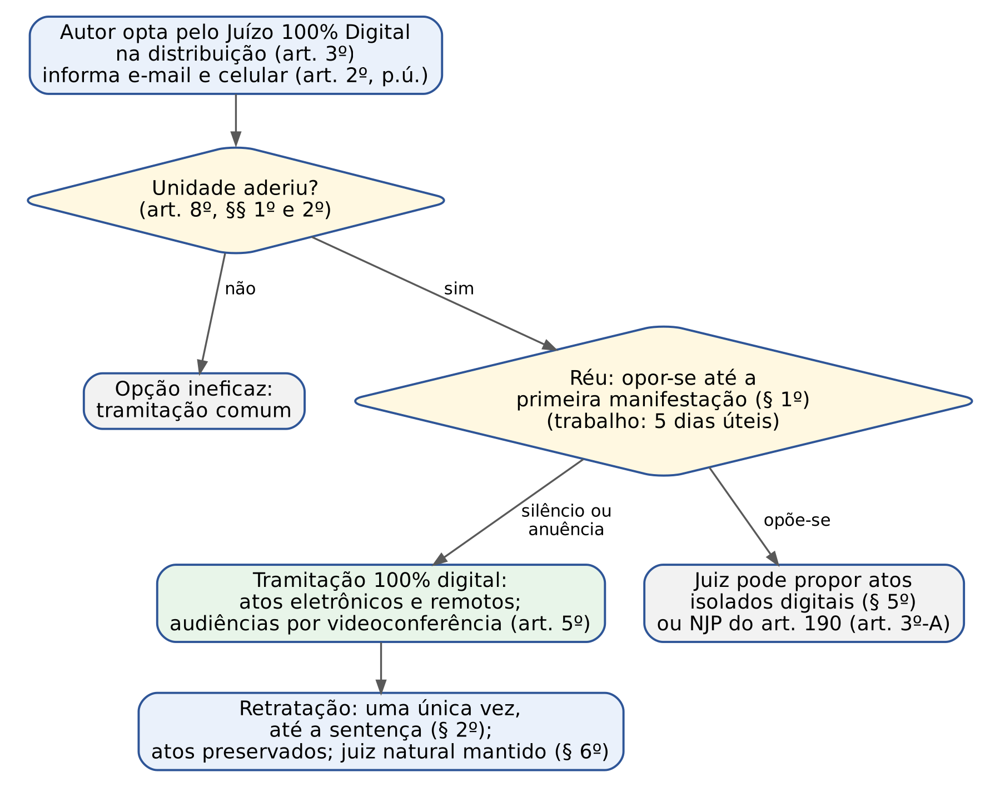
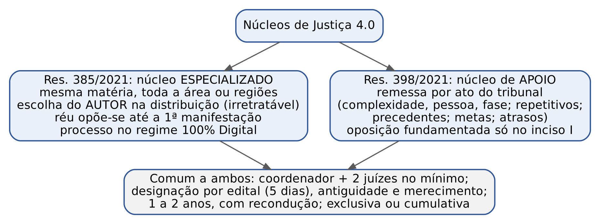
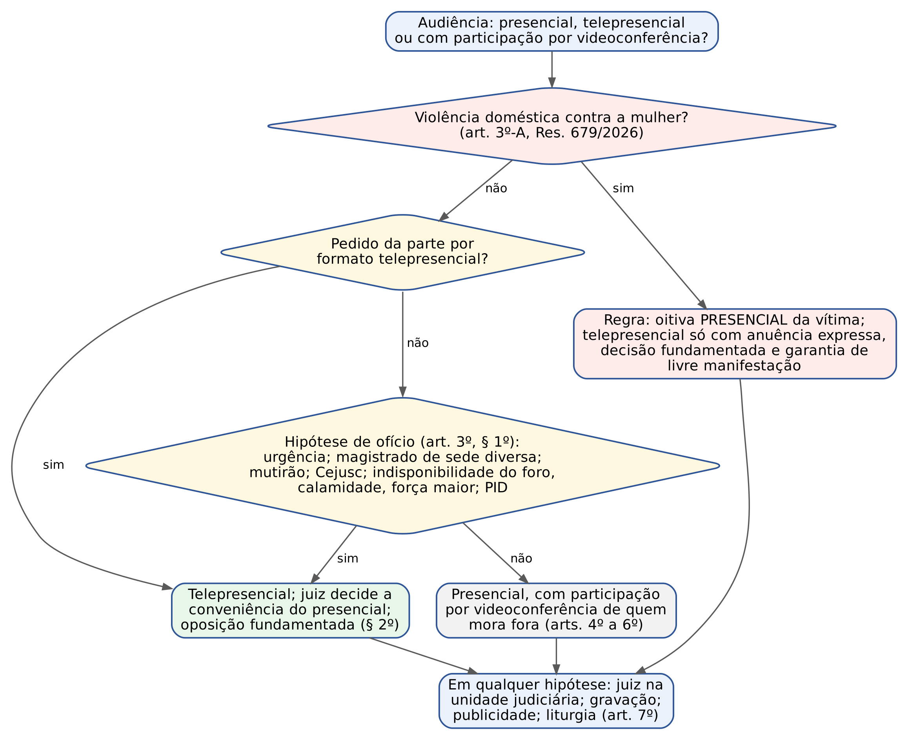
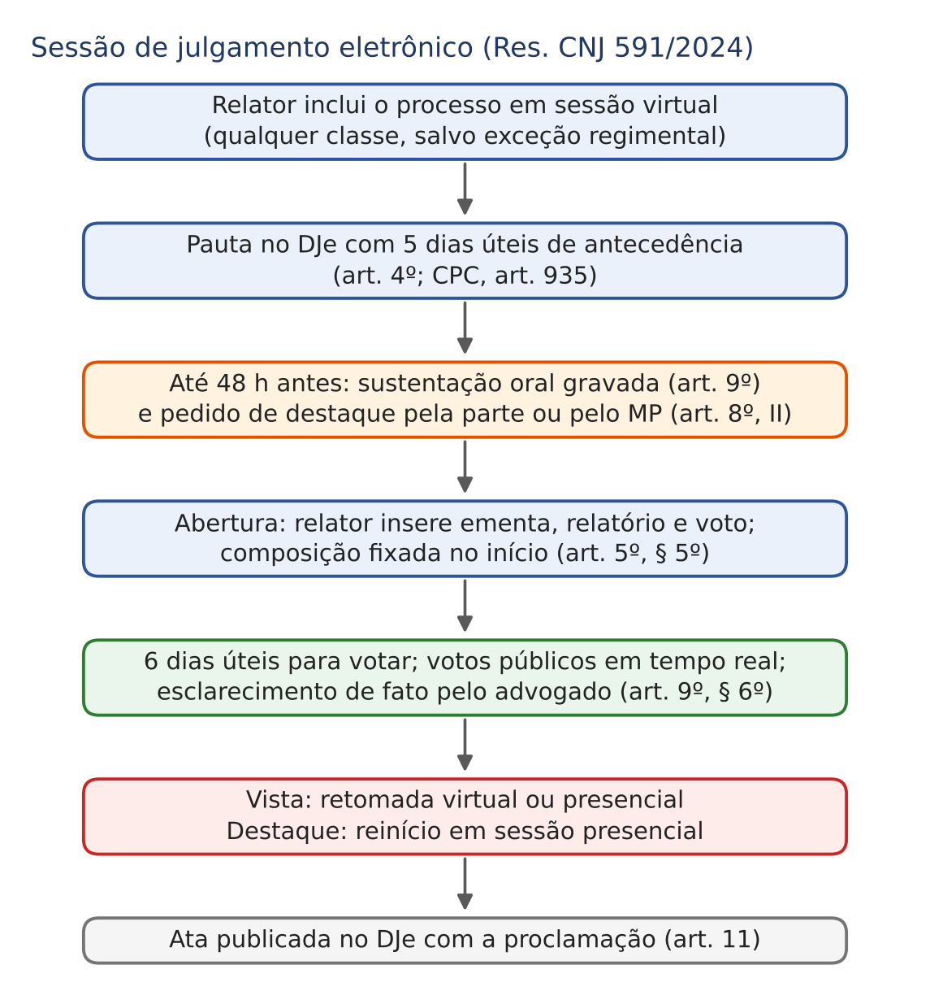
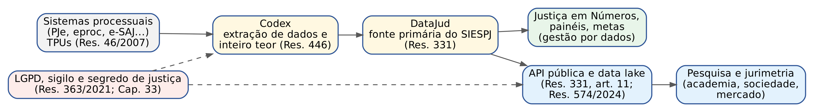

# CAPÍTULO 29 — QUARTA REVOLUÇÃO INDUSTRIAL E TRANSFORMAÇÃO DIGITAL DO PODER JUDICIÁRIO

:::INCIDENCIA
TRF5 p. F.1; TJRS p. F.1; TJSC p. G.1. Nível A+. Lote de 6 questões (FGV 4, FCC 2), todas de cargos de apoio e de TI, mais correlatas do banco (ENAM 2025.2 e TJ-GO 2026, de juiz).
O que mais cai: letra das Resoluções do CNJ (335/2020 e PDPJ-Br, 396/2021 e ENSEC-PJ, 574/2024 e dados), conceitos de governo digital e, nas provas de juiz, a distinção entre jurimetria, análise econômica do Direito e consequencialismo; em prova oral, Juízo 100% Digital, Núcleos de Justiça 4.0, audiência telepresencial e juiz natural.
:::

O capítulo cuida da camada institucional e humanística da transformação digital: o que mudou na sociedade, como o Estado e o Judiciário reagiram e quais atos do CNJ estruturam essa reação. O regime dogmático do processo eletrônico (prazos, intimações, Domicílio Judicial Eletrônico, DJEN, assinatura) está na Apostila de Processo Civil, Cap. 12; inteligência artificial e Resolução CNJ 615/2025, no Cap. 30; prova digital e crimes cibernéticos, no Cap. 31; documentos e assinaturas eletrônicas, no Cap. 32; LGPD e Resolução CNJ 363/2021, no Cap. 33; vieses cognitivos, no Cap. 37; laboratórios de inovação e planejamento estratégico, no Cap. 3.

## 29.1 Quarta Revolução Industrial e sociedade da informação

### 29.1.1 As revoluções industriais e a tese de Schwab

A expressão "Quarta Revolução Industrial" foi popularizada por Klaus Schwab, fundador do Fórum Econômico Mundial, no encontro de Davos de 2016 e no livro *The Fourth Industrial Revolution* (2016). A periodização que a banca reproduz é a seguinte: a primeira revolução (fim do século XVIII) é a da máquina a vapor, da mecanização e da fábrica; a segunda (fim do século XIX ao início do século XX), a da eletricidade, do petróleo e da produção em massa; a terceira (a partir da década de 1960), a revolução digital, dos semicondutores, da computação e, depois, da internet; a quarta, em curso, distingue-se não por uma tecnologia isolada, mas pela FUSÃO dos domínios físico, digital e biológico (inteligência artificial, internet das coisas, *big data*, computação em nuvem, robótica, impressão 3D, biotecnologia).

Schwab aponta três traços que separariam a quarta revolução da terceira: velocidade (evolução exponencial, e não linear), amplitude e profundidade (combinação de tecnologias que altera não só o "o que" e o "como" fazemos, mas "quem" somos) e impacto sistêmico (transformação de sistemas inteiros, entre países, empresas, indústrias e a sociedade). A tese é contestada: parte da literatura econômica sustenta que IA, internet móvel e aprendizado de máquina seriam aprofundamento da terceira revolução, e não ruptura nova. Em prova, basta saber que a periodização é de Schwab e que o rótulo é disputado.

:::DOUTRINA Klaus Schwab, A Quarta Revolução Industrial (2016)
Tese: a revolução em curso é marcada pela fusão de tecnologias que borra as fronteiras entre as esferas física, digital e biológica. Critérios de distinção: velocidade, amplitude e profundidade, impacto sistêmico. Riscos apontados pelo próprio autor: desigualdade (concentração de ganhos em quem detém capital e plataformas), substituição de trabalho, vigilância e perda de privacidade, e defasagem entre a velocidade da inovação e a capacidade de regulação dos governos (o problema da "governança ágil").
:::

### 29.1.2 Sociedade da informação, sociedade em rede e infosfera

A ideia de que a informação se tornou o principal fator de produção precede Schwab e tem genealogia própria, que as bancas cobram por atribuição de autor:

| Autor e obra | Conceito-chave | O que a banca extrai |
|---|---|---|
| Daniel Bell, *O advento da sociedade pós-industrial* (1973) | sociedade pós-industrial | passagem da produção de bens para a de serviços; centralidade do conhecimento teórico |
| Manuel Castells, *A sociedade em rede* (1996; trilogia *A era da informação*) | sociedade em rede; informacionalismo; "espaço de fluxos" e "tempo intemporal" | a informação é ao mesmo tempo matéria-prima e produto; a estrutura social se organiza em redes digitais |
| Lawrence Lessig, *Code and Other Laws of Cyberspace* (1999) | *code is law* | a arquitetura do software regula condutas tanto quanto a lei, o mercado e as normas sociais (as quatro modalidades de regulação; desenvolvido no Cap. 34) |
| Luciano Floridi, *The Fourth Revolution* (2014) | infosfera; *onlife* | desaparece a fronteira entre *online* e *offline*; o ser humano como "inforg" em ambiente informacional |
| Shoshana Zuboff, *A era do capitalismo de vigilância* (2019) | capitalismo de vigilância; excedente comportamental | a experiência humana é convertida em dado para predição e modificação de comportamento (desenvolvido no Cap. 33) |

A expressão "sociedade da informação" designa, em sentido amplo, a sociedade em que a produção, o armazenamento, a circulação e o processamento de informações por meios digitais organizam a economia, a política e a vida cotidiana. Três consequências jurídicas decorrem dela e estruturam os Caps. 29 a 34: (a) a informação passa a ser bem jurídico autônomo (dados pessoais, segredos, ativos digitais); (b) o poder se desloca para quem controla infraestruturas e plataformas (moderação de conteúdo, Cap. 34); (c) o próprio Estado se torna plataforma de dados, o que impõe deveres de transparência, interoperabilidade e proteção (29.2 e 29.9).

:::PEGADINHA Atribuições que a FGV troca
"Sociedade em rede" é de Castells, não de Schwab. "*Code is law*" é de Lessig. "Infosfera" e "*onlife*" são de Floridi. "Capitalismo de vigilância" é de Zuboff. "Sociedade pós-industrial" é de Bell. Schwab é o da "Quarta Revolução Industrial". Outro par recorrente: "sociedade da informação" (eixo econômico e tecnológico) x "sociedade de risco" (Ulrich Beck, 1986, eixo dos riscos produzidos pela própria modernização), que não se confundem.
:::

### 29.1.3 O Direito diante da revolução digital

Para a formação humanística do juiz, a questão central não é técnica, mas institucional: como preservar garantias construídas para um processo físico, presencial e escrito (contraditório, publicidade, imediação, juiz natural, ampla defesa) num ambiente de dados, algoritmos e telepresença. A literatura agrupa os desafios em quatro frentes, todas presentes nos editais:

- direitos fundamentais: privacidade e autodeterminação informativa (Cap. 33), liberdade de expressão e desinformação (Cap. 34);
- decisão automatizada: opacidade, vieses e explicabilidade (Caps. 30 e 37);
- acesso à justiça: a tecnologia reduz custos e distâncias, mas cria uma nova barreira, a EXCLUSÃO DIGITAL (falta de equipamento, de conexão ou de letramento digital), que atinge justamente os vulneráveis; daí os Pontos de Inclusão Digital (29.5.4) e a regra do art. 198 do CPC;
- legitimidade: a confiança na Justiça depende também da percepção de um procedimento justo (legitimidade procedimental), que pode ser abalada por audiências impessoais, conexões instáveis e decisões padronizadas (29.7).

:::DICA Como responder na prova oral
Pergunta típica: "A tecnologia amplia ou restringe o acesso à justiça?". Resposta madura: ambas as coisas. Amplia ao suprimir deslocamentos, horários e custos (Juízo 100% Digital, Balcão Virtual, Núcleos de Justiça 4.0); restringe se ignorar a exclusão digital. Por isso os atos do CNJ convivem com salvaguardas: atendimento presencial remanescente, opção (e não imposição) pelo Juízo 100% Digital, sala no fórum para quem não tem conexão (Res. CNJ 345/2020, art. 5º, parágrafo único), Pontos de Inclusão Digital e a regra do CPC que admite o ato não eletrônico onde não houver equipamento disponível (art. 198, parágrafo único). Ligue o tema às "ondas" de Cappelletti e Garth (Cap. 1): a tecnologia vem sendo apresentada como uma nova onda de acesso.
:::

:::PRATIQUE Seção 29.1 (exercícios elaborados para esta apostila, não são questões de banca)
1. Certo ou errado: para Schwab, o critério que distingue a Quarta Revolução Industrial é a invenção do computador pessoal.
2. Certo ou errado: a afirmação de que a arquitetura do software é uma forma de regulação, ao lado da lei, do mercado e das normas sociais, é associada a Lawrence Lessig.
3. Certo ou errado: a exclusão digital é obstáculo de acesso à justiça reconhecido pelo próprio CPC.
Resolução: 1. Errado: o computador é marco da terceira revolução; a quarta se define pela fusão dos domínios físico, digital e biológico, com velocidade, amplitude e impacto sistêmico. 2. Certo (*code is law*). 3. Certo: o art. 198 obriga as unidades a manter equipamentos gratuitos e, onde não houver, admite a prática de atos por meio não eletrônico.
:::

## 29.2 Governo digital e transformação digital do Estado

### 29.2.1 Do governo eletrônico ao governo como plataforma

A literatura de administração pública distingue três estágios, que a FGV cobra em provas gerais (CNU) e de tribunais:

| Estágio | Ideia central | Exemplo |
|---|---|---|
| Governo eletrônico (*e-gov*) | informatização de processos internos e oferta de informação na internet; o serviço continua desenhado a partir do papel | sítios institucionais, formulários para download |
| Governo digital | serviços concebidos digitalmente, centrados no usuário, com autosserviço, dados e integração entre órgãos | gov.br, Carteira de Trabalho Digital |
| Governo como plataforma | o Estado oferece infraestrutura e dados abertos para que terceiros criem serviços e soluções | APIs públicas, dados abertos, DataJud |

A transformação digital, portanto, não é a mera digitalização (converter papel em arquivo), mas a reorganização do serviço a partir das possibilidades digitais. O processo eletrônico que apenas replica os autos físicos em PDF é digitalização; o processo que extrai dados, automatiza tarefas, integra sistemas e permite atos remotos é transformação digital.

:::QUESTAO FGV 2025 — CNU — Bloco 2, Cultura e Educação (Q3641977)
Cobrado: impactos da digitalização da Administração em três assertivas. Gabarito B (I e II corretas): a digitalização afeta a governabilidade ao introduzir fluxos digitais de informação que influenciam o processo decisório (I) e integra a agenda global das democracias para o desempenho de suas funções (II). Armadilha: a III atribui à digitalização uma reação em cadeia de restrição de acesso à informação e "censura"; o vetor normativo é o oposto (transparência ativa, dados abertos, Lei 12.527/2011 e Lei 14.129/2021, art. 3º, IV, V e XIV).
:::

### 29.2.2 A Lei 14.129/2021 (Lei do Governo Digital)

A Lei 14.129/2021 dispõe sobre princípios, regras e instrumentos para o aumento da eficiência da administração pública, "especialmente por meio da desburocratização, da inovação, da transformação digital e da participação do cidadão" (art. 1º). Deve ser aplicada em harmonia com a LAI, a Lei 13.460/2017 (usuários de serviços públicos), a LGPD, o CTN e a LC 105/2001 (parágrafo único).

:::LEI Lei 14.129/2021, art. 2º (âmbito)
Esta Lei aplica-se: I - aos órgãos da administração pública direta federal, abrangendo os Poderes Executivo, Judiciário e Legislativo, incluído o Tribunal de Contas da União, e o Ministério Público da União; II - às entidades da administração pública indireta federal [...] que prestem serviço público [...]; III - às administrações diretas e indiretas dos demais entes federados, nos termos dos incisos I e II do caput deste artigo, desde que adotem os comandos desta Lei por meio de atos normativos próprios.
:::

:::PEGADINHA Lei do Governo Digital e Judiciário estadual
A lei alcança o Judiciário FEDERAL como administração direta federal (art. 2º, I). Estados, DF e Municípios só se submetem se adotarem seus comandos por ato normativo próprio (inciso III e § 2º). Não se aplica a empresas estatais que não prestem serviço público (§ 1º). Para o Judiciário estadual, a disciplina da transformação digital vem sobretudo dos atos do CNJ, editados com base no art. 103-B, § 4º, da CF e no art. 196 do CPC.
:::

Princípios e diretrizes que mais caem (art. 3º): desburocratização e simplificação mediante serviços digitais acessíveis inclusive por dispositivos móveis (I); plataforma única de acesso, "sem prejuízo, quando indispensável, da prestação de caráter presencial" (II); linguagem clara (VII); atuação integrada com compartilhamento de dados pessoais em ambiente seguro, quando indispensável ao serviço, nos termos da LGPD (IX); vedação de exigir prova de fato já comprovado (XIII); "a interoperabilidade de sistemas e a promoção de dados abertos" (XIV); presunção de boa-fé do usuário (XV); "a permanência da possibilidade de atendimento presencial" (XVI); proteção de dados (XVII); acessibilidade (XIX); "a implantação do governo como plataforma" com uso de dados preferencialmente anonimizados (XXIII); preferência por padrões e formatos abertos e livres (XXV).

Conceitos legais (art. 4º): autosserviço é o acesso a serviço público digital "sem necessidade de mediação humana" (II); dados abertos são dados acessíveis ao público, em formato aberto, processáveis por máquina e sob licença aberta (IV); governo como plataforma é a infraestrutura tecnológica que facilita o uso de dados de acesso público e promove a interação entre agentes para estímulo à inovação e à prestação de serviços (VII); laboratório de inovação é espaço aberto à participação da sociedade para desenvolver ideias, ferramentas e métodos inovadores na gestão pública (VIII); transparência ativa é a disponibilização de dados independentemente de solicitação (XI).

A prestação digital deve usar tecnologias de amplo acesso, inclusive pela população de baixa renda ou residente em áreas rurais e isoladas, "sem prejuízo do direito do cidadão a atendimento presencial" (art. 14), e realiza-se preferencialmente por autosserviço (parágrafo único). Os órgãos devem gerir suas bases considerando a interoperabilidade, respeitadas restrições legais, segurança e custo-benefício (art. 38), e "nova base de dados somente poderá ser criada quando forem esgotadas as possibilidades de utilização dos registros de referência existentes" (art. 40, § 2º). Os laboratórios de inovação (arts. 44 e 45) têm como diretrizes, entre outras, a colaboração com a sociedade, tecnologias abertas e livres, métodos ágeis e o apoio a políticas públicas orientadas por dados e evidências; a governança deve incluir "instrumentos de promoção do processo decisório fundamentado em evidências" (art. 47, parágrafo único, III).

:::ESQUEMA Governo digital em cinco palavras
Autosserviço (sem mediação humana), plataforma única, interoperabilidade (com registros de referência e CPF como chave, art. 39, V), dados abertos (governo como plataforma) e atendimento presencial preservado (arts. 3º, XVI, e 14). As mesmas ideias reaparecem, no Judiciário, no portal jus.br e no login único (Res. CNJ 455/2022), na PDPJ-Br (Res. CNJ 335/2020), na API pública do DataJud (Res. CNJ 331/2020) e no Balcão Virtual (Res. CNJ 372/2021).
:::

## 29.3 Transformação digital do Poder Judiciário: trajetória e fundamentos

### 29.3.1 Linha do tempo

A trajetória brasileira pode ser lida em quatro fases. Primeira, de experimentação (1999 a 2005): a Lei 9.800/1999 admitiu a transmissão de petições por fac-símile, e os Juizados Especiais Federais foram o laboratório do processo sem papel. Segunda, de legalização (2006 a 2014): a Lei 11.419/2006 disciplinou o processo eletrônico para os processos civil, penal e trabalhista e os juizados, em qualquer grau; a Lei 11.900/2009 introduziu o interrogatório por videoconferência no CPP; a Resolução CNJ 185/2013 instituiu o PJe como sistema de processamento de informações e prática de atos processuais. Terceira, de codificação e universalização (2015 a 2019): o CPC/2015 dedicou aos atos eletrônicos os arts. 193 a 199 e espalhou a videoconferência por vários atos. Quarta, de aceleração e plataformização (de 2020 em diante): a pandemia de covid-19 obrigou ao trabalho remoto e às audiências virtuais; o CNJ editou, em sequência, as Resoluções 331 (DataJud), 335 (PDPJ-Br), 337 (sistemas de videoconferência), 345 (Juízo 100% Digital) e 354 (cumprimento digital de atos), todas de 2020, e o Programa Justiça 4.0 consolidou a agenda. Depois da pandemia, a Resolução CNJ 481/2022 revogou as resoluções emergenciais e reajustou as permanentes, fixando o modelo atual.

:::NOTA Programa Justiça 4.0
O Programa Justiça 4.0 é fruto de parceria entre o CNJ e o Programa das Nações Unidas para o Desenvolvimento (PNUD), com apoio do CJF, do STJ, do TST, do CSJT e do TSE (portal do CNJ, consultado em 12/11/2026). Não é resolução, mas programa guarda-chuva que reúne, entre outras ações, PDPJ-Br, portal jus.br, Codex, Plataforma Sinapses, Balcão Virtual, Núcleos de Justiça 4.0, Juízo 100% Digital, Domicílio Judicial Eletrônico, Sniper, Prevjud e o Banco Nacional de Precedentes. Não confunda o PROGRAMA Justiça 4.0 com os NÚCLEOS de Justiça 4.0 (Res. CNJ 385/2021), que são unidades jurisdicionais.
:::

### 29.3.2 Fundamentos constitucionais e legais

A transformação digital tem quatro âncoras normativas. Na Constituição: a razoável duração do processo e os meios que garantam a celeridade de sua tramitação (art. 5º, LXXVIII, EC 45/2004), a eficiência administrativa (art. 37, *caput*), a publicidade dos julgamentos (art. 93, IX) e a competência do CNJ para o controle da atuação administrativa do Judiciário e a expedição de atos regulamentares (art. 103-B, § 4º, I; Cap. 14). Na Lei 11.419/2006, que é a lei-quadro do processo eletrônico. No CPC, arts. 193 a 199. E nas resoluções do CNJ, que concretizam essas normas.

:::LEI CPC, arts. 194 e 196
Art. 194. Os sistemas de automação processual respeitarão a publicidade dos atos, o acesso e a participação das partes e de seus procuradores, inclusive nas audiências e sessões de julgamento, observadas as garantias da disponibilidade, independência da plataforma computacional, acessibilidade e interoperabilidade dos sistemas, serviços, dados e informações que o Poder Judiciário administre no exercício de suas funções.
Art. 196. Compete ao Conselho Nacional de Justiça e, supletivamente, aos tribunais, regulamentar a prática e a comunicação oficial de atos processuais por meio eletrônico e velar pela compatibilidade dos sistemas, disciplinando a incorporação progressiva de novos avanços tecnológicos e editando, para esse fim, os atos que forem necessários, respeitadas as normas fundamentais deste Código.
:::

Do art. 194 extraem-se as garantias do processo eletrônico: publicidade, acesso, participação, disponibilidade, independência de plataforma, acessibilidade e interoperabilidade. Do art. 196, a competência regulamentar do CNJ (e, supletivamente, dos tribunais), com dois limites: "respeitadas as normas fundamentais deste Código" e sem inovar contra a lei. É por isso que os atos do CNJ sobre Juízo 100% Digital e Núcleos de Justiça 4.0 trabalham com OPÇÃO das partes, negócio jurídico processual (art. 190 do CPC) e preservação da competência, e não com alteração unilateral de regras de competência ou de prazos legais.

:::ATENCAO Limite do poder regulamentar
Na prova oral, ao defender um ato do CNJ sobre tecnologia, explicite o fundamento (art. 103-B, § 4º, da CF; art. 196 do CPC; art. 18 da Lei 11.419/2006) e o limite: o CNJ regulamenta a prática eletrônica dos atos e a gestão dos sistemas, mas não cria nem suprime direitos processuais previstos em lei. Os exemplos mais seguros de respeito a esse limite: a Res. 345/2020 declara que as unidades "não terão a sua competência alterada" (art. 2º) e que a retratação não muda "o juízo natural do feito" (art. 3º, § 6º); a Res. 385/2021 fixa a competência do Núcleo pela não oposição do réu, que "aperfeiçoará o negócio jurídico processual" (art. 2º, § 6º).
:::

### 29.3.3 Processo judicial eletrônico e atos processuais eletrônicos

A Lei 11.419/2006 estruturou o processo eletrônico em três blocos: a informatização do processo judicial e a assinatura eletrônica (arts. 1º a 3º: assinatura digital com certificado ICP-Brasil ou cadastro no Judiciário; ato realizado no dia e hora do envio; tempestividade até as 24 horas do último dia); a comunicação eletrônica dos atos (arts. 4º a 7º: Diário da Justiça eletrônico; intimação por portal, com ciência ficta após 10 dias corridos; citação eletrônica); e o processo eletrônico propriamente dito (arts. 8º a 18: autos total ou parcialmente digitais, documentos produzidos eletronicamente como originais, digitalização com força probante, prorrogação do prazo por indisponibilidade do sistema, regulamentação pelos órgãos do Judiciário). O detalhamento dogmático e a jurisprudência do STJ sobre contagem de prazos estão na Apostila de Processo Civil, Cap. 12; o regime do Domicílio Judicial Eletrônico e do DJEN (Res. CNJ 455/2022, alterada pelas Res. 569/2024 e 624/2025), também.

O CPC complementa a lei com os arts. 193 a 199: atos "total ou parcialmente digitais", produzidos, comunicados, armazenados e validados eletronicamente (art. 193); garantias dos sistemas (art. 194); padrões abertos e requisitos de autenticidade, integridade, temporalidade, não repúdio, conservação e confidencialidade (art. 195); competência do CNJ (art. 196); presunção de veracidade das informações divulgadas pelos sistemas e justa causa por problema técnico (art. 197); equipamentos gratuitos e ato não eletrônico onde não houver (art. 198); acessibilidade para pessoas com deficiência (art. 199).

No plano administrativo, três resoluções fecham o ciclo do papel. A Res. CNJ 185/2013 instituiu o PJe; foi alterada pela Res. CNJ 656/2025, que reestruturou a Rede de Governança do PJe (Comitê Gestor Nacional, Gerência Executiva, comitês da Justiça da União e da Justiça dos Estados, comitês interinstitucionais e internos, com participação do MP, da OAB, da advocacia pública e da Defensoria) e previu que o sistema indique possível prevenção, "cabendo ao magistrado analisar a existência, ou não, da prevenção". A Res. CNJ 420/2021 vedou o recebimento e a distribuição de casos novos em meio físico a partir de 1/3/2022 em todos os tribunais, exceto o STF, admitindo excepcionalmente o físico por impossibilidade técnica eventual ou urgência, com digitalização em até dois meses, e fixou cronograma de digitalização do acervo até 31/12/2022, 2023, 2024 ou 2025, conforme o percentual de autos físicos do tribunal em 30/9/2021 (até 5%, de 5% a 20%, de 20% a 40% e acima de 40%). A Res. CNJ 522/2023 aprovou o MoReq-Jus, modelo de requisitos para sistemas informatizados de gestão de processos e documentos, de adesão obrigatória, "com o objetivo de assegurar a confidencialidade, a integridade, a disponibilidade, a autenticidade, o não repúdio, a conformidade e a preservação de processos e documentos do Poder Judiciário" (art. 2º), com prevalência dos requisitos de segurança em caso de conflito (art. 3º, § 1º).

:::QUESTAO FCC 2026 — MPE-AL — Analista, Arquivologia (Q4106999)
Cobrado: conteúdo atribuído pela banca à Res. CNJ 574/2024 em matéria de preservação documental. Gabarito E: repositórios digitais devem atender a requisitos de autenticidade, integridade e acessibilidade. Erradas: conversão obrigatória em PDF com eliminação após 10 anos (A), preservação sem metadados (B), padrões de metadados livres para cada órgão (C) e exclusão de documentos administrativos (D) contrariam a lógica de padronização do MoReq-Jus e do Proname.
Atenção: o texto vigente da Res. 574/2024 trata de acesso a dados judiciais públicos consolidados, depósito de módulos privados na PDPJ-Br e portal unificado (29.4.3); a alternativa correta descreve princípios que estão, na verdade, na disciplina de gestão documental (Res. CNJ 324/2020, Proname, e Res. CNJ 522/2023, MoReq-Jus). Resolve-se por eliminação, mas a atribuição da banca é discutível (ver nota de verificação).
:::

:::PEGADINHA Digitalização x transformação digital x processo eletrônico
Digitalizar é converter autos físicos em arquivos (Res. 420/2021). Processo eletrônico é o regime jurídico de prática eletrônica dos atos (Lei 11.419 e CPC). Transformação digital é a reorganização do serviço a partir de dados, automação, integração e atendimento remoto (Res. 335/2020; ENTIC-JUD). A FGV costuma apresentar a digitalização do acervo como se esgotasse a transformação digital.
:::

## 29.4 PDPJ-Br, interoperabilidade e governança tecnológica

### 29.4.1 A Resolução CNJ 335/2020 e a Plataforma Digital do Poder Judiciário

Até 2020, o Judiciário brasileiro convivia com dezenas de sistemas processuais (PJe, eproc, e-SAJ, Projudi e soluções próprias), muitos contratados de fornecedores privados, sem comunicação entre si. A Res. CNJ 335/2020 respondeu com uma escolha de política pública: em vez de impor um sistema único, criou uma PLATAFORMA de convergência, a PDPJ-Br, "mantendo-se o sistema PJe como sistema de Processo Eletrônico prioritário do Conselho Nacional de Justiça" (art. 1º). Os sistemas públicos de outros tribunais podem ser mantidos e aprimorados se aderirem à plataforma de interoperabilidade, permitirem coexistência mediante desenvolvimento colaborativo e disponibilizarem seus novos módulos à rede nacional (art. 16).

Objetivos da PDPJ-Br (art. 2º): integrar e consolidar todos os sistemas eletrônicos do Judiciário em ambiente unificado; implantar o desenvolvimento comunitário, em que todos os tribunais contribuem com as melhores soluções para aproveitamento comum; estabelecer padrões de desenvolvimento, arquitetura, experiência do usuário e operação; e instituir "plataforma única para publicação e disponibilização de aplicações, microsserviços e modelos de inteligência artificial (I.A.), por meio de computação em nuvem". A plataforma funciona como "modelo de convergência" provido por um repositório (*marketplace*) de soluções (art. 3º).

:::LEI Res. CNJ 335/2020, art. 4º (conceitos obrigatórios da PDPJ-Br)
I – processo eletrônico em plataforma pública; II – desenvolvimento comunitário que possibilite o compartilhamento entre todos os segmentos e esferas do Poder Judiciário; III – ampla cobertura de testes, baixo acoplamento, alta coesão, modularização; IV – microsserviços; V – computação em nuvem; VI – autenticação uniformizada; VII – interoperabilidade; VIII – portabilidade; IX – mobilidade; X – acessibilidade; XI – usabilidade; XII – segurança da informação; XIII – adaptável ao uso de ferramentas de aprendizado de máquina (*machine learning*) e de I.A.; XIV – otimização de fluxos de trabalhos (*workflow*) [...]; XV – automação de atividades rotineiras ou sequenciais que possam ser substituídas por ações de sistema; XVI – incremento da robotização e técnicas disruptivas [...]; XVII – foco prioritário na redução da taxa de congestionamento [...]; XVIII – adequação à Lei no 13.709/2018 (LGPD); e XIX – utilização preferencial de tecnologias com código aberto (*open source*).
:::

:::QUESTAO FGV 2024 — TJ-AP — Apoio Especializado, TI (Q2447932)
Cobrado: conceitos obrigatórios do art. 4º da Res. 335/2020. Gabarito E: solução adaptável ao uso de *machine learning* e de IA (inciso XIII). As erradas invertem a letra: "código fechado" (o inciso XIX diz código ABERTO), compartilhamento "em segmentos específicos" (o inciso II diz entre TODOS os segmentos e esferas), "alto acoplamento, baixa coesão" (o inciso III diz BAIXO acoplamento e ALTA coesão) e "plataforma privada" (o inciso I diz plataforma PÚBLICA).
:::

O art. 5º veda "a contratação de qualquer novo sistema, módulo ou funcionalidade privados, mesmo de forma não onerosa, que cause dependência tecnológica do respectivo fornecedor e que não permita o compartilhamento não oneroso da solução na PDPJ-Br". Dependência tecnológica é a hipótese em que o tribunal não tem direito à propriedade do que for desenvolvido nem aos códigos-fonte, documentação e artefatos (§ 1º). O descumprimento pode ensejar responsabilização do ordenador de despesas por improbidade, comunicação ao Tribunal de Contas e apuração de responsabilidade disciplinar dos gestores (§ 3º). A Res. CNJ 574/2024 acrescentou o § 4º: são permitidos credenciamento, contratação ou acordo de cooperação para a disponibilização NÃO ONEROSA de módulos privados desenvolvidos segundo os padrões e depositados na PDPJ-Br, desde que não relacionados a "funcionalidades básicas e essenciais" dos sistemas de processo eletrônico, com parecer prévio do Departamento de TI do CNJ.

A hospedagem em nuvem pode ser provida por pessoa jurídica de direito privado, inclusive por integrador (*broker*), desde que os dados fiquem em *datacenter* no território nacional, com cumprimento da LGPD, requisitos de disponibilidade, escalabilidade, redundância e criptografia, e mensuração individualizada de uso (art. 14). A resolução não se aplica a soluções que não tratam de processo eletrônico (art. 23), e as corregedorias devem incluir sua verificação nas rotinas de fiscalização (art. 24).

:::QUESTAO FGV 2026 — TJ-SC — Analista de Sistemas (Q4151009)
Cobrado: atribuição correta de números a atos do CNJ sobre governança, segurança e transformação digital. Gabarito C: a Portaria CNJ 252/2020 dispõe sobre o Modelo de Governança e Gestão da PDPJ-Br. Armadilhas por troca de números: a ENSEC-PJ é da Res. 396/2021, e não da 335/2020 (A); a política de governança do processo eletrônico é da Res. 335/2020, e não da 396/2021 (B); a Portaria 257/2022 exige, para a arquitetura da PDPJ-Br, a linguagem JAVA, e não Python (D); a PDPJ-Br contempla expressamente nuvem, interoperabilidade e autenticação uniformizada (art. 4º, V a VII), o que derruba a E.
No mesmo sentido (LGPD e PDPJ-Br): Q3035385 (a empresa de nuvem que hospeda a PDPJ-Br e atua nos limites das determinações do controlador é OPERADORA; desenvolvida no Cap. 33).
:::

:::NOTA Portarias que regulamentam a PDPJ-Br
Portaria CNJ 252/2020 (18/11/2020): Modelo de Governança e Gestão da PDPJ-Br. Portaria CNJ 253/2020 (18/11/2020): critérios e diretrizes técnicas para o desenvolvimento de módulos e serviços na plataforma. Portaria CNJ 257/2022 (31/7/2022): conteúdo mínimo obrigatório, em editais de concursos de servidores de TI e em contratações de serviços e fábricas de *software*, sobre os normativos da PDPJ-Br (Res. 335/2020, Portarias 252 e 253/2020, Portaria 131/2021, Res. 396/2021 e Portaria 162/2021) e sobre a arquitetura (Java, microsserviços, API RESTful, Spring, PostgreSQL, Keycloak, OAuth2, Kubernetes, CI/CD). A existência dessa portaria explica por que as questões de TI de tribunais trazem a letra da Res. 335 e da Res. 396.
:::

### 29.4.2 Interoperabilidade

Interoperabilidade é a capacidade de sistemas distintos trocarem dados e usarem as informações trocadas sem intervenção manual. A Res. CNJ 331/2020 define "serviço de dados" como a solução que permite "a comunicação de dados e a interoperabilidade entre sistemas desenvolvidos em plataformas diferentes" e API como o conjunto de instruções e padrões que possibilitam integração e intercâmbio de dados (art. 2º, II e IV). No Judiciário, a interoperabilidade tem três dimensões: entre sistemas processuais (PDPJ-Br, art. 4º, VII, e art. 16, I); com o sistema de justiça e a Administração (MP, Defensoria, advocacia pública, polícias, Receita, registros públicos), o que permite intimações eletrônicas, pesquisas patrimoniais e cumprimento digital de ordens; e com a sociedade (APIs públicas e dados abertos).

As fontes normativas que a banca combina: CPC, art. 194 (interoperabilidade como garantia dos sistemas de automação); Lei 14.129/2021, arts. 3º, XIV, e 38 a 40; Res. CNJ 335/2020, arts. 4º, VII, 9º, II, e 16, I; Res. CNJ 331/2020, art. 2º, II; e a Lei 11.419/2006, art. 14 (sistemas preferencialmente com programas de código aberto, acessíveis ininterruptamente pela internet, priorizando a padronização). O limite é a proteção de dados: o compartilhamento entre órgãos públicos não é vedado pela LGPD, mas exige finalidade, base legal e segurança (Cap. 33, 33.9).

:::DICA Interoperabilidade e eficiência na sentença
Quando a parte alega que o juízo deveria ter buscado endereço ou bem em cadastro de outro órgão, lembre que a interoperabilidade é dever institucional (CPC, art. 194; Lei 11.419, art. 13 e § 1º, que considera cadastros públicos, inclusive de concessionárias e empresas privadas, os que contenham informações indispensáveis à função judicante). O uso dos sistemas de pesquisa de dados e busca de bens para constrição patrimonial disponibilizados pelo CNJ é disciplinado pela Res. CNJ 584/2024, e a Res. CNJ 600/2024 permite aos oficiais de justiça o acesso a sistemas informatizados para localizar pessoas e bens. O regime processual dessas pesquisas está na Apostila de Processo Civil.
:::

### 29.4.3 Dados judiciais públicos e Resolução CNJ 574/2024

A Res. CNJ 574/2024 dispõe sobre o acesso a dados judiciais públicos consolidados pelo CNJ, prevê o depósito de serviços privados na PDPJ-Br e institui o portal unificado para usuários internos e externos. O CNJ pode oferecer acesso aos dados públicos previstos no art. 2º da Res. CNJ 121/2010 (art. 1º); a Presidência regulamentará condições para o fornecimento de dados consolidados em repositório centralizado (*data lake*) por APIs, resguardando "a proteção dos dados pessoais, a confidencialidade, integridade, autenticidade e capacidade de auditagem e controle" (§ 1º); o DTI avalia a capacidade técnica do consumidor dos dados (§ 2º). Tribunais e conselhos atribuem os níveis de segredo e sigilo dos processos remetidos ao Codex (art. 2º) e podem bloquear acessos em caso de "comportamento inautêntico ou consumo abusivo de dados" (art. 3º). O CNJ deve instituir cobrança limitada ao custo efetivo do serviço de API (art. 4º), com dispensa possível para instituições de ensino e pesquisa (§ 2º).

:::QUESTAO FCC 2025 — TRF4 — Analista Judiciário, Análise de Sistemas (Q3538832)
Cobrado: literalidade do § 3º do art. 4º da Res. 574/2024. Gabarito E: o CNJ pode condicionar o acesso à API ao compromisso de o interessado oferecer "aos magistrados e servidores do Poder Judiciário, de forma não onerosa e por meio da Plataforma Digital do Poder Judiciário (PDPJ-Br)", os produtos desenvolvidos a partir dos dados do repositório centralizado. Armadilhas: destinatário errado (público em geral, servidores dos três Poderes, cada solicitante) e contrapartida onerosa ("depósito judiciário de valor simbólico"). Ideia-chave: quem explora comercialmente os dados públicos do Judiciário devolve, gratuitamente, os produtos ao próprio Judiciário.
:::

### 29.4.4 Estratégias nacionais: ENTIC-JUD e ENSEC-PJ

A Res. CNJ 370/2021 instituiu a Estratégia Nacional de Tecnologia da Informação e Comunicação do Poder Judiciário (ENTIC-JUD) para o sexênio 2021-2026, como "principal instrumento de promoção da governança ágil e da transformação digital do Poder Judiciário" (art. 1º, parágrafo único). Seus oito objetivos estratégicos estão em três perspectivas: sociedade (aumentar a satisfação dos usuários; promover a transformação digital), aprendizado e crescimento (competências; inovação colaborativa) e processos internos (governança e gestão; aquisições; segurança da informação e gestão de dados; infraestrutura e soluções corporativas). Meta: no mínimo 75% dos órgãos com nível satisfatório no índice iGovTIC-JUD até dezembro de 2026 (art. 2º, II). Como o ciclo se encerra em 2026, o CNJ submeteu a consulta pública (20/5 a 12/6/2026) a minuta da Estratégia Nacional de Governança Digital e Inovação Tecnológica do Poder Judiciário (ENGI-JUD), para 2027 a 2032, em dois eixos (governança e gestão digital; inovação tecnológica ética, segura e colaborativa) e nove objetivos, que sucederá a Res. 370/2021; a resolução não havia sido localizada até 12/11/2026.

A Res. CNJ 396/2021 instituiu a Estratégia Nacional de Segurança Cibernética do Poder Judiciário (ENSEC-PJ), aplicável a todos os órgãos do Judiciário, EXCETO o STF (art. 1º), em modelo centralizado coordenado pelo CNJ (art. 13), assessorado pelo CGSI-PJ, com o CPTRIC-PJ como canal oficial de resposta a incidentes e uma ETIR em cada órgão; objetivos, estruturas, deveres da alta administração e a questão do lote (FGV 2024, TJ-RR, Q3088151: gabarito A, o CNJ coordena) estão desenvolvidos no Cap. 31 (31.3.4), sede da cibersegurança.

:::PRATIQUE Seção 29.4 (exercícios elaborados para esta apostila, não são questões de banca)
1. Certo ou errado: a Res. CNJ 335/2020 determinou a substituição de todos os sistemas processuais pelo PJe.
2. Certo ou errado: o tribunal pode receber gratuitamente módulo privado de inteligência artificial para triagem de petições, desde que desenvolvido nos padrões da PDPJ-Br, nela depositado e não relacionado a funcionalidade básica do processo eletrônico, com parecer prévio do DTI do CNJ.
3. Certo ou errado: a PDPJ-Br não pode ser hospedada em nuvem de empresa privada.
Resolução: 1. Errado: o PJe é o sistema prioritário, mas outros sistemas públicos podem ser mantidos se aderirem à interoperabilidade e ao desenvolvimento colaborativo (arts. 1º e 16). 2. Certo (art. 5º, § 4º, incluído pela Res. 574/2024); o que se proíbe é a dependência tecnológica (art. 5º, *caput*). 3. Errado: admite-se nuvem privada, inclusive por *broker*, com dados em território nacional e cumprimento da LGPD (art. 14).
:::

## 29.5 Juízo 100% Digital, Núcleos de Justiça 4.0, Balcão Virtual e Pontos de Inclusão Digital

### 29.5.1 Juízo 100% Digital (Resolução CNJ 345/2020)

A Res. CNJ 345/2020 (9/10/2020), alterada pelas Res. 378/2021 e 481/2022, AUTORIZA os tribunais a implementar o "Juízo 100% Digital", em que "todos os atos processuais serão exclusivamente praticados por meio eletrônico e remoto por intermédio da rede mundial de computadores" (art. 1º, § 1º). Não é unidade nova nem competência nova: é um REGIME de tramitação que a parte escolhe dentro de unidades já existentes.

:::LEI Res. CNJ 345/2020, arts. 2º e 3º
Art. 2º As unidades jurisdicionais de que tratam este ato normativo não terão a sua competência alterada em razão da adoção do "Juízo 100% Digital". Parágrafo único. No ato do ajuizamento do feito, a parte e seu advogado deverão fornecer endereço eletrônico e linha telefônica móvel celular, sendo admitida a citação, a notificação e a intimação por qualquer meio eletrônico, nos termos dos arts. 193 e 246, V, do Código de Processo Civil.
Art. 3º A escolha pelo "Juízo 100% Digital" é facultativa e será exercida pela parte demandante no momento da distribuição da ação, podendo a parte demandada opor-se a essa opção até o momento da contestação. § 1º A parte demandada poderá se opor a essa escolha até sua primeira manifestação no processo, salvo no processo do trabalho, em que essa oposição deverá ser deduzida em até 05 dias úteis contados do recebimento da primeira notificação. § 2º Adotado o "Juízo 100% Digital", as partes poderão retratar-se dessa escolha, por uma única vez, até a prolação da sentença, preservados todos os atos processuais já praticados.
:::

Os demais elementos do regime:

- Atos presenciais pontuais: se inviável produzir prova ou outro ato de forma virtual, a realização presencial "não impedirá a tramitação do processo no âmbito do 'Juízo 100% Digital'" (art. 1º, § 2º); o juízo pode valer-se de serviços presenciais de outros órgãos (Cejusc, mandados, cálculos), desde que os atos possam ser convertidos em eletrônicos (§ 3º).
- Adesão em processos antigos: o magistrado pode, a qualquer tempo, instar as partes, "importando o silêncio, após duas intimações, aceitação tácita" (art. 3º, § 4º); havendo recusa expressa, pode propor atos isolados digitais (§ 5º); as partes podem, a qualquer tempo, celebrar negócio jurídico processual (art. 190 do CPC) para a escolha do regime ou de atos isolados (art. 3º-A).
- Juiz natural: "Em hipótese alguma, a retratação ensejará a mudança do juízo natural do feito" (art. 3º, § 6º).
- Atendimento: remoto durante o horário de atendimento ao público, por telefone, *e-mail*, videochamada, aplicativos ou Balcão Virtual (art. 4º, parágrafo único); atendimento de advogados pelos magistrados por meio eletrônico, com registro de dia e hora e resposta em até 48 horas, ressalvada a urgência (art. 6º e §§).
- Audiências e sessões: "exclusivamente por videoconferência" (art. 5º), podendo a parte pedir para participar de sala disponibilizada pelo Judiciário (parágrafo único).
- Implantação: o tribunal comunica ao CNJ em 30 dias; pode abranger ou não todas as unidades de mesma competência, "assegurada, em qualquer hipótese, a livre distribuição"; se a ação cair em unidade não contemplada, a escolha é ineficaz; avaliação após um ano, com manutenção, descontinuidade ou ampliação (art. 8º e §§).

:::PEGADINHA Prazo de oposição do réu
O *caput* do art. 3º ainda fala em oposição "até o momento da contestação", mas o § 1º, na redação da Res. 378/2021, fixou "até sua primeira manifestação no processo" (no processo do trabalho, 5 dias úteis da primeira notificação). Em prova objetiva que transcreva o § 1º, a resposta é "primeira manifestação". Outros pontos trocados pela banca: a escolha é do AUTOR (não do juiz nem do tribunal); a retratação é de AMBAS as partes, uma única vez, até a SENTENÇA (não até o trânsito em julgado); o silêncio só vale como aceitação após DUAS intimações e apenas na proposta feita pelo juiz em processo em curso.
:::

:::EXEMPLO Juízo 100% Digital e audiência presencial de instrução
Caso: em ação de indenização em regime 100% Digital, a testemunha arrolada pelo réu é pessoa idosa, sem acesso à internet e residente na zona rural. O réu pede que a audiência seja presencial e sustenta que, por isso, o processo deve sair do regime digital.
Solução: o ato pode ser presencial sem que o processo deixe o regime, porque a inviabilidade de produzir a prova virtualmente "não impedirá a tramitação do processo no âmbito do 'Juízo 100% Digital'" (Res. 345, art. 1º, § 2º). Alternativas a considerar, em decisão fundamentada: oitiva por videoconferência a partir de Ponto de Inclusão Digital ou de sala do fórum (art. 5º, parágrafo único; Res. 508/2023). A saída do regime só ocorre por retratação da parte, uma única vez e até a sentença, sem mudança do juiz natural (art. 3º, §§ 2º e 6º).
:::

### 29.5.2 Núcleos de Justiça 4.0 (Resoluções CNJ 385/2021 e 398/2021)

Os Núcleos de Justiça 4.0 são a versão brasileira mais próxima das "cortes remotas": unidades jurisdicionais VIRTUAIS, especializadas, sem base territorial restrita a uma comarca. Há duas espécies.

Núcleo especializado (Res. CNJ 385/2021, de 6/4/2021): os tribunais "poderão instituir 'Núcleos de Justiça 4.0' especializados em razão de uma mesma matéria e com competência sobre toda a área territorial situada dentro dos limites da jurisdição do tribunal" (art. 1º), ou só sobre uma ou mais regiões administrativas (§ 1º). Neles tramitam apenas processos conformes ao Juízo 100% Digital (§ 2º). Cada núcleo tem um juiz coordenador e, no mínimo, dois outros juízes (§ 3º). A escolha do núcleo pela parte autora é facultativa, exercida na distribuição (art. 2º), e IRRETRATÁVEL para o autor (§ 2º); o processo é livremente distribuído entre os juízes do núcleo (§ 1º); o demandado pode opor-se até a primeira manifestação de seu advogado ou defensor (§ 3º), inclusive na forma do art. 340 do CPC (§ 5º), caso em que o processo vai ao juízo físico competente indicado pelo autor, com nova distribuição (§ 4º); a não oposição "aperfeiçoará o negócio jurídico processual, nos termos do art. 190 do CPC/15, fixando a competência no 'Núcleo de Justiça 4.0'" (§ 6º).

Designação de magistrados (art. 4º): edital com prazo de inscrição mínimo de cinco dias e requerimento do interessado com ordem de prioridade; critérios de antiguidade e merecimento; em empate no merecimento, prioridade a quem atenda aos requisitos do art. 5º, I e II, da Res. CNJ 227/2016 (redação da Res. 398/2021); designação exclusiva ou cumulativa, convertível em exclusiva conforme a distribuição; o designado cumulativamente pode ficar em trabalho remoto parcial, sem prejuízo das audiências e da unidade de origem. Prazo de designação: mínimo de um e máximo de dois anos, com reconduções (art. 5º); se o tribunal transformar unidades físicas em virtuais, pode substituir a designação por tempo certo pela lotação permanente (parágrafo único). O tribunal avalia, em prazo não superior a um ano, a distribuição por juiz no núcleo e nas unidades físicas, para manter correlação adequada (art. 6º).

Núcleo de apoio (Res. CNJ 398/2021, de 9/6/2021): os núcleos podem atuar em apoio às unidades, em todos os segmentos, em processos que abarquem questões especializadas em razão de complexidade, de pessoa ou de fase processual (I); repetitivos ou direitos individuais homogêneos (II); questões afetadas por precedentes obrigatórios (III); unidades em descumprimento de metas nacionais (IV); ou elevado prazo para audiência, sessão, sentença ou voto (V). A remessa em razão de pessoa só cabe em feitos com GRANDE LITIGANTE (art. 1º, § 2º). Aqui a remessa não depende de escolha do autor: decorre de ato do tribunal, e os juízos de origem remetem os autos (§ 3º). A oposição fundamentada das partes só é admitida nos processos encaminhados com base no inciso I e deve vir na primeira manifestação após o envio (art. 2º); se acolhida, é "irretratável e vinculativa", com retorno obrigatório à vara de origem e vedação de novo encaminhamento, salvo superveniência das hipóteses dos incisos II a V (parágrafo único).

| Ponto | Juízo 100% Digital (Res. 345) | Núcleo especializado (Res. 385) | Núcleo de apoio (Res. 398) |
|---|---|---|---|
| Natureza | regime de tramitação em unidade existente | unidade virtual especializada por matéria | unidade virtual de apoio a unidades físicas |
| Iniciativa | autor, na distribuição | autor, na distribuição | ato do tribunal; remessa pelo juízo de origem |
| Competência | não alterada (art. 2º) | fixada no núcleo pela não oposição do réu (NJP, art. 2º, § 6º) | apoio a processos definidos por classe, assunto e fase |
| Oposição | réu, até a primeira manifestação | réu, até a primeira manifestação; volta ao juízo físico indicado pelo autor | qualquer parte, fundamentada, só na hipótese do inciso I |
| Retratação | ambas as partes, uma vez, até a sentença | irretratável para o autor | oposição acolhida é irretratável e vinculativa |
| Audiências | exclusivamente por videoconferência | regime 100% Digital | regime da Res. 385, no que couber |

:::ATENCAO Núcleos de Justiça 4.0 e juiz natural
Objeção típica em prova oral: a remessa de processos a núcleo criado depois do fato violaria o juiz natural (CF, art. 5º, XXXVII e LIII). Resposta: (a) no núcleo especializado, a competência resulta da escolha do autor e da não oposição do réu, configurando negócio jurídico processual (Res. 385, art. 2º, § 6º), com livre distribuição entre os juízes do núcleo; (b) no núcleo de apoio, a remessa observa critérios gerais, abstratos e prévios fixados em ato do tribunal (classes, assuntos, fases, regiões), não escolha casuística do juiz, e admite oposição fundamentada no inciso I; (c) o juiz natural veda tribunal de exceção e escolha *ad hoc* do julgador, não a especialização por regras gerais, que o tribunal pode instituir no exercício de sua competência de organização (CF, art. 96, I). Registre a cautela: a legitimidade depende da generalidade e da publicidade prévia dos critérios.
:::

:::NOTA Núcleos de Justiça 4.0 no TJSC e no JEF de Santa Catarina
Tribunais estaduais e federais instituíram núcleos 4.0 em matérias como saúde, previdência, execução fiscal e juizados. Os atos de criação são locais e mudam com frequência: em prova do TJSC, confirme o ato vigente do Tribunal antes de citar número.
:::

### 29.5.3 Balcão Virtual (Resolução CNJ 372/2021)

A Res. CNJ 372/2021 (12/2/2021), alterada pelas Res. 403/2021 e 473/2022, obriga os tribunais e conselhos, à exceção do STF, a disponibilizar em seu sítio ferramenta de videoconferência que permita imediato contato com o setor de atendimento de cada unidade, "popularmente denominado como balcão", durante o horário de atendimento ao público (art. 1º). Pontos de prova:

- Ferramenta: qualquer solução tecnológica adequada, ainda que diversa da usada em audiências (art. 2º); em unidades do interior com deficiência notória de infraestrutura, admite-se ferramenta ASSÍNCRONA, com resposta em prazo razoável (§ 1º).
- Funcionamento: durante todo o horário de atendimento, de forma similar ao balcão presencial (art. 3º); o servidor designado presta o primeiro atendimento e pode convocar outros ou agendar (art. 4º).
- Vedações: o Balcão Virtual "não substitui o sistema de peticionamento", é "vedado o seu uso para o protocolo de petições" e "não é aplicável aos gabinetes dos magistrados" (art. 4º, parágrafo único).
- Justiça Eleitoral: obrigatório para feitos jurisdicionais e facultativo para matéria administrativa (art. 6º-A).

:::EXEMPLO Advogado que pede para despachar com o juiz pelo Balcão Virtual
Caso: advogado acessa o Balcão Virtual da vara e exige ser conectado ao gabinete para despachar petição urgente; o servidor recusa.
Solução: a recusa é correta quanto ao meio, porque o Balcão Virtual não se aplica aos gabinetes (Res. 372, art. 4º, parágrafo único). Mas o direito do advogado de ser recebido pelo magistrado subsiste (Lei 8.906/1994, art. 7º, VIII; Cap. 11): o servidor deve registrar a solicitação e encaminhá-la; no Juízo 100% Digital, o atendimento é eletrônico, com registro de dia e hora e resposta em até 48 horas, ressalvada a urgência, que deve ser tratada de imediato (Res. 345, art. 6º).
:::

### 29.5.4 Pontos de Inclusão Digital (Resolução CNJ 508/2023)

A Res. CNJ 508/2023 (22/6/2023), alterada pela Res. 555/2024, incumbe os tribunais de instalar, na medida de suas disponibilidades e em ações conjuntas com os demais ramos, Pontos de Inclusão Digital (PID) em cidades, povoados, aldeias e distritos que não sejam sede de comarca ou de unidade física do Judiciário (art. 1º). PID é "qualquer sala ou espaço que permita, de forma adequada e simultaneamente para mais de um ramo do Poder Judiciário", a realização de atos processuais por videoconferência e o atendimento pelo Balcão Virtual, com possível agregação de outros serviços públicos (parágrafo único).

Os PIDs têm níveis de 0 a 4, conforme o número de ramos do Judiciário e de outros órgãos (Defensoria, MP, advocacia pública, polícias, municípios) e a existência de sala para perícias médicas e atendimento de cidadania (art. 2º). Até 31/12/2025, deveriam ser instalados só em bairros e periferias distantes de unidades físicas ou em municípios que, ao mesmo tempo, não sejam sede de unidade judiciária, distem no mínimo 20 quilômetros de sede de comarca e tenham até 50 mil habitantes (art. 3º, § 1º, com a redação da Res. 555/2024). A resolução incluiu entre as hipóteses de audiência telepresencial determinada de ofício os "atos processuais praticados em Pontos de Inclusão Digital" (Res. 354/2020, art. 3º, § 1º, VI) e exige acessibilidade conforme as Res. CNJ 400 e 401/2021 (art. 5º, IV).

:::DICA PID como resposta à crítica da exclusão digital
O PID é a contrapartida institucional da virtualização: leva o Judiciário a quem não tem conexão nem fórum por perto. Em prova discursiva sobre "cortes remotas e acesso à justiça", cite em conjunto o art. 198 do CPC, a Res. 508/2023 e a sala no fórum da Res. 345, art. 5º, parágrafo único. O Cap. 1 registra a mesma ideia na leitura das ondas de acesso à justiça.
:::

:::PRATIQUE Seção 29.5 (exercícios elaborados para esta apostila, não são questões de banca)
1. Em núcleo especializado da Res. 385/2021, o autor que escolheu o núcleo pode desistir da escolha até a sentença.
2. Nos núcleos de apoio da Res. 398/2021, a remessa por critério de pessoa pode alcançar qualquer litigante habitual, independentemente de regulamentação do tribunal.
3. O Balcão Virtual pode ser usado para protocolo de petição quando o sistema processual estiver indisponível.
Resolução: 1. Errado: a escolha é irretratável para o autor (art. 2º, § 2º); a retratação "uma única vez, até a sentença" é do Juízo 100% Digital. 2. Errado: só em feitos com grande litigante, nos termos da regulamentação dos tribunais (art. 1º, § 2º). 3. Errado: é vedado o protocolo pelo Balcão Virtual (art. 4º, parágrafo único); a indisponibilidade do sistema prorroga o prazo (Lei 11.419, art. 10, § 2º).
:::

## 29.6 Audiências virtuais e híbridas e sessões de julgamento eletrônico

### 29.6.1 Conceitos

A Res. CNJ 354/2020 (19/11/2020) regulamenta "a realização de audiências e sessões por videoconferência e telepresenciais e a comunicação de atos processuais por meio eletrônico" nas unidades de primeira e segunda instâncias das Justiças Estadual, Federal, Trabalhista, Militar e Eleitoral e nos Tribunais Superiores, à exceção do STF (art. 1º). A distinção conceitual é a pegadinha mais frequente do tema:

:::LEI Res. CNJ 354/2020, art. 2º
Para fins desta Resolução, entende-se por: I – videoconferência: comunicação a distância realizada em ambientes de unidades judiciárias; e II – telepresenciais: as audiências e sessões realizadas a partir de ambiente físico externo às unidades judiciárias. Parágrafo único. A participação por videoconferência, via rede mundial de computadores, ocorrerá: I – em unidade judiciária diversa da sede do juízo que preside a audiência ou sessão, na forma da Resolução CNJ nº 341/2020; e II – em estabelecimento prisional.
:::

| Formato | Onde estão os participantes | Fonte |
|---|---|---|
| Presencial | todos na sala de audiências | regra tradicional |
| Participação por videoconferência | alguém depõe ou participa a partir de OUTRA unidade judiciária ou de estabelecimento prisional | Res. 354, art. 2º, I e parágrafo único; CPC, arts. 385, § 3º, e 453, § 1º; CPP, arts. 185, § 2º, e 222, § 3º |
| Telepresencial | partes, advogados ou testemunhas participam de ambiente EXTERNO ao Judiciário (casa, escritório) | Res. 354, art. 2º, II |
| Híbrida | combinação de participantes presenciais e remotos no mesmo ato | expressão doutrinária e administrativa; não definida na Res. 354 |
| Sessão de julgamento eletrônico (virtual) | colegiado vota em ambiente virtual, de forma ASSÍNCRONA | Res. 591/2024, art. 1º, parágrafo único |

As bases legais da videoconferência estão espalhadas pelos códigos. No CPC: prática de atos por videoconferência em geral (art. 236, § 3º), depoimento pessoal (art. 385, § 3º), oitiva de testemunha (art. 453, § 1º, devendo os juízos manter o equipamento, § 2º), acareação (art. 461, § 2º) e sustentação oral do advogado com domicílio profissional em cidade diversa da sede do tribunal, "desde que o requeira até o dia anterior ao da sessão" (art. 937, § 4º). Nos Juizados, a conciliação não presencial, com sentença se o demandado não comparecer ou recusar-se a participar (Lei 9.099/1995, arts. 22, § 2º, e 23, redação da Lei 13.994/2020). No CPP: interrogatório do réu preso por videoconferência, excepcional (art. 185, §§ 2º a 9º), oitiva de testemunha residente fora da jurisdição (art. 222, § 3º) e audiência de custódia (art. 310, na redação da Lei 15.358/2026; ver 29.6.4).

### 29.6.2 O regime atual da Resolução CNJ 354/2020

A Res. CNJ 481/2022 (22/11/2022) encerrou o regime emergencial da pandemia, revogando as Res. 313, 314, 318, 322, 329, 330 e 357/2020, e deu ao art. 3º da Res. 354 a redação que hoje define a regra: o presencial é o padrão; o telepresencial depende de pedido da parte ou de hipótese excepcional; o juiz fica na unidade judiciária.

:::LEI Res. CNJ 354/2020, art. 3º (redação da Res. 481/2022 e da Res. 508/2023)
As audiências só poderão ser realizadas na forma telepresencial a pedido da parte, ressalvado o disposto no § 1º, bem como nos incisos I a IV do § 2º do art. 185 do CPP, cabendo ao juiz decidir pela conveniência de sua realização no modo presencial. Em qualquer das hipóteses, o juiz deve estar presente na unidade judiciária. § 1º O juiz poderá determinar excepcionalmente, de ofício, a realização de audiências telepresenciais, nas seguintes hipóteses: I – urgência; II – substituição ou designação de magistrado com sede funcional diversa; III – mutirão ou projeto específico; IV – conciliação ou mediação no âmbito dos Centros Judiciários de Solução de Conflito e Cidadania (Cejusc); V – indisponibilidade temporária do foro, calamidade pública ou força maior; VI – atos processuais praticados em Pontos de Inclusão Digital, na forma da Resolução CNJ 508/2023. § 2º A oposição à realização de audiência telepresencial deve ser fundamentada, submetendo-se ao controle judicial.
:::

Regras de participação remota (arts. 4º a 6º): salvo requerimento de apresentação espontânea, ofendido, testemunha e perito residentes fora da sede do juízo são ouvidos por videoconferência, na sede do foro de seu domicílio ou no estabelecimento prisional (art. 4º), devendo-se evitar a carta precatória inquiritória salvo impossibilidade técnica ou dificuldade de comunicação (§ 2º); a parte que residir distante pode prestar depoimento ou ser interrogada por videoconferência no foro de seu domicílio (§ 1º); advogados e MP podem requerer a participação própria ou de seus representados, dependendo o deferimento de viabilidade técnica e de juízo de conveniência do magistrado, e é ônus do requerente comparecer se o pedido for indeferido ou não for apreciado (art. 5º e §§); o réu preso fora da sede da comarca participa a partir do estabelecimento prisional, e o réu preso na sede ou solto pode participar por videoconferência a pedido da defesa (art. 6º).

:::LEI Res. CNJ 354/2020, art. 7º (garantias do ato remoto)
I – as oitivas telepresenciais ou por videoconferência serão equiparadas às presenciais para todos os fins legais, asseguradas a publicidade dos atos praticados e as prerrogativas processuais de advogados, membros do Ministério Público, defensores públicos, partes e testemunhas; II – as testemunhas serão inquiridas cada uma de per si, de modo que umas não saibam nem ouçam os depoimentos umas das outras; III – quando o ofendido ou testemunha manifestar desejo de depor sem a presença de uma das partes do processo, na forma da legislação pertinente, a imagem poderá ser desfocada, desviada ou inabilitada, sem prejuízo da possibilidade de transferência para *lobby* ou ambiente virtual similar; IV – as oitivas telepresenciais ou por videoconferência serão gravadas [...]; V– a publicidade será assegurada, ressalvados os casos de segredo de justiça, por transmissão em tempo real ou por meio hábil que possibilite o acompanhamento por terceiros estranhos ao feito, ainda que mediante a exigência de prévio cadastro; VI – a participação em audiência telepresencial ou por videoconferência exige que as partes e demais participantes sigam a mesma liturgia dos atos processuais presenciais, inclusive quanto às vestimentas; e VII – a critério do juiz e em decisão fundamentada, poderão ser repetidos os atos processuais dos quais as partes, as testemunhas ou os advogados não tenham conseguido participar em virtude de obstáculos de natureza técnica, desde que devidamente justificados.
:::

Para a participação a partir de presídio (art. 7º, parágrafo único): sala própria com estrutura e pessoal habilitado; magistrado, advogados, defensores e MP podem estar na sala do presídio, na sede do foro ou em ambos; o juiz deve assegurar a inexistência de circunstâncias que impeçam a manifestação livre; garante-se entrevista prévia e reservada com o defensor, presencial ou telepresencialmente, e linha de comunicação direta e reservada durante o ato.

:::PEGADINHA Videoconferência x telepresencial e o lugar do juiz
(1) Videoconferência, na Res. 354, é a comunicação a partir de AMBIENTES DE UNIDADES JUDICIÁRIAS; telepresencial é a feita de ambiente EXTERNO. A FGV inverte as definições. (2) Desde a Res. 481/2022, "em qualquer das hipóteses, o juiz deve estar presente na unidade judiciária" (Res. 354, art. 3º; Res. 465/2022, art. 2º). Juiz presidindo audiência de casa é infração aos atos do CNJ, ainda que todos os demais participem remotamente. (3) A oposição da parte ao telepresencial deve ser FUNDAMENTADA e é submetida a controle judicial; não há direito potestativo ao presencial nem ao virtual. (4) A Res. 354 "não altera nem derroga" a Res. 345 (art. 14): no Juízo 100% Digital, as audiências continuam exclusivamente por videoconferência.
:::

### 29.6.3 Liturgia, identificação e conduta do magistrado (Resolução CNJ 465/2022)

A Res. CNJ 465/2022 (22/6/2022) institui diretrizes para videoconferências, "de modo a possibilitar que os jurisdicionados compreendam a dinâmica processual no cenário virtual". Sempre que um ou mais participantes estiverem em local diverso, o magistrado deve estar presente na unidade jurisdicional (redação da Res. 481/2022) e garantir identificação adequada na plataforma, vestimenta adequada "como terno ou toga" e fundo adequado e estático (modelo padronizado do tribunal, imagem relacionada à sala de audiências ou ao fórum, ou fundo neutro, como parede ou estante de livros) (art. 2º). Recomenda-se ainda zelar pela identificação de promotores, defensores, procuradores e advogados com cargo e nome completo, pela vestimenta dos participantes ("terno ou beca") e pela câmera ligada, em condições satisfatórias e local adequado (art. 3º). A recusa de observância "pode justificar a suspensão ou adiamento da audiência, bem como a expedição, pelo magistrado, de ofício ao órgão correicional da parte que descumprir a determinação judicial" (§ 1º); os tribunais podem dispensar terno ou beca por peculiaridades locais, comunicando o CNJ em 30 dias (§ 2º); e advogado, defensor ou membro do MP podem, excepcional e fundamentadamente, pedir dispensa emergencial (§ 3º).

:::EXEMPLO Conduta do magistrado na audiência telepresencial
Caso: em audiência telepresencial, o advogado do réu participa de dentro de um veículo em movimento, sem paletó e com a câmera desligada; o juiz, por sua vez, conduz o ato de sua residência, com fundo virtual de praia, porque o fórum estava em reforma.
Solução em três passos. (1) Conduta do juiz: violou o dever de estar na unidade judiciária (Res. 354, art. 3º; Res. 465, art. 2º) e as diretrizes de fundo adequado e estático; a reforma do fórum poderia justificar audiência telepresencial de ofício por indisponibilidade do foro (Res. 354, art. 3º, § 1º, V), mas não dispensa a presença do juiz em unidade judiciária, ainda que outra. O Código de Ética da Magistratura Nacional (dignidade, honra e decoro; Cap. 12) reforça o dever de preservar a imagem da instituição. (2) Conduta do advogado: o juiz deve exigir câmera ligada e local adequado (Res. 465, art. 3º, III) e a liturgia do ato (Res. 354, art. 7º, VI); persistindo a recusa, pode suspender ou adiar a audiência e oficiar ao órgão correicional (Res. 465, art. 3º, § 1º), que, para advogado, é a OAB. (3) Validade: se o ato prosseguir sem prejuízo demonstrado à defesa, não há nulidade; se houve obstáculo técnico que impediu a participação, o juiz pode repetir o ato em decisão fundamentada (Res. 354, art. 7º, VII).
:::

### 29.6.4 Processo penal: interrogatório, oitivas e audiência de custódia

No processo penal, a videoconferência convive com a garantia de presença e de autodefesa. O interrogatório do réu preso é, em regra, presencial (no estabelecimento prisional ou com apresentação em juízo, CPP, art. 185, §§ 1º e 7º); por videoconferência, só "excepcionalmente", por decisão fundamentada, de ofício ou a requerimento, para uma das quatro finalidades do § 2º: prevenir risco à segurança pública (fundada suspeita de integrar organização criminosa ou de fuga no deslocamento); viabilizar a participação do réu com relevante dificuldade de comparecimento por enfermidade ou outra circunstância pessoal; impedir a influência do réu no ânimo de testemunha ou vítima, se não for possível ouvi-las por videoconferência (art. 217); ou responder a gravíssima questão de ordem pública. As partes são intimadas da decisão com 10 dias de antecedência (§ 3º); o preso pode acompanhar por vídeo todos os atos da audiência única (§ 4º); garante-se entrevista prévia e reservada e canais telefônicos reservados (§ 5º); a sala no presídio é fiscalizada por corregedores, juiz, MP e OAB (§ 6º); o regime estende-se, no que couber, a acareação, reconhecimento e oitivas que dependam de pessoa presa (§ 8º).

:::JURIS STJ, AREsp n. 1.961.441, Relator Ministro Joel Ilan Paciornik, Quinta Turma, j. 2/8/2022
Mesmo quando vítima e testemunha depõem por videoconferência, o réu pode ser impedido de acompanhar o depoimento, porque o art. 217 do CPP protege a dignidade e a intimidade de quem depõe, e não apenas evita que o depoente veja o acusado; o contraditório e a ampla defesa ficam preservados pela presença do defensor durante o ato. Interpretação teleológica que dialoga com o art. 7º, III, da Res. 354 (imagem desfocada ou transferência para *lobby* virtual). Fonte: resumo do Buscador Dizer o Direito (Informativo Especial 10 do STJ).
:::

A audiência de custódia é o ponto mais sensível. Em 2023, ao julgar o juiz das garantias (STF, ADIs 6.298, 6.299, 6.300 e 6.305, julgamento concluído em 23/8/2023 e resultado proclamado em 24/8/2023), o STF deu interpretação conforme ao § 1º do art. 3º-B do CPP para fixar que o preso deve ser apresentado ao juiz em 24 horas, salvo impossibilidade fática, admitindo-se "excepcionalmente, o emprego de videoconferência, mediante decisão da autoridade judiciária competente", desde que o meio seja apto à verificação da integridade do preso e à garantia de seus direitos (notícia da Migalhas sobre a proclamação). Em sentido diverso, a Lei 15.358/2026 (24/3/2026, "Marco Legal do Combate ao Crime Organizado") deu nova redação ao *caput* do art. 310 do CPP: recebido o auto de prisão em flagrante, o juiz, em até 24 horas, "deverá promover, por meio de videoconferência em tempo real, audiência de custódia". A mesma lei acrescentou garantias: mecanismos de intervenção da defesa e do MP, que podem suscitar questões de ordem (§ 8º); entrevista prévia, reservada e inviolável com o defensor (§ 9º); privacidade do preso, que deve permanecer sozinho na sala, ressalvada a presença física do defensor (§ 10); repetição completa da audiência em caso de falha atribuível ao tribunal ou a seus provedores, "sem convalescer qualquer ato incompleto" (§ 11); salas próprias com videoconferência estável em todos os estabelecimentos prisionais (§ 12); e realização presencial apenas em situações excepcionais de força maior, por decisão justificada, vedada se o ato for demasiadamente custoso ou trouxer excessivo risco (§ 13).

:::ATENCAO Custódia por videoconferência: inversão da regra e controle pendente
Até 2026, a lógica era: custódia presencial como regra e videoconferência como exceção motivada (interpretação conforme do STF no julgamento do juiz das garantias). A Lei 15.358/2026 inverteu a regra no art. 310 do CPP. A Lei, publicada no DOU de 25/3/2026 e em vigor desde então, é objeto das ADIs 7.952, 7.956, 7.957 e 7.958 (Relator Ministro Alexandre de Moraes), com audiência pública em 24 e 25/8/2026, na qual entidades criticaram a videoconferência como modalidade padrão da custódia; as notícias oficiais do STF descrevem como impugnadas sobretudo a prisão preventiva automática, as restrições a presos provisórios e o monitoramento de comunicações entre advogado e cliente, sem indicar o art. 310 nem decisão cautelar até a última verificação. Em prova: (a) objetiva: siga a letra vigente do art. 310; (b) discursiva e oral: exponha a tensão entre a nova regra e a finalidade da custódia (verificação de tortura e maus-tratos, contato pessoal com o juiz, Convenção Americana, art. 7.5), a ressalva do STF de 2023 e as salvaguardas dos §§ 8º a 13, que procuram compensar a perda de imediação.
:::

### 29.6.5 Violência doméstica: a Resolução CNJ 679/2026

A Res. CNJ 679/2026 (4/5/2026) incluiu na Res. 354 o art. 3º-A: nas ações que envolvam violência doméstica e familiar contra a mulher, "a oitiva da vítima deverá, como regra, ser realizada de forma presencial, assegurando-se ambiente adequado à escuta qualificada, à proteção da integridade física e psicológica e à higidez do ato processual". A audiência telepresencial para a oitiva da vítima só é admitida em caráter excepcional e se presentes, CUMULATIVAMENTE: requerimento ou anuência expressa da vítima, manifestada na intimação, com ciência do direito à audiência presencial (I); decisão judicial fundamentada, com análise das circunstâncias concretas (II); e condições que garantam a livre manifestação, sem interferência ou coação de terceiros (III) (§ 1º). Se telepresencial, o juiz determinará, sempre que possível, oitiva em ambiente institucional seguro (§ 2º) e adotará "medidas ativas" para verificar a inexistência de risco, coação ou presença de terceiros, podendo suspender o ato (§ 3º). Nas audiências presenciais: separação física entre vítima e agressor, fluxos que evitem contato, ambiente reservado e protocolos de acolhimento (§ 4º); no Júri, acesso restrito durante a oitiva da vítima (§ 5º). A Res. 679 também impôs aos tribunais capacitação continuada sobre escuta qualificada, riscos da audiência telepresencial, prevenção da revitimização e perspectiva de gênero (art. 13-A).

:::SENTENCA Decisão que admite oitiva telepresencial da vítima de violência doméstica
"A vítima, cientificada na intimação do direito à audiência presencial (Res. CNJ 354/2020, art. 3º-A, § 1º, I), requereu expressamente ser ouvida a distância, por residir hoje em outro Estado, sob medida protetiva. O deslocamento imporia custo e exposição desproporcionais e reaproximação física do agressor. Defiro, excepcionalmente, a oitiva telepresencial, que se realizará em sala do fórum da comarca de residência da vítima, com suporte técnico do juízo deprecado (§ 2º). No início do ato, a vítima será indagada sobre a presença de terceiros e o ambiente será exibido pela câmera; havendo indício de coação, o ato será suspenso (§ 3º). O réu acompanhará pela defesa técnica, sem imagem da vítima (Res. 354, art. 7º, III; CPP, art. 217). A presente decisão observa o Protocolo para Julgamento com Perspectiva de Gênero (Res. CNJ 492/2023)."
:::

### 29.6.6 Sessões de julgamento eletrônico (Resolução CNJ 591/2024)

A Res. CNJ 591/2024 (23/10/2024, em vigor desde 3/2/2025) estabelece requisitos mínimos para as sessões de julgamento eletrônico, entendidas como as ocorridas "em ambiente virtual de forma assíncrona" (art. 1º, parágrafo único). Não se confundem com a sessão TELEPRESENCIAL ou por videoconferência, que é síncrona. A Res. CNJ 602/2024 adaptou o Regimento Interno do CNJ.

| Tema | Regra da Res. 591/2024 |
|---|---|
| Cabimento | todos os processos jurisdicionais e administrativos em órgãos colegiados, a critério do relator; o regimento pode excepcionar recursos, incidentes ou classes (art. 2º); não se aplica ao Tribunal do Júri (art. 15) |
| Publicidade | julgamentos públicos, com acesso direto, em tempo real, a qualquer pessoa, pelo sítio do tribunal (art. 3º); votos divulgados à medida que proferidos (art. 5º, § 2º) |
| Pauta | 5 dias úteis entre a publicação no DJe e o início do julgamento (art. 4º; CPC, art. 935) |
| Votação | 6 dias úteis; relator insere ementa, relatório e voto no início; o início fixa a composição; votos na ordem cronológica; sem quórum ou em empate, retomada na sessão virtual seguinte (art. 5º) |
| Opções mínimas | acompanho o relator; acompanho com ressalva; divirjo; acompanho a divergência; pedido de vista; pedido de destaque (art. 6º) |
| Vista | retirada para melhor análise; devolução virtual ou presencial, a critério do vistor, até a primeira sessão subsequente ao término do prazo de vista, vedada a devolução na mesma sessão (art. 7º) |
| Destaque | de qualquer membro do colegiado; ou de parte ou MP, requerido até 48 horas antes e DEFERIDO pelo relator; reinício em sessão presencial, com sustentação oral quando cabível (art. 8º) |
| Sustentação oral | arquivo de áudio ou vídeo enviado após a pauta e até 48 horas antes do início, ou prazo menor fixado pela Presidência; esclarecimentos sobre matéria de FATO em tempo real durante a sessão (art. 9º) |
| Urgência | sessão virtual extraordinária, sem os prazos dos arts. 4º e 5º, § 1º (art. 10) |
| Referendo | decisões monocráticas que concedem tutela provisória em ações originárias vão a referendo na primeira sessão possível (art. 12) |

:::PEGADINHA Vista x destaque
Vista é pedido de MEMBRO do colegiado para examinar melhor; o processo pode voltar ao virtual ou ao presencial. Destaque retira o processo do ambiente virtual e REINICIA o julgamento em sessão presencial; pode ser pedido por qualquer membro (automático) ou pela parte ou pelo MP (até 48 horas antes, dependendo de deferimento do relator). No destaque e na vista, o voto já proferido por quem deixou o órgão é computado sem possibilidade de modificação (arts. 7º, § 4º, e 8º, § 3º).
:::

:::PRATIQUE Seção 29.6 (exercícios elaborados para esta apostila, não são questões de banca)
1. Juiz titular designa, de ofício, audiência telepresencial de instrução em ação de cobrança comum, sem urgência, porque considera o formato mais eficiente. A parte ré opõe-se sem fundamentar. Analise.
2. Certo ou errado: em sessão de julgamento eletrônico, o pedido de destaque formulado pelo advogado é automático e obriga o reinício presencial.
3. Certo ou errado: pela Res. 354, telepresencial é a audiência realizada a partir de unidade judiciária diversa da sede do juízo.
Resolução: 1. A designação de ofício é irregular: fora das hipóteses do art. 3º, § 1º, o telepresencial depende de pedido da parte; a oposição não fundamentada, porém, seria insuficiente se houvesse base para o ato remoto (§ 2º). Solução: audiência presencial, sem prejuízo de participação por videoconferência de quem resida fora (arts. 4º a 6º). 2. Errado: o destaque da parte deve ser requerido até 48 horas antes e depende de deferimento do relator (art. 8º, II); automático é o do membro do colegiado. 3. Errado: isso é participação por VIDEOCONFERÊNCIA (art. 2º, I, e parágrafo único, I); telepresencial é a partir de ambiente externo ao Judiciário (art. 2º, II).
:::

## 29.7 Cortes remotas e resolução online de disputas

### 29.7.1 Do tribunal como lugar ao tribunal como serviço

"Cortes remotas" (*online courts*) não são simplesmente audiências por vídeo. Na formulação de Richard Susskind (*Online Courts and the Future of Justice*, 2019), a pergunta central é se o tribunal é um SERVIÇO ou um LUGAR. Susskind distingue duas camadas: o julgamento *online* (*online judging*), em que juízes humanos decidem com base em provas e argumentos apresentados eletronicamente, sem audiência física e, muitas vezes, de forma assíncrona; e o tribunal estendido (*extended court*), que oferece ao cidadão ferramentas para compreender seus direitos, organizar provas e buscar soluções consensuais antes ou fora do julgamento. A audiência por videoconferência é, para ele, apenas a primeira etapa ("a mesma audiência, por vídeo"); a transformação está no desenho assíncrono e no tribunal estendido.

:::DOUTRINA Richard Susskind, Online Courts and the Future of Justice (2019)
Tese: a tecnologia permite reconceber o tribunal como serviço, e não como lugar, ampliando o acesso à justiça para causas de menor valor. Conceitos-chave: *online judging*; *extended court*; distinção entre automatizar o que já se faz e transformar o serviço. Críticas que o autor enfrenta: exclusão digital, perda da dimensão pública e simbólica da audiência, risco de justiça de segunda classe para os pobres e dificuldade de avaliar credibilidade a distância. Na mesma linha, Susskind escreveu *Tomorrow's Lawyers* (2013) e *The End of Lawyers?* (2008).
:::

Ao lado de Susskind, a literatura de ODR (*online dispute resolution*) fornece o conceito de "quarta parte": Ethan Katsh e Janet Rifkin (*Online Dispute Resolution*, 2001) designam assim a tecnologia, que se soma às duas partes e ao terceiro neutro (mediador ou juiz) e passa a moldar o próprio procedimento (ordenação de propostas, negociação automatizada, filtros). Experiências citadas pela literatura: o Civil Resolution Tribunal da Colúmbia Britânica (Canadá), primeiro tribunal *online* integrado ao sistema de justiça, para pequenas causas e conflitos condominiais; o Traffic Penalty Tribunal inglês, que resolve impugnações de multas de trânsito inteiramente *online*; as cortes de internet chinesas (a primeira em Hangzhou, 2017); e, no Brasil, a plataforma pública consumidor.gov.br, de autocomposição de conflitos de consumo.

| Ponto | Audiência virtual | Corte remota (*online court*) | ODR |
|---|---|---|---|
| Natureza | forma de praticar um ato processual | modo de organizar a jurisdição | mecanismo de solução de conflitos, judicial ou extrajudicial |
| Sincronia | síncrona (tempo real) | preferencialmente assíncrona | síncrona ou assíncrona |
| Quem decide | juiz | juiz humano | as partes (autocomposição), com apoio da plataforma, ou terceiro |
| Exemplo brasileiro | audiência telepresencial (Res. 354) | Núcleos de Justiça 4.0, Juízo 100% Digital e sessões virtuais (Res. 345, 385 e 591) | consumidor.gov.br; sessões de mediação *online* nos Cejuscs (Cap. 8) |

### 29.7.2 Críticas e salvaguardas

As críticas à virtualização da jurisdição organizam-se em cinco eixos, que a prova oral costuma explorar:

- Imediação e credibilidade: o contato direto do juiz com a prova oral é mitigado; a literatura de psicologia do testemunho adverte, porém, que a "leitura" de linguagem corporal é critério pouco confiável de veracidade (Cap. 9), o que relativiza a perda.
- Exclusão digital e assimetria: litigantes habituais dominam a tecnologia; vulneráveis, não. Salvaguardas: opção (e não imposição) nos regimes da Res. 345 e 385, sala no fórum, PIDs, atendimento presencial preservado (Lei 14.129, art. 3º, XVI).
- Controle do ambiente: risco de interferência de terceiros sobre depoentes, especialmente vítimas vulneráveis. Salvaguardas: art. 7º da Res. 354; art. 3º-A (Res. 679/2026); depoimento especial (Lei 13.431/2017).
- Publicidade e dimensão simbólica: a audiência pública é também ritual de legitimação. Salvaguardas: transmissão em tempo real ou acompanhamento por terceiros (Res. 354, art. 7º, V); sessões virtuais públicas e em tempo real (Res. 591, art. 3º).
- Legitimidade procedimental: Tom Tyler (*Why People Obey the Law*, 1990) mostrou que a aceitação das decisões depende da percepção de justiça do procedimento (voz, neutralidade, respeito, confiança). A tecnologia que reduz a interação humana pode reduzir essa percepção, o que recomenda presença do juiz na unidade, liturgia, linguagem simples (Cap. 6) e possibilidade de retorno ao presencial.

:::DICA Fechamento de prova oral sobre cortes remotas
Uma boa síntese: o Brasil não adotou cortes *online* no sentido forte de Susskind (tribunal assíncrono e estendido como regra), mas um modelo de virtualização OPCIONAL e GARANTISTA: o jurisdicionado escolhe o Juízo 100% Digital e o Núcleo de Justiça 4.0, pode opor-se fundamentadamente ao telepresencial, conserva o atendimento presencial e conta com PIDs; o juiz permanece na unidade e preserva a liturgia; e o CNJ recuou dos regimes emergenciais da pandemia (Res. 481/2022) e, em temas sensíveis, reafirmou o presencial (Res. 679/2026, violência doméstica). A exceção relevante é a custódia, em que a Lei 15.358/2026 caminhou em sentido oposto.
:::

## 29.8 Automação do processo e tecnologia no contexto jurídico

### 29.8.1 Automação, robotização e inteligência artificial

Automação é a execução por sistema de tarefas antes realizadas por pessoas, segundo regras previamente definidas (se ocorrer X, faça Y): juntada automática, certificação de decurso de prazo, expedição de intimações, conclusão de autos, cálculo de custas, triagem por classe e assunto. Robotização (RPA, *robotic process automation*) é a automação de sequências de ações em interfaces de sistemas, imitando o operador humano. Inteligência artificial vai além: o sistema aprende padrões a partir de dados (aprendizado de máquina) ou gera conteúdo (IA generativa), produzindo resultados que não estavam expressamente programados. A distinção importa porque o regime de governança muda: a automação determinística exige sobretudo correção e auditabilidade das regras; a IA atrai a Res. CNJ 615/2025 (classificação de risco, supervisão humana, explicabilidade, vedações), desenvolvida no Cap. 30.

A Res. CNJ 335/2020 eleva a automação a conceito obrigatório da PDPJ-Br: "automação de atividades rotineiras ou sequenciais que possam ser substituídas por ações de sistema" (art. 4º, XV), "incremento da robotização" (XVI), otimização de *workflow* (XIV) e foco na redução da taxa de congestionamento (XVII). O CPC dá a moldura: os sistemas de automação processual devem respeitar publicidade, acesso e participação (art. 194), e as informações por eles divulgadas gozam de presunção de veracidade e confiabilidade, configurando justa causa o problema técnico e o erro ou omissão do auxiliar no registro dos andamentos (art. 197 e parágrafo único).

Exemplos que a banca menciona (sem exigir detalhes técnicos):

- Victor (STF, em parceria com a UnB): classificação de peças e identificação de temas de repercussão geral.
- Plataforma Sinapses (CNJ): repositório nacional de modelos de IA, hoje sob a governança da Res. 615/2025 (Cap. 30); a Res. CNJ 332/2020, que antes regia a ética e a governança da IA no Judiciário, está REVOGADA.
- Codex (Res. CNJ 446/2022): extração de dados estruturados e não estruturados (29.9.2).
- Prevjud (Res. CNJ 595/2024): padronização das perícias previdenciárias por incapacidade e automação nos processos previdenciários e assistenciais.
- Sniper e sistemas de busca de bens (Res. CNJ 584/2024): pesquisa patrimonial integrada.
- Ferramentas de triagem e de execução fiscal em tribunais estaduais, frequentemente batizadas com nomes de pessoas.

:::PEGADINHA Automação não é delegação da decisão
A automação de atos ordinatórios tem base no art. 203, § 4º, do CPC (atos meramente ordinatórios independem de despacho) e no art. 93, XIV, da CF (delegação a servidores de atos de administração e de mero expediente sem caráter decisório). Ato com conteúdo decisório não se automatiza no sentido de dispensar o juiz: o sistema pode SUGERIR, triar ou minutar, mas a decisão é do magistrado, que responde pela fundamentação (CPC, art. 489, § 1º). A Res. 656/2025 dá exemplo didático: o PJe "fornecerá indicação de possível prevenção", "cabendo ao magistrado analisar a existência, ou não, da prevenção".
:::

### 29.8.2 Cumprimento digital de atos e comunicação por meios atípicos

A Res. CNJ 354/2020 também disciplina o cumprimento digital de atos de comunicação. Nos casos em que cabível a citação ou intimação pelo correio, por oficial de justiça ou pelo escrivão, "o ato poderá ser cumprido por meio eletrônico que assegure ter o destinatário do ato tomado conhecimento do seu conteúdo" (art. 8º); as citações e intimações eletrônicas típicas seguem a lei (CPC, art. 246, e Lei 11.419, arts. 6º e 9º), e não a resolução (parágrafo único). Partes e terceiros informam endereços eletrônicos na primeira intervenção; quem requer a citação fornece dados para comunicação por aplicativos de mensagens, redes sociais e *e-mail*, salvo impossibilidade (art. 9º). O cumprimento é documentado por comprovante de envio e recebimento com dia e hora OU por "certidão detalhada de como o destinatário foi identificado e tomou conhecimento do teor da comunicação" (art. 10), podendo ser feito pela secretaria ou pelo oficial de justiça (§ 1º); salvo ocultação, "é vedado o cumprimento eletrônico de atos processuais por meio de mensagens públicas" (§ 2º).

:::SENTENCA Validade de intimação por aplicativo de mensagens
"A intimação da testemunha foi realizada pelo oficial de justiça por aplicativo de mensagens, no número informado pela parte (Res. CNJ 354/2020, art. 9º, parágrafo único). A certidão descreve que a destinatária foi identificada por imagem do documento de identidade enviada pelo próprio aplicativo, respondeu confirmando o recebimento e a data da audiência e não alegou dúvida sobre o conteúdo (art. 10, II). Atingida a finalidade do ato (CPC, art. 277) e ausente comunicação por mensagem pública (art. 10, § 2º), reputo válida a intimação."
Cautela: para citação, prefira as modalidades legais (Domicílio Judicial Eletrônico e *e-mail* indicado no cadastro, CPC, art. 246) e exija prova robusta de identificação e ciência; o regime dogmático e a jurisprudência do STJ sobre citação por aplicativo estão na Apostila de Processo Civil, Cap. 12, e na de Processo Penal.
:::

### 29.8.3 Tecnologia no contexto jurídico: *legal techs* e transformação das profissões

O mercado jurídico incorporou empresas de tecnologia aplicada ao Direito (*legal techs* ou *lawtechs*): automação de documentos, gestão de contencioso de massa, pesquisa jurisprudencial com IA, jurimetria aplicada, plataformas de ODR, monitoramento de diários. Três efeitos institucionais interessam ao juiz. Primeiro, a litigância em escala: ferramentas de petição em massa barateiam o ajuizamento, inclusive de demandas predatórias ou fraudulentas, o que justifica o uso de dados para identificar padrões (Centros de Inteligência, Núcleos de apoio da Res. 398 para grandes litigantes, Cap. 5). Segundo, a assimetria informacional: litigantes habituais que dominam dados sobre o comportamento decisório têm vantagem estratégica (a distinção de Marc Galanter entre *repeat players* e *one-shotters*, Cap. 1). Terceiro, a pressão sobre a fundamentação: decisões padronizadas por modelos geram homogeneidade, mas também risco de fundamentação genérica, vedada pelo art. 489, § 1º, do CPC.

:::PRATIQUE Seção 29.8 (exercícios elaborados para esta apostila, não são questões de banca)
1. Certo ou errado: o sistema processual pode, com base em regras automatizadas, reconhecer a prevenção e redistribuir o processo sem decisão judicial.
2. Certo ou errado: a Res. 354/2020 autoriza a intimação de testemunha por publicação em perfil público do tribunal em rede social, quando frustrada a intimação pessoal.
3. Certo ou errado: a Res. CNJ 332/2020 continua a reger a governança da IA no Judiciário, ao lado da Res. 615/2025.
Resolução: 1. Errado: o sistema indica possível prevenção, e cabe ao magistrado decidir (Res. 185/2013, art. 5º, § 3º, redação da Res. 656/2025). 2. Errado: salvo ocultação, é vedado o cumprimento eletrônico por mensagens públicas (art. 10, § 2º). 3. Errado: a Res. 332/2020 foi revogada; a matéria está na Res. 615/2025 (Cap. 30).
:::

## 29.9 Ciência de dados, jurimetria e dados judiciais

### 29.9.1 Conceitos

Ciência de dados é o campo interdisciplinar (estatística, computação e conhecimento do domínio) que extrai conhecimento de grandes volumes de dados estruturados e não estruturados. *Big data* designa conjuntos de dados cujo volume, velocidade e variedade excedem a capacidade das ferramentas tradicionais. Jurimetria é a aplicação de métodos quantitativos, sobretudo estatísticos, ao estudo do Direito e do funcionamento do sistema de justiça.

:::DOUTRINA Lee Loevinger e Marcelo Guedes Nunes
Lee Loevinger cunhou o termo em "Jurimetrics: The Next Step Forward" (*Minnesota Law Review*, 1949), propondo investigar problemas jurídicos com métodos científicos e quantitativos, em vez de especulação. No Brasil, Marcelo Guedes Nunes (*Jurimetria: como a estatística pode reinventar o Direito*, 2016) define a jurimetria como a disciplina que aplica a estatística para investigar o funcionamento de uma ordem jurídica, enfatizando que o Direito é também fenômeno concreto, observável em decisões, processos e comportamentos; é um dos fundadores da Associação Brasileira de Jurimetria (ABJ).
:::

Usos típicos: (a) de gestão judiciária: dimensionar varas, prever demanda, medir tempo de tramitação, identificar gargalos (Justiça em Números, Cap. 2); (b) de política judiciária: identificar litigância repetitiva e predatória, grandes litigantes, temas para afetação a precedentes, impacto de reformas legislativas; (c) de estratégia de litigantes: estimar probabilidade de êxito, valor de acordos e tempo de duração; (d) de pesquisa: testar empiricamente hipóteses dogmáticas (por exemplo, se a gratuidade aumenta a litigiosidade).

A FGV cobrou essa fronteira no TJ-GO 2026 (Q3966726, gabarito B: a hipótese de que custas mais altas dissuadem a relitigância é formulada pela análise econômica do Direito; a jurimetria seria apenas o método de teste), questão desenvolvida no Cap. 36 (v. Cap. 36).

| Disciplina | Pergunta | Natureza | Autor de referência |
|---|---|---|---|
| Jurimetria | como o sistema jurídico efetivamente funciona, em números? | método empírico-quantitativo | Loevinger; Marcelo Guedes Nunes |
| Análise econômica do Direito | como normas alteram incentivos e qual regra é eficiente? | teoria (positiva e normativa) | Coase, Calabresi, Posner (Cap. 36) |
| Estatística judiciária oficial | quanto entra, sai e tramita, por tribunal e unidade? | gestão e transparência (SIESPJ) | CNJ, Res. 76/2009 e 331/2020 |
| Economia comportamental | como juízes e partes decidem de fato, com vieses? | teoria e experimento | Simon, Kahneman, Tversky (Cap. 37) |

### 29.9.2 A infraestrutura de dados do Judiciário

DataJud (Res. CNJ 331/2020, de 20/8/2020): Base Nacional de Dados do Poder Judiciário, "fonte primária de dados do Sistema de Estatística do Poder Judiciário – SIESPJ" para os tribunais dos incisos II a VII do art. 92 da CF (art. 1º), isto é, sem o STF. É alimentado com dados e metadados de todos os processos físicos ou eletrônicos, públicos ou sigilosos, das classes das Tabelas Processuais Unificadas (Res. CNJ 46/2007) (art. 3º), observados numeração única, códigos das TPUs, dados das partes conforme o art. 15 da Lei 11.419/2006 e códigos das unidades (art. 6º). Corregedorias fomentam e fiscalizam o uso correto das TPUs (art. 8º); presidências respondem pela fidedignidade dos dados (art. 9º). Desde 1/1/2021, os indicadores do Justiça em Números e do Módulo de Produtividade Mensal são calculados pelo DataJud (art. 13). Ato da Presidência disciplina a API pública de metadados, resguardados sigilo e LGPD (art. 11).

Codex (Res. CNJ 446/2022, de 14/3/2022): "ferramenta oficial de extração de dados estruturados e não estruturados dos processos judiciais eletrônicos", alimentada com dados, metadados e INTEIRO TEOR dos documentos e atos de todos os processos eletrônicos, públicos ou sigilosos, em tramitação ou baixados desde 1/1/2020 (arts. 1º e 2º); o CNJ replica os níveis de sigilo (art. 2º, § 3º); a ferramenta de extração é instalada na infraestrutura do tribunal (art. 3º); após qualificação, o CNJ desonera o tribunal do envio pelo modelo de transmissão do DataJud (art. 7º); aplica-se a LGPD (art. 9º).

Acesso externo: a Res. 574/2024 (29.4.3) disciplina o fornecimento de dados consolidados por APIs, com cobrança limitada ao custo, dispensa possível para ensino e pesquisa e contrapartida de produtos gratuitos ao Judiciário. A Res. CNJ 121/2010, base da divulgação de dados processuais na internet, foi alterada em 2026 pela Res. CNJ 700/2026 quanto ao conteúdo das certidões judiciais (a certidão identifica feitos em que a pessoa figura no polo passivo da relação processual originária e é negativa quando não houver feito tramitando).

:::NOTA Um número para contextualizar
Segundo o relatório Justiça em Números 2026 (ano-base 2025), conforme noticiado por veículo especializado, 99,7% dos processos ajuizados em 2025 foram eletrônicos, contra 11,2% em 2009. O dado foi visto em notícia, e não no relatório; use-o como ordem de grandeza.
:::

### 29.9.3 Riscos: perfilamento de juízes, causalidade e proteção de dados

A jurimetria aplicada ao comportamento individual de juízes (quem concede mais liminares, quem reforma mais) suscita três ordens de problemas. Primeiro, o risco de *forum shopping* e de pressão sobre a independência judicial: a França, pela Lei 2019-222 (reforma da Justiça), passou a proibir que dados de identidade de magistrados e servidores sejam reutilizados para avaliar, analisar, comparar ou prever suas práticas profissionais reais ou supostas, sob sanção penal. Segundo, o erro de inferência: correlação não é causalidade, e amostras enviesadas produzem conclusões falsas. O estudo de Danziger, Levav e Avnaim-Pesso sobre juízes israelenses de liberdade condicional (*PNAS*, 2011), que associou a queda das decisões favoráveis ao intervalo desde a última refeição, é muito citado como prova da influência de fatores extrajurídicos, mas foi criticado por não considerar a ordenação dos casos (presos sem advogado e casos mais simples agendados em certas posições da pauta); é exemplo didático de como a jurimetria exige cuidado metodológico (Cap. 37). Terceiro, a proteção de dados: decisões judiciais contêm dados pessoais e sensíveis, e sua reutilização em massa exige finalidade, base legal e salvaguardas (LGPD, art. 7º, § 3º, e Res. CNJ 363/2021; Cap. 33).

:::ATENCAO Transparência x proteção de dados x independência
Em prova oral, evite respostas absolutas. A publicidade dos atos judiciais (CF, art. 93, IX) e a política de dados abertos (Lei 14.129/2021; Res. 331 e 574) favorecem a jurimetria e o controle social do Judiciário. Mas a reutilização deve observar a LGPD, os níveis de sigilo (Res. 574, art. 2º; Res. 446, art. 2º, § 3º) e o bloqueio de "consumo abusivo de dados" (Res. 574, art. 3º). O Brasil não adotou vedação semelhante à francesa: a análise estatística de decisões, inclusive por magistrado, é lícita, desde que respeitadas a proteção de dados e a finalidade.
:::

:::PRATIQUE Seção 29.9 (exercícios elaborados para esta apostila, não são questões de banca)
1. Certo ou errado: o DataJud é alimentado apenas com processos eletrônicos e públicos.
2. Certo ou errado: o termo "jurimetria" foi cunhado por Richard Posner como sinônimo de análise econômica do Direito.
3. Certo ou errado: o Codex extrai inclusive o inteiro teor dos documentos de processos sigilosos, competindo ao CNJ replicar os níveis de sigilo.
Resolução: 1. Errado: físicos ou eletrônicos, públicos ou sigilosos (Res. 331, art. 3º). 2. Errado: o termo é de Lee Loevinger (1949) e designa método empírico-quantitativo; Posner é expoente da AED. 3. Certo (Res. 446, art. 2º e § 3º; e Res. 574, art. 2º, quanto ao dever dos tribunais de atribuir corretamente os níveis de sigilo).
:::

## 29.10 Panorama das Resoluções do CNJ sobre inovação tecnológica

Inovação, para a Res. CNJ 395/2021 (Política de Gestão da Inovação), é "a implementação de ideias que criam uma forma de atuação e geram valor para o Poder Judiciário, seja por meio de novos produtos, serviços, processos de trabalho, ou uma maneira diferente e eficaz de solucionar problemas complexos" (art. 2º); prototipagem é a realização de experimentos e testes para avaliação prévia do impacto (parágrafo único). Princípios (art. 3º): cultura da inovação, foco no usuário, participação, colaboração, desenvolvimento humano, acessibilidade, sustentabilidade socioambiental, desenvolvimento sustentável alinhado à Agenda 2030, desburocratização e transparência. Os órgãos devem instituir laboratórios de inovação, físicos ou virtuais (art. 4º); a gestão segue o Plano Nacional de Inovação do Poder Judiciário (art. 5º-A, incluído pela Res. 580/2024); o laboratório do CNJ é o LIODS, e a rede nacional é a RenovaJud. O desenvolvimento institucional dos laboratórios e da estratégia está no Cap. 3; a Agenda 2030 e o LIODS, no Cap. 27.

| Ato | Data | Objeto | Ponto de prova |
|---|---|---|---|
| Res. 185/2013 | 18/12/2013 | institui o PJe | Rede de Governança reestruturada pela Res. 656/2025; prevenção indicada pelo sistema e decidida pelo juiz |
| Res. 331/2020 | 20/8/2020 | DataJud | fonte primária do SIESPJ; processos físicos e eletrônicos, públicos e sigilosos; Justiça em Números calculado pelo DataJud desde 2021 |
| Res. 332/2020 | 21/8/2020 | ética e governança da IA | REVOGADA; ver Res. 615/2025 |
| Res. 335/2020 | 29/9/2020 | PDPJ-Br; PJe prioritário | 19 conceitos do art. 4º; vedação de dependência tecnológica; nuvem em território nacional |
| Res. 337/2020 | 29/9/2020 | sistemas de videoconferência | sistema em 90 dias; requisitos mínimos (gravação em MP4 e formatos abertos); não se aplica ao STF |
| Res. 345/2020 | 9/10/2020 | Juízo 100% Digital | opção do autor; oposição até a primeira manifestação; retratação uma vez até a sentença; competência inalterada |
| Res. 354/2020 | 19/11/2020 | audiências por videoconferência e telepresenciais; cumprimento digital | conceitos do art. 2º; art. 3º (Res. 481/2022); art. 3º-A (Res. 679/2026); vedação de mensagens públicas |
| Res. 370/2021 | 28/1/2021 | ENTIC-JUD 2021-2026 | objetivo "promover a transformação digital"; meta de 75% no iGovTIC-JUD |
| Res. 372/2021 | 12/2/2021 | Balcão Virtual | exceto STF; não serve a protocolo nem a gabinetes; ferramenta assíncrona no interior |
| Res. 385/2021 | 6/4/2021 | Núcleos de Justiça 4.0 especializados | escolha irretratável do autor; não oposição do réu fixa a competência (NJP) |
| Res. 395/2021 | 7/6/2021 | Política de Gestão da Inovação | laboratórios; LIODS; RenovaJud |
| Res. 396/2021 | 7/6/2021 | ENSEC-PJ | exceto STF; CNJ coordena; CGSI-PJ assessora; CPTRIC-PJ; ETIR |
| Res. 398/2021 | 9/6/2021 | Núcleos de apoio | cinco hipóteses; pessoa só para grande litigante; oposição fundamentada só no inciso I |
| Res. 420/2021 | 29/9/2021 | fim do processo físico | vedação de casos novos físicos desde 1/3/2022; digitalização do acervo até 2025 |
| Res. 446/2022 | 14/3/2022 | Codex | extração de dados e inteiro teor; desonera o envio ao DataJud |
| Res. 455/2022 | 27/4/2022 | Portal de Serviços (jus.br), DJEN e Domicílio | alterada pelas Res. 569/2024 e 624/2025; regime na Apostila de Processo Civil |
| Res. 465/2022 | 22/6/2022 | diretrizes para videoconferências | juiz na unidade; terno ou toga; fundo adequado; câmera ligada |
| Res. 481/2022 | 22/11/2022 | fim dos regimes da pandemia | revoga as Res. 313, 314, 318, 322, 329, 330 e 357/2020; reescreve o art. 3º da Res. 354 |
| Res. 508/2023 | 22/6/2023 | Pontos de Inclusão Digital | níveis 0 a 4; 20 km e até 50 mil habitantes (Res. 555/2024) |
| Res. 522/2023 | 18/9/2023 | MoReq-Jus | adesão obrigatória; prevalência dos requisitos de segurança |
| Res. 574/2024 | 26/8/2024 | acesso a dados públicos; módulos privados na PDPJ-Br; portal unificado | contrapartida gratuita a magistrados e servidores; cobrança limitada ao custo |
| Res. 591/2024 | 23/10/2024 | julgamento eletrônico assíncrono | pauta de 5 dias úteis; 6 dias úteis de votação; vista x destaque; vigência em 3/2/2025 |
| Res. 615/2025 | 11/3/2025 | inteligência artificial | Cap. 30 (alterada pela Res. 674/2026) |
| Res. 656/2025 | 19/11/2025 | Rede de Governança do PJe | participação de MP, OAB, advocacia pública e Defensoria |
| Res. 679/2026 | 4/5/2026 | oitiva presencial da vítima de violência doméstica | art. 3º-A da Res. 354; telepresencial excepcional com requisitos cumulativos |

:::PEGADINHA Exceção do STF
O STF não se submete ao CNJ (Cap. 14), e várias resoluções tecnológicas o excluem expressamente: Res. 337/2020 (videoconferência), Res. 354/2020 (aplica-se aos Tribunais Superiores, "à exceção do Supremo Tribunal Federal"), Res. 372/2021 (Balcão Virtual), Res. 396/2021 (ENSEC-PJ), Res. 420/2021 (fim do físico). DataJud e Codex alcançam os tribunais dos incisos II a VII do art. 92 da CF, isto é, também excluem o STF (o inciso I é o próprio STF; o inciso I-A, o CNJ).
:::

## 29.11 Resumo para revisão pré-prova

| Conceito, autor ou instituto | Ideia ou regra | Detalhes e pegadinhas | Fonte |
|---|---|---|---|
| Quarta Revolução Industrial | fusão dos domínios físico, digital e biológico | Schwab, 2016; velocidade, amplitude e profundidade, impacto sistêmico; rótulo contestado | 29.1.1 |
| Sociedade em rede | informação como matéria-prima e produto; redes | Castells (1996); pós-industrial é Bell; infosfera e *onlife*, Floridi; *code is law*, Lessig | 29.1.2 |
| Exclusão digital | nova barreira de acesso à justiça | CPC, art. 198; PIDs (Res. 508/2023); sala no fórum (Res. 345, art. 5º, p.ú.) | 29.1.3; 29.5.4 |
| Governo digital | serviço digital centrado no usuário, autosserviço, plataforma única, interoperabilidade, dados abertos | Lei 14.129/2021; aplica-se ao Judiciário federal; entes federados só por ato próprio; atendimento presencial preservado | 29.2 |
| Fundamentos | CF, arts. 5º, LXXVIII, 37, 93, IX, e 103-B, § 4º; Lei 11.419; CPC, arts. 193 a 199 | CNJ regulamenta (art. 196), sem criar ou suprimir direitos processuais | 29.3.2 |
| Fim do físico | casos novos só eletrônicos desde 1/3/2022 | Res. 420/2021; exceto STF; físico excepcional, digitalizado em 2 meses | 29.3.3 |
| PDPJ-Br | plataforma de convergência; PJe prioritário | Res. 335/2020; código ABERTO, plataforma PÚBLICA, BAIXO acoplamento e ALTA coesão, todos os segmentos; vedação de dependência tecnológica; nuvem no Brasil | 29.4.1 |
| Portarias da PDPJ-Br | 252/2020 governança; 253/2020 diretrizes técnicas; 257/2022 conteúdo de editais | arquitetura em Java, não Python | 29.4.1 |
| Dados públicos | API e *data lake*; cobrança pelo custo | Res. 574/2024; contrapartida gratuita a magistrados e servidores via PDPJ-Br | 29.4.3 |
| ENTIC-JUD | estratégia de TIC 2021-2026 | Res. 370/2021; meta de 75% no iGovTIC-JUD | 29.4.4 |
| ENSEC-PJ | segurança cibernética | Res. 396/2021; exceto STF; CNJ coordena (v. Cap. 31) | 29.4.4 |
| Juízo 100% Digital | regime de tramitação por opção do autor | Res. 345/2020; competência inalterada; oposição até a primeira manifestação; retratação uma vez até a sentença; silêncio após duas intimações; audiências só por videoconferência | 29.5.1 |
| Núcleo 4.0 especializado | unidade virtual por matéria | Res. 385/2021; escolha irretratável do autor; não oposição do réu fixa competência (NJP); coordenador + 2 juízes; 1 a 2 anos | 29.5.2 |
| Núcleo 4.0 de apoio | remessa por ato do tribunal | Res. 398/2021; cinco hipóteses; pessoa só se grande litigante; oposição fundamentada só no inciso I | 29.5.2 |
| Balcão Virtual | videoconferência com o balcão da unidade | Res. 372/2021; sem protocolo, sem gabinetes; assíncrono no interior | 29.5.3 |
| Videoconferência x telepresencial | de unidade judiciária x de ambiente externo | Res. 354, art. 2º; juiz sempre na unidade; telepresencial a pedido ou nas hipóteses do § 1º | 29.6.1 e 29.6.2 |
| Garantias do ato remoto | equiparação ao presencial; incomunicabilidade; gravação; publicidade; liturgia; repetição | Res. 354, art. 7º; Res. 465/2022 (terno ou toga, fundo, câmera) | 29.6.2 e 29.6.3 |
| Interrogatório por vídeo | excepcional, decisão fundamentada, quatro finalidades | CPP, art. 185, § 2º; intimação com 10 dias | 29.6.4 |
| Custódia | por videoconferência em tempo real | CPP, art. 310 (Lei 15.358/2026), com §§ 8º a 13; tensão com a interpretação conforme do STF de 2023; ADIs 7.952 e outras pendentes | 29.6.4 |
| Violência doméstica | oitiva presencial da vítima como regra | Res. 354, art. 3º-A (Res. 679/2026); telepresencial só com anuência expressa, decisão fundamentada e livre manifestação | 29.6.5 |
| Julgamento eletrônico | sessão virtual assíncrona e pública | Res. 591/2024; pauta 5 dias úteis; 6 dias úteis; destaque da parte até 48 h e deferido pelo relator | 29.6.6 |
| Cortes remotas | tribunal como serviço | Susskind (2019): *online judging* e *extended court*; ODR e "quarta parte" (Katsh e Rifkin); legitimidade procedimental (Tyler) | 29.7 |
| Automação | regras determinísticas; atos ordinatórios | CPC, arts. 194, 197 e 203, § 4º; CF, art. 93, XIV; decisão é do juiz; IA no Cap. 30; Res. 332/2020 revogada | 29.8.1 |
| Cumprimento digital | comunicação eletrônica atípica | Res. 354, arts. 8º a 10; certidão detalhada; vedadas mensagens públicas salvo ocultação | 29.8.2 |
| Jurimetria | estatística aplicada ao Direito | Loevinger (1949); Marcelo Guedes Nunes; método, não teoria; não confundir com AED | 29.9.1 |
| DataJud e Codex | estatística oficial e extração de dados | Res. 331/2020 e 446/2022; físicos e eletrônicos, públicos e sigilosos; sem o STF | 29.9.2 |
| Perfilamento de juízes | risco à independência | França, Lei 2019-222; no Brasil, lícito com LGPD e finalidade | 29.9.3 |
| Inovação | ideia implementada que gera valor | Res. 395/2021; laboratórios; LIODS; RenovaJud | 29.10 |

## 29.12 Artigos de lei e atos normativos incidentes

- Constituição Federal: arts. 5º, XXXVII, LIII e LXXVIII; 37, *caput*; 92; 93, IX e XIV; 96, I; 103-B, § 4º.
- Lei 11.419/2006: arts. 1º a 18 (visão geral; detalhamento na Apostila de Processo Civil, Cap. 12).
- CPC: arts. 190, 193 a 199, 203, § 4º, 236, § 3º, 246, 340, 385, § 3º, 453, §§ 1º e 2º, 461, § 2º, 489, § 1º, 935 e 937, § 4º.
- CPP: arts. 3º-B, § 1º (interpretação conforme do STF), 185, §§ 1º a 9º, 217, 222, § 3º, e 310 (redação da Lei 15.358/2026).
- Lei 9.099/1995: arts. 22, § 2º, e 23 (Lei 13.994/2020).
- Lei 14.129/2021: arts. 1º a 4º, 14, 18, 20, 38 a 40, 44, 45 e 47.
- Lei 15.358/2026: alteração do art. 310 do CPP.
- Resoluções CNJ: 185/2013 (alterada pela 656/2025), 331/2020, 332/2020 (revogada), 335/2020, 337/2020, 345/2020, 354/2020, 370/2021, 372/2021, 378/2021, 385/2021, 395/2021, 396/2021, 398/2021, 420/2021, 446/2022, 455/2022, 465/2022, 481/2022, 508/2023, 522/2023, 555/2024, 574/2024, 580/2024, 584/2024, 591/2024, 595/2024, 600/2024, 602/2024, 615/2025, 679/2026 e 700/2026.
- Portarias CNJ: 252/2020, 253/2020 e 257/2022.

## 29.13 Julgados, temas e súmulas do capítulo

- STF, ADIs 6.298, 6.299, 6.300 e 6.305 (juiz das garantias, resultado proclamado em 24/8/2023): interpretação conforme ao art. 3º-B, § 1º, do CPP; custódia em 24 horas, videoconferência só excepcionalmente, por decisão judicial e com meio apto a verificar a integridade do preso.
- STF, ADIs 7.952, 7.956, 7.957 e 7.958 (Lei 15.358/2026, Relator Ministro Alexandre de Moraes): pendentes, sem cautelar noticiada; audiência pública em 24 e 25/8/2026.
- STJ, AREsp n. 1.961.441 (Quinta Turma, j. 2/8/2022): retirada do réu do depoimento por videoconferência (CPP, art. 217) sem nulidade, preservada a presença do defensor.

Remissões a outros capítulos: Lei 11.419, prazos, intimações, Domicílio Judicial Eletrônico e DJEN (Apostila de Processo Civil, Cap. 12); laboratórios de inovação e planejamento (Cap. 3); litigância repetitiva e Centros de Inteligência (Cap. 5); conduta do magistrado e atendimento a advogados (Caps. 11 e 12); CNJ e seu poder normativo (Cap. 14); IA e Res. 615/2025 (Cap. 30); prova digital e ENSEC-PJ (Cap. 31); documentos e assinaturas eletrônicas (Cap. 32); LGPD e Res. 363/2021 (Cap. 33); AED e Q3966726 (Cap. 36); vieses (Cap. 37).

:::NOTA Notas de verificação
- Conferidos em 12/11/2026 no portal atos.cnj.jus.br (texto compilado, com supressão do texto tachado): Res. CNJ 331, 335, 337, 345, 354 (com o art. 3º-A da Res. 679/2026), 370 (arts. 1º e 2º), 372, 385, 395 (arts. 1º a 11), 396 (arts. 1º a 18), 398, 420, 446, 465, 481, 508, 522 (arts. 1º a 5º), 574, 591, 656/2025 e 700/2026, e a Portaria 257/2022; ementas e datas das demais resoluções e das Portarias 252 e 253/2020 vistas na listagem do portal. Res. 455/2022 e Lei 11.419/2006 seguem a Apostila de Processo Civil (conferência de 5/11/2026); o art. 14 da Lei 11.419 (código aberto, padronização e identificação de prevenção, litispendência e coisa julgada) foi conferido no Planalto em 12/11/2026.
- Conferidos no Planalto em 12/11/2026: Lei 14.129/2021 (arts. 1º a 4º, 14, 18, 20, 38 a 40, 44, 45 e 47); CPC (arts. 193, 194, 196, 198, 236, 385, 453, 461 e 937); CPP (arts. 185, 222 e 310); Lei 9.099/1995 (arts. 22 e 23); ementa e data da Lei 15.358/2026. Publicação e vigência imediata vistas na Agência Senado (25/3/2026); ADIs 7.952, 7.956, 7.957 e 7.958 conferidas em notícias do STF de 6/8/2026 e 25/8/2026, que não indicam o art. 310 entre os dispositivos impugnados nem decisão cautelar; a petição inicial de cada ADI não foi lida, e não se pode excluir que alguma impugne o art. 310.
- Item do julgamento do juiz das garantias visto em notícia da Migalhas (trecho literal parcial); AREsp 1.961.441 visto em resumo do Dizer o Direito. Parceiros do Programa Justiça 4.0 conferidos no portal do CNJ. Minuta da ENGI-JUD vista em notícia do CNJ de 25/5/2026 (Chrome, 12/11/2026); resolução aprovada não localizada. Percentual de 99,7% de casos novos eletrônicos visto em notícia sobre o Justiça em Números 2026, não no relatório.
- Atribuições doutrinárias (Schwab, Bell, Castells, Lessig, Floridi, Zuboff, Beck, Susskind, Katsh e Rifkin, Tyler, Loevinger, Marcelo Guedes Nunes, Galanter) e as referências à lei francesa 2019-222, ao estudo de Danziger e outros (2011) e às experiências estrangeiras de ODR são de conhecimento corrente, confirmadas em parte pelo material do Drive "Direito Digital" (baseado em Lordelo), sem conferência de edição e página. O material atribuído ao Drive "Sinopses ... vol. 59" sobre o tema está após a p. 136 e não abriu no conector.
- Gabarito discutível: Q4106999 (FCC). Reexaminada a crítica, ela procede: o texto vigente da Res. 574/2024 (conferido) trata de dados judiciais públicos, PDPJ-Br e portal unificado, e nada dispõe sobre repositórios digitais de preservação; a alternativa E é a única compatível com a gestão documental do Judiciário (Proname e MoReq-Jus) e se obtém por eliminação, mas a atribuição à Res. 574 é imprópria (cabível recurso).
- Não citados por número, por não vistos nesta tarefa: julgado do STF sobre o poder normativo do CNJ; precedentes do STJ sobre citação por aplicativo de mensagens; atos locais do TJSC sobre Núcleos de Justiça 4.0 e Juízo 100% Digital.
- Lote com 6 questões, todas de cargos técnicos; daí os exercícios PRATIQUE e as remissões às correlatas Q3035385 (Cap. 33) e Q3966726 (Cap. 36). A questão do lote Q3088151 (ENSEC-PJ) foi transferida para o Cap. 31, sede da cibersegurança.
:::
