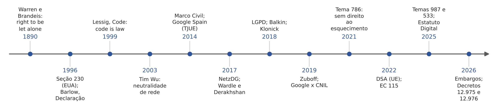
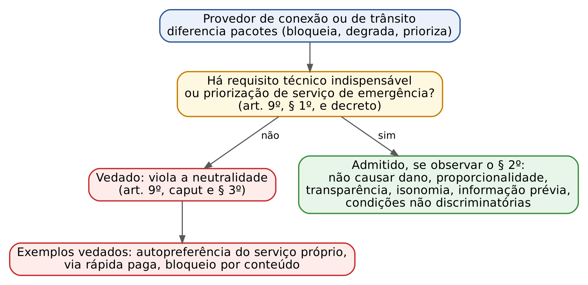
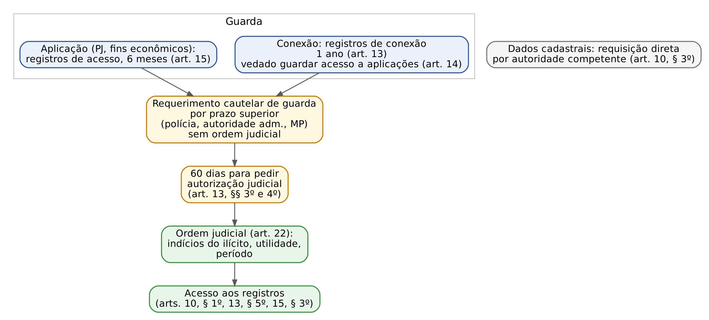
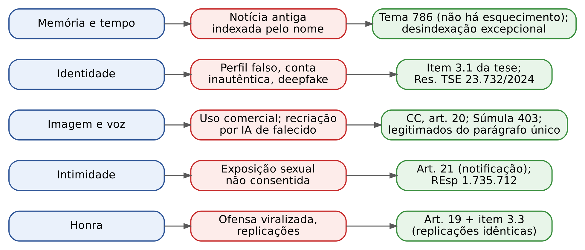
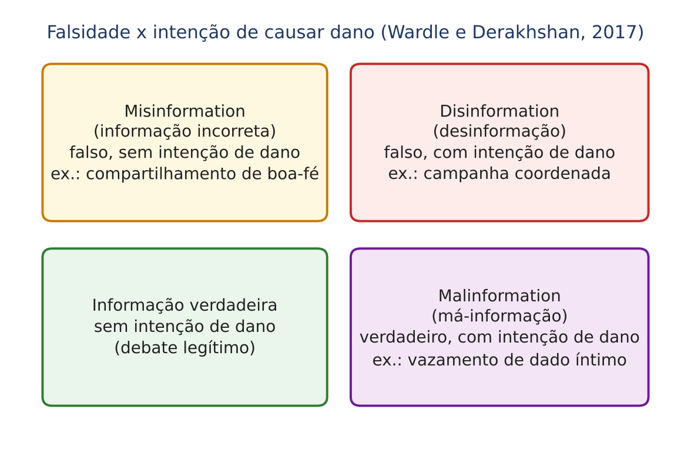
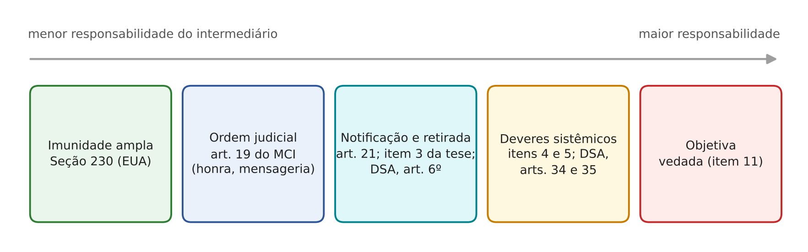
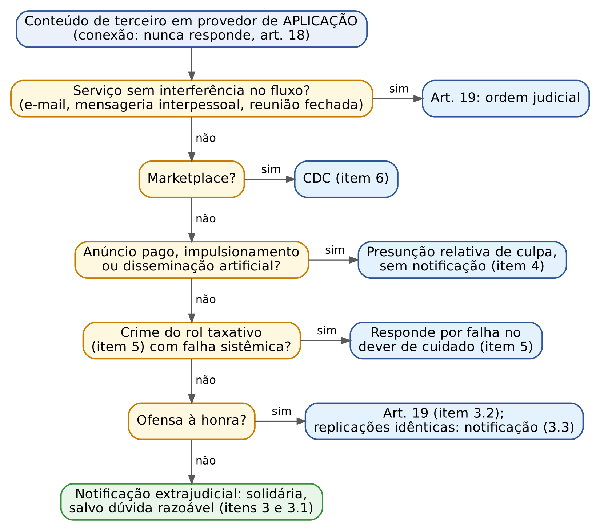

# CAPÍTULO 34 — DIREITOS FUNDAMENTAIS NO AMBIENTE DIGITAL: EXPRESSÃO, PRIVACIDADE, PLATAFORMAS E PROVEDORES

:::INCIDENCIA
TRF5 p. F.6. Nível A. Lote de 41 questões (FGV 40, FCC 1), entre elas TRF5 2025 (Juiz Federal), TJSC 2024 (Juiz Substituto), MPE-RJ 2025 (Promotor) e DPE-RJ 2026 (Defensor).
O que mais cai: letra do Marco Civil (fundamentos x princípios, neutralidade, prazos de guarda de registros, requisitos do art. 22), art. 19 e sua releitura pelos Temas 987 e 533, art. 21 (nudez íntima), moderação privada e *shadowbanning*, crianças na rede, soberania e efeitos extraterritoriais.
:::

| Subtema | FGV | FCC | Padrão de cobrança |
|---|---|---|---|
| Fundamentos, princípios e objetivos do MCI; MCI x LGPD; princípios internacionais | 5 | 0 | troca art. 2º x art. 3º |
| Neutralidade de rede (art. 9º) | 5 | 0 | exceções; priorização paga |
| Guarda e requisição de registros (arts. 13 a 17 e 22) | 7 | 0 | prazos; guarda x acesso |
| Sanções, extraterritorialidade e soberania (arts. 11 e 12) | 3 | 0 | art. 12; efeito global |
| Atuação do Poder Público e inclusão digital (arts. 24 a 28) | 4 | 0 | deveres do Estado |
| Art. 19, Temas 987 e 533, responsabilidade civil | 8 | 1 | ordem x notificação; honra |
| Moderação de conteúdo, desinformação, regulação comparada | 4 | 0 | termos de uso; *shadowbanning* |
| Nudez íntima (art. 21), crianças e adolescentes | 2 | 0 | notificação; *sharenting* |
| Personalidade digital: esquecimento, desindexação, imagem recriada por IA | 2 | 0 | Tema 786; imagem de falecido |

## 34.1 A esfera pública digital: chave de leitura humanística

### 34.1.1 Por que o tema está em "formação humanística"

O ambiente digital não é um "lugar" novo onde se aplicam os velhos direitos: ele altera a estrutura dos próprios direitos. Três transformações:

- Intermediação privada da palavra: plataformas que não produzem o conteúdo o ordenam, ampliam, reduzem ou suprimem por algoritmos; quem governa a esfera pública já não é só o Estado.
- Escala, permanência e replicabilidade: a ofensa é copiada e recuperável indefinidamente; a indenização posterior torna-se insuficiente, e ganha centro a tutela inibitória e de remoção.
- Dados como matéria-prima: a publicidade direcionada converte comportamento em dado e privacidade em questão econômica.

A consequência dogmática é a eficácia reforçada dos direitos fundamentais nas relações privadas (eficácia "diagonal", diante do poder assimétrico da plataforma) e a proibição de proteção insuficiente, eixo do STF ao rever o art. 19 (34.7). Eficácia horizontal: Apostila de Direito Constitucional, Cap. 7; expressão, privacidade e sigilos: Cap. 9 da mesma apostila.

### 34.1.2 Autores e conceitos que a banca pode atribuir

| Autor e obra | Tese central | Conceito-chave |
|---|---|---|
| Jürgen Habermas, *Mudança estrutural da esfera pública* (1962) e *Uma nova mudança estrutural da esfera pública e a política deliberativa* (2022) | As plataformas fragmentam a esfera pública em "semiesferas" sem filtro editorial, enfraquecendo a deliberação | esfera pública, deliberação |
| Lawrence Lessig, *Code and Other Laws of Cyberspace* (1999) | O comportamento na rede é regulado por quatro modalidades: lei, normas sociais, mercado e ARQUITETURA; o código de *software* regula como lei | *code is law* |
| Tim Wu, artigo de 2003 sobre neutralidade e discriminação em banda larga; *The Attention Merchants* (2016) | Cunhou "neutralidade de rede"; depois, descreveu a economia que vende a atenção do usuário a anunciantes | *net neutrality*, economia da atenção |
| Eli Pariser, *The Filter Bubble* (2011) | A personalização algorítmica isola o usuário em informação que confirma suas preferências | bolha de filtro |
| Cass Sunstein, *Republic.com* (2001) e *#Republic* (2017) | A autosseleção de fontes produz câmaras de eco e polarização de grupo | câmaras de eco, polarização |
| Shoshana Zuboff, *The Age of Surveillance Capitalism* (2019) | O capitalismo de vigilância extrai "excedente comportamental" para produzir previsões vendidas no mercado | capitalismo de vigilância |
| Jack Balkin, "Free Speech Is a Triangle" (2018) | A liberdade de expressão deixou de ser díade (Estado x falante) e virou triângulo: Estado, plataformas e falantes; o Estado pressiona plataformas, que censuram colateralmente | regulação "nova escola", censura colateral, fiduciários da informação |
| Kate Klonick, "The New Governors" (2018) | As plataformas são os novos governantes do discurso, com regras, processos e burocracia próprios de moderação | moderação como governança |
| Anu Bradford, *The Brussels Effect* (2020) | A União Europeia exporta sua regulação pelo mercado | Efeito Bruxelas (34.6.4) |

:::DOUTRINA Lawrence Lessig, Code and Other Laws of Cyberspace (1999)
No ciberespaço, a arquitetura é o *software*: quem escreve o código decide o que se pode fazer, ver e dizer, muitas vezes sem os controles democráticos da lei; a liberdade na rede depende de escolhas de projeto, e o Estado pode regular indiretamente, regulando o código. É o oposto do ciberlibertarismo de John Perry Barlow (*Declaração de Independência do Ciberespaço*, 1996); por isso é errado atribuir a Lessig a primazia das empresas na definição das políticas para a internet (Q2511965, adiante).
:::

:::DOUTRINA Jack Balkin, "Free Speech Is a Triangle" (Columbia Law Review, 2018)
A "regulação de nova escola" atua sobre os intermediários, não sobre o falante. Riscos: censura colateral (o intermediário remove em excesso para não responder pelo conteúdo alheio) e censura privada (governo do discurso por termos de uso e algoritmos opacos). Resposta normativa: transparência, devido processo na moderação e plataformas como "fiduciários da informação". O esquema explica as duas críticas opostas ao art. 19 do Marco Civil: proteção insuficiente da vítima (se nada se deve fazer sem ordem judicial) e incentivo à remoção excessiva (se qualquer notificação gera responsabilidade).
:::

:::QUESTAO FGV 2024 — Câmara dos Deputados — Consultor Legislativo, Área XIV (Q2511965)
Cobrado: governança e políticas públicas para a internet. Gabarito: D (a internet abre novas modalidades de produção cultural, e a governança deve preservar espaços de produção e gestão de informação, o que exige examinar *software*, direitos autorais e patentes).
Armadilhas: uniformidade global (A), dirigismo estatal do discurso (B), comércio eletrônico imune à regulação nacional (C) e primazia das empresas atribuída a Lessig (E).
No mesmo sentido: Q2511970 (E: liberdade de expressão e livre fluxo de informações, proteção de dados e privacidade, acesso universal e segurança contra crimes cibernéticos são todos princípios internacionalmente aceitos; os quatro itens corretos).
:::

### 34.1.3 Soberania, jurisdição e governança multissetorial

A arquitetura distribuída e a governança técnica privada da internet alimentaram a tese ciberlibertária, desmentida pela experiência: os Estados impõem suas leis às atividades com ponto de contato no território. No Brasil, a governança segue o modelo multissetorial (Estado, setor empresarial, sociedade civil e academia) do Comitê Gestor da Internet no Brasil (CGI.br), positivado como diretriz do art. 24, I, do Marco Civil, e a aplicação territorial da lei é definida pelo critério do art. 11 (34.2.5).

:::QUESTAO FGV 2024 — Câmara dos Deputados — Consultor Legislativo, Área XIV (Q2511967)
Cobrado: soberania na governança da internet. Gabarito: C (cada país pode impor suas próprias leis e regulamentações ao uso da internet dentro de suas fronteiras).
Armadilhas: soberania irrelevante numa rede global (A, a tese de Barlow), regras idênticas em todos os países (B), proibição universal de limites ao discurso (D) e precedência sempre das normas internacionais (E).
:::

## 34.2 O Marco Civil da Internet: arquitetura de direitos

### 34.2.1 Gênese, natureza e estrutura

A Lei 12.965, de 23/4/2014, resultou de consulta pública aberta pela internet a partir de 2009 e teve tramitação acelerada após as revelações de Edward Snowden (2013) sobre vigilância em massa; daí ser chamada de "Constituição da internet" e citada como exemplo de democracia digital (Q2457312). É lei de PRINCÍPIOS, DIREITOS E DEVERES, não de proteção de dados (LGPD, Cap. 33) nem penal.

| Capítulo | Conteúdo | Artigos |
|---|---|---|
| I | Disposições preliminares: fundamentos, princípios, objetivos, definições, interpretação | 1º a 6º |
| II | Direitos e garantias dos usuários | 7º e 8º |
| III | Provisão de conexão e de aplicações: neutralidade; proteção de registros, dados e comunicações; responsabilidade por conteúdo de terceiros; requisição judicial de registros | 9º a 23 |
| IV | Atuação do Poder Público | 24 a 28 |
| V | Disposições finais (controle parental, tutela coletiva, direitos autorais, vigência) | 29 a 32 |

A Medida Provisória 1.068/2021 pretendeu alterar o Marco Civil para restringir a moderação de conteúdo pelas plataformas (exigindo "justa causa" para remoção e suspensão de contas). Foi devolvida pelo Presidente do Congresso Nacional em setembro de 2021 e perdeu eficácia; os dispositivos que ela inseriu aparecem riscados nas compilações. O regulamento vigente é o Decreto 8.771/2016, atualizado em 2026 pelos Decretos 12.975 e 12.976 (34.6.3).

### 34.2.2 Fundamentos, princípios e objetivos

A banca explora a TROCA entre as listas: fundamentos (art. 2º) legitimam a disciplina; princípios (art. 3º) orientam a aplicação; objetivos (art. 4º) são metas a promover.

| Fundamentos (art. 2º) | Princípios (art. 3º) | Objetivos (art. 4º) |
|---|---|---|
| Caput: respeito à liberdade de expressão, "bem como": | I: liberdade de expressão, comunicação e manifestação do pensamento, nos termos da CF | I: direito de acesso à internet a todos |
| I: reconhecimento da escala mundial da rede | II: proteção da privacidade | II: acesso à informação, ao conhecimento e à participação na vida cultural e na condução dos assuntos públicos |
| II: direitos humanos, desenvolvimento da personalidade e exercício da cidadania em meios digitais | III: proteção dos dados pessoais, na forma da lei | III: inovação e fomento à ampla difusão de novas tecnologias |
| III: pluralidade e diversidade | IV: preservação e garantia da neutralidade de rede | IV: adesão a padrões tecnológicos abertos (comunicação, acessibilidade, interoperabilidade) |
| IV: abertura e colaboração | V: preservação da estabilidade, segurança e funcionalidade da rede, por medidas técnicas compatíveis com padrões internacionais e estímulo a boas práticas | |
| V: livre iniciativa, livre concorrência e defesa do consumidor | VI: responsabilização dos agentes de acordo com suas atividades, nos termos da lei | |
| VI: finalidade social da rede | VII: preservação da natureza participativa da rede | |
| | VIII: liberdade dos modelos de negócios, desde que não conflitem com os demais princípios | |

O parágrafo único do art. 3º é cláusula de abertura (os princípios "não excluem outros" do ordenamento ou dos tratados), e o art. 6º fixa cânone hermenêutico próprio: "a natureza da internet, seus usos e costumes particulares e sua importância para a promoção do desenvolvimento humano, econômico, social e cultural".

:::PEGADINHA Fundamentos, princípios e objetivos
(1) Liberdade de expressão é fundamento (art. 2º, caput) E princípio (art. 3º, I), nunca "irrestrita": o art. 3º, VI, manda responsabilizar os agentes conforme suas atividades. (2) "Finalidade social da rede" é FUNDAMENTO. (3) Neutralidade é PRINCÍPIO, com regra própria (art. 9º). (4) Modelos de negócio: princípio CONDICIONADO, nunca "prevalente". (5) Segurança é princípio do MCI e também da LGPD (art. 6º, VII).
:::

:::QUESTAO FGV 2026 — ALERJ — Procurador Legislativo (Q3880840)
Cobrado: leitura sistemática do art. 3º. Gabarito: D (a responsabilização dos agentes observa a natureza de suas atividades, nos termos da lei, sem prejuízo da liberdade de expressão e da natureza participativa da rede).
Armadilhas: liberdade de expressão que afasta toda responsabilização (A); neutralidade que proíbe qualquer gerenciamento técnico de tráfego (B), quando o art. 9º, § 1º, admite discriminação por requisitos técnicos indispensáveis; modelo de negócio "autônomo e prevalente" (C); privacidade como princípio "exclusivo" do MCI, sem complementação (E), contra o parágrafo único do art. 3º.
No mesmo sentido: Q2474127 (C: preservação da estabilidade, segurança e funcionalidade da rede; errada a "garantia irrestrita" da expressão e a neutralidade descrita como escolha de pacotes "em função do conteúdo"), Q2511929 (C: a letra do art. 6º; os provedores não informam periodicamente à Justiça os dados coletados nem fornecem dados continuamente ao governo).
:::

:::QUESTAO FGV 2026 — PC-PR — Agente de Polícia Judiciária (Q4375126)
Cobrado: relação entre Marco Civil e LGPD. Gabarito: A (o MCI estabelece princípios e direitos na internet; a LGPD traz regras detalhadas sobre o tratamento de dados pessoais).
Armadilhas: B reduz os direitos do titular na LGPD a acesso e correção (o art. 18 é muito mais amplo, Cap. 33); C inverte os papéis das leis; D diz que a neutralidade é central "em ambos", mas ela é tema exclusivo do MCI; E nega a segurança como princípio da LGPD (art. 6º, VII).
:::

### 34.2.3 Direitos dos usuários (arts. 7º e 8º)

O art. 7º abre com a premissa: "O acesso à internet é essencial ao exercício da cidadania". O rol combina privacidade (sigilo do fluxo e das comunicações armazenadas, salvo ordem judicial; não fornecimento de dados a terceiros sem consentimento livre, expresso e informado; exclusão ao fim da relação), consumo (não suspensão salvo débito; qualidade contratada; CDC) e acessibilidade. O regime processual do acesso a comunicações armazenadas está na Apostila de Processo Penal, Cap. 17.

O art. 8º é cláusula de nulidade: são nulas de pleno direito as cláusulas que ofendam a inviolabilidade e o sigilo das comunicações privadas ou que, em contrato de adesão, não ofereçam a alternativa do FORO BRASILEIRO para serviços prestados no Brasil; é o dispositivo que afasta a eleição de foro estrangeiro em termos de uso.

### 34.2.4 Neutralidade de rede (art. 9º)

Neutralidade é o dever do responsável pela transmissão, comutação ou roteamento de "tratar de forma isonômica quaisquer pacotes de dados, sem distinção por conteúdo, origem e destino, serviço, terminal ou aplicação" (art. 9º, caput). A ideia, difundida por Tim Wu, protege a liberdade de acesso (o provedor de conexão não escolhe o que o usuário vê), a concorrência (sem autopreferência nem "vias rápidas" pagas) e a inovação (o novo serviço chega nas mesmas condições do incumbente).

:::LEI Lei 12.965/2014, art. 9º, §§ 1º a 3º
"§ 1º A discriminação ou degradação do tráfego será regulamentada nos termos das atribuições privativas do Presidente da República previstas no inciso IV do art. 84 da Constituição Federal, para a fiel execução desta Lei, ouvidos o Comitê Gestor da Internet e a Agência Nacional de Telecomunicações, e somente poderá decorrer de: I - requisitos técnicos indispensáveis à prestação adequada dos serviços e aplicações; e II - priorização de serviços de emergência. [...] § 3º Na provisão de conexão à internet, onerosa ou gratuita, bem como na transmissão, comutação ou roteamento, é vedado bloquear, monitorar, filtrar ou analisar o conteúdo dos pacotes de dados, respeitado o disposto neste artigo."
O § 2º impõe, nas hipóteses de diferenciação admitidas: não causar dano (art. 927 do CC), proporcionalidade, transparência e isonomia, informação prévia aos usuários sobre o gerenciamento de tráfego e condições comerciais não discriminatórias, sem condutas anticoncorrenciais.
:::

:::PEGADINHA Neutralidade
(1) Só duas exceções, por DECRETO, ouvidos CGI.br e Anatel: nada de "serviços essenciais" em geral ou "maior demanda". (2) Gerenciamento técnico por segurança e estabilidade é admitido, se proporcional, transparente e isonômico. (3) Planos com velocidades diferentes não violam a isonomia entre pacotes. (4) O dever é de quem transmite, comuta ou roteia, não do usuário. (5) "Priorização paga" e "vias rápidas" são o que a neutralidade PROÍBE.
:::

:::QUESTAO FGV 2026 — AL-RO — Analista Legislativo, Engenharia de Computação (Q3882846)
Cobrado: provedor de acesso que prioriza pacotes de seu próprio serviço de vídeo sobre concorrentes. Gabarito: C (neutralidade de rede). É o caso típico de autopreferência pelo dono da infraestrutura, vedado pelo art. 9º e agravado pelo dever de não praticar condutas anticoncorrenciais (§ 2º, IV); a redução de custos de tráfego não é requisito técnico indispensável.
No mesmo sentido: Q3641982 (C: conceito de neutralidade descrito em texto jornalístico), Q3171968 (B: tratar todos os pacotes da mesma forma, sem discriminação por conteúdo, origem ou destino; erradas a priorização por demanda, o bloqueio sem ordem e a priorização de serviços essenciais em detrimento dos demais), Q2511927 (A: letra do caput; o § 3º VEDA bloquear e filtrar; não há dever do "usuário" de acessar sites; a neutralidade não se restringe a *streaming*), Q2511968 (C, assinalada por ser a INCORRETA: a neutralidade não favorece, antes impede, a priorização paga de tráfego).
:::

### 34.2.5 Registros, dados e comunicações: privacidade como arquitetura (arts. 10 a 17, 22 e 23)

O Marco Civil organiza a privacidade em torno de três categorias de informação, com graus crescentes de proteção, e de dois tipos de provedor. Definições (art. 5º): registro de conexão é o conjunto de informações sobre data e hora de início e término de uma conexão, sua duração e o IP utilizado (VI); registro de acesso a aplicações é o conjunto de informações sobre data e hora de uso de determinada aplicação a partir de determinado IP (VIII). Dados cadastrais (qualificação pessoal, filiação e endereço) e CONTEÚDO de comunicações privadas são categorias distintas.

| Item | Provedor de conexão | Provedor de aplicação |
|---|---|---|
| Dever de guarda | Registros de CONEXÃO, pelo administrador de sistema autônomo, por 1 ano, sob sigilo, em ambiente controlado e de segurança; responsabilidade intransferível (art. 13, caput e § 1º) | Registros de ACESSO A APLICAÇÕES, por 6 meses, se pessoa jurídica que exerça a atividade de forma organizada, profissionalmente e com fins econômicos (art. 15, caput) |
| O que é vedado guardar | Registros de acesso a aplicações (art. 14) | Registros de acesso a OUTRAS aplicações sem consentimento prévio; dados pessoais excessivos em relação à finalidade consentida (art. 16) |
| Ampliação da guarda | Autoridade policial ou administrativa ou MP pode requerer cautelarmente guarda por prazo superior (art. 13, § 2º) | Ordem judicial pode obrigar, por tempo certo, provedor NÃO sujeito ao caput, quanto a fatos específicos em período determinado (art. 15, § 1º); autoridade policial ou administrativa ou MP pode requerer cautelarmente a QUALQUER provedor de aplicação, inclusive por prazo superior (art. 15, § 2º) |
| Prazo para buscar a ordem | 60 dias do requerimento para pedir a autorização judicial de acesso; sem pedido ou com indeferimento, o requerimento perde eficácia; sigilo do provedor sobre o requerimento (art. 13, §§ 3º e 4º, aplicáveis ao art. 15 por remissão do § 2º) | idem |
| Acesso (disponibilização) | Sempre precedido de autorização judicial (art. 13, § 5º) | Sempre precedido de autorização judicial (art. 15, § 3º) |
| Não guardar | — | A opção por não guardar, ressalvadas as hipóteses legais, NÃO implica responsabilidade pelos danos decorrentes do uso por terceiros (art. 17) |

Três camadas de acesso: (1) dados cadastrais podem ser requisitados diretamente pelas autoridades administrativas com competência legal (art. 10, § 3º); (2) registros, associados ou não a dados pessoais, só com ordem judicial (art. 10, § 1º), observado o art. 22; (3) conteúdo de comunicações privadas só com ordem judicial "nas hipóteses e na forma que a lei estabelecer" (art. 10, § 2º). O juiz deve garantir o sigilo das informações recebidas e pode decretar segredo de justiça, inclusive quanto aos pedidos de guarda (art. 23).

:::LEI Lei 12.965/2014, art. 22
"Art. 22. A parte interessada poderá, com o propósito de formar conjunto probatório em processo judicial cível ou penal, em caráter incidental ou autônomo, requerer ao juiz que ordene ao responsável pela guarda o fornecimento de registros de conexão ou de registros de acesso a aplicações de internet. Parágrafo único. Sem prejuízo dos demais requisitos legais, o requerimento deverá conter, sob pena de inadmissibilidade: I - fundados indícios da ocorrência do ilícito; II - justificativa motivada da utilidade dos registros solicitados para fins de investigação ou instrução probatória; e III - período ao qual se referem os registros."
:::

:::PEGADINHA Os números e os verbos dos arts. 13 a 15
(1) Não há prazo único, nem de 3, 5 ou 12 meses para aplicação. (2) O histórico de navegação não é do provedor de conexão (art. 14). (3) Guarda cautelar não é acesso; Tribunal de Contas e notários não estão no rol. (4) A ordem do art. 15, § 1º, é "por tempo certo". (5) O art. 22 serve a processo JUDICIAL cível ou penal e não exige "dados sensíveis" nem "cadastro completo". (6) Porta lógica: o STJ exige sua guarda (Cap. 31, 31.6.3), e o Decreto 12.975/2026 a positivou no regulamento (art. 15-A do Decreto 8.771/2016), independentemente de requisição prévia.
:::

:::QUESTAO FGV 2026 — SES-TO — Tecnólogo (Q4434710)
Cobrado: prazos e titulares do dever de guarda. Gabarito: A (administrador de sistema autônomo guarda registros de conexão por 1 ano; provedor de aplicação pessoa jurídica com fins econômicos, registros de acesso por 6 meses).
Armadilhas: prazo único de 6 meses (B); requisição direta de registros por polícia ou MP sem ordem judicial (C, confunde guarda cautelar com acesso); vedação de guarda cautelar por prazo superior (D, contra o art. 15, § 2º).
No mesmo sentido: Q4375786 (D: 6 meses para o provedor de aplicação com fins econômicos; o de conexão guarda por 1 ano, não 6 meses; não guarda histórico de navegação; o provedor de aplicação não depende de ordem para guardar; não há prazo comum de 5 anos), Q2511928 (A: 6 meses, sob sigilo, em ambiente controlado e de segurança; não "de forma pública"; a lei fixa o prazo), Q3882847 (B: guarda de 1 ano e fornecimento dependente de autorização judicial; não é opcional, não depende de consentimento, e o fundamento é o MCI, não a LGPD).
:::

:::QUESTAO FGV 2026 — TJ-BA — Juiz Leigo (Q4102106)
Cobrado: guarda de registros de acesso na provisão de aplicações. Gabarito: C (autoridade policial, administrativa ou MP podem requerer cautelarmente a QUALQUER provedor de aplicações a guarda, inclusive por prazo superior a 6 meses).
Passos: (1) a opção por não guardar NÃO gera responsabilidade (art. 17), o que derruba A; (2) a ordem judicial do § 1º é por tempo certo e para fatos específicos, não por tempo indeterminado (B); (3) Tribunal de Contas e serventias extrajudiciais não figuram entre os legitimados, e não há prazo de 4 meses (D); (4) o prazo do caput é de 6 meses, não 12 (E).
:::

:::QUESTAO FGV 2024 — DATAPREV — Advocacia (Q3085880)
Caso: titular de patente quer, por notificação ao *marketplace*, obter registros e dados do vendedor de produto contrafeito. Gabarito: C (é preciso ordem judicial, em requerimento com fundados indícios do ilícito, justificativa motivada da utilidade e período).
Armadilhas: fornecimento espontâneo (A) ou por notificação extrajudicial (B); dispensa de proteção mediante simples indícios apresentados ao provedor (D); inexistência de prazo e de sigilo (E, contra os arts. 15 e 10).
No mesmo sentido: Q2511931 (B: letra do art. 22, caput; erradas a finalidade de "processo administrativo", a exigência de dados sensíveis e a "solicitação administrativa").
:::

O art. 11 é a norma de conexão territorial do MCI: basta que PELO MENOS UM ato de coleta, armazenamento, guarda ou tratamento de registros, dados ou comunicações ocorra no território, ou que haja um terminal no Brasil (§ 1º), para que se apliquem a lei brasileira e os direitos à privacidade e ao sigilo, ainda que a pessoa jurídica seja sediada no exterior, desde que oferte serviço ao público brasileiro ou tenha integrante do grupo com estabelecimento no País (§ 2º). O art. 12 sanciona as infrações aos arts. 10 e 11, "de forma isolada ou cumulativa": advertência com prazo para medidas corretivas (I); multa "de até 10% (dez por cento) do faturamento do grupo econômico no Brasil no seu último exercício, excluídos os tributos" (II); suspensão temporária (III) ou proibição (IV) das atividades. Filial ou estabelecimento no País responde solidariamente pela multa da estrangeira (parágrafo único).

:::QUESTAO FGV 2024 — DATAPREV — Analista de Tecnologia da Informação (Q3085849)
Cobrado: sanções do art. 12. Gabarito: B (a advertência tem face repressiva e corretiva, porque indica prazo para medidas de regularização).
Armadilhas: sanções só isoladas (A: podem ser isoladas OU cumulativas); "censura" à pessoa natural proprietária (C: não existe essa sanção); multa FIXADA em 10% sobre a média de três exercícios (D: é "de até" 10% do faturamento do ÚLTIMO exercício); vácuo quanto a empresas estrangeiras (E: o parágrafo único as alcança, com solidariedade da filial).
:::

O art. 12 também é invocado nas ordens de suspensão de aplicativos. Dois marcos no STF: a ADI 5.527 e a ADPF 403 (bloqueios do WhatsApp por descumprimento de ordens de entrega de mensagens criptografadas), cujo julgamento começou em 2020 com votos dos relatores, Ministra Rosa Weber e Ministro Edson Fachin, contrários ao bloqueio, e, retomado em sessão virtual em abril de 2024, foi deslocado para o plenário físico por pedido de destaque do Ministro Flávio Dino (19/4/2024), o que reinicia a votação; não se confirmou conclusão até 12/11/2026; e a suspensão do X em todo o território nacional, decretada em 30/8/2024 após reiterado descumprimento de ordens e não pagamento de multas, referendada por unanimidade pela Primeira Turma em 2/9/2024 (STF, Pet 12.404). O debate é de proporcionalidade: a suspensão atinge milhões de usuários alheios ao ilícito e deve ser a última medida, depois de multas e constrição patrimonial.

:::QUESTAO FGV 2025 — TRF 5ª Região — Juiz Federal Substituto (Q3373927)
Caso: empresa brasileira de cosméticos obtém ordem judicial de retirada de vídeo que lhe imputava falsamente testes cruéis em animais; executada a decisão, o vídeo continua acessível a internautas de países importadores. Gabarito oficial: D (a avaliação da ofensa de decisão doméstica à soberania estrangeira não cabe ao Judiciário brasileiro).
Passos: (1) o juiz decide segundo a lei brasileira e a conexão do art. 11 do MCI; se os efeitos da decisão ofendem a soberania de outro Estado, quem o diz é este, por seus mecanismos de reconhecimento de decisões estrangeiras (aqui, a homologação pelo STJ); (2) A erra: o art. 19, § 3º, do PIDCP admite restrições também pelo "respeito dos direitos e da reputação das demais pessoas"; (3) B presume ofensa automática; C cria requisito inexistente; E confunde o art. 11 (quando se aplica a lei brasileira) com eficácia das decisões no exterior.
Para a prova oral: o Tribunal de Justiça da União Europeia negou dever de desindexação mundial pelo buscador (Google x CNIL, 2019), mas admitiu remoção mundial de conteúdo difamatório idêntico ou equivalente, nos limites do direito internacional (Glawischnig-Piesczek x Facebook, 2019). Formulação discutível (ver nota).
:::

### 34.2.6 Atuação do Poder Público e inclusão digital (arts. 24 a 28)

O capítulo IV converte o acesso em política pública. O art. 24 fixa diretrizes (governança multissetorial e CGI.br, interoperabilidade, padrões e dados abertos, infraestrutura e centros de dados no País, capacitação, serviços por múltiplos canais), e o art. 25 orienta as aplicações públicas (acessibilidade, leitura por máquina, participação social). O dever constitucional de educação inclui a capacitação para o uso "seguro, consciente e responsável da internet" (art. 26); as iniciativas de cultura digital devem promover inclusão, reduzir desigualdades, "sobretudo entre as diferentes regiões do País", e fomentar conteúdo nacional (art. 27); e o Estado deve periodicamente formular estudos e fixar "metas, estratégias, planos e cronogramas" (art. 28). A Política Nacional de Educação Digital (Lei 14.533/2023) desenvolve o art. 26; a exclusão digital como barreira de acesso à justiça e o Balcão Virtual estão no Cap. 29.

:::QUESTAO FGV 2024 — TRF 1ª Região — Analista Judiciário, Inspetor de Polícia Judicial (Q3037180)
Cobrado: deveres do Estado diante da desigualdade de acesso e de uso seguro. Gabarito: E (são exigíveis do Estado a formulação e o fomento de estudos e a fixação de metas, estratégias, planos e cronogramas, art. 28).
Armadilhas: todas as demais transferem à iniciativa privada ou rebaixam a "faculdade" deveres que a lei impõe ao Estado: educação para uso seguro (art. 26), inclusão de idosos e de locais remotos (arts. 24 e 27) e fomento ao conteúdo nacional (art. 27, III), que NÃO contraria o "espírito" da lei.
No mesmo sentido: Q3049894 (E: os três itens reproduzem os arts. 24, VII, 27 e 26), Q3641978 (B: dados de acesso por região revelam que universalização e redução das desigualdades regionais são desafios, à luz dos arts. 4º, I, e 27, II; a desigualdade não é questão de "liberdade de expressão", não "contribui para a finalidade social" e não prova neutralidade).
:::

## 34.3 Liberdade de expressão e direito à informação na rede

### 34.3.1 O que muda quando a expressão é digital

O regime constitucional da expressão (liberdade sem controle prévio, responsabilidade posterior, vedação do anonimato, posição preferencial, padrões de culpa qualificados para a imprensa, discurso de ódio) está na Apostila de Direito Constitucional, Cap. 9 (09.2), e não se repete aqui. No ambiente digital, cinco particularidades alteram a ponderação:

- Qualquer pessoa é emissora em massa, sem filtro editorial; os padrões de culpa grave da imprensa (ADIs 6.792 e 7.055; Tema 995) não se estendem automaticamente ao usuário comum.
- O problema desloca-se da EXISTÊNCIA da mensagem para a sua DISTRIBUIÇÃO (invisibilização algorítmica, impulsionamento pago).
- A vedação do anonimato (art. 5º, IV) realiza-se pela rastreabilidade (34.2.5), não por identificação civil prévia de todo usuário.
- A permanência da informação lícita reabre o debate sobre esquecimento e desindexação (34.4.3).
- A indisponibilização é a tutela específica (art. 497 do CPC) do mundo digital, e sua delimitação (URL, alcance, prazo) é o núcleo da decisão (34.7.5).

O direito à informação (informar, informar-se e ser informado) aparece no MCI como objetivo (art. 4º, II), como transparência ativa do Estado em formato aberto (art. 24, VI) e como direito do usuário a informações claras sobre dados e políticas de uso (art. 7º, VI, VIII e XI). Transparência e comunicação do Judiciário: Cap. 4.

:::QUESTAO FGV 2024 — Câmara dos Deputados — Consultor Legislativo, Área XIV (Q2511930)
Cobrado: liberdade de expressão no MCI. Gabarito: D (o MCI protege a liberdade de expressão dentro dos limites da lei, salientando sua importância para as relações *online* e para a democracia, e estabelece sistema próprio de responsabilidade civil por conteúdo de terceiros).
Armadilhas: censura prévia pelo STF "para proteger a moral" (A); remissão da responsabilidade dos provedores ao Código Civil (B: o sistema é do próprio MCI, arts. 18 a 21, hoje relido pelo STF); monitoramento contínuo obrigatório (C: não há dever geral de monitoramento); relatórios trimestrais de "publicações polêmicas" ao Ministério da Justiça (E).
:::

:::QUESTAO FCC 2025 — Prefeitura de São Paulo — Analista de Planejamento, TI (Q3281591)
Caso: consumidor critica em rede social o serviço de entrega de empresa, relatando falhas recorrentes; a empresa pede ao provedor a remoção por dano reputacional. Gabarito: B (o provedor precisa remover as críticas somente após ordem judicial específica).
Leitura atual: a resposta sobrevive aos Temas 987 e 533, porque crítica de consumidor é, em regra, expressão lícita, e a alegação de ofensa à honra segue o art. 19 (item 3.2). O STJ aplicou essa lógica a site de reclamações, que não responde automaticamente por reclamações legítimas, ainda que negativas (REsp n. 2.225.111, Terceira Turma, j. 1/9/2026, conforme a Apostila de Direito Civil, Cap. 26). Erradas: remoção imediata a pedido de empresa (A), por pedido escrito (C), liberdade total do provedor (D) e consulta ao Procon (E).
:::

:::EXEMPLO O magistrado como usuário de redes sociais
Juiz comenta em perfil pessoal, aberto, a repercussão de vídeo viral que critica decisão de colega em caso ainda pendente, e "curte" publicações que atacam a parte vencedora. Solução: a expressão do magistrado na rede é limitada pelos deveres de reserva e de imparcialidade, inclusive aparente; é vedado opinar sobre processo pendente, seu ou de outrem (LOMAN, art. 36, III), e a Resolução CNJ 305/2019 leva a vedação às redes, alcançando reações e compartilhamentos que sinalizem adesão. Regime completo: Caps. 11 e 12; desinformação contra o Judiciário: Cap. 4.
:::

## 34.4 Privacidade, honra, imagem e identidade no ambiente digital

### 34.4.1 Da privacidade como isolamento à privacidade como controle

A trajetória do *right to be let alone* (Warren e Brandeis, 1890) à autodeterminação informativa (1983), ao controle do fluxo em Rodotà e ao direito fundamental autônomo (EC 115/2022) está em 33.1 (v. Cap. 33). Acrescenta-se aqui a integridade contextual de Helen Nissenbaum (*Privacy in Context*, 2010): o fluxo de informação é legítimo quando respeita as normas do contexto em que ela foi compartilhada.

A ideia de integridade contextual resolve muitos casos digitais melhor que a dicotomia público x privado: a foto publicada para amigos, o dado fornecido para cadastro de saúde ou a imagem captada em local público não se tornam livres para QUALQUER uso só porque foram acessíveis em algum momento. É a mesma lógica da LGPD ao exigir, para dados tornados públicos, respeito à finalidade, à boa-fé e ao interesse público que justificaram a disponibilização (art. 7º, §§ 3º e 4º; Cap. 33).

### 34.4.2 Honra e imagem: o dano que se replica

Os bens do art. 5º, X, da CF (intimidade, vida privada, honra e imagem) e a tutela dos arts. 12, 17, 20 e 21 do CC estão desenvolvidos na Apostila de Direito Civil, Cap. 4. Na rede, quatro problemas próprios:

- Viralização e replicação: a mesma ofensa ressurge em centenas de URLs. O STF respondeu no item 3.3 da tese dos Temas 987 e 533: reconhecida judicialmente a ofensa, as redes devem remover as replicações IDÊNTICAS a partir de notificação judicial ou extrajudicial, sem nova decisão (34.7.3).
- Exposição sexual não consentida: violação gravíssima da intimidade, com recorte de gênero. O art. 21 do MCI excepciona o regime da ordem judicial: basta notificação do participante ou de seu representante legal. Para o STJ, o rosto não evidenciado é irrelevante para o dano moral, e a exposição pornográfica não se limita à nudez total (STJ, REsp n. 1.735.712, Relatora Ministra Nancy Andrighi, Terceira Turma, j. 19/5/2020; v. Apostila de Direito Civil, Cap. 4). Tipos penais: Cap. 31.
- Imagem comercial: dano presumido pelo uso não autorizado com fins econômicos (Súmula 403 do STJ; Apostila de Direito Civil, Cap. 4).
- Ataques coordenados: o dano soma condutas individualmente menores; separar a responsabilidade de cada participante e a do provedor (disseminação artificial, item 4 da tese).

### 34.4.3 Esquecimento x desindexação

O STF rejeitou o direito ao esquecimento como categoria autônoma no caso Aída Curi: é incompatível com a Constituição o poder de obstar, pela passagem do tempo, a divulgação de fatos verídicos e licitamente obtidos, em meios analógicos ou digitais, ressalvado o exame caso a caso de excessos e abusos (STF, RE n. 1.010.606, Tema 786, Relator Ministro Dias Toffoli, Plenário, j. 11/2/2021; tese e desindexação em detalhe na Apostila de Direito Civil, Cap. 4, 04.10 e 04.11, e na de Direito Constitucional, Cap. 9). O quadro que a prova oral exige:

| | Esquecimento (rejeitado no Tema 786) | Desindexação |
|---|---|---|
| Objeto | Impedir a divulgação do fato em si, em qualquer meio | Desvincular resultado do buscador de determinado critério de pesquisa (em regra, o nome) |
| Efeito sobre o conteúdo | Supressão ou proibição de circulação | O conteúdo permanece na fonte, acessível por outros caminhos |
| Fundamento | Mera passagem do tempo | Proporcionalidade diante de dado desatualizado, irrelevante ou sem interesse público, quando o nome é o único critério de busca |
| Origem comparada | *droit à l'oubli* | Caso Google Spain (González), TJUE, 13/5/2014; art. 17 do RGPD (direito ao apagamento) |
| No Brasil | Incompatível com a CF como pretensão genérica | Admitida excepcionalmente pelo STJ (por exemplo, REsp n. 2.242.808, Terceira Turma, j. 14/4/2026, Informativo 887, conforme a Apostila de Direito Civil, Cap. 26) |

:::QUESTAO FGV 2024 — AL-PR — Procurador (Q2448979)
Cobrado: jurisprudência sobre MCI e personalidade; pede-se a INCORRETA. Gabarito: E (é falso que a tese do direito ao esquecimento venha "sendo confirmada" pelos tribunais superiores: o STF a declarou incompatível com a Constituição no Tema 786).
As demais são corretas: desindexação não se confunde com esquecimento (A); exposição pornográfica não consentida não se limita à nudez total nem à conjunção carnal (B) e o rosto não evidenciado é irrelevante para o dano (C), ambas do REsp 1.735.712; D apresenta o conceito doutrinário de esquecimento, sem afirmar sua acolhida.
:::

### 34.4.4 Identidade digital: perfis falsos, conteúdo sintético e pessoa falecida

Identidade digital é o conjunto de atributos pelos quais a pessoa é reconhecida (nome, imagem, voz, reputação, perfis, biometria). Três ameaças típicas:

- Contas inautênticas e perfis falsos: usurpam identidade alheia ou fabricam identidades para manipular o debate. Na tese dos Temas 987 e 533, as contas "denunciadas como inautênticas" atraem o regime da notificação extrajudicial (item 3.1), salvo se o núcleo for ofensa à honra (item 3.2).
- Conteúdo sintético (*deepfake*): áudio, vídeo ou imagem gerados ou manipulados por IA para atribuir a alguém o que não disse ou não fez. No processo eleitoral, a Resolução TSE 23.732/2024 inseriu na Resolução TSE 23.610/2019 a rotulagem explícita do conteúdo sintético na propaganda (art. 9º-B), a vedação de conteúdo fabricado ou manipulado para difundir fatos notoriamente inverídicos e de *deepfake* para prejudicar ou favorecer candidatura, "ainda que mediante autorização", sob pena de abuso de poder e cassação (art. 9º-C), e a responsabilidade solidária dos provedores que não indisponibilizarem certos conteúdos no período eleitoral (art. 9º-E). Tipos penais com IA: Cap. 31 (31.4.4); IA e direitos da personalidade: Cap. 30 (30.4.3).
- Pessoa falecida recriada por IA: a imagem sintética é imagem da pessoa retratada, e a tutela post mortem cabe aos legitimados por direito próprio.

:::QUESTAO FGV 2024 — TJ-SC — Juiz Substituto (Q3049342)
Caso: comercial com atletas brasileiros falecidos recriados por IA generativa recebendo medalhas olímpicas. Gabarito: E (sem solução legal específica, aplicam-se os direitos da personalidade: cônjuge, ascendentes ou descendentes podem pedir a cessação e perdas e danos, com presunção de prejuízo).
O ponto humanístico: a lacuna da lei sobre IA não gera vazio de tutela (art. 4º da LINDB e cláusula geral dos direitos da personalidade); a recriação digital é exploração de imagem e voz; o fim comercial atrai a Súmula 403. A resolução em passos, com a distinção entre os legitimados do art. 12, parágrafo único, e do art. 20, parágrafo único, e a refutação de cada alternativa, está na Apostila de Direito Civil, Cap. 4 (box desta mesma questão). Herança digital (contas e perfis após a morte): Apostila de Direito Civil, Cap. 42.
:::

## 34.5 Desinformação

### 34.5.1 Conceito: a taxonomia da desordem informacional

"*Fake news*" é expressão imprecisa e politizada. A literatura e os organismos internacionais preferem o quadro de Claire Wardle e Hossein Derakhshan (*Information Disorder*, relatório para o Conselho da Europa, 2017), que cruza dois critérios: a FALSIDADE do conteúdo e a INTENÇÃO de causar dano.

| Categoria | Falso? | Intenção de causar dano? | Exemplo |
|---|---|---|---|
| *Misinformation* (informação incorreta) | Sim | Não | Usuário compartilha, de boa-fé, falso remédio contra doença |
| *Disinformation* (desinformação em sentido estrito) | Sim | Sim | Campanha coordenada de vídeos fabricados contra a urna eletrônica |
| *Malinformation* (má-informação) | Não (verdadeiro) | Sim | Vazamento de dado íntimo verdadeiro para expor e humilhar; contexto deliberadamente distorcido |

Consequência: ao erro de boa-fé, risco do debate livre, responde-se em regra com contradiscurso, checagem e rotulagem, sob pena de efeito inibidor (*chilling effect*); a desinformação dolosa e organizada atinge bens coletivos (integridade eleitoral, saúde pública) e justifica medidas mais intensas; a má-informação é problema de privacidade e honra, não de verdade. "Pós-verdade" (palavra do ano do Dicionário Oxford em 2016) designa o ambiente em que fatos objetivos influenciam menos a opinião do que apelos à emoção e à crença pessoal; os mecanismos de bolha de filtro e câmaras de eco (34.1.2) explicam sua difusão.

### 34.5.2 Respostas institucionais e seus limites

Os instrumentos vão da checagem e rotulagem (menos restritivos) à redução de alcance, desmonetização, remoção, suspensão de contas e sanções administrativas ou penais; quanto mais intenso, maior o risco de censura colateral e de o Estado definir a "verdade", e por isso maior a exigência de lei, taxatividade e controle posterior. A educação midiática é indispensável, mas insuficiente sozinha.

O modelo brasileiro combina três frentes já validadas pelo STF e desenvolvidas na Apostila de Direito Constitucional, Cap. 9 (09.2.6): (1) poder normativo do TSE contra a desinformação que atinja a integridade do processo eleitoral, com controle posterior e restrito ao período eleitoral (ADI 7.261, sobre a Resolução TSE 23.714/2022), complementado pelas regras sobre IA de 2024 (34.4.4); (2) sanção administrativa estadual à desinformação sanitária (ADI 7.639, j. 26/6/2026); (3) responsabilidade dos provedores reconfigurada pelos Temas 987 e 533 (34.7), que inclui no rol de dever de cuidado os atos antidemocráticos e a presunção relativa de culpa por impulsionamento e por disseminação inorgânica. Não há lei geral de combate à desinformação: o PL 2.630/2020 não foi aprovado e segue na Câmara "pronto para pauta no Plenário", sem deliberação desde a retirada de pauta de 2/5/2023.

:::PEGADINHA Desinformação
(1) Desinformação NÃO é sinônimo de qualquer conteúdo falso: o critério da intenção separa *disinformation* de *misinformation*. (2) Remover desinformação NÃO exige, sempre, violação de lei: a plataforma pode fazê-lo com base em termos de uso (Q3085879, abaixo). (3) A remoção por termos de uso não se rege pelos arts. 19 e 21 do MCI, que tratam de RESPONSABILIDADE do provedor por conteúdo de terceiro, não de LEGITIMIDADE da moderação voluntária. (4) O controle do TSE é posterior, não censura prévia.
:::

:::QUESTAO FGV 2024 — DATAPREV — Advocacia (Q3085879)
Caso: rede social, após checagem, classifica postagens de usuário como desinformação e as remove. Gabarito: E (prevista nos termos de uso a remoção de desinformação, o provedor pode implementar a moderação, e não se aplicam os arts. 19 e 21 do MCI).
Passos: (1) o art. 19 define quando o provedor RESPONDE por não remover; não proíbe a remoção voluntária (A e B); (2) a aplicação regular dos termos não gera dever de indenizar (C); (3) o art. 21 trata de nudez, não de desinformação (D). O STJ qualificou como exercício regular de direito (art. 188, I, do CC) a remoção, sem ordem judicial, de vídeos de desinformação médica contrários às políticas aceitas pelo usuário (STJ, REsp n. 2.139.749, Relator Ministro Ricardo Villas Bôas Cueva, Terceira Turma, j. 27/8/2024, Informativo 823). Limite: a moderação deve respeitar devido processo e não pode ser discriminatória (34.6.2).
:::

## 34.6 Plataformas e moderação de conteúdo

### 34.6.1 Conceito e técnicas

Moderação de conteúdo é o conjunto de regras, processos e tecnologias pelos quais o provedor decide o que circula, com que alcance e com que consequências para o autor. Klonick a descreve como governança privada do discurso (termos de uso como legislação, moderadores e sistemas automatizados como administração, instâncias recursais); Tarleton Gillespie (*Custodians of the Internet*, 2018) sustenta que moderar não é acessório, mas o próprio produto que as plataformas oferecem.

| Técnica | O que faz | Observação jurídica |
|---|---|---|
| Remoção (indisponibilização) | Retira o conteúdo | A medida do art. 19 do MCI; exige comunicação ao autor (art. 20) |
| Rotulagem e contexto | Acrescenta aviso ou checagem | Menos restritiva; preferível para *misinformation* |
| Redução de alcance (rebaixamento) | Diminui a distribuição algorítmica | Legítima se transparente; vira *shadowbanning* se oculta |
| Desmonetização | Retira a receita publicitária | Afeta criadores profissionais; exige regra clara |
| Suspensão ou banimento de conta (*deplatforming*) | Exclui o falante | Medida mais grave; proporcionalidade e reiteração |
| Moderação *ex ante* (filtros de *upload*) | Impede a publicação | Próxima do controle prévio; usada para abuso sexual infantil e direitos autorais |

*Shadowbanning* é a redução deliberada e OCULTA da visibilidade do conteúdo ou da conta, sem notificação ao usuário, que continua a publicar sem saber que ninguém o vê. O problema não é a redução de alcance em si, mas a opacidade: o usuário não sabe que foi sancionado, não conhece o motivo e não pode se defender.

:::QUESTAO FGV 2024 — DATAPREV — Advocacia (Q3085878)
Cobrado: *shadowbanning* contra usuário que viola reiteradamente os termos de uso. Gabarito: D (sua proibição decorre da liberdade de expressão, da vedação de censura e da exigência de transparência do provedor).
Armadilhas: equiparação a moderação legítima por remoção (A); definição errada, como notificação prévia ao usuário (B), quando é justamente o oposto; legitimidade se feito por humano e não por algoritmo (C); legitimidade por mera previsão nos termos de uso, pela autonomia privada (E): a autonomia não afasta a eficácia dos direitos fundamentais nem o dever de transparência (arts. 7º, XI, e 20 do MCI).
:::

### 34.6.2 Fundamento e limites da moderação privada

A plataforma modera porque é titular de livre iniciativa e de liberdade de organização do serviço, e porque o contrato com o usuário (termos de uso) define as regras de convivência. Mas o contrato é de adesão, o poder é assimétrico e o espaço é, de fato, parte da esfera pública: daí a eficácia horizontal reforçada dos direitos fundamentais. A síntese da jurisprudência e das questões:

- A plataforma PODE remover sem ordem judicial o conteúdo que viole termos de uso claros e prévios (exercício regular de direito, 34.5.2), mas de modo proporcional e compatível com os direitos fundamentais: sem discriminação, perseguição política arbitrária ou remoção imotivada.
- Devido processo: o art. 20 do MCI manda comunicar ao autor os motivos da indisponibilização com informações que permitam o contraditório e a ampla defesa em juízo, e, a pedido, substituir o conteúdo pela motivação; a tese dos Temas 987 e 533 exige sistema de notificações, devido processo e relatórios anuais de transparência (itens 7 a 10), e assegura ao usuário que teve o conteúdo removido o pedido de restabelecimento.
- O controle judicial da moderação é de legalidade e proporcionalidade, não de conveniência editorial.

:::QUESTAO FGV 2024 — Prefeitura de Macaé — Procurador (Q3049962)
Caso: usuários acionam a plataforma por remoção baseada em termos de uso que proíbem comportamentos violentos. Gabarito: D (as plataformas podem remover conteúdos que violem expressamente os termos de uso, sem ordem judicial, desde que a remoção esteja claramente prevista, não infrinja direitos fundamentais nem a proporcionalidade, sendo recomendável justificação).
Armadilhas: só duas hipóteses legais de remoção sem ordem (A); autonomia total, imune ao Judiciário (B); remoção sem ordem só para nudez (C); toda remoção dependente de decisão judicial (E). O erro comum das quatro é confundir o regime de RESPONSABILIDADE do provedor (quando ele deve indenizar por não remover) com a LICITUDE da remoção voluntária.
:::

### 34.6.3 Deveres estruturais e a regulação de 2026

Depois dos Temas 987 e 533, a regulação brasileira passou do modelo reativo (responder após ordem) para um modelo de deveres estruturais, próximo da lógica europeia: os itens 7 a 10 da tese impõem autorregulação (notificações, devido processo, relatórios anuais de transparência), canais acessíveis e sede e representante legal no Brasil (texto na Apostila de Direito Civil, Cap. 26), deveres que os decretos de 2026 incorporaram ao regulamento (arts. 16-A e 20-A do Decreto 8.771/2016).

Os Decretos 12.975 e 12.976, de 20/5/2026 (DOU de 21/5/2026; vigência sessenta dias após a publicação), atualizaram o regulamento do Marco Civil (Decreto 8.771/2016):

- Decreto 12.975/2026 (insere os arts. 15-A, 16-A a 16-P, 19-A e 20-A no Decreto 8.771/2016): guarda da porta lógica de origem junto com o IP (art. 15-A); sede e representante legal, pessoa jurídica, no País e canal de denúncia permanente (art. 16-A); responsabilidade por FALHA SISTÊMICA na indisponibilização imediata do rol de crimes graves do item 5 da tese (34.7.3), não por conteúdo isolado (art. 16-B, § 3º); gestão de riscos sistêmicos (art. 16-C); notificação com requisitos sob pena de nulidade e decisão motivada ao notificante e ao autor, com contestação (arts. 16-D e 16-E); remoção, após notificação, de conteúdo criminoso, EXCETO crimes contra a honra, podendo o provedor mantê-lo em dúvida razoável (art. 16-G); ordem judicial específica (art. 19 do MCI) para honra e para e-mail, mensageria interpessoal e videoconferência restrita (arts. 16-J e 16-O); responsabilidade presumida por anúncios, impulsionamentos e redes artificiais (art. 16-L) e guarda dos dados de anúncios por um ano (art. 16-M).
- Decreto 12.976/2026: diretrizes para a proteção de mulheres na internet; falha sistêmica quanto a crimes contra a mulher (art. 4º); remoção de conteúdo íntimo não autorizado, inclusive gerado por IA, em até DUAS HORAS da notificação da vítima ou de seu representante (advogado, polícia, MP, Defensoria), com marcação para bloquear o reenvio (art. 7º); redução de alcance de ataques coordenados de ofício (art. 8º); vedação de gerar conteúdo íntimo de terceiro por IA (art. 9º); prazos transitórios de seis e vinte e quatro horas (art. 12).
- ANPD: a Agência Nacional de Proteção de Dados (Cap. 33, 33.13) regula, fiscaliza e apura infrações aos deveres dos provedores (art. 19-A do Decreto 8.771/2016; art. 14 do Decreto 12.976/2026), em atuação SISTÊMICA: é-lhe vedado notificar provedores para moderação de conteúdos de forma isolada (art. 16-I, parágrafo único); já era a autoridade do Estatuto Digital (Decreto 12.622/2025).

:::QUESTAO FGV 2026 — PC-PR — Agente de Polícia Judiciária (Q4375116)
Cobrado: o "estado da arte" normativo do MCI (MP 1.068/2021 devolvida, Temas 987 e 533, Decretos 8.771/2016, 12.975/2026 e 12.976/2026). Gabarito: B (só a III: a ANPD assumiu posição central e expressa na regulação, fiscalização e apuração de infrações das plataformas).
Passos: (1) a I reproduz a letra original do art. 19 ("exclusivamente após ordem judicial específica"), que deixou de ser a regra geral depois do julgamento de 2025 (hoje, ordem judicial só para honra, mensageria interpessoal e serviços sem interferência no fluxo; 34.7.3); (2) a II erra duas vezes: o provedor não responde "sempre" (item 11 da tese veda a responsabilidade objetiva) e os serviços de telecomunicações que não sejam provimento de conexão não estão no regime; (3) a III corresponde ao papel atribuído à ANPD pelos decretos de 2026.
:::

### 34.6.4 Modelos comparados e o Efeito Bruxelas

| Modelo | Regra | Exemplo |
|---|---|---|
| Imunidade ampla | O intermediário não é tratado como editor do conteúdo de terceiro e pode moderar de boa-fé sem perder a proteção | Estados Unidos, Seção 230 do *Communications Decency Act* (1996) |
| Ordem judicial (*judicial notice and takedown*) | Só responde se descumprir ordem específica | Brasil, art. 19 do MCI na redação original |
| Notificação e retirada (*notice and takedown*) | Responde se, ciente por notificação, não age com diligência | União Europeia, Diretiva 2000/31 (comércio eletrônico) e art. 6º do DSA; Brasil, art. 21 do MCI e regra geral da tese de 2025 |
| Prazos curtos de remoção | Remoção de conteúdo "manifestamente ilícito" em 24 horas, sob multa | Alemanha, NetzDG (2017) |
| Deveres de cuidado sistêmicos | Avaliação e mitigação de riscos, auditoria, transparência, proteção de crianças | União Europeia, DSA (Regulamento 2022/2065); Brasil, itens 4, 5 e 7 a 10 da tese e Decretos de 2026 |
| Responsabilidade objetiva | Responde por todo conteúdo hospedado | Rejeitado expressamente pelo STF (item 11) |

:::DOUTRINA Regulamento (UE) 2022/2065, Digital Services Act (DSA)
Mantém a isenção condicionada do provedor de hospedagem (art. 6º) e a vedação de obrigação geral de monitoramento (art. 8º) e acrescenta deveres em camadas: notificação e ação e fundamentação das decisões de moderação (arts. 16 e 17), reclamação interna e solução extrajudicial (arts. 20 e 21), sinalizadores de confiança (art. 22), vedação de interfaces manipuladoras (art. 25), transparência de publicidade e de recomendação (arts. 26 e 27) e proteção de crianças e adolescentes (art. 28). Plataformas e buscadores de muito grande dimensão (45 milhões ou mais de destinatários mensais ativos na União, art. 33) avaliam e mitigam RISCOS SISTÊMICOS e se submetem a auditoria independente (arts. 34, 35 e 37). A "falha sistêmica" brasileira segue a mesma gramática.
:::

O Efeito Bruxelas (Anu Bradford) explica a globalização da regulação europeia: mercado grande, capacidade regulatória, padrões rigorosos, inelasticidade do alvo regulado e INDIVISIBILIDADE da conduta (adotar padrão único global sai mais barato que segmentar). Faces: *de facto* (empresas adotam o padrão europeu no mundo todo) e *de jure* (outros Estados o copiam, muitas vezes sob pressão das empresas já adaptadas); RGPD e LGPD são o exemplo clássico, e DSA e AI Act (Cap. 30) seguem o caminho.

:::QUESTAO FGV 2024 — AL-TO — Procurador Jurídico (Q2457311)
Cobrado: Efeito Bruxelas. Gabarito: D (II e III corretas).
Passos: (1) I erra ao atribuir o efeito aos Estados Unidos, e não à UNIÃO EUROPEIA; (2) II e III reproduzem os elementos e as faces *de facto* e *de jure* descritos acima.
:::

## 34.7 Responsabilidade civil dos provedores

### 34.7.1 Categorias

O MCI distingue provedor de CONEXÃO (habilita o terminal, atribuindo ou autenticando IP) e provedor de APLICAÇÕES (oferece funcionalidades acessadas por terminal conectado: redes sociais, buscadores, hospedagem, vídeos, mensageria, *marketplaces*). O provedor de conexão "não será responsabilizado civilmente por danos decorrentes de conteúdo gerado por terceiros" (art. 18), regra não atingida pelo STF. Conteúdo PRÓPRIO e defeito do serviço seguem CC e CDC; o problema específico é o conteúdo de TERCEIRO (dogmática, legitimidade e pedidos: Apostila de Direito Civil, Cap. 26).

### 34.7.2 Evolução em três tempos

| Período | Regime | Fundamento |
|---|---|---|
| Antes do MCI (fatos até junho de 2014) | Responsabilidade solidária do provedor que, notificado extrajudicialmente, não removia o conteúdo em prazo razoável | Jurisprudência do STJ (culpa por omissão); continua a reger fatos anteriores à lei |
| MCI, redação original | Responsabilidade só após descumprimento de ordem judicial específica (art. 19), com exceções: nudez e atos sexuais privados por notificação do participante (art. 21) e direitos autorais regidos pela legislação autoral até lei específica (arts. 19, § 2º, e 31) | Opção legislativa "para assegurar a liberdade de expressão e impedir a censura" |
| Temas 987 e 533 (efeitos a partir da publicação da ata, em 5/8/2025; embargos julgados em 17/6/2026) | Art. 19 parcialmente inconstitucional; regime escalonado por tipo de conteúdo e de serviço | Proteção insuficiente de direitos fundamentais e da democracia |

:::LEI Lei 12.965/2014, art. 19, §§ 3º e 4º, e art. 21, parágrafo único
O caput e o § 1º do art. 19 e o caput do art. 21 estão transcritos na Apostila de Direito Civil, Cap. 26 (26.5.1).
"§ 3º As causas que versem sobre ressarcimento por danos decorrentes de conteúdos disponibilizados na internet relacionados à honra, à reputação ou a direitos de personalidade, bem como sobre a indisponibilização desses conteúdos por provedores de aplicações de internet, poderão ser apresentadas perante os juizados especiais. § 4º O juiz, inclusive no procedimento previsto no § 3º, poderá antecipar, total ou parcialmente, os efeitos da tutela pretendida no pedido inicial, existindo prova inequívoca do fato e considerado o interesse da coletividade na disponibilização do conteúdo na internet, desde que presentes os requisitos de verossimilhança da alegação do autor e de fundado receio de dano irreparável ou de difícil reparação."
Art. 21, "Parágrafo único. A notificação prevista no caput deverá conter, sob pena de nulidade, elementos que permitam a identificação específica do material apontado como violador da intimidade do participante e a verificação da legitimidade para apresentação do pedido."
:::

### 34.7.3 Temas 987 e 533: o regime atual em síntese

O STF julgou em conjunto o RE 1.037.396 (Tema 987, Relator Ministro Dias Toffoli, perfil falso no Facebook) e o RE 1.057.258 (Tema 533, Relator Ministro Luiz Fux, comunidade ofensiva no extinto Orkut, caso anterior ao MCI) e declarou o art. 19 parcialmente inconstitucional, por proteção insuficiente a bens jurídicos constitucionais de alta relevância, fixando tese de 14 itens, ajustada no julgamento dos embargos de declaração em 17/6/2026. A tese integral, os ajustes dos embargos e a jurisprudência do STJ posterior estão na Apostila de Direito Civil, Cap. 26 (26.5.2 e 26.5.3); aqui, o mapa de decisão e a leitura humanística.

| Situação | Regime | Item da tese |
|---|---|---|
| Crime ou ato ilícito em geral (conteúdo de terceiro) | Responsabilidade solidária, nos termos do art. 21, após notificação extrajudicial, se não remover; salvo dúvida razoável sobre a ilicitude após diligência qualificada | 3 |
| Conta denunciada como inautêntica | Igual à regra geral | 3.1 |
| Crime ou ilícito civil CONTRA A HONRA | Art. 19: responsabilidade só após ordem judicial (a remoção por notificação continua possível) | 3.2 |
| Replicações idênticas de ofensa já reconhecida judicialmente | Remoção por notificação judicial ou extrajudicial, sem nova decisão | 3.3 |
| E-mail e mensageria (comunicações interpessoais), reuniões fechadas por vídeo ou voz, serviços sem interferência no fluxo | Art. 19 | 3.4 |
| Anúncios e impulsionamentos pagos; redes artificiais de distribuição (robôs) | Presunção RELATIVA de culpa, independentemente de notificação; afasta-se provando atuação diligente e em tempo razoável | 4 |
| Rol taxativo de crimes graves (atos antidemocráticos, terrorismo, induzimento ao suicídio ou à automutilação, discriminação, crimes contra a mulher em razão do sexo, crimes sexuais contra vulneráveis, pornografia infantil e crimes graves contra crianças e adolescentes, tráfico de pessoas) | Dever de cuidado: responde por FALHA SISTÊMICA em indisponibilizar imediatamente; conteúdo isolado ou atomizado segue o item 3 | 5 |
| *Marketplace* | CDC | 6 |
| Natureza | Não há responsabilidade objetiva | 11 |

Leitura humanística em quatro pontos, úteis para a prova oral:

- Argumento vencedor: proibição de proteção insuficiente. A imunidade condicionada à ordem judicial transferia à vítima o custo da demora, quando o dano se multiplica em horas, e premiava a inércia de quem lucra com o engajamento.
- Argumento vencido (votos divergentes e crítica doutrinária): censura colateral (Balkin). Se a notificação gera responsabilidade, a plataforma remove tudo o que é notificado, inclusive discurso lícito incômodo, porque o custo de manter é dela e o benefício é do usuário.
- A solução escalonada concilia os dois: art. 19 onde a ilicitude depende de ponderação delicada (honra, crítica, sátira) ou o provedor não interfere no fluxo; notificação onde a ilicitude é mais objetiva; dever de cuidado SISTÊMICO, não caso a caso, para os ilícitos mais graves.
- Apelo ao legislador (item 12) e caráter provisório (item 2) reabrem o debate sobre os limites da jurisdição constitucional que desenha regime regulatório (Cap. 25).

:::PEGADINHA O que a banca troca
(1) Inconstitucionalidade PARCIAL, não total. (2) Responsabilidade objetiva é vedada (item 11); a presunção do item 4 é relativa e de CULPA. (3) Honra continua no art. 19, mas a replicação idêntica de ofensa já reconhecida dispensa nova ordem. (4) O art. 18 (conexão) ficou intacto. (5) Mensageria interpessoal segue o art. 19. (6) Gabaritos anteriores a junho de 2025 com "só após ordem judicial" como regra geral estão DESATUALIZADOS, salvo honra.
:::

:::QUESTAO FGV 2026 — ALERJ — Procurador Legislativo (Q3880839)
Caso: rede social, ciente por comunicação extrajudicial clara e individualizada de publicações com discurso de ódio, racismo e incitação à violência contra grupo social, mantém o conteúdo alegando que só removeria com ordem judicial. Gabarito: B (a exigência de ordem judicial não subsiste de forma absoluta; cabe responsabilização quando, diante de conteúdo manifestamente ilícito e grave, há omissão injustificada após ciência inequívoca).
Passos: (1) o conteúdo é crime (Lei 7.716/1989), do rol do item 5 e da regra geral do item 3; (2) não é honra individual (3.2); (3) A e E reproduzem a redação original; C exige participação ativa; D fala em responsabilidade objetiva, vedada pelo item 11.
:::

:::QUESTAO FGV 2026 — DPE-RJ — Defensor Público (Q4289391)
Caso: defensora de direitos humanos obtém sentença transitada em julgado determinando a remoção de publicação difamatória; seis meses depois, dezenas de perfis replicam o conteúdo idêntico; ela notifica extrajudicialmente a plataforma, com as URLs e cópia da sentença; a plataforma fica inerte e alega que, por ser ofensa à honra, precisaria de nova ordem judicial para cada URL. Gabarito: B (sucessivas replicações de fato ofensivo já reconhecido judicialmente devem ser removidas a partir de notificação extrajudicial, sem novo provimento, sob responsabilidade subjetiva por descumprimento de dever legal de cuidado).
Passos: a honra atrai o art. 19 (item 3.2), MAS, já reconhecida a ofensa, o item 3.3 dispensa nova decisão para replicações idênticas (hoje também art. 16-J, parágrafo único, do Decreto 8.771/2016); a responsabilidade é subjetiva. Erradas: "falha sistêmica" (A, item 5), objetiva pelo CDC (C), irresponsabilidade (D) e prazo de 60 dias com modulação impeditiva (E).
:::

:::QUESTAO FGV 2025 — PGM-RJ — Analista de Procuradoria, Comunicação (Q3608295)
Cobrado: conteúdo do art. 19, declarado parcialmente inconstitucional em 26/6/2025 (o enunciado informa placar de 8 a 3). Gabarito: C (responsabilidade do provedor de aplicação por conteúdo de terceiro se, após ordem judicial específica, não tornar indisponível o conteúdo, ressalvadas disposições em contrário).
As demais alternativas reproduzem outros dispositivos do MCI: art. 22 (A), art. 27 (B), art. 9º, § 1º (D) e art. 11 (E). A alternativa C desloca o advérbio da lei ("apenas civilmente" em vez de "somente [...] se"), mas foi aceita por identificar o artigo.
:::

:::QUESTAO FGV 2024 — AL-SC — Analista Legislativo, Direito (Q2486015)
Caso: ofensa à honra em rede social; ação contra o ofensor e a rede no Juizado Especial Cível, com pedido de indenização e de remoção em tutela de urgência. Gabarito: B (a rede só responde se, após ordem judicial específica, não tornar indisponível o conteúdo).
Passos: (1) provedor de conexão não responde (art. 18), o que elimina A; (2) cabe tutela antecipada, inclusive no juizado (art. 19, § 4º), contra C; (3) o juizado é competente (§ 3º), contra D; (4) a ordem exige identificação clara e específica, sob pena de nulidade (§ 1º), contra E. Gabarito mantido depois de 2025, porque o caso é de honra (item 3.2).
:::

:::QUESTAO FGV 2024 — AL-TO — Procurador Jurídico (Q2457312)
Cobrado: sistema do art. 19 (verdadeiro ou falso). Gabarito: E (F, V, V).
Passos: (1) FALSA: o art. 19 condiciona a RESPONSABILIDADE, não a remoção, ao descumprimento de ordem judicial; a plataforma pode remover voluntariamente; (2) verdadeira: § 1º e URL; (3) verdadeira: a constitucionalidade era debatida, como se viu no julgamento de 2025.
No mesmo sentido, com ressalva de atualização: Q2511926 (D, prova de 2024: regra da ordem judicial com exceções de direitos autorais e imagens íntimas; hoje a regra geral para ilícitos é a notificação extrajudicial, item 3; erradas a responsabilidade por "riscos sistêmicos" sem notificação, a remoção em 24 horas por toda notificação, a exigência de parceria comercial e a suposta aplicação bem-sucedida do DSA por cinco anos).
:::

### 34.7.4 Nudez e atos sexuais privados (art. 21)

O art. 21 antecipou, em 2014, o modelo de notificação e retirada para a violação mais grave da intimidade. Requisitos: (1) conteúdo de terceiro com cenas de nudez ou de atos sexuais de caráter privado; (2) divulgação sem autorização dos participantes; (3) notificação pelo PARTICIPANTE ou seu REPRESENTANTE LEGAL, com elementos que permitam a identificação específica do material e a verificação da legitimidade, sob pena de nulidade (parágrafo único); (4) omissão em promover a indisponibilização de forma diligente, nos limites técnicos do serviço. A responsabilidade é SUBSIDIÁRIA pela letra do art. 21, que a tese usa como parâmetro para a regra geral solidária (item 3); vítima criança ou adolescente atrai também o item 5 (34.8), e o Decreto 12.976/2026 fixa, para conteúdo íntimo de mulheres, remoção em até duas horas (34.6.3).

:::QUESTAO FGV 2024 — DATAPREV — Advocacia (Q3085877)
Caso: adolescente e seu representante legal enviam cinco notificações à rede social sobre postagens de terceiros, não consentidas, em que ela aparece em cena de nudez. Gabarito: B (as notificações devem conter elementos que permitam verificar a legitimidade para o pedido, em relação às postagens mencionadas).
Passos: (1) o art. 21 exige identificação específica do material E verificação da legitimidade; (2) não há dever geral de monitoramento (A) nem de buscar outras postagens a partir da primeira notificação (D); (3) desmonetização e redução de alcance não são modalidades do art. 21 (C); (4) a responsabilidade decorre da NOTIFICAÇÃO do participante, não de ordem judicial (E). Atualização: para material de abuso sexual infantojuvenil (art. 241-A do ECA e correlatos), o item 5 da tese e o Estatuto Digital impõem deveres de cuidado e de remoção que vão além do art. 21 (34.8).
:::

### 34.7.5 O juiz diante do pedido de remoção

:::PASSO Roteiro para a decisão sobre remoção de conteúdo
1. Qualificar o serviço: conexão (art. 18), aplicação aberta, mensageria interpessoal, buscador, *marketplace* (CDC).
2. Qualificar o conteúdo: honra (art. 19), nudez íntima (art. 21), ilícito em geral (item 3), crime grave do rol (item 5), anúncio pago ou impulsionamento (item 4), crítica ou opinião lícita (não há o que remover).
3. Identificar o conteúdo: URLs ou outro meio que permita localização inequívoca (art. 19, § 1º); para conteúdo massivamente replicado, admite-se indicação por *hashtags* vinculadas (STJ, REsp n. 2.239.457, Terceira Turma, j. 14/4/2026, conforme a Apostila de Direito Civil, Cap. 26).
4. Ponderar interesse público, condição de pessoa pública, veracidade e risco de efeito inibidor; preferir a medida menos restritiva (desindexação, resposta) quando suficiente.
5. Tutela de urgência: art. 19, § 4º (prova inequívoca, verossimilhança, receio de dano, interesse da coletividade na disponibilidade), no rito comum ou no juizado.
6. Delimitar: prazo, alcance territorial, multa, guarda e fornecimento de registros para identificar o autor (art. 22), segredo de justiça quando necessário (art. 23).
:::

:::SENTENCA Tutela de urgência para indisponibilização de conteúdo ofensivo
Redação-modelo: "As publicações nas URLs indicadas imputam à autora, sem base fática demonstrada, a prática de crime e já foram replicadas, o que evidencia a probabilidade do direito e o perigo de dano. Tratando-se de ofensa à honra, incide o art. 19 da Lei 12.965/2014, como interpretado pelo STF nos Temas 987 e 533 (item 3.2), e não há interesse da coletividade na disponibilidade de imputação aparentemente falsa (art. 19, § 4º). Defiro a tutela para determinar à ré que, em 48 (quarenta e oito) horas, torne indisponíveis os conteúdos nas URLs indicadas, sob multa diária de 2.000 (dois mil) reais, e que guarde e forneça, em 10 (dez) dias, os registros de acesso e os dados cadastrais vinculados às contas responsáveis, no período de [...] (arts. 15 e 22). Advirto que replicações idênticas do mesmo conteúdo deverão ser removidas mediante simples notificação, judicial ou extrajudicial, independentemente de nova decisão (item 3.3 da tese)."
Erro que a banca e o tribunal punem: ordem genérica ("remover todo conteúdo ofensivo à autora"), nula pelo § 1º e equivalente a dever geral de monitoramento.
:::

## 34.8 Crianças e adolescentes no ambiente digital

### 34.8.1 Proteção integral em rede

A proteção integral (art. 227 da CF; art. 18 do ECA) projeta-se sobre a rede com três particularidades: a criança é titular de direitos digitais (participação, informação, expressão, privacidade), e não só objeto de proteção, como afirma o Comentário Geral n. 25 (2021) do Comitê dos Direitos da Criança da ONU; os riscos são de conteúdo, de contato (aliciamento), de conduta (*cyberbullying*, autoexposição) e de comércio (perfilamento, *loot boxes*); e quem expõe, muitas vezes, são os pais.

O Estatuto Digital (Lei 15.211/2025, em vigor desde 17/3/2026) está no Cap. 33 (33.14) e na Apostila de Direito da Criança e do Adolescente, Cap. 10. Ligações com este capítulo: deveres de projeto e configuração por padrão; retirada de conteúdo violador mediante notificação, sem ordem judicial, nas hipóteses legais; ANPD como autoridade administrativa, com suspensão e proibição reservadas ao Judiciário. O MCI já assegurava a livre escolha de controle parental e a educação para a inclusão digital de crianças e adolescentes (art. 29).

### 34.8.2 Remoção de conteúdo que atinge criança ou adolescente

Antes mesmo da tese do STF, o STJ afastou a exigência de ordem judicial quando o conteúdo ofensivo atinge criança ou adolescente: o provedor formalmente comunicado que não exclui a publicação responde, lido o art. 19 do MCI com o art. 227 da CF e o art. 18 do ECA (STJ, REsp n. 1.783.269, Relator Ministro Antonio Carlos Ferreira, Quarta Turma, j. 14/12/2021, Informativo 723; box próprio na Apostila de Direito da Criança e do Adolescente, Cap. 10). Depois de 2025, a orientação foi absorvida e ampliada: crimes sexuais contra vulneráveis e crimes graves contra crianças e adolescentes integram o rol do dever de cuidado (item 5), e o ilícito em geral contra criança segue a notificação extrajudicial (item 3).

### 34.8.3 *Sharenting* e adultização

*Sharenting* (de *share* e *parenting*) é a exposição habitual da vida dos filhos pelos pais nas redes; *oversharenting*, a superexposição. Opõe a expressão e o poder familiar à privacidade, à imagem, à identidade em formação e à segurança da criança, além do trabalho artístico monetizado (alvará: Cap. 33). Critério: melhor interesse; o poder familiar é função exercida no interesse do filho, não direito sobre a imagem dele. A "adultização" (erotização da imagem infantil em conteúdo monetizado) foi o fato social que acelerou a aprovação do Estatuto Digital em 2025.

:::QUESTAO FGV 2025 — MPE-RJ — Promotor de Justiça Substituto (Q3532377)
Caso: influenciadora com guarda unilateral superexpõe a rotina da filha; o pai notifica o provedor, que rejeita a denúncia; o pai e a criança pedem indenização contra a mãe e o provedor; a instrução comprova ostensivo exagero; o parecer é de fevereiro de 2025 (antes do julgamento do STF). Gabarito oficial: E (procedem os pedidos de ambos os autores, inclusive contra o provedor, o que pode ser reconhecido desde logo à luz do MCI em sua normatividade original, porque é dever de todos velar pelo melhor interesse da criança, que consta também da LGPD).
Passos: (1) a guarda unilateral não retira do pai o poder familiar, e o consentimento de um dos pais (art. 14, § 1º, da LGPD) não legitima exposição contrária ao melhor interesse (A); (2) não era preciso aguardar o STF (B), pois o STJ já lia o art. 19 com o ECA (REsp 1.783.269); (3) a criança sofre dano independentemente de compreender o ato (D); (4) entre C e E, a banca reconheceu também o dano do pai.
Gabarito discutível quanto ao dano moral PRÓPRIO do pai, ponto em que o fundamento é mais frágil que o da criança (registro na nota).
:::

:::EXEMPLO Pedido de remoção de vídeos de criança em perfil de terceiro
Avó publica, em perfil aberto e monetizado, vídeos diários do neto de 7 anos em situações de choro e castigo; a mãe notifica a plataforma, que só cumpriria ordem judicial. Solução: (1) conteúdo vexatório (art. 18 do ECA), não honra de adulto, de modo que não incide o item 3.2; (2) a notificação extrajudicial basta, sob pena de responsabilidade solidária (item 3; REsp 1.783.269), e a monetização atrai o Estatuto Digital; (3) o juiz pode ordenar a remoção, vedar novas publicações que identifiquem a criança e alcançar replicações; (4) o MP intervém (art. 178, II, do CPC).
:::

## 34.9 Resumo para revisão pré-prova

| Conceito, autor ou instituto | Ideia ou regra | Detalhes e pegadinhas | Fonte |
|---|---|---|---|
| Lessig | Lei, normas, mercado e arquitetura regulam; *code is law* | Não defende primazia das empresas | *Code* (1999) |
| Balkin | Expressão como triângulo: Estado, plataformas, falantes | Censura colateral; fiduciários da informação | "Free Speech Is a Triangle" (2018) |
| Fundamentos x princípios x objetivos | Art. 2º x art. 3º x art. 4º do MCI | Finalidade social é fundamento; neutralidade é princípio; acesso a todos é objetivo; rol aberto (art. 3º, parágrafo único) | Lei 12.965/2014 |
| Neutralidade | Isonomia de pacotes; exceções só técnicas e de emergência, por decreto | Vedado bloquear, monitorar, filtrar ou analisar conteúdo | MCI, art. 9º; Tim Wu |
| Guarda e requisição de registros | Conexão 1 ano; aplicação 6 meses (PJ com fins econômicos); acesso só com ordem judicial (indícios, utilidade, período) | Conexão não guarda acesso a aplicações; guarda cautelar sem ordem; 60 dias para pedir | MCI, arts. 13 a 17 e 22 |
| Aplicação territorial | Basta um ato no território ou um terminal no Brasil | Alcança estrangeira que oferte ao público brasileiro | MCI, art. 11 |
| Sanções | Advertência com prazo, multa de até 10% do último exercício, suspensão, proibição | Isoladas ou cumulativas; filial solidária na multa | MCI, art. 12 |
| Soberania | Juízo sobre ofensa à soberania alheia não cabe ao juiz brasileiro | Pacto admite restrição pela reputação alheia | Q3373927 (TRF5) |
| Esquecimento | Incompatível com a CF como poder de obstar fatos verídicos pela passagem do tempo | Abusos caso a caso; desindexação é outra coisa | Tema 786 |
| *Deepfake* eleitoral | Rotulagem obrigatória; vedação mesmo com autorização; cassação | Provedores solidários no período eleitoral | Res. TSE 23.732/2024 (arts. 9º-B, 9º-C, 9º-E da Res. 23.610) |
| Imagem de falecido por IA | Cônjuge, ascendentes ou descendentes; cessação e perdas e danos com presunção de prejuízo | Não é o espólio | Q3049342; Súmula 403 |
| Desordem informacional | Mis-, dis- e malinformation | Critérios: falsidade e intenção de dano | Wardle e Derakhshan (2017) |
| Moderação voluntária | Remoção por termos de uso é lícita, com proporcionalidade e devido processo | Não é hipótese dos arts. 19 e 21 | REsp 2.139.749; Q3049962 |
| *Shadowbanning* | Redução oculta de visibilidade | Vedado por opacidade | Q3085878 |
| DSA e Efeito Bruxelas | Deveres sistêmicos; plataformas com 45 milhões de usuários | *De facto* e *de jure*; é a UE, não os EUA | Reg. 2022/2065; Bradford |
| Art. 19 (original) | Responsabilidade só após ordem judicial específica com URL | Juizado e tutela antecipada (§§ 3º e 4º) | MCI |
| Temas 987 e 533 | Inconstitucionalidade parcial; regime escalonado | Notificação (regra), honra (art. 19), replicações (3.3), impulsionamento (presunção relativa), rol grave (falha sistêmica), *marketplace* (CDC), sem objetiva | STF, 2025; embargos 17/6/2026 |
| Art. 21 | Nudez e atos sexuais privados: notificação do participante | Identificação do material e legitimidade, sob pena de nulidade; subsidiária | MCI |
| Decretos 12.975 e 12.976/2026 | Regulamentam o MCI após o STF; violência digital contra a mulher | Falha sistêmica; honra só com ordem; conteúdo íntimo em 2 horas; ANPD sistêmica, sem notificar caso isolado | Decretos de 20/5/2026 (Decreto 8.771/2016, arts. 15-A a 20-A) |
| Crianças | Remoção após comunicação formal, sem ordem judicial | Item 5 inclui crimes graves contra crianças; Estatuto Digital | REsp 1.783.269; Lei 15.211/2025 |
| *Sharenting* | Exposição parental habitual | Melhor interesse limita o poder familiar | Q3532377 |

## 34.10 Artigos de lei e atos normativos incidentes

- Constituição Federal: art. 5º, IV, V, IX, X, XII, XIV, XXXIII e LXXIX; arts. 220 e 227.
- Lei 12.965/2014 (Marco Civil da Internet): arts. 2º a 4º, 5º, VI e VIII, 6º a 23, 24 a 29 e 31.
- Decreto 8.771/2016, atualizado pelos Decretos 12.975/2026 e 12.976/2026 (regulamento do MCI).
- Código Civil: arts. 12, 20 e 21; art. 188, I. Súmula 403 do STJ.
- ECA (Lei 8.069/1990): art. 18; arts. 240, 241-A a 241-D (remissão ao Cap. 31).
- Lei 15.211/2025 (Estatuto Digital da Criança e do Adolescente) e Decreto 12.622/2025 (remissão ao Cap. 33).
- Lei 13.709/2018 (LGPD): arts. 6º, VII, 7º, §§ 3º e 4º, e 14 (remissão ao Cap. 33).
- Lei 14.533/2023 (Política Nacional de Educação Digital).
- Resolução TSE 23.610/2019, arts. 9º-B, 9º-C e 9º-E, incluídos pela Resolução TSE 23.732/2024; Resolução TSE 23.714/2022.
- LOMAN, art. 36, III; Resolução CNJ 305/2019 (remissão ao Cap. 11).
- Pacto Internacional sobre Direitos Civis e Políticos, art. 19.
- Direito comparado: Seção 230 do *Communications Decency Act* (EUA, 1996); Diretiva 2000/31/CE; NetzDG (Alemanha, 2017); Regulamento (UE) 2022/2065 (DSA), arts. 6º, 8º, 16, 17, 20 a 22, 25 a 28 e 33 a 37.

## 34.11 Julgados, temas e súmulas do capítulo

- STF, Temas 987 e 533 (RE 1.037.396 e RE 1.057.258): mapa de decisão e leitura humanística (desenvolvimento integral na Apostila de Direito Civil, Cap. 26).
- STF, Tema 786 (RE 1.010.606): esquecimento incompatível com a CF; distinção com a desindexação.
- STF, Pet 12.404: suspensão do X em todo o território nacional (30/8/2024), referendada pela Primeira Turma em 2/9/2024.
- STF, ADI 5.527 e ADPF 403: bloqueio de aplicativos de mensagens; julgamento iniciado em 2020, destaque em 19/4/2024, pendente.
- STJ, REsp n. 2.139.749: remoção voluntária de desinformação médica como exercício regular de direito.
- Súmula 403 do STJ: dano presumido pelo uso comercial não autorizado da imagem.
- TJUE: Google Spain (2014), Google x CNIL e Glawischnig-Piesczek x Facebook (2019), como direito comparado.

Remissões a outros capítulos: REsp n. 1.735.712 e Tema 786 em detalhe (Apostila de Direito Civil, Cap. 4); REsp n. 1.783.269 (Apostila de Direito da Criança e do Adolescente, Cap. 10); privacidade como autodeterminação informativa (Cap. 33, 33.1); liberdade de expressão, imprensa, ADPF 130, Temas 995, 837 e 562, ADIs 6.792, 7.055, 7.261 e 7.639 (Apostila de Direito Constitucional, Cap. 9); eficácia horizontal e proteção insuficiente (Apostila de Direito Constitucional, Cap. 7); direitos da personalidade, Súmula 403 e Q3049342 (Apostila de Direito Civil, Cap. 4); tese integral dos Temas 987 e 533, direito de resposta e jurisprudência do STJ sobre provedores (Apostila de Direito Civil, Cap. 26); herança digital (Apostila de Direito Civil, Cap. 42); guarda de registros no processo penal (Apostila de Processo Penal, Cap. 17); Judiciário, mídia e desinformação contra a instituição (Cap. 4); redes sociais do magistrado (Cap. 11); ética e aparência de imparcialidade (Cap. 12); judicialização e ativismo (Cap. 25); perspectiva de gênero (Cap. 28); exclusão digital e acesso à justiça (Cap. 29); IA, conteúdo sintético e AI Act (Cap. 30); crimes cibernéticos, porta lógica e prova digital (Cap. 31); LGPD, ANPD e Estatuto Digital (Cap. 33); discurso de ódio e ADO 26 (Cap. 40); Estatuto Digital em detalhe (Apostila de Direito da Criança e do Adolescente, Cap. 10).

:::NOTA Notas de verificação
- Marco Civil (arts. 2º a 32) conferido na cópia do Planalto arquivada no Drive do usuário (21/10/2026).
- Temas 987 e 533: itens 1 a 6 e 11 conferidos no documento de redação da tese divulgado em junho de 2026; os demais itens seguem a Apostila de Direito Civil, Cap. 26. A data de conclusão do mérito aparece como 26/6 ou 27/6/2025 nas fontes.
- Decretos 12.975 e 12.976, de 20/5/2026: texto oficial conferido no Planalto em 12/11/2026 (DOU de 21/5/2026; vigência em sessenta dias). A existência de projetos de decreto legislativo para sustá-los foi vista só em notícias.
- ADI 5.527 e ADPF 403: destaque do Ministro Flávio Dino em 19/4/2024 (Mobile Time); não se encontrou notícia de conclusão no plenário físico (o portal do STF não respondeu); tratadas como pendentes.
- Res. TSE 23.732/2024 (arts. 9º-B, 9º-C e 9º-E) conferida na compilação do TSE; alteração para 2026 não verificada.
- DSA: data, artigos e limiar de 45 milhões conferidos no EUR-Lex.
- REsp 1.783.269 e REsp 1.735.712 conferidos no Dizer o Direito.
- PL 2.630/2020: ficha de tramitação da Câmara conferida em 12/11/2026.
- Q3373927 (TRF5): gabarito D mantido; a crítica procede só em parte, porque a eficácia extraterritorial de ordens de remoção é tema aberto no direito comparado.
- Q3532377 (MPE-RJ): gabarito E discutível quanto ao dano moral próprio do pai (crítica mantida).
- Q2511926 e demais questões de 2024 com o art. 19 como regra geral: desatualizadas, salvo honra (confirmado pelo art. 16-J do Decreto 8.771/2016, na redação do Decreto 12.975/2026).
- Drive: lidos o material "Direito Digital" (até 2/2/2026) e a cópia do MCI.
:::
