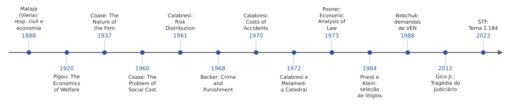
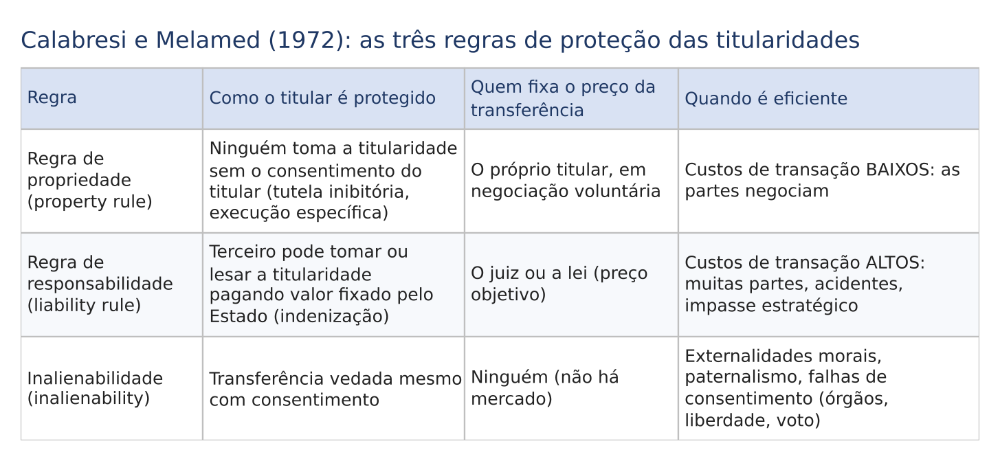
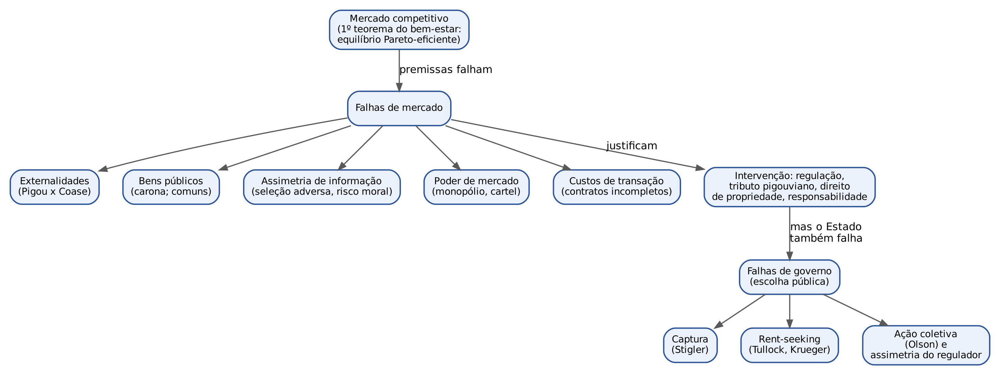
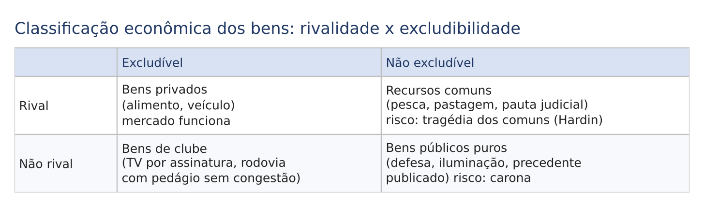
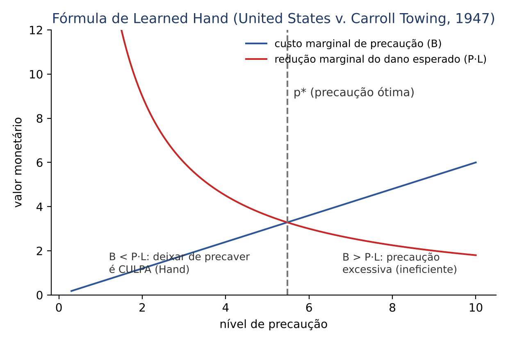
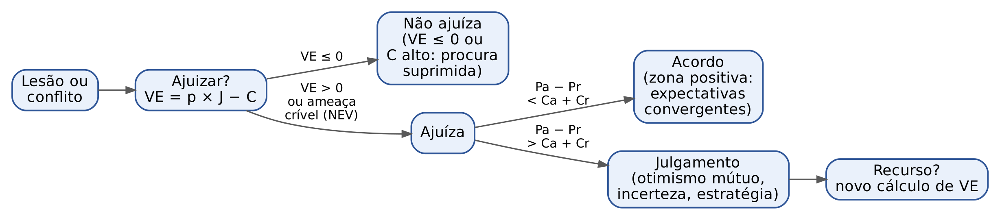
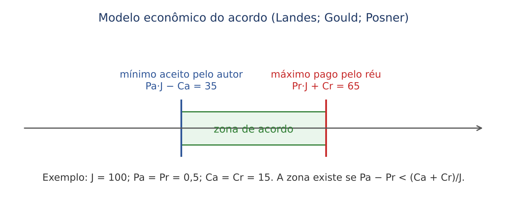
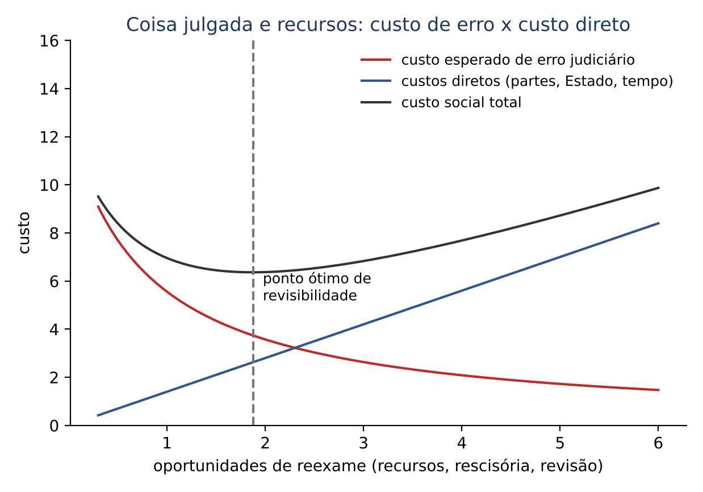

# CAPÍTULO 36 — ANÁLISE ECONÔMICA DO DIREITO E DO PROCESSO

:::INCIDENCIA
TRF5 p. G.2, G.3; TJRS p. G.2; TJSC p. H.2. Nível A+. Lote de 6 questões (FGV 5, FCC 1), quatro delas de provas de juiz (TJ-GO, TJ-PR e TRF2 de 2026; TRF5 de 2025), mais correlatas do ENAM 2026.1, do TRF6 e do TJ-TO.
O que mais cai: identificar a categoria econômica que explica um caso (valor esperado negativo, demanda frívola, seleção adversa, contratos incompletos, AED como matriz da hipótese de incentivos), Tema 1.184 do STF lido pela AED e instrumentos processuais que desincentivam a litigância sem mérito, sempre com contraditório e fundamentação.
:::

O capítulo trata a Análise Econômica do Direito (AED) em duas camadas: a teoria geral (fundadores, racionalidade, eficiência, falhas de mercado e de governo, aplicações à propriedade, aos contratos e à responsabilidade civil) e a análise econômica do processo (decisão de litigar, acordo, demandas frívolas e de valor esperado negativo, litigância de massa, precedentes, segurança jurídica e coisa julgada). Ficam fora, com remissão: o pragmatismo de Holmes e de Posner e o utilitarismo de Bentham e Mill (Cap. 35); a racionalidade limitada, as heurísticas, os vieses e os *nudges* (Cap. 37); o consequencialismo na teoria da decisão e o art. 20 da LINDB (Caps. 20 e 24); a Recomendação CNJ 159/2024 e a litigância abusiva como fenômeno sociológico (Cap. 5); a negociação de Harvard, a MAANA e as técnicas de mediação (Cap. 8); a jurimetria como método (Cap. 29).

## 36.1 A Análise Econômica do Direito: conceito, vertentes e história

### 36.1.1 Conceito e objeto

A AED (*Law and Economics*, Direito e Economia) é a aplicação do instrumental analítico e empírico da ciência econômica, sobretudo da microeconomia, ao estudo da formação, da estrutura, dos efeitos e da aplicação das normas e instituições jurídicas. Sua premissa metodológica é que as normas funcionam como PREÇOS IMPLÍCITOS: ao atribuir consequências (sanção, indenização, nulidade, custas) a condutas, o Direito altera o custo relativo das alternativas disponíveis e, com isso, o comportamento de agentes que respondem a incentivos. Antônio Maristrello Porto e Nuno Garoupa sintetizam que a AED trata as instituições jurídicas não como dados exógenos ao sistema econômico, mas como variáveis que o integram, observando os efeitos de suas mudanças sobre o comportamento e o bem-estar (Curso de Análise Econômica do Direito, 2ª ed., 2021).

O ponto de partida é a escassez: recursos (inclusive o tempo do juiz e a pauta do tribunal) são limitados e têm usos alternativos, de modo que toda escolha jurídica implica um custo de oportunidade. Daí as três perguntas típicas da AED diante de uma norma ou de uma decisão: (i) que comportamentos ela induz (pergunta positiva); (ii) esses comportamentos são desejáveis segundo algum critério de bem-estar (pergunta normativa); (iii) existe arranjo alternativo que produza o mesmo resultado a custo menor (pergunta de desenho institucional).

### 36.1.2 AED positiva e AED normativa

| Vertente | Pergunta | Natureza do enunciado | Exemplo | Crítica típica |
|---|---|---|---|---|
| Positiva (descritiva, preditiva) | Quais os efeitos prováveis da norma sobre a conduta? | Hipótese falseável, testável empiricamente | Majorar as custas da rescisória reduz o número de rescisórias temerárias? | Modelos simplificados; dados insuficientes; causalidade difícil de isolar |
| Normativa (prescritiva) | Qual regra DEVE ser adotada? | Juízo de valor a partir de um critério (em regra, eficiência) | O depósito prévio deve ser elevado porque reduz o custo social do litígio | Eficiência não esgota a justiça; problema distributivo; comensurabilidade de valores |

A distinção é o primeiro filtro em prova. A AED positiva é compatível com qualquer teoria normativa: o juiz kantiano também pode querer saber se a regra produz os efeitos que ele pressupõe. Já a AED normativa, sobretudo na versão posneriana de maximização da riqueza, é uma tese moral substantiva e concorre com as teorias da justiça (Cap. 17). Bruno Meyerhof Salama descreve a tensão como a de um "Direito e Economia" que pode servir à crítica e ao desenho de instituições sem se converter em critério único de correção jurídica.

:::DICA Como reconhecer a AED no enunciado
Sempre que o caso perguntar se um CUSTO, um PREÇO ou uma SANÇÃO pecuniária altera o comportamento de litigantes, contratantes ou potenciais causadores de dano, a matriz é a AED. Jurimetria é o método estatístico que testa a hipótese; consequencialismo é a família ampla de teorias que avaliam decisões pelas consequências; utilitarismo é a teoria moral que maximiza bem-estar agregado; pragmatismo é a postura filosófica antifundacionalista. A AED é a teoria específica dos INCENTIVOS (Q3966726, em 36.9.4; quadro de distinção com a jurimetria no Cap. 29).
:::

### 36.1.3 As duas ondas e as escolas

A primeira onda é europeia e oitocentista: Victor Mataja, professor em Viena, publicou em 1888 estudo sobre a responsabilidade civil do ponto de vista da economia política, examinando os incentivos gerados pelo dever de indenizar. O movimento se extinguiu nas primeiras décadas do século XX, com a especialização das ciências sociais.

A segunda onda, que deu origem à disciplina atual, é norte-americana e do pós-guerra: Aaron Director em Chicago, a criação do *Journal of Law and Economics* (1958) e, sobretudo, os artigos de Ronald Coase (1960) e Guido Calabresi (1961). A partir de 1973, com a primeira edição de Economic Analysis of Law, de Richard Posner, a AED deixou de ser sinônimo de análise antitruste e passou a abranger propriedade, contratos, responsabilidade civil, direito penal, processo, família e direito constitucional.

| Escola | Expoentes | Traço distintivo | Ponto de cobrança |
|---|---|---|---|
| Chicago (positiva e normativa forte) | Director, Coase, Becker, Posner, Stigler | Agentes racionais, mercados eficientes, eficiência como critério; tese da eficiência do *common law* | Maximização da riqueza (Posner); crime como escolha racional (Becker); captura regulatória (Stigler) |
| New Haven (Yale) | Calabresi, Melamed, Ackerman | Eficiência combinada com justiça distributiva e intervenção corretiva; ênfase em desenho de regras | Custos dos acidentes; *cheapest cost avoider*; regras de propriedade e de responsabilidade |
| Virgínia (escolha pública, *public choice*) | Buchanan, Tullock | Aplica a racionalidade ao comportamento de políticos, burocratas e eleitores | Falhas de governo, *rent-seeking*, lógica constitucional |
| Neoinstitucional | North, Williamson, Ostrom | Instituições como regras do jogo que reduzem incerteza e custos de transação | Custos de transação, contratos incompletos, governança dos comuns |
| Comportamental (*behavioral law and economics*) | Kahneman, Tversky, Thaler, Sunstein, Jolls | Racionalidade limitada e vieses sistemáticos | Remissão ao Cap. 37 |

Prêmios Nobel úteis para atribuição: Coase (1991), Becker (1992), North e Fogel (1993), Akerlof, Spence e Stiglitz (2001, assimetria de informação), Kahneman (2002), Ostrom e Williamson (2009), Hart e Holmström (2016, teoria dos contratos), Thaler (2017). Buchanan recebeu o prêmio em 1986 e Stigler, em 1982.

### 36.1.4 A AED no Brasil e nos tribunais brasileiros

A recepção acadêmica é recente: a obra de Guiomar Estrella Faria sobre interpretação econômica do Direito (1994) é apontada como marco de visibilidade; a Associação Brasileira de Direito e Economia (ABDE) surgiu na década de 2000; e a produção se consolidou com Bruno Salama, Ivo Teixeira Gico Júnior, Luciano Benetti Timm, Antônio Maristrello Porto, Nuno Garoupa e Luciana Yeung. No processo, destacam-se a tese de doutorado de Ivo Gico Jr., A Tragédia do Judiciário: subinvestimento em capital jurídico e sobreutilização do Judiciário (UnB, 2012; ver 36.8.4), e a obra de Erik Navarro Wolkart, *Análise econômica do processo civil: como a economia, o direito e a psicologia podem vencer a tragédia da justiça* (São Paulo: Thomson Reuters Brasil, 2019).

A jurisprudência passou a invocar expressamente a AED, quase sempre como reforço argumentativo e não como critério autônomo de decisão:

- STF, Tema 982 (RE n. 860.631, Relator Ministro Luiz Fux, Tribunal Pleno, j. 26/10/2023; box no Cap. 5): a ementa diz que a execução extrajudicial da Lei 9.514/1997 se adequa "aos influxos decorrentes do referencial teórico da Análise Econômica do Direito" e à desjudicialização;
- STF, ADI n. 4.787 (Relator Ministro Luiz Fux, Tribunal Pleno, j. 1/8/2022): taxa de fiscalização minerária do Amapá; a ementa invoca a maximização da riqueza, a teoria dos jogos e os tributos pigouvianos (poluidor-pagador) para afastar o efeito confiscatório;
- STF, RE n. 1.391.460 AgR (Relator Ministro Luiz Fux, Primeira Turma, j. 18/3/2024): imunidade recíproca do IPTU sobre imóvel afetado a serviço público concedido, com *distinguishing* do Tema 508 e argumento expresso de que, "em uma Análise Econômica do Direito", deve prevalecer a opção que resulte na melhor alocação de recursos (citação de Posner);
- STJ, Tema 1.094 (REsp n. 1.903.883, Relator Ministro Og Fernandes, Primeira Seção, j. 22/9/2021): candidato com diploma superior na mesma área pode assumir cargo que exige nível médio técnico; o voto invoca a AED e o art. 20 da LINDB (ampliação do universo de candidatos e qualificação do serviço).

:::ATENCAO AED como argumento e os limites do art. 20 da LINDB
Nos quatro precedentes, o argumento econômico CORROBORA solução extraída de normas (CF, art. 37; art. 150, VI, a; Lei 9.514/1997). O juiz que usa a AED deve: (i) explicitar a hipótese causal (que comportamento a decisão induz); (ii) indicar a base empírica disponível (art. 20 da LINDB: consequências práticas que se podem conhecer no exercício diligente da função, sem exigir onisciência, Decreto 9.830/2019; ver Cap. 24); (iii) não substituir o critério jurídico pela eficiência. A FGV cobrou exatamente isso: o "referencial de predição" da AED exige ponderar as consequências do acolhimento da pretensão (Q3453309, TJ-TO 2025, gabarito A), e não "alcançar os resultados economicamente mais eficientes" (alternativa E, errada). Comentário completo da questão no Cap. 20, 20.6.
:::

### 36.1.5 Críticas à AED

As críticas recorrentes, que a prova oral costuma exigir, são cinco:

1. Crítica moral (Ronald Dworkin, "Is Wealth a Value?", 1980): a riqueza não é um valor em si; a sociedade com mais riqueza não é, só por isso, melhor ou mais justa, e a maximização da riqueza não explica por que os direitos devem ser respeitados quando sua violação aumentaria o produto social. Direitos são trunfos, não preços (Cap. 17, 17.7).
2. Crítica distributiva: a disposição a pagar depende da riqueza prévia; o critério de Kaldor-Hicks favorece quem tem mais recursos (o rico "valoriza" mais porque pode pagar mais).
3. Crítica da comensurabilidade: dignidade, vida, liberdade e integridade não são redutíveis a uma métrica monetária comum (Kant: o que tem dignidade não tem preço; Cap. 17, 17.3.4).
4. Crítica comportamental: o *homo economicus* não descreve pessoas reais, que decidem com heurísticas e vieses (Simon, Kahneman; Cap. 37). A resposta da própria AED foi incorporar a racionalidade limitada.
5. Crítica institucional e democrática: o juiz não tem legitimidade nem informação para fazer engenharia de bem-estar; escolhas de eficiência distributivamente sensíveis cabem ao legislador. Calabresi e Posner discordam aqui: Calabresi sempre sustentou que eficiência e distribuição devem ser consideradas conjuntamente; Posner, que o Direito (especialmente o *common law*) deve perseguir eficiência e deixar a redistribuição ao sistema tributário.

:::DOUTRINA Kaplow e Shavell, Fairness versus Welfare (2002)
Sustentam a posição mais radical da AED normativa: as políticas jurídicas deveriam ser avaliadas EXCLUSIVAMENTE pelos efeitos sobre o bem-estar dos indivíduos, e noções independentes de equidade (*fairness*), quando conflitam com o bem-estar, pioram a situação de todos. É a antítese da posição de Dworkin e de Rawls; serve em prova oral para demonstrar domínio do debate, sem adesão.
:::

## 36.2 Os fundadores: Coase, Calabresi e Posner

### 36.2.1 Ronald Coase: custos de transação e o problema do custo social

Coase (1910–2013), economista britânico radicado em Chicago, escreveu dois artigos que fundam a AED contemporânea.

Em The Nature of the Firm (1937), perguntou por que existem empresas se o mercado aloca recursos pelo preço. Resposta: usar o mercado tem custos (descobrir preços, negociar, redigir e fazer cumprir contratos), e a empresa existe quando organizar a produção internamente, por hierarquia, custa menos que contratar no mercado. Nasce a noção de CUSTOS DE TRANSAÇÃO, desenvolvida depois por Williamson (36.5.6).

Em The Problem of Social Cost (1960), atacou a solução de Pigou para as externalidades (36.5.2). Três ideias centrais:

- NATUREZA RECÍPROCA DO DANO: o conflito entre o confeiteiro cujas máquinas fazem ruído e o médico que instala consultório ao lado (Sturges v. Bridgman, 1879) não tem um causador e uma vítima "naturais"; proibir o ruído causa dano ao confeiteiro, permiti-lo causa dano ao médico. A pergunta correta é qual dano deve ser evitado, considerando o valor total da produção;
- TEOREMA DE COASE (a expressão é de Stigler, não de Coase): se os direitos estão claramente definidos e os custos de transação são nulos, a negociação privada conduz à alocação eficiente dos recursos, QUALQUER QUE SEJA a atribuição inicial do direito (hipótese da eficiência); em algumas versões, a alocação final também é a mesma (hipótese da invariância). A atribuição inicial afeta apenas a DISTRIBUIÇÃO da riqueza (quem paga a quem);
- O MUNDO REAL TEM CUSTOS DE TRANSAÇÃO POSITIVOS: e então a atribuição inicial dos direitos e o desenho das instituições IMPORTAM. Esse é o verdadeiro programa de Coase, frequentemente mal lido como apologia do mercado: o Direito deve ser estudado comparando arranjos institucionais reais, com seus custos, e não um mercado ideal com um Estado ideal.

Robert Cooter e Thomas Ulen (Law and Economics) extraíram dois corolários normativos:

| Teorema normativo | Enunciado | Instrumento jurídico típico |
|---|---|---|
| De Coase | Estruture o Direito de modo a REMOVER os impedimentos aos acordos privados (reduzir custos de transação) | Direitos claros e simples, registros públicos, títulos executivos, meios consensuais |
| De Hobbes | Estruture o Direito de modo a MINIMIZAR os prejuízos causados pelas falhas nos acordos privados | Atribuir o direito a quem mais o valoriza quando a negociação é improvável; regras supletivas (*default rules*) que reproduzem o que as partes teriam pactuado |

:::PEGADINHA O teorema de Coase não diz que o Direito é irrelevante
Duas afirmações típicas são ERRADAS: (i) "pelo teorema de Coase, a atribuição inicial dos direitos de propriedade é sempre irrelevante" — só o é sob custos de transação nulos e, mesmo então, apenas para a eficiência, não para a distribuição; (ii) "Coase defendeu a tributação do poluidor" — essa é a solução de Pigou, que Coase criticou. O material do Drive formula o teorema em termos de "a parte que possa absorver a externalidade com menor custo": é a leitura que aproxima Coase do *cheapest cost avoider* de Calabresi (36.2.2).
:::

:::EXEMPLO Coase aplicado a um conflito de vizinhança
Situação: casa de eventos funciona, com alvará, ao lado de residência; o ruído reduz o valor de uso da casa vizinha em 2.000 (dois mil) reais por mês; o isolamento acústico custa, amortizado, 800 (oitocentos) reais por mês; o fechamento noturno custaria à casa de eventos 5.000 (cinco mil) reais por mês. Solução eficiente: isolamento (menor custo para eliminar o dano). Com custos de transação baixos (dois vizinhos identificados), qualquer que seja a decisão sobre o direito ao sossego, as partes tenderiam a pactuar o isolamento: se o vizinho tem o direito, a casa de eventos paga o isolamento; se a casa de eventos tem o direito, ao vizinho compensa pagá-lo. A decisão judicial muda QUEM PAGA, não o resultado eficiente. Com custos de transação altos (cem vizinhos, comportamento estratégico, *holdout*), a definição judicial do direito e do remédio (inibitória ou indenização; 36.2.2) passa a determinar o resultado. Fundamento jurídico: CC, arts. 1.277 a 1.279 (uso anormal da propriedade; dever de tolerar com indenização quando houver interesse público, art. 1.278).
:::

### 36.2.2 Guido Calabresi: os custos dos acidentes e a Catedral

Calabresi (n. 1932), professor e reitor de Yale, depois juiz federal de apelação, publicou em 1961 o artigo Some Thoughts on Risk Distribution and the Law of Torts e, em 1970, The Costs of Accidents: A Legal and Economic Analysis. Sua tese: o objetivo da responsabilidade civil é reduzir a SOMA dos custos dos acidentes, observada a justiça como restrição.

| Custos dos acidentes (Calabresi) | Conteúdo | Instrumentos |
|---|---|---|
| Primários | Número e gravidade dos acidentes (danos em si) mais o custo de evitá-los | Dissuasão geral (preço via responsabilidade) e específica (proibições, regulação) |
| Secundários | Custos sociais da concentração da perda na vítima | Diluição do risco (*loss spreading*): seguro, responsabilidade de quem pode repassar ao preço, seguridade social |
| Terciários | Custos administrativos de operar o sistema (processos, peritos, tribunais) | Regras simples, presunções, baremos, seguros sem culpa |

Daí a categoria do EVITADOR DE MENOR CUSTO (*cheapest cost avoider*): a responsabilidade deve recair sobre quem pode evitar o acidente (ou a perda) ao menor custo, porque é ele quem reage ao incentivo de modo mais eficiente. A responsabilidade objetiva por atividade de risco (CC, art. 927, parágrafo único) e a do fornecedor (CDC, arts. 12 e 14) encontram aqui sua justificativa econômica: o empresário controla o processo produtivo, conhece os riscos, pode investir em segurança e diluir o custo no preço.

Em 1972, com A. Douglas Melamed, publicou Property Rules, Liability Rules, and Inalienability: One View of the Cathedral (Harvard Law Review), que organiza a proteção das titularidades (*entitlements*) em três regras.

A tradução para o processo civil brasileiro é direta: a tutela específica e a inibitória (CPC, arts. 497 e 499; a conversão em perdas e danos só se o autor requerer ou se impossível a tutela específica) são REGRAS DE PROPRIEDADE; a indenização é REGRA DE RESPONSABILIDADE; os direitos da personalidade intransmissíveis (CC, art. 11) e a vedação da venda de órgãos (CF, art. 199, § 4º) são INALIENABILIDADE. Com custos de transação baixos, a regra de propriedade é preferível, porque força a negociação e revela quem mais valoriza o bem; com custos altos, a regra de responsabilidade evita o bloqueio, mas exige que o juiz acerte o "preço" (a indenização).

:::DICA Calabresi x Posner em uma linha
Calabresi: eficiência como redução dos custos dos acidentes, SEMPRE ao lado da justiça distributiva, com Estado ativo no desenho das regras (escola de Yale). Posner: eficiência como maximização da riqueza, critério normativo autossuficiente para o *common law* (escola de Chicago). Ambos fundadores; a banca troca as atribuições.
:::

### 36.2.3 Richard Posner: maximização da riqueza e eficiência do common law

Posner (n. 1939), professor em Chicago e juiz federal de apelação de 1981 a 2017, sistematizou a disciplina em Economic Analysis of Law (1973). Teses que a banca atribui a ele:

- HIPÓTESE DA EFICIÊNCIA DO COMMON LAW (tese positiva): as regras do *common law* tendem a ser eficientes, porque os juízes, isolados de pressões redistributivas e julgando casos concretos, convergem para regras que maximizam a riqueza; e porque regras ineficientes geram mais litígios e, portanto, mais oportunidades de revisão (desenvolvimentos de Rubin e de Priest, 1977);
- MAXIMIZAÇÃO DA RIQUEZA (tese normativa), em The Economics of Justice (1981): o critério de avaliação das instituições é a riqueza social, medida pela disposição a pagar, e não a utilidade (que não é mensurável nem comparável entre pessoas). Posner apresentou o critério como superior ao utilitarismo (não exige medir felicidade, protege direitos que favorecem trocas voluntárias, valoriza a produção) e ao kantismo (incorpora consequências);
- FASE PRAGMATISTA (The Problems of Jurisprudence, 1990; Overcoming Law, 1995; Law, Pragmatism, and Democracy, 2003): abandonou a maximização da riqueza como fundamento moral e passou a defendê-la como instrumento entre outros de um pragmatismo jurídico cotidiano, avesso a teorias morais abrangentes (Cap. 35).

| Ponto | Coase | Calabresi | Posner |
|---|---|---|---|
| Obras-chave | The Nature of the Firm (1937); The Problem of Social Cost (1960) | Risk Distribution (1961); The Costs of Accidents (1970); a Catedral (1972, com Melamed) | Economic Analysis of Law (1973); The Economics of Justice (1981) |
| Conceito central | Custos de transação; natureza recíproca do dano | Custos primários, secundários e terciários; *cheapest cost avoider* | Maximização da riqueza; eficiência do *common law* |
| Visão do Estado | Comparação institucional realista (mercado real x Estado real) | Desenho ativo de regras, com preocupação distributiva | Juiz como promotor de eficiência; redistribuição via tributo |
| Escola | Chicago (economista) | Yale (New Haven) | Chicago (jurista e juiz) |
| Pegadinha | "Teorema" batizado por Stigler; não nega a relevância do Direito | Não é adepto da maximização da riqueza | Depois aderiu ao pragmatismo (Cap. 35) |

## 36.3 Racionalidade econômica e incentivos

### 36.3.1 O modelo da escolha racional

A AED clássica parte do modelo do agente racional maximizador (*homo economicus*), cujos pressupostos devem ser conhecidos com precisão:

- preferências completas (o agente sabe comparar quaisquer alternativas) e transitivas (se prefere A a B e B a C, prefere A a C);
- maximização: o agente escolhe a alternativa que maximiza sua utilidade esperada, dadas as restrições (renda, tempo, informação, normas);
- análise MARGINAL: decide-se comparando o benefício e o custo da próxima unidade (mais um recurso, mais uma diligência, mais uma testemunha), e não totais;
- custo de oportunidade: o custo real de uma escolha é o valor da melhor alternativa sacrificada;
- utilidade esperada sob incerteza: valor de cada resultado multiplicado por sua probabilidade.

Racionalidade, aqui, é INSTRUMENTAL e não substantiva: não diz o que as pessoas devem querer, apenas que perseguem consistentemente o que querem. Utilidade não é só dinheiro: inclui reputação, lazer, altruísmo, convicções. Por isso o modelo é compatível com condutas altruístas, mas se torna tautológico se tudo couber na função de utilidade, crítica clássica.

O modelo é uma simplificação deliberada, cuja validade se mede pelo poder preditivo (Milton Friedman), e não pelo realismo dos pressupostos. Herbert Simon propôs a racionalidade LIMITADA (*bounded rationality*): os agentes satisfazem em vez de maximizar, por limites de informação, tempo e capacidade cognitiva. A economia comportamental (Kahneman, Tversky, Thaler) mostrou desvios sistemáticos e previsíveis (Cap. 37). Williamson incorporou a racionalidade limitada à teoria dos custos de transação (36.5.6), e a FGV cobrou essa conexão (Q3851691).

### 36.3.2 Incentivos: a norma como preço

Incentivo é qualquer fator que altera o custo ou o benefício relativo de uma conduta. A AED vê a sanção como PREÇO esperado da conduta proibida: o agente compara o ganho do ilícito com a sanção multiplicada pela probabilidade de sua aplicação. Consequências imediatas:

- aumentar a sanção ou a probabilidade de aplicá-la tem efeito dissuasório equivalente, mas custos sociais diferentes (fiscalizar é caro; multas altas são baratas de aplicar, mas esbarram na insolvência e na proporcionalidade);
- sanções que nunca são aplicadas não dissuadem: o preço esperado é zero;
- o tempo é custo: a demora do processo reduz o valor presente da condenação e beneficia o devedor, criando incentivo à resistência e à protelação (36.8.8);
- normas geram efeitos não pretendidos quando o agente ajusta a conduta pela margem (o limite de valor de alçada induz fracionamento de pedidos; a isenção de custas em primeiro grau nos Juizados induz maior demanda; 36.8.4).

Gary Becker, em Crime and Punishment: An Economic Approach (1968), levou a lógica ao direito penal: o criminoso potencial comete o crime se o benefício esperado superar o custo esperado (probabilidade de punição vezes severidade, mais custos de oportunidade). A política criminal ótima minimiza a soma dos danos dos crimes e dos custos de repressão; a combinação "baixa probabilidade e pena altíssima" é economicamente barata, mas encontra limite na dissuasão marginal (se a pena do furto e a do homicídio forem iguais, nada desestimula o crime mais grave) e na proporcionalidade constitucional.

A FGV cobrou essa lógica no TJ-GO 2026 (Q3966726): custas mais altas como desestímulo à relitigância, comparadas à proibição decorrente da coisa julgada, é hipótese de incentivos típica da AED (box em 36.9.4).

### 36.3.3 Teoria dos jogos: interação estratégica

Quando o resultado de cada agente depende da escolha do outro, o instrumento é a teoria dos jogos (von Neumann e Morgenstern, 1944; John Nash, equilíbrio, 1950). Elementos: jogadores, estratégias, resultados (*payoffs*) e informação. Conceitos cobrados:

| Conceito | Definição | Uso jurídico |
|---|---|---|
| Estratégia dominante | A melhor resposta qualquer que seja a escolha do outro | Na responsabilidade subjetiva com culpa definida pela fórmula de Hand, tomar a precaução ótima é estratégia dominante do ofensor (36.7.3) |
| Equilíbrio de Nash | Nenhum jogador ganha alterando sozinho sua estratégia | Explica resultados estáveis, mas ineficientes |
| Dilema do prisioneiro | A escolha individualmente racional (não cooperar) leva a resultado pior para ambos que a cooperação | Contratos sem garantia de cumprimento; litigância defensiva; corrida aos recursos |
| Jogo repetido | A reputação e a ameaça de retaliação sustentam a cooperação | Litigantes habituais (*repeat players*) agem diferente dos eventuais (Galanter, Cap. 1) |
| Jogo sequencial | Decisões em ordem, resolvidas por indução retroativa | Árvore de decisão do contrato e do litígio (36.8.2) |
| Soma zero x soma não zero | No primeiro, o ganho de um é a perda do outro; no segundo, ambos podem ganhar | Negociação distributiva x integrativa (Cap. 8) |

O exemplo de Porto e Garoupa resume a função econômica do contrato: João valoriza seu carro em 3.000 (três mil) reais; Benta, em 4.000 (quatro mil) reais; vendido por 3.500 (três mil e quinhentos) reais, cada um ganha 500 (quinhentos) reais de excedente. Se o pagamento for diferido e não houver Judiciário que obrigue Benta a pagar, a melhor resposta dela é não pagar, e a de João, antecipando isso, é não entregar o carro: o excedente de 1.000 (mil) reais não é criado. O contrato executável judicialmente muda os *payoffs* e transforma um jogo de não cooperação em jogo de cooperação. É a demonstração de que a EXECUTORIEDADE dos contratos e a efetividade da jurisdição são condições da própria riqueza social (North: instituições reduzem incerteza e viabilizam trocas complexas).

## 36.4 Eficiência

### 36.4.1 Os critérios

Eficiência, em sentido econômico, é a alocação de recursos que maximiza um critério de valor dado; não se confunde com rapidez, produtividade ou economia de gastos (sentidos usuais em gestão judiciária, Cap. 2). Os critérios cobrados:

| Critério | Definição | Exigência | Problema |
|---|---|---|---|
| Melhoria de Pareto | Mudança que melhora a situação de ao menos uma pessoa sem piorar a de ninguém | Unanimidade implícita: ninguém perde | Quase nenhuma política pública real a satisfaz; congela o status quo |
| Ótimo (eficiência) de Pareto | Situação em que não é possível melhorar alguém sem piorar outrem | Ausência de melhorias de Pareto disponíveis | Há infinitos ótimos, inclusive muito desiguais (todo o bolo com uma só pessoa é ótimo de Pareto) |
| Kaldor-Hicks (compensação potencial) | Mudança eficiente se os ganhadores ganham o bastante para, HIPOTETICAMENTE, compensar os perdedores e ainda sair ganhando | A compensação NÃO precisa ocorrer | Legitima perdas reais de alguns; sensível à distribuição inicial de riqueza |
| Maximização da riqueza (Posner) | Escolher o arranjo que maximiza o valor total medido pela disposição a pagar | Métrica monetária | Crítica de Dworkin (36.1.5) |
| Utilitarismo (bem-estar agregado) | Maximizar a soma das utilidades | Medida de utilidade | Comparação interpessoal; separação entre pessoas (Rawls, Cap. 17) |

O exemplo numérico do material de Porto e Garoupa fixa a diferença: João tem 100.000 (cem mil) reais, Pedro 50.000 (cinquenta mil) e Maria 40.000 (quarenta mil); a medida X faz João passar a 150.000 (cento e cinquenta mil), mantém Pedro e reduz Maria a 20.000 (vinte mil). A soma sobe de 190.000 para 220.000: a medida é eficiente por Kaldor-Hicks (os ganhos de João, 50.000, superam a perda de Maria, 20.000, e permitiriam compensá-la). NÃO é melhoria de Pareto, porque Maria perde. E Maria pode atribuir aos 20.000 que perdeu mais UTILIDADE do que João aos 50.000 que ganhou (utilidade marginal decrescente da renda), o que mostra que maximizar riqueza não equivale a maximizar bem-estar.

:::PEGADINHA Pareto x Kaldor-Hicks
(i) "Toda situação Pareto-eficiente é justa" — errado: o critério é indiferente à distribuição. (ii) "Kaldor-Hicks exige que os ganhadores indenizem os perdedores" — errado: basta que POSSAM indenizar; se a compensação for efetivamente paga, a mudança torna-se melhoria de Pareto. (iii) "O critério de Pareto é menos exigente que o de Kaldor-Hicks" — errado: é MAIS restritivo. (iv) "Eficiência de Pareto e ótimo de Pareto designam a mesma coisa que melhoria de Pareto" — errado: melhoria é a MUDANÇA; ótimo é o ESTADO em que não há mais melhorias possíveis.
:::

### 36.4.2 Eficiência econômica, eficiência administrativa e eficiência processual

O vocábulo tem três usos jurídicos que a banca mistura:

| Sentido | Sede | Conteúdo | Relação com a AED |
|---|---|---|---|
| Eficiência econômica (alocativa) | Teoria econômica | Pareto, Kaldor-Hicks, maximização da riqueza | Critério normativo da AED |
| Eficiência administrativa | CF, art. 37, *caput* (EC 19/1998); LINDB, arts. 20 e 21 | Melhor relação entre meios e resultados na ação estatal | Fundamento do Tema 1.184 do STF e da Res. CNJ 547/2024 (36.8.5) |
| Eficiência processual | CF, art. 5º, LXXVIII; CPC, arts. 4º, 6º e 8º | Obter tutela adequada, efetiva e tempestiva com o menor dispêndio de tempo e recursos | AED do processo: minimizar custos de erro e custos diretos (36.8.1) |

:::LEI CPC, art. 8º
"Ao aplicar o ordenamento jurídico, o juiz atenderá aos fins sociais e às exigências do bem comum, resguardando e promovendo a dignidade da pessoa humana e observando a proporcionalidade, a razoabilidade, a legalidade, a publicidade e a eficiência."
:::

A eficiência do art. 8º é um entre vários vetores e vem ao lado da DIGNIDADE: não autoriza sacrificar o contraditório ou a fundamentação em nome da produtividade. A FGV explora isso com alternativas que afirmam que o juiz "deve priorizar processos de maior repercussão econômica" ou "indeferir sem fundamentação demandas de valor irrelevante" em nome da eficiência (Q3898987, alternativas A e D; 36.8.5).

### 36.4.3 Eficiência e justiça

Três posições para a prova oral: (i) eficiência como critério único (Posner da fase de 1981; Kaplow e Shavell); (ii) eficiência como um dos valores a ponderar, sujeita a restrições deontológicas de direitos (Calabresi; posição majoritária entre juristas); (iii) eficiência como instrumento: o Direito fixa os fins (dignidade, igualdade, acesso à justiça) e a AED ajuda a escolher os meios que os realizam ao menor custo. A terceira é a que melhor se ajusta ao constitucionalismo brasileiro e ao art. 20 da LINDB, e é a resposta segura em prova oral.

:::PRATIQUE Exercício elaborado para esta apostila (não é questão de banca)
1. Lei municipal transfere o terminal de ônibus para área central; 10.000 usuários ganham, cada um, o equivalente a 30 (trinta) reais por mês em tempo; 50 comerciantes da área antiga perdem, cada um, 2.000 (dois mil) reais por mês; não há compensação prevista. A medida é melhoria de Pareto? É eficiente por Kaldor-Hicks?
2. Certo ou errado: "Para Calabresi, os custos terciários dos acidentes são os decorrentes da concentração da perda na vítima."
3. Certo ou errado: "Segundo o teorema de Coase, com custos de transação nulos, a atribuição inicial do direito não afeta a eficiência nem a distribuição da riqueza."
Resolução: 1. Não é melhoria de Pareto (comerciantes perdem); é eficiente por Kaldor-Hicks: ganhos de 300.000 (trezentos mil) reais por mês contra perdas de 100.000 (cem mil) reais, compensação possível ainda que não paga. 2. Errado: esses são os secundários; terciários são os custos administrativos do sistema. 3. Errado: a atribuição inicial é irrelevante para a EFICIÊNCIA, mas determina a DISTRIBUIÇÃO (quem paga a quem).
:::

## 36.5 Mercados e falhas de mercado

### 36.5.1 O mercado ideal e por que ele falha

O primeiro teorema do bem-estar afirma que o equilíbrio de um mercado perfeitamente competitivo é eficiente no sentido de Pareto. As premissas, porém, são exigentes: muitos compradores e vendedores tomadores de preço, mercados completos, informação perfeita e simétrica, ausência de custos de transação e de externalidades, direitos de propriedade definidos e garantidos. Quando alguma delas falha, o mercado deixa de produzir a alocação eficiente: é a FALHA DE MERCADO, que justifica (sem obrigar) a intervenção pública. O Direito cumpre então duas funções: viabilizar o mercado (propriedade, contratos, responsabilidade) e corrigir suas falhas (regulação, tributo, proteção do contratante vulnerável).

### 36.5.2 Externalidades

Externalidade é o efeito de uma atividade sobre terceiros que não participam da decisão e que não é refletido no preço. Negativa: poluição, ruído, congestionamento, risco imposto a terceiros. Positiva: vacinação (protege não vacinados), pesquisa básica, educação, preservação de fachada histórica, e também a decisão judicial que fixa uma tese, que beneficia todos os litigantes futuros (36.9.1). Com externalidade negativa, o agente produz MAIS do que o socialmente ótimo, porque não arca com todo o custo; com externalidade positiva, produz MENOS, porque não se apropria de todo o benefício.

| Solução | Autor | Lógica | Instrumento jurídico |
|---|---|---|---|
| Tributo corretivo ou subsídio (internalização) | Arthur Pigou, The Economics of Welfare (1920) | Fazer o causador pagar o custo marginal social que impõe (ou subsidiar o benefício externo) | Tributos ambientais e extrafiscais; poluidor-pagador (Lei 6.938/1981, art. 4º, VII); STF, ADI n. 4.787 (taxas "pigouvianas") |
| Negociação a partir de direitos bem definidos | Ronald Coase (1960) | Com custos de transação baixos, as partes internalizam por acordo; com custos altos, comparar arranjos institucionais | Definição de direitos, mercados de licenças de emissão, acordos de vizinhança |
| Regulação direta (comando e controle) | Tradição administrativa | Proibir, limitar, licenciar | Licenciamento, padrões de emissão, zoneamento |
| Responsabilidade civil | Calabresi; Posner | Indenização como preço *ex post* que internaliza o dano | Responsabilidade objetiva por atividade de risco (CC, art. 927, parágrafo único); ambiental (Lei 6.938/1981, art. 14, § 1º) |

### 36.5.3 Bens públicos e recursos comuns

A classificação econômica dos bens combina dois atributos: RIVALIDADE (o consumo de um reduz a disponibilidade para outro) e EXCLUDIBILIDADE (é possível impedir quem não paga de usar). Paul Samuelson formalizou os bens públicos em 1954.

- BEM PÚBLICO (não rival e não excludível): defesa nacional, iluminação pública, segurança jurídica difusa. Falha: o problema do CARONA (*free rider*): cada um prefere que outro pague, e o bem é subproduzido pelo mercado. Solução clássica: provisão estatal financiada por tributo.
- RECURSO COMUM (rival e não excludível): pesqueiros, pastagens abertas, aquíferos e, na leitura de Gico Jr., a própria prestação jurisdicional (36.8.4). Falha: a TRAGÉDIA DOS COMUNS (Garrett Hardin, The Tragedy of the Commons, 1968): cada usuário captura integralmente o benefício de usar mais e divide o custo do esgotamento com todos, de modo que o recurso é sobreutilizado até a ruína. Soluções: privatização, regulação estatal ou, como mostrou Elinor Ostrom (Governing the Commons, 1990; Nobel 2009), governança comunitária com regras de acesso, monitoramento, sanções graduais e mecanismos locais de resolução de conflitos.
- BEM DE CLUBE (não rival até o congestionamento e excludível): TV por assinatura, rodovia com pedágio.
- BEM PRIVADO (rival e excludível): o mercado funciona.

:::PEGADINHA "Bem público" econômico não é bem público do art. 98 do CC
Bem público, no Direito Civil, é o de titularidade de pessoa jurídica de direito público (CC, arts. 98 e 99). Bem público, na Economia, é o que reúne não rivalidade e não excludibilidade, seja quem for o titular. Uma praça é bem público civil e, enquanto não congestionada, aproxima-se do bem público econômico; um imóvel dominical locado a particular é bem público civil, mas economicamente é bem privado (rival e excludível).
:::

### 36.5.4 Assimetria de informação: seleção adversa e risco moral

Há assimetria de informação quando uma parte sabe mais que a outra sobre um atributo relevante da transação. As duas patologias clássicas distinguem-se pelo MOMENTO e pelo OBJETO da informação oculta:

| Patologia | Momento | O que está oculto | Exemplo clássico | Remédios |
|---|---|---|---|---|
| Seleção adversa (antisseleção) | Antes do contrato (*ex ante*) | Uma CARACTERÍSTICA (tipo, qualidade, risco) | Mercado de carros usados ("limões", Akerlof, 1970): comprador paga preço médio; vendedores de carros bons saem; só restam os ruins; o mercado encolhe ou desaparece. Seguros: se o prêmio é médio, os de baixo risco saem e o grupo piora | Sinalização (Spence: garantias, diplomas); triagem (Stiglitz: questionários, franquias, carências); dever de informar e boa-fé (CC, arts. 765 e 766); seguro obrigatório que impede a saída dos bons riscos |
| Risco moral (*moral hazard*) | Depois do contrato (*ex post*) | Uma AÇÃO (nível de cuidado) não observável | Segurado que, coberto, reduz a cautela; Arrow (1963), assistência médica | Franquias e coparticipação; cláusulas de agravamento do risco (CC, art. 768); monitoramento; responsabilidade por culpa |
| Problema agente-principal | Durante a relação | Ação e informação do agente que atua por conta do principal | Administrador x acionistas; advogado x cliente; gestor público x cidadão | Remuneração por desempenho, deveres fiduciários, prestação de contas, *compliance* (Cap. 38) |

O Código Civil é, nessa leitura, um sistema de correção de assimetrias: os arts. 765 e 766 (boa-fé e declarações inexatas do segurado) combatem a seleção adversa; o art. 768 (perda da garantia por agravamento intencional do risco) combate o risco moral; os vícios redibitórios (art. 441) e o dolo (art. 145) protegem quem tem menos informação; o CDC concretiza dever de informar (art. 6º, III) justamente porque o fornecedor é quem detém a informação ao menor custo.

:::QUESTAO FGV 2025 — TRF5 — Juiz Federal Substituto (Q3373874)
Caso: em seguro de vida comercializado por empresa pública federal, o juiz concede liminar reduzindo o prêmio do segurado idoso, sob o argumento de que o sobrecusto dos idosos deve ser compensado pelo aumento dos prêmios pagos pelos jovens, rateando os custos igualmente pelo mutualismo. Gabarito oficial: B — a decisão não se sustenta pela AED, por implicar SELEÇÃO ADVERSA (antisseleção), nem pelo direito do consumidor, diante de suas implicações coletivas.
Resolução em passos: (1) identificar a falha: o preço do seguro reflete o risco; ao impor prêmio médio, os de baixo risco (jovens) passam a pagar mais do que seu risco vale e tendem a sair; (2) com a saída dos bons riscos, o grupo remanescente fica mais arriscado, o prêmio médio sobe e novas saídas ocorrem (espiral da antisseleção); (3) o mutualismo, invocado pelo juiz, é justamente o que a decisão compromete: a sustentabilidade do fundo comum depende de preços proporcionais ao risco; (4) no plano consumerista, a proteção do consumidor é coletiva: a decisão individual transfere o custo aos demais segurados (consumidores também) e pode desestabilizar a carteira.
Armadilhas: C e E aceitam que a decisão seria "respaldada nos princípios do direito do consumidor", ignorando a dimensão coletiva da relação de consumo securitária; D e E trocam a categoria por "exceção de ruína", figura ligada ao limite do sacrifício exigível do devedor, alheia ao problema informacional. A FGV quer a categoria econômica exata: antisseleção é falha ex ante sobre o TIPO de risco; não é risco moral (conduta posterior do segurado).
:::

### 36.5.5 Poder de mercado

Monopólio e cartel produzem menos e cobram mais que o mercado competitivo, gerando perda de peso morto (*deadweight loss*): trocas que gerariam excedente deixam de ocorrer. É o campo histórico da AED (antitruste de Chicago) e do direito concorrencial (Lei 12.529/2011). Para a formação humanística, basta reconhecer o poder de mercado como falha e saber que a escola de Chicago foi cética quanto à intervenção antitruste (eficiências de escala, contestabilidade dos mercados).

### 36.5.6 Custos de transação e contratos incompletos

Custos de transação são os custos de usar o mercado: (i) de busca e informação (encontrar o parceiro e conhecer o bem); (ii) de negociação e redação; (iii) de monitoramento e execução (*enforcement*). Oliver Williamson (The Economic Institutions of Capitalism, 1985; Nobel 2009) explicou por que eles existem e como as partes escolhem estruturas de governança para economizá-los, combinando dois pressupostos comportamentais e um atributo da transação:

- RACIONALIDADE LIMITADA (de Simon): as partes não conseguem prever e redigir cláusulas para todas as contingências;
- OPORTUNISMO: busca do interesse próprio com dolo ("*self-interest seeking with guile*"), que torna arriscado deixar lacunas;
- ESPECIFICIDADE DOS ATIVOS: investimentos que perdem valor fora da relação (planta construída para um único comprador) criam dependência bilateral e risco de "refém" (*hold-up*).

Daí a teoria dos CONTRATOS INCOMPLETOS (desenvolvida também por Grossman, Hart e Moore; Nobel de Hart em 2016): todo contrato real é incompleto, porque é impossível ou caro demais especificar todas as contingências futuras; o problema central passa a ser quem decide nas lacunas e como se renegocia. Contratos de longa duração, com investimentos específicos e alta incerteza (concessões, parcerias público-privadas, fornecimento de longo prazo, franquias), são o paradigma: neles importam mais os mecanismos de governança (alocação de riscos, revisão, reequilíbrio, comitês técnicos, *dispute boards*, arbitragem) do que a tentativa de prever tudo *ex ante*.

:::QUESTAO FCC 2024 — PGE-GO — Procurador do Estado Substituto (Q2654865)
Cobrado: a AED questiona o modelo contratual clássico, que pressupõe conhecimento completo e *ex ante* dos eventos da execução e dos custos de transação; a doutrina administrativista passou a estudar PPPs e concessões como contratos de que espécie? Gabarito oficial: A — contratos INCOMPLETOS.
Armadilhas: "assimétricos" (C) confunde com assimetria de informação; "atípicos" (D) é categoria civilista (ausência de disciplina legal, CC, art. 425), e a PPP é contrato típico (Lei 11.079/2004); "estratégicos" e "impuros" (B e E) não designam categoria da AED. Fundamento positivo: a Lei 11.079/2004 erige como diretriz a "repartição objetiva de riscos entre as partes" (art. 4º, VI), reconhecendo que o contrato não elimina a incerteza, mas a governa.
:::

:::QUESTAO FGV 2026 — AMAZUL — Analista de Negócios (Q3851691)
Cobrado: razão típica para que um contrato seja classificado como incompleto, dada a premissa de racionalidade limitada e oportunismo. Gabarito oficial: E — nem todas as contingências futuras relevantes podem ser identificadas ou plenamente especificadas no momento da contratação. As alternativas A a D descrevem o contrato COMPLETO (previsão integral, adaptações predefinidas, ausência de renegociação, entendimento integral e compartilhado), justamente o modelo que a teoria nega. Questão de cargo técnico, útil como fixação conceitual.
:::

O Código Civil, após a Lei 13.874/2019 (Declaração de Direitos de Liberdade Econômica), incorporou expressamente a lógica da AED contratual:

:::LEI Código Civil, arts. 113, § 1º, V, e 421-A
Art. 113, § 1º: a interpretação do negócio jurídico deve lhe atribuir o sentido que "V - corresponder a qual seria a razoável negociação das partes sobre a questão discutida, inferida das demais disposições do negócio e da racionalidade econômica das partes, consideradas as informações disponíveis no momento de sua celebração."
Art. 421-A: os contratos civis e empresariais presumem-se paritários e simétricos até a presença de elementos concretos que justifiquem o afastamento dessa presunção, ressalvados os regimes de leis especiais, garantido que: "I - as partes negociantes poderão estabelecer parâmetros objetivos para a interpretação das cláusulas negociais e de seus pressupostos de revisão ou de resolução; II - a alocação de riscos definida pelas partes deve ser respeitada e observada; e III - a revisão contratual somente ocorrerá de maneira excepcional e limitada."
:::

O inciso V do art. 113, § 1º, é a positivação do CONTRATO HIPOTÉTICO (*hypothetical bargain*) da AED: diante da lacuna, o juiz deve reconstruir o que partes racionais teriam pactuado com a informação disponível na celebração, e não o que lhe parece justo *ex post* (o que neutraliza o viés retrospectivo, Cap. 37). O art. 421-A, II, protege a alocação de riscos porque ela já está embutida no preço: revisar a alocação depois do evento transfere riqueza e encarece contratos futuros. A ressalva dos regimes especiais (CDC, contratos de adesão, relações assimétricas) mostra que a presunção de paridade é relativa: onde há assimetria de informação ou de poder, a lógica econômica se inverte e justifica a intervenção.

:::DICA Contrato incompleto x violação eficiente
A AED clássica sustenta a teoria da VIOLAÇÃO EFICIENTE (*efficient breach*): se a indenização pela expectativa deixa o credor indiferente, o devedor deve poder descumprir quando surgir uso mais valioso para a prestação (o pintor que recebe proposta três vezes maior). No Brasil, a preferência legal pela tutela específica (CPC, arts. 497 e 499) e a boa-fé objetiva limitam a tese; a indenização raramente é "perfeita" (custos de litigar, demora, danos de difícil prova), e por isso o descumprimento intencional tende a ser tratado como ilícito, e não como opção.
:::

## 36.6 Falhas de governo e teoria da escolha pública

A existência de falha de mercado não demonstra que a intervenção estatal melhorará o resultado: o Estado também falha. Harold Demsetz chamou de FALÁCIA DO NIRVANA (1969) a comparação entre um mercado real imperfeito e um Estado ideal; a comparação correta é entre instituições reais (Coase).

A teoria da escolha pública (*public choice*, escola de Virgínia: James Buchanan e Gordon Tullock, The Calculus of Consent, 1962) aplica a racionalidade econômica a eleitores, políticos, burocratas e grupos de interesse, que perseguem interesses próprios (reeleição, orçamento, poder, prestígio) e não um abstrato interesse público. Principais falhas:

| Falha de governo | Autor de referência | Mecanismo | Manifestação jurídica |
|---|---|---|---|
| Captura regulatória | George Stigler, The Theory of Economic Regulation (1971) | A regulação tende a ser "adquirida" pela indústria regulada, que tem mais interesse concentrado e informação | Agências que protegem os regulados; barreiras de entrada travestidas de proteção ao consumidor |
| Busca de rendas (*rent-seeking*) | Gordon Tullock (1967); Anne Krueger (cunhou a expressão, 1974) | Recursos gastos para obter privilégios (reservas de mercado, isenções, tarifas), sem criar riqueza | *Lobby* por benefícios fiscais setoriais; litigância para obter privilégio regulatório |
| Lógica da ação coletiva | Mancur Olson, The Logic of Collective Action (1965) | Grupos pequenos e concentrados se organizam melhor que grupos grandes e difusos (carona) | Benefícios concentrados e custos difusos; sub-representação de consumidores e contribuintes |
| Miopia eleitoral e ciclo político | Escolha pública | Preferência por benefícios visíveis no curto prazo e custos diferidos | Endividamento, renúncias fiscais, subinvestimento em manutenção |
| Assimetria e problema agente-principal no Estado | Teoria da agência | Burocracia detém informação e persegue orçamento próprio | Necessidade de controle, transparência e motivação (LINDB, arts. 20 a 30) |
| Falhas de conhecimento | Hayek | O planejador não detém a informação dispersa que os preços agregam | Regulação de preços que provoca desabastecimento |

Para o juiz, a teoria tem duas aplicações: (i) no controle judicial de políticas públicas e da regulação, evita a presunção ingênua de que a intervenção corrige automaticamente a falha (e de que o juiz, ao substituir o regulador, é imune às mesmas falhas: também ele decide com informação parcial e sob pressões); (ii) na própria administração judiciária, alerta para incentivos institucionais (metas que privilegiam quantidade sobre qualidade, como lembra o Cap. 2; litigantes habituais que capturam a agenda do sistema, Cap. 5). Remissão: a escola de Chicago e a captura regulatória como componente do neoliberalismo estão no Cap. 26.

:::PRATIQUE Exercício elaborado para esta apostila (não é questão de banca)
1. Associação de grandes distribuidoras obtém de órgão regulador norma que exige, para novos entrantes, capital mínimo dez vezes superior ao das empresas já estabelecidas, sob o fundamento de proteger o consumidor. Qual falha de governo melhor descreve o caso?
2. Em plano de saúde coletivo empresarial sem coparticipação, verifica-se aumento expressivo de consultas eletivas após a contratação, sem mudança no perfil de risco dos beneficiários. Seleção adversa ou risco moral?
3. Certo ou errado: "Recurso comum é bem não rival e não excludível."
Resolução: 1. Captura regulatória (Stigler), combinada com busca de rendas: a regulação cria barreira de entrada em favor dos incumbentes. 2. Risco moral: a mudança é de CONDUTA posterior ao contrato (uso maior porque o custo marginal para o usuário é zero), não de característica oculta prévia; remédio típico é a coparticipação. 3. Errado: recurso comum é RIVAL e não excludível; não rival e não excludível é o bem público.
:::

## 36.7 Aplicações clássicas: propriedade, contratos, responsabilidade civil e crime

O TRF5 inclui no ponto G.2 "direitos de propriedade, responsabilidade civil, contratos". A AED desses institutos é cobrada em nível conceitual; o regime dogmático está nas Apostilas de Direito Civil.

### 36.7.1 Direitos de propriedade

Função econômica da propriedade: (i) internalizar custos e benefícios do uso do bem (quem se apropria do resultado investe e conserva; quem não se apropria sobreutiliza, tragédia dos comuns); (ii) viabilizar trocas, pois só se transfere o que está definido; (iii) permitir o uso como garantia, reduzindo o custo do crédito. Daí a importância de direitos claros, registrados e baratos de transferir (teorema normativo de Coase). Hernando de Soto (O Mistério do Capital, 2000) popularizou a tese de que ativos informais são "capital morto", porque não podem ser usados como garantia; a regularização fundiária (Reurb, Lei 13.465/2017) tem essa justificativa econômica, ao lado da justificativa de dignidade e moradia. A proteção judicial escolhe entre regra de propriedade (inibitória, possessórias, reivindicatória) e regra de responsabilidade (indenização, desapropriação, acessão inversa), conforme os custos de transação (36.2.2).

### 36.7.2 Contratos

O contrato, para a AED, é instrumento de cooperação no tempo: permite trocas com prestações diferidas, que gerariam excedente mas não ocorreriam sem garantia de cumprimento (exemplo de João e Benta, 36.3.3). Funções econômicas do direito contratual: (i) tornar promessas críveis (executoriedade); (ii) reduzir custos de transação por regras supletivas que reproduzem o que a maioria das partes pactuaria (contrato hipotético; CC, art. 113, § 1º, V); (iii) alocar riscos à parte que os suporta ao menor custo (*superior risk bearer*); (iv) invalidar acordos que não criam riqueza porque o consentimento é viciado ou desinformado (incapacidade, erro, dolo, coação, lesão, estado de perigo: as "defesas de formação" de Cooter e Ulen). A cláusula penal pode ser eficiente como seguro do valor subjetivo e como sinal de confiabilidade do devedor, o que explica por que o direito brasileiro a admite, com controle do excesso (CC, arts. 412 e 413).

### 36.7.3 Responsabilidade civil e a fórmula de Hand

No caso United States v. Carroll Towing Co. (1947), o juiz Learned Hand formulou o critério de negligência: há culpa quando o custo da precaução (B, *burden*) é MENOR que a probabilidade do dano (P) multiplicada pela sua magnitude (L, *loss*): B < P·L. Em termos marginais, o nível ótimo de precaução é aquele em que o custo marginal de mais precaução iguala a redução marginal do dano esperado. Abaixo dele, a omissão é culposa; acima, a precaução é excessiva e socialmente ineficiente.

Exemplo do material de Porto e Garoupa: o entregador que reduz a velocidade na curva diminui a probabilidade de colisão de 0,1% para 0,05%, num dano de 20.000 (vinte mil) reais; o dano esperado cai de 20 (vinte) para 10 (dez) reais. Se a precaução custar 5 (cinco) reais, deixar de adotá-la é culpa (5 < 10).

| Regra de responsabilidade | Incentivo ao ofensor | Incentivo à vítima | Resultado (modelo de precaução bilateral) |
|---|---|---|---|
| Ausência de responsabilidade | Nenhum (não arca com o dano) | Máximo | Ineficiente: ofensor não se precavê |
| Responsabilidade ilimitada (objetiva pura, sem excludente) | Máximo | Nenhum (é sempre indenizada) | Ineficiente: vítima não se precavê |
| Subjetiva com culpa pela fórmula de Hand | Precaução ótima é estratégia DOMINANTE | Antecipando que o ofensor se precaverá, arca com o próprio dano e se precavê | Eficiente |
| Objetiva com excludente de culpa exclusiva da vítima | Antecipando a precaução da vítima, se precavê | Precaução é estratégia dominante | Eficiente |
| Culpa concorrente com repartição (CC, art. 945) | Ambos internalizam parte do dano | Ambos internalizam parte do dano | Tende à eficiência, com maior custo administrativo |

Lições para o juiz: (i) a escolha entre responsabilidade subjetiva e objetiva tem também efeito sobre o NÍVEL DE ATIVIDADE (Shavell): só a objetiva faz o agente considerar todos os danos que sua atividade gera, mesmo com cuidado ótimo, o que justifica a objetiva para atividades perigosas (CC, art. 927, parágrafo único); (ii) indenizações sistematicamente inferiores ao dano (subcompensação, baixa probabilidade de condenação) reduzem a dissuasão e tornam o ilícito lucrativo, o que dialoga com a discussão sobre a função dissuasória da indenização por dano moral e com a advertência de que o art. 944 do CC mede a indenização pela extensão do dano; (iii) o dever de mitigar o próprio prejuízo (*duty to mitigate*), reconhecido pela doutrina civilista, é a regra que impõe à vítima a precaução de menor custo depois do evento.

:::EXEMPLO A fórmula de Hand na fundamentação
Situação: ação de indenização contra condomínio por queda de cliente em piso molhado de área comum; a sinalização com placa custaria valor irrisório e reduziria substancialmente a probabilidade de queda. Solução fundamentada: a culpa se demonstra pela comparação entre o custo da cautela omitida (baixo) e o risco previsível evitado (relevante e frequente em local de grande circulação), o que caracteriza a omissão negligente (CC, arts. 186 e 927). A fórmula NÃO substitui o juízo normativo de culpa nem exige cálculo exato: é um parâmetro de racionalidade para o padrão de diligência, compatível com o homem médio diligente da tradição civilista. A eventual desatenção da vítima é ponderada pela gravidade das culpas (CC, art. 945).
:::

### 36.7.4 Direito penal e dissuasão

A teoria econômica do crime (Becker, 36.3.2) explica a preferência por sanções pecuniárias quando o infrator é solvente (são mais baratas que a prisão e geram receita), a necessidade de dissuasão marginal (penas crescentes com a gravidade, para que o agente que já vai delinquir escolha o crime menos grave), a punição mais branda da tentativa (incentivo à desistência) e o agravamento da reincidência. Os acordos penais (transação penal, suspensão condicional, acordo de não persecução penal, colaboração premiada) são explicáveis como redução de custos processuais e de risco para acusação e defesa, com o custo social de reduzir a investigação e de criar incentivos a acordos de inocentes avessos ao risco. Remissão: regime dos acordos penais na Apostila de Processo Penal; organização criminosa e *compliance* no Cap. 38.

## 36.8 Análise econômica do processo

### 36.8.1 O objetivo econômico do processo

Richard Posner (An Economic Approach to Legal Procedure and Judicial Administration, 1973) propôs que o sistema processual deve MINIMIZAR A SOMA de dois custos: (i) os CUSTOS DO ERRO judiciário (decisões que condenam quem não devia ou absolvem quem devia, distorcendo os incentivos do direito material: se o ilícito não é punido ou o lícito é punido, a norma deixa de orientar condutas); (ii) os CUSTOS DIRETOS de operar o sistema (gastos públicos com o aparelho judiciário, gastos das partes com advogados, peritos e custas, e o custo do tempo). Toda regra processual troca um custo pelo outro: mais provas, recursos e contraditório reduzem o erro e aumentam o custo direto; procedimentos sumários, precedentes vinculantes e preclusões reduzem o custo direto e podem aumentar o erro. O ponto ótimo não é o mínimo de erro nem o mínimo de custo, mas o mínimo da soma (figura em 36.9.4).

O processo também tem externalidades: a decisão de litigar é tomada por particulares que comparam custos e benefícios PRIVADOS, mas o litígio consome recurso público (tempo do juiz, estrutura subsidiada) e produz benefícios públicos (precedentes, dissuasão geral). Steven Shavell demonstrou a DIVERGÊNCIA FUNDAMENTAL entre os incentivos privados e sociais para litigar (1982; 1997): o autor não considera os custos que impõe ao réu e ao Estado (tende a litigar demais) nem os benefícios de dissuasão que gera para a sociedade (tende a litigar de menos). O resultado pode ser excesso ou escassez de litígios, conforme o caso, e por isso a política judiciária não deve presumir que "mais litígio" ou "menos litígio" seja sempre bom.

### 36.8.2 A decisão de litigar e o modelo do valor esperado

O potencial autor racional ajuíza a demanda se o VALOR ESPERADO for positivo:

VE = p × J − C

em que p é a probabilidade estimada de êxito, J é o valor da condenação (o que efetivamente se espera receber, descontados riscos de insolvência e o valor do tempo) e C são os custos da demanda (custas, honorários próprios, sucumbência esperada, tempo, desgaste). Consequências:

- quanto MAIOR o custo de litigar, MENOS demandas são ajuizadas, inclusive as fundadas: o custo é filtro cego, que barra pretensões legítimas de baixo valor (procura suprimida; obstáculo econômico de Cappelletti e Garth, Cap. 1);
- quanto MENOR o custo (gratuidade, isenção de custas nos Juizados, honorários contingentes), MAIS demandas são ajuizadas, inclusive as de baixa probabilidade de êxito;
- a regra de distribuição dos custos importa: na REGRA AMERICANA (cada parte arca com seus honorários), o autor com pequena chance perde pouco; na REGRA INGLESA (perdedor paga tudo; *loser pays*), o autor de baixa probabilidade é desestimulado e o de alta probabilidade, estimulado. O Brasil adota a regra da sucumbência (CPC, art. 85), próxima da inglesa, atenuada pela gratuidade (art. 98, § 3º: obrigações sob condição suspensiva de exigibilidade).

### 36.8.3 O modelo econômico do acordo

William Landes (1971), John Gould (1973) e Posner (1973) formularam o modelo básico: o acordo ocorre quando existe ZONA DE ACORDO, isto é, quando o máximo que o réu aceita pagar supera o mínimo que o autor aceita receber. O autor aceita qualquer valor acima de sua expectativa líquida (Pa × J − Ca); o réu paga qualquer valor abaixo de sua expectativa de perda total (Pr × J + Cr). Há zona de acordo se:

Pa × J − Ca < Pr × J + Cr, ou seja, (Pa − Pr) × J < Ca + Cr

Leitura jurídica do modelo:

- os CUSTOS DE LITIGAR são o motor do acordo: quanto maiores (Ca + Cr), maior a zona; o processo caro e lento estimula acordos, inclusive acordos ruins para a parte mais fraca, que aceita "desconto" por necessidade (crítica de Owen Fiss, Against Settlement, 1984; Cap. 5);
- o principal obstáculo ao acordo é o OTIMISMO MÚTUO: se cada parte superestima sua chance (Pa alto, Pr baixo), a zona desaparece. O viés de autosserviço e o excesso de confiança (Cap. 37) explicam por que tantos casos com resultado previsível chegam à sentença;
- tudo o que faz as estimativas CONVERGIREM aumenta os acordos: precedentes claros e estáveis, jurisprudência publicada, produção antecipada de provas (CPC, art. 381, II e III: viabilizar autocomposição e evitar ou justificar ação), audiência de conciliação com informação, perícia prévia, sistema de precedentes;
- comportamento estratégico (blefe, assimetria de informação, *holdout*) reduz acordos mesmo com zona positiva.

George Priest e Benjamin Klein (The Selection of Disputes for Litigation, 1984) extraíram a consequência para a jurisprudência: os casos que chegam a julgamento NÃO são amostra aleatória dos conflitos; os casos claros fazem acordo, e os que sobram são os duvidosos, nos quais as expectativas divergem. Sob hipóteses simplificadoras, a taxa de êxito do autor nos casos julgados tende a 50% (hipótese dos 50%), qualquer que seja o padrão de decisão. Implicações: (i) estatísticas de procedência não medem diretamente a "qualidade" das pretensões nem a orientação dos juízes (cuidado com conclusões jurimétricas ingênuas, Cap. 29); (ii) quando a jurisprudência é instável, mais casos se tornam "duvidosos" e menos acordos ocorrem.

:::DICA Ligação com o Cap. 8
A expectativa de cada parte sobre a sentença é a sua MAANA (melhor alternativa à negociação de um acordo) no processo judicial; o "teste de realidade" do mediador é, em termos econômicos, a redução do otimismo mútuo. Técnicas e postura do mediador estão no Cap. 8, 08.2.2 e 08.4.2; aqui está o modelo que as explica.
:::

### 36.8.4 Custos da litigância e acesso à justiça

O custo da litigância tem componentes públicos (estrutura judiciária, em grande parte custeada por tributos e não por custas) e privados (custas, honorários, perícias, tempo, custos emocionais e de oportunidade). A AED do acesso à justiça trabalha com dois problemas simétricos:

| Problema | Diagnóstico econômico | Efeito | Instrumentos |
|---|---|---|---|
| Subutilização (procura suprimida) | Custo privado maior que o valor esperado para pretensões legítimas de pequeno valor; assimetria de informação sobre direitos; aversão ao risco dos litigantes eventuais | Ilícitos de pequeno valor e grande escala ficam impunes; dissuasão se perde | Gratuidade (CF, art. 5º, LXXIV; CPC, art. 98); Juizados (Lei 9.099/1995, arts. 54 e 55); Defensoria; tutela coletiva (agregação de pretensões dispersas); inversão do ônus da prova |
| Sobreutilização (congestionamento) | Custo marginal privado de litigar muito inferior ao custo social; Judiciário como recurso comum | Demora, que degrada a tutela de todos e beneficia quem quer protelar | Custas e sucumbência calibradas; filtros de abuso; precedentes; meios consensuais; triagem de litigância abusiva (Rec. CNJ 159/2024, Cap. 5) |

:::LEI Lei 9.099/1995, arts. 54 e 55
Art. 54: "O acesso ao Juizado Especial independerá, em primeiro grau de jurisdição, do pagamento de custas, taxas ou despesas."
Art. 55: "A sentença de primeiro grau não condenará o vencido em custas e honorários de advogado, ressalvados os casos de litigância de má-fé. Em segundo grau, o recorrente, vencido, pagará as custas e honorários de advogado, que serão fixados entre dez por cento e vinte por cento do valor de condenação ou, não havendo condenação, do valor corrigido da causa."
:::

A leitura econômica do microssistema dos Juizados é útil em prova oral: custo zero em primeiro grau amplia o acesso (objetivo constitucional), mas elimina o filtro de custo para demandas de baixa probabilidade; o custo recursal concentrado no recorrente vencido funciona como filtro na fase em que o custo social do processo cresce. A ressalva da má-fé preserva o desincentivo à demanda temerária.

Ivo Gico Jr. (A Tragédia do Judiciário, 2012) sustenta que o serviço jurisdicional é RIVAL (o tempo do juiz dedicado a um caso falta a outro) e, pelo livre acesso constitucional, NÃO EXCLUDÍVEL na prática: um recurso comum sujeito à tragédia dos comuns. A sobreutilização gera congestionamento; o congestionamento produz SELEÇÃO ADVERSA de litigantes (o processo lento atrai quem quer postergar obrigações e afasta quem tem direito e precisa de tutela rápida); e o problema é agravado pelo SUBINVESTIMENTO EM CAPITAL JURÍDICO: os juízes têm poucos incentivos para produzir e manter regras uniformes, e a insegurança resultante estimula mais litígio. A tese explica a ênfase brasileira em precedentes obrigatórios e em gestão de demandas repetitivas (36.8.6 e 36.9.1).

:::ATENCAO A conclusão econômica não autoriza fechar portas
A constatação de sobreutilização não legitima elevar custos de forma indiscriminada: a garantia de acesso (CF, art. 5º, XXXV) e o direito à assistência jurídica integral e gratuita aos que comprovarem insuficiência de recursos (art. 5º, LXXIV) são limites normativos. O filtro econômico deve ser DIRIGIDO (ao abuso, à demanda sem lastro, ao litigante habitual que externaliza custos) e não GERAL (a quem tem pretensão legítima de pequeno valor). Essa é a mesma cautela que o Cap. 5 extrai da Sociologia (Galanter, Boaventura) para a Recomendação CNJ 159/2024.
:::

### 36.8.5 Demandas frívolas e de valor esperado negativo

As duas categorias são próximas e a banca as distingue com rigor:

| Categoria | Definição | Por que é ajuizada | Exemplo | Desincentivo |
|---|---|---|---|---|
| Demanda frívola (*frivolous suit*) | Probabilidade de êxito muito baixa ou nula; pretensão sem base jurídica ou fática séria | Custo baixo de ajuizar; expectativa de acordo; assimetria de informação; má-fé | Ação repetida contra a mesma coisa julgada; pretensão contrária a tese vinculante sem distinção | Sucumbência, litigância de má-fé, improcedência liminar (CPC, art. 332), depósito prévio (art. 968, II) |
| Demanda de valor esperado negativo (*negative expected value suit*, NEV) | Mesmo que fundada, o VE para o autor é negativo (p × J < C): ganhar custaria mais do que se recebe | Ameaça de impor ao réu custo de defesa maior que o valor do acordo (extração de acordo), ou pressão, desgaste e estratégia | Ação de pequeno valor com custo de defesa alto para o réu; execução fiscal de baixo valor cujo custo de cobrança supera o crédito | Retirar a credibilidade da ameaça: custos de defesa recuperáveis, julgamento rápido, extinção por falta de interesse, sanções por abuso |

Lucian Bebchuk (Suing Solely to Extract a Settlement Offer, Journal of Legal Studies, 1988) e, antes, David Rosenberg e Steven Shavell (1985, *nuisance value*) explicaram por que alguém ajuíza ação que não vale a pena levar até o fim: se o réu tiver de gastar para se defender antes de saber se o autor desistirá, e se o autor tiver informação privada sobre suas intenções, a AMEAÇA pode ser crível e o réu prefere pagar um acordo inferior ao seu custo de defesa. O remédio é tornar a ameaça não crível: reduzir o custo de defesa (julgamento liminar), deslocá-lo para o autor (sucumbência, multas) ou permitir ao juiz reconhecer a ausência de utilidade da tutela.

:::DICA "Frívola" e "valor esperado negativo" não são sinônimos
A demanda frívola é definida pela BAIXA PROBABILIDADE DE ÊXITO (falta de mérito). A demanda de VEN é definida pela RELAÇÃO ENTRE CUSTO E BENEFÍCIO ESPERADO: pode ter mérito e, ainda assim, não valer o custo de ser processada. Toda demanda frívola tende a ter VE negativo para quem age de boa-fé, mas nem toda demanda de VE negativo é frívola. A execução fiscal de baixo valor, por exemplo, tem crédito legítimo (não é frívola) e VE negativo (custa mais cobrá-la do que se recupera).
:::

:::QUESTAO FGV 2026 — TRF2 — Juiz Federal Substituto (Q3996904)
Cobrado: à luz da AED, qual categoria melhor explica e respalda a *ratio* do Tema 1.184 do STF (legitimidade da extinção da execução fiscal de baixo valor por ausência de interesse de agir, pela eficiência administrativa). Gabarito oficial: A — demanda de valor esperado negativo (*NEV suits*).
Raciocínio: o crédito tributário é legítimo; o problema é que o custo público e privado de processar a execução supera o valor que se espera recuperar. O interesse de agir, lido pela AED, é a exigência de UTILIDADE da tutela; quando o VE é negativo, a via judicial é socialmente ineficiente e há meios menos custosos (protesto, conciliação, solução administrativa).
Armadilhas: B (demanda frívola) pressupõe pretensão sem mérito, o que não é o caso; C (*sham litigation*) é o uso do processo como instrumento anticoncorrencial, categoria do direito da concorrência; D (processo sem lastro de demanda) e E (litigância de má-fé) exigem desvio de finalidade ou conduta processual ímproba, ausentes na execução fiscal regular de baixo valor.
:::

:::JURIS STF, Tema 1.184 (RE n. 1.355.208, Relatora Ministra Cármen Lúcia, Tribunal Pleno, j. 19/12/2023)
Tese: 1. é legítima a extinção de execução fiscal de baixo valor pela ausência de interesse de agir, tendo em vista o princípio constitucional da eficiência administrativa, respeitada a competência constitucional de cada ente federado; 2. o ajuizamento da execução fiscal dependerá da prévia adoção de tentativa de conciliação ou adoção de solução administrativa e do protesto do título, salvo por motivo de eficiência administrativa, comprovando-se a inadequação da medida; 3. o trâmite de ações de execução fiscal não impede os entes federados de pedirem a suspensão do processo para a adoção das medidas previstas no item 2, devendo, nesse caso, o juiz ser comunicado do prazo para as providências cabíveis.
Leitura econômica: o Supremo exigiu do credor público que use primeiro os meios de MENOR CUSTO (conciliação, protesto) e reservou o processo, o meio mais caro, às cobranças com valor esperado positivo.
:::

:::LEI Resolução CNJ 547/2024, art. 1º (redação compilada com as Res. 617/2025 e 689/2026)
Caput: é legítima a extinção de execução fiscal de baixo valor pela ausência de interesse de agir, tendo em vista o princípio constitucional da eficiência administrativa, respeitada a competência constitucional de cada ente federado.
§ 1º: devem ser extintas as execuções fiscais de valor inferior a R$ 10.000,00 (dez mil reais) quando do ajuizamento, em que não haja movimentação útil há mais de um ano sem citação do executado ou, ainda que citado, sem localização de bens penhoráveis.
§ 1º-A (Res. 689/2026): movimentações úteis são as do art. 921, § 4º-A, do CPC, como a efetiva citação, a intimação do devedor ou a constrição de bens penhoráveis. Parágrafo único (Res. 617/2025): o disposto no *caput* aplica-se em qualquer fase do processo, inclusive na análise da petição inicial.
§§ 2º a 5º: soma das execuções apensadas contra o mesmo executado; possibilidade de nova propositura se encontrados bens, desde que não consumada a prescrição, com termo inicial do prazo um ano após a ciência da Fazenda sobre a não localização; a Fazenda pode requerer, por até 90 dias, a não aplicação do § 1º se demonstrar que localizará bens.
:::

A Resolução exige, ainda, prévia tentativa de conciliação ou solução administrativa (art. 2º) e prévio protesto do título (art. 3º), dispensável por motivo de eficiência administrativa, com hipóteses exemplificativas no parágrafo único (inclusive, após a Res. 617/2025, a inscrição no Cadin). A Res. 689/2026 acrescentou os arts. 1º-B e 1º-C, com intimação do exequente nas execuções fiscais pendentes há mais de 15 anos ou suspensas há mais de 6 anos, para manifestação sobre o risco de prescrição intercorrente, e rotinas automatizadas de controle de prazos. É a política judiciária desenhada a partir de um diagnóstico econômico: execuções fiscais são a maior fatia do acervo e as de baixo valor têm custo de processamento superior ao crédito.

:::QUESTAO FGV 2026 — TJ-PR — Juiz Substituto (Q3898987)
Caso: indivíduo propõe repetidas demandas com baixa probabilidade de êxito, valor esperado negativo e elevado custo para o Estado, com o objetivo de criar entraves administrativos ou desgastar economicamente a parte contrária. Gabarito oficial: E — o juiz pode adotar medidas para desencorajar demandas frívolas ou de valor esperado negativo, usando instrumentos processuais como a litigância de má-fé e os honorários sucumbenciais, DESDE QUE garantidos o contraditório e a ampla defesa.
Resolução em passos: (1) qualificar: demandas reiteradas, sem mérito e com finalidade de desgaste = frívolas, de VE negativo e com desvio de finalidade (CPC, art. 80, III, V e VI; litigância abusiva da Rec. CNJ 159/2024, Cap. 5); (2) escolher instrumentos que elevem o custo esperado da conduta abusiva para o seu autor: multa de má-fé superior a 1% e inferior a 10% do valor corrigido da causa, indenização e despesas (art. 81), sucumbência (art. 85), multas recursais (arts. 1.021, § 4º, e 1.026, §§ 2º e 3º); (3) observar o devido processo: contraditório prévio (CPC, arts. 9º e 10) e fundamentação concreta (art. 489, § 1º).
Armadilhas: A (indeferir liminarmente "qualquer demanda" de valor irrelevante, sem fundamentação) viola os arts. 5º, XXXV, e 93, IX, da CF; B (direito de ação "ilimitado") ignora o abuso do direito de demandar; C confunde as categorias, definindo VE negativo pela ausência de mérito, que é o traço da demanda FRÍVOLA (o VE negativo depende da relação custo-benefício, 36.8.5); D (priorizar processos de maior repercussão econômica, suspendendo urgentes) inverte a ordem constitucional de prioridades.
No mesmo sentido, quanto ao instrumento de desincentivo: FGV 2026, ENAM 2026.1, Q4102418 (depósito prévio da rescisória, CPC, art. 968, II, como desincentivo à demanda frívola, gabarito D), comentada no Cap. 5, 05.2.2.
:::

Os tipos de má-fé do art. 80 do CPC que interessam à demanda abusiva são usar o processo para objetivo ilegal (III), proceder de modo temerário (V) e provocar incidente manifestamente infundado (VI); a multa do art. 81, aplicável de ofício, é superior a 1% e inferior a 10% do valor corrigido da causa, mais indenização, honorários e despesas (até 10 salários-mínimos se o valor da causa for irrisório ou inestimável, § 2º).

Quadro dos instrumentos processuais lidos como incentivos:

| Instrumento | Dispositivo | Efeito econômico | Quem suporta |
|---|---|---|---|
| Sucumbência (10% a 20%) | CPC, art. 85, § 2º | Eleva o custo esperado da demanda ou da defesa infundada; aproxima o sistema da regra inglesa | Vencido (suspensa para beneficiário da gratuidade, art. 98, § 3º) |
| Honorários recursais | CPC, art. 85, § 11 | Encarece recorrer sem chance; desestimula recurso protelatório | Recorrente vencido, observados os tetos da fase de conhecimento |
| Multa por má-fé | CPC, arts. 80 e 81 | Preço da conduta abusiva | Litigante de má-fé (inclusive beneficiário da gratuidade, art. 98, § 4º) |
| Depósito prévio na rescisória (5%, teto de mil salários-mínimos) | CPC, art. 968, II e § 2º | Filtro de seriedade contra a relitigância do que transitou em julgado; perdido se a rescisória for unanimemente inadmissível ou improcedente | Autor (dispensados entes públicos, MP, Defensoria e beneficiário da gratuidade, § 1º) |
| Multa no agravo interno (1% a 5%) | CPC, art. 1.021, § 4º | Desestimula agravo manifestamente inadmissível ou improcedente (unanimidade), com depósito condicionando outros recursos (§ 5º) | Agravante |
| Multa nos embargos protelatórios (até 2%; reiteração até 10%) | CPC, art. 1.026, §§ 2º e 3º | Encarece a protelação | Embargante |
| Multa pela ausência à audiência do art. 334 (até 2%) | CPC, art. 334, § 8º | Preço da recusa a comparecer à tentativa de acordo | Parte faltosa (revertida à União ou ao Estado) |
| Honorários reduzidos à metade | CPC, arts. 90, § 4º (reconhecimento com cumprimento), e 827, § 1º (pagamento em 3 dias na execução) | Prêmio ao cumprimento voluntário imediato | Réu ou executado que coopera |
| Isenção de custas | CPC, arts. 701, § 1º (monitória cumprida no prazo, honorários de 5%), e 90, § 3º (acordo antes da sentença) | Prêmio ao pagamento sem resistência e ao acordo | Réu que cumpre; ambas as partes |
| Improcedência liminar | CPC, art. 332 | Reduz o custo de defesa contra demanda contrária a precedente, retirando a credibilidade da ameaça | Autor |

:::PEGADINHA A eficiência não dispensa o contraditório nem cria indeferimento por "valor irrelevante"
Três afirmações recorrentes e ERRADAS: (i) o juiz pode indeferir a inicial por valor econômico irrelevante, sem fundamentação (não há tal hipótese no art. 330 do CPC; o Tema 1.184 é específico das execuções fiscais e fundado no interesse de agir, com regras próprias); (ii) a multa por má-fé dispensa ouvir a parte (o art. 81 permite aplicação de ofício, mas os arts. 9º e 10 impõem oportunidade de manifestação sobre fundamento não debatido); (iii) a gratuidade isenta das multas processuais (o art. 98, § 4º, diz o contrário: a concessão de gratuidade não afasta o dever de pagar, ao final, as multas processuais impostas).
:::

### 36.8.6 Litigância repetitiva e de massa

A litigância de massa tem economia própria. Para o litigante habitual (*repeat player*, Galanter, Cap. 1), cada processo é parte de uma carteira: ele dilui custos fixos (assessoria, sistemas, conhecimento), investe em influenciar regras e não apenas em vencer casos, e compara o custo de cumprir espontaneamente o direito com o custo esperado de litigar. Quando a soma das condenações esperadas, descontada pela demora e pela fração dos lesados que efetivamente processam, é inferior ao custo de cumprir, DESCUMPRIR É RACIONAL. A litigância de massa, nesse cenário, é sintoma de externalização de custos: o litigante habitual transfere ao Judiciário (custeado por todos) o custo de resolver conflitos que deveria evitar ou resolver internamente.

Do lado dos autores, a litigância repetitiva tem duas faces: a legítima (milhares de lesados reais pelo mesmo ato, que seria melhor tratada de modo coletivo ou por precedente) e a patológica (demandas fabricadas em escala por estruturas de captação, com custo marginal de produção próximo de zero; Rec. CNJ 159/2024 e Tema 1.198 do STJ, Cap. 5, 05.2.2).

Respostas institucionais com leitura econômica:

| Resposta | Mecanismo econômico |
|---|---|
| Precedentes vinculantes, IRDR, repetitivos (CPC, arts. 927 e 1.036 e seguintes) | Produzem a regra uma vez e a aplicam a todos (economia de escala pública); reduzem a incerteza, o otimismo mútuo e a sobreutilização |
| Tutela coletiva | Agrega pretensões de VE individual negativo, recriando dissuasão contra ilícitos de pequeno valor e grande escala |
| Centros de Inteligência e Núcleos de Monitoramento do Perfil de Demandas | Diagnóstico das causas (assimetria de informação do sistema sobre si mesmo) |
| Diálogo interinstitucional e plataformas pré-processuais | Reduzem o custo de transação da solução fora do processo |
| Sanção ao descumprimento reiterado de precedentes (multas, honorários, comunicação a agências reguladoras) | Eleva o custo esperado do descumprimento sistemático |

### 36.8.7 Métodos adequados de solução de conflitos: leitura econômica

A AED explica por que o sistema multiportas (Res. CNJ 125/2010; CPC, art. 3º, §§ 2º e 3º) pode ser eficiente: (i) os meios consensuais reduzem custos diretos e de tempo; (ii) produzem soluções integrativas, que criam valor em vez de apenas distribuí-lo (negociação integrativa, Cap. 8), algo que a sentença binária raramente faz; (iii) reduzem custos de execução, porque o acordo tende a ser cumprido voluntariamente; (iv) liberam capacidade judiciária para os casos que exigem adjudicação. A arbitragem acrescenta especialização e confidencialidade, a custo privado, para disputas cujo valor o justifica (Cap. 5, 05.4).

Mas a AED também identifica os limites: (i) o acordo é privado e não gera precedente; se todos os casos fossem resolvidos por acordo, faltaria a produção de regras que orienta condutas (externalidade positiva da sentença; Fiss); (ii) em relações com desequilíbrio de informação ou de poder, o acordo reflete a MAANA desigual e pode consolidar resultados injustos; (iii) a pressão por números de acordos (metas) pode transformar a conciliação em descongestionamento a qualquer preço, que o Código de Ética de Conciliadores e Mediadores veda (Cap. 5, 05.2.3; Cap. 8). Os incentivos legais ao acordo (dispensa de custas remanescentes, art. 90, § 3º; multa pela ausência à audiência, art. 334, § 8º; possibilidade de mediação pré-processual) devem ser lidos à luz dessas cautelas.

:::SENTENCA Homologação de acordo em demanda de massa
"As partes celebraram acordo em audiência realizada no CEJUSC, com assistência de advogados, após exposição, pelo conciliador, das orientações firmadas no Tema [número] e da estimativa de tempo de tramitação. Verifico que o ajuste versa sobre direito disponível, que o autor foi informado do alcance da renúncia ao excedente e de que a quantia acordada não se distancia desproporcionalmente do proveito que resultaria da aplicação do precedente, e que não há indício de vício de consentimento ou de captação irregular. A autocomposição informada atende à eficiência (CPC, art. 8º) sem sacrificar a decisão livre e esclarecida da parte. Homologo o acordo (CPC, art. 334, § 11, e art. 487, III, b), dispensadas as custas remanescentes (art. 90, § 3º)."
:::

### 36.8.8 Eficiência processual e o custo do tempo

O tempo é o custo menos visível do processo. Para o credor, cada mês de demora reduz o valor presente do que receberá; para o devedor, a demora é financiamento barato quando os encargos moratórios são inferiores ao custo de mercado do dinheiro. Daí o incentivo econômico à protelação, que o processo combate por: tutela provisória e de evidência (CPC, arts. 294 e 311, inclusive o inciso II, tese firmada em casos repetitivos ou súmula vinculante com prova documental), execução provisória, multas e sanções por protelação (36.8.5), majoração de encargos e efeito apenas devolutivo como regra em alguns recursos.

A eficiência processual (CPC, art. 8º; CF, art. 5º, LXXVIII) é, assim, um critério de alocação de meios escassos entre fins processuais: produzir apenas as provas cuja utilidade esperada justifica o custo (o indeferimento fundamentado de diligências inúteis ou protelatórias, CPC, art. 370, parágrafo único, é aplicação direta do raciocínio marginal), concentrar atos, usar meios eletrônicos e cooperar (art. 6º). Seu limite é o mesmo de toda a AED: a eficiência opera DENTRO das garantias (contraditório, ampla defesa, fundamentação), e não contra elas.

:::PRATIQUE Exercício elaborado para esta apostila (não é questão de banca)
1. Autor tem 60% de chance de obter condenação de 50.000 (cinquenta mil) reais; seus custos de litigar somam 12.000 (doze mil) reais. O réu estima a chance do autor em 40% e seus próprios custos em 10.000 (dez mil) reais. Há zona de acordo? Entre quais valores?
2. Certo ou errado: "A hipótese de Priest e Klein prevê que, nos casos levados a julgamento, o autor vence em aproximadamente metade das vezes, porque os juízes tendem a dividir os resultados."
3. Execução fiscal de crédito de 3.000 (três mil) reais, ajuizada há quatro anos, sem citação; a Fazenda não indica bens nem pede a suspensão do § 5º. Qual a solução e qual a leitura econômica?
Resolução: 1. Mínimo do autor: 0,6 × 50.000 − 12.000 = 18.000; máximo do réu: 0,4 × 50.000 + 10.000 = 30.000. Há zona entre 18.000 e 30.000 (verificação: diferença de expectativas de 0,2 × 50.000 = 10.000 é menor que os custos somados, 22.000). 2. Errado: o resultado decorre da SELEÇÃO dos casos (os claros fazem acordo; restam os duvidosos), e não de tendência dos juízes. 3. Extinção sem resolução de mérito por ausência de interesse de agir (Tema 1.184; Res. CNJ 547/2024, art. 1º, § 1º, valor inferior a dez mil reais no ajuizamento e mais de um ano sem movimentação útil e sem citação), ressalvada nova propositura se localizados bens antes da prescrição (§ 3º). Leitura: demanda de valor esperado negativo; o processo é o meio mais caro de cobrança e deve ser reservado aos casos em que o VE é positivo.
:::

## 36.9 Precedentes, estabilidade da jurisprudência, segurança jurídica e coisa julgada

### 36.9.1 O precedente como bem público e como capital

William Landes e Richard Posner (Legal Precedent: A Theoretical and Empirical Analysis, 1976) trataram o conjunto de precedentes como um ESTOQUE DE CAPITAL: cada decisão fundamentada acrescenta conhecimento sobre o conteúdo do Direito, que se deprecia com o tempo (mudança social, superação) e que reduz o custo de decidir casos futuros e de orientar condutas. Ivo Gico Jr. chama esse estoque de CAPITAL JURÍDICO: o conjunto de regras jurídicas que o Judiciário efetivamente aplica a um tipo de caso em dado momento; a segurança jurídica é a previsibilidade dessas regras, que permite às partes antecipar o resultado e resolver o conflito sem o juiz.

O precedente tem os traços de BEM PÚBLICO (36.5.3): uma vez publicado, todos podem usá-lo sem reduzir o uso dos demais (não rival) e não se pode impedir que terceiros o usem (não excludível). Consequências:

- o litigante individual não se apropria dos benefícios que sua demanda gera para terceiros e, por isso, há SUBPRODUÇÃO de precedentes pelo mercado de litígios (as partes fazem acordo e o caso não gera regra; o litigante eventual não tem interesse em recorrer para fixar tese);
- o litigante habitual, ao contrário, internaliza parte desse benefício e investe em formar precedentes favoráveis, escolhendo quais casos levar até o fim e quais encerrar por acordo (Galanter, Cap. 1);
- a produção de precedentes é, portanto, função pública que o sistema deve organizar: técnicas de julgamento de casos repetitivos, afetação de temas, assunção de competência, publicidade organizada (CPC, art. 927, § 5º), dever de uniformização (art. 926).

Efeitos econômicos de um sistema de precedentes estável: (i) reduz custos de informação e de aconselhamento jurídico; (ii) faz convergirem as expectativas das partes, ampliando a zona de acordo (36.8.3) e reduzindo litígios; (iii) reduz o custo de decidir (o juiz não reconstrói a regra a cada caso); (iv) reduz o espaço para o comportamento oportunista de quem aposta na loteria judicial; (v) promove isonomia, que tem também valor econômico (o tratamento desigual de casos iguais é custo para quem perde e incentivo para que todos tentem a sorte).

:::LEI CPC, arts. 926, caput, e 927, §§ 3º e 4º
Art. 926: "Os tribunais devem uniformizar sua jurisprudência e mantê-la estável, íntegra e coerente."
Art. 927, § 3º: "Na hipótese de alteração de jurisprudência dominante do Supremo Tribunal Federal e dos tribunais superiores ou daquela oriunda de julgamento de casos repetitivos, pode haver modulação dos efeitos da alteração no interesse social e no da segurança jurídica."
Art. 927, § 4º: "A modificação de enunciado de súmula, de jurisprudência pacificada ou de tese adotada em julgamento de casos repetitivos observará a necessidade de fundamentação adequada e específica, considerando os princípios da segurança jurídica, da proteção da confiança e da isonomia."
:::

O rol do art. 927 foi ampliado pela Lei 15.484/2026, que incluiu o inciso III-A (acórdãos em recurso especial submetido ao regime da relevância da questão de direito federal infraconstitucional). O sentido dos deveres de estabilidade, integridade e coerência na teoria da decisão (Dworkin, MacCormick) está no Cap. 20, 20.5.5; o regime dogmático dos precedentes, na Apostila de Processo Civil.

### 36.9.2 Estabilidade x adaptação: quando superar um precedente

A AED oferece um critério de racionalidade para a superação (*overruling*): mudar a regra é eficiente quando o ganho esperado da regra nova (melhor adequação, correção de erro, adaptação a mudanças sociais e tecnológicas) supera o custo da mudança (perda do capital acumulado, frustração de investimentos feitos em confiança na regra antiga, aumento temporário da incerteza e da litigiosidade). Daí:

- a CARGA ARGUMENTATIVA de quem pretende superar o precedente (art. 927, § 4º; Alexy, Cap. 20): não basta que a nova regra seja ligeiramente melhor; é preciso que o ganho compense o custo da instabilidade;
- a MODULAÇÃO (art. 927, § 3º; LINDB, art. 23, Cap. 24; *prospective overruling*, Cap. 23, 23.4.5): reduz o custo da mudança ao preservar quem confiou na regra antiga, separando o ganho futuro da perda passada;
- o risco simétrico da RIGIDEZ: um sistema que nunca supera seus precedentes acumula regras obsoletas, cujo custo cresce com o tempo (depreciação do capital jurídico).

A instabilidade jurisprudencial tem custo econômico mensurável: transforma casos claros em duvidosos, reduz acordos, estimula recursos (vale a pena tentar a sorte), aumenta o prêmio de risco embutido nos contratos (crédito mais caro, cláusulas mais complexas) e afeta investimentos de longo prazo. Douglass North (Institutions, Institutional Change and Economic Performance, 1990) mostrou que instituições estáveis e previsíveis, inclusive um sistema judicial eficaz, são condição das trocas complexas e do desenvolvimento.

### 36.9.3 Segurança jurídica: dimensões e leitura econômica

A segurança jurídica tem dimensão de COGNOSCIBILIDADE (saber qual é o Direito), de CONFIABILIDADE (estabilidade do que foi decidido e proteção da confiança) e de CALCULABILIDADE (prever as consequências jurídicas futuras das condutas presentes), na sistematização de Humberto Ávila; o conceito e a proteção da confiança estão no Cap. 24, 24.8. A leitura econômica acrescenta que a segurança jurídica é um BEM PÚBLICO que reduz custos de transação em toda a economia: contratos mais simples, crédito mais barato, menos litígios, investimentos de longo prazo. Por isso a LINDB (art. 30) impõe às autoridades públicas o dever de "aumentar a segurança jurídica na aplicação das normas", inclusive por regulamentos, súmulas administrativas e respostas a consultas, com caráter vinculante (Cap. 24, 24.9.5).

Advertência: a segurança jurídica não é valor absoluto nem sinônimo de imutabilidade; a AED a trata como um bem que tem custo de oportunidade (a adaptação perdida) e que deve ser ponderado com a correção material da regra.

### 36.9.4 Coisa julgada: a finalidade como economia de recursos

Pela AED, a coisa julgada é uma regra de FINALIDADE (*finality*) que resolve o trade-off entre o custo do erro e o custo direto de rediscutir. Sem ela, cada litígio poderia ser reaberto indefinidamente, com três custos: (i) custos diretos repetidos (partes e Estado); (ii) incerteza permanente sobre a titularidade dos direitos, que impede o uso, a circulação e o investimento sobre os bens litigiosos; (iii) incentivo à relitigância estratégica do vencido com mais recursos (vence quem resiste mais). A coisa julgada encerra o jogo.

A rediscussão excepcional (ação rescisória, revisão criminal, querela nullitatis) só se justifica onde o custo esperado do erro é muito alto (vícios graves, prova nova decisiva, erro de fato, violação manifesta de norma jurídica), e é cercada de filtros que preservam a finalidade: prazo decadencial (CPC, art. 975), rol taxativo (art. 966) e depósito prévio de 5% do valor da causa, até mil salários-mínimos, que se converte em multa se a rescisória for unanimemente inadmissível ou improcedente (art. 968, II e §§ 1º e 2º; quadro em 36.8.5). O sistema recursal segue a mesma lógica: cada instância adicional reduz o erro esperado e aumenta o custo direto; a partir de certo ponto, o ganho marginal de correção não compensa o custo.

:::QUESTAO FGV 2026 — TJ-GO — Juiz Substituto (Q3966726)
Caso: o tribunal comparou ações rescisórias cíveis e revisões criminais para aferir se a imposição de despesas dissuade a relitigância sobre a mesma questão mais eficazmente que a própria proibição decorrente da coisa julgada, com vistas a decidir sobre a majoração das custas desse tipo de demanda. A hipótese tem formulação jusfilosófica em qual teoria? Gabarito oficial: B — análise econômica do Direito.
Resolução em passos: (1) identificar a estrutura do argumento: comparar a eficácia de um PREÇO (custas) com a de uma PROIBIÇÃO (coisa julgada) para modificar comportamento = hipótese de incentivos; (2) a teoria que formula hipóteses sobre como regras e preços alteram a conduta de agentes racionais é a AED; (3) o método de teste (estudo comparativo, estatístico) é jurimetria, mas a pergunta é pela FORMULAÇÃO JUSFILOSÓFICA.
Armadilhas: A (jurimetria) é o método empírico, não a teoria (Cap. 29); C (utilitarismo), D (pragmatismo) e E (consequencialismo) são gêneros filosóficos amplos (Cap. 35) que não especificam o mecanismo de incentivos e preços. Observação de fundo: a comparação proposta pelo tribunal é exatamente a que a AED faz entre regra de propriedade (proibição absoluta) e regra de responsabilidade (permissão mediante preço) (36.2.2), e o depósito do art. 968, II, é o exemplo positivado de "preço" da relitigância.
:::

Três problemas de fronteira têm leitura econômica útil para a prova oral:

- RELATIVIZAÇÃO DA COISA JULGADA: cada nova hipótese de desconstituição reduz o valor de todas as coisas julgadas (o direito declarado passa a valer menos porque pode ser reaberto). A AED explica por que o legislador e o STF tratam a desconstituição por inconstitucionalidade superveniente com prazos e condições (CPC, arts. 525, §§ 12 a 15, e 535, §§ 5º a 8º; Cap. 23, 23.4.5): a correção do erro é ponderada com o custo sistêmico da instabilidade;
- RELAÇÕES CONTINUATIVAS (CPC, art. 505, I): a revisão por fato novo não ofende a finalidade, porque o custo de manter decisão desatualizada (alimentos fixados para realidade que mudou) supera o custo de rever;
- EFICÁCIA PRECLUSIVA (CPC, art. 508): impedir a dedução posterior de alegações que poderiam ter sido feitas incentiva a parte a concentrar no processo tudo o que tem, reduzindo a fragmentação e a relitigância.

:::SENTENCA Fundamentação com argumento econômico, nos limites do art. 20 da LINDB
"A solução decorre do art. [dispositivo] e da tese firmada no Tema [número]. Em reforço, e sem que o argumento substitua o fundamento normativo, registro as consequências práticas previsíveis da decisão (LINDB, art. 20): a admissão de rediscussão do que já foi decidido, fora das hipóteses legais, estimularia a reiteração de demandas idênticas, com aumento dos custos para as partes e para o serviço público, e reduziria o valor de certeza que a coisa julgada confere às relações já estabilizadas. A conclusão apoia-se em dados que se podem conhecer no exercício diligente da função [dados do processo, do Centro de Inteligência ou do tribunal], sem pretensão de prognose exaustiva."
:::

:::PRATIQUE Exercício elaborado para esta apostila (não é questão de banca)
1. Certo ou errado: "Para a análise econômica, a instabilidade jurisprudencial reduz a litigiosidade, porque as partes, inseguras, preferem evitar o Judiciário."
2. Por que, na perspectiva de Landes e Posner, o precedente pode ser subproduzido quando depende apenas da iniciativa das partes?
3. Qual a justificativa econômica da modulação de efeitos na superação de tese repetitiva?
Resolução: 1. Errado: a instabilidade transforma casos claros em duvidosos, aumenta a divergência de expectativas, reduz acordos e estimula a litigância e os recursos (Priest e Klein; Gico Jr.). 2. Porque o precedente é bem público: quem o produz arca com o custo de litigar até o fim e não se apropria do benefício que gera para terceiros; as partes preferem o acordo, que não gera regra. 3. Reduzir o custo da mudança: preservar os investimentos e as condutas praticadas em confiança na regra antiga, mantendo para o futuro o ganho da regra melhor (CPC, art. 927, § 3º; LINDB, art. 23).
:::

## 36.10 Resumo para revisão pré-prova

| Conceito, autor ou instituto | Ideia ou regra | Detalhes e pegadinhas | Fonte |
|---|---|---|---|
| AED | Aplicação da microeconomia ao Direito; normas como preços implícitos | Positiva (prevê efeitos) x normativa (prescreve regras); AED é a teoria dos incentivos, jurimetria é o método (Q3966726) | Porto e Garoupa; Cap. 29 |
| Escolas | Chicago, Yale, Virgínia, neoinstitucional, comportamental | Calabresi é Yale (distribuição importa); Posner é Chicago (riqueza) | 36.1.3 |
| Coase | Custos de transação (1937); natureza recíproca do dano e teorema (1960) | "Teorema" nomeado por Stigler; custos nulos: eficiência independe da atribuição, distribuição não; mundo real: instituições importam | The Problem of Social Cost |
| Teoremas normativos | Coase: remover impedimentos aos acordos; Hobbes: minimizar danos das falhas de acordo | Cooter e Ulen | 36.2.1 |
| Calabresi | Custos primários, secundários (diluição) e terciários (administrativos); *cheapest cost avoider* | Base da responsabilidade objetiva por risco e do fornecedor | The Costs of Accidents (1970) |
| Calabresi e Melamed | Regra de propriedade (custos de transação baixos), de responsabilidade (altos), inalienabilidade | Tutela específica x indenização; CPC, arts. 497 e 499 | Harvard Law Review (1972) |
| Posner | Eficiência do *common law*; maximização da riqueza; depois pragmatismo | Crítica de Dworkin: riqueza não é valor | EAL (1973); Economics of Justice (1981) |
| Racionalidade | Preferências completas e transitivas; maximização; análise marginal; custo de oportunidade | Racionalidade instrumental; Simon: limitada (Cap. 37); Williamson: limitada + oportunismo | 36.3.1 |
| Becker | Crime como escolha racional; sanção esperada = probabilidade × severidade | Dissuasão marginal; limites constitucionais | Crime and Punishment (1968) |
| Teoria dos jogos | Estratégia dominante, equilíbrio de Nash, dilema do prisioneiro, jogo repetido | O contrato executável transforma não cooperação em cooperação | 36.3.3 |
| Pareto | Melhoria: ninguém piora; ótimo: não há mais melhoria possível | Indiferente à distribuição; mais restritivo que Kaldor-Hicks | 36.4.1 |
| Kaldor-Hicks | Ganhadores PODERIAM compensar perdedores | Compensação não precisa ocorrer; se ocorre, vira Pareto | 36.4.1 |
| Eficiência (três sentidos) | Econômica; administrativa (CF, art. 37); processual (CPC, art. 8º; CF, art. 5º, LXXVIII) | Eficiência ao lado da dignidade; não dispensa contraditório | 36.4.2 |
| Externalidade | Efeito sobre terceiros fora do preço | Pigou: tributo; Coase: negociação e comparação institucional; poluidor-pagador | 36.5.2 |
| Bens | Público (não rival, não excludível): carona; comum (rival, não excludível): tragédia (Hardin); Ostrom | Bem público econômico ≠ bem público do CC, art. 98 | 36.5.3 |
| Seleção adversa | Informação oculta sobre CARACTERÍSTICA, antes do contrato (Akerlof, limões) | Seguro do idoso com prêmio rateado: antisseleção (Q3373874, gab. B) | 36.5.4 |
| Risco moral | Ação oculta DEPOIS do contrato | Franquia, coparticipação; CC, art. 768 | 36.5.4 |
| Contratos incompletos | Racionalidade limitada + oportunismo + especificidade de ativos: impossível prever tudo | PPP e concessão (Q2654865, gab. A; Q3851691, gab. E); Lei 11.079/2004, art. 4º, VI | Williamson; Hart |
| CC pós-Lei 13.874/2019 | Art. 113, § 1º, V: negociação razoável e racionalidade econômica das partes; art. 421-A: paridade presumida, alocação de riscos respeitada, revisão excepcional | Contrato hipotético; ressalva de regimes especiais | 36.5.6 |
| Falhas de governo | Captura (Stigler), *rent-seeking* (Tullock, Krueger), ação coletiva (Olson), falácia do nirvana (Demsetz) | *Public choice*: Buchanan e Tullock | 36.6 |
| Fórmula de Hand | Culpa se B < P·L | Subjetiva com Hand e objetiva com culpa exclusiva da vítima são eficientes no modelo bilateral | Carroll Towing (1947) |
| Objetivo do processo | Minimizar custos de erro + custos diretos | Divergência entre incentivos privados e sociais para litigar (Shavell) | Posner (1973) |
| Decisão de litigar | VE = p × J − C | Custas filtram cegamente; regra americana x inglesa; Brasil: sucumbência | 36.8.2 |
| Acordo | Zona se (Pa − Pr) × J < Ca + Cr | Otimismo mútuo impede acordo; precedentes fazem expectativas convergirem | Landes; Gould; Posner |
| Priest e Klein | Casos julgados são os duvidosos; tendência de 50% de êxito | Seleção, não tendência dos juízes | 1984 |
| Tragédia do Judiciário | Jurisdição como recurso comum; sobreutilização; seleção adversa de litigantes; subinvestimento em capital jurídico | Filtros dirigidos, não gerais (CF, art. 5º, XXXV e LXXIV) | Gico Jr. (2012) |
| Demanda frívola | Baixa probabilidade de êxito | Desincentivo: depósito da rescisória (Q4102418, Cap. 5), sucumbência, má-fé | 36.8.5 |
| Demanda de VE negativo | p × J < C; ameaça para extrair acordo | Tema 1.184 explicado como NEV (Q3996904, gab. A) | Bebchuk (1988); Rosenberg e Shavell (1985) |
| Medidas contra abuso | Má-fé, sucumbência, multas recursais, improcedência liminar | SEMPRE com contraditório e fundamentação (Q3898987, gab. E) | CPC, arts. 80, 81, 85, 332, 1.021, § 4º, 1.026, § 2º |
| Tema 1.184 e Res. CNJ 547/2024 | Extinção da execução fiscal de baixo valor por falta de interesse; conciliação e protesto prévios | Menos de dez mil reais no ajuizamento + um ano sem movimentação útil; Res. 617/2025 e 689/2026 | RE 1.355.208 |
| Litigância de massa | Descumprir é racional quando o custo esperado de litigar é menor que o de cumprir | Precedentes, tutela coletiva, Centros de Inteligência | 36.8.6 |
| Meios consensuais | Reduzem custos e criam valor | Limites: não geram precedente; desequilíbrio de poder (Fiss) | 36.8.7 |
| Precedente | Bem público e capital (Landes e Posner; Gico Jr.) | Subproduzido pelas partes; arts. 926 e 927; Lei 15.484/2026 (art. 927, III-A) | 36.9.1 |
| Superação | Eficiente se ganho da regra nova > custo da instabilidade | Carga argumentativa; modulação (art. 927, §§ 3º e 4º) | 36.9.2 |
| Coisa julgada | Regra de finalidade: troca custo de erro por custo de relitigância | Rescisória com prazo, rol e depósito; Q3966726 (gab. B: AED) | 36.9.4 |

## 36.11 Artigos de lei e atos normativos incidentes

- Constituição Federal: arts. 5º, XXXV, XXXVI, LXXIV e LXXVIII; 37, *caput*; 93, IX; 150, VI, a; 170; 199, § 4º.
- CPC: arts. 3º, §§ 2º e 3º; 4º; 6º; 8º; 9º e 10; 80; 81; 85, §§ 2º e 11; 90, §§ 3º e 4º; 98, §§ 3º e 4º; 311, II; 330; 332; 334, §§ 8º e 11; 370, parágrafo único; 381, II e III; 487, III, b; 489, § 1º; 497; 499; 505, I; 508; 525, §§ 12 a 15; 535, §§ 5º a 8º; 701, § 1º; 827, § 1º; 921, § 4º-A; 926; 927 (inclusive o inciso III-A, incluído pela Lei 15.484/2026, e §§ 3º a 5º); 966; 968, II e §§ 1º e 2º; 975; 1.021, §§ 4º e 5º; 1.026, §§ 2º e 3º; 1.036 e seguintes.
- Código Civil: arts. 11; 98 e 99; 113, § 1º, V, e § 2º; 145; 186; 412 e 413; 421 e 421-A (Lei 13.874/2019); 425; 441; 765; 766; 768; 927, parágrafo único; 944; 945; 1.277 a 1.279.
- LINDB: arts. 20, 23 e 30 (remissão ao Cap. 24); Decreto 9.830/2019.
- Lei 9.099/1995: arts. 54 e 55.
- Lei 11.079/2004 (PPP): art. 4º, VI.
- Lei 6.938/1981: arts. 4º, VII, e 14, § 1º.
- CDC: arts. 6º, III, 12 e 14.
- Lei 13.874/2019 (Declaração de Direitos de Liberdade Econômica).
- Resolução CNJ 547/2024 (alterada pelas Res. 617/2025 e 689/2026): arts. 1º, 1º-A a 1º-C, 2º e 3º.
- Resolução CNJ 125/2010 e Recomendação CNJ 159/2024 (remissão ao Cap. 5).

## 36.12 Julgados, temas e súmulas do capítulo

- STF, Tema 1.184 (RE n. 1.355.208, Relatora Ministra Cármen Lúcia, Tribunal Pleno, j. 19/12/2023): extinção de execução fiscal de baixo valor por falta de interesse de agir; conciliação e protesto prévios; lido pela AED como demanda de valor esperado negativo (Q3996904).
- STF, ADI n. 4.787 (Relator Ministro Luiz Fux, Tribunal Pleno, j. 1/8/2022): taxa minerária; maximização da riqueza, teoria dos jogos e tributo pigouviano na ementa.
- STF, RE n. 1.391.460 AgR (Relator Ministro Luiz Fux, Primeira Turma, j. 18/3/2024): imunidade recíproca do IPTU de bem afetado a serviço concedido; argumento expresso de AED e *distinguishing* do Tema 508.
- STJ, Tema 1.094 (REsp n. 1.903.883, Relator Ministro Og Fernandes, Primeira Seção, j. 22/9/2021): titulação superior à exigida no edital; AED e art. 20 da LINDB no voto.
- United States v. Carroll Towing Co. (1947, Learned Hand) e Sturges v. Bridgman (1879): casos estrangeiros de referência doutrinária (fórmula de Hand; natureza recíproca do dano em Coase).

Remissões a outros capítulos: Tema 982 do STF, execução extrajudicial e desjudicialização (Cap. 5, 05.6); pragmatismo, Holmes, Posner pragmatista e utilitarismo (Cap. 35); racionalidade limitada, heurísticas, vieses e *nudges* (Cap. 37); consequencialismo, MacCormick e Q3453309 (Cap. 20, 20.6); art. 20 da LINDB e Decreto 9.830/2019 (Cap. 24, 24.9); segurança jurídica e proteção da confiança (Cap. 24, 24.8); coisa julgada, direito intertemporal e *prospective overruling* (Cap. 23, 23.4.5); litigância abusiva, Recomendação CNJ 159/2024, Tema 1.198 do STJ e Q4102418 (Cap. 5, 05.2.2); MAANA, ZOPA e técnicas de negociação (Cap. 8); Galanter e ondas de acesso à justiça (Cap. 1); jurimetria (Cap. 29); teorias da justiça, Rawls e Dworkin (Cap. 17); neoliberalismo e escola de Chicago (Cap. 26); *compliance* e agente-principal (Cap. 38); regime processual dos precedentes e da rescisória (Apostila de Processo Civil).

:::NOTA Notas de verificação
- Conferidos no Planalto em 12/11/2026 (texto compilado, sem tachados): CPC, arts. 8º, 80, 81, 85, 90, 334, 701, 827, 926, 927 (inciso III-A incluído pela Lei 15.484/2026, não examinada além da nota do Planalto), 968, 1.021 e 1.026; CC, arts. 113, 421, 421-A, 944 e 945; Lei 9.099/1995, arts. 54 e 55; Lei 11.079/2004, art. 4º. Demais dispositivos (CPC, arts. 98, §§ 3º e 4º, 311, 332, 370, 381, 505, 508, 966, 975; CC, arts. 765, 766, 768, 1.277 a 1.279; Lei 6.938/1981) citados de memória, com alta segurança, sem conferência literal.
- Conferidos em 12/11/2026: Tema 1.184 (Trilhante e ConJur: relatora, Plenário, 19/12/2023, tese); no portal de jurisprudência do STF, ementas oficiais do RE n. 860.631 (Tema 982; "influxos" da AED), da ADI n. 4.787 (*wealth maximization*, teoria dos jogos, "taxas pigouvianas") e do RE n. 1.391.460 AgR (Primeira Turma, j. 18/3/2024; AED, Posner e *distinguishing* do Tema 508); Tema 1.094 do STJ (relator, Primeira Seção, 22/9/2021) em portal de teses, sem confirmação de que o voto invoque a AED e o art. 20 da LINDB (dado do material do Drive). Res. CNJ 547/2024 conferida no compilado de atos.cnj.jus.br com as Res. 617/2025 e 689/2026.
- Deduplicação: Tema 982 reduzido a uma linha, com remissão ao Cap. 5 (titular); Q3966726 mantida aqui como titular (o Cap. 35 remete; o Cap. 29 a comenta em parágrafo).
- Drive: lido integralmente o material "Análise Econômica do Direito".
- Tese de Ivo Gico Jr. conferida no repositório da UnB (título, ano, conceitos de capital jurídico e recurso comum); artigo de Bebchuk (1988) conferido no repositório da Universidade de Chicago. Atribuições de obras e datas a Coase, Calabresi, Melamed, Posner, Becker, Akerlof, Hardin, Ostrom, Samuelson, Pigou, Williamson, Stigler, Tullock, Krueger, Olson, Demsetz, Priest e Klein, Landes, Gould, Shavell, Rosenberg, Kaplow e Shavell, Landes e Posner (1976), Fiss e North são de conhecimento corrente, não conferidas uma a uma nesta tarefa. Título da obra de Erik Navarro Wolkart conferido em referência bibliográfica da Revista Eletrônica de Direito Processual (UERJ).
- Q3373874: a alternativa sobre "exceção de ruína" foi explicada genericamente; o gabarito B pressupõe que a dimensão coletiva do contrato de seguro afasta a solução também no plano consumerista; não se localizou nem se citou precedente específico do STJ sobre reajuste de seguro de vida por idade.
- Q2654865 (FCC, Procurador) e Q3851691 (FGV, cargo técnico): fora das provas de juiz, mantidas por integrarem o lote; Q4102418 e Q3453309 apenas remetidas aos Caps. 5 e 20, onde têm box próprio.
:::
