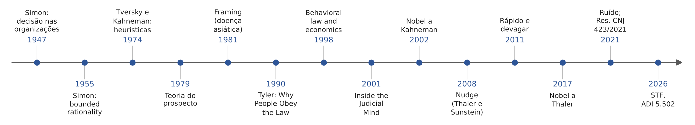
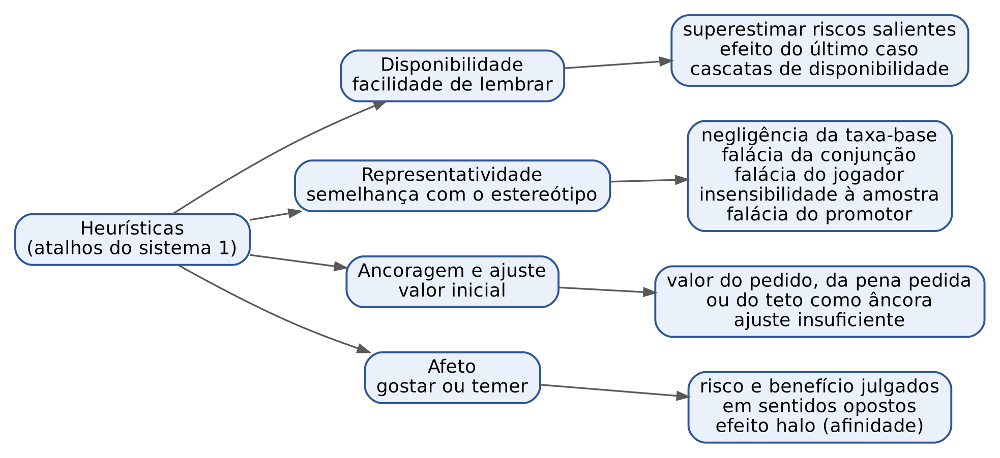
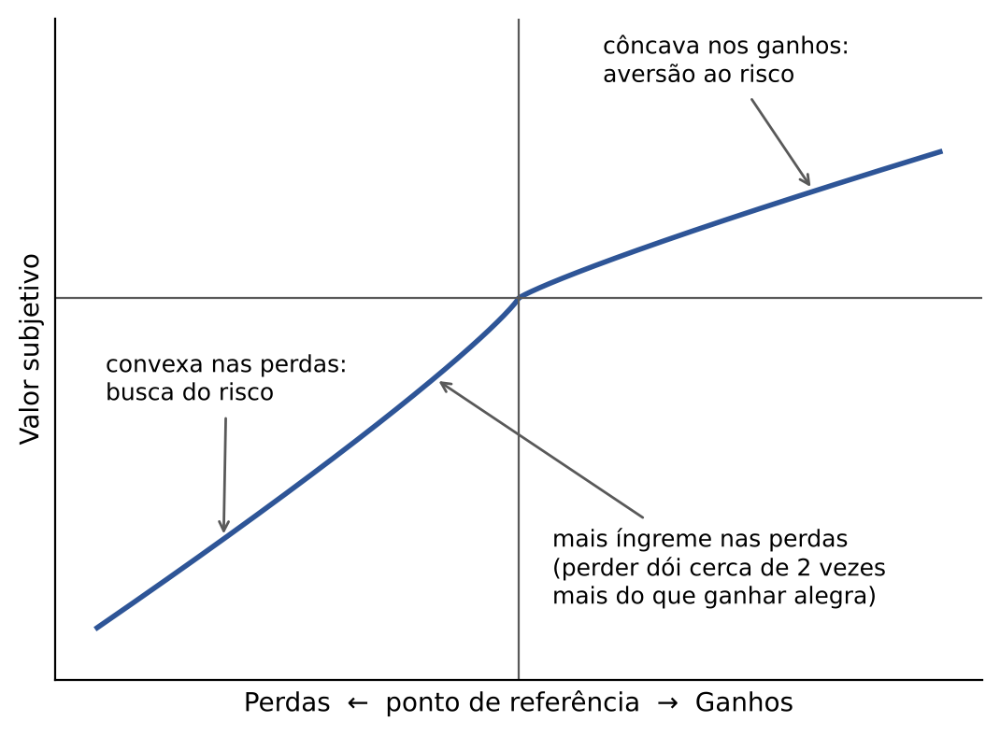
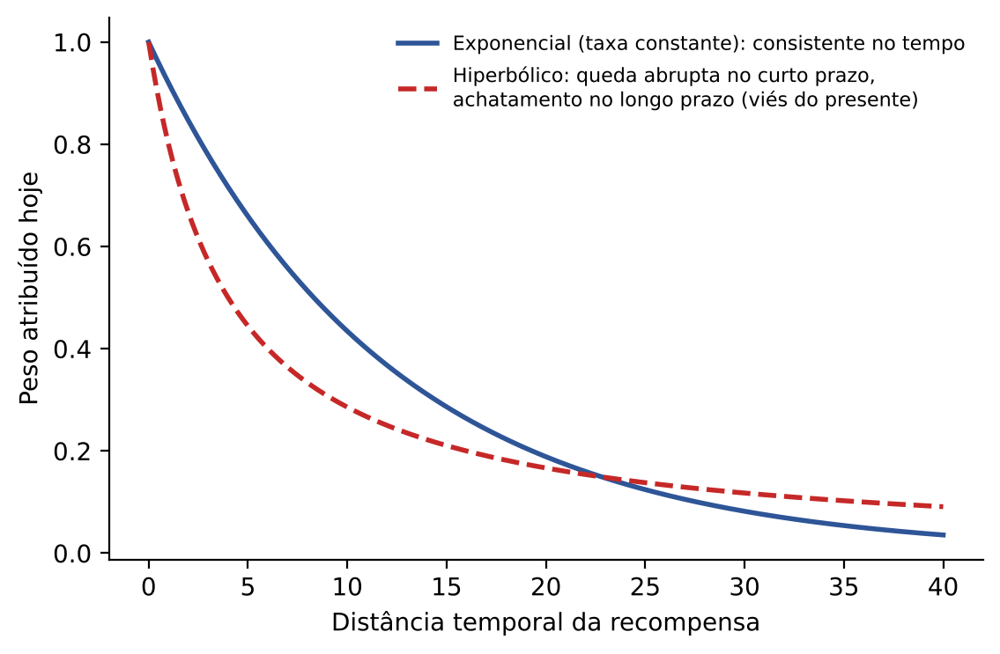
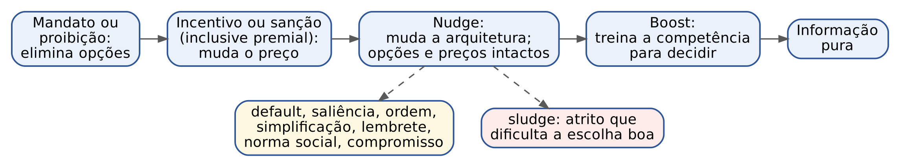
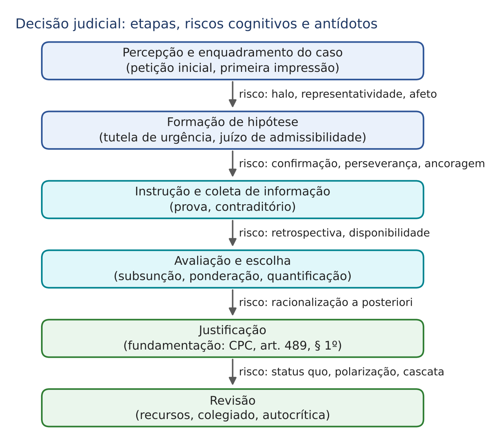
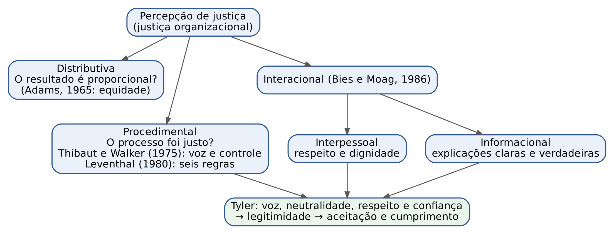

# CAPÍTULO 37 — ECONOMIA COMPORTAMENTAL E DECISÃO JUDICIAL: HEURÍSTICAS, VIESES, NUDGES E PERCEPÇÃO DE JUSTIÇA

:::INCIDENCIA
TRF5 p. G.4; TJRS p. G.3; TJSC p. H.3. Nível A+.
Lote: 4 questões (FGV 4, FCC 0), todas de provas de gestão (SES-MT 2024, Câmara de Fortaleza 2024, AL-RO 2026, duas); correlatas nos Caps. 8 (ancoragem na negociação) e 36 (racionalidade limitada e contratos incompletos).
O que mais cai: definição correta de cada viés com troca de rótulos entre alternativas (halo, enquadramento, ancoragem, disponibilidade, erro de aleatoriedade, escalada do comprometimento, Dunning-Kruger, falso consenso); atribuição de autores (Simon, Kahneman e Tversky, Thaler e Sunstein, Tyler); *nudge* x incentivo; vieses do juiz e técnicas de mitigação.
:::

O ponto entrou no Anexo VI da Resolução CNJ 75/2009 pela Resolução CNJ 423, de 5/10/2021 (bloco G, item 3: "Economia comportamental. Heurística e vieses cognitivos. A percepção de Justiça. Processo cognitivo de tomada de decisão"). A FGV extrai as definições do repertório de comportamento organizacional (a lista de "vieses e erros comuns na tomada de decisão" dos manuais de administração, como o de Stephen Robbins) e as embaralha entre alternativas; a prova oral e a discursiva pedem que se identifique o viés num ato decisório concreto e se indique o antídoto institucional.

Remissões para não repetir: o modelo da escolha racional, a AED e a crítica comportamental ao *homo economicus* em visão geral estão no Cap. 36 (36.1.5 e 36.3); a percepção, a emoção, a desvalorização reativa, a autoconveniência e as barreiras ao acordo na negociação, no Cap. 8 (08.6); a psicologia do testemunho, as falsas memórias, a visão de túnel, a dissonância cognitiva (Festinger) e os experimentos de Schünemann, no Cap. 9 (09.9.5); a imparcialidade cognitiva como dever ético, no Cap. 12 (12.5.3); contexto de descoberta x contexto de justificação e o realismo de Jerome Frank, nos Caps. 20 (20.1) e 18 (18.5); justiça procedimental em Rawls, no Cap. 17 (17.2.4); consequencialismo e art. 20 da LINDB, nos Caps. 35 e 24; vieses algorítmicos e Resolução CNJ 615/2025, no Cap. 30; vieses implícitos e discriminação, nos Caps. 28 e 39. Aqui se desenvolvem a teoria comportamental, o catálogo de heurísticas e vieses, a arquitetura de escolhas, a evidência sobre juízes, a percepção de justiça e o processo de decisão.

## 37.1 Da escolha racional à economia comportamental

### 37.1.1 O modelo padrão e o que a economia comportamental contesta

O modelo da escolha racional (Cap. 36, 36.3.1) supõe agentes com preferências completas, transitivas e estáveis, que processam toda a informação disponível, calculam probabilidades corretamente e maximizam utilidade esperada, sendo indiferentes à forma de apresentação das opções. A economia comportamental não nega que pessoas respondam a incentivos; contesta, com base experimental, três premissas: (i) a capacidade ilimitada de processar informação; (ii) a invariância das preferências em relação à descrição e ao ponto de referência; (iii) a consistência temporal das escolhas. O ponto metodológico central é que os desvios não são ruído aleatório que se cancela na média, mas erros SISTEMÁTICOS e, portanto, previsíveis, o que permite ao Direito antecipá-los.

| Premissa do modelo padrão | Achado comportamental | Autor de referência |
|---|---|---|
| Informação e cálculo ilimitados | Racionalidade limitada; busca de solução satisfatória | Simon |
| Probabilidades estimadas corretamente | Heurísticas e vieses sistemáticos | Kahneman e Tversky (1974) |
| Utilidade sobre estados finais de riqueza | Valor sobre ganhos e perdas em relação a um ponto de referência; aversão à perda | Kahneman e Tversky (1979) |
| Invariância de descrição | Efeito de enquadramento | Tversky e Kahneman (1981) |
| Desconto exponencial, consistência temporal | Desconto hiperbólico, viés do presente | Strotz, Ainslie, Laibson, Thaler |
| Autointeresse estrito | Preferências por equidade e reciprocidade (jogo do ultimato) | Güth; Kahneman, Knetsch e Thaler |

### 37.1.2 Herbert Simon: racionalidade limitada e *satisficing*

Herbert A. Simon (1916-2001), cientista político, economista e pioneiro da inteligência artificial, recebeu o Nobel de Economia em 1978 "por sua pesquisa pioneira sobre o processo de tomada de decisão nas organizações econômicas". A tese aparece em Administrative Behavior (1947) e é formalizada em "A Behavioral Model of Rational Choice" (Quarterly Journal of Economics, 1955) e em "Rational Choice and the Structure of the Environment" (Psychological Review, 1956); a expressão *bounded rationality* consolida-se em Models of Man (1957).

Conceitos-chave:

- RACIONALIDADE LIMITADA (*bounded rationality*): o decisor é "intencionalmente racional, mas apenas limitadamente", porque enfrenta limites de INFORMAÇÃO (não conhece todas as alternativas nem suas consequências), de TEMPO e de CAPACIDADE COGNITIVA (memória e cálculo). Não se trata de irracionalidade, mas de racionalidade adaptada a restrições.
- *SATISFICING* (neologismo de *satisfy* + *suffice*, traduzido como "satisfazer" ou "busca da solução satisfatória"): em vez de maximizar, o decisor fixa um NÍVEL DE ASPIRAÇÃO e escolhe a primeira alternativa que o atinge; o nível sobe ou desce conforme a experiência. Contrapõe-se ao "homem econômico" maximizador o "homem administrativo".
- RACIONALIDADE SUBSTANTIVA x PROCEDIMENTAL: a primeira avalia o resultado (a melhor escolha objetiva); a segunda, a razoabilidade do PROCESSO de deliberação diante das limitações. Simon desloca a análise para a racionalidade procedimental.
- METÁFORA DA TESOURA (Simon, 1990): o comportamento racional é moldado por uma tesoura cujas lâminas são a estrutura do AMBIENTE da tarefa e as capacidades COMPUTACIONAIS do agente; não se compreende uma sem a outra. É a matriz da "racionalidade ecológica" de Gigerenzer (37.1.5).
- FASES DO PROCESSO DECISÓRIO: inteligência (perceber o problema), concepção (*design*, gerar alternativas) e escolha, depois acrescida da revisão (37.9.1).

:::DOUTRINA Herbert Simon, Administrative Behavior (1947) e Models of Man (1957)
Nas organizações, a racionalidade limitada é compensada pela própria estrutura organizacional: divisão de tarefas, rotinas, regras, canais de comunicação e treinamento reduzem a complexidade que cada decisor enfrenta e fixam premissas de decisão. Essa leitura é útil para o Judiciário: precedentes, enunciados, súmulas, roteiros e fluxos de trabalho funcionam como premissas decisórias que economizam cognição, com o risco correspondente de aplicação mecânica (37.9.3).
:::

:::PEGADINHA
(1) Racionalidade limitada NÃO é sinônimo de irracionalidade nem de erro: é a descrição de um decisor que busca ser racional sob restrições. (2) *Satisficing* não é "satisfação do cliente" nem "maximização com informação imperfeita": é parar na primeira opção que atinge o nível de aspiração. (3) Simon é o autor da racionalidade limitada; Kahneman e Tversky, das heurísticas e vieses e da teoria do prospecto; Thaler e Sunstein, do *nudge*. A FGV troca os nomes. (4) Na teoria dos contratos (Williamson, Cap. 36, 36.5.6), a racionalidade limitada é a razão da INCOMPLETUDE contratual: as partes não conseguem prever e especificar todas as contingências (Q3851691, gabarito E, comentada no Cap. 36).
:::

### 37.1.3 O programa "heurísticas e vieses": Kahneman e Tversky

Daniel Kahneman (1934-2024) e Amos Tversky (1937-1996), psicólogos israelenses, desenvolveram a partir do início dos anos 1970 o programa de pesquisa *heuristics and biases*. Os marcos que a banca pode atribuir:

- "Judgment under Uncertainty: Heuristics and Biases" (Science, 1974): em julgamentos probabilísticos, as pessoas recorrem a poucos princípios heurísticos (representatividade, disponibilidade, ancoragem e ajuste) que reduzem tarefas complexas a operações simples; em geral são úteis, mas às vezes conduzem a erros graves e sistemáticos.
- "Prospect Theory: An Analysis of Decision under Risk" (Econometrica, 1979): modelo descritivo de escolha sob risco, alternativo à utilidade esperada (37.4).
- "The Framing of Decisions and the Psychology of Choice" (Science, 1981): efeito de enquadramento (37.4.2).
- Kahneman recebeu o Nobel de Economia em 2002 (com Vernon Smith, da economia experimental), "por ter integrado à ciência econômica percepções da pesquisa psicológica, especialmente quanto ao julgamento humano e à tomada de decisão sob incerteza". Tversky falecera em 1996 e o prêmio não é concedido postumamente.
- Thinking, Fast and Slow (2011; Rápido e Devagar: Duas Formas de Pensar, 2012) sintetiza o programa e populariza os sistemas 1 e 2 (37.2).
- Noise: A Flaw in Human Judgment (2021, com Olivier Sibony e Cass Sunstein; Ruído: Uma Falha no Julgamento Humano): a variabilidade indesejada entre julgamentos que deveriam ser idênticos (37.8.2).

O programa tem natureza DESCRITIVA (como as pessoas decidem), não normativa (como deveriam decidir). Os vieses são definidos por contraste com uma norma (probabilidade, lógica, utilidade esperada); é exatamente esse ponto que Gigerenzer contesta.

### 37.1.4 *Behavioral law and economics*: os três limites

A importação para o Direito tem como texto fundador "A Behavioral Approach to Law and Economics", de Christine Jolls, Cass Sunstein e Richard Thaler (Stanford Law Review, 1998). Os autores propõem substituir o *homo economicus* por um agente com três limites:

| Limite | Conteúdo | Exemplo jurídico |
|---|---|---|
| Racionalidade limitada (*bounded rationality*) | Heurísticas, vieses, otimismo excessivo, enquadramento | Consumidor que subestima o risco de inadimplência; juiz influenciado pela âncora do pedido |
| Força de vontade limitada (*bounded willpower*) | Pessoas agem contra o próprio interesse de longo prazo sabendo disso (viés do presente) | Poupança previdenciária insuficiente; superendividamento |
| Autointeresse limitado (*bounded self-interest*) | Pessoas se importam com equidade e reciprocidade, e punem condutas injustas mesmo com custo próprio | Rejeição de proposta de acordo "injusta" mas economicamente vantajosa |

Christine Jolls e Cass Sunstein desenvolveram ainda o *debiasing through law* (Journal of Legal Studies, 2006): normas desenhadas para reduzir vieses, em vez de apenas contorná-los ou explorá-los. Richard Thaler recebeu o Nobel de Economia em 2017 "por suas contribuições à economia comportamental", com ênfase em contabilidade mental, preferências por equidade e autocontrole. Kahneman e Thaler NÃO dividiram o prêmio; Tversky não o recebeu.

### 37.1.5 A crítica de Gigerenzer: racionalidade ecológica

Gerd Gigerenzer (Instituto Max Planck, Berlim), com o grupo ABC, publicou Simple Heuristics That Make Us Smart (1999). A crítica: (i) heurísticas não são defeitos, mas ferramentas adaptativas de uma "caixa de ferramentas" (*adaptive toolbox*); (ii) sua racionalidade é ECOLÓGICA, isto é, depende do ajuste ao ambiente (retomando a tesoura de Simon); (iii) em ambientes de incerteza genuína, heurísticas "rápidas e frugais" (*fast and frugal*), como a heurística do reconhecimento e o *take-the-best*, podem superar modelos complexos (efeito "menos é mais"); (iv) muitos vieses desaparecem quando a informação é apresentada em frequências naturais, e não em probabilidades. A versão prescritiva é o *boost* (37.7.4): em vez de manipular o ambiente, treinar a competência do decisor.

Kahneman e Gary Klein ("Conditions for Intuitive Expertise: A Failure to Disagree", American Psychologist, 2009) chegaram a uma síntese: a intuição especializada é confiável quando (a) o ambiente tem regularidades válidas e (b) o profissional teve prática prolongada com *feedback* rápido e preciso. Bombeiros e enxadristas preenchem os requisitos; previsões de longo prazo e muitos julgamentos clínicos não. O juiz recebe *feedback* escasso e tardio (reforma em grau recursal, anos depois, sobre parte dos casos), o que recomenda cautela com a confiança na própria intuição.

:::DICA
Para a prova oral, a síntese é: Simon mostrou que a racionalidade é LIMITADA; Kahneman e Tversky mostraram que os desvios são SISTEMÁTICOS e os catalogaram; Thaler e Sunstein extraíram a consequência PRESCRITIVA (arquitetura de escolhas); Gigerenzer contestou o tom de "irracionalidade" (racionalidade ECOLÓGICA). No Direito, Jolls, Sunstein e Thaler (1998) propuseram os três limites, e Guthrie, Rachlinski e Wistrich (2001) testaram os vieses em juízes reais.
:::

## 37.2 Sistemas 1 e 2 e o processo mental

### 37.2.1 Os dois sistemas

A teoria do processamento dual é anterior a Kahneman (Evans, Sloman, Epstein); os rótulos "Sistema 1" e "Sistema 2" são de Keith Stanovich e Richard West (2000), popularizados em Rápido e Devagar. Kahneman adverte que os sistemas são "personagens fictícios", metáforas de modos de processamento, não regiões do cérebro.

| Critério | Sistema 1 | Sistema 2 |
|---|---|---|
| Operação | Automática, rápida, sem esforço, involuntária | Deliberada, lenta, esforçada, controlada |
| Base | Associação, padrões, emoção, impressão | Regras, cálculo, raciocínio sequencial |
| Capacidade | Paralela, sempre ligada | Serial, limitada; esgota-se (atenção é recurso escasso) |
| Exemplos | Perceber hostilidade num rosto; completar "2 + 2 ="; dirigir em estrada vazia; reconhecer padrão de caso repetitivo | Calcular 17 x 24; conferir prazo; comparar dois laudos; redigir fundamentação |
| Risco | Heurísticas e vieses; substituição de pergunta | Preguiça: endossa a sugestão do Sistema 1 sem verificar |
| Relação | Gera impressões, intuições e impulsos | Monitora, corrige ou endossa; pode ser treinado a desconfiar em situações típicas de erro |

O teste clássico é o do bastão e da bola (Shane Frederick, Cognitive Reflection Test, 2005): juntos custam 1,10; o bastão custa 1,00 a mais que a bola; quanto custa a bola? A resposta intuitiva (0,10) é errada (0,05), porque o Sistema 2 não confere a sugestão do Sistema 1.

### 37.2.2 Mecanismos do Sistema 1 que explicam os vieses

- SUBSTITUIÇÃO DE ATRIBUTO (Kahneman e Frederick, 2002): diante de pergunta difícil ("qual a probabilidade de este réu reincidir?"), o Sistema 1 responde a uma mais fácil ("quanto ele se parece com um criminoso típico?") sem perceber a troca. É a explicação unificada das heurísticas.
- WYSIATI (*what you see is all there is*, "o que você vê é tudo o que há"): o Sistema 1 constrói a história mais coerente com a informação disponível, sem considerar o que falta. A CONFIANÇA depende da coerência da história, não da quantidade e qualidade das provas. No processo, é o risco da decisão tomada com base apenas na versão de uma parte (tutela *inaudita altera parte*).
- FACILIDADE COGNITIVA (*cognitive ease*): o que é familiar, claro, repetido e fácil de ler parece verdadeiro (efeito da mera exposição, ilusão de verdade pela repetição). Daí o poder retórico da repetição em petições e na desinformação.
- *PRIMING* (pré-ativação): exposição a um estímulo altera a resposta a outro posterior, sem consciência. Parte dos experimentos de *priming* social não se replicou (crise de replicação, a partir de 2011), o que o próprio Kahneman reconheceu; heurísticas, enquadramento e aversão à perda são achados robustos.
- EXCESSO DE COERÊNCIA E EFEITO HALO: a primeira impressão colore a interpretação do restante (37.5.4).
- ESGOTAMENTO E FADIGA: o Sistema 2 se cansa; decisões em sequência longa tendem a seguir o padrão (*default*) (estudo de Danziger e outros, 37.8.1, com as críticas).

### 37.2.3 O juiz intuitivo: do *hunch* ao modelo intuitivo-dedutivo

A ideia de que o juiz decide primeiro por intuição e depois justifica é antiga. Joseph Hutcheson Jr., juiz federal norte-americano, em "The Judgment Intuitive: The Function of the 'Hunch' in Judicial Decision" (Cornell Law Quarterly, 1929), descreveu o palpite como motor da decisão; Jerome Frank (Law and the Modern Mind, 1930) radicalizou a tese no realismo jurídico (Cap. 18, 18.5). A teoria da argumentação respondeu com a distinção entre contexto de descoberta e contexto de justificação (Cap. 20, 20.1): ainda que a decisão nasça de intuição, só vale se puder ser justificada racionalmente.

A psicologia cognitiva permite superar o falso dilema. Chris Guthrie, Jeffrey Rachlinski e Andrew Wistrich ("Blinking on the Bench: How Judges Decide Cases", Cornell Law Review, 2007) aplicaram o Cognitive Reflection Test a juízes norte-americanos e verificaram que eles, como outros profissionais instruídos, tendem a confiar na resposta intuitiva. Propõem o modelo INTUITIVO-OVERRIDE (intuitivo-dedutivo): os juízes geram intuições rapidamente (Sistema 1), mas podem e devem submetê-las à deliberação (Sistema 2), e o sistema judicial deve criar condições institucionais para isso (tempo, fundamentação escrita, colegialidade, revisão).

:::ATENCAO
A exigência de fundamentação analítica (CF, art. 93, IX; CPC, art. 489, § 1º; CPP, art. 315, § 2º) é, na perspectiva comportamental, um mecanismo de ativação do Sistema 2: obriga o juiz a enfrentar todos os argumentos capazes de infirmar a conclusão (art. 489, § 1º, IV), técnica de "considerar o oposto" (37.9.4). Fundamentação genérica, que "se prestaria a justificar qualquer outra decisão" (inciso III), é o sintoma típico de decisão tomada pelo Sistema 1 e apenas racionalizada.
:::

:::PRATIQUE Exercício elaborado para esta apostila (não é questão de banca)
1. Certo ou errado: "Para Herbert Simon, o decisor administrativo maximiza a utilidade esperada, mas com informação imperfeita".
2. Certo ou errado: "Os sistemas 1 e 2 correspondem, segundo Kahneman, a duas regiões cerebrais distintas, identificáveis por neuroimagem".
3. Um juiz percebe que, ao ler uma inicial muito bem redigida, já se convenceu do direito do autor antes da contestação. Que mecanismo do Sistema 1 está em ação e que providência deliberada ele pode adotar?
Resolução: 1. Errado: Simon rejeita a maximização; o decisor busca solução SATISFATÓRIA (*satisficing*) segundo um nível de aspiração. 2. Errado: são personagens fictícios, metáforas de modos de processamento. 3. WYSIATI e facilidade cognitiva (história coerente e fluente gera confiança sem prova), com risco de efeito halo e de confirmação; providência: suspender o juízo, formular expressamente a melhor versão possível da tese contrária e listar os fatos que dependem de prova antes de ler a contestação (técnica de considerar o oposto, 37.9.4).
:::

## 37.3 Heurísticas

### 37.3.1 Conceito

Heurística é um procedimento simplificado de julgamento, um atalho mental que substitui o cálculo completo por uma regra prática. Viés (*bias*) é o desvio SISTEMÁTICO em relação a um padrão normativo (lógica, probabilidade, utilidade esperada) que resulta, entre outras causas, do uso de heurísticas em contextos inadequados. A relação é de causa e efeito: a heurística é o mecanismo; o viés, o erro previsível. Nem todo viés decorre de heurística (há vieses motivacionais, como a autoconveniência, e vieses de memória), e nem todo uso de heurística produz erro.

### 37.3.2 Disponibilidade

Pela heurística da disponibilidade (Tversky e Kahneman, 1973), a frequência ou a probabilidade de um evento é estimada pela FACILIDADE com que exemplos vêm à mente. Funciona porque eventos frequentes costumam ser mais fáceis de lembrar; falha porque a facilidade de lembrança também depende de fatores alheios à frequência: recência, vividez, carga emocional, cobertura da mídia, experiência pessoal.

- Experimento clássico: perguntados se há mais palavras inglesas que COMEÇAM com a letra K ou que a têm como TERCEIRA letra, a maioria responde "começam", embora haja cerca de três vezes mais com K na terceira posição; é mais fácil buscar palavras pela inicial.
- Riscos salientes: após acidente aéreo noticiado, a percepção de risco de voar sobe; mortes por causas espetaculares são superestimadas e por causas banais, subestimadas.
- CASCATA DE DISPONIBILIDADE (Timur Kuran e Cass Sunstein, 1999): ciclo autorreforçado em que a cobertura midiática de um risco aumenta sua disponibilidade, gera pressão pública e induz regulação desproporcional ("pânico moral").
- No Judiciário: o "efeito do último caso" (o juiz que acabou de ver a reincidência violenta de um réu solto tende a ser mais rigoroso nas audiências de custódia seguintes); a superestimação da frequência de fraudes em determinado tipo de demanda após casos notórios; a influência da repercussão midiática na percepção de gravidade (Cap. 4).

### 37.3.3 Representatividade

Pela heurística da representatividade, a probabilidade de que A pertença à categoria B é julgada pelo grau em que A SE PARECE com o estereótipo de B. O erro é ignorar as regras da probabilidade que a semelhança não capta:

| Viés derivado | Conteúdo | Exemplo |
|---|---|---|
| Negligência da taxa-base | Ignorar a frequência prévia da categoria | Descrição de "Tom W." ou de "Steve, tímido e organizado": as pessoas o julgam bibliotecário, embora haja muito mais agricultores (ou vendedores) do que bibliotecários |
| Falácia da conjunção | Julgar mais provável a conjunção de dois eventos do que um deles isolado | Problema de Linda (Tversky e Kahneman, 1983): "Linda é caixa de banco e feminista" julgado mais provável do que "Linda é caixa de banco" |
| Insensibilidade ao tamanho da amostra | Tratar amostras pequenas como tão representativas quanto grandes ("lei dos pequenos números") | Concluir pela "tendência" de um juízo a partir de três sentenças |
| Falácia do jogador | Esperar que o acaso "se corrija" em sequência curta | Após cinco caras, apostar em coroa |
| Ilusão de padrão no aleatório | Ver causalidade ou padrão em sequência aleatória ("mão quente") | Ver "sorte" em amuleto (Q2479390, 37.5.5) |
| Desconsideração da regressão à média | Atribuir a causas a volta natural de valores extremos à média | Instrutores de voo que concluem que elogio piora e crítica melhora o desempenho |
| Falácia do promotor (inversão condicional) | Confundir P(prova se inocente) com P(inocente se prova) | Coincidência de perfil genético "1 em 1 milhão" lida como "chance de 1 em 1 milhão de o réu ser inocente" |

:::EXEMPLO A falácia do promotor no caso Sally Clark
Na Inglaterra, em 9/11/1999, Sally Clark foi condenada, por maioria do júri, pela morte de dois filhos bebês. O pediatra Roy Meadow afirmou que a probabilidade de duas mortes súbitas infantis numa família como a dela era de "1 em 73 milhões", número obtido elevando ao quadrado a estimativa de uma morte (1 em 8.543), como se fossem eventos independentes (desconsiderando fatores genéticos e ambientais comuns), e que foi lido como probabilidade de inocência. A Royal Statistical Society declarou publicamente, em 23/10/2001, que o número não tinha base estatística; a condenação foi anulada no segundo recurso, em 2003. Lições para o juiz: (1) probabilidade de uma prova sob a hipótese de inocência não é probabilidade de inocência; (2) é preciso comparar com a probabilidade da hipótese alternativa (duplo homicídio de bebês pela mãe também é raríssimo); (3) números impressionantes ativam a representatividade e a âncora.
:::

Representatividade e estereótipo são o elo com o direito antidiscriminatório: julgar a credibilidade da vítima pela semelhança com a "vítima ideal" ou a periculosidade do réu pela semelhança com o "criminoso típico" é aplicação da heurística a categorias sociais. Os Protocolos de julgamento com perspectiva de gênero (Res. CNJ 492/2023) e racial (Res. CNJ 598/2024) são, desse ângulo, instrumentos de *debiasing* (Cap. 28; vieses implícitos e estereótipos no Cap. 39). No reconhecimento de pessoas, o efeito outra raça e a seletividade estão no Cap. 9 (09.6.4).

### 37.3.4 Ancoragem e ajuste

Pela heurística da ancoragem e ajuste, estimativas numéricas partem de um valor inicial (a ÂNCORA) e são ajustadas a partir dele, mas o ajuste é INSUFICIENTE, de modo que o resultado fica enviesado na direção da âncora. A âncora atua mesmo quando é manifestamente arbitrária ou irrelevante.

- Experimento clássico (Tversky e Kahneman, 1974): participantes viam uma "roda da fortuna" parar em 10 ou em 65 e, em seguida, estimavam a porcentagem de países africanos na ONU; as medianas foram 25 e 45, respectivamente.
- Mecanismos: ajuste insuficiente (deliberado, Sistema 2 que para cedo demais) e ACESSIBILIDADE SELETIVA (Thomas Mussweiler e Fritz Strack: a âncora ativa informações compatíveis com ela, um efeito de *priming* do Sistema 1).
- Robustez: o efeito persiste em especialistas, com incentivos à precisão e quando se adverte o participante sobre ele; é atenuado, não eliminado, pela técnica de considerar o oposto.
- Em juízes (37.8.1): Birte Englich, Thomas Mussweiler e Fritz Strack ("Playing Dice with Criminal Sentences", Personality and Social Psychology Bulletin, 2006) mostraram que juízes alemães experientes, após lançarem dados viciados que davam 3 ou 9, fixaram penas maiores no caso hipotético quando o dado dava 9; a pena pedida pela acusação, mesmo quando sabidamente aleatória, também ancorou a decisão.

No processo brasileiro, âncoras típicas: o valor pedido a título de dano moral; o valor da causa; a pena pedida em alegações finais; os tetos legais (alçada dos Juizados, limites de multa); a primeira proposta numa conciliação (Cap. 8, 08.2.2); a decisão liminar em relação à sentença; o voto do relator em relação aos demais votos; o laudo do assistente técnico da parte. O antídoto institucional não é ignorar o pedido (que delimita a lide, CPC, arts. 141 e 492), mas construir o valor a partir de parâmetros independentes antes de confrontá-lo com o pedido: o método bifásico do STJ para dano moral (grupo de precedentes sobre o mesmo interesse jurídico, depois circunstâncias do caso), a dosimetria trifásica com fundamentação de cada circunstância (CP, art. 68) e tabelas de referência.

:::PEGADINHA
(1) A âncora NÃO precisa ser relevante nem plausível para produzir efeito; a banca coloca como correta a afirmativa de que "a ancoragem só ocorre quando o valor inicial é informativo", o que é falso. (2) Ancoragem ≠ disponibilidade: a primeira refere-se a um valor INICIAL do qual se ajusta; a segunda, à FACILIDADE DE LEMBRAR exemplos. (3) Ancoragem ≠ falso consenso: a FGV descreveu como "ancoragem" a tendência a acreditar que as próprias crenças são mais compartilhadas do que realmente são (Q2458709, E), que é o efeito de FALSO CONSENSO (Ross, Greene e House, 1977). (4) "Lapso de ancoragem" não é termo técnico (distrator da Q2479390).
:::

:::QUESTAO FGV 2026 — AL-RO — Analista Legislativo (Administração) (Q3880083)
Cobrado: avaliar três afirmações sobre vieses no processo decisório. I: decidir com base em referência ou comparação inicial é viés de ancoragem. II: julgar situações com base em eventos recentes ou facilmente lembrados caracteriza viés de disponibilidade. III: a tendência a atribuir significado a eventos aleatórios corresponderia à escalada de comprometimento.
Gabarito: C (I e II, apenas).
Armadilha: a afirmação III troca rótulos. Atribuir significado a eventos aleatórios é o ERRO DE ALEATORIEDADE (*randomness error*); a ESCALADA DO COMPROMETIMENTO é persistir num curso de ação fracassado por causa dos recursos já investidos (37.4.4). Lição: a FGV mantém a definição correta e troca o nome; leia primeiro a definição, nomeie mentalmente o viés e só depois compare com o rótulo da alternativa.
:::

### 37.3.5 Heurística do afeto e outras

Paul Slovic e colaboradores descreveram a HEURÍSTICA DO AFETO: julgamentos de risco e benefício são guiados pela reação emocional imediata (gostar ou temer). Por isso risco e benefício são percebidos em sentidos opostos (o que se aprecia parece de baixo risco e alto benefício), embora no mundo real costumem andar juntos. É forma de substituição ("o que sinto sobre isso?" no lugar de "quais os riscos?"); no processo, empatia ou repulsa pela parte afetam a avaliação de fatos (37.5.4; Cap. 8, 08.6.2).

Outras heurísticas que podem aparecer: a heurística do RECONHECIMENTO (Gigerenzer: entre dois objetos, inferir que o reconhecido tem valor maior no critério), a do STATUS QUO (manter o que existe como opção mais segura, 37.4.4) e a heurística da AUTORIDADE (seguir a opinião de quem tem prestígio), cuja versão institucional é a deferência acrítica a precedentes ou a votos de membros mais antigos de um colegiado.

:::PRATIQUE Exercício elaborado para esta apostila (não é questão de banca)
1. Em mutirão de audiências de custódia, a juíza, abalada pela notícia de homicídio cometido por preso que soltara na semana anterior, converte em preventiva todas as prisões por furto simples do dia. Identifique a heurística e o antídoto.
2. Na ação de indenização, o autor pede 500 mil reais por dano moral decorrente de negativação indevida; a jurisprudência do tribunal fixa, em casos semelhantes, valores em torno de 10 mil. O juiz arbitra 60 mil "por razoabilidade, reduzindo substancialmente o pedido". Que viés é provável?
3. Laudo estatístico afirma que a chance de coincidência aleatória de perfil de DNA é de 1 em 10 milhões; o Ministério Público sustenta que "há 1 chance em 10 milhões de o réu ser inocente". Qual o erro?
Resolução: 1. Disponibilidade (evento recente, vívido e emocional altera a estimativa de risco); antídoto: decidir caso a caso com base nos requisitos legais e em dados concretos de risco (CPP, arts. 312 e 315), eventualmente com roteiro escrito de critérios. 2. Ancoragem no valor pedido; antídoto: fixar o valor pelo método bifásico (precedentes do mesmo grupo e, depois, circunstâncias do caso) antes de confrontá-lo com o pedido, que funciona apenas como teto (CPC, art. 492). 3. Falácia do promotor (inversão condicional): a probabilidade de coincidência sob a hipótese de inocência não é a probabilidade de inocência; esta depende das demais provas e do tamanho da população de possíveis autores.
:::

## 37.4 Teoria do prospecto: enquadramento, aversão à perda, dotação e status quo

### 37.4.1 A teoria do prospecto

A teoria do prospecto (*prospect theory*; Kahneman e Tversky, 1979; versão cumulativa de 1992) é um modelo DESCRITIVO de escolha sob risco, construído para explicar violações sistemáticas da teoria da utilidade esperada (von Neumann e Morgenstern). Seus elementos:

- DEPENDÊNCIA DE REFERÊNCIA: as pessoas avaliam resultados como GANHOS ou PERDAS em relação a um ponto de referência (normalmente o *status quo* ou uma expectativa), e não como estados finais de riqueza.
- FUNÇÃO DE VALOR em forma de S: côncava para ganhos (aversão ao risco) e convexa para perdas (busca do risco), com sensibilidade decrescente (a diferença entre 100 e 200 pesa mais que entre 1.100 e 1.200).
- AVERSÃO À PERDA: a curva é mais íngreme nas perdas; perder dói aproximadamente o dobro do que ganhar o mesmo valor alegra (coeficiente estimado em cerca de 2,25 por Tversky e Kahneman, 1992).
- PONDERAÇÃO DE PROBABILIDADES: probabilidades pequenas são superestimadas e probabilidades médias e altas, subestimadas; o efeito CERTEZA dá peso desproporcional ao resultado certo.
- Daí o PADRÃO QUÁDRUPLO: aversão ao risco em ganhos prováveis e em perdas improváveis (seguro); busca do risco em ganhos improváveis (loteria) e em perdas prováveis (litigar até o fim uma causa quase perdida).
- EDIÇÃO: antes de avaliar, o decisor codifica, combina e simplifica os prospectos, fase em que atua o enquadramento.

### 37.4.2 Efeito de enquadramento

O efeito de enquadramento (*framing effect*) é a mudança de preferência provocada por descrições logicamente equivalentes de um mesmo problema. Viola o princípio da INVARIÂNCIA da teoria racional.

O experimento da "doença asiática" (Tversky e Kahneman, Science, 1981): uma doença deve matar 600 pessoas. Enquadramento positivo: o programa A salvará 200; o programa B tem 1/3 de probabilidade de salvar todos e 2/3 de não salvar ninguém; 72% escolheram A (aversão ao risco nos ganhos). Enquadramento negativo, com outro grupo: no programa C morrerão 400; no D, há 1/3 de probabilidade de ninguém morrer e 2/3 de morrerem todos; 78% escolheram D (busca de risco nas perdas). A e C, B e D são idênticos.

Espécies de enquadramento (Irwin Levin, Sandra Schneider e Gary Gaeth, 1998): de ESCOLHA ARRISCADA (o da doença asiática); de ATRIBUTO ("75% magra" x "25% gordura"; "90% de sobrevida" x "10% de mortalidade" num procedimento médico, com efeito sobre o consentimento informado); de OBJETIVO (destacar o que se ganha fazendo x o que se perde não fazendo).

No processo:

- Acordo e litígio (Jeffrey Rachlinski, "Gains, Losses, and the Psychology of Litigation", Southern California Law Review, 1996): o AUTOR tende a ver a proposta de acordo como GANHO certo e a ser avesso ao risco (aceita); o RÉU vê o pagamento como PERDA certa e tende a buscar o risco do julgamento (resiste). A técnica do conciliador de reenquadrar a proposta do réu como "encerramento do risco", "economia de custos" e "fim da incerteza", e não como "pagar", tem esse fundamento (Cap. 8, 08.6.3).
- Pena e benefícios: apresentar o acordo de não persecução penal ou a transação como "evitar a condenação" (perda evitada) ou como "aceitar uma sanção" (perda certa) altera a aceitação.
- Redação de decisões e comunicações: o mesmo dado pode ser exposto de modo a induzir a parte; a imparcialidade exige consciência do enquadramento (Cap. 6, linguagem simples).

:::QUESTAO FGV 2024 — Câmara de Fortaleza — Analista de Gestão de Pessoas (Q2458709)
Cobrado: afirmativa correta sobre vieses no processo decisório.
Gabarito: C — o *framing* é a tendência de ser influenciado a adotar uma escolha devido à forma como as informações são apresentadas.
Armadilhas (todas trocam definição e rótulo):
- A: descreve o efeito DUNNING-KRUGER (pouco conhecimento superestima a competência; especialistas tendem a subestimar a própria) e o chama de "efeito halo".
- B: descreve a ESCALADA DO COMPROMETIMENTO ou falácia do custo irrecuperável e a chama de "Dunning-Kruger".
- D: descreve o EFEITO HALO (uma característica contamina a avaliação das demais) e o chama de "erro de aleatoriedade".
- E: descreve o FALSO CONSENSO e o chama de "ancoragem".
Lição: questão de rótulos cruzados; quatro das cinco definições estão corretas, mas com o nome do vizinho. Domine o quadro do 37.5.6.
:::

### 37.4.3 Aversão à perda e efeito dotação

AVERSÃO À PERDA é a assimetria pela qual perdas pesam mais do que ganhos equivalentes. Manifestações:

- EFEITO DOTAÇÃO (*endowment effect*; Thaler, 1980; Kahneman, Knetsch e Thaler, Journal of Political Economy, 1990): o preço mínimo pelo qual alguém aceita vender um bem que recebeu (canecas, no experimento) é cerca do dobro do preço máximo que pagaria para adquiri-lo. A discrepância entre disposição a aceitar (WTA) e disposição a pagar (WTP) desafia o teorema de Coase na versão de que a atribuição inicial de direitos é irrelevante para a alocação final (Cap. 36, 36.2.1): se quem recebe o direito o valoriza mais por tê-lo, a alocação inicial feita pela lei ou pelo juiz importa.
- No processo: a parte que obteve liminar ou sentença favorável passa a valorizar a posição como "sua" e resiste mais a acordo; a perda de um bem ou de uma situação consolidada é sentida com mais intensidade do que o ganho de algo novo, o que explica a força intuitiva da proteção da confiança e do direito adquirido (Cap. 24, 24.8) e a resistência a reformas.
### 37.4.4 Status quo, omissão, custo irrecuperável e escalada do comprometimento

- VIÉS DO STATUS QUO (William Samuelson e Richard Zeckhauser, Journal of Risk and Uncertainty, 1988): preferência desproporcional pela manutenção da situação atual ou da opção previamente escolhida. Combina aversão à perda (mudar implica perdas visíveis), inércia (custo de decidir) e arrependimento antecipado. É o fundamento do poder das OPÇÕES-PADRÃO (*defaults*), principal ferramenta da arquitetura de escolhas (37.7).
- VIÉS DA OMISSÃO (Ilana Ritov e Jonathan Baron): prejuízos causados por ação são julgados piores do que prejuízos iguais causados por omissão. Interage com a responsabilidade civil e penal por omissão e com o receio do gestor público de decidir ("apagão das canetas"; LINDB, art. 28, Cap. 24).
- FALÁCIA DO CUSTO IRRECUPERÁVEL (*sunk cost*; Hal Arkes e Catherine Blumer, 1985): levar em conta, para decidir o futuro, recursos já gastos e irrecuperáveis ("já gastei tanto que agora vou até o fim").
- ESCALADA DO COMPROMETIMENTO (*escalation of commitment*; Barry Staw, "Knee-Deep in the Big Muddy", 1976): persistir e aumentar o investimento num curso de ação que vem fracassando, especialmente quando o decisor é pessoalmente responsável pela escolha inicial e precisa justificá-la. Exemplos: recorrer até a última instância pelo que já se investiu; manter projeto de sistema inviável; manter a linha da liminar contra a prova (soma-se à confirmação).

:::DICA
Status quo x dotação x custo irrecuperável x escalada: o STATUS QUO é preferência pelo estado atual; a DOTAÇÃO é valorizar mais o que se possui; o CUSTO IRRECUPERÁVEL é considerar o passado irrecuperável na decisão futura; a ESCALADA é o comportamento de AUMENTAR o investimento no curso fracassado, normalmente para justificar a escolha anterior. As quatro têm raiz na aversão à perda, mas a FGV as define separadamente.
:::

### 37.4.5 Contabilidade mental

Richard Thaler descreveu a CONTABILIDADE MENTAL (*mental accounting*): as pessoas tratam o dinheiro como não fungível, alocando-o em "contas" mentais (salário, restituição, prêmio, dinheiro da causa) com regras distintas de gasto. Explica por que o valor recebido num acordo judicial é gasto de modo diferente do salário, por que parcelamentos são preferidos mesmo com custo financeiro e por que o desconto num custo é percebido de modo distinto conforme a "conta" em que se insere. Thaler associa ao tema a UTILIDADE DE TRANSAÇÃO (o prazer ou desprazer com o "negócio" em si, independentemente do bem).

:::PRATIQUE Exercício elaborado para esta apostila (não é questão de banca)
1. Na audiência do art. 334 do CPC, o réu recusa pagar 30 mil, embora seu advogado estime 70% de chance de condenação a 50 mil mais custas. Que elemento da teoria do prospecto explica a recusa, e que reenquadramento o conciliador pode usar sem violar a imparcialidade?
2. Certo ou errado: "Segundo a teoria do prospecto, as pessoas são avessas ao risco tanto no domínio dos ganhos quanto no das perdas".
3. Município mantém, por anos, contrato de software que não funciona, aditando-o sucessivamente "para não perder o que foi investido". Identifique o viés.
Resolução: 1. O pagamento é percebido como PERDA certa; no domínio das perdas, as pessoas buscam o risco (função convexa); reenquadramento: falar em encerrar o risco, eliminar custos e incertezas, comparar as alternativas ao acordo (MAANA) para AMBAS as partes, sem antecipar juízo de mérito (CPC, art. 165, § 2º). 2. Errado: aversão ao risco nos ganhos, busca do risco nas perdas (padrão quádruplo com as probabilidades). 3. Escalada do comprometimento (com falácia do custo irrecuperável).
:::

## 37.5 Outros vieses cognitivos cobrados

### 37.5.1 Viés de confirmação

Viés de confirmação é a tendência a buscar, interpretar, lembrar e valorizar informações que confirmam crenças ou hipóteses prévias, e a desconsiderar ou desvalorizar as que as contrariam. Tem três dimensões: busca seletiva (procurar só provas favoráveis), interpretação enviesada (ler a prova ambígua como confirmatória) e memória seletiva.

- Peter Wason: na tarefa 2-4-6 (1960), os participantes testam apenas exemplos que confirmam sua hipótese sobre a regra, raramente os que poderiam refutá-la; na tarefa de seleção (1966), poucos escolhem a carta capaz de falsear a regra.
- Charles Lord, Lee Ross e Mark Lepper (1979), assimilação enviesada: defensores e opositores da pena de morte, expostos aos MESMOS estudos mistos, saíram mais convictos das próprias posições (polarização de atitudes).
- Formas aparentadas: efeito de perseverança da crença (a crença sobrevive à refutação da prova que a gerou), visão de túnel na investigação, dissonância cognitiva (Festinger) e efeito inércia (Schünemann) — estes três desenvolvidos no Cap. 9 (09.9.5).

No processo, os pontos críticos são: a decisão liminar ou cautelar, que cria uma hipótese e um compromisso público; a leitura da prova a partir da primeira versão conhecida; o juiz que participou da investigação (fundamento psicológico do juiz das garantias, CPP, arts. 3º-B a 3º-F, e do impedimento do art. 252, III, do CPP para quem já se pronunciou em outra instância); o relator que leva ao colegiado um voto pronto. Mecanismos processuais que operam como antídoto: contraditório efetivo e vedação de decisão-surpresa (CPC, arts. 9º e 10), dever de enfrentar argumentos contrários (art. 489, § 1º, IV), possibilidade de revisão da tutela provisória a qualquer tempo (art. 296), colegialidade e duplo grau.

### 37.5.2 Viés de retrospectiva

Viés de retrospectiva (*hindsight bias*; "eu sabia que ia acontecer") é a tendência, depois de conhecido o desfecho, a superestimar quão previsível ele era antes. Baruch Fischhoff (1975) o descreveu como "determinismo rastejante" (*creeping determinism*): conhecer o resultado reorganiza a memória e a percepção dos sinais anteriores.

É o viés de maior impacto no julgamento de RESPONSABILIDADE, porque o juiz sempre julga depois do dano. Kim Kamin e Jeffrey Rachlinski ("Ex Post ≠ Ex Ante", Law and Human Behavior, 1995) mostraram que participantes informados de que uma enchente ocorrera julgaram negligente a falta de precaução em proporção muito maior do que os que avaliaram a mesma decisão sem saber do desfecho; instruções para ignorar o resultado não neutralizaram o efeito. Campos sensíveis: erro médico, culpa do administrador, responsabilidade do gestor público, imputação objetiva no Direito Penal (previsibilidade), análise de improbidade, avaliação da conduta de magistrados em processos disciplinares.

O Direito brasileiro contém normas que funcionam como ANTÍDOTOS DO VIÉS DE RETROSPECTIVA, ao obrigar o julgador a se reposicionar no momento da decisão avaliada:

:::LEI LINDB (Decreto-Lei 4.657/1942, redação da Lei 13.655/2018), arts. 22, caput e § 1º, 24 e 28
Art. 22. Na interpretação de normas sobre gestão pública, serão considerados os obstáculos e as dificuldades reais do gestor e as exigências das políticas públicas a seu cargo, sem prejuízo dos direitos dos administrados.
§ 1º Em decisão sobre regularidade de conduta ou validade de ato, contrato, ajuste, processo ou norma administrativa, serão consideradas as circunstâncias práticas que houverem imposto, limitado ou condicionado a ação do agente.
Art. 24. A revisão, nas esferas administrativa, controladora ou judicial, quanto à validade de ato, contrato, ajuste, processo ou norma administrativa cuja produção já se houver completado levará em conta as orientações gerais da época, sendo vedado que, com base em mudança posterior de orientação geral, se declarem inválidas situações plenamente constituídas.
Art. 28. O agente público responderá pessoalmente por suas decisões ou opiniões técnicas em caso de dolo ou erro grosseiro.
:::

Os arts. 22 e 24 exigem análise *ex ante*; o art. 28 (com o art. 12 do Decreto 9.830/2019: o montante do dano, ainda que expressivo, não caracteriza por si só erro grosseiro) protege contra a tentação de inferir culpa grave do tamanho do resultado. A dogmática está no Cap. 24 (24.9). No Direito Civil, a reconstrução da vontade das partes "à luz das informações disponíveis no momento de sua celebração" (CC, art. 113, § 1º, V) tem a mesma função (Cap. 36). No Direito Penal, o juízo de previsibilidade e de risco permitido deve ser *ex ante* (prognose póstuma objetiva, Apostila de Direito Penal).

:::SENTENCA Responsabilidade do gestor e neutralização do viés de retrospectiva (LINDB, arts. 22 e 28)
"A aferição da conduta do réu deve ser feita na perspectiva do momento em que a decisão foi tomada, e não a partir do resultado hoje conhecido (LINDB, art. 22, § 1º). Naquela data, os elementos disponíveis eram: (i) parecer técnico favorável; (ii) ausência de alerta dos órgãos de controle; (iii) urgência documentada. Que o resultado tenha sido danoso não demonstra, por si, que fosse previsível, nem que a escolha configurasse erro grosseiro, assim entendido o manifesto, evidente e inescusável (Decreto 9.830/2019, art. 12, § 1º); o montante do prejuízo, ainda que expressivo, não basta para caracterizá-lo (§ 5º). Diante disso, ..."
:::

### 37.5.3 Excesso de confiança e família

Excesso de confiança (*overconfidence*) é a tendência a superestimar a exatidão dos próprios julgamentos, conhecimentos e capacidades. Don Moore e Paul Healy (2008) distinguem três formas:

| Forma | Conteúdo | Exemplo |
|---|---|---|
| Superestimação (*overestimation*) | Avaliar o próprio desempenho, controle ou chance de sucesso acima do real | Advogado que estima 90% de êxito numa tese controvertida |
| Supercolocação (*overplacement*) | Julgar-se melhor do que a média ("efeito acima da média") | A maioria dos motoristas se julga acima da média |
| Superprecisão (*overprecision*) | Intervalos de confiança estreitos demais; certeza excessiva | "Tenho certeza absoluta de que foi ele" (Cap. 9: confiança x exatidão no reconhecimento) |

Fenômenos aparentados que a FGV cobra separadamente:

- EFEITO DUNNING-KRUGER (Justin Kruger e David Dunning, 1999): pessoas com baixa competência num domínio superestimam a própria competência porque lhes falta justamente a habilidade metacognitiva para perceber os próprios erros; os mais competentes tendem a subestimar levemente sua posição relativa (supondo que o que é fácil para eles é fácil para todos).
- FALÁCIA DO PLANEJAMENTO (Kahneman e Tversky, 1979): subestimar prazos e custos de projetos próprios, mesmo sabendo que projetos semelhantes atrasaram. O antídoto é a VISÃO DE FORA (*outside view*) ou previsão por classe de referência: partir da distribuição de resultados de casos semelhantes.
- ILUSÃO DE CONTROLE (Ellen Langer, 1975): acreditar controlar resultados que dependem do acaso.
- OTIMISMO IRREALISTA: crer que eventos negativos acontecem mais aos outros. Jolls (1998) o associa à ineficácia de advertências e ao superendividamento.

No Judiciário, o excesso de confiança aparece na superestimação da própria capacidade de detectar mentiras (Cap. 9, 09.9.1) e de "ler" testemunhas, na confiança na própria imparcialidade (o "ponto cego do viés", Emily Pronin: percebemos vieses nos outros, não em nós) e na previsão do resultado da causa por ambas as partes (autoconveniência, Cap. 8, 08.6.1). Guthrie, Rachlinski e Wistrich (2001) pediram a juízes federais que estimassem a própria taxa de reforma em comparação com os colegas: a grande maioria se situou entre os menos reformados, o que é estatisticamente impossível.

### 37.5.4 Efeito halo

Efeito halo é a tendência a deixar que a impressão global ou uma característica saliente de uma pessoa (atratividade, simpatia, eloquência, título, primeira impressão) influencie a avaliação de OUTRAS características não relacionadas. O termo é de Edward Thorndike ("A Constant Error in Psychological Ratings", 1920), que observou que oficiais militares avaliavam subordinados com correlação excessiva entre qualidades independentes (físico, inteligência, liderança, caráter). Richard Nisbett e Timothy Wilson (1977) mostraram que o efeito opera sem consciência: os avaliadores negavam que a simpatia de um professor tivesse influenciado o julgamento sobre seu sotaque e aparência.

A versão negativa é chamada efeito HORN (chifre) ou halo reverso: um traço negativo contamina a avaliação global. Na avaliação de desempenho, distingue-se de outros erros do avaliador: TENDÊNCIA CENTRAL (concentrar notas no meio da escala), LENIÊNCIA ou SEVERIDADE (notas sistematicamente altas ou baixas), RECÊNCIA (pesar o último período), CONTRASTE (avaliar em comparação com o avaliado anterior), SEMELHANÇA (favorecer quem se parece com o avaliador).

No processo: a credibilidade da testemunha bem vestida e articulada; a petição do advogado de prestígio que "parece" melhor; o relato da parte com antecedentes desacreditado em tema alheio a eles; a aparência do réu e a dosimetria. Nas promoções por merecimento (Res. CNJ 106/2010; Cap. 10), a objetivação dos critérios é antídoto contra o halo.

:::QUESTAO FGV 2026 — AL-RO — Analista Legislativo (Administração) (Q3880059)
Cobrado: afirmativa correta sobre o efeito halo na gestão de pessoas (seleção, alocação, avaliação de desempenho e capacitação).
Gabarito: C — influência de uma característica isolada ou de uma primeira impressão sobre a avaliação global do desempenho de uma pessoa.
Armadilhas: A e D descrevem o oposto (análise detalhada de todas as competências; critérios exclusivamente objetivos), que são justamente os antídotos; E não tem relação com vieses. A mais perigosa é B ("avaliação negativa generalizada de um servidor a partir de um único erro"): descreve o efeito HORN, a variante negativa; a banca a considerou incorreta porque restringe o halo ao aspecto negativo e a "um único erro", quando o conceito é a contaminação da avaliação global por uma característica ou impressão, positiva ou negativa. Lição: na FGV, a alternativa que contém a definição geral prevalece sobre a que descreve uma espécie com qualificadores.
:::

### 37.5.5 Erro de aleatoriedade, falso consenso e outros

- ERRO DE ALEATORIEDADE (*randomness error*): tendência a crer que se pode prever o resultado de eventos aleatórios ou a atribuir significado a eles, criando padrões ilusórios e superstições. Os manuais de comportamento organizacional dão como exemplo o gestor que não toma decisões importantes em sexta-feira 13 ou o que repete rituais de "sorte".
- FALSO CONSENSO (Lee Ross, David Greene e Pamela House, 1977): superestimar o quanto os outros compartilham as próprias crenças, preferências e condutas. No juiz: presumir que "qualquer pessoa razoável" agiria como ele próprio agiria.
- VIÉS DE AUTOCONVENIÊNCIA (*self-serving*), DESVALORIZAÇÃO REATIVA, REALISMO INGÊNUO e ERRO FUNDAMENTAL DE ATRIBUIÇÃO: desenvolvidos no Cap. 8 (08.6.1 e 08.6.3).
- EFEITO MANADA (*bandwagon*) e cascatas: adotar crença ou conduta porque muitos a adotam (37.9.3).
- VIÉS DE AUTOMAÇÃO: confiança excessiva em sistemas automatizados, com omissão de verificação; relevante para IA no Judiciário (Res. CNJ 615/2025; Cap. 30).
- VIÉS DE ATENÇÃO E SALIÊNCIA, PRIMAZIA e RECÊNCIA: peso desproporcional ao que aparece primeiro (petição inicial) ou por último (alegações finais).
- VIÉS DO IMPACTO E PREVISÃO AFETIVA (Daniel Gilbert e Timothy Wilson): superestimar a intensidade e a duração de emoções futuras; relevante na quantificação do dano moral e na previsão do sofrimento de uma criança numa mudança de guarda.

:::QUESTAO FGV 2024 — SES-MT — Administrador (Q2479390)
Cobrado: empresária posterga negociação importante porque perdeu o pingente que considera seu talismã, interpretando a ausência como prenúncio de azar. Qual a armadilha psicológica?
Gabarito: C — erro de aleatoriedade.
Armadilhas: *framing* (A) exigiria mudança de preferência pela forma de apresentação; "lapso de ancoragem" (B) não é conceito técnico e a ancoragem pressupõe valor inicial numérico; desvalorização reativa (D) é desvalorizar proposta por vir do adversário (Cap. 8, 08.6.3, onde a questão também é mencionada). Lição: superstição, amuleto, "dia de sorte" e padrões vistos no acaso = erro de aleatoriedade.
:::

### 37.5.6 Quadro geral: definição x rótulo

| Viés ou heurística | Definição de prova | Rótulo trocado que a FGV usa como distrator | Antídoto típico |
|---|---|---|---|
| Disponibilidade | Probabilidade estimada pela facilidade de lembrar (recência, vividez) | "Representatividade" | Dados de frequência; classe de referência |
| Representatividade | Probabilidade estimada pela semelhança com o estereótipo; ignora taxa-base | "Disponibilidade" | Perguntar pela taxa-base; frequências naturais |
| Ancoragem | Estimativa presa a valor inicial, com ajuste insuficiente | "Falso consenso" (Q2458709) | Construir o valor por critérios independentes antes de ver a âncora; considerar o oposto |
| Enquadramento | Escolha muda conforme a forma de apresentação de informação equivalente | "Ancoragem" | Reformular nos dois enquadramentos |
| Aversão à perda | Perdas pesam cerca de duas vezes mais que ganhos equivalentes | "Status quo" | Explicitar o ponto de referência |
| Status quo | Preferência pela manutenção da situação atual | "Aversão ao risco" | Tratar a manutenção como opção a ser justificada |
| Escalada do comprometimento | Insistir em curso fracassado pelo que já se investiu | "Dunning-Kruger" (Q2458709); "erro de aleatoriedade" (Q3880083) | Decidir olhando só custos e benefícios futuros; revisor externo |
| Confirmação | Buscar e valorizar informação que confirma a crença prévia | "Ancoragem" | Considerar o oposto; contraditório |
| Retrospectiva | Após o desfecho, julgá-lo mais previsível do que era | "Confirmação" | Análise *ex ante* (LINDB, arts. 22 e 24) |
| Excesso de confiança | Superestimar a exatidão do próprio julgamento | "Dunning-Kruger" (são aparentados, não idênticos) | Calibração; *feedback*; visão de fora |
| Dunning-Kruger | Incompetentes superestimam a competência; competentes subestimam | "Efeito halo" (Q2458709) | Avaliação externa |
| Efeito halo | Uma característica ou impressão contamina a avaliação global | "Erro de aleatoriedade" (Q2458709) | Avaliar critério por critério, às cegas quando possível |
| Erro de aleatoriedade | Atribuir significado ou previsibilidade a eventos aleatórios | "Escalada" (Q3880083); "desvalorização reativa" (Q2479390) | Pensamento probabilístico |
| Falso consenso | Superestimar quanto os outros pensam como nós | "Ancoragem" (Q2458709) | Consultar perspectivas diversas |

:::PRATIQUE Exercício elaborado para esta apostila (não é questão de banca)
1. Na correição, o corregedor, impressionado com a organização impecável da secretaria e com a cordialidade da juíza, deixa de examinar a taxa de congestionamento, que é a pior da comarca. Qual viés?
2. Em ação de responsabilidade civil por erro médico, a perita conclui que "era evidente que a dor abdominal indicava apendicite", em caso no qual o diagnóstico só se tornou claro após a cirurgia. Qual viés pode estar presente, e como o juiz deve formular os quesitos?
3. Certo ou errado: "O efeito Dunning-Kruger consiste na tendência de manter um projeto por causa dos recursos já investidos".
Resolução: 1. Efeito halo (impressões positivas sobre aspectos salientes contaminam a avaliação de critério independente); antídoto: roteiro de correição com indicadores objetivos examinados um a um. 2. Viés de retrospectiva; quesitos devem pedir que a perita reconstitua os sinais disponíveis NO MOMENTO do atendimento e o padrão de conduta exigível *ex ante*, separando-os do diagnóstico final. 3. Errado: é a escalada do comprometimento (ou falácia do custo irrecuperável); Dunning-Kruger é a superestimação da competência pelos menos competentes.
:::

## 37.6 Preferências intertemporais

### 37.6.1 Desconto exponencial e desconto hiperbólico

Preferências intertemporais são as que envolvem trocas entre custos e benefícios em momentos diferentes (poupar ou consumir, estudar ou descansar, pagar agora ou depois). O modelo padrão (Paul Samuelson, 1937) supõe DESCONTO EXPONENCIAL: o valor de um benefício futuro cai a uma taxa constante por período, o que garante CONSISTÊNCIA TEMPORAL (a preferência entre receber 100 em 10 dias ou 110 em 11 dias é a mesma que entre receber 100 hoje ou 110 amanhã).

A evidência mostra DESCONTO HIPERBÓLICO (George Ainslie; formalização quase hiperbólica por David Laibson, 1997, no modelo beta-delta): a taxa de desconto é muito alta no curto prazo e decrescente no longo prazo. Resultado: INCONSISTÊNCIA TEMPORAL (já descrita por Robert Strotz, 1956), isto é, as preferências se invertem com a aproximação do momento: hoje prefiro 110 daqui a 11 dias a 100 daqui a 10 dias, mas, chegado o 10º dia, prefiro 100 já. É o VIÉS DO PRESENTE (*present bias*), núcleo da "força de vontade limitada" de Jolls, Sunstein e Thaler.

Conceitos associados:

- PROCRASTINAÇÃO e problemas de AUTOCONTROLE: Thaler e Hersh Shefrin (1981) descreveram o indivíduo como um "planejador" de longo prazo em conflito com um "executor" míope.
- DISPOSITIVOS DE COMPROMISSO (*commitment devices*): o decisor amarra o eu futuro, como Ulisses amarrado ao mastro para ouvir as sereias (imagem de Jon Elster, Ulysses and the Sirens, 1979). Na teoria constitucional, a Constituição é lida como pré-compromisso da comunidade contra paixões momentâneas (Elster; Stephen Holmes).
- SAVE MORE TOMORROW (Thaler e Shlomo Benartzi, Journal of Political Economy, 2004): o empregado se compromete hoje a destinar à poupança parte dos AUMENTOS salariais futuros; explora o viés do presente (o custo fica no futuro), a aversão à perda (não se reduz o salário nominal) e a inércia (permanece até cancelar). As taxas de poupança dos participantes aumentaram substancialmente.
- VIÉS DE PROJEÇÃO (George Loewenstein, Ted O'Donoghue e Matthew Rabin): supor que as preferências futuras serão iguais às atuais.

Aplicações jurídicas: previdência e poupança (adesão automática); crédito e superendividamento (o benefício do crédito é imediato e o custo é diferido, o que justifica deveres de informação, prevenção e vedação do assédio ao consumo na Lei 14.181/2021, que alterou o CDC); dissuasão penal (o infrator com viés do presente reage mais à CERTEZA e à CELERIDADE da punição do que à severidade remota; Cap. 36, 36.7.4); prazos processuais e preclusão (o desenho de prazos curtos e lembretes reduz a procrastinação); planos de pagamento em execução (parcelamento do art. 916 do CPC); prescrição.

:::JURIS STF, ADI 5.502, Relator Ministro Nunes Marques, Plenário, sessão virtual finalizada em 9/6/2026 (Informativo STF 1221)
O Plenário, por unanimidade, julgou improcedente o pedido e declarou constitucionais os §§ 2º a 6º do art. 1º da Lei 12.618/2012, incluídos pela Lei 13.183/2015, que preveem a INSCRIÇÃO AUTOMÁTICA dos novos servidores federais com remuneração superior ao teto do RGPS no plano de previdência complementar (Funpresp), com possibilidade de cancelamento a qualquer tempo e devolução integral das contribuições se requerido em até 90 dias. Fundamentos: a adesão automática não é compulsória, pois o servidor conserva a escolha final quanto à permanência, preservada a facultatividade do art. 202 da CF (lido com o art. 40, § 16); o modelo apenas desloca o momento do exercício da liberdade. Na linguagem do julgado, a sistemática "cria uma arquitetura decisória que favorece uma escolha responsável" e ajuda a superar "vieses cognitivos como a procrastinação", que levam as pessoas a postergar decisões sobre aposentadoria. A Corte afastou também a alegação de "contrabando legislativo" na emenda à MP 676/2015.
Importância: é o precedente brasileiro de referência sobre a CONSTITUCIONALIDADE DE UM *NUDGE* por opção-padrão (*default* com *opt-out*), com fundamentação expressamente comportamental (viés do presente, procrastinação, arquitetura de escolhas). Para a prova, a distinção-chave é ADESÃO AUTOMÁTICA (facultativa, com saída livre) x FILIAÇÃO COMPULSÓRIA.
:::

:::PRATIQUE Exercício elaborado para esta apostila (não é questão de banca)
1. Certo ou errado: "No desconto exponencial, as preferências entre duas recompensas podem inverter-se à medida que ambas se aproximam do presente".
2. Por que a doutrina comportamental sustenta que aumentar a severidade da pena tem efeito dissuasório menor do que aumentar a probabilidade e a rapidez da punição?
3. Diferencie a adesão automática validada na ADI 5.502 da filiação compulsória.
Resolução: 1. Errado: a inversão (inconsistência temporal) é característica do desconto HIPERBÓLICO; o exponencial é temporalmente consistente. 2. Porque, com viés do presente e desconto hiperbólico, sanções distantes e incertas pesam pouco na decisão presente, ao passo que a certeza e a proximidade da sanção elevam seu valor percebido; soma-se o otimismo irrealista quanto à chance de ser apanhado. 3. Na adesão automática, a inscrição é o padrão, mas o servidor pode cancelá-la a qualquer tempo (com devolução integral das contribuições se o fizer em 90 dias); a escolha final é dele, por isso se preserva a facultatividade do art. 202 da CF. Na filiação compulsória, não há opção de saída.
:::

## 37.7 *Nudges* e arquitetura de escolhas

### 37.7.1 Conceito e paternalismo libertário

Richard Thaler e Cass Sunstein, em Nudge: Improving Decisions About Health, Wealth, and Happiness (2008; edição revista "final" em 2021), partem de uma constatação: não existe apresentação neutra de escolhas. Quem organiza o contexto em que outros decidem (a ordem dos alimentos no refeitório, o formulário, a opção pré-marcada, a linguagem da intimação) é um ARQUITETO DE ESCOLHAS, e suas decisões de desenho inevitavelmente influenciam o comportamento. Se a influência é inevitável, a pergunta não é se influenciar, mas como e em que direção.

DEFINIÇÃO (tradução livre): *nudge* ("empurrãozinho", "cutucada") é qualquer aspecto da arquitetura de escolhas que altera o comportamento das pessoas de modo previsível SEM PROIBIR nenhuma opção e SEM ALTERAR SIGNIFICATIVAMENTE seus incentivos econômicos. Para ser mero *nudge*, a intervenção deve ser FÁCIL E BARATA DE EVITAR. Colocar frutas à altura dos olhos é *nudge*; proibir a venda de doces não é.

PATERNALISMO LIBERTÁRIO (Sunstein e Thaler, "Libertarian Paternalism Is Not an Oxymoron", University of Chicago Law Review, 2003): é LIBERTÁRIO porque preserva a liberdade de escolha (ninguém é obrigado; a saída é fácil); é PATERNALISTA porque busca influenciar as escolhas para tornar a vida das pessoas melhor, "segundo o julgamento delas próprias" (*as judged by themselves*). Os autores sustentam que a expressão não é um oxímoro. Também falam em "paternalismo assimétrico" (Colin Camerer e outros, 2003): intervenções que trazem grande benefício a quem erra e custo pequeno a quem decide racionalmente.

A justificativa é dupla: as pessoas sofrem de racionalidade e força de vontade limitadas (37.1.4), e há escolhas em que a ocasião de errar é maior: decisões raras, com consequências diferidas, de difícil tradução de opções em resultados e com *feedback* escasso (previdência, saúde, crédito, litígio).

### 37.7.2 Ferramentas da arquitetura de escolhas

Thaler e Sunstein resumem as ferramentas no acrônimo NUDGES: *iNcentives* (tornar os incentivos salientes), *Understand mappings* (ajudar a traduzir opções em resultados), *Defaults* (opções-padrão), *Give feedback* (dar retorno), *Expect error* (prever o erro e desenhar para tolerá-lo) e *Structure complex choices* (estruturar escolhas complexas). O Behavioural Insights Team britânico condensou a prática no método EAST: torne fácil (*Easy*), atraente (*Attractive*), social (*Social*) e oportuno (*Timely*).

| Ferramenta | Mecanismo comportamental | Exemplo geral | Exemplo no sistema de justiça |
|---|---|---|---|
| Opção-padrão (*default*), adesão automática com saída (*opt-out*) | Inércia, status quo, aversão à perda, padrão como recomendação implícita | Adesão automática a previdência; doação de órgãos presumida | Inscrição automática no Funpresp (ADI 5.502); audiência de conciliação designada como regra (CPC, art. 334) |
| Simplificação e redução de atrito | Racionalidade limitada; custo de decidir | Formulário pré-preenchido | Linguagem simples nas comunicações (Cap. 6); formulário único de autoatendimento |
| Saliência e destaque | Atenção limitada; disponibilidade | Aviso de calorias no cardápio | Destacar prazo, valor e consequência do não pagamento no mandado |
| Lembretes e oportunidade (*timing*) | Esquecimento; viés do presente | Lembrete de consulta por SMS | Lembrete de audiência por aplicativo de mensagem; aviso de vencimento de parcela de acordo |
| Normas sociais | Conformidade; prova social | "9 em cada 10 contribuintes pagam em dia" (carta do fisco britânico) | Informar que a maioria das partes cumpre acordos homologados |
| Compromisso prévio | Viés do presente; consistência | Save More Tomorrow | Plano de pagamento assinado na audiência, com datas definidas |
| *Feedback* | Aprendizagem | Consumo de energia comparado ao dos vizinhos | Painéis de produtividade e de reforma de decisões para o próprio magistrado |
| Ordem e disposição | Primazia; esforço | Comida saudável no início da fila | Ordem das opções em menu de peticionamento; ordem de pauta |
| Escolha ativa exigida | Evita o padrão arbitrário sem impor um conteúdo | Obrigar a marcar "sim" ou "não" para doação | Exigir que a parte indique expressamente interesse ou desinteresse na audiência |

:::EXEMPLO Doação de órgãos: o poder (e os limites) da opção-padrão
Eric Johnson e Daniel Goldstein ("Do Defaults Save Lives?", Science, 2003): nos países europeus com consentimento presumido (*opt-out*), as taxas de doadores registrados superavam 85%; nos de consentimento expresso (*opt-in*), ficavam muito abaixo. No Brasil, a Lei 9.434/1997 adotou originalmente a doação presumida, salvo declaração "não doador" em documento de identidade; a reação social levou à Lei 10.211/2001, que passou a exigir autorização do cônjuge ou parente. Lições: (1) o *default* é a ferramenta mais poderosa; (2) sua legitimidade depende de aceitação social, transparência e facilidade efetiva de saída; (3) quando a decisão envolve valores pessoais profundos, a ESCOLHA ATIVA pode ser preferível à presunção.
:::

### 37.7.3 *Nudge* x incentivo x mandato x sanção premial

A distinção é a pegadinha central do tema, porque o Direito brasileiro está cheio de mecanismos de indução que NÃO são *nudges* em sentido estrito:

| Instrumento | Altera opções? | Altera preços ou incentivos econômicos? | Exemplo no CPC e na legislação |
|---|---|---|---|
| Mandato ou proibição | Sim (elimina ou impõe) | — | Obrigatoriedade de audiência de custódia; vedação de prova ilícita |
| Sanção negativa | Não | Sim (aumenta o custo) | Multa de 10% e honorários de 10% no cumprimento de sentença (art. 523, § 1º); multa por ato atentatório (art. 77, § 2º); honorários recursais (art. 85, § 11) |
| Sanção premial (incentivo positivo) | Não | Sim (reduz o custo) | Redução dos honorários pela METADE se o réu reconhecer o pedido e cumprir integralmente a prestação (art. 90, § 4º); redução dos honorários pela metade se o executado pagar em 3 dias (art. 827, § 1º); isenção de custas na monitória se o réu cumprir o mandado e honorários de 5% (art. 701, caput e § 1º); isenção de custas e honorários na desistência antes da contestação em razão de tese firmada em repetitivo (art. 1.040, § 2º) |
| *Nudge* | Não | Não (ou de modo insignificante) | Audiência de conciliação como regra, afastada só se AMBAS as partes manifestarem desinteresse (art. 334, § 4º, I): *default* pró-autocomposição; inscrição automática com saída livre; linguagem simples; lembretes |
| *Boost* | Não | Não | Cartilhas e oficinas de educação financeira para superendividados; capacitação de conciliadores |
| Informação pura | Não | Não | Publicação de dados abertos; Justiça em Números |

Os CPC, arts. 90, § 4º, 827, § 1º, e 701 são SANÇÕES PREMIAIS: mudam o preço da conduta, logo são incentivos econômicos, não *nudges* (ver também Cap. 21, sanção premial). Isso não impede que funcionem MELHOR por razões comportamentais: o desconto destacado e imediato explora a saliência e o viés do presente. A FGV pode descrever mecanismo de desconto de honorários e chamá-lo de *nudge*; a resposta técnica é que se trata de incentivo, embora com componente comportamental. Literalidade útil (conferida no Planalto): art. 90, § 4º, "Se o réu reconhecer a procedência do pedido e, simultaneamente, cumprir integralmente a prestação reconhecida, os honorários serão reduzidos pela metade"; art. 827, § 1º, "No caso de integral pagamento no prazo de 3 (três) dias, o valor dos honorários advocatícios será reduzido pela metade"; art. 334, § 4º, I: a audiência não será realizada "se ambas as partes manifestarem, expressamente, desinteresse na composição consensual".

### 37.7.4 Críticas e respostas

| Crítica | Conteúdo | Resposta dos defensores |
|---|---|---|
| Manipulação e dignidade | *Nudges* exploram vieses e contornam a deliberação racional; tratam o cidadão como incapaz | Sunstein (The Ethics of Influence, 2016; Why Nudge?, 2014): a arquitetura é inevitável; *nudges* devem ser transparentes e passíveis de escrutínio público ("princípio da publicidade" de Rawls: o governo não deve adotar política que não possa defender publicamente) |
| Quem escolhe o fim? | O arquiteto pode impor seus valores; risco de abuso estatal ou empresarial | O critério é o bem-estar "segundo o julgamento das próprias pessoas"; a saída fácil preserva a autonomia |
| Rampa escorregadia | O paternalismo suave abre caminho ao duro (Mario Rizzo e Glen Whitman) | Controle democrático e judicial; proporcionalidade |
| Eficácia limitada | Efeitos frequentemente menores na escala real do que nos experimentos; viés de publicação | Avaliação por experimentos controlados e replicação; uso combinado com outras políticas |
| Infantilização | Melhor seria educar | *Boosts* (Ralph Hertwig e Till Grüne-Yanoff, 2017): intervenções que AUMENTAM a competência decisória (frequências naturais, regras práticas), com efeito duradouro e respeito à autonomia; são complementares |
| Uso privado predatório | Empresas usam a mesma ciência contra o consumidor | *Sludge* (37.7.5) e "padrões obscuros" (*dark patterns*); dever de regulação |

### 37.7.5 *Sludge* e *dark patterns*

*SLUDGE* ("lodo", "lama") é o oposto funcional do *nudge*: atritos excessivos ou injustificados que tornam mais difícil fazer aquilo que é do interesse da pessoa (cancelar assinatura, obter reembolso, requerer benefício, acessar a Justiça). Thaler popularizou o termo ("Nudge, Not Sludge", Science, 2018), e Sunstein escreveu Sludge: What Stops Us from Getting Things Done and What to Do About It (2021), propondo "auditorias de *sludge*" pelo poder público. *DARK PATTERNS* são desenhos de interface digital que induzem o usuário a escolhas contrárias a seu interesse (caixas pré-marcadas para serviços adicionais, cancelamento escondido, contagens regressivas falsas). Interfaces com: proteção do consumidor (práticas abusivas, CDC, art. 39), consentimento livre e inequívoco na LGPD (Cap. 33) e, no Judiciário, a exigência de que sistemas de processo eletrônico, balcões virtuais e formulários não criem barreiras desnecessárias ao acesso à justiça (Cap. 29).

### 37.7.6 Arquitetura de escolhas no Estado e no Judiciário brasileiro

- Unidades de *insights* comportamentais: o Behavioural Insights Team (BIT), criado em 2010 no Gabinete do Primeiro-Ministro britânico (a "*Nudge Unit*"), e a atuação de Sunstein no OIRA (Escritório de Informação e Assuntos Regulatórios da Casa Branca, 2009 a 2012) são as referências; a OCDE mantém repositório de casos e de unidades, no qual consta, no Brasil, a NudgeRio, unidade de *insights* comportamentais da Prefeitura do Rio de Janeiro ligada à Fundação João Goulart (áreas como tributação, educação, emprego e política urbana).
- Previdência: inscrição automática no Funpresp (Lei 13.183/2015; ADI 5.502, 37.6).
- Crédito: o Cadastro Positivo passou, com a LC 166, de 8/4/2019 (que alterou a Lei 12.414/2011), de adesão com autorização prévia (*opt-in*) para abertura do cadastro sem autorização, com comunicação ao cadastrado e direito de cancelamento gratuito a qualquer tempo (*opt-out*), mudança de opção-padrão destinada a ampliar a base de dados e o acesso ao crédito.
- Autocomposição: o art. 334 do CPC designa a audiência por padrão; e a dissertação de Rodrigo Martins Faria na ENFAM (2024) descreve a aplicação de *nudges* no CEJUSC de Muriaé (TJMG), com o laboratório de inovação do tribunal: formulário de pré-sessão, vídeo institucional e formulário de avaliação. O autor relata melhora qualitativa na percepção dos participantes e resultados quantitativos modestos e inconsistentes quanto aos acordos, conclusão útil contra o entusiasmo excessivo.
- Laboratórios de inovação dos tribunais (Res. CNJ 395/2021; Cap. 3) e selos e rankings como *nudges* institucionais (Cap. 3, 03.6).
- Linguagem simples e comunicação acessível (Pacto Nacional do Judiciário pela Linguagem Simples; Cap. 6): reduzir a complexidade das comunicações é simplificação e saliência.

:::EXEMPLO Desenho comportamental na vara: o que o juiz pode fazer sem exceder sua função
Situação: em vara cível com alto índice de ausência às audiências de conciliação e de descumprimento de acordos, a juíza quer adotar medidas comportamentais.
Solução: (1) redigir a carta de intimação em linguagem simples, com destaque visual para data, local ou link, e para a consequência legal da ausência injustificada (multa do art. 334, § 8º, do CPC: saliência de sanção já existente, sem criar sanção nova); (2) autorizar lembrete por aplicativo de mensagem, quando previsto em ato do tribunal e com consentimento da parte (Cap. 29); (3) na audiência, formalizar o acordo com cronograma de pagamento claro, datas definidas e lembretes (compromisso e oportunidade); (4) informar, de modo verdadeiro, que a maioria das partes cumpre acordos (norma social, só se o dado for real); (5) medir os resultados antes e depois. Limites: não criar sanção sem lei; não usar mensagens que intimidem ou enganem (dever de cortesia e de imparcialidade, Código de Ética, arts. 8º e 22; vedação de constrangimento ao acordo, CPC, art. 165, § 2º); preservar a liberdade de não fazer acordo; observar a LGPD no uso de telefones.
:::

:::PRATIQUE Exercício elaborado para esta apostila (não é questão de banca)
1. Certo ou errado: "A redução dos honorários pela metade para o executado que paga a dívida em três dias (CPC, art. 827, § 1º) é exemplo típico de *nudge*, no sentido de Thaler e Sunstein".
2. Certo ou errado: "Paternalismo libertário é expressão de Thaler e Sunstein para intervenções que restringem opções em benefício do próprio indivíduo".
3. Um tribunal exige que, para desistir de recurso, a parte compareça pessoalmente à secretaria com documento autenticado, embora o sistema permita peticionamento eletrônico. Como a literatura comportamental classifica essa exigência?
Resolução: 1. Errado: altera o incentivo econômico (preço da conduta); é sanção premial, ainda que sua eficácia se apoie em saliência e viés do presente. 2. Errado: o paternalismo libertário PRESERVA as opções e a facilidade de escolha diversa; restringir opções é paternalismo duro. 3. *Sludge*: atrito desnecessário que dificulta conduta legítima.
:::

## 37.8 Vieses na decisão judicial: a evidência e seus limites

### 37.8.1 Estudos empíricos com juízes

| Estudo | Desenho | Achado | Leitura crítica |
|---|---|---|---|
| Guthrie, Rachlinski e Wistrich, "Inside the Judicial Mind" (Cornell Law Review, 2001) | Problemas hipotéticos aplicados a 167 juízes federais (*magistrate judges*) norte-americanos | Testados ancoragem, enquadramento, retrospectiva, representatividade (falácia inversa) e vieses egocêntricos: os juízes foram suscetíveis a todos, em graus variados, às vezes menos que leigos; na ancoragem, a menção a um pedido de extinção por valor inferior à alçada reduziu substancialmente as indenizações; quase todos se avaliaram acima da média quanto à taxa de reforma | Problemas hipotéticos, sem autos reais; mas o desenho com grupos de controle isola o efeito |
| Englich, Mussweiler e Strack, "Playing Dice with Criminal Sentences" (2006) | Juízes e promotores alemães experientes; caso de furto; lançamento de dados viciados (3 ou 9) | Penas maiores após o 9; pena pedida irrelevante também ancorou | Ancoragem resiste à experiência e à irrelevância evidente da âncora |
| Danziger, Levav e Avnaim-Pesso, "Extraneous Factors in Judicial Decisions" (PNAS, 2011) | Mais de mil decisões de comissões de livramento condicional em Israel | Proporção de decisões favoráveis caía de cerca de 65% para perto de zero ao longo de cada sessão e voltava a cerca de 65% após as pausas para refeição ("juízes famintos") | Críticas: a ordem dos casos não era aleatória (presos sem advogado ao fim da sessão; Weinshall-Margel e Shapard, PNAS, 2011); simulações mostram que gestão racional do tempo produz o mesmo padrão (Glöckner, 2016). Não cite como prova conclusiva de "fome" |
| Rachlinski, Johnson, Wistrich e Guthrie, "Does Unconscious Racial Bias Affect Trial Judges?" (Notre Dame Law Review, 2009) | Teste de Associação Implícita (IAT) e casos hipotéticos com juízes | Juízes apresentaram associações implícitas raciais semelhantes às da população; sob certas condições, influenciaram decisões; quando alertados e motivados, puderam compensá-las | Base para os Protocolos de julgamento com perspectiva racial e de gênero (Cap. 28) |
| Chen, Moskowitz e Shue (Quarterly Journal of Economics, 2016) | Decisões reais de juízes de asilo nos EUA, analistas de crédito e árbitros de beisebol | Falácia do jogador: após conceder vários pedidos seguidos, o juiz tende a negar o seguinte, e vice-versa | Efeito pequeno, mas em decisões reais |
| Eren e Mocan (American Economic Journal: Applied Economics, 2018) | Sentenças de juízes de varas juvenis da Louisiana | Após derrotas inesperadas do time de futebol universitário local, as medidas impostas foram mais longas, sobretudo por juízes formados naquela universidade | Emoção incidental afetando decisão |

A literatura alemã de Bernd Schünemann sobre o juiz que conhece os autos do inquérito (efeito inércia e dissonância cognitiva) está no Cap. 9 (09.9.5). Na doutrina brasileira, a aplicação dos vieses ao processo tem como referências, entre outras, Dierle Nunes, Natanael Lud e Flávio Quinaud Pedron (Desconfiando da Imparcialidade dos Sujeitos Processuais: um estudo sobre os vieses cognitivos, a mitigação de seus efeitos e o *debiasing*, JusPodivm, 2018) e Eduardo José da Fonseca Costa (Levando a Imparcialidade a Sério: proposta de um modelo interseccional entre direito processual, economia e psicologia, JusPodivm, 2018).

:::ATENCAO
O argumento comportamental NÃO autoriza concluir que o juiz é "irracional" ou que a decisão judicial é arbitrária. As conclusões corretas, em prova, são: (1) juízes são humanos e, como outros especialistas, sujeitos a vieses previsíveis; (2) a experiência não imuniza, e às vezes reforça a confiança excessiva; (3) a resposta é INSTITUCIONAL (procedimentos, fundamentação, colegialidade, contraditório, dados) e INDIVIDUAL (autoconhecimento e técnicas de desenviesamento); (4) a imparcialidade é um ideal regulativo que exige esforço ativo, não um atributo que se presume (Código de Ética, art. 8º; Código Ibero-Americano, art. 17: "hábitos rigorosos de honestidade intelectual e de autocrítica"; Cap. 12, 12.5.3).
:::

### 37.8.2 Ruído: o outro problema do julgamento

Kahneman, Sibony e Sunstein (Ruído, 2021) distinguem VIÉS (erro sistemático, numa direção) de RUÍDO (variabilidade indesejada de julgamentos que deveriam ser idênticos). Usam a imagem do alvo de tiro: viés é o agrupamento dos tiros fora do centro; ruído é a dispersão. O erro total (erro quadrático médio) soma os dois, e reduzir ruído melhora a qualidade mesmo sem saber a direção do viés.

| Espécie de ruído | Conteúdo | Exemplo judicial |
|---|---|---|
| Ruído de nível | Diferenças na média dos julgadores (uns mais severos, outros mais lenientes) | Juiz que, em média, fixa penas ou indenizações maiores |
| Ruído de padrão | Reações idiossincráticas de cada julgador a certos tipos de caso | Juiz rigoroso com crimes de trânsito e leniente com crimes fiscais |
| Ruído de ocasião | Variação do mesmo julgador conforme o momento (humor, cansaço, ordem dos casos) | Efeitos de horário, de sequência e de emoção incidental (37.8.1) |
| Ruído do sistema | Soma da variabilidade num sistema que deveria falar a uma só voz | "Loteria" da distribuição |

Exemplos clássicos: Marvin Frankel (Criminal Sentences: Law Without Order, 1973), juiz federal, denunciou a disparidade de penas para casos semelhantes, o que levou ao Sentencing Reform Act de 1984 e às diretrizes federais de pena nos EUA; o estudo "Refugee Roulette" (Jaya Ramji-Nogales, Andrew Schoenholtz e Philip Schrag, Stanford Law Review, 2007) mostrou enormes variações nas taxas de concessão de asilo entre juízes do mesmo tribunal. A proposta é a "higiene decisória": auditorias de ruído, decomposição do julgamento em dimensões avaliadas independentemente, escalas relativas, agregação de julgamentos independentes, adiamento da intuição global para o fim, diretrizes e, com cautela, algoritmos simples (Cap. 30, 30.3, sobre os riscos).

No sistema brasileiro, o sistema de precedentes qualificados e o dever de uniformizar a jurisprudência e mantê-la estável, íntegra e coerente (CPC, art. 926; Cap. 20) são, na linguagem de Ruído, ferramentas de REDUÇÃO DE RUÍDO DO SISTEMA; o método bifásico de quantificação do dano moral e a dosimetria trifásica fundamentada, de redução de ruído de nível e de padrão. O trade-off é com a individualização: diretrizes rígidas demais podem gerar injustiça no caso singular, o que remete ao debate entre regras e padrões (Cap. 20).

### 37.8.3 Pontos sensíveis do processo brasileiro

| Momento ou ato | Viés mais provável | Mecanismo de mitigação existente ou recomendável |
|---|---|---|
| Tutela provisória *inaudita altera parte* | WYSIATI; confirmação posterior (perseverança); escalada | Reexame efetivo após a contestação (CPC, art. 296); explicitar na decisão o caráter provisório e os pontos a esclarecer |
| Valor do dano moral, astreintes, pena | Ancoragem (pedido, teto, pena pedida); ruído | Método bifásico; dosimetria fundamentada por fase; comparar com grupo de precedentes antes de ler o pedido |
| Valoração da prova oral | Halo; representatividade e estereótipos; excesso de confiança na "leitura" do depoente | Critérios de conteúdo e coerência (Cap. 9, 09.9.4); Protocolos de gênero e racial |
| Responsabilidade civil, improbidade, erro médico, PAD | Retrospectiva; omissão | Análise *ex ante* (LINDB, arts. 22, 24 e 28); quesitos periciais *ex ante* |
| Reconhecimento de pessoas | Confirmação na investigação; sugestionabilidade | Art. 226 do CPP, Res. CNJ 484/2022 e jurisprudência do STJ (Cap. 9; Apostila de Processo Penal) |
| Juiz que atuou na investigação | Inércia, dissonância, confirmação | Juiz das garantias (CPP, arts. 3º-B a 3º-F, na forma decidida pelo STF; Apostila de Processo Penal) |
| Julgamento colegiado | Ancoragem no voto do relator; cascata; polarização de grupo | Votos independentes, ordem de votação, debate real, voto divergente (37.9.3) |
| Uso de IA na minuta | Viés de automação; ancoragem na minuta sugerida | Supervisão humana efetiva e revisão (Res. CNJ 615/2025; Cap. 30) |
| Audiências em sequência longa (custódia, mutirões) | Fadiga; ruído de ocasião; disponibilidade | Pausas; roteiro de critérios; distribuição equilibrada da pauta |

## 37.9 Processo cognitivo de tomada de decisão

### 37.9.1 O modelo racional e suas etapas

O modelo racional clássico descreve a decisão como sequência ordenada. Na versão difundida por Max Bazerman e Don Moore (Judgment in Managerial Decision Making), são seis etapas: (1) definir o problema; (2) identificar os critérios; (3) ponderar os critérios; (4) gerar alternativas; (5) avaliar cada alternativa segundo cada critério; (6) escolher a solução ótima. Simon (The New Science of Management Decision, 1960) reduziu o processo a três fases, depois quatro: INTELIGÊNCIA (explorar o ambiente e perceber que há um problema a decidir), CONCEPÇÃO ou *DESIGN* (formular e desenvolver alternativas), ESCOLHA (selecionar uma delas) e REVISÃO (avaliar escolhas passadas). Os pressupostos do modelo (problema claro, alternativas e consequências conhecidas, preferências estáveis, ausência de limites de tempo e custo) raramente se verificam, o que abre espaço aos modelos descritivos.

### 37.9.2 Modelos alternativos de decisão

| Modelo | Autor | Tese | Interesse para o juiz |
|---|---|---|---|
| Racionalidade limitada | Simon (1947, 1955) | Busca satisfatória sob restrições de informação, tempo e cognição | Rotinas e precedentes como premissas que economizam cognição |
| Incrementalismo ("ciência de ir se virando", *muddling through*) | Charles Lindblom (1959) | Decisões públicas avançam por comparações sucessivas limitadas, em pequenos ajustes a partir do existente | Evolução gradual da jurisprudência; *distinguishing* em vez de rupturas |
| Lata de lixo (*garbage can*) | Michael Cohen, James March e Johan Olsen (1972) | Em "anarquias organizadas", problemas, soluções, participantes e oportunidades de escolha fluem de modo relativamente independente e se encontram por coincidência temporal | Decisões administrativas de tribunais; agenda de políticas judiciárias |
| Modelo da história (*story model*) | Nancy Pennington e Reid Hastie (1986, 1992) | Na apuração de fatos, o julgador constrói uma NARRATIVA explicativa da prova e escolhe a versão mais coerente, completa e única; a confiança depende da qualidade da história | Risco de preferir a narrativa bem contada à prova; coerência narrativa (MacCormick, Cap. 20) |
| Raciocínio baseado em coerência | Dan Simon ("A Third View of the Black Box", University of Chicago Law Review, 2004) | Durante a decisão, a avaliação dos argumentos e das provas se desloca para tornar a conclusão emergente mais coerente (*coherence shifts*): ao fim, o julgador vê o caso como mais fácil do que era | Explica a sensação de certeza após decidir e reforça a necessidade de contraditório e de revisão |
| Intuitivo-deliberativo | Guthrie, Rachlinski e Wistrich (2007) | Intuição inicial (Sistema 1) que pode ser corrigida pela deliberação (Sistema 2) | Modelo de referência para a decisão judicial (37.2.3) |
### 37.9.3 Decisão individual e decisão institucional

A decisão institucional (colegiados, conselhos, comissões, tribunais) pode corrigir vieses individuais pela agregação de informação e pela diversidade de perspectivas (Cass Sunstein e Reid Hastie, Wiser: Getting Beyond Groupthink to Make Groups Smarter, 2015), mas também tem patologias próprias:

| Fenômeno | Autor | Conteúdo | Antídoto |
|---|---|---|---|
| Pensamento de grupo (*groupthink*) | Irving Janis, Victims of Groupthink (1972), a partir do fiasco da Baía dos Porcos | Grupos coesos, isolados e com liderança diretiva buscam unanimidade e suprimem a dissidência; sintomas incluem ilusão de invulnerabilidade e de unanimidade, autocensura, pressão sobre dissidentes, racionalização coletiva e "guardiões da mente" | Líder que fala por último e estimula críticas; advogado do diabo; subgrupos independentes; especialistas externos |
| Polarização de grupo | Sunstein ("The Law of Group Polarization", 2002) | Após deliberar, grupos tendem a adotar posição mais extrema na direção da tendência inicial de seus membros | Diversidade de composição; exposição a argumentos contrários |
| Cascatas informacionais e reputacionais | Sushil Bikhchandani, David Hirshleifer e Ivo Welch (1992); Kuran e Sunstein | Membros seguem os que se manifestaram antes, por inferirem que sabiam algo (informacional) ou por receio de desaprovação (reputacional) | Manifestação independente e simultânea (voto escrito antes da sessão); ordem inversa de antiguidade |
| Efeitos de painel (*panel effects*) | Sunstein, David Schkade, Lisa Ellman e Andres Sawicki, Are Judges Political? (2006) | Em tribunais federais norte-americanos, a orientação dos juízes é AMPLIFICADA em painéis ideologicamente homogêneos e AMORTECIDA em painéis mistos; a presença de um potencial dissidente modera o colegiado (efeito "denunciante") | Composição plural; publicidade do voto vencido |
| Ancoragem no voto do relator | Inferência dos achados de ancoragem e de cascata | O voto que abre o julgamento fixa o enquadramento e o ponto de partida dos demais | Debate real; divergência fundamentada; técnica de julgamento ampliado (CPC, art. 942) e declaração de voto vencido (art. 941, § 3º) como contrapesos |
| Ruído do sistema | Kahneman, Sibony e Sunstein (2021) | Divergência injustificada entre órgãos fracionários ou juízes (37.8.2) | Precedentes, uniformização, IRDR, IAC (CPC, arts. 926 e seguintes) |

A ordem de votação nos colegiados é variável de desenho institucional: a votação na ordem inversa de antiguidade costuma ser justificada como proteção contra a cascata reputacional (as regras de cada regimento não foram conferidas). As normas regimentais e processuais que impõem fundamentação, publicidade e registro de divergências produzem RESPONSABILIZAÇÃO (*accountability*): Jennifer Lerner e Philip Tetlock (1999) mostraram que a exigência de justificar a decisão perante audiência cuja opinião é desconhecida, ANTES de decidir, induz pensamento mais complexo e autocrítico; se a opinião da audiência é conhecida, induz conformismo, e se a justificação vem depois, induz racionalização defensiva.

### 37.9.4 Desenviesamento (*debiasing*)

Vieses são resistentes à mera advertência: saber que a ancoragem existe pouco reduz seu efeito. As técnicas com melhor suporte empírico combinam estratégias individuais e alterações do ambiente decisório:

| Técnica | Conteúdo | Viés visado | Tradução para a atividade judicial |
|---|---|---|---|
| Considerar o oposto (*consider the opposite*) | Perguntar-se por que a conclusão provisória poderia estar errada e formular a melhor versão da tese contrária (Lord, Lepper e Preston, 1984) | Confirmação, ancoragem, retrospectiva, excesso de confiança | Enfrentar os argumentos capazes de infirmar a conclusão (CPC, art. 489, § 1º, IV); minutar mentalmente a decisão em sentido oposto |
| Visão de fora / classe de referência | Partir da distribuição de casos semelhantes antes das particularidades (Kahneman e Lovallo, 1993) | Falácia do planejamento, ancoragem, representatividade | Grupo de precedentes (método bifásico); estatísticas da unidade para prazos |
| Decomposição e avaliação independente | Avaliar critério por critério antes do juízo global; adiar a intuição global | Halo, ruído | Dosimetria por fase; quesitos separados; ementa só ao final |
| Pré-morte (*premortem*) | Imaginar que a decisão fracassou e explicar por quê (Gary Klein) | Excesso de confiança, pensamento de grupo | Em decisões estruturais e de gestão: antecipar efeitos práticos (LINDB, art. 20; Cap. 35) |
| Listas de verificação (*checklists*) | Roteiros padronizados de pontos obrigatórios | Omissões por atenção limitada, fadiga | Roteiros de audiência de custódia, de saneamento e de sentença |
| Avaliação às cegas | Ocultar informação irrelevante e potencialmente enviesante | Halo, estereótipos, ancoragem | Correção de provas de concurso sem identificação; anonimização em pesquisas internas |
| Separação de funções | Quem investiga ou decide provisoriamente não decide o mérito | Confirmação, perseverança, dissonância | Juiz das garantias; impedimentos (CPC, art. 144; CPP, art. 252) |
| Responsabilização *ex ante* | Saber, antes de decidir, que será preciso justificar perante audiência de opinião desconhecida | Raciocínio superficial | Fundamentação pública; revisão recursal |
| Pausa e gestão da carga | Evitar decidir sob fadiga, pressa ou emoção intensa | Ruído de ocasião, afeto | Organização da pauta; intervalos |
| *Feedback* e calibração | Comparar previsões e resultados | Excesso de confiança | Acompanhar reformas e motivos; estatísticas próprias |
| Diversidade e dissenso estruturado | Composição plural; advogado do diabo | Pensamento de grupo, polarização | Paridade e diversidade na composição dos tribunais (Cap. 28); divergência fundamentada |

:::PASSO Roteiro de autocontrole cognitivo antes de decidir (para a prova oral)
1. Nomear a primeira impressão e sua origem (inicial bem escrita? parte simpática? caso parecido recente?).
2. Identificar a âncora (pedido, liminar, pena pedida, minuta automatizada) e construir o parâmetro independente ANTES de confrontá-la.
3. Formular a melhor versão da tese contrária e verificar se ela foi efetivamente refutada (art. 489, § 1º, IV, do CPC).
4. Reconstituir o momento da conduta julgada (análise *ex ante*), sem o conhecimento do desfecho.
5. Testar o estereótipo: a conclusão seria a mesma se a parte tivesse outro gênero, raça, classe ou aparência? (Protocolos das Res. CNJ 492/2023 e 598/2024.)
6. Comparar com a classe de referência (precedentes do tribunal e dos tribunais superiores, art. 926 do CPC).
7. Redigir a fundamentação como teste, não como enfeite: se a justificação não se sustenta por escrito, a intuição deve ser revista.
:::

:::PRATIQUE Exercício elaborado para esta apostila (não é questão de banca)
1. Associe: (a) Janis; (b) Lindblom; (c) Pennington e Hastie; (d) Cohen, March e Olsen; (e) Dan Simon. Conceitos: (1) modelo da história; (2) lata de lixo; (3) pensamento de grupo; (4) incrementalismo; (5) mudanças de coerência.
2. Certo ou errado: "Segundo Lerner e Tetlock, a exigência de justificar uma decisão depois de tomada é o mecanismo mais eficaz contra vieses".
3. Por que a mera advertência ("cuidado com a ancoragem") é insuficiente, e o que a substitui?
Resolução: 1. a-3; b-4; c-1; d-2; e-5. 2. Errado: a responsabilização eficaz é a anunciada ANTES da decisão e perante audiência cuja opinião é desconhecida; a justificação posterior tende a gerar racionalização defensiva. 3. Porque os vieses operam em grande parte no Sistema 1, fora do controle consciente; a substituição vem de alterar o PROCESSO (parâmetro independente construído antes da âncora, decomposição, considerar o oposto, separação de funções), e não apenas da intenção.
:::

## 37.10 A percepção de justiça

### 37.10.1 O que se estuda sob o rótulo

"Percepção de justiça" é tema da psicologia social e da psicologia organizacional (justiça organizacional): como as pessoas AVALIAM se um resultado, um procedimento ou um tratamento foi justo, e que efeitos essa avaliação produz (aceitação, cumprimento, confiança, legitimidade). Não se confunde com a pergunta filosófica sobre o que É justo (Cap. 17). A distinção é cobrada: a justiça procedimental de Rawls (perfeita, imperfeita, pura; Cap. 17, 17.2.4) é conceito NORMATIVO; a justiça procedimental de Thibaut e Walker e de Tyler é conceito EMPÍRICO, sobre percepções.

| Dimensão | Pergunta | Autores | Critérios |
|---|---|---|---|
| Distributiva | O resultado é justo? | J. Stacy Adams, teoria da equidade (1965); George Homans | Proporção entre contribuições e resultados, comparada com a de outros; também igualdade e necessidade como regras alternativas (Morton Deutsch, 1975) |
| Procedimental | O processo que levou ao resultado é justo? | John Thibaut e Laurens Walker, Procedural Justice: A Psychological Analysis (1975); Gerald Leventhal (1980) | Controle do processo (voz) e da decisão; as seis regras de Leventhal |
| Interacional | Fui tratado com justiça pela autoridade? | Robert Bies e Joseph Moag (1986); desdobrada por Jerald Greenberg em interpessoal e informacional; modelo de quatro fatores de Jason Colquitt (2001) | Interpessoal: respeito, dignidade, cortesia. Informacional: explicações honestas, adequadas e oportunas |

### 37.10.2 Thibaut e Walker: voz e controle

Thibaut e Walker compararam experimentalmente o modelo adversarial anglo-americano e o modelo inquisitorial europeu-continental e verificaram que as pessoas percebiam como mais justo o procedimento que lhes dava CONTROLE DO PROCESSO (oportunidade de apresentar provas e argumentos, a "voz"), ainda que o CONTROLE DA DECISÃO ficasse com terceiro. A percepção de justiça do procedimento influenciava a satisfação com o resultado independentemente do resultado (efeito do processo justo, *fair process effect*, também estudado por Robert Folger). A explicação original era instrumental: a voz importa porque aumenta a chance de bom resultado.

Gerald Leventhal (1980) propôs seis regras de justiça procedimental:

| Regra | Conteúdo | Correspondente processual |
|---|---|---|
| Consistência | Mesmos critérios para todos e ao longo do tempo | Isonomia; coerência e integridade da jurisprudência (CPC, art. 926) |
| Supressão de vieses | Ausência de interesse pessoal e de preconceito do decisor | Imparcialidade; impedimento e suspeição |
| Precisão | Decisão baseada em informação correta e completa | Instrução probatória; verdade possível (Cap. 9) |
| Corrigibilidade | Possibilidade de rever decisões erradas | Recursos, rescisória, revisão criminal |
| Representatividade | Interesses dos afetados considerados | Contraditório; participação; *amicus curiae*; audiências públicas |
| Eticidade | Compatibilidade com padrões morais e éticos | Boa-fé processual; vedação de prova ilícita |

### 37.10.3 Tom Tyler: legitimidade e cumprimento

Tom Tyler, em Why People Obey the Law (1990), com base em pesquisa com moradores de Chicago sobre experiências com polícia e tribunais, sustentou que as pessoas cumprem a lei menos por medo da sanção (modelo instrumental ou de dissuasão) e mais porque consideram as autoridades LEGÍTIMAS (modelo normativo); e que a legitimidade depende sobretudo da percepção de justiça PROCEDIMENTAL nas interações concretas, mesmo quando o resultado é desfavorável. Com E. Allan Lind (The Social Psychology of Procedural Justice, 1988), formulou o modelo do VALOR DO GRUPO (*group-value model*), depois modelo RELACIONAL: o tratamento justo importa porque comunica à pessoa que ela é membro valorizado do grupo, e não apenas porque melhora o resultado.

Os QUATRO ELEMENTOS da justiça procedimental na síntese de Tyler, difundidos em programas de formação de juízes (Kevin Burke e Steve Leben, Procedural Fairness: A Key Ingredient in Public Satisfaction, livro branco da American Judges Association, 2007), são VOZ (participação), NEUTRALIDADE, RESPEITO (dignidade) e CONFIANÇA (motivos confiáveis); sua tradução em condutas comunicacionais do juiz, elemento por elemento, está no quadro do Cap. 6 (06.5.1), e não se repete aqui.

Consequências práticas e normativas:

- A percepção de justiça aumenta a ACEITAÇÃO da decisão e o CUMPRIMENTO voluntário (menos recursos protelatórios, mais cumprimento de acordos e de medidas protetivas), e a CONFIANÇA no Judiciário como instituição.
- O dever ético de CORTESIA (Código de Ética da Magistratura Nacional, arts. 22 e 23) e o de TRANSPARÊNCIA (arts. 10 a 14) ganham, por essa via, fundamento empírico além do deontológico (Cap. 12, 12.10). A LOMAN impõe tratar com urbanidade as partes, os membros do Ministério Público, os advogados, as testemunhas, os funcionários e os auxiliares da Justiça (art. 35, IV; Cap. 11).
- A linguagem simples (Cap. 6) atende à dimensão INFORMACIONAL; a escuta ativa e o tratamento respeitoso, à INTERPESSOAL; a fundamentação que enfrenta os argumentos da parte vencida, à VOZ e à NEUTRALIDADE.
- Na autocomposição, a satisfação das partes com o PROCEDIMENTO é critério de qualidade autônomo em relação ao índice de acordos (Cap. 8; a dissertação sobre o CEJUSC de Muriaé, 37.7.6, mediu justamente a percepção dos usuários).
- No processo eletrônico e nas audiências virtuais, a redução do contato pessoal pode reduzir a percepção de voz e respeito (Cap. 29, 29.7).
- Na justiça restaurativa (Res. CNJ 225/2016; Cap. 5), a voz da vítima e do ofensor é central.
- Na violência doméstica e na escuta de vítimas, a revitimização é o reverso da justiça interacional (Res. CNJ 680/2026, art. 18-A da Res. 135/2011, no PAD; Cap. 13).

:::DOUTRINA Tom Tyler, Why People Obey the Law (1990)
Ideia central: a obediência à lei repousa mais na legitimidade percebida das autoridades do que no cálculo de custos e benefícios da sanção; e a legitimidade se constrói na qualidade do tratamento recebido nas interações com policiais e juízes. Implicação para o juiz: a maneira de conduzir a audiência e de explicar a decisão é parte da efetividade da jurisdição, e não mera cortesia. Crítica: os efeitos são mais fortes em relações continuadas e em populações que já confiam nas instituições; grupos historicamente discriminados podem descontar o tratamento respeitoso como estratégico. O ponto de contato com a AED (Cap. 36) é que a dissuasão não é o único mecanismo de cumprimento; com a economia comportamental, que o autointeresse é limitado por preferências de equidade (37.1.4).
:::

:::EXEMPLO Audiência e percepção de justiça
Situação: na audiência de instrução de ação de despejo, o juiz, atrasado 50 minutos, interrompe o réu idoso que tentava explicar as dificuldades de pagamento ("isso não interessa ao processo"), não lhe explica o que acontecerá e profere sentença oral técnica. A decisão é juridicamente correta.
Análise: violação das quatro dimensões de Tyler (sem voz, sem respeito à pontualidade e à condição pessoal, sem informação, com aparência de pré-julgamento). Efeitos prováveis: recurso protelatório, resistência ao cumprimento, reclamação na ouvidoria. Conduta adequada: justificar o atraso; permitir que o réu fale por tempo razoável, explicando com cortesia por que certos fatos não alteram o direito discutido (voz e informação, sem perder a direção do processo, CPC, art. 139); verificar a possibilidade de acordo de desocupação com prazo (CPC, art. 139, V); explicar a decisão e os próximos passos em linguagem simples. Fundamentos: Código de Ética, arts. 22 e 23 (cortesia), 10 (transparência) e 8º (imparcialidade); LOMAN, art. 35, IV; Estatuto da Pessoa Idosa quanto à prioridade e ao atendimento adequado.
:::

:::PRATIQUE Exercício elaborado para esta apostila (não é questão de banca)
1. Certo ou errado: "Para Thibaut e Walker, as partes preferem procedimentos em que detêm o controle da decisão final, razão pela qual a heterocomposição é sempre percebida como menos justa".
2. Certo ou errado: "A justiça procedimental pura de Rawls e a justiça procedimental de Tyler são o mesmo conceito, analisado sob perspectivas diferentes".
3. Associe as regras de Leventhal ao instituto processual: (a) corrigibilidade; (b) supressão de vieses; (c) consistência; (d) representatividade. Institutos: (1) impedimento e suspeição; (2) recursos; (3) art. 926 do CPC; (4) contraditório.
Resolução: 1. Errado: o achado central é a valorização do controle do PROCESSO (voz); aceita-se bem que um terceiro decida, se a parte foi ouvida. 2. Errado: Rawls trata de critério normativo de justiça; Tyler, de percepções empíricas e seus efeitos sobre legitimidade e cumprimento. 3. a-2; b-1; c-3; d-4.
:::

## 37.11 Resumo para revisão pré-prova

| Conceito, autor ou instituto | Ideia ou regra | Detalhes e pegadinhas | Fonte |
|---|---|---|---|
| Res. CNJ 423/2021 | Incluiu no Anexo VI da Res. 75/2009 o bloco G (Pragmatismo, AED e Economia Comportamental) | Item 3: economia comportamental, heurística e vieses, percepção de justiça, processo cognitivo de decisão | Abertura |
| Simon | Racionalidade limitada; *satisficing*; racionalidade procedimental; tesoura; fases inteligência-concepção-escolha(-revisão) | Nobel 1978; não é irracionalidade; satisfaz em vez de maximizar; base da incompletude contratual | 37.1.2; 37.9.1 |
| Kahneman e Tversky | Heurísticas e vieses (1974); teoria do prospecto (1979); enquadramento (1981) | Nobel só a Kahneman (2002); programa descritivo | 37.1.3 |
| Jolls, Sunstein e Thaler (1998) | *Behavioral law and economics*: racionalidade, força de vontade e autointeresse limitados | *Debiasing through law* (Jolls e Sunstein, 2006) | 37.1.4 |
| Gigerenzer | Racionalidade ecológica; heurísticas rápidas e frugais; *boosts* | Crítica ao tom de "irracionalidade"; frequências naturais | 37.1.5 |
| Sistemas 1 e 2 | Rápido, automático, associativo x lento, deliberado, esforçado | Rótulos de Stanovich e West; "personagens fictícios"; WYSIATI; substituição de atributo | 37.2 |
| Modelo intuitivo-deliberativo | Juiz intui e pode corrigir deliberando | Guthrie, Rachlinski e Wistrich (2007); fundamentação como ativação do Sistema 2 | 37.2.3 |
| Disponibilidade | Frequência estimada pela facilidade de lembrar | Recência, vividez, mídia; cascata de disponibilidade (Kuran e Sunstein) | 37.3.2 |
| Representatividade | Probabilidade estimada pela semelhança | Taxa-base, conjunção (Linda), falácia do jogador, amostra, regressão, falácia do promotor | 37.3.3 |
| Ancoragem | Estimativa presa ao valor inicial; ajuste insuficiente | Âncora irrelevante também funciona; dados de Englich (2006); antídoto: parâmetro independente antes | 37.3.4 |
| Teoria do prospecto | Referência, função em S, aversão à perda (cerca de 2x), ponderação de probabilidades | Avesso ao risco nos ganhos, busca o risco nas perdas | 37.4.1 |
| Enquadramento | Mudança de escolha por descrição equivalente | Doença asiática: 72% x 78%; autor (ganho) aceita acordo, réu (perda) litiga | 37.4.2 |
| Dotação, status quo, custo irrecuperável, escalada | Raízes na aversão à perda | Dotação: WTA cerca do dobro do WTP; escalada (Staw) ≠ Dunning-Kruger | 37.4.3; 37.4.4 |
| Confirmação | Buscar e valorizar o que confirma | Wason; Lord, Ross e Lepper; antídotos: contraditório, art. 489, § 1º, IV | 37.5.1 |
| Retrospectiva | Desfecho parece previsível depois de conhecido | Fischhoff; Kamin e Rachlinski; LINDB, arts. 22, 24 e 28 como antídotos | 37.5.2 |
| Excesso de confiança | Superestimação, supercolocação, superprecisão | Dunning-Kruger, planejamento, ilusão de controle; ponto cego do viés | 37.5.3 |
| Efeito halo | Uma característica contamina a avaliação global | Thorndike (1920); horn = versão negativa; Q3880059 | 37.5.4 |
| Erro de aleatoriedade | Ver sentido em eventos aleatórios | Amuleto, superstição (Q2479390) | 37.5.5 |
| Falso consenso | Superestimar quanto os outros pensam como nós | Ross, Greene e House (1977); rotulado como "ancoragem" na Q2458709 | 37.5.5 |
| Preferências intertemporais | Desconto hiperbólico; viés do presente; inconsistência temporal | Exponencial é consistente; Save More Tomorrow; ADI 5.502 | 37.6 |
| *Nudge* | Altera a arquitetura sem proibir opções nem mudar significativamente incentivos; fácil de evitar | Thaler e Sunstein (2008); paternalismo libertário; NUDGES; EAST | 37.7.1; 37.7.2 |
| *Nudge* x sanção premial | Desconto de honorários (CPC, arts. 90, § 4º, 827, § 1º) é incentivo | *Default* do art. 334, § 4º, I, é *nudge* | 37.7.3 |
| Críticas | Manipulação; rampa escorregadia; eficácia; *boosts*; *sludge* | Publicidade como critério (Sunstein, a partir de Rawls) | 37.7.4; 37.7.5 |
| ADI 5.502 | Inscrição automática no Funpresp constitucional | Facultatividade preservada pela saída livre; 90 dias para devolução integral; "arquitetura decisória" | 37.6 |
| Evidência com juízes | Guthrie e outros (2001); Englich (2006); Danziger (2011, criticado); Rachlinski (2009) | "Juízes famintos" não é prova conclusiva | 37.8.1 |
| Ruído | Variabilidade indesejada; nível, padrão, ocasião | Frankel (1973); precedentes e métodos estruturados reduzem ruído | 37.8.2 |
| Modelos de decisão | Racional; incremental; lata de lixo; história; coerência | Lindblom; Cohen, March e Olsen; Pennington e Hastie; Dan Simon | 37.9.2 |
| Decisão institucional | *Groupthink*, polarização, cascatas, efeitos de painel | Janis (1972); Sunstein; diversidade e dissenso como antídotos | 37.9.3 |
| *Debiasing* | Considerar o oposto; visão de fora; decomposição; *checklists*; separação de funções | Advertência pura é insuficiente; *accountability ex ante* (Lerner e Tetlock) | 37.9.4 |
| Percepção de justiça | Distributiva, procedimental, interacional (interpessoal e informacional) | Adams; Thibaut e Walker; Leventhal (seis regras); Bies e Moag; Colquitt | 37.10.1; 37.10.2 |
| Tyler | Legitimidade procedimental explica cumprimento; voz, neutralidade, respeito, confiança | Why People Obey the Law (1990); modelo do valor do grupo (Lind e Tyler, 1988); ≠ Rawls | 37.10.3 |

## 37.12 Artigos de lei e atos normativos incidentes

- Constituição Federal: art. 93, IX (fundamentação); art. 202 e art. 40, § 16 (previdência complementar facultativa; ADI 5.502).
- CPC (Lei 13.105/2015): arts. 9º e 10 (contraditório e vedação de decisão-surpresa); art. 77, § 2º; art. 85, § 11; art. 90, § 4º; art. 139; arts. 141 e 492; art. 144; art. 165, § 2º; art. 296; art. 334, §§ 4º, I, e 8º; art. 489, § 1º; art. 523, § 1º; art. 701, caput e § 1º; art. 827, § 1º; art. 916; art. 926; arts. 941, § 3º, e 942; art. 1.040, §§ 1º e 2º.
- CPP: arts. 3º-B a 3º-F (juiz das garantias); art. 226 (reconhecimento); art. 252, III; art. 315, § 2º.
- CP: art. 68 (dosimetria).
- LINDB (Decreto-Lei 4.657/1942, com a Lei 13.655/2018): arts. 20, 22, 24 e 28; Decreto 9.830/2019, art. 12.
- CC: art. 113, § 1º, V.
- LOMAN (LC 35/1979): art. 35, IV.
- Lei 12.618/2012, art. 1º, §§ 2º a 6º (incluídos pela Lei 13.183/2015): inscrição automática no regime de previdência complementar.
- Lei 9.434/1997 e Lei 10.211/2001 (consentimento para doação de órgãos).
- LC 166/2019 (Cadastro Positivo com inclusão automática).
- Lei 14.181/2021 (superendividamento; alterou o CDC).
- Código de Ética da Magistratura Nacional: arts. 8º, 10 a 14, 22 e 23.
- Resolução CNJ 75/2009, Anexo VI, bloco G, item 3 (incluído pela Resolução CNJ 423/2021).
- Resolução CNJ 106/2010 (critérios objetivos de merecimento); Res. CNJ 125/2010 (CEJUSCs); Res. CNJ 225/2016; Res. CNJ 395/2021 (inovação); Res. CNJ 484/2022 (reconhecimento); Res. CNJ 492/2023 (protocolo de gênero); Res. CNJ 598/2024 (protocolo racial); Res. CNJ 615/2025 (IA, viés de automação) — remissões.

## 37.13 Julgados, temas e súmulas do capítulo

- STF, ADI 5.502, Relator Ministro Nunes Marques, Plenário, sessão virtual finalizada em 9/6/2026 (Informativo 1221): constitucionalidade da inscrição automática de novos servidores federais em previdência complementar, com fundamentação expressamente comportamental (arquitetura decisória, procrastinação).

Remissões a outros capítulos: HC 598.886 do STJ e reconhecimento de pessoas (Cap. 9); ADIs 6.421 e seguintes sobre o art. 28 da LINDB (Cap. 24); juiz das garantias (Apostila de Processo Penal, Cap. 3); método bifásico de quantificação do dano moral (Apostila de Direito Civil); vieses algorítmicos e Res. CNJ 615/2025 (Cap. 30); Q3851691, racionalidade limitada e contratos incompletos (Cap. 36); Q3362946, ancoragem na negociação (Cap. 8).

:::NOTA Notas de verificação
Conferido: Res. CNJ 75/2009, Anexo VI, bloco G, item 3 (inclusão pela Res. CNJ 423, de 5/10/2021); ADI 5.502 (Informativo STF 1221; unanimidade, §§ 2º a 6º do art. 1º da Lei 12.618/2012, 90 dias, "arquitetura decisória"); CPC, arts. 90, 334, 701, 827, 916 e 1.040 no Planalto; LINDB, arts. 22 e 24 (texto do Cap. 24); dissertação de Rodrigo Martins Faria (ENFAM, 2024). Na limpeza (12/11/2026): caso Sally Clark (data da condenação, cálculo 1 em 8.543 ao quadrado, declaração da Royal Statistical Society de 23/10/2001, anulação em 2003; fontes secundárias, sem leitura do acórdão de 2003); LC 166, de 8/4/2019 (abertura do cadastro sem autorização prévia, cancelamento gratuito); NudgeRio no repositório de unidades da OCDE (sítio da Fundação João Goulart; data de criação não vista); referências completas das obras de Nunes, Lud e Pedron e de Fonseca Costa (JusPodivm, 2018) em bibliografias acadêmicas.
Drive: as Sinopses vol. 59 tratam do tema nas p. 502 a 508, fora do trecho acessível pelo conector.
Mantidos por conhecimento consolidado, sem conferência em fonte nesta tarefa: datas e títulos das obras estrangeiras citadas (Simon, Kahneman e Tversky, Thaler, Sunstein, Gigerenzer, Tyler, Thibaut e Walker, Leventhal, Bies e Moag, Adams, Janis, Lindblom, Cohen-March-Olsen, Pennington e Hastie, Dan Simon, Lerner e Tetlock, Moore e Healy) e resultados numéricos dos experimentos (25 x 45; 72% x 78%; 2,25; taxas de Danziger e dos estudos com juízes); Leis 9.434/1997 e 10.211/2001; ordem de votação nos regimentos internos.
Gabarito discutível: Q3880059 — a alternativa B descreve o efeito horn, espécie negativa do halo; o gabarito C é defensável por conter a definição geral, mas a B não é propriamente "errada" em sentido amplo (ver box). Demais gabaritos pacíficos.
:::
