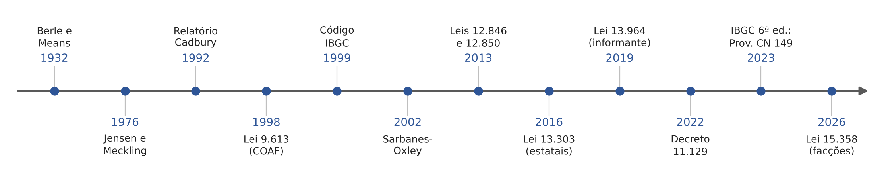
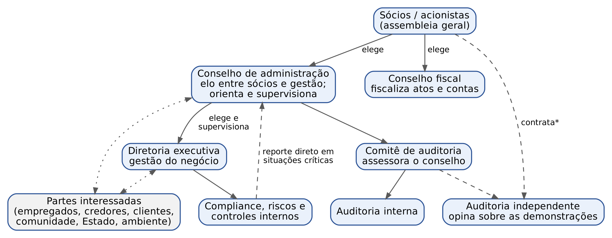
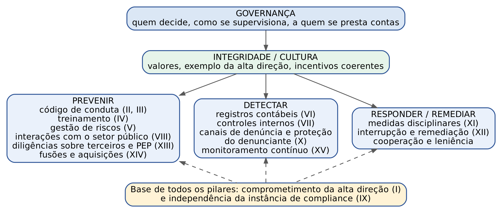
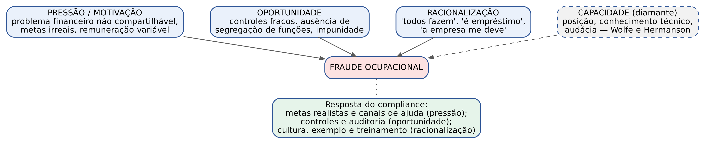
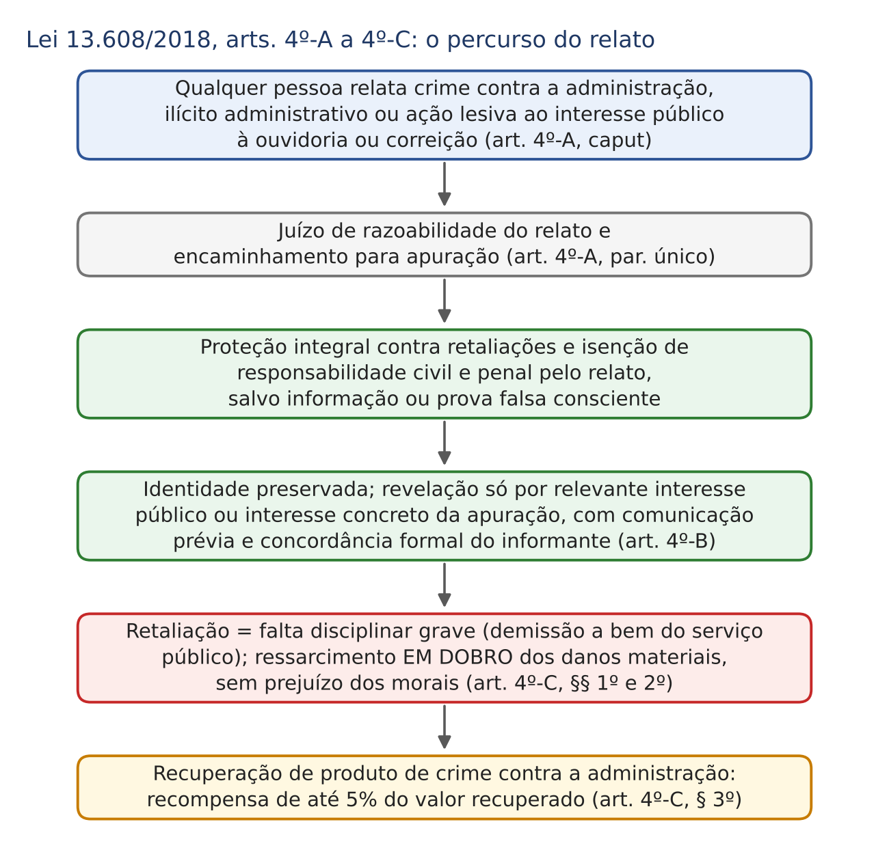
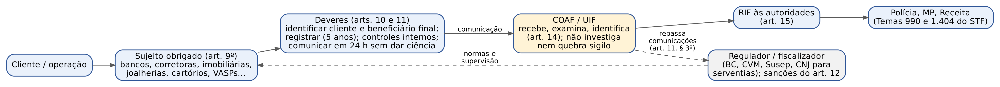

# CAPÍTULO 38 — GOVERNANÇA CORPORATIVA, COMPLIANCE E COMBATE À CRIMINALIDADE ORGANIZADA

:::INCIDENCIA
TRF5 p. G.5; TJRS p. G.4; TJSC p. H.4. Nível A. Lote de 26 questões (FGV 26, FCC 0), sete de provas de juiz e cartórios (ENAM 2024 e 2025.2, TRF1 e TRF5 de 2025, TJ-PR e TJ-PE de 2026, ENAC 2026).
O que mais cai: whistleblower na Lei 13.608/2018 (ressarcimento em dobro, identidade, recompensa de 5%, distinção do colaborador), programa de integridade (Lei 12.846, Decreto 11.129 e Lei 14.133: não é requisito de habilitação), responsabilidade objetiva da pessoa jurídica, princípios e órgãos da governança, compliance x ética, *smurfing*.
:::

| Subtema | FGV | FCC | Padrão de cobrança |
|---|---|---|---|
| Governança corporativa: conceito, princípios, órgãos, *stakeholders* | 5 | 0 | princípios clássicos (transparência, equidade, prestação de contas, responsabilidade corporativa); conselho de administração como elo; *stakeholder* avançado |
| Integridade no setor público e governança pública | 6 | 0 | eixos do art. 19 do Decreto 9.203/2017; canal de denúncia com proteção; segregação de funções; ESG e direitos humanos |
| Estatais (Lei 13.303/2016) | 2 | 0 | literalidade do art. 9º (treinamento ANUAL; *compliance* vinculado ao diretor-presidente; auditoria interna vinculada ao conselho) e do art. 24 |
| Ética x *compliance* | 2 | 0 | conformidade legal não garante ética; cultura do medo como cegueira ética |
| Lei 12.846/2013 | 2 | 0 | responsabilidade OBJETIVA da pessoa jurídica e SUBJETIVA dos dirigentes; abrangência federativa |
| Programa de integridade na Lei 14.133/2021 | 4 | 0 | obrigatório só para o VENCEDOR de grande vulto, em 6 meses do contrato; desempate; reabilitação |
| *Whistleblower* | 3 | 0 | Lei 13.608, arts. 4º-A a 4º-C; reportante não participa do ilícito |
| Lavagem e prevenção (PLD) | 2 | 0 | *smurfing*; deveres de notários e registradores (Prov. CN 149/2023) |

O capítulo trata governança, *compliance* e criminalidade organizada como fenômenos de organização social: por que pessoas e empresas desviam, que arranjos institucionais reduzem o desvio e qual o lugar do juiz diante deles. Ficam fora, com remissão: governança pública, teoria da agência no setor público, Decreto 9.203/2017 e Resolução CNJ 410/2021 (Cap. 3); análise econômica do crime e do problema agente-principal (Cap. 36); vieses e *nudges* (Cap. 37); assédio e canais da Resolução CNJ 351/2020 (Cap. 7); Ouvidorias do Judiciário (Cap. 14); lavagem com criptoativos (Cap. 31); o regime dogmático da Lei 12.846, do PAR e da leniência (Apostila de Direito Administrativo, Cap. 28), das estatais (Apostila de Direito Administrativo, Cap. 4), do tipo de lavagem, da organização criminosa, da colaboração premiada e da Lei 15.358/2026 (Apostila de Penal, Cap. 46; Apostila de Processo Penal, Caps. 5, 8, 16 e 26).

## 38.1 Governança corporativa

### 38.1.1 Conceito e finalidade

Governança corporativa é o sistema pelo qual as organizações são dirigidas, monitoradas e incentivadas. A 6ª edição do Código das Melhores Práticas de Governança Corporativa do IBGC (2023) a define como sistema formado por princípios, regras, estruturas e processos pelo qual as organizações são dirigidas e monitoradas, com vistas à geração de valor sustentável para a organização, para seus sócios e para a sociedade em geral. A definição marca uma inflexão: das edições anteriores, centradas na otimização do valor econômico de longo prazo e na proteção do investidor, para uma governança orientada a partes interessadas e à sustentabilidade.

A finalidade nuclear continua econômica (reduzir custos de agência, facilitar o acesso a capital, dar longevidade à organização), mas o fundamento é também ético e político: a empresa de grande porte exerce poder privado sobre empregados, consumidores, comunidades e ambiente, e a governança é o modo de submeter esse poder a regras, controles e prestação de contas. É nesse sentido que o tema entra na formação humanística do juiz: governança é uma teoria do poder privado e de sua legitimação.

:::QUESTAO FGV 2024 — DATAPREV — Analista, Administração e Governança (Q3085897)
Objetivo central da governança corporativa, a partir de enunciado que fala em maximizar valor de longo prazo com retorno justo aos acionistas. Gabarito A: aumentar o valor econômico da sociedade. Os distratores são antíteses óbvias (reduzir transparência, lucro imediato, desencorajar diversidade, centralizar poder). Armadilha só para quem lê "valor" como lucro imediato: a governança mira o valor de LONGO PRAZO.
:::

### 38.1.2 Princípios

| Fonte | Princípios | Observação |
|---|---|---|
| IBGC, edições até a 5ª (2015) | transparência (*disclosure*); equidade (*fairness*); prestação de contas (*accountability*); responsabilidade corporativa | os QUATRO princípios clássicos, ainda os mais cobrados |
| IBGC, 6ª edição (2023) | integridade; transparência; equidade; responsabilização (*accountability*); sustentabilidade | integridade e sustentabilidade passam a princípios autônomos; "responsabilidade corporativa" é absorvida pela sustentabilidade |
| Decreto 9.203/2017, art. 3º (governança pública) | capacidade de resposta; integridade; confiabilidade; melhoria regulatória; prestação de contas e responsabilidade; transparência | desenvolvido no Cap. 3 |

Transparência é mais do que publicidade obrigatória: é disponibilizar as informações de interesse das partes, e não só as impostas por lei. Equidade é o tratamento justo e isonômico de sócios e demais partes, vedadas discriminações e privilégios (no Brasil, o ponto sensível é o acionista minoritário: o *tag along* foi retirado pela Lei 9.457/1997 e parcialmente restabelecido pela Lei 10.303/2001). Prestação de contas é o dever dos agentes de governança de responder por seus atos e omissões, de modo claro, tempestivo e com assunção das consequências. Responsabilidade corporativa é zelar pela viabilidade econômico-financeira e reduzir externalidades negativas, considerando os capitais financeiro, humano, social, ambiental e reputacional.

:::QUESTAO FGV 2024 — DATAPREV — Analista, Administração e Governança (Q3085896)
Os quatro princípios básicos da governança corporativa. Gabarito B: transparência, equidade, prestação de contas e responsabilidade corporativa. Os distratores trocam princípios por valores de gestão (inovação, eficiência, liderança) ou pelo ciclo PDCA (planejamento, execução, controle, avaliação). Se a banca citar a 6ª edição do IBGC, a lista tem CINCO itens (acrescidas integridade e sustentabilidade); na falta de referência, a lista clássica de quatro é a esperada.
:::

### 38.1.3 Origem: separação entre propriedade e controle

O problema fundador foi formulado por Adolf Berle e Gardiner Means (The Modern Corporation and Private Property, 1932): na grande companhia de capital disperso, a propriedade (acionistas) se separa do controle (administradores profissionais), e nada garante que os administradores ajam no interesse dos proprietários. Michael Jensen e William Meckling (1976) deram ao problema a forma da teoria da agência (agente, principal, assimetria de informação, custos de monitoramento e de alinhamento), já exposta nos Caps. 3 (03.1.4) e 36. A governança corporativa é o conjunto de mecanismos (conselhos, auditoria, remuneração, divulgação, mercado de controle) que reduz esses custos.

A agenda se institucionalizou em ondas de escândalo e reforma: o Relatório Cadbury (Reino Unido, 1992), que recomendou separar presidente do conselho e executivo-chefe e criar comitês de auditoria; os Princípios de Governança Corporativa da OCDE (1999, revistos várias vezes, a última em 2023 como Princípios G20/OCDE); a Lei Sarbanes-Oxley (EUA, 2002), resposta aos casos Enron e WorldCom, que responsabilizou pessoalmente executivos pela certificação das demonstrações e impôs controles internos auditados. No Brasil, a sequência é: fundação do IBGC (1995) e seu primeiro código (1999); segmentos especiais de listagem da Bovespa, hoje B3 (Nível 1, Nível 2 e Novo Mercado, 2000), adesão voluntária a padrões acima da lei; Lei 10.303/2001 (reforma da Lei das S.A.); recomendações da CVM (2002); e, depois da Operação Lava Jato, a Lei 13.303/2016.

A peculiaridade brasileira cobrada em provas discursivas: aqui a propriedade acionária é CONCENTRADA (controle familiar, estatal ou por acordo de acionistas). O conflito típico não é só administrador x acionistas (agente-principal), mas acionista controlador x minoritários (conflito "principal-principal"), em que o risco é a extração de benefícios privados do controle (transações com partes relacionadas, preços de saída, *tunneling*). Daí a importância, no Brasil, do *tag along*, dos conselheiros independentes e da disciplina das transações com partes relacionadas.

:::PEGADINHA Teoria da agência não pressupõe alinhamento
A teoria da agência parte exatamente do DESALINHAMENTO de interesses entre principal e agente; a lógica de mercado não os alinha por si, e é por isso que se precisam de incentivos e de monitoramento. A afirmação de que acionistas e administradores têm "natural alinhamento de interesses econômicos, decorrente da própria lógica de mercado" é falsa (Q4349558, alternativa C, em 38.6.2).
:::

### 38.1.4 *Shareholders* x *stakeholders*

| Aspecto | Modelo *shareholder* (acionista) | Modelo *stakeholder* (partes interessadas) |
|---|---|---|
| Finalidade da companhia | maximizar o valor para o acionista | equilibrar os interesses de todos que afetam ou são afetados pela empresa |
| Referência teórica | Milton Friedman (a responsabilidade social da empresa é aumentar seus lucros, 1970) | R. Edward Freeman (Strategic Management: A Stakeholder Approach, 1984) |
| Tradição associada | anglo-saxã (EUA, Reino Unido): capital disperso, mercado de capitais forte | nipo-germânica (Alemanha, Japão): bancos, codeterminação, participação de empregados |
| Prestação de contas | demonstrações financeiras ao mercado | demonstrações financeiras mais balanços sociais e ambientais, relatórios de sustentabilidade |
| Crítica | externalidades e curto-prazismo | "servir a muitos senhores": diluição da responsabilidade dos administradores |

No Brasil, a própria Lei das S.A. aponta para a segunda leitura: o controlador tem deveres e responsabilidades para com os demais acionistas, os que trabalham na empresa e a comunidade em que atua (Lei 6.404/1976, art. 116, parágrafo único: o controlador "deve usar o poder com o fim de fazer a companhia realizar o seu objeto e cumprir sua função social", e "tem deveres e responsabilidades para com os demais acionistas da empresa, os que nela trabalham e para com a comunidade em que atua"), e a 6ª edição do IBGC adotou expressamente a perspectiva das partes interessadas. A agenda ESG (*Environmental, Social and Governance*) é a tradução contemporânea, em métricas de investimento, dessa visão ampliada.

Manuais de administração classificam ainda as concepções de governança por AMPLITUDE: a concepção *shareholder* "restrita" olha só para o retorno do acionista; a "avançada" incorpora boas práticas de transparência e proteção de minoritários; a concepção *stakeholder* "restrita" considera algumas partes diretamente ligadas ao negócio (empregados, credores); a "avançada" alcança a sociedade e o ambiente, com prestação de contas social e ambiental.

:::QUESTAO FGV 2026 — DATAPREV — Analista de TI, Administração e Governança (Q4391198)
Empresa que, além de maximizar resultados econômico-financeiros, divulga balanços ambientais e sociais às partes interessadas. Gabarito A: padrão *stakeholder* avançado. Armadilha: "*shareholder* avançado", porque a empresa continua a maximizar resultados; o que define o padrão é a extensão da prestação de contas a todas as partes interessadas, incluídas sociedade e ambiente.
:::

:::QUESTAO FGV 2025 — TCE-RR — Auditor de Controle Externo (Q3185995)
Papel das áreas de *compliance* e integridade na inclusão das questões sociais na governança pública (Decreto 9.203/2017 e ESG). Gabarito E: ampliar o escopo para prevenir condutas que violem direitos humanos e a dignidade humana. Todas as erradas usam o advérbio restritivo ("exclusivo", "deixando de lado", "sem considerar", "limitar-se"). Lição: o *compliance* contemporâneo inclui direitos humanos e diligência devida em direitos humanos na cadeia de valor (Princípios Orientadores da ONU sobre Empresas e Direitos Humanos, 2011), o que se reflete nos parâmetros de direitos humanos do programa de integridade das contratações públicas (Decreto 12.304/2024, arts. 2º, II, e 3º, IX; ver 38.3.4).
:::

### 38.1.5 Órgãos do sistema de governança

A figura indica, em linha tracejada com asterisco, que a auditoria independente é contratada pela companhia, com a seleção supervisionada pelo conselho e pelo comitê de auditoria; nas estatais, o comitê opina sobre a contratação e a destituição do auditor (Lei 13.303, art. 24, § 1º, I).

| Órgão | Função na governança | Ponto de prova |
|---|---|---|
| Assembleia geral (sócios) | órgão soberano; elege conselheiros, aprova contas, delibera sobre alterações estruturais | não administra |
| Conselho de administração | elo entre sócios e gestão; orienta a estratégia, elege, supervisiona e destitui diretores; guardião do sistema de governança e da relação com as partes interessadas | órgão CENTRAL da governança; obrigatório nas companhias abertas, de capital autorizado e de economia mista |
| Diretoria executiva | gestão do negócio; executa a estratégia | representa a companhia |
| Conselho fiscal | fiscaliza os atos dos administradores e opina sobre as contas | eleito pela assembleia; independente da administração |
| Comitê de auditoria | assessora o conselho na supervisão dos controles, da auditoria e das demonstrações | obrigatório e estatutário nas estatais (Lei 13.303, art. 24) |
| Auditoria interna | avalia controles, riscos e governança | vinculada ao conselho, não à diretoria |
| Auditoria independente | opina sobre a fidedignidade das demonstrações financeiras | externa; independência é requisito de validade da opinião |

:::QUESTAO FGV 2026 — DATAPREV — Analista de TI, Administração e Governança (Q4391199)
Órgão que atua como elo entre sócios e diretoria, orienta e supervisiona a relação da gestão com as partes interessadas e zela para que cada uma receba benefício proporcional ao seu vínculo. Gabarito E: conselho de administração. Armadilhas: a assembleia é o órgão dos sócios, não o elo; o conselho fiscal fiscaliza contas, não orienta a gestão; comitês apenas assessoram.
:::

### 38.1.6 Governança nas estatais: Lei 13.303/2016

A Lei das Estatais é o mais claro exemplo de governança corporativa imposta por lei ao Estado empresário. O art. 9º é cobrado pela literalidade e as bancas trocam os órgãos de vinculação e a periodicidade.

:::LEI Lei 13.303/2016, art. 9º (trechos)
A empresa pública e a sociedade de economia mista adotarão regras de estruturas e práticas de gestão de riscos e controle interno que abranjam: I - ação dos administradores e empregados, por meio da implementação cotidiana de práticas de controle interno; II - área responsável pela verificação de cumprimento de obrigações e de gestão de riscos; III - auditoria interna e Comitê de Auditoria Estatutário. § 1º [Código de Conduta e Integridade, que disporá sobre:] [...] III - canal de denúncias que possibilite o recebimento de denúncias internas e externas [...]; IV - mecanismos de proteção que impeçam qualquer espécie de retaliação a pessoa que utilize o canal de denúncias; V - sanções aplicáveis em caso de violação às regras do Código de Conduta e Integridade; VI - previsão de treinamento periódico, no mínimo ANUAL, sobre Código de Conduta e Integridade, a empregados e administradores, e sobre a política de gestão de riscos, a administradores. § 2º A área responsável pela verificação de cumprimento de obrigações e de gestão de riscos deverá ser vinculada ao DIRETOR-PRESIDENTE e liderada por diretor estatutário, devendo o estatuto social prever as atribuições da área, bem como estabelecer mecanismos que assegurem atuação independente. § 3º A auditoria interna deverá: I - ser vinculada ao CONSELHO DE ADMINISTRAÇÃO, diretamente ou por meio do Comitê de Auditoria Estatutário; II - ser responsável por aferir a adequação do controle interno, a efetividade do gerenciamento dos riscos e dos processos de governança e a confiabilidade do processo de coleta, mensuração, classificação, acumulação, registro e divulgação de eventos e transações, visando ao preparo de demonstrações financeiras. § 4º O estatuto social deverá prever, ainda, a possibilidade de que a área de compliance se reporte diretamente ao Conselho de Administração em situações em que se suspeite do envolvimento do diretor-presidente em irregularidades ou quando este se furtar à obrigação de adotar medidas necessárias em relação à situação a ele relatada.
:::

A lógica do desenho: o *compliance* é função de GESTÃO (segunda linha), por isso fica sob o diretor-presidente, mas com válvula de escape para o conselho quando o problema é o próprio presidente (§ 4º); a auditoria interna é função de AVALIAÇÃO independente (terceira linha), por isso responde ao conselho. É a tradução legal do modelo das Três Linhas do *Institute of Internal Auditors* (gestão operacional; funções de riscos e *compliance*; auditoria interna independente), desenvolvido no Cap. 3. O Comitê de Auditoria Estatutário reúne-se no mínimo BIMESTRALMENTE, de modo que as informações contábeis sejam apreciadas antes da divulgação (art. 24, § 3º), e deve ter meios para receber denúncias, inclusive sigilosas, internas e externas (art. 24, § 2º).

:::QUESTAO FGV 2025 — TCE-PE — Analista de Controle Externo (Q3593203)
Três afirmações sobre o art. 9º. Gabarito D (I e II). I é a literalidade do § 4º (reporte direto ao conselho se houver suspeita sobre o diretor-presidente). II é a do § 3º, II. III é falsa porque inverte regra e exceção: a vinculação da auditoria interna ao conselho é a REGRA (§ 3º, I), não exceção dependente de justificativa.
:::

:::QUESTAO FGV 2025 — TCE-PE — Procurador do Tribunal de Contas (Q3592149)
Gabarito B (só II): o Comitê de Auditoria Estatutário é obrigatório, auxilia o conselho e se reúne no mínimo bimestralmente (art. 24, *caput* e § 3º). I é falsa pela periodicidade (o treinamento é no mínimo ANUAL, não semestral). III é falsa pela vinculação: a área de *compliance* vincula-se ao DIRETOR-PRESIDENTE, não a um "diretor de *compliance*". Memorize o trio: treinamento anual; comitê bimestral; *compliance* sob o presidente e auditoria sob o conselho.
:::

## 38.2 *Compliance*: conceito, funções e limites éticos

### 38.2.1 Conceito e risco de *compliance*

*Compliance* (do inglês *to comply*, cumprir, estar em conformidade) designa o conjunto de mecanismos e procedimentos pelos quais a organização busca assegurar e DEMONSTRAR a conformidade de sua atuação a normas externas (leis, regulamentos, autorregulação) e internas (código de conduta, políticas). No vocabulário normativo brasileiro, o "programa de integridade" é a espécie de *compliance* voltada à prevenção de atos lesivos à administração pública e à cultura de integridade (Decreto 11.129/2022, art. 56; 38.3.2); no Judiciário, a Resolução CNJ 410/2021 define *compliance* como mecanismos de controle interno, auditoria, incentivo à denúncia e aplicação efetiva do código de conduta (Cap. 3, 03.4.2).

Risco de *compliance* (ou de conformidade) é o risco de sanções legais ou regulatórias, perdas financeiras, danos reputacionais e medidas administrativas ou criminais decorrentes do descumprimento de leis, regulamentos, autorregulação, padrões técnicos ou códigos de conduta. O programa tem três funções clássicas: PREVENIR, DETECTAR e RESPONDER (remediar), que estruturam os parâmetros do Decreto 11.129 (figura em 38.3.2).

:::QUESTAO FGV 2024 — CFC — Bacharelado em Ciências Contábeis (Q2522988)
Verdadeiro ou falso sobre governança, *compliance* e risco. Gabarito D (F, V, V, F). A primeira é falsa pelo verbo "se resume": a governança não se reduz ao conflito acionista x gestor (alcança partes interessadas, estratégia, riscos). A segunda e a terceira são as definições de *compliance* e de risco de *compliance*. A quarta é falsa: assédio, discriminação e condutas abusivas causam dano reputacional, ao clima e aos resultados, e por isso integram o escopo do *compliance* (no Judiciário, Res. CNJ 351/2020, Cap. 7).
:::

### 38.2.2 *Compliance* não é ética

A distinção é o centro humanístico do tema e foi cobrada duas vezes. Cumprir a lei é condição necessária, não suficiente, da conduta ética: a lei é um mínimo, chega tarde aos dilemas novos, tem lacunas e pode ser cumprida formalmente com resultado moralmente inaceitável. Lynn Sharp Paine (Managing for Organizational Integrity, Harvard Business Review, 1994) opôs a estratégia de *compliance* baseada em comando e controle (regras, vigilância, punição; objetivo de evitar sanção) à estratégia baseada em integridade (valores compartilhados, responsabilidade, discernimento; objetivo de conduta responsável). A segunda não dispensa a primeira, mas a primeira, isolada, produz o programa "de papel" que convive com a fraude (38.3.3).

:::QUESTAO FGV 2026 — DATAPREV — Analista de TI, Administração e Governança (Q4391202)
Empresa cumpre integralmente as normas legais e regulatórias, mas decide sem considerar impactos sobre partes interessadas, sociedade e ambiente. Gabarito C: o *compliance* com as normas não garante, por si, a existência de ética na decisão. A e E reduzem a ética à legalidade; D inverte a relação (a falta de ética não impede automaticamente a conformidade legal); B afirma que houve deliberação ética, contra o enunciado.
:::

A psicologia moral organizacional explica por que pessoas comuns participam de condutas antiéticas sem se perceberem como desonestas. Max Bazerman e Ann Tenbrunsel (Blind Spots, 2011) descrevem a "evanescência ética" (*ethical fading*): o enquadramento da decisão como "decisão de negócio" faz desaparecer sua dimensão moral. Guido Palazzo, Franciska Krings e Ulrich Hoffrage (2012) chamam de "cegueira ética" (*ethical blindness*) a incapacidade temporária de ver a dimensão ética de uma decisão, produzida por enquadramentos rígidos e pressões do contexto organizacional. Albert Bandura mostrou os mecanismos de desengajamento moral (justificação moral, linguagem eufemística, deslocamento e difusão de responsabilidade, desumanização da vítima). Diane Vaughan (The Challenger Launch Decision, 1996) cunhou a "normalização do desvio": pequenos desvios tolerados tornam-se o novo padrão até o desastre. E Elizabeth Morrison e Frances Milliken (2000) descreveram o "silêncio organizacional": quando a cultura pune a má notícia, os empregados retêm informações relevantes, e os erros se acumulam sem correção.

:::QUESTAO FGV 2024 — DATAPREV — ATI, Administração e Governança (Q3085902)
Manifestação de cegueira ética nas empresas. Gabarito D: a cultura do medo que inibe a denúncia de práticas inadequadas. As demais alternativas descrevem práticas de integridade (combate à corrupção, cooperação entre departamentos, comunicação alinhada a valores, métricas de bem-estar). A ligação conceitual: a cultura do medo produz silêncio, o silêncio impede que a organização veja o problema; por isso canal de denúncia com proteção contra retaliação é peça central de qualquer programa (38.5).
:::

### 38.2.3 *Compliance* como autorregulação regulada

Do ponto de vista da teoria do Estado e do Direito, o *compliance* expressa a transferência, para o ente privado, de parte das funções de prevenção, vigilância e investigação antes concentradas no Estado. A doutrina penal econômica fala em "autorregulação regulada": o Estado não dita o conteúdo das regras internas, mas cria incentivos (atenuação de sanções, leniência, exigência contratual) para que a empresa se autorregule, e controla a seriedade dessa autorregulação. Ian Ayres e John Braithwaite (Responsive Regulation, 1992) deram a base teórica: a "pirâmide regulatória" começa pela persuasão e pela autorregulação e só escala para sanções severas diante da não cooperação; a ameaça crível do topo é o que dá eficácia à base.

O ganho é a capilaridade (quem está dentro vê o que o Estado não vê) e o custo de fiscalização menor. Os riscos, que o juiz deve conhecer: (i) privatização da persecução, com investigações internas sem as garantias do processo (entrevistas de empregados sem advertência, uso de provas obtidas pela empresa); (ii) "cosmética" do programa, que serve mais para reduzir multa do que para prevenir; (iii) transferência de culpa para empregados de baixo escalão (*scapegoating*); (iv) tensão com a proteção de dados e com a intimidade dos trabalhadores (monitoramento de e-mails e dispositivos corporativos, matéria da LGPD — Cap. 33). Na esfera penal, a figura do *compliance officer* suscita a discussão sobre posição de garante e responsabilidade por omissão, desenvolvida na Apostila de Penal.

:::DICA Como a banca diferencia os vocábulos
Governança = SISTEMA de direção e monitoramento (quem decide e quem controla). *Compliance* = CONFORMIDADE (mecanismos que asseguram e demonstram o cumprimento de normas). Integridade = ADESÃO a valores, que vai além da conformidade. Gestão de riscos = PROCESSO de identificar, avaliar e tratar eventos que afetam objetivos. Controle interno = conjunto de atividades que dão segurança razoável aos processos. Uma alternativa que use um pelo outro está errada (no Judiciário, as definições estão no art. 5º da Res. CNJ 410/2021, Cap. 3).
:::

## 38.3 Programas de integridade: Lei 12.846/2013 e Decreto 11.129/2022

### 38.3.1 A Lei Anticorrupção como política de incentivos

A Lei 12.846/2013 cumpriu compromissos internacionais (Convenção da OCDE sobre Suborno Transnacional, Convenção Interamericana contra a Corrupção e Convenção de Mérida) e preencheu uma lacuna: até então, a pessoa jurídica que lucrava com a corrupção quase nunca era punida, porque a responsabilidade penal da pessoa jurídica no Brasil se limita aos crimes ambientais e a responsabilização administrativa dependia de provar culpa. A opção foi a responsabilidade OBJETIVA, administrativa e civil, não penal.

:::LEI Lei 12.846/2013, arts. 1º a 3º
Art. 1º Esta Lei dispõe sobre a responsabilização objetiva administrativa e civil de pessoas jurídicas pela prática de atos contra a administração pública, nacional ou estrangeira. [...] Art. 2º As pessoas jurídicas serão responsabilizadas objetivamente, nos âmbitos administrativo e civil, pelos atos lesivos previstos nesta Lei praticados em seu interesse ou benefício, exclusivo ou não. Art. 3º A responsabilização da pessoa jurídica não exclui a responsabilidade individual de seus dirigentes ou administradores ou de qualquer pessoa natural, autora, coautora ou partícipe do ato ilícito. § 1º A pessoa jurídica será responsabilizada independentemente da responsabilização individual das pessoas naturais referidas no caput. § 2º Os dirigentes ou administradores somente serão responsabilizados por atos ilícitos na medida da sua culpabilidade.
:::

A leitura humanística da escolha é econômica e moral ao mesmo tempo. Econômica: a responsabilidade objetiva transfere à empresa o risco do comportamento de seus agentes e, com ele, o INCENTIVO para investir em prevenção, porque a empresa é quem tem melhor informação e menor custo para controlar seus empregados (o "evitador de menor custo" de Calabresi, Cap. 36). Moral: a organização não é só soma de indivíduos; sua cultura, metas e omissões estruturais produzem desvios, e é justo que responda por eles. O programa de integridade é a contrapartida: não exclui a responsabilidade (que é objetiva), mas é critério de dosimetria.

:::QUESTAO FGV 2024 — ENAM — 1º Exame Nacional da Magistratura (Q2459864)
Afirmação correta sobre a Lei 12.846. Gabarito C: as pessoas jurídicas são responsabilizadas objetivamente, nos âmbitos administrativo e civil (art. 2º). Erradas: A (dirigentes respondem na medida da culpabilidade, art. 3º, § 2º, nunca objetivamente); B (a responsabilização da pessoa jurídica NÃO exclui a individual, art. 3º, *caput*); D (a pessoa jurídica responde independentemente da responsabilização individual, art. 3º, § 1º); E (na fusão e na incorporação, a responsabilidade da sucessora se restringe à multa e à reparação integral do dano, até o limite do patrimônio transferido, art. 4º, § 1º — regime na Apostila de Direito Administrativo, Cap. 28).
:::

:::QUESTAO FGV 2024 — ENAM — 1º Exame Nacional da Magistratura (Q2459875)
Três afirmações; gabarito A (só II, que é o art. 3º, *caput*). I é falsa pela contradição interna: chama de "subjetiva" uma responsabilidade "independentemente de culpa"; a da pessoa jurídica é OBJETIVA. III é falsa: a lei é nacional e alcança União, Estados, DF e Municípios (o art. 8º atribui a instauração do PAR à autoridade máxima de cada órgão ou entidade dos três Poderes, de todos os entes). Observação: o enunciado traz o número da lei com erro de digitação (12.864), irrelevante para o gabarito.
:::

:::PEGADINHA Objetiva para a empresa, subjetiva para o dirigente
A pessoa jurídica responde OBJETIVAMENTE (basta o ato lesivo em seu interesse ou benefício, exclusivo ou não); dirigentes e administradores respondem na medida da sua CULPABILIDADE; as esferas são independentes (uma não depende da outra nem exclui a outra). E a responsabilidade da lei é administrativa e civil, nunca penal.
:::

### 38.3.2 Conceito e parâmetros do programa de integridade

O art. 7º, VIII, da Lei 12.846 manda considerar na aplicação das sanções "a existência de mecanismos e procedimentos internos de integridade, auditoria e incentivo à denúncia de irregularidades e a aplicação efetiva de códigos de ética e de conduta no âmbito da pessoa jurídica", e remete os parâmetros a regulamento federal (parágrafo único). O regulamento vigente é o Decreto 11.129/2022, que revogou o Decreto 8.420/2015.

:::LEI Decreto 11.129/2022, art. 56
Para fins do disposto neste Decreto, programa de integridade consiste, no âmbito de uma pessoa jurídica, no conjunto de mecanismos e procedimentos internos de integridade, auditoria e incentivo à denúncia de irregularidades e na aplicação efetiva de códigos de ética e de conduta, políticas e diretrizes, com objetivo de: I - prevenir, detectar e sanar desvios, fraudes, irregularidades e atos ilícitos praticados contra a administração pública, nacional ou estrangeira; e II - fomentar e manter uma cultura de integridade no ambiente organizacional. Parágrafo único. O programa de integridade deve ser estruturado, aplicado e atualizado de acordo com as características e os riscos atuais das atividades de cada pessoa jurídica, a qual, por sua vez, deve garantir o constante aprimoramento e a adaptação do referido programa, visando garantir sua efetividade.
:::

O inciso II do art. 56 é a novidade conceitual de 2022 em relação ao Decreto 8.420/2015: o programa não é só aparato de controle, mas instrumento de CULTURA. O art. 57 lista quinze parâmetros de avaliação; a figura os agrupa pelas três funções do *compliance*.

Três aspectos do art. 57 são os mais sutis. Primeiro, o comprometimento da alta direção "incluídos os conselhos" deve ser evidenciado pelo apoio visível e inequívoco E pela destinação de recursos adequados (inciso I): o *tone at the top* sem orçamento é retórica. Segundo, as diligências baseadas em risco alcançam terceiros (fornecedores, despachantes, consultores, representantes comerciais), pessoas expostas politicamente e seus familiares e estreitos colaboradores, e patrocínios e doações (inciso XIII): a maior parte dos casos de suborno passa por intermediários. Terceiro, na avaliação consideram-se porte e especificidades da pessoa jurídica (número de empregados, faturamento e condição de microempresa ou empresa de pequeno porte, estrutura de governança, uso de intermediários, setor, países de atuação, grau de interação com o setor público, grupo econômico — § 1º), e a efetividade do programa em relação ao ato lesivo apurado (§ 2º). Proporcionalidade e efetividade são as duas chaves: não há modelo único, e programa sem efetividade não atenua.

:::QUESTAO FGV 2026 — TCE-SC — Auditor Fiscal de Controle Externo, TI (Q4088567)
Três afirmações sobre programas de integridade. Gabarito A (só I): consultar o cadastro de empresas punidas antes de contratar é ação de diligência devida (*due diligence*) no setor público (o enunciado chama o cadastro de "CNEO"; os cadastros federais são o CNEP, de empresas punidas, e o CEIS, de inidôneas e suspensas). II é falsa: controles não se transplantam de outra organização só porque os processos são parecidos; o programa deve corresponder aos riscos de CADA organização (art. 56, parágrafo único; art. 57, § 1º). III é falsa: medidas disciplinares são parâmetro expresso (art. 57, XI); sem consequência para a violação, o código vira peça decorativa.
:::

### 38.3.3 Programa "de papel" e efetividade

A experiência da Operação Lava Jato mostrou empresas com códigos de ética premiados e departamentos de *compliance* estruturados que conviviam com departamentos inteiros dedicados ao pagamento de propina. A literatura chama esse fenômeno de *paper program* ou programa de fachada (*window dressing*). Os indicadores de efetividade usualmente adotados pela CGU e pelo Departamento de Justiça norte-americano convergem: (i) o programa é desenhado a partir de avaliação de riscos real; (ii) tem recursos e autonomia; (iii) o canal de denúncia é usado e as denúncias são tratadas; (iv) há consequências disciplinares, inclusive para gestores de alto desempenho; (v) o programa aprende com os casos (remediação das causas, não só dos efeitos). Para o juiz que aplica a Lei 12.846 judicialmente, ou que examina pedido de atenuação ou cláusula de leniência, a pergunta não é se o programa EXISTE, mas se FUNCIONAVA em relação ao ilícito concreto.

### 38.3.4 Integridade nas contratações públicas (Lei 14.133/2021)

A Lei 14.133 usa o programa de integridade como instrumento de política pública em quatro momentos: obrigação do vencedor nas contratações de grande vulto (art. 25, § 4º); quarto critério de desempate (art. 60, IV); circunstância a considerar na aplicação de sanções (art. 156, § 1º, V); condição de reabilitação do sancionado por declaração ou documentação falsa e por ato lesivo da Lei 12.846 (art. 163, parágrafo único, c/c art. 155, VIII e XII). O Decreto 12.304, de 9/12/2024, regulamenta, na administração federal direta, autárquica e fundacional (e nas contratações estaduais e municipais com recursos de transferências voluntárias da União), os três primeiros usos (arts. 25, § 4º, 60, IV, e 163, parágrafo único), e acrescentou ao conceito o objetivo de mitigar riscos sociais e ambientais "de modo a zelar pela proteção dos direitos humanos" (art. 2º, II) e o parâmetro de mecanismos de respeito aos direitos humanos e trabalhistas e ao meio ambiente (art. 3º, IX). O regime dogmático está na Apostila de Direito Administrativo, Caps. 17 e 28; aqui interessa o ponto que as bancas mais exploram.

:::LEI Lei 14.133/2021, art. 25, § 4º
Nas contratações de obras, serviços e fornecimentos de grande vulto, o edital deverá prever a obrigatoriedade de implantação de programa de integridade pelo licitante vencedor, no prazo de 6 (seis) meses, contado da celebração do contrato, conforme regulamento que disporá sobre as medidas a serem adotadas, a forma de comprovação e as penalidades pelo seu descumprimento.
:::

:::QUESTAO FGV 2025 — ENAM 2025.2 — Exame Nacional da Magistratura (Q3692379)
Município edita lei e edital exigindo programa de integridade na HABILITAÇÃO JURÍDICA dos licitantes de obra. Gabarito C: conduta inconstitucional e ilegal. Resolução em passos: (1) normas gerais de licitação são da União (art. 22, XXVII, da CF), e a Lei 14.133 é a norma geral; (2) a lei trata o programa como incentivo (desempate, dosimetria, reabilitação) e só o exige do VENCEDOR de grande vulto, depois do contrato; (3) o rol de documentos de habilitação é taxativo e não contém programa de integridade; (4) logo, o Município criou requisito de habilitação restritivo da competitividade, fora de sua competência. Armadilhas: D (invoca interesse local e uma "nova obrigatoriedade" que a lei não prevê para a habilitação); E (inventa o momento da "primeira fatura"); B (inverte o sujeito).
:::

:::QUESTAO FGV 2025 — TRF1 — Juiz Federal Substituto (Q3425362)
Edital federal de obra de grande vulto com cláusula de programa de integridade. Gabarito B: o programa deve ser implantado *a posteriori*, se a empresa vencer. Erradas: avaliação na habilitação (A), certificação antes do edital (C), mera declaração como desempate (D; o desempate depende do DESENVOLVIMENTO do programa, conforme orientações dos órgãos de controle) e comprovação na adjudicação (E). No mesmo sentido: Q3044187 (FGV 2024, Procurador de Vitória; gabarito D, a obrigatoriedade do vencedor no grande vulto, no prazo legal contado da celebração do contrato; erradas as alternativas que o põem na habilitação técnica, vedam sua exigência na reabilitação, excluem-no do desempate ou das sanções) e Q3914535 (FGV 2026, TJ-MS, Cartórios; gabarito D, condição de reabilitação na declaração de inidoneidade por ato lesivo; erradas a vedação de prazo posterior ao contrato, a exigência na habilitação do diálogo competitivo, a exclusão do desempate e a imunidade sancionatória).
:::

:::ATENCAO Uma regra para quatro questões
Programa de integridade NUNCA é requisito de habilitação na Lei 14.133. Ele é: obrigação pós-contratual do vencedor no grande vulto (6 meses); critério de desempate (o quarto); fator de dosimetria das sanções; condição de reabilitação nos casos de documentação falsa e de ato lesivo da Lei 12.846. Ente subnacional que o transforma em requisito de habilitação viola norma geral da União.
:::

## 38.4 Cultura e incentivos organizacionais

### 38.4.1 Cultura organizacional

Edgar Schein (Organizational Culture and Leadership, 1985) descreve a cultura em três níveis: artefatos (o visível: estruturas, rituais, código impresso, linguagem), valores expostos (o declarado: missão, valores, políticas) e pressupostos básicos (crenças tácitas, tomadas como certas, que de fato orientam a conduta). O programa de integridade atua nos dois primeiros níveis com facilidade; a dificuldade está no terceiro. Quando o valor declarado ("integridade acima de tudo") contradiz o pressuposto vivido ("o que importa é bater a meta"), prevalece o pressuposto, e o código vira artefato sem eficácia. Daí a centralidade do exemplo da liderança: o *tone at the top* precisa ser reproduzido pelas chefias intermediárias (*tone in the middle*), que são as que efetivamente distribuem metas, elogios e punições.

### 38.4.2 Incentivos e o triângulo da fraude

Donald Cressey (Other People's Money, 1953), estudando condenados por apropriação de recursos confiados, propôs o que se tornou o "triângulo da fraude": a fraude ocupacional ocorre quando se combinam PRESSÃO (um problema financeiro que a pessoa não pode compartilhar), OPORTUNIDADE (posição de confiança e controles frágeis) e RACIONALIZAÇÃO (uma narrativa que preserva a autoimagem: "é só um empréstimo", "todos fazem", "a empresa me deve"). David Wolfe e Dana Hermanson (2004) acrescentaram a CAPACIDADE (posição, inteligência, autoconfiança e habilidade de coagir ou de mentir), formando o "diamante da fraude".

A lição para o desenho institucional é que o *compliance* atua sobre os três vértices de modo diferente: controles e segregação de funções reduzem a OPORTUNIDADE; metas realistas e sistemas de remuneração equilibrados reduzem a PRESSÃO; cultura, exemplo e comunicação dificultam a RACIONALIZAÇÃO. Incentivos mal desenhados produzem o desvio que o código condena: o caso das contas abertas sem autorização no banco norte-americano Wells Fargo (revelado em 2016), em que metas agressivas de venda cruzada levaram milhares de empregados a fraudar clientes, é o exemplo-padrão. A teoria econômica do crime (Becker) e o problema agente-principal estão no Cap. 36; os vieses que facilitam a racionalização (excesso de confiança, enquadramento, aversão à perda), no Cap. 37.

### 38.4.3 Justiça organizacional e obediência

A tese de Tom Tyler de que se cumprem regras mais por legitimidade percebida e justiça procedimental do que por medo da sanção está desenvolvida no Cap. 37 (37.10.3). Transposta para a empresa, indica que programas apenas repressivos têm rendimento decrescente, e que tratamento justo de quem denuncia e de quem é investigado aumenta a adesão voluntária. É o fundamento da opção de Lynn Paine pela integridade (38.2.2) e da regra de "tratamento diferenciado ao erro de boa-fé" na Resolução CNJ 410/2021 (Cap. 3).

:::QUESTAO FGV 2026 — ALERJ — Especialista Legislativo, Controle Interno e Auditoria (Q3883061)
Assembleia Legislativa implanta programa de integridade diante de resistências internas ("*compliance* é coisa do setor privado"; "transparência engessa"). Gabarito D: canais de denúncia com anonimato e proteção contra retaliação, e reporte do sistema de *compliance* ao órgão hierárquico mais elevado, para garantir independência e autoridade. Erradas: A (foco exclusivo na repressão ignora prevenção e cultura); B (*compliance* formal e irrelevância de padrões éticos supralegais contraria a própria noção de integridade); C (a alta direção DEVE comunicar e patrocinar a integridade; afastá-la contraria o primeiro eixo de qualquer programa); E (o *compliance* aplica-se a órgãos públicos, inclusive legislativos, e a transparência é também ativa).
:::

:::EXEMPLO Magistrado diretor do foro e meta de produtividade
Situação: em comarca de alto volume, a chefia de cartório institui ranking diário de servidores por número de atos, com divulgação em grupo de mensagens; servidores passam a lançar movimentações sem conteúdo para "pontuar". Solução: (1) o problema é de incentivo, não só de conduta individual: a métrica premia o artefato (número de atos), não o resultado; (2) o juiz corrige o desenho (indicadores de resultado e de qualidade, amostragem e conferência), em linha com a gestão de pessoas e indicadores do Cap. 2; (3) a exposição comparativa pública pode configurar prática de gestão por pressão, a examinar à luz da Res. CNJ 351/2020 (Cap. 7); (4) eventual lançamento falso é apurado nas vias disciplinares próprias, sem transformar o servidor em bode expiatório de falha sistêmica.
:::

## 38.5 Mecanismos de detecção e denúncia; o *whistleblower*

### 38.5.1 Detecção: controles, segregação de funções e auditoria

Os mecanismos de detecção dividem-se em contínuos (controles internos automatizados, conciliações, monitoramento de transações, indicadores de alerta, os *red flags*) e periódicos (auditoria interna e externa, investigações). A peça mais elementar é a SEGREGAÇÃO DE FUNÇÕES: quem autoriza não executa, quem executa não registra, quem registra não confere. Ela não impede o conluio, mas eleva o custo do desvio, porque exige mais de uma pessoa. Pesquisas periódicas da *Association of Certified Fraud Examiners* (ACFE) apontam a denúncia (*tip*) como o meio mais frequente de descoberta de fraudes ocupacionais, à frente da auditoria interna e da revisão gerencial; daí o peso dos canais de denúncia.

:::QUESTAO FGV 2025 — CNU — Bloco 5, Administração (Q3643529)
Setor de contratos sem segregação de funções permite manipulação de documentos e pagamentos a fornecedores fictícios; recomenda-se programa de *compliance* com governança, riscos e canal de denúncia. Gabarito B: aumentar transparência e responsabilização, dificultando a ocorrência e a ocultação de fraudes por controles internos eficazes. Erradas: A (agilidade com menos controle), C (o programa não existe para "permitir" o controle externo, que independe dele), D (pagar sem documentação), E (o *compliance* não substitui a auditoria nem os controles tradicionais; integra-os).
:::

No setor público federal, o Decreto 9.203/2017 manda os órgãos da administração direta, autárquica e fundacional instituírem programa de integridade (art. 19). Princípios, diretrizes e mecanismos do Decreto estão no Cap. 3 (03.2.1); os eixos do art. 19, que a banca reproduz com alterações sutis, desenvolvem-se aqui.

:::LEI Decreto 9.203/2017, art. 19
Os órgãos e as entidades da administração direta, autárquica e fundacional instituirão programa de integridade, com o objetivo de promover a adoção de medidas e ações institucionais destinadas à prevenção, à detecção, à punição e à remediação de fraudes e atos de corrupção, estruturado nos seguintes eixos: I - comprometimento e apoio da alta administração; II - existência de unidade responsável pela implementação no órgão ou na entidade; III - análise, avaliação e gestão dos riscos associados ao tema da integridade; e IV - monitoramento contínuo dos atributos do programa de integridade.
:::

:::QUESTAO FGV 2024 — Câmara dos Deputados — Consultor de Orçamento (Q2512393)
Quais eixos do art. 19 estão corretos. Gabarito C (só II e III). I é falso porque troca "da ALTA ADMINISTRAÇÃO" por "a todos os níveis organizacionais"; IV é falso porque troca "CONTÍNUO" por "trienal". É questão de literalidade pura: as duas alterações são as pegadinhas típicas (sujeito do comprometimento e periodicidade).
:::

:::QUESTAO FGV 2026 — NAV Brasil — Analista de Gestão (Q4223218)
Entre os quatro eixos do programa de integridade da administração federal direta, autárquica e fundacional. Gabarito C: gestão de riscos, com mapeamento, avaliação e tratamento (art. 19, III, do Decreto 9.203/2017). As demais alternativas descrevem o oposto da integridade (máxima discricionariedade, sigilo absoluto, centralização em uma autoridade, vinculação política da auditoria). Observação: o enunciado situa o tema no Decreto 11.129/2022, mas os quatro eixos da administração federal são os do Decreto 9.203/2017; o Decreto 11.129 trata do programa das PESSOAS JURÍDICAS privadas (15 parâmetros).
:::

### 38.5.2 *Whistleblower*: conceito e fundamentos

*Whistleblower* (literalmente, quem sopra o apito; em português, reportante, informante ou denunciante) é a pessoa que, sem ter participado do ilícito, leva espontaneamente ao conhecimento de autoridade, órgão de controle ou instância interna da organização informação relevante sobre ilícito ou irregularidade, na esfera pública ou privada. Os dois traços distintivos são a NÃO PARTICIPAÇÃO no ilícito e a ESPONTANEIDADE do relato; a motivação é indiferente (dever moral, altruísmo, inconformismo, interesse em recompensa).

Albert Hirschman (Exit, Voice, and Loyalty, 1970) oferece a moldura: diante da deterioração de uma organização, o membro pode sair (*exit*), protestar (*voice*) ou permanecer leal. O *whistleblowing* é a forma mais custosa de *voice*, porque o reportante arrisca emprego, carreira e relações. Se o Direito não reduz esse custo (proteção) e não aumenta o benefício (recompensa, reconhecimento), a escolha racional é o silêncio, e a organização perde sua principal fonte de detecção (38.2.2, silêncio organizacional).

Na experiência comparada: o *False Claims Act* norte-americano (1863, com ações *qui tam* que dão ao autor parte do valor recuperado contra fraudes ao governo); a Lei Sarbanes-Oxley (2002), que protege empregados de companhias abertas contra retaliação; a Lei Dodd-Frank (2010), que criou o programa da SEC com recompensas de 10% a 30% das sanções acima de 1 milhão de dólares; e a Diretiva (UE) 2019/1937, que harmonizou na União Europeia a proteção de denunciantes, com canais internos e externos e inversão do ônus da prova da retaliação.

| Figura | Participou do ilícito? | Natureza | Contrapartida | Fonte |
|---|---|---|---|---|
| *Whistleblower* (informante) | NÃO | relato espontâneo; direito de relatar | proteção contra retaliação, sigilo da identidade, eventual recompensa | Lei 13.608/2018, arts. 4º-A a 4º-C |
| Colaborador premiado | SIM (coautor ou partícipe) | negócio jurídico processual e meio de obtenção de prova | perdão judicial, redução ou substituição da pena, não oferecimento da denúncia | Lei 12.850/2013, arts. 3º-A a 7º |
| Pessoa jurídica leniente | SIM (a empresa responde pelo ato lesivo) | acordo administrativo sancionador | isenção de sanções e redução da multa em até 2/3; reparação integral mantida | Lei 12.846/2013, arts. 16 e 17 |
| Colaborador na lavagem | SIM | colaboração espontânea, sem acordo formal necessário | redução de 1/3 a 2/3, regime menos gravoso, perdão ou substituição | Lei 9.613/1998, art. 1º, § 5º |
| Testemunha | NÃO | dever de depor quando intimada | proteção pela Lei 9.807/1999, se ameaçada | CPP; Lei 9.807/1999 |

:::QUESTAO FGV 2026 — TJ-PR — Juiz Substituto (Q3898988)
Conceito de *whistleblowing* segundo a doutrina. Gabarito C: o termo designa toda pessoa que, espontaneamente, leva ao conhecimento de autoridade informação relevante sobre ilícito civil ou criminal, na esfera pública ou privada. Erradas: A (a premissa "assim como na colaboração premiada" é falsa: o colaborador PARTICIPOU do ilícito; o *whistleblower* não); B (a Lei 13.608 não condiciona recompensa a processo judicial, e a lei preserva a identidade do informante); D (recompensas são admitidas, art. 4º e art. 4º-C, § 3º); E (o instituto não é exclusivo da administração nem se volta apenas a servidores).
:::

### 38.5.3 A Lei 13.608/2018

A Lei 13.608/2018 nasceu modesta (serviços telefônicos de "disque-denúncia" e possibilidade de recompensa), e só com a Lei 13.964/2019 (Pacote Anticrime) recebeu o núcleo de proteção do reportante, nos arts. 4º-A a 4º-C. A regulamentação federal das salvaguardas de identidade é o Decreto 10.153/2019, que se articula com a Lei 13.460/2017 (direitos do usuário de serviços públicos e ouvidorias).

:::LEI Lei 13.608/2018, arts. 4º a 4º-C
Art. 4º A União, os Estados, o Distrito Federal e os Municípios, no âmbito de suas competências, poderão estabelecer formas de recompensa pelo oferecimento de informações que sejam úteis para a prevenção, a repressão ou a apuração de crimes ou ilícitos administrativos. Parágrafo único. Entre as recompensas a serem estabelecidas, poderá ser instituído o pagamento de valores em espécie. Art. 4º-A. A União, os Estados, o Distrito Federal e os Municípios e suas autarquias e fundações, empresas públicas e sociedades de economia mista manterão unidade de ouvidoria ou correição, para assegurar a qualquer pessoa o direito de relatar informações sobre crimes contra a administração pública, ilícitos administrativos ou quaisquer ações ou omissões lesivas ao interesse público. Parágrafo único. Considerado razoável o relato pela unidade de ouvidoria ou correição e procedido o encaminhamento para apuração, ao informante serão asseguradas proteção integral contra retaliações e isenção de responsabilização civil ou penal em relação ao relato, exceto se o informante tiver apresentado, de modo consciente, informações ou provas falsas. Art. 4º-B. O informante terá direito à preservação de sua identidade, a qual apenas será revelada em caso de relevante interesse público ou interesse concreto para a apuração dos fatos. Parágrafo único. A revelação da identidade somente será efetivada mediante comunicação prévia ao informante e com sua concordância formal. Art. 4º-C. Além das medidas de proteção previstas na Lei nº 9.807, de 13 de julho de 1999, será assegurada ao informante proteção contra ações ou omissões praticadas em retaliação ao exercício do direito de relatar, tais como demissão arbitrária, alteração injustificada de funções ou atribuições, imposição de sanções, de prejuízos remuneratórios ou materiais de qualquer espécie, retirada de benefícios, diretos ou indiretos, ou negativa de fornecimento de referências profissionais positivas. § 1º A prática de ações ou omissões de retaliação ao informante configurará falta disciplinar grave e sujeitará o agente à demissão a bem do serviço público. § 2º O informante será ressarcido em dobro por eventuais danos materiais causados por ações ou omissões praticadas em retaliação, sem prejuízo de danos morais. § 3º Quando as informações disponibilizadas resultarem em recuperação de produto de crime contra a administração pública, poderá ser fixada recompensa em favor do informante em até 5% (cinco por cento) do valor recuperado.
:::

Quatro observações de leitura fina. Primeira: o dever de manter ouvidoria ou correição recai sobre os entes e sua administração indireta, inclusive estatais; a lei não impõe canal a empresas privadas (nelas, o canal decorre do Decreto 11.129, art. 57, X, como parâmetro de programa de integridade, e da Lei 13.303 para as estatais). Segunda: a proteção é condicionada a um juízo de RAZOABILIDADE do relato e ao encaminhamento para apuração, não à procedência final da denúncia; o único excludente é a falsidade CONSCIENTE. Terceira: a revelação da identidade exige, cumulativamente, relevante interesse público ou interesse concreto da apuração, comunicação prévia E concordância formal do informante; na prática, o informante tem poder de veto sobre a revelação, e a autoridade que precisar da identificação para fins probatórios terá de prosseguir sem ela. Quarta: a recompensa de até 5% depende de recuperação de produto de crime contra a ADMINISTRAÇÃO PÚBLICA; a recompensa genérica do art. 4º é facultativa e depende de regulamentação de cada ente.

:::QUESTAO FGV 2025 — TRF5 — Juiz Substituto (Q3373932)
Três grupos descrevem o *whistleblower* brasileiro. Gabarito B: só Alfa está certo (o reportante é ressarcido em DOBRO pelos danos materiais da retaliação, art. 4º-C, § 2º). Beta erra ao afirmar "simbiose existencial" entre o *whistleblower* e a consensualidade de colaboração: o reportante não celebra acordo nem negocia benefício por ter participado do ilícito; seu relato é exercício de um direito, distinto dos instrumentos consensuais da justiça penal negocial. Gama erra ao descrevê-lo como envolvido no ilícito: esse é o colaborador premiado. Resolução rápida: localize o traço "participou do ilícito?" (quadro de 38.5.2) e o número "em dobro".
:::

:::QUESTAO FGV 2026 — AMAZUL — Analista de Recursos Humanos (Q3851831)
Revisão do código de ética de empresa pública com canal de denúncia mas sem regras de proteção ao denunciante. Diretriz indispensável. Gabarito E: mecanismos de proteção contra retaliação e preservação da identidade. Erradas: punir quem não se identifica (A), priorizar denúncias externas (B), condicionar a proteção à conclusão da investigação (C, contraria a lógica da Lei 13.608, que protege desde o encaminhamento do relato razoável) e exigir canais exclusivamente identificados (D). Fundamento para estatal: Lei 13.303, art. 9º, § 1º, III e IV.
:::

:::PEGADINHA Anonimato não é sigilo de identidade
Denúncia ANÔNIMA: a identidade do autor é desconhecida até de quem recebe. Denúncia com identidade PRESERVADA (sigilosa): a instância conhece o informante e guarda o segredo. A Lei 13.608 garante o segundo regime (art. 4º-B); não proíbe o primeiro. No processo penal, a orientação consolidada dos tribunais superiores é de que a notícia anônima, sozinha, não autoriza medidas invasivas (busca, interceptação), mas pode deflagrar diligências preliminares para verificar a plausibilidade do relato antes da instauração formal (regime na Apostila de Processo Penal, Cap. 4).
:::

:::EXEMPLO Servidor relata fraude em contrato ao juiz diretor do foro
Situação: servidor procura o juiz diretor do foro e relata, por escrito, que o fiscal de um contrato de vigilância atesta postos que não são prestados; pede que seu nome não apareça. Solução: (1) o juiz registra o relato e o encaminha, pelos canais formais, à Ouvidoria, à unidade de controle interno e à Corregedoria do tribunal (Res. CNJ 432/2021, Cap. 14; Res. CNJ 410/2021, Cap. 3), com indicação de que o informante requereu sigilo de identidade; (2) não promove, ele próprio, acareação nem divulga o fato no fórum; (3) zela para que o servidor não sofra alteração injustificada de funções, de lotação ou de avaliação (art. 4º-C, *caput*); retaliação por chefia é falta disciplinar grave (§ 1º); (4) se o relato se mostrar falso e consciente, a proteção cessa e a responsabilidade é apurada; erro de boa-fé não. Fundamento ético: deveres de diligência, integridade e prudência do Código de Ética da Magistratura Nacional (Cap. 12).
:::

:::SENTENCA Retaliação a informante: indenização com ressarcimento em dobro
"Comprovado que a transferência do autor para unidade distante, sem motivação funcional, ocorreu doze dias depois de seu relato à Ouvidoria, o qual foi considerado razoável e encaminhado à apuração, e não tendo a ré demonstrado razão legítima e anterior para o ato, reconheço a natureza retaliatória da medida (art. 4º-C, *caput*, da Lei 13.608/2018). Os danos materiais comprovados (despesas de deslocamento e perda de gratificação) serão ressarcidos EM DOBRO, nos termos do § 2º do mesmo artigo, sem prejuízo da indenização por dano moral, que fixo considerando a finalidade de não desestimular o exercício do direito de relatar."
:::

## 38.6 Lavagem de dinheiro: prevenção e deveres de *compliance*

### 38.6.1 Por que a lavagem é tema de governança

A lavagem é o ponto em que a criminalidade econômica e a organizada precisam da economia formal: o produto do crime só se converte em poder (consumo, investimento, influência política) se reingressar com aparência lícita. Por isso a política antilavagem não depende só da repressão penal do lavador; aposta em prevenção administrativa, recrutando como "porteiros" (*gatekeepers*) os setores por onde o dinheiro precisa passar: bancos, corretoras, seguradoras, imobiliárias, comerciantes de bens de luxo, cartórios, juntas comerciais, prestadores de serviços de ativos virtuais. O padrão internacional é o das Recomendações do GAFI (Grupo de Ação Financeira Internacional, 1989), cuja diretriz central é a ABORDAGEM BASEADA EM RISCO: recursos de prevenção proporcionais ao risco do cliente, do produto e da operação.

O modelo trifásico do GAFI (colocação, ocultação ou estratificação, integração), as gerações de leis (a brasileira passou à terceira geração com a Lei 12.683/2012, que eliminou o rol de crimes antecedentes), o tipo penal, a autolavagem e a cegueira deliberada estão na Apostila de Penal, Cap. 46; a lavagem com criptoativos, no Cap. 31.

:::QUESTAO FGV 2026 — TJ-PE — Juiz Substituto (Q4349558)
Afirmações sobre governança, *compliance*, leniência e lavagem. Gabarito E: o *smurfing* (estruturação) consiste em fracionar grande quantia em pequenos valores para escapar dos controles impostos às instituições financeiras (típico da fase de colocação). Erradas: A (o acordo de leniência pode, e usualmente deve, conter cláusula de adoção, aplicação ou aperfeiçoamento de programa de integridade; a redação da MP 703/2015, que o exigia como requisito, perdeu vigência, mas o regulamento federal o prevê como cláusula); B (as estatais têm regime de governança próprio, que é justamente um regime de governança corporativa, Lei 13.303, art. 9º); C (a teoria da agência pressupõe DESALINHAMENTO, 38.1.3); D (a leniência não é contrato administrativo fruto de autonomia contratual, mas instrumento consensual de direito administrativo sancionador, vinculado aos requisitos legais do art. 16).
:::

### 38.6.2 Deveres dos sujeitos obrigados

O art. 9º da Lei 9.613/1998 lista os sujeitos obrigados (instituições financeiras e de câmbio no *caput*; no parágrafo único, entre outros, bolsas, seguradoras, administradoras de cartões e consórcios, *factoring*, loterias e apostas de quota fixa, imobiliárias, comerciantes de joias, arte e bens de luxo, juntas comerciais e registros públicos, consultores e assessores em operações societárias e imobiliárias, agentes de atletas e artistas, transportadoras de valores, comerciantes de bens rurais de alto valor e, desde a Lei 14.478/2022, prestadoras de serviços de ativos virtuais). A tabela resume os deveres; a literalidade e as sanções do art. 12 estão na Apostila de Penal, Cap. 46 (46.8).

| Dever | Conteúdo | Fundamento |
|---|---|---|
| Conhecer o cliente (*know your customer*) | identificar e manter cadastro atualizado; se pessoa jurídica, também representantes e proprietários (beneficiário final) | art. 10, I e § 1º |
| Registrar | toda transação acima do limite fixado, inclusive com ativos virtuais; conservação por no mínimo 5 anos | art. 10, II e § 2º |
| Controles internos | políticas, procedimentos e controles compatíveis com porte e volume de operações (o *compliance* antilavagem) | art. 10, III |
| Cadastrar-se | no regulador ou, na falta, no COAF | art. 10, IV |
| Especial atenção | operações que possam constituir sérios indícios de lavagem | art. 11, I |
| Comunicar | ao COAF, em 24 horas, as operações acima do limite e as suspeitas, sem dar ciência a ninguém, nem ao cliente (vedação de *tipping off*) | art. 11, II |
| Comunicação negativa | declarar periodicamente a não ocorrência de operações comunicáveis | art. 11, III |
| Imunidade | comunicações de boa-fé não acarretam responsabilidade civil ou administrativa | art. 11, § 2º |

O COAF (Conselho de Controle de Atividades Financeiras), a unidade de inteligência financeira (UIF) brasileira, tem por finalidade disciplinar, aplicar penas administrativas, receber, examinar e identificar ocorrências suspeitas (art. 14) e comunica às autoridades competentes quando conclui pela existência de crimes, fundados indícios ou qualquer outro ilícito (art. 15), por meio do Relatório de Inteligência Financeira (RIF). Não investiga nem quebra sigilo. O compartilhamento de RIF com órgãos de persecução sem autorização judicial (Tema 990 do STF) e os limites do RIF "por encomenda" (Tema 1.404 do STF, pendente de mérito) estão na Apostila de Processo Penal, Cap. 5, e na Apostila de Penal, Cap. 46.

### 38.6.3 Notários e registradores: o Código Nacional de Normas

Para o juiz estadual, o ponto de contato mais direto com a prevenção à lavagem é a fiscalização das serventias extrajudiciais. Notários e registradores são sujeitos obrigados (art. 9º, parágrafo único, XIII, da Lei 9.613), e a Corregedoria Nacional regulamentou seus deveres no Código Nacional de Normas — Foro Extrajudicial (Provimento CN 149/2023, arts. 137 e seguintes, na redação do Provimento CN 161/2024), que adota a abordagem baseada em risco, proporcional ao porte da serventia, e distingue duas espécies de comunicação à UIF (por intermédio do Siscoaf): a OBJETIVA, obrigatória independentemente de análise (para o registro de imóveis, título que declare pagamento em espécie ou por título ao portador de valor igual ou superior a 100.000 (cem mil) reais — art. 161), e a SUBJETIVA, quando o oficial, após análise com especial atenção, considera a operação suspeita (art. 162).

:::LEI Provimento CN 149/2023 (CNN/CN/CNJ-Extra), art. 162, na redação do Provimento CN 161/2024
O oficial de registro de imóveis, ou seu oficial de cumprimento, deve analisar com especial atenção, para fins de eventual comunicação à UIF na forma do art. 151, I, operações, propostas de operação ou situações relacionadas a: I - doações de bens imóveis ou direitos reais sobre bens imóveis para terceiros sem vínculo familiar aparente com o doador, referente a bem imóvel que tenha valor venal atribuído pelo município igual ou superior a R$ 100.000,00 (cem mil reais); II - concessão de empréstimos hipotecários ou com alienação fiduciária entre particulares; III - registro de negócios celebrados por sociedades que tenham sido dissolvidas e tenham regressado à atividade; IV - registro de aquisição de imóveis por fundações e associações, quando as características do negócio não se coadunem com suas finalidades; V - registro de transmissões sucessivas do mesmo bem em período e com diferença de valor anormais; e VI - registro de título no qual conste valor declarado de bem com diferença anormal em relação a outros valores a ele associados [...]. Parágrafo único. Ocorrendo qualquer das hipóteses previstas neste artigo, o registrador de imóveis, ou oficial de cumprimento, comunicará a operação à Unidade de Inteligência Financeira (UIF), caso a considere suspeita, no prazo previsto no art. 151.
:::

:::QUESTAO FGV 2026 — ENAC — 3º Exame Nacional dos Cartórios (Q4130117)
Situações que o registrador de imóveis deve analisar com especial atenção. Gabarito D: registro de negócios de sociedades dissolvidas que regressaram à atividade, com comunicação à UIF se suspeita (art. 162, III e parágrafo único). Cada distrator altera um elemento: A (valor venal de 50 mil reais em vez de 100 mil); B ("pessoas jurídicas de direito privado" em geral, quando a norma fala em FUNDAÇÕES E ASSOCIAÇÕES); C (empréstimos "entre particulares e instituições financeiras", quando a norma fala em empréstimos ENTRE PARTICULARES, e destinatário errado); E (hipótese correta, mas destinatário errado: a comunicação vai à UIF, não à polícia nem ao MP). Método: em PLD, o destinatário é SEMPRE a UIF/COAF.
:::

### 38.6.4 Crítica humanística da política antilavagem

A política antilavagem tem custos que a formação humanística deve registrar. Ela converte agentes privados em auxiliares de inteligência estatal, com tensão permanente com o sigilo bancário e a proteção de dados (Cap. 33). O excesso de zelo dos sujeitos obrigados gera o *de-risking*: o encerramento indiscriminado de relacionamentos com clientes ou setores de "alto risco" (remessas de migrantes, organizações não governamentais, pequenos negócios em espécie), que reproduz exclusão financeira e desigualdade (Cap. 39). E há o problema da efetividade: o volume de comunicações é enorme em comparação com o número de condenações, o que exige qualidade, e não quantidade, de alertas. Para o juiz corregedor, a lição prática é exigir da serventia política proporcional e documentada, e não comunicações defensivas em massa.

## 38.7 Organizações criminosas: mecanismos de combate em visão humanística

### 38.7.1 O conceito legal e seus vizinhos

:::LEI Lei 12.850/2013, art. 1º, § 1º
Considera-se organização criminosa a associação de 4 (quatro) ou mais pessoas estruturalmente ordenada e caracterizada pela divisão de tarefas, ainda que informalmente, com objetivo de obter, direta ou indiretamente, vantagem de qualquer natureza, mediante a prática de infrações penais cujas penas máximas sejam superiores a 4 (quatro) anos, ou que sejam de caráter transnacional.
:::

Os elementos (quatro ou mais pessoas, estrutura ordenada, divisão de tarefas, finalidade de vantagem, infrações com pena máxima superior a 4 anos ou transnacionais) distinguem a organização criminosa da associação criminosa do art. 288 do CP (três ou mais pessoas, sem exigência de estrutura) e da facção criminosa da Lei 15.358/2026 (três ou mais pessoas que empregam violência, grave ameaça ou coação para impor controle territorial ou social). O quadro "2, 3, 4" e a nova lei estão na Apostila de Penal, Cap. 46 (46.9, 46.14 e 46.15).

### 38.7.2 Leituras sociológicas

Diego Gambetta (The Sicilian Mafia: The Business of Private Protection, 1993) descreveu a máfia como empresa que vende PROTEÇÃO privada onde o Estado não garante confiança nas transações; a organização prospera onde há vazio de autoridade estatal e de confiança social. A literatura latino-americana fala em "governança criminal": grupos armados que regulam a vida em territórios (cobrança de taxas, resolução de conflitos, controle do comércio de gás, transporte e internet), concorrendo com o Estado na produção de ordem. É o fenômeno que a Lei 15.358/2026 chama de "domínio social estruturado". Duas consequências para o juiz: (i) a criminalidade organizada contemporânea é EMPRESARIAL, infiltra-se em negócios lícitos (combustíveis, transporte, construção, apostas, fintechs) e depende de lavagem; por isso o combate eficaz passa pela governança corporativa e pelo *compliance* dos setores infiltrados, e não só pela prisão de integrantes; (ii) a resposta só penal, centrada nos escalões inferiores, tende à seletividade (Cap. 1) e à reposição imediata dos presos pela própria organização.

### 38.7.3 Instrumentos: seguir o dinheiro e quebrar o silêncio

A estratégia contemporânea combina dois eixos. O primeiro é "seguir o dinheiro" (*follow the money*): inteligência financeira (38.6), medidas assecuratórias, confisco alargado (art. 91-A do CP), alienação antecipada de bens, ação civil autônoma de perdimento (Lei 15.358/2026), cooperação interinstitucional. No Brasil, a coordenação desse eixo tem como foro a ENCCLA (Estratégia Nacional de Combate à Corrupção e à Lavagem de Dinheiro), criada em 2003, que reúne órgãos dos três Poderes, Ministério Público e sociedade. O segundo eixo é "quebrar o silêncio" interno da organização, que é sua principal proteção: os meios especiais de obtenção de prova do art. 3º da Lei 12.850 (colaboração premiada, captação ambiental, ação controlada, acesso a registros e dados cadastrais, interceptação, afastamento de sigilos, infiltração policial, cooperação entre órgãos). O regime processual de cada meio está na Apostila de Processo Penal, Caps. 8 e 16.

A colaboração premiada é o ponto de maior densidade ética. A lei a define como negócio jurídico processual e meio de obtenção de prova, que pressupõe utilidade e interesse públicos (art. 3º-A), e cercou-a de garantias depois da experiência dos anos 2014 a 2019: o juiz não participa das negociações (art. 4º, § 6º); na homologação, examina regularidade, legalidade, adequação dos benefícios e dos resultados e VOLUNTARIEDADE, especialmente se o colaborador está ou esteve sob medida cautelar (art. 4º, § 7º); nenhuma medida cautelar, recebimento de denúncia ou sentença condenatória pode fundar-se apenas nas declarações do colaborador (art. 4º, § 16); o delatado se manifesta depois do delator (art. 4º, § 10-A). As críticas humanísticas são conhecidas: o incentivo a mentir ou exagerar para obter benefício (o colaborador tem interesse próprio no conteúdo que relata), o risco de coação pela prisão cautelar e a "mercantilização" da verdade processual. As garantias legais respondem a cada uma: corroboração externa contra o incentivo à mentira; controle judicial da voluntariedade contra a coação; limites legais aos benefícios contra a barganha ilimitada.

:::SENTENCA Homologação de acordo de colaboração premiada (trecho)
"Ouvido sigilosamente o colaborador, acompanhado de seu defensor (art. 4º, § 7º, da Lei 12.850/2013), constato que a manifestação de vontade é livre: o acordo foi celebrado quando o colaborador respondia ao processo em liberdade, e ele declarou, sem hesitação, conhecer as obrigações assumidas e as consequências da rescisão. As cláusulas não violam as regras legais de regime inicial e de progressão (art. 4º, § 7º, II), e os resultados prometidos correspondem aos do art. 4º, I e IV. Ressalvo que a homologação não implica juízo sobre a veracidade das declarações, que dependerão de corroboração por outros elementos (art. 4º, § 16), e que a eficácia do acordo será apreciada na sentença (art. 4º, § 11). Homologo o acordo."
:::

## 38.8 Síntese: relações entre governança, integridade e prevenção

As três noções se encadeiam como níveis de um mesmo sistema. A GOVERNANÇA define quem decide, quem supervisiona e a quem se presta contas; sem ela, o *compliance* não tem autoridade nem independência (a instância que reporta a quem pretende fiscalizar não fiscaliza). A INTEGRIDADE é o conteúdo valorativo e cultural que a governança deve proteger; sem ela, o *compliance* vira conformidade formal e programa de papel. A PREVENÇÃO (com detecção e resposta) é a operação cotidiana desse sistema: avaliação de riscos, controles, canais de denúncia, consequências e aprendizado. O Direito intervém por incentivos (atenuação de sanções, leniência, desempate, reabilitação), por obrigações (estatais, sujeitos obrigados da Lei 9.613, vencedores de grande vulto) e por proteção a quem rompe o silêncio (Lei 13.608). E a criminalidade organizada fecha o círculo: ela explora exatamente as falhas de governança (empresas sem controle, cartórios sem análise de risco, órgãos sem canal de denúncia) para lavar o produto do crime e capturar setores econômicos.

:::DICA Para a prova oral: a resposta em três frases
"Governança é o sistema de direção e controle das organizações; *compliance* é o conjunto de mecanismos que assegura a conformidade a normas; integridade é a adesão a valores que vão além da conformidade. O Direito brasileiro passou a induzir esses arranjos por incentivos (Lei 12.846, Decreto 11.129, Lei 14.133), por deveres (Leis 9.613 e 13.303) e pela proteção do denunciante (Lei 13.608). O limite é que *compliance* não substitui ética nem garantias: programa sem cultura é fachada, e investigação privada não pode suprimir direitos de investigados e trabalhadores."
:::

## 38.9 Resumo para revisão pré-prova

| Conceito / instituto | Ideia ou regra | Detalhes e pegadinhas | Fonte |
|---|---|---|---|
| Governança corporativa | sistema de direção, monitoramento e incentivo das organizações | IBGC 2023: geração de valor sustentável para organização, sócios e sociedade | Código IBGC, 6ª ed. |
| Princípios clássicos | transparência, equidade, prestação de contas, responsabilidade corporativa | IBGC 2023: cinco (integridade, transparência, equidade, responsabilização, sustentabilidade) | Q3085896 |
| Berle e Means; Jensen e Meckling | separação propriedade x controle (1932); teoria da agência (1976) | agência pressupõe DESALINHAMENTO; no Brasil, conflito controlador x minoritários | Q4349558 (C) |
| *Shareholder* x *stakeholder* | Friedman x Freeman | balanços sociais e ambientais = *stakeholder* avançado | Q4391198 |
| Conselho de administração | elo entre sócios e gestão; orienta e supervisiona | não confundir com conselho fiscal (fiscaliza contas) | Q4391199 |
| Lei 13.303, art. 9º | *compliance* sob o diretor-presidente; auditoria interna sob o conselho; treinamento ANUAL | reporte direto do *compliance* ao conselho se o presidente estiver envolvido (§ 4º) | Q3593203, Q3592149 |
| Comitê de Auditoria Estatutário | obrigatório nas estatais; reúne-se no mínimo BIMESTRALMENTE | recebe denúncias, inclusive sigilosas | Lei 13.303, art. 24 |
| *Compliance* x ética | conformidade legal não garante ética | Paine: *compliance* x integridade; cegueira ética, *ethical fading*, silêncio organizacional | Q4391202, Q3085902 |
| Autorregulação regulada | Estado induz e controla a autorregulação privada | Ayres e Braithwaite, pirâmide regulatória; riscos de privatização da persecução | doutrina |
| Lei 12.846 | responsabilidade OBJETIVA, administrativa e civil, da pessoa jurídica | dirigentes: na medida da culpabilidade; esferas independentes; lei nacional | Q2459864, Q2459875 |
| Programa de integridade | mecanismos de integridade, auditoria, incentivo à denúncia, códigos; prevenir, detectar, sanar e fomentar cultura | 15 parâmetros; proporcionalidade (porte) e efetividade em relação ao ato lesivo | Decreto 11.129, arts. 56 e 57 |
| Programa na Lei 14.133 | obrigação do VENCEDOR de grande vulto em 6 meses do contrato; 4º critério de desempate; dosimetria; reabilitação | NUNCA requisito de habilitação; ente subnacional não pode criá-lo | Q3692379, Q3425362, Q3044187, Q3914535 |
| Decreto 9.203, art. 19 | eixos: alta administração; unidade responsável; riscos; monitoramento CONTÍNUO | pegadinhas: "todos os níveis" e "trienal" | Q2512393, Q4223218 |
| Triângulo da fraude | pressão, oportunidade, racionalização (Cressey, 1953) | diamante: + capacidade (Wolfe e Hermanson, 2004) | doutrina |
| Cultura (Schein) | artefatos, valores expostos, pressupostos básicos | o pressuposto vivido vence o valor declarado | doutrina |
| Segregação de funções | quem autoriza não executa nem confere | não impede conluio, mas eleva o custo | Q3643529 |
| *Whistleblower* | relata espontaneamente ilícito do qual NÃO participou | ≠ colaborador premiado, leniente e delator da lavagem | Q3898988 |
| Lei 13.608, arts. 4º-A a 4º-C | ouvidoria ou correição nos entes; proteção integral e isenção pelo relato razoável; identidade preservada | retaliação: falta grave, demissão a bem do serviço; ressarcimento EM DOBRO; recompensa até 5% | Q3373932, Q3851831 |
| Revelação da identidade | relevante interesse público ou concreto da apuração | exige comunicação prévia E concordância formal | art. 4º-B |
| Prevenção à lavagem | sujeitos obrigados: conhecer cliente, registrar 5 anos, controles, comunicar em 24 h sem *tipping off* | comunicação de boa-fé não gera responsabilidade civil ou administrativa | Lei 9.613, arts. 9º a 11 |
| COAF | recebe, examina, identifica; aplica penas administrativas; RIF às autoridades | não investiga nem quebra sigilo | Lei 9.613, arts. 14 e 15 |
| *Smurfing* | fracionamento para escapar dos controles | fase de colocação | Q4349558 (E) |
| Registro de imóveis e PLD | comunicação objetiva (espécie ≥ 100 mil reais) e subjetiva (art. 162) | destinatário é SEMPRE a UIF; doação ≥ 100 mil; fundações e associações; empréstimos entre particulares | Q4130117 |
| Organização criminosa | 4 ou mais pessoas, estrutura, divisão de tarefas, penas máximas superiores a 4 anos ou transnacional | associação criminosa: 3; facção (Lei 15.358/2026): 3 com violência e controle territorial | Lei 12.850, art. 1º, § 1º |
| Governança criminal | crime organizado vende proteção e regula territórios | Gambetta; combate eficaz segue o dinheiro e atua sobre setores infiltrados | doutrina |
| Colaboração premiada | negócio jurídico processual e meio de obtenção de prova | juiz fora da negociação; voluntariedade; corroboração obrigatória (§ 16) | Lei 12.850, arts. 3º-A e 4º |

## 38.10 Artigos de lei e atos normativos incidentes

- Constituição Federal: art. 22, XXVII.
- Lei 6.404/1976 (Lei das S.A.): art. 116, parágrafo único (referência).
- Lei 9.613/1998: art. 1º, § 5º; arts. 9º, 10, 10-A, 11, 12, 14 e 15.
- Lei 12.846/2013: arts. 1º a 4º, 7º, VIII e parágrafo único, 8º, 16 e 17.
- Lei 12.850/2013: arts. 1º, 3º, 3º-A a 3º-C e 4º.
- Lei 13.303/2016: arts. 9º e 24.
- Lei 13.460/2017 (ouvidorias e usuários de serviços públicos): referência.
- Lei 13.608/2018: arts. 4º, 4º-A, 4º-B e 4º-C (incluídos pela Lei 13.964/2019).
- Lei 9.807/1999 (proteção a vítimas, testemunhas e colaboradores): referência.
- Lei 14.133/2021: arts. 25, § 4º, 60, IV, 156, § 1º, V, e 163, parágrafo único.
- Lei 14.478/2022: inclusão das prestadoras de serviços de ativos virtuais no art. 9º da Lei 9.613.
- Lei 15.358/2026 (facções criminosas): referência.
- Decreto 9.203/2017: arts. 2º, 3º e 19.
- Decreto 10.153/2019: salvaguardas de proteção à identidade dos denunciantes na administração federal.
- Decreto 11.129/2022: arts. 56 e 57.
- Decreto 12.304/2024: programa de integridade nas contratações de grande vulto (referência).
- Provimento CN 149/2023 (Código Nacional de Normas — Foro Extrajudicial): arts. 137 a 162, na redação do Provimento CN 161/2024.
- Resolução CNJ 410/2021 (integridade no Judiciário), Resolução CNJ 432/2021 (Ouvidorias) e Resolução CNJ 351/2020 (assédio e discriminação): remissão aos Caps. 3, 14 e 7.

## 38.11 Julgados, temas e súmulas do capítulo

Não há julgados desenvolvidos neste capítulo; ver remissões.

Remissões a outros capítulos: governança pública, Decreto 9.203/2017, teoria da agência no setor público, três linhas e Res. CNJ 410/2021 (Cap. 3); gestão de pessoas e indicadores (Cap. 2); seletividade penal (Cap. 1); assédio e Res. CNJ 351/2020 (Cap. 7); ética judicial (Cap. 12); Ouvidorias e Res. CNJ 432/2021 (Cap. 14); criptoativos e lavagem digital (Cap. 31); LGPD e monitoramento de empregados (Cap. 33); AED, Becker, Calabresi e agente-principal (Cap. 36); vieses e justiça procedimental de Tyler (Cap. 37); exclusão financeira e discriminação (Cap. 39); Lei 12.846, PAR, leniência, CNEP e CEIS (Apostila de Direito Administrativo, Cap. 28); Lei 13.303 (Apostila de Direito Administrativo, Cap. 4); Lei 14.133 (Apostila de Direito Administrativo, Caps. 17 e 19); lavagem, COAF, Temas 990 e 1.404, organização criminosa, colaboração premiada e Lei 15.358/2026 (Apostila de Penal, Cap. 46); confisco alargado (Apostila de Penal, Cap. 18); inteligência financeira e investigação de organizações criminosas (Apostila de Processo Penal, Cap. 5); colaboração premiada no processo (Apostila de Processo Penal, Cap. 8); meios especiais de obtenção de prova (Apostila de Processo Penal, Cap. 16); notícia anônima (Apostila de Processo Penal, Cap. 4).

:::NOTA Notas de verificação
Conferidos no Planalto (11/11/2026, texto compilado, dispositivos revogados excluídos): Lei 13.608/2018, arts. 1º, 4º a 4º-C e 5º; Lei 12.846/2013, arts. 1º a 3º, 7º e 16; Decreto 11.129/2022, arts. 56 e 57; Lei 9.613/1998, arts. 9º a 11, 14 e 15; Lei 12.850/2013, arts. 1º, 3º, 3º-A a 3º-C e 4º; Lei 13.303/2016, arts. 9º e 24; Decreto 9.203/2017, arts. 2º, 3º e 19; Lei 14.133/2021, art. 25, § 4º; ementa e art. 1º do Decreto 10.153/2019. Conferidos em atos.cnj.jus.br: Provimento CN 149/2023, arts. 137 a 142, 161 e 162, na redação do Provimento CN 161/2024. Conferidos no Planalto na limpeza (12/11/2026): Lei 6.404/1976, art. 116, parágrafo único; Lei 12.846, arts. 4º, § 1º, e 8º; Lei 14.133, arts. 60, IV, 155, VIII e XII, 156, § 1º, V, e 163, parágrafo único; Decreto 12.304, de 9/12/2024 (ementa e arts. 1º a 3º). Não conferido: art. 1º, § 5º, da Lei 9.613. No Prov. CN 149/2023, art. 162, I, o símbolo monetário foi suprimido por padronização de estilo. Definição e cinco princípios do Código IBGC, 6ª edição (2023), conferidos em fontes secundárias (Migalhas; boletim de escritório de advocacia), não no texto do Código. A classificação "*shareholder*/*stakeholder* restrito/avançado" segue a terminologia da banca; não localizei a fonte primária da tipologia (atribuída em manuais a Rossetti e Andrade) — não a atribua a autor na prova. Atribuições doutrinárias de memória, com alta segurança: Berle e Means, Jensen e Meckling, Friedman, Freeman, Paine (1994), Cressey (1953), Wolfe e Hermanson (2004), Schein, Tyler, Hirschman, Gambetta, Ayres e Braithwaite, Vaughan, Morrison e Milliken, Bazerman e Tenbrunsel, Palazzo, Krings e Hoffrage. Percentual de detecção por denúncias da ACFE não citado em número (varia por edição). Q4223218: o enunciado situa os quatro eixos no Decreto 11.129, mas eles são do art. 19 do Decreto 9.203/2017; gabarito não afetado. Q4088567: o enunciado fala em "CNEO"; os cadastros federais são CNEP e CEIS. Q4349558, alternativa A: o requisito de compromisso com programa de integridade constava da redação da MP 703/2015 (vigência encerrada); a previsão atual como cláusula do acordo vem do regulamento federal (conforme a Apostila de Direito Administrativo, Cap. 28). Fonte do Drive lida: "32. Governança corporativa e Compliance no Brasil" (material de Magistratura Federal, atualizado em 2023; lidas as partes conceituais e o Decreto 8.420/2015, já revogado pelo Decreto 11.129/2022).
:::
