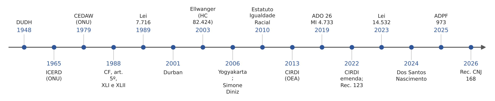
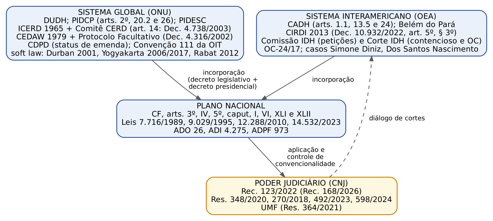
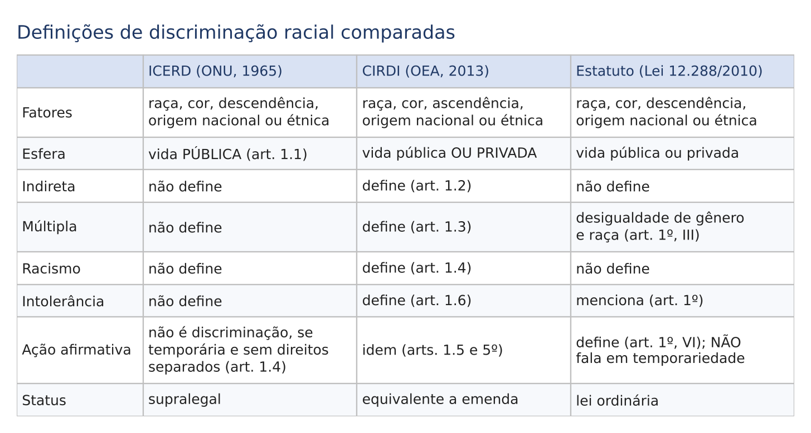
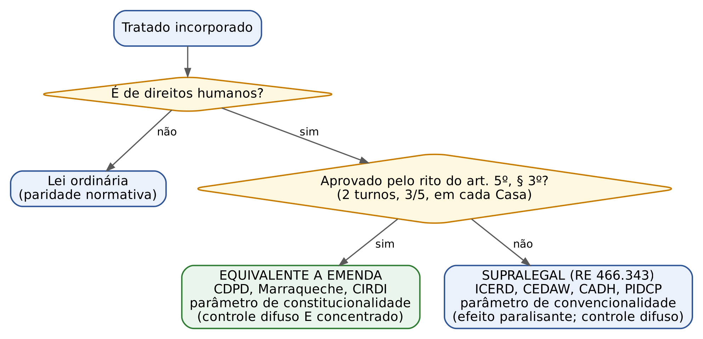
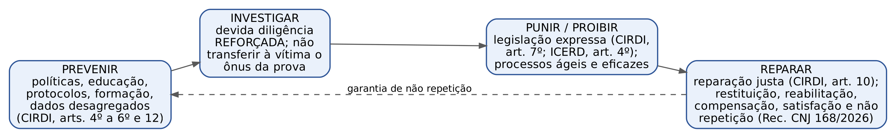
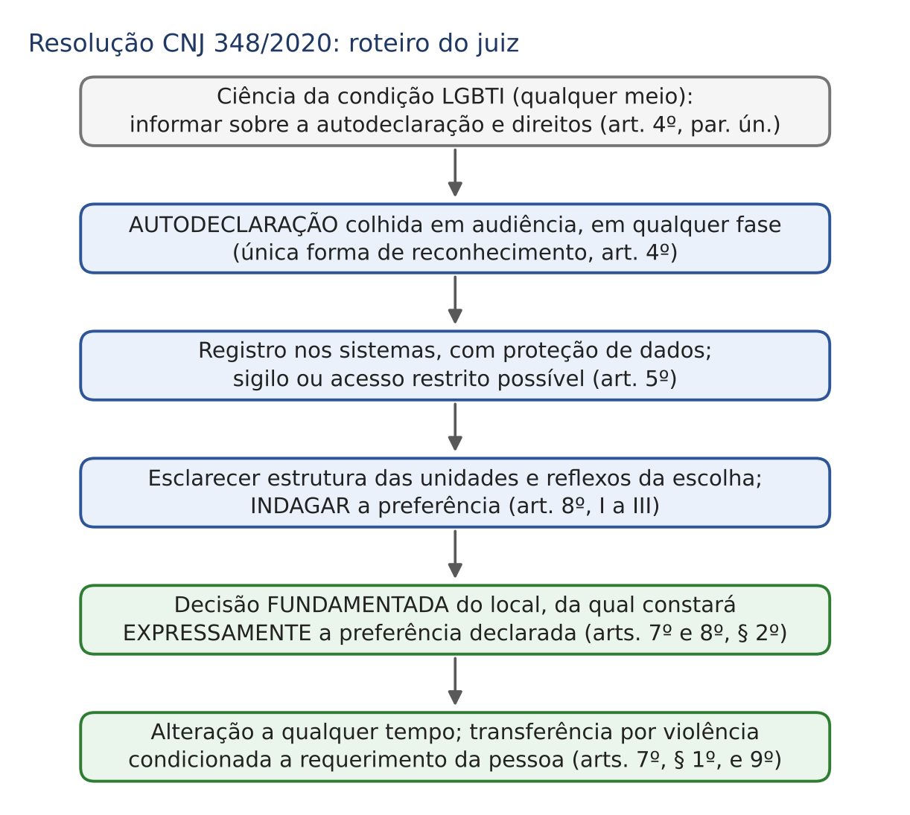
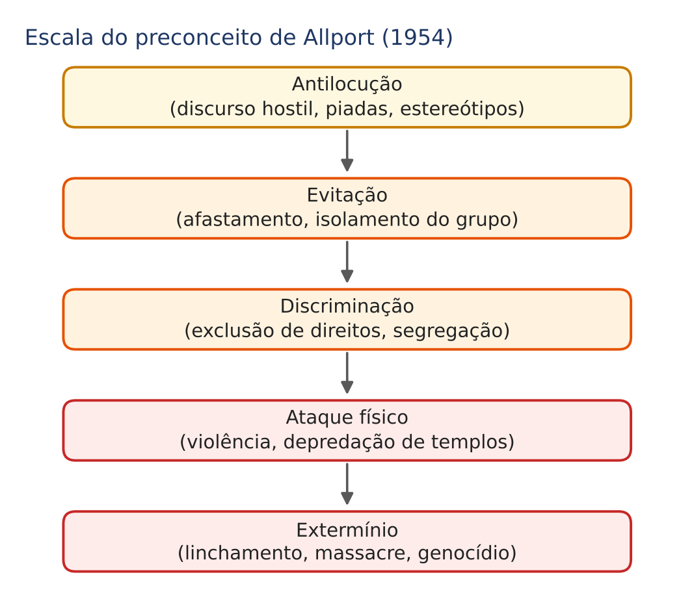

# CAPÍTULO 40 — DIREITO DA ANTIDISCRIMINAÇÃO II: CONVENÇÕES, LEIS, GRUPOS PROTEGIDOS E DEVERES DO ESTADO

:::INCIDENCIA
Pontos: TRF5 p. H.3 e H.8; TJRS p. H.3 e H.4; TJSC p. I.3 e I.4. Nível A+. Lote: 29 questões (FGV 27, FCC 2).
O que mais cai: letra da Convenção Interamericana contra o Racismo (definições do art. 1º, status de emenda, petição à Comissão), controle de convencionalidade e Recomendação CNJ 123/2022, tese da ADO 26 e liberdade religiosa, Resolução CNJ 348/2020 (autodeclaração e local de custódia) e a distinção entre injúria por religião e racismo.
:::

| Subtema | FGV | FCC | Padrão de cobrança |
|---|---|---|---|
| Convenções (ICERD, CIRDI, CEDAW): definições, status, mecanismos | 7 (Q2365419, Q3752715, Q3453313, Q2365416, Q4289405, Q3849013, Q2512033) | 1 (Q3290880) | letra das definições do art. 1º da CIRDI (indireta, múltipla, racismo, intolerância); "vida pública OU privada"; ações afirmativas temporárias; quórum do art. 5º, § 3º |
| Controle de convencionalidade e Recomendação CNJ 123/2022 | 5 (Q2507013, Q2459883, Q3898990, Q3373934, Q4289403) | 0 | difuso, de ofício, por todo juiz; duplo controle; natureza não vinculante da recomendação x vinculação à jurisprudência da Corte IDH |
| Racismo: conceitos, casos interamericanos, ADPF 973, Estatuto | 5 (Q3362343, Q3996912, Q3880852, Q4083803, Q4064589) | 0 | Simone Diniz e Dos Santos Nascimento; racismo ambiental; inexistência de "racismo reverso"; ADPF 973 sem estado de coisas inconstitucional |
| Lei 7.716/1989, Lei 14.532/2023 e intolerância religiosa | 5 (Q3058677, Q4088268, Q3171979, Q2375393, Q2512012) | 0 | religião ficou no art. 140, § 3º, do CP; § 2º-B do art. 20; racismo religioso; ensino religioso confessional (ADI 4.439) |
| LGBTQIA+fobia (ADO 26, ADI 4.275, Res. CNJ 348/2020) | 5 (Q4102444, Q3692384, Q3362337, Q2507011, Q3951814) | 1 (Q4012654) | autodeclaração sem cirurgia ou laudo; tese da ADO 26 (motivo torpe; liberdade religiosa salvo discurso de ódio); preferência da pessoa presa |

O Cap. 39 fixou o vocabulário (igualdade, discriminação direta e indireta, institucional e estrutural, interseccional, impacto desproporcional, prova). Este capítulo trata do DIREITO POSITIVO da antidiscriminação: quais grupos e critérios a ordem jurídica protege, com que instrumentos (convenções globais e interamericanas, Constituição, leis, atos do CNJ), que deveres impõe ao Estado e ao juiz, e como lidar com os três campos de conflito que mais aparecem nas provas: racismo e injúria racial, intolerância religiosa e LGBTQIA+fobia, além do discurso de ódio. Ficam em outros lugares, com remissão: conceitos sociológicos de raça, racismo estrutural, formas de racismo (recreativo, cultural, religioso, ambiental) e os Protocolos do CNJ (Cap. 28); ações afirmativas e pessoa com deficiência (Cap. 41); povos indígenas e quilombolas (Cap. 42); assédio e discriminação no trabalho do Judiciário (Cap. 7); discriminação algorítmica (Cap. 30); plataformas e moderação (Cap. 34); conduta do magistrado nas redes (Cap. 11); a dogmática penal dos crimes raciais (Apostila de Direito Penal, Cap. 41); hierarquia dos tratados e controle de convencionalidade em detalhe (Apostila de Direito Constitucional, Cap. 11); igualdade e jurisprudência LGBTQIA+ (Apostila de Direito Constitucional, Cap. 8).

## 40.1 Arquitetura da proteção antidiscriminatória

### 40.1.1 Três camadas que se comunicam

A proteção contra a discriminação no Brasil resulta da sobreposição de três camadas normativas e de uma quarta, institucional, que é a que interessa ao juiz no dia a dia:

- sistema global (ONU): a DUDH (arts. 1º, 2º e 7º, ver Cap. 27), os Pactos de 1966 (o PIDCP proíbe a discriminação no gozo dos direitos, art. 2º, garante igual proteção da lei, art. 26, e manda proibir a apologia do ódio que incite à discriminação, art. 20.2) e as convenções temáticas: ICERD (1965), CEDAW (1979), Convenção sobre os Direitos da Pessoa com Deficiência (2006, Cap. 41) e Convenção 111 da OIT (discriminação no emprego), além de *soft law* (Declaração e Programa de Ação de Durban, 2001; Princípios de Yogyakarta, 2006);
- sistema interamericano (OEA): Convenção Americana (CADH, art. 1.1: garantia dos direitos "sem discriminação alguma", com rol aberto que termina em "qualquer outra condição social"); Convenção de Belém do Pará (Cap. 28); Convenção Interamericana contra o Racismo, a Discriminação Racial e Formas Correlatas de Intolerância (CIRDI, 2013); e a jurisprudência da Corte IDH, inclusive a consultiva (OC-24/17);
- plano constitucional e legal: CF, arts. 3º, IV, 5º, XLI e XLII, e 7º, XXX e XXXI; Leis 7.716/1989, 9.029/1995, 12.288/2010, 14.532/2023 e 12.984/2014, Estatutos da Pessoa Idosa e da Pessoa com Deficiência, Lei Maria da Penha (40.7);
- plano judicial-institucional: decisões estruturantes do STF (ADO 26, ADI 4.275, ADPF 973) e atos do CNJ que convertem esses parâmetros em procedimento (Recomendação 123/2022, alterada pela Recomendação 168/2026; Resoluções 270/2018, 348/2020, 492/2023 e 598/2024).

:::DICA Como se organiza a resposta oral
Pergunta aberta ("qual o marco normativo antidiscriminatório brasileiro?") pede a sequência: (1) fundamento constitucional — objetivo de promover o bem de todos sem preconceitos e o rol ABERTO do art. 3º, IV ("quaisquer outras formas de discriminação"), mandado de criminalização do art. 5º, XLI e XLII; (2) tratados — ICERD e CEDAW supralegais, CIRDI equivalente a emenda; (3) leis especiais; (4) jurisprudência do STF que supriu omissões (ADO 26) ou reconheceu o problema estrutural (ADPF 973); (5) o papel do juiz: controle de convencionalidade, julgamento com perspectiva (Protocolos) e devida diligência reforçada.
:::

### 40.1.2 Proibição de discriminar e dever de promover

Os instrumentos combinam duas obrigações: a NEGATIVA (não discriminar, não encorajar, não apoiar), imediata, e a POSITIVA (promover a igualdade de fato por políticas e medidas especiais), programática mas não facultativa — a ICERD prevê medidas especiais "se as circunstâncias o exigirem" (art. 2.2), a CIRDI as converte em compromisso (art. 5) e afirma que igualdade e não discriminação "pressupõem uma obrigação por parte do Estado de adotar medidas especiais" (preâmbulo), e o Estatuto da Igualdade Racial impõe ao "Estado e [à] sociedade" garantir a igualdade de oportunidades (art. 2º).

## 40.2 Critérios e grupos protegidos

### 40.2.1 Critérios suspeitos e rol aberto

Chamam-se critérios proibidos (ou suspeitos, na linguagem da Suprema Corte dos EUA, *suspect classifications*) os fatores cuja utilização para diferenciar pessoas é presumidamente ilegítima e exige justificação reforçada. A Constituição enumera origem, raça, sexo, cor e idade (art. 3º, IV) e fecha com uma cláusula de abertura ("quaisquer outras formas de discriminação"); a CADH termina sua lista com "qualquer outra condição social". Foi por essa abertura que a Corte IDH, na OC-24/17, afirmou que orientação sexual, identidade de gênero e expressão de gênero são categorias protegidas pelo art. 1.1 da CADH (o ponto vem transcrito nos considerandos da Resolução CNJ 348/2020), e que o STF reconheceu a proteção contra a discriminação por orientação sexual e identidade de gênero (ADI 4.277, ADO 26, ADI 4.275). Três características costumam justificar a inclusão de um critério no rol: (a) traço imutável ou constitutivo da identidade, que não se pode exigir que a pessoa abandone; (b) histórico de estigmatização e subordinação do grupo; (c) baixa capacidade de defesa no processo político majoritário (a "minoria discreta e insular" da nota de rodapé 4 de *United States v. Carolene Products*, 1938).

| Critério (ponto do TRF5) | Fonte principal de proteção | Observação de prova |
|---|---|---|
| Raça, cor, etnia, ascendência, origem nacional | CF, art. 3º, IV, e 5º, XLII; ICERD; CIRDI; Lei 7.716; Estatuto da Igualdade Racial | raça é conceito SOCIAL (HC 82.424); "descendência" (ICERD, Estatuto) x "ascendência" (CIRDI) |
| Nacionalidade, procedência | Lei 7.716 ("procedência nacional"); ICERD, art. 1.2 e 1.3 | a ICERD NÃO se aplica a distinções entre cidadãos e não cidadãos (art. 1.2), salvo se discriminarem nacionalidade particular (art. 1.3) |
| Sexo e gênero | CF, art. 5º, I, e 7º, XXX; CEDAW; Belém do Pará; Lei Maria da Penha | gênero como construção social (Cap. 28) |
| Orientação sexual e identidade de gênero | CF, art. 3º, IV (cláusula aberta); OC-24/17; Yogyakarta; ADO 26; ADI 4.275; Res. CNJ 348/2020 e 270/2018 | proteção por interpretação: não há lei federal específica |
| Idade | CF, art. 3º, IV, e 7º, XXX; Estatuto da Pessoa Idosa; ECA | a injúria contra pessoa idosa ficou no art. 140, § 3º, do CP |
| Deficiência | CDPD (status de emenda); Lei 13.146/2015 | modelo social e adaptação razoável no Cap. 41 |
| Religião e convicção | CF, art. 5º, VI e VIII, e 19, I; CADH, arts. 12 e 13; Lei 7.716 ("religião"); Estatuto, arts. 23 a 26 | ofensa pessoal por religião = art. 140, § 3º, do CP; segregação ou incitação = Lei 7.716 |
| Condição socioeconômica | CADH, art. 1.1 ("posição econômica"); CIRDI, por via da discriminação múltipla | aporofobia (Adela Cortina): aversão ao pobre; caso Alcântara (Corte IDH) reconheceu discriminação por raça e condição socioeconômica |
| Estado de saúde (HIV) | Lei 12.984/2014 | crime próprio (Apostila de Direito Penal, Cap. 41) |
| Estado civil, situação familiar | Lei 9.029/1995 (relação de emprego) | exigência de teste de gravidez e esterilização vedadas |

:::PEGADINHA Ascendência, descendência e "vida privada"
A FGV troca as palavras dos tratados. ICERD (1965): "raça, côr, descendência ou origem nacional ou étnica", no domínio da vida PÚBLICA. CIRDI (2013): "raça, cor, ascendência ou origem nacional ou étnica", em "qualquer área da vida pública OU PRIVADA". Estatuto da Igualdade Racial (2010): "raça, cor, descendência ou origem nacional ou étnica", "em qualquer outro campo da vida pública ou privada". Alternativa que restringe a discriminação racial à vida pública, ou a "raça e cor" apenas, está errada para a CIRDI e para o Estatuto (Q2365419, alternativa D; Q3880852, alternativa E).
:::

### 40.2.2 Grupos protegidos e o sujeito da proteção

As concepções SIMÉTRICA (anticlassificação) e ASSIMÉTRICA (antissubordinação, Owen Fiss) e a leitura de Adilson José Moreira estão no Cap. 39 (39.2.2). O direito positivo brasileiro adota a chave assimétrica em pontos decisivos: o Estatuto da Igualdade Racial é "destinado a garantir à população negra" a igualdade de oportunidades (art. 1º); o art. 20-C da Lei 7.716 manda considerar discriminatória a atitude dirigida "à pessoa ou a grupos minoritários"; o STJ negou injúria racial contra pessoa branca por essa condição (40.8.3); e as ações afirmativas são compatíveis com a proibição de discriminar (ICERD, art. 1.4; CIRDI, art. 1.5; Cap. 41).

## 40.3 Sistema global de proteção

### 40.3.1 ICERD: a Convenção Internacional sobre a Eliminação de Todas as Formas de Discriminação Racial

A ICERD (sigla em inglês; em português CIEFDR ou, como em uma das questões, CIETFDR) é o primeiro dos grandes tratados temáticos de direitos humanos da ONU, aprovado em 1965 sob o impacto da descolonização africana e de episódios de antissemitismo na Europa. No Brasil: assinatura em 7/3/1966, aprovação pelo Decreto Legislativo 23/1967, ratificação em 27/3/1968, vigência internacional em 4/1/1969 e promulgação pelo Decreto 65.810, de 8/12/1969. Por ser tratado de direitos humanos anterior à EC 45/2004 e não aprovado pelo rito do art. 5º, § 3º, tem hierarquia SUPRALEGAL (40.5).

Estrutura que a banca cobra:

| Dispositivo | Conteúdo |
|---|---|
| Art. 1.1 | definição de discriminação racial: "qualquer distinção, exclusão, restrição ou preferência baseadas em raça, côr, descendência ou origem nacional ou étnica que tem por objetivo ou efeito anular ou restringir" direitos "no domínio político econômico, social, cultural ou em qualquer outro domínio de vida pública" |
| Art. 1.2 e 1.3 | não se aplica às distinções entre cidadãos e não cidadãos; não afeta normas de nacionalidade, cidadania e naturalização que não discriminem nacionalidade particular |
| Art. 1.4 | medidas especiais não são discriminação, "contanto que" não conduzam à manutenção de direitos separados e "não prossigam após terem sidos alcançados os seus objetivos" |
| Art. 2º | obrigação de eliminar a discriminação "por todos os meios apropriados e sem tardar": não praticar, não encorajar nem apoiar, rever e anular normas discriminatórias, proibir a discriminação por particulares, favorecer movimentos multirraciais; § 2º: medidas especiais e concretas |
| Art. 3º | condenação da segregação racial e do *apartheid* |
| Art. 4º | condenação da propaganda e das organizações racistas; dever de tipificar a difusão de ideias de superioridade ou ódio raciais e a incitação; dever de declarar ilegais e proibir as organizações que incitem à discriminação e de punir a participação nelas |
| Art. 5º | igualdade no gozo de direitos, a começar pelo "tratamento igual perante os tribunais" (alínea a) e pelo acesso a lugares e serviços públicos (alínea f) |
| Art. 6º | recursos efetivos perante os tribunais e direito a "satisfação ou reparação justa e adequada" |
| Art. 7º | medidas no ensino, educação, cultura e informação contra preconceitos |
| Art. 8º e seguintes | Comitê para a Eliminação da Discriminação Racial (CERD), de 18 peritos; relatórios periódicos; comunicações interestatais |
| Art. 14 | cláusula facultativa de comunicações individuais: o Brasil a aceitou (Decreto Legislativo 57/2002; Decreto 4.738, de 12/6/2003) |

O art. 4º é a matriz internacional da tipificação do discurso de ódio racial e explica por que a ICERD é a convenção que mais claramente RELATIVIZA a liberdade de expressão: os Estados se comprometem "a declarar delitos puníveis por lei, qualquer difusão de idéias baseadas na superioridade ou ódio raciais" e a "declarar ilegais e a proibir as organizações" que incitem à discriminação.  Os EUA ratificaram-na com reserva ao art. 4º (Primeira Emenda; 40.12).

:::QUESTAO FGV 2026 — PC-PI — Delegado de Polícia (Q3849013)
Cobrado: a tensão entre liberdade de expressão e proibição de discriminação "na perspectiva da CIETFDR". Gabarito: A — os Estados partes devem proibir as organizações que encorajem a discriminação racial (art. 4º, b).
Armadilhas: B e E transplantam para a ICERD a lógica da posição preferencial da liberdade de expressão (a ICERD manda tipificar a difusão de ideias de superioridade racial); C (neutralidade diante de organizações racistas) contraria a condenação expressa do art. 4º; D é a mais traiçoeira: chama a propaganda de superioridade racial de "correlata ao ambiente democrático" e diz apenas que ela "não deve ser estimulada", quando a Convenção a CONDENA e manda punir.
:::

### 40.3.2 CEDAW e o Protocolo Facultativo

A Convenção sobre a Eliminação de Todas as Formas de Discriminação contra a Mulher (ONU, 1979) foi promulgada com reservas em 1984 (Decreto 89.460/1984, reservas sobre igualdade no casamento e no domicílio, incompatíveis com o Código Civil de 1916); retiradas as reservas (Decreto Legislativo 26/1994), o texto integral foi promulgado pelo Decreto 4.377, de 13/9/2002. O Protocolo Facultativo, que permite comunicações individuais ao Comitê CEDAW, foi aprovado pelo Decreto Legislativo 107/2002 e promulgado pelo Decreto 4.316, de 30/7/2002.

- Art. 1º: discriminação contra a mulher é "toda a distinção, exclusão ou restrição baseada no sexo e que tenha por objeto ou resultado prejudicar ou anular" o exercício de direitos pela mulher, "independentemente de seu estado civil", "nos campos político, econômico, social, cultural e civil ou em qualquer outro campo". Note "objeto ou resultado": a CEDAW alcança a discriminação indireta.
- Art. 2º: dever de consagrar a igualdade na Constituição, proibir a discriminação com sanções, garantir proteção "por meio dos tribunais nacionais competentes", eliminar a discriminação praticada "por qualquer pessoa, organização ou empresa" e derrogar disposições penais discriminatórias (alínea g).
- Art. 4º: medidas especiais de caráter temporário para acelerar a igualdade de fato não são discriminação e "cessarão quando os objetivos de igualdade de oportunidade e tratamento houverem sido alcançados"; medidas de proteção à maternidade não são discriminatórias (§ 2º).
- Art. 5º, a: modificar padrões socioculturais baseados na "idéia da inferioridade ou superioridade de qualquer dos sexos ou em funções estereotipadas" — é a base convencional do julgamento com perspectiva de gênero (Cap. 28).
- Art. 12: igualdade no acesso aos serviços de saúde, inclusive os relativos à gravidez, ao parto e ao pós-parto.

O caso mais importante contra o Brasil no sistema CEDAW é Alyne da Silva Pimentel Teixeira vs. Brasil (Comitê CEDAW, decisão de 2011): jovem negra, pobre, grávida de seis meses, da Baixada Fluminense, morreu em 16/11/2002 após atendimento negligente em estabelecimento de saúde, demora na transferência e ausência de vaga. O Comitê reconheceu violação do art. 12 (saúde materna) e do art. 2º (acesso à justiça e dever de fiscalizar prestadores privados de serviço público de saúde), e qualificou a discriminação como interseccional — por ser mulher, afrodescendente e de baixa renda. É o paradigma da responsabilidade estatal por atos de entidades privadas que prestam serviço público de saúde.

:::QUESTAO FGV 2026 — DPE-RJ — Defensor Público (Q4289403)
Caso que reproduz o padrão de Alyne Pimentel (gestante negra da Baixada Fluminense, UPA gerida por Organização Social, minimização de sintomas, demora na transferência, morte por hemorragia pós-parto; quase cinco anos de inércia investigativa). Gabarito: B (só a II) — o defensor pode invocar, em controle difuso de convencionalidade, o art. 12 da CEDAW e a eficácia interpretativa da decisão do Comitê CEDAW em caso contra o Brasil, porque o Judiciário, como órgão do Estado, está vinculado aos parâmetros internacionais e sua omissão pode gerar nova responsabilidade internacional.
Passos: (1) item I erra ao afastar o Estado: a gestão por Organização Social não exclui o dever estatal de garantir e fiscalizar o serviço de saúde (é exatamente a lição de Alyne); a responsabilidade não se resolve "exclusivamente" pelo CDC; (2) item III erra duas vezes: não há regra que impeça arguir discriminação estrutural ou interseccional em caso de vítima única (Alyne era vítima única), nem condição de procedibilidade de "procedimento instrutório" para invocar racismo institucional; (3) item II: controle de convencionalidade pode ser suscitado por qualquer parte e exercido por qualquer juiz (40.5.3).
:::

### 40.3.3 Durban, Yogyakarta e outros instrumentos de *soft law*

- Declaração e Programa de Ação de Durban (III Conferência Mundial contra o Racismo, a Discriminação Racial, a Xenofobia e Formas Correlatas de Intolerância, África do Sul, 2001): reconheceu a escravidão e o tráfico transatlântico como crimes contra a humanidade, cunhou internacionalmente a expressão "afrodescendentes" e recomendou ações afirmativas e coleta de dados desagregados. NÃO é tratado: é declaração política de conferência, por isso a alternativa que fala em "Convenção de Durban" está errada (Q2512033, D). A Resolução CNJ 348/2020 a cita entre seus fundamentos.
- Princípios de Yogyakarta (2006, "Princípios sobre a aplicação da legislação internacional de direitos humanos em relação à orientação sexual e identidade de gênero"), elaborados por especialistas, sem natureza de tratado, complementados em 2017 (Yogyakarta +10). A Res. CNJ 348/2020 invoca o Princípio 9, segundo o qual toda pessoa privada de liberdade deve ser tratada com respeito à orientação sexual e à identidade de gênero autodeterminadas, inclusive com participação nas decisões sobre o local de detenção (40.11.4).
- Plano de Ação de Rabat (ONU, 2012): parâmetros para distinguir a expressão ofensiva, protegida, da incitação ao ódio que o art. 20.2 do PIDCP manda proibir (40.12.2).
- Convenção 111 da OIT (discriminação em matéria de emprego e profissão): base do regime da Lei 9.029/1995.

:::ATENCAO Natureza jurídica dos instrumentos
Tratado ratificado e promulgado (ICERD, CEDAW, CIRDI, CADH) obriga e serve de parâmetro de controle. Declaração de conferência (Durban), princípios de especialistas (Yogyakarta), recomendações gerais de comitês e opiniões consultivas da Corte IDH são *soft law* ou interpretação autorizada: orientam a interpretação e integram o *corpus iuris* interamericano (definição do Estatuto da Magistratura Brasileira Interamericana, 40.5.4), mas não são, por si, normas de hierarquia supralegal. Na prova objetiva, desconfie de alternativa que atribui "força vinculante" a Yogyakarta ou a Durban.
:::

## 40.4 Sistema interamericano

### 40.4.1 A CADH como cláusula geral antidiscriminatória

A CADH tem duas normas de igualdade com funções diferentes, e a Corte IDH as distingue: o art. 1.1 é cláusula SUBORDINADA (proíbe discriminar no gozo dos direitos da própria Convenção); o art. 24 ("Todas as pessoas são iguais perante a lei") é cláusula AUTÔNOMA (proíbe a discriminação em qualquer lei ou ato interno, ainda que o direito afetado não esteja na Convenção). Na jurisprudência interamericana, a igualdade e a não discriminação pertencem ao *jus cogens* (Opinião Consultiva OC-18/03, sobre migrantes indocumentados). O art. 13.5 manda proibir por lei "toda apologia ao ódio nacional, racial ou religioso que constitua incitação à discriminação, à hostilidade, ao crime ou à violência" (40.12).

### 40.4.2 A Convenção Interamericana contra o Racismo (CIRDI)

Firmada na 43ª Sessão Ordinária da Assembleia Geral da OEA, na Guatemala, em 5/6/2013, juntamente com a Convenção Interamericana contra Toda Forma de Discriminação e Intolerância (tratado irmão, de objeto mais amplo — orientação sexual, identidade de gênero, idade, deficiência, condição socioeconômica —, cujo Comitê de monitoramento é o mesmo, art. 15, iv, da CIRDI). No Brasil:

| Etapa | Data e ato |
|---|---|
| Aprovação pelo Congresso | Decreto Legislativo 1, de 18/2/2021, "conforme o procedimento de que trata o § 3º do art. 5º da Constituição" (Câmara: 413 e 417 votos; Senado: 71 e 66 votos, em dois turnos) |
| Ratificação | depósito em 28/5/2021 na Secretaria-Geral da OEA |
| Vigência internacional para o Brasil | 27/6/2021 (trigésimo dia após o depósito, art. 20.2) |
| Promulgação | Decreto 10.932, de 10/1/2022 (DOU de 11/1/2022) |
| Status | EQUIVALENTE A EMENDA CONSTITUCIONAL — terceiro tratado aprovado pelo rito do § 3º, depois da CDPD e do Tratado de Marraqueche |

Definições do art. 1º, na LETRA (são a fonte de metade das questões do lote):

- 1.1 Discriminação racial: "qualquer distinção, exclusão, restrição ou preferência, em qualquer área da vida pública ou privada, cujo propósito ou efeito seja anular ou restringir o reconhecimento, gozo ou exercício, em condições de igualdade, de um ou mais direitos humanos e liberdades fundamentais consagrados nos instrumentos internacionais aplicáveis aos Estados Partes. A discriminação racial pode basear-se em raça, cor, ascendência ou origem nacional ou étnica."
- 1.2 Discriminação racial indireta: a que ocorre, "em qualquer esfera da vida pública ou privada, quando um dispositivo, prática ou critério aparentemente neutro tem a capacidade de acarretar uma desvantagem particular para pessoas pertencentes a um grupo específico", com base nos critérios do art. 1.1, "ou as coloca em desvantagem, a menos que esse dispositivo, prática ou critério tenha um objetivo ou justificativa razoável e legítima à luz do Direito Internacional dos Direitos Humanos".
- 1.3 Discriminação múltipla ou agravada: preferência, distinção, exclusão ou restrição "baseada, de modo concomitante, em dois ou mais critérios dispostos no Artigo 1.1, ou outros reconhecidos em instrumentos internacionais", em qualquer área da vida pública ou privada.
- 1.4 Racismo: "qualquer teoria, doutrina, ideologia ou conjunto de ideias que enunciam um vínculo causal entre as características fenotípicas ou genotípicas de indivíduos ou grupos e seus traços intelectuais, culturais e de personalidade, inclusive o falso conceito de superioridade racial"; todas essas teorias são "cientificamente falsas, moralmente censuráveis, socialmente injustas" e perturbam gravemente a paz e a segurança internacional.
- 1.5 Medidas especiais ou de ação afirmativa não constituem discriminação, "desde que essas medidas não levem à manutenção de direitos separados para grupos diferentes e não se perpetuem uma vez alcançados seus objetivos".
- 1.6 Intolerância: "ato ou conjunto de atos ou manifestações que denotam desrespeito, rejeição ou desprezo à dignidade, características, convicções ou opiniões de pessoas por serem diferentes ou contrárias"; pode manifestar-se como marginalização e exclusão de grupos vulneráveis "da participação em qualquer esfera da vida pública ou privada ou como violência contra esses grupos".

Observe três escolhas conceituais que distinguem a CIRDI da ICERD e que estão por trás das alternativas: (a) a CIRDI define RACISMO como ideologia (o vínculo causal entre fenótipo e capacidades), e não como conduta — por isso é errado dizer que ela define racismo como "conduta criminosa" com dolo de ofender a honra (Q3752715, E); (b) a discriminação indireta é definida pelo EFEITO ("tem a capacidade de acarretar"), sem intenção — é errado defini-la como prática "velada" com "objetivo ou intenção" de supremacia (Q3752715, C); (c) a discriminação múltipla é a CONCOMITÂNCIA de critérios proibidos contra a mesma pessoa, não a soma de direitos violados (Q4116940, classificada no Cap. 39, alternativa C) nem a "soma de discriminações sofridas por pessoas racializadas" (Q3752715, D). A relação entre discriminação múltipla e interseccionalidade, e a distinção entre discriminação aditiva, composta e interseccional, estão no Cap. 28 (28.4.2).

Deveres do Estado (Capítulo III, arts. 4 a 14): prevenir, eliminar, proibir e PUNIR atos de racismo e intolerância, inclusive financiamento, difusão de material racista "inclusive a internet", perfilamento (art. 4, v; 40.12.4), material pedagógico estereotipado (x) e restrição de acesso a água e recursos naturais (xiv, racismo ambiental); ações afirmativas temporárias (art. 5); legislação expressa, também para o setor privado (art. 7); segurança sem discriminação direta ou indireta (art. 8); diversidade nos sistemas político e jurídico (art. 9); acesso igualitário à justiça e reparação (art. 10); discriminação múltipla como AGRAVANTE (art. 11); dados desagregados (art. 12); instituição nacional de monitoramento (art. 13).

Mecanismos (art. 15): (i) petições INDIVIDUAIS à Comissão IDH por "qualquer pessoa ou grupo de pessoas, ou entidade não governamental juridicamente reconhecida", com as normas de procedimento da CADH (comunicações interestatais dependem de declaração); (ii) consultas e assessoria técnica da Comissão; (iii) competência contenciosa da Corte IDH mediante declaração facultativa; (iv) Comitê Interamericano para a Prevenção e Eliminação do Racismo, que recebe relatórios periódicos. Cláusula *pro persona* no art. 16.

:::QUESTAO FGV 2024 — PC-SC — Psicólogo Policial Civil (Q2365419)
Cobrado: letra das definições da CIRDI. Gabarito: C — reproduz literalmente o art. 1.2 (discriminação indireta).
Armadilhas, uma por definição: A (discriminação múltipla como concomitância de "dispositivos da lei penal" ou "agravantes": o art. 1.3 fala em critérios proibidos de discriminação); B (o racismo "não abarca a tese da superioridade racial, estando protegida pela liberdade de expressão": o art. 1.4 inclui expressamente "o falso conceito de superioridade racial"); D (restringe à vida pública e exclui ascendência e origem); E (a intolerância não alcançaria a vida privada: o art. 1.6 diz "qualquer esfera da vida pública ou privada").
:::

:::QUESTAO FGV 2025 — MPE-ES — Promotor de Justiça Substituto (Q3752715)
Gabarito: B — medidas especiais ou de ação afirmativa não constituem discriminação desde que não se perpetuem quando alcançados os objetivos e não levem à manutenção de direitos separados (art. 1.5).
Armadilha principal: A afirma hierarquia SUPRALEGAL — erro, porque a CIRDI foi aprovada pelo rito do art. 5º, § 3º, e equivale a emenda. C, D e E deformam as definições de indireta, múltipla e racismo (ver os três pontos acima).
:::

:::QUESTAO FGV 2025 — TJ-TO — Juiz Substituto (Q3453313)
Cobrado: requisito de admissibilidade da petição individual à Comissão IDH com base na CIRDI. Gabarito: C — que a matéria não esteja pendente de outro processo de solução internacional.
Fundamento: o art. 15, i, remete às normas de procedimento da CADH, cujo art. 46 exige esgotamento dos recursos internos, prazo de seis meses da decisão definitiva e ausência de litispendência internacional. Armadilhas: não há exigência de parecer da PGR (A), de não suscitação de incidente de deslocamento de competência (B, instituto interno do art. 109, § 5º, da CF), de representação por advogado inscrito na OAB ou defensor (D: a petição pode ser apresentada por qualquer pessoa, grupo ou ONG) nem de inércia de órgão do Executivo (E).
:::

:::QUESTAO FGV 2026 — DPE-RJ — Defensor Público (Q4289405)
Cobrado: ADPF 973 e regime da CIRDI. Gabarito: B (I e II).
Item I correto: na ADPF 973 o STF reconheceu, por unanimidade, o racismo estrutural e graves violações a preceitos fundamentais, determinou a revisão do Plano Nacional de Promoção da Igualdade Racial ou a elaboração de plano autônomo, mas NÃO declarou o estado de coisas inconstitucional pedido na inicial (40.14.2). Item II correto: fatores do art. 1.1 e definição de discriminação indireta do art. 1.2. Item III errado: a CIRDI tem status de EMENDA, não supralegal.
No mesmo sentido, quanto ao status: Q2365416 e Q3290880 (40.5.1).
:::

### 40.4.3 Casos do sistema interamericano sobre discriminação racial contra o Brasil

| Caso | Órgão e data | Fatos | O que ficou assentado |
|---|---|---|---|
| Simone André Diniz vs. Brasil | Comissão IDH, Relatório de Mérito n. 66/06, Caso 12.001, de 21/10/2006 | em 2/3/1997, anúncio de emprego doméstico em jornal de São Paulo exigia candidata "preferencialmente branca"; Simone, negra, foi recusada; o inquérito por racismo foi arquivado sem denúncia | primeira responsabilização do Brasil por discriminação racial no sistema interamericano; reconhecimento do racismo INSTITUCIONAL no sistema de justiça (arquivamento por "ausência de dolo", banalização); violação dos arts. 1.1, 2, 8, 24 e 25 da CADH (a Comissão registrou que o racismo institucional é obstáculo à aplicação da lei antirracista no Brasil); recomendações de reparação e de capacitação |
| Dos Santos Nascimento e Ferreira Gomes vs. Brasil | Corte IDH, sentença de 7/10/2024 (notificada em 20/2/2025) | em 1998, duas mulheres negras foram preteridas em seleção de emprego em São Paulo, e o processo penal terminou em absolvição | dever de DEVIDA DILIGÊNCIA REFORÇADA; vedação de transferir às vítimas todo o ônus da prova; racismo estrutural e institucional com análise interseccional; fatos, fundamentos e reparações desenvolvidos no Cap. 39 (39.9.4) |
| Comunidades Quilombolas de Alcântara vs. Brasil | Corte IDH (v. Cap. 42, 42.2.4) | quilombolas e Centro de Lançamento de Alcântara (MA) | discriminação por raça e condição socioeconômica; desenvolvimento no Cap. 42 |

:::QUESTAO FGV 2026 — TRF 2ª Região — Juiz Federal Substituto (Q3996912)
Gabarito: A — no caso Dos Santos Nascimento e Ferreira Gomes, a Corte IDH reconheceu violação do dever de devida diligência reforçada, porque a absolvição se baseou em suposições e transferiu o ônus probatório às vítimas, reproduzindo o racismo estrutural e institucional contra mulheres afrodescendentes no acesso ao mercado de trabalho.
Armadilhas: B (a ADPF 973 NÃO declarou estado de coisas inconstitucional); C (a tese do HC 208.240 VEDA a busca fundada em raça ou cor, sem admitir a cor como "elemento complementar"; 40.12.4); D (no caso Alcântara o Brasil FOI responsabilizado, inclusive pela falta de consulta prévia); E (a CIRDI foi aprovada pelo rito do § 3º e equivale a emenda).
:::

:::QUESTAO FGV 2025 — ENAM 2025.1 (Q3362343)
Gabarito: D (II e III). Item I ERRADO: o Estatuto da Igualdade Racial NÃO prevê expressamente que as ações afirmativas devem cessar quando alcançados seus objetivos; essa cláusula está na ICERD (art. 1.4), na CIRDI (arts. 1.5 e 5) e na CEDAW (art. 4.1) — o Estatuto apenas define ações afirmativas (art. 1º, parágrafo único, VI) e as qualifica como políticas para "reparar as distorções e desigualdades sociais" (art. 4º, parágrafo único). Item II: formulação de Silvio Almeida (racismo como processo histórico e político, ligado às peculiaridades de cada formação social; Cap. 28). Item III: caso Simone André Diniz como paradigma do racismo institucional.
Armadilha: a temporariedade das ações afirmativas é tão associada ao tema que o candidato a "vê" no Estatuto. É exatamente o ponto cobrado.
:::

## 40.5 Hierarquia dos tratados e controle de convencionalidade

### 40.5.1 Status dos tratados antidiscriminatórios

O regime dogmático (RE 466.343, duplo estatuto, bloco de constitucionalidade, reserva de plenário) está na Apostila de Direito Constitucional, Cap. 11. Para este capítulo basta o quadro aplicado:

| Tratado | Rito | Status | Consequência |
|---|---|---|---|
| ICERD (Decreto 65.810/1969) | comum | supralegal | parâmetro de controle DIFUSO de convencionalidade; paralisa a lei incompatível |
| CEDAW (Decreto 4.377/2002) e Belém do Pará (Decreto 1.973/1996) | comum | supralegal | idem |
| CADH (Decreto 678/1992) | comum | supralegal | idem, com a jurisprudência da Corte IDH |
| CIRDI (Decreto 10.932/2022) | art. 5º, § 3º | equivalente a emenda | parâmetro de CONSTITUCIONALIDADE (difuso e concentrado); integra o bloco de constitucionalidade |
| CDPD (Decreto 6.949/2009) | art. 5º, § 3º | equivalente a emenda | idem (Cap. 41) |

:::QUESTAO FCC 2025 — Prefeitura de São Paulo — Auditor Municipal (Q3290880)
Caso numérico: CIRDI aprovada na Câmara por 413 e 417 votos e no Senado por 71 e 66, em dois turnos. Gabarito: E — tem status de emenda e volta-se contra prática que a Constituição define como crime inafiançável e imprescritível, sujeito a reclusão (art. 5º, XLII).
Passos: (1) três quintos de 513 = 308; de 81 = 49; (2) o menor resultado (66 no Senado) supera 49; (3) racismo: art. 5º, XLII. Armadilha: B e C trocam pelo regime do art. 5º, XLIII (inafiançável e insuscetível de graça ou anistia: tortura, tráfico, terrorismo e hediondos).
No mesmo sentido: Q2365416 (FGV 2024, PC-SC; gabarito E: a ICERD é supralegal e a CIRDI equivale a emenda — a inversão das duas é o distrator mais comum).
:::

### 40.5.2 O que é controle de convencionalidade

Controle de convencionalidade é o exame de compatibilidade dos atos e normas internos com os tratados de direitos humanos e com a interpretação que deles fazem os órgãos internacionais competentes. A Corte IDH consolidou a doutrina a partir de Almonacid Arellano vs. Chile (2006), estendeu-a a juízes de ofício (Trabajadores Cesados del Congreso vs. Peru, 2006) e a todas as autoridades públicas (Gelman vs. Uruguai, 2011). No Brasil, Valerio Mazzuoli sistematizou o tema e propôs a teoria do DUPLO CONTROLE (ou dupla compatibilidade vertical material): a norma interna, para ser válida, precisa ser compatível com a Constituição E com os tratados de direitos humanos em vigor.

| Classificação | Controle de convencionalidade |
|---|---|
| Quanto ao órgão | INTERNACIONAL (Corte IDH, complementar e subsidiário) x INTERNO (juízes nacionais e, para a Corte IDH, todas as autoridades) |
| Interno, quanto à via | DIFUSO: qualquer juiz, no caso concreto, de ofício ou a requerimento, com parâmetro em tratado supralegal ou equivalente a emenda; CONCENTRADO: STF, quando o parâmetro é tratado com status de emenda (Mazzuoli o chama de controle concentrado de convencionalidade) |
| Quanto à técnica | interpretação conforme a Convenção (preferencial); afastamento (inaplicação) da norma interna incompatível no caso concreto |
| Quanto ao objeto | leis e atos normativos infraconstitucionais, atos administrativos, práticas e omissões estatais |

:::QUESTAO FGV 2024 — ENAM 2024.1 (Q2459883)
Gabarito: A — pela teoria do duplo controle, a norma interna deve guardar compatibilidade com a Constituição E com os tratados internacionais; para ser "hígida", passa pelos dois controles.
Armadilhas: B (controle de convencionalidade "exclusivo" de órgãos internacionais: o controle interno é dever do juiz nacional); C (interno "somente pela via concentrada": é sobretudo difuso); D (o órgão internacional não faz controle de constitucionalidade); E (no plano nacional, "somente" o Judiciário: para a Corte IDH, desde Gelman, todas as autoridades públicas exercem o controle).
:::

### 40.5.3 Recomendação CNJ 123/2022

A Recomendação CNJ 123, de 7/1/2022 (DJe de 11/1/2022), aprovada no Ato Normativo 0008759-45.2021, recomenda aos órgãos do Poder Judiciário (art. 1º, na redação dada pela Recomendação CNJ 168, de 23/3/2026):

- I — "a observância dos tratados e convenções internacionais de direitos humanos em vigor no Brasil e o exercício do controle de convencionalidade, conforme a jurisprudência da Corte Interamericana de Direitos Humanos" (a redação original falava em "utilização da jurisprudência" da Corte IDH e "necessidade de controle de convencionalidade das leis internas");
- II — a priorização do julgamento dos processos relativos à reparação material e imaterial das vítimas de violações determinada pela Corte IDH "e pela Comissão Interamericana" (a menção à Comissão é acréscimo de 2026), em casos contra o Brasil pendentes de cumprimento integral;
- III — a adoção do Estatuto da Magistratura Brasileira Interamericana (incluído em 2026).

Considerandos cobrados: CF, arts. 1º, III, 4º, II, e 5º, §§ 2º e 3º; CADH, arts. 1.1 e 68 (os Estados "comprometem-se a cumprir a decisão da Corte em todo caso em que forem partes"); art. 27 da Convenção de Viena sobre o Direito dos Tratados (o direito interno não justifica o inadimplemento); art. 8º do CPC; e "todas as 10 (dez) sentenças" então proferidas pela Corte IDH contra o Brasil.

:::PEGADINHA Recomendação não vincula; a Convenção vincula
A recomendação do CNJ é ato normativo de natureza ORIENTADORA (o próprio Estatuto anexo diz que "não altera, em caráter vinculante, o regime jurídico da magistratura"). Daí não se segue que o juiz possa ignorar a Corte IDH: o dever de controle de convencionalidade decorre dos arts. 1.1, 2º e 68 da CADH, que vinculam todos os órgãos do Estado; a recomendação apenas o explicita. E o poder de recomendar do CNJ tem base constitucional (art. 103-B, § 4º, I: "expedir atos regulamentares, no âmbito de sua competência, ou recomendar providências"). Errado dizer que recomendações do CNJ têm "natureza jurisdicional" ou força "equivalente às sentenças da Corte IDH" (Q3898990, E).
:::

:::QUESTAO FGV 2024 — ENAM 2024.1 Reaplicação (Q2507013)
Gabarito: D (I e III). Item I: o poder de recomendar do CNJ tem fundamento constitucional, respaldado pelo STF, e caráter normativo. Item III: o Brasil reconheceu a competência contenciosa obrigatória da Corte IDH sob reserva de reciprocidade e para fatos POSTERIORES a 10/12/1998, data do depósito da declaração (aprovada pelo Decreto Legislativo 89, de 3/12/1998, e promulgada pelo Decreto 4.463, de 8/11/2002, art. 1º) e se submete também à competência consultiva.
Item II ERRADO: "como se trata de uma recomendação, os juízes podem afastar a jurisprudência da Corte Interamericana" — confunde a natureza do ato do CNJ com a fonte do dever, que é convencional (pegadinha acima).
:::

:::QUESTAO FGV 2026 — TJ-PR — Juiz Substituto (Q3898990)
Gabarito: C — o controle de convencionalidade impõe ao Judiciário interpretar e aplicar as normas internas em conformidade com a CADH e com a jurisprudência da Corte IDH, e pode ser exercido de ofício.
Armadilhas: A (exclusivo dos tribunais superiores, "concentrado e vinculante"); B (limitaria o exame à compatibilidade com a CF e afastaria a jurisprudência interamericana: inverte a recomendação); D (só normas constitucionais em abstrato: o objeto são sobretudo leis, atos e práticas); E (natureza jurisdicional da recomendação).
:::

:::QUESTAO FGV 2025 — TRF 5ª Região — Juiz Federal Substituto (Q3373934)
Gabarito: D — a supressão, a revogação e a suspensão dos efeitos jurídicos de norma do direito brasileiro podem resultar do controle de convencionalidade se houver afronta à CADH.
Comentário: rigorosamente, o juiz não "revoga" lei: afasta-a no caso (efeito paralisante, RE 466.343); a banca aceitou a fórmula genérica, que é a linguagem da Corte IDH (normas incompatíveis "carecem de efeitos jurídicos", Almonacid e Gomes Lund). Armadilhas: A (o objeto não é a CONSTITUIÇÃO originária — no Brasil, a CF é parâmetro superior aos tratados supralegais); B (prerrogativa exclusiva do STF); C (não exercido de ofício); E (os controles não se excluem: coexistem, é o duplo controle).
:::

### 40.5.4 O Estatuto da Magistratura Brasileira Interamericana (Recomendação CNJ 168/2026)

A Recomendação CNJ 168, de 23/3/2026 (DJe de 24/3/2026; Ato Normativo 0008886-41.2025, 3ª Sessão Ordinária de 17/3/2026; Presidência do Ministro Edson Fachin), alterou a Recomendação 123 e instituiu, em anexo, o Estatuto da Magistratura Brasileira Interamericana. Sua premissa, no preâmbulo: "toda juíza e todo juiz nacional é também uma juíza interamericana e um juiz interamericano". Trata-se de documento orientador que incentiva o uso da jurisprudência e das opiniões consultivas da Corte IDH e dos parâmetros da Comissão IDH na decisão judicial. É novidade de 2026 com alto potencial de cobrança na prova oral.

Definições (item I.1), extraídas da jurisprudência da Corte IDH, com destaque para as que interessam a este capítulo:

| Conceito | Definição do Estatuto (síntese fiel) |
|---|---|
| Controle de convencionalidade judicial | competência do Judiciário de examinar a compatibilidade de atos e normas internas com a CADH "a fim de afastar" sua incidência "no caso concreto"; parâmetros: texto da Convenção e interpretação consolidada da Corte IDH; "opera-se, ademais, quando não é possível a interpretação da norma nacional em conformidade com a Convenção"; incide sobre atos comissivos ou omissivos, nos limites da competência judicial e da separação de Poderes |
| Interpretação conforme | compatibilização hermenêutica da norma nacional com a CADH e a jurisprudência da Corte, preservando-a "sem declará-la inconvencional" |
| Devida diligência judicial | obrigação de MEIO de, em prazo razoável, com independência e imparcialidade, conduzir o processo e julgar e, se for o caso, condenar os responsáveis por violações, assegurando a participação das vítimas |
| Interseccionalidade | discriminações múltiplas associadas ao caráter composto das causas, que tornam a vítima mais vulnerável; a intersecção pode constituir discriminação interseccional |
| Prazo razoável | quatro elementos: complexidade, atividade processual do interessado, conduta das autoridades judiciais, impacto na situação jurídica da pessoa |

Diretrizes (item II), em síntese: aplicar os tratados e dialogar com a jurisdição internacional; preferir a interpretação conforme e exercer o controle de convencionalidade "quando pertinente ao caso"; considerar a jurisprudência da Corte IDH "inclusive as decisões proferidas em casos que envolvam outros Estados" (*res interpretata*); centralidade das vítimas, vedação da revitimização e reparação integral; proteção especial às vítimas em VULNERABILIDADE AGRAVADA, com enfoque interseccional (rol exemplificativo do II.5.1: crianças e adolescentes, mulheres em situação de violência, pessoas idosas e com deficiência, afrodescendentes, indígenas, quilombolas, migrantes, população LGBTQIAP+, pessoas privadas de liberdade); cumprimento OBRIGATÓRIO das decisões da Corte IDH contra o Brasil por todos os órgãos do Judiciário (art. 68 da CADH; II.7.1), com apoio das Unidades de Monitoramento e Fiscalização e, em litígios estruturais, da Recomendação CNJ 163/2025; linguagem simples, com indicação das fontes internacionais. Os tribunais devem incluir o Estatuto na formação inicial e continuada (art. 1º-A).

:::SENTENCA Controle de convencionalidade em caso de discriminação racial
"A pretensão deve ser examinada também à luz da Convenção Interamericana contra o Racismo, a Discriminação Racial e Formas Correlatas de Intolerância (Decreto 10.932/2022), aprovada pelo rito do art. 5º, § 3º, da Constituição e, portanto, equivalente a emenda constitucional, cujo art. 1.2 qualifica como discriminação racial indireta a prática aparentemente neutra que tem a capacidade de acarretar desvantagem particular a grupo racial, salvo justificativa razoável e legítima. Na linha da Recomendação CNJ 123/2022 e da jurisprudência da Corte Interamericana (caso Dos Santos Nascimento e Ferreira Gomes vs. Brasil, sentença de 7/10/2024), em casos de discriminação racial incumbe ao Estado-juiz devida diligência reforçada, não se podendo exigir da vítima prova impossível da intenção discriminatória quando presentes indícios consistentes de tratamento desigual. Demonstrados [indícios], competia à ré justificar objetivamente o critério adotado, ônus do qual não se desincumbiu."
:::

## 40.6 Deveres estatais: prevenir, investigar, punir e reparar

### 40.6.1 A matriz de Velásquez Rodríguez

Desde Velásquez Rodríguez vs. Honduras (Corte IDH, 1988), o dever de GARANTIR os direitos (CADH, art. 1.1) desdobra-se em quatro obrigações: PREVENIR violações, INVESTIGAR as ocorridas, PUNIR os responsáveis e REPARAR as vítimas. O Estado responde não só por atos de seus agentes, mas também por atos de particulares quando falha na devida diligência (prevenção razoável ou resposta efetiva). Nos tratados antidiscriminatórios, a matriz aparece expressamente: ICERD, arts. 2º (eliminar e proibir), 4º (punir), 6º (recursos e reparação) e 7º (educação); CIRDI, art. 4 ("prevenir, eliminar, proibir e punir"), arts. 5 e 6 (políticas), art. 10 (acesso à justiça e reparação), art. 12 (dados); CEDAW, art. 2º.

| Dever | Conteúdo em matéria de discriminação | Exemplos normativos |
|---|---|---|
| Prevenir | educação, formação de agentes, protocolos, dados desagregados, políticas de promoção, revisão de normas e práticas com impacto desproporcional | ICERD, art. 7º; CIRDI, arts. 4, x, 6 e 12; Estatuto, art. 4º; Res. CNJ 598/2024 (formação e Protocolo racial) |
| Investigar | devida diligência REFORÇADA: investigar de ofício o móvel discriminatório, sem transferir à vítima o ônus de provar a intenção | caso Dos Santos Nascimento; Estatuto, art. 52 |
| Punir/proibir | tipificação (mandado constitucional do art. 5º, XLI e XLII); proibição de organizações racistas; sanções administrativas e civis | ICERD, art. 4º; CIRDI, art. 7; Lei 7.716/1989; Lei 9.029/1995 |
| Reparar | reparação integral: restituição, reabilitação, compensação, satisfação e garantias de não repetição; dano moral individual e coletivo | ICERD, art. 6º; CIRDI, art. 10; Lei 7.347/1985, art. 13, § 2º (fundo, com destinação a ações de promoção da igualdade étnica) |

:::DICA Devida diligência reforçada e ônus da prova
É o ponto em que a jurisprudência interamericana mais interfere no ofício do juiz brasileiro. Em Dos Santos Nascimento, a Corte censurou a exigência de que as vítimas comprovassem o tratamento discriminatório sem nenhum papel ativo do Estado no esclarecimento. No processo civil, isso se traduz em distribuição dinâmica do ônus (CPC, art. 373, § 1º) e na valoração de indícios e estatísticas; no processo penal, em investigação que não arquive por "ausência de dolo" quando o contexto revela o móvel racial. A técnica probatória (prova estatística, *prima facie*, inversão) está no Cap. 39.
:::

### 40.6.2 Reparação: dimensões individual e coletiva

A reparação das vítimas de discriminação tem duas faces. Individual: dano moral, cuja aferição deve considerar o caráter humilhante e o reforço do estigma, não apenas a "sensibilidade" da vítima (art. 20-C da Lei 7.716 manda considerar o constrangimento, a humilhação, a vergonha, o medo ou a exposição indevida). Coletiva: dano moral coletivo e tutela inibitória por ação civil pública — o Estatuto da Igualdade Racial manda recorrer, "entre outros instrumentos, à ação civil pública" para lesões aos interesses da população negra decorrentes de desigualdade étnica (art. 55), e a condenação ou acordo por dano decorrente de discriminação étnica reverte ao fundo da Lei 7.347/1985 para ações de promoção da igualdade étnica, conforme definição do Conselho Nacional ou dos Conselhos locais de Promoção da Igualdade Racial (art. 13, § 2º, incluído pelo Estatuto). As medidas de satisfação e não repetição (pedido público de desculpas, capacitação, protocolos) são típicas da Corte IDH e passaram a ser expressamente sugeridas ao juiz nacional pelo Estatuto da Magistratura Interamericana (II.4.1).

## 40.7 Legislação nacional antidiscriminatória

### 40.7.1 Constituição

Os dispositivos-chave: objetivo de promover o bem de todos "sem preconceitos de origem, raça, sexo, cor, idade e quaisquer outras formas de discriminação" (art. 3º, IV); repúdio ao racismo nas relações internacionais (art. 4º, VIII); igualdade e igualdade entre homens e mulheres (art. 5º, caput e I); liberdade de consciência e de crença, livre exercício dos cultos e proteção aos locais de culto (art. 5º, VI) e escusa de consciência (VIII); mandados de criminalização: "a lei punirá qualquer discriminação atentatória dos direitos e liberdades fundamentais" (XLI) e "a prática do racismo constitui crime inafiançável e imprescritível, sujeito à pena de reclusão, nos termos da lei" (XLII); proibição de diferença de salários, funções e critério de admissão por sexo, idade, cor ou estado civil (art. 7º, XXX) e de discriminação do trabalhador com deficiência (XXXI); laicidade (art. 19, I); proteção das manifestações das culturas populares, indígenas e afro-brasileiras (art. 215, § 1º); tombamento dos sítios detentores de reminiscências históricas dos antigos quilombos (art. 216, § 5º). O desenvolvimento constitucional (igualdade formal e material, critérios de discrímen, Celso Antônio Bandeira de Mello) está na Apostila de Direito Constitucional, Cap. 8.

### 40.7.2 Estatuto da Igualdade Racial (Lei 12.288/2010)

Lei de natureza PROMOCIONAL (não penal), resultado de longa tramitação a partir de projeto do senador Paulo Paim. O Estatuto é "destinado a garantir à população negra a efetivação da igualdade de oportunidades, a defesa dos direitos étnicos individuais, coletivos e difusos e o combate à discriminação e às demais formas de intolerância étnica" (art. 1º). Conceitos do parágrafo único do art. 1º:

| Inciso | Conceito |
|---|---|
| I | discriminação racial ou étnico-racial: distinção, exclusão, restrição ou preferência baseada em raça, cor, descendência ou origem nacional ou étnica, que tenha por objeto anular ou restringir direitos, "nos campos político, econômico, social, cultural ou em qualquer outro campo da vida pública ou privada" |
| II | desigualdade racial: "toda situação injustificada de diferenciação de acesso e fruição de bens, serviços e oportunidades, nas esferas pública e privada", em virtude de raça, cor, descendência ou origem |
| III | desigualdade de gênero e raça: "assimetria existente no âmbito da sociedade que acentua a distância social entre mulheres negras e os demais segmentos sociais" |
| IV | população negra: "o conjunto de pessoas que se autodeclaram pretas e pardas, conforme o quesito cor ou raça usado pela Fundação Instituto Brasileiro de Geografia e Estatística (IBGE), ou que adotam autodefinição análoga" |
| V | políticas públicas: ações, iniciativas e programas adotados pelo Estado |
| VI | ações afirmativas: "os programas e medidas especiais adotados pelo Estado e pela iniciativa privada para a correção das desigualdades raciais e para a promoção da igualdade de oportunidades" |

Pontos que caem:

- dever do Estado E da sociedade de garantir a igualdade de oportunidades (art. 2º);
- diretriz político-jurídica: "inclusão das vítimas de desigualdade étnico-racial, a valorização da igualdade étnica e o fortalecimento da identidade nacional brasileira" (art. 3º);
- meios prioritários de promoção (art. 4º): inclusão nas políticas públicas, ações afirmativas, "modificação das estruturas institucionais do Estado" e ajustes normativos contra a discriminação "em todas as suas manifestações individuais, institucionais e estruturais" (inciso IV, que positivou a tríade conceitual do Cap. 28); parágrafo único: as ações afirmativas destinam-se "a reparar as distorções e desigualdades sociais e demais práticas discriminatórias adotadas, nas esferas pública e privada, durante o processo de formação social do País" (fundamento REPARATÓRIO, não só distributivo);
- liberdade religiosa e religiões de matriz africana (arts. 23 a 26; 40.10.3);
- Sinapir (arts. 5º e 47 a 50), de adesão voluntária pelos entes (art. 47, § 1º), e PNPIR (art. 49); pesquisa quinquenal do IBGE sobre a ocupação do setor público por segmentos étnicos e raciais (art. 49, § 4º, Lei 14.553/2023);
- acesso à justiça e segurança (arts. 51 a 55): Ouvidorias Permanentes (art. 51); acesso das vítimas à Ouvidoria, Defensoria, MP e Judiciário "em todas as suas instâncias" (art. 52); medidas especiais contra a VIOLÊNCIA POLICIAL sobre a população negra (art. 53); ação civil pública (art. 55);
- alterações em outras leis (arts. 60 a 64): Lei 7.716 (inclusive interdição de páginas na internet, art. 20, § 3º, III), Lei 9.029, Lei 7.347 (fundo) e Lei 10.778/2003.

:::PEGADINHA O que o Estatuto NÃO diz
(a) Não fixa cotas raciais em universidades ou concursos (vieram com as Leis 12.711/2012, 12.990/2014 e 15.142/2025, Cap. 41). (b) Não contém cláusula de temporariedade das ações afirmativas (Q3362343). (c) Não é lei penal: a tipificação está na Lei 7.716. (d) O conceito de população negra é AUTODECLARATÓRIO e abrange pretos e pardos — a heteroidentificação complementar nas cotas é tema do Cap. 41.
:::

### 40.7.3 Lei 7.716/1989 e Lei 14.532/2023: leitura humanística

A Lei 7.716/1989 (Lei Caó, em homenagem ao autor do projeto, o deputado Carlos Alberto Caó de Oliveira) regulamentou o art. 5º, XLII. Hoje pune "os crimes resultantes de discriminação ou preconceito de raça, cor, etnia, religião ou procedência nacional" (art. 1º, redação da Lei 9.459/1997), por equiparação também a homotransfobia (ADO 26). A dogmática dos tipos (arts. 3º a 14, segregação; art. 2º-A, injúria racial; art. 20, prática, indução e incitação), as penas, a ação penal, a competência e o veto ao ANPP estão na Apostila de Direito Penal, Cap. 41. Interessa aqui o que a Lei 14.532, de 11/1/2023, trouxe de NORMATIVA ANTIDISCRIMINATÓRIA com reflexo direto no ofício do juiz:

:::LEI Lei 7.716/1989, arts. 20-A, 20-C e 20-D (incluídos pela Lei 14.532/2023)
Art. 20-A. Os crimes previstos nesta Lei terão as penas aumentadas de 1/3 (um terço) até a metade, quando ocorrerem em contexto ou com intuito de descontração, diversão ou recreação.
Art. 20-C. Na interpretação desta Lei, o juiz deve considerar como discriminatória qualquer atitude ou tratamento dado à pessoa ou a grupos minoritários que cause constrangimento, humilhação, vergonha, medo ou exposição indevida, e que usualmente não se dispensaria a outros grupos em razão da cor, etnia, religião ou procedência.
Art. 20-D. Em todos os atos processuais, cíveis e criminais, a vítima dos crimes de racismo deverá estar acompanhada de advogado ou defensor público.
:::

- O art. 20-A positivou a crítica ao RACISMO RECREATIVO (Adilson Moreira, Cap. 28): a "brincadeira" não atenua; AGRAVA. É o oposto da antiga leitura que afastava o *animus injuriandi* em piadas.
- O art. 20-C é norma de INTERPRETAÇÃO dirigida ao juiz, de matriz assimétrica (protege "grupos minoritários") e de perspectiva da vítima (o critério é o efeito: constrangimento, humilhação, medo), combinada com um teste comparativo ("que usualmente não se dispensaria a outros grupos"). É a porta de entrada legal do julgamento com perspectiva racial (Res. CNJ 598/2024).
- O art. 20-D é regra de acesso à justiça: a vítima tem direito a assistência jurídica em todos os atos, cíveis e criminais (dialoga com o art. 52 do Estatuto e com o art. 10 da CIRDI).
- Outras inovações (art. 20, §§ 2º, 2º-A e 2º-B, e art. 20-B: redes sociais, contexto esportivo, religioso ou cultural, racismo religioso, funcionário público) estão na Apostila de Direito Penal, Cap. 41; o § 2º-B é retomado em 40.10.2.

:::QUESTAO FGV 2026 — MPE-RJ — Promotor de Justiça Substituto (Q4088268)
Cobrado: elemento subjetivo da injúria racial (art. 2º-A) segundo o STJ. Gabarito: E — a intenção de ofender a honra subjetiva usando elementos de raça ou cor configura o dolo específico, sendo irrelevante a embriaguez voluntária.
Armadilhas: A (embriaguez voluntária exclui o dolo: CP, art. 28, II); B (discussão acalorada afasta a tipicidade subjetiva); C (retratação extingue a punibilidade: não se aplica aos crimes da Lei 7.716); D (exige presença de terceiros e ofensa à honra objetiva: a injúria tutela a honra SUBJETIVA e se consuma quando a vítima toma conhecimento). Desenvolvimento: Apostila de Direito Penal, Caps. 10 e 41.
Lição humanística: o argumento "foi no calor da discussão" ou "estava bêbado" é a forma processual da concepção INDIVIDUALISTA do racismo (patologia momentânea), que o art. 20-C e o Protocolo racial rejeitam.
:::

:::QUESTAO FGV 2025 — PC-MG — Perito Criminal (Q3171979)
Gabarito: B (I e II). I: o STF enquadrou a homofobia e a transfobia como racismo (ADO 26). II: racismo e injúria racial são inafiançáveis e imprescritíveis (HC 154.248; Lei 14.532/2023, que levou a injúria racial para a Lei 7.716). III ERRADO: o atendimento policial e pericial especializado à mulher em situação de violência doméstica é prestado "preferencialmente" — e não "exclusivamente" — por servidoras do sexo feminino (Lei Maria da Penha, art. 10-A).
:::

### 40.7.4 Outras leis do mosaico

- Lei 9.029/1995: proíbe prática discriminatória e limitativa para acesso ou manutenção da relação de trabalho por motivo de sexo, origem, raça, cor, estado civil, situação familiar, deficiência, reabilitação profissional, idade, entre outros; tipifica a exigência de teste de gravidez ou de esterilização; no rompimento discriminatório, faculta ao empregado reintegração com ressarcimento integral ou percepção em dobro da remuneração do período de afastamento, além do dano moral (art. 4º, com a redação do Estatuto). É o diploma que concretiza a Convenção 111 da OIT.
- Lei 12.984/2014: crimes de discriminação contra pessoas vivendo com HIV e doentes de aids.
- Lei 14.532/2023: além do exposto, alterou o art. 140, § 3º, do CP, que passou a abranger apenas a injúria por religião, pela condição de pessoa idosa ou com deficiência.
- Lei 11.635/2007: Dia Nacional de Combate à Intolerância Religiosa (21 de janeiro), em memória da ialorixá Mãe Gilda de Ogum.
- Leis de ações afirmativas (Cap. 41) e Estatutos da Pessoa Idosa e da Pessoa com Deficiência.

## 40.8 Racismo e discriminação racial: o recorte jurídico

### 40.8.1 Raça como conceito social: do caso Ellwanger à ADO 26

No HC 82.424 (caso Ellwanger, j. 17/9/2003; Cap. 26, 26.8.5), o STF enfrentou a objeção de que judeus não seriam "raça" e que, portanto, a edição de livros antissemitas não seria racismo imprescritível. A maioria afirmou que a divisão da humanidade em raças não tem base biológica (o genoma humano é comum) e que raça é construção histórico-social de inferiorização de grupos; logo, o antissemitismo é racismo. A consequência metodológica, decisiva para a ADO 26, é que o elemento "raça" da Lei 7.716 e do art. 5º, XLII, deve ser lido em sentido SOCIAL — e pode alcançar qualquer grupo submetido a processo de racialização e inferiorização. A CIRDI acolhe o mesmo ponto de partida ao qualificar como "cientificamente falsas" as teorias que vinculam fenótipo a capacidades (art. 1.4).

### 40.8.2 Racismo, preconceito e discriminação: definições normativas

O vocabulário sociológico do racismo está no Cap. 28 (28.3.3 e 28.3.4). As definições NORMATIVAS que valem como direito positivo são: discriminação racial (ICERD, art. 1.1; CIRDI, art. 1.1; Estatuto, art. 1º, parágrafo único, I); racismo como ideologia (CIRDI, art. 1.4); manifestações "individuais, institucionais e estruturais" (Estatuto, art. 4º, IV; preâmbulo da CIRDI); discriminação racial indireta (CIRDI, art. 1.2).

### 40.8.3 Assimetria: não existe "racismo reverso"

O STJ decidiu que a injúria racial não se configura quando a ofensa é dirigida a pessoa branca exclusivamente por essa condição, porque o racismo é fenômeno estrutural e a Lei 7.716, lida à luz do art. 20-C e dos tratados, protege grupos historicamente discriminados (STJ, HC n. 929.002, Relator Ministro Og Fernandes, Sexta Turma, j. 4/2/2025, conforme a Apostila de Direito Penal, Cap. 41). A ofensa não é atípica: subsiste injúria comum (CP, art. 140, caput). O fundamento teórico é a concepção assimétrica (40.2.2): racismo pressupõe relação de poder e subordinação historicamente constituída, o que falta na ofensa ao grupo dominante pela cor.

:::QUESTAO FGV 2026 — ALERJ — Procurador Legislativo (Q3880852)
Gabarito: B — não há injúria racial quando pessoa negra ofende pessoa branca por causa da cor de sua pele (não existe racismo reverso).
Armadilhas: A (incitação de ódio público por líder religioso contra outras religiões "não configura racismo": o STF decidiu que configura — RHC 146.303, ver 40.10.2); C (vítima heterossexual "não pode" sofrer injúria homofóbica: a injúria pode atingir quem é tomado como integrante do grupo — a tese da ADO 26 fala em condutas homofóbicas "reais ou supostas"); D (Lei 7.716 inaplicável à homotransfobia por legalidade: contraria a ADO 26); E (discriminação racial "exclusivamente em raça e cor" e só na vida pública: omite descendência e origem).
:::

### 40.8.4 Racismo ambiental

Conceito formulado por Benjamin Chavis nos EUA (1982, protestos do Condado de Warren contra aterro de resíduos tóxicos em área de maioria negra): a distribuição desigual dos riscos e danos ambientais, que recaem desproporcionalmente sobre territórios de populações racializadas, e a exclusão dessas populações das decisões ambientais. Juridicamente, é espécie de discriminação INDIRETA ou estrutural (critérios aparentemente neutros de localização de empreendimentos, de investimentos em saneamento ou de resposta a desastres produzem impacto desproporcional), e encontra apoio expresso na CIRDI, que proíbe restringir, com base em critérios raciais, o acesso "à água, aos recursos naturais, aos ecossistemas" (art. 4, xiv). O conceito sociológico e a origem estão no Cap. 28; a dimensão ambiental, na Apostila de Direito Ambiental.

:::QUESTAO FGV 2026 — TJ-BA — Juiz Substituto (Q4083803)
Caso: Município expande o saneamento básico a áreas antes desassistidas, mas deixa de fora quilombo periférico; associação ajuíza ação civil pública por dano moral coletivo. Gabarito: E — racismo AMBIENTAL.
Passos: (1) o bem negado é ambiental-sanitário (saneamento); (2) a exclusão recai sobre comunidade racializada (quilombola); (3) não há ofensa a culto (religioso), a manifestações culturais (cultural), humor (recreativo) nem a direitos políticos (político). Instrumento processual: ACP (Estatuto, art. 55), com destinação do valor ao fundo para promoção da igualdade étnica (Lei 7.347, art. 13, § 2º).
No mesmo sentido: Q4064589 (FGV 2025, PM-SP; levantamento sobre alagamentos e deslizamentos concentrados em distritos de maioria negra em São Paulo; gabarito C: o estudo evidencia qualidade de vida inferior e desastres concentrados nesses bairros e caracteriza racismo ambiental pela exposição desproporcional; a afirmação sobre violência policial e facções não decorre dos dados apresentados).
:::

:::QUESTAO FGV 2024 — Câmara dos Deputados — Consultor Legislativo (Q2512033)
Gabarito: B — não são discriminação odiosa as medidas especiais ou ações afirmativas destinadas a assegurar a igualdade material de grupo específico (ICERD, art. 1.4; CIRDI, art. 1.5).
Armadilhas: A (nega o status de emenda da CIRDI, com referência numérica sem sentido); C (nega respaldo doutrinário ao racismo ambiental, sob o argumento de que desastres afetam todos igualmente: é exatamente o que o conceito refuta); D (fala em "Convenção de Durban": Durban produziu Declaração e Programa de Ação, não convenção); E (violência obstétrica em igual proporção entre negras e brancas: os dados indicam maior incidência sobre mulheres negras, Cap. 28).
:::

## 40.9 Sexismo

### 40.9.1 Conceito

Sexismo é a ideologia e o conjunto de práticas que atribuem a um sexo (historicamente, o masculino) superioridade sobre o outro, legitimando a subordinação das mulheres e a imposição de papéis sociais estereotipados. O termo ganhou circulação na segunda onda do feminismo (décadas de 1960 a 1980), por analogia com "racismo". O Conselho da Europa (Recomendação CM/Rec(2019)1 sobre prevenção e combate ao sexismo) define o ato sexista como qualquer ato, gesto, representação visual, palavra ou comportamento baseado na ideia de que uma pessoa ou grupo é inferior em razão do sexo, com efeito de violar a dignidade, causar dano ou criar ambiente intimidatório, hostil ou humilhante. A CEDAW traduz o combate ao sexismo em obrigação jurídica (arts. 1º, 2º e 5º, a).

| Categoria | Conteúdo | Exemplo |
|---|---|---|
| Sexismo hostil | antipatia e desvalorização explícita da mulher que desafia papéis tradicionais | desqualificação da vítima "vingativa" |
| Sexismo benevolente | atitudes aparentemente positivas, protetoras, que confinam a mulher a papéis tradicionais (Susan Fiske e Peter Glick, teoria do sexismo ambivalente, 1996) | "mulher não deve trabalhar à noite, para sua proteção" |
| Misoginia | ódio ou aversão às mulheres | ataques coordenados a jornalistas e parlamentares nas redes |
| Microagressões no trabalho | *manterrupting* (interromper a mulher que fala), *mansplaining* (explicar de forma condescendente), *bropriating* (apropriar-se da ideia dela) | sessões de julgamento e reuniões de trabalho (Cap. 7) |

### 40.9.2 Crítica feminista ao contrato social

A filosofia política moderna fundou o Estado num pacto entre indivíduos "livres e iguais" que, na verdade, eram homens. Em Rousseau, o *Contrato Social* fala dos "homens" e o *Emílio* (1762) destina Sofia à vida doméstica e à complacência; Carole Pateman (*O contrato sexual*, 1988; Cap. 28) mostra que o contrato social pressupõe um contrato sexual anterior, que assegura o acesso dos homens ao corpo e ao trabalho das mulheres. Locke, embora critique o patriarcalismo de Filmer, mantém a subordinação conjugal como "natural". A crítica sustenta a distinção feminista entre público e privado e explica por que a CEDAW alcança a discriminação na família (art. 16) e por "qualquer pessoa" (art. 2º, e).

### 40.9.3 Sexismo e direito positivo

O sexismo tem tradução jurídica em várias frentes: igualdade salarial e de critérios de admissão (CF, art. 7º, XXX; Lei 9.029/1995); violência doméstica e de gênero (Lei Maria da Penha; Cap. 28 e Apostila de Direito Penal); violência política de gênero (Lei 14.192/2021); julgamento com perspectiva de gênero (Res. CNJ 492/2023, Cap. 28); paridade na carreira (Res. CNJ 525/2023, Cap. 10). Para efeitos desta matéria, a ideia central é que a misoginia NÃO foi equiparada ao racismo pelo STF (a ADO 26 tratou de orientação sexual e identidade de gênero); o PL 896/2023, que inclui a misoginia entre os crimes de preconceito da Lei 7.716, foi aprovado pelo Senado em março de 2026 e remetido à Câmara, mas o texto compilado da Lei 7.716 no Planalto, consultado em 12/11/2026, não registra alteração posterior à Lei 14.532/2023 — portanto, misoginia ainda não é crime autônomo de preconceito.

:::PRATIQUE Sexismo e critérios de discrímen (exercício elaborado para esta apostila, não é questão de banca)
1. Edital de concurso para guarda municipal reserva 90% das vagas a homens, sob o argumento de maior força física. A cláusula é compatível com a CEDAW? 2. Empresa paga adicional apenas às empregadas mães, a título de "auxílio-creche". Há discriminação?
Resolução: 1. Não. Limitação de vagas por sexo é distinção baseada no sexo (CEDAW, art. 1º) que só se justifica se o sexo for requisito essencial da função, demonstrado objetivamente; a "força física" média é estereótipo (art. 5º, a). O STF tem invalidado limitações dessa natureza em carreiras de segurança (Cap. 28 e Apostila de Direito Constitucional, Cap. 8). 2. A medida é protetiva da maternidade (CEDAW, art. 4.2), mas, ao excluir pais com guarda, reforça o papel estereotipado da mulher como única cuidadora (art. 5º, b, "responsabilidade comum"); a solução é estendê-la aos pais em igual situação, e não suprimi-la.
:::

## 40.10 Intolerância religiosa e racismo religioso

### 40.10.1 Liberdade religiosa, laicidade e seus limites

A Constituição assegura a liberdade de consciência e de crença, o livre exercício dos cultos e a proteção aos locais de culto e liturgias (art. 5º, VI), veda privação de direitos por motivo de crença (VIII) e impõe a laicidade (art. 19, I: vedado estabelecer cultos, subvencioná-los, embaraçar-lhes o funcionamento ou manter com eles relações de dependência ou aliança, ressalvada a colaboração de interesse público). A CADH protege a liberdade de consciência e de religião (art. 12), admitindo limitações legais necessárias para proteger segurança, ordem, saúde ou moral públicas ou direitos de terceiros. Laicidade não é laicismo: o Estado é neutro e equidistante, não hostil à religião.

Três julgados do STF delimitam o campo (regime constitucional na Apostila de Direito Constitucional, Cap. 9, 09.2.4):

- ADI 4.439: ensino religioso CONFESSIONAL nas escolas públicas é constitucional, como disciplina facultativa (art. 210, § 1º), em igualdade de condições às diversas crenças;
- RE 494.601 (j. 28/3/2019): "É constitucional a lei de proteção animal que, a fim de resguardar a liberdade religiosa, permite o sacrifício ritual de animais em cultos de religiões de matriz africana"; a proibição seletiva dessas práticas, tolerado o abate para consumo, expressaria preconceito estrutural;
- RHC 134.682 (2016) x RHC 146.303 (2018): o proselitismo, inclusive comparativo, é protegido; a incitação ao ódio público contra outras religiões e seus fiéis é racismo (art. 20 da Lei 7.716; Apostila de Direito Penal, Cap. 41).

:::QUESTAO FGV 2024 — Câmara dos Deputados — Consultor Legislativo (Q2512012)
Texto de Sidnei Nogueira (Intolerância religiosa, 2020). Gabarito: B (II e III).
Item II correto: o RACISMO RELIGIOSO vai além da intolerância religiosa porque as agressões visam negar uma cultura e um modo de existir negro-africano, por meio da desqualificação das práticas das religiões de matriz africana (é também a definição adotada pelo Protocolo racial, Cap. 28). Item III correto: na ADI 4.439 o STF admitiu o ensino religioso confessional facultativo nas escolas públicas, em igualdade de condições entre as crenças. Item I ERRADO: a Constituição NÃO proíbe aulas de religião específica nas escolas públicas; prevê o ensino religioso de matrícula facultativa (art. 210, § 1º).
:::

### 40.10.2 Intolerância x racismo religioso

| Conceito | Ideia central | Fonte |
|---|---|---|
| Intolerância religiosa | desrespeito, rejeição ou desprezo à crença alheia; perseguição, profanação, impedimento de culto | CIRDI, art. 1.6 (intolerância em geral); Lei 11.635/2007 |
| Racismo religioso | ataque sistemático às religiões de matriz africana como modo de negar a cultura negra; atinge territórios sagrados (terreiros), tradições e corpos | Sidnei Nogueira; Protocolo racial (Res. CNJ 598/2024); Estatuto, arts. 24 a 26 |
| Discriminação religiosa (crime) | praticar, induzir ou incitar discriminação ou preconceito de religião | Lei 7.716, art. 20 |
| Racismo religioso em sentido estrito (crime) | "obstar, impedir ou empregar violência contra quaisquer manifestações ou práticas religiosas", sem prejuízo da pena da violência | Lei 7.716, art. 20, § 2º-B (Lei 14.532/2023) |
| Injúria por religião | xingar pessoa determinada em razão de sua religião | CP, art. 140, § 3º |
| Ultraje a culto | escarnecer publicamente de alguém por motivo de crença, impedir ou perturbar cerimônia, vilipendiar ato ou objeto de culto | CP, art. 208 |

:::QUESTAO FGV 2024 — ENAM 2024.2 (Q3058677)
Porteiro chama a entregadora, vestida de branco e com guias de candomblé, de "macumbeira endemoniada" e, em razão da religião, impõe-lhe a entrada e o elevador de serviço. Gabarito: E — injúria qualificada (CP, art. 140, § 3º: ofensa pessoal por religião) e racismo (Lei 7.716, art. 11: impedir acesso às entradas sociais e elevadores por preconceito), em concurso.
Armadilha: supor que a injúria por religião migrou para o art. 2º-A da Lei 7.716 com a Lei 14.532/2023 (só migraram raça, cor, etnia e procedência nacional). Leitura humanística: o caso é o retrato do racismo religioso descrito no Protocolo — a vestimenta ritual e as guias como marcadores de inferiorização. Desenvolvimento: Apostila de Direito Penal, Cap. 41.
:::

:::QUESTAO FGV 2024 — TJ-RJ — Programa de Residência (Q2375393)
Gabarito: C (I e II). I: a Lei 14.532/2023 passou a punir quem obstar, impedir ou empregar violência contra manifestações ou práticas religiosas (art. 20, § 2º-B). II: o art. 140, § 3º, do CP ficou restrito à religião e à condição de pessoa idosa ou com deficiência, com reclusão de 1 a 3 anos e multa. III ERRADO: a lei não alterou a Lei de Crimes Ambientais nem criou crime de "racismo ambiental" — o conceito é sociológico (40.8.4).
:::

### 40.10.3 Religiões de matriz africana no Estatuto da Igualdade Racial

O Estatuto dedica capítulo próprio ao direito à liberdade de consciência e de crença e ao livre exercício dos cultos religiosos (arts. 23 a 26), que compreende, para as religiões de matriz africana: prática de cultos e manutenção de lugares de culto; festividades e cerimônias; instituições beneficentes; produção, comercialização e uso de artigos religiosos, "ressalvadas as condutas vedadas por legislação específica"; publicações; coleta de contribuições; acesso aos meios de comunicação; e "a comunicação ao Ministério Público para abertura de ação penal em face de atitudes e práticas de intolerância religiosa nos meios de comunicação e em quaisquer outros locais" (art. 24, I a VIII). Assegura assistência religiosa aos praticantes internados em hospitais e instituições de internação coletiva, "inclusive àqueles submetidos a pena privativa de liberdade" (art. 25). Impõe ao poder público coibir a difusão, pelos meios de comunicação, de abordagens que exponham pessoa ou grupo "ao ódio ou ao desprezo por motivos fundados na religiosidade de matrizes africanas", proteger o patrimônio material e imaterial a elas vinculado e assegurar participação proporcional de seus representantes em conselhos e instâncias públicas (art. 26).

:::EXEMPLO Juiz e sessão solene com culto religioso
Situação: juiz diretor do foro é convidado a abrir a semana de conciliação com "culto ecumênico" restrito a denominações cristãs, no salão do júri, em horário de expediente; servidora adepta do candomblé pede para não participar e é advertida verbalmente pelo chefe de cartório.
Solução: (1) laicidade (CF, art. 19, I) impede que o Poder Judiciário promova ou associe sua imagem institucional a culto determinado; homenagens e celebrações religiosas, se ocorrerem, devem ser facultativas e não institucionais; (2) a advertência à servidora configura, em tese, discriminação por crença no ambiente de trabalho, a ser apurada à luz da Resolução CNJ 351/2020 (Cap. 7); (3) o dever de imparcialidade e de não discriminação do Código de Ética da Magistratura (Cap. 12) recomenda que o juiz não organize nem presida o ato nessa forma.
:::

## 40.11 LGBTQIA+fobia

### 40.11.1 Conceitos

A Resolução CNJ 348/2020, com base no glossário das Nações Unidas (campanha Livres e Iguais), oferece as definições normativas mais seguras para a prova (art. 3º):

- transgênero: termo amplo para identidades de gênero cujas aparências e características são percebidas como atípicas, incluindo pessoas transexuais, travestis, *cross-dressers* e pessoas que se identificam como terceiro gênero; mulheres trans "identificam-se como mulheres, mas foram designadas homens quando nasceram"; homens trans, o inverso; "algumas pessoas transgêneras querem passar por cirurgias ou por terapia hormonal para alinhar o seu corpo com a sua identidade de gênero; outras, não";
- intersexo: pessoas que nascem com características sexuais (anatomia, órgãos reprodutivos, padrões hormonais ou cromossômicos) que não se encaixam nas definições típicas de masculino e feminino, e que podem ter qualquer orientação sexual e identidade de gênero;
- orientação sexual: atração física, romântica e/ou emocional por outra pessoa (gays, lésbicas, heterossexuais, bissexuais); "não está relacionada à identidade de gênero ou às características sexuais";
- identidade de gênero: "o senso profundamente sentido e vivido do próprio gênero de uma pessoa"; todas as pessoas têm uma, tipicamente alinhada ao sexo designado no nascimento (cisgeneridade).

LGBTQIA+fobia designa o conjunto de crenças, atitudes e mecanismos contrários às expressões sexuais e de gênero não enquadradas nas normas pressupostas pela cisheterossexualidade, que se manifestam em violência física e simbólica. Dois conceitos explicam sua raiz: HETERONORMATIVIDADE (a heterossexualidade tomada como norma natural e compulsória — a "heterossexualidade compulsória" de Adrienne Rich, 1980) e CISNORMATIVIDADE (a correspondência entre sexo designado e gênero tomada como norma). A doutrina distingue a LGBTfobia irracional (medo, aversão, repulsa) da cognitiva (aparente "tolerância" sem aceitação de direitos iguais). Marco simbólico: a retirada da homossexualidade da Classificação Internacional de Doenças pela OMS em 17/5/1990, data que se tornou o Dia Internacional contra a LGBTfobia. A violência apresenta dimensão simbólica (modelo único de família cisgênera, heterossexual e biparental; estigmas de desvio e contaminação) e corporal ("estupros corretivos", espancamentos, assassinatos), com concentração na juventude.

### 40.11.2 Fontes internacionais

- Princípios de Yogyakarta (2006) e Yogyakarta +10 (2017): *soft law* (40.3.3).
- OC-24/17 da Corte IDH (24/11/2017, solicitada pela Costa Rica): orientação sexual, identidade e expressão de gênero são categorias protegidas pelo art. 1.1 da CADH; prioridade do fator subjetivo (autopercepção) sobre os caracteres físicos; o procedimento de adequação de nome e gênero deve ser baseado no consentimento livre e informado, sem exigência de certificações médicas ou psicológicas, preferencialmente administrativo, sigiloso e expedito; reconhecimento dos direitos patrimoniais e do casamento a casais do mesmo sexo.
- Medidas provisórias da Corte IDH no caso do Complexo Penitenciário do Curado (2018), que ordenaram ao Brasil proteger as pessoas LGBTI privadas de liberdade (citadas nos considerandos da Res. CNJ 348/2020).

### 40.11.3 Jurisprudência do STF: o essencial

O mapa completo está na Apostila de Direito Constitucional, Cap. 8 (08.5.2 e 08.5.3). Para a prova de formação humanística, o núcleo é:

| Decisão | Tese | Leitura humanística |
|---|---|---|
| ADPF 132 e ADI 4.277 (2011) | união estável homoafetiva como entidade familiar | demanda por RECONHECIMENTO (Honneth, Fraser; Cap. 17) |
| ADI 4.275 (j. 1/3/2018) e Tema 761 | pessoa trans pode alterar prenome e gênero no registro por autodeclaração, pela via administrativa ou judicial, sem cirurgia, tratamento hormonal ou laudo; averbação à margem, vedado o termo "transgênero" | duplo controle à luz da OC-24/17; autodeterminação |
| ADO 26 e MI 4.733 (j. 13/6/2019, por 8 a 3) | mora do Congresso; até lei específica, homofobia e transfobia, reais ou supostas, ajustam-se aos tipos da Lei 7.716, como racismo em sua dimensão social; motivo torpe no homicídio; liberdade religiosa preservada, salvo discurso de ódio | racismo como conceito social (Ellwanger); proibição de proteção insuficiente |
| ED no MI 4.733 (sessão virtual encerrada em 21/8/2023) | ofensa homotransfóbica a pessoa determinada configura injúria racial | extensão do HC 154.248 |
| ADI 5.543 (2020) | inconstitucional a inaptidão por 12 meses para doação de sangue de homens que fizeram sexo com homens | critério de GRUPO, não de conduta de risco: discriminação |
| MI 7.452 (2025) | Lei Maria da Penha aplica-se a casais homoafetivos masculinos quando o homem vítima estiver em posição de subordinação, e a mulheres trans e travestis | gênero como relação de poder, não como anatomia |

:::QUESTAO FGV 2026 — ENAM 2026.1 (Q4102444)
Caso: mulher trans tem pedido administrativo de retificação de prenome e gênero indeferido no cartório por falta de cirurgia e de laudos; ajuíza ação. Gabarito: E — procedência integral, pois a alteração de nome e gênero não exige cirurgia nem laudo médico ou psicológico.
Armadilhas: A e D (improcedência por laudo ou por cirurgia); B e C (procedência parcial só para o nome, exigindo laudo ou cirurgia para o gênero). Fundamentos: ADI 4.275, Tema 761 e OC-24/17; no plano registral, a disciplina administrativa do CNJ (hoje no Código Nacional de Normas do Foro Extrajudicial; detalhe na Apostila de Direito Civil, Cap. 4). Observação: a recusa do cartório contrariou o próprio regramento extrajudicial; a via judicial é alternativa, não condição.
:::

:::QUESTAO FGV 2025 — ENAM 2025.2 (Q3692384)
V ou F sobre a jurisprudência do STF. Gabarito: E (F, V, F). I falso: as normas que tornavam inaptos à doação de sangue homens que tiveram relações homoafetivas nos últimos 12 meses foram declaradas inconstitucionais (ADI 5.543). II verdadeiro: ADI 4.275 (autodeclaração, via judicial ou administrativa, averbação sem o termo "transgênero"). III falso: a extensão da Lei Maria da Penha a casais homoafetivos masculinos EXIGE que o homem vítima esteja em posição de subalternidade na relação (MI 7.452); a alternativa diz "prescindível".
:::

:::QUESTAO FGV 2024 — ENAM 2024.1 Reaplicação (Q2507011)
Cobrada a tese da ADO 26. Gabarito: B — até que sobrevenha lei, as condutas homofóbicas e transfóbicas, reais ou supostas, ajustam-se, por identidade de razão e mediante adequação típica, aos preceitos primários da Lei 7.716/1989, por traduzirem racismo em sua dimensão social, constituindo também motivo torpe no homicídio doloso.
Armadilhas: A e E inventam prazo ao Congresso (180 dias, 1 ano) e "autoaplicabilidade" posterior, com "analogia *pro societate*" — o enquadramento valeu desde a conclusão do julgamento e o STF negou ter feito analogia; C inverte a ressalva religiosa; D troca racismo por terrorismo.
:::

:::PEGADINHA ADO 26: o que o STF disse que NÃO fez
(a) Não criou tipo penal nem usou analogia *in malam partem*: fez interpretação conforme do conceito de racismo já contido na Lei 7.716, à luz do sentido social fixado no caso Ellwanger. (b) Não fixou prazo ao Congresso. (c) Não restringiu a liberdade religiosa: pregar, divulgar convicções e externar posições conforme os livros sagrados, em espaço público ou privado, é lícito, salvo discurso de ódio. (d) Não equiparou a misoginia ao racismo. A crítica doutrinária (reserva legal penal, art. 5º, XXXIX) é tema de discursiva e oral; a resposta de defesa do STF é a omissão inconstitucional e a proibição de proteção insuficiente.
:::

### 40.11.4 Resolução CNJ 348/2020: pessoas LGBTI no sistema de justiça criminal

A Resolução CNJ 348, de 13/10/2020 (alterada pela Resolução CNJ 366, de 20/1/2021), estabelece diretrizes para o tratamento da população LGBTI "custodiada, acusada, ré, condenada, privada de liberdade, em cumprimento de alternativas penais ou monitorada eletronicamente". Objetivos (art. 2º): vida e integridade, inclusive sexual; reconhecimento do direito à autodeterminação de gênero e sexualidade; garantia sem discriminação dos direitos da população privada de liberdade e dos direitos específicos da população LGBTI.

Letra que cai:

- reconhecimento EXCLUSIVAMENTE por AUTODECLARAÇÃO, colhida pelo magistrado em audiência, em qualquer fase do procedimento penal, inclusive na audiência de custódia, até a extinção da punibilidade (art. 4º); se o juiz souber, por qualquer meio, que a pessoa pertence à população LGBTI, deve cientificá-la da possibilidade de autodeclaração e de seus direitos, em linguagem acessível (parágrafo único);
- a informação CONSTARÁ dos sistemas informatizados do Judiciário, com proteção de dados (art. 5º); o juiz pode, de ofício ou a pedido, determinar armazenamento restrito ou decretar sigilo;
- direito ao nome social (art. 6º; Res. CNJ 270/2018) e diligências para emissão ou retificação de documentos;
- local de privação de liberdade definido pelo magistrado "em decisão fundamentada" (art. 7º, redação da Res. 366/2021), proferida "após questionamento da preferência da pessoa presa", o que pode ocorrer em qualquer momento do processo ou da execução, assegurada a alteração do local (§ 1º); a possibilidade de manifestar preferência e de alterá-la deve ser informada no momento da autodeclaração (§ 1º-A); a alocação não pode resultar em perda de direitos em relação aos demais custodiados (§ 3º);
- o juiz deve (art. 8º): esclarecer a estrutura das unidades disponíveis e os reflexos da escolha; indagar a pessoa TRANSEXUAL sobre a preferência por unidade feminina, masculina ou específica e, nela, por convívio geral ou ala específica; indagar pessoas gays, lésbicas, bissexuais, intersexo e TRAVESTIS sobre convívio geral ou ala específica; os procedimentos valem na audiência de custódia, na sentença condenatória e em qualquer audiência que decrete privação de liberdade (§ 1º); a preferência declarada "constará expressamente da decisão ou sentença judicial, que determinará seu cumprimento" (§ 2º);
- aplicação compatibilizada com o art. 21 da Lei de Abuso de Autoridade (art. 8º-A);
- transferência por violência ou grave ameaça condicionada a requerimento da pessoa (art. 9º); extensão às mulheres lésbicas, travestis e transexuais e aos homens trans dos direitos das mulheres presas, como a excepcionalidade da prisão provisória de gestantes e mães (HC 143.641) e a progressão especial do art. 112, § 3º, da LEP (art. 10); fiscalização pelo juiz da execução (art. 11: tratamento hormonal, vestimentas e cabelos conforme a identidade de gênero, visitas sem discriminação, vedação de alas específicas como sanção); aplicação a adolescentes, no que couber (art. 15).

:::QUESTAO FGV 2025 — ENAM 2025.1 (Q3362337)
Mulher trans presa em flagrante por tráfico; na custódia, o juiz decreta a preventiva. Gabarito: B — o magistrado deverá definir o local de privação de liberdade em decisão fundamentada, após questionamento da preferência da presa (arts. 7º e 8º).
Armadilhas: A (não precisaria constar a preferência: o art. 8º, § 2º, manda que conste EXPRESSAMENTE); C (não poderia registrar a autodeclaração nos sistemas: o art. 5º manda registrar, com proteção de dados); D (reconhecimento por outros meios "menos invasivos": é EXCLUSIVAMENTE por autodeclaração, art. 4º); E (questionamento só para crimes menos graves: a Resolução não distingue pela gravidade do crime).
:::

:::QUESTAO FGV 2026 — TJ-PA — Juiz Substituto (Q3951814)
Mulher transgênero recolhida em penitenciária feminina: a transferência para unidade masculina condiciona-se à manifestação de vontade livre e esclarecida da detenta. Gabarito: B.
Fundamento: Princípio 9 de Yogyakarta (participação nas decisões sobre o local de detenção) e Res. CNJ 348/2020 (preferência da pessoa, arts. 7º e 8º; transferência condicionada a requerimento, art. 9º). Armadilhas: retificação do nome (A), existência de ala específica (C), banca de heteroidentificação (D, instituto das cotas raciais, estranho à identidade de gênero) e cirurgia ou hormonização (E, contrária à ADI 4.275 e à própria Resolução, que reconhece que algumas pessoas trans não desejam essas intervenções).
:::

:::EXEMPLO Audiência de custódia e nome social
Situação: na custódia, a pessoa presa se apresenta como Valéria, embora o auto de prisão traga nome masculino; o advogado informa que ela é travesti e pede que seja mantida em unidade feminina; o promotor se opõe, alegando "risco às demais presas".
Solução: (1) tratar a custodiada pelo nome social desde o início e registrar a autodeclaração nos sistemas (arts. 4º a 6º); (2) esclarecer a estrutura das unidades e indagar a preferência — para travestis, o art. 8º, III, na redação da Res. 366/2021, prevê a pergunta sobre convívio geral ou ala específica; a escolha da unidade feminina, admitida na prática a partir das cautelares da ADPF 527 e da regulamentação do CNJ, deve ser apreciada em decisão fundamentada; (3) a objeção genérica de "risco" sem elementos concretos não fundamenta a recusa (seria estereótipo); riscos concretos se resolvem com alocação em ala ou cela específica, sem perda de direitos (art. 7º, § 3º); (4) constar expressamente a preferência na decisão (art. 8º, § 2º).
:::

## 40.12 Discurso de ódio e limites da liberdade de expressão

### 40.12.1 Conceito e fundamentos teóricos

Discurso de ódio (*hate speech*) é a manifestação que ataca, inferioriza ou incita à discriminação, hostilidade ou violência contra pessoas ou grupos em razão de características protegidas. Na tese da ADO 26, o STF o define como as exteriorizações que incitem a discriminação, a hostilidade ou a violência contra pessoas em razão de orientação sexual ou identidade de gênero — a mesma tríade do art. 20.2 do PIDCP e do art. 13.5 da CADH. Dois elementos o distinguem da mera ofensa ou crítica: o ALVO (um grupo ou a pessoa como membro do grupo, por característica identitária) e o EFEITO de subordinação ou de exclusão do debate público.

| Modelo | Premissa | Tratamento do discurso de ódio | Referências |
|---|---|---|---|
| Norte-americano (liberdade de expressão como posição quase absoluta) | "mercado livre de ideias" (Holmes, voto em *Abrams v. United States*, 1919); neutralidade de conteúdo | protegido, salvo incitação a ação ilegal iminente e provável (*Brandenburg v. Ohio*, 1969) ou ameaça verdadeira | reserva dos EUA ao art. 4º da ICERD |
| Europeu e interamericano (democracia militante, dignidade) | a liberdade de expressão tem limites para proteger a dignidade e a igualdade | pode e, em certos casos, deve ser proibido e punido | ICERD, art. 4º; PIDCP, art. 20.2; CADH, art. 13.5; Lei 7.716, art. 20 |
| Brasil | liberdade de expressão com posição preferencial, mas não absoluta; dignidade e igualdade como limites | proibido e criminalizado; ponderação no caso concreto | Ellwanger (HC 82.424); ADO 26; RHC 146.303 |

Autores que a banca pode atribuir:

- Jeremy Waldron (*The Harm in Hate Speech*, 2012): o discurso de ódio é dano à DIGNIDADE como status social — destrói o "bem público" da garantia implícita de que todos podem viver em sociedade sem medo de ser tratados como inferiores; por isso a sua regulação não é censura de ideias, mas proteção da posição de igual cidadão.
- Gordon Allport (*The Nature of Prejudice*, 1954): o preconceito escala da antilocução à evitação, à discriminação, ao ataque físico e ao extermínio; a palavra hostil é o primeiro degrau, o que justifica intervenção precoce.
- Ronald Dworkin (prefácio a *Extreme Speech and Democracy*, 2009): crítica liberal — proibir o discurso de ódio compromete a legitimidade das leis antidiscriminatórias, porque quem é silenciado não influiu na formação da vontade coletiva; reprimam-se os atos, não as opiniões.
- Daniel Sarmento ("A liberdade de expressão e o problema do *hate speech*", 2006): restrição fundada na dignidade e na igualdade, com cautela para não sufocar o debate.

### 40.12.2 Parâmetros de aferição

O Plano de Ação de Rabat (ONU, 2012) propõe seis fatores para que uma manifestação atinja o limiar de incitação punível: (1) CONTEXTO social e político; (2) posição e influência do ORADOR; (3) INTENÇÃO de incitar (não basta negligência); (4) CONTEÚDO e forma; (5) EXTENSÃO e alcance da difusão; (6) PROBABILIDADE, inclusive iminência, de que o dano ocorra. A jurisprudência brasileira trabalha com critérios convergentes: o RHC 134.682 exigiu, para o art. 20 da Lei 7.716, a finalidade de suprimir ou reduzir a dignidade do diferente; o RHC 146.303 considerou a difusão pública, por líder religioso, de ataques que incitam o ódio contra fiéis de outras religiões. Na prova, a pergunta-chave é: a manifestação apenas exprime convicção (inclusive de superioridade da própria fé ou de reprovação moral), ou INFERIORIZA e INCITA à discriminação, hostilidade ou violência contra um grupo?

:::QUESTAO FCC 2026 — DPE-MA — Defensor Público (Q4012654)
Gabarito: E — na ADO 26, a repressão penal à homotransfobia não alcança nem restringe a liberdade religiosa, qualquer que seja a denominação, desde que as manifestações não configurem discurso de ódio.
Armadilhas: A (o STF teria criado "novo tipo penal" que incide sobre a pregação proselitista: não criou tipo, e o proselitismo é protegido); B (incidência "irrestrita" e prevalência da não depreciação "em qualquer hipótese": a tese preserva a liberdade religiosa); C (a tese não distingue templo e esfera pública: vale em espaço público ou privado); D (o critério não é a comunhão de crenças entre ofensor e ofendido).
:::

### 40.12.3 O magistrado e o discurso de ódio

Dois planos. Como julgador, o juiz pondera liberdade de expressão e dignidade usando os parâmetros acima e, em matéria de plataformas, o regime de responsabilidade dos provedores após os Temas 533 e 987 do STF (Cap. 34). Como pessoa pública, sujeita-se à Resolução CNJ 305/2019, que veda ao magistrado "emitir ou compartilhar opinião que caracterize discurso discriminatório ou de ódio, especialmente os que revelem racismo, LGBT-fobia, misoginia, antissemitismo, intolerância religiosa ou ideológica, entre outras manifestações de preconceitos" (art. 4º, III; Cap. 11, 11.7).

:::EXEMPLO Piada em grupo de mensagens
Situação: juiz compartilha, em grupo de WhatsApp de colegas de turma da faculdade, "meme" que ridiculariza pessoas trans; um integrante divulga a imagem, que viraliza com a identificação do magistrado.
Solução: (1) a Res. CNJ 305/2019 alcança manifestações em redes sociais, inclusive em grupos privados quando suscetíveis de divulgação, e veda o compartilhamento de conteúdo que caracterize discurso discriminatório; (2) o caráter "recreativo" não descaracteriza o conteúdo — é, ao contrário, a forma típica do racismo e da LGBTfobia recreativos (Lei 7.716, art. 20-A, por analogia valorativa); (3) há potencial violação dos deveres de integridade, dignidade e decoro e de imparcialidade, inclusive aparente, do Código de Ética (Cap. 12), a apurar em procedimento disciplinar (Cap. 13); (4) a resposta institucional adequada combina apuração e formação, e a retirada voluntária do conteúdo e a retratação pública são circunstâncias a ponderar.
:::

### 40.12.4 Perfilamento racial

O perfilamento racial (*racial profiling*) é a seleção de pessoas para abordagem, busca ou suspeita com base em raça, cor ou aparência, e não em comportamento ou informação objetiva, vedada pela CIRDI (art. 4, v). O STF fixou, por unanimidade, no HC 208.240 (Relator Ministro Edson Fachin, Plenário, j. 11/4/2024, Informativo 1.132), tese segundo a qual a busca pessoal sem mandado deve estar fundada em elementos indiciários objetivos (de que a pessoa porta objeto ilícito ou que constitua corpo de delito), e não é lícita a medida baseada em raça, sexo, orientação sexual, cor da pele ou aparência física (a ordem foi denegada no caso concreto, por maioria). Desenvolvimento processual: Apostila de Processo Penal; visão do Protocolo racial: Cap. 28.

## 40.13 Discriminação digital

A discriminação digital tem três faces, e cada uma tem capítulo próprio: (a) o discurso de ódio e o racismo PRATICADOS por meio da rede — o art. 20, § 2º, da Lei 7.716 agrava o crime cometido por meios de comunicação social, redes sociais ou internet, e o § 3º permite ao juiz, antes mesmo do inquérito, determinar a cessação das transmissões e a interdição das mensagens ou páginas (inciso III, incluído pelo Estatuto da Igualdade Racial); a CIRDI manda punir a difusão de material racista "inclusive a internet" (art. 4, ii); a moderação e a responsabilidade dos provedores estão no Cap. 34; (b) a discriminação ALGORÍTMICA — vieses em sistemas automatizados de decisão, reconhecimento facial, crédito, seleção de pessoal, policiamento preditivo, que reproduzem desigualdades por dados históricos ou por *proxies* de raça e gênero (CEP, nome, padrões de consumo); é espécie de discriminação indireta e está no Cap. 30 (30.3), com a Resolução CNJ 615/2025 e a LGPD (art. 6º, IX, princípio da não discriminação; art. 20, revisão de decisões automatizadas; Cap. 33); (c) a EXCLUSÃO digital como barreira de acesso a direitos e à justiça (Juízo 100% Digital e Balcão Virtual devem preservar o atendimento presencial; Cap. 29).

:::DICA Ligação entre as três faces
Na prova oral, uma frase organiza o tema: "a discriminação digital pode ser praticada PELA rede (discurso de ódio), PELO código (algoritmos com impacto desproporcional) ou CONTRA quem está fora da rede (exclusão digital); nas três, o dever estatal é o mesmo — prevenir, investigar, punir e reparar —, e a CIRDI, ao mencionar expressamente a internet e o genoma humano, mostra que o racismo 'assume novas formas' (preâmbulo)".
:::

## 40.14 Políticas públicas de promoção da igualdade

### 40.14.1 Instrumentos

Políticas de promoção da igualdade combinam: (a) políticas universais com recorte (inclusão do quesito raça/cor e gênero nos sistemas de informação; Política Nacional de Saúde Integral da População Negra; Política Nacional de Saúde Integral LGBT, mencionada na Res. CNJ 348/2020); (b) ações afirmativas em sentido estrito (cotas, bônus, metas, programas de capacitação; Cap. 41); (c) políticas de reconhecimento e memória (ensino de história e cultura afro-brasileira e indígena, Leis 10.639/2003 e 11.645/2008; proteção do patrimônio cultural afro-brasileiro, CF, art. 216, § 5º); (d) arranjos institucionais (Sinapir, PNPIR, conselhos de promoção da igualdade, Ouvidorias; Estatuto, arts. 47 a 51); (e) no Judiciário, políticas próprias: Protocolos de julgamento (Res. CNJ 492/2023 e 598/2024), Pacto Nacional do Judiciário pela Equidade Racial e Fonaer, ações afirmativas nos concursos (Cap. 28 e Cap. 41), Política de enfrentamento do assédio e da discriminação (Res. CNJ 351/2020, Cap. 7), nome social (Res. CNJ 270/2018) e diretrizes para pessoas LGBTI no sistema criminal (Res. CNJ 348/2020).

### 40.14.2 ADPF 973 ("ADPF Vidas Negras")

Ajuizada por partidos políticos, a ADPF 973 pedia o reconhecimento de estado de coisas inconstitucional decorrente de violações massivas aos direitos da população negra (letalidade policial, encarceramento, fome, saúde). Sob relatoria do Ministro Luiz Fux, o julgamento começou em novembro de 2023 e foi concluído em 18/12/2025: o STF reconheceu, por UNANIMIDADE, a existência de racismo estrutural no Brasil e de graves violações a preceitos fundamentais, e determinou ao Executivo federal a revisão do Plano Nacional de Promoção da Igualdade Racial ou a elaboração de plano nacional autônomo de enfrentamento ao racismo, mas AFASTOU a declaração do estado de coisas inconstitucional (ficaram parcialmente vencidos nesse ponto os Ministros Edson Fachin, Flávio Dino e Cármen Lúcia). O acórdão foi publicado em 8/4/2026. O contraste com a ADPF 347 (sistema prisional, em que o ECI foi declarado) é ponto de prova oral: aqui a Corte preferiu a técnica do plano estrutural sem a declaração formal do ECI.

:::ATENCAO A pegadinha da ADPF 973
Duas questões de 2026 (Q4289405, DPE-RJ; Q3996912, TRF2) usaram o mesmo distrator: "declarou o estado de coisas inconstitucional". NÃO declarou. Reconheceu o racismo estrutural por unanimidade e determinou plano nacional. Grave a tríade: UNANIMIDADE (racismo estrutural) — SEM ECI — PLANO.
:::

:::PRATIQUE Deveres estatais e políticas públicas (exercício elaborado para esta apostila, não é questão de banca)
1. Associação de moradores de bairro de maioria negra propõe ACP contra o Município, que concentrou a instalação de equipamentos de saúde nos bairros centrais com base em "densidade de demanda registrada", indicador que subnotifica a periferia. Qual a qualificação jurídica e qual a destinação de eventual indenização por dano moral coletivo? 2. Em ação de indenização por recusa de atendimento em loja, o réu alega que a vítima "não provou que a recusa se deu pela cor". Como deve o juiz distribuir o ônus?
Resolução: 1. Discriminação racial indireta (CIRDI, art. 1.2): critério aparentemente neutro com impacto desproporcional, cabendo ao Município demonstrar justificativa razoável e legítima; a ACP é o instrumento do art. 55 do Estatuto, e a indenização reverte ao fundo da Lei 7.347/1985 para ações de promoção da igualdade étnica (art. 13, § 2º). 2. Presentes indícios consistentes (tratamento diverso dispensado a clientes brancos no mesmo contexto, testemunhos), cabe distribuição dinâmica do ônus (CPC, art. 373, § 1º) e valoração conforme o art. 20-C da Lei 7.716; exigir da vítima a prova da intenção é o vício censurado pela Corte IDH em Dos Santos Nascimento.
:::

## 40.15 Resumo para revisão pré-prova

| Conceito / instituto | Ideia ou regra | Detalhes e pegadinhas | Fonte |
|---|---|---|---|
| Rol de critérios | aberto: "quaisquer outras formas de discriminação"; "qualquer outra condição social" | orientação sexual e identidade de gênero protegidas por interpretação (OC-24/17, ADO 26) | CF, art. 3º, IV; CADH, art. 1.1 |
| ICERD | discriminação racial na vida PÚBLICA; "descendência"; ações afirmativas temporárias; art. 4º manda punir difusão de ideias de superioridade e proibir organizações racistas | supralegal; Dec. 65.810/1969; art. 14 aceito (Dec. 4.738/2003); Comitê de 18 peritos | 40.3.1 |
| CEDAW | "objeto ou resultado"; medidas temporárias (art. 4º); estereótipos (art. 5º, a); saúde materna (art. 12) | Dec. 4.377/2002; Protocolo: Dec. 4.316/2002; caso Alyne Pimentel (2011) | 40.3.2 |
| Durban e Yogyakarta | *soft law* | "Convenção de Durban" não existe | 40.3.3 |
| CIRDI | vida pública OU privada; "ascendência"; define indireta, múltipla, racismo (ideologia) e intolerância; ações afirmativas não perpétuas | EQUIVALENTE A EMENDA: DL 1/2021, Dec. 10.932/2022; petição individual à Comissão (requisitos do art. 46 da CADH) | 40.4.2 |
| Simone André Diniz | Comissão IDH, Relatório 66/06: primeira responsabilização do Brasil por racismo; racismo institucional | anúncio "preferencialmente branca"; arquivamento | 40.4.3 |
| Controle de convencionalidade | difuso, de ofício, por todo juiz; duplo controle (Mazzuoli) | concentrado só com tratado-emenda; para a Corte IDH, todas as autoridades (Gelman) | 40.5.2 |
| Rec. CNJ 123/2022 | observar tratados e exercer controle de convencionalidade conforme a jurisprudência da Corte IDH; priorizar reparações | natureza orientadora; dever vem da CADH (arts. 1.1, 2º e 68) | 40.5.3 |
| Rec. CNJ 168/2026 | Estatuto da Magistratura Brasileira Interamericana: "todo juiz nacional é também juiz interamericano" | vulnerabilidade agravada com enfoque interseccional; cumprimento obrigatório das decisões da Corte IDH; UMFs | 40.5.4 |
| Deveres estatais | prevenir, investigar, punir, reparar (Velásquez Rodríguez) | reparação integral: restituição, reabilitação, compensação, satisfação, não repetição | 40.6 |
| Estatuto da Igualdade Racial | promocional; população negra = pretos e pardos autodeclarados; ações afirmativas reparatórias | NÃO prevê temporariedade nem cotas; Sinapir por adesão; ACP (art. 55) | 40.7.2 |
| Lei 14.532/2023 | injúria racial no art. 2º-A; racismo recreativo agrava (20-A); interpretação pela perspectiva da vítima (20-C); advogado da vítima (20-D); racismo religioso (20, § 2º-B) | religião, idoso e deficiência ficaram no art. 140, § 3º, do CP | 40.7.3 |
| Racismo reverso | não há injúria racial contra pessoa branca pela cor | resta injúria comum | 40.8.3 |
| Racismo ambiental | exposição desproporcional de territórios racializados a riscos ambientais (Chavis) | CIRDI, art. 4, xiv; não é tipo penal | 40.8.4 |
| Sexismo | hostil x benevolente (Fiske e Glick); misoginia | misoginia ainda não equiparada ao racismo (PL 896/2023 pendente) | 40.9 |
| Intolerância x racismo religioso | o racismo religioso visa negar a cultura negro-africana (Sidnei Nogueira) | ADI 4.439 (confessional facultativo); RE 494.601 (sacrifício ritual) | 40.10 |
| ADO 26 | homotransfobia ajusta-se à Lei 7.716 até lei específica; motivo torpe; religião livre salvo discurso de ódio | sem prazo, sem analogia; ED 2023: injúria racial | 40.11.3 |
| ADI 4.275 | autodeclaração, via administrativa ou judicial, sem cirurgia ou laudo | vedado o termo "transgênero" na averbação | 40.11.3 |
| Res. CNJ 348/2020 | autodeclaração EXCLUSIVA; registro nos sistemas; preferência indagada e consignada; decisão fundamentada | transferência por violência só a requerimento; pergunta sobre unidade só para pessoas trans | 40.11.4 |
| Discurso de ódio | incitação à discriminação, hostilidade ou violência contra grupo | Waldron (dignidade), Allport (escala), Rabat (seis fatores) | 40.12 |
| Perfilamento racial | busca pessoal baseada em raça, cor ou aparência é ilícita | HC 208.240 (tese unânime); CIRDI, art. 4, v | 40.12.4 |
| ADPF 973 | racismo estrutural reconhecido por unanimidade; plano nacional | SEM estado de coisas inconstitucional | 40.14.2 |

## 40.16 Artigos de lei e atos normativos incidentes

- Constituição: arts. 3º, IV; 4º, VIII; 5º, caput, I, VI, VIII, XLI, XLII e §§ 2º e 3º; 7º, XXX e XXXI; 19, I; 103-B, § 4º, I; 210, § 1º; 215, § 1º; 216, § 5º.
- ICERD (Decreto 65.810/1969): arts. 1º a 7º e 14 (Decreto 4.738/2003).
- CEDAW (Decreto 4.377/2002): arts. 1º, 2º, 4º, 5º e 12; Protocolo Facultativo (Decreto 4.316/2002).
- CADH (Decreto 678/1992): arts. 1.1, 2º, 12, 13.5, 24, 29, 46 e 68.
- CIRDI (Decreto 10.932/2022): arts. 1º a 16, especialmente 1.1 a 1.6, 4, 5, 10, 11 e 15.
- PIDCP: arts. 2º, 20.2 e 26.
- Lei 7.716/1989: arts. 1º, 2º-A, 11, 20 (§§ 1º a 4º), 20-A, 20-B, 20-C e 20-D.
- Lei 12.288/2010 (Estatuto da Igualdade Racial): arts. 1º a 5º, 23 a 26, 47 a 56 e 60 a 64.
- Lei 14.532/2023; Lei 9.029/1995 (arts. 1º e 4º); Lei 12.984/2014; Lei 11.635/2007; Lei 7.347/1985, art. 13, § 2º; Lei 11.340/2006, art. 10-A; CP, arts. 140, § 3º, e 208.
- Recomendação CNJ 123/2022, com a redação da Recomendação CNJ 168/2026 (arts. 1º, 1º-A, 1º-B e Anexo — Estatuto da Magistratura Brasileira Interamericana).
- Resolução CNJ 348/2020, alterada pela Resolução CNJ 366/2021: arts. 2º a 11 e 15.
- Resolução CNJ 305/2019, art. 4º, III; Resoluções CNJ 270/2018, 492/2023 e 598/2024 (por remissão).

## 40.17 Julgados, temas e súmulas do capítulo

- STF, HC 82.424 (Ellwanger, 2003): raça como conceito social; antissemitismo é racismo.
- STF, ADO 26 e MI 4.733 (13/6/2019) e ED no MI 4.733 (2023): homotransfobia como racismo; liberdade religiosa salvo discurso de ódio; injúria homotransfóbica como injúria racial.
- STF, ADI 4.275 (1/3/2018): alteração de prenome e gênero por autodeclaração.
- STF, ADI 5.543 (2020) e MI 7.452 (2025): doação de sangue; Lei Maria da Penha e casais homoafetivos masculinos em subordinação.
- STF, ADI 4.439: ensino religioso confessional facultativo.
- STF, RE 494.601 (28/3/2019): sacrifício ritual em cultos de matriz africana.
- STF, RHC 134.682 (2016) e RHC 146.303 (2018): proselitismo x incitação ao ódio religioso.
- STF, HC 208.240 (j. 11/4/2024): busca pessoal fundada em raça ou aparência é ilícita.
- STF, ADPF 973 (Relator Ministro Luiz Fux, j. 18/12/2025): racismo estrutural, plano nacional, sem estado de coisas inconstitucional.
- STJ, HC 929.002 (4/2/2025): inexistência de injúria racial contra pessoa branca pela cor.
- Comissão IDH, Relatório 66/06, Caso 12.001 (Simone André Diniz vs. Brasil): racismo institucional.
- Corte IDH, OC-24/17 (24/11/2017): identidade de gênero e orientação sexual como categorias protegidas.
- Comitê CEDAW, Alyne da Silva Pimentel Teixeira vs. Brasil (2011): saúde materna e discriminação interseccional.

Remissões a outros capítulos: caso Dos Santos Nascimento e Ferreira Gomes vs. Brasil, concepções simétrica e assimétrica e Adilson Moreira (Cap. 39); conceitos de raça, racismo estrutural, formas de racismo e Protocolos de gênero e racial (Cap. 28); modalidades de discriminação, prova e ônus (Cap. 39); ações afirmativas, cotas e Res. CNJ 401/2021 (Cap. 41); Alcântara, quilombolas e indígenas (Cap. 42); Res. CNJ 351/2020 (Cap. 7); Res. CNJ 305/2019 (Cap. 11); Ellwanger e democracia militante (Cap. 26); Temas 533 e 987 (Cap. 34); discriminação algorítmica e Res. CNJ 615/2025 (Cap. 30); HC 154.248, tipos da Lei 7.716, ANPP e competência (Apostila de Direito Penal, Cap. 41); RE 466.343, hierarquia dos tratados e controle de convencionalidade (Apostila de Direito Constitucional, Cap. 11); ADPF 132, ADI 4.277, ADPF 527 e ADPF 787 (Apostila de Direito Constitucional, Caps. 8 e 37).

:::NOTA Notas de verificação
Fonte primária: CIRDI (Decreto 10.932/2022 e DL 1/2021); ICERD (Decreto 65.810/1969) e Decreto 4.738/2003; CEDAW (Decreto 4.377/2002) e Decreto 4.316/2002; Lei 12.288/2010; Lei 7.716/1989 (sem alteração após a Lei 14.532/2023, compilado de 12/11/2026); Res. CNJ 348/2020 compilada; Rec. CNJ 123/2022 compilada e Rec. CNJ 168/2026 com o Anexo. Na limpeza (12/11/2026), no Planalto: PIDCP, art. 20.2 (Decreto 592/1992); CADH, arts. 13.5 e 24 (Decreto 678/1992); Decreto 4.463, de 8/11/2002 (DL 89, de 3/12/1998; depósito em 10/12/1998; fatos posteriores a essa data); em fonte oficial do STF, HC 208.240 (sessão de 11/4/2024; corrigida a data anterior de 12/4/2024); Simone Diniz (Relatório 66/06, de 21/10/2006, anúncio de 2/3/1997, arts. 1.1, 2, 8, 24 e 25; repositório da Universidade de Minnesota); seis fatores de Rabat (material de ensino de entidade acadêmica sobre o Plano).
Fonte secundária: ADPF 973 (OAB e CUT: relator Ministro Luiz Fux, conclusão em 18/12/2025, unanimidade quanto ao racismo estrutural, ECI afastado, acórdão de 8/4/2026; acórdão não lido); Dos Santos Nascimento e Alcântara (comunicados da Corte IDH); Alyne Pimentel (óbito em 16/11/2002; decisão do Comitê em 2011; a natureza privada conveniada do estabelecimento não foi confirmada nas fontes lidas); RE 494.601; PL 896/2023; julgados de STJ e STF tomados das Apostilas de Penal e Constitucional (HC 929.002, RHCs 134.682 e 146.303, ADI 5.543, MI 7.452, ED no MI 4.733). Drive: "Direito Antidiscriminatório".
Não conferido: CADH, art. 46; OC-18/03, Trabajadores Cesados, Velásquez Rodríguez e OC-24/17 (datas); Rec. CM/Rec(2019)1; obras e datas de Waldron, Dworkin, Sarmento, Fiss, Allport, Fiske e Glick, Rich e Chavis; art. 4º da Lei 9.029/1995; Leis 10.639/2003 e 11.645/2008; data da ADI 4.439 (omitida); situação, no Brasil, da Convenção Interamericana contra Toda Forma de Discriminação e Intolerância (não afirmada).
Deduplicação (limpeza): Dos Santos Nascimento desenvolvido no Cap. 39 (aqui, linha de quadro e remissão); HC 208.240, ADPF 973, ADI 4.275 e Q3996912 têm sede aqui, e o Cap. 39 remete.
Gabaritos: Q3373934 (TRF5) aceita fórmula ampla ("supressão, revogação e suspensão dos efeitos"), tecnicamente imprecisa quanto à "revogação", mas compatível com a linguagem da Corte IDH. Q2512033, alternativa A, tem redação confusa ("emenda à Constituição nº 405"); resolvida pelo conteúdo. As 29 questões do lote foram usadas (27 em box próprio e 2 em "no mesmo sentido").
Passada final (12/11/2026): caso Alcântara reduzido a linha de quadro e retirado da lista final (sede no Cap. 42, 42.2.4).
:::
