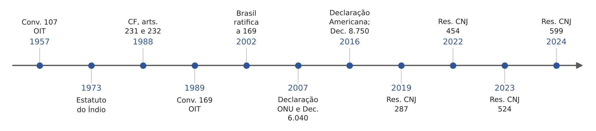
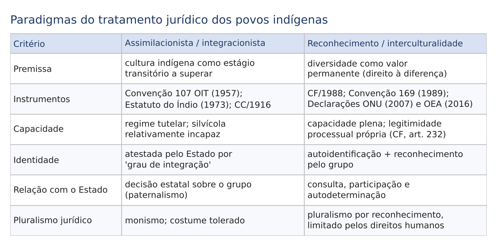
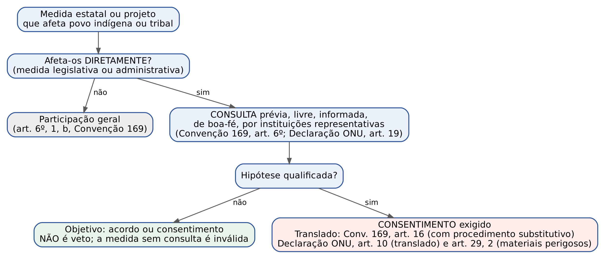
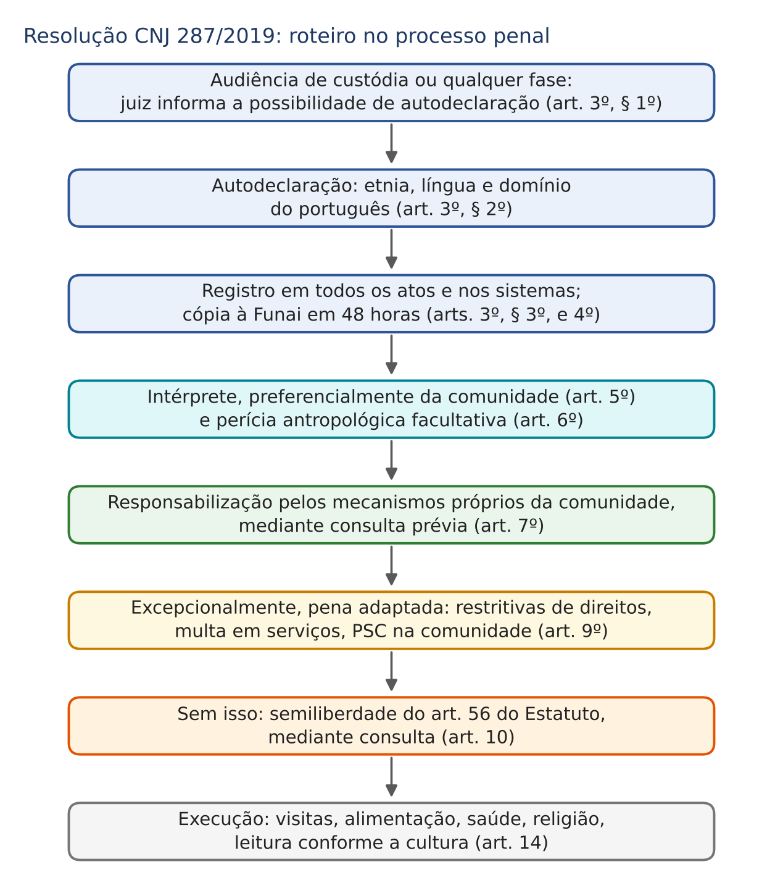
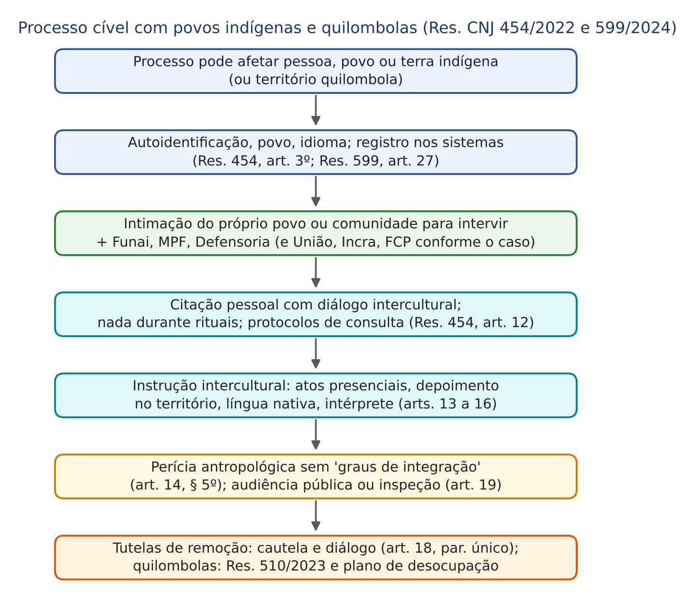
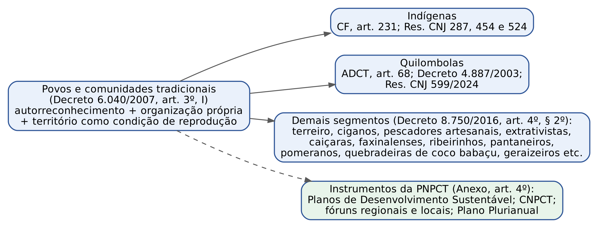

# CAPÍTULO 42 — POVOS INDÍGENAS E COMUNIDADES TRADICIONAIS: AUTODETERMINAÇÃO, CONSULTA E ACESSO À JUSTIÇA

:::INCIDENCIA
Pontos: TJRS p. H.6; TJSC p. I.6. Nível A. Lote: 10 questões (FGV 8, FCC 2), cinco delas de provas de juiz (ENAM 2024.2, 2025.1, 2025.2 e 2026.1; TJ-MS 2025; TJ-BA 2026).
O que mais cai: paradigma integracionista x paradigma do reconhecimento (Convenção 107 x Convenção 169), autoidentificação, letra da Convenção 169 (arts. 1º, 6º e 7º), letra das Resoluções CNJ 287/2019 e 454/2022, criança indígena (FUNAI obrigatória, competência estadual) e o rol dos povos e comunidades tradicionais.
:::

Mapa de cobrança do lote:

| Subtema | FGV | FCC | Padrão |
|---|---|---|---|
| Paradigmas e instrumentos internacionais | 2 | 0 | ENAM: troca de Convenção 107 por 169; "assimilacionismo fortalecido"; consulta "vedada" |
| Letra da Convenção 169 (art. 7º) | 1 | 0 | ENAM 2026.1: direito de escolher as próprias prioridades de desenvolvimento; alternativas com "obrigatoriamente" e "sempre que possível" trocados |
| Resolução CNJ 287/2019 | 1 | 0 | ENAM 2025.1: registro em todos os atos; homologação de práticas comunitárias; adaptação de "qualquer" cautelar |
| Criança indígena (ECA, art. 28, § 6º) | 2 | 0 | provas de juiz: FUNAI obrigatória sem deslocar a competência |
| Diálogo interétnico (antropologia) | 1 | 0 | simetria e construção consensual das regras |
| Povos e comunidades tradicionais e quilombolas | 1 | 2 | rol do Decreto 8.750/2016; instrumentos da PNPCT; pluralismo jurídico mitigado; ciganos, ribeirinhos e extrativistas |

Este capítulo trata do tema pelo ângulo humanístico e pelos atos normativos da magistratura. O regime constitucional das terras (art. 231, §§ 1º a 7º), a demarcação, o marco temporal (Tema 1.031, Lei 14.701/2023, ADC 87), a mineração (MI 7.516), a ADI 3.239 e a competência pelo art. 109, XI, estão na Apostila de Direito Constitucional, Cap. 38, aqui apenas referidos. O pluralismo jurídico em chave sociológica (Ehrlich, Wolkmer, Boaventura, o caso Denilson e o art. 57 do Estatuto do Índio) está no Cap. 1 (01.6); o debate universalismo x relativismo, no Cap. 27 (27.1.3); a teoria do reconhecimento de Honneth e o comunitarismo, no Cap. 17; racismo, inclusive ambiental, e o Protocolo racial (Res. CNJ 598/2024), no Cap. 28; reserva de vagas para indígenas nos concursos (Res. CNJ 203/2015, na redação da Res. 657/2025, e heteroidentificação pela Res. 512/2023, art. 8º), no Cap. 41.

## 42.1 Do integracionismo ao reconhecimento: fundamentos humanísticos

### 42.1.1 Os três paradigmas

A história do tratamento jurídico dos povos indígenas costuma ser contada em três paradigmas, e a FGV cobra exatamente essa sequência.

O primeiro é o do extermínio e da assimilação forçada, que acompanha a conquista: o indígena como obstáculo ou como mão de obra, a ser "civilizado" pela catequese e pelo trabalho.

O segundo é o paradigma INTEGRACIONISTA (ou assimilacionista em sentido estrito), dominante do século XIX até a década de 1980. A diferença cultural passa a ser vista como estágio transitório: o indígena é um "ainda não", destinado a dissolver-se na "comunhão nacional". A proteção existe, mas é tutelar e provisória, porque seu fim é a integração. São documentos desse paradigma:

- No plano internacional, a Convenção 107 da OIT (1957), sobre "populações indígenas e outras populações tribais e semitribais", que falava em "integração progressiva" à comunidade nacional e tratava essas populações como em "estágio menos adiantado" de desenvolvimento.
- No plano interno, o Código Civil de 1916 (silvícolas como relativamente incapazes, sujeitos a regime tutelar) e o Estatuto do Índio (Lei 6.001/1973).

:::LEI Lei 6.001/1973 (Estatuto do Índio), arts. 1º, 4º e 7º
Art. 1º: a lei regula a situação jurídica dos índios "com o propósito de preservar a sua cultura e integrá-los, progressiva e harmoniosamente, à comunhão nacional".
Art. 4º: os índios são considerados isolados, "em vias de integração" ou "integrados" ("quando incorporados à comunhão nacional e reconhecidos no pleno exercício dos direitos civis, ainda que conservem usos, costumes e tradições característicos da sua cultura").
Art. 7º: "Os índios e as comunidades indígenas ainda não integrados à comunhão nacional ficam sujeito ao regime tutelar estabelecido nesta Lei", exercido pela União por meio do órgão federal de assistência (§ 2º).
A literalidade do art. 1º desmente a assertiva de que o Estatuto "superou a visão integracionista": ele a positivou. O art. 9º ainda previa a "liberação do regime tutelar" mediante idade mínima de 21 anos, conhecimento da língua portuguesa, habilitação para atividade útil e "razoável compreensão dos usos e costumes da comunhão nacional".
:::

O terceiro é o paradigma do RECONHECIMENTO (ou do direito à diferença, ou da interculturalidade), inaugurado no Brasil pela Constituição de 1988 e, no plano internacional, pela Convenção 169 da OIT (1989), que reviu a 107. A diferença cultural deixa de ser estágio e passa a ser valor permanente; o Estado deixa de decidir pelo grupo e passa a dever consulta e respeito à autodeterminação; o critério de pertencimento deixa de ser o "grau de integração" atestado por terceiros e passa a ser a autoidentificação. O art. 231 da CF RECONHECE (não concede) organização social, costumes, línguas, crenças e tradições, e o art. 232 dá aos índios, suas comunidades e organizações legitimidade para ingressar em juízo, sem intermediação tutelar. O Código Civil de 2002 remeteu a capacidade dos indígenas à legislação especial (art. 4º, parágrafo único), regra que se lê à luz do art. 232 (Apostila de Direito Constitucional, Cap. 38, 38.1.1).

:::PEGADINHA Convenção 107 x Convenção 169
A 107 (1957) é a integracionista; a 169 (1989) é a do reconhecimento e da autoidentificação. A FGV inverte as datas, atribui à 107 o rompimento com o integracionismo ou diz que as normas atuais "fortalecem e aprimoram" o paradigma da 107. Também é falso que o Estatuto do Índio (1973) tenha superado o integracionismo "antes do Código Civil de 2002": seu art. 1º declara o propósito de integrar.
:::

:::QUESTAO FGV 2025 — ENAM 2025.2 — Exame Nacional da Magistratura (Q3692391)
Cobrado: qual paradigma adotam a Convenção 169, a jurisprudência interamericana, a CF/1988 e as Resoluções do CNJ. Gabarito: C (paradigma do reconhecimento, com autodeterminação, identidade cultural, direito à terra e consulta livre, prévia e informada sobre projetos que os afetem).
Armadilhas: A e B dizem que esses instrumentos "fortalecem e aprimoram" o paradigma assimilacionista da Convenção 107, sendo que B mistura esse paradigma com autodeterminação, combinação incoerente; D e E aceitam o reconhecimento, mas VEDAM a consulta (salvo remoção forçada, em D, ou em nome do interesse público com compensação financeira, em E), o que inverte o art. 6º da Convenção 169.
:::

:::QUESTAO FGV 2024 — ENAM 2024.2 — Exame Nacional da Magistratura (Q3058641)
Cobrado: história dos instrumentos internacionais e internos. Gabarito: E (a Convenção 169, de 1989, inovou ao acolher a autoidentificação como critério para reconhecer a comunidade como indígena ou tribal; art. 1º, item 2).
Armadilhas, passo a passo: (A) a Convenção 107 não rompeu com o integracionismo; ela o consagrou e via as populações tribais como menos desenvolvidas; (B) o Estatuto de 1973 é integracionista (art. 1º) e tutelar (art. 7º); (C) o pioneirismo não é interamericano: no sistema global vieram a Convenção 107 (1957), a 169 (1989) e a Declaração da ONU (2007), e a Declaração Americana só veio em 2016; (D) não há base para afirmar que a CF "confere maior proteção" que a Convenção 169, que é mais detalhada em vários pontos (consulta, participação, costumes penais) e com ela se integra.
:::

:::LEI Convenção 169 da OIT, art. 1º (Decreto 10.088/2019, Anexo LXXII)
1. A convenção aplica-se: a) aos povos TRIBAIS "cujas condições sociais, culturais e econômicas os distingam de outros setores da coletividade nacional, e que estejam regidos, total ou parcialmente, por seus próprios costumes ou tradições ou por legislação especial"; b) aos povos considerados INDÍGENAS "pelo fato de descenderem de populações que habitavam o país ou uma região geográfica pertencente ao país na época da conquista ou da colonização ou do estabelecimento das atuais fronteiras estatais" e que conservam todas as suas próprias instituições sociais, econômicas, culturais e políticas, "ou parte delas".
2. "A consciência de sua identidade indígena ou tribal deverá ser considerada como critério fundamental para determinar os grupos aos que se aplicam as disposições da presente Convenção."
3. O termo "povos" não terá "implicação alguma no que se refere aos direitos que possam ser conferidos a esse termo no direito internacional".
Pontos de prova: o critério objetivo (descendência e conservação de instituições, total ou parcial) soma-se ao subjetivo (consciência da identidade), que é o FUNDAMENTAL; a categoria "povos tribais" é a porta de entrada de quilombolas e outras comunidades tradicionais; o item 3 é a ressalva contra a leitura secessionista da palavra "povos" (ver 42.2.1).
:::

### 42.1.2 Identidade étnica: de Barth à autoidentificação

A virada da autoidentificação tem lastro antropológico preciso. Fredrik Barth (Grupos étnicos e suas fronteiras, 1969) deslocou o foco do "conteúdo cultural" para as FRONTEIRAS: o grupo étnico define-se pela autoatribuição e pela atribuição por outros, isto é, pela manutenção de uma fronteira de pertencimento, e não por um inventário de traços culturais. Daí duas consequências jurídicas: a identidade não se perde porque a cultura muda (o indígena não deixa de sê-lo por usar celular, falar português, votar ou viver na cidade), e não cabe ao Estado aferir "autenticidade" por traços. O STJ já havia antecipado a regra ao considerar discriminatória a restrição da assistência à saúde aos indígenas aldeados, porque o status de índio não depende do local em que se vive (Apostila de Direito Constitucional, Cap. 38, 38.1.1).

No Brasil, a linhagem é relevante para prova oral:

| Autor | Obra | Ideia central |
|---|---|---|
| Darcy Ribeiro | Os índios e a civilização (1970) | "transfiguração étnica": os povos mudam sob o contato, mas não se dissolvem na sociedade nacional; crítica empírica à tese da integração inevitável |
| Roberto Cardoso de Oliveira | O índio e o mundo dos brancos (1964); obras posteriores sobre etnicidade e ética | "fricção interétnica": o contato como relação de conflito e dominação, não de convivência neutra; depois, a ética discursiva aplicada ao diálogo interétnico (simetria dos interlocutores) |
| Manuela Carneiro da Cunha | Cultura com aspas (2009) | a "cultura" é também categoria reflexiva usada pelos próprios povos na arena política; identidade não é essência a ser certificada |
| Eduardo Viveiros de Castro | A inconstância da alma selvagem (2002) | perspectivismo ameríndio; crítica ao uso do "grau de aculturação" como critério de indianidade |
| Carlos Frederico Marés de Souza Filho | O renascer dos povos indígenas para o direito (1998) | o direito coletivo dos povos, oposto ao modelo individual e tutelar; a CF/1988 como "renascimento" jurídico |
| Ailton Krenak | Ideias para adiar o fim do mundo (2019) | crítica à ideia de humanidade separada da natureza; pensamento indígena como interlocutor, não como objeto |

O direito positivo incorporou o critério. A Resolução CNJ 454/2022 define autoidentificação como "a percepção e a concepção que cada povo indígena tem de si mesmo, consubstanciando critério fundamental para determinação da identidade indígena" (art. 4º) e conceitua indígena como "a pessoa que se identifica como pertencente a um povo indígena e é por ele reconhecido" (§ 1º). Note-se a dupla face: autoidentificação individual MAIS reconhecimento pelo grupo, que impede a apropriação oportunista da identidade sem transferir ao Estado o papel de certificador. O § 2º afasta a ideia de que a identidade indígena retire direitos comuns: o indígena continua titular de todos os direitos de qualquer brasileiro (ou estrangeiro, no caso de migrantes).

:::ATENCAO "Grau de integração": resíduo integracionista na jurisprudência
O STJ, em Jurisprudência em Teses, ainda registra orientações construídas sobre o grau de integração: o regime de semiliberdade do art. 56 do Estatuto "somente se aplica ao réu indígena que não foi integrado socialmente ou que esteja em fase de aculturação" (edição 233, tese 12); é "dispensável" a perícia antropológica quando, por outros elementos, se constata que o indígena "está integrado à sociedade civil" (edição 261, tese 3); a tradução da denúncia é desnecessária sem prova de hipossuficiência linguística (edição 261, tese 1).
As Resoluções do CNJ caminham em sentido oposto: a Res. 454/2022 recomenda que a admissibilidade do exame antropológico NÃO seja fundamentada "em supostos graus de integração de pessoas e comunidades indígenas à comunhão nacional" (art. 14, § 5º), e a Res. 287/2019 manda considerar os mecanismos próprios da comunidade e aplicar o art. 56 "sempre que possível", sem condicioná-lo à não integração (arts. 7º e 10). Na prova, separe: tese do STJ cobrada como tese do STJ; diretriz do CNJ cobrada como diretriz do CNJ. Em discursiva ou oral, o examinador espera que o candidato identifique a tensão e a resolva pela leitura convencional e constitucional (art. 231 da CF; art. 1º, item 2, e arts. 8º a 10 da Convenção 169).
:::

### 42.1.3 Reconhecimento, multiculturalismo e interculturalidade

A passagem ao terceiro paradigma tem fundamento filosófico próprio, que a banca pode cobrar por atribuição de autor.

- Charles Taylor (A política do reconhecimento, 1992): o não reconhecimento é forma de opressão, e a "política da diferença" tensiona a "política da dignidade igual" (desenvolvido no Cap. 26, 26.10; Honneth e Fraser no Cap. 17).
- Will Kymlicka (Cidadania multicultural, 1995; Cap. 26, 26.10): defesa LIBERAL de direitos diferenciados por grupo, que distingue minorias NACIONAIS (como os indígenas) de grupos ÉTNICOS imigrantes e direitos de autogoverno, poliétnicos e de representação especial. Distingue ainda "proteções externas" (contra decisões da sociedade majoritária, legítimas) de "restrições internas" (do grupo contra seus próprios membros, em princípio ilegítimas). Essa última distinção é a chave liberal do limite do art. 8º, item 2, da Convenção 169: costumes próprios valem enquanto não violarem direitos fundamentais dos membros.
- Interculturalidade: o multiculturalismo descreve a coexistência de culturas; a interculturalidade exige diálogo e transformação recíproca das instituições. Boaventura de Sousa Santos propõe a "hermenêutica diatópica" (diálogo entre os "topoi" de culturas diferentes, consciente da incompletude de cada uma) e a ecologia de saberes (Cap. 1, 01.6); Catherine Walsh fala em interculturalidade crítica, que questiona a matriz colonial do poder (Aníbal Quijano, "colonialidade do poder").
- Novo constitucionalismo latino-americano: Colômbia (1991) reconheceu jurisdição especial indígena; Equador (2008) e Bolívia (2009) declararam o Estado plurinacional e os direitos da natureza. A CF/1988 NÃO instituiu Estado plurinacional nem jurisdição indígena autônoma; admite pluralismo jurídico MITIGADO, por reconhecimento, sob a unidade constitucional e os direitos fundamentais (Cap. 1, 01.6.3; Apostila de Direito Constitucional, Cap. 38, 38.1.2).

O direito positivo incorporou a interculturalidade como procedimento. A Res. CNJ 454/2022 define "diálogo interétnico e intercultural" como "instrumentos de aproximação entre a atuação dos órgãos que integram o Sistema de Justiça (...) com as diferentes culturas e as variadas formas de compreensão da justiça e dos direitos, inclusive mediante a adoção de rotinas e procedimentos diferenciados" (art. 5º); a Res. 599/2024 repete a fórmula para quilombolas (art. 5º).

:::QUESTAO FGV 2026 — MPE-ES — Agente Técnico — Antropólogo (Q4217668)
Cobrado: o diálogo interétnico legítimo pressupõe simetria entre os interlocutores e construção consensual das regras; qual negociação Estado x povos indígenas atende a essas condições. Gabarito: D (técnicos e lideranças indígenas tomam igualmente parte na estruturação do processo e na adoção dos encaminhamentos).
Armadilhas: A inverte a assimetria (as lideranças ditam as regras; continua não havendo simetria); B e E são participação decorativa, em que o Estado registra manifestações e as "adequa" a exigências administrativas ou "incorpora elementos da cultura" a projeto já desenhado; C é consulta sem simetria, porque os parâmetros são fixados unilateralmente pelo órgão governamental. A ideia é a ética discursiva aplicada ao contato interétnico (Cardoso de Oliveira, a partir de Habermas e Apel): legitimidade exige igualdade na definição das próprias regras do diálogo, não só na fala dentro delas. É o mesmo padrão que distingue consulta de boa-fé de mera audiência formal (42.2.3).
:::

:::EXEMPLO Juiz em audiência pública em terra indígena
Situação: em ação civil pública sobre fornecimento de água a uma aldeia, o juiz designa audiência pública no território e pretende fixar, sozinho e por portaria, horário, ordem de falas e tempo de cada orador, nos moldes do fórum.
Solução: a Res. CNJ 454/2022 admite audiências públicas e inspeções sempre que a escuta da comunidade seja relevante, "respeitadas as formas de organização e deliberação do grupo" (art. 19), e manda que sua organização em territórios indígenas seja feita "em conjunto com a comunidade, de forma a respeitar seus ritos e tradições, sem prejuízo da observância das formalidades processuais" (parágrafo único). O juiz deve construir o formato com as lideranças (inclusive a língua e a presença de intérprete), preservando o contraditório e a documentação do ato. A conduta preserva a imparcialidade e a cortesia exigidas pelo Código de Ética (Cap. 12) e evita que o ato judicial reproduza a assimetria que a resolução quer desfazer.
:::

## 42.2 Autodeterminação e instrumentos internacionais

### 42.2.1 Autodeterminação interna x externa

O direito dos povos à autodeterminação aparece no art. 1º comum aos dois Pactos de 1966 (PIDCP e PIDESC). Aplicado aos povos indígenas, firmou-se a distinção entre:

- autodeterminação EXTERNA: direito de constituir Estado próprio ou de definir o status internacional; historicamente associada à descolonização;
- autodeterminação INTERNA: direito de determinar livremente a condição política e o desenvolvimento econômico, social e cultural DENTRO do Estado, com autonomia ou autogoverno nos assuntos internos e locais, participação nas decisões que os afetam e controle sobre o próprio desenvolvimento.

Os instrumentos indígenas reconhecem a autodeterminação interna e afastam expressamente a leitura separatista: a Convenção 169 neutraliza o termo "povos" (art. 1º, item 3) e a Declaração da ONU ressalva a integridade territorial e a unidade política dos Estados (art. 46, item 1).

:::LEI Declaração das Nações Unidas sobre os Direitos dos Povos Indígenas (2007), arts. 3º, 4º, 5º e 46, item 1
Art. 3º: "Os povos indígenas têm direito à autodeterminação. Em virtude desse direito determinam livremente sua condição política e buscam livremente seu desenvolvimento econômico, social e cultural."
Art. 4º: no exercício desse direito, têm "direito à autonomia ou ao autogoverno nas questões relacionadas a seus assuntos internos e locais, assim como a disporem dos meios para financiar suas funções autônomas".
Art. 5º: direito de "conservar e reforçar suas próprias instituições políticas, jurídicas, econômicas, sociais e culturais, mantendo ao mesmo tempo seu direito de participar plenamente, caso o desejem, da vida política, econômica, social e cultural do Estado".
Art. 46, item 1: nada na Declaração autoriza ou fomenta ação "direcionada a desmembrar ou a reduzir, total ou parcialmente, a integridade territorial ou a unidade política de Estados soberanos e independentes".
:::

A Res. CNJ 454/2022 incluiu a autodeterminação entre seus princípios, "especialmente dos povos em isolamento voluntário" (art. 2º, VI), e lhe deu a consequência mais radical: a política de não contato. O Judiciário deve garantir a não aproximação por terceiros aos povos isolados, "uma vez que a eventual iniciativa de contato deve partir exclusivamente desses povos" (art. 8º), considerando suas vulnerabilidades epidemiológica, territorial, demográfica, sociocultural e política (§ 1º) e os princípios da precaução e da prevenção (§ 2º). Havendo indício de que o processo pode afetar povos ou terras indígenas, a FUNAI deve informar se o caso atinge, ainda que potencialmente, povos isolados ou de recente contato e se há restrição de uso vigente (art. 9º); as informações da FUNAI sobre esses povos integram o SireneJud (art. 25). O dever estatal positivo de proteção territorial dos isolados foi desenvolvido pelo STF na ADPF 709 (Apostila de Direito Constitucional, Cap. 38, 38.7.2).

### 42.2.2 Os quatro instrumentos e sua natureza

| Instrumento | Natureza e incorporação | Núcleo | O que a banca explora |
|---|---|---|---|
| Convenção 107 da OIT (1957) | tratado; revisto pela 169 | proteção com vistas à integração progressiva | é o paradigma superado; não é "aprimorada" pelas normas atuais |
| Convenção 169 da OIT (1989) | tratado; DL 143/2002, ratificação em 25/7/2002, promulgação pelo Decreto 5.051/2004, hoje consolidada no Decreto 10.088/2019, Anexo LXXII; status supralegal | autoidentificação, consulta, participação, prioridades de desenvolvimento, costumes, terras | letra dos arts. 1º, 6º, 7º, 8º a 10 e 16; "deverão" x "poderão" |
| Declaração da ONU sobre os Direitos dos Povos Indígenas (2007) | resolução da Assembleia Geral, aprovada em 13/9/2007; não é tratado; parâmetro interpretativo (*soft law*) invocado pela Corte IDH, pelo STF e pelo CNJ | autodeterminação, autogoverno, consentimento livre, prévio e informado em hipóteses qualificadas, sistemas jurídicos próprios | autodeterminação (art. 3º); consentimento x consulta |
| Declaração Americana sobre os Direitos dos Povos Indígenas (OEA, 2016) | resolução da Assembleia Geral da OEA; não é tratado | mesmos eixos, com proteção expressa dos povos em isolamento voluntário (art. XXVI) e transfronteiriços | posterior à Declaração da ONU; desmente "pioneirismo interamericano" |

A incorporação da Convenção 169 e o seu status supralegal (RE 466.343) estão desenvolvidos na Apostila de Direito Constitucional (Cap. 38, 38.8.1). Mecanismos de monitoramento no sistema global: Relator Especial da ONU sobre os direitos dos povos indígenas (cuja missão de 2016 ao Brasil é citada nos considerandos das Res. CNJ 287 e 454), Mecanismo de Peritos sobre os Direitos dos Povos Indígenas e Fórum Permanente da ONU sobre Questões Indígenas; no sistema interamericano, petições à Comissão e, depois, à Corte IDH.

:::LEI Convenção 169 da OIT, art. 7º
1. "Os povos interessados deverão ter o direito de escolher suas, próprias prioridades no que diz respeito ao processo de desenvolvimento, na medida em que ele afete as suas vidas, crenças, instituições e bem-estar espiritual, bem como as terras que ocupam ou utilizam de alguma forma, e de controlar, na medida do possível, o seu próprio desenvolvimento econômico, social e cultural. Além disso, esses povos deverão participar da formulação, aplicação e avaliação dos planos e programas de desenvolvimento nacional e regional suscetíveis de afetá-los diretamente."
2. A melhoria das condições de vida e de trabalho e do nível de saúde e educação, com a participação e cooperação dos povos, "deverá ser prioritária nos planos de desenvolvimento econômico global das regiões onde eles moram".
3. Os governos deverão zelar para que, "sempre que for possível", sejam efetuados estudos junto aos povos para avaliar a incidência social, espiritual e cultural e sobre o meio ambiente das atividades de desenvolvimento previstas; os resultados são "critérios fundamentais" para a execução.
4. Medidas, em cooperação com os povos, para proteger e preservar o meio ambiente dos territórios que habitam.
(Texto conferido no Decreto 5.051/2004, revogado e consolidado no Decreto 10.088/2019, com idêntico teor; a vírgula após "suas" está no original.)
:::

:::QUESTAO FGV 2026 — ENAM 2026.1 — Exame Nacional da Magistratura (Q4102427)
Cobrado: grupo de estudo federal vai definir a política indigenista para uma região; as lideranças invocam a Convenção 169. Gabarito: B (direito dos povos de escolher as próprias prioridades no processo de desenvolvimento, na medida em que afete vidas, crenças, instituições, bem-estar espiritual e terras; letra do art. 7º, item 1).
Armadilhas, uma por alternativa, todas por troca de modalizador ou de fase:
- A: estudos de impacto "obrigatoriamente" efetuados; o item 3 diz "sempre que for possível" (e acrescenta o impacto sobre o meio ambiente).
- C: melhoria das condições de vida buscada "sempre que possível"; o item 2 diz que ela "deverá ser prioritária".
- D: separa formulação e avaliação e assegura participação só na avaliação "sempre que possível"; o item 1 garante participação na formulação, aplicação e avaliação.
- E: direito ao trabalho "segmentado" dos demais direitos econômicos, sociais e culturais; criação da banca, sem base no texto.
Lição: no art. 7º, a regra cogente é a escolha das prioridades e a participação em todas as fases; o "sempre que for possível" está nos estudos de impacto.
:::

### 42.2.3 Consulta e consentimento

O conteúdo dogmático da consulta (atributos prévia, livre, informada, de boa-fé, por instituições representativas; "deverão" x "poderão"; consulta x oitiva do art. 231, § 3º; exigência como condição de validade em concessões, intervenções no usufruto e lavra) está na Apostila de Direito Constitucional (Cap. 38, 38.8). Aqui interessam a distinção entre consulta e consentimento e a leitura humanística da consulta como procedimento de reconhecimento.

A Convenção 169 impõe o dever de CONSULTAR "cada vez que sejam previstas medidas legislativas ou administrativas suscetíveis de afetá-los diretamente" (art. 6º, item 1, a), "com o objetivo de se chegar a um acordo e conseguir o consentimento" (item 2). O consentimento é a FINALIDADE, não condição de validade da medida; a Convenção só exige consentimento no translado (art. 16, item 2), e mesmo aí admite procedimento substitutivo. A Declaração da ONU é mais intensa: os Estados consultarão "a fim de obter seu consentimento livre, prévio e informado antes de adotar e aplicar medidas legislativas e administrativas que os afetem" (art. 19) e antes de aprovar projeto que afete terras, territórios e recursos, especialmente minerais e hídricos (art. 32, item 2), e EXIGE consentimento em duas hipóteses: translado ("Nenhum traslado se realizará sem o consentimento livre, prévio e informado", com acordo prévio de indenização e, sempre que possível, opção de regresso; art. 10) e armazenamento ou eliminação de materiais perigosos nas terras indígenas (art. 29, item 2).

:::DICA Como responder "a consulta é direito de veto?"
Resposta segura para objetiva: NÃO, pela Convenção 169 e pela jurisprudência do STF; a consulta deve ser de boa-fé e visar o acordo, e a medida tomada sem consulta, quando exigível, é inválida. Para discursiva e oral, acrescente: a Corte IDH, no caso Saramaka vs. Suriname (2007), afirmou que, em projetos de grande escala com impacto profundo sobre o território, o Estado tem o dever não só de consultar, mas de obter o consentimento; e a Declaração da ONU exige consentimento no translado e no depósito de materiais perigosos. O espectro é: participação geral, consulta, consentimento qualificado.
:::

Os PROTOCOLOS AUTÔNOMOS (ou comunitários) DE CONSULTA são documentos elaborados pelos próprios povos dizendo como querem ser consultados: quem fala pela comunidade, em que língua, em quantas reuniões, com que prazos internos de deliberação. São a expressão prática da autodeterminação no procedimento, e o CNJ lhes deu efeito no processo judicial: na comunicação de atos processuais, "observar-se-ão os protocolos de consulta estabelecidos com o povo ou comunidade a ser citado, que sejam de conhecimento do juízo ou estejam disponíveis para consulta na rede mundial de computadores" (Res. 454/2022, art. 12, § 2º); a coleta de depoimento no território observará, quando viável, "as definições do Protocolo Comunitário de Consulta Livre, Prévia e Informada, caso a comunidade possua" (Res. 599/2024, art. 15).

### 42.2.4 Corte Interamericana: os casos que a banca cita

| Caso | Data | Ponto cobrável |
|---|---|---|
| Comunidade Mayagna (Sumo) Awas Tingni vs. Nicarágua | 2001 | primeira afirmação da propriedade COLETIVA indígena como protegida pelo art. 21 da CADH, interpretado evolutivamente |
| Povo Saramaka vs. Suriname | 2007 | povo tribal (afrodescendente) titular dos mesmos direitos territoriais; consulta e, em grandes projetos, consentimento; estudo de impacto e participação nos benefícios |
| Povo Indígena Kichwa de Sarayaku vs. Equador | 2012 | consulta como princípio geral de direito internacional; ilicitude de exploração petrolífera sem consulta |
| Povo Indígena Xucuru e seus membros vs. Brasil | 2018 | primeira condenação do Brasil em caso indígena: demora excessiva na demarcação e na desintrusão; insegurança da posse apesar da titulação formal |
| Comunidades Quilombolas de Alcântara vs. Brasil | sentença de 21/11/2024, notificada em 13/3/2025 | propriedade coletiva, autodeterminação, consulta prévia e não discriminação; reconhecimento parcial de responsabilidade pelo Estado; reparações incluem título coletivo e consultas prévias |

No caso Alcântara, a Corte declarou o Brasil responsável por não titular coletivamente o território (titulou individualmente), por não garantir o uso pleno do território durante as "janelas de lançamento" do Centro de Lançamento de Alcântara e por não realizar consulta livre, prévia e informada; considerou a omissão estatal discriminatória num contexto de desigualdades históricas e determinou, entre outras medidas, emissão de título coletivo para 78.105 hectares, mesa de diálogo permanente e consultas prévias (comunicado oficial da Corte IDH). A FGV, na prova de juiz federal do TRF2 de 2026 (Q3996912, alternativa D, errada; questão classificada no Cap. 40), afirmou que a Corte teria afastado a responsabilidade porque a instalação foi precedida de consulta: falso duas vezes, pois a falta de consulta foi justamente uma das violações reconhecidas e houve condenação.

As Resoluções do CNJ institucionalizaram o diálogo com o sistema interamericano: quando o CNJ for instado a implementar deliberações da Corte IDH, os povos e comunidades afetados serão ouvidos pela Unidade de Monitoramento e Fiscalização instituída pela Res. CNJ 364/2021 (Res. 454/2022, art. 22; Res. 599/2024, art. 28), e a Res. 599 estimula a aplicação da jurisprudência interamericana nos julgamentos sobre territórios quilombolas (art. 1º, X).

:::PRATIQUE Exercícios elaborados para esta apostila (não são questões de banca)
1. Julgue: "A Declaração da ONU sobre os Direitos dos Povos Indígenas, por ter sido ratificada pelo Brasil, tem status supralegal e exige consentimento prévio para qualquer medida administrativa que afete povos indígenas."
2. Julgue: "A autodeterminação reconhecida aos povos indígenas pela Declaração da ONU compreende o direito à autonomia nos assuntos internos e locais, mas não autoriza ação voltada a desmembrar a integridade territorial do Estado."
3. Julgue: "A primeira condenação do Brasil pela Corte IDH em caso envolvendo povo indígena foi o caso Comunidades Quilombolas de Alcântara."
Resolução: 1. Errado: a Declaração é resolução da Assembleia Geral, não tratado (não há ratificação nem status supralegal); e o art. 19 fala em consultar "a fim de obter" o consentimento, que só é exigido em hipóteses qualificadas (arts. 10 e 29, item 2). 2. Certo (arts. 4º e 46, item 1). 3. Errado: foi o caso Xucuru (2018); Alcântara envolve comunidades quilombolas, tuteladas como povo tribal.
:::

## 42.3 Acesso à justiça dos povos indígenas: as Resoluções do CNJ

### 42.3.1 Visão de conjunto

O CNJ construiu, entre 2019 e 2024, um microssistema de normas procedimentais para pessoas e povos indígenas e comunidades quilombolas. As resoluções repetem a mesma gramática (autoidentificação, registro, intérprete, perícia antropológica, mecanismos próprios, consulta, formação de magistrados) aplicada a ambientes processuais distintos.

| Ato | Ementa (síntese) | Âmbito | Destaques |
|---|---|---|---|
| Res. 287, de 25/6/2019 | tratamento das pessoas indígenas acusadas, rés, condenadas ou privadas de liberdade | criminal e execução penal | autodeclaração; Funai em 48 horas; perícia antropológica; mecanismos próprios; semiliberdade; prisão domiciliar no território |
| Res. 454, de 22/4/2022 | diretrizes e procedimentos para efetivar o acesso ao Judiciário de pessoas e povos indígenas | todos os processos (ênfase cível e infância) | seis princípios; intervenção do próprio povo; prerrogativas da Fazenda Pública; perícia sem "graus de integração"; povos isolados; crianças indígenas |
| Res. 524, de 27/9/2023 | adolescentes e jovens indígenas em apuração de ato infracional e medidas socioeducativas | Justiça da Infância e Juventude | internação provisória de "extrema excepcionalidade"; meio aberto adaptado; semiliberdade como medida fechada preferencial |
| Res. 599, de 13/12/2024 | Política Judiciária de Atenção às Comunidades Quilombolas | todos os processos com quilombolas | oito princípios; consulta no processo; Res. 510/2023 em conflitos fundiários; campo "quilombola" nos sistemas; honorários periciais (Res. 232/2016, art. 2º-A) |

Completam o quadro a Res. CNJ 299/2019 (depoimento especial, com exigência de protocolo para as especificidades de povos e comunidades tradicionais, referida pelas Res. 454, art. 21, § 3º, 524, art. 7º, parágrafo único, e 599, art. 26, § 3º), a Res. CNJ 213/2015 (audiência de custódia, Protocolo I sobre medidas cautelares alternativas) e o Fórum Nacional do Poder Judiciário para Monitoramento e Efetividade das Demandas Relacionadas aos Povos Indígenas (Fonepi), instituído pela Res. CNJ 453, de 22/4/2022, e reestruturado pela Res. CNJ 489, de 28/2/2023, que o pôs sob a presidência de Conselheiro designado pelo Plenário, criou Comitê Executivo de magistrados (art. 3º-A) e incluiu na composição organizações indígenas (Apib e Coiab), o Ministério dos Povos Indígenas e a Funai (art. 3º, § 1º).

### 42.3.2 Resolução CNJ 287/2019 (âmbito criminal)

O sistema penal é onde a assimetria intercultural produz os efeitos mais graves: réu que não compreende a acusação, encarceramento que destrói o vínculo comunitário, pena que ignora a sanção já imposta pela comunidade. A Res. 287 enfrenta isso com base nos arts. 8º a 10 da Convenção 169 (costumes, métodos tradicionais de repressão e preferência por sanções diversas do encarceramento) e nos arts. 56 e 57 do Estatuto do Índio. A visão sintética, no plano penal, está na Apostila de Direito Penal (Cap. 1, 01.11.1); aqui vai a letra que cai.

:::LEI Resolução CNJ 287/2019, arts. 2º a 6º
Art. 2º: aplica-se a todas as pessoas que se identifiquem como indígenas, "brasileiros ou não, falantes tanto da língua portuguesa quanto de línguas nativas, independentemente do local de moradia, em contexto urbano, acampamentos, assentamentos, áreas de retomada, terras indígenas regularizadas e em diferentes etapas de regularização fundiária".
Art. 3º: o reconhecimento "se dará por meio da autodeclaração, que poderá ser manifestada em qualquer fase do processo criminal ou na audiência de custódia". § 1º: diante de indícios, o juiz deverá cientificar a pessoa da possibilidade de autodeclaração e informá-la das garantias. § 2º: o juiz indagará etnia, língua falada e grau de conhecimento do português. § 3º: cópias dos autos à regional da Funai mais próxima "em até 48 (quarenta e oito) horas".
Art. 4º: "A identificação da pessoa como indígena, bem como informações acerca de sua etnia e língua por ela falada, deverão constar no registro de todos os atos processuais." § 2º: especialmente da ata da audiência de custódia (art. 7º da Res. 213/2015).
Art. 5º: o juiz "buscará garantir" intérprete, "preferencialmente membro da própria comunidade indígena", em todas as etapas: se a língua não for a portuguesa; se houver dúvida sobre o domínio do vernáculo, inclusive quanto ao significado dos atos; a pedido da defesa ou da Funai; ou a pedido de pessoa interessada.
Art. 6º: ao receber denúncia ou queixa, o juiz "poderá determinar, sempre que possível, de ofício ou a requerimento das partes", perícia antropológica, com conteúdo mínimo: qualificação, etnia e língua; circunstâncias pessoais, culturais, sociais e econômicas; usos, costumes e tradições da comunidade; o entendimento da comunidade sobre a conduta imputada e seus mecanismos próprios de julgamento e punição; outras informações. Laudo por antropólogo, cientista social ou outro profissional com conhecimento específico.
:::

:::LEI Resolução CNJ 287/2019, arts. 7º a 13
Art. 7º: "A responsabilização de pessoas indígenas deverá considerar os mecanismos próprios da comunidade indígena a que pertença a pessoa acusada, mediante consulta prévia." Parágrafo único: "A autoridade judicial poderá adotar ou homologar práticas de resolução de conflitos e de responsabilização em conformidade com costumes e normas da própria comunidade indígena, nos termos do art. 57 da Lei nº 6.001/73".
Art. 8º: "Quando da imposição de QUALQUER medida cautelar alternativa à prisão, a autoridade judicial deverá adaptá-la às condições e aos prazos que sejam compatíveis com os costumes, local de residência e tradições da pessoa indígena, observando o Protocolo I da Resolução CNJ nº 213/2015."
Art. 9º: "Excepcionalmente, não sendo o caso do art. 7º", na pena e no regime, considerar características culturais, sociais e econômicas, declarações e perícia, para: aplicar restritivas de direitos adaptadas; considerar a conversão da multa em prestação de serviços à comunidade, nos termos da lei; determinar a PSC, sempre que possível e mediante consulta prévia, em comunidade indígena.
Art. 10: não sendo possível o disposto nos arts. 7º e 9º, aplicar, "sempre que possível e mediante consulta à comunidade indígena, o regime especial de semiliberdade previsto no art. 56 da Lei nº 6.001/1973", para reclusão e detenção.
Art. 11: para a prisão domiciliar, "considerar-se-á como domicílio o território ou circunscrição geográfica de comunidade indígena, quando compatível e mediante consulta prévia".
Art. 13: a prisão domiciliar da mulher indígena mãe, gestante ou responsável por criança ou pessoa com deficiência (CPP, art. 318-A) "será cumprida na comunidade"; o acompanhamento da progressão será feito em conjunto com a comunidade.
:::

A estrutura da resposta penal é escalonada e merece ser memorizada na ordem: (1) mecanismos próprios da comunidade, com consulta (art. 7º); (2) excepcionalmente, pena estatal culturalmente adaptada (art. 9º); (3) na impossibilidade das anteriores, semiliberdade do art. 56 do Estatuto (art. 10). Na execução, o juízo fiscaliza assistência material, à saúde, jurídica, educacional, social e religiosa conforme a especificidade cultural: visitas segundo as formas de parentesco da etnia e em dias diferenciados, alimentação conforme os costumes (inclusive vinda de fora), saúde pelos parâmetros da política de atenção à saúde indígena, representante da religião indígena, trabalho respeitando a cultura e remição por leitura respeitando o idioma (art. 14). Os tribunais devem manter cadastro de intérpretes e de peritos antropólogos (art. 15).

:::LEI Lei 6.001/1973, arts. 56 e 57
Art. 56: "No caso de condenação de índio por infração penal, a pena deverá ser atenuada e na sua aplicação o Juiz atenderá também ao grau de integração do silvícola." Parágrafo único: "As penas de reclusão e de detenção serão cumpridas, se possível, em regime especial de semiliberdade, no local de funcionamento do órgão federal de assistência aos índios mais próximos da habitação do condenado."
Art. 57: "Será tolerada a aplicação, pelos grupos tribais, de acordo com as instituições próprias, de sanções penais ou disciplinares contra os seus membros, desde que não revistam caráter cruel ou infamante, proibida em qualquer caso a pena de morte."
Leitura humanística: o art. 56 conserva a gramática integracionista ("grau de integração do silvícola"); a Res. 287 aproveita seu conteúdo útil (atenuação e semiliberdade) e o relê pela autodeclaração (ver o ATENCAO em 42.1.2). O art. 57 é a matriz do pluralismo por reconhecimento (Cap. 1, 01.6.3).
:::

:::QUESTAO FGV 2025 — ENAM 2025.1 — Exame Nacional da Magistratura (Q3362341)
Cobrado: três afirmações sobre as Resoluções do CNJ relativas a povos indígenas. Gabarito: B (I e II corretas).
Passo a passo:
- I, certa: identificação como indígena, etnia e língua "deverão constar no registro de todos os atos processuais" (Res. 287, art. 4º).
- II, certa: o juiz "poderá adotar ou homologar práticas de resolução de conflitos e de responsabilização em conformidade com costumes e normas da própria comunidade indígena" (art. 7º, parágrafo único).
- III, errada: a afirmação EXCLUI da adaptação a medida cautelar alternativa à prisão ("com exceção da imposição de medida cautelar..."), quando o art. 8º manda adaptar justamente "qualquer medida cautelar alternativa à prisão", observado o Protocolo I da Res. 213/2015.
Armadilha: a exceção inventada em III é o tipo de alteração mínima que a FGV usa para testar leitura da letra. O dado do enunciado (Censo 2022: indígenas em 4.833 dos 5.570 municípios, mais da metade nas cidades) é contexto, que reforça o art. 2º da Res. 287: a proteção independe do local de moradia.
:::

:::SENTENCA Dosimetria e regime para réu indígena (Res. CNJ 287/2019)
"O acusado autodeclarou-se indígena do povo X na audiência de custódia, falante da língua X e com domínio parcial do português, informação que constou de todos os atos (Res. CNJ 287/2019, arts. 3º e 4º), e foi assistido por intérprete da comunidade (art. 5º). A perícia antropológica (art. 6º) e a manifestação das lideranças, colhida em consulta prévia, indicam que a comunidade não dispõe de mecanismo próprio de responsabilização para o fato, afastando a solução do art. 7º. Na fixação da pena, considero as características culturais e socioeconômicas descritas no laudo (Convenção 169 da OIT, art. 10, item 1) e aplico a atenuação do art. 56 da Lei 6.001/1973. Presentes os requisitos legais, substituo a pena privativa de liberdade por prestação de serviços à comunidade, a ser cumprida na própria comunidade indígena, conforme plano ajustado com as lideranças e a Funai (Res. 287, art. 9º, I e III), dando preferência a sanção diversa do encarceramento (Convenção 169, art. 10, item 2)."
Cuidado: a jurisprudência do STJ ainda condiciona a semiliberdade do art. 56 à não integração (edição 233 de Jurisprudência em Teses, tese 12); se for afastá-la, fundamente na autodeclaração, no laudo e nos arts. 8º a 10 da Convenção 169.
:::

:::EXEMPLO Réu urbano que se autodeclara indígena no interrogatório
Situação: acusado de furto, morador de bairro periférico de capital, fluente em português, declara-se indígena Kaingang apenas no interrogatório. O MP pede que a declaração seja desconsiderada, porque nada nos autos indicava a condição e o réu "vive como qualquer cidadão urbano".
Solução: a autodeclaração pode ocorrer "em qualquer fase do processo criminal" (Res. 287, art. 3º) e alcança indígenas "independentemente do local de moradia, em contexto urbano" (art. 2º). O juiz deve indagar etnia, língua e domínio do português (art. 3º, § 2º), registrar a informação (art. 4º), remeter cópias à Funai em 48 horas (art. 3º, § 3º) e avaliar a perícia antropológica (art. 6º). O domínio do português pode dispensar intérprete (art. 5º, I e II, a contrario), mas não desfaz a identidade. Dúvida séria sobre a veracidade se resolve pelo reconhecimento do grupo (Res. 454, art. 4º, § 1º: "e é por ele reconhecido"), não por critério de "aparência" ou "grau de integração".
:::

### 42.3.3 Resolução CNJ 454/2022 (acesso à justiça em geral)

A Res. 454 é o estatuto processual geral dos povos indígenas no Judiciário. Seus seis princípios são o esqueleto de qualquer resposta discursiva:

:::LEI Resolução CNJ 454/2022, art. 2º
"Esta Resolução é regida pelos seguintes princípios: I – autoidentificação dos povos; II – diálogo interétnico e intercultural; III – territorialidade indígena; IV – reconhecimento da organização social e das formas próprias de cada povo indígena para resolução de conflitos; V – vedação da aplicação do regime tutelar; e VI – autodeterminação dos povos indígenas, especialmente dos povos em isolamento voluntário."
:::

Cada princípio recebe definição própria: autoidentificação (art. 4º, ver 42.1.2), diálogo interétnico e intercultural (art. 5º, ver 42.1.3), territorialidade indígena ("relação singular desses povos com os espaços necessários à sua reprodução física e cultural; aspectos sociais e econômicos; e valores simbólicos e espirituais, sejam eles utilizados de forma permanente ou temporária", art. 6º), vedação do regime tutelar (art. 7º) e respeito aos povos isolados (arts. 8º e 9º, ver 42.2.1).

A vedação do regime tutelar é o princípio de maior densidade humanística: corresponde a ações de "reconhecimento da capacidade processual indígena" e ao "dimensionamento adequado das atribuições dos órgãos e entes responsáveis por políticas indigenistas, os quais não substituem a legitimidade direta dos indígenas, suas comunidades e organizações" (art. 7º); e "a atuação da Funai ou do Ministério Público Federal em causas sobre direitos indígenas não supre a necessidade de manifestação do povo interessado" (parágrafo único). É a tradução processual da passagem do "falar por" ao "ouvir".

Regras processuais do Capítulo II, as mais cobráveis:

| Tema | Regra | Dispositivo |
|---|---|---|
| Capacidade de ser parte | ingresso em juízo de povos, comunidades e organizações "independe de prévia constituição formal como pessoa jurídica"; autonomia para constituir advogado ou ser assistido pela Defensoria | art. 10 |
| Prerrogativas | estendem-se aos interesses indígenas as prerrogativas da Fazenda Pública quanto a impenhorabilidade de bens, rendas e serviços, ações especiais, prazos, juros e custas (Lei 6.001, art. 40 c/c art. 61) | art. 11 |
| Citação | preferência pela forma PESSOAL; MP e Defensoria não dispensam a intimação do próprio povo, ressalvados isolados e de recente contato; comunicação por diálogo intercultural; protocolos de consulta | art. 12, caput e §§ 1º e 2º |
| Rituais | nenhum ato de comunicação processual durante cultos, cerimônias ou rituais, salvo para evitar perecimento de direito | art. 12, § 4º |
| Intervenção | ingresso de indígenas, comunidades ou organizações "a qualquer tempo e em qualquer grau de jurisdição" | art. 12, § 5º |
| Instrução | compatibilizar regras processuais com organização social, cultura, usos e costumes; linguagem clara, escuta ativa | art. 13 |
| Perícia | exames técnicos por antropólogo de qualificação reconhecida, preferindo quem conheça o povo; laudo com trabalho preferencialmente *in loco* e entrevistas; nos processos criminais, também os requisitos do art. 6º da Res. 287; não fundar a admissibilidade em "graus de integração" | art. 14 |
| Forma dos atos | priorizar atos presenciais; depoimento, sempre que possível e conveniente, no território do depoente | art. 15 |
| Língua | recomenda-se depoimento na língua nativa; intérprete preferencialmente da comunidade, podendo ser não indígena indicado pelo povo | art. 16 |
| Intimações institucionais | MP e Funai intimados para manifestar interesse; falta ou insuficiência de representação: Defensoria | art. 17; art. 3º, VII e VIII |
| Terras | ações, inclusive possessórias, que alcancem terras tradicionalmente ocupadas: ciência ao povo, diálogo intercultural, ofícios à Funai e ao Incra; cautela em tutelas de urgência que impliquem remoção | art. 18 |
| Escuta coletiva | audiências públicas ou inspeções judiciais, organizadas com a comunidade | art. 19 |

:::PEGADINHA Funai e MPF não "representam" o povo
Afirmação típica: "Nos processos sobre direitos indígenas, a intervenção da Funai e do MPF supre a manifestação da comunidade afetada." Falsa: o art. 7º, parágrafo único, da Res. 454 diz o contrário, e o art. 12, § 1º, exige a intimação do próprio povo mesmo com atuação do MP e da Defensoria (salvo isolados e de recente contato). O fundamento constitucional é o art. 232 (legitimidade própria), e a intervenção do MP em todos os atos do processo não converte o MP em substituto processual obrigatório (Apostila de Direito Constitucional, Cap. 38, 38.10.1).
:::

:::EXEMPLO Reintegração de posse contra acampamento indígena
Situação: proprietário rural ajuíza reintegração de posse, com pedido liminar, contra "invasores" de sua área; a inicial não menciona que os ocupantes se declaram Guarani e que a área é reivindicada como tradicional.
Solução, em passos: (1) constatada a presença indígena, aplicar o art. 18 da Res. 454: ciência ao povo, diálogo intercultural e ofícios à Funai e ao Incra sobre a situação jurídica das terras; (2) intimar o MPF, a Funai e, sendo o caso, a União (art. 3º, VII; art. 17), o que pode deslocar a competência para a Justiça Federal se houver disputa sobre direitos indígenas ou interesse jurídico federal (Apostila de Direito Constitucional, Cap. 38, 38.10.2; Apostila de Processo Civil, Cap. 35); (3) citação pessoal, por diálogo intercultural, fora de rituais (art. 12); (4) cautela na liminar que implique remoção (art. 18, parágrafo único), com audiência de mediação do art. 565 do CPC quando for litígio coletivo pela posse; (5) se necessário, inspeção judicial organizada com a comunidade (art. 19). A urgência do autor não autoriza saltar a escuta do povo afetado.
:::

### 42.3.4 Crianças e adolescentes indígenas

A Res. 454 dedica capítulo próprio às crianças indígenas: o juiz observará o art. 231 da CF, o art. 30 da Convenção sobre os Direitos da Criança e o ECA na determinação do interesse superior, "especialmente, o direito de toda criança indígena, em comum com membros de seu povo, de desfrutar de sua própria cultura, de professar e praticar sua própria religião ou de falar sua própria língua" (art. 20). Em acolhimento, adoção, tutela ou guarda, consideram-se costumes, organização social, línguas, crenças, tradições e instituições (art. 21); a colocação familiar ocorre "prioritariamente no seio de sua comunidade ou junto a membros do mesmo povo indígena, ainda que em outras comunidades" (§ 1º); o acolhimento institucional ou em família não indígena é "medida excepcional", fundamentada (§ 2º).

:::LEI ECA, art. 28, § 6º
"Em se tratando de criança ou adolescente indígena ou proveniente de comunidade remanescente de quilombo, é ainda obrigatório: I - que sejam consideradas e respeitadas sua identidade social e cultural, os seus costumes e tradições, bem como suas instituições, desde que não sejam incompatíveis com os direitos fundamentais reconhecidos por esta Lei e pela Constituição Federal; II - que a colocação familiar ocorra prioritariamente no seio de sua comunidade ou junto a membros da mesma etnia; III - a intervenção e oitiva de representantes do órgão federal responsável pela política indigenista, no caso de crianças e adolescentes indígenas, e de antropólogos, perante a equipe interprofissional ou multidisciplinar que irá acompanhar o caso."
Pontos de prova: o dispositivo alcança também crianças QUILOMBOLAS; a Funai só intervém no caso de indígenas, mas a oitiva de antropólogos vale para ambos; a prioridade da comunidade não é vedação de adoção por não indígenas; costumes incompatíveis com direitos fundamentais não prevalecem (regime dogmático completo: Apostila de Direito da Criança e do Adolescente, Caps. 5 e 6).
:::

:::QUESTAO FGV 2025 — TJ-MS — Juiz Substituto (Q3786369)
Cobrado: casal habilitado propõe adoção de criança indígena; o juiz da Infância declina para a Justiça Federal. Gabarito: E (incorreta a declinação: a Funai não exerce direito próprio, não figura como autora, ré, assistente ou opoente, e tem participação de viés consultivo; competência da Justiça Estadual).
Armadilhas: A acerta a obrigatoriedade da oitiva da Funai, mas erra a consequência (deslocamento para a Justiça Federal); B nega a obrigatoriedade; C converte a prioridade da comunidade em vedação de adoção por não indígenas; D admite dispensar a Funai "para maior celeridade". Fundamento: ECA, art. 28, § 6º, III, e a orientação do STJ de que a intervenção obrigatória da Funai não atrai a competência federal (STJ, CC n. 209.192/PA, Relatora Ministra Nancy Andrighi, Segunda Seção, j. 3/4/2025, Informativo 848; Apostila de Direito da Criança e do Adolescente, Cap. 6).
:::

:::QUESTAO FGV 2026 — TJ-BA — Juiz Substituto (Q4083745)
Cobrado: adoção de criança Tuxá de 5 anos sob guarda legal do autor há 2 anos; o adotante, que manifestara em audiência a vontade de adotar, morre antes da sentença; a família biológica alega competência federal, primazia da família natural, imprescindibilidade do estágio de convivência e perda do objeto. Gabarito: C (competência estadual, intervenção obrigatória da Funai e estágio de convivência dispensável diante da guarda legal).
Passo a passo: (1) competência: estadual, pelo mesmo fundamento da Q3786369; (2) Funai: intervenção OBRIGATÓRIA (ECA, art. 28, § 6º, III), o que elimina B e D, que a condicionam a "risco social" ou admitem dispensa; (3) estágio de convivência: dispensável se o adotando já estiver sob tutela ou guarda legal do adotante por tempo suficiente para avaliar o vínculo (ECA, art. 46, § 1º), o que elimina E; (4) morte do adotante: a adoção póstuma é possível quando houve manifestação inequívoca da vontade e o falecimento ocorre no curso do procedimento (ECA, art. 42, § 6º), por isso o pedido não perde o objeto. A alternativa A erra o deslocamento para a Justiça Federal.
Observação: a alternativa B também afirmava a viabilidade da adoção póstuma (correta), mas caiu por dispensar a Funai.
:::

No âmbito infracional, a Res. 524/2023 replica a lógica da Res. 287 com os temperamentos da proteção integral: autoidentificação em qualquer fase, com intimação da Funai, do MPF e da própria comunidade (art. 4º, § 3º); registro em todas as atas (art. 5º); intérprete que deve ser, de preferência, membro da comunidade "sem vinculação direta com o contexto do suposto ato infracional" (art. 6º, parágrafo único); perícia antropológica atenta aos costumes "em relação aos estágios iniciais da vida" (art. 8º, III); "extrema excepcionalidade da internação provisória" (art. 9º); preferência pelos mecanismos comunitários de responsabilização juvenil (art. 10); meio aberto adaptado (art. 11); e, na "excepcionalíssima hipótese" de medida em meio fechado, preferência pela semiliberdade, mediante consulta à comunidade (art. 12), inclusive para adolescentes mães, gestantes ou responsáveis por criança ou pessoa com deficiência (art. 16).

:::PRATIQUE Exercícios elaborados para esta apostila (não são questões de banca)
1. Julgue: "Segundo a Resolução CNJ 454/2022, a comunidade indígena só pode ingressar em juízo depois de constituída formalmente como associação, com personalidade jurídica."
2. Julgue: "Pela Resolução CNJ 287/2019, a perícia antropológica é obrigatória em toda ação penal contra pessoa indígena."
3. Julgue: "A Resolução CNJ 524/2023 prevê a internação como medida preferencial para adolescentes indígenas que pratiquem ato infracional com violência, desde que cumprida em unidade próxima à aldeia."
Resolução: 1. Errado: o ingresso "independe de prévia constituição formal como pessoa jurídica" (art. 10). 2. Errado: o juiz "poderá determinar, sempre que possível" (art. 6º); é facultativa, embora recomendável. 3. Errado: a internação provisória é de extrema excepcionalidade (art. 9º) e, na necessidade de meio fechado, aplica-se, sempre que possível e com consulta, a SEMILIBERDADE (art. 12).
:::

## 42.4 Comunidades quilombolas e povos e comunidades tradicionais

### 42.4.1 Quilombolas: identidade, território e a Resolução CNJ 599/2024

O art. 68 do ADCT, o Decreto 4.887/2003 e a ADI 3.239 (autoatribuição certificada pela Fundação Cultural Palmares, título coletivo e pró-indiviso, desapropriação de títulos válidos) estão na Apostila de Direito Constitucional (Cap. 38, 38.9). O ângulo humanístico é o da ressemantização do conceito de quilombo: de "lugar de escravos fugidos" (definição do Conselho Ultramarino de 1740, de matriz criminal) para grupo étnico-racial definido por autoatribuição, trajetória histórica própria, territorialidade específica e ancestralidade negra ligada à resistência à opressão. A virada tem a mesma raiz barthiana da identidade indígena (42.1.2) e foi construída pela antropologia brasileira nos anos 1990, em diálogo com o movimento quilombola.

A Res. CNJ 599/2024 instituiu a Política Judiciária de Atenção às Comunidades Quilombolas e reproduz, com adaptações, a arquitetura da Res. 454.

:::LEI Resolução CNJ 599/2024, arts. 2º e 3º
Art. 2º, I: comunidade quilombola é "grupo étnico-racial, segundo critérios de autoatribuição, com trajetória histórica própria, dotado de relações territoriais específicas, com presunção de ancestralidade negra relacionada com a resistência à opressão histórica sofrida, independentemente da conclusão do procedimento de certificação formal"; II: pessoa quilombola é a que "se identifica como pertencente a uma comunidade quilombola e é por ela reconhecido"; III: território quilombola é o espaço necessário à reprodução cultural, social e econômica, utilizado de forma permanente ou temporária.
Art. 3º, princípios: I – autoidentificação; II – diálogo interétnico e intercultural; III – territorialidade tradicional; IV – reconhecimento da organização social e dos modos de vida; V – vedação da aplicação do regime tutelar; VI – autodeterminação das comunidades quilombolas; VII – prevenção e enfrentamento ao racismo no Poder Judiciário; e VIII – prevalência e primazia dos Direitos Humanos. Parágrafo único: aplica-se o Protocolo para Julgamento com Perspectiva Racial (Res. CNJ 598/2024) aos julgamentos relativos a pessoas e comunidades quilombolas.
:::

:::PEGADINHA Seis princípios (Res. 454) x oito princípios (Res. 599)
Os cinco primeiros coincidem em substância (autoidentificação, diálogo intercultural, territorialidade, organização social, vedação do regime tutelar) e ambos trazem a autodeterminação. A Res. 599 ACRESCENTA dois: enfrentamento ao racismo no Judiciário e primazia dos direitos humanos. A ênfase da Res. 454 nos povos em ISOLAMENTO voluntário não tem paralelo na Res. 599. Outro detalhe: a Res. 599 define comunidade quilombola "independentemente da conclusão do procedimento de certificação formal" (art. 2º, I) e diz que a territorialidade gera repercussões jurídicas "independentemente da prévia conclusão do processo administrativo de titulação" (art. 6º): a certidão da Palmares e o título são prova e efeito, não condição da identidade.
:::

Principais regras processuais da Res. 599:

- Consulta no processo: nos processos judiciais que afetem diretamente comunidades quilombolas, garante-se a consulta prévia, livre e informada e de boa-fé (Convenção 169), a participação das lideranças e associações, com intimação para manifestar interesse em ingressar, e o respeito aos prazos e formas de deliberação próprios, admitida a dilação de prazos do art. 139, VI, do CPC (art. 12).
- Intervenções: ingresso de associações quilombolas a qualquer tempo e grau (art. 14); intimação da comunidade, por sua associação ou representantes, nas ações que alcancem territórios quilombolas, inclusive possessórias (art. 16); intimação de MPF, Fundação Cultural Palmares, Incra e Defensoria Pública (art. 17).
- Conflitos fundiários: observância da Res. CNJ 510/2023 (Comissões de Soluções Fundiárias); ofícios ao Incra, à SPU e aos institutos estaduais de terras; cautela em tutelas de remoção; a falta de titulação "por si só" não deve ser o único fundamento de remoção; o Relatório Técnico de Identificação e Delimitação (RTID) produzido na via administrativa pode servir de prova da territorialidade (art. 438 do CPC); visita técnica (art. 126, parágrafo único, da CF) (art. 18); reintegração coletiva precedida de audiência pública ou reunião para plano de desocupação (art. 20).
- Socioambiental: assessoria técnica independente escolhida pelas comunidades, às expensas do poluidor-pagador (Lei 14.755/2023), e consideração dos danos difusos a povos e comunidades na condenação por dano ambiental (Res. CNJ 433/2021) (art. 21).
- Perícia antropológica "sempre que necessário" nos processos sobre direitos territoriais ou culturais, sem fundamentar a admissibilidade em "graus de integração", com honorários arbitrados por decisão fundamentada conforme plano de trabalho (arts. 22 e 32, que deu nova redação ao art. 2º-A da Res. 232/2016, abrangendo as perícias das Res. 287, 299, 454, 524 e 599).
- Crianças quilombolas: colocação preferencialmente na própria comunidade ou junto a comunidades com vínculo cultural, social ou de parentesco; acolhimento fora da comunidade como exceção fundamentada (art. 26, com remissão ao art. 28, § 6º, do ECA).
- Sistemas: os cadastros de parte devem refletir os campos de raça e etnia do IBGE (branco, preto, pardo, amarelo, indígena e QUILOMBOLA) e trazer campo para o nome do povo ou comunidade (art. 27).
- Formação: a Presidência do CNJ encaminha à Enfam a inclusão da Res. 599 e das Res. 287, 299, 454 e 524 no conteúdo obrigatório dos cursos de ingresso e vitaliciamento e no conteúdo programático do ENAM (art. 10, § 1º); os cursos buscarão incluir formadores das próprias comunidades, "ainda que sem titulação acadêmica" (§ 2º).

:::DICA Por que estudar a letra das resoluções para o ENAM
O art. 10, § 1º, da Res. 599/2024 manda propor a inclusão das Resoluções 287, 299, 454, 524 e 599 no conteúdo programático do ENAM. A Res. 454 já previa a proposta de inclusão nos cursos de ingresso e vitaliciamento da Enfam (art. 24, parágrafo único). O histórico do lote (três ENAM seguidos com o tema) confirma a tendência.
:::

:::QUESTAO FCC 2026 — DPE-MA — Defensor Público (Q4012563)
Cobrado: comunidade quilombola reivindica que procedimentos administrativos locais considerem suas formas próprias de organização e de solução comunitária de conflitos. Gabarito: C (a CF não instituiu Estado plurinacional, mas admite leitura intercultural baseada no pluralismo jurídico e na proteção diferenciada, desde que compatível com os direitos fundamentais e com a unidade constitucional).
Armadilhas: pluralismo como autorização para afastar livremente o direito estatal (A, D); exigência de emenda que altere a forma de Estado (B); natureza meramente programática (E). É o pluralismo FRACO por reconhecimento, com limite nos direitos fundamentais (monismo x pluralismo no Cap. 1, 01.6; Apostila de Direito Constitucional, Cap. 38, 38.1.2). A Res. CNJ 599/2024 positivou, para o Judiciário, exatamente a leitura do gabarito, ao impor o reconhecimento "da organização social e dos modos de vida de cada comunidade quilombola" (art. 3º, IV) e a compatibilização das regras processuais com a organização social e os costumes (art. 13), sem afastar o direito estatal.
:::

A questão Q4083803 (FGV 2026, TJ-BA, Juiz Substituto; classificada no Cap. 40) qualificou como racismo AMBIENTAL a exclusão de um quilombo da expansão municipal do saneamento básico: a distribuição desigual de ônus e benefícios ambientais segundo critério étnico-racial. O CNPCT tem competência expressa para combater "racismo ambiental" (Decreto 8.750/2016, art. 2º, XIV); o conceito está no Cap. 28.

### 42.4.2 A Política Nacional de Desenvolvimento Sustentável dos Povos e Comunidades Tradicionais

O Decreto 6.040, de 7/2/2007, instituiu a PNPCT. O conceito de povos e comunidades tradicionais e de territórios tradicionais (art. 3º, I e II) está transcrito na Apostila de Direito Constitucional (Cap. 38, 38.9.4); o decreto define ainda desenvolvimento sustentável como "o uso equilibrado dos recursos naturais, voltado para a melhoria da qualidade de vida da presente geração, garantindo as mesmas possibilidades para as gerações futuras" (art. 3º, III). Indígenas e quilombolas são espécies do gênero, com regimes territoriais próprios (art. 231 da CF e art. 68 do ADCT, ressalvados no próprio art. 3º, II).

O Anexo do decreto organiza a política em princípios (14 incisos do art. 1º), objetivo geral (art. 2º), objetivos específicos (17 incisos do art. 3º) e instrumentos (art. 4º). Os pontos mais cobráveis:

- Princípios: reconhecimento e respeito à diversidade socioambiental e cultural, considerados os recortes de etnia, raça, gênero, idade, religiosidade, ancestralidade, orientação sexual e atividades laborais (I); visibilidade pelo pleno exercício da cidadania (II); segurança alimentar e nutricional (III); acesso em linguagem acessível (IV); pluralidade dos povos que interagem nos diferentes biomas, "sejam em áreas rurais ou urbanas" (VI); descentralização, transversalidade e ampla participação da sociedade civil (VII); erradicação de todas as formas de discriminação, "incluindo o combate à intolerância religiosa" (XIII); preservação da memória cultural e da identidade racial e étnica (XIV).
- Objetivo geral: desenvolvimento sustentável com ênfase no "reconhecimento, fortalecimento e garantia dos seus direitos territoriais, sociais, ambientais, econômicos e culturais" (art. 2º).
- Objetivos específicos de maior interesse judicial: garantir territórios e acesso aos recursos naturais (I); solucionar ou minimizar conflitos gerados por Unidades de Conservação de PROTEÇÃO INTEGRAL em territórios tradicionais e estimular as de USO SUSTENTÁVEL (II); garantir direitos dos afetados por projetos, obras e empreendimentos (IV); reconhecer "com celeridade" a autoidentificação (VI); saúde com ênfase na medicina tradicional (VII); adequação previdenciária às atividades ocupacionais e religiosas (VIII); relações de gênero e liderança feminina (XII); direitos sobre conhecimentos tradicionais (XV); formalização institucional "quando necessário", respeitadas as formas tradicionais de representação (XVI).
- Instrumentos de implementação (art. 4º): I – os Planos de Desenvolvimento Sustentável dos Povos e Comunidades Tradicionais; II – a Comissão Nacional (hoje Conselho Nacional, ver abaixo); III – os fóruns regionais e locais; IV – o Plano Plurianual.

O decreto atribuiu a coordenação à Comissão Nacional de Desenvolvimento Sustentável dos Povos e Comunidades Tradicionais, criada por decreto de 2006 (art. 2º do decreto). O Decreto 8.750, de 9/5/2016, instituiu o Conselho Nacional dos Povos e Comunidades Tradicionais (CNPCT), "órgão colegiado de caráter consultivo", hoje integrante da estrutura do Ministério do Meio Ambiente e Mudança do Clima (art. 1º, na redação do Decreto 11.481/2023), competente, entre outras atribuições, para coordenar, acompanhar e monitorar a implementação da PNPCT e do Plano Nacional (art. 2º, V) e articular a inclusão das ações do Plano Nacional no Plano Plurianual (art. 2º, VI). Composição: 48 membros titulares, 29 da sociedade civil e 19 da administração pública federal, além de dois convidados permanentes com direito a voz (art. 4º, na redação do Decreto 11.481/2023), sendo o MPF convidado permanente (§ 3º).

:::LEI Decreto 8.750/2016, art. 4º, § 2º (segmentos com vaga assegurada no CNPCT)
I – povos indígenas; II – comunidades quilombolas; III – povos e comunidades de terreiro/povos e comunidades de matriz africana; IV – povos ciganos; V – pescadores artesanais; VI – extrativistas; VII – extrativistas costeiros e marinhos; VIII – caiçaras; IX – faxinalenses; X – benzedeiros; XI – ilhéus; XII – raizeiros; XIII – geraizeiros; XIV – caatingueiros; XV – vazanteiros; XVI – veredeiros; XVII – apanhadores de flores sempre vivas; XVIII – pantaneiros; XIX – morroquianos; XX – povo pomerano; XXI – catadores de mangaba; XXII – quebradeiras de coco babaçu; XXIII – retireiros do Araguaia; XXIV – comunidades de fundos e fechos de pasto; XXV – ribeirinhos; XXVI – cipozeiros; XXVII – andirobeiros; XXVIII – caboclos; e XXIX – juventude de povos e comunidades tradicionais.
Uso na prova: é o rol de representação no Conselho, não um rol taxativo de quem é tradicional (o conceito do Decreto 6.040 é aberto e baseado em autorreconhecimento). Serve para desmentir listas fechadas e para lembrar que ciganos, povos de terreiro e pomeranos SÃO segmentos reconhecidos.
:::

:::QUESTAO FGV 2026 — TJ-SC — Oficial de Justiça e Avaliador (Q4153635)
Cobrado: governança e participação social nas políticas para povos e comunidades tradicionais. Gabarito: D (os Fóruns Regionais e o Fórum Interconselhos são instrumentos de participação social na elaboração do Plano Plurianual, permitindo à sociedade civil priorizar ações e recursos, inclusive para povos e comunidades tradicionais).
Armadilhas, passo a passo:
- A: exclui os ciganos "em razão de seu caráter meramente religioso"; os povos ciganos são segmento expresso do CNPCT (Decreto 8.750, art. 4º, § 2º, IV) e se enquadram no conceito étnico-cultural do Decreto 6.040, art. 3º, I.
- B: diz inexistir órgão nacional de coordenação e atribui a tarefa às Secretarias Estaduais de Assistência Social; há órgão nacional (a Comissão Nacional referida no art. 2º do Decreto 6.040 e, hoje, o CNPCT, que coordena e monitora a PNPCT, Decreto 8.750, art. 2º, V).
- C: atribui ao PPA período de CINCO anos; o PPA é quadrienal (CF, art. 165, § 1º, c/c ADCT, art. 35, § 2º, I).
- E: lista fechada de sete grupos com "apenas"; o rol do CNPCT tem 29 segmentos e o conceito é aberto.
Sobre D: o PPA é instrumento da PNPCT (Anexo, art. 4º, IV) e os fóruns regionais e locais também (inciso III). O Fórum Interconselhos, coordenado pela Secretaria Nacional de Participação Social da Secretaria-Geral da Presidência, reúne os conselhos nacionais de políticas públicas e participou da elaboração e da revisão participativa do PPA 2024-2027 (notícia oficial de 29/5/2025); não está nos decretos da PNPCT, mas é canal pelo qual o CNPCT leva prioridades ao PPA (Decreto 8.750, art. 2º, VI).
:::

### 42.4.3 Ribeirinhos, extrativistas e ciganos: graus de reconhecimento

O gênero "povos e comunidades tradicionais" não tem regime territorial uniforme. Indígenas (art. 231) e quilombolas (art. 68 do ADCT) têm garantia territorial constitucional específica; os demais dependem de instrumentos infraconstitucionais heterogêneos, o que explica a "invisibilidade" de que fala a FCC.

| Grupo | Instrumento territorial típico | Situação jurídica |
|---|---|---|
| Extrativistas | Reserva Extrativista e Reserva de Desenvolvimento Sustentável, unidades de conservação de USO SUSTENTÁVEL (Lei 9.985/2000), com concessão de direito real de uso às populações tradicionais | reconhecimento vinculado à unidade de conservação; tensão com as unidades de proteção integral (PNPCT, objetivo específico II) |
| Ribeirinhos e pescadores artesanais | regularização em áreas da União (várzeas, terrenos marginais, terrenos de marinha), por instrumentos de destinação patrimonial | lacunas de regularização fundiária; conflitos com empreendimentos e com a especulação imobiliária litorânea |
| Ciganos | não há regime territorial específico; muitos grupos são itinerantes ou seminômades | invisibilidade acentuada: documentação civil, acesso a serviços, discriminação (anticiganismo); proteção pela PNPCT e pelo direito antidiscriminatório (Cap. 40) |
| Povos de terreiro | proteção do patrimônio cultural (arts. 215 e 216 da CF) e da liberdade religiosa | combate à intolerância religiosa (Decreto 6.040, Anexo, art. 1º, XIII; Res. 599, art. 1º, XIV) |

:::QUESTAO FCC 2026 — DPE-BA — Defensor Público (Q4037503)
Cobrado: comunidades ribeirinhas, extrativistas e ciganas compartilham invisibilidade histórica. Gabarito: A (extrativistas têm reconhecimento jurídico vinculado a unidades de conservação de uso sustentável; ribeirinhos enfrentam lacunas de regularização fundiária; ciganos lidam com invisibilidade legal acentuada).
Armadilhas: B equipara os ciganos aos quilombolas em direitos territoriais e nega respaldo legal a ribeirinhos e extrativistas (ambas as partes falsas); C chama ribeirinhos e extrativistas de "populações urbanas" e atribui aos ciganos "ampla garantia territorial" por lei específica, inexistente; D afirma regime territorial idêntico para os três, ignorando a heterogeneidade; E atribui a invisibilidade a "fatores culturais internos", negando a dimensão estrutural e normativa, o que contraria o próprio princípio da visibilidade da PNPCT (Anexo, art. 1º, II).
:::

:::PRATIQUE Exercícios elaborados para esta apostila (não são questões de banca)
1. Julgue: "Pela Resolução CNJ 599/2024, a ausência de conclusão do procedimento de titulação do território quilombola basta, por si só, para o deferimento de liminar de reintegração de posse contra a comunidade."
2. Julgue: "O Conselho Nacional dos Povos e Comunidades Tradicionais é órgão deliberativo integrante da estrutura do Ministério dos Povos Indígenas."
3. Julgue: "A Resolução CNJ 599/2024 determina que os cadastros de parte dos sistemas judiciais contemplem o campo 'quilombola' ao lado das categorias de raça e cor do IBGE."
Resolução: 1. Errado: recomenda-se que a falta de titulação, "por si só", não seja o único fundamento para retiradas ou remoções (art. 18, § 3º), com cautela nas tutelas de urgência (§ 2º). 2. Errado: é órgão de caráter CONSULTIVO, hoje na estrutura do Ministério do Meio Ambiente e Mudança do Clima (Decreto 8.750, art. 1º, na redação do Decreto 11.481/2023); o Ministério dos Povos Indígenas é um dos órgãos com representação (art. 4º, § 1º, XVI). 3. Certo (art. 27, § 1º, VI, e § 2º).
:::

## 42.5 Resumo para revisão pré-prova

| Conceito, autor ou instituto | Ideia ou regra | Detalhes e pegadinhas | Fonte |
|---|---|---|---|
| Paradigma integracionista | diferença cultural como estágio transitório; tutela | Convenção 107 (1957); Estatuto do Índio (art. 1º: "integrá-los"; art. 4º; art. 7º tutela); CC/1916 | Lei 6.001/1973 |
| Paradigma do reconhecimento | diferença como valor; autodeterminação; consulta | CF/1988 "reconhece"; Convenção 169 (1989); normas atuais NÃO aprimoram a 107 | CF, arts. 231 e 232 |
| Autoidentificação | consciência da identidade como critério fundamental | + reconhecimento pelo grupo (Res. 454, art. 4º, § 1º); Barth: fronteira étnica, não inventário de traços | Conv. 169, art. 1º, 2 |
| "Grau de integração" | resíduo integracionista | STJ (teses 233/12 e 261/3) x Res. 454, art. 14, § 5º; identificar a tensão | Jurisprudência em Teses; Res. 454 |
| Taylor; Kymlicka | política do reconhecimento; cidadania multicultural | Kymlicka: minorias nacionais x grupos étnicos; proteções externas x restrições internas | Cap. 17 para Honneth e Fraser |
| Interculturalidade | diálogo e transformação recíproca | hermenêutica diatópica (Boaventura); diálogo interétnico exige simetria e regras construídas em conjunto | Res. 454, art. 5º |
| Pluralismo jurídico mitigado | costumes valem se compatíveis com direitos fundamentais | não há Estado plurinacional nem jurisdição indígena autônoma | Conv. 169, art. 8º; Cap. 1 |
| Autodeterminação | interna (autonomia, autogoverno), não secessão | Declaração ONU, arts. 3º, 4º e 46, 1; Conv. 169, art. 1º, 3 | Res. 454, art. 2º, VI |
| Convenção 169, art. 7º | escolher as próprias prioridades de desenvolvimento | participação na formulação, aplicação E avaliação; estudos de impacto "sempre que for possível"; melhoria de vida "prioritária" | Decreto 10.088/2019 |
| Consulta x consentimento | Conv. 169: consultar visando acordo; não é veto | Declaração ONU: consentimento no translado (art. 10) e materiais perigosos (art. 29, 2); Saramaka: grandes projetos | Conv. 169, arts. 6º e 16 |
| Declarações ONU (2007) e OEA (2016) | resoluções, não tratados | ONU antes da OEA; OEA protege isolados (art. XXVI) | considerandos da Res. 454 |
| Corte IDH | Awas Tingni, Saramaka, Sarayaku, Xucuru, Alcântara | Xucuru (2018): 1ª condenação do Brasil em caso indígena; Alcântara (2024): sem consulta, com condenação | comunicado Corte IDH |
| Protocolos autônomos de consulta | o povo define como quer ser consultado | observados na citação (Res. 454, art. 12, § 2º) e no depoimento (Res. 599, art. 15) | Res. 454 e 599 |
| Res. CNJ 287/2019 | criminal: autodeclaração em qualquer fase | Funai em 48 h; registro em TODOS os atos; intérprete preferencialmente da comunidade; perícia facultativa ("poderá") | arts. 3º a 6º |
| Res. 287: resposta penal | mecanismos próprios, com consulta; homologação de práticas comunitárias | depois: pena adaptada (art. 9º); depois: semiliberdade do art. 56 (art. 10); "qualquer" cautelar adaptada (art. 8º) | arts. 7º a 13 |
| Res. CNJ 454/2022 | seis princípios | autoidentificação; diálogo; territorialidade; organização social; vedação do regime tutelar; autodeterminação (isolados) | art. 2º |
| Res. 454: processo | povo intimado mesmo com MP e Funai | sem personalidade jurídica; prerrogativas da Fazenda; citação pessoal; nada durante rituais; ingresso a qualquer tempo | arts. 7º, 10 a 12 |
| Res. 454: instrução | presencial; no território; língua nativa | perícia antropológica sem "graus de integração"; audiência pública e inspeção com a comunidade | arts. 13 a 19 |
| Povos isolados | não contato; iniciativa só deles | Funai informa restrição de uso; SireneJud | Res. 454, arts. 8º, 9º e 25 |
| Criança indígena | prioridade da comunidade ou etnia; Funai e antropólogos | Funai obrigatória NÃO desloca competência; quilombola: sem Funai, com antropólogo | ECA, art. 28, § 6º; Res. 454, art. 21 |
| Res. CNJ 524/2023 | adolescente indígena | internação provisória extremamente excepcional; meio fechado: semiliberdade | arts. 9º a 12 |
| Res. CNJ 599/2024 | política judiciária quilombola | oito princípios (acrescenta racismo e primazia dos DH); Protocolo racial aplicável | arts. 2º e 3º |
| Res. 599: processo | consulta no processo; Res. 510/2023 | falta de titulação não basta para remoção; RTID como prova; campo "quilombola" | arts. 12, 18 e 27 |
| Decreto 6.040/2007 | PNPCT | instrumentos: Planos, Comissão (hoje CNPCT), fóruns regionais e locais, PPA | Anexo, art. 4º |
| CNPCT | Decreto 8.750/2016 | consultivo; MMA; 29 segmentos (ciganos, terreiro, pomeranos...); rol de representação, não taxativo | arts. 1º e 4º |
| Extrativistas, ribeirinhos, ciganos | reconhecimento heterogêneo | RESEX e RDS (uso sustentável); lacunas fundiárias; invisibilidade cigana | Lei 9.985/2000 |

## 42.6 Artigos de lei e atos normativos incidentes

- Constituição Federal: arts. 215, 216, 231 e 232; ADCT, art. 68 (regime na Apostila de Direito Constitucional, Cap. 38).
- Convenção 169 da OIT (Decreto 10.088/2019, Anexo LXXII; antes, Decreto 5.051/2004): arts. 1º a 10, 12 e 16.
- Declaração das Nações Unidas sobre os Direitos dos Povos Indígenas (2007): arts. 3º, 4º, 5º, 8º, 10, 18, 19, 29, item 2, 32, item 2, 33, 34, 40 e 46, item 1.
- Declaração Americana sobre os Direitos dos Povos Indígenas (2016): art. XXVI (referido na Res. 454).
- Lei 6.001/1973 (Estatuto do Índio): arts. 1º, 3º, 4º, 7º, 9º, 56 e 57.
- Lei 8.069/1990 (ECA): arts. 28, § 6º, 42, § 6º, e 46, § 1º.
- Decreto 6.040/2007: arts. 2º e 3º e Anexo (arts. 1º a 4º).
- Decreto 8.750/2016 (redação do Decreto 11.481/2023): arts. 1º, 2º e 4º.
- Resolução CNJ 287/2019: arts. 2º a 15.
- Resolução CNJ 454/2022: arts. 2º a 22 e 24 e 25.
- Resolução CNJ 524/2023: arts. 2º a 12 e 16.
- Resolução CNJ 599/2024: arts. 1º a 3º, 6º, 10, 12, 14 a 18, 20 a 22, 26, 27 e 32 (art. 2º-A da Res. CNJ 232/2016).
- Resoluções CNJ 213/2015 (Protocolo I), 299/2019, 364/2021, 510/2023 e 598/2024, por remissão.

## 42.7 Julgados, temas e súmulas do capítulo

- Corte IDH, caso Povo Indígena Xucuru e seus membros vs. Brasil (2018): primeira condenação do Brasil em caso indígena; demora na demarcação e na desintrusão.
- Corte IDH, caso Comunidades Quilombolas de Alcântara vs. Brasil (sentença de 21/11/2024, notificada em 13/3/2025): propriedade coletiva, consulta prévia e não discriminação; título coletivo e consultas como reparação.
- Corte IDH, casos Awas Tingni vs. Nicarágua (2001), Saramaka vs. Suriname (2007) e Sarayaku vs. Equador (2012): propriedade coletiva, povos tribais, consulta e consentimento.
- STJ, Jurisprudência em Teses, edição 233, tese 12, e edição 261, teses 1 e 3: semiliberdade do art. 56 restrita ao não integrado; tradução da denúncia só com hipossuficiência linguística; perícia antropológica dispensável quando provada a integração (em tensão com as Res. CNJ 287 e 454).
- STJ, CC 209.192/PA (Segunda Seção, j. 3/4/2025, Informativo 848): adoção de criança indígena na Justiça Estadual, apesar da intervenção obrigatória da Funai (desenvolvimento dogmático na Apostila de Direito da Criança e do Adolescente, Cap. 6).

Remissões a outros capítulos: Taylor e Kymlicka (Cap. 26, 26.10); Alcântara como discriminação por raça e condição socioeconômica e Q3996912 (Cap. 40); Tema 1.031, Lei 14.701/2023 e ADC 87, MI 7.516, ADI 3.239, ADI 7.008, ADPF 709, REsp 1.064.009 e competência (Súmula 140 do STJ; RE 419.528) na Apostila de Direito Constitucional, Cap. 38; caso Denilson (TJRR) e art. 57 do Estatuto no Cap. 1 (01.6.3); Protocolo racial e racismo ambiental no Cap. 28; Res. CNJ 203/2015 e 512/2023 (vagas e heteroidentificação de indígenas) no Cap. 41; adoção de criança indígena na Apostila de Direito da Criança e do Adolescente, Caps. 5 e 6.

:::NOTA Notas de verificação
Conferido na fonte primária: Res. CNJ 287/2019, 454/2022 e 599/2024 (texto integral, atos.cnj.jus.br, sem alterações registradas; no original da Res. 599, de 13/12/2024, a numeração salta do art. 29 ao art. 32 — os arts. 30 e 31 não existem, irregularidade do próprio ato, que também repete o rótulo "Capítulo VII"; reconferido em 12/11/2026); Res. CNJ 524/2023; Res. CNJ 453/2022 compilada com a Res. 489/2023 (Fonepi); Res. CNJ 512/2023 compilada (arts. 1º a 7º revogados pela Res. 657/2025; vigentes os arts. 8º a 10); Decretos 6.040/2007 e 8.750/2016 (Planalto, redação do Decreto 11.481/2023); Convenção 169, arts. 1º a 12 (Decreto 5.051/2004, teor idêntico ao Anexo LXXII do Decreto 10.088/2019); Lei 6.001/1973, arts. 1º, 3º, 4º, 7º a 9º e 56 a 59; ECA, arts. 28, § 6º, 42, § 6º, e 46, § 1º (Planalto, 12/11/2026, sem alteração posterior à Lei 12.010/2009 nesses dispositivos); Declaração da ONU, artigos citados (texto da ONU, 13/9/2007); caso Alcântara (comunicado da Corte IDH, notificação em 13/3/2025; a data de 21/11/2024 e a Série C n. 548 constam de base acadêmica).
STJ, adoção de criança indígena: relatora (Ministra Nancy Andrighi), órgão (Segunda Seção), data (3/4/2025) e Informativo 848 conferidos em base de informativos; o processo tramita em segredo de justiça e o número CC 209.192/PA vem da Apostila de Direito da Criança e do Adolescente (fonte: Dizer o Direito). Fórum Interconselhos: notícia da Agência Gov de 29/5/2025 (coordenação da Secretaria Nacional de Participação Social e revisão do PPA 2024-2027); o ato de criação não foi conferido.
Lido no Drive do usuário: índice "Povos indígenas e comunidades tradicionais", fichas cf-0025, cf-0026, cf-0050, cf-0052 e cf-0061 (Jurisprudência em Teses do STJ) e material "Direitos Humanos, ch14".
Não conferido em fonte primária: dados dos casos Awas Tingni, Saramaka, Sarayaku e Xucuru (anos e teses consolidados na literatura); atribuições de obras a Barth, Darcy Ribeiro, Cardoso de Oliveira, Carneiro da Cunha, Viveiros de Castro, Marés, Krenak, Taylor, Kymlicka, Walsh e Quijano (alta segurança, sem conferência de edição); a definição colonial de quilombo de 1740. Deduplicação: o caso Alcântara tem sede neste capítulo; o Cap. 40 o menciona em tabela e na lista final.
Gabaritos: nenhum dos dez gabaritos oficiais do lote é discutível. Na Q4083745, a alternativa B contém afirmação correta (adoção póstuma) ao lado de erro decisivo (Funai dispensável). Na Q4153635, o gabarito D é coerente com o papel do Fórum Interconselhos no PPA participativo.
Passada final (12/11/2026): box da Q4012563 passou a titular (o Cap. 1 remete); sede do caso Alcântara confirmada (o Cap. 40 remete).
:::
