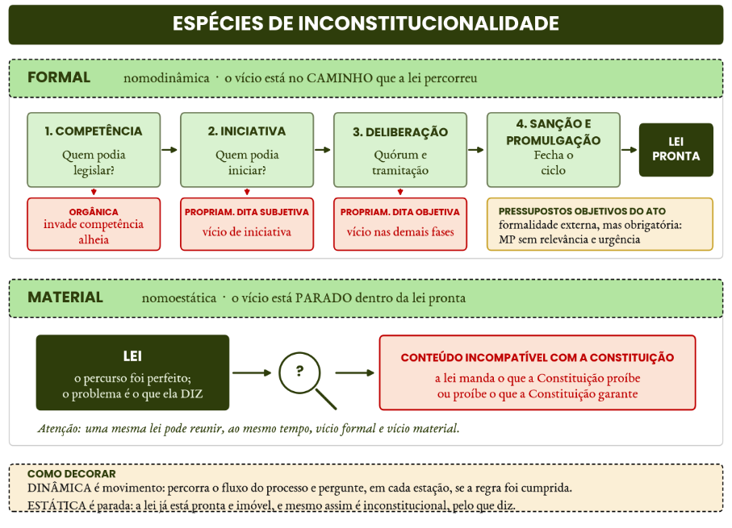

# Direito Constitucional

*Bloco I*

*Ponto 10 do edital: Jurisdição constitucional e controle de constitucionalidade*

:::JC_F2F2F2 
**10. Jurisdição constitucional. Controle de constitucionalidade difuso e concentrado. Modelos, parâmetros, legitimidade, procedimento, efeitos e modulação. Omissão inconstitucional. Ações de controle concentrado. Remédios constitucionais. Controle de convencionalidade.**
:::

Olá, pessoal! Tudo bem com vocês?

Sou o professor Paulo Vítor Avelino e estarei com vocês na **elaboração** das disciplinas de Direito Constitucional, Processual Civil, Tributário e Financeiro. Também sou responsável pela **revisão de todo o conteúdo jurídico** do material extensivo e, não por outro motivo, do nosso ==**Linha Essencial**== **para o TRF5.**

Aos que não me conhecem, vou, brevemente, me apresentar. Sou **Juiz Federal** do Tribunal Regional Federal da 1ª Região **(1º lugar da prova oral - XVII Concurso).** Atuo como **Juiz Auxiliar no Supremo Tribunal Federal** (Gabinete do Ministro Gilmar Mendes). Sou Professor para concursos jurídicos, com experiência em vários cursos distintos, como o Estratégia Carreiras Jurídicas. Fui **Advogado da União**. Ocupei o cargo de **Analista Judiciário do TRF1 (1º lugar) e do TRF5 (2º lugar).** Também fui aprovado para os cargos de **Procurador do Estado do Rio Grande do Norte, Procurador da Fazenda Nacional, Técnico Judiciário da Justiça Federal,** entre outros. Sou Bacharel em Direito pela Universidade Federal do Rio Grande do Norte e Especialista em Direito Administrativo pela Pontifícia Universidade Católica de Minas Gerais.

Especificamente quanto a Direito Constitucional, também sou **um dos juristas responsáveis pela atualização das obras do Ministro Gilmar Mendes,** dentre elas o Curso de Direito Constitucional (2026) e a obra Estado de Direito e Jurisdição Constitucional (2026).

Faço, porém, o registro de que, **embora eu adore estudar constitucional com profundidade,** aqui, nessas 10 semanas, **precisaremos ser muito pragmáticos no estudo.** Não há tempo para grandes detalhes. Ao revés, precisamos ser diretos e assertivos para alcançar o **máximo de conteúdo** “cobrável” em menos linhas e tempo.

Fixadas essas premissas, **vamos começar.** Para isso, nada melhor do que estudarmos

:::JC_D9F2D0 
**JURISDIÇÃO CONSTITUCIONAL e CONTROLE DE CONSTITUCIONALIDADE.**
:::

Nesse ponto, em termos de Lei Seca, fica a dica de estudo no nosso **JusLegis** e, pelo menos, uma leitura mais simplista no *site* do Planalto:

| [JusLEGIS] | > |
|---|---|
| **CF** | art. 5º, §§ 2º e 3º, e incisos LXVIII a LXXIII; art. 34, VII, e art. 36, III; art. 49, V; art. 52, X; art. 60, § 4º; art. 62; art. 66, §§ 1º e 2º; art. 97; art. 102, I, "a" e "l", III, e §§ 1º a 3º; art. 103 e §§ 2º e 3º; art. 103-A; art. 125, § 2º |
| **Lei nº 9.868/1999 (ADI, ADC e ADO)** | arts. 3º a 12-H e arts. 21 a 28 |
| **Lei nº 9.882/1999 (ADPF)** | arts. 1º a 13 |
| **Lei nº 11.417/2006 (súmula vinculante)** | arts. 2º a 11 |
| **Lei nº 12.562/2011 (representação interventiva)** | > |
| **Lei nº 13.300/2016 (mandado de injunção)** | arts. 2º a 14 |
| **Lei nº 12.016/2009 (mandado de segurança)** | arts. 1º a 25 |
| **Lei nº 9.507/1997 (habeas data) e Lei nº 4.717/1965 (ação popular)** | > |
| **CPC** | arts. 948 a 950 e arts. 988 a 993 |

Mas, de forma mais precisa, **como os temas podem cair?**

%% RAIO-X

| **CONTROLE DE CONSTITUCIONALIDADE** | > | > |
|---|---|---|
| **SUBTEMA** | **COMO A FGV COBRA** | **ONDE ISSO JÁ APARECEU** |
| **1. Conceitos teóricos** | Modelos americano e austríaco, teoria da nulidade e da anulabilidade, espécies de inconstitucionalidade (formal e material, originária e superveniente, arrastamento e reflexa), parâmetro e bloco de constitucionalidade, reserva de plenário e **Súmula Vinculante 10**, efeitos, modulação e abstrativização do controle difuso. | Reserva de plenário e juizados especiais nas provas do **TRF3 (2025)** e do **TRF5 (2017)**; supralegalidade e duplo estatuto dos tratados no **TRF6 (2025)**; técnicas de decisão e efeito repristinatório nas provas estaduais da banca. |
| **2. Casuística do STF sobre o cabimento das ações de controle** | Caso concreto em poucas linhas e uma única pergunta: **cabe ou não cabe**. Objeto (medida provisória, lei revogada, lei municipal, ato secundário, súmula), legitimidade e pertinência temática, subsidiariedade da ADPF, fungibilidade, aditamento da inicial, cautelar e seus efeitos, controle estadual e normas de reprodução obrigatória. | ADI contra medida provisória e efeitos da cautelar no **TRF5 (2025)**; conversão da medida provisória em lei e aditamento da inicial no **TRF6 (2025)**; interesse de agir em ADI de lei estadual anterior no **TRF1 (2025)**; legitimidade do Município para requerer súmula vinculante no **TRF5 (2025)**. |
| **3. Cobrança lateral de temas do STF** | O controle não é o assunto da questão, é a **moldura**. A tese do STF entra por outra disciplina e o candidato precisa reconhecer o instituto: coisa julgada inconstitucional em processo civil, controle de convencionalidade em direitos humanos e os remédios constitucionais em processo civil e penal. | Coisa julgada inconstitucional, súmula vinculante, habeas corpus, ação popular e controle de convencionalidade, todos na prova do **TRF5 (2025)**; Súmula Vinculante 10 e a ADI 4.275 na prova do **TRF2 (2026)**. |

Aqui, pessoal, **também podemos ver o tema por OUTRA ótica:** existe uma infinidade de julgados que tratam sobre o **controle** pela perspectiva da **competência legislativa.** A pergunta surge com algo como: “**Estados podem legislar sobre esse tema**?”. “**Isso invade a competência privativa da União**?” São tantos julgados que me surpreende a criatividade das teses que por vezes são suscitadas, mas é a realidade 😂.

Sobre esse enfoque, **faremos materiais mais esquematizados,** especialmente quando falarmos sobre **organização do Estado, federalismo e outros temas correlatos.** Alguns já serão trabalhados, mas não se preocupem, por enquanto, em ver tudo sobre isso.

%% Chance alta TRF5

Por fim, ainda inicialmente, **chamo a atenção para os “temas transversais”,** ou seja, aqueles que são cobrados em mais de uma disciplina. Mais especificamente, o termo **“controle de convencionalidade”** foi cobrado em **dois pontos** do Edital de Constitucional, e é repetido em penal, processo penal, internacional e direito da antidiscriminação. **É preciso atenção redobrada quando o Edital é tão transparente sobre a relevância do assunto!**

Vamos, então, começar!

## 1. Jurisdição constitucional: pressupostos e modelos

Controlar a constitucionalidade é verificar a compatibilidade de uma lei ou de um ato normativo com a Constituição, nos requisitos formais e materiais. É juízo de compatibilidade vertical, fundado no **princípio da supremacia da Constituição**.

Essa supremacia pode ser **material** ou **formal.**

A **supremacia material** é a do conteúdo e existe mesmo em Constituição flexível. **Supremacia material** é superioridade de ***conteúdo***. A Constituição é suprema porque cuida das matérias mais importantes da comunidade política: a organização do Estado, a distribuição do poder, os direitos fundamentais

Por sua vez, a **supremacia formal** é superioridade **de *posição no ordenamento***. Ela nasce da rigidez: a Constituição exige, para ser alterada, um procedimento mais solene e dificultoso que o das leis comuns (art. 60 da CF). Como o legislador ordinário não pode alcançá-la pelo processo comum, ela se torna fundamento de validade de tudo o que está abaixo. Aqui, a lei incompatível não altera a Constituição, ela nasce inválida.

%% NÃO CONFUNDA

Não confunda **supremacia formal ou material** com **inconstitucionalidade formal ou material.** A primeira classificação responde por que algo está no topo do ordenamento; a segunda responde por que uma lei é inválida, se por vício de nascimento (processo e competência) ou de conteúdo. Veremos isso com calma na prática.

%% PEGADINHA

Para fins de controle de constitucionalidade, no Brasil, o que importa, em regra, é a **supremacia formal.** Isso é: se há desrespeito a algo previsto na CF, deve ser reconhecida a inconstitucionalidade, ainda que o dispositivo não seja “materialmente constitucional”. O exemplo clássico é o art. 242, § 2º, que mantém o Colégio Pedro II na órbita federal. É organização administrativa pura, poderia estar em lei ordinária, e nem por isso deixa de servir de parâmetro.

Então, em resumo, **podemos citar como pressupostos para o controle:**

- Constituição rígida (procedimento mais dificultoso para alteração)

- Atribuição de competência a um órgão específico

Vejamos agora que “órgão” poderia ser esse, à luz dos principais modelos existentes.

%% Tome seu café

**Os modelos de jurisdição constitucional**

Dois modelos se destacam: o **controle difuso** - de matriz americana - e o **controle abstrato**, de inspiração austríaca.

O **modelo americano** é o modelo do **controle difuso.** Aqui, qualquer juiz ou tribunal pode, incidentalmente, declarar a inconstitucionalidade da lei ao aplicá-la no caso concreto. Nasceu em ***Marbury v. Madison (1803):*** havendo contradição entre a lei e a Constituição, o tribunal aplica esta última. O controle é exercido por qualquer juiz e a decisão é **declaratória**, porque a lei **inconstitucional** é nula desde o nascimento: é a **teoria da nulidade**.

Por outro lado, o **modelo austríaco**, de Kelsen (1920), concentrou o controle nas cortes constitucionais (como o STF). A decisão é **constitutiva**, a lei é anulável e vale até a anulação: é a **teoria da anulabilidade**.

**O Brasil adota um modelo misto, pois abrange aspectos do controle difuso e do controle abstrato.**

O **modelo francês** é o do controle **político**, do Conselho Constitucional, historicamente preventivo (ou seja, acontece **quando a lei ainda é projeto de lei,** o que confere maior segurança jurídica).

| **MODELOS DE JURISDIÇÃO CONSTITUCIONAL** | > | > | > |
|---|---|---|---|
| **CRITÉRIO** | **AMERICANO (DIFUSO)** | **AUSTRÍACO (CONCENTRADO)** | **FRANCÊS (POLÍTICO)** |
| **Origem** | Marbury v. Madison, 1803 | Constituição austríaca de 1920, obra de Kelsen | Constituição de 1958, Conselho Constitucional |
| **Quem controla** | Qualquer juiz ou tribunal | Corte constitucional, órgão único e especializado | Órgão político, estranho aos três Poderes |
| **Momento** | Repressivo, com a lei já em vigor | Repressivo | Historicamente preventivo, ainda no projeto |
| **Como a questão chega** | Incidentalmente, no caso concreto | Por ação, contra a lei em tese | Por provocação de autoridades políticas |
| **Eficácia da decisão** | **Declaratória** | **Constitutiva** (constitutivo- negativa) | Impede o ingresso da norma no ordenamento |
| **Plano do vício** | Validade | Eficácia, em regra | Não chega a haver norma |
| **Situação da lei viciada** | **Nula**, nasce morta | **Anulável**, vale até a anulação | A lei não chega a nascer |
| **Teoria** | Teoria da **nulidade** | Teoria da **anulabilidade** | Não se coloca |
| **Efeitos, em regra** | Inter partes e ex tunc | Erga omnes e ex nunc | Preventivos, com ganho de segurança jurídica |

Você também precisa saber o **mínimo** sobre a evolução do controle de constitucionalidade do Brasil. Vejamos:

| **EVOLUÇÃO DO CONTROLE DE CONSTITUCIONALIDADE NO BRASIL** | > | > |
|---|---|---|
| **MARCO** | **O QUE INTRODUZIU** | **ATENÇÃO** |
| **CF de 1824** | Não previa controle, por consagrar a soberania do Parlamento | Única Constituição **semirrígida** da nossa história |
| **CF de 1891** | **Controle difuso**, de matriz americana | A inspiração é a república dos Estados Unidos, e não a Europa |
| **CF de 1934** | **Cláusula de reserva de plenário** e representação interventiva | A reserva de plenário é de **1934**, e não de 1937 |
| **EC nº 16/1965** | **Controle concentrado**, pela representação de inconstitucionalidade | **ATENÇÃO: Isso pode ser cobrado!** |
| **CF de 1988** | Ampliação do rol de **legitimados** (art. 103) e do **objeto** do controle abstrato | O controle concentrado já existia; o que 1988 fez foi alargá-lo |
| **EC nº 3/1993** | **ADC** | Não é criação da EC nº 16/1965 |
| **EC nº 45/2004** | **Súmula vinculante**, **repercussão geral** e art. 5º, § 3º | Também ampliou a legitimidade do **Governador** para a ADC |

**DICA:** O Brasil, em 1891, se chamava “Estados Unidos do Brasil” e tentou espelhar o modelo americano. Isso ajuda a lembrar que foi aqui que surgiu o modelo do controle difuso, já que inspirado na jurisprudência americana.

## 2. Espécies de inconstitucionalidade

## 2.1. Vício formal e vício material

A inconstitucionalidade **formal (chamada de nomodinâmica)** decorre da inobservância das regras de processo legislativo ou de competência e se manifesta de três formas:

- a **orgânica**, violação à regra de competência;

- a **propriamente dita**, violação ao devido processo legislativo, que é **subjetiva** quando atinge a iniciativa e **objetiva** quando está nas demais fases, como o quórum; e

- a **violação a pressupostos objetivos do ato**, formalidade externa, mas obrigatória, como a medida provisória sem relevância e urgência.

A **material (nomoestática)** é a incompatibilidade de conteúdo.

Vamos esquematizar em um organograma para que vocês não confundam:

**Isso aqui cai demais!** E cai sobretudo a partir da casuística do STF.

:::JC_FFE698 JÁ CAIU!
**(Juiz de Direito - TJ-BA- FGV - 2026)** Em razão de grande comoção decorrente de óbitos verificados no interior de shopping centers situados no Município Beta, o que decorreu da ausência de atendimento médico no local e da distância em relação aos hospitais existentes, foi editada a Lei nº X, de iniciativa de um vereador. De acordo com esse diploma normativo, os shopping centers deveriam promover a instalação, no prazo indicado, de serviços de pronto-socorro equipados para o atendimento de emergência dos respectivos consumidores, mantendo profissional médico no local. Como o shopping center Y não disponibilizou o serviço, o Procon municipal, vinculado à Câmara Municipal, aplicou-lhe a multa cominada. Por entender que a Lei nº X era inconstitucional, o shopping center Y ingressou com ação judicial contra o ato, argumentando com a inconstitucionalidade da Lei nº X. O magistrado competente observou corretamente que a Lei nº X é:

**a)** apenas formalmente inconstitucional;

**b)** apenas materialmente inconstitucional;

**c)** formal e materialmente inconstitucional;

**d)** constitucional, pois se trata de matéria de interesse local;

**e)** constitucional, pois Beta possui competência suplementar em matéria de proteção ao consumidor.¹
:::

Vejamos que a banca considerou que essa lei é **material e formalmente inconstitucional.** E o fez com base no **Tema 1.051 da Repercussão Geral.**

Considerou-se que **o vício formal está na competência**: obrigar shopping centers a manter ambulatório ou pronto-socorro não é assunto de interesse local, porque toca a saúde e a seguridade social, matérias que a Constituição reserva à União e aos Estados, restando ao Município apenas suplementar essa legislação naquilo que couber (art. 30, I e II).

Por sua vez, **o vício material está no conteúdo da obrigação**: a lei transfere ao particular a prestação de um serviço de saúde que é dever do Estado, e o faz com sacrifício desproporcional da livre iniciativa, em desacordo com a ordem econômica e com os princípios da razoabilidade e da proporcionalidade.

**Veremos muito esse tipo de cobrança. Por isso, penso ser pertinente desde já transcrever parte de julgados relevantes do STF sobre isso:**

%% JURISPRUDÊNCIA

| **VÍCIO FORMAL × VÍCIO MATERIAL NA JURISPRUDÊNCIA DO STF** | > | > |
|---|---|---|
| **PRECEDENTE DO STF** | **HÁ INCONSTITUCIONALIDADE FORMAL?** | **HÁ INCONSTITUCIONALIDADE MATERIAL?** |
| **OS DOIS VÍCIOS AO MESMO TEMPO** | > | > |
| **RE 833.291** - Tema 1.051 Rel. Dias Toffoli Shopping center obrigado a manter pronto-socorro | **SIM:** competência privativa da União para legislar sobre **direito do trabalho e direito comercial** (art. 22, I). Não é interesse local. | **SIM:** sacrifício desproporcional da **livre iniciativa** (arts. 1º, IV, e 170), com ofensa à **razoabilidade** e à **proporcionalidade**. |
| **RE 1.054.110** - Tema 967 e **ADPF 449** Lei Municipal trata de Transporte individual por aplicativo | **SIM:** Municípios e DF **não podem contrariar os parâmetros do legislador federal** sobre trânsito e transporte (art. 22, XI). | **SIM:** a proibição cria reserva de mercado e viola a **livre iniciativa** e a **livre concorrência**. |
| **SÓ VÍCIO FORMAL - INVASÃO DE COMPETÊNCIA** | > | > |
| **Súmula Vinculante 46** e **ADI 6.646/AL** Crimes de responsabilidade | **SIM:** definição dos crimes de responsabilidade e do respectivo processo é **competência privativa da União** (art. 22, I). | **NÃO SE DISCUTIU** |
| **Súmula Vinculante 2** Consórcios e sorteios, inclusive bingos e loterias | **SIM:** só a União **legisla** sobre sistemas de consórcios e sorteios (art. 22, XX). | **NÃO SE DISCUTIU**, mas atenção: a União legisla, mas a **exploração** de loterias é competência material também de Estados e Municípios (ADPF 492 e 493; ADI 4.986). |
| **ADI 7.712 MC-Ref/GO** Rel. Gilmar Mendes Lei estadual criando crime de incêndio | **SIM:** criar tipo penal e fixar inafiançabilidade é **direito penal e processual penal**: art. 22, I. | **NÃO SE DISCUTIU** |
| **ADI 7.424/ES** Rel. Gilmar Mendes Porte de arma a agentes socioeducativos por lei estadual | **SIM:** abrir exceção estadual ao Estatuto do Desarmamento invade **direito penal** e **material bélico** (art. 22, I e XXI). | **NÃO SE DISCUTIU** |
| **SÓ VÍCIO MATERIAL: A COMPETÊNCIA ESTAVA CERTA** | > | > |
| **Súmula Vinculante 49** Lei municipal que impede a instalação de estabelecimentos do mesmo ramo em certa área | **NÃO:** uso e ocupação do solo é **interesse local** (art. 30, I). O Município podia legislar. | **SIM:** o conteúdo ofende a **livre concorrência**. Aqui está o exemplo puro de norma **materialmente** inconstitucional. |
| **NENHUM VÍCIO: A LEI É CONSTITUCIONAL** | > | > |
| **Súmula Vinculante 38** Horário de funcionamento de estabelecimento comercial | **NÃO: interesse local** (art. 30, I) (ressalvados os casos de competência privativa da União). | **NÃO:** nada no conteúdo afronta a Constituição. |
| **RE 610.221** - Tema 272 Tempo máximo de espera em fila de banco | **NÃO:** é **interesse local**, e não Sistema Financeiro Nacional (arts. 22, VII, e 192). | **NÃO SE DISCUTIU**. |
| **RE-AgR 312.050/MS** Rel. Celso de Mello Dispositivos de segurança em agências bancárias | **NÃO:** segurança e conforto do usuário na agência é **interesse local**; não há usurpação da competência federal. | **NÃO SE DISCUTIU** |
| **Como a FGV cobra:** ela quase nunca pergunta “é inconstitucional?”. Traz um caso e pergunta **qual vício**. Busque entender primeiro **quem podia legislar** (formal), depois **o que a lei diz** (material). Repare que a competência correta não salva o conteúdo (SV 49) e que a competência errada dispensa o exame do conteúdo.² | > | > |

Nesse campo de inconstitucionalidade formal, é sempre importante lembrar que a **lei estadual contrária à norma geral federal não é revogada, apenas tem a eficácia suspensa (art. 24, § 4º).** Assim, por seguir vigente, pode ser objeto de ADI. Afinal, se for revogada depois a lei federal, a estadual volta a produzir efeitos**.**

Por fim, a **sanção presidencial NÃO convalida o vício originário** nos casos de desrespeito à iniciativa privativa do Chefe do Executivo.

## 2.2. Inconstitucionalidade superveniente e não recepção

A inconstitucionalidade **originária** existe desde o nascimento da lei. Ela nasceu violando o paradigma de validade (Constituição vigente).

A modalidade **superveniente** ocorreria quando lei válida “se tornasse” incompatível por mudança posterior do parâmetro. Mas digo ***ocorreria*** porque, na verdade, no Brasil, **não se fala em inconstitucionalidade superveniente**, e sim em **não recepção**³, fenômeno de revogação.

Daí a exigência de contemporaneidade, devendo o objeto de ADI e de ADC ser posterior a 5 de outubro de 1988, ou ao parâmetro invocado, quando este for emenda; para o direito pré-constitucional, a via é a ADPF. Por simetria, também **não existe constitucionalidade superveniente**.

%% JURISPRUDÊNCIA

:::JC_D9F2D0 
**STF, ADI 145/CE** (Info 907) e **ADI 6.838/MT** (red. p/ acórdão Min. Cristiano Zanin, j. 27/10/2025, Info 1196): a alteração superveniente do parâmetro constitucional não convalida a lei editada em desconformidade com o texto vigente à época, pois **não se admite** constitucionalidade superveniente no direito brasileiro.
:::

Vejamos aqui outros importantes casos em que o fenômeno da recepção foi examinado pela Suprema Corte:

| **CASUÍSTICA DO STF** | > | > |
|---|---|---|
| **JULGADO** | **RECEPCIONADO?** | **MOTIVO** |
| **RE 583.523** (Tema 113) Rel. Gilmar Mendes | **NÃO** | **Art. 25 do DL 3.688/1941** (posse injustificada de instrumento usual no furto). Infração de **perigo abstrato** desproporcional, que pune pelo que o agente é, e não pelo que fez. Ofensa à **dignidade da pessoa humana** e à **isonomia** (arts. 1º, III, e 5º, caput e I). Extra: caso em que o STF reafirmou que **cabe controle de constitucionalidade em matéria penal**. |
| **ARE 1.039.542 AgR- segundo** Rel. Roberto Barroso | **SIM** | **Decreto-Lei 395/1938** foi recepcionado **como lei ordinária**. Por isso a **ANP** e o **DNC** podem autuar e aplicar multa, **sem ofensa à legalidade**. |
| **RE 627.106** (Tema 249) Rel. Dias Toffoli | **SIM** | **Decreto-Lei 70/66**. É constitucional o **procedimento de execução extrajudicial** nele previsto, devidamente recepcionado pela Constituição de 1988. |
| **ADPF 130** Rel. Ayres Britto | **NÃO** | **Lei 5.250/1967** (Lei de Imprensa) - **não recepção em bloco**. O STF recusou tanto o expurgo de dispositivos isolados quanto a **interpretação conforme**, diante do caráter uno da lei. |
| **ADPF 1.106/DF** Rel. Edson Fachin Info 1214 | **SIM** | **Lei 6.729/1979 (Lei Ferrari): Compatível com a ordem econômica de 1988**, que admite **regulação setorial ao lado da livre iniciativa**, sobretudo em segmento oligopolista e de assimetria econômica. |
| **RE 603.116** (Tema 703) Rel. Dias Toffoli Info 1146 | **SIM** | **Art. 47 da Lei 6.880/80** (Estatuto dos Militares) foi recepcionado, **sem ofensa à reserva legal**. São válidos, por consequência, os **incisos IV e V do art. 24 do Decreto 4.346/2002** (RDE), que preveem **detenção** e **prisão disciplinares**. |
| **ADPF 492/RJ**, **ADPF 493/DF** e **ADI 4.986/MT** Rel. Gilmar Mendes Info 993 | **NÃO** | **Arts. 1º e 32, caput e § 1º, do DL 204/1967**. A competência privativa da União para **legislar** sobre sistemas de consórcios e sorteios (inclusive loterias) **não impede a competência material** dos Estados e Municípios para **explorar** a atividade, nem a de regulamentá-la. |
| **Regra de ouro:** para a recepção, só se examina a **compatibilidade material.** A norma pode entrar **com outro status**, e a incompatibilidade gera **revogação**, não inconstitucionalidade superveniente. | > | > |

%% PEGADINHA

Se a questão cobra o tema da “recepção”, atenção para não confundir o fenômeno com inconstitucionalidade. São planos distintos. Você precisa ter o “feeling” sobre o que a banca quer (se é a diferença técnica entre os institutos ou se essa terminologia não é o foco da cobrança).

## 2.3. Total e parcial. Arrastamento. Inconstitucionalidade reflexa

**Quanto à extensão**, a inconstitucionalidade é **total** ou **parcial**, podendo esta alcançar um artigo, um inciso, uma alínea ou até uma única palavra: é o **princípio da parcelaridade.**

:::JC_DAE9F7 DICA DO PROFESSOR
No controle judicial, a declaração parcial pode recair sobre fração menor que o dispositivo, até sobre uma expressão isolada. Por outro lado, **o veto do Presidente da República não pode ser de palavra:** deve abranger texto integral de artigo, parágrafo, inciso ou alínea (art. 66, § 2º, da CF).

**DICA:** o STF sempre terá mais liberdade do que outros órgãos. Então, na dúvida, você precisa lembrar dessa lógica.
:::

**Quanto ao prisma de apuração**, a inconstitucionalidade é **direta** quando o objeto busca fundamento de validade na própria Constituição. A ADI, inclusive, só admite como objeto, em regra, violações diretas.

Há, porém, situações de inconstitucionalidade **indireta**, e **duas delas caem com frequência.**

A primeira é a **inconstitucionalidade por arrastamento** (ou por atração, ou consequente). Declarada inconstitucional a norma principal, caem também aquelas que dela dependem, porque sozinhas perderam sentido. Como é consequência necessária do que foi decidido, o STF a reconhece **dentro da própria ADI e até de ofício**, sem que o autor precise ter pedido.

A segunda é a **inconstitucionalidade reflexa** (ou oblíqua). Aqui a lei é constitucional; o problema está no **decreto que a regulamenta e a extrapola**. Repare que o decreto não viola a Constituição: ele viola a lei. Por isso a crise é de **legalidade**, e não de constitucionalidade. Por isso, não é admitido, em regra, que situações de simples ilegalidade de decreto sejam tratadas em ADI.

:::JC_D9F2D0 Chance alta TRF5 · JURISPRUDÊNCIA
Declarada a inconstitucionalidade de uma lei, o efeito repristinatório é tácito: como a norma nula nunca produziu efeitos válidos, a lei que ela havia revogado volta a valer. Tradicionalmente, a jurisprudência do STF exigia que houvesse **impugnação expressa de todo o complexo normativo** - a lei nova e as anteriores que carregassem o mesmo vício -, sob pena de não conhecimento da ação, justamente para impedir que a decisão fizesse ressuscitar norma tão inconstitucional quanto a derrubada. Atualmente, porém, entende-se que **a ausência de aditamento quanto à lei revogada não obsta o conhecimento da ADI, cabendo ao próprio Tribunal, ao delimitar a eficácia da decisão, afastar o efeito repristinatório indesejado e declarar, de ofício e por arrastamento, a inconstitucionalidade da legislação anterior igualmente incompatível com a Constituição** (STF. Plenário. ADI 7.783/PE, Rel. Min. Dias Toffoli, julgado em 09/04/2026 (Info 1211)**.**
:::

## 3. Parâmetro e objeto do controle

## 3.1. Bloco de constitucionalidade e tratados de direitos humanos

:::JC_FFFFFF 
Parâmetro de controle é a norma de status constitucional com base na qual se realiza o controle. Compõem o **bloco de constitucionalidade**, para o STF:

- as normas constitucionais expressas, originárias ou de emenda;

- os princípios expressos e implícitos;

- os tratados de direitos humanos com status de emenda (art. 5º, § 3º); e

- o **ADCT**.

%% JURISPRUDÊNCIA

**STF, ADI 2.076/AC** (Plenário, Rel. Min. Carlos Velloso, j. 15/08/2002): o **preâmbulo** da Constituição **não tem força normativa nem valor autônomo**, não é de reprodução obrigatória pelas Constituições estaduais e não serve de paradigma para o controle. É a tese da irrelevância jurídica do preâmbulo.

Pelo art. 5º, § 3º, da CF, os tratados sobre direitos humanos aprovados, em cada Casa do Congresso, em dois turnos, por três quintos dos votos, equivalem a emendas constitucionais.

Fora desse rito, o STF fixou no **RE 466.343** o **status supralegal**, com **eficácia paralisante** sobre a legislação conflitante, ainda que não formalmente revogada.

Firmou-se a **teoria do duplo estatuto**:

- rito do art. 5º, § 3º, status de emenda;

- rito comum, status supralegal;

- tratado que não versa sobre direitos humanos, status de lei ordinária.

Só três tratados passaram pelo rito qualificado: a Convenção sobre os Direitos das Pessoas com Deficiência e seu Protocolo Facultativo, o Tratado de Marraqueche (acesso a obras para pessoas com deficiência visual) e a Convenção Interamericana contra o Racismo (celebrado na Guatemala⁴).

%% NÃO CONFUNDA

Tratado como **objeto** e tratado como **parâmetro** são coisas distintas. Como objeto, qualquer tratado incorporado pode ser impugnado por ADI, por ser ato normativo primário. Como parâmetro de **constitucionalidade**, só serve o tratado de direitos humanos aprovado pelo art. 5º, § 3º. **O tratado supralegal não é parâmetro de constitucionalidade, e sim de convencionalidade**.

## 3.2. Objeto do controle
:::

%% DICA DO PROFESSOR

:::JC_DAE9F7 
Quando falamos em **objeto,** precisamos pensar em **cada uma das espécies de ação.** É dizer que você precisa atentar se a questão é mais “genérica” e se pauta sobremaneira na ADI, ou se quer explorar algo próprio de outras ações, como a ADC e a ADPF. Peço, portanto, **reforço** na atenção sobre qual é a ação do caso hipotético do enunciado.
:::

Vamos começar pela ADI. Podem ser objeto de ADI (a ação mais “genérica” do controle): as **emendas constitucionais**, as **leis ordinárias** e **complementares**, as **medidas provisórias**, os **decretos legislativos**, as **resoluções**, os **decretos autônomos** e os **tratados incorporados**.

O critério aqui, especificamente para a ADI, é que tenhamos como objeto um **ato normativo primário,** ou seja, que seja um ato que tem fundamento **direto** na Constituição. De forma bem geral, são os atos previstos no art. 59 da CRFB.

**Importante**: ato normativo primário não é sinônimo de generalidade e abstração em sentido estrito. O STF superou a jurisprudência que excluía do controle abstrato as chamadas leis de efeitos concretos. **O que define o cabimento é a norma retirar seu fundamento de validade diretamente da Constituição, ainda que seja lei de efeitos concretos.**

Ademais, também é importante conhecermos a casuística do STF:

| **CABIMENTO DA ADI: CASUÍSTICA DO STF** | > | > |
|---|---|---|
| **OBJETO IMPUGNADO** | **CABE ADI?** | **JULGADO** |
| **CABE ADI - ATO NORMATIVO PRIMÁRIO, GERAL E ABSTRATO** | > | > |
| **Decreto autônomo** Extinção de colegiados da Administração (art. 84, VI, “a”) | **SIM** | Retira fundamento de validade **diretamente da Constituição** e é dotado de generalidade e abstração. **ADI 6.121 MC/DF** (Info 944). |
| **Resolução do CNMP** | **SIM** | Ato geral e abstrato editado no exercício de **competência constitucional**: é **ato normativo primário**. **ADI 4.263/DF** (Info 899). |
| **Resolução do TSE** | **SIM** | Quando o conteúdo material for **“norma de decisão” abstrata, geral e autônoma**. **ADI 5.122** (Info 900). |
| **Resolução de Tribunal de Justiça** | **SIM** | **ADI 5.310/RJ** (Info 851). |
| **Resolução de conselho profissional** | **SIM** | **Desde que não seja mero exercício de competência regulamentar** e lide diretamente com direitos e garantias constitucionais. **ADI 3.481/DF** (Info 1008). |
| **Regimento interno de Assembleia Legislativa** | **SIM** | **Desde que** o dispositivo tenha **caráter normativo e autônomo** (ex.: pagamento por convocação extraordinária). **ADI 4.587/GO** (Info 747). |
| **Deliberação administrativa de tribunal** | **SIM** | Se tiver **conteúdo normativo, geral e abstrato**. Mas, revogada a deliberação, a ADI é julgada **prejudicada**. **ADI 1.244 QO-QO/SP** (Info 964). |
| **Leis orçamentárias** LOA, LDO e crédito extraordinário | **SIM** | Cabe controle abstrato. **ADI 5.449 MC-Ref/RR** (Info 817). |
| **Lei estadual que altera limites de Município** criação, incorporação, fusão, desmembramento | **SIM** | Tem **natureza normativa e abstrata**. **ADI 1.825** (Info 978). |
| **Lei com destinatários determináveis** | **SIM** | Isso **não retira** o caráter abstrato e geral, nem a transforma em lei de efeitos concretos. **RE 1.186.465 AgR/TO** (Info 955). |
| **Lei fruto de acordo homologado judicialmente** | **SIM** | A aplicação da lei em casos concretos, mesmo com trânsito em julgado, **não afasta** o controle abstrato. **RE 1.186.465 AgR/TO** (Info 955). |
| **NÃO CABE ADI: OFENSA REFLEXA OU PARÂMETRO INADEQUADO** | > | > |
| **Decreto meramente regulamentar** de lei estadual | **NÃO** | A ADI é via inadequada: o decreto violou a **lei**, não a Constituição. Só caberia se fosse **decreto autônomo**. **ADI 4.409/SP** (Info 905). |
| **Lei que viola tratado internacional** | **NÃO** | Tratado, em regra, **não é parâmetro** de controle concentrado. **Exceção:** tratado de direitos humanos aprovado pelo rito do art. 5º, § 3º, que entra com força de **emenda**. **ADI 2.030/SC** (Info 872). |
| **OBJETO SUPERVENIENTE: PERDA DE OBJETO E ADITAMENTO** | > | > |
| **Revogação do ato impugnado** antes do julgamento | **DEPENDE** | **Regra:** perda superveniente do objeto. **Exceção 1:** fraude processual (revogação para escapar do STF). **Exceção 2:** o conteúdo foi repetido, em essência, em outro diploma. **ADI 2.418/DF** (Info 824). |
| **MP que revoga a lei impugnada**, ainda não votada | **SIM** | A MP não revoga: apenas **suspende** a legislação anterior até a conversão. É lei sob **condição resolutiva.** Logo, não há perda do objeto. **ADI 5.717/DF e outras** (Info 935). |
| **MP convertida em lei** com o mesmo texto | **SIM** | Há **continuidade normativa** e os vícios não se convalidam; a ADI é conhecida, mas o autor deve **peticionar pedindo o aditamento**. **ADI 1.055/DF** (Info 851). |
| **Aditamento da inicial** para incluir novos dispositivos | **NÃO** | Tradicionalmente, não se admite **depois** das informações dos requeridos e das manifestações da AGU e do PGR. **ADI 4.541/BA** (Info 1013). O Tribunal pode declarar por arrastamento, se entender cabível. |
| **O critério que resolve quase tudo:** a ADI exige **ato normativo primário**, isto é, aquele que busca fundamento de validade **diretamente na Constituição**, com generalidade e abstração. Se o ato se apoia na lei, e não na Constituição, ele é **secundário**: eventual excesso gera crise de **legalidade**, e a ofensa à Constituição é apenas **reflexa,** daí não caber ADI nem se exigir reserva de plenário. | > | > |

Vale lembrar que apenas atos normativos **federais ou estaduais/distritais** podem ser objeto de ADI. E, ainda, se estivermos diante de lei do DF fruto de sua competência municipal, não será possível admitir a ADI (afinal, o DF possui dúplice competência, municipal e estadual). Vejamos:

:::JC_B3E5A1 SÚMULA
**Súmula 642 do STF**: **Não cabe** ação direta de inconstitucionalidade de lei do Distrito Federal derivada da sua competência legislativa municipal.
:::

**Sobre ADI Estadual**, a Constituição Federal consagra que **“cabe aos Estados a instituição de representação de inconstitucionalidade de leis ou atos normativos estaduais ou municipais em face da Constituição Estadual, vedada a atribuição da legitimação para agir a um único órgão”** (art. 125, § 2º). Existe relativa liberdade para que os estados criem suas próprias ações. Vale conhecer, nesse ponto, o que a jurisprudência tem definido sobre isso:

| **ADI NO TRIBUNAL DE JUSTIÇA** | > | > |
|---|---|---|
| **PONTO** | **REGRA** | **JULGADO** |
| **PARÂMETRO DE CONTROLE** | > | > |
| **A regra do art. 125, § 2º** | O parâmetro da representação de inconstitucionalidade estadual é a **Constituição Estadual**. É ela, e só ela, que a Constituição Federal indica. | Art. 125, § 2º, da CF |
| **Lei Orgânica do Município** | **Não** é parâmetro. É inconstitucional norma de Constituição estadual que autorize ADI, no Tribunal de Justiça, contra lei estadual ou municipal por ofensa à Lei Orgânica. | **ADI 5.548/PE** (Info 1025) |
| **Norma da Constituição Federal** | [Chance alta TRF5] Pode ser parâmetro **desde que seja norma de reprodução obrigatória** pelos Estados. Fora daí, o cotejo com a Carta federal cabe ao STF. | **RE 650.898/RS** Tema 484 (Info 852) |
| **Previsão expressa na Constituição estadual** | É **constitucional** o dispositivo de Constituição estadual que confere ao Tribunal de Justiça essa competência. Admite-se o controle em face da Constituição da República quando o parâmetro for **norma de reprodução obrigatória** ou existir, na Constituição estadual, **regra remissiva** à Carta federal. | **ADI 5.647/AP** (Info 1036) |
| **LEGITIMIDADE E EFEITOS** | > | > |
| **Legitimados** | Quem define o rol é a **Constituição estadual**. Ela não era obrigada a incluir o Conselho Seccional da OAB; mas, uma vez incluído, a legitimidade é **universal**. | **ADI 7.821/CE** (Info 1220) |
| **O Legislativo não suspende a lei** | Não compete ao Poder Legislativo, de nenhuma esfera, suspender a eficácia de lei declarada inconstitucional em controle concentrado. É inconstitucional a Constituição estadual que exija comunicação à Assembleia ou à Câmara para esse fim. | **ADI 5.548/PE** (Info 1025) |
| **CONVIVÊNCIA COM O STF E RECURSO** | > | > |
| **Coexistência de ADI no TJ e ADI no STF** | [Chance alta TRF5] O julgamento da estadual **só prejudica** a do STF se presentes **duas condições cumulativas**: (i) a decisão do Tribunal de Justiça for **pela procedência**; e (ii) a inconstitucionalidade for por incompatibilidade com preceito da Constituição estadual **sem correspondência** na Constituição Federal. Havendo correspondência, **subsiste a jurisdição do STF**. | **ADI 3.659/AM** (Info 927) |
| **Recurso extraordinário contra o acórdão do TJ** | É cabível. E os **procuradores públicos** (do Estado, do Município, da Assembleia, da Câmara) têm capacidade postulatória para interpô-lo, **desde que o legitimado tenha outorgado poderes**.⁵ | **RE 1.068.600 AgR- ED-EDv/RN** (Info 980); antes, **RE 1.126.828 AgR/SP** (Info 965) |

%% TOME NOTA

As **medidas provisórias** merecem parágrafo próprio, por serem **um dos subtemas mais repetidos pela FGV.**

A MP pode ser combatida por ADI e, convertida em lei com o mesmo texto, a ação não perde o objeto, por **continuidade normativa**. O aditamento da inicial é o procedimento adequado, mas, **mantido o texto**, o STF tem julgado o mérito **mesmo sem ele**. A ação só fica prejudicada se houver alteração substancial de conteúdo (ADI 1.055/DF)

O ==**essencial**== sobre controle de constitucionalidade e medidas provisórias:

- É **inconstitucional** medida provisória que verse sobre **matéria reservada à lei complementar** ou **que trate de alguns dos temas elencados no art. 62 como hipótese vedada;**

- O **controle dos pressupostos de relevância e urgência só cabe em abuso notório** (ADI 5.599/DF), com a **exceção da MP de crédito extraordinário**, restrita a guerra, comoção interna ou calamidade pública (ADI 4.048).

**Revogada a norma por MP** ainda não convertida, a **ADI pode ser julgada, pois a MP apenas suspende a lei anterior**, sob condição resolutiva (ADI 5.717/DF).

:::JC_DAE9F7 DICA DO PROFESSOR
Em alguns casos, **a vedação ao uso da MP decorre de exigência de lei complementar prevista em outro dispositivo constitucional,** e não de tema previsto no art. 62 da CF. Ex.: TRF1 - 2025 - foi cobrada a reserva de Lei Complementar do art. 163 da CF.
:::

Sobre as demais ações de controle, analisaremos adiante. Nesse momento, o ideal é focar na ADI como “geral”.

## 4. Momento e órgão do controle

## 4.1. Controle preventivo e o mandado de segurança do parlamentar

:::JC_FFFFFF 
O controle **preventivo** ocorre antes de a norma ingressar no ordenamento e é exercido pelos três Poderes.

No Legislativo, v.g., é feito pela Comissão de Constituição e Justiça e pelo plenário; no Executivo, pelo **veto jurídico** (art. 66, § 1º), que não se confunde com o **veto político**, fundado no interesse público.

No Judiciário, excepcionalmente por uma única via, qual seja o **mandado de segurança impetrado por parlamentar**, **cabível contra proposta de emenda tendente a abolir cláusula pétrea e contra projeto que viole regras constitucionais do processo legislativo**. Só o parlamentar da respectiva Casa tem legitimidade, e a perde se deixar de ser congressista; partido político **não pode** impetrá-lo; e o STF não controla questões interna corporis.

%% NÃO CONFUNDA

A **perda do mandato extingue o mandado de segurança do parlamentar**, ação personalíssima. **Já a perda superveniente de representação do partido não extingue a ADI**, pois a legitimidade se afere no momento da propositura (ADI 2.054-QO e ADI 2.618): **o processo objetivo não tem partes no sentido tradicional.**

## 4.2. Controle repressivo pelo Legislativo, pelo Executivo e o Tribunal de Contas
:::

O controle **repressivo** cabe, como regra, ao Judiciário.

**Há duas exceções no Legislativo**: o art. 49, V, da CF, pelo qual o Congresso susta atos normativos do Executivo que exorbitem do poder regulamentar ou dos limites da delegação; e a rejeição de medida provisória por inconstitucionalidade.

**Já a tese de que o Chefe do Executivo poderia negar cumprimento a lei que reputasse inconstitucional encontra hoje obstáculo expresso na jurisprudência.**

:::JC_D9F2D0 Chance alta · JURISPRUDÊNCIA
**STF, ADI 5.297/TO** (Plenário, Rel. Min. Luiz Fux, j. 14/08/2025, Info 1186): é ==**inconstitucional**==, por inobservância ao princípio da separação dos Poderes (art. 2º da CF/1988), a suspensão dos efeitos financeiros de lei estadual mediante decreto do governador por considerá-la claramente inconstitucional. Restam ao Chefe do Executivo o veto jurídico antes da promulgação ou o ajuizamento de ação de controle concentrado.
:::

%% PEGADINHA

**Atenção:** há um tema MUITO importante que não consta em informativo. Diz respeito ao controle de constitucionalidade pelo Tribunal de Contas. Algumas pessoas ventilaram que o STF iria cancelar seu entendimento sumulado no seguinte sentido:

:::JC_B3E5A1 SÚMULA
**Súmula 347 do STF**: O Tribunal de Contas, no exercício de suas atribuições, pode apreciar a constitucionalidade das leis e dos atos do Poder Público.
:::

Ocorre que o entendimento **NÃO** foi cancelado, mas aprimorado. Se o enunciado for cobrado na literalidade, podemos considerar, em alguns casos, correto. O que você precisa saber adicionalmente é o seguinte:

:::JC_D9F2D0 JURISPRUDÊNCIA
**STF, MS 25.888/DF** (Plenário, Rel. Min. Gilmar Mendes, j. 22/08/2023): a Súmula 347 é compatível com a CF/1988 e continua válida, mas **não pode** ser lida de forma literal. O Tribunal de Contas não tem função jurisdicional e **não pode** declarar a inconstitucionalidade de norma; pode apenas **afastar a aplicação da norma no caso concreto**, quando imprescindível ao controle externo, em duas hipóteses: **violação patente à Constituição ou contrariedade a jurisprudência pacífica do STF**.
:::

%% TOME NOTA

Regra prática: se a questão reproduzir a redação literal da Súmula 347, marque como certa, porque ela não foi cancelada. Se cobrar a interpretação do STF, valem os parâmetros restritivos do MS 25.888/DF.

## 5. Controle difuso

No controle difuso **qualquer juiz ou tribunal** aprecia a constitucionalidade no caso concreto, e a inconstitucionalidade **não é o pedido, é a causa de pedir**.

Por isso o difuso é também chamado de controle incidental, por via de exceção ou de defesa, e pode ser provocado pelas partes, pelo Ministério Público e pelo próprio juiz, de ofício.

É possível que tal controle seja realizado em **ação civil pública** e em **ação popular**, **desde que a inconstitucionalidade figure como questão prejudicial**: o que **não se admite** é a ação coletiva como sucedâneo da ADI, hipótese de usurpação da competência do STF (Rcl 1.733/SP). Isso, inclusive, é recorrentemente cobrado em segunda fase de magistratura federal (TRF1 2023 e TRF2 2026).

## 5.1. A cláusula de reserva de plenário (“Full bench”) e a Súmula Vinculante 10

Pelo art. 97 da CF, **somente pelo voto da maioria absoluta** de seus membros ou dos membros do respectivo órgão especial poderão os tribunais declarar a inconstitucionalidade de lei ou ato normativo do Poder Público.

Por qual razão isso existe? Para racionalizar julgamentos colegiados. Pode parecer “estranho”, mas, na prática, o juiz singular tem mais liberdade para decidir.

Como desdobramento disso, podemos citar:

- aplica-se **apenas** à declaração de inconstitucionalidade, decidindo sozinho o órgão fracionário que reputa a norma constitucional;

- vale para **tribunais**, podendo o juiz singular declarar a inconstitucionalidade sem quórum especial.

Se está em **súmula vinculante,** você NÃO pode errar:

:::JC_B3E5A1 SÚMULA
**Súmula Vinculante 10**: Viola a cláusula de reserva de plenário (CF, artigo 97) a decisão de órgão fracionário de tribunal que, embora não declare expressamente a inconstitucionalidade de lei ou ato normativo do poder público, afasta sua incidência, no todo ou em parte.
:::

Não adianta o órgão fracionário fingir que não declara a inconstitucionalidade: **afastar a incidência da lei é declaração velada, a chamada inconstitucionalidade disfarçada**.

Porém, a reserva é **dispensada** quando:

- **já houver pronunciamento do plenário do STF sobre a norma**, mesmo em recurso extraordinário, ou súmula a respeito;

- **quando já houver decisão do plenário ou do órgão especial do próprio tribunal** (art. 949, parágrafo único, do CPC);

- **nas turmas recursais**, que NÃO SÃO tribunais;

:::JC_D9F2D0 De olho na RG
**STF, Tema 739 (ARE 791.932/DF)**, Info 919/2018: é nula a decisão de órgão fracionário que se recusa a aplicar dispositivo de lei sem observar a cláusula de reserva de plenário.

**STF, Tema 856 (ARE 914.045/MG)**, Info 808/2015: dispensa-se a observância da cláusula de reserva de plenário quando a decisão do órgão fracionário está fundada em jurisprudência do Plenário do Supremo Tribunal Federal ou em súmula deste Tribunal.
:::

## 5.2. Efeitos, o papel do Senado e a abstrativização

No controle difuso, a regra é a de efeitos **inter partes** (efeito não é para todos) e **ex tunc (para trás),** esta última por coerência com a teoria da nulidade. O que reduz esse efeito retroativo é a ***modulação***: por segurança jurídica, o STF admite efeitos *ex nunc* ou para o futuro.

%% PEGADINHA

Atenção aos quóruns de modulação no controle difuso:

- Exigem-se **dois terços** dos membros quando o STF declara a inconstitucionalidade (RE 522.897/RN), mas basta **maioria absoluta** quando se modulam efeitos sem declaração de inconstitucionalidade, isto é, ao reconhecer a constitucionalidade da norma (RE 638.115/CE).

%% Aposta do Prof.

Pelo art. 52, X, da CF, compete privativamente ao Senado suspender a execução, no todo ou em parte, de lei declarada ==**inconstitucional**== por decisão definitiva do STF. **Entendia-se** - leia-se, não se entende mais - que isso seria uma “faculdade” do Senado. Ou seja, ao Senado caberia delimitar os efeitos da decisão em controle difuso. **Isso mudou.** Para o STF, o dispositivo sofreu **mutação constitucional**: ==**a decisão do STF no difuso já teria força expansiva, e a resolução serviria apenas para dar publicidade**====.==

A isso a doutrina nomina de **abstrativização do controle difuso**, hoje acolhida, impulsionada pela repercussão geral e pelo CPC/2015 (art. 927, III, e art. 988, § 5º, II).

%% NÃO CONFUNDA

**Abstrativização do controle difuso e transcendência dos motivos determinantes são teses diferentes**. A primeira dá eficácia geral à decisão do STF proferida em caso concreto e está em evidência. A segunda pretenderia vincular os **fundamentos** da decisão, e não apenas o dispositivo, e **costuma ser rejeitada pela jurisprudência tradicional do STF** (Rcl 8.168/SC e Rcl 22.012/RS, Info 887). Apesar disso, há casos - como os chamados “penduricalhos” - em que o STF, na prática, se aproxima desse modelo (só não diz concretamente). Para a prova, fiquem com a corrente tradicional.

%% Tome seu café

A decisão que declara a inconstitucionalidade exclui a norma com eficácia retroativa, mas **não rescinde automaticamente** as sentenças anteriores em sentido contrário, que exigem recurso próprio ou ação rescisória. **Nas relações tributárias de trato sucessivo, o problema ganhou solução própria em repercussão geral.** Esse tema é MUITO importante, tanto em tributário (em que exploraremos) como em constitucional:

:::JC_D9F2D0 De olho na RG
**STF, Tema 885 (RE 955.227/BA e RE 949297)**, Rel. Min. Roberto Barroso, j. 08/02/2023, Info 1082:

1.⁠ As decisões do STF em controle incidental de constitucionalidade, **anteriores à instituição do regime de repercussão geral**, ***não impactam automaticamente a coisa julgada*** que se tenha formado, mesmo nas relações jurídicas tributárias de trato sucessivo.

2.⁠ Já as decisões proferidas em ação direta ou em sede de repercussão geral interrompem automaticamente os efeitos temporais das decisões transitadas em julgado nas referidas relações, respeitadas a irretroatividade, a anterioridade anual e a noventena ou a anterioridade nonagesimal, conforme a natureza do tributo.
:::

## 6. Controle concentrado: o processo objetivo

## 6.1. Características e fungibilidade

No controle concentrado, a inconstitucionalidade é o **objeto principal da ação**, em **processo objetivo**, sem partes no sentido tradicional e sem lide.

São características desse modelo:

- **não se admite desistência** nem **intervenção de terceiros**, ressalvado o amicus curiae;

- **não há prazo em dobro**, **intimação pessoal** ou **prerrogativas** da Fazenda Pública;

- **não há prescrição nem decadência**;

- vigora a **causa de pedir aberta**, podendo o STF declarar a inconstitucionalidade por qualquer fundamento constitucional, mas **vinculando-se ao pedido** (ADI 3.796);

- **não há impedimento nem suspeição**, salvo foro íntimo (ADI 6.362/DF).

- **admite-se a fungibilidade entre as ações quando a via eleita foi inadequada**, preenchidos os requisitos da ação correta e **ausente erro grosseiro**.

- ADI e ADPF são fungíveis entre si, e é possível cumular, em uma única ADPF, pedidos de não recepção, de inconstitucionalidade e de superação de omissão (ADPF 378).

- **Impugnar por ADPF lei federal posterior a 1988, quando cabível a ADI, é erro grosseiro.**

- Há fungibilidade entre ADO e ADI, mas não entre ADO e mandado de injunção (processo subjetivo).

## 6.2. Os legitimados do art. 103 da CF

:::JC_F2F2F2 
**Constituição Federal**
:::

:::JC_F2F2F2 
Art. 103. Podem propor a ação direta de inconstitucionalidade e a ação declaratória de constitucionalidade:

I - o Presidente da República;

II - a Mesa do Senado Federal;

III - a Mesa da Câmara dos Deputados;

IV - a Mesa de Assembléia Legislativa ou da Câmara Legislativa do Distrito Federal;

V - o Governador de Estado ou do Distrito Federal;

VI - o Procurador-Geral da República;

VII - o Conselho Federal da Ordem dos Advogados do Brasil;

VIII - partido político com representação no Congresso Nacional;

IX - confederação sindical ou entidade de classe de âmbito nacional.⁶
:::

São os **mesmos legitimados** da ADO, ADC e da ADPF.

São **legitimados especiais**, isto é, **sujeitos a pertinência temática**, apenas o Governador, a Mesa de Assembleia ou da Câmara Legislativa e a confederação ou entidade de classe. Os demais são **universais**. **Pertinência temática**, frise-se, é a relação entre a norma impugnada e as finalidades institucionais do legitimado, exigida apenas de pessoas ligadas aos Estados e de entidades sem articulação política nacional.

Sobre os legitimados, temos vários julgados interessantes:

| **LEGITIMADOS DO CONTROLE CONCENTRADO (ART. 103 DA CF)** | > | > |
|---|---|---|
| **QUEM** | **PERTINÊNCIA TEMÁTICA** | **O QUE O STF EXIGE** |
| **LEGITIMADOS ESPECIAIS - ART. 103, IV, V E IX (EXIGEM PERTINÊNCIA TEMÁTICA)** | > | > |
| **Mesa de Assembleia Legislativa ou da Câmara Legislativa do DF** (inciso IV) | **EXIGE** | A legitimidade **vincula-se ao objeto**: é preciso correlação entre a norma impugnada e os objetivos do autor (**ADI 1.507 MC-AgR**). |
| **Governador de Estado ou do DF** (inciso V) | **EXIGE** | Cabe ao próprio Governador subscrever a inicial, **isolada ou conjuntamente** com o PGE ou advogado habilitado (**ADI 5.084**). O **afastamento cautelar** do cargo faz perder a legitimidade (**ADI 6.728 AgR**). |
| **Confederação sindical** (inciso IX, 1ª parte) | **EXIGE** | Só **confederação**, entidade sindical de **grau superior** e com registro como tal (**ADI 1.565**). |
| **Entidade de classe de âmbito nacional** (inciso IX, 2ª parte) | **EXIGE** | [TOME NOTA] Exige-se **atuação em pelo menos nove Estados**, não bastando o estatuto proclamar-se nacional (**ADI 3.617 AgR**; **ADI 3.702**). Admite-se a **associação de associações** (**ADI 3.153 AgR**). A heterogeneidade não desqualifica se houver **unidade de propósito** (**ADI 4.701**; **ADI 3.413**). |
| **NÃO SÃO LEGITIMADOS** | > | > |
| **Municípios** | **NÃO É LEGITIMADO** | Não figuram no rol do art. 103 nem no art. 2º da Lei 9.868/1999 (**ADI 4.654**). |
| **Prefeito** | **NÃO É LEGITIMADO** | E, como **quem não pode propor ADI não pode propor ADPF**, também lhe falta legitimidade para a arguição (**ADPF 148 AgR**). |
| **Estados-membros** | **NÃO É LEGITIMADO** | Não são sujeitos processuais no controle abstrato, sendo indevida a intervenção de terceiros interessados (**ADI 3.013 ED-AgR**). Também **não podem recorrer**, ainda que a ADI tenha sido proposta pelo respectivo Governador. |
| **Defensoria Pública da União** | **NÃO É LEGITIMADO** | Não pode instaurar fiscalização normativa abstrata **ainda que sob o rótulo de ação cível originária** (**ACO 3.061 AgR**). |
| **Conselhos de fiscalização profissional** | **NÃO É LEGITIMADO** | São **autarquias** que exercem poder de polícia, e não entidades vocacionadas à defesa dos interesses da categoria (**ADPF 264 AgR**). **Ressalva:** a OAB, que tem previsão própria no inciso VII. |
| **Centrais sindicais e federações** | **NÃO É LEGITIMADO** | A Lei 11.648/2008 reconheceu as centrais, mas **não** as equiparou às confederações (**ADI 4.224 AgR** - UGT; **ADI 1.442** - CUT). Federação é entidade de **segundo grau**, e a maior ou menor abrangência territorial é irrelevante (**ADI 3.506 AgR**; **ADI 929 MC**). |
| **Entidade que representa mera fração da categoria** | **NÃO É LEGITIMADO** | Não se qualifica como entidade de classe para o controle abstrato (**ADI 1.875 AgR**). |

Vamos, agora, ver um pouco mais das ações em espécie.

## 7. Ação direta de inconstitucionalidade

## 7.1. Procedimento, o papel do AGU e o do PGR

A inicial indicará o dispositivo impugnado, os fundamentos jurídicos do pedido em relação a cada impugnação e o pedido com suas especificações (art. 3º).

A inicial inepta ou manifestamente improcedente é indeferida pelo relator, com agravo em cinco dias (art. 4º).

Proposta a ação, **não se admite** desistência (art. 5º).

O relator pede informações aos órgãos dos quais emanou o ato, em trinta dias (art. 6º), e depois são ouvidos, **sucessivamente, o Advogado-Geral da União e o Procurador-Geral da República**, cada qual em quinze dias (art. 8º).

%% PEGADINHA

O **último** a se manifestar por escrito é o **Procurador-Geral da República**, e não o Advogado-Geral da União. Pelo art. 103, § 3º, da CF, **o STF cita previamente o Advogado- Geral da União, que defenderá o ato impugnado**, atuando como curador especial da norma, **inclusive quando estadual**⁷**.**

Quanto ao quórum, a decisão só é tomada se presentes pelo menos **oito** Ministros (art. 22), proclamando-se o resultado se num ou noutro sentido se tiverem manifestado pelo menos **seis** (art. 23); se cinco votam pela inconstitucionalidade e não se alcançam seis, nada se declara e não há efeito vinculante (ADI 4.066).

A decisão de mérito é **irrecorrível**, ressalvados os embargos de declaração, e **não pode ser objeto de ação rescisória** (art. 26).

## 7.2. Amicus curiae e medida cautelar

O amicus curiae é o terceiro admitido no processo objetivo para pluralizar o debate, quando presentes a relevância da matéria e a representatividade do postulante (art. 7º, § 2º).

**Pessoa física, em regra, não tem representatividade adequada** no controle abstrato, ao contrário do que se dá no art. 138 do CPC.

**NÃO se esqueçam que são irrecorríveis tanto a decisão que admite quanto a que inadmite o amicus curiae**, e ele não tem legitimidade para recurso algum, nem sequer para embargos de declaração, ==**seja em processo objetivo, seja em repercussão geral**== (ADO 70 AgR; RE 955.227 ED, Info 1131). Ele também não formula nem adita pedido e **não pode** pleitear medida cautelar (ADPF 347 TPI-Ref, Info 970).

Salvo no recesso, a medida cautelar na ação direta é concedida por **maioria absoluta**, após audiência dos órgãos dos quais emanou a lei, que se pronunciam em **cinco dias** (art. 10). No recesso, o relator a concede ad referendum do Plenário.

Os efeitos são, em regra, **ex nunc**, salvo eficácia retroativa expressa (art. 11, § 1º).

A cautelar tem eficácia erga omnes e vinculante, suspende a eficácia da norma, gerando **efeito repristinatório**, tornando aplicável a legislação anterior, salvo manifestação em contrário (art. 11, § 2º).

Por fim, o ==**indeferimento da cautelar não gera efeito vinculante nem confirma a constitucionalidade**==**.**

:::JC_FBEFD6 Chance alta TRF5
**Esta é a pegada exata da questão de controle concentrado do TRF5 em 2025: a cautelar concedida monocraticamente é precária e sujeita a referendo do Plenário, e a regra é o efeito ex nunc, jamais se presumindo o efeito retroativo.**
:::

:::JC_FFE698 JÁ CAIU!
**(Juiz Federal - TRF5 - FGV - 2025)** Determinado legitimado à deflagração do controle concentrado de constitucionalidade perante o Supremo Tribunal Federal ajuizou ação direta de inconstitucionalidade (ADI), tendo por objeto a Medida Provisória nº X (MPX), que incluiu despesa no orçamento fiscal da União para a qual não havia dotação orçamentária específica. Por entender que a afronta à ordem constitucional era evidente, além de se tratar de situação urgente, estando caracterizados o fumus boni iuris e o periculum in mora, requereu a concessão de medida cautelar, em caráter monocrático, para suspender a eficácia da MPX com efeitos ex tunc. À luz da sistemática vigente, é correto afirmar que:

a) a MPX não apresenta vício de inconstitucionalidade;

b) a MPX não apresenta generalidade e abstração, não podendo ser objeto de ADI;

c) a regra geral é a de que a medida cautelar produza os efeitos almejados pelo legitimado;

d) a ADI perderá o objeto caso não seja julgada em momento anterior à cessação da eficácia da MPX;

e) a análise, pelo Plenário, da medida cautelar concedida monocraticamente qualifica-se como condição resolutiva, sendo que os efeitos ex tunc exigem deliberação expressa.⁸
:::

## 7.3. Efeitos da decisão de mérito

No controle concentrado, temos:

- Efeitos **erga omnes (para todos)**, **ex tunc (para o passado)** e **vinculante** em relação aos demais órgãos do Poder Judiciário e à Administração direta e indireta nas três esferas.

- O art. 28, parágrafo único, da Lei nº 9.868/1999 estende esses efeitos à interpretação conforme e à declaração parcial de inconstitucionalidade sem redução de texto.

%% EXCEÇÃO

O efeito vinculante **não atinge** o próprio STF nem o Legislativo em sua função de legislar, de modo que o legislador pode editar nova lei de conteúdo idêntico (evita a “fossilização” da Constituição - ou seja, o “engessamento” da CF), fenômeno denominado de **reversão jurisprudencial**. Todavia, a reversão por lei ordinária nasce com **presunção relativa de inconstitucionalidade**. Essa presunção não é assemelhada se a reversão é por EC (vide “caso das vaquejadas” e *backlash* no STF⁹).

## 8. Ação declaratória de constitucionalidade

A ADC pede que o STF confirme que a lei é constitucional.

Criada pela EC nº 3/1993, sua **lógica é transformar a presunção relativa de constitucionalidade em absoluta:** julgada procedente, a lei fica mais “blindada”.

A diferença mais importante em relação à ADI está no objeto: **a ADC alcança apenas lei ou ato normativo federal**.

A ação tem **caráter dúplice**: procedente, declara a constitucionalidade; improcedente, a inconstitucionalidade.

Agora sobre ***requisitos***, o art. 14, III, da Lei 9.868/99 prevê:

- a inicial deve indicar **controvérsia judicial relevante** sobre a aplicação da norma, pois, se todos concordam que a lei é válida, não há por que admitir a ação;

- mera divergência **doutrinária** não serve, e o critério é **qualitativo** (ADI 5.316).

- Como na inicial se afirma a constitucionalidade, não há ato impugnado a defender, razão pela qual a **doutrina entende não se justificar a citação do AGU**.

A medida cautelar tem feição peculiar: pelo art. 21, o STF, por maioria absoluta, pode determinar que **juízes e tribunais suspendam o julgamento dos processos** que envolvam a aplicação da lei, devendo julgar a ação em ==**cento e oitenta dias**==, sob pena de perda de eficácia da medida. Não se suspende a norma, portanto, mas os processos, com eficácia *erga omnes* e vinculante e efeitos *ex nunc.* Decorem o prazo, pois é específico para a ADC.

| **CRITÉRIO** | **ADI** | **ADC** |
|---|---|---|

| **Pedido** | Declarar a inconstitucionalidade | Declarar a constitucionalidade |
|---|---|---|

| **Objeto** | Lei federal ou estadual | Somente lei federal |
|---|---|---|

| **Requisito específico** | - | Controvérsia judicial relevante (critério qualitativo) |
|---|---|---|

| **Atuação do AGU** | Defende a norma impugnada | Não se justifica a citação |
|---|---|---|

| **Cautelar** | Suspende a norma, com efeitos ex nunc | Suspende os processos por até 180 dias |
|---|---|---|

## 9. Arguição de descumprimento de preceito fundamental

A ADPF tem fundamento no art. 102, § 1º, da CF e na Lei nº 9.882/1999.

A lei **não definiu nem listou** o **que é preceito fundamental**, tarefa que coube ao STF, caso a caso. E é justamente aqui que se dá um reencontro interessante com aquilo que vimos lá atrás. Lembre que, **para o controle de constitucionalidade em geral, o que importa é a supremacia formal**: se a norma desrespeita algo que está na Constituição, é inconstitucional, pouco importando se aquele dispositivo é "materialmente constitucional" ou se cuida de tema secundário. Na ADI, portanto, todo dispositivo constitucional vale como parâmetro, do art. 1º ao último dos artigos.

==**Na ADPF, não**==. O parâmetro é mais estreito: não é a Constituição inteira, mas o **preceito fundamental**. E, para saber se determinado dispositivo é ou não fundamental, o Tribunal precisa perguntar exatamente aquilo que a supremacia formal dispensava, isto é, **qual é o peso daquele conteúdo dentro da ordem constitucional**, se ele integra o núcleo que dá identidade à Constituição ou se é regra periférica.

Em outras palavras, a **supremacia material**, que não serve de critério geral para a ADI, volta a ser decisiva para delimitar o cabimento da ADPF.

%% Tome seu café

**São duas as modalidades**: a **autônoma**, que independe de processo em curso; e a **incidental**, que pressupõe relevante controvérsia constitucional sobre lei ou ato normativo federal, estadual ou municipal, **incluídos os anteriores à Constituição**.

**O objeto amplíssimo é o que torna a ADPF única**. Alcança:

- atos não normativos,

- normas anteriores a 1988,

- leis municipais e distritais em face da Constituição Federal,

- normas revogadas se persistir utilidade,

- omissões totais ou parciais,

- conjunto de decisões judiciais (ADPF 484/AP) e

- súmula do TST (ADPF 501).

**Não cabe** contra veto de mérito (ADPF 372), **ressalvado o veto extemporâneo** (ADPF 893). Também não cabe contra coisa julgada e/ou para interpretar, rever ou cancelar súmula vinculante, que tem rito próprio.

%% TOME NOTA

O requisito de admissibilidade próprio é a **subsidiariedade**: **não se admite** a arguição quando houver outro meio eficaz de sanar a lesividade (art. 4º, § 1º), lido pelo STF no contexto da **ordem constitucional global**, isto é, meio apto a resolver a controvérsia de forma ampla, geral e imediata.

Temos **muitos casos interessantes sobre ADPF na jurisprudência do STF:**

| **ADPF: CASUÍSTICA DO STF** | > | > |
|---|---|---|
| **SITUAÇÃO** | **CABE?** | **O QUE O STF DECIDIU** |
| **CABE ADPF** | > | > |
| **Omissão do poder público** | **CABE** | A ADPF é instrumento eficaz de controle da **inconstitucionalidade por omissão**. Alcança omissões **totais ou parciais, normativas ou não normativas**, desde que lesivas a preceito fundamental, a ponto de obstar a efetividade da norma constitucional que o consagra. **ADPF 272/DF** (Info 1011). |
| **Interpretação e decisões judiciais** | **CABE** | Cabe contra **interpretação judicial** de que possa resultar lesão a preceito fundamental - p. ex., o conjunto de decisões que determinam constrição sobre verbas da educação (**ADPF 484/AP**, Info 980) ou o arresto, sequestro, bloqueio e penhora de contas do Estado (**ADPF 405 MC/RJ**, Info 869): são **atos típicos do poder público**. |
| **Norma revogada antes do julgamento** | **CABE** | A revogação **não retira o interesse de agir**: persiste a utilidade de fixar, com eficácia **erga omnes e vinculante**, o regime das relações constituídas na vigência da norma e o tratamento de **leis idênticas** de outros Municípios. **ADPF 449/DF** (Info 939). |
| **Acordo (autocomposição)** | **PODE** | **É possível celebrar acordo em processo objetivo desde que haja conflito intersubjetivo subjacente**. O STF **não chancela as teses** das partes: homologa apenas as disposições patrimoniais disponíveis, resolvendo incidente processual. **ADPF 165/DF** (Info 892); teses fixadas depois - a jurisdição constitucional admite a autocomposição em litígios complexos e estruturais, **inclusive no controle abstrato** (Info 1179). |
| **Fungibilidade com a ADI** | **PODE** | ADPF e ADI são **fungíveis entre si**, nos dois sentidos. **Salvo erro grosseiro** - como ajuizar ADPF contra lei de 2013, quando era manifesto o cabimento da ADI. **ADPF 314 AgR** (Info 771). |
| **NÃO CABE ADPF** | > | > |
| **Decisão judicial transitada em julgado** | **NÃO CABE** | A ADPF **não serve para desconstituir a coisa julgada**. **ADPF 81 MC** (Info 810). |
| **Sucedâneo das vias ordinárias** | **NÃO CABE** | Pedido genérico para que autoridades “cumpram a Constituição” é **inócuo**: a supremacia constitucional já é pressuposto de validade de todo ato estatal. Transgressões concretas se resolvem por intervenção judicial **em casos específicos**, não por controle concentrado. **ADPF 686/DF** (Info 1034). |
| **Ampliação do pedido de ofício** | **NÃO CABE** | No controle abstrato a **causa de pedir é aberta**, mas o **pedido é específico**. O relator não pode, de ofício, alargar o objeto da ação - o Tribunal está limitado ao pedido. **ADPF 347 TPI-Ref/DF** (Info 970). |

## 10. A omissão inconstitucional

## 10.1. Ação direta de inconstitucionalidade por omissão

A **ADO combate a inércia** que impede a efetividade de norma constitucional dependente de regulamentação.

Pelo art. 103, § 2º, da CF, declarada a inconstitucionalidade por omissão, será dada **ciência** ao Poder competente e, em se tratando de **órgão administrativo**, para fazê-lo em **trinta dias**.

**Essa distinção conforme o destinatário é a pegadinha número um da ação.**

A omissão é **total** quando inexiste a lei exigida e **parcial** quando a lei existe mas é insuficiente, subdividindo-se em **propriamente dita** e **relativa**, esta ligada à Súmula Vinculante 37.

O parâmetro são as normas de **eficácia limitada**, **programáticas** ou **institutivas impositivas**, não servindo as de princípio institutivo facultativo.

Três hipóteses de perda de objeto são muito cobradas:

- a revogação da norma a regulamentar,

- o encaminhamento do projeto de lei e

- a deflagração do processo legislativo ao tempo do ajuizamento.

:::JC_B3E5A1 SÚMULA
**Súmula Vinculante 37**: **Não cabe** ao Poder Judiciário, que não tem função legislativa, aumentar vencimentos de servidores públicos sob o fundamento de isonomia.
:::

:::JC_D9F2D0 JURISPRUDÊNCIA
**STF, ADO 20/DF** (red. p/ acórdão Min. Edson Fachin, j. 14/12/2023, Info 1121): reconhecida a omissão ==**inconstitucional**== quanto à licença-paternidade (art. 7º, XIX, da CF), foi fixado prazo de dezoito meses para que o Congresso Nacional a sanasse, com a advertência de que, não sobrevindo a lei, caberá ao próprio STF fixar o período da licença.

**STF, ADO 13/MG** (red. p/ acórdão Min. Cristiano Zanin, j. 30/04/2026, Info 1215): reconhecida a mora do Estado de Minas Gerais quanto ao subsídio em parcela única dos policiais, foi fixado prazo de vinte e quatro meses para as medidas legislativas.
:::

## 10.2. Mandado de injunção

Não é ação de processo objetivo. É ação **subjetiva,** com partes e regramento próprios. **Não se confunde com a ADO!**

Conceder-se-á mandado de injunção sempre que a falta de norma regulamentadora torne inviável o exercício dos direitos e liberdades constitucionais e das prerrogativas inerentes à nacionalidade, à soberania e à cidadania (art. 5º, LXXI, da CF), falta que a Lei nº 13.300/2016 admite ser **total ou parcial**.

**Legitimados ativos são os titulares dos direitos inviabilizados (e não os legitimados para a ADO)**.

Legitimado passivo é o Poder, órgão ou autoridade **com atribuição para editar a norma**, e não o particular obrigado à prestação.

Três correntes discutem os efeitos da decisão:

- a **não concretista**, que apenas declara a mora;

- a **concretista geral**, de efeitos erga omnes, como nos MI 670, 708 e 712, sobre a greve dos servidores, com aplicação analógica da Lei nº 7.783/1989;

- e a **concretista individual**, direta ou intermediária, esta fixando prazo ao órgão omisso e, persistindo a mora, suprindo a lacuna para o impetrante (MI 721).

A Lei nº 13.300/2016 positivou solução híbrida com preferência pela concretista individual intermediária (art. 8º).

A eficácia é **limitada às partes** e dura até o advento da norma regulamentadora, podendo ser ultra partes ou erga omnes quando indispensável, e os efeitos podem ser estendidos a casos análogos por decisão monocrática do relator.

## 11. Representação interventiva

A ação direta interventiva **viabiliza a intervenção federal** nos Estados ou no Distrito Federal, ou a estadual nos Municípios, diante da violação de **princípios constitucionais sensíveis** ou da recusa à execução de lei federal (art. 34, VII, c/c art. 36, III, da CF), e é regulada pela Lei nº 12.562/2011.

Sua peculiaridade é ser **controle concentrado em concreto**, com processo subjetivo, autor, réu, contraditório e lide.

Os princípios sensíveis **podem ser lembrados pelo mnemônico F-A-R-D-A-S-P**. Leia-se (art. 34, VII, CF):

a) **f**orma republicana, **s**istema representativo e **r**egime democrático;

b) **d**ireitos da pessoa humana;

c) **a**utonomia municipal;

d) **p**restação de contas da administração pública, direta e indireta.

e) **a**plicação do mínimo exigido da receita resultante de impostos estaduais, compreendida a proveniente de transferências, na manutenção e desenvolvimento do ensino e nas ações e serviços públicos de saúde.

A legitimidade ativa é **exclusiva do Procurador-Geral da República** (Art. 3º da Lei 12.562/2011). Por simetria, tem-se, em nível estadual:

:::JC_B3E5A1 SÚMULA
**Súmula 614 do STF**: Somente o Procurador-Geral da Justiça tem legitimidade para propor ação direta interventiva por inconstitucionalidade de lei municipal.
:::

A ação tem **dupla finalidade**:

- **jurídica,** de constatar a inconstitucionalidade do ato; e

- **política**, de viabilizar a intervenção.

Julgada procedente, o STF comunica o Presidente da República, que deverá promover a intervenção. Se a suspensão da execução do ato bastar, o decreto limitar-se-á a ela, hipótese que **dispensa** a apreciação pelo Congresso Nacional.

%% DICA DO PROFESSOR

Voltaremos ao tema em Organização do Estado, já que o tema tem muita cara de FGV: agradeço à aluna Helena M. pela dica!

## 12. Súmula vinculante e reclamação

Pelo art. 103-A da CF, o STF poderá, de ofício ou por provocação, mediante decisão de **dois terços** dos seus membros, após **reiteradas decisões sobre matéria constitucional**, aprovar súmula que, a partir da publicação, terá efeito vinculante em relação aos demais órgãos do Poder Judiciário e à administração direta e indireta nas três esferas, bem como revê-la ou cancelá- la.

Exigem-se, ainda, **controvérsia atual** entre órgãos judiciários ou entre esses e a administração, **grave insegurança jurídica** com relevante multiplicação de processos e delimitação do objeto a normas determinadas.

:::JC_FAE2D5 
**O rol de legitimados a propor a edição, revisão ou cancelamento é mais amplo**
:::

==**que o do art. 103**==: inclui o **Defensor Público-Geral da União** e os **Tribunais Superiores, os Tribunais de Justiça, os Tribunais Regionais Federais, do Trabalho, Eleitorais e Militares**.

O **Município** tem legitimidade própria, ==**mas apenas incidentalmente**==, em processo em que seja parte, e o requerimento **não autoriza a suspensão do processo** (art. 3º, § 1º).

:::JC_FBEFD6 Chance alta TRF5
**Esse exato dispositivo, o art. 3º, § 1º, da Lei nº 11.417/2006, foi o objeto da questão de súmula vinculante da prova do TRF5 em 2025. Município é legitimado, mas só de forma incidental, e o requerimento não suspende o processo.**
:::

:::JC_FFE698 JÁ CAIU!
**(Juiz Federal - TRF5 - FGV - 2025)** A organização internacional Alfa ajuizou ação de reparação de danos em face do Município Beta, tendo sustentado que os recursos que repassara a esse ente federativo, para a realização de determinada política pública de viés prestacional, teriam sido desviados. O pedido foi julgado procedente em primeira instância, tendo Beta considerado a sentença manifestamente contrária à Constituição da República. Além disso, após a interposição do recurso cabível, estando o processo em tramitação no âmbito do juízo ad quem, Beta constatou que sentenças similares foram proferidas em desfavor de outros municípios, o que o levou a cogitar a formulação de requerimento ao Supremo Tribunal Federal (STF) para a edição de súmula vinculante sobre a matéria. Na situação descrita, é correto afirmar que:

a) Beta não tem legitimidade para requerer a edição da súmula vinculante;

b) o requerimento de edição da súmula vinculante não suspenderá a tramitação do processo no âmbito do Superior Tribunal de Justiça;

c) Beta deve requerer, em petição fundamentada, que o Tribunal Regional Federal da respectiva região requeira a edição da súmula vinculante;

d) o STF somente irá apreciar o requerimento de edição da súmula vinculante caso seja interposto o recurso extraordinário no momento oportuno;

e) o requerimento de edição de súmula vinculante não configura prejudicial externa em relação ao processo principal, mas deve ser assegurado o contraditório com Alfa em seu âmbito.¹⁰
:::

:::JC_FFFFFF 
Do ato administrativo ou da decisão judicial que contrariar a súmula ou que indevidamente a aplicar cabe **reclamação** ao STF que, procedente, anulará o ato ou cassará a decisão, determinando que outra seja proferida com ou sem a aplicação da súmula.

Há requisito específico: contra omissão ou ato da **Administração Pública**, **a reclamação só é admitida após o esgotamento das vias administrativas** (art. 7º, § 1º, da Lei nº 11.417/2006), e não da via judicial ordinária. A súmula tem eficácia imediata, mas o STF, por dois terços, pode restringir seus efeitos ou diferi-los (art. 4º).

Há, por fim, importante entendimento sumulado que restringe o cabimento da
:::

reclamação:

:::JC_B3E5A1 SÚMULA
**Súmula 734 do STF**: **Não cabe** reclamação quando já houver transitado em julgado o ato judicial que se alega tenha desrespeitado decisão do Supremo Tribunal Federal.
:::

## 13. Efeitos, técnicas de decisão e modulação

Ao declarar a inconstitucionalidade, e tendo em vista razões de **segurança jurídica** ou de **excepcional interesse social**, poderá o STF, por **dois terços** de seus membros, restringir os efeitos da declaração ou decidir que ela só tenha eficácia a partir do trânsito em julgado ou de outro momento (art. 27 da Lei nº 9.868/1999).

O art. 11 da Lei nº 9.882/1999 repete a fórmula para a ADPF.

| **TÉCNICA** | **O QUE FAZ** |
|---|---|

| Interpretação conforme a Constituição | Escolhe a interpretação compatível e afasta as demais, sem mexer no texto |
|---|---|

| Nulidade parcial sem redução de texto | Exclui uma hipótese ou interpretação **inconstitucional**, mantendo o texto |
|---|---|

| Inconstitucionalidade sem pronúncia de nulidade | Reconhece o vício, mas preserva a norma por segurança jurídica |
|---|---|

| Modulação de efeitos (art. 27) | Ajusta o momento dos efeitos, por dois terços dos votos |
|---|---|
| **TÉCNICA** | **O QUE FAZ** |

| Apelo ao legislador e sentenças aditivas | Sinalizam ou suprem a omissão **inconstitucional** |
|---|---|

A **interpretação conforme** ==**só cabe havendo polissemia**==, e **não pode** contrariar o sentido literal nem a vontade do legislador, sob pena de o Tribunal atuar como legislador positivo.

A **declaração parcial de nulidade sem redução de texto** reconhece a inconstitucionalidade de uma dada interpretação dentre as cabíveis do mesmo enunciado, excluindo-a do ordenamento e mantendo as demais.

Já a **declaração de inconstitucionalidade sem pronúncia de nulidade** admite o vício e mantém a vigência temporária da norma, como no caso do Município de Luís Eduardo Magalhães (ADI 2.240/BA).

## 14. Remédios constitucionais

A visão é breve e direta. Há repetição em outros pontos do edital.

## 14.1. Habeas corpus

:::JC_FFFFFF 
Conceder-se-á habeas corpus sempre que alguém sofrer ou se achar ameaçado de sofrer violência ou coação em sua liberdade de locomoção, por ilegalidade ou abuso de poder.

É **liberatório** quando a coação se consumou e **preventivo** diante de ameaça.

A legitimidade ativa é **universal**, dispensada capacidade postulatória, e o juiz pode concedê-lo de ofício.

No polo passivo figura a autoridade coatora, admitindo-se coação por particular.

É gratuito e admite a modalidade coletiva.

**É veículo típico de controle difuso:** foi em habeas corpus, julgados com o RE 466.343, que o STF firmou a supralegalidade dos tratados.

Por fim, **É CABÍVEL** Habeas Corpus em matéria cível (ex.: prisão civil por dívida).

## 14.2. Mandado de segurança
:::

Conceder-se-á mandado de segurança para proteger **direito líquido e certo**, não amparado por habeas corpus ou habeas data, quando o responsável pela ilegalidade ou abuso de poder for autoridade pública ou agente de pessoa jurídica no exercício de atribuições do Poder Público.

Direito líquido e certo é o comprovável de plano, por prova **pré-constituída**, sem dilação probatória, e é condição da ação.

No polo passivo figura a **autoridade coatora**, ao lado da pessoa jurídica a que se vincula, e **não cabe** o remédio contra atos de gestão comercial de administradores de empresas públicas, sociedades de economia mista e concessionárias.

:::JC_B3E5A1 SÚMULA
**Súmula 266 do STF**: **Não cabe** mandado de segurança contra lei em tese.

**Súmula 267 do STF**: **Não cabe** mandado de segurança contra ato judicial passível de recurso ou correição.

**Súmula 268 do STF**: **Não cabe** mandado de segurança contra decisão judicial com trânsito em julgado.

**Súmula 269 do STF**: O mandado de segurança não é substitutivo de ação de cobrança.

**Súmula 271 do STF**: Concessão de mandado de segurança não produz efeitos patrimoniais em relação a período pretérito, os quais devem ser reclamados administrativamente ou pela via judicial própria.

**Súmula 625 do STF**: Controvérsia sobre matéria de direito **não impede** concessão de mandado de segurança.
:::

## 14.3. Habeas data, ação popular e ação civil pública

O **habeas data** assegura o conhecimento de informações relativas à pessoa do impetrante constantes de registros de entidades governamentais ou de caráter público, a retificação de dados e a anotação de contestação sobre dado verdadeiro mas justificável. É ação **personalíssima** e gratuita, e o STF, no Tema 582 da repercussão geral, reconheceu-a como via adequada para o contribuinte obter seus dados de pagamento de tributos nos sistemas da administração fazendária.

:::JC_B3E5A1 SÚMULA
**Súmula 2 do STJ**: **Não cabe** o habeas data (CF, art. 5º, LXXII, letra a) se não houve recusa de informações por parte da autoridade administrativa.
:::

:::JC_FFFFFF 
Na **ação popular**, qualquer cidadão é parte legítima para propor ação que vise a anular ato lesivo ao patrimônio público ou de entidade de que o Estado participe, à moralidade administrativa, ao meio ambiente e ao patrimônio histórico e cultural, ficando o autor, salvo comprovada má-fé, isento de custas e do ônus da sucumbência.

Cidadão é o brasileiro no gozo dos direitos políticos, comprovado pelo título de eleitor.

No polo passivo há **litisconsórcio necessário** entre a pessoa jurídica, as autoridades que praticaram o ato e os beneficiários. A coisa julgada é erga omnes, salvo improcedência por deficiência de prova, e o reexame necessário é **invertido**.
:::

:::JC_FFE698 JÁ CAIU!
**(Juiz Federal - TRF5 - FGV - 2025)** Pedro, inconformado com cláusulas constantes de edital de concurso público, que, no seu entender, violam a moralidade administrativa, deseja ajuizar ação popular exclusivamente em face da União, responsável por promover o certame. Tomando o caso acima como premissa, é correto afirmar que:

a) ainda que esteja com os direitos políticos suspensos, Pedro será parte legítima para propor a ação popular;

b) a intervenção do Ministério Público será facultativa, somente sendo cabível se presente interesse de incapazes;

c) além da União, os agentes públicos responsáveis pela edição do edital deverão figurar como réus;

d) o prazo de contestação será de 15 dias, prorrogáveis por mais 15, a requerimento dos interessados;

e) eventual improcedência do pedido formulado por Pedro não estará sujeita ao reexame necessário.¹¹
:::

## 15. Controle de convencionalidade

%% Chance alta TRF5

Falaremos desse item na Semana 02 (Direitos Humanos). Mas convém já abordá-lo brevemente.

Controle de convencionalidade é a fiscalização da compatibilidade do direito interno em face dos **tratados e convenções internacionais de direitos humanos**.

Distingue-se o controle de **matriz internacional**, da Corte Interamericana, do de **matriz nacional**, este **difuso** quando exercido por qualquer juiz, no caso concreto, com parâmetro em tratado supralegal, paralisando a eficácia da norma interna incompatível, e **concentrado** quando o tratado foi aprovado pelo rito do art. 5º, § 3º, integrando o bloco de constitucionalidade.

Daí a **teoria do duplo controle**: o ==**ato normativo precisa compatibilizar-se com a Constituição e com os tratados de direitos humanos**==. O exemplo clássico é a prisão civil do depositário infiel, admitida pelo art. 5º, LXVII, da CF, mas **vedada** pelo Pacto de San José da Costa Rica, que paralisou a eficácia da legislação que a disciplinava.

:::JC_B3E5A1 SÚMULA
**Súmula Vinculante 25**: É ilícita a prisão civil de depositário infiel, qualquer que seja a modalidade do depósito.
:::

:::JC_FBEFD6 Chance alta TRF5
**O controle de convencionalidade caiu nas provas do TRF5, do TRF2 e do TRF6, sempre no bloco de Direitos Humanos.**
:::

:::JC_FFE698 JÁ CAIU!
**(Juiz Federal - TRF5 - FGV - 2025)** Em janeiro de 2022, o Conselho Nacional de Justiça (CNJ), ao editar a Recomendação nº 123, orientou os órgãos do Poder
:::

:::JC_FFE698 
Judiciário quanto à observância dos tratados e convenções internacionais de direitos humanos em vigor no Brasil e à utilização da jurisprudência da Corte Interamericana de Direitos Humanos (Corte IDH), bem como apontou para a necessidade de controle de convencionalidade das leis internas. Sobre o exercício do controle de convencionalidade, é correto afirmar que:

a) o controle de convencionalidade traduz-se na verificação da compatibilidade da Constituição de um Estado com as normas dos tratados internacionais firmados e incorporados pelo país;

b) a compatibilização das decisões internacionais ao ordenamento jurídico brasileiro, de modo a aplicar a norma mais benéfica à promoção dos direitos humanos é prerrogativa exclusiva do Supremo Tribunal Federal (STF);

c) o controle de convencionalidade não é exercido de ofício pelos órgãos do Poder Judiciário, tratando-se de função provocada, pois ainda não foi instituída uma estrutura institucional dirigida à fiscalização e ao monitoramento da agenda de direitos humanos pelos Estados;

d) a supressão, a revogação e a suspensão dos efeitos jurídicos de determinada norma no direito brasileiro podem ser realizadas por meio do controle de convencionalidade se houver afronta à Convenção Interamericana de Direitos Humanos (Pacto de San José da Costa Rica);

e) o controle de convencionalidade, quando de matriz internacional, opõe-se ao controle interno de constitucionalidade e dele é excludente. Os dois sistemas não coexistem no mesmo ordenamento jurídico.¹²
:::

## 16. Outros temas relevantes

**Estado de coisas inconstitucional:** quadro de violação generalizada e sistêmica de direitos fundamentais, causado pela inércia ou incapacidade reiterada e persistente das autoridades públicas em alterar a conjuntura. Inspirado no modelo da Corte Constitucional Colombiana.

| **ESTADO DE COISAS INCONSTITUCIONAL** | > | > | > |
|---|---|---|---|
| **CASO** | **RECONHECEU?** | **ANO** | **FUNDAMENTO** |
| **Sistema carcerário** cautelar | **SIM** | **2015** | Violação generalizada de direitos dos presos; **falha estrutural** imputável aos três Poderes, da União e dos Estados. Determinou audiência de custódia em 90 dias e a liberação do FUNPEN. **ADPF 347 MC/DF** (Info 798). |
| **Sistema carcerário** mérito | **SIM** | **2023** | Confirmou o ECI e determinou que União, Estados e DF, com o **DMF/CNJ**, elaborem planos submetidos à homologação do STF. **ADPF 347/DF** (Info 1111). |
| **Sistema carcerário** plano Pena Justa | **SIM** | **2024** | Homologação, com ressalvas, do plano nacional; Estados e DF devem apresentar os seus em seis meses, com monitoramento pelo DMF/CNJ. **ADPF 347 HomologProcEstrutural/DF** (Info 1164). |
| **População em situação de rua** | **POTENCIAL** | **2023** | O STF falou em violação maciça **a indicar um potencial ECI** e concedeu cautelar impondo a observância obrigatória do Decreto 7.053/2009. **ADPF 976 MC-Ref/DF** (Info 1105). |
| **Desmatamento na Amazônia** | **NÃO** | **2024** | Há **processo de retomada** do dever protetivo (reativação do PPCDAm). Persistem falhas estruturais, mas não violação massiva atual. **ADPF 760/DF e ADO 54/DF** (Info 1132). |
| **Incêndios no Pantanal e na Amazônia** | **NÃO** | **2024** | Sem ECI na política de proteção desses biomas, embora impostas providências à União (art. 225 da CF). **ADPF 743/DF, 746/DF e 857/MS** (Info 1129). |
| **Racismo estrutural** “ADPF Vidas Negras” | **NÃO** | **2025** | O racismo estrutural **foi reconhecido**, mas não o ECI: **não há omissão absoluta** do Estado, dadas as políticas em curso (Estatuto da Igualdade Racial, cotas). Ainda assim, determinou-se Plano Nacional de Combate ao Racismo Estrutural em 12 meses. **ADPF 973/DF** (Info 1203). |

**Pensamento jurídico do possível:** Para Peter **Häberle,** a Constituição não é projeto fechado, mas espaço de possibilidades normativas - processo aberto de construção de sentido. Rejeita-se o dogma da coerência normativa absoluta, aquele "tudo ou nada" de constitucional, em favor de uma base pluralista e da **concordância prática** entre valores constitucionais.

Isso gera efeitos na autocomposição nos processos constitucionais. Tradicionalmente confinada aos processos subjetivos, essa lógica migrou para o **controle concentrado**. É uma mudança no modo como o Supremo se compreende.

Em conflitos estruturais e intergovernamentais - saúde, federalismo fiscal, sistema prisional, decisões declaratórias e injunções peremptórias simplesmente não resolvem. Exigem diálogo, prudência institucional e compromisso com a governabilidade. A Corte, então, deixa de apenas decidir litígios e passa a atuar como **instância de coordenação institucional**, e a autocomposição deixa de ser técnica processual para se tornar **instrumento de governança constitucional**.

Vejamos isso, na prática, a nível jurisprudencial:

| **CONSENSUALIDADE NA JURISDIÇÃO CONSTITUCIONAL** | > | > |
|---|---|---|
| **VIA** | **CASO** | **O QUE SE CONSENSUOU** |
| **CASUÍSTICA - A AUTOCOMPOSIÇÃO CHEGANDO AO CONTROLE CONCENTRADO** | > | > |
| **Repercussão geral** | **RE 1.366.243/SC** Tema 1.234 Rel. Gilmar Mendes | **Judicialização da saúde.** O processo foi instruído com intensas **audiências públicas** e resultou em **acordos homologados** entre a União e os demais entes federados, solucionando impasses federativos históricos sobre fornecimento de medicamentos. |
| **ADO** | **ADO 25** Rel. Gilmar Mendes | A Corte **reconheceu a mora legislativa** e, depois, **homologou acordo** entre União e Estados, encaminhado ao **Congresso Nacional** - o consenso não substitui o legislador, é levado a ele. |
| **ADPF** | **ADPF 165/DF** Infos 892 e 1179 | Conferiu eficácia a **acordos coletivos** celebrados no contexto da correção monetária dos planos econômicos, **vinculando o cumprimento à adesão em prazo fixado**. Tese posterior: a jurisdição constitucional admite a autocomposição como método legítimo em litígios complexos e estruturais, **inclusive no controle abstrato**. |
| **Processo estrutural** | **ADPF 347** Infos 1111 e 1164 | Reconhecido o estado de coisas inconstitucional, a solução veio por **planos elaborados pelos entes** e **homologados** pelo STF, com monitoramento pelo DMF/CNJ - governança dialógica, e não sentença peremptória. |

**Repristinação x efeito repristinatório:** não são conceitos idênticos. Vejamos:

| **REPRISTINAÇÃO × EFEITO REPRISTINATÓRIO** | > | > |
|---|---|---|
| **CRITÉRIO** | **REPRISTINAÇÃO** | **EFEITO REPRISTINATÓRIO** |
| **Onde nasce** | Fenômeno **legislativo**. | Fenômeno do **controle de constitucionalidade**. |
| **Fundamento** | A vontade do legislador, nos termos do art. 2º, § 3º, da **LINDB**. | O **princípio da nulidade do ato inconstitucional** - princípio implícito, extraído do controle concentrado e acolhido no nosso ordenamento. |
| **A causa** | A lei revogadora é, ela própria, **revogada** por uma terceira lei. | A lei revogadora é **declarada inconstitucional**. Como nasceu nula, não poderia ter revogado validamente a anterior. |
| **O que volta** | Uma norma **efetivamente revogada** volta a vigorar. | Uma norma **apenas aparentemente revogada** reentra em vigor - na verdade, ela nunca chegou a ser validamente revogada. |
| **Precisa ser expressa?** | **SIM.** A repristinação **não se presume**: depende de previsão expressa. | **NÃO.** O efeito é **tácito** e decorre automaticamente da declaração de inconstitucionalidade. |

## Notas de rodapé

¹ **Gabarito: C.**

² OBS: Graças às sugestões dos alunos Leonardo e Helena, dedicarei mais desse tópico em outras aulas.

³ Busquem sempre **definições:** recepção é o fenômeno por meio do qual uma nova Constituição acolhe e mantém em vigor as leis antigas criadas no tempo da constituição passada.

⁴ Para associar que é a Convenção de Guate**MALA** que trata de racismo, lembre que **todo racista é MALA.**

⁵ Há certo dissenso sobre o ponto. Vale conhecer o rol de legitimados da CF e esses julgados avulsos.

⁶ **PARA MEMORIZAR: três** pessoas, **três** Mesas e **três** entidades.

⁷ Duas correntes disputam o alcance desse dever: a **literal**, que impõe a defesa; e a **flexibilizadora**, para a qual o AGU não está obrigado a defender tese já rechaçada pelo STF (ADI 1.616), leitura já cobrada como correta.

⁸ **Gabarito: E.** A cautelar monocrática em ADI é precária e submete-se ao referendo do Plenário, e o art. 11, § 1º, da Lei nº 9.868/1999 fixa a eficácia ex nunc (para o futuro) como regra, exigindo deliberação expressa para o efeito retroativo. A medida provisória tem generalidade e abstração e pode ser objeto de ADI, o que afasta a alternativa "b".

⁹ https://noticias.stf.jus.br/postsnoticias/stf-valida-normas-que-autorizam-vaquejadas-desde-que-bem-estar-animal- seja-protegido/

¹ ⁰ **Gabarito: B.** O art. 3º, § 1º, da Lei nº 11.417/2006 confere ao Município legitimidade incidental e afirma que o requerimento não autoriza a suspensão do processo. Como a causa envolve organização internacional e Município, a competência recursal é do Superior Tribunal de Justiça (art. 105, II, "c", da CF), o que explica a redação da alternativa correta.

¹ ¹ **Gabarito: C.** O art. 6º da Lei nº 4.717/1965 impõe litisconsórcio passivo necessário entre a pessoa jurídica, as autoridades que praticaram o ato e os beneficiários. A cidadania, comprovada pelo título de eleitor, pressupõe direitos políticos em pleno gozo, e a improcedência sujeita-se ao reexame necessário do art. 19, que é invertido.

¹ ² **Gabarito: D.** O controle de convencionalidade tem por objeto as normas infraconstitucionais, e não a Constituição, o que afasta a alternativa "a"; é exercido por qualquer órgão judicial, de ofício, o que afasta as alternativas "b" e "c"; e convive com o controle de constitucionalidade, no chamado duplo controle, o que afasta a alternativa "e".
