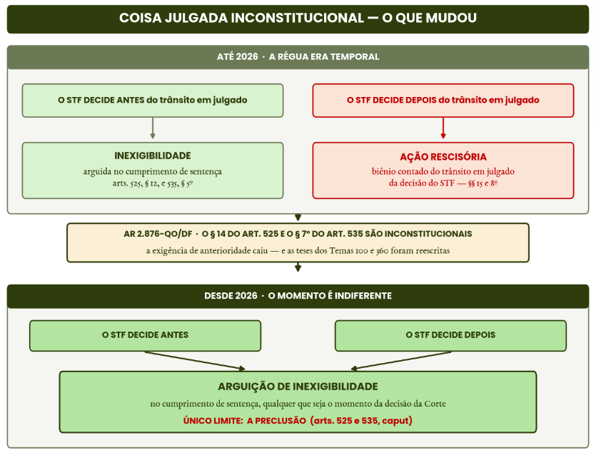
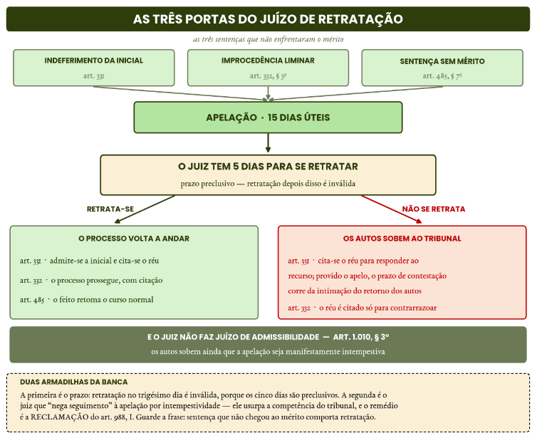

# Direito Processual Civil

Pontos 16 e 17 do edital: Processos nos tribunais e meios de impugnação das decisões judiciais

:::JC_F2F2F2 
**16. Processos nos tribunais. Ordem dos processos. Poderes do relator. Julgamento colegiado. Técnica de ampliação do colegiado. Incidente de assunção de competência. Arguição de inconstitucionalidade. Conflito de competência. Homologação de decisão estrangeira e exequatur. Incidente de resolução de demandas repetitivas. Reclamação. Ação rescisória. Sistema de precedentes. Precedentes obrigatórios e persuasivos. Ratio decidendi, distinção e superação. Recursos repetitivos. Repercussão geral. Relevância da questão de direito federal infraconstitucional.**

**17. Meios de impugnação das decisões judiciais. Teoria geral dos recursos. Efeitos, admissibilidade, preparo, desistência e renúncia. Apelação. Agravo de instrumento. Agravo interno. Embargos de declaração. Recurso ordinário. Recurso especial. Relevância da questão de direito federal infraconstitucional: demonstração, hipóteses de presunção, deliberação, participação de terceiros, suspensão de processos, julgamento e efeitos. Recurso extraordinário. Repercussão geral: demonstração, procedimento, presunções, participação de terceiros, sobrestamento, distinção, julgamento e efeitos. Agravos em recursos excepcionais. Embargos de divergência. Recursos repetitivos. Distinção e superação de precedentes.**
:::

Olá, pessoal! Vamos começar, agora, Direito Processual Civil.

Aqui, temos menos “doutrina” e **muito** do combo lei seca e jurisprudência. Como o CPC é de 2015, com efeitos em 2016, acaba que temos, aqui, maior “controle” sobre a jurisprudência relevante.

O índice de acertos médio é razoável. Então **não aceitem perder muitas questões aqui.** É semelhante a Direito Constitucional. Em matéria com índice médio de acertos, você não pode ficar aquém da média.

Sobre a aula de hoje, veremos: **a)** processos nos Tribunais; **b)** precedentes; e, **c)** recursos. Todos os temas são importantes e estão assim postos no JusLegis:

| [JusLEGIS] | > |
|---|---|
| **CPC** | arts. 926 a 928, 929 a 946, 947, 948 a 950, 951 a 959, 960 a 965, 966 a 975, 976 a 987, 988 a 993 e 994 a 1.044 |
| **CPC (correlatos)** | arts. 85, § 11, 332, 489, § 1º, V e VI, 496, 525, §§ 12 a 15, e 535, §§ 5º a 8º |
| **CF** | arts. 97, 102, III, 103-A e 105, III |
| **Lei nº 11.417/2006** | edição, revisão e cancelamento de súmula vinculante |
| **Lei nº 10.259/2001** | arts. 14 e 15 |

Os pontos 12 e 13 concentram a maior densidade de cobrança da FGV em processo civil nas provas de magistratura federal, com **enunciados longos**, de **narrativa fática detalhada**, que testam

Mas, de forma mais precisa, **como os temas podem cair?**

| **PROCESSOS NOS TRIBUNAIS E MEIOS DE IMPUGNAÇÃO** | > | > |
|---|---|---|
| **SUBTEMA** | **COMO A FGV COBRA** | **ONDE ISSO JÁ APARECEU** |
| 1. Precedentes | Precedente, jurisprudência e súmula; rol do art. 927; **ratio decidendi e obiter dictum**; **distinguishing** e o dever de cotejo; superação, **overriding** e revisão de tese; súmula vinculante e seus legitimados. | Dever de cotejo no **TRF2 (2026)**; modulação da tese e assunção de competência no **TRF6 (2025)**; legitimados à súmula vinculante no **TRF5 (2025)**. |
| 2. Ordem dos processos no tribunal | Literalidade dos prazos e das regras do colegiado: competência do relator, fato superveniente, pauta e sustentação oral, **pedido de vista**, alteração e declaração do voto, publicação do acórdão e **técnica de ampliação do art. 942**. | Julgamento ampliado no **TRF1 (2023)** e no TJ-CE (2025); pedido de vista no TJ- GO (2023); voto vencido e notas taquigráficas no TJ-SC (2024). |
| 3. Incidentes e competência originária | Requisitos e efeitos do **IRDR** e do **IAC**; arguição de inconstitucionalidade e reserva de plenário; conflito de competência; homologação de decisão estrangeira; **reclamação**; **ação rescisória** e coisa julgada inconstitucional. | IRDR no **TRF2 (2026)** e no **TRF6 (2025)**; IAC no **TRF6 (2025)**; homologação de decisão estrangeira no **TRF2 (2026)**; prazo da rescisória no **TRF5 (2025)**. |
| 4. Teoria geral dos recursos | Caso concreto com uma única pergunta: **qual o recurso e ele é tempestivo?** Prazos e dobra, preparo, procuração, preclusão, taxatividade mitigada, fungibilidade, **remessa necessária** e honorários. | Remessa necessária no **TRF5 (2025)**, no **TRF3 (2025)** e no TJ-SE (2025); prazos da Fazenda no **TRF5 (2025)**; honorários e equidade no TJ-GO e no TJ-BA (2026). |
| 5. Recursos em espécie | Efeito suspensivo da apelação e as exceções do art. 1.012, § 1º; **juízo de retratação**; causa madura; rol do art. 1.015; agravo interno; embargos de declaração; recurso ordinário; **prequestionamento** e repercussão geral. | Prequestionamento ficto no **TRF2 (2026)**; retratação nas provas do TJ-GO (2023), TJ-SC (2024 e 2025), TJ-CE (2025), TJ-MS (2025) e TJ-BA (2026). |
| 6. Justiça Federal e Juizados | Competência dos TRFs; **competência absoluta** do JEF; ausência de reexame necessário e de prazo diferenciado; mandado de segurança contra interlocutória; **pedido de uniformização** da Lei nº 10.259/2001. | Pedido de uniformização no **TRF2 (2026)**; Juizados e improcedência liminar no **TRF1 (2025)**; reserva de plenário e turmas recursais no **TRF5 (2017)** e no **TRF3 (2025)**. |

Isso é o mínimo para mostrar a relevância do assunto. Assim, vamos começar!

## 1. Precedentes no CPC: os arts. 926 e 927

A mudança de paradigma nos precedentes jurídicos no Brasil representa a transição de um **modelo clássico focado apenas na lei escrita ( *Civil Law *)** para **um sistema de valorização e vinculação de decisões dos tribunais superiores ( *stare decisis *).**

Essa mudança fica nítida a partir do novo CPC, em especial dos seus artigos 926 e 927. O art. 926 impõe quatro deveres: uniformizar a jurisprudência e mantê-la estável, íntegra e coerente. Por sua vez, o art. 927 lista os **precedentes de observância obrigatória.**

## 1.1. Precedente, jurisprudência e súmula

Vamos compreender alguns conceitos.

Precedente é a decisão, uma única decisão, que por sua fundamentação serve de paradigma para casos futuros.

Por sua vez, jurisprudência é o conjunto reiterado de decisões no mesmo sentido, dizendo-se dominante a que predomina, sem exigir unanimidade.

Súmula é o enunciado que sintetiza essa jurisprudência: é o resumo do precedente, não o precedente em si.

## 1.2. Precedentes obrigatórios e persuasivos

:::JC_FFFFFF 
Pelo art. 927, os juízes e os tribunais observarão:

**Código de Processo Civil**

Art. 927. Os juízes e os tribunais observarão:

I - as decisões do Supremo Tribunal Federal em controle **concentrado** de constitucionalidade;

II - os enunciados de **súmula vinculante;**

III - os acórdãos em incidente de **assunção de competência** ou de **resolução de demandas repetitivas e** em julgamento de recursos **extraordinário e especial repetitivos**;

IV - os enunciados das **súmulas do Supremo Tribunal Federal em matéria constitucional e do Superior Tribunal de Justiça em matéria infraconstitucional**;

V - a orientação do plenário ou do órgão especial **aos quais estiverem vinculados.**

§ 1º Os juízes e os tribunais observarão o disposto no art. 10 e no art. 489, § 1º, quando decidirem com fundamento neste artigo (**vedação à decisão surpresa)**

§ 2º A alteração de tese jurídica adotada em enunciado de súmula ou em julgamento de casos repetitivos poderá ser precedida de audiências públicas e da participação de pessoas, órgãos ou entidades que possam contribuir para a rediscussão da tese.

§ 3º Na hipótese de alteração de jurisprudência dominante do Supremo Tribunal Federal e dos tribunais superiores ou daquela oriunda de julgamento de casos repetitivos, **pode haver modulação dos efeitos da alteração no interesse social e no da segurança jurídica.**

§ 4º A modificação de enunciado de súmula, de jurisprudência pacificada ou de tese adotada em julgamento de casos repetitivos observará a **necessidade de fundamentação adequada e específica,** considerando os princípios da segurança jurídica, da proteção da confiança e da isonomia.

§ 5º Os **tribunais darão publicidade a seus precedentes**, organizando-os por questão jurídica decidida e divulgando-os, preferencialmente, na rede mundial de computadores.

Se esses são **obrigatórios,** os demais, desprovido de caráter vinculante, são os considerados “persuasivos”, pois apenas inspiram, mas não obrigam a decisão do juízo.

## 1.3. Ratio decidendi e obiter dictum
:::

São conceitos alusivos aos fundamentos de um precedente judicial.

***Ratio decidendi*** pode ser definida como os ==**fundamentos determinantes da decisão,**== aqueles sem os quais o resultado seria outro. É o que se universaliza e vincula. Não por outra razão, o art. 489, § 1º, V, exige que o julgador os identifique

Por sua vez, ***obiter dictum*** é o dito de passagem, não necessário ao resultado, e não vincula: não se ajuíza reclamação para fazê-lo valer, pois o art. 988, III e IV, pressupõe descumprimento **da tese**. Trata-se de argumento secundário, que funciona como reforço argumentativo.

## 1.4. Distinção, superação e modulação

Aqui temos **importantes técnicas de afastamento da aplicação dos precedentes.**

A ==**distinção**== - ou ***distinguishing*** - é a ==**não aplicação**== do precedente ao caso por **ausência de identidade entre os fatos relevantes ou por questão jurídica não examinada no paradigma**: o precedente continua válido, apenas não incide (art. 489, § 1º, VI, CPC).

A ==**superação**== **-** ou ***overruling*** -, é a ==**revogação da tese**==, podendo ser expressa ou implícita, total ou parcial, e prospectiva quando modulada para o futuro pelo art. 927, § 3º. Só o tribunal que fixou a tese, ou o superior, pode superá-la: o juízo de primeiro grau não promove superação nem altera a modulação fixada.

A ==**sinalização**==, ou **signaling**, mantém o precedente no caso, mas ==**anuncia sua provável superação futura**==.

A **revisão da tese** fixada em incidente de resolução de demandas repetitivas faz-se pelo **mesmo tribunal**, de **ofício** ou a requerimento dos legitimados do art. 977, III (art. 986), não é, portanto, iniciativa exclusiva das partes.

Quando a superação é apenas **parcial**, porque norma superveniente restringe o alcance do precedente sem revogá-lo, fala-se em ==**overriding**==; e, nesse cenário, é impróprio usar o **distinguishing** como via indireta de superação da tese.

:::JC_FBEFD6 Chance alta TRF5
**A distinção é o tema predileto da FGV em provas federais. No TRF2 de 2026 e no TRF6 de 2025 o eixo foi o mesmo: o precedente obrigatório vincula, mas sua aplicação exige o cotejo entre o caso concreto e o contexto fático do paradigma.**
:::

:::JC_FFE698 JÁ CAIU!
**(Juiz Federal - TRF2 - FGV - 2026)** Em Juízo Federal com competência previdenciária tramita ação ordinária em que segurado do RGPS busca a revisão da renda mensal inicial (RMI) de aposentadoria concedida há mais de dez anos, sob o argumento de que períodos de atividade especial não foram devidamente considerados no cálculo do benefício. A matéria foi objeto de recurso especial repetitivo no STJ, que fixou tese restritiva à revisão pretendida. O INSS invoca o precedente em contestação, sustentando seu caráter vinculante. No curso da instrução, todavia, produzem-se documentos que revelam circunstância fática não examinada no julgamento paradigma: o segurado esteve submetido a regime contributivo específico, decorrente de atividade profissional regulamentada por legislação especial. Na fase decisória, o magistrado reconhece o precedente vinculante, mas verifica que as peculiaridades fáticas do caso concreto podem influenciar a aplicação da tese firmada pelo STJ. Considerando o regime jurídico

dos precedentes, os deveres de fundamentação da decisão judicial e as disposições do Código de Processo Civil, assinale a afirmativa correta.

(A) A existência de tese firmada em recurso especial repetitivo impede que o magistrado examine particularidades fáticas do caso concreto, devendo o precedente ser aplicado sempre que a matéria jurídica discutida seja semelhante.

(B) O precedente formado em recurso repetitivo possui força vinculante para todos os órgãos jurisdicionais, mas sua aplicação exige análise da compatibilidade entre o caso concreto e o contexto fático considerado no julgamento paradigma.

(C) A tese fixada em recurso repetitivo vincula apenas os tribunais, possuindo natureza persuasiva para os juízes de primeiro grau, que podem decidir livremente de forma diversa.

(D) O magistrado somente poderá afastar a aplicação do precedente obrigatório se demonstrar expressamente a superação da tese jurídica pelo tribunal superior competente.

(E) A eventual divergência entre o caso concreto e o padrão decisório obrigatório deve ser resolvida mediante suspensão do processo até nova manifestação do tribunal superior.⁶³
:::

Vamos condensar ==**todas as possíveis cobranças de institutos**== de aplicação e superação de precedentes para que não fiquem dúvidas:

| **TÉCNICAS DE APLICAÇÃO E SUPERAÇÃO DOS PRECEDENTES** | > | > |
|---|---|---|
| **TÉCNICA** | **REVOGA?** | **O QUE FAZ E COMO SE IDENTIFICA** |
| **AFASTAM O PRECEDENTE SEM REVOGÁ-LO** | > | > |
| **Distinguishing** (distinção) | **Não** | Afasta o precedente porque os **fatos são outros**: ou não há coincidência entre os fatos do caso e os que serviram de base a ratio decidendi, ou alguma peculiaridade do caso impede a aplicação. O precedente continua válido, apenas não incide. |
| **Transformation** (transformação) | **Não** | **Atualiza** o precedente sem negá-lo: o tribunal dá relevo a fatos que o julgado anterior tratou apenas de passagem e, com isso, compatibiliza o paradigma com o resultado que pretende alcançar. |
| **Overriding** (superação parcial) | **Não** | **Restringe o âmbito de incidência** do precedente, afastando parte dele. Assemelha-se a uma **revogação parcial, mas não invalida o paradigma**. O que a distingue do distinguishing é o **fundamento**: aqui não há distinção de fatos, e sim **lei ou entendimento superveniente**, fundado em novas condicionantes sociais incompatíveis com as que justificaram a formação do precedente. |
| ***Drawing of inconsistent distinctions*** (distinções inconsistentes) | **Não** | Também afasta **parte** do precedente, como o overriding, mas **sem** novas condicionantes sociais ou legais. A tese adotada no julgamento é **incompatível** com a ratio decidendi do paradigma, e por isso a distinção é dita “inconsistente”. Na prática, é um *distinguish* mal-feito. Prática consolidada nos tribunais norte-americanos e criticada pela doutrina, que prefere a distinção coerente ou a superação assumida. |
| **ANUNCIA A SUPERAÇÃO FUTURA** | > | > |
| **Signaling** (sinalização) | **Ainda não** | O tribunal **reconhece que o precedente está equivocado**, mas, em nome da segurança jurídica, **ainda o aplica** ao caso e apenas **sinaliza** a revogação futura. Situa-se **entre o distinguishing e o overruling**. Evita a surpresa. |
| **REVOGA O PRECEDENTE** | > | > |
| **Overruling** (superação) | **Sim** | O precedente **perde a força vinculante** e é substituído por outra ratio decidendi: sai do sistema. Pode ser **expresso** (o tribunal declara a nova orientação) ou **tácito** (adota posição contrária sem dizê-lo). |
| **Prospective overruling** | **Sim, ex nunc** | A revogação vale **para o futuro**. O precedente superado ainda alcança os casos anteriores ainda não julgados, mas não serve de paradigma daí em diante. |
| **Retrospective overruling** | **Sim, ex tunc** | A revogação alcança os **casos pendentes** de julgamento e os futuros. |
| **Anticipatory overruling** | **Sim, antecipado** | O **órgão inferior** deixa de aplicar o precedente do tribunal superior porque a superação é previsível. O juiz atua como porta-voz da corte que ainda vai revogar. Ex.: o TRF deixa de seguir precedente do STJ porque mudou a lei que o fundamentava. |
| **NÃO É TÉCNICA DE SUPERAÇÃO** | > | > |
| **Reversal** (reforma) | **Não** | Não há revogação de precedente algum: é a **reforma, pelo órgão ad quem**, da decisão do juízo inferior que aplicou mal a ordem jurídica. Serve para **adequar** o julgado aos precedentes da corte revisora. É técnica de **controle**, não de superação. |
| **Conflict over time** (conflito de precedentes) | **Não** | Não confunda com o overruling. Este é **mudança consciente** de orientação; o conflict over time decorre, em regra, do **desconhecimento** da existência de precedente em sentido contrário. |

## 1.5. Reflexos sistêmicos dos precedentes

:::JC_FFFFFF 
O art. 489, § 1º, V, considera **não fundamentada** a decisão que apenas invoca precedente ou súmula **sem identificar seus fundamentos determinantes** ou que deixa de seguir precedente invocado pela parte sem demonstrar distinção ou superação.

**Os mesmos padrões dispensam a remessa necessária e autorizam o julgamento monocrático** do art. 932, IV e V.

**DICA:** focar sempre na ideia de que, por ser um precedente “seguro”, admitem-se atalhos processuais para o processo terminar mais rapidamente.

## 1.6. Súmula vinculante
:::

%% Chance alta TRF5

**Tema transversal:** leia o tema no material de DIREITO CONSTITUCIONAL para evitar repetições.

## 2. Ordem dos processos no tribunal

## 2.1. Distribuição, prevenção e competência do relator

Incumbe ao relator, pelo art. 932, dirigir e ordenar o processo, homologar autocomposição, apreciar tutela provisória e outras providências para gerir o processo. O parágrafo único traz o dever de saneamento: antes de considerar inadmissível o recurso, concede cinco dias para sanar vício ou complementar a documentação.

## 2.2. Fato superveniente e vícios sanáveis

:::JC_FFFFFF 
Constatada pelo relator a ocorrência de **fato superveniente ou de questão apreciável de ofício ainda não examinada,** as partes são intimadas para manifestar-se em **cinco dias**. Se a constatação ocorrer durante a sessão, esta será imediatamente suspensa. A questão preliminar é decidida antes do mérito, deste não se conhecendo caso seja incompatível com a decisão, e os juízes vencidos na preliminar devem pronunciar-se sobre a matéria principal.

## 2.3. Pauta, sustentação oral e pedido de vista
:::

A sustentação oral, após a exposição da causa pelo relator, cabe sucessivamente ao recorrente, ao recorrido e, nos casos de sua intervenção, ao Ministério Público, pelo prazo improrrogável de quinze minutos para cada um, na apelação, no recurso ordinário, no recurso especial, no recurso extraordinário, nos embargos de divergência, na ação rescisória, no mandado de segurança, na reclamação e no agravo de instrumento contra decisões sobre tutelas provisórias.

Admite-se videoconferência ao advogado com domicílio profissional em cidade diversa da sede do tribunal.

%% EXCEÇÃO

Em regra, **não cabe** sustentação oral em agravo interno nem em embargos de declaração. A exceção legal expressa é a do art. 937, § 3º: agravo interno contra decisão de relator que extingue ação rescisória, mandado de segurança ou reclamação de competência originária.

O **pedido de vista** tem prazo de **dez dias**, prorrogável por mais dez a requerimento. Não devolvidos os autos e não pedida a prorrogação, o presidente **requisita** o processo para julgamento na sessão ordinária subsequente e, se o autor do pedido ainda não se sentir habilitado a votar, **convoca substituto** (art. 940 e §§). Não há, portanto, vinculação indefinida do julgamento à disponibilidade do vogal.

%% Tome seu café

Esse assunto é chato, eu sei. Vamos esquematizar para ficar mais fluido:

## 2.4. Proclamação, voto vencido e julgamento ampliado

| **O JULGAMENTO NO TRIBUNAL EM NÚMEROS** | > | > |
|---|---|---|
| **SITUAÇÃO** | **NÚMERO** | **REGRA** |
| **ANTES DA SESSÃO** | > | > |
| Saneamento de vício antes de inadmitir o recurso | 5 dias | Dever do relator, art. 932, parágrafo único. Aplica-se inclusive à falta de peça no instrumento do agravo. |
| **Fato superveniente** ou questão apreciável de ofício | 5 dias | As partes são intimadas para manifestar-se (art. 933). Se a constatação ocorrer durante a sessão, esta é **imediatamente suspensa**. |
| Publicação da pauta e intervalo até a sessão | 5 dias | Entre a publicação e a sessão devem mediar ao menos cinco dias. |
| **NA SESSÃO** | > | > |
| **Sustentação oral** | 15 minutos | Para cada parte, na apelação, nos recursos ordinário, especial e extraordinário, nos embargos de divergência, na rescisória, no mandado de segurança, na reclamação e no agravo de instrumento sobre tutela provisória. **Não cabe** em agravo interno nem em embargos de declaração, salvo a exceção do art. 937, § 3º. |
| **Pedido de vista** | 10 + 10 dias | Dez dias, prorrogáveis por mais dez a requerimento. Não devolvidos os autos, o presidente os **requisita** para a sessão subsequente e, se o autor do pedido ainda não se sentir habilitado, **convoca substituto** (art. 940). |
| **Alteração do voto** | Até a proclamação | Salvo o voto já proferido por juiz **afastado ou substituído** (art. 941, § 1º). |
| **Voto vencido** | Sempre declarado | Integra o acórdão **para todos os fins legais, inclusive de prequestionamento** (art. 941, § 3º). |
| Colegiado na apelação e no agravo de instrumento | 3 julgadores | Art. 941, § 2º. A **maioria** decide. |
| [Chance alta TRF5] **Técnica de ampliação** do art. 942 | Quantos bastem | Julgadores em número suficiente para **inverter** o resultado. Na apelação basta a não unanimidade; no agravo de instrumento exige-se **reforma de decisão parcial de mérito**; na rescisória, que o resultado seja a **rescisão**. Não se aplica ao IRDR, ao IAC, à remessa necessária nem ao plenário. |
| **DEPOIS DA SESSÃO** | > | > |
| Publicação do acórdão | 30 dias | Não publicado nesse prazo, as **notas taquigráficas** o substituem para todos os fins, independentemente de revisão; o presidente lavra de imediato a ementa (art. 944). |
| **Erro material** | A qualquer tempo | Corrigível **de ofício**, inclusive pelo tribunal no julgamento da apelação (art. 494, I). Não há julgamento extra petita nem usurpação da competência do juízo de origem. |
| Declaração de inconstitucionalidade | Maioria absoluta | Do plenário ou do órgão especial (art. 97 da CF). A decisão que julga a prejudicial é **irrecorrível**, cabendo apenas embargos de declaração. |

De todos esses fenômenos, pensamos que a **técnica de ampliação do colegiado** é, sem dúvidas, aquele assunto que mais possui chances de ser explorado. **A ampliação do colegiado não é um recurso nem uma contagem de votos**: é **técnica** de ampliação do debate, de incidência automática e de ofício, **que reforça o contraditório dando às partes a chance de convencer julgadores que ainda não conhecem o caso**.

Daí decorre tudo: o julgamento é um só e não se encerra antes da ampliação; todos os convocados votam, ainda que a maioria já esteja formada; a revisão de voto não dispensa a técnica; e, na **apelação**, qualquer divergência apta a mudar o resultado a atrai, seja de preliminar, seja de mérito

| **TÉCNICA DE AMPLIAÇÃO DO COLEGIADO (ART. 942)** | > | > |
|---|---|---|
| **SITUAÇÃO** | **AMPLIA?** | **JULGADO E RAZÃO DE DECIDIR** |
| **APELAÇÃO - BASTA A NÃO UNANIMIDADE** | > | > |
| Apelação não unânime que **mantém** a sentença | **Sim** | Ao contrário dos antigos embargos infringentes, **não se exige reforma**: o que importa é que o acórdão tenha sido por maioria. **REsp 1.733.820-SC** (Info 639). |
| Divergência apenas na **preliminar de admissibilidade** (ex.: conhecimento de recurso adesivo) | **Sim** | O art. 942 não limita a ampliação às questões de mérito: na apelação, **qualquer** julgamento não unânime a atrai. **REsp 1.798.705-SC** (Info 659). |
| Divergência sobre o **valor** da indenização por dano moral | **Sim** | O quantum é **matéria de mérito** e pode alterar o resultado. A ausência de ampliação é nulidade por **error in procedendo**. **REsp 2.207.919-MA** (Info 865). |
| Divergência apenas quanto à **fundamentação** | **Não** | Se o dissenso não é capaz de alterar o resultado, não há o que ampliar. Mesmo julgado (**REsp 2.207.919-MA**, Info 865). |
| Apelação em **mandado de segurança** | **Sim** | A técnica **não é excluída pelo rito especial do writ**. **REsp 1.868.072-RS** (Info 695). |
| **AGRAVO DE INSTRUMENTO: EXIGE REFORMA DE DECISÃO QUE JULGOU PARCIALMENTE O MÉRITO** | > | > |
| Decisão da **primeira fase da ação de exigir contas** | **Sim** | A interlocutória tem **conteúdo meritório**, e “julgar parcialmente o mérito” abrange amplamente as interlocutórias sobre o mérito. **REsp 2.105.946-SP** (Info 816). |
| Decisão que julga **impugnação de crédito** na recuperação judicial | **Sim** | A impugnação é **ação incidental declaratória**: definir a validade e a classificação do crédito é mérito. **REsp 1.797.866-SP** (Info 649). |
| Decisão de mérito em **liquidação por arbitramento** | **Sim** | Reformada por maioria a decisão que homologou o laudo e encerrou a liquidação, amplia-se o colegiado. **REsp 2.111.495- DF** (Info 28, ed. extraordinária). |
| **Embargos de declaração** contra acórdão de agravo de instrumento | **Depende** | Só se os embargos forem **acolhidos com efeito infringente** e daí resultar a reforma da decisão parcial de mérito de primeiro grau. **REsp 1.841.584-SP** (Info 662). |
| **COMO O COLEGIADO AMPLIADO FUNCIONA POR DENTRO** | > | > |
| **Dispensar o quinto julgador** porque a maioria já está formada | **Não pode** | A técnica não é busca de maioria: o quinto voto pode **convencer** os demais, que podem rever seus votos (§ 2º). Presumir irrelevância do voto contraria a finalidade da técnica. **REsp 1.890.473-MS** (Info 705). |
| **Revisão do voto** vencido depois de convocados os novos julgadores | **Não afasta** | Os convocados votam assim mesmo. **Enunciado 599- FPPC,** cobrado pela FGV na PGE-SC de 2022. |
| **Embargos de declaração** contra o acórdão do colegiado ampliado | **Quórum ampliado** | Devem ser julgados pelos mesmos cinco julgadores, sob pena de a tese antes minoritária sagrar-se vencedora. **REsp 2.024.874-RS** (Info 766). |

Em resumo, na apelação, você sempre aplica. No agravo de instrumento, o cabimento é mais limitado, sobretudo em caso de “decisões interlocutórias de mérito”, que, em verdade, são “sentenças parciais”. Vejamos como o tema foi cobrado:

.

:::JC_FFE698 JÁ CAIU!
**(Juiz Federal - TRF1 - FGV - 2023)** Em sessão de julgamento de Turma do Tribunal Regional Federal da 1ª Região, um dos julgadores apresentou voto divergente. O julgamento deverá prosseguir com a convocação de julgadores em número suficiente para modificar o resultado do julgamento se a divergência houver ocorrido no julgamento de:

a) apelação, salvo quando interposta esta em face de sentença de extinção do processo sem resolução de mérito;

b) agravo de instrumento, quando houver reforma de decisão proferida no processo de execução;

c) apelação, salvo quando a divergência limitar-se a questões preliminares relativas ao juízo de admissibilidade do recurso;

d) apelação, restringindo-se o julgamento ampliado à matéria objeto da divergência;

e) agravo de instrumento, quando houver reforma de decisão de mérito proferida em liquidação por arbitramento.⁶⁴
:::

## 3. IAC e IRDR

:::JC_FFFFFF NÃO CONFUNDA
**Você não pode errar diferenças entre esses institutos,** pois sabemos que há grandes pontos passíveis de cobrança!

De fato, **os dois pertencem ao mesmo microssistema de precedentes qualificados**: geram precedente obrigatório (art. 927, III), pressupõem processo pendente no tribunal, são julgados pelo órgão de uniformização indicado no regimento e podem ser provocados de ofício ou a requerimento da parte, do Ministério Público e da Defensoria Pública.

O que os **separa** é o motivo pelo qual o tribunal avoca a questão.

No ==**IRDR**==, é a **quantidade**: há efetiva repetição de processos e risco de ofensa à isonomia e à segurança jurídica.

No ==**IAC**==, é a **qualidade**: a questão vale por si, tem grande repercussão social. **Entenda:** pode até haver multiplicidade de processos, mas isso não é requisito para o IAC. Inclusive, sobre
:::

isso:

:::JC_B3E5A1 Chance alta TRF5 · DICA DO PROFESSOR
**O julgado mais quente do tema é do STF, de novembro de 2025, e relativiza a leitura literal do art. 947: a repetição da questão em vários processos não impede, por si, a assunção de competência, desde que a matéria tenha relevância social própria.**

**O que distingue os dois incidentes é a importância intrínseca da questão discutida, e não a quantidade de processos sobre o tema.**

No mesmo julgado o **Supremo assentou que o IAC é cabível na Corte, nos processos de competência originária e nas hipóteses de competência recursal ordinária - mas não em recurso extraordinário, porque aí a repercussão geral já cumpre a função de uniformizar.**
:::

:::JC_B3E5A1 
**STF. Plenário. Rcl 73.295/BA, Rel. Min. Gilmar Mendes, julgado em 19/11/2025 (Info 1200).**
:::

%% TOME NOTA

Vale a pena vermos as diferenças de maneira mais analítica:

| **IAC × IRDR** | > | > |
|---|---|---|
| **CRITÉRIO** | **ASSUNÇÃO DE COMPETÊNCIA (ART. 947)** | **DEMANDAS REPETITIVAS (ARTS. 976 A 987)** |
| **Pressuposto central** | Relevante questão de direito, com **grande repercussão social**, sem repetição em múltiplos processos. | **Efetiva repetição** de processos sobre a mesma questão **unicamente de direito** e risco de ofensa à **isonomia e à segurança jurídica** (requisitos cumulativos). |
| **O que justifica a avocação** | A **qualidade** da questão: ela vale por si, pela repercussão social. | A **quantidade**: a massificação do litígio e o risco de decisões conflitantes. |
| **A repetição impede?** | Pela letra do art. 947, sim. Mas o **STF** decidiu que a repetição **não impede** o incidente quando a matéria tem relevância social própria (Rcl 73.295, Info 1200). O que não há é uma exigência de múltiplas ações. Se a questão cobrar a literalidade, vale considerar correta! | Ao contrário: a repetição é o próprio requisito. E o incidente é **incabível se um tribunal superior já afetou recurso repetitivo sobre a questão (art. 976, § 4º).** |
| **É “caso repetitivo” (art. 928)?** | Não. É precedente obrigatório pelo art. 927, III, mas não é caso repetitivo. | Sim, ao lado dos recursos extraordinário e especial repetitivos. |
| **Finalidade adicional** | Prevenir ou compor **divergência entre câmaras ou turmas** do tribunal (art. 947, § 4º). | Uniformizar a tese e assegurar tratamento isonômico ao litígio de massa. |
| **Legitimados** | O **relator**, de ofício, ou a requerimento da parte, do Ministério Público ou da Defensoria Pública (art. 947, § 1º). | O juiz ou relator, por ofício; as partes, o Ministério Público e a Defensoria Pública, por petição (art. 977) |
| **Admissibilidade** | O colegiado julga o feito **se reconhecer interesse público** na assunção (§ 2º). | É do **colegiado**, vedada decisão monocrática (Enunciado 91 do FPPC), e **irrecorrível**, salvo embargos de declaração. Inadmitido por falta de pressuposto, pode ser **novamente suscitado** (art. 976, § 3º). |
| **Nos tribunais superiores** | Cabe no STJ e no STF apenas em competência **originária** e **recursal ordinária** - **nunca em recurso especial ou extraordinário.** | Mesma régua: no STJ, apenas em competência originária e recursal ordinária (AgInt na Pet 11.838). Em recurso especial a função é do **repetitivo**. |

## Causa-piloto × causa-modelo

Há um segundo contraponto que a banca começou a explorar, agora dentro do próprio incidente de resolução de demandas repetitivas: o tribunal, ao julgá-lo, decide **um caso concreto** ou apenas fixa uma **tese em abstrato**?

%% NÃO CONFUNDA

Na sistemática da ==**causa-piloto**==, seleciona-se uma lide concreta, com partes determinadas, que serve de referência para delimitar a controvérsia; o tribunal fixa a tese **e julga aquele processo**.

Na sistemática do ==**procedimento-modelo, ou causa-modelo**==, fixa-se a tese sem nenhuma causa que a subsidie.

==**O CPC adotou, como regra, a causa-piloto.**==

É o que impõe o parágrafo único do art. 978: o órgão que fixa a tese julgará **igualmente** o recurso, a remessa necessária ou o processo de competência originária de onde se originou o incidente. O tribunal, portanto, **não é livre** para avocar uma questão de direito desvinculada de causa que esteja sob sua apreciação. foi exatamente o vício reconhecido pelo Superior Tribunal de Justiça em caso oriundo do Amapá, em que o incidente nasceu de simples **ofício de uma juíza de primeiro grau**, sem processo pendente no tribunal.

O fundamento é o **contraditório**. Como o precedente do incidente vincula a todos, as partes dos processos selecionados funcionam como **representantes adequados** de todos os afetados. Retirá-las do julgamento transformaria o incidente, na expressão do próprio acórdão, em uma **“justiça de cidadãos sem rosto e sem fala”**.

| **CAUSA-PILOTO × CAUSA-MODELO NO IRDR** | > | > |
|---|---|---|
| **CRITÉRIO** | **CAUSA-PILOTO (A REGRA)** | **CAUSA-MODELO (A EXCEÇÃO)** |
| **Como funciona** | Seleciona-se uma **lide concreta**, com partes determinadas, que serve de referência para a controvérsia. O tribunal fixa a tese **e julga aquele caso**. | Fixa-se a tese **em abstrato**, sem nenhuma causa subjacente que a subsidie. |
| **Base legal** | Art. 978, parágrafo único: o órgão que fixa a tese julga **igualmente** o recurso, a remessa necessária ou o processo originário de onde veio o incidente. | Não tem previsão autônoma: é admitida apenas nas duas brechas abertas pelo próprio Código. |
| **Quando se admite** | Sempre - é a **regra**. O incidente deve ser instaurado em processo **já em curso** no tribunal. | Somente em **duas** hipóteses: (a) **desistência ou abandono** das partes cujos processos foram selecionados (art. 976, § 1º); (b) pedido de **revisão da tese** já fixada (art. 986). |
| **Por quê** | As partes selecionadas atuam como **representantes adequados** dos demais afetados: é o núcleo do contraditório no litígio de massa. | Nas duas exceções não há parte a ser ouvida - ou porque desistiu, ou porque se discute a tese em si, sem caso concreto. |
| **Consequência recursal** | Cabe **REsp ou RE** da parte do acórdão que **aplica** a tese ao caso concreto: aí há “causa decidida”. | Em regra **não** cabe, por ausência de causa decidida. **Exceção**: cabe para discutir a aplicação, em concreto, das **regras processuais de admissão e julgamento** do próprio incidente. |
| **STJ. 2ª Turma. REsp 2.023.892-AP, Rel. Min. Herman Benjamin, julgado em 5/3/2024 (Info 803).** O CPC estabeleceu, como regra, a sistemática da causa-piloto para o julgamento do incidente de resolução de demandas repetitivas. | > | > |

%% PEGADINHA

A suspensão dos processos, admitido o IRDR, é determinada pelo relator e independe de requerimento (embora não seja automática). O art. 982, § 3º, cuida da extensão nacional da suspensão, essa sim dependente de requerimento ao tribunal superior.

:::JC_FFE698 JÁ CAIU!
**(Juiz Federal - TRF6 - FGV - 2025)** O Tribunal Regional Federal da 6ª Região proferiu acórdão em julgamento de Incidente de Resolução de Demandas Repetitivas (IRDR), estabelecendo efeitos prospectivos para sua decisão, de modo a preservar atos jurídicos praticados com base no entendimento jurisprudencial anteriormente dominante. Logo após a publicação do acórdão de julgamento, o Juízo Federal de Primeira Instância, ao aplicar a tese firmada no IRDR, por já ter

adotado o entendimento hoje vinculante em sentenças anteriores, expressamente concedeu efeitos retroativos à tese. À vista do disposto no Código de Processo Civil e da jurisprudência consolidada do STJ, assinale a afirmativa correta.

(A) O juízo federal de primeira instância pode aplicar os efeitos do precedente de maneira diversa àquela fixada pelo TRF-6, de forma retroativa, independentemente da ocorrência de distinção ou superação da tese firmada.

(B) O efeito vinculante da tese adotada pelo TRF-6 somente ocorrerá a partir do trânsito em julgado da decisão proferida no incidente de resolução de demandas repetitivas, razão pela qual seria lícito ao juízo federal modular seus efeitos.

(C) A tese firmada pelo TRF-6 somente é vinculante para o próprio órgão prolator da decisão, de modo que o juiz de primeiro grau pode deixar de seguir o precedente ou aplicá-lo de forma retrospectiva, tal como o fez.

(D) Em razão da unidade da Justiça Federal, o acórdão de julgamento do IRDR vinculará a todos os Tribunais Regionais Federais e juízos federais, independentemente de submissão do processo a julgamento pelo Superior Tribunal de Justiça ou pelo Supremo Tribunal Federal.

(E) A modulação dos efeitos da tese estabelecida no IRDR é de competência exclusiva do TRF-6, não podendo o juízo federal de primeira instância deixar de aplicar o efeito prospectivo firmado pelo Tribunal.⁶⁵
:::

## 4. Arguição de inconstitucionalidade e reserva de plenário

Arguida, em controle difuso, a inconstitucionalidade de lei ou ato normativo do poder público, o relator, ouvidos o Ministério Público e as partes, submete a questão à turma ou à câmara. Rejeitada, prossegue o julgamento; acolhida, a questão vai ao plenário ou ao órgão especial.

O parágrafo único do art. 949 traz a **dispensa mais cobrada**: os órgãos fracionários não submeterão a arguição quando já houver pronunciamento daqueles órgãos ou do plenário do Supremo Tribunal Federal sobre a questão.

:::JC_B3E5A1 SÚMULA
**Súmula 513-STF**: A decisão que enseja a interposição de recurso ordinário ou extraordinário não é a do plenário, que resolve o incidente de inconstitucionalidade, mas a do órgão (câmaras, grupos ou turmas) que completa o julgamento do feito.
:::

:::JC_FBEFD6 Chance alta TRF5
O recurso extraordinário deve ser interposto contra o acórdão proferido pelo órgão fracionário, o qual completa o julgamento do feito. Leia-se: **não se recorre da tese em abstrato!**
:::

## 5. Conflito de competência

| **CONFLITO** | **COMPETÊNCIA** |
|---|---|

| Entre o STJ e quaisquer tribunais, entre tribunais superiores, ou entre estes e outro tribunal | STF, art. 102, I, o |
|---|---|

| Entre quaisquer tribunais e entre juízes vinculados a tribunais diversos | STJ, art. 105, I, d |
|---|---|

| Entre juízes federais vinculados ao mesmo tribunal | TRF, art. 108, I, e |
|---|---|

| Entre juizado especial federal e juízo federal da mesma seção judiciária | TRF respectivo |
|---|---|

| Entre TRF e turma recursal de juizado especial federal da mesma Região | TRF, por haver vinculação administrativa |
|---|---|

%% NÃO CONFUNDA

**Conflito de competência NÃO é sinônimo de conflito de atribuições:** nos casos que envolvem **atribuições do Ministério Público,** quem delibera **NÃO** é o Poder Judiciário.

Nesse sentido, ==**compete ao CNMP dirimir conflitos de atribuições entre membros do MPF e de Ministérios Públicos estaduais**==. STF. Plenário. ACO 843/SP, Rel. para acórdão Min. Alexandre de Moraes, julgado em 05/06/2020.

%% PEGADINHA

A pegadinha é: se o conflito envolver membros do MPF, MPT, MPDFT ou MP Militar, **quem resolve o conflito é o Procurador-Geral da República,** pois todos são membros do MPU (gênero).

## 6. Homologação de decisão estrangeira e exequatur

**A homologação é requerida por ação própria perante o Superior Tribunal de Justiça,** salvo disposição especial em tratado.

A **decisão interlocutória estrangeira é executada por carta rogatória**. Ademais, a decisão estrangeira só tem eficácia no Brasil após a homologação ou o exequatur, admitida homologação parcial.

São requisitos do art. 963 para a homologação:

- a competência da autoridade prolatora;

- a citação regular ainda que verificada a revelia;

- a eficácia no país de origem;

- a ausência de ofensa à coisa julgada brasileira;

- a tradução oficial e

- a ausência de manifesta ofensa à ordem pública.

O Superior Tribunal de Justiça exerce **juízo de delibação**, isto é, só analisa aspectos formais, sem reexaminar o mérito (erro de interpretação contratual, desproporção da indenização ou injustiça da decisão não são alegações cognoscíveis, como cobrado no TRF2 de 2026).

%% NÃO CONFUNDA

No **auxílio direto**, ao contrário da carta rogatória, não há decisão estrangeira a endossar, mas decisão brasileira, **de competência da Justiça Federal**, e o cumprimento da decisão homologada faz-se perante o juízo federal.

Por fim, recordem-se que a ==**sentença estrangeira de divórcio consensual produz**==

:::JC_D9F2D0 
**efeitos no Brasil independentemente de homologação pelo Superior Tribunal de Justiça**, e
:::

qualquer juiz pode examinar sua validade, em caráter principal ou incidental, quando a questão for suscitada em processo de sua competência.

## 7. Reclamação

A reclamação é ação autônoma de impugnação, e não recurso. Cabe, por proposta da parte interessada ou do Ministério Público, para **preservar a competência do tribunal**, **garantir a autoridade de suas decisões**, **garantir a observância de súmula vinculante e de decisão do Supremo Tribunal Federal em controle concentrado, e garantir a observância de acórdão em incidente de resolução de demandas repetitivas ou de assunção de competência**, alcançando tanto a aplicação indevida da tese quanto a sua não aplicação.

%% TOME NOTA

Pontos importantes:

- **Exige-se aderência estrita**: não basta invocar um precedente do Supremo, é preciso que o ato reclamado tenha o mesmo objeto do paradigma.

- O segundo é o cabimento por **usurpação de competência** (art. 988, I): como o juízo de origem não faz juízo de admissibilidade da apelação (art. 1.010, § 3º), a decisão que nega seguimento ao recurso usurpa a competência do tribunal e desafia reclamação.

:::JC_D9F2D0 
**O ponto mais cobrado diz respeito à EXIGÊNCIA DE ESGOTAMENTO DE**
:::

==**INSTÂNCIAS**==**:**

| **PADRÃO DESCUMPRIDO** | **EXIGÊNCIA DE ESGOTAMENTO** |
|---|---|

| **Súmula vinculante** | esgotamento apenas da via administrativa, quando o ato for da Administração. **Não se exige na via judicial.** |
|---|---|

| **Tese de IRDR e de IAC** | não se exige esgotamento |
|---|---|

| **Repercussão geral e recursos repetitivos** | **exige-se o esgotamento das instâncias ordinárias**⁶⁶ |
|---|---|

| **Decisão de turma recursal de JEF contrária ao STJ** | **não cabe** reclamação, e sim pedido de uniformização |
|---|---|

## 8. Ação rescisória e coisa julgada inconstitucional

## 8.1. Natureza jurídica

**A rescisória é ação autônoma de impugnação, de competência originária de tribunal, constitutiva negativa no juízo rescindendo e de conhecimento no rescisório.**

==**Pressupõe decisão de mérito transitada em julgado**== e, ==**excepcionalmente,**==

:::JC_FFCCCC 
**decisão que, embora não seja de mérito, impeça nova propositura da demanda** ou a
:::

admissibilidade do recurso correspondente, podendo ter por objeto apenas um capítulo da decisão.

Vale a pena conhecer a legislação! **É um ótimo custo-benefício!**

:::JC_F2F2F2 
**CPC**

**Indicação de leitura:** artigos 966 a 975 do Código.
:::

Vamos esquematizar tudo!

%% Esquematizando

| **AÇÃO RESCISÓRIA: OBJETO, PROCEDIMENTO E PRAZO** | > | > |
|---|---|---|
| **TEMA** | **REGRA** | **DETALHE QUE A BANCA COBRA** |
| **O QUE SE RESCINDE** | > | > |
| **Objeto** | Decisão de **mérito** transitada em julgado. Excepcionalmente, a que **não** é de mérito, mas impede nova propositura da demanda ou a admissibilidade do recurso correspondente (art. 966, § 2º). | Pode ter por objeto **apenas um capítulo** da decisão. E alcança a **decisão parcial de mérito** do art. 356 não impugnada por agravo: ela transita em julgado autonomamente e, vencido o prazo, só cai por rescisória. |
| **Erro de fato** | Há erro de fato quando a decisão **admite fato inexistente** ou **considera inexistente fato ocorrido** (art. 966, VIII). | Exige que o fato **não** tenha sido ponto controvertido sobre o qual o juiz devesse pronunciar-se. Se houve debate e decisão, não é erro de fato - é inconformismo. |
| **Distinção omitida** | Cabe rescisória por **violação manifesta de norma jurídica** contra decisão baseada em súmula ou em acórdão de casos repetitivos que **não considerou a distinção** entre a questão discutida e o padrão aplicado (art. 966, §§ 5º e 6º). | O autor deve **demonstrar** a hipótese fática distinta ou a questão jurídica não examinada. É o distinguishing chegando tarde - pela via rescisória. |
| **Não cabe** | Os **atos homologatórios** praticados no curso da execução sujeitam-se a **anulação**, e não a rescisória (art. 966, § 4º). | Guarde o par: ato homologatório na execução → ação anulatória. Decisão de mérito transitada → rescisória. |
| **Legitimados** | Quem foi **parte** ou seu sucessor; o **terceiro juridicamente interessado**; o **Ministério Público**; e quem **não foi ouvido** no processo em que lhe era obrigatória a intervenção (art. 967). | O rol é fechado. O terceiro precisa de interesse **jurídico,** não bastando o interesse meramente econômico. |
| **A PETIÇÃO INICIAL: ART. 968** | > | > |
| **Cumulação obrigatória** | Cumular ao pedido de **rescisão** (juízo rescindendo), se for o caso, o de **novo julgamento** (juízo rescisório). | Nem toda rescisória tem juízo rescisório: quando o vício é de incompetência absoluta ou de impedimento, por exemplo, basta rescindir e devolver. |
| **Depósito de 5%** | Cinco por cento sobre o **valor da causa**, que se converte em **multa** se a ação for, **por unanimidade**, declarada inadmissível ou improcedente. | Teto de **mil salários-mínimos** (§ 2º). A conversão exige **unanimidade.** Decisão por maioria devolve o depósito ao autor. |
| **Dispensados do depósito** | União, Estados, Distrito Federal, Municípios, suas **autarquias e fundações de direito público**, Ministério Público, Defensoria Pública e beneficiários da **gratuidade** (§ 1º). | Não confunda com o preparo recursal: aqui a dispensa é do **depósito prévio** da rescisória. |
| **Indeferimento e improcedência liminar** | A inicial é **indeferida** se o depósito não for feito (§ 3º). E aplica-se à rescisória a **improcedência liminar** do art. 332 (§ 4º). | São dois filtros distintos: um formal, pelo depósito; outro de mérito, pelo confronto com precedente qualificado. |
| **Tribunal incompetente** | Reconhecida a incompetência, o autor é **intimado para emendar** a inicial e adequar o objeto quando a decisão apontada como rescindenda **não apreciou o mérito** e não se enquadra no art. 966, § 2º, ou **foi substituída** por decisão posterior (§ 5º). | Depois da emenda, o **réu complementa** os fundamentos de defesa e os autos vão ao tribunal competente (§ 6º). A regra evita a extinção por erro na indicação da decisão rescindenda - troque “extingue-se o processo” por “emenda-se a inicial”. |
| **O PROCEDIMENTO: ARTS. 969 A 974** | > | > |
| **Efeito da propositura** | **Não impede** o cumprimento da decisão rescindenda, ressalvada a concessão de tutela provisória (art. 969). | A rescisória não tem efeito suspensivo automático. Quem quer parar a execução precisa pedir e demonstrar os requisitos da tutela. |
| **Citação** | Prazo nunca **inferior a quinze** nem **superior a trinta** dias para a resposta; depois, segue o procedimento comum (art. 970). | É o relator quem fixa o prazo dentro dessa faixa não é prazo fixo de quinze dias. |
| **Relator** | A escolha recairá, **sempre que possível**, em juiz que **não** tenha participado do julgamento rescindendo (art. 971, parágrafo único). | “Sempre que possível” não é impedimento nem nulidade se recair em quem participou. |
| **Instrução** | Dependendo os fatos de prova, o relator **delega** a competência ao órgão que proferiu a decisão rescindenda, com prazo de **um a três meses** (art. 972). | Concluída a instrução, abre-se vista ao autor e ao réu, **sucessivamente**, por **dez dias**, para razões finais (art. 973). |
| **Julgamento** | Procedente: o tribunal **rescinde** a decisão, profere, se for o caso, **novo julgamento** e determina a **restituição** do depósito (art. 974). | Improcedente ou inadmissível **por unanimidade**: o depósito **reverte ao réu**, sem prejuízo da multa por litigância de má-fé (art. 974, parágrafo único). |
| **O PRAZO - ART. 975** | > | > |
| **Regra** | **Dois anos**, contados do trânsito em julgado da **última decisão proferida no processo**. | **Súmula 401 do STJ**: o prazo só se inicia quando não for cabível qualquer recurso do último pronunciamento judicial. Não há trânsito em julgado por capítulos para esse efeito. |
| **Natureza** | É prazo **decadencial**: não se suspende nem se interrompe. | Por isso não se aplicam as causas impeditivas da prescrição, nem a contagem em dobro dos prazos processuais. |
| **Prorrogação** | Prorroga-se até o **primeiro dia útil** subsequente quando expirar durante férias forenses, recesso, feriados ou dia sem expediente (§ 1º). | É a única “flexibilização” do prazo - e é de forma, não de contagem. |
| **Prova nova** | O termo inicial é a data da **descoberta** da prova, observado o **máximo de cinco anos** do trânsito em julgado da última decisão (§ 2º). | Dois prazos convivem: o biênio contado da descoberta e o teto quinquenal absoluto. Passados cinco anos, não há mais rescisória por prova nova. |
| **Simulação ou colusão** | O prazo corre da **ciência** da simulação ou da colusão (§ 3º). | Vale para o **terceiro prejudicado** e para o **Ministério Público que não interveio** - não para as partes que fraudaram. |
| **Como a FGV monta a questão.** Ela narra o processo, dá a data do trânsito em julgado e a da propositura, e pergunta se a rescisória cabe. | > | > |

%% NÃO CONFUNDA

Já que estamos falando de competência originária do tribunal e de rescisória, é importante **NÃO CAIR EM PEGADINHAS TRADICIONAIS.**

O sistema processual oferece **duas vias autônomas** de ataque à coisa julgada, e o que as separa é a **espécie e a gravidade do defeito**. A **rescisória** serve ao vício **rescindível**, aquele que se enquadra no rol taxativo do art. 966 - atua no plano da **validade**: a sentença existe, formou- se regularmente, mas está viciada no conteúdo.

A ==**querela nullitatis insanabilis**== serve ao vício ==**transrescisório**==. A nulidade é tão grave que não se convalida e **sobrevive ao próprio prazo** da rescisória. Atua no plano da **existência**, e seu exemplo clássico é a **falta ou nulidade de citação**: perante quem nunca foi chamado ao processo, a sentença não chega a existir validamente.

:::JC_D9F2D0 JURISPRUDÊNCIA
A querela nullitatis é excepcional e cabível apenas para vícios de existência, não abrangendo a alegada ofensa à coisa julgada, cuja impugnação se faz pela via própria do sistema. STJ. 4ª Turma. AgInt na Pet 18.678/SP, Rel. Min. Maria Isabel Gallotti, j. 18/5/2026.

A nulidade decorrente da ausência de citação, dado seu elevado grau de ofensividade ao sistema jurídico, não pode ser mantida ainda que decorrente de decisão transitada em julgado e após ultrapassado o prazo decadencial da ação rescisória. STJ. 3ª Turma. REsp 2.095.463/PR, Rel. Min. Nancy Andrighi, j. 18/3/2025 (Info 844).
:::

PEGADINHA: quanto ao **juízo competente**, a resposta é direta e vale para toda querela: ==ela== ==**não é ação de competência originária de tribunal**==. Por situar-se no plano da existência e não se enquadrar nas regras de competência da rescisória, ==**é processada e julgada pelo próprio juízo que proferiu a decisão viciada, em primeiro grau**== (orientação pacífica do Superior Tribunal de Justiça, v.g, o Informativo 478).

- ==**Querela Nullitatis**== é o remédio para impugnar ==**vícios transrescisórios**==**,** como a ==**falta de citação**==, que, por serem tão graves, sequer se limitam ao prazo e às exigências da rescisória.

- Na querela, **a competência é do juiz prolator da sentença! NÃO HÁ competência originária do TRF, pois o caso é de “simples declaração de nulidade”.**

A QN **pode ser veiculada por ação declaratória autônoma**, por **alegação incidental** em peça defensiva, no cumprimento de sentença, em ação civil pública ou em mandado de segurança, em prestígio da instrumentalidade das formas (REsp 2.095.463/PR, Info 844).

Vejamos as diferenças essenciais:

| **AÇÃO RESCISÓRIA × QUERELA NULLITATIS** | > | > |
|---|---|---|
| **CRITÉRIO** | **AÇÃO RESCISÓRIA** | **QUERELA NULLITATIS INSANABILIS** |
| **Plano do ato** | **Validade.** A sentença existe e formou-se regularmente, mas está viciada no conteúdo. | **Existência.** A sentença não chega a existir validamente perante quem não foi citado. |
| **Natureza da ação** | **Constitutiva negativa**: desconstitui a coisa julgada. | **Declaratória**: reconhece a inexistência ou a nulidade. |
| **Vício típico** | Hipóteses **taxativas** do art. 966 - inclusive a ofensa à coisa julgada (IV) e a incompetência absoluta (II). | Vício **transrescisório**, em especial a **falta ou nulidade de citação** do réu revel. |
| **Prazo** | **Decadencial de dois anos** (art. 975). | **Não decai.** Pode ser alegada a qualquer tempo. |
| **Coisa julgada** | Ataca coisa julgada **material** existente. | A sentença faz apenas coisa julgada **formal**, nunca material. |
| **Competência** | **Originária do tribunal** competente - em regra, o que teria competência recursal sobre a decisão rescindenda. | **Juízo prolator da decisão viciada, em primeiro grau.** Não é competência originária de tribunal, ainda que a decisão tenha sido substituída em grau de recurso. |
| **Depósito prévio** | Cinco por cento do valor da causa (art. 968, II). | Não há. É mais um fator que a doutrina aponta para diferenciar as duas ações. |
| **Fungibilidade.** As duas ações não se confundem, mas conversam. Como sintetiza Teresa Arruda Alvim, o princípio da fungibilidade autoriza que a querela nullitatis assuma também a feição de outras formas de tutela - incluindo a rescisória, embora **objeto, prazo, competência e exigência de depósito** as diferenciem. | > | > |

%% PEGADINHA

Agora retomando **outra pegadinha:** eu SONHEI que a FGV trabalhava com ação rescisória e benefícios previdenciários nessa prova. Então, por favor, fique atento para não errar.

Ações previdenciárias podem ser acidentárias (fruto de acidente de trabalho) ou não acidentárias.

==**A ação acidentária é exceção expressa à competência da Justiça Federal.**== O art. 109, I, parte final, da Constituição retira do juiz federal as causas de **acidente de trabalho**, que tramitam na Justiça comum **estadual, em primeiro e segundo graus**. E a régua vale mesmo quando a ação é movida contra o INSS, inclusive em favor de **segurado especial** (AgInt no CC 152.187/MT).

:::JC_B3E5A1 SÚMULA
Súmula 15 do STJ: Compete à Justiça Estadual processar e julgar os litígios decorrentes de acidente do trabalho.

Súmula 501 do STF: Compete à Justiça Ordinária Estadual o processo e o julgamento, em ambas as instâncias, das causas de acidente do trabalho, ainda que promovidas contra a União, suas autarquias, empresas públicas ou sociedades de economia mista.
:::

A conclusão vem por dedução simples: **se a acidentária é estadual nas duas instâncias, o segundo grau pertence ao Tribunal de Justiça, e é a ele que toca a rescisória** dessa sentença, ainda que a autora seja a autarquia federal. Os próprios tribunais federais confirmam: ao receberem rescisórias do INSS sobre benefício acidentário, os TRFs reconhecem a incompetência e declinam para a Justiça Estadual, e os tribunais de justiça as processam normalmente.

:::JC_FBEFD6 Chance alta TRF5
A pegadinha do tema é o Tema 775 da repercussão geral: **“Compete ao Tribunal Regional Federal processar ação rescisória proposta pela União com o objetivo de desconstituir sentença transitada em julgado, proferida por juiz estadual não investido de competência da Justiça Federal, quando atingir interesse de órgão federal” (RE 598.650/MS, j. 11/10/2021).**

Ele não se aplica à rescisória acidentária, por duas razões.

A primeira é a posição processual do ente federal: o Tema 775 foi construído para a União que ingressa como terceira interessada, corrigindo usurpação da competência federal; na acidentária o INSS é parte ré originária.

A segunda é a natureza da causa: ali o juiz estadual era absolutamente incompetente; aqui ele é plenamente competente por determinação constitucional expressa. Não há competência federal usurpada a recuperar, pois foi a própria Constituição que excluiu a matéria da Justiça Federal.
:::

Por fim, o art. 109, § 3º, da Constituição autoriza que a lei permita ao **juiz estadual** processar causas de competência federal na comarca em que não haja vara federal. A regulamentação está no art. 15, III, da Lei nº 5.010/1966, na redação da Lei nº 13.876/2019, hoje limitada às causas previdenciárias em comarca situada a **mais de setenta quilômetros** de vara federal. Aqui o juiz estadual atua **investido de jurisdição federal**: o Tribunal Regional Federal exerce sobre ele o **controle recursal** (art. 109, § 4º) e a função de dirimir conflitos.

:::JC_B3E5A1 SÚMULA
**Súmula 3 do STJ:** Compete ao Tribunal Regional Federal dirimir conflito de competência verificado, na respectiva Região, entre Juiz Federal e Juiz Estadual investido de jurisdição federal.
:::

| **QUEM JULGA?** | > | > |
|---|---|---|
| **SITUAÇÃO** | **JUÍZO COMPETENTE** | **RAZÃO DE DECIDIR** |
| Rescisória de sentença de **juiz federal** | TRF da região | Art. 108, I, “b”: compete ao TRF julgar as rescisórias de julgados seus ou dos juízes federais da região. |
| Rescisória de sentença proferida em **jurisdição federal delegada** (art. 109, § 3º) | TRF da região | O juiz estadual atuou **investido de jurisdição federal**, e é o TRF quem exerce a competência recursal sobre aquele juízo. |
| Rescisória de sentença em **ação acidentária** contra o INSS | Tribunal de Justiça | A causa é estadual **em ambas as instâncias** por exclusão constitucional (art. 109, I, parte final). Súmulas 15 do STJ e 501 do STF. |
| Rescisória da **União como terceira interessada**, contra sentença de juiz estadual **sem** competência federal, que atinge interesse de órgão federal | TRF da região | **Tema 775** (RE 598.650/MS). Pressupõe **usurpação** da competência federal - não incide quando o juiz estadual era constitucionalmente competente. |
| **Querela nullitatis**, qualquer que seja o grau da decisão viciada | Juízo prolator, em 1º grau | Não é ação de competência originária de tribunal. Vale mesmo diante do **efeito substitutivo** dos recursos. |
| **Rescisória ajuizada fora do prazo** quando o caso era de querela | Remessa ao 1º grau | Não se extingue o processo: o tribunal **remete de ofício** ao juízo prolator (REsp 1.116.249/BA). |
| **Conflito** entre juiz federal e juiz estadual investido de jurisdição federal | TRF da região | **Súmula 3 do STJ**. |

## 8.2 Coisa julgada inconstitucional.

Imagine que um juiz decida uma causa aplicando uma lei que o STF já considerou - ou virá a considerar - inconstitucional. Essa sentença transita em julgado e vira título executivo, mas carrega um defeito: manda cumprir algo que a Constituição, na leitura da Corte, não autoriza.

**Para casos assim o sistema criou uma saída que não é a rescisória**: quando o vencedor tenta executar, a parte devedora alega que a **obrigação é inexigível**, porque o título se fundou em norma ou em interpretação declarada incompatível com a Constituição (arts. 525, § 12, e 535, § 5º).

Até 2026, essa saída tinha uma trava temporal: só servia se a decisão do STF fosse **anterior** ao trânsito em julgado; sendo posterior, restava a rescisória.

==**Apesar disso, essa divisão não existe mais**==**.**

Ao apreciar embargos de declaração no Tema 100, o Supremo reescreveu as teses dos Temas **100 e 360**, incorporando o que decidira na AR 2.876-QO/DF:

- A ==**arguição de inexigibilidade independe do momento em que transitou em julgado a decisão exequenda**==, seja o pronunciamento da Corte anterior ou posterior a ele, **salvo preclusão** (arts. 525 e 535, caput).

- E a eficácia do mecanismo deixou de ser descrita como **rescisória** para ser chamada de **paralisante**.

Para não dizer que eu não desenhei, mandei a IA desenhar:

+

Nos **juizados especiais**, o tema é também **muito importante!**

O art. 59 da Lei nº 9.099/1995, que veda a rescisória, **não impede** a desconstituição da coisa julgada quando o título contrariar a interpretação constitucional do **Plenário** do Supremo.

Suprimiu-se a antiga distinção entre impugnação e petição conforme o momento da decisão: o instrumento agora é **um só**, a **simples petição**, apresentada no prazo equivalente ao da rescisória, de **dois anos** do trânsito em julgado da decisão da Corte. Na ausência de manifestação expressa, os efeitos retroativos **não excedem cinco anos** da data da petição; e o Supremo pode, caso a caso, modular esses efeitos ou até **negar o cabimento** diante de grave risco à segurança jurídica ou ao interesse social.

:::JC_FBEFD6 Chance alta TRF5
**Este é o julgado mais novo e mais perigoso do ponto: STF. Plenário. RE 586.068 ED/PR, Rel. Min. Gilmar Mendes, julgado em 06/03/2026 (Tema 100) (Info 1207). No mesmo sentido, ADPF 615/DF, julgada em 17/11/2025 (Info 1199).**

**Se a prova reproduzir a redação antiga - “a decisão do Supremo deve ser anterior ao trânsito em julgado, sob pena de só caber rescisória”, a alternativa está errada.**

**Hoje o momento é indiferente, e o limite é a “preclusão”**⁶⁷**.**
:::

| **COISA JULGADA INCONSTITUCIONAL: COMO FICOU** | > | > |
|---|---|---|
| **TEMA** | **REGRA ATUAL** | **O QUE MUDOU E O QUE CAI EM PROVA** |
| **O REGIME GERAL - ARTS. 525 E 535** | > | > |
| **Fundamento** | Título fundado em norma declarada inconstitucional, ou em **aplicação ou interpretação** tida como incompatível com a Constituição, em pronunciamento do **Plenário** do STF, no controle **difuso ou concentrado**. | Não basta divergência de entendimento: exige-se pronunciamento **plenário** e contrariedade à interpretação fixada. |
| **Momento da decisão do STF** | **Indiferente.** A inexigibilidade pode ser arguida seja o julgado da Corte **anterior ou posterior** ao trânsito em julgado da decisão exequenda - **salvo preclusão**. | [Chance alta TRF5] O **§ 14 do art. 525** e o **§ 7º do art. 535**, que exigiam a anterioridade, foram declarados **inconstitucionais** incidentalmente (AR 2.876- QO/DF). |
| **Natureza da eficácia** | [Chance alta TRF5] O mecanismo tem eficácia **paralisante** da sentença revestida de vício de inconstitucionalidade qualificado. | O Tema 360 antes falava em eficácia **rescisória**. Trocou-se a palavra e retirou-se o § 14 da lista de dispositivos declarados constitucionais. |
| **Modulação** | Admitida. O Supremo pode fixar os efeitos temporais de seus precedentes vinculantes e sua repercussão sobre a coisa julgada. | [Chance alta TRF5] Pode, inclusive, **afastar o cabimento** da desconstituição diante de grave risco à segurança jurídica ou ao interesse social. |
| **NOS JUIZADOS ESPECIAIS - TEMA 100** | > | > |
| **O art. 59 impede?** | [Chance alta TRF5] **Não.** A vedação à rescisória não impede a desconstituição da coisa julgada contrária à interpretação constitucional do Plenário do STF. | É o ponto de partida da tese: a garantia da coisa julgada cede ao primado da Constituição também no sumaríssimo. |
| **Instrumento** | **Simples petição** na fase de execução - instrumento **único**. | Caiu a antiga distinção entre **impugnação** (decisão anterior) e **petição** (decisão posterior). Hoje é sempre a petição. |
| **Prazo** | Prazo equivalente ao da rescisória: **dois anos**, decadenciais, contados do trânsito em julgado da decisão do STF. | Guarde esses números: **dois anos** para pedir; **cinco anos** de retroação máxima. |
| **Retroação dos efeitos** | Na ausência de manifestação expressa do Supremo, os efeitos retroativos **não excedem cinco anos** da data da apresentação da petição. | É um teto supletivo: **só incide se a Corte não tiver modulado expressamente.** |

## 9. Teoria geral dos recursos

## 9.1. Conceito, classificação e taxatividade

Recurso é o meio voluntário de impugnação de decisão judicial, interno ao mesmo processo, apto a provocar reexame e reforma, invalidação, esclarecimento ou integração do pronunciamento.

**O art. 994 traz rol taxativo de hipóteses recursais.**

Ao lado dos recursos estão as **ações autônomas de impugnação**, como a rescisória, a reclamação, o mandado de segurança contra ato judicial e a querela nullitatis, e os **sucedâneos recursais**, como a remessa necessária, a correição parcial, entre outros.

:::JC_D9F2D0 JURISPRUDÊNCIA
O pedido de suspensão é incidente pelo qual a pessoa jurídica de direito público ou o Ministério Público requer ao presidente do tribunal competente para o recurso que suste os efeitos de decisão, sentença ou acórdão que cause **grave lesão à ordem, à saúde, à segurança ou à economia públicas** - previsto no art. 4º da Lei nº 8.437/1992, no art. 15 da Lei nº 12.016/2009 e em outros diplomas**. Justamente por ter esse objeto próprio, ele não é sucedâneo recursal: não serve para discutir o acerto ou o desacerto da decisão impugnada, nem para apreciar o mérito da causa originária, sob pena de o instituto virar recurso disfarçado, decidido monocraticamente pela presidência da corte**. STJ. Corte Especial. AgInt na SS 3.082/CE. Rel. Ministro João Otávio de Noronha, julgado em 10/03/2020.
:::

## 9.2. Princípios e efeitos recursais

A doutrina nomina uma série de princípios que orientam a teoria geral dos recursos:

| **OS PRINCÍPIOS RECURSAIS** | > | > |
|---|---|---|
| **PRINCÍPIO** | **O QUE SIGNIFICA** | **DESDOBRAMENTOS E O QUE CAI EM PROVA** |
| **A EXISTÊNCIA DO RECURSO** | > | > |
| **1. Duplo grau de jurisdição** | Possibilidade de **reexame** da causa. Exige, para a corrente majoritária, **diferença hierárquica** entre o órgão que decide e o que revê. | Entre os recursos constitucionais, só o **ordinário** o garante: devolve fato e direito. **No especial e no extraordinário a devolução é limitada ao direito, com fundamentação vinculada**. |
| **1.a. É princípio constitucional?** | [TOME NOTA] Para o STF, **não** é garantia dada pela Constituição. A própria Carta admite decisões em **grau único** - nas ações originárias e ao prever recurso extraordinário das causas decididas em **única** instância (art. 102, III). | O art. 5º, LV, veda **afastar no caso concreto** um recurso previsto em lei - o que é diferente de exigir que sempre haja recurso. Há garantia do duplo grau no **Pacto de São José**, mas não é absoluta e cede às exceções da própria Constituição. |
| **2. Taxatividade** (legalidade) | Só é recurso o meio de impugnação **expressamente previsto em lei federal** - legislar sobre processo é competência privativa da União (art. 22, I). | As partes **não podem criar** recursos, nem por acordo; tampouco a doutrina, as leis estaduais e municipais ou os regimentos internos. O **agravo regimental** não viola o princípio: o regimento não cria o recurso, apenas disciplina seu procedimento. Fora do art. 994 há recursos em leis extravagantes - os **embargos infringentes** da execução fiscal (art. 34 da LEF) e o **recurso inominado** dos juizados (art. 41 da Lei nº 9.099/1995). |
| **3. Voluntariedade** | O recurso depende **exclusivamente da vontade da parte**, manifestada pelo ato de interposição. | Não se admite, em hipótese alguma, recurso **de ofício** pelo juiz - a remessa necessária não é recurso. A vontade de **não** recorrer manifesta-se pela inércia, pela aquiescência ou pela **renúncia** ao direito de recorrer. |
| **UM RECURSO PARA CADA DECISÃO** | > | > |
| **4. Singularidade (unirrecorribilidade ou unicidade)** | Para cada decisão cabe **uma única** espécie recursal. | Admite-se mais de um recurso concomitante se tiverem a **mesma natureza** - sucumbência recíproca, litisconsórcio. Diante de decisão objetivamente complexa, a decisão é tratada como **um todo**: julgada a gratuidade na sentença, cabe **apelação**, ainda que o capítulo seja materialmente interlocutório. |
| **4.a. Preclusão consumativa** | Interposto um recurso, **consuma-se** o direito de recorrer daquela decisão. | Mas a interposição de recurso **inexistente** não gera preclusão: cabe depois o recurso previsto em lei (REsp 2.141.420). |
| **4.b. Exceções (aparentes)** | Casos em que dois recursos convivem contra a mesma decisão - na verdade, contra **capítulos diferentes**. | REsp e RE contra o mesmo acórdão; mandado de segurança originário parcialmente acolhido (REsp ou RE do capítulo concessivo, ordinário do denegatório); **embargos de declaração**, cabíveis contra qualquer decisão; e agravo interno somado ao agravo em REsp ou RE contra a decisão que nega seguimento. |
| **4.c. Unirrecorribilidade inversa** | Um só recurso contra **mais de uma** decisão. | Duas interlocutórias sucessivas podem ir em um único agravo de instrumento, por economia processual - desde que respeitado o **prazo da decisão mais antiga**. |
| **COMO O RECURSO DEVE SER FEITO** | > | > |
| **5. Dialeticidade** | O recorrente deve expor a **causa de pedir** - error in judicando e/ou error in procedendo - e o **pedido**: reforma, anulação, esclarecimento ou integração. | É o que permite as contrarrazões e fixa os limites do tribunal (extensão da devolução). Recurso que **não ataca especificamente** os fundamentos da decisão é inadmissível (art. 932, III). |
| **6. Fungibilidade** | Receber o recurso **incabível** pelo que seria cabível, com base na instrumentalidade das formas. | Exemplos legais: embargos de declaração recebidos como **agravo interno**, com intimação prévia para complementar as razões em cinco dias (art. 1.024, § 3º); e a remessa entre STJ e STF dos arts. 1.032 e 1.033. Recebido um recurso pelo outro, o relator intima o recorrente para **adaptar** a peça. |
| **6.a. Requisito - dúvida objetiva** | É preciso **dúvida fundada** sobre o recurso cabível. | Três fontes de dúvida: a **lei** confunde a natureza da decisão (ex.: art. 433, que trata como sentença o que é interlocutória); **doutrina e jurisprudência divergem**; ou o **juiz** profere uma espécie de decisão no lugar de outra. |
| **6.b. Requisito - ausência de erro grosseiro** | Não se aplica quando o recurso é **manifestamente** incabível. | O STJ considera erro grosseiro: apelação contra decisão que declara a **inexigibilidade parcial** da execução (REsp 1.947.309). |
| **6.c. Requisito - ausência de má-fé** | Teoria do **prazo menor**: na dúvida entre recursos com prazos diferentes, o recorrente deve observar o **menor** deles. | Recorrer no prazo maior revela escolha oportunista e afasta a fungibilidade. É o critério com que o STJ afere a boa-fé do recorrente. |
| **LIMITES DO JULGAMENTO E DO PRÓPRIO RECURSO** | > | > |
| **7. Proibição da reformatio in pejus** | Veda que a situação do recorrente **piore** por força do julgamento do seu próprio recurso. O Brasil rejeitou o sistema do **benefício comum**. | Situações em que se admite a piora: **multa** por deslealdade; honorários devidos pelo autor-apelante quando o réu apresenta contrarrazões na improcedência liminar; e o **efeito translativo**, em que o tribunal extingue o processo por matéria de ordem pública. |
| **8. Ultratividade** | A lei revogada continua a reger situações em curso. **A lei do recurso é a vigente na data da publicação da decisão recorrida.** | Decisão publicada até **17/3/2016** segue o CPC/1973 quanto a cabimento e admissibilidade; a partir de **18/3/2016**, o CPC/2015 (Enunciados administrativos 2 e 3 do STJ). É aplicação do **tempus regit actum** e da teoria dos atos processuais isolados (art. 14). |

Sobre os efeitos recursais, nada melhor do que a boa e velha tabela para que vocês consigam responder as perguntas sobre o tema. Dizem respeito aos fenômenos processuais que decorrem quando dado recurso é manejado. Vejamos:

| **OS OITO EFEITOS DOS RECURSOS** | > | > |
|---|---|---|
| **EFEITO** | **O QUE É** | **DESDOBRAMENTOS E O QUE CAI EM PROVA** |
| **A DECISÃO PRODUZ EFEITOS?** | > | > |
| **1. Obstativo** | A interposição de **qualquer** recurso impede a **preclusão temporal** e, com ela, o trânsito em julgado, que só se verifica depois de julgado o recurso. | Durante o trâmite recursal não há preclusão da decisão impugnada nem coisa julgada material. Consequência prática: **não se admite execução definitiva** enquanto pendente o julgamento. |
| **2. Suspensivo** | Impede que a decisão produza efeitos até o julgamento do recurso. Não se limita a obstar a execução - alcança as decisões **declaratórias e constitutivas**, que não se executam. | Rigorosamente, quem suspende não é o recurso, mas a **recorribilidade**: a decisão já nasce ineficaz, e o recurso apenas **prolonga** esse estado. Daí não caber cumprimento provisório no prazo da apelação. Sem previsão de suspensivo, a decisão produz efeitos desde a publicação, ainda que o prazo recursal esteja correndo. |
| **2.a. Próprio** (ope legis) | Previsto **em lei**; independe de pedido da parte. Ex.: a apelação, em regra (art. 1.012). | A decisão que o reconhece é **declaratória**, com efeitos **ex tunc**: apenas reafirma a ineficácia natural da decisão recorrida. |
| **2.b. Impróprio** (ope judicis) | Obtido no caso concreto, **mediante pedido**, havendo risco de dano grave, de difícil ou impossível reparação, e probabilidade de provimento (art. 995, parágrafo único; arts. 932, II, e 1.019, I). | A decisão é **constitutiva**, com efeitos **ex nunc**. Cabe **inclusive** nas hipóteses do art. 1.012, § 1º, em que a apelação não tem suspensivo automático - e, na apelação, o pedido vai ao tribunal antes da distribuição ou ao relator depois dela (§ 3º). |
| **O QUE SOBE AO TRIBUNAL?** | > | > |
| **3. Devolutivo** | Transfere ao órgão julgador o conhecimento da matéria já decidida. **Todo recurso o tem** - varia apenas a extensão e a profundidade. | A devolução pode ser ao **mesmo órgão**: é o que ocorre nos **embargos de declaração**. Não é preciso que o julgamento caiba a órgão diverso. |
| **3.a. Extensão** (dimensão horizontal) | É o **recorrente** quem define o que devolve: a apelação devolve o conhecimento da **matéria impugnada** (art. 1.013). O recurso pode ser total ou parcial. | **Tantum devolutum quantum appellatum.** Mas o tribunal pode **manter a sentença por outro fundamento legal**, não invocado em primeiro grau, sem julgamento extra petita - é o **jura novit curia** (REsp 1.352.497; REsp 1.136.107; REsp 642.094). |
| **3.b. Profundidade** (dimensão vertical) | Dentro da extensão fixada, devolvem-se **automaticamente** todas as questões suscitadas e discutidas, ainda que não solucionadas, desde que relativas ao capítulo impugnado (§ 1º); e, acolhido apenas um de vários fundamentos, também os demais (§ 2º). | A devolução decorre da **lei**, e não da vontade das partes: independe de alegação no recurso ou nas contrarrazões. |
| **4. Translativo** | Permite ao tribunal conhecer **de ofício** matérias de **ordem pública** ainda não decididas. | Se a matéria de ordem pública foi impugnada, o exame decorre do **devolutivo**; o translativo cobre o que não foi decidido. |
| **4.a. Nos recursos excepcionais** | Para o STF e o STJ, o efeito translativo **não incide** no recurso especial e no extraordinário, por falta de **prequestionamento** (REsp 1.366.921). | A doutrina diverge: o prequestionamento seria requisito de **admissibilidade**, de modo que, conhecido o recurso, “abre-se a jurisdição” e as matérias de ordem pública poderiam ser enfrentadas. Para a prova, fique com a posição das Cortes. |
| **O QUE O JULGAMENTO ALCANÇA: EXPANSIVO E SUBSTITUTIVO** | > | > |
| **5.a. Expansivo objetivo interno** | O julgamento atinge **capítulos não impugnados** da própria decisão recorrida. | É exceção à extensão da devolução. Só ocorre nos capítulos **dependentes** dos impugnados, em relação de **prejudicialidade**. Ex.: reformada a sentença, reforma-se também a condenação em sucumbência. |
| **5.b. Expansivo objetivo externo** | O julgamento atinge **outros atos do processo**, e não apenas a decisão recorrida. | Típico dos recursos **sem** efeito suspensivo, em que o procedimento seguiu correndo. Ex.: reforma de sentença que já estava em cumprimento provisório. Base no art. 281: anulado o ato, caem os subsequentes que dele dependam. |
| **5.c. Expansivo subjetivo** | O recurso interposto por um litisconsorte **aproveita aos demais**, salvo se distintos ou opostos os interesses (art. 1.005). | Restrito ao litisconsórcio **unitário**. Exceção do parágrafo único: na **solidariedade passiva** - litisconsórcio simples, o recurso de um devedor aproveita aos outros quando as defesas forem **comuns**, e não pessoais. É exceção à regra do art. 117. |
| **6. Substitutivo** | O julgamento do tribunal **substitui** a decisão impugnada no que tiver sido objeto de recurso (art. 1.008). | Só ocorre se o recurso for **conhecido** e julgado no **mérito**. No **error in judicando** (pedido de reforma), substitui - provido ou não. No **error in procedendo** (pedido de anulação), substitui apenas se **desprovido**: provido, anula e não substitui, porque outra decisão terá de ser proferida. |

## 9.3. Requisitos de admissibilidade e preclusão

:::JC_FFFFFF 
A **prelibação** conduz a conhecer ou não conhecer o recurso, com eficácia retroativa; a **delibação**, a dar ou negar provimento.

**São requisitos intrínsecos:** o cabimento, a legitimidade, o interesse recursal e a inexistência de fato impeditivo ou extintivo. São fatos impeditivos ou extintivos a renúncia, a desistência, a aquiescência e a preclusão, temporal, lógica ou consumativa. São extrínsecos a tempestividade, o preparo, a regularidade formal e a inexistência de deserção.

## 9.4. Remessa necessária
:::

Sujeita-se ao duplo grau de jurisdição, não produzindo efeito senão depois de confirmada pelo tribunal, a **sentença proferida contra a União, os Estados, o Distrito Federal, os Municípios e suas autarquias e fundações de direito público, e a que julgar procedentes, no todo ou em parte, os embargos à execução fiscal.**

Dispensa-se por valor ou por existência de precedente qualificado que robusteça a tese.

:::JC_B3E5A1 SÚMULA
**Súmula 45-STJ**: No reexame necessário, é defeso, ao tribunal, agravar a condenação imposta à Fazenda Pública.

**Súmula 325-STJ**: A remessa oficial devolve ao Tribunal o reexame de todas as parcelas da condenação suportadas pela Fazenda Pública, inclusive dos honorários de advogado.
:::

Sua natureza é de condição de eficácia da sentença, e não de recurso: não há preparo nem prazo, não se geram honorários recursais, não incide a técnica do julgamento ampliado.

:::JC_FBEFD6 Chance alta TRF5
**No TRF5 de 2025 e no TRF3 de 2025 a banca cobrou literalmente os patamares do art. 496, § 3º. Recomenda-se a leitura de todo o art. 496!**
:::

## 9.5. Desistência, renúncia, prazos, preparo e honorários recursais

Vejamos os principais aspectos sobre o tema:

| **PRAZOS, PREPARO E REPRESENTAÇÃO NOS RECURSOS** | > | > |
|---|---|---|
| **TEMA** | **REGRA** | **ONDE MORA A PEGADINHA** |
| **PRAZOS** | > | > |
| **Prazo comum** | **Quinze dias úteis** para todos os recursos, salvo os **embargos de declaração**, de cinco dias. | Conte em **dias úteis**. |
| **Dobra subjetiva** | Fazenda Pública, Ministério Público e Defensoria Pública têm prazo em dobro (arts. 180, 183 e 186). | Fazenda Pública abrange **autarquias e fundações de direito público**. A dobra vale para todas as manifestações, e a intimação é **pessoal**. |
| **Dobra por litisconsórcio** | Litisconsortes com **procuradores distintos, de escritórios diferentes**, têm prazo em dobro (art. 229). | **Não se aplica aos autos eletrônicos** (§ 2º). Como o processo eletrônico é a regra, a banca narra “autos eletrônicos” no meio do enunciado e conta com o descuido. |
| **Prazo próprio afasta a dobra** | Não há contagem em dobro quando a lei estabelece, **de forma expressa**, prazo próprio para o ente público (art. 183, § 2º). | É o caso dos **Juizados Especiais Federais**: o art. 9º da Lei nº 10.259/2001 veda prazo diferenciado para as pessoas jurídicas de direito público. |
| **PREPARO** | > | > |
| **Regra** | O preparo comprova-se no ato da interposição, sob pena de **deserção**. | Insuficiência: intimação para complementar em cinco dias. Ausência total: recolhimento **em dobro**, vedada a complementação. |
| **Dispensa** | Ministério Público, União, Estados, Distrito Federal, Municípios, **suas autarquias e fundações**, e os beneficiários da gratuidade. | Provado justo impedimento, o relator **releva** a pena de deserção por decisão **irrecorrível**. |
| **REPRESENTAÇÃO E VÍCIOS** | > | > |
| **Procuração: instâncias ordinárias** | Vício **sanável**: o relator concede prazo para regularizar (arts. 76 e 932, parágrafo único). | O ato praticado por advogado sem procuração é **inexistente**, mas admite ratificação. Se um segundo protocolo é feito por quem tem poderes, ele é o válido - não há preclusão consumativa, porque o primeiro nunca existiu. |
| **Vício formal do art. 1.029, § 3º** | O STF e o STJ podem **desconsiderar** vício formal de recurso **tempestivo**, ou determinar sua correção, desde que não o reputem grave. | Não confunda com a procuração: a tempestividade é pressuposto do próprio § 3º, e o vício **grave** fica de fora do benefício. |

Quanto aos **honorários**, a regra do art. 85, § 2º, é o percentual de dez a vinte por cento sobre a condenação, o proveito econômico ou, não sendo possível mensurá-lo, o valor atualizado da causa. A **apreciação equitativa** do § 8º é **excepcional**: pelo **Tema 1.076 do STJ**, ela **não** pode ser usada para reduzir honorários quando a condenação, a causa ou o proveito econômico forem **elevados**; só cabe quando o proveito for **inestimável ou irrisório**, ou o valor da causa **muito baixo**. É o caso típico das demandas de **saúde**⁶⁸contra o poder público, em que a obrigação de fazer não tem expressão econômica aferível.

| **HONORÁRIOS DE SUCUMBÊNCIA** | > | > |
|---|---|---|
| **TEMA** | **REGRA** | **DETALHE COBRADO** |
| **Base de cálculo** | Dez a vinte por cento sobre a **condenação**; não havendo, sobre o **proveito econômico**; não sendo possível mensurá-lo, sobre o **valor atualizado da causa** (art. 85, § 2º). | O juiz só desce ao degrau seguinte quando o anterior for inaplicável. |
| **Apreciação equitativa** | Excepcional (art. 85, § 8º). Pelo **Tema 1.076 do STJ**, só cabe quando o proveito econômico for **inestimável ou irrisório**, ou o valor da causa for **muito baixo**. | É **vedado** usar a equidade para reduzir honorários quando a condenação, a causa ou o proveito forem **elevados**: aí os percentuais dos §§ 2º e 3º são obrigatórios. |
| **Demandas de saúde** | Admite-se a equidade nas ações de fornecimento de medicamento ou tratamento contra o poder público. | A obrigação de fazer, por prazo indeterminado, não tem expressão econômica aferível: o proveito é **inestimável**, e não elevado. |
| **Advogado em causa própria** | Faz jus a honorários de sucumbência (art. 85, § 17). | A gratuidade concedida à parte **não** afasta a verba, que é do advogado. Se o proveito for inestimável, a fixação será por **equidade**. |
| **Fazenda Pública** | Percentuais escalonados por faixas de salários mínimos (art. 85, § 3º), apurados na forma dos §§ 4º e 5º. | Os honorários são **crédito único e indivisível**: é vedado fracionar a execução da verba fixada em ação coletiva para receber por requisição de pequeno valor e escapar do **precatório**. |
| **Honorários recursais** | Art. 85, § 11. Exigem três requisitos: recurso, fixação anterior na origem e **desprovimento**. | **Não incidem** na remessa necessária, que não é recurso, nem no mandado de segurança (Súmula 105 do STJ). E é vedado agravar a condenação da Fazenda em reexame (Súmula 45). |

## 10. Recursos em espécie

## 10.1. Apelação

:::JC_FFFFFF 
**Da sentença cabe apelação**.

As questões resolvidas na fase de conhecimento, se a decisão a seu respeito não comportar agravo de instrumento, não são cobertas pela preclusão e devem ser suscitadas em preliminar de apelação ou nas contrarrazões. Após as contrarrazões, os autos são remetidos ao tribunal independentemente de juízo de admissibilidade, o que aboliu o filtro na origem.

## 10.1.1. O efeito regressivo
:::

Antes de o processo chegar ao tribunal, o CPC dá ao juiz uma segunda chance. São **três** hipóteses e o prazo, em todas, é de **cinco dias**: indeferimento da petição inicial (art. 331), improcedência liminar do pedido (art. 332, § 3º) e sentença **sem** resolução do mérito (art. 485, § 7º). Guarde assim: **sentença que não chegou ao mérito comporta retratação**.

Os desdobramentos também caem. No indeferimento da inicial, não havendo retratação, o juiz manda **citar o réu para responder ao recurso**; provida a apelação, o prazo de contestação corre da **intimação do retorno dos autos** (art. 331, §§ 1º e 2º). Na improcedência liminar, havendo retratação o processo prossegue com a citação; não havendo, o réu é citado apenas **para contrarrazoar**, em quinze dias (art. 332, § 4º).

%% Esquematizando

%% TOME NOTA

Vale um alerta sobre a **emenda** (art. 321): o despacho deve indicar **com precisão** o que corrigir, e o prazo é de quinze dias. Havendo **indícios de litigância abusiva**, o STJ admite que o juiz exija, de modo fundamentado e proporcional, a demonstração do interesse de agir e da autenticidade da postulação - **respeitadas as regras de distribuição do ônus da prova**⁶⁹. Por outro lado, **pedido genérico** nas hipóteses do art. 324, § 1º, é regular: indeferir a inicial por isso é erro.

A apelação tem, em regra, **efeito suspensivo**: a sentença só produz efeitos depois de julgado o recurso. A exceção está no **§ 1º do art. 1.012**, e o que a banca cobra não é a razão de cada hipótese - é a **lista**. Fixe-a assim, com o pedido de suspensivo logo abaixo.

| **A APELAÇÃO E O EFEITO SUSPENSIVO (ART. 1.012)** | > | > |
|---|---|---|
| **SENTENÇA OU SITUAÇÃO** | **SUSPENSIVO?** | **O QUE A BANCA EXPLORA** |
| **A REGRA E AS SEIS EXCEÇÕES DO § 1º** | > | > |
| **Regra geral** - qualquer sentença não excepcionada (caput) | **SIM** | O suspensivo decorre da **lei**: independe de pedido. Por isso não se admite cumprimento provisório enquanto corre o prazo da apelação. |
| Homologa **divisão ou demarcação** (I) | **NÃO** | As seis hipóteses do § 1º produzem efeitos **imediatamente após a publicação**, e o apelado pode promover o **cumprimento provisório**. Decore-as: são elas que a FGV troca por outras parecidas. |
| Condena a pagar **alimentos** (II) | **NÃO** | Vale para alimentos de qualquer natureza. A urgência da verba explica a ausência de suspensivo. |
| **Extingue sem resolução do mérito** ou julga **improcedentes os embargos** do executado (III) | **NÃO** | Guarde a dobra: são **improcedentes** os embargos. Se forem julgados **procedentes**, a apelação segue a regra geral e tem suspensivo. |
| Julga **procedente** o pedido de instituição de **arbitragem** (IV) | **NÃO** | De novo o par: **procedente**. Não confunda com o art. 1.015, III, em que o agravo cabe da **rejeição** da alegação de convenção de arbitragem. |
| **Confirma, concede ou revoga tutela provisória** (V) | **NÃO** | Os três verbos entram. É a hipótese mais cobrada, porque casa com a regra de que o capítulo da tutela é impugnado na própria apelação. |
| Decreta a **interdição** (VI) | **NÃO** | A urgência é a proteção do interditando - e casa com o art. 755, § 3º, que manda inscrever e publicar a sentença de interdição desde logo. |
| **COMO SE OBTÉM O SUSPENSIVO NAS HIPÓTESES DO § 1º** | > | > |
| Apelação ainda **não distribuída** | **Ao tribunal** | O pedido é dirigido ao tribunal, e o relator designado para o exame fica **prevento** (§ 3º, I). |
| Apelação **já distribuída** | **Ao relator** | Pedido dirigido ao relator (§ 3º, II). |
| Requisitos do § 4º | **Alternativos** | Basta a **probabilidade de provimento** do recurso **ou**, sendo relevante a fundamentação, o **risco de dano grave ou de difícil reparação**. A alternativa errada costuma exigir os dois cumulativamente. |
| Capítulo da sentença que **concede tutela provisória** | **Apelação** | Impugna-se na **própria apelação**, e não por agravo - mas esse capítulo **não** é alcançado pelo efeito suspensivo do recurso. |
| **A pergunta de prova.** Quase toda questão sobre o art. 1.012 esconde a mesma armadilha: afirmar que a sentença produz efeitos imediatos quando ela está fora do § 1º, ou trocar o termo “procedência” por improcedência. Faz, em resumo, uma armadilha linguística. | > | > |

A **causa madura** é a autorização para o tribunal pular a devolução dos autos e julgar o mérito ele próprio. A *ratio* é simples: se o processo já está pronto para ser decidido, devolver ao primeiro grau só adiaria o inevitável - a **primazia do julgamento de mérito** (art. 4º) prevalece sobre a lógica do duplo grau. Daí o desdobramento mais cobrado hoje: a regra **não é exclusiva da apelação**.

| **TEORIA DA CAUSA MADURA (ART. 1.013, §§ 3º E 4º)** | > | > |
|---|---|---|
| **TEMA** | **REGRA** | **O QUE CAI EM PROVA** |
| **QUANDO O TRIBUNAL JULGA DESDE LOGO O MÉRITO** | > | > |
| **Pressuposto único** | O processo estar **em condições de imediato julgamento** - matéria exclusivamente de direito ou instrução já completa. | Faltando prova a produzir, **não** há causa madura: os autos voltam ao primeiro grau. É o filtro que a banca ignora nas alternativas erradas. |
| **As quatro hipóteses do § 3º** | **I** - reformar sentença fundada no art. 485; **II** - decretar a nulidade da sentença por não ser ela congruente com os limites do pedido ou da causa de pedir; **III** - constatar a omissão no exame de um dos pedidos; **IV** - decretar a nulidade por falta de fundamentação. | Repare que duas **das quatro** hipóteses são de **anulação**, e não de reforma. Mesmo anulando, o tribunal avança ao mérito. |
| **Prescrição e decadência (§ 4º)** | Reformada a sentença que reconheceu a prescrição ou a decadência, o tribunal, **se possível**, julgará o mérito. | O “se possível” é o mesmo juízo de maturidade. Aqui a lei é expressa, mas o regime é idêntico ao do § 3º. |
| **É faculdade do tribunal?** | **Não.** A lei diz que o tribunal **decidirá** desde logo - e o STJ dispensa requerimento da parte. | Alternativa que condiciona a causa madura a **pedido expresso** do apelante está errada. |
| **A CAUSA MADURA FORA DA APELAÇÃO** | > | > |
| **Cabe em agravo de instrumento?** | **Sim.** Admite-se a aplicação da teoria da causa madura no julgamento de **agravo de instrumento**. | **STJ. Corte Especial. REsp 1.215.368-ES, Rel. Min. Herman Benjamin, julgado em 1/6/2016 (Info 590).** A ratio: o art. 1.013, § 3º, **não é regra exclusiva da apelação** - pertence à **teoria geral dos recursos** e realiza a primazia do julgamento de mérito e a duração razoável do processo. |
| **E no recurso ordinário?** | **Sim**, por remissão expressa: aplicam-se ao recurso ordinário as disposições relativas à apelação (art. 1.027, § 2º). | Some as três vias e guarde: apelação, agravo de instrumento e recurso ordinário. |
| **Onde está o limite** | A causa madura permite **julgar**, não **instruir**. O tribunal não converte o julgamento em diligência para depois aplicar o § 3º. | Se o enunciado disser que o tribunal determinou a produção de prova e, ao final, julgou o mérito em segundo grau, a alternativa está **errada**. |

%% TOME NOTA

O recurso adesivo é admissível apenas na apelação, no recurso extraordinário e no recurso especial. É interposto no prazo das contrarrazões e não será conhecido se houver desistência do principal ou se este for inadmissível. Se o principal for conhecido e desprovido, porém, o adesivo subsiste e deve ser julgado.

## 11.2. Agravo de instrumento

O agravo de instrumento é o recurso das **interlocutórias**, mas só daquelas que a lei elenca. A ratio da opção é conter a fragmentação do processo: fora do rol, a questão **não preclui** e volta como preliminar de apelação (art. 1.009, § 1º). Guarde o rol por blocos, e não inciso a inciso.

| **AGRAVO DE INSTRUMENTO - O ROL DO ART. 1.015** | > | > |
|---|---|---|
| **GRUPO** | **HIPÓTESES** | **DETALHE COBRADO** |
| **Tutela e mérito** | Tutelas provisórias (**I**); mérito do processo (**II**). | O inciso II alcança a decisão que julga **parcialmente** o mérito (art. 356). Julgamento parcial nunca é sentença: é interlocutória de mérito. |
| **Arbitragem** | Rejeição da alegação de convenção de arbitragem (**III**). | Só a **rejeição**. O **acolhimento** extingue o processo sem resolução do mérito (art. 485, VII) e desafia **apelação** - inversão já aplicada no **TRF5 (2025)**. |
| **Partes e terceiros** | Desconsideração da personalidade jurídica (**IV**); exclusão de litisconsorte (**VII**); rejeição do pedido de limitação do litisconsórcio (**VIII**); admissão ou inadmissão de intervenção de terceiros (**IX**). | A limitação do litisconsórcio só cabe no **facultativo multitudinário**: no necessário, o agravo é **conhecido e desprovido** - e não inadmitido. |
| **Gratuidade** | Rejeição do pedido de gratuidade ou acolhimento do pedido de sua **revogação** (**V**). | A decisão que **concede** a gratuidade não é agravável por essa via: o adversário impugna nos próprios autos (art. 100). |
| **Prova e documentos** | Exibição ou posse de documento ou coisa (**VI**); redistribuição do ônus da prova nos termos do art. 373, § 1º (**XI**). | Fora dessas duas, decisão sobre prova **não** é agravável - é caso de preliminar de apelação (art. 1.009, § 1º). |
| **Execução e reserva legal** | Concessão, modificação ou revogação do efeito suspensivo aos embargos à execução (**X**); outros casos expressamente referidos em lei (**XIII**). | O inciso XIII é a válvula de abertura **legal** do rol - não se confunde com a taxatividade mitigada, que é construção **jurisprudencial**. |
| **AS FASES DE RECORRIBILIDADE AMPLA - PARÁGRAFO ÚNICO** | > | > |
| **Quatro fases** | **Liquidação** de sentença, **cumprimento** de sentença, **execução** e **inventário**: cabe agravo contra **qualquer** decisão interlocutória. | Aqui não se discute rol. Foi por isso que se admitiu agravo da decisão sobre **segredo de justiça** em inventário. |
| **FORA DO ROL - QUANDO AINDA ASSIM CABE AGRAVO** | > | > |
| **Taxatividade mitigada** | O rol é de taxatividade **mitigada**: admite-se agravo quando verificada a **urgência** decorrente da **inutilidade** do julgamento da questão no futuro apelo (**Tema 988 do STJ**). | Foi assim que se admitiu agravo contra a decisão que **declina da competência**. Não é hipótese nova de cabimento: é critério de urgência, aferido no caso concreto. |
| **Microssistema coletivo** | Na tutela coletiva vigora previsão específica de agravo contra interlocutórias, **não afastada** pelo rol do art. 1.015. | Enunciado que negue agravo de decisão interlocutória em **ação civil pública** invocando o art. 1.015 está errado. |
| **PROCEDIMENTO - ARTS. 1.016 A 1.019** | > | > |
| **Endereçamento e peças** | A petição é dirigida **diretamente ao tribunal**, instruída com as cópias do art. 1.017. | Falta de peça **não** gera inadmissão automática: incide o dever de **saneamento** do art. 932, parágrafo único. |
| **Comunicação na origem** | Em autos **físicos**, o agravante deve requerer a juntada de cópia da petição na origem em **três dias** (art. 1.018, § 2º). | A inadmissibilidade depende de a falta ser **arguida e provada pelo agravado** (§ 3º) - e a providência é **dispensada em autos eletrônicos** (§ 2º, parte final). |
| **Poderes do relator** | Em **cinco dias** o relator pode atribuir **efeito suspensivo** ao recurso ou **deferir a tutela recursal**, e intima o agravado para responder em **quinze dias** (art. 1.019). | Guarde o par de prazos: **cinco** dias para o relator; **quinze** para a resposta. A troca desses números é o erro plantado. |

%% TOME NOTA

| **QUAL É O RECURSO CABÍVEL? - CASUÍSTICA DA FGV** | > | > |
|---|---|---|
| **SITUAÇÃO** | **RECURSO** | **POR QUÊ** |
| **PRIMEIRO GRAU** | > | > |
| Sentença que **indefere a petição inicial** ou julga liminarmente improcedente o pedido | **Apelação** | É sentença. E há **juízo de retratação em cinco dias** (arts. 331 e 332, § 3º). Não havendo retratação, os autos sobem **mesmo que o recurso seja intempestivo**. |
| Decisão que **declina da competência** para outro juízo | **Agravo de instrumento** | Não está no rol do art. 1.015, mas entra pela **taxatividade mitigada** do Tema 988 do STJ: a urgência decorre da inutilidade do exame só na apelação. |
| Decisão que **extingue parcialmente** a execução, declarando inexigível parte do crédito | **Agravo de instrumento** | A execução prossegue: a decisão é **interlocutória** (art. 1.015, parágrafo único). Só a extinção **total** desafia apelação - e aqui **não** se admite fungibilidade. |
| Decisão interlocutória em **ação civil pública** (ex.: indeferimento do aditamento) | **Agravo de instrumento** | No **microssistema de tutela coletiva** vigora previsão específica de agravo contra interlocutórias, que não é afastada pelo rol do art. 1.015. |
| Decisão que **rejeita a limitação do litisconsórcio** ou **indefere a intervenção de terceiro** | **Agravo de instrumento** | Art. 1.015, VIII e IX. A limitação só cabe no litisconsórcio **facultativo** multitudinário - no necessário, o agravo é conhecido e desprovido. |
| Decisão sobre **segredo de justiça** em inventário | **Agravo de instrumento** | Art. 1.015, parágrafo único: no inventário, na liquidação, no cumprimento de sentença e na execução, a recorribilidade das interlocutórias é **ampla**. |
| **Liminar** deferida ou indeferida em mandado de segurança de primeiro grau | **Agravo de instrumento** | Previsão expressa do art. 7º, § 1º, da Lei nº 12.016/2009. |
| **Capítulo da sentença** que concede tutela provisória | **Apelação** | O que define o recurso é a **forma** do pronunciamento, não o conteúdo. E, quanto a esse capítulo, a apelação **não** tem efeito suspensivo (art. 1.012, § 1º, V). |
| Decisão de **julgamento antecipado parcial do mérito** não impugnada | **Ação rescisória** | Passado o prazo do agravo, há **coisa julgada material** sobre aquele capítulo: não há mais recurso, mandado de segurança nem reclamação. |
| **NOS TRIBUNAIS** | > | > |
| Decisão **monocrática do relator** - qualquer que seja | **Agravo interno** | Art. 1.021. Vale inclusive para o indeferimento de liminar em mandado de segurança de competência originária. Sem ele **não há exaurimento** (Súmula 281 do STF). |
| Acórdão de órgão fracionário que **denega** mandado de segurança de competência originária do TRF ou do TJ | **Recurso ordinário** | Art. 105, II, “b”, da CF. **Denegar** abrange a extinção sem resolução do mérito. |
| Acórdão de órgão fracionário que **concede** o mandado de segurança originário | **REsp ou RE** | Não cabe ordinário: a via é excepcional. Alegação de ofensa à **legalidade** por violação de lei federal é ofensa **reflexa** - cabe especial, e o STF pode remeter o recurso ao STJ (art. 1.033). |
| Inadmissão do recurso excepcional **no juízo comum** do art. 1.030, V | **Agravo do art. 1.042** | É o agravo em recurso especial ou extraordinário. |
| Negativa de seguimento **fundada em repercussão geral ou repetitivo**, e sobrestamento | **Agravo interno** | Art. 1.030, § 2º. Trocar um pelo outro é o erro clássico. |
| Acórdão de **turma recursal** de juizado especial federal | **RE ou pedido de uniformização** | Turma recursal não é tribunal para o art. 105, III: **não cabe recurso especial**. Cabe extraordinário em matéria constitucional e, na divergência sobre lei federal, o pedido de uniformização do art. 14 da Lei nº 10.259/2001. |
| Juiz de primeiro grau que **nega seguimento** à apelação | **Reclamação** | Pelo art. 1.010, § 3º, o juízo de origem não faz admissibilidade: negar seguimento **usurpa a competência** do tribunal (art. 988, I). |

## 11.3. Agravo interno

O agravo interno é o instrumento que devolve ao **colegiado** aquilo que o relator decidiu sozinho. Sua razão de ser é a **colegialidade**: a competência do órgão fracionário é a regra, e a decisão unipessoal, delegação sujeita a controle.

| **AGRAVO INTERNO (ART. 1.021)** | > | > |
|---|---|---|
| **TEMA** | **REGRA** | **PEGADINHA** |
| **Cabimento** | Contra **decisão proferida pelo relator**, para o respectivo **órgão colegiado**, observadas as regras do regimento interno. | **Não** cabe contra decisão **colegiada** - o STJ trata a hipótese como **erro grosseiro**, que afasta a fungibilidade. |
| **Dialeticidade** | O recorrente deve **impugnar especificadamente** os fundamentos da decisão agravada (§ 1º). | Sem o cotejo específico, o agravo **não é conhecido**. É a aplicação direta do art. 932, III. |
| **Retratação e julgamento** | O relator intima o agravado para responder em **quinze dias** e, **não havendo retratação**, leva o agravo a julgamento **em pauta** (§ 2º). | Há aqui **efeito regressivo**: o próprio relator pode reconsiderar. |
| **Vedação ao relator** | É **vedado** ao relator limitar-se à reprodução dos fundamentos da decisão agravada para julgar improcedente o agravo interno (§ 3º). | Dispositivo de literalidade fácil e cobrança frequente. |
| **Multa** | Declarado **manifestamente inadmissível ou improcedente** em votação **unânime**, o colegiado condena o agravante a multa de **1% a 5%** do valor atualizado da causa (§ 4º). | Três exigências cumulativas: decisão **unânime**, juízo de manifesta inadmissibilidade ou improcedência e **fundamentação**. Votação por maioria afasta a multa. |
| **Depósito prévio** | A interposição de **qualquer outro recurso** fica condicionada ao **depósito prévio** da multa (§ 5º). | **Fazenda Pública** e **beneficiário da gratuidade** recolhem **ao final**. Confronte com a multa dos embargos protelatórios, que é de **até 2%**, elevada a **até 10%** na reiteração. |

## 11.4. Embargos de declaração

Os embargos de declaração não servem para rediscutir: servem para **integrar** a decisão. Por isso cabem contra qualquer pronunciamento e têm prazo curto.

| **EMBARGOS DE DECLARAÇÃO (ARTS. 1.022 A 1.026)** | > | > |
|---|---|---|
| **TEMA** | **REGRA** | **O QUE CAI EM PROVA** |
| **CABIMENTO E PROCEDIMENTO** | > | > |
| **Contra o quê** | Contra **qualquer decisão judicial** - inclusive interlocutórias e decisões monocráticas. | É a exceção mais citada ao princípio da **singularidade**: os embargos convivem com o recurso próprio. |
| **As quatro hipóteses** | Esclarecer **obscuridade**; eliminar **contradição**; suprir **omissão** de ponto ou questão sobre a qual devia pronunciar-se o juiz; corrigir **erro material**. | O erro material foi acrescido pelo CPC/2015 e pode ser corrigido **de ofício** e a qualquer tempo (art. 494, I). |
| **Omissão presumida** | Considera-se omissa a decisão que **deixe de se manifestar sobre tese firmada em repetitivos ou em assunção de competência** aplicável ao caso e a que incorra em qualquer das condutas do **art. 489, § 1º** (art. 1.022, parágrafo único). | É a ponte entre embargos e **dever de fundamentação**. Decisão que só invoca a ementa do precedente, sem cotejo, é omissa. |
| **Prazo e preparo** | **Cinco dias**, **sem preparo** (art. 1.023, caput). | Único recurso do CPC com prazo de cinco dias e sem custas - os demais são de quinze. |
| **Contraditório prévio** | Se o acolhimento puder **modificar** a decisão, o embargado é intimado para manifestar-se em **cinco dias** (art. 1.023, § 2º). | Acolher embargos com efeito infringente **sem** ouvir o embargado é nulidade. |
| **EFEITOS, MULTAS E A FUNGIBILIDADE** | > | > |
| **Efeitos** | **Não** têm efeito suspensivo e **interrompem** o prazo para os demais recursos **para todas as partes** (art. 1.026). | Interromper é **devolver o prazo por inteiro** - não confunda com suspensão. A eficácia da decisão pode ser suspensa pelo juiz ou relator, havendo probabilidade de provimento e risco de dano (§ 1º). |
| **Embargos intempestivos** | **Não** produzem o efeito interruptivo. | Armadilha clássica: quem aguarda o julgamento de embargos **alheios** opostos fora do prazo **perde o próprio prazo** - e aqui não socorre nem a primazia do mérito nem a fungibilidade. |
| **Multas** | Manifestamente protelatórios: até **2%** do valor atualizado da causa; na **reiteração**, até **10%** (art. 1.026, §§ 2º e 3º). | Não se admitem **novos** embargos se os **dois anteriores** forem considerados protelatórios (§ 4º). Guarde o trio: **2%**, **10%** e **dois**. |
| **Efeitos infringentes** | São **excepcionais** e pressupõem contraditório prévio. | Só cabem quando a correção do vício conduzir, por consequência, à alteração do resultado. |
| **Fungibilidade legal** | Embargos opostos contra **decisão do relator** que deveriam ser agravo interno são recebidos **como agravo interno**, intimado o recorrente para **complementar as razões em cinco dias** (art. 1.024, § 3º). | É fungibilidade **prevista em lei** - dispensa a dúvida objetiva. |
| **Prequestionamento ficto** | Consideram-se **incluídos no acórdão** os elementos que o embargante suscitou, ainda que os embargos sejam **inadmitidos ou rejeitados**, se o tribunal superior considerar existentes erro, omissão, contradição ou obscuridade (art. 1.025). | Repare nas **duas** palavras: **inadmitidos** e **rejeitados**. A alternativa errada menciona apenas os rejeitados. |

## 11.5. Recurso ordinário constitucional

O recurso ordinário é o **substituto da apelação** nas causas que já nascem em instância superior. Daí duas consequências que a banca explora: a devolução é **ampla** - fato e direito - e o regime procedimental é o da apelação. Tudo o mais se resolve com uma palavra: **denegatória**.

| **RECURSO ORDINÁRIO CONSTITUCIONAL (ART. 1.027)** | > | > |
|---|---|---|
| **JULGA** | **CABIMENTO** | **DETALHE COBRADO** |
| **QUEM JULGA O QUÊ** | > | > |
| **STF** (art. 102, II) | **Mandado de segurança, habeas data e mandado de injunção** decididos em **única instância** pelos **tribunais superiores**, quando **denegatória** a decisão. Também o **crime político**. | A origem é sempre um **tribunal superior**. Se a decisão vier de TRF ou TJ, o ordinário para o Supremo não cabe. |
| **STJ** (art. 105, II) | **Mandado de segurança** decidido em **única instância** por **TRF** ou pelos tribunais dos Estados e do DF, quando **denegatória** a decisão; e as **causas em que forem partes**, de um lado, **Estado estrangeiro ou organismo internacional** e, de outro, **Município ou pessoa residente ou domiciliada no País**. | Na segunda hipótese o processo corre no **juízo federal de primeiro grau** (art. 109, II) e sobe direto ao STJ - sem passar pelo TRF. É a pegadinha do inciso. |
| **O REGIME DO RECURSO** | > | > |
| **“Denegatória”** | A palavra abrange a **extinção sem resolução do mérito**, e não apenas a denegação da ordem no mérito. | Se o acórdão for **concessivo**, **não** cabe ordinário: a via é o **recurso especial ou extraordinário**. É o ponto mais cobrado do item. |
| **Devolução** | Efeito devolutivo **amplo**: devolve **fato e direito**, sem fundamentação vinculada. | Entre os recursos constitucionais, é o **único** que assegura o duplo grau em sentido próprio. |
| **Procedimento** | Interposto perante o **tribunal de origem**, que **não** faz juízo de admissibilidade: os autos sobem independentemente dele (art. 1.028, § 3º). | Mesma lógica do art. 1.010, § 3º, na apelação. Se o presidente nega seguimento, usurpa competência. |
| **Causa madura** | Aplicam-se ao ordinário, quanto aos requisitos e ao procedimento, as disposições da **apelação** (art. 1.027, § 2º) - inclusive o art. 1.013, § 3º. | Some às três vias em que a causa madura incide: apelação, agravo de instrumento e recurso ordinário. |

## 11.6. Recurso especial e recurso extraordinário

O especial e o extraordinário têm **fundamentação vinculada**: não basta alegar injustiça, é preciso encaixar o caso em uma das alíneas constitucionais. A ratio da divisão é de competência - ao Supremo, a guarda da **Constituição**; ao Superior Tribunal de Justiça, a da **lei federal**. Todo o resto do capítulo são filtros de acesso.

| **AS ALÍNEAS DO EXTRAORDINÁRIO E DO ESPECIAL** | > | > |
|---|---|---|
| **ALÍNEA** | **HIPÓTESE** | **OBSERVAÇÃO** |
| **RECURSO EXTRAORDINÁRIO - ART. 102, III, DA CONSTITUIÇÃO** | > | > |
| **a** | A decisão recorrida **contrariar dispositivo da Constituição**. | É a alínea de maior incidência. Exige ofensa **direta** - ofensa **reflexa** não abre a via. |
| **b** | **Declarar a inconstitucionalidade** de tratado ou lei federal. | Basta a declaração pelo tribunal de origem, ainda que a União não seja parte. |
| **c** | **Julgar válida lei ou ato de governo local** contestado em face da **Constituição**. | Compare com a alínea **b** do especial, em que o cotejo é com **lei federal**. A troca do parâmetro é o erro plantado. |
| **d** | **Julgar válida lei local** contestada em face de **lei federal**. | Alínea acrescida pela EC nº 45/2004. Trata-se de conflito **federativo**, não de simples ilegalidade. |
| **RECURSO ESPECIAL - ART. 105, III, DA CONSTITUIÇÃO** | > | > |
| **a** | A decisão **contrariar tratado ou lei federal**, ou **negar-lhes vigência**. | Só cabe contra causas decididas, em única ou última instância, pelos **TRFs** ou pelos tribunais dos Estados e do DF. |
| **b** | **Julgar válido ato de governo local** contestado em face de **lei federal**. | Depois da EC nº 45/2004, **lei** local contestada em face de lei federal migrou para o **extraordinário** (alínea d). |
| **c** | Der a **lei federal interpretação divergente** da que lhe haja atribuído **outro tribunal**. | Exige **cotejo analítico** e paradigma de **tribunal diverso** - divergência interna não serve. |
| **REQUISITOS COMUNS E AS SÚMULAS DO FILTRO** | > | > |
| **Causa decidida** | Só cabe de decisão de **única ou última instância**, o que exige o **esgotamento** das vias ordinárias. | É a **Súmula 281 do STF**. Decisão **monocrática** do relator não é última instância: antes é preciso o **agravo interno** (art. 1.021). |
| **Prequestionamento** | A questão deve ter sido **efetivamente decidida** no acórdão recorrido. | Havendo omissão, opõem-se embargos - e o art. 1.025 admite o prequestionamento **ficto**. |
| **Sem reexame de prova** | As Cortes não revolvem o suporte fático da causa. | **Súmula 7 do STJ** e **Súmula 279 do STF**. Revalorar prova é diferente de reexaminar: a requalificação jurídica do fato incontroverso é admitida. |
| **Turma recursal** | **Não** cabe recurso especial de acórdão de **turma recursal**: turma recursal não é tribunal. | É a **Súmula 203 do STJ**. Cabe, porém, **recurso extraordinário** - e a uniformização de lei federal se faz pelo **pedido de uniformização** da Lei nº 10.259/2001. |

:::JC_B3E5A1 SÚMULA
**Súmula 7-STJ - A pretensão de simples reexame de prova não enseja recurso especial.**

**Súmula 203-STJ - Não cabe recurso especial contra decisão proferida por órgão de segundo grau dos Juizados Especiais.**

**Súmula 281-STF - É inadmissível o recurso extraordinário, quando couber, na Justiça de origem, recurso ordinário da decisão impugnada.**
:::

Interpostos o especial ou o extraordinário, o presidente ou o vice-presidente do tribunal recorrido tem **cinco caminhos** (art. 1.030). E o recurso contra a decisão dele **muda conforme o caminho escolhido** - é aqui que mora o erro mais frequente do capítulo.

:::JC_FBEFD6 NÃO CONFUNDA
**Agravo em REsp ou RE (art. 1.042):** cabe da decisão que inadmite o recurso no juízo de admissibilidade comum: tempestividade, preparo, prequestionamento, regularidade formal. Sobe ao tribunal superior e pode ser julgado junto com o próprio recurso.

**Agravo interno (art. 1.030, § 2º):** cabe da decisão que nega seguimento com base em precedente qualificado (repercussão geral ou repetitivos) e da que sobresta o recurso. Fica no tribunal de origem.

**Questione: o presidente aplicou um precedente qualificado?**

**Sim → agravo interno.**

**Não → agravo do art. 1.042.**
:::

| **A DECISÃO DO PRESIDENTE OU DO VICE (ART. 1.030)** | > | > |
|---|---|---|
| **O QUE ELE FAZ** | **RECURSO CABÍVEL** | **QUEM JULGA** |
| **I, a** - nega seguimento a recurso extraordinário cuja questão constitucional **não teve repercussão geral reconhecida** pelo Supremo | **Agravo interno** (§ 2º) | Órgão colegiado do **tribunal de origem** |
| **I, b** - nega seguimento a recurso interposto contra acórdão **em conformidade** com entendimento firmado em **repercussão geral** ou em **repetitivos** | **Agravo interno** (§ 2º) | Órgão colegiado do **tribunal de origem** |
| **II** - encaminha o processo ao **órgão julgador** para juízo de **retratação**, se o acórdão divergir daqueles entendimentos | **Não há recurso** | É decisão de encaminhamento; a matéria volta ao colegiado |
| **III** - **sobresta** o recurso que versa controvérsia repetitiva **ainda não decidida** | **Agravo interno** (§ 2º) | Órgão colegiado do **tribunal de origem** |
| **IV** - **seleciona** o recurso como representativo de controvérsia | **Não há recurso** | A escolha **não vincula** o relator no tribunal superior |
| **V** - realiza o **juízo de admissibilidade** e **inadmite** o recurso | **Agravo em REsp ou RE** (art. 1.042) | **STJ** ou **STF**, conforme o recurso |

## 11.7. Agravo em recursos excepcionais e embargos de divergência

Os embargos de divergência existem para **uniformizar o tribunal por dentro**. Não é recurso de terceiro grau: pressupõem que dois órgãos da mesma Corte tenham decidido de modo diferente a mesma questão, em recurso excepcional.

| **EMBARGOS DE DIVERGÊNCIA (ARTS. 1.043 E 1.044)** | > | > |
|---|---|---|
| **TEMA** | **REGRA** | **O QUE CAI EM PROVA** |
| **Cabimento** | É embargável o acórdão de **órgão fracionário** que, em **recurso extraordinário** ou em **recurso especial**, **divergir** do julgamento de **outro órgão do mesmo tribunal**. | Três exigências: acórdão de **órgão fracionário**; proferido em **RE ou REsp**; divergência **interna** ao tribunal. Divergência com outro tribunal é caso de **REsp pela alínea c**, não de embargos. |
| **A combinação dos acórdãos** | Sendo **ambos de mérito** (I); ou sendo **um de mérito** e **outro que não tenha conhecido** do recurso, **embora tenha apreciado a controvérsia** (III). | A hipótese do inciso III é a mais cobrada: o acórdão que **não conhece**, mas enfrenta a controvérsia, **serve** de paradigma. |
| **Natureza da divergência** | Pode ser de **direito material** ou de **direito processual** (§ 2º). | Também servem de paradigma os acórdãos de órgão que **não mais tenha competência** para a matéria (§ 3º). |
| **Prazo e efeito** | **Quinze dias**. A interposição no **STJ interrompe** o prazo para o recurso extraordinário **por qualquer das partes** (art. 1.044, § 1º). | Repare: **interrompe**, e para **todas** as partes - mesmo regime dos embargos de declaração. |
| **Não cabem contra** | Decisão **monocrática** do relator. | O STJ trata a hipótese como **erro grosseiro**: contra a monocrática, a via é o **agravo interno**. |

## 11.8. Repercussão geral, repetitivos, sobrestamento e distinção

A repercussão geral é um **filtro de relevância**: converte o extraordinário em instrumento de tutela objetiva da Constituição. Por isso a decisão que a nega é irrecorrível e, reconhecida, seus efeitos se espalham por todo o país.

| **REPERCUSSÃO GERAL (ART. 1.035)** | > | > |
|---|---|---|
| **TEMA** | **REGRA** | **O QUE CAI EM PROVA** |
| **Conceito** | Existência de **questões relevantes** do ponto de vista **econômico, político, social ou jurídico** que **ultrapassem os interesses subjetivos** do processo (§ 1º). | São quatro adjetivos e um requisito de **transcendência**. A alternativa errada suprime um deles ou troca por “moral”. |
| **Ônus e quórum** | O recorrente demonstra a repercussão em **preliminar formal e fundamentada**; a **recusa** exige manifestação de **dois terços** dos membros do Supremo. | O quórum é para **negar**, não para reconhecer. E a decisão que **nega** é **irrecorrível** (caput). |
| **Presunções** | Há repercussão geral **presumida** quando o acórdão recorrido **contrariar súmula ou jurisprudência dominante** do Supremo (§ 3º, I) ou **reconhecer a inconstitucionalidade** de tratado ou de lei federal (§ 3º, III). | Some a presunção do **art. 987, § 1º**: no recurso extraordinário contra acórdão de mérito do **IRDR**, a repercussão geral é presumida. |
| **Suspensão nacional** | Reconhecida a repercussão, o relator **determina a suspensão** dos processos pendentes, individuais ou coletivos, que versem a questão, **em todo o território nacional** (§ 5º). | É suspensão de **todos os processos**, e não apenas dos recursos. Cabe **reclamação** para garantir a observância. |
| **Negada a repercussão** | Todos os recursos sobrestados na origem consideram-se **inadmitidos.** | Não é preciso decisão individual em cada processo. |
| **A ata** | **A súmula da decisão sobre a repercussão geral constará de ata, que será publicada no diário oficial e valerá como acórdão** (§ 11). | Literalidade pura, e das mais cobradas. Guarde a frase: **a ata vale como acórdão**. |

Havendo multiplicidade de recursos excepcionais com fundamento em idêntica questão de direito, o presidente do tribunal de origem seleciona dois ou mais recursos representativos e suspende os processos pendentes no Estado ou na região, escolha que não vincula o relator no tribunal superior, que, na decisão de afetação, identifica a questão e determina a suspensão em todo o território nacional, sendo **vedado** ao colegiado decidir questão não delimitada na afetação.

:::JC_DAE9F7 Atualização legislativa
**Admissibilidade do REsp e Lei n. 15.484/2026**

Foi, finalmente, editada a lei sobre o **regime de relevância das questões de direito federal infraconstitucional para admissão dos recursos especiais no Superior Tribunal de Justiça!**
:::

No STJ, o **filtro de relevância** é o requisito de admissibilidade que condiciona o conhecimento do **recurso especial** à demonstração de que a questão de direito federal infraconstitucional **transcende o interesse das partes**. É o equivalente, no Superior Tribunal de Justiça, da **repercussão geral** do extraordinário: um filtro de **relevância objetiva**, que converte a Corte em órgão de definição de teses, e não de correção de injustiças individuais.

A base é o **art. 105, § 2º, da Constituição**, incluído pela **EC nº 125/2022**: o recorrente deve demonstrar a relevância das questões de direito federal infraconstitucional discutidas no caso, **nos termos da lei**, e o Tribunal só pode deixar de conhecer o recurso por esse motivo pela manifestação de **dois terços** dos membros do órgão competente para o julgamento. Essa lei é a **Lei nº 15.484, de 4 de agosto de 2026**, que inseriu o **art. 1.035-A no CPC** e compatibilizou todo o sistema de precedentes com o novo regime.

A ratio da reforma é a mesma que justificou a repercussão geral em 2004: diante de um acervo que a Corte não consegue julgar, o remédio não é ampliar a estrutura, mas **selecionar** o que merece pronunciamento.

| **O REGIME DO ART. 1.035-A DO CPC** | > | > |
|---|---|---|
| **TEMA** | **REGRA** | **DETALHE QUE CAI EM PROVA** |
| **Conceito** | Não se conhece do recurso especial quando a questão de direito federal infraconstitucional **não for relevante** - assim entendida a existência de questões relevantes do ponto de vista **econômico, político, social ou jurídico** que **ultrapassem os interesses subjetivos** do processo (§ 1º). | A redação é **decalcada** do art. 1.035, § 1º. São os mesmos quatro adjetivos e o mesmo requisito de **transcendência** da repercussão geral. |
| **Ônus do recorrente** | Demonstrar a relevância **em tópico específico e fundamentado** (§ 2º). | Na repercussão geral a lei fala em **preliminar** formal e fundamentada; aqui, em **tópico** específico. A exigência é de **peça autônoma** dentro do recurso. |
| **Sanção pela falta** | Desatendida a forma do § 2º, o recurso é **inadmitido** (§ 3º). | É inadmissão por **vício formal** - não se confunde com o não conhecimento por ausência de relevância, que exige quórum qualificado. |
| **Quórum** | Só **não** se conhece do recurso por falta de relevância pela manifestação de **dois terços** dos membros do órgão competente (§ 6º). | O quórum é para **recusar**, e não para reconhecer - igual à repercussão geral. E a decisão é **irrecorrível** (caput). |
| **Amicus curiae** | O relator pode admitir, já na análise da relevância, a manifestação de **terceiros**, subscrita por procurador habilitado (§ 5º). | Abertura do contraditório **antes** do juízo de admissibilidade - reforça o caráter objetivo do incidente. |
| **Suspensão nacional** | Reconhecida a relevância, o relator pode, **mediante justificativa**, suspender **total ou parcialmente** o processamento de todos os processos pendentes sobre a questão, em todo o país, por **seis meses**, prorrogáveis **uma única vez** por mais seis (§ 7º). | Aqui está a maior diferença de redação: na repercussão geral a suspensão **não tem prazo legal**; na relevância, é **6 + 6**, e a prorrogação depende de **audiência pública ou participação de terceiros**. |
| **Forma do julgamento** | O julgamento sob o regime da relevância é em **sessão presencial**, salvo se o voto do relator for por **não reconhecer** a relevância ou por **reafirmar a jurisprudência dominante** do Tribunal (§ 8º). | Nessas duas exceções, admite-se o **plenário virtual**. Detalhe novo e de literalidade fácil - candidato a questão. |

Nem toda questão precisa ser demonstrada, **pois a CF também prevê presunções:**. o **art. 105, § 3º** presume a relevância em **seis hipóteses**, e o § 4º do art. 1.035-A remete expressamente a elas. .

| **RELEVÂNCIA PRESUMIDA - ART. 105, § 3º, DA CF** | > | > |
|---|---|---|
| **LETRA** | **HIPÓTESE** | **POR QUE A CONSTITUIÇÃO PRESUMIU** |
| **J** | O acórdão recorrido **contraria jurisprudência dominante** do Superior Tribunal de Justiça (inciso V). | A função do Tribunal é uniformizar: acórdão que se afasta da jurisprudência dominante já revela, por si, a necessidade de pronunciamento. |
| **I** | Ações de **improbidade administrativa** (inciso II). | Tutela da probidade e sanções de natureza grave, com reflexo sobre direitos políticos e patrimônio público. |
| **P** | Ações **penais** (inciso I). | Está em jogo a **liberdade**. A presunção evita que o filtro funcione como obstáculo em matéria criminal. |
| **E** | Ações que possam gerar **inelegibilidade** (inciso IV). | Repercussão **política** direta: a decisão projeta efeitos sobre a disputa eleitoral e o exercício de mandato. |
| ⁵⁰⁰ | Ações cujo **valor da causa ultrapasse quinhentos salários mínimos** (inciso III). | Critério puramente **econômico** e objetivo. É o único que se afere por **cálculo**, e o número é o que a banca troca. |
| **LEI** | **Outras hipóteses previstas em lei** (inciso VI). | Cláusula de abertura: permite ao legislador ordinário ampliar o rol sem nova emenda. A Lei nº 15.484/2026 não se valeu dela - por ora, o rol segue com cinco hipóteses concretas. |

**MNEMÔNICO: “J-I-P-E 500”.**

Por fim, tenham atenção aos critérios de direito intertemporal previstos na própria legislação (art. 4º a 6º).

## Notas de rodapé

⁶ ³ **Gabarito: B.** A vinculação é premissa, e não conclusão automática: o dever de observância convive com o dever de cotejo analítico entre o caso e o paradigma, na forma do art. 489, § 1º, V e VI, do CPC.

⁶ ⁴ **Gabarito: E.** Toda apelação não unânime atrai a técnica, sem as ressalvas das letras a e c e sem a limitação da letra d. No agravo de instrumento, a exigência é de reforma de decisão que julgou parcialmente o mérito.

⁶ ⁵ **Gabarito: E.** A modulação integra a tese e vincula na mesma medida em que ela vincula. A letra D erra porque a eficácia territorial da tese é a área de jurisdição do tribunal, salvo pronunciamento do tribunal superior.

⁶ ⁶ É isso que torna útil, por exemplo, tornar temas de repercussão geral - como os Temas 6 e 1234 - em objeto de Súmula Vinculante! Isso amplia o controle do Supremo.

⁶ ⁷ Como provar essa preclusão é estranho, né? Não perca tempo com isso. Só assimile a expressão, que é chave do julgado.

⁶ ⁸ Tema 1.313/STJ: Nas demandas em que se pleiteia do Poder Público a satisfação do direito à saúde, os honorários advocatícios são fixados por apreciação equitativa, sem aplicação do art. 85, § 8º-A, do CPC.

⁶ ⁹ É o tema 1.198 do STJ, cobrado pela FGV no TJBA: “Constatados indícios de litigância abusiva, o juiz pode exigir, de modo fundamentado e com observância à razoabilidade do caso concreto, a emenda da petição inicial a fim de demonstrar o interesse de agir e a autenticidade da postulação, respeitadas as regras de distribuição do ônus da prova”.
