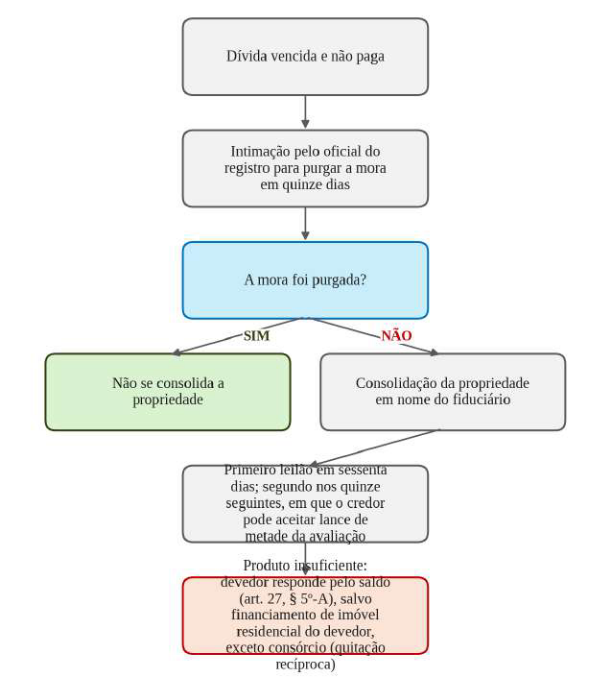

# Direito Civil

*Bloco II*

*Ponto 12 do edital: Direitos reais*

:::JC_F2F2F2 
**12. Direitos reais. Posse. Propriedade. Função social. Aquisição e perda. Usucapião. Direitos de vizinhança. Condomínio. Multipropriedade. Propriedade urbana e rural. Direitos reais sobre coisa alheia. Superfície, servidões, usufruto, uso, habitação, direito do promitente comprador, penhor, hipoteca, anticrese, concessões de uso, laje e garantias fiduciárias. Registros públicos.**
:::

| [JusLEGIS] | > |
|---|---|
| **Código Civil** | arts. 1.196 a 1.224 (posse); art. 1.225 (rol); arts. 1.228 a 1.276 (propriedade, usucapião, aquisição e perda); arts. 1.277 a 1.313 (vizinhança); arts. 1.314 a 1.358- U (condomínio e multipropriedade); arts. 1.361 a 1.368-B (propriedade fiduciária); arts. 1.369 a 1.418 (direitos reais sobre coisa alheia); arts. 1.419 a 1.510- E (garantias e laje) |

## 1. Direitos reais: conceito e características

==**Direito real**== é o poder direto e imediato sobre uma coisa, oponível a todos (*erga omnes*, "contra todos"), ao passo que o **direito pessoal** prende um credor a um devedor determinado. Da oponibilidade decorrem os atributos do direito real:

→ **Sequela**, o poder de perseguir a coisa nas mãos de quem a detenha.

→ **Preferência**, o direito de ser pago antes dos credores sem garantia real.

→ **Aderência**, a vinculação do direito à própria coisa, que o acompanha independentemente de quem seja o titular.

A **obrigação propter rem** ("por causa da coisa") decorre da titularidade de um direito real e acompanha a coisa, e é o caso das cotas condominiais⁴². Tem natureza híbrida: é obrigação, porque exige uma prestação, mas o devedor é quem for o titular da coisa.

:::JC_F2F2F2 Exemplo
**Ana hipoteca** a casa ao banco e depois a vende a Bruno. O banco nada perde: pela **sequela**, a hipoteca acompanha o imóvel, e o credor pode excuti- lo nas mãos de Bruno. Por outro lado, se o banco tivesse contra Ana apenas um crédito sem garantia real, **não poderia perseguir a casa nas mãos de Bruno**, porque o direito pessoal só alcança o devedor.
:::

Direitos reais são criados por lei, e não pela vontade das partes, ou seja, o rol de direitos reais ==**(art. 1.225 do CC)**== é **taxativo**: propriedade, superfície, servidões, usufruto, uso, habitação, direito do promitente comprador do imóvel, penhor, hipoteca, anticrese, concessão de uso especial

para fins de moradia, concessão de direito real de uso, laje e, desde a Lei nº 14.620/2023, os direitos oriundos da imissão provisória na posse (inciso XIV).

O inciso XIV só alcança a imissão concedida **à União, aos Estados, ao Distrito Federal, aos Municípios ou às suas entidades delegadas**, além da **respectiva cessão e promessa de cessão**, de modo que ==**a alternativa que o estenda a particular está errada**==.

Entre vivos, os direitos reais sobre móveis só se adquirem com a **tradição** (art. 1.226), e os sobre imóveis, com o **registro** (art. 1.227), salvo os casos expressos no próprio Código, como é o caso da usucapião e da acessão.

## 2. Posse

## 2.1 Conceito, teorias e detenção

:::JC_FFFFFF 
==**Posse**== é o exercício de fato de algum dos poderes próprios do proprietário. Para a **teoria subjetiva**, de Savigny, ela exige o *corpus*, poder físico sobre a coisa, e o *animus domini*, intenção de tê-la como dono, de modo que, por exemplo, locatário e comodatário não seriam possuidores. Para a **teoria objetiva**, de Ihering, basta o *corpus*.

O Código adotou a teoria objetiva ==**(art. 1.196 do CC)**==: considera-se possuidor todo aquele que tem de fato o exercício, pleno ou não, de algum dos poderes inerentes à propriedade. Por isso ==**locatário, comodatário, depositário e usufrutuário são possuidores**== e usam as ações possessórias.

A teoria subjetiva reaparece na usucapião, em que o *animus domini* é requisito.

**Detenção** não é posse. Detentor é quem, achando-se em relação de dependência para com outro, conserva a posse em nome deste e em cumprimento de ordens ou instruções suas, por exemplo, o caseiro e o empregado, presumindo-se detentor, até prova em contrário, quem começou a se comportar desse modo (art. 1.198). ==**O detentor não tem ação possessória**==, mas exerce a autodefesa.

E quem ocupa área pública é possuidor de boa-fé, com direito de retenção por benfeitorias? Não, e a alternativa nesse sentido está incorreta. Sendo público o bem, ==**o ocupante é mero detentor**==, e por isso não tem indenização por benfeitorias nem retenção.

%% SÚMULA

**Súmula 619 do STJ**: A ocupação indevida de bem público configura mera detenção, de natureza precária, insuscetível de retenção ou indenização por acessões e benfeitorias.

## 2.2 Classificações, composse e transmissão
:::

→ **Posse direta e indireta** (art. 1.197). A direta é a de quem tem a coisa temporariamente, em virtude de direito pessoal ou real, e a indireta, a de quem a cedeu. Uma não anula a outra, e o possuidor direto pode defender a sua posse **contra o indireto**.

→ **Posse justa e injusta** (art. 1.200). É justa a posse que não for **violenta, clandestina ou precária**.

→ **Posse de boa-fé e de má-fé** (art. 1.201). É de boa-fé a posse em que o possuidor ignora o vício **ou o obstáculo** que impede a aquisição da coisa.

Pelo art. 1.208, os **atos de mera permissão ou tolerância não induzem posse**, e os atos violentos ou clandestinos não autorizam a sua aquisição, ==**senão depois de cessar a violência ou a clandestinidade**==.

**Tema de baixa incidência. Composse** é a posse de duas ou mais pessoas sobre coisa indivisa, exercendo cada compossuidor atos possessórios contanto que não exclua os dos outros (art. 1.199).

Na transmissão (arts. 1.206 e 1.207), a posse passa aos herdeiros e legatários **com os mesmos caracteres**; o **sucessor universal** continua de direito a posse do antecessor (*successio possessionis*), e ao **sucessor singular** é facultado unir a sua posse à do antecessor (*accessio possessionis*). A diferença está na escolha, isto é, o universal recebe a posse como ela era, e o singular decide se soma a do antecessor ou começa uma posse nova.

## 2.3 Efeitos: frutos, benfeitorias e responsabilidade

Os efeitos da posse mudam conforme a boa-fé, e o sentido da diferença é sempre o mesmo: o possuidor de boa-fé, que ignorava o vício, conserva o que percebeu e é indenizado com retenção, enquanto o de má-fé devolve o que colheu e só recebe as benfeitorias necessárias.

Na responsabilidade, o possuidor de má-fé responde pela perda ou deterioração da coisa ainda que acidentais, ==**salvo se provar que de igual modo se teriam dado**== estando a coisa com o reivindicante (art. 1.218).

%% Esquematizando

Efeitos da posse

| **EFEITO** | **POSSUIDOR DE BOA-FÉ** | **POSSUIDOR DE MÁ-FÉ** |
|---|---|---|
| **Frutos** | Tem direito aos **percebidos** enquanto a boa- fé durar; restitui os **pendentes** ao tempo em que ela cessar, deduzidas as despesas de produção e custeio, e também os **colhidos com antecipação** (art. 1.214 e parágrafo único) | Responde, **desde o momento em que se constituiu de má-fé**, por todos os colhidos **e percebidos** e pelos que, por culpa sua, deixou de perceber, com direito às despesas de produção e custeio (art. 1.216) |
| **Benfeitorias** | Indenização das **necessárias e úteis**, com **retenção** pelo valor delas; pode **levantar as voluptuárias** que não lhe forem pagas, quando o puder sem detrimento da coisa (art. 1.219) | Ressarcimento **somente das necessárias**, **sem retenção e sem o direito de levantar as voluptuárias** (art. 1.220) |

## 2.4 Defesa da posse

O possuidor tem uma proteção para cada grau de agressão (art. 1.210), e a cada uma corresponde uma ação:

→ **Manutenção de posse**, contra a **turbação**, que é a agressão parcial, o embaraço ao exercício da posse sem perda dela.

→ **Reintegração de posse**, contra o **esbulho**, que é a perda total da posse.

→ **Interdito proibitório**, contra a **ameaça**, quando o possuidor tem justo receio de ser molestado. É ação preventiva, em que o juiz comina pena pecuniária ao réu que venha a praticar a agressão.

O § 1º autoriza a autotutela: o possuidor turbado ou esbulhado poderá manter-se ou restituir-se por sua própria força, contanto que o faça **logo**, e ==**os atos de desforço não podem ir além do indispensável**==.

O § 2º proíbe a ***exceptio proprietatis : não obsta à manutenção ou à reintegração a alegação de propriedade* **ou de outro direito** sobre a coisa, regra repetida no art. 557, parágrafo único, do CPC.

:::JC_B3E5A1 SÚMULA
**Súmula 487 do STF**: Será deferida a posse a quem, evidentemente, tiver o domínio, se com base neste for ela disputada.
:::

:::JC_DAE9F7 IMPORTANTE
A Súmula 487 é anterior ao Código de 2002, e, para a doutrina majoritária, **a súmula está superada** pelo art. 1.210, § 2º, como registra o **Enunciado 79 da I Jornada de Direito Civil**: "a exceptio proprietatis, como defesa oponível às ações possessórias típicas, foi abolida pelo Código Civil de 2002, que estabeleceu a absoluta separação entre os juízos possessório e petitório".
:::

No CPC, o art. 558 separa dois ritos pela idade da posse: proposta a ação dentro de **ano e dia** (**posse nova**), cabe o procedimento especial, com liminar; passado o prazo (**posse velha**), o procedimento é o comum, sem perda do caráter possessório.

O art. 554 consagra a **fungibilidade**: a propositura de uma ação possessória em vez de outra não obstará a que o juiz conheça do pedido e outorgue a proteção legal correspondente àquela cujos pressupostos estejam provados. O erro na escolha entre manutenção, reintegração e interdito, portanto, não prejudica o autor. O art. 556 admite o **pedido contraposto na própria contestação**.

O art. 557 veda, na pendência da possessória, a ação de reconhecimento do domínio, ==**exceto se a pretensão for deduzida em face de terceira pessoa**==. E o art. 562, parágrafo único, veda a liminar **contra pessoa jurídica de direito público** sem prévia audiência dos respectivos representantes judiciais.

No **litígio coletivo**, com grande número de pessoas no polo passivo, a citação dos ocupantes encontrados no local é pessoal e a dos demais por edital, com **intimação do Ministério Público** e, havendo hipossuficientes, da **Defensoria Pública** (art. 554, § 1º). Na posse velha coletiva, o juiz **deve designar audiência de mediação antes de apreciar a liminar**, a realizar- se em até **trinta dias** (art. 565).

:::JC_B3E5A1 SÚMULA
**Súmula 637 do STJ**: O ente público detém legitimidade e interesse para intervir, incidentalmente, na ação possessória entre particulares, podendo deduzir qualquer matéria defensiva, inclusive, se for o caso, o domínio.
:::

## 3. Propriedade e função social

A propriedade se define pela soma de quatro poderes ==**(art. 1.228 do CC)**==: **usar, gozar e dispor** da coisa e **reavê-la** do poder de quem quer que injustamente a possua ou detenha.

O § 1º impõe o exercício em consonância com as finalidades econômicas e sociais e de modo que sejam preservados, na forma de lei especial, a flora, a fauna, as belezas naturais, o equilíbrio ecológico e o patrimônio histórico e artístico, e evitada a poluição do ar e das águas. O § 2º veda o **ato emulativo**, isto é, o que não traz ao proprietário comodidade ou utilidade e é animado pela intenção de prejudicar outrem.

Os §§ 4º e 5º criam a ==**desapropriação judicial privada por posse-trabalho**==, que consiste em privar o proprietário da coisa em favor de um grupo de possuidores, mediante indenização fixada pelo juiz. Não é desapropriação feita pelo Poder Público: o juiz, na ação reivindicatória, acolhe a defesa dos possuidores e converte a restituição do imóvel em indenização ao proprietário.

Os requisitos são cumulativos e estão no § 4º:

→ **Extensa área**, exigida do imóvel reivindicado.

→ **Posse ininterrupta e de boa-fé** por **mais de cinco anos**.

→ **Considerável número de pessoas** no exercício dessa posse.

→ **Obras e serviços** realizados pelos possuidores, em conjunto ou separadamente, considerados pelo juiz de interesse social e econômico relevante.

Pago o preço, a sentença vale como título para o registro em nome dos possuidores.

Quem alega o instituto são os réus da reivindicatória, e, em regra, eles mesmos pagam a indenização, conforme o **Enunciado 84 da I Jornada de Direito Civil**: "a defesa fundada no direito de aquisição com base no interesse social (art. 1.228, §§ 4º e 5º, do novo Código Civil) deve ser arguida pelos réus da ação reivindicatória, eles próprios responsáveis pelo pagamento da indenização". O **Enunciado 82** afirma ser "constitucional a modalidade aquisitiva de propriedade imóvel prevista nos §§ 4º e 5º do art. 1.228 do novo Código Civil".

E se os possuidores forem de baixa renda? O entendimento evoluiu com o **Enunciado 308 da IV Jornada de Direito Civil**: "a justa indenização devida ao proprietário em caso de desapropriação judicial (art. 1.228, § 5º) somente deverá ser suportada pela Administração Pública no contexto das políticas públicas de reforma urbana ou agrária, em se tratando de possuidores de baixa renda e desde que tenha havido intervenção daquela nos termos da lei processual. Não sendo os possuidores de baixa renda, aplica-se a orientação do Enunciado n. 84 da I Jornada de Direito Civil".

O STJ aplicou esse critério no REsp 1.442.440/AC (Primeira Turma, 7/12/2017) e condenou o Estado do Acre e o Município de Rio Branco a pagar. Quem paga, portanto:

→ **A Administração**, se os possuidores forem de baixa renda, dentro de política pública de reforma urbana ou agrária e com intervenção do poder público.

→ **Os próprios possuidores**, fora dessas hipóteses.

A **função social da propriedade** condiciona o exercício do direito ao atendimento de finalidades que interessam à coletividade, e tem sede nos arts. 5º, XXIII, e 170, III, da Constituição. O que ela exige muda conforme o imóvel:

→ **Propriedade urbana** (art. 182, § 2º, da CF). Cumpre a função social quando atende às exigências **fundamentais** de ordenação da cidade expressas no **plano diretor**.

→ **Propriedade rural** (art. 186 da CF). Exige o atendimento **simultâneo**, **segundo critérios e graus de exigência estabelecidos em lei**, de aproveitamento racional e adequado, utilização adequada dos recursos naturais **disponíveis** e preservação do meio ambiente, observância das disposições que regulam as relações de trabalho e exploração que favoreça o bem-estar de proprietários e trabalhadores.

O art. 185 declara ==**insuscetíveis de desapropriação para reforma agrária**== a pequena e a média propriedade rural, **assim definidas em lei**, desde que o proprietário não possua outra, e a **propriedade produtiva**.

Você não encontra na Constituição a definição de propriedade produtiva: a lei integra a cláusula constitucional, e o art. 6º da Lei nº 8.629/1993 define a propriedade produtiva como a explorada econômica e racionalmente, atingindo **simultaneamente** grau de utilização da terra de no mínimo **oitenta por cento** e grau de eficiência de no mínimo **cem por cento**.

A banca já cobrou o tema anteriormente (TRF5 2025).

:::JC_FFE698 JÁ CAIU!
**(Juiz Federal - TRF5 - FGV - 2025)** A Lei Federal nº X, ao dispor sobre as características da propriedade produtiva, o que obstaria a sua desapropriação para fins de reforma agrária, exigiu que tal propriedade fosse explorada de maneira eficiente, conforme índices fixados pelo órgão federal competente. Além disso, essa exploração "deve ser realizada, simultaneamente, de maneira racional, de modo a caracterizar o cumprimento de sua função social". Esta última expressão veio a ser impugnada, em sede de controle difuso de constitucionalidade, o que frustraria a desapropriação para fins de reforma agrária, promovida pela União no caso concreto. À luz da sistemática constitucional, é correto afirmar que a Lei Federal nº X é:

a) inconstitucional, por adotar um conceito jurídico indeterminado em detrimento do direito fundamental à propriedade;

b) constitucional, pois a vedação ao uso de conceitos jurídicos indeterminados somente seria operativa em se tratando de desapropriação-sanção, o que não é o caso;

c) constitucional, pois a cláusula de imunidade à desapropriação pode ser integrada por conceitos que conjuguem funcionalização social e propriedade produtiva;

d) inconstitucional, pois a função social da propriedade é cumprida pelo seu caráter produtivo, não por uma racionalidade idealizada pelas maiorias ocasionais;

e) inconstitucional, pois o conceito de propriedade produtiva possui estatura constitucional, não estando condicionado a novos requisitos estruturados no plano infraconstitucional.⁴³
:::

## 4. Aquisição e perda da propriedade

A propriedade imóvel se adquire entre vivos pelo **registro** do título translativo ==**(art. 1.245 do CC)**==: enquanto não registrado, o alienante continua havido como dono. O registro é eficaz desde o momento em que se apresenta o título ao oficial e este o **prenota** no protocolo (art. 1.246). Cancelado o registro, o proprietário pode reivindicar o imóvel **independentemente da boa-fé ou do título do terceiro adquirente** (art. 1.247, parágrafo único).

==**Acessão**== é o modo de aquisição pelo qual tudo o que se une ou se incorpora a um bem pertence ao seu proprietário, e o art. 1.248 arrola as modalidades: formação de ilhas, aluvião, avulsão, abandono de álveo e plantações ou construções.

As acessões naturais aparecem pouco em prova: a **aluvião** cabe aos donos dos terrenos marginais **sem indenização**, e o **álveo abandonado** pertence aos ribeirinhos das duas margens (arts. 1.250 e 1.252).

Nas construções, ==**quem edifica em terreno alheio perde a construção**== em proveito do proprietário, com indenização se estava de boa-fé (art. 1.255). E se você construiu no terreno errado uma obra que vale muito mais que ele? Aplica-se o parágrafo único: se a obra **exceder consideravelmente o valor do terreno**, ==**quem de boa-fé edificou adquire a propriedade do solo**==, mediante indenização fixada judicialmente. É a chamada **acessão inversa**, porque aqui o solo segue a construção, e não o contrário.

Na invasão parcial do solo alheio, o critério é a **vigésima parte**:

→ **Invasão que não supera a vigésima parte** (art. 1.258, *caput* e parágrafo único). O construtor de boa-fé adquire a parte invadida, desde que o valor da construção exceda o dessa parte, indenizando a área perdida e a desvalorização do remanescente; o de **má-fé** também adquire, mas **pagando em décuplo** as perdas e danos, se o valor da construção exceder consideravelmente o da parte invadida e a demolição não for possível sem grave prejuízo.

→ **Invasão que excede a vigésima parte** (art. 1.259). O de boa-fé adquire e responde por perdas e danos, e o de má-fé demole e paga perdas e danos **em dobro**.

A banca já cobrou o parágrafo único do art. 1.255 anteriormente (ENAM 2024).

:::JC_FFE698 JÁ CAIU!
**(ENAM - FGV - 2024)** Artur adquiriu o lote 5, da quadra 3, do loteamento Jardim Esperança. Logo depois de construir sua casa, Artur recebeu uma notificação de Raquel, proprietária do lote 6 (vizinho), reivindicando o imóvel em que foi feita a construção. Surpreso, Artur descobriu que, por um equívoco escusável de localização, terminou por, de fato, construir no lote vizinho. Como o investimento realizado na construção era três vezes superior ao valor de cada lote envolvido, Artur propôs a aquisição do lote 6, o que foi rejeitado por Raquel que pediu, como indenização da construção, 1/3 do valor gasto. Ante a ausência de acordo e de forma a não perder o investimento realizado, Artur

a) fará jus à aquisição do lote 6 pelo valor de aquisição pago por Raquel.

b) deverá devolver o imóvel e receber a indenização fixada judicialmente.

c) perderá o que construiu em proveito de Raquel.

d) fará jus à aquisição do lote 6, devendo a indenização ser fixada judicialmente.

e) deverá devolver o imóvel e receber metade do valor gasto na construção.⁴⁴
:::

A propriedade móvel se adquire por usucapião, ocupação, achado do tesouro, **tradição**, especificação, confusão, comissão e adjunção (arts. 1.260 a 1.274), e se perde por alienação, renúncia, abandono, perecimento e desapropriação (art. 1.275).

O tema cai pouco, e os números a conhecer são a recompensa do descobridor de coisa perdida, **não inferior a cinco por cento** do valor do bem (art. 1.234), e os **três anos** para que o imóvel abandonado e arrecadado como bem vago passe ao Município ou ao Distrito Federal, se urbano, e à União, se rural (art. 1.276).

## 5. Usucapião

A **usucapião** é a face aquisitiva da prescrição e entra aqui como ==**modo originário de aquisição da propriedade**==: quem usucape não recebe o direito de ninguém, adquire-o novo, e por isso o bem ingressa livre dos ônus da matrícula anterior.

As causas que obstam, suspendem ou interrompem a prescrição valem também para o possuidor (art. 1.244), e por isso ==**não corre usucapião entre cônjuges na constância da sociedade conjugal nem contra os absolutamente incapazes**==.

São requisitos comuns a todas as espécies:

→ **Coisa hábil**, isto é, suscetível de ser usucapida, o que afasta os bens públicos.

→ **Posse ad usucapionem**, mansa, pacífica, contínua, pública e com *animus domini*.

→ **Decurso do prazo**, que varia com a espécie.

O art. 1.243 permite somar à posse própria a dos antecessores (*accessio possessionis* do art. 1.207), contanto que todas as posses somadas sejam **contínuas e pacíficas** e, na usucapião ordinária do art. 1.242, **também com justo título e de boa-fé**.

Os prazos e os requisitos de cada espécie estão no quadro a seguir, e vocês precisam sabê-lo de cor.

%% Esquematizando

Espécies de usucapião

| **ESPÉCIE E BASE LEGAL** | **PRAZO** | **REQUISITOS ESPECÍFICOS** |
|---|---|---|
| **Extraordinária (art. 1.238, caput)** | 15 anos | Posse como sua, sem interrupção nem oposição. Independe de título e de boa-fé |

**consideravelmente o valor do terreno**: quem de boa-fé edificou adquire o solo, mediante indenização **fixada judicialmente, se não houver acordo**, o que afasta também a alternativa a.

| **ESPÉCIE E BASE LEGAL** | **PRAZO** | **REQUISITOS ESPECÍFICOS** |
|---|---|---|
| **Extraordinária por posse-trabalho (art. 1.238, parágrafo único)** | 10 anos | Redução do prazo se o possuidor houver estabelecido no imóvel a sua moradia habitual ou nele realizado obras ou serviços de caráter produtivo |
| **Ordinária (art. 1.242, caput)** | 10 anos | Posse contínua e incontestada, com justo título e boa-fé |
| **Ordinária tabular (art. 1.242, parágrafo único)** | 5 anos | Imóvel adquirido onerosamente com base em registro cancelado depois, mais moradia no imóvel ou investimentos de interesse social e econômico |
| **Especial urbana (art. 1.240 do CC; art. 183 da CF; art. 9º da Lei nº 10.257/2001)** | 5 anos | Área urbana de até 250 m², posse ininterrupta e sem oposição, uso para moradia própria ou da família, não ser proprietário de outro imóvel urbano ou rural. Não se reconhece ao mesmo possuidor mais de uma vez |
| **Especial urbana familiar, por abandono do lar (art. 1.240-A)** | 2 anos | Posse direta e com exclusividade sobre imóvel urbano de até 250 m² cuja propriedade se divida com ex-cônjuge ou ex- companheiro que abandonou o lar, uso para moradia própria ou da família, não ser proprietário de outro imóvel urbano ou rural. Não se reconhece mais de uma vez |
| **Especial rural, ou pro labore (art. 1.239 do CC; art. 191 da CF)** | 5 anos | Área rural não superior a 50 hectares, tornada produtiva pelo trabalho próprio ou da família, com moradia no imóvel, não sendo o possuidor proprietário de imóvel rural ou urbano |
| **Especial coletiva (art. 10 da Lei nº 10.257/2001, redação da Lei nº 13.465/2017)** | Mais de 5 anos | Núcleos urbanos informais existentes sem oposição, cuja área total dividida pelo número de possuidores seja inferior a 250 m² por possuidor, não sendo os possuidores proprietários de outro imóvel urbano ou rural |
| **Servidão aparente (art. 1.379)** | 10 anos com título; 20 anos sem título | Exercício incontestado e contínuo da servidão aparente, nos termos do art. 1.242 |
| **Móvel (arts. 1.260 e 1.261)** | 3 anos com justo título e boa-fé; 5 anos sem título nem boa-fé | Posse da coisa móvel como sua, contínua e incontestada |

:::JC_DAE9F7 PEGADINHA
No TRF4 de 2016, a alternativa **incorreta** dava à extraordinária prazo de dez anos, reduzido a cinco pela moradia habitual ou por obras produtivas: os prazos são **quinze e dez**, e os cinco anos são da ordinária tabular e das especiais urbana, rural e coletiva. Na coletiva, a Lei nº 13.465/2017 trocou a área superior a 250 m² pela **divisão** da área total pelo número de possuidores. A familiar (art. 1.240-A) é de **dois** anos. **Na especial urbana individual não cabe accessio possessionis**: só o herdeiro legítimo que já morava no imóvel continua a posse (art. 9º, § 3º, do

Estatuto da Cidade). Na **coletiva**, a soma é autorizada (art. 10, § 1º), se as posses forem contínuas.
:::

:::JC_B3E5A1 SÚMULA
**Súmula 237 do STF**: O usucapião pode ser arguido em defesa.

**Súmula 340 do STF**: Desde a vigência do Código Civil, os bens dominicais, como os demais bens públicos, **não podem** ser adquiridos por usucapião.
:::

:::JC_D9F2D0 JURISPRUDÊNCIA
**STF, Tema 815 (RE 422.349)**: Preenchidos os requisitos do art. 183 da Constituição Federal, o reconhecimento do direito à usucapião especial urbana não pode ser obstado por legislação infraconstitucional que estabeleça módulos urbanos na respectiva área em que situado o imóvel (dimensão do lote).

Na prática, o lote menor que o módulo urbano fixado pela legislação infraconstitucional pode ser usucapido pela via especial urbana, se cumprido o art. 183 da Constituição.
:::

A imprescritibilidade dos bens públicos tem sede constitucional dupla, no art. 183, § 3º, e no art. 191, parágrafo único, e o STJ a estende aos **bens de estatais afetados a finalidade pública**: "não há possibilidade de usucapião de imóvel afetado à finalidade pública essencial pertencente à sociedade de economia mista que atua em regime não concorrencial" (REsp 2.173.088/DF, Terceira Turma, 8/10/2024).

Sobre o **justo título**, que é o documento hábil a transferir a propriedade se não fosse o vício que a usucapião supre, o STJ assentou que "o recibo de compra e venda do imóvel basta para o preenchimento do requisito do justo título na usucapião ordinária" (REsp 2.215.421/SE, Terceira Turma, 10/3/2026).

Pelo art. 216-A da Lei nº 6.015/1973, é admitido, **sem prejuízo da via jurisdicional**, o reconhecimento **extrajudicial** de usucapião, perante o registro de imóveis da comarca do imóvel, a requerimento do interessado **representado por advogado**.

O pedido se instrui com **ata notarial** que ateste o tempo de posse, planta e memorial descritivo assinados por profissional habilitado e pelos titulares de direitos registrados na matrícula ou na dos imóveis confinantes, certidões negativas dos distribuidores e justo título ou quaisquer outros documentos que demonstrem a origem, a continuidade, a natureza e o tempo da posse, como o pagamento dos impostos e das taxas que incidem sobre o imóvel.

O titular de direito registrado que não assinou a planta é notificado para se manifestar em **quinze dias**, e ==**o silêncio vale como concordância**==.

A soma de posses na usucapião especial urbana já foi cobrada pela banca (TRF2 2026).

:::JC_FFE698 JÁ CAIU!
**(Juiz Federal - TRF2 - FGV - 2026)** Renato, pedreiro autônomo, sem qualquer imóvel registrado em seu nome, passou a residir, em janeiro de 2022, em um terreno urbano de 180 m² situado no Município de Vitória (ES). No local, com recursos próprios, edificou uma modesta moradia para si e sua família, onde permaneceu de forma mansa, pacífica, ininterrupta e sem qualquer oposição, até o ano de 2025. Antes de Renato, o terreno havia sido ocupado por Joaquim, que ali morou de janeiro de 2019 a janeiro de 2022, igualmente de forma mansa e pacífica, utilizando- o como residência e sem ser proprietário de outro imóvel. Ao deixar o local, Joaquim celebrou com Renato instrumento particular de cessão da posse do terreno. Em janeiro de 2025, completados 3 (três) anos de sua posse pessoal, Renato ajuizou ação de usucapião especial urbana, requerendo a declaração de propriedade do imóvel, pretendendo somar sua posse com a de seu antecessor. Considerando a situação hipotética descrita, a legislação vigente e o entendimento jurisprudencial do Superior Tribunal de Justiça sobre a matéria, assinale a afirmativa correta quanto ao pedido formulado por Renato.

a) O pedido de Renato deve ser julgado procedente, pois o art. 1.243 do Código Civil, ao disciplinar a *accessio possessionis*, consagra regra de soma de posses aplicável à usucapião especial urbana, excluídas as modalidades ordinária e extraordinária, em razão da especial proteção constitucional conferida ao direito fundamental à moradia.

b) O pedido de Renato deve ser julgado improcedente, pois a usucapião especial urbana não admite a soma do tempo de posse dos antecessores com base na *accessio possessionis* para fins de complementação do quinquênio legal, o que somente seria possível no caso de *successio possessionis*, conforme art. 9º, § 3º, do Estatuto da Cidade.

c) O pedido de Renato deve ser julgado procedente, pois a vedação à *accessio possessionis* na usucapião especial urbana somente se aplica quando há descontinuidade da posse entre os sucessores: havendo cessão contratual da posse entre Joaquim e Renato, com continuidade fática da ocupação para fins de moradia, admite-se a soma dos prazos, pois estão preservadas a cadeia possessória e a finalidade social do instituto.

d) O pedido de Renato deve ser julgado procedente, pois, embora a usucapião especial urbana possua natureza *intuitu personae*, o art. 9º, § 3º, do Estatuto da Cidade autoriza expressamente o herdeiro legítimo ou o cessionário a somar a posse do antecessor para fins de computação do prazo quinquenal, desde que mantidos os demais requisitos, o que se verifica integralmente no caso concreto.

e) O processo deve ser extinto sem resolução do mérito por falta de interesse de agir, uma vez que, não sendo admitida a soma das posses, Renato deverá aguardar o transcurso do prazo quinquenal integral de sua própria posse para somente então renovar o pedido, a partir de janeiro de 2027.⁴⁵
:::

## 6. Direitos de vizinhança

Os ==**direitos de vizinhança**== são limitações recíprocas ao exercício da propriedade, impostas por lei para permitir a convivência entre prédios, e por isso independem de registro.

No **uso anormal**, o proprietário ou o possuidor tem direito de fazer cessar as interferências prejudiciais à **segurança, ao sossego e à saúde** dos que habitam o prédio, provocadas pela utilização da propriedade vizinha ==**(art. 1.277 do CC)**==. A anormalidade se afere pela natureza da utilização, pela localização do prédio, pelas normas de zoneamento e pelos limites ordinários de tolerância dos moradores.

Se as interferências forem justificadas por **interesse público**, ==**o direito de fazê-las cessar não prevalece**==, mas o causador pagará **indenização cabal** (art. 1.278).

Árvores limítrofes, águas e direito de construir caem pouco, e bastam os números do quadro e o art. 1.284: os frutos caídos pertencem ao dono do solo **onde caíram**, se particular.

%% Esquematizando

Direito de construir (arts. 1.301 a 1.303)

| **DISPOSITIVO** | **NÚMEROS** |
|---|---|
| **Arts. 1.301 a 1.303 do Código Civil** | Metro e meio para abrir janela, eirado, terraço ou varanda sobre o terreno vizinho; setenta e cinco centímetros para as janelas cuja visão não incida sobre a linha divisória e para as perpendiculares; livres as aberturas para luz ou ventilação não maiores de dez por vinte centímetros e a mais de dois metros de altura de cada piso; três metros para edificar na zona rural; ano e dia, da conclusão da obra, para exigir que se desfaça janela, sacada, terraço ou goteira |

:::JC_DAE9F7 NÃO CONFUNDA
**Passagem forçada e servidão de passagem** não são a mesma coisa. A passagem forçada (art. 1.285) é direito de vizinhança, decorre da lei, pressupõe **encravamento**, isto é, prédio sem acesso a via pública, nascente ou porto, e exige indenização cabal. O encravamento não precisa ser absoluto: pelo Enunciado 88 da I Jornada de Direito Civil, a passagem forçada também cabe quando o acesso existente for **insuficiente ou inadequado**. A servidão de passagem é direito real sobre coisa alheia, constitui-se por declaração expressa dos proprietários ou por testamento, com subsequente **registro**, e também pode ser adquirida por **usucapião**, quando aparente (art. 1.379). Não exige encravamento.
:::

erra no desfecho processual, porque a falta de tempo de posse é questão de mérito e leva à improcedência, não à extinção sem resolução do mérito.

## 7. Condomínio

==**Condomínio**== é a situação em que mais de uma pessoa titulariza simultaneamente o domínio sobre a mesma coisa. No **voluntário** (arts. 1.314 a 1.326), cada condômino pode usar a coisa conforme sua destinação, reivindicá-la de terceiro, defender a posse e alhear ou gravar a sua parte ideal, mas nenhum pode alterar a destinação da coisa comum, e ==**nenhum pode dar posse, uso ou gozo dela a estranhos sem o consenso dos outros**==.

A divisão pode ser exigida a todo tempo, admitida a indivisão convencional por prazo **não maior de cinco anos** (art. 1.320). O **necessário** é tema de incidência quase nula.

No **condomínio edilício**, coexistem na mesma edificação partes de propriedade exclusiva e partes comuns ==**(art. 1.331 do CC)**==: a cada unidade cabe, como parte inseparável, fração ideal no solo e nas partes comuns; nenhuma unidade pode ser privada de acesso ao logradouro público; e o **terraço de cobertura é parte comum**, ==**salvo disposição contrária**== da escritura de constituição.

Institui-se por ato entre vivos ou testamento registrado (art. 1.332), e a **convenção** deve ser subscrita por titulares de, no mínimo, **dois terços das frações ideais**; para ser oponível a terceiros, precisa ser registrada (art. 1.333).

A administração cabe ao **síndico**, eleito por prazo **não superior a dois anos**, renovável (art. 1.347). O condomínio **pode**, mas não precisa, ter **conselho fiscal**, composto de **três membros** eleitos pela assembleia, também por prazo não superior a dois anos, competindo- lhe dar parecer sobre as contas do síndico (art. 1.356).

:::JC_B3E5A1 SÚMULA
**Súmula 260 do STJ**: A convenção de condomínio aprovada, ainda que sem registro, é eficaz para regular as relações entre os condôminos.

**Súmula 478 do STJ**: Na execução de crédito relativo a cotas condominiais, este tem preferência sobre o hipotecário.
:::

O art. 1.336 impõe quatro **deveres** ao condômino:

→ **Contribuir para as despesas** na proporção das frações ideais, salvo disposição diversa da convenção (I).

→ **Não realizar obras que comprometam a segurança** da edificação (II).

→ **Não alterar a forma e a cor da fachada**, das partes e esquadrias externas (III).

→ **Dar às suas partes a mesma destinação da edificação**, não as utilizando de maneira prejudicial ao sossego, à salubridade e à segurança dos possuidores, ou aos bons costumes (IV).

As sanções crescem com a gravidade da infração, e os quóruns de cada uma estão no quadro adiante, que vocês também precisam saber de cor:

→ **Atraso na contribuição** (§ 1º). O condômino responde por correção monetária, pelos **juros moratórios convencionados** ou, na falta de convenção, pelos **juros do art. 406**, que a Lei nº 14.905/2024 passou a fixar na **taxa Selic deduzido o índice de atualização monetária**, e por multa de **até dois por cento** sobre o débito. Até essa lei, o § 1º mandava aplicar **um por cento ao mês** na omissão da convenção.

→ **Descumprimento dos incisos II a IV** (§ 2º). Multa **não superior a cinco vezes** as contribuições mensais.

→ **Descumprimento reiterado** (art. 1.337). Multa de até o **quíntuplo** para quem **não cumpre reiteradamente** os deveres, elevada ao **décuplo** para o **condômino antissocial**.

E o condômino antissocial pode ser expulso? O Código ==**não prevê a expulsão**==, e essa é a resposta segura em prova objetiva. Existe, porém, o **Enunciado 508 da V Jornada de Direito Civil**: "verificando-se que a sanção pecuniária mostrou-se ineficaz, a garantia fundamental da função social da propriedade (arts. 5º, XXIII, CF/1988 e 1.228, § 1º, CC) e a vedação ao abuso do direito (arts. 187 e 1.228, § 2º, CC) justificam a exclusão do condômino antissocial, desde que a ulterior assembleia prevista na parte final do parágrafo único do artigo 1.337 do Código Civil delibere a propositura de ação judicial com esse fim, asseguradas todas as garantias inerentes ao devido processo legal".

Quanto à multa, ==**ela não pode ser imposta sem que se garanta ao condômino o direito de defesa**==. A Quarta Turma do STJ adotou o **Enunciado 92 da I Jornada de Direito Civil**, "as sanções do art. 1.337 do novo Código Civil não podem ser aplicadas sem que se garanta direito de defesa ao condômino nocivo", no REsp 1.365.279/SP, julgado em 25/8/2015.

:::JC_D9F2D0 JURISPRUDÊNCIA
**STJ, Tema 886 (REsp 1.345.331/RS)**: a) O que define a responsabilidade pelo pagamento das obrigações condominiais não é o registro do compromisso de venda e compra, mas a relação jurídica material com o imóvel, representada pela imissão na posse pelo promissário comprador e pela ciência inequívoca do Condomínio acerca da transação; b) Havendo compromisso de compra e venda não levado a registro, a responsabilidade pelas despesas de condomínio pode recair tanto sobre o promitente vendedor quanto sobre o promissário comprador, dependendo das circunstâncias de cada caso concreto; c) Se restar comprovado: (i) que o promissário comprador imitira-se na posse; e (ii) o Condomínio teve ciência inequívoca da transação, afasta-se a legitimidade passiva do promitente vendedor para responder por despesas condominiais relativas a período em que a posse foi exercida pelo promissário comprador.

A cota condominial é obrigação propter rem, e a tese define quem é o devedor dela: quem tem a relação material com o imóvel, e não necessariamente quem consta da matrícula. Sem registro do compromisso, o promitente vendedor só deixa de

responder pelo período em que o promissário comprador esteve imitido na posse, com ciência inequívoca do condomínio.
:::

%% Esquematizando

Quóruns do condomínio edilício

| **DELIBERAÇÃO** | **QUÓRUM E DISPOSITIVO** |
|---|---|
| **Aprovação da convenção** | Titulares de, no mínimo, 2/3 das frações ideais (art. 1.333) |
| **Multa por descumprimento dos deveres dos incisos II a IV, quando a convenção é omissa** | 2/3, no mínimo, dos condôminos restantes (art. 1.336, § 2º) |
| **Multa de até o quíntuplo ao condômino que descumpre reiteradamente os deveres** | 3/4 dos condôminos restantes (art. 1.337, caput) |
| **Obras voluptuárias em partes comuns** | 2/3 dos condôminos (art. 1.341, I) |
| **Obras úteis em partes comuns** | Maioria dos condôminos (art. 1.341, II) |
| **Obras necessárias** | Independem de autorização; se urgentes e de despesa excessiva, o síndico as realiza e dá ciência à assembleia; se não urgentes e de despesa excessiva, dependem de autorização da assembleia especialmente convocada (art. 1.341, §§ 1º a 3º) |
| **Obras em acréscimo às já existentes, para facilitar ou aumentar a utilização** | 2/3 dos votos dos condôminos (art. 1.342) |
| **Construção de outro pavimento ou, no solo comum, de outro edifício** | Unanimidade dos condôminos (art. 1.343) |
| **Destituição do síndico** | Maioria absoluta dos membros, em assembleia especialmente convocada (art. 1.349) |
| **Convocação da assembleia ordinária, se o síndico não a convocar** | 1/4 dos condôminos (art. 1.350, § 1º) |
| **Alteração da convenção e mudança da destinação do edifício ou da unidade imobiliária** | 2/3 dos votos dos condôminos (art. 1.351, redação da Lei nº 14.405/2022) |
| **Deliberações em geral, em primeira convocação** | Maioria de votos dos condôminos presentes que representem pelo menos metade das frações ideais (art. 1.352) |
| **Deliberações em geral, em segunda convocação** | Maioria dos votos dos presentes, salvo quórum especial (art. 1.353) |
| **Convocação de assembleia extraordinária** | Síndico ou 1/4 dos condôminos (art. 1.355) |
| **Reconstrução ou venda, se a edificação for total ou consideravelmente destruída ou ameaçar ruína** | Votos que representem metade mais uma das frações ideais (art. 1.357) |
| **Adoção do regime de multipropriedade em condomínio edilício já existente** | Previsão no instrumento de instituição ou deliberação da maioria absoluta dos condôminos (art. 1.358-O) |

:::JC_DAE9F7 Atualização legislativa
O art. 1.351 mudou, e a redação antiga ainda circula em apostila. Desde a **Lei nº 14.405/2022**, a alteração da convenção e a mudança da destinação do edifício **ou da unidade imobiliária** dependem de **dois terços** dos votos dos condôminos, e a **unanimidade** sobrevive apenas para a construção de outro pavimento ou de outro edifício no solo comum (art. 1.343). A **Lei nº 14.309/2022** também alterou o capítulo: não atingido o quórum especial, a assembleia pode ser convertida em **sessão permanente** pela maioria dos presentes, concluída em até noventa dias (art. 1.353, §§ 1º a 3º), e pode ser **eletrônica ou híbrida**, salvo vedação na convenção (art. 1.354-A).
:::

## 7.1 Condomínio de lotes, condomínio urbano simples e multipropriedade

O **condomínio de lotes** (art. 1.358-A) admite, em terrenos, lotes de propriedade exclusiva e partes comuns, aplicando-se-lhe, no que couber, o regime do condomínio edilício. O **condomínio urbano simples** (arts. 61 a 63 da Lei nº 13.465/2017) serve ao imóvel único com casas ou cômodos. **Tema de baixa incidência.**

**Multipropriedade** é o regime de condomínio em que cada um dos proprietários de um mesmo imóvel é titular de uma **fração de tempo**, à qual corresponde a faculdade de uso e gozo, com exclusividade, da **totalidade do imóvel**, exercida de forma alternada (art. 1.358-C, incluído pela Lei nº 13.777/2018). Cuidado para não a tomar por condomínio edilício: na multipropriedade divide-se o tempo, e não o espaço.

O imóvel é **indivisível** e não se sujeita a ação de divisão ou de extinção de condomínio (art. 1.358-D). Cada fração corresponde a período de **no mínimo sete dias**, seguidos ou intercalados, fixo, flutuante ou misto (art. 1.358-E), e ==**não há direito de preferência na alienação da fração, salvo previsão no instrumento de instituição ou na convenção**== (art. 1.358-L).

## 8. Propriedade urbana e propriedade rural

A política urbana é executada pelo Município, e o **plano diretor** é obrigatório para cidades com mais de **vinte mil habitantes** ==**(art. 182, § 1º, da CF)**==.

O § 4º autoriza o Município, mediante lei específica para área incluída no plano diretor, a exigir do proprietário do solo urbano não edificado, subutilizado ou não utilizado que promova seu adequado aproveitamento, sob pena, **sucessivamente**, de parcelamento ou edificação compulsórios, IPTU progressivo no tempo e desapropriação com títulos da dívida pública.

O Município pode ir direto à desapropriação? Não. O advérbio "sucessivamente" impõe a ordem, e ==**o Município não pode saltar etapas**==.

O **IPTU progressivo** é majorado **pelo prazo de cinco anos consecutivos**, e ==**a alíquota de cada ano não pode exceder o dobro da do ano anterior**==, respeitada a alíquota máxima de **quinze por cento** (art. 7º, *caput* e § 1º, do Estatuto da Cidade).

Não cumprida a obrigação em cinco anos, o Município **mantém a cobrança pela alíquota máxima até o cumprimento** (art. 7º, § 2º) e **pode** proceder à **desapropriação-sanção**, com títulos resgatáveis em até dez anos e juros de **seis por cento ao ano** (art. 8º e § 1º).

A antiga **usucapião administrativa** da Lei nº 11.977/2009, com a demarcação urbanística e a legitimação de posse, ==**foi revogada**==: todo o Capítulo III daquela lei, arts. 46 a 71, caiu com a Lei nº 13.465/2017.

Hoje a regularização fundiária urbana é a **Reurb**, e nela a **legitimação fundiária** é forma **originária** de aquisição da propriedade (art. 23), enquanto a **legitimação de posse** gera, decorridos **cinco anos** do registro do título, **conversão automática** em propriedade, desde que atendidos os requisitos do art. 183 da Constituição. Fora dessa hipótese, a conversão depende de **requerimento do interessado** e do preenchimento dos requisitos da usucapião cabível (arts. 25 e 26).

Do lado rural, compete à **União** desapropriar por interesse social, para fins de reforma agrária, o imóvel que não cumpra sua função social, mediante prévia e justa indenização em **títulos da dívida agrária**, resgatáveis em até vinte anos a partir do segundo ano de emissão, sendo as **benfeitorias úteis e necessárias indenizadas em dinheiro** (art. 184 da CF). Na desapropriação- sanção urbana, ao contrário, quem desapropria é o Município, e os títulos são da dívida pública, resgatáveis em até dez anos.

A unidade de medida é o ==**módulo fiscal**==, isto é, a unidade de área, em hectares, fixada para cada Município. A Lei nº 8.629/1993 define **pequena propriedade** como a de área até **quatro módulos fiscais**, respeitada a fração mínima de parcelamento, e **média propriedade** como a de área superior a quatro e até **quinze módulos fiscais** (art. 4º, II e III), ambas insuscetíveis de desapropriação para reforma agrária **desde que o proprietário não possua outra propriedade rural** (art. 4º, § 1º, com a redação da Lei nº 13.465/2017).

A impenhorabilidade da pequena propriedade rural **trabalhada pela família** vem do art. 5º, XXVI, da Constituição.

## 9. Direitos reais sobre coisa alheia

==**Superfície**== é o direito real pelo qual o proprietário concede a outrem o direito de construir ou de plantar em seu terreno. No Código Civil (arts. 1.369 a 1.377), a concessão é **sempre por tempo determinado**, mediante escritura pública registrada, e ==**não autoriza obra no subsolo, salvo se inerente ao objeto da concessão**== (art. 1.369).

O direito transfere-se a terceiros e aos herdeiros, **sem que o concedente possa estipular pagamento pela transferência** (art. 1.372); extinta a concessão, o proprietário passa a ter a propriedade plena do terreno e das acessões, **independentemente de indenização, se as partes não houverem estipulado o contrário** (art. 1.375).

Há outra superfície em vigor, a do **Estatuto da Cidade** (arts. 21 a 24), para o proprietário urbano, e ela difere da civil justamente na duração e no alcance: ==**pode ser por tempo determinado ou indeterminado**== e abrange o direito de utilizar **o solo, o subsolo ou o espaço aéreo**.

**Servidão** é o direito real que proporciona utilidade para o prédio dominante e grava o prédio serviente, pertencente a dono diverso, constituindo-se por declaração expressa dos proprietários, ou por testamento, e subsequente **registro** (art. 1.378). O tema cai pouco: as servidões são **indivisíveis** (art. 1.386) e extinguem-se pelo **não uso durante dez anos contínuos** (art. 1.389).

:::JC_B3E5A1 SÚMULA
**Súmula 415 do STF**: Servidão de trânsito não titulada, mas tornada permanente, sobretudo pela natureza das obras realizadas, considera-se aparente, conferindo direito a proteção possessória.
:::

**Usufruto** é o direito real de usar e fruir coisa alheia, temporariamente, sem lhe alterar a substância; pode recair em um ou mais bens, móveis ou imóveis, ou em patrimônio inteiro, abrangendo, no todo ou em parte, os frutos e utilidades (art. 1.390).

Do usufruto, o dispositivo que você mais vai encontrar em prova é o art. 1.393, que separa o direito do seu exercício: ==**não se pode transferir o usufruto por alienação**==, mas ==**o seu exercício pode ceder-se por título gratuito ou oneroso**==.

Extingue-se, entre outras causas, pela renúncia ou morte do usufrutuário, pelo termo, pelo **decurso de trinta anos contados do início do exercício** quando constituído em favor de pessoa jurídica que perdure, pela consolidação e pelo **não uso** (art. 1.410).

O **uso** é o usufruto reduzido às necessidades do usuário e de sua família (art. 1.412), e a **habitação** é o uso restrito a morar, ==**não podendo o titular alugar nem emprestar a casa**== (art. 1.414).

:::JC_F2F2F2 Exemplo
**Laura tem direito real de habitação** sobre a casa em que mora e, ao mudar de cidade, quer alugá-la. Não pode: a habitação é uso restrito a morar, e **o titular não aluga nem empresta**. Por outro lado, se Laura fosse **usufrutuária**, poderia alugar a casa, porque o usufruto não se aliena, mas **o seu exercício pode ser cedido por título oneroso**.
:::

Pelo art. 1.417, mediante promessa de compra e venda em que **não se pactuou arrependimento**, celebrada por instrumento público ou particular e **registrada** no Cartório de Registro de Imóveis, o promitente comprador adquire **direito real à aquisição do imóvel**, podendo exigir a outorga da escritura definitiva e, havendo recusa, requerer ao juiz a **adjudicação** (art. 1.418).

O registro converte o direito do promitente comprador em direito real oponível a terceiros, mas ==**a adjudicação compulsória não depende dele**==: é pretensão pessoal, e a Súmula 239 do STJ⁴⁶afirma que ela não se condiciona ao registro do compromisso. Hoje a adjudicação compulsória é admitida também na via **extrajudicial** (art. 216-B).

As duas concessões do art. 1.225 têm origem administrativa. A **concessão de uso especial para fins de moradia** (CUEM), da Medida Provisória nº 2.220/2001, cabe a quem, **até 22 de dezembro de 2016**, possuiu como seu, por **cinco anos**, ininterruptamente e sem oposição, **até duzentos e cinquenta metros quadrados** de imóvel **público** urbano, para sua moradia ou de sua família, desde que não seja proprietário ou concessionário de outro imóvel urbano ou rural.

A **concessão de direito real de uso** (CDRU), do art. 7º do Decreto-Lei nº 271/1967, é **direito real resolúvel**, remunerado ou gratuito, para fins de interesse social. As duas se confundem com frequência, e a diferença está nestes pontos:

%% Esquematizando

CUEM e CDRU

| **CRITÉRIO** | **CUEM** | **CDRU** |
|---|---|---|
| **Natureza** | **Direito subjetivo** de quem preenche os requisitos legais | Ato **discricionário** do poder público |
| **Imóvel** | Imóvel **público** urbano de até 250 m² | Terrenos **públicos ou particulares** |
| **Finalidade** | Única: **moradia** | **Várias finalidades**, além da moradia, desde que de interesse social |
| **Tempo** | Exige posse de cinco anos completada até 22 de dezembro de 2016 | Concedida por tempo **certo ou indeterminado** |

A **laje** é o direito real pelo qual o proprietário de uma construção-base cede a superfície superior ou inferior de sua construção, para que o titular da laje mantenha unidade distinta daquela originalmente construída sobre o solo (art. 1.510-A, incluído pela Lei nº 13.465/2017).

Ela contempla o **espaço aéreo ou o subsolo**, em projeção vertical, como **unidade imobiliária autônoma com matrícula própria**, e ==**não implica atribuição de fração ideal de terreno**==, no que difere da unidade do condomínio edilício. Cabe ainda **laje sucessiva**, com autorização expressa dos titulares da construção-base e das demais lajes.

Na alienação, há **direito de preferência** dos titulares da construção-base e da laje, nessa ordem, cientificados por escrito para se manifestar em **trinta dias**, salvo disposição contratual diversa. Quem não foi cientificado tem **cento e oitenta dias**, prazo decadencial contado da alienação, para haver para si a parte alienada, mediante depósito do preço (art. 1.510-D e § 1º).

A ruína da construção-base extingue a laje, ==**salvo se instituída sobre o subsolo ou se reconstruída a base em cinco anos**== (art. 1.510-E).

## 10. Direitos reais de garantia

Nas dívidas garantidas por penhor, anticrese ou hipoteca, o bem fica sujeito, **por vínculo real**, ao cumprimento da obrigação ==**(art. 1.419 do CC)**==, e só quem pode alienar pode dar em garantia bens alienáveis (art. 1.420). Os contratos declararão, **sob pena de não terem eficácia**, o valor do crédito, o prazo de pagamento, a taxa de juros, se houver, e o bem dado em garantia (art. 1.424).

O art. 1.428 veda o ==**pacto comissório**==: ==**é nula a cláusula que autoriza o credor a ficar com o objeto da garantia**== se a dívida não for paga no vencimento, podendo o devedor, **após o vencimento**, dar a coisa em pagamento.

Não confunda o pacto comissório com o **pacto marciano**, admitido pelo **Enunciado 628 da VIII Jornada de Direito Civil**: "não afronta o art. 1.428 do Código Civil, em relações paritárias, o pacto marciano, cláusula contratual que autoriza que o credor se torne proprietário da coisa objeto da garantia mediante aferição de seu justo valor e restituição do supérfluo (valor do bem em garantia que excede o da dívida)".

%% Esquematizando

Penhor e anticrese

| **GARANTIA** | **REGIME** | **NÚMERO QUE A BANCA COBRA** |
|---|---|---|
| **Penhor (art. 1.431)** | Coisa móvel suscetível de alienação, com transferência efetiva da posse ao credor; nos penhores rural, industrial, mercantil e de veículos as coisas continuam em poder do devedor | Penhor de veículos por prazo máximo de dois anos, prorrogável até igual tempo (art. 1.466); penhor legal, independente de convenção, do hospedeiro e do locador (art. 1.467) |
| **Anticrese (art. 1.506)** | Imóvel entregue pelo devedor ao credor, que percebe os frutos e rendimentos em compensação da dívida | Retenção do bem enquanto a dívida não for paga, direito que se extingue decorridos quinze anos da constituição (art. 1.423) |

**Tema de baixa incidência.** Penhor e anticrese quase não caem sozinhos.

A **hipoteca** recai sobre os bens do art. 1.473, por exemplo, os imóveis e seus acessórios, o domínio direto e o útil, as estradas de ferro, os navios, as aeronaves, o direito real de uso e a propriedade superficiária.

A convencional pode ser prorrogada por simples averbação **até trinta anos** da data do contrato, desde que **requerida por ambas as partes** (art. 1.485). O **Marco Legal das Garantias**, a Lei nº 14.711, de 30 de outubro de 2023, permitiu ao credor hipotecário pagar, **a qualquer tempo**, as dívidas garantidas por hipotecas anteriores, sub-rogando-se nelas (art. 1.478), e criou a **extensão da hipoteca** (art. 1.487-A), isto é, a possibilidade de a hipoteca já registrada passar a garantir novas obrigações em favor do mesmo credor.

==**É nula a cláusula que proíbe ao proprietário alienar imóvel hipotecado**==, mas pode-se convencionar o vencimento antecipado do crédito se houver alienação (art. 1.475).

:::JC_F2F2F2 Exemplo
**Rui hipoteca** o apartamento ao banco, e o contrato traz cláusula que o proíbe de vendê-lo. A cláusula **é nula**: Rui pode vender, e o banco nada perde, porque a hipoteca acompanha o imóvel. Por outro lado, se o contrato apenas previsse que a venda **antecipa o vencimento da dívida**, a cláusula seria válida.
:::

A mesma lei criou, no art. 9º, a **execução extrajudicial do crédito hipotecário**. O devedor e, se for o caso, o terceiro hipotecante são intimados pelo oficial do registro de imóveis para purgar a mora em **quinze dias**; não purgada, o credor requer, nos quinze dias seguintes ao fim do prazo de purgação, a averbação do início da excussão e promove **leilão público em sessenta dias** contados da averbação, ocorrendo o segundo nos quinze dias seguintes.

Nas operações de financiamento para aquisição ou construção de imóvel **residencial do devedor**, ==**excetuadas as do sistema de consórcio**==, se o produto da excussão não bastar, ==**o devedor fica exonerado do saldo remanescente**== (art. 9º, § 10). A mesma ressalva de consórcio vale na alienação fiduciária de imóvel (art. 26-A da Lei nº 9.514/1997).

:::JC_B3E5A1 SÚMULA
**Súmula 308 do STJ**: A hipoteca firmada entre a construtora e o agente financeiro, anterior ou posterior à celebração da promessa de compra e venda, não tem eficácia perante os adquirentes do imóvel.
:::

A ==**propriedade fiduciária**== é a propriedade resolúvel de coisa móvel infungível que o devedor, com escopo de garantia, transfere ao credor (art. 1.361)⁴⁷. É resolúvel, isto é, extingue-se com o pagamento da dívida.

Constitui-se com o **registro do contrato** no Registro de Títulos e Documentos do domicílio do devedor ou, quanto a veículos, na repartição competente para o licenciamento, e provoca o **desdobramento da posse** do art. 1.197, tornando-se o devedor possuidor direto.

Vencida e não paga a dívida, ==**o credor fica obrigado a vender a coisa a terceiros**== e a entregar o saldo ao devedor (art. 1.364), e ==**é nula a cláusula que autoriza o fiduciário a ficar com a coisa**== (art. 1.365), pela mesma razão que veda o pacto comissório do art. 1.428.

No **Sistema de Financiamento Imobiliário**, o art. 17 da Lei nº 9.514/1997 admite a hipoteca, a cessão fiduciária de direitos creditórios, a caução de direitos creditórios ou aquisitivos e a alienação fiduciária de coisa imóvel, e o § 3º admite ainda a **anticrese**, suplementarmente, nas operações que envolvam locação; ==**o penhor fica de fora**==. A FGV cobrou essa lista no TRF6 em 2025⁴⁸.

Na garantia sobre **imóvel**, o regime é o da Lei nº 9.514/1997, alterada pela Lei nº 14.711/2023. Vencida e não paga a dívida, e constituídos em mora o devedor e, se for o caso, o

terceiro fiduciante, consolida-se a propriedade em nome do fiduciário (art. 26), sendo a intimação para purgar a mora feita pelo oficial do registro de imóveis, com prazo de **quinze dias**.

Consolidada a propriedade, o fiduciário promoverá leilão público no prazo de **sessenta dias**, contado do registro (art. 27), ocorrendo o segundo nos **quinze dias** seguintes, no qual o credor pode aceitar lance de **pelo menos metade do valor de avaliação** (art. 27, § 2º).

Se o produto do leilão não bastar, o devedor continua obrigado pelo **saldo remanescente** (art. 27, § 5º-A), ==**ressalvados os financiamentos para aquisição ou construção de imóvel residencial do devedor, exceto os de consórcio**==, em que, sem lance que alcance o valor da dívida no segundo leilão, a dívida se extingue com recíproca quitação (art. 26-A, §§ 3º e 4º). A reintegração de posse é liminar, para desocupação em **sessenta dias** (art. 30), e o fiduciante paga **taxa de ocupação de um por cento** ao mês (art. 37-A).

%% Esquematizando

**Alienação fiduciária de imóvel**

*Lei nº 9.514/1997, arts. 26, 26-A e 27, com a redação da Lei nº 14.711/2023*

:::JC_D9F2D0 JURISPRUDÊNCIA
**STF, Tema 982 (RE 860.631)**: É constitucional o procedimento da Lei nº 9.514/1997 para a execução extrajudicial da cláusula de alienação fiduciária em

garantia, haja vista sua compatibilidade com as garantias processuais previstas na Constituição Federal.

**STF, ADI 7.600/DF, ADI 7.601/DF e ADI 7.608/DF**: 1. São constitucionais os procedimentos extrajudiciais instituídos pela Lei nº 14.711/23 de consolidação da propriedade em contratos de alienação fiduciária de bens móveis, de execução dos créditos garantidos por hipoteca e de execução da garantia imobiliária em concurso de credores. 2. Nas diligências para a localização do bem móvel dado em garantia em alienação fiduciária e em sua apreensão, previstas nos §§ 4º, 5º e 7º do art. 8º-C do Decreto-Lei nº 911/69 (redação da Lei nº 14.711/23), devem ser assegurados os direitos à vida privada, à honra e à imagem do devedor; a inviolabilidade do sigilo de dados; a vedação ao uso privado da violência; a inviolabilidade do domicílio; a dignidade da pessoa humana e a autonomia da vontade. (Plenário, julgamento virtual finalizado em 30/6/2025, com interpretação conforme aos §§ 4º, 5º e 7º do art. 8º-C do Decreto-Lei nº 911/1969).

São constitucionais os procedimentos extrajudiciais do Marco Legal das Garantias na consolidação da propriedade fiduciária de móveis, na execução da hipoteca e no concurso de credores, mas **a busca e apreensão extrajudicial do bem móvel tem limites**: a vida privada, o domicílio e a vedação ao uso privado da violência.

**STJ, Tema 1.095 (REsp 1.891.498/SP e REsp 1.894.504/SP)**: Em contrato de compra e venda de imóvel com garantia de alienação fiduciária devidamente registrado em cartório, a resolução do pacto, na hipótese de inadimplemento do devedor, devidamente constituído em mora, deverá observar a forma prevista na Lei nº 9.514/97, por se tratar de legislação específica, afastando-se, por conseguinte, a aplicação do Código de Defesa do Consumidor.

Registrado o contrato com alienação fiduciária, a resolução por inadimplemento do devedor constituído em mora segue a Lei nº 9.514/1997, **e não o Código de Defesa do Consumidor**.

Sobre a purgação da mora, o STJ fixou que "não se admite a purgação da mora, nos contratos de mútuo imobiliário com pacto adjeto de alienação fiduciária, submetidos à Lei n. 9.514/1997 com a redação dada pela Lei n. 13.465/2017, nas hipóteses em que a consolidação da propriedade em favor do credor fiduciário ocorreu na vigência da nova lei, sendo assegurado ao devedor fiduciante tão somente o exercício do direito de preferência" (REsp 1.942.898/SP, Segunda Seção, julgado em 23/8/2023).

**STJ, Tema 1.288 (REsp 2.126.726/SP)**: 1) Antes da entrada em vigor da Lei n. 13.465/2017, nas situações em que já consolidada a propriedade e purgada a mora nos termos do art. 34 do Decreto-Lei n. 70/1966 (ato jurídico perfeito), impõe-se o desfazimento do ato de consolidação, com a consequente retomada do contrato de financiamento imobiliário; e 2) A partir da entrada em vigor da Lei n. 13.465/2017, nas situações em que consolidada a propriedade, mas não purgada a mora, é assegurado ao devedor fiduciante tão somente o exercício do direito de preferência previsto no § 2º-B do art. 27 da Lei n. 9.514/1997. (Segunda Seção, julgado em 10/12/2025, Informativo 874).

O critério é a data da consolidação, e não a do contrato: consolidada a propriedade na vigência da Lei nº 13.465/2017 sem purgação da mora, **o devedor só tem o direito de preferência** do art. 27, § 2º-B, da Lei nº 9.514/1997.
:::

Na garantia sobre **móvel**, o Decreto-Lei nº 911/1969 permite ao credor, comprovada a mora, requerer a **busca e apreensão**, concedida liminarmente. Executada a liminar, **cinco dias** depois consolidam-se a propriedade e a posse plena no patrimônio do credor, e nesse mesmo prazo o devedor pode pagar a **integralidade da dívida pendente**, caso em que o bem lhe será restituído livre do ônus (art. 3º).

A Lei nº 14.711/2023 acrescentou o art. 8º-B, que permite, **havendo previsão expressa no contrato em cláusula em destaque**, a consolidação extrajudicial da propriedade, com notificação do devedor para pagar em **vinte dias**.

## 11. Registros públicos

Registros públicos é tema de baixa incidência, mas vocês precisam reconhecer pelo nome os princípios do registro de imóveis:

→ **Publicidade** e **fé pública**, esta com presunção **relativa** de veracidade (art. 1.247 do Código Civil). Por isso, cancelado o registro, o proprietário reivindica o imóvel mesmo contra o terceiro de boa-fé.

→ **Prioridade** (art. 186 da Lei nº 6.015/1973). O número de ordem no protocolo determina a preferência dos direitos reais.

→ **Legalidade** (art. 198). Na qualificação registral, o oficial pode suscitar **dúvida** ao juízo competente, isto é, submeter ao juiz a exigência que o apresentante do título não aceita.

→ **Continuidade** (art. 195). Exige a prévia matrícula e o registro do título anterior em nome do outorgante.

→ **Especialidade**. Exige a descrição precisa e individualizada do imóvel e das partes na matrícula, de modo que cada direito recaia sobre coisa certa e determinada.

O art. 167 distingue **registro** e **averbação**. A **Lei nº 14.382/2022** criou o **Serp**, Sistema Eletrônico dos Registros Públicos, plataforma que interliga os registros do país e permite a prática de atos, o envio de títulos e a expedição de certidões por meio eletrônico, e trouxe a adjudicação compulsória extrajudicial do art. 216-B.

## Notas de rodapé

⁴ ² A obrigação propter rem foi desenvolvida na Semana 02.

⁴ ³ Gabarito: c. A imunidade do art. 185, II, da Constituição não se define fora do sistema: o art. 186 exige o atendimento simultâneo dos quatro requisitos da função social, e o art. 6º da Lei nº 8.629/1993, ao definir propriedade produtiva pela exploração econômica e racional que atinja simultaneamente os graus de utilização e de eficiência, apenas integra a cláusula constitucional. Daí serem incorretas as alternativas a, d e e, que tratam a produtividade como conceito fechado e infenso à funcionalização. A alternativa b parte de premissa inexistente, a de que haveria vedação constitucional ao emprego de conceitos jurídicos indeterminados, e ainda limita essa vedação à desapropriação-sanção do art. 182, § 4º, III: não há tal vedação em nenhuma das duas desapropriações.

⁴ ⁴ Gabarito: d. O caput do art. 1.255 manda perder a construção em proveito do dono do solo, com indenização ao construtor de boa-fé, e é o que sustentam as alternativas b e c; a alternativa e erra duas vezes, porque devolve o imóvel e ainda reduz a indenização à metade do valor gasto. O parágrafo único inverte a solução quando a obra **excede**

⁴ ⁵ Gabarito: b. A usucapião especial urbana é concedida em razão da situação pessoal do possuidor, e o art. 9º, § 3º, do Estatuto da Cidade admite apenas a continuidade da posse pelo herdeiro legítimo que já residia no imóvel na abertura da sucessão, isto é, a successio possessionis; não há autorização para a accessio possessionis do art. 1.243 do Código Civil, admitida nas modalidades extraordinária e ordinária. Daí serem incorretas as alternativas a, c e d. A alternativa e

⁴ ⁶ A Súmula 239 do STJ foi transcrita na Semana 03, no estudo do contrato preliminar.

⁴ ⁷ A alienação fiduciária como contrato é matéria do Ponto 10, na Semana 07.

⁴ ⁸ A questão do TRF6 de 2025 foi transcrita na Semana 04, em Empresarial, com os Temas 982, 1.095 e 1.288 e as ADI 7.600, 7.601 e 7.608, que voltam abaixo.
