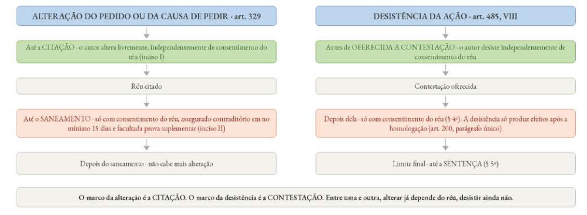
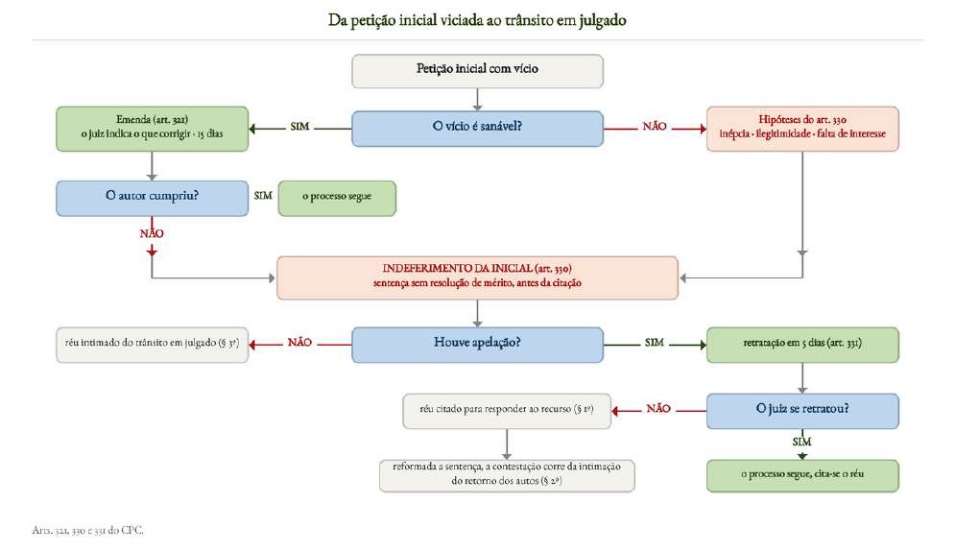
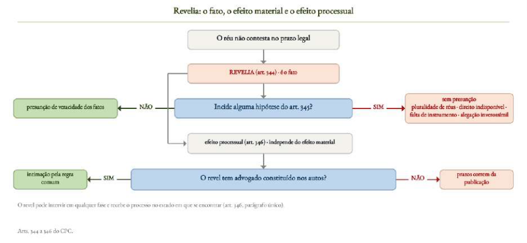

# Direito Processual Civil

*Ponto 7 do edital: Procedimento comum*

:::JC_F2F2F2 
**7. Procedimento comum. Petição inicial. Pedido e causa de pedir. Cumulação. Emenda. Indeferimento. Improcedência liminar. Audiência de conciliação ou mediação. Contestação e reconvenção. Revelia. Providências preliminares. Julgamento conforme o estado do processo, inclusive julgamento antecipado do mérito e julgamento antecipado parcial. Saneamento e organização do processo. Calendário processual. Audiência de instrução e julgamento. Alegações finais.**
:::

| [JusLEGIS] **Estudo de Lei Seca** | > |
|---|---|
| **CPC** | art. 318 (procedimento comum) · arts. 319 a 321 (requisitos da inicial e emenda) · arts. 322 a 329 (pedido, cumulação e aditamento) · arts. 330 e 331 (indeferimento e apelação) · art. 332 (improcedência liminar) · art. 334 (audiência de conciliação ou de mediação) · arts. 335 a 342 (contestação) · art. 343 (reconvenção) · arts. 344 a 346 (revelia) · arts. 347 a 353 (providências preliminares) · arts. 354 a 357 (julgamento conforme o estado do processo e saneamento) · art. 191 (calendário processual) · arts. 358 a 368 (audiência de instrução e julgamento e alegações finais) · arts. 141 e 492 (congruência) · art. 183 (prazo em dobro) · art. 496 (remessa necessária) · art. 1.015 (**agravo de instrumento**) |
| **Lei nº 10.259/2001** | art. 3º (competência e valor) · art. 6º (quem pode ser parte) · art. 9º (ausência de prazo diferenciado) · art. 13 (ausência de reexame necessário) |
| **Lei nº 9.099/1995** | art. 31 (reconvenção e pedido contraposto) |
| **Lei nº 13.140/2015** | arts. 32 a 40 (câmaras de prevenção e resolução administrativa de conflitos) |

O ==**procedimento comum**== é o **rito padrão do CPC**, o qual substituiu o antigo "procedimento ordinário" do CPC/73. O que se cobra dele são casos concretos, com a pergunta sobre como o julgador deveria se posicionar diante **dos fatos narrados**. Já tivemos questões que versaram sobre:

→ **Petição inicial, emenda e indeferimento.** Caíram no **TJBA (2026)**, com a litigância abusiva, e no **TJSC (2025)**, com a retratação.

→ **Contestação e reconvenção.** Caíram no **TRF3 (2025)** e no **TJSC (2024)**, em questões de literalidade.

→ **Revelia.** Apareceu no **TJGO (2026)**, no **TJSE (2025)** e no **TJSC (2025)**, sempre em caso concreto.

## 1. Procedimento comum

O ==**procedimento comum**== é o **rito padrão do processo de conhecimento**, aplicável a todas as causas, ==**salvo disposição em contrário do CPC ou de lei**== (art. 318).

Ele também tem **função supletiva**: aplica-se subsidiariamente aos procedimentos especiais e ao processo de execução (parágrafo único). Onde o rito especial for omisso, valem as regras do procedimento comum.

## 2. Petição inicial

A ==**petição inicial**== é o **ato postulatório** que instaura o processo e **delimita o que o juiz poderá decidir**. Os requisitos do **art. 319** são exigidos na literalidade, e dois deles concentram a dificuldade:

→ **Qualificação das partes** (II). Além dos dados tradicionais, o CPC de 2015 passou a exigir a **existência de união estável** e o **endereço eletrônico** do autor e do réu.

→ **Opção pela audiência de conciliação ou de mediação** (VII). Nesse inciso o autor manifesta o desinteresse exigido pelo art. 334, § 5º.

A falta do nome ou do endereço do réu ==**não gera o automático indeferimento da inicial**==. O autor pede ao juiz as **diligências necessárias** para obtê-los (§ 1º), e a inicial não é indeferida se a citação for possível mesmo sem eles (§ 2º), ou se a obtenção tornar **impossível ou excessivamente oneroso o acesso à justiça** (§ 3º).

:::JC_D9F2D0 JURISPRUDÊNCIA
**Caso concreto**: empresa tentava prosseguir com uma execução após a morte do devedor, mas alegou dificuldade para identificar e localizar seus herdeiros. Pediu ajuda ao juízo e, diante da negativa, recorreu ao STJ. Para a Corte, **se a parte tentou, sem sucesso, obter informações indispensáveis sobre a outra parte, pode pedir ajuda ao juiz**. O juiz deve avaliar se a diligência solicitada é necessária e proporcional, sem substituir o esforço da parte nem comprometer sua imparcialidade. STJ. 3ª Turma. REsp 2.142.350-DF, Rel. Min. Nancy Andrighi, julgado em 1º/10/2024 (Info 828).
:::

A inicial deve vir ainda com os **documentos indispensáveis à propositura da ação** (art. 320), isto é, os que integram a própria causa de pedir, como o contrato na ação de rescisão contratual.

:::JC_DAE9F7 PEGADINHA
Documento indispensável **não é sinônimo de documento probatório**. O autor pode juntar documentos depois, com vista à parte contrária (arts. 435 e 437, § 1º), e a falta de documento apenas útil não torna a inicial inepta. Por isso está errada a alternativa que exige toda a prova documental já na inicial, sob pena de preclusão.
:::

## 3. Pedido e causa de pedir

A ==**causa de pedir**== corresponde ao **elemento da demanda** integrado pelos fatos e pelos fundamentos jurídicos da pretensão (art. 319, III).

Como o CPC adota a ==**teoria da substanciação**==, a demanda se ancora nos fatos narrados pelo autor, e não apenas na relação jurídica que ele afirma, como quer a teoria da individualização. Mudar o fato é mudar a demanda. Mudar o rótulo jurídico não é um problema, dada a máxima de que o juiz conhece o direito (nem sempre se confirma, é verdade, rs, mas é o que significa o “iura novit curia”).

:::JC_D9F2D0 JURISPRUDÊNCIA
Pela **teoria da substanciação**, a demanda é definida pelos **fatos narrados na petição inicial e pelo pedido**, não pelo nome que o autor dá à ação. No caso, embora a ação tenha sido chamada de reivindicatória, a autora relatou a invasão de seu terreno e a construção de uma varanda no local. Como esses fatos também sustentavam a proteção possessória, o Tribunal pôde examinar o caso como reintegração de posse. Não houve julgamento *extra petita*: a ré se defendeu da alegada invasão, e a mudança de enquadramento jurídico não lhe causou prejuízo. (AREsp n. 2.983.160/MG, relator Ministro Moura Ribeiro, Terceira Turma, julgado em 17/11/2025, DJEN de 25/11/2025.)
:::

O pedido deve ser ==**certo**== (art. 322), ou seja, expresso (não pode o autor ser “abstrato” no pedido). Também precisa ser ==**determinado**== (art. 324), isto é, delimitado em quantidade e qualidade.

Alguns pedidos são **implícitos** e se consideram incluídos ainda que o autor se cale:

Ø juros legais,

Ø correção monetária e

Ø verbas de sucumbência, inclusive honorários (art. 322, § 1º).

Além disso, a interpretação do pedido considera o conjunto da postulação e a boa-fé (§ 2º), de modo que ela ==**não é restritiva**==, ao contrário do que previa o CPC de 1973. É por isso que vemos na jurisprudência alguns pedidos que, embora não deduzidos de forma expresso, são deferidos sem violação ao princípio da adstrição.

:::JC_D9F2D0 Chance alta TRF5 · JURISPRUDÊNCIA
**Juros de mora e correção monetária são matérias de ordem pública.** Por isso, o juiz pode definir ou alterar os índices aplicáveis mesmo sem pedido específico da parte. **Essa alteração não configura *reformatio in pejus *.** STJ. 1ª Turma. AgInt no AREsp 2.821.566-DF, Rel. Min. Benedito Gonçalves, julgado em 22/9/2025 (Info 28 - Edição Extraordinária)

Juros e correção, portanto, são “pedidos implícitos”. Por isso admite-se maior flexibilidade.
:::

Já o ==**pedido genérico só é admitido nas hipóteses do art. 324, § 1º**==, que valem também para a reconvenção (§ 2º):

Ø **Ações universais**, quando o autor não puder individuar os bens, como na petição de herança com acervo ainda não identificado.

Ø **Consequências ainda desconhecidas** do ato ou do fato, como as da vítima que ainda passará por novas cirurgias.

Ø **Valor que depende de ato do réu**, quando o objeto ou o valor da condenação só puder ser determinado depois que ele praticar algum ato.

%% TOME NOTA

Agora, veja abaixo outra classificação: a diferença entre pedido “alternativo” e “subsidiário”.

| **PEDIDO ALTERNATIVO E PEDIDO SUBSIDIÁRIO** | > | > |
|---|---|---|
| **CRITÉRIO** | **ALTERNATIVO (ART. 325)** | **SUBSIDIÁRIO (ART. 326, CAPUT)** |
| **Por que existe** | a **natureza da obrigação** permite que o devedor cumpra de mais de um modo | o autor quer **mais de uma coisa**, em ordem de preferência |
| **Como se formula** | os modos de cumprimento ficam **no mesmo plano** | os pedidos vêm **em ordem**, do principal para o seguinte |
| **O que o juiz faz** | acolhe o pedido e o devedor escolhe o modo de cumprir | conhece do **posterior** quando **não acolher** o anterior |
| **Escolha do devedor** | se a escolha couber ao devedor, por lei ou por contrato, o juiz assegura a ele cumprir de um ou de outro modo, **ainda que o autor não tenha formulado pedido alternativo** (art. 325, parágrafo único) | não se aplica |

A alteração do pedido ou da causa de pedir é livre **até a citação**. **Até o saneamento** ainda é possível, com consentimento do réu, assegurado o contraditório em no mínimo **15 dias**, com possibilidade de prova suplementar (art. 329).

Depois do saneamento, ==**não há mais alteração**==. E o juiz fica preso ao que foi pedido: é vedado decidir de natureza diversa da pedida ou condenar em quantidade superior ou em objeto diverso (art. 492).

:::JC_DAE9F7 NÃO CONFUNDA
==**Alterar o pedido**== ou a causa de pedir é livre até a **citação** e, depois dela, só com consentimento do réu, até o **saneamento**.

==**Desistir da ação**== é livre até a **contestação** e, depois dela, só com consentimento do réu, até a **sentença**.

Não confundam os marcos!
:::

Reforcem isso a partir do diagrama a seguir:

%% Chance alta TRF5

%% NÃO CONFUNDA

Não confundam, por fim, com o Mandado de Segurança.

Nesse, considera-se ==**lícito ao impetrante desistir da ação de mandado de**==

:::JC_FFFF00 
**segurança, independentemente de aquiescência da autoridade apontada como coatora ou**
:::

==**da entidade estatal interessada**== **ou, ainda, quando for o caso, dos litisconsortes passivos**

:::JC_FFFFFF 
**necessários, a qualquer momento antes do término do julgamento, mesmo após eventual**
:::

:::JC_FFFFFF 
==**sentença concessiva do ‘writ’ constitucional**==**.** STF. Plenário. RE 669367, Relator(a) p/
:::

Acórdão: Rosa Weber, julgado em 02/05/2013 (Repercussão Geral - Tema 530).

## 4. Cumulação

A ==**cumulação de pedidos**== configura **hipótese de ampliação objetiva do processo**, pela qual o autor deduz, contra o mesmo réu e em um só processo, mais de uma pretensão, **ainda que entre elas não haja conexão** (art. 327). A conexão não é requisito.

Os requisitos do § 1º, por sua vez, são cumulativos: compatibilidade entre os pedidos, competência do mesmo juízo para todos e adequação do procedimento.

Havendo ritos diferentes, ==**a cumulação é admitida se o autor empregar o procedimento comum**==, sem prejuízo das técnicas diferenciadas dos procedimentos especiais compatíveis com ele (§ 2º).

A compatibilidade tem uma ressalva: ==**ela não é exigida na cumulação subsidiária do art. 326**==, em que os pedidos são, por definição, excludentes (§ 3º).

| **ESPÉCIES DE CUMULAÇÃO DE PEDIDOS** | > | > |
|---|---|---|
| **ESPÉCIE** | **COMO SE FORMULA** | **O QUE O JUIZ FAZ** |
| **Simples** | pedidos autônomos, **sem relação de dependência** | acolhe ou rejeita cada um, isoladamente |
| **Sucessiva** | o segundo pedido **só pode ser acolhido se o primeiro for** | rejeitado o primeiro, o segundo fica prejudicado |
| **Eventual ou subsidiária (art. 326, caput)** | pedidos **em ordem de preferência** | conhece do posterior quando não acolher o anterior |
| **Alternativa (art. 326, parágrafo único)** | pedidos **no mesmo plano**, para que um seja acolhido | acolhe um deles, s**em ordem de preferência** |

## 5. Emenda

A ==**emenda da petição inicial**== (art. 321) consiste em **oportunidade de correção** conferida ao autor antes do indeferimento. Ela é aplicação da **primazia do julgamento de mérito**, a diretriz de que o processo existe para resolver o conflito, e não para se encerrar por vício que podia ser sanado.

Cabe quando a inicial não preenche os requisitos dos arts. 319 e 320, ou quando tem **defeitos capazes de dificultar o julgamento de mérito**.

O prazo para a emenda é de **15 dias**.

O juiz, de sua parte, deve **indicar com precisão o que precisa ser corrigido ou completado**. Sem essa indicação, ==**a determinação genérica não autoriza o indeferimento**==.

Só depois de descumprida a diligência vem a consequência do parágrafo único, que é o indeferimento. A ordem é **1) intimar, 2) aguardar o prazo e 3) só então extinguir**.

O STJ fixou o limite desse poder quando há indícios de **litigância abusiva** (já vimos antes, mas vamos reiterar, pois creio ser bem importante):

:::JC_D9F2D0 JURISPRUDÊNCIA
**STJ, Tema 1.198 (REsp 2.021.665/MS):** Constatados indícios de litigância abusiva, o juiz pode exigir, de modo fundamentado e com observância à razoabilidade do caso concreto, a emenda da petição inicial a fim de demonstrar o interesse de agir e a autenticidade da postulação, respeitadas as regras de distribuição do ônus da prova.

%% JURISPRUDÊNCIA

Corte Especial, rel. min. Moura Ribeiro, j. 13.3.2025, Informativo 844. A exigência é **excepcional**, depende de **indícios concretos** e de **fundamentação**, e **não autoriza inverter o ônus da prova contra o autor**.
:::

## 6. Indeferimento

O ==**indeferimento da petição inicial**== constitui **sentença terminativa** proferida **antes da citação**, em razão de defeito da própria peça. As hipóteses estão no art. 330:

→ **Inépcia da inicial** (I). O rol do § 1º é **taxativo**: falta de pedido ou de causa de pedir, pedido indeterminado (salvo o genérico autorizado), narração dos fatos da qual não decorre logicamente a conclusão e pedidos incompatíveis entre si.

→ **Ilegitimidade manifesta, falta de interesse processual e descumprimento de dever processual** (II a IV), este último quanto aos arts. 106 e 321, isto é, endereço do advogado em causa própria e dever de emendar.

Há ainda uma inépcia própria das **ações revisionais** de empréstimo, financiamento ou alienação de bens. Nelas, o autor deve **discriminar as obrigações que pretende controverter** e **quantificar o valor incontroverso** (§ 2º), que continua a ser pago no tempo e modo contratados (§ 3º).

Indeferida a inicial, ==**cabe apelação com juízo de retratação**== (art. 331).

A retratação é o famoso “errei, fui moleque”. Ou seja: o juiz percebe o erro. Como é “exceção”, só terá espaço nos casos de decisão “prematura”, aquelas que são dadas “de plano”, como o indeferimento imediato da inicial ou a improcedência liminar. Nesses casos, o juiz pode **retratar-se em 5 dias**. Se não o fizer, manda citar o réu para responder ao recurso (§ 1º).

Reformada a sentença, o **prazo de contestação corre da intimação do retorno dos autos**, observado o art. 334 (§ 2º). Sem apelação, o réu é apenas intimado do trânsito em julgado (§ 3º).

%% PASSO A PASSO

## 7. Improcedência liminar

A ==**improcedência liminar**== é sentença **de mérito** proferida **antes da citação**, porque a pretensão já contraria **precedente qualificado**, assim entendido aquele que o CPC dota de força vinculante ou persuasiva reforçada. O réu sequer é chamado ao processo, e ainda assim o pedido é rejeitado no mérito, o que só se explica porque a resposta já está dada. ==**Não é extinção sem resolução do mérito**==.

O art. 332 exige, antes de tudo, que a causa **dispense a fase instrutória**. Preenchido esse pressuposto, o pedido deve contrariar uma destas fontes:

→ **Súmula do STF ou do STJ** (I).

→ **Acórdão em julgamento de recursos repetitivos** (II).

→ **Entendimento firmado em IRDR ou em IAC** (III), técnicas em que o tribunal julga uma causa-piloto ou assume a competência de um caso relevante para fixar tese a ser seguida.

→ **Súmula de tribunal de justiça sobre direito local** (IV).

Fora desse rol, ==**a jurisprudência dominante do tribunal local e o precedente isolado do STJ não autorizam a improcedência liminar**==. No Juizado Especial Federal há leitura própria: pelo **Enunciado 43 da ENFAM**, ==**o art. 332 se aplica aos juizados**==, e o inciso IV abrange os enunciados e as súmulas dos seus órgãos colegiados.

O § 1º acrescenta uma hipótese que não é de precedente: a ==**prescrição ou a decadência verificadas desde logo**====.== É a única situação em que se reconhece a prescrição sem ouvir as partes. Fora dela, ==**prescrição e decadência não serão reconhecidas sem que antes as partes possam se manifestar**== (art. 487, parágrafo único).

O recurso é o mesmo do art. 331: **apelação, com espaço para retratação em 5 dias** (§ 3º). Havendo retratação, o processo prossegue com a citação. Não havendo, o réu é citado para **contrarrazões em 15 dias** (§ 4º). Sem apelação, é intimado do trânsito em julgado (§ 2º).

:::JC_DAE9F7 NÃO CONFUNDA
O indeferimento (art. 330) é sentença sem resolução de mérito, por vício da inicial, e **não faz coisa julgada material**.

A improcedência liminar (art. 332) é sentença com resolução de mérito e **faz coisa julgada material**.

A confusão vem do procedimento, porque as duas dispensam a citação prévia e admitem retratação em cinco dias.
:::

:::JC_FFE698 JÁ CAIU!
**(Juiz Federal - TRF1 - FGV - 2025)** Gustavo ajuizou ação em face da União. Como causa de pedir, sustentou que é ocupante do cargo de advogado da União e que, no ano de 2020, não houve a revisão geral anual de sua remuneração. Assim, pediu a condenação do ente público a promover a revisão de seu salário, aplicando- se o IPCA como índice de correção, o qual foi utilizado para a revisão da remuneração dos servidores do Estado de São Paulo, e ao pagamento dos valores devidos a contar de janeiro de 2021. O valor atribuído à causa, a qual foi distribuída

ao XX Juizado Especial Federal da 1ª Subseção Judiciária de São Paulo, foi de 30 mil reais. Sabendo-se que, pela Súmula Vinculante 37, o Judiciário não pode aumentar os vencimentos de servidores públicos com base no princípio da isonomia, nem o Executivo é obrigado a conceder revisões gerais anuais no vencimento de servidores públicos, conforme decisão do Supremo Tribunal Federal com repercussão geral reconhecida, é correto afirmar que:

a) eventual sentença de procedência do pedido estará sujeita ao reexame necessário;

b) diante do valor atribuído à causa, a demanda poderia ter sido distribuída ao Juízo Federal comum, pois a competência dos Juizados Especiais Federais é relativa;

c) a União gozará de prazo em dobro para todas as suas manifestações processuais, por aplicação do Código de Processo Civil aos Juizados Especiais Federais;

d) o juízo poderá julgar liminarmente improcedente a pretensão de Gustavo, por se tratar de pedido contrário a enunciado de súmula do Supremo Tribunal Federal;

e) é cabível a concessão de medida liminar em favor de Gustavo para conceder o reajuste pretendido, a qual somente poderá ser deferida mediante requerimento do autor.⁴⁹
:::

## 8. Audiência de conciliação ou mediação

Preenchidos os requisitos da inicial, e não sendo caso de improcedência liminar, o juiz designará ==**audiência de conciliação ou de mediação**==. Ela é a **regra** do procedimento comum, ==**não uma faculdade do juízo**==.

Os prazos do art. 334:

| **PRAZOS DA AUDIÊNCIA DO ART. 334** | > | > |
|---|---|---|
| **REGRA** | **PRAZO** | **DETALHE** |
| **Designação da audiência** | antecedência mínima de **30 dias** | contada da designação (caput) |
| **Citação do réu** | pelo menos **20 dias** antes | a intimação do autor é **na pessoa do advogado** (§ 3º) |
| **Sessões adicionais** | até **2 meses** da primeira | podem ser várias sessões (§ 2º) |
| **Desinteresse do réu** | petição com **10 dias** de antecedência | o do autor vai **na petição inicial** (§ 5º) |
| **Ausência injustificada** | multa de **até 2%** | da vantagem pretendida ou do valor da causa, revertida à **União ou ao Estado** (§ 8º) |

==**A audiência só deixa de ser realizada em duas hipóteses**== (§ 4º):

→ **Desinteresse bilateral** (I), manifestado expressamente por **ambas as partes**.

→ **Inadmissibilidade de autocomposição** quanto ao direito discutido (II).

:::JC_DAE9F7 PEGADINHA
Havendo litisconsórcio, **o desinteresse deve ser manifestado por todos os litisconsortes** (art. 334, § 6º). Afirmar que basta a manifestação de parte deles foi a alternativa falsa no TRF3 (2025).
:::

As partes comparecem acompanhadas de advogado ou defensor público (§ 9º) e podem se fazer representar por quem tenha **procuração específica, com poderes para negociar e transigir** (§ 10). Por isso a ausência pessoal nem sempre gera a multa:

:::JC_D9F2D0 JURISPRUDÊNCIA
**STJ, 4ª Turma, RMS 56.422/MS**, rel. min. Raul Araújo, j. 8.6.2021, Informativo 700: a parte que **não comparece pessoalmente**, mas se faz representar por advogado com **poderes específicos para transigir**, na forma do art. 334, § 10, **não pode ser multada** por ato atentatório à dignidade da justiça.

%% JURISPRUDÊNCIA

**STJ, 3ª Turma, REsp 1.909.271/PR**, rel. min. Ricardo Villas Bôas Cueva, j. 11.2.2025, Informativo 842: a apresentação do réu no início da fase postulatória, **antes da decisão que recebe a inicial e designa a audiência**, **não deflagra automaticamente o prazo para contestar**. A contestação continua contada na forma dos **incisos I e II do art. 335**.
:::

Com a Fazenda Pública no polo passivo, a autocomposição também é possível. O art. 32 da **Lei nº 13.140/2015** autoriza os entes a criar câmaras de prevenção e resolução administrativa de conflitos, e os arts. 33 a 40 completam o regime. Por isso, ==**a inadmissibilidade do inciso II do § 4º não se presume pela só presença do ente público**==.

## 9. Contestação e reconvenção

## 9.1. Contestação

A ==**contestação**== é a **peça de resposta** em que o réu concentra toda a sua defesa, processual e de mérito, no prazo de **15 dias**. O termo inicial depende do que aconteceu com a audiência do art. 334 (art. 335):

| **TERMO INICIAL DO PRAZO DE CONTESTAÇÃO (ART. 335)** | > | > |
|---|---|---|
| **SITUAÇÃO** | **TERMO INICIAL** | **DETALHE** |
| **Houve audiência (I)** | da audiência ou da última sessão | quando alguma parte não comparecer ou não houver acordo |
| **O réu pediu o cancelamento (II)** | do protocolo do pedido de cancelamento | com litisconsortes passivos, conta-se para cada réu a data do seu próprio pedido (§ 1º) |
| **Demais casos (III)** | conforme o art. 231 | segue o modo pelo qual a citação se deu |

Pelo ==**princípio da eventualidade**== (art. 336), o réu deve alegar **toda a matéria de defesa** na contestação, com as razões de fato e de direito e a especificação das provas. O nome vem daí: as defesas se apresentam de uma só vez, cada uma para a eventualidade de a anterior não ser acolhida. ==**O que não for alegado ali, em regra, preclui**==.

Antes do mérito vêm as **preliminares do art. 337**:

| **AS PRELIMINARES DO ART. 337** | > | > |
|---|---|---|
| **INCISO** | **OBSERVAÇÃO** | **JULGADOS** |
| **I · citação** | Conhecível de ofício. Se o réu comparece **só para arguir a nulidade** e ela é acolhida, considera-se citado na data em que ele ou o seu advogado for intimado da decisão (art. 239, § 2º). | **Tão grave é o vício decorrente da ausência de citação** que ele pode ser alegado mesmo após o trânsito em julgado e o fim do prazo da ação rescisória. Trata-se de **vício transrescisório**: para apontá-lo, a parte não precisa propor uma ação autônoma de *querela nullitatis*. **Pode suscitar a nulidade incidentalmente em outro processo, conforme as circunstâncias do caso.** STJ. 3ª Turma. REsp 2.095.463-PR, Rel. Min. Nancy Andrighi, julgado em 18/3/2025 (Info 844). |
| **II · incompetência** | Só a **absoluta** é conhecível de ofício (§ 5º). A **relativa** não alegada prorroga a competência (art. 65). A contestação pode ser protocolada no foro do domicílio do réu (art. 340). | **Súmula 33 do STJ**: a incompetência relativa não pode ser declarada de ofício. |
| **III · valor da causa** | Matéria de **ordem pública**, alterável de ofício (art. 292, § 3º). É preliminar e deve ser apreciada **antes do mérito** e antes mesmo da extinção sem resolução de mérito, porque repercute em custas, honorários e competência. | **STJ, 3ª T., REsp 2.113.605-CE**, j. 16/9/2025 (Info 867): cabe impugnar em contrarrazões de apelação quando essa foi a primeira oportunidade de manifestação, sem preclusão. |
| **IV · inépcia** | Conhecível de ofício. O rol do art. 330, § 1º é **taxativo**. Acolhida, o processo se extingue sem resolução de mérito (art. 485, I). | — |
| **V · perempção** | Pressupõe que o autor tenha dado causa, por **três vezes**, à extinção por abandono (art. 486, § 3º). Perde o direito de repropor, mas conserva o de alegar a matéria **em defesa**. | — |
| **VI · litispendência** | Repetição de ação **em curso** (§ 3º), medida pela tríplice identidade do § 2º, que são as mesmas partes, a mesma causa de pedir e o mesmo pedido. Extinção sem resolução de mérito (art. 485, V). | — |
| **VII · coisa julgada** | Repetição de ação **já decidida** por decisão transitada em julgado (§ 4º). Alcança o **deduzido e o dedutível**, pela eficácia preclusiva do art. 508. | [Chance alta TRF5] **STJ, 2ª Seção, Tema 1.268:** A eficácia preclusiva da coisa julgada impede o ajuizamento de nova ação para pleitear a restituição de quantia paga a título de juros remuneratórios incidentes sobre tarifas bancárias declaradas ilegais ou abusivas em ação anterior. |
| **VIII · conexão** | Não extingue o processo. O efeito é a **reunião** dos processos para julgamento conjunto (art. 55, § 1º), no juízo prevento (art. 59). | **Súmula 235 do STJ**: a conexão não determina a reunião se um dos processos já foi julgado. |
| **IX · incapacidade e representação** | Vício **sanável**. O juiz suspende o processo e marca prazo para a correção (art. 76). Não sanado, extingue-se o processo se o vício for do autor, decreta-se a revelia se for do réu e exclui-se o terceiro se dele for. | — |
| **X · arbitragem** | Com a incompetência relativa, a **única não conhecível de ofício** (§ 5º). Não alegada, implica **aceitação da jurisdição estatal e renúncia ao juízo arbitral** (§ 6º). Acolhida, extingue sem mérito (art. 485, VII). | — |
| **XI · legitimidade e interesse** | Conhecíveis de ofício **em qualquer tempo e grau** de jurisdição (art. 485, § 3º), com extinção sem resolução de mérito (art. 485, VI). | — |
| **XII · caução** | O caso típico é a **caução do art. 83**, devida pelo autor que resida fora do Brasil ou dele se ausente na pendência da demanda e não tenha no País imóvel que assegure as custas. Vício sanável. | — |
| **XIII · gratuidade** | A impugnação se faz **na própria contestação**, e não por incidente autônomo (art. 100). Revogado o benefício, a parte paga o que deixou de adiantar e, havendo má-fé, até o **décuplo** a título de multa. | — |

:::JC_DAE9F7 EXCEÇÃO
O juiz conhece **de ofício** de todas as matérias do art. 337, **excetuadas a convenção de arbitragem e a incompetência relativa** (§ 5º). E não alegar a convenção de arbitragem implica **aceitação da jurisdição estatal e renúncia ao juízo arbitral** (§ 6º).
:::

Na defesa de mérito vale o ==**ônus da impugnação especificada**== (art. 341): o réu deve enfrentar cada alegação de fato, sob pena de **presumirem-se verdadeiras as não impugnadas**.

O ônus ==**não se aplica ao defensor público, ao advogado dativo e ao curador especial**==, que ==**podem contestar por negação geral**== (parágrafo único). A razão é a mesma nos três casos: eles defendem quem não escolheu o defensor e muitas vezes sequer está presente, de modo que exigir impugnação específica seria exigir o impossível. Foi essa a regra que resolveu a questão do TJSE (2025) sobre o curador especial do réu citado por edital.

Depois da contestação, ==**o réu só traz alegações novas em três casos**== (art. 342): **direito ou fato superveniente**, **matéria conhecível de ofício** e **autorização legal** para alegação em qualquer tempo e grau de jurisdição.

:::JC_DAE9F7 CONECTANDO
Prazo da Fazenda Pública: União, Estados, DF, Municípios e suas autarquias e fundações de direito público têm **prazo em dobro para todas as manifestações**, contado da intimação pessoal (art. 183), ou seja, **30 dias** para contestar.

**Esse dobro não se aplica quando a lei fixar prazo próprio para o ente** (§ 2º), como faz o art. 9º da Lei nº 10.259/2001 no JEF.
:::

:::JC_FFE698 JÁ CAIU!
**(Juiz Federal - TRF3 - FGV - 2025)** Assinale a alternativa correta:

a) Na contestação, é lícito ao réu propor reconvenção para manifestar pretensão própria, conexa ou não com a ação principal ou com o fundamento da defesa.

b) Depois da contestação, é lícito ao réu deduzir novas alegações quando relativas a direito ou fato superveniente.

c) Se o réu alegar fato impeditivo, modificativo ou extintivo do direito do autor, este será ouvido no prazo de 20 (vinte) dias, permitindo-lhe o juiz a produção de prova.

d) A produção antecipada da prova previne a competência do juízo para a ação que venha a ser proposta.

e) A desistência da ação pode ser apresentada a qualquer tempo.⁵⁰
:::

## 9.2. Reconvenção

:::JC_FFFFFF 
A ==**reconvenção**== constitui **ação autônoma do réu** exercida dentro do mesmo processo, fundada em pretensão **conexa com a ação principal ou com o fundamento da defesa** (art. 343). Desde o CPC de 2015 ela é proposta **na própria contestação**.

Proposta a reconvenção, o autor é **intimado na pessoa de seu advogado** para responder em **15 dias** (§ 1º). ==**Não há nova citação**==, porque ele já está no processo.
:::

:::JC_DAE9F7 PEGADINHA
A desistência da ação ou a causa extintiva que impeça o exame do seu mérito **não obsta o prosseguimento da reconvenção** (art. 343, § 2º). Suprimir esse "não" foi o que tornou falsa a alternativa no TRF3 (2025) e no TJSC (2024).
:::

Os demais parágrafos do art. 343:

→ **Reconvenção contra terceiro** (§§ 3º e 4º). ==**Pode ser proposta contra o autor e terceiro e pelo réu em litisconsórcio com terceiro.**==

→ **§ 5º:** na substituição processual, o reconvinte afirma ser titular de direito em face do **substituído** e reconvém contra o autor **também como substituto processual**.

→ **Reconvenção sem contestação** (§ 6º). O réu pode reconvir **independentemente de oferecer contestação**.

:::JC_B3E5A1 SÚMULA
**Súmula 292 do STJ:** A reconvenção é cabível na ação monitória, após a conversão do procedimento em ordinário.
:::

:::JC_DAE9F7 TRADUZINDO
No Juizado Especial Federal a reconvenção **não é admitida**. É o que diz o art. 31 da Lei nº 9.099/1995, aplicável por força do art. 1º da Lei nº 10.259/2001: **"Não se admitirá a reconvenção. É lícito ao réu, na contestação, formular pedido em seu favor, nos limites do art. 3º desta Lei, desde que fundado nos mesmos fatos que constituem objeto da controvérsia**."

O que sobra é o **pedido contraposto**, pretensão que o réu deduz na própria contestação, presa aos mesmos fatos e sem a autonomia da reconvenção. E, como no JEF só entes federais podem ser réus (art. 6º, II, da Lei nº 10.259/2001), ele é ali pouco comum.
:::

:::JC_FFE698 JÁ CAIU!
**(Juiz de Direito - TJSC - FGV - 2024)** No que se refere à reconvenção, é correto afirmar que:

a) depois de sua propositura, o autor-reconvindo deverá ser intimado por oficial de justiça para ofertar resposta no prazo de quinze dias;

b) a ocorrência de qualquer causa que obste a apreciação do mérito da ação também se traduzirá em impedimento ao exame do mérito do pleito reconvencional;

c) ao réu é vedado formular pedido reconvencional de cunho condenatório, caso a petição inicial da ação tenha veiculado pretensão de natureza meramente declaratória;

d) ao réu é lícito formular o pleito reconvencional em litisconsórcio com terceiro, assim como poderá fazê-lo em desfavor do autor e de terceiro;

e) caso a petição da reconvenção seja liminarmente indeferida pelo juiz, poderá o réu-reconvinte manejar recurso de apelação para impugnar essa decisão.⁵¹
:::

## 10. Revelia

A ==**revelia**== caracteriza-se como a **situação processual** decorrente da ausência de contestação no prazo legal, da qual resulta, em regra, a **presunção de veracidade das alegações de fato** do autor (art. 344).

Só se fala em revelia depois que o prazo de contestação começou a correr. Foi o que decidiu o TJSC (2025): uma ré citada e outra não encontrada, sem audiência realizada. ==**O juiz não decreta a revelia**==, porque o prazo do art. 335 nem começou, e manda **requisitar o endereço da ré ausente** nos cadastros de órgãos públicos ou de concessionárias (art. 256, § 3º), antes de pensar em citação por edital.

%% PASSO A PASSO

:::JC_DAE9F7 DICA DO PROFESSOR
**A Fazenda Pública pode ser revel**. O que em regra **não se produz é a presunção de veracidade**, porque o litígio tende a versar sobre direito indisponível (art. 345, II). Se a pretensão for de conteúdo **patrimonial e disponível**, a presunção volta a incidir. Foi essa a lógica do gabarito oficial do TJGO (2026), embora a qualificação daquele pedido como disponível seja discutível.
:::

:::JC_FFE698 JÁ CAIU!
**(Juiz de Direito - TJGO - FGV - 2026)** Paulo, natural de Goiânia, propôs ação em face do Estado de Goiás com o intuito de receber pensão decorrente de doença crônica ocasionada pela exposição a Césio-137 quando era criança. Argumenta, em sua inicial, que apresentou requerimento administrativo, o qual foi indeferido pela alegação de que não foi comprovado o nexo de causalidade entre a enfermidade e a exposição à radiação. Pontua Paulo que o evento citado é fato notório, dispensando a produção de prova de sua ocorrência, razão pela qual faria jus à pensão pretendida. Devidamente citado, o poder público deixou de apresentar contestação, razão pela qual foi decretada sua revelia. Após, ainda na fase instrutória, a Procuradoria do Estado se manifestou e afirmou que: I. a notoriedade do fato não isenta o autor da comprovação do nexo de causalidade entre o evento e sua doença, de modo que pretende a realização de perícia; II. não seria possível aplicar a revelia ao poder público. No que se refere às alegações da Procuradoria do Estado, considerando as regras probatórias e jurisprudência sobre o tema, é correto afirmar que:

a) deve a primeira ser acolhida e rejeitada a segunda, pois, embora o evento seja de conhecimento geral, a pensão só seria devida se comprovada a relação de

causalidade entre o fato e a doença do autor, bem como que, ao se tratar de requerimento de interesse privado, é possível a aplicação da revelia;

b) devem ser acolhidas integralmente, pois embora o evento seja de conhecimento geral, a pensão só seria devida se comprovada a relação de causalidade entre o fato e a doença do autor, bem como a prevalência do interesse público impediria a aplicação da revelia;

c) deve a primeira ser rejeitada e acolhida a segunda, pois a exposição dos cidadãos à radiação é fato notório, dispensando a produção de prova inclusive de suas consequências, bem como a prevalência do interesse público impediria a aplicação da revelia;

d) devem ser rejeitadas integralmente, pois a exposição dos cidadãos à radiação é fato notório, dispensando a produção de prova inclusive de suas consequências, bem como que ao se tratar de requerimento de interesse privado, é possível a aplicação da revelia;

e) não podem ser conhecidas, pois uma vez decretada a revelia não é possível a intervenção do réu revel, tampouco o requerimento de produção de prova.⁵²
:::

## 11. Providências preliminares

Eis o passo a passo nas situações que podem ocorrer no procedimento comum:

| **AS PROVIDÊNCIAS PRELIMINARES** | > | > |
|---|---|---|
| **DISPOSITIVO** | **SITUAÇÃO** | **O QUE O JUIZ DETERMINA** |
| **Art. 348** | revelia **sem** efeito material | manda o autor **especificar as provas** que pretende produzir |
| **Art. 349** | prova do revel | o revel pode produzir provas **contrapostas** às alegações do autor, desde que se faça representar a tempo |
| **Arts. 350 e 351** | réplica | alegado fato **impeditivo, modificativo ou extintivo**, ou preliminar do art. 337, o autor é ouvido em **15 dias**, com possibilidade de prova |
| **Art. 352** | vícios sanáveis | manda corrigi-los em prazo **nunca superior a 30 dias** |

Cumpridas as providências, ou dispensadas, o juiz profere **julgamento conforme o estado do processo** (art. 353).

## 12. Julgamento conforme o estado do processo

Aqui o juiz decide se o processo **acaba ali**, se **acaba em parte** ou se **segue para a instrução**:

| **SAÍDAS DO ART. 353** | > | > |
|---|---|---|
| **SAÍDA** | **QUANDO OCORRE** | **PRONUNCIAMENTO E RECURSO** |
| **Extinção (art. 354)** | hipóteses dos arts. 485 e 487, II e III | **sentença, e apelação**. Alcançando apenas parcela do processo, agravo de instrumento |
| **Julgamento antecipado do mérito (art. 355)** | **desnecessidade de outras provas**, ou revelia com efeito material e sem requerimento de prova | **sentença com resolução de mérito, e apelação** |
| **Julgamento antecipado parcial (art. 356)** | **pedido incontroverso**, ou em condições de imediato julgamento | decisão interlocutória de mérito, e **agravo de instrumento** |
| **Saneamento e organização (art. 357)** | não ocorrendo nenhuma das anteriores | decisão interlocutória, com **estabilização em cinco dias** |

## 12.1. Julgamento antecipado do mérito

O ==**julgamento antecipado do mérito**== consiste em **sentença de mérito proferida sem instrução**, porque os autos já contêm o necessário à decisão (art. 355). Cabe em duas situações:

→ **Desnecessidade de outras provas** (I). A controvérsia é de direito, ou os fatos já estão provados por documento.

→ **Revelia qualificada** (II). Exige três elementos **cumulativos**: réu revel, efeito do art. 344 e ausência de requerimento de prova pelo revel (art. 349). ==**Faltando um deles, julgar antecipadamente é cerceamento de defesa**==.

O juiz indeferirá, em decisão fundamentada, as **diligências inúteis ou protelatórias** (art. 370, parágrafo único). Ele ==**não pode indeferir prova sobre fato controvertido e relevante**== para a solução da causa.

:::JC_DAE9F7 Exemplo
A beneficiária de um seguro de vida pediu o pagamento da indenização após a morte do segurado por suicídio. A seguradora recusou o pagamento por dois motivos: afirmou que ele havia omitido uma doença preexistente ao contratar o seguro e que o suicídio teria sido premeditado.

Nesse caso, **a perícia médica é útil** para apurar a causa da morte, e **os documentos são úteis** para verificar se houve omissão dolosa na declaração de saúde (Súmula 609 do STJ).

Já **ouvir testemunhas para investigar se o suicídio foi premeditado não ajudaria a resolver a causa**: ele ocorreu mais de dois anos após o início da vigência do contrato, período após o qual a premeditação não afasta a cobertura (Súmula 610 do STJ).

Esse foi o raciocínio do gabarito do TJBA (2026).
:::

## 12.2. Julgamento antecipado parcial do mérito

O ==**julgamento antecipado parcial do mérito**== constitui **decisão interlocutória de mérito** que resolve desde logo um ou mais pedidos, ou parcela deles, e deixa o restante para a

:::JC_C6E0B4 
instrução. **Cabe quando o pedido se mostrar incontroverso ou estiver em condições de**
:::

==**imediato julgamento**== (art. 356).

O regime dessa decisão está nos parágrafos do art. 356:

→ Pode reconhecer obrigação **líquida ou ilíquida** (§ 1º), e a parte pode **liquidar ou executar desde logo**, independentemente de caução, ainda que haja recurso (§ 2º).

→ ==**A execução só se torna definitiva com o trânsito em julgado da decisão**== (§ 3º), e pode correr em **autos suplementares** (§ 4º), isto é, em autos apartados, para que a parcela já resolvida não tumultue a instrução do que ainda falta.

→ O recurso cabível é o **agravo de instrumento** (§ 5º), ==**nunca a apelação**==.

:::JC_D9F2D0 JURISPRUDÊNCIA
**STJ, 3ª Turma, REsp 1.845.542/PR,** rel. min. Nancy Andrighi, j. 11.5.2021, Informativo 696: a técnica do julgamento antecipado parcial do mérito **também se aplica ao julgamento da apelação,** de modo que o tribunal pode resolver desde logo a parcela madura e determinar o retorno dos autos quanto ao restante.
:::

:::JC_DAE9F7 NÃO CONFUNDA
O julgamento antecipado do mérito é **sentença**, impugnável por **apelação**. O parcial é **decisão interlocutória de mérito**, impugnável por **agravo de instrumento**. **Dizer que a decisão parcial se ataca por apelação está errado**.
:::

## 13. Saneamento e organização do processo

Não ocorrendo nenhuma das saídas anteriores, o juiz profere a ==**decisão de saneamento e de organização do processo**== (art. 357), que resolve o que ficou pendente e organiza a instrução.

Seu conteúdo está nos incisos: **questões processuais pendentes**, questões de fato que serão provadas e os meios de prova admitidos, **distribuição do ônus da prova**, questões de direito relevantes e, se necessário, designação da audiência de instrução.

Proferida a decisão, as partes podem **pedir esclarecimentos ou ajustes em 5 dias**, e, findo esse prazo, ela **se torna estável** (§ 1º).

O saneamento também pode ser **consensual**: as partes apresentam ao juiz, para homologação, a delimitação das questões de fato e de direito, que, homologada, **vincula as partes e o juiz** (§ 2º).

Se a causa for **complexa**, em matéria de fato ou de direito, ==**o juiz deverá designar audiência para sanear em cooperação com as partes**== (§ 3º), e nela cada parte já leva o seu rol de testemunhas (§ 5º).

:::JC_DAE9F7 PEGADINHA
O número de testemunhas **não pode ser superior a 10, sendo 3, no máximo, para cada fato** (art. 357, § 6º). "Seis testemunhas, sendo duas por fato" foi a formulação falsa no TJSE (2025).
:::

Determinada a prova testemunhal, o juiz fixa **prazo comum de até 15 dias** para o rol (§ 4º) e pode limitar o número de testemunhas conforme a complexidade da causa (§ 7º). Havendo perícia, observa o art. 465 e, se possível, já fixa calendário para a sua realização (§ 8º).

:::JC_D9F2D0 JURISPRUDÊNCIA
**STJ, 4ª Turma, REsp 1.703.571/DF**, rel. min. Antonio Carlos Ferreira, j. 22.11.2022, Informativo Extraordinário 9: havendo pedido de esclarecimentos ou de ajustes do art. 357, § 1º, o prazo do agravo de instrumento contra a decisão de saneamento **só começa com a publicação da decisão que aprecia esse pedido**, porque é aí que a decisão saneadora se estabiliza. O pedido de ajuste **não é recurso**, mas adia o termo inicial do prazo recursal.
:::

:::JC_FFE698 JÁ CAIU!
**(Juiz de Direito - TJSE - FGV - 2025)** Nos autos de ação movida por João em face de Jonias, o réu alegou três questões preliminares e uma questão prejudicial em sede de contestação. Ao efetuar o saneamento e a organização do processo, o juízo rejeitou as preliminares arguidas por Jonias e postergou o exame da questão prejudicial para a sentença, por entender que o exame de tal questão se confundia com a análise do mérito do processo. Outrossim, o magistrado também determinou a produção de prova pericial, nomeando o perito no mesmo ato, e prova oral, consistente em depoimento pessoal e oitiva de testemunhas indicadas pelas partes. Jonias discordou do entendimento adotado pelo magistrado, por entender que as questões preliminares e a prejudicial deveriam ser analisadas em conjunto no saneamento do processo. Nesse caso, considerando as disposições do Código de Processo Civil e a jurisprudência do Superior Tribunal de Justiça, é correto afirmar que:

a) Jonias poderá requerer o esclarecimento da decisão no prazo de dez dias, findo o qual a decisão se tornará estável;

b) o número de testemunhas arroladas não pode ser superior a seis, sendo duas, no máximo, para a prova de cada fato;

c) como o exame da questão prejudicial se confunde com a análise do mérito do processo, não há nulidade processual decorrente da postergação de sua análise para a sentença;

d) a arguição de impedimento ou suspeição do perito poderá ser formulada por petição simples, no prazo de cinco dias a contar da ciência da nomeação pelas partes;

e) João e Jonias poderão assistir um ao depoimento do outro, independentemente de já terem deposto ou não.⁵³
:::

:::JC_FFFFFF 
## 14. Calendário processual

É o ==**negócio jurídico processual**==, acordo de vontades cujos efeitos se produzem dentro do processo, em que juiz e partes, de comum acordo, **fixam as datas dos atos** (art. 191). Distingue-se da convenção do art. 190 porque ==**exige a participação do juiz**==.

Fixado, o calendário **vincula as partes e o juiz**, e seus prazos ==**só se modificam em casos excepcionais e justificados**== (§ 1º). Dispensa-se a intimação das partes para os atos com
:::

data já designada (§ 2º).

:::JC_FFFFFF 
## 15. Audiência de instrução e julgamento

A ==**audiência de instrução e julgamento**== é o ato concentrado em que se produz a prova oral, se debate a causa e, em regra, se julga. Instalada, o juiz **tenta conciliar as partes**, mesmo que outros métodos consensuais já tenham sido usados (art. 359).

Ele exerce também o **poder de polícia** (art. 360): mantém a ordem e o decoro, **manda retirar** quem se comportar de modo inconveniente e **requisita força policial** quando necessário.

A ordem da prova oral é **preferencial, e não rígida** (art. 361): primeiro o perito e os assistentes técnicos, depois os depoimentos pessoais do autor e do réu, por último as **testemunhas**.
:::

:::JC_DAE9F7 DICA DO PROFESSOR
**MACETE:** na audiência, o juiz ouve as “PARTES”.

**1)** Perito e Assistentes

**2)** Autor

**3)** Réu.

**4)** TEStemunhas
:::

Por ser “preferencial”o juiz pode alterar a sequência, inclusive **realizando a audiência antes da prova pericial**, em harmonia com o poder de alterar a ordem de produção das provas (art. 139, VI).

Durante os depoimentos, ==**advogados e Ministério Público não podem intervir ou apartear sem licença do juiz**== (parágrafo único).

A audiência pode ser **adiada** por convenção das partes, por motivo justificado de quem deva participar e por **atraso injustificado superior a 30 minutos** (art. 362), e quem der causa ao adiamento responde pelas despesas acrescidas (§ 3º).

Ela é **una e contínua**, mas pode ser excepcional e justificadamente **cindida** na ausência de perito ou de testemunha, desde que as partes concordem (art. 365). E é pública, ==**ressalvadas as exceções legais**== (art. 368).

:::JC_FBEFD6 Chance alta TRF5
O TJCE e o TJSC, ambos em 2025, cobraram a literalidade dos arts. 359 a 364, com foco na **ordem preferencial** da prova oral e na **substituição do debate** por razões escritas.
:::

:::JC_FFE698 JÁ CAIU!
**(Juiz de Direito - TJCE - FGV - 2025)** No que diz respeito à audiência de instrução e julgamento, é correto afirmar que o Juiz da causa

a) pode determinar a sua realização antes da produção da prova pericial, caso as peculiaridades do caso assim recomendem.

b) não pode tentar conciliar as partes, caso outros métodos de solução consensual da lide já tenham se frustrado.

c) não pode ouvir o perito nem os assistentes técnicos, aos quais incumbe manifestar-se apenas por escrito nos autos.

d) deve ordenar que se retirem do recinto aqueles que se comportarem de modo inconveniente, embora lhe seja vedado requisitar força policial.

e) não pode, após finda a instrução, substituir o debate oral por razões finais escritas, cabendo-lhe proferir a sentença no próprio ato.⁵⁴
:::

## 16. Alegações finais

Finda a instrução vêm as ==**alegações finais**==, em regra **orais**: falam o advogado do autor, o do réu e o Ministério Público, se for o caso, sucessivamente, por **20 minutos cada, prorrogáveis por 10** (art. 364).

Havendo litisconsorte ou terceiro interveniente, o prazo e a prorrogação formam **um só todo** e se dividem entre os do mesmo grupo, ==**salvo convenção diversa**== (§ 1º).

Nas causas com **questões complexas de fato ou de direito**, ==**o debate oral pode ser substituído por razões finais escritas**==, em **prazos sucessivos de 15 dias**, assegurada vista dos autos (§ 2º).

Esses prazos também se dobram para a Fazenda (art. 183): a União e suas autarquias apresentam razões escritas em **30 dias**, da intimação pessoal. No **JEF**, ==**o prazo volta a ser o comum**== (art. 9º da Lei nº 10.259/2001).

Encerrado o debate ou oferecidas as razões, o juiz profere sentença em audiência ou em **30 dias** (art. 366).

E, se a sentença for contra a União, os Estados, o Distrito Federal, os Municípios ou suas autarquias e fundações de direito público, ainda vem a **remessa necessária** (art. 496), com as dispensas por valor e por precedente dos §§ 3º e 4º. No JEF, ==**não há reexame necessário**== (art. 13 da Lei nº 10.259/2001).

## 17. Bateria de jurisprudência

Já vimos muita coisa aqui, pessoal! Mas para tentar ser ainda mais completo, agora exponho alguns julgados sobre os quais não falamos. Os comentários, quando existirem, serão pontuais. Leiam a tabela a seguir com atenção para fixar.

| **BATERIA DE JURISPRUDÊNCIA: O QUE NÃO FOI DITO ATÉ AQUI** | > | > |
|---|---|---|
| **JULGADO** | **TESE** | **RATIO** |
| [Chance alta TRF5] **Tema 1.424** · STJ, Corte Especial, REsp 2.225.061- PE, j. 23/6/2026 (Info 896)⁵⁵ | A pessoa jurídica que pede gratuidade precisa esclarecer **ativo, passivo, patrimônio líquido, resultado do exercício, fluxo de caixa, participações societárias e saldos bancários**. Alegar inatividade ou queda de faturamento não basta | A presunção do art. 99, § 3º é **da pessoa natural**. Para a pessoa jurídica vale a **Súmula 481**, e a prova exigida é justamente a escrituração que ela já é obrigada a manter. No **AgInt na PET na AR 7.576-SP** (2ª Seção, Info 883) a mesma exigência alcançou a *holding* patrimonial inativa |
| STJ, 3ª T., **REsp 2.199.429-MG**, j. 4/8/2026 (Info 896) | Reservas financeiras já comprometidas com **moradia** e com **tratamento de saúde** não afastam a presunção de hipossuficiência da pessoa natural | O art. 99, § 2º autoriza o indeferimento diante de prova que **infirme** a declaração, e saldo que existe mas está vinculado a despesa essencial não é prova disso. Olha-se a renda **disponível**, e não o extrato bruto |
| STJ, **AgInt no AREsp 2.441.809-RS** (Info 811) | O beneficiário da gratuidade que recorre **apenas quanto aos honorários de sucumbência** deve recolher o preparo | A gratuidade admite concessão **parcial** (art. 98, § 5º), e o recurso que discute só a verba honorária tem conteúdo patrimonial **do advogado**, não da parte assistida (só há a gratuidade se o advogado tiver pessoalmente o direito). |
| **Tema 1338** · STJ, Corte Especial, REsp 2.166.983- AP e REsp 2.162.483-AP, j. 18/3/2026 (Info 884) | A expedição de **ofícios a órgãos públicos e concessionárias** não é requisito de validade da citação por edital | O art. 256, § 3º exige o **esgotamento das diligências possíveis**, e não uma lista fechada delas. Frustradas as consultas aos sistemas conveniados e as tentativas nos endereços conhecidos, o edital é válido. O tema **absorve** o que vinha sendo decidido |
|   |   | no REsp 2.152.938-DF e no REsp 1.971.968-DF |
| STJ, 3ª T., **REsp 2.145.294-SC**, j. 18/6/2024 (Info 818) | Desconhecido o endereço do réu **no exterior**, cabe a citação por edital, **dispensada a carta rogatória** | A rogatória pressupõe endereço certo em país determinado. Sem ele não há a quem dirigir o pedido de cooperação, e o caso cai no art. 256, II |
| STJ, Corte Especial, **AgInt na HDE 11.365- EX**, j. 3/3/2026 (Info 883) | Não se admite citação por **aplicativo de mensagens** em ação de estado | O art. 247, I impõe a citação **pessoal** nas ações de estado, e a exigência não é formalismo. É a garantia de que a parte soube do processo **antes** de ter o seu estado civil alterado |
| STJ, 4ª T., **AREsp 2.150.655-RJ**, j. 13/8/2024 (Info 822) | Cumprido no prazo o despacho que manda **complementar as custas**, a citação retroage à data da propositura | **Súmula 106** e art. 240, § 1º. A demora não imputável ao autor não o prejudica, e o autor que atendeu ao despacho nada atrasou |
| **Tema 1131** · STJ, 1ª Seção, REsp 1.962.118- RS e REsp 1.976.624-RS, j. 14/5/2025 (Info 850) | A interrupção retroage à propositura ainda que **um dos litisconsortes** seja citado depois do prazo, desde que a demora tenha decorrido do serviço judiciário | Mesma razão do julgado anterior, agora no plural. O art. 240, § 3º manda desconsiderar a demora do Judiciário, e o litisconsórcio não converte essa demora em desídia do autor |
| STJ, 1ª T., **REsp 2.106.717-PR**, j. 17/9/2024 (Info 826) | Para o **revel sem advogado constituído**, o prazo só corre da **publicação no órgão oficial**. A juntada da decisão no sistema eletrônico não basta | O art. 346 **substitui** a intimação pessoal pela publicação, e substituir não é dispensar. Sem publicação não há termo inicial |
| STJ, 4ª T., **REsp 2.018.319-RJ**, j. 20/2/2024 (Info 801) | É nula a intimação quando o tribunal **alterna o meio eletrônico** utilizado sem comunicação prévia à parte | A parte organiza o controle de prazos pelo meio que o tribunal vinha adotando. Mudar sem avisar cria armadilha processual, e o art. 272 pressupõe intimação **apta a informar** |
| STJ, 3ª T., **REsp 1.829.747-AM**, j. 7/11/2023 (Info 794) | A prerrogativa de **intimação pessoal** alcança os **núcleos de prática jurídica** das faculdades de Direito | O art. 186, § 3º equipara esses escritórios à Defensoria para efeito dos §§ 1º e 2º, e a razão é a mesma: atendimento massificado, sem escolha da clientela |
| STJ, 3ª T., **REsp 2.223.695-SP**, j. 10/3/2026 (Info 32 extraordinária) | A **procuração assinada eletronicamente** não precisa de certificado **ICP-Brasil**, **salvo dúvida objetiva sobre a autenticidade** | O art. 10, § 2º da MP nº 2.200-2/2001 admite outros meios de comprovação de autoria. A exigência automática de certificado vira obstáculo de acesso. A ressalva da **dúvida concreta** é o ponto de contato com a litigância predatória do **Tema 1.198** |
| STJ, 3ª T., **REsp 2.179.688-RS**, j. 2/9/2025 (Info 861) | A substituição da **sociedade pelos sócios** no polo processual exige prova da **dissolução** e da **extinção da personalidade jurídica** | Enquanto há personalidade, há parte. Baixa presumida e inatividade de fato não sucedem ninguém, e o art. 110 pressupõe o desaparecimento **jurídico** do titular |

## 17.1. Aposta final

:::JC_FBEFD6 Chance alta TRF5
Já que falamos em **preliminar de gratuidade**, deixo aqui abaixo a minha aposta final. É a **ADC 80/DF** (STF, Pleno, 3/9/2026, redator para o acórdão o Ministro Gilmar Mendes). O acórdão nasceu na CLT, mas o próprio STF mandou aplicá-lo a **todos os ramos do Poder Judiciário**. Ou seja, virou tema de processo civil.
:::

| **A TESE** | > |
|---|---|
| **SITUAÇÃO** | **REGIME** |
| Salário **igual ou inferior a R$ 5.000,00** | **Presunção relativa** de insuficiência de recursos. Vale também para os **assistidos pela Defensoria Pública** |
| Salário **superior** a R$ 5.000,00 | Prova **concreta** da insuficiência, na forma do art. 790, § 4º, da CLT |
| **Em qualquer faixa** | O juiz pode **indeferir** diante de **patrimônio ou renda familiar incompatível** com a presunção |

| **ADC 80/DF NA ÍNTEGRA, DESTACADO ITEM A ITEM** | > |
|---|---|
| **ITEM** | **O QUE O PLENÁRIO DECIDIU** |
| **i** | Declarar a **inconstitucionalidade** da expressão **"a 40% (quarenta por cento) do limite máximo dos benefícios do Regime Geral de Previdência Social"**, constante do art. 790, § 3º, da CLT |
| **ii** | Atribuir **interpretação conforme** ao § 3º do art. 790 da CLT para, até ulterior adequação legislativa, estabelecer, para efeito de deferimento da gratuidade de justiça, **presunção relativa de insuficiência de recursos** para aqueles que recebem, atualmente, salário **igual ou inferior a R$ 5.000,00**, consoante previsto na Lei nº 15.270/2025. As eventuais atualizações na legislação do imposto de renda se refletem **automaticamente** em tal patamar. Não havendo atualização anual da tabela do imposto de renda, impõe-se a correção do valor pelo **IPCA**. A presunção também se aplica aos **assistidos pela Defensoria Pública** |
| **iii** | Estipular que, nos termos do art. 790, § 4º, da CLT, aqueles que auferem salário **superior** ao patamar acima e pretendem obter o benefício devem demonstrar, *in concreto*, a **efetiva insuficiência de recursos** para pagamento dos ônus inerentes ao processo judicial |
| **iv** | Permitir que, mesmo na hipótese da presunção do item ii, o magistrado **indefira** o benefício caso constate **patrimônio ou renda familiar incompatível** com tal presunção, sempre respeitado o juízo de proporcionalidade e a análise dos interesses envolvidos no caso concreto |
| **v** | Esclarecer que o **ônus de comprovar** a própria renda ou a insuficiência financeira cabe a **quem pleiteia** o benefício, sendo facultado ao magistrado, nos termos do art. 99, § 2º, do CPC, exigir documentação adicional a esse respeito |
| **vi** | Declarar a **inconstitucionalidade por omissão parcial** do art. 790, §§ 3º e 4º, da CLT e, como forma de saneamento imediato, determinar a aplicação de tais disposições, nos termos acima, a **todos os ramos do Poder Judiciário**, e não apenas no âmbito da Justiça do Trabalho |
| **vii** | Declarar a **inconstitucionalidade da Súmula 463, I, do Tribunal Superior do Trabalho** |
| **viii** | Determinar ao **STJ** e ao **TST** que promovam a revisão das respectivas jurisprudências, firmadas inclusive sob o regime de **repetitivos**, para adequação às diretrizes estabelecidas pelo Supremo |
| **ix** | Estabelecer que a deliberação **não alcança o primeiro grau de jurisdição dos Juizados Especiais** (art. 54, *caput*, da Lei nº 9.099/1995), observados o parágrafo único desse dispositivo e o art. 55 da mesma lei |
| **x** | **Modular** os efeitos da decisão, de modo que produza efeitos **ex nunc** a contar da publicação da ata do julgamento de mérito, sendo aplicável **somente aos processos ajuizados a partir desse marco** |

## Notas de rodapé

⁴ ⁹ Gabarito: D. O pedido contraria enunciado de súmula do STF e a causa dispensa instrução, o que atrai o art. 332, I. As demais alternativas testam o regime próprio do Juizado Especial Federal: **não há reexame necessário** (art. 13 da Lei nº 10.259/2001), a competência é **absoluta** no foro onde instalada a vara (art. 3º, § 3º), **não há prazo diferenciado** para as pessoas jurídicas de direito público (art. 9º) e o juiz pode deferir medidas cautelares **de ofício** ou a requerimento (art. 4º).

⁵ ⁰ Gabarito: B. Reproduz o art. 342, I. A alternativa A acrescenta um "ou não" que a lei não tem, porque o art. 343 exige que a pretensão seja **conexa com a ação principal ou com o fundamento da defesa.** A C troca quinze dias por vinte (art. 350). A D inverte o art. 381, § 3º, segundo o qual a produção antecipada da prova **não previne** a competência. E a E contraria o art. 485, § 5º, segundo o qual a desistência pode ser apresentada **até a sentença,** além de depender do consentimento do réu depois da contestação (§ 4º).

⁵ ¹ Gabarito: D. Soma os §§ 3º e 4º do art. 343. A alternativa A erra a forma, porque a intimação é na pessoa do advogado (§ 1º). A B contraria o § 2º. A C cria uma limitação que a lei não faz, já que basta a conexão com a ação principal ou com o fundamento da defesa. A E erra o recurso: indeferida liminarmente a reconvenção, o processo prossegue quanto à ação, e a decisão é **interlocutória**, atacável por **agravo de instrumento** (art. 354, parágrafo único, ou art. 1.015, II, se houver resolução de mérito).

⁵ ² Gabarito: A. O fato notório dispensa prova quanto à sua ocorrência (art. 374, I), mas não quanto ao **nexo de causalidade** entre ele e a doença do autor. E o ente público pode ser revel. A banca tratou o pedido como de interesse privado e disponível, qualificação discutível, já que se tratava de pensão a ser paga pelo Estado. A alternativa E contraria os arts. 346, parágrafo único, e 349, que garantem ao revel intervir a qualquer tempo e produzir prova contraposta, desde que se faça representar a tempo de praticar os atos indispensáveis a essa produção.

⁵ ³ Gabarito: C. A questão prejudicial que se confunde com o mérito é resolvida na sentença, e a postergação não gera nulidade. A alternativa A troca cinco dias por dez (art. 357, § 1º). A B troca dez e três por seis e duas (§ 6º). A D erra o prazo e a forma, porque o impedimento ou a suspeição do perito se arguem em **quinze dias** (art. 465, § 1º, I), em petição fundamentada e devidamente instruída (art. 148, § 1º). E a E contraria o art. 385, § 2º, segundo o qual a parte que ainda não depôs **não pode assistir** ao depoimento da outra.

⁵ ⁴ Gabarito: A. A ordem do art. 361 é **preferencial**, e o juiz pode alterar a ordem de produção das provas (art. 139, VI), inclusive antecipando a audiência. A alternativa B contraria o art. 359. A C contraria o art. 361, I. A D acerta a primeira metade e erra a segunda, porque o art. 360, III, autoriza a requisição de força policial. E a E ignora o art. 364, § 2º, que admite a substituição do debate oral por razões finais escritas nas causas complexas.

⁵ ⁵ **OBS: VER QUADRO ABAIXO SOBRE A ADC 80.**
