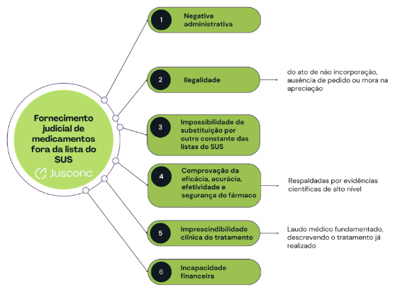

# Direito Constitucional

*Bloco I*

*Ponto 4 do edital: Direitos e garantias fundamentais em espécie*

:::JC_F2F2F2 
**4. Direitos e garantias fundamentais em espécie. Vida e integridade física e moral. Igualdade e não discriminação. Legalidade. Liberdades públicas. Liberdade de expressão, informação e imprensa. Privacidade, honra, imagem e proteção de dados pessoais. Direitos da personalidade. Propriedade e sua função social. Acesso à justiça. Devido processo legal. Segurança jurídica. Remédios constitucionais. Garantias constitucionais penais. Direitos sociais, econômicos, culturais e ambientais. Direitos políticos. Partidos políticos. Nacionalidade.**
:::

| **ESTUDO DE LEI SECA**¹ | > |
|---|---|
| **DIPLOMA** | **DISPOSITIVOS QUE CAEM** |
| **CF, direitos individuais** | Art. 5º, *caput* e incisos I a LXXIX (o artigo inteiro) · art. 60, § 4º, IV (cláusula pétrea) |
| **CF, direitos sociais** | Arts. 6º a 11 · arts. 196 a 200 (saúde) · arts. 205 a 214 (educação) · arts. 203 e 204 (assistência) · arts. 184 e 185 (reforma agrária) · art. 231 (terras indígenas) |
| **CF, políticos e partidos** | Arts. 14 a 17 · art. 60, § 4º, II (voto) · art. 49, XV · art. 61, § 2º |
| **CF, nacionalidade** | Arts. 12 e 13 · art. 5º, LI e LII · art. 190 · art. 222 |
| **Leis** | Lei nº 12.016/2009 (MS) · Lei nº 4.717/1965 (ação popular) · Lei nº 9.507/1997 (*habeas data*) · Lei nº 13.300/2016 (injunção) · Lei nº 13.445/2017 (migração) · LC nº 64/1990 · Lei nº 9.096/1995 · Lei nº 9.504/1997 · Lei nº 9.709/1998 · Lei nº 7.783/1989 · Lei nº 8.080/1990 |

## 1. Direitos e garantias fundamentais em espécie

A doutrina separa direito e garantia pela função que cada um cumpre. O **direito** é o bem jurídico assegurado, como a liberdade de locomoção. A **garantia** é o instrumento posto à disposição do titular para protegê-lo, como o ***habeas corpus***.

Tanto uns quanto outros têm **aplicação imediata**, por força do art. 5º, § 1º. Para além disso, os direitos ali enumerados **não excluem** outros decorrentes do regime, dos princípios adotados pela Constituição e dos tratados internacionais de que o Brasil seja parte. O rol é **exemplificativo em decorrência do que a doutrina convencionou chamar de** ==**cláusula de abertura material dos Direitos Fundamentais**==**,** contida no **art. 5º, § 2º, da CF.**

## 1.1. Titularidade

O *caput* do art. 5º fala em brasileiros e estrangeiros **residentes** no País, mas a jurisprudência nunca leu a palavra como exclusão. O estrangeiro **não residente** é titular dos direitos fundamentais enquanto estiver sujeito à jurisdição brasileira.

A pessoa jurídica também titulariza direitos fundamentais, desde que compatíveis com a sua natureza. Ela tem honra objetiva, propriedade, devido processo e sigilo de dados. Não tem os que pressupõem a existência física da pessoa, e por isso não se admite *habeas corpus* em seu favor (STJ, RHC 42.618).

## 2. Vida e integridade física e moral

A Constituição declara inviolável o direito à vida, mas não define expressamente quando começa a sua proteção nem resolve de antemão as situações em que ela entra em conflito com outros direitos.

|   | **Tribunal considerou que a pesquisa com células-tronco** | > | > |
|---|---|---|---|
| **embrionárias, nos termos da Lei de Biossegurança, n** | > | **ão viola o direito à vida** |   |

congelado e inviável para implantação não é titular do direito, que pressupõe a pessoa nascida ou, ao menos, o nascituro com potencial de desenvolvimento.

Também nessa linha, na **ADPF 54**, o ==**STF considerou inconstitucional a**==

:::JC_FAE2D5 
**interpretação que tipifica como crime a interrupção da gravidez de feto anencéfalo**. A razão
:::

não foi a ponderação entre a vida do feto e a saúde da gestante, e sim a ausência do bem jurídico tutelado: sem atividade cerebral não há vida potencial a proteger, de modo que a conduta é atípica.

%% CONECTANDO

Como dizia o filósofo moderno Natanzinho Lima, “viver é diferente de estar vivo”. Não basta, portanto, garantir por si só o direito à vida. Disso decorre também a necessidade de proteção a outros direitos correlacionados. Nesse sentido, a **integridade física e moral** surge no inciso III, que veda a tortura e o tratamento desumano ou degradante.

Trata-se de norma de aplicação imediata e **sem reserva legal**, e o seu campo de maior aplicabilidade é no sistema prisional, onde ela limita diretamente os procedimentos de revista.

:::JC_D9F2D0 De olho na RG · Chance alta TRF5
**Tema 998 do STF** (ARE 959.620, j. 2025). 1. Em visitas sociais nos presídios ou estabelecimentos de segregação **é inadmissível a revista íntima vexatória com o desnudamento de visitantes ou exames invasivos com finalidade de causar humilhação**. **A prova obtida por esse tipo de revista é ilícita**, salvo decisões judiciais em cada caso concreto. A presente decisão tem efeitos prospectivos a partir da publicação da ata do julgamento. 2. A **autoridade administrativa**, de forma **fundamentada** e por **escrito**, tem o **poder de não permitir a visita diante da presença de indício robusto de ser a pessoa visitante portadora de qualquer item corporal oculto ou sonegado**, especialmente de material proibido, como produtos ilegais, drogas ou objetos perigosos. São considerados robustos indícios embasados em elementos tangíveis e verificáveis, como informações prévias de inteligência, denúncias, e comportamentos suspeitos. (...) **6. Excepcionalmente, na impossibilidade ou inefetividade de utilização do scanner corporal, esteira de raio-x, portais detectores de metais, a revista íntima para ingresso em estabelecimentos prisionais, diante de indícios robustos de suspeitas, tangíveis e verificáveis, deverá ser motivada para cada caso específico e dependerá da plena concordância do visitante, vedada, em qualquer circunstância, a execução da revista como forma de humilhação e de exposição vexatória; deve ser realizada em local adequado, exclusivo para tal verificação, e apenas em pessoas maiores e que possam emitir consentimento válido por si ou por meio de seu representante legal, de acordo com protocolos gerais e nacionais preestabelecidos e por pessoas do**

**mesmo gênero do visitante, preferencialmente por profissionais de saúde, nas hipóteses de desnudamento e exames invasivos. (i) O excesso ou o abuso da realização da revista íntima acarretarão responsabilidade do agente público ou do profissional de saúde habilitado e ilicitude de eventual prova obtida. (ii) Caso não haja concordância do visitante, a autoridade administrativa poderá, de forma fundamentada e por escrito, impedir a realização da visita. (iii) O procedimento de revista em criança, adolescente ou pessoa com deficiência intelectual que não possa emitir consentimento válido será substituído pela revista invertida, direcionada à pessoa a ser visitada.**
:::

## 3. Igualdade e não discriminação

A igualdade do *caput* e do inciso I não proíbe o tratamento diferenciado. O que ela exige é que a diferenciação tenha fundamento constitucional e que exista relação entre o critério adotado e a finalidade perseguida pela medida.

%% Exemplo

Exigir teste de aptidão física para cargo cujas atribuições demandam determinada capacidade corporal atende a esse parâmetro, porque o critério se liga à função. Restringir vagas femininas sem que a natureza das funções o justifique, não. Foi o que o STF afastou em concurso para combatente de corporação militar, assegurando às candidatas concorrer à **totalidade** das vagas, além da reserva de dez por cento (ADI 7.492, j. 2024).

## 3.1. Ações afirmativas

As ações afirmativas concretizam a igualdade material por meio de tratamento diferenciado destinado a reduzir uma desigualdade existente. A sua constitucionalidade em abstrato está assentada desde a ADPF 186, e a jurisprudência posterior passou a definir limites, formas e o próprio conceito de grupo protegido.

| **AÇÕES AFIRMATIVAS NA JURISPRUDÊNCIA DO STF** | > |
|---|---|
| **JULGADO** | **O QUE FICOU DECIDIDO** |
| **ADI 7.706 e ADI 7.707** (2026) | É **constitucional** a aplicação obrigatória, pelos partidos, de **trinta por cento** dos recursos do FEFC e do fundo partidário em candidaturas de pessoas **pretas e pardas** (EC nº 133/2024). A aplicação imediata não ofende a anterioridade eleitoral, porque regra de financiamento e de prestação de contas tem caráter **procedimental** |
| **ADI 7.472** (2025) | É **inconstitucional** a lei estadual que **veda** cotas étnico-raciais em instituições de ensino superior, por contrariar política nacional já reconhecida como constitucional |
| **ADI 7.383** (2026) | O Estado não pode invocar a exigência de **aptidão plena** para afastar a reserva de vagas da pessoa com deficiência. Na competência concorrente ele pode criar regime diverso, mas **não reduzir** a proteção fixada em norma geral |
| **Rcl 65.976** (2024) | É **inconstitucional** a **bonificação regional** sobre a nota do Enem no Sisu em favor de quem concluiu o ensino médio nas imediações da universidade. Não se trata de ação afirmativa, porque a medida não se dirige a grupo historicamente vulnerabilizado |
| **MI 7.452** (2025) | A **Lei Maria da Penha** aplica-se por analogia a casais homoafetivos masculinos e a mulheres travestis e transexuais nas relações intrafamiliares. Reconhecida a mora do Congresso, o fundamento é a **vedação da proteção deficiente** |

A **ADPF 973**, de 2025, merece destaque próprio porque o Tribunal acolheu a premissa e recusou o pedido principal. Reconheceu a existência de **racismo estrutural** no Brasil e, ainda assim, ==**rejeitou a declaração de estado de coisas inconstitucional**==, ao fundamento de que este pressupõe omissão estatal absoluta, e havia políticas em curso, ainda que insuficientes. Em lugar da declaração, determinou a elaboração de Plano Nacional de Combate ao Racismo Estrutural em doze meses, fiscalizado pelo CNJ.

## 3.2. Igualdade e concurso público

No concurso público, a igualdade costuma ser discutida a propósito da remarcação de etapas. A regra é a inexistência de segunda chamada por circunstância pessoal quando o edital não a prevê, e quem chega ao teste com uma lesão, ainda que involuntária, não tem direito a nova data.

A exceção reconhecida pelo STF é a candidata grávida, em razão da proteção constitucional à maternidade dos arts. 6º, 7º, XVIII, e 226, § 7º. Como o fundamento é esse, e não a impossibilidade momentânea de realizar o teste, a exceção não se estende a outros impedimentos.

:::JC_D9F2D0 De olho na RG
**Tema 973 do STF** (RE 1.058.333). É constitucional a **remarcação do teste de aptidão física de candidata que esteja grávida** à época da sua realização, **independentemente de previsão expressa em edital**.
:::

## 4. Legalidade

Pelo inciso II, ninguém será obrigado a fazer ou deixar de fazer alguma coisa senão **em virtude de lei**. O dispositivo produz efeitos diferentes conforme o destinatário.

Para o particular, tudo o que a lei não proíbe é em princípio permitido. Para a Administração, a atuação depende de fundamento jurídico que a autorize. A expressão **em virtude de lei** não exige que toda obrigação esteja descrita integralmente em lei formal. **A lei pode abrir ao regulamento espaço para especificar deveres, desde que o ato regulamentar permaneça dentro dos limites por ela definidos**. Com esse fundamento o STF julgou ==**constitucionais**== os decretos que regulamentaram o Estatuto do Desarmamento, por se inserirem no poder regulamentar do art. 84, IV, sem extrapolar a Lei nº 10.826/2003 (ADC 85, j. 2025).

:::JC_DAE9F7 NÃO CONFUNDA
A **legalidade** do art. 5º, II, é a submissão geral à lei. A **reserva legal** é a exigência de que determinada matéria seja tratada por lei, e pode ser **simples**, quando a Constituição apenas exige a lei, ou **qualificada**, quando ela própria fixa a finalidade que a lei deve perseguir. O art. 5º, XII, é o exemplo clássico da qualificada: a interceptação telefônica só se admite **para investigação criminal ou instrução processual penal**.
:::

## 5. Liberdades públicas

## 5.1. Consciência, crença e culto

Os incisos VI a VIII protegem a liberdade religiosa: a **crença** e o **culto**, a **assistência religiosa** em entidades civis e militares de internação coletiva e a escusa de consciência. A proteção não se esgota no direito de acreditar, porque **alcança também o direito de agir conforme a crença**, e é aí que ela encontra os deveres gerais impostos a todos.

A laicidade não impede toda presença da religião no espaço público. O problema surge quando o Estado deixa de acomodar o exercício da fé e passa a promover oficialmente determinado credo. Essa diferença percorre os julgados recentes.

| **LIBERDADE RELIGIOSA NA JURISPRUDÊNCIA RECENTE** | > |
|---|---|
| **JULGADO** | **O QUE FICOU DECIDIDO** |
| **Tema 953** (RE 859.376, 2024) | É **constitucional** o uso de vestimenta ou acessório religioso em foto de documento oficial, **desde que não impeça a adequada identificação**, com o rosto visível. A obrigação geral não é afastada, é ajustada para acomodar a fé sem sacrificar a finalidade da norma |
| **Tema 1.086** (ARE 1.249.095, 2024) | A presença de **símbolo religioso** em prédio público de qualquer Poder ou ente **não viola** a laicidade nem a impessoalidade, **desde que o objetivo seja manifestar a tradição cultural brasileira**. Símbolo que sirva à promoção de determinado credo recebe solução oposta |
| **ADI 5.255** (2025) | [Chance alta TRF5] Lei estadual pode **permitir** a aquisição de exemplares da Bíblia para o acervo de biblioteca pública. O que é vedado ao legislador é **obrigar** a aquisição ou a manutenção de livro religioso em espaço público, e por isso o STF deu interpretação conforme, para ler a lei como autorizativa |
| **ADI 3.901** (2025) | [Chance alta TRF5] É **constitucional** a lei estadual que, para respeitar a **guarda sabática**, determina a realização de provas de concurso e de vestibular entre as 18h de sábado e as 18h da sexta-feira seguinte, sem violação da competência da União nem da autonomia universitária |

A ==**escusa de consciência**== do inciso VIII segue a mesma lógica de acomodação. Ela não assegura o direito de não cumprir, e sim o de cumprir de outro modo: ==**o titular**==

:::JC_FFFF00 
**invoca a convicção religiosa, filosófica ou política, o Estado oferece prestação alternativa**
:::

:::JC_FFFF00 
**fixada em lei, e somente a recusa da prestação alternativa autoriza a privação de direitos,**
:::

==**que no serviço militar é a suspensão dos direitos políticos**==.

Com base nessas premissas, o STF admitiu a realização de etapa de concurso em data e horário distintos para quem invoca escusa de crença, desde que razoável a alteração e preservada a igualdade entre os candidatos.

:::JC_D9F2D0 De olho na RG
**Tema 386 do STF**: Nos termos do artigo 5º, VIII, da Constituição Federal é possível a realização de etapas de concurso público em datas e horários distintos dos previstos em edital, por candidato que invoca escusa de consciência por motivo de crença religiosa, desde que presentes a razoabilidade da alteração, a preservação da igualdade entre todos os candidatos e que não acarrete ônus desproporcional à Administração Pública, que deverá decidir de maneira fundamentada
:::

Em matéria de **vacinação**, a Corte separou dois planos: Ø O Estado ==**pode**== impor medidas restritivas previstas em lei a quem recusa a vacina, como multa e impedimento de frequentar determinados lugares;

Ø Por outro lado, ==**não pode**== imunizar à força, em razão da inviolabilidade do corpo humano (ADI 6.586). A obrigatoriedade, portanto, é indireta. Por fim, ==**é constitucional a exigência de imunização por vacina registrada e**==

:::JC_D9F2D0 
**incluída no Programa Nacional de Imunizações, ou determinada em lei, ou objeto de determinação de ente federado apoiada em consenso médico-científico, sem ofensa à**
:::

==**liberdade de consciência dos pais nem ao poder familiar**== (ARE 1.267.879).

## 5.2. Locomoção, reunião e associação

:::JC_FFFFFF 
Embora minha amada esposa Júlia nem sempre respeite este direito, a **locomoção** é livre em tempo de paz, inclusive para entrar, permanecer ou sair do território com os próprios bens, cabendo à lei discipliná-la e ao *habeas corpus* protegê-la. No meu caso, porém, sair sem autorização implica sanção grave. Não pagarei para ver.

A **reunião** deve ser pacífica, sem armas, em local aberto ao público e independe de autorização, exigido apenas o aviso prévio à autoridade, e ainda assim só para que uma reunião não frustre outra já convocada para o mesmo local.

%% De olho na RG

**Tema 855 do STF**: A exigência constitucional de aviso prévio relativamente ao direito de reunião é satisfeita com a veiculação de informação que permita ao poder público zelar para que seu exercício se dê de forma pacífica ou para que não frustre outra reunião no mesmo local.

Por sua vez, a **associação** é plena para fins lícitos, **vedada a de caráter paramilitar**, e a sua criação independe de autorização, sendo proibida a interferência estatal no funcionamento.

Sobre o regime de associação, vale lembrar: Ø A **dissolução compulsória** exige decisão judicial **transitada em julgado**. Ø A **suspensão** das atividades, por ser menos gravosa, contenta-se com decisão judicial **não definitiva** (inciso XIX). Ademais, a liberdade de associação tem ainda uma **dimensão negativa**, que é o **direito de não permanecer associado.** Foi com esse fundamento que o STF considerou ==**inconstitucional**== **condicionar a desfiliação do associado à quitação de débito referente a benefício obtido pela associação ou ao pagamento de multa (Tema 922).**

## 5.3. A atuação da associação e do sindicato em juízo
:::

Na atuação coletiva, a distinção está entre representação e substituição processual, conforme a entidade atue em nome do filiado ou em nome próprio. Dela decorrem a necessidade de autorização e o alcance subjetivo da coisa julgada.

| **REPRESENTAÇÃO E SUBSTITUIÇÃO PROCESSUAL** | > | > |
|---|---|---|
| **CRITÉRIO** | **REPRESENTAÇÃO (ART. 5º, XXI)** | **SUBSTITUIÇÃO PROCESSUAL** |
| **Em nome de quem age** | Em **nome do filiado**, defendendo direito alheio | Em **nome próprio**, defendendo direito alheio |
| **Autorização** | **Exigida**, expressa e específica, por declaração individual ou por assembleia | **Dispensada** |
| **Onde se aplica** | Ação coletiva de rito ordinário | Mandado de segurança coletivo, mandado de injunção coletivo e ação civil pública |
| **Alcance da sentença** | Só os filiados **constantes da relação juntada à inicial**, domiciliados na área de jurisdição do órgão julgador e que o fossem até a propositura | Os integrantes do grupo ou categoria substituídos, **independentemente de filiação prévia** |
| **Base** | RE 573.232 e **Tema 499** | **Súmula 629 do STF** e art. 21 da Lei nº 12.016/2009 |

O sindicato costuma agir como substituto processual, e por isso defende toda a categoria, e não apenas os filiados, dispensadas a relação nominal e a autorização expressa (Tema 823). Essa posição, porém, não o acompanha por todo o processo. Ao promover a **execução coletivizada**, o STJ entende que a entidade deixa de substituir e passa a representar, o que torna obrigatória a apresentação dos instrumentos de representação de todos os beneficiários indicados.

:::JC_D9F2D0 De olho na RG
**Tema 823 do STF**: Os sindicatos possuem ampla legitimidade extraordinária para defender em juízo os direitos e interesses coletivos ou individuais dos integrantes da categoria que representam, inclusive nas liquidações e execuções de sentença, independentemente de autorização dos substituídos.

%% JURISPRUDÊNCIA

Na fase de cumprimento de sentença coletiva decorrente de ação proposta por associação civil na condição de substituta processual, **a entidade passa a atuar em caráter representativo**, razão pela qual se exige a apresentação de **procurações individuais outorgadas pelos beneficiários do título judicial**. Essa exigência não se mostra incompatível com a **legitimação genérica atribuída às associações civis para promover a execução de sentenças coletivas**, prevista nos arts. 97 e 98 do Código de Defesa do Consumidor. STJ. 4ª Turma. AgInt no REsp 1.438.257-SP, Rel. Min. Raul Araújo, julgado em 24/3/2025 (Info 847).
:::

## 5.4. Liberdade profissional

O inciso XIII assegura o livre exercício de qualquer trabalho, ofício ou profissão, atendidas as qualificações profissionais que a lei estabelecer. Essa é a clássica norma de **eficácia contida**: a liberdade existe desde logo e a lei pode restringi-la, mas não em qualquer medida.

A restrição legal só se legitima quando a exigência de qualificação guarda relação com o risco que o exercício da atividade sem formação adequada cria à coletividade. É por essa razão que:

Ø **o exercício da música não depende de inscrição na Ordem dos Músicos** nem de anuidade (RE 414.426 e RE 795.467); Ø a exigência de diploma de **jornalismo** e de registro no Ministério do Trabalho foi declarada ==**inconstitucional**==, por ser a atividade jornalística manifestação da própria liberdade de expressão (RE 511.961). Quando há risco concreto à saúde ou à integridade, a solução se inverte. Ø O STF considerou ==**constitucional**== a lei estadual que exige profissional de educação física registrado, em tempo integral, para o funcionamento de academias e clubes desportivos (ADI 4.399, 2025);

Ø Também admitiu que lei estadual proíba as óticas de realizar exames optométricos e de vender óculos ou lentes sem prescrição médica (ADI 7.401, 2025).

## 6. Liberdade de expressão, informação e imprensa

Tudo isso aqui diz respeito à liberdade de comunicação. Embora relevante, ela não é absoluta. Por isso, tem-se a **vedação ao anonimato,** que não impede qualquer manifestação, mas exige que o autor possa ser identificado para eventual responsabilização posterior. Vejamos o tratamento dado à denúncia anônima: sozinha, ela não instaura procedimento investigatório, mas autoriza diligências informais destinadas a apurar a verossimilhança do que se noticiou.

## 6.1. Responsabilidade civil da imprensa

O STF exige **dolo ou culpa grave** para responsabilizar civilmente jornalista ou órgão de imprensa. A razão está no efeito inibitório, o ***chilling effect***². Se o veículo responde por qualquer erro de apuração, **o risco de condenação desestimula a publicação de tudo o que não esteja acima de dúvida, e a notícia de interesse público, quase sempre apurada sob incerteza, deixa de circular**. O prejuízo, nesse caso, recai sobre o direito de todos à informação.

| **LIBERDADE DE IMPRENSA NO STF** | > |
|---|---|
| **JULGADO** | **O QUE FICOU DECIDIDO** |
| **ADI 6.792 e ADI 7.055** (2024) | [Chance alta TRF5] A responsabilidade civil do jornalista ou do órgão de imprensa só se configura em caso **inequívoco de dolo ou culpa grave**, entendida como evidente negligência profissional na apuração dos fatos. Constitui **assédio judicial** o ajuizamento de inúmeras ações sobre os mesmos fatos em comarcas diversas, e o demandado pode requerer a **reunião de todas no foro do seu domicílio** |
| **RE 1.075.412 ED** (2025) | Na **entrevista** em que o entrevistado imputa falsamente crime a terceiro, a empresa jornalística só responde se comprovada má-fé. Sendo a entrevista **ao vivo**, o ato exclusivamente de terceiro **exclui a responsabilidade** do veículo, que deve assegurar direito de resposta em iguais condições, espaço e destaque, e remover a imputação falsa das plataformas |
| **Tema 837** (RE 662.055, 2026) | [Chance alta TRF5] **Campanha de mobilização social** promovida por entidade da sociedade civil, voltada a desestimular o financiamento de eventos ou organizações**, está protegida pela liberdade de expressão**. A ordem de cessar a campanha e remover o conteúdo só é possível diante de **má-fé** |

## 6.2. Limites e censura prévia

A liberdade de expressão protege manifestações críticas, satíricas e até equivocadas, e não transforma em lícitas condutas que preencham os requisitos de outros ilícitos constitucionalmente legítimos.

Na **Pet 8.242** o STF assentou que **ela não alcança discursos dolosos, com intuito manifestamente difamatório**, e na **AP 1.044 excluiu da proteção a opinião criminosa, o discurso de ódio e o atentado ao Estado Democrático de Direito**.

A linha divisória está na intenção de difamar, e não no erro. Agora sobre **censura:** Ø Essa ocorre quando a veiculação de uma notícia fica condicionada à autorização prévia do Estado, hipótese vedada pelo inciso IX; Ø A classificação indicativa não se enquadra como censura, porque informar a faixa etária recomendada e o horário adequado é medida de proteção da criança e do adolescente, e não impedimento de circulação. Vejamos outros importantes julgados sobre o tema:

:::JC_D9F2D0 JURISPRUDÊNCIA
Na **ADI 4.815**, o STF assentou que a publicação de **biografia independe de autorização** do biografado, das demais pessoas retratadas ou de seus familiares, porque a autorização prévia seria censura e a reparação é posterior. Na **ADPF 522** (2025), considerou ==**censura prévia**== a lei municipal que proíbe bibliotecas públicas de disponibilizar conteúdo sobre gênero e sexualidade, declarando inconstitucionais, no mesmo julgamento, as leis municipais que vedam o conteúdo pedagógico sobre o tema, porque o Município não tem competência sobre currículo e metodologia.
:::

## 6.3. Acesso à informação

O inciso XXXIII assegura o direito de obter dos órgãos públicos informação de interesse particular, coletivo ou geral, ressalvada aquela cujo sigilo seja imprescindível à segurança da sociedade e do Estado. Publicidade é, portanto, a regra.

Por isso **o ato restritivo de publicidade deve ser motivado de forma concreta, objetiva, específica e formal, sendo nulos os atos que imponham genericamente restrição ao direito à informação (ADPF 872).**

Um decreto que classifica documentos em bloco de “sigilo” é nulo por falta de motivação (caso do SEI da Polícia Federal, plataforma de uso comum no serviço público, que restringia o acesso sem fundamento).

:::JC_DAE9F7 NÃO CONFUNDA
Negada a **informação de interesse geral ou relativa a terceiro**, o remédio é o **mandado de segurança**. Para conhecer ou retificar dado relativo **à própria pessoa** do impetrante, constante de registro governamental ou de caráter público, o remédio é o **habeas data**.
:::

## 7. Privacidade, honra, imagem e proteção de dados pessoais

O inciso X declara invioláveis **bens autônomos** e assegura indenização pelo dano material ou moral decorrente da violação de cada um deles. A ==**intimidade**== é a esfera mais reservada, aquela que o titular não compartilha nem com o círculo próximo, e é nela que se situam o dado genético e o prontuário médico. Um pouco mais para fora está a ==**vida privada**==, que abrange as relações mantidas com esse círculo, fora do espaço público. Por fim, a ==**honra**== e a ==**imagem**== olham para o exterior: a primeira protege a reputação perante terceiros e a estima própria, e a segunda, a representação física e a projeção social do titular.

Como os bens são autônomos, a violação de um não pressupõe a dos demais, e a reparação se afere pelo bem efetivamente atingido.

%% TOME NOTA

A proteção de dados pessoais ganhou fundamento constitucional próprio com a **EC nº 115/2022**, que acrescentou o inciso LXXIX e atribuiu à União competência privativa para legislar sobre o tema (art. 22, XXX). Antes da emenda o STF já a extraía do inciso X, e assentou que o dado sensível, como o genético, compõe o núcleo mais profundo da intimidade (ADI 5.545).

%% CONECTANDO

Na segurança pública, a proporcionalidade levou a soluções distintas conforme a intensidade da devassa. **O STF julgou** ==**constitucional**== **a lei estadual que institui cadastro de condenados por crime contra a dignidade sexual de criança e por violência contra a mulher, com dois limites: sem publicização de dado que identifique a vítima e somente após o trânsito em julgado (ADI 6.620).**

Por sua vez, ao examinar os arts. 13-A e 13-B do CPP, distinguiu o **dado cadastral**, que apenas identifica e pode ser requisitado sem ordem judicial em crimes graves determinados, do **dado de localização**, que acompanha o titular no tempo e por isso exige reserva de jurisdição (ADI 5.642).

## 7.1. Sigilo bancário e fiscal

Vamos de tabela! Vou juntar aqui julgados **clássicos** e outros mais recentes sobre o assunto.

| **ACESSO A DADOS BANCÁRIOS E FISCAIS** | > |
|---|---|
| **JULGADO** | **O QUE FICOU DECIDIDO** |
| **Tema 225** (RE 601.314) | As autoridades fiscais **podem** requisitar **diretamente** das instituições financeiras informação sobre movimentação bancária. O sigilo não é eliminado, é **transferido** à administração tributária, que permanece obrigada a preservá-lo. Estados e Municípios dependem de regulamentação análoga à do Decreto nº 3.724/2001 |
| **Tema 990** (RE 1.055.941, 2019)³ | É **constitucional** o compartilhamento dos relatórios de inteligência financeira do **COAF** e da íntegra do procedimento fiscalizatório da Receita com os órgãos de persecução penal, **sem prévia autorização judicial**, exigidos procedimento formalmente instaurado, sigilo resguardado, comunicação formal com certificação do destinatário e posterior controle jurisdicional |
| **ADI 4.709** (2022) | É **constitucional** a requisição, sem autorização judicial, de dados bancários e fiscais pelo **Corregedor Nacional de Justiça**, para apurar infração de sujeito determinado, com processo regularmente instaurado, decisão fundamentada e indícios concretos. **Não se admite devassa** nem busca generalizada |

%% PEGADINHA

Quando os recursos são públicos, não há que se falar em semelhante proteção. **Operação que envolve recursos públicos não é abrangida pelo sigilo da LC nº 105/2001** (MS 33.340), e é lícita a requisição, pelo Ministério Público, de dados bancários de conta de titularidade de prefeitura (RHC 133.118). A conta pública se submete à publicidade e à moralidade do art. 37.

## 7.2. Domicílio e comunicações

O inciso XI trata a casa como asilo inviolável, e o conceito constitucional de casa é mais largo que o de residência. Alcança o escritório, a oficina, a garagem, o quarto de hotel e todo compartimento privado onde alguém exerça profissão ou atividade, desde que não aberto ao público.

| **INGRESSO NO DOMICÍLIO SEM CONSENTIMENTO DO MORADOR** | > | > |
|---|---|---|
| **SITUAÇÃO** | **DURANTE O DIA** | **DURANTE A NOITE** |
| **Flagrante delito** | **Sim** | **Sim** |
| **Desastre** | **Sim** | **Sim** |
| **Prestar socorro** | **Sim** | **Sim** |
| **Determinação judicial** | **Sim** | **Não** |

Das quatro hipóteses, apenas a determinação judicial é limitada ao período diurno. Quanto ao horário de dia e noite, não há uniformidade. Todavia, a Lei de Abuso de Autoridade criou tipo penal específico para punir quem cumpre mandado fora do horário entre **5h e 21h** (art. 22, § 1º, III).

:::JC_D9F2D0 De olho na RG
**Tema 280 do STF** (RE 603.616). A entrada forçada em domicílio sem mandado judicial só é lícita, **mesmo em período noturno**, quando amparada em **fundadas razões, devidamente justificadas a posteriori**, que indiquem que dentro da casa ocorre situação de flagrante delito, sob pena de responsabilidade disciplinar, civil e penal do agente e de nulidade dos atos praticados.
:::

A licitude do ingresso não se afere pelo que se encontrou dentro da casa, e sim pelos elementos de que o agente dispunha antes de entrar. Como a suficiência desses elementos depende das circunstâncias, o STJ construiu uma jurisprudência fortemente casuística.

| **FUNDADAS RAZÕES NO STJ** | > |
|---|---|
| **CASO** | **SOLUÇÃO** |
| **Antecedente criminal por tráfico, isolado** | **Não autoriza** a busca domiciliar, por faltar indício concreto de que naquele momento haja droga guardada na casa (HC 762.932) |
| **Venda de droga vista na via pública, nas proximidades da residência** | **Não configura** fundada suspeita apta a autorizar a busca, sem prova da voluntariedade do consentimento (AgRg no HC 907.770, 2025) |
| **Estabelecimento comercial, ainda que sem clientes no momento** | É local **aberto ao público** e **não recebe** a proteção do inciso XI (HC 754.789) |
| **Imóvel desabitado usado como depósito de droga e armas** | Prova **lícita** sem mandado, porque o local **não é casa** (HC 860.929, 2024) |

O inciso XII protege o sigilo da correspondência, das comunicações telegráficas, de dados e das comunicações telefônicas. Dessas, apenas a **comunicação telefônica** pode ser interceptada, por ordem judicial, para investigação criminal ou instrução processual penal, na forma da Lei nº 9.296/1996.

Quanto ao celular apreendido em estabelecimento prisional, o STJ admitiu a extração integral dos dados, sob supervisão judicial, por entender que **a proteção constitucional não alcança meio de comunicação utilizado ilicitamente ali dentro (**REsp 2.235.157, 2026).

## 8. Direitos da personalidade

Deixarei o tema para Direito Civil. Aqui não é bagunça e não vou repetir o que evidentemente é mais relevante em outro ponto. Se for para citar apenas um ponto sobre isso, lembro que **o STF reconheceu que a pretensão de divulgar dados associativos de magistrados viola a privacidade, a liberdade de associação e a liberdade de convicção filosófica** (MS 40.556 AgR, 2ª Turma, j. 2026).

## 9. Propriedade e sua função social A função social da propriedade urbana e rural

O art. 5º, XXIII, diz que a propriedade atenderá a sua função social, e o art. 170, III, repete a ideia como princípio da ordem econômica. Nenhum dos dois diz **quando** a função social está cumprida. Quem diz são os arts. 182, § 2º, e 186, e os dois trabalham com critérios inteiramente diferentes. Na cidade, o parâmetro é o **plano diretor**, ato do próprio Município. No campo, é um **rol de requisitos** que a própria Constituição fixou.

| **FUNÇÃO SOCIAL DA PROPRIEDADE: OS DOIS REGIMES** | > | > |
|---|---|---|
| **PONTO DE COMPARAÇÃO** | **PROPRIEDADE URBANA (ART. 182)** | **PROPRIEDADE RURAL (ART. 186)** |
| **Quando a função social está cumprida** | Quando a propriedade atende às **exigências fundamentais de ordenação da cidade expressas no plano diretor** (§ 2º) | Quando atende, **simultaneamente**, aos **quatro requisitos do art. 186**, segundo critérios e graus de exigência estabelecidos em lei |
| **Onde está o parâmetro** | Em ato **municipal**. O conteúdo concreto da função social varia de cidade para cidade | No **texto constitucional**. A lei fixa apenas os critérios e os graus de exigência, não os requisitos |
| **Requisitos** | Não há rol constitucional. O art. 182 fixa o objetivo, que é ordenar o pleno desenvolvimento das **funções sociais da cidade** e garantir o **bem- estar dos habitantes** | **I** aproveitamento racional e adequado. **II** utilização adequada dos recursos naturais disponíveis e preservação do meio ambiente. **III** observância das disposições que regulam as relações de trabalho. **IV** exploração que favoreça o bem-estar dos proprietários e dos trabalhadores |
| **Quem executa a política** | O **Poder Público municipal**, conforme diretrizes gerais fixadas em lei federal, hoje o Estatuto da Cidade (Lei nº 10.257/2001) | A **União**, única legitimada a desapropriar para fins de reforma agrária (art. 184) |
| **Instrumento básico** | O **plano diretor**, aprovado pela **Câmara Municipal** e obrigatório para cidades com mais de **vinte mil habitantes** (§ 1º) | A **desapropriação por interesse social** para fins de reforma agrária (art. 184) |
| **Desapropriação comum** | **Prévia, justa e em dinheiro** (§ 3º). É a regra de toda desapropriação urbana | O capítulo não trata dela. O art. 184 já é a desapropriação do imóvel que **não cumpre** a função social |
| **Desapropriação-sanção** | **Títulos da dívida pública**, emissão previamente aprovada pelo **Senado Federal**, resgate em até **dez anos** em prestações anuais, iguais e sucessivas | **Títulos da dívida agrária**, com cláusula de preservação do valor real, resgatáveis em até **vinte anos** a partir do segundo ano da emissão. As |
|   | (§ 4º, III, e art. 8º do Estatuto da Cidade) | **benfeitorias úteis e necessárias** são pagas em **dinheiro** (art. 184, § 1º) |
| **Imóveis fora do alcance** | Não há imunidade. O que limita o Município é a exigência de **lei específica para área incluída no plano diretor** | São **insuscetíveis** de desapropriação para reforma agrária a **pequena e média propriedade rural** cujo proprietário não possua outra e a **propriedade produtiva** (art. 185, I e II) |

## 10. Acesso à justiça

O art. 5º, XXXV, assegura a **inafastabilidade da jurisdição**. Como regra, a ação pode ser ajuizada diretamente, sem prévio esgotamento administrativo. O que a jurisprudência controla são as **condicionantes** e os **custos** que, na prática, fecham a porta.

| **ACESSO À JUSTIÇA NA JURISPRUDÊNCIA** | > |
|---|---|
| **SITUAÇÃO** | **REGRA** |
| **Justiça desportiva** | Única exceção escrita na Constituição. A ação relativa à disciplina e às competições desportivas exige o **esgotamento das instâncias da justiça desportiva** (art. 217, § 1º), que tem até sessenta dias para decidir (§ 2º) |
| **Previdenciário** | Exige-se **prévio requerimento administrativo** (Tema 350) |
| **Tributário** | **Não** se exige requerimento prévio, como na ação que discute isenção de imposto de renda (Tema 1.373) |
| **Depósito prévio para discutir crédito tributário** | **Inconstitucional** (Súmula Vinculante 28) |
| **Depósito prévio na ação rescisória** | **Constitucional.** Os vinte por cento sobre o valor da causa desestimulam o pedido rescisório aventureiro e não configuram medida demasiadamente onerosa (ADI 3.995) |
| **Taxa judiciária sem limite** | Viola a garantia de acesso à jurisdição a taxa calculada **sem limite** sobre o valor da causa (Súmula 667) |
| **Custas calculadas sobre o valor da causa** | Admitidas, desde que com **alíquotas razoáveis** e **limites máximos** aptos a garantir o acesso à justiça (**ADI 5.689**, j. 1º/9/2025) |
| **Custas na fase de cumprimento de sentença** | Constitucionais, porque correspondem a prestação jurisdicional **distinta** da fase cognitiva (ADI 5.689) |
| **Comissão de Conciliação Prévia** | Meio legítimo, mas **não obrigatório**. A submissão à comissão não é requisito para o ajuizamento de reclamação trabalhista (ADI 2.139 e ADI 2.160) |
| **Audiência inicial da ação de alimentos** | O comparecimento **sem advogado** é medida assecuratória do direito do alimentando, justificada pela urgência e pela essencialidade da obrigação alimentar. Nas fases seguintes exige-se profissional habilitado (**ADPF 591**, j. 19/8/2024) |
| **Execução extrajudicial da Lei nº 14.711/2023** | Constitucional. A inafastabilidade assegura o **acesso** ao Judiciário, e não a **reserva** de toda a execução ao processo judicial (**ADI 7.600**, ADI 7.601 e ADI 7.608, j. 1º/7/2025) |

Vejamos algumas dimensões desse direito. No mais, aqui temos:

Ø O inciso LXXV assegura indenização ao condenado por **erro judiciário** e a quem ficar preso **além do tempo** fixado na sentença; Ø O inciso LXXVI garante a gratuidade do registro civil de nascimento e da certidão de óbito aos reconhecidamente pobres; Ø Já o inciso LXXVII torna gratuitas as ações de *habeas corpus* e de *habeas data*, além dos atos necessários ao exercício da cidadania, na forma da lei. Ø O inciso XXXIV assegura, independentemente do pagamento de taxas, o direito de petição aos Poderes Públicos e o direito de obter certidão em repartição pública. A gratuidade integra o próprio direito, razão pela qual o STF declarou ==**inconstitucional**== a cobrança de taxa para a emissão de atestado pelos bombeiros quando solicitado para defesa de direitos (ADI 7.448). O direito de petição, porém, não confere capacidade postulatória. Ele assegura dirigir- se ao Poder Público sem pagar taxa, e não litigar em juízo sem advogado.

## 11. Devido processo legal

O inciso LIV é a matriz das garantias processuais e opera em duas dimensões: a) na **formal**, verifica-se a observância do procedimento e das formas; b) na **substantiva**, controla-se a razoabilidade e a proporcionalidade do próprio conteúdo da atuação estatal.

Foi pela dimensão substantiva que o STF declarou ==**inconstitucional**== o afastamento temporário do cargo, com supressão de vantagens, de servidor apenas por estar respondendo a processo criminal (ADI 2.926), e também o art. 144, VIII, do CPC, que estendia o impedimento do juiz a qualquer membro de escritório de advocacia com familiar do magistrado em seus quadros, ainda que não interviesse no processo, por ir além do necessário para preservar a imparcialidade (ADI 5.953).

Ao redor dele organizam-se as demais garantias.

| **AS GARANTIAS PROCESSUAIS DO ART. 5º** | > |
|---|---|
| **INCISO** | **CONTEÚDO** |
| **XXXVII e LIII** | **Juiz natural.** Exige autoridade competente e juiz previamente investido segundo regras gerais e abstratas, e veda o tribunal de exceção |
| **LIV** | **Devido processo legal**, nas dimensões formal e substantiva |
| **LV** | **Contraditório e ampla defesa**, no processo judicial e no administrativo. O contraditório assegura conhecimento, participação e efetiva possibilidade de influência na decisão |
| **LVI** | **Inadmissibilidade da prova obtida por meio ilícito.** A contaminação alcança as provas derivadas, salvo quando a lei processual afasta o nexo, como na fonte independente e na descoberta inevitável |
| **LVII** | **Presunção de inocência.** A pretensão executória só nasce com o trânsito em julgado para ambas as partes |
| **LXXVIII** | **Razoável duração do processo**, no âmbito judicial e no administrativo |

## 12. Segurança jurídica

O inciso XXXVI protege o direito adquirido, o ato jurídico perfeito e a coisa julgada diante de alteração legislativa posterior. A proteção alcança situações jurídicas já consolidadas, e não a simples expectativa de manutenção do regime anterior.

A partir dessa premissa o STF resolveu situações bem diferentes entre si.

| **SEGURANÇA JURÍDICA: AS SITUAÇÕES E A SOLUÇÃO DO STF** | > |
|---|---|
| **SITUAÇÃO** | **SOLUÇÃO** |
| **Regime jurídico do servidor** | Não há direito adquirido a regime jurídico. Preserva-se a **irredutibilidade dos vencimentos**, e não a perpetuação das regras anteriores (ADI 7.226) |
| **Certificação renovável** | A relação com a Administração é de **trato sucessivo** e comporta fiscalização durante toda a vigência do certificado. Requisito legal novo incide sobre pedido ainda pendente de decisão, sem ofensa ao direito adquirido (**ADI 5.319**, j. 2025, sobre o Cebas) |
| **Relação tributária de trato sucessivo** | Cada fato gerador produz relação nova, e a decisão em controle abstrato ou em repercussão geral **interrompe automaticamente** os efeitos futuros da coisa julgada, respeitadas a irretroatividade, a anterioridade anual e a noventena (RE 949.297 e RE 955.227) |
| **Coisa julgada nos Juizados Especiais** | Como o sistema não comporta ação rescisória, a inconstitucionalidade da decisão transitada em julgado, por contrariedade a pronunciamento superveniente do Tribunal local, é arguível por **simples petição**, em prazo equivalente ao da rescisória (**ADPF 615**, j. 2025) |

## 13. Remédios constitucionais

## 13.1. Habeas corpus

O *habeas corpus* protege a liberdade de locomoção. A pretensão precisa ter reflexo direto no direito de ir e vir, de modo que ilegalidade que não o atinja, por mais grave que seja, resolve-se por outra via.

Ele pode ser **preventivo**, com **salvo-conduto**, ou **repressivo**, com **alvará de soltura**. Dispensa advogado, admite impetração por qualquer pessoa em favor de outra e pode ser concedido de ofício, o que é exceção ao princípio da inércia.

| **QUANDO O HABEAS CORPUS NÃO CABE** | > |
|---|---|
| **PRETENSÃO** | **RAZÃO** |
| **Visita de companheira ao preso (HC 127.685) e sequestro de bens ou bloqueio de valores (HC 103.823)** | Não há reflexo direto na liberdade de locomoção |
| **Suspensão de direitos políticos ou condenação em custas (HC 125.991)** | A restrição não atinge o ir e vir |
| **Impetração em favor de pessoa jurídica (RHC 42.618)** | Pessoa jurídica não tem liberdade de locomoção |
| **Trancamento de processo administrativo (HC 100.664)** | Sem risco à locomoção, a via é outra |
| **Guarda, adoção e destituição do poder familiar** | Fora do objeto, **salvo** o abrigamento institucional por adoção irregular (STJ, HC 1.005.170, 2025) |
| **Mérito da punição disciplinar militar** | Vedação do art. 142, § 2º. A **legalidade** da imposição, porém, é sindicável (RHC 88.543) |

Aplica-se ainda ao *habeas corpus* a proibição da *reformatio in pejus*: o seu manejo jamais pode agravar a situação jurídica daquele a quem busca favorecer (HC 121.907).

## 13.2. Mandado de segurança

A expressão **direito líquido e certo** não qualifica o direito material, e sim a prova. O direito é líquido e certo quando os fatos que o sustentam podem ser demonstrados de plano, por documento já existente.

Portanto, a complexidade jurídica da tese não afasta o MS, enquanto a controvérsia sobre fato que exija perícia o afasta. Foi com esse fundamento que **o STF recusou o mandado de segurança para discutir critérios do TCU em condenação por superfaturamento, cuja análise dependeria de perícia sobre preços e tabelas** (MS 29.599).

Quanto à ==**competência**==, cada **tribunal processa e julga o mandado de segurança impetrado contra os seus próprios atos e omissões**, o que afasta a competência originária do STF e do STJ para o *writ* contra ato de outro tribunal (Súmulas 624 do STF e 41 do STJ).

Por fim, ==**no mandado de segurança coletivo**== a associação atua em substituição processual, e não em representação. Dessa qualificação decorrem a dispensa da autorização dos associados e o alcance da coisa julgada sobre os substituídos independentemente de terem autorizado a impetração.

| **O REGIME DO MANDADO DE SEGURANÇA COLETIVO** | > |
|---|---|
| **PONTO** | **REGIME** |
| **Autorização dos associados** | **Dispensada** (art. 21 da Lei nº 12.016/2009 e **Súmula 629 do STF**) |
| **Coisa julgada** | Limitada aos **membros do grupo ou categoria** substituídos pelo impetrante (art. 22) |
| **Entidade de classe** | Deve representar **categoria econômica ou profissional específica**, sendo insuficiente a mera regularidade registral (**Tema 1.119**) |
| **Partido político** | Precisa de **representação no Congresso**, e não se lhe exige o ano de funcionamento, que alcança apenas as associações. Defende os direitos dos seus filiados ou a finalidade partidária, e não os interesses de toda a sociedade |
| **Parte da categoria** | A **Súmula 630 do STF** assegura a legitimação ainda quando a pretensão interesse apenas a uma parte da categoria, exigida a **pertinência temática** |

## 13.3. Mandado de injunção

O mandado de injunção combate a omissão normativa que inviabiliza o exercício de direito constitucional, e pressupõe, portanto, norma de eficácia limitada e inércia do poder competente. A Lei nº 13.300/2016 disciplina o tema e resolve a polêmica do conteúdo da decisão integradora:

| **AS POSIÇÕES SOBRE O CONTEÚDO DA DECISÃO** | > |
|---|---|
| **POSIÇÃO** | **CONTEÚDO E EFEITO** |
| **Não concretista** | Limita-se a declarar a mora do poder omisso. O direito continua inviabilizado |
| **Concretista individual intermediária** | Fixa prazo para a elaboração da norma e, vencido sem providência, assegura o direito do autor |
| **Concretista individual direta** | **Implementa desde logo o direito, com efeito inter partes. É a solução adotada como regra pela Lei nº 13.300/2016** |
| **Concretista geral** | Fixa a disciplina aplicável a todos os titulares, com efeito erga omnes, até que sobrevenha a norma. Foi o que ocorreu na aplicação por analogia da lei de greve e da aposentadoria especial aos servidores estatutários |

## 13.4. Habeas data e ação popular

O *habeas data* assegura o conhecimento e a retificação de informação relativa à pessoa do impetrante, constante de registro de entidade governamental ou de caráter público. Só o próprio titular impetra.

**A prova da recusa é indispensável**, porque sem pretensão resistida falta interesse processual (Súmula 2 do STJ). Caracterizam a recusa o decurso de **dez dias** sem decisão no pedido de acesso e de **quinze dias** na retificação e na anotação.

%% NÃO CONFUNDA

Entidade de caráter público, para esse efeito, **alcança não apenas o serviço público em sentido estrito, mas também os bancos de dados de consumidores e os serviços de proteção ao crédito**. O que o remédio não faz é obrigar a Administração a confeccionar documento inexistente, porque ele alcança o dado já registrado, e não a informação que ainda precisaria ser apurada (STJ, REsp 1.415.741).

A ação popular, por sua vez, é exercida pelo cidadão, e a cidadania se comprova pelo título eleitoral. Quem está com os direitos políticos suspensos perde a legitimidade enquanto durar a suspensão.

| **O REGIME DA AÇÃO POPULAR** | > |
|---|---|
| **PONTO** | **REGIME** |
| **Objeto** | Ato lesivo ao patrimônio público, à moralidade administrativa, ao meio ambiente e ao patrimônio histórico e cultural |
| **Prejuízo material** | **Não é condição de cabimento**. A lesão pode ser apenas **à moralidade** (**Tema 836**) |
| **Polo passivo** | Além da pessoa jurídica, **os agentes** que autorizaram, aprovaram, ratificaram ou praticaram o ato, **e os beneficiários** (art. 6º) |
| **Prazo de contestação** | **Vinte dias**, prorrogáveis por mais vinte (art. 7º, IV) |
| **Reexame necessário** | Cabe na sentença de **improcedência ou de carência**, e não na de procedência (art. 19) |
| **Serviço social autônomo** | Está entre as entidades protegidas pela Lei nº 4.717/1965 e se submete ao **controle do TCU** por administrar recursos públicos. Isso **não desloca** a causa para a Justiça Federal, porque ele não é ente do art. 109, I |

## 14. Garantias constitucionais penais

Os incisos XXXVII a LII concentram as garantias constitucionais em matéria penal, do juiz natural à extradição. Não vamos nos sobrepor ao que já foi ou será abordado na disciplina. Sejamos diretos:

| **AS GARANTIAS PENAIS DO ART. 5º** | > |
|---|---|
| **INCISO** | **GARANTIA E PONTO DE ATENÇÃO** |
| **XXXVII e LIII** | **Juiz natural**, na face negativa, que é a vedação do tribunal de exceção, e na positiva, que é o julgamento pela autoridade competente. Exige-se que não haja tribunal *ad hoc*, que o juiz seja **pré-constituído em lei** e que seja imparcial |
| **XXXVIII** | **Júri**, com plenitude de defesa, sigilo das votações, soberania dos veredictos e competência para os crimes dolosos contra a vida. A competência é **mínima**: cede ao foro por prerrogativa fixado na **própria Constituição Federal** e prevalece sobre o previsto apenas em Constituição estadual (**Súmula Vinculante 45**) |
| **XXXIX e XL** | Legalidade penal e irretroatividade, **salvo para beneficiar o réu**, hipótese em que a retroatividade é obrigatória. O STJ extrai daí princípio do direito sancionador: se a lei mais benéfica retroage na sanção penal, com mais razão retroage na administrativa |
| **XLI a XLIV** | **Mandados de criminalização**. Racismo e ação de grupos armados contra a ordem constitucional são **inafiançáveis e imprescritíveis** (DICA: a “RAÇÃO” do cachorro não prescreve 😂). |
| **XLV** | **Intranscendência da pena**. A obrigação de reparar o dano e o perdimento de bens podem alcançar sucessores, **até o limite do patrimônio transferido** |
| **XLVI e XLVII** | Individualização da pena e vedação das penas de morte, salvo guerra declarada, de caráter perpétuo, de trabalhos forçados, de banimento e cruéis. É **inconstitucional**, por criar sanção perpétua, a norma que impede **sem prazo** o militar estadual afastado por falta grave de prestar concurso público (ADI 2.893) |
| **LI e LII** | **Extradição**. O nato **nunca** é extraditado. O naturalizado o é por crime comum **anterior** à naturalização ou por comprovado envolvimento em **tráfico**, antes ou depois dela. É vedada a extradição de estrangeiro por **crime político ou de opinião** |

Quanto ao inciso XLII, o STF assentou que a injúria racial é espécie do crime de racismo e que a discriminação por identidade de gênero e orientação sexual configura racismo, de modo que a homotransfobia pode configurar injúria racial, hoje com tipificação própria na Lei nº 14.532/2023 (MI 4.733 ED).

## 15. Direitos sociais, econômicos, culturais e ambientais

Nos direitos de defesa basta que o Estado se abstenha. Nos direitos sociais **é preciso definir qual prestação pode ser exigida do poder público e até onde o Judiciário pode suprir a omissão administrativa.** Daí entrarem aqui, no Direito Constitucional, as discussões sobre custo do direito, orçamento, política pública e repartição de competências.

O art. 6º arrola os direitos sociais básicos. A maior parte é intuitiva. Alguns, porém, não o são. Alimentação, moradia e transporte, por exemplo, só foram criados por EC (não constavam no rol originário). Por sua vez, a ==**renda básica familiar veio com a EC nº 114/2021 e foi inserida no parágrafo único**==.

A efetivação desses direitos convive com dois argumentos antagônicos. De um lado, a **reserva do possível**, que não pode servir para esvaziar o direito pela simples alegação de falta de recursos. De outro, o **mínimo existencial**, que limita essa alegação por ser categoria qualitativa, e não um valor em reais. Em resumo: observemos a lógica aristotélica do equilíbrio.

%% Chance alta TRF5

Foi o que o STF fez ao examinar o regime do superendividamento: **o valor regulamentar permanece como referência normativa, e a sua adequação deve ser periodicamente reavaliada, com estudo anual do Conselho Monetário Nacional e decisão pública e motivada** (ADPFs 1.005, 1.006 e 1.097, j. 2026). Convertido em quantia fixa, o mínimo existencial passaria a funcionar como teto. Olhem esse julgado. É uma aposta pessoal.

## 15.1. Saúde

É óbvio que aqui você precisa conhecer os Temas 6 e 1.234 da RG. Sabe-se que a competência para cuidar da saúde é comum a todos os entes (art. 23, II), e o financiamento do Sistema Único de Saúde provém dos orçamentos das quatro esferas. Dessa combinação o STF extraiu há muito tempo a **responsabilidade solidária**, inicialmente desenhada no Tema 793. O autor pode demandar qualquer ente, e a ação não se extingue por ilegitimidade.

Os temas de RG citados acima vieram para organizar isso. **Se o medicamento já foi incorporado,** a ação apenas cobra o cumprimento de política pública existente.

**Se não foi**, o autor pede que o Judiciário determine prestação que o processo técnico- administrativo do SUS não incluiu.

Leiam o material de repetitivos. O tema é enorme! Mas vamos tabelar o básico aqui:

Atualmente, a Súmula Vinculante 61 também reforça o dever de cumprir as teses da RG. **Isso faz com que toda a Administração esteja vinculada e, adicionalmente, permite que eventual reclamação constitucional seja manejada no STF sem esgotamento das instâncias.**

Definido o cabimento, temos a necessidade de fixar a competência. Ela está definida no **Tema 1.234 (reforçado pela SV 60, o que gera também a dispensa de esgotamento de instâncias)**.

Para o medicamento não incorporado, com registro na ANVISA, a causa tramita na **Justiça Federal** quando o valor do tratamento anual, calculado pelo Preço Máximo de Venda do Governo na alíquota zero, for igual ou superior a **210 salários mínimos**, e na Justiça estadual abaixo desse patamar.

:::JC_FFFFFF 
==**NOVAMENTE: Vejam a tese completa no nosso material de repetitivos.**==
:::

:::JC_DAE9F7 Chance alta TRF5
**Alteração de 19 de fevereiro de 2026** (Tema 1.234). O Plenário referendou novo acordo interfederativo e alterou os itens 3.4, 3.5 e 6.2, **apenas quanto ao medicamento oncológico**. O ressarcimento da União a Estados e Municípios fica em **oitenta por cento** também para as ações ajuizadas **depois de 10 de junho de 2024**, até que os entes alterem o percentual em acordo na CIT chancelado pelo STF. E a competência para o oncológico **já incorporado** passa a ser da **Justiça Federal** no de aquisição centralizada pelo Ministério da Saúde, do Grupo 1A do CEAF, e da **Justiça estadual** no de negociação nacional e no de aquisição descentralizada, do Grupo 1B. A nova regra do item 6.2 tem eficácia **ex nunc** e alcança apenas as ações ajuizadas a partir de **22 de outubro de 2025**. Para o oncológico **não incorporado**, permanece a regra geral.
:::

:::JC_FFFFFF 
Situação mais grave é a do medicamento **sem registro sanitário**, que sequer passou pelo procedimento nacional que autoriza a sua comercialização. Pelo **Tema 500**, o Estado não pode ser obrigado a fornecer medicamento experimental, e a ausência de registro impede o fornecimento como regra. ==**A exceção não se funda na urgência do paciente, e sim na mora**== **irrazoável da ANVISA em apreciar o pedido, exigidos a existência de pedido de registro no Brasil, salvo medicamento órfão para doença rara, o registro em renomada agência** ==**estrangeira e a inexistência de substituto terapêutico registrado aqui**==. ==**Essas ações são propostas necessariamente em face da União.**==
:::

:::JC_DAE9F7 NÃO CONFUNDA
**Ausência de registro** e **uso off label** são situações diversas. O uso *off label* é o emprego de medicamento **registrado** para finalidade diversa da aprovada. O STJ só o admite quando a própria ANVISA tenha autorizado aquele uso específico, e fora disso o fármaco é tratado como **não incorporado**, para os fins do Tema 1.234.
:::

%% TOME NOTA

Por fim, falemos não de concessão de medicamento em si, mas de **internação. Faltando leito na rede pública**, a internação em hospital privado pode ser determinada. O hospital privado, é claro, faz jus ao ressarcimento. Mas esse valor **não é o preço unilateralmente fixado pelo hospital**, nem pode ser transferido ao prestador como obrigação gratuita, já que ele não presta serviço público por delegação. ==**Utiliza-se o mesmo critério adotado**==

:::JC_D9F2D0 
**para o ressarcimento do SUS por serviços prestados a beneficiários de planos de saúde**
:::

==**(Tema 1.033 da RG).**==

## 15.2. Educação

Já comecemos com um tema antigo, mas muito bom para prova.

:::JC_D9F2D0 De olho na RG
**Tema 548 do STF** (RE 1.008.166). A educação básica em todas as suas fases constitui direito fundamental de todas as crianças e jovens, assegurado por normas constitucionais de **eficácia plena e aplicabilidade direta e imediata**. A educação infantil compreende **creche, de zero a três anos**, e **pré- escola, de quatro a cinco**, e a sua oferta pelo Poder Público **pode ser exigida individualmente**.
:::

A qualificação como norma de eficácia plena produz consequência direta sobre a defesa do ente, que não pode afastar o dever com alegação genérica de insuficiência orçamentária, devendo a eventual impossibilidade ser demonstrada concretamente. No mesmo sentido, o STJ entendeu que a limitação financeira não basta para afastar a condenação de universidade pública a adequar os seus prédios às normas de acessibilidade (REsp 1.607.472).

| **EDUCAÇÃO NA JURISPRUDÊNCIA** | > |
|---|---|
| **TEMA** | **O QUE FICOU DECIDIDO** |
| **Tema 40** | A cobrança de taxa de matrícula em universidade pública viola o art. 206, IV, e a gratuidade não comporta exceção fundada na capacidade econômica do estudante |
| **Tema 57** | Na transferência ex officio de servidor, a matrícula em instituição pública só se assegura se inexistir instituição congênere à de origem |
| **Tema 822** | O ensino domiciliar não é admitido, não por inconstitucionalidade em si, mas por falta de legislação que o discipline |

Situação diferente ocorre quando a deficiência do serviço é estrutural. Ali a controvérsia deixa de envolver uma prestação individual e alcança a própria organização da política pública.

:::JC_D9F2D0 De olho na RG
**Tema 698 do STF** (RE 684.612). A intervenção do Poder Judiciário em políticas públicas voltadas à realização de direitos fundamentais, **em caso de ausência ou deficiência grave do serviço**, **não viola a separação dos poderes**. A decisão judicial, **como regra**, em lugar de determinar medidas pontuais, deve **apontar as finalidades a serem alcançadas** e determinar à Administração que **apresente um plano** ou os meios adequados para alcançar o resultado.
:::

O Tema 698 preserva à Administração a escolha dos meios: o Judiciário indica o resultado constitucionalmente devido e exige o plano, sem selecionar cada medida administrativa.

## 15.3. Moradia e os demais direitos do art. 6º

O direito à moradia não significa que o Estado tenha de entregar um imóvel a cada pessoa. Quer dizer que, dentro do possível, o Estado deve impedir que as pessoas fiquem em situação de rua e que, para além disso, quem tem seu bem para moradia terá uma proteção jurídica adicional.

No primeiro ponto, destaco:

:::JC_D9F2D0 JURISPRUDÊNCIA
Em 2023, o STF referendou medida cautelar na qual se reconheceu que:
:::

:::JC_D9F2D0 
**1)** a discussão acerca das condições precárias de vida da população em situação de rua no Brasil demanda uma **reestruturação institucional que decorre de um quadro grave e urgente de desrespeito a direitos humanos fundamentais; 2)** Essa violação indica **um potencial estado de coisas inconstitucional** e impele o Poder Judiciário a intervir, mediar e promover esforços para estabelecer uma estrutura adequada de enfrentamento. **3)** O Distrito Federal e os Municípios devem, de modo imediato, observar, obrigatoriamente e independentemente de adesão formal, as diretrizes contidas no Decreto federal 7.053/2009, que institui a Política Nacional para a População em Situação de Rua, em conjunto e nos moldes das determinações estabelecidas na parte dispositiva da decisão desta Corte. STF. Plenário. ADPF 976 MC-Ref/DF, Rel. Min. Alexandre de Moraes, julgado em 22/8/2023 (Info 1105).
:::

No segundo ponto, ao julgar o **Tema 295**, o STF considerou ==**constitucional a penhora do bem de família do fiador de contrato de locação**==, pela compatibilidade da exceção do art. 3º, VII, da Lei nº 8.009/1990 com o direito à moradia. Pesou no resultado um argumento de acesso: eliminar a efetividade da fiança tornaria a locação mais onerosa, ao deslocá-la para o seguro-fiança e a caução em dinheiro, e dificultaria a moradia de quem tem menos recursos.

## 15.4. Direitos dos trabalhadores

O art. 7º contempla rol exemplificativo. O inciso I protege a relação de emprego contra a despedida arbitrária ou sem justa causa nos termos de lei complementar, que nunca foi editada. O art. 10, I, do ADCT supre provisoriamente a lacuna e fixa a indenização em quatro vezes o percentual do Fundo de Garantia, o que corresponde aos quarenta por cento hoje praticados.

A falta da lei complementar, porém, não significa liberdade plena de dispensa quando o empregador integra a Administração Pública, ainda que o vínculo do empregado seja celetista.

:::JC_D9F2D0 De olho na RG
**Tema 1.022 do STF** (RE 688.267, j. 2024). As **empresas públicas e as sociedades de economia mista**, sejam prestadoras de serviço público ou exploradoras de atividade econômica, **ainda que em regime concorrencial**, têm o dever jurídico de **motivar, em ato formal, a demissão dos seus empregados concursados**, **não se exigindo processo administrativo**. A motivação deve consistir em fundamento razoável, **sem que se exija enquadramento nas hipóteses de justa causa** da legislação trabalhista.
:::

Por sua vez, o inciso IV fixa o salário mínimo e veda a sua vinculação para qualquer fim. Lida ao pé da letra, a vedação alcançaria tudo. Ela existe, porém, para impedir que o salário mínimo funcione como indexador econômico, propagando automaticamente os seus reajustes a contratos, preços e outras obrigações, e por isso incide onde a vinculação produz reajuste automático, e não onde o mínimo serve apenas de referência.

| **A VEDAÇÃO DE VINCULAÇÃO AO SALÁRIO MÍNIMO** | > | > |
|---|---|---|
| **SITUAÇÃO** | **PODE?** | **FUNDAMENTO** |
| **Vantagem de servidor ou de empregado** | **Não** | **Súmula Vinculante 4**, ressalvados os casos previstos na própria Constituição |
| **Pensão alimentícia** | **Pode** | A prestação visa à subsistência de quem a recebe, com a mesma finalidade que o salário atende quanto ao trabalhador (ARE 842.157) |
| **Benefício social e critérios de admissão** | **Não** | ADI 4.726 |
| **Teto de benefício de programa social** | **Pode** | ADI 4.727. O mínimo era o limite do auxílio, e não valor reajustado automaticamente |
| **Multa administrativa** | **Pode** | **Tema 1.244** (ARE 1.409.059, 2025). A multa é prestação **eventual**, decorrente de infração específica, e não obrigação periódica sujeita a reajustes sucessivos |
| **Reajuste do próprio mínimo** | **Por decreto** | Cabe ao Presidente aplicar os índices definidos em lei e divulgá-los por decreto, sem necessidade de lei formal, porque o decreto não inova (ADI 4.568) |

Na proteção da maternidade a jurisprudência deslocou a pergunta. Em vez da condição biológica da gestante, passou a olhar **quem exerce concretamente a função de cuidado** que a licença protege, e é essa mudança que sustenta as extensões reconhecidas.

| **AS EXTENSÕES DA LICENÇA NA JURISPRUDÊNCIA** | > |
|---|---|
| **JULGADO** | **O QUE FICOU DECIDIDO** |
| **Tema 782** | Os prazos da **licença-adotante** não podem ser inferiores aos da licença- gestante, nem se admite fixar prazo diverso em função da **idade da criança adotada** |
| **Tema 1.182** | [Chance alta TRF5] A licença-maternidade estende-se ao **pai genitor monoparental**, que assume sozinho os cuidados que justificam o afastamento |
| **Tema 1.072** | [Chance alta TRF5] A **mãe não gestante** em união homoafetiva tem direito à licença- maternidade, e se a companheira já a utilizou, faz jus ao período equivalente ao da licença-paternidade |
| **ADI 5.938** (2019) | É **inconstitucional** condicionar a atestado o afastamento da **gestante e da lactante de atividade insalubre**, porque a proteção alcança também a criança e por isso é **irrenunciável** |

Por outro ângulo, a ADI 6.327 tratou da internação pós-parto. Nas internações pós- parto que durem mais de duas semanas, o termo inicial da licença-maternidade e do salário- maternidade é a alta hospitalar da mãe ou do recém-nascido, o que ocorrer por último, prorrogando-se ambos por período igual ao da internação.

## 15.5. Sindicato e greve

Nesse ponto, destaco a discussão sobre as “contribuições” sindicais. São três as principais:

| **AS TRÊS CONTRIBUIÇÕES** | > | > | > |
|---|---|---|---|
| **CRITÉRIO** | **CONFEDERATIVA** | **SINDICAL** | **ASSISTENCIAL** |
| **Fonte** | Deliberação da assembleia geral do sindicato | **Lei** | Acordo ou **convenção coletiva** |
| **Previsão** | Primeira parte do art. 8º, IV | Parte final do art. 8º, IV | Negociação coletiva (arts. 7º, XXVI, e 8º, VI) |
| **Natureza** | Não é tributo | Era tributo | Não é tributo |
| **Quem alcança** | **Somente os filiados** | Toda a categoria, mediante **autorização prévia e expressa** | Toda a categoria, **inclusive os não sindicalizados** |
| **Regime atual** | **Súmula Vinculante 40** | **Facultativa** desde a Lei nº 13.467/2017 (ADI 5.794) | **Tema 935**, assegurado o **direito de oposição** |

O direito de oposição é o que compatibiliza a contribuição assistencial com a liberdade de filiação do inciso V. O trabalhador não filiado é alcançado pela norma coletiva, porque ela vale para toda a categoria, mas pode manifestar-se contra o desconto e afastá-lo quanto a si. Por isso a oposição precisa ser efetiva, com prazo e forma que permitam o exercício real.

**A greve, por sua vez, é direito cujo exercício pressupõe causar alguma pressão sobre a atividade econômica ou sobre o serviço prestado.** O art. 9º entrega aos próprios trabalhadores a decisão sobre a oportunidade de exercê-lo e sobre os interesses a defender, e o § 1º remete à lei a definição dos serviços essenciais e o atendimento das necessidades inadiáveis. Trata-se de norma de eficácia contida.

Tema importante diz respeito à greve no serviço público:

| **A GREVE NO SERVIÇO PÚBLICO** | > |
|---|---|
| **PONTO** | **REGIME** |
| **Dias parados** | **Desconto como regra**, pela suspensão do vínculo, com **compensação apenas por acordo**. Nenhum desconto se a paralisação decorreu de **conduta ilícita do poder público**, porque aí a causa é imputável a quem descontaria (**Tema 531**) |
| **Segurança pública** | Greve **vedada sob qualquer forma** ao policial civil e **a todo servidor que atue diretamente na área**. Como contrapartida, é **obrigatória** a participação do poder público em mediação instaurada pelos órgãos classistas (**Tema 541**) |
| **Competência** | **Justiça comum**, federal ou estadual, para julgar a abusividade de greve de **celetistas** da Administração direta, autarquias e fundações públicas. O critério não é o regime jurídico do servidor, e sim quem está do outro lado da relação (**Tema 544**) |

## 15.6. Direitos territoriais e conflitos fundiários

O art. 231 reconhece aos indígenas a organização social, os costumes, as línguas, as crenças e as tradições, e os direitos **originários** sobre as terras que tradicionalmente ocupam. O adjetivo tem consequência prática: o direito antecede a própria Constituição e não decorre do ato de demarcação, o que faz do procedimento demarcatório ato declaratório.

:::JC_DAE9F7 DICA DO PROFESSOR
Peço que todos leiam o **Tema 1.031** da Repercussão Geral e acompanhem no site do STF as discussões sobre o julgamento conjunto das **ADIs 7.582, 7.583 e 7.586 e ADC 87.** Todas dizem respeito à questão indígena e reforçam a **TEORIA DO INDIGENATO** (Dica: direito do indígena é NATO).
:::

:::JC_DAE9F7 
Não houve, ainda, julgamento definitivo das ações de controle. Mas o essencial já foi discutido. Ainda não foram julgados os embargos de declaração quanto à tese principal.
:::

:::JC_DAE9F7 
O tema também é visto em outras disciplinas do curso.
:::

## 16. Direitos políticos

## 16.1. Plebiscito, referendo e iniciativa popular

Plebiscito e referendo são consultas ao povo sobre matéria de acentuada relevância, de natureza constitucional, legislativa ou administrativa, e o que os separa é o **momento**.

| **PLEBISCITO, REFERENDO E INICIATIVA POPULAR** | > | > |
|---|---|---|
| **INSTITUTO** | **FUNÇÃO** | **REQUISITOS** |
| **Plebiscito** | Consulta **prévia**. O resultado condiciona o ato que vier a ser editado | Convocação pelo Congresso, por decreto legislativo, mediante proposta de um terço dos membros de qualquer das Casas (art. 49, XV). É **obrigatório** na criação, incorporação, fusão e desmembramento de Estados e Municípios (art. 18, §§ 3º e 4º) |
| **Referendo** | Consulta **posterior**. Ao povo cabe ratificar ou rejeitar ato já existente | Autorização pelo Congresso, na mesma forma. Nas questões estaduais e municipais, a convocação segue a Constituição do Estado e a Lei Orgânica |
| **Iniciativa popular** | Não é poder de legislar, e sim de **deflagrar** o processo legislativo | Um por cento do eleitorado nacional, distribuído por pelo menos cinco Estados, com não menos de três décimos por cento dos eleitores de cada um (art. 61, § 2º). No Município, cinco por cento do eleitorado (art. 29, XIII) |

Na hipótese obrigatória, o STF definiu **população diretamente interessada** pelo critério da afetação concreta. Quem perde território e população é tão atingido quanto quem se separa, e por isso a consulta alcança toda a população do Estado, e não apenas a da área que pretende desmembrar-se (ADI 2.650).

A exigência de distribuição territorial impede que a proposta se sustente na concentração de assinaturas em um único Estado. A doutrina majoritária não admite iniciativa popular de emenda à Constituição Federal, porque o rol do art. 60 é taxativo e não a contempla.

:::JC_FFFF00 
**Questão diversa, já enfrentada pelo STF, é a da Constituição estadual, cujo**
:::

:::JC_FFFFFF 
==**constituinte decorrente pode prevê-la.**==
:::

## 16.2. Sufrágio, voto e capacidade eleitoral ativa

O **sufrágio** é o direito público subjetivo de participar da formação da vontade estatal, e existe ainda que o titular não vote.

O **voto** é o ato pelo qual esse direito se exerce, e o **escrutínio**, o modo pelo qual o voto se colhe, público ou secreto. A relação entre os três é de direito, exercício e forma.

Quanto à extensão, o sufrágio é **universal** quando o direito de votar não se subordina a critérios discriminatórios, e **restrito** quando limitado por critério dessa natureza, subdividindo-se em censitário, fundado na capacidade econômica, capacitário, fundado na instrução, e masculino, que exclui a mulher.

O voto direto, secreto, universal e periódico é cláusula pétrea (art. 60, § 4º, II). **Não é cláusula pétrea o voto obrigatório, porém.**

Vejamos o regime jurídico do alistamento e do voto:

| **O REGIME DO ALISTAMENTO E DO VOTO** | > |
|---|---|
| **SITUAÇÃO** | **REGIME** |
| **Maior de dezoito e menor de setenta anos, alfabetizado** | **Obrigatórios** o alistamento e o voto |
| **Pessoa analfabeta** | **Facultativos**. Ela vota se quiser, mas **não pode ser votada** (art. 14, § 4º) |
| **Maior de setenta anos** | **Facultativos** |
| **Maior de dezesseis e menor de dezoito** | **Facultativos** |
| **Estrangeiro** | **Inalistável**, com a ressalva do português equiparado do art. 12, § 1º |
| **Conscrito, durante o serviço militar obrigatório** | **Inalistável**. A restrição decorre da preocupação com a hierarquia e a disciplina durante o período de prestação, e por isso é temporária. Conscrito não é sinônimo de militar, e o **militar de carreira vota normalmente** |

Todo inalistável é inelegível, porque quem não pode votar não pode ser votado. O contrário não é verdadeiro, e o analfabeto é justamente a hipótese em que a Constituição separa as duas capacidades.

## 16.3. Condições de elegibilidade

As condições estão no art. 14, § 3º: Ø nacionalidade brasileira, Ø pleno exercício dos direitos políticos, Ø alistamento eleitoral, Ø domicílio eleitoral na circunscrição, Ø filiação partidária e Ø idade mínima (de **trinta e cinco** anos para Presidente, Vice e Senador, **trinta** para Governador e Vice, **vinte e um** para Deputado, Prefeito, Vice e juiz de paz, e **dezoito** para Vereador). O domicílio eleitoral não se confunde com o civil. O TSE se contenta com a demonstração de vínculo com o local, que pode ser patrimonial, profissional, familiar, comunitário ou afetivo, exigido o prazo de seis meses antes do pleito. A pessoa pode residir em um município e candidatar-se em outro, desde que ali mantenha vínculo real.

A filiação partidária, por sua vez, é condição constitucional, e não existe candidatura fora de partido.

:::JC_D9F2D0 De olho na RG
**Tema 974 do STF** (RE 1.238.853, j. 1º/12/2025). **Não são admitidas candidaturas avulsas** no sistema eleitoral brasileiro, prevalecendo a **filiação partidária** como condição de elegibilidade, nos termos do art. 14, § 3º, V. O fundamento é textual: o constituinte elencou a filiação entre as condições, e não cabe ao intérprete suprimir requisito que a Constituição enumerou.
:::

Quanto ao momento de aferição da idade, o art. 11, § 2º, da Lei nº 9.504/1997 adota a **data da posse**, solução que favorece o candidato, porque quem ainda não tem a idade no registro, mas a terá quando assumir, concorre normalmente. A exceção é o cargo de vereador, cuja idade mínima de dezoito anos se afere na data-limite do pedido de registro.

:::JC_DAE9F7 Atualização legislativa
**LC nº 219/2025.** A aferição das **demais condições e das causas de inelegibilidade** mudou de sede. O art. 11, § 10, da Lei nº 9.504/1997 foi **revogado**,

e a matéria passou ao **art. 26-D da LC nº 64/1990**: elas se aferem no **momento da formalização do registro de candidatura**, sem prejuízo do reconhecimento pela Justiça Eleitoral, **de ofício** ou mediante provocação, das alterações fáticas ou jurídicas supervenientes que **afastem ou extingam** a inelegibilidade, **incluído o encerramento do seu prazo**, desde que constituídas **até a data da diplomação**.
:::

Antes se discutia se o limite seria a eleição, e a lei passou a dizer **diplomação**. Como o STF já havia fixado o dia da eleição na ADI 7.197, e o art. 26-D é objeto da ADI 7.881, ainda sem julgamento definitivo, vale acompanhar. O critério de fundo permanece: o fato posterior que agrava a situação do candidato não é considerado, e o que a melhora, sim.

## 16.4. Inelegibilidades

As inelegibilidades **absolutas** impedem a candidatura a qualquer cargo eletivo, e só a Constituição pode criá-las. **São os inalistáveis e os analfabetos** (art. 14, § 4º).

As **relativas** impedem a candidatura a determinados cargos e decorrem da função exercida, do parentesco ou de sanção. As duas primeiras estão nos §§ 5º e 6º, que tratam de situações opostas. O § 5º cuida de quem quer permanecer no mesmo cargo e permite uma única reeleição. O § 6º cuida de quem quer mudar de cargo e exige renúncia até seis meses antes do pleito. **Quem disputa a reeleição não renuncia a nada.**

| **A REELEIÇÃO NA JURISPRUDÊNCIA DO STF** | > |
|---|---|
| **JULGADO** | **O QUE FICOU DECIDIDO** |
| **Tema 564** (RE 637.485) | A proibição da segunda reeleição é **absoluta** e torna inelegível quem já exerceu **dois mandatos consecutivos** em cargo da mesma natureza, **ainda que em ente da Federação diverso**. É a figura do **prefeito itinerante**: o § 5º protege a alternância no exercício da chefia do Executivo, e não a alternância no comando de um município determinado, e por isso a vedação acompanha a pessoa. |
| **RE 1.128.439** (2018) | Lidos em conjunto, os §§ 5º e 7º impedem que pessoas da **mesma família** ocupem **três mandatos consecutivos** no mesmo cargo do Executivo, inclusive quando um deles resultou da convocação do segundo colocado para exercer **mandato-tampão** |
| **Tema 1.229** (RE 1.355.228, 2025) | O exercício da chefia do Executivo nos seis meses anteriores ao pleito, **em decorrência de decisão judicial não transitada em julgado**, **não conta como mandato** para efeito de reeleição. No caso julgado o vice assumiu por oito dias em razão de liminar depois revogada, em exercício precário e involuntário |

A inelegibilidade do § 7º é chamada de reflexa porque não decorre de nada que o candidato tenha feito, e sim do vínculo que ele mantém com quem ocupa a chefia do Executivo. A Constituição não presume má-fé de ninguém: ela retira a situação de risco, que é a vantagem decorrente da máquina administrativa e da exposição do titular.

| **OS LIMITES DA INELEGIBILIDADE REFLEXA** | > |
|---|---|
| **ELEMENTO** | **ALCANCE** |
| **Quem é alcançado** | **Cônjuge e parentes consanguíneos ou afins até o segundo grau**, e por adoção. O TSE equipara o **companheiro em união estável**, inclusive homoafetiva, e não alcança o namoro |
| **De quem** | Presidente da República, Governador de Estado, de Território ou do Distrito Federal, Prefeito, e **quem os haja substituído nos seis meses anteriores ao pleito**. É regra do **chefe do Executivo**, e não alcança parente de parlamentar |
| **Onde** | **No território de jurisdição do titular**, e não no do cargo disputado pelo parente. Filho de Governador não pode candidatar-se a vereador em **nenhum município** do Estado |
| **A ressalva** | Salvo se o parente **já for titular de mandato eletivo e candidato à reeleição** |

O § 7º não impede que cônjuges, companheiros ou parentes até o segundo grau ocupem, ao mesmo tempo e na mesma unidade da Federação, a chefia do Poder Executivo e a presidência da Casa Legislativa, porque cabe ao Legislativo, e não ao Judiciário, definir novas hipóteses de inelegibilidade (ADPF 1.089, j. 2024).

Quando o vínculo se desfaz no curso do mandato, aplica-se a ==**Súmula Vinculante 18**==,

:::JC_FAE2D5 
pela qual a **dissolução da sociedade ou do vínculo conjugal não afasta a inelegibilidade**. O
:::

alvo do enunciado é o ==divórcio de conveniência==, celebrado às vésperas do pleito, e a sua razão de ser delimita o seu alcance: **ele não se aplica à extinção do vínculo pela morte de um dos cônjuges, porque a morte não se simula (Tema 678).**

No mesmo sentido, o TSE afasta a inelegibilidade reflexa quando o titular, sendo reelegível, falece, renuncia ou se afasta definitivamente do cargo até seis meses antes do pleito, no que se chama **heterodesincompatibilização**. As hipóteses do § 7º, inclusive quanto ao prazo, aplicam-se às eleições suplementares (Tema 781).

O § 8º cuida do militar. Vejamos:

| **O MILITAR CANDIDATO (ART. 14, § 8º)** | > |
|---|---|
| **SITUAÇÃO** | **REGIME** |
| **Conscrito** | Inalistável, e por isso fora da regra, que fala em militar **alistável** |
| **Menos de dez anos de serviço** | Afasta-se da atividade em **desligamento definitivo**, ainda que não venha a ser eleito |
| **Mais de dez anos de serviço** | É **agregado** pela autoridade superior e mantém o vínculo. Somente se eleito passa automaticamente para a inatividade, no ato da diplomação |
| **Magistrado e membro do Ministério Público** | Não há agregação. A Constituição vedou a atividade político- partidária, e o afastamento é **definitivo**, por aposentadoria ou exoneração |

## 16.5. As inelegibilidades da LC nº 64/1990

O § 9º permite que lei complementar estabeleça outras inelegibilidades e os prazos de sua cessação, e fixa as finalidades: proteger a probidade administrativa, a moralidade para o exercício do mandato etc.

Pela legislação, **a inelegibilidade decorrente de decisão colegiada, sem trânsito em julgado, não ofende a presunção de inocência porque os planos são distintos**. A presunção opera no campo penal e protege contra a imposição de pena. A inelegibilidade não é pena, e sim requisito negativo de acesso a cargo eletivo, fundado na vida pregressa que o próprio § 9º manda considerar.

:::JC_DAE9F7 Atualização legislativa
**LC nº 219/2025: os dois marcos finais da alínea e.** O termo **inicial** continua sendo a **condenação por órgão colegiado** em todas as hipóteses, e o que mudou foi o termo **final**. Para os crimes dos **itens 1 a 5**, excluídos os crimes contra a administração pública, a inelegibilidade corre por **oito anos contados da própria condenação colegiada**. Para os **itens 6 a 10**, que reúnem lavagem, tráfico, racismo, tortura, terrorismo, hediondos, redução a condição análoga à de escravo, crimes contra a vida e a dignidade sexual e organização criminosa, e para os **crimes contra a administração pública**, corre por **oito anos contados do cumprimento da pena**.

%% DICA DO PROFESSOR

**Leiam a lei! Podemos até pensar que é “Direito Eleitoral” demais, mas, em ano eleitoral, eu não teria dúvidas. Há, inclusive, tema “quente” na jurisprudência do STF a esse respeito.**
:::

## 16.6. Perda e suspensão dos direitos políticos

A **cassação** é a retirada de direitos políticos por ato de vontade da autoridade, sem fundamento em hipótese previamente fixada e sem processo. Foi o instrumento usado no regime anterior contra opositores, e a Constituição de 1988 a vedou de modo absoluto.

A **perda** é privação por prazo indeterminado, e a recuperação depende de providência do interessado, não do simples decurso do tempo. Por sua vez, **suspensão** é privação temporária, com termo final determinável, e cessada a causa os direitos políticos se restabelecem automaticamente. O art. 15 não diz qual inciso é de perda e qual é de suspensão, e a classificação é doutrinária.

| **AS HIPÓTESES DO ART. 15** | > | > |
|---|---|---|
| **INCISO** | **HIPÓTESE** | **CLASSIFICAÇÃO** |
| **I** | Cancelamento da naturalização por sentença transitada em julgado | **Perda** |
| **II** | Incapacidade civil absoluta | **Suspensão** |
| **III** | Condenação criminal transitada em julgado, enquanto durarem seus efeitos | **Suspensão** |
| **IV** | Recusa de cumprir obrigação a todos imposta ou prestação alternativa | **Controvertida** |
| **V** | Improbidade administrativa | **Suspensão** |

O inciso II perdeu quase todo o seu campo de incidência por uma alteração ocorrida fora do Direito Constitucional. O Estatuto da Pessoa com Deficiência reescreveu o art. 3º do Código Civil e deixou como absolutamente incapazes apenas os menores de dezesseis anos, que já são inalistáveis por critério etário.

O inciso III é o de maior incidência prática. A suspensão é efeito automático do trânsito em julgado: não precisa ser declarada na parte dispositiva, não depende do montante da pena e não distingue a natureza do crime. Alcança crimes dolosos e culposos, contravenções, penas privativas de liberdade, restritivas de direitos e multa, e persiste no *sursis*, no livramento condicional e no regime aberto. Por outro lado, não há suspensão na transação penal nem na suspensão condicional do processo, porque em nenhuma delas houve condenação, e há na sentença absolutória imprópria, porque nela se reconhece a prática do injusto penal.

:::JC_D9F2D0 De olho na RG
**Tema 370 do STF** (RE 601.182). A suspensão do art. 15, III, **aplica-se também quando a pena privativa de liberdade é substituída por restritiva de direitos**, porque o inciso fala em **efeitos da condenação**, e não em privação de liberdade.

%% De olho na RG

**Tema 1.190 do STF** (RE 1.282.553, j. 2023). A mesma suspensão **não impede a nomeação e a posse** de candidato aprovado em concurso público, **desde que não incompatível com a infração penal praticada**, ficando o **início do efetivo exercício** condicionado ao regime da pena ou à decisão do juízo das execuções quanto à compatibilidade de horários.
:::

## 17. Partidos políticos

O *caput* do art. 17 assegura a liberdade de criação, fusão, incorporação e extinção, resguardados a soberania nacional, o regime democrático, o pluripartidarismo e os direitos fundamentais da pessoa humana, e observados quatro preceitos: **caráter nacional**, **proibição de recebimento de recursos de entidade ou governo estrangeiros**, **prestação de contas à Justiça Eleitoral** e **funcionamento parlamentar de acordo com a lei.**

O § 1º concentra normas distintas. Ø A primeira é a **autonomia** para definir a estrutura interna, os órgãos permanentes e provisórios, a organização e o funcionamento. Ø A segunda é a **vedação das coligações nas eleições proporcionais**, incluída pela EC nº 97/2017, permanecendo admitida a coligação nas majoritárias. Ø A terceira é a **ausência de verticalização**, de modo que a coligação formada no plano nacional não obriga a repetição nos planos estadual, distrital ou municipal. Vejam que a autonomia partidária não é absoluta. O próprio art. 17 a condiciona ao regime democrático, e daí o STF extrair exigências concretas de funcionamento interno, como alternância de poder, limites temporais para o exercício dos cargos de direção e eleições internas periódicas, não admitindo a perpetuação de órgãos provisórios, cujo prazo de duração foi fixado em quatro anos, sem prorrogação (ADI 5.875 e ADI 6.230).

A autonomia também encontra limite quando o legislador tenta invadi-la, e foi com esse fundamento que a Corte declarou ==**inconstitucional**== a candidatura nata, que assegurava ao detentor de mandato o registro pelo partido, porque a escolha dos candidatos integra o núcleo da liberdade partidária (ADI 2.530).

## 18. Nacionalidade e anterioridade eleitoral

Todo Estado precisa definir quem integra o seu povo, e dessa definição dependem o exercício de determinados direitos políticos, o acesso a cargos reservados, a proteção contra a extradição e o direito de ingressar e permanecer no próprio país.

:::JC_FFFF00 
A **nacionalidade é o vínculo jurídico-político que liga uma pessoa a um Estado**
:::

==**e a torna integrante do seu povo**==. Quem não o tem com o Brasil é estrangeiro, e quem não o tem com Estado algum é apátrida, situação com que a Constituição passou a se preocupar expressamente depois da EC nº 131/2023.

Os Estados atribuem a nacionalidade por dois critérios, que costumam aparecer combinados.

Pelo **ius soli**, é nacional quem nasce no território, qualquer que seja a ascendência.

Pelo **ius sanguinis**, é nacional quem descende de nacional, qualquer que seja o lugar do nascimento.

A Constituição de 1988 tomou o *ius soli* como regra e acrescentou hipóteses de *ius sanguinis* **condicionado**, porque em nenhuma delas a ascendência basta sozinha.

| **AS HIPÓTESES DE BRASILEIRO NATO** | > | > |
|---|---|---|
| **ALÍNEA** | **REGRA** | **PONTO DE ATENÇÃO** |
| **a** | Nascido no Brasil, **ainda que de pais estrangeiros** | A exceção exige que os pais estejam **a serviço do próprio país**. Serviço prestado a **terceiro Estado não a ativa**, e basta que **um** dos pais esteja a serviço do seu país para que ela incida. O serviço não precisa ser diplomático |
| **b** | Nascido no estrangeiro, de pai ou mãe brasileira **a serviço da República** | A nacionalidade é **imediata**, sem registro e sem opção. O registro consular vale como **prova**, e não como requisito. O serviço alcança qualquer ente federativo e as suas autarquias e fundações |
| **c** | Nascido no estrangeiro, de pai ou mãe brasileira, **sem serviço ao Brasil** | Duas vias **alternativas**: **registro em repartição brasileira**, a qualquer tempo, ou **residir no Brasil e optar** depois da maioridade. Registro em cartório estrangeiro, por mais regular que seja, **não cumpre** o requisito. Em qualquer das vias o resultado é **nato** |

A opção da alínea *c* é personalíssima, e por isso não pode ser exercida por representante nem pelos pais em nome do filho. Não tem prazo final e se exerce em juízo, por ação que tramita na Justiça Federal (art. 109, X). O menor que vem residir no Brasil pode ser registrado provisoriamente e é considerado nato enquanto não puder optar pessoalmente. Atingida a maioridade, e enquanto a opção não for realizada, a condição de nato fica suspensa.

Durante anos discutiu-se se a alínea *c* alcançava apenas o filho biológico, já que ela consagra o *ius sanguinis*. O argumento restritivo invocava a literalidade e sustentava que a equiparação entre filhos do art. 227, § 6º, valeria apenas para o Direito de Família, e não para matéria ligada à soberania estatal. O STF rejeitou essa leitura.

:::JC_D9F2D0 De olho na RG
**Tema 1.253 do STF** (RE 1.163.774, j. 12/3/2026). É assegurado o direito à **nacionalidade brasileira originária** à pessoa **nascida no exterior, adotada por pessoa brasileira** e registrada em órgão consular competente, nos termos do art. 12, I, *c*, combinado com o **art. 227, § 6º**. A igualdade entre filhos não se limita ao Direito de Família, a adoção constitui filiação plena, definitiva e irrevogável, e em matéria de nacionalidade a interpretação se orienta pela máxima efetividade.
:::

Na naturalização a lógica é outra, porque o estrangeiro requer posteriormente a nacionalidade e precisa preencher os requisitos aplicáveis. A Constituição prevê duas espécies no art. 12, II, e a diferença mais segura entre elas está na fonte dos requisitos e no tempo de residência exigido.

| **NATURALIZAÇÃO ORDINÁRIA E EXTRAORDINÁRIA** | > | > |
|---|---|---|
| **CRITÉRIO** | **ORDINÁRIA (II, A)** | **EXTRAORDINÁRIA (II, B)** |
| **Fonte dos requisitos** | **A lei**, por remissão constitucional | **A própria Constituição**, que exaure a matéria |
| **Residência** | **Quatro anos**, em regra. **Um ano** para o originário de país de língua portuguesa | **Mais de quinze anos ininterruptos** |
| **Outros requisitos** | Capacidade civil, comunicação em língua portuguesa e ausência de condenação penal ou reabilitação. Para o lusófono, **idoneidade moral** | Ausência de condenação penal e **requerimento** do interessado |
| **Natureza do ato** | A Lei nº 13.445/2017 **não reproduziu** a faculdade exclusiva do Executivo prevista no regime revogado e diz, no art. 65, que a naturalização **será concedida** a quem preencher as condições | **Vinculado**, com direito subjetivo à naturalização |

A ressalva em favor dos originários de países de língua portuguesa está escrita na própria Constituição e alcança todos eles, e não apenas Portugal.

Por fim, o § 1º do art. 12 cria uma figura que não se encaixa em nenhuma das duas categorias. O português alcançado por ele não se torna brasileiro: continua português, e o seu vínculo de nacionalidade permanece com Portugal. O que ele adquire são os direitos inerentes ao brasileiro, salvo os casos que a própria Constituição ressalva, e é a essa equiparação sem mudança de nacionalidade que a doutrina dá o nome de **quase-nacionalidade**.

## 18.1. As distinções entre nato e naturalizado

Pelo § 2º, a lei não poderá estabelecer distinção entre brasileiros natos e naturalizados, salvo nos casos previstos na Constituição. O legislador ordinário, portanto, não pode criar distinção alguma, por mais razoável que lhe pareça, e as existentes são apenas as que o próprio texto constitucional prevê.

| **AS DISTINÇÕES QUE A CONSTITUIÇÃO AUTORIZA** | > |
|---|---|
| **MATÉRIA** | **CONTEÚDO** |
| **Cargos privativos de nato** | Presidente e Vice-Presidente da República, Presidente da Câmara dos Deputados, Presidente do Senado Federal, **Ministro do Supremo Tribunal Federal**, carreira diplomática, oficial das Forças Armadas e Ministro de Estado da Defesa (art. 12, § 3º) |
| **Conselho da República** | Os **seis cidadãos** do colegiado devem ser natos com mais de trinta e cinco anos (art. 89, VII) |
| **Extradição** | Só o **naturalizado** pode ser extraditado, e apenas nas duas situações do art. 5º, LI |
| **Empresa jornalística e de radiodifusão** | A propriedade pode pertencer a nato, a naturalizado **há mais de dez anos** ou a pessoa jurídica brasileira, observada a exigência de que ao menos **setenta por cento** do capital total e do votante pertença a eles, que exercem a gestão e estabelecem o conteúdo da programação (art. 222) |
| **Perda da nacionalidade** | Só o naturalizado pode ter a naturalização cancelada por sentença judicial (art. 12, § 4º, I) |

## 18.2. Perda, reaquisição e extradição

:::JC_FFFFFF 
O regime da perda foi redesenhado em 2023. Na redação originária, o art. 12, § 4º, previa o cancelamento da naturalização por atividade nociva ao interesse nacional e a perda automática de quem adquirisse outra nacionalidade por naturalização voluntária.

%% Atualização legislativa

**EC nº 131/2023** Hoje são duas as hipóteses. A primeira é o **cancelamento da naturalização** por sentença judicial, em virtude de **fraude relacionada ao processo de naturalização ou de atentado contra a ordem constitucional e o Estado Democrático**. A segunda é o **pedido expresso de perda** perante autoridade brasileira competente, **ressalvadas as situações que acarretem apatridia**. A mera aquisição de outra nacionalidade **não gera mais perda**, e as alíneas foram revogadas. Pelo § 5º, a renúncia **não impede readquirir a nacionalidade originária**, de modo que quem era nato volta a ser nato.

Antes da emenda, o STF decidira que o brasileiro titular de *green card* que adquirisse a nacionalidade norte-americana perdia a brasileira, porque a naturalização não era condição para a permanência nem para o exercício de direitos civis, e, perdida a nacionalidade, ele podia ser extraditado (MS 33.864 e Ext 1.462). Hoje a resposta seria o indeferimento da extradição.

Quanto à extradição, a Constituição a disciplina em dois incisos com critérios diferentes. O inciso LI olha para a **nacionalidade do extraditando**: o nato nunca é extraditado, e o naturalizado o é por crime comum praticado antes da naturalização ou por comprovado envolvimento em tráfico ilícito de entorpecentes, hipótese em que a anterioridade não se exige. O inciso LII olha para a **natureza do crime** e veda a extradição de estrangeiro por crime político ou de opinião. Pela **Súmula 421 do STF**, não impede a extradição a circunstância de ser o extraditando casado com brasileira ou ter filho brasileiro.

%% Chance alta TRF5

**ADPF 342 e ACO 2.463** (Pleno, j. 23/4/2026, Info 1214). Foi ==**recepcionado**== o § 1º do art. 1º da **Lei nº 5.709/1971**, que estende à **pessoa jurídica brasileira com a maior parte do capital social pertencente a estrangeiro** residente ou sediado no exterior as restrições à aquisição de imóvel rural. O argumento contrário à recepção era o de que a **EC nº 6/1995** revogou o art. 171, que distinguia empresa brasileira de empresa brasileira de capital nacional. O STF respondeu que a emenda **não atingiu os arts. 172 e 190**, que subsistem como base autônoma e suficiente, e que o art. 172 fala em **origem do capital**, e não em nacionalidade da empresa. Ler de outro modo permitiria burlar o art. 190 pela simples constituição formal de uma pessoa jurídica nacional.

## 18.3. A anterioridade eleitoral
:::

O art. 16 não suspende a vigência da lei que altera o processo eleitoral. Ele separa a vigência da eficácia sobre o pleito próximo: a lei entra em vigor na data da publicação e produz efeitos desde logo, mas não alcança a eleição que ocorra até um ano dali.

**O bem protegido é a estabilidade do processo eleitoral**. Quem se prepara para disputar uma eleição organiza filiação, domicílio, alianças e finanças sob determinada disciplina, e a alteração às vésperas do pleito desorganiza esse planejamento, além de abrir espaço para mudanças casuísticas**. Foi com esse fundamento que o STF afastou a aplicação da Lei da Ficha Limpa às eleições de 2010**, ainda que ela já estivesse em vigor no momento do registro das candidaturas, e é o mesmo raciocínio que aparece, projetado sobre a jurisprudência, no item II do Tema 564.

**Nem toda lei que toca matéria eleitoral altera o processo eleitoral para esse efeito. Ao examinar a cota racial da EC nº 133/2024, o STF entendeu que normas sobre financiamento de campanha e prestação de contas têm caráter procedimental e não inovam no processo eleitoral em sentido estrito, de modo que a anterioridade não se lhes aplica.**

## Notas de rodapé

¹ Não precisamos ler **todos** os dispositivos das maiores leis. Prefiram apenas aqueles que forem citados aqui e os que estiverem inseridos no mesmo cap´tulo.

² Mentalizem-se nas fases mais avançadas dos concursos. Um excelente aluno do TRF1, no curso de prova oral, deu uma brilhante resposta sobre o ***chilling effect,*** com referência direta ao Tribunal Europeu de Direitos Humanos. Faço a nota de rodapé para que vocês percebam que o que vocês hoje leem aqui em breve pode estar sendo usado como fundamento retórico em nossos cursos de prova oral.

³ Não confundir com o Tema 1.404 da RG, ainda não julgado, mas parcialmente coincidente.
