# Direito Processual Civil

*Pontos 8 e 9 do edital*

:::JC_F2F2F2 
**8. Prova. Teoria geral. Objeto. Admissibilidade e valoração. Standards probatórios. Ônus estático e dinâmico. Prova emprestada. Produção antecipada. Ata notarial. Depoimento pessoal. Confissão. Exibição. Prova documental e eletrônica. Arguição de falsidade. Prova testemunhal. Inspeção judicial. Prova pericial e prova técnica simplificada. 9. Pronunciamentos judiciais. Sentença, decisão interlocutória, despacho e acórdão. Fundamentação. Congruência. Fato e direito supervenientes. Remessa necessária. Coisa julgada material e formal. Limites objetivos e subjetivos. Relações continuativas. Coisa julgada inconstitucional. Querela nullitatis. Ação rescisória.**
:::

Neste ponto, muitos detalhes decorrem diretamente do CPC, por isso a lei seca terá presença forte ao longo da aula. Eu prefiro a jurisprudência, confesso, mas nem sempre a vida é um mar de rosas. Sigamos.

| **ESTUDO DE LEI SECA** | > |
|---|---|
| **TEMA** | **DISPOSITIVOS** |
| **Teoria geral da prova** | Arts. 369 a 380 |
| **Ônus da prova** | Art. 373, caput e §§ 1º a 4º · art. 1.015, XI |
| **Prova emprestada** | Art. 372 |
| **Produção antecipada** | Arts. 381 a 383 |
| **Provas em espécie** | Art. 384 (ata notarial) · arts. 385 a 388 (depoimento) · arts. 389 a 395 (confissão) · arts. 396 a 404 (exibição) · arts. 405 a 441 (documental) · arts. 430 a 433 (falsidade) · arts. 442 a 463 (testemunhal) · arts. 464 a 480 (pericial) · arts. 481 a 484 (inspeção) |
| **Pronunciamentos** | Arts. 203 e 204 · arts. 489 a 495 |
| **Remessa necessária** | Art. 496 e seus parágrafos |
| **Coisa julgada** | Arts. 502 a 508 · art. 525, §§ 12 a 15 · art. 535, §§ 5º a 8º |
| **Ação rescisória** | Arts. 966 a 975 |

## 1. Teoria geral da prova

Antes de disciplinar cada meio de prova, **o CPC fixa as regras comuns a todos eles.** Quais meios podem ser usados, quem determina a produção, como o juiz valora o que foi produzido e quais fatos dispensam demonstração.

| **TEORIA GERAL DA PROVA** | > |
|---|---|
| **ARTIGO** | **O QUE FIXA** |
| **369** | As partes têm o direito de empregar todos os meios legais e os moralmente legítimos, ainda que não especificados neste Código. **A prova atípica é admitida** |
| **370** | Caberá ao juiz, **de ofício ou a requerimento**, determinar as provas necessárias ao julgamento do mérito. O parágrafo único manda **indeferir as diligências inúteis ou meramente protelatórias** |
| **371** | O juiz apreciará a prova constante dos autos, **independentemente do sujeito que a tiver promovido**, e indicará na decisão as razões da formação do seu convencimento |
| **372** | O juiz poderá admitir a utilização de **prova produzida em outro processo**, atribuindo-lhe o valor que considerar adequado, observado o contraditório |
| **374** | **Não dependem de prova** os fatos notórios, os afirmados por uma parte e confessados pela parte contrária, os admitidos no processo como incontroversos e aqueles em cujo favor milita presunção legal de existência ou de veracidade |
| **375** | O juiz aplicará as regras de experiência comum, e as regras de experiência técnica apenas quando não for o caso de perícia. **São critérios de valoração, e não hipótese de dispensa de prova** |
| **376** | A parte que alegar direito municipal, estadual, estrangeiro ou consuetudinário provar-lhe-á o teor e a vigência, **se assim o juiz determinar** |
| **379** | Preservado o direito de não produzir prova contra si, a parte tem o dever de comparecer em juízo, colaborar com o exame e praticar o ato que lhe for determinado |

As questões que envolvem prova irão abordar, em regra, um dos seguintes pontos:

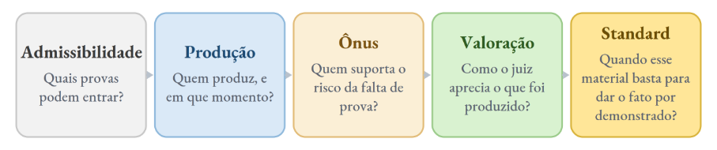

:::JC_DAE9F7 PEGADINHA
O indeferimento de diligência inútil ou meramente protelatória não configura cerceamento de defesa. É o próprio parágrafo único do art. 370 que manda indeferi-la, e por isso o deferimento é que precisaria de justificativa.
:::

:::JC_FFE698 JÁ CAIU!
Em prova do **TJMT**, as partes haviam protestado apenas por prova oral e o juiz determinou, de ofício, perícia e prova documental. A conduta é regular, porque a **determinação das provas necessárias ao julgamento do mérito cabe ao juiz independentemente de pedido.**
:::

## 2. Ônus da prova

O ônus da prova responde a uma pergunta prática: **se, encerrada a instrução, o fato continuar duvidoso, quem suporta o prejuízo.** A resposta varia conforme se aplique a distribuição legal, a convenção das partes ou a redistribuição judicial.

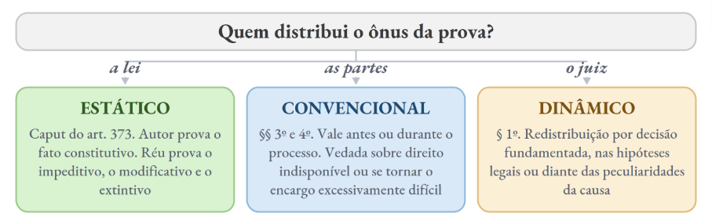

Recordem ainda que a **decisão que redistribui o ônus é impugnável por** ==**agravo de instrumento**==, por força do art. 1.015, XI.

## 2.1. Regra de instrução (não de julgamento)

A distribuição dinâmica é ==**regra de instrução**==, e não de julgamento. Ou seja: a parte só consegue cumprir um encargo probatório se souber, antes de produzir a prova, que lhe foi atribuído. Inverter o ônus na sentença é, por isso, ==**decisão-surpresa**==, e contamina o julgado.

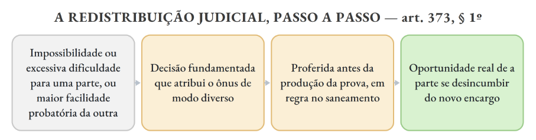

:::JC_FFE698 JÁ CAIU!
Em questão do **TJPR de 2026 (FGV)**, o juiz silenciou sobre a inversão no saneamento e, na sentença, julgou procedente o pedido atribuindo ao banco o ônus de provar a regularidade dos juros. A sentença padece de nulidade, porque a parte não teve oportunidade de se desincumbir do encargo que só lhe foi atribuído ao final.
:::

Em contrapartida, quando a redistribuição vem no momento adequado, ela se apoia na aptidão para a prova. Em caso do TJMS, envolvendo falha no **“teste do pezinho”,** o Estado alegava manter câmara refrigerada monitorada. Cabe a ele (Estado) demonstrar a regularidade da colheita e da realização do exame, porque tem melhor condição de produzir essa prova. Lógico que isso varia em cada caso, mas, convenhamos, não haveria motivo para não entender dessa forma.

:::JC_DAE9F7 NÃO CONFUNDA
A inversão do art. 6º, VIII, do CDC e a distribuição dinâmica do art. 373, § 1º, têm pressupostos diferentes. A primeira depende de **verossimilhança ou hipossuficiência** e opera no processo do consumidor. A segunda é regra geral do CPC e se apoia na **aptidão para a prova**, independentemente de relação de consumo.
:::

## 2.2. Standards probatórios

:::JC_FFFFFF 
**Standard probatório** é o grau de confirmação que uma hipótese precisa alcançar para que o juiz possa dá-la por demonstrada. O CPC ==**não positivou uma escala geral**==. O que ele exige é a apreciação racional da prova com motivação, no art. 371, somada à distribuição do ônus do art. 373.

A escala que circula na doutrina vem do direito comparado, com a preponderância de provas no cível, a prova clara e convincente em matérias de maior gravidade e a dúvida razoável no processo penal. São ==**categorias doutrinárias**==, e não regra positivada nem tese vinculante.

## 2.3. Verossimilhança preponderante
:::

Nem sempre a instrução permite chegar a uma conclusão segura sobre os fatos. Quando a própria natureza do evento torna a prova conclusiva muito difícil, o juiz termina a instrução com elementos relevantes, mas sem certeza sobre qual das versões corresponde ao ocorrido.

A ==**teoria da verossimilhança preponderante atua nesse campo**==. Em vez de exigir uma certeza que as provas disponíveis não fornecem, o julgador verifica qual das versões encontra maior apoio no conjunto probatório. Ela é instrumento de ==**superação do estado de dúvida**==, e ==**não autorização para decidir sem prova**==.

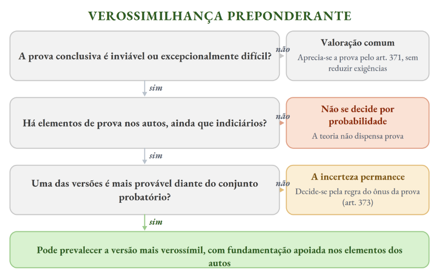

:::JC_D9F2D0 JURISPRUDÊNCIA
**REsp 2.145.132/GO** (3ª Turma, rel. Min. Nancy Andrighi, j. 18/2/2025, Info 842). Participante de ensaio clínico desenvolveu doença rara após o uso do medicamento. A perícia não afirmou o nexo causal, mas também não o afastou e admitiu a possibilidade de reação ao fármaco. Somados a isso, havia a proximidade temporal e a ausência de histórico prévio. O STJ admitiu a verossimilhança preponderante para superar a dúvida probatória e manteve a responsabilização.
:::

A formulação clássica da teoria vem de antes, do **REsp 1.320.295/RS** (3ª Turma, rel. Min. Nancy Andrighi, j. 15/10/2013), que a declarou compatível com o ordenamento desde que invocada para dar lastro à superação do estado de dúvida. O julgado de 2025 aplica essa orientação, e o entendimento resistiu aos embargos de divergência, rejeitados pela Segunda Seção em 9/9/2026.

O próprio acórdão impõe limites. A decisão precisa estar ==**amparada em elementos de prova constantes dos autos**==, ainda que indiciários. E, ==**permanecendo a incerteza**==, decide-se pela regra do ônus da prova. Nada disso é standard positivado nem tese vinculante: é critério de valoração admitido em julgamento de Turma.

## 3. Prova emprestada

O art. 372 autoriza o juiz a admitir prova produzida em outro processo, atribuindo-lhe o valor que considerar adequado, observado o contraditório.

O contraditório exigido é ==**o do processo de destino**==. A prova pode ser usada mesmo contra quem não participou do processo de origem, desde que tenha oportunidade de se manifestar sobre ela onde a prova será empregada. A ausência da parte na produção original, por si só, ==**não impede**== o empréstimo, e o contraditório já havido na origem ==**não dispensa**== nova manifestação.

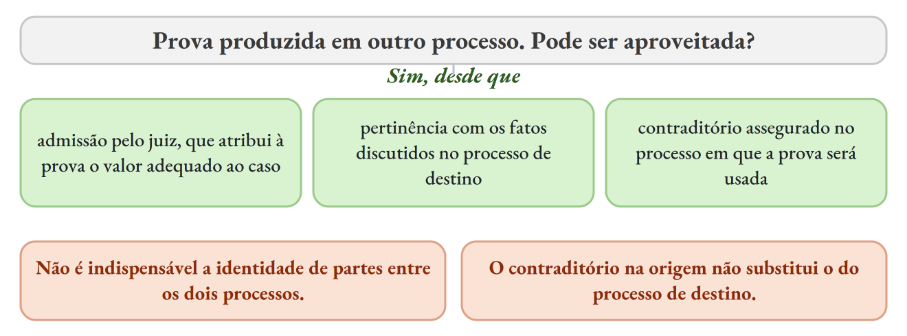

:::JC_FFE698 JÁ CAIU!
No **TRF6, em 2025**, depoimentos colhidos em ação penal foram trazidos como prova emprestada para ação de improbidade contra réu que não fora parte no processo criminal. A utilização é lícita, mas depende de que o réu possa exercer o contraditório na ação civil, sob pena de nulidade.
:::

## 4. Produção antecipada da prova

Nem sempre a prova é produzida apenas na “instrução”. Há casos em que se admite uma **antecipação do momento da produção da prova.** Isso está previsto no art. 381 do CPC:

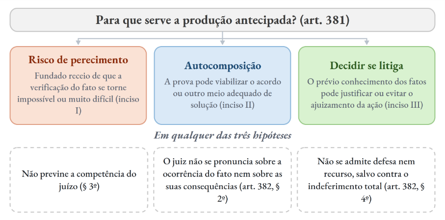

A competência é do foro onde a prova deva ser produzida ou do domicílio do réu, foros ==**concorrentes**==, e a escolha cabe ao autor (art. 381, § 2º). Os interessados podem requerer, no mesmo procedimento, qualquer prova relacionada ao mesmo fato, salvo se a cumulação retardar excessivamente (art. 382, § 3º).

:::JC_FFE698 JÁ CAIU!
**TJPE, 2026.** Clara quer acionar uma construtora por vícios em imóvel em Petrolina e, antes de propor a ação, ajuíza produção antecipada no foro do imóvel para perícia de engenharia. A construtora é domiciliada no Recife. Alternativa correta: **o foro de Petrolina é competente, e o juízo que decidiu a produção antecipada não fica prevento para a futura ação indenizatória.**⁷⁷
:::

## 5. As provas em espécie

As provas em espécie são os meios concretos pelos quais os fatos chegam ao processo. O CPC disciplina cada uma separadamente, mas aqui o que importa é identificar a função de cada meio, os seus limites e as consequências processuais que as diferenciam.

## 5.1. Ata notarial

:::JC_FFFFFF 
O art. 384 permite que a existência e o modo de existir de algum fato sejam atestados ou documentados, a requerimento do interessado, mediante ata lavrada por tabelião.

O parágrafo único amplia bastante o alcance do instituto, ao admitir que **dados representados por imagem ou som gravados em arquivos eletrônicos** constem da ata notarial. É por essa porta que entram as capturas de tela *(prints)*, as conversas em aplicativos de mensagem e as páginas de rede social.

## 5.2. Depoimento pessoal
:::

Sobre depoimento pessoal, tem-se que ele é, em essência, a colheita do **depoimento da** ==**parte contrária**==**.** Não é o depoimento da própria autora!

:::JC_DAE9F7 
**DEPOIMENTO PESSOAL**
:::

:::JC_DAE9F7 
→ ausência ou recusa, com prévia advertência → ==**pena de confesso**== (art. 385, § 1º) → escritos preparados → ==**vedados**== **x** Notas breves → ==**permitidas**== (art. 387) → escusas⁷⁸do art. 388 → **não se aplicam às ações de estado e de família**
:::

## 5.3. Confissão

Há confissão quando a parte admite a verdade de fato contrário ao seu interesse e favorável ao do adversário. O conceito é simples, e o regime está nos arts. 389 a 395:

| **CONFISSÃO** | > |
|---|---|
| **PONTO** | **REGRA** |
| **Conceito** | A parte admite a verdade de fato contrário ao seu interesse e favorável ao do adversário. Pode ser judicial ou extrajudicial (art. 389) |
| **Efeito** | Faz prova contra o confitente, mas **não prejudica os litisconsortes** (art. 391) |
| **Direitos indisponíveis** | **Não vale como confissão** a admissão, em juízo, de fatos relativos a direitos indisponíveis (art. 392) |
| **Revogação e anulação** | É **irrevogável**, mas pode ser **anulada por erro de fato ou coação**. O dolo **não consta do dispositivo** (art. 393) |
| **Confissão extrajudicial** | Feita oralmente, só tem eficácia onde a lei **não exija prova literal** (art. 394) |
| **Indivisibilidade** | A parte não pode aceitar o que a beneficia e rejeitar o resto. Cinde-se quando o confitente aduz fatos novos que fundamentem defesa de direito material ou reconvenção (art. 395) |

%% DICA DO PROFESSOR

É muito importante que possamos **observar** o regime jurídico do CPC *versus* CPP!

| **CONFISSÃO · CPP × CPC** | > | > |
|---|---|---|
| **PONTO** | **CPP, ART. 200** | **CPC, ART. 395** |
| **Texto legal** | A confissão será **divisível e retratável**, sem prejuízo do livre convencimento do juiz, fundado no exame das provas em conjunto. | A confissão é, em regra, **indivisível**, não podendo a parte que a quiser invocar como prova aceitá-la no tópico que a beneficiar e rejeitá-la no que lhe for desfavorável, porém cindir-se-á quando o confitente a ela aduzir fatos novos, capazes de constituir fundamento de defesa de direito material ou de reconvenção. |
| **Divisibilidade** | **Divisível**. O juiz pode acolher uma parte da confissão e rejeitar o restante | **Indivisível em regra**. Quem a invoca não pode aceitar o tópico que o beneficia e rejeitar o que lhe é desfavorável |
| **Cisão** | Não existe regime de cisão, porque a confissão já nasce divisível | Cinde-se quando o confitente **adita fatos novos** capazes de fundamentar defesa de direito material ou reconvenção |
| **Retratação** | **Retratável** | **Irrevogável**. Só se anula por erro de fato ou coação, e o dolo não consta do dispositivo (art. 393) |
| **Valor probatório** | Não vincula o juiz, que decide pelo livre convencimento, no exame das provas em conjunto | Faz prova contra o confitente e não prejudica os litisconsortes (art. 391) |
| **Para memorizar** | Confissão penal: **divisível e retratável** | Confissão civil: **indivisível e irrevogável** |

## 5.4. Exibição de documento ou coisa

Vamos de tabela, já que o termo é intuitivo:

| **EXIBIÇÃO DE DOCUMENTO OU COISA** | > | > |
|---|---|---|
| **CRITÉRIO** | **CONTRA A PARTE** | **CONTRA TERCEIRO** |
| **Procedimento** | Requerimento com individuação do documento, finalidade da prova e circunstâncias que tornam verossímil a posse (art. 397) | O terceiro é **citado** para responder em quinze dias (art. 401) |
| **Recusa legítima** | Art. 404, com hipóteses como o sigilo profissional e a desonra do possuidor ou de seus parentes | As mesmas hipóteses do art. 404 |
| **Consequência da recusa** | Recusa → **presunção**. O juiz admite como verdadeiros os fatos que a parte pretendia provar (art. 400) | Recusa → **coerção**. Mandado de apreensão, força policial, multa e crime de desobediência (art. 403, parágrafo único) |

:::JC_D9F2D0 JURISPRUDÊNCIA
Negada a exibição integral de processo disciplinar eclesiástico pedida por quem apresentou a denúncia. A **liberdade religiosa** alcança a organização interna das entidades religiosas e o sigilo dos seus procedimentos, e o **sigilo confessional** protege o que se obtém no exercício do ministério. STJ, 4ª Turma, REsp 2.072.690/SP, rel. Min. Raul Araújo, j. 14/10/2025, Info 868.
:::

## 5.5. Prova documental e eletrônica

A força probante dos documentos se divide entre o que cada um prova e o que o juiz pode fazer diante dele:

| **PROVA DOCUMENTAL** | > |
|---|---|
| **ARTIGO** | **REGRA** |
| **O QUANTO O DOCUMENTO PROVA** | > |
| **413** | Telegrama, radiograma ou outro meio de transmissão tem a força do documento particular se o original da estação expedidora estiver **assinado pelo remetente** (art. 413) |
| **416** | Nota escrita pelo credor em documento representativo de obrigação, ainda que não assinada, prova **em benefício do devedor** (art. 416) |
| **417** | Os livros empresariais provam **contra o seu autor**, cabendo ao empresário demonstrar que os lançamentos não correspondem à verdade (art. 417) |
| **418** | Preenchidos os requisitos legais, provam **a favor do seu autor** quando o litígio for entre empresários (art. 418) |
| **419** | A escrituração contábil é **indivisível**. Lançamentos favoráveis e contrários são considerados em conjunto (art. 419) |
| **O QUE O JUIZ PODE FAZER** | > |
| **421** | De ofício, o juiz pode ordenar a **exibição parcial** dos livros e documentos, extraindo a suma que interessar ao litígio (art. 421) |
| **426** | Documento com entrelinha, emenda, borrão ou cancelamento em ponto substancial e sem ressalva **não perde valor automaticamente**: o juiz aprecia fundamentadamente a fé que ele mereça (art. 426) |

Quanto ao momento da juntada, **o art. 434** manda que autor e réu instruam a inicial e a contestação com os documentos destinados a provar suas alegações, o que não impede a juntada posterior.

O **art. 435** admite a juntada de documentos novos destinados a provar fatos ocorridos depois dos articulados ou a contrapor os que já foram produzidos. O parágrafo único admite ainda os documentos formados depois da inicial ou da contestação e os que só depois se tornaram conhecidos, acessíveis ou disponíveis, desde que a parte comprove o motivo que a impediu de juntá-los antes e não haja má-fé.

Em qualquer desses casos, o art. 437, § 1º, assegura à outra parte o prazo de ==**quinze dias**== para se manifestar sobre o documento juntado (cobrado no TJMT).

%% Tome seu café

**Prova eletrônica** O art. 439 condiciona o uso de documento eletrônico no processo convencional à conversão para a forma impressa e à verificação da autenticidade. O art. 440 cuida do documento ==**não convertido**==, caso em que o juiz aprecia o valor probante, assegurado às partes o acesso ao teor. O art. 441 admite os documentos produzidos e conservados conforme a legislação específica, **hoje a Lei nº 11.419/2006 e a disciplina da certificação digital,** para além das resoluções do CNJ que disso tratam.

:::JC_D9F2D0 JURISPRUDÊNCIA
As telas e os extratos de sistemas eletrônicos da Administração são **prova digital válida**, pela atipicidade dos meios de prova (art. 369) e pelo art. 11 da Lei nº 11.419/2006. Produzidas por servidor no exercício da função, gozam de **presunção relativa de veracidade** (arts. 374, IV, e 405), e cabe à parte contrária impugnar especificamente a autenticidade. STJ, 2ª Turma, REsp 2.179.441/DF, rel. Min. Maria Thereza de Assis Moura, j. 10/3/2026, Info 881.
:::

:::JC_DAE9F7 TRADUZINDO
A captura de tela, a conversa em aplicativo de mensagem e a página de rede social podem ser usadas de **duas maneiras.** Pela ==**ata notarial**== do art. 384, parágrafo único, o tabelião atesta o que constatou no arquivo eletrônico, e o documento nasce com fé pública quanto a isso. Pela ==**juntada direta**== como documento particular, a autenticidade pode ser impugnada, e aí cessa a fé do documento até que se comprove a veracidade (art. 428, I). A autoria também se considera identificada por meio eletrônico de certificação, na forma do art. 411, II.
:::

## 5.6. Arguição de falsidade

:::JC_FFFFFF 
A falsidade documental pode ser julgada de dois modos. **Se a parte quiser que a decisão sobre a falsidade valha fora daquele processo, precisa pedir que ela seja decidida como questão principal.**

Sem esse pedido, a falsidade é resolvida apenas como questão incidental.

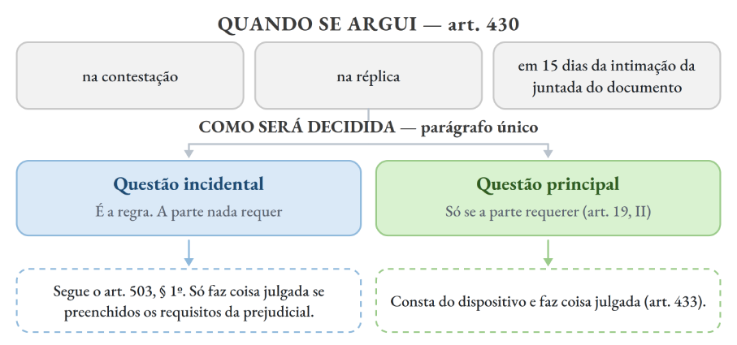

## 5.7. Prova testemunhal
:::

Na audiência, juiz, advogado e partes têm atribuições próprias:

| **PROVA TESTEMUNHAL** | > |
|---|---|
| **ARTIGO** | **REGRA** |
| 357, §§ 6º e 7º | O rol não pode ter mais de **dez testemunhas**, sendo **três**, no máximo, para a prova de cada fato. O juiz pode limitar esse número conforme a complexidade da causa e dos fatos individualmente considerados |
| **447** | Podem depor como testemunhas todas as pessoas, **exceto as incapazes, impedidas ou suspeitas**. Os §§ 4º e 5º permitem ao juiz, **sendo estritamente necessário**, ouvi-las como **informantes**, sem compromisso, atribuindo ao depoimento o valor que possa merecer |
| **455** | Cabe **ao advogado** informar ou intimar a testemunha por ele arrolada, por carta com aviso de recebimento, juntando a comprovação em até três dias antes da audiência. A inércia **importa desistência da inquirição** |
| **456** | O juiz inquirirá as testemunhas separada e sucessivamente, primeiro as do autor e depois as do réu. O parágrafo único admite **alterar a ordem se as partes concordarem** |
| **459** | As perguntas serão formuladas **pelas partes diretamente** à testemunha. O juiz **não admitirá** as que puderem induzir a resposta, não tiverem relação com a causa ou importarem repetição de outra já respondida |
| **457, § 1º** | A contradita é oferecida antes do compromisso. Provada ou confessada a incapacidade, o impedimento ou a suspeição, o juiz dispensará a testemunha ou **lhe tomará o depoimento como informante** |

:::JC_DAE9F7 DICA DO PROFESSOR
**O mnemônico PARTES** ajuda a lembrar a ordem das pessoas ouvidas na audiência (art. 361).

**P** perito · **A** autor · **R** réu · **TES** testemunhas
:::

No plano jurisprudencial, o julgado a seguir é bom para ilustrar como funciona a inquirição em caso de carta precatória (JF e JE):

:::JC_D9F2D0 JURISPRUDÊNCIA
Se houver sala passiva de videoconferência na comarca onde está a testemunha (espaço no fórum equipado para permitir que o juiz responsável pelo processo conduza a audiência à distância), a audiência deve ser conduzida diretamente pelo juiz responsável pelo processo. O juízo local fica responsável apenas por disponibilizar a sala, realizar as intimações e providenciar o suporte necessário. Assim, não cabe expedir carta precatória para que outro juiz realize a oitiva. STJ. 1ª Seção. EDcl no AgInt no CC 196.645-SP, Rel. Min. Afrânio Vilela, julgado em 14/10/2025 (Info 870).
:::

## 5.8. Prova pericial e prova técnica simplificada

O art. 464 define o objeto da perícia, que é o exame, a vistoria e a avaliação. O mesmo dispositivo resolve o que fazer quando a perícia não cabe e quando ela é desproporcional ao que se discute.

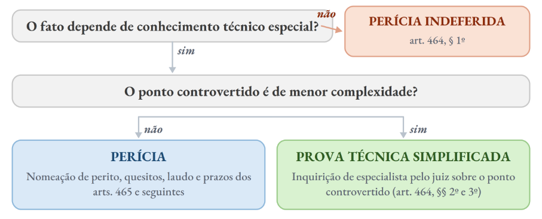

:::JC_D9F2D0 JURISPRUDÊNCIA
Em ação por erro médico, a perícia **pode ser feita por médico não especialista** na área do profissional investigado, desde que os elementos concretos revelem que isso não compromete a idoneidade da prova. STJ, 3ª Turma, REsp 2.121.056/PR, rel. Min. Nancy Andrighi, j. 21/5/2024, Info 814.
:::

A perícia consensual do art. 471 é caminho paralelo, aberto pela vontade das partes, e tem regime próprio:

| **PERÍCIA CONSENSUAL** | > |
|---|---|
| **PONTO** | **REGIME** |
| **Requisitos** | Partes **plenamente capazes** e causa que **admita autocomposição**. Fora daí a perícia consensual não cabe |
| **Escolha do perito** | As partes escolhem de comum acordo, e a escolha **independe de homologação judicial** prévia |
| **Efeito** | A perícia consensual **substitui**, para todos os efeitos, a que seria realizada por perito nomeado pelo juiz (§ 3º) |
| **Assistentes técnicos** | As partes, ao escolher o perito, **já devem indicar os respectivos assistentes técnicos** para acompanhar a perícia (§ 1º, I). Podem também, por negócio jurídico processual, **dispensar** a indicação |
| **Calendário** | As partes devem apresentar o **calendário** para a realização da perícia (§ 1º, II) |

:::JC_FFE698 JÁ CAIU!
A FGV explorou o instituto em duas provas, sempre pelo mesmo eixo. No **TRF1**, a solução estava na exigência de que as partes, ao escolher o perito, já indiquem os respectivos assistentes técnicos. No **TJPE (2026)**, o caso envolvia negócio jurídico processual em que as partes escolheram o perito e dispensaram os assistentes, o que é admissível, porque a convenção sobre poderes e faculdades processuais alcança essa escolha.
:::

Por fim, o art. 477, § 3º, permite que o perito ou o assistente técnico seja **intimado a comparecer à audiência** para prestar esclarecimentos, respondendo aos quesitos apresentados com pelo menos dez dias de antecedência.

:::JC_D9F2D0 JURISPRUDÊNCIA
A suspeição do perito deve ser arguida **na primeira oportunidade** em que couber à parte falar nos autos, sob pena de **preclusão**. Anulada a perícia por vício procedimental, não se reabre o prazo para arguir suspeição fundada em fato pretérito e já conhecido, porque a nova perícia é renovação do ato invalidado, e não nova investidura do perito. A arguição tardia é **nulidade de algibeira**⁷⁹. STJ, 4ª Turma, REsp 1.579.704/PR, rel. Min. João Otávio de Noronha, j. 16/6/2026, Info 899.
:::

## 5.9. Inspeção judicial

O art. 481 autoriza o juiz, de ofício ou a requerimento, a inspecionar pessoas ou coisas **em qualquer fase do processo**, a fim de se esclarecer sobre fato que interesse à decisão da causa.

Por sua vez, o art. 483 indica quando o juiz vai ao local, que é quando julgar necessário para melhor verificação ou interpretação dos fatos, quando a coisa **não puder ser apresentada em juízo sem consideráveis despesas ou graves dificuldades**, ou quando determinar a reconstituição dos fatos.

Concluída a diligência, o art. 484 exige **auto circunstanciado**, ao qual o juiz pode determinar que se anexe desenho, gráfico ou fotografia.

## 6. Espécies de pronunciamento

O art. 203 classifica os pronunciamentos do juiz pelo **conteúdo**, e não pela posição que ocupam no procedimento:

| **PRONUNCIAMENTOS DO JUIZ** | > | > |
|---|---|---|
| **ESPÉCIE** | **DEFINIÇÃO LEGAL** | **RECURSO** |
| **Sentença** | Pronunciamento que, com fundamento nos arts. 485 e 487, **põe fim à fase cognitiva** do procedimento comum ou **extingue a execução** | Apelação |
| **Decisão interlocutória** | Todo pronunciamento **de natureza decisória** que não se enquadre no conceito de sentença | Agravo de instrumento, nas hipóteses do art. 1.015 |
| **Despacho** | Os **demais** pronunciamentos do juiz praticados no processo, de ofício ou a requerimento | **Irrecorrível** (art. 1.001) |
| **Acórdão** | Julgamento **colegiado** proferido pelos tribunais (art. 204) | Conforme o caso |

:::JC_DAE9F7 NÃO CONFUNDA
**Mérito ≠ sentença.** A decisão que julga ==**parcialmente o mérito**==, do art. 356, é **decisão interlocutória**, ainda que tenha aptidão para a coisa julgada material, porque ==**não põe fim à fase cognitiva**==. Daí ser impugnável por ==**agravo de instrumento**==.
:::

## 7. Elementos e fundamentação

O art. 489 fixa os elementos essenciais da sentença, que são o relatório, os fundamentos e o dispositivo. O § 1º cuida de outra coisa. A exigência de fundamentar não se satisfaz com justificativa formal, e o dispositivo descreve as formas de aparentar fundamentação sem fundamentar:

| **AUSÊNCIA DE FUNDAMENTAÇÃO** | > |
|---|---|
| **INCISO** | **VÍCIO** |
| **I** | **Lei sem conexão com o caso.** Limitar-se à indicação, à reprodução ou à paráfrase de ato normativo, sem explicar sua relação com a causa |
| **II** | **Conceito indeterminado sem concretização.** Empregar conceitos jurídicos indeterminados sem explicar o motivo concreto de sua incidência |
| **III** | **Fundamento genérico.** Invocar motivos que se prestariam a justificar qualquer outra decisão |
| **IV** | **Argumento relevante ignorado.** Não enfrentar todos os argumentos deduzidos no processo capazes de, em tese, infirmar a conclusão adotada |
| **V** | **Precedente aplicado sem a ratio.** Limitar-se a invocar precedente ou enunciado de súmula sem identificar seus fundamentos determinantes nem demonstrar que o caso sob julgamento a eles se ajusta |
| **VI** | **Precedente afastado sem distinção nem superação.** Deixar de seguir enunciado de súmula, jurisprudência ou precedente invocado pela parte, sem demonstrar a existência de distinção no caso ou a superação do entendimento |

Se o precedente for aplicável, o juiz deve demonstrar a aderência do caso aos seus fundamentos determinantes. Se entender que não se aplica, deve justificar a distinção ou a superação.

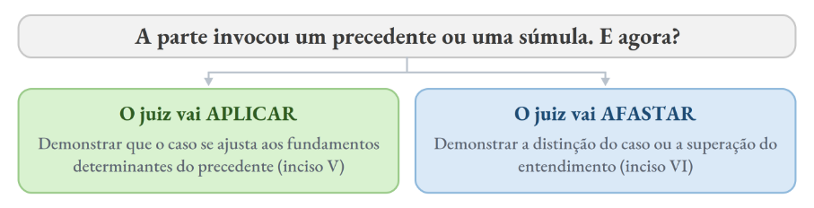

Sobre a fundamentação ***per relationem***, o STJ a admite desde que o julgador **transcreva a decisão ou o parecer** de que se valeu e acrescente fundamentação própria que demonstre a adequação ao caso. Na mesma linha, o § 3º do art. 1.021 não impede a **reprodução dos fundamentos da decisão agravada** no julgamento do agravo interno, desde que a análise seja efetiva. A propósito, **vejam o Tema 1.306 dos repetitivos (STJ)**⁸⁰**.**

## 8. Congruência

O art. 141 vincula o juiz aos limites propostos pelas partes, e o art. 492 veda decisão de natureza diversa da pedida e condenação em quantidade superior ou em objeto diverso do demandado. O desrespeito a esse limite gera vícios cujas consequências não se equivalem:

| **VÍCIOS DE CONGRUÊNCIA** | > | > |
|---|---|---|
| **VÍCIO** | **O QUE O JUIZ FEZ** | **CONSEQUÊNCIA** |
| **Extra petita** | Concedeu **coisa diversa** da pedida, ou decidiu sobre causa de pedir não invocada | Nulidade. O tribunal invalida o capítulo viciado |
| **Ultra petita** | Concedeu **mais do que o pedido**, mas dentro do mesmo objeto | O tribunal reduz o excesso, sem invalidar a decisão inteira |

2.⁠ O § 3º do artigo 1.021 do CPC não impede a reprodução dos fundamentos da decisão agravada como razões de decidir pela negativa de provimento de agravo interno quando a parte deixa de apresentar argumento novo para ser apreciado pelo colegiado.

| **VÍCIOS DE CONGRUÊNCIA** | > | > |
|---|---|---|
| **VÍCIO** | **O QUE O JUIZ FEZ** | **CONSEQUÊNCIA** |
| **Citra ou infra petita** | Deixou de apreciar pedido formulado | Omissão. Cabem embargos de declaração e, no tribunal, a integração do julgado |

Por sua vez, o art. 492, parágrafo único, exige que a decisão seja ==**certa, ainda que resolva relação jurídica condicional**==. A certeza, portanto, é exigida também aí, e o que fica condicionado é a eficácia do comando, não a sua definição.

## 8.1. O que não viola a congruência

Alguns provimentos podem ser concedidos sem pedido expresso, sem que haja julgamento fora do pedido:

Ø as **astreintes** do art. 537, que o juiz pode impor **de ofício**, na fase de conhecimento ou na execução, Ø os **juros legais, a correção monetária e as verbas de sucumbência**, que o art. 322, § 1º, considera compreendidos no pedido principal, Ø a **obrigação de fazer**, em que o art. 497 autoriza o juiz a conceder a tutela específica ou determinar providências que assegurem resultado prático equivalente.

:::JC_FFE698 JÁ CAIU!
No **TJPE, em 2024**, foi cobrado caso concreto, na prova objetiva, em que, em uma sentença, impôs-se obrigação de fazer e cominou-se multa diária que não fora postulada na inicial. A sentença é válida, porque a multa do art. 537 pode ser imposta de ofício e não depende de pedido da parte.
:::

## 9. Fato e direito supervenientes

O art. 493 é dispositivo curto e de leitura literal. Se, depois da propositura da ação, **fato constitutivo, modificativo ou extintivo** do direito influir no julgamento do mérito, caberá ao juiz **tomá-lo em consideração, de ofício ou a requerimento**, no momento de proferir a decisão.

O parágrafo único acrescenta a garantia processual. Constatando de ofício o fato novo, o juiz **ouvirá as partes** antes de decidir, o que afasta a decisão-surpresa vedada pelo art. 10.

Por fim, o **art. 494 permite ao juiz alterar a sentença já publicada nas seguintes hipóteses**:

Ø a correção de **inexatidões materiais ou de erros de cálculo**, de ofício ou a requerimento (inciso I), Ø e o julgamento de embargos de declaração (inciso II). O erro material, aliás, pode ser corrigido **a qualquer tempo e de ofício pelo próprio tribunal**, sem necessidade de retorno dos autos ao primeiro grau. A correção não configura julgamento extra petita, porque não altera o que foi decidido, apenas ajusta a sua expressão.

## 10. Retratação e admissibilidade da apelação

Interposta a apelação, o juiz de primeiro grau ainda atua, mas com poderes limitados. No **juízo de retratação**, nas sentenças sem resolução de mérito, o art. 485, § 7º, dá ao juiz cinco dias para se retratar depois de interposta a apelação. O mesmo ocorre no indeferimento da inicial (art. 331) e na improcedência liminar (art. 332, § 3º).

Na **admissibilidade**, o art. 1.010, § 3º, é categórico ao determinar que os autos sejam

:::JC_FFFFFF 
remetidos ao tribunal pelo juiz, ==**independentemente de juízo de admissibilidade**==. Em
:::

contrapartida, o juiz de primeiro grau ==**não declara a intempestividade**== da apelação nem manda certificar o trânsito em julgado.

## 11. Remessa necessária

A remessa necessária decorre diretamente da lei, não depende de iniciativa da Fazenda nem de prazo de interposição, e, se o juiz deixar de remeter, o presidente do tribunal avoca os autos. Não há contrarrazões, porque não há recorrente nem recorrido, mas isso ==**não suprime o contraditório**==: as partes são intimadas dos atos no tribunal e o julgamento admite sustentação oral.

| **REMESSA NECESSÁRIA** | > |
|---|---|
| **PONTO** | **REGIME** |
| **Cabimento (caput)** | Sentença **proferida contra** a União, os Estados, o DF, os Municípios e suas respectivas **autarquias e fundações de direito público**, e sentença que julgar **procedentes, no todo ou em parte, os embargos à execução fiscal** |
| **Fora do conceito** | **Empresas públicas e sociedades de economia mista** não integram a Fazenda Pública e não atraem a remessa |
| **Valor (§ 3º)** | Não se aplica quando a condenação ou o proveito econômico for de valor **certo e líquido** inferior a 1.000 salários mínimos para a União e as respectivas autarquias e fundações de direito público, 500 para os Estados, o DF, as respectivas autarquias e fundações e os Municípios que sejam capitais, e 100 para todos os demais Municípios e respectivas autarquias e fundações de direito público |
| **Precedente (§ 4º)** | Não se aplica quando a sentença estiver fundada em **súmula de tribunal superior**, em **acórdão do STF ou do STJ em repetitivos**, em entendimento firmado em **IRDR ou IAC**, ou em **orientação vinculante firmada no âmbito administrativo do próprio ente**, consolidada em manifestação, parecer ou súmula administrativa |
| **Extensão** | Pela **Súmula 325 do STJ**, a remessa oficial devolve ao tribunal o reexame de **todas as parcelas** da condenação, inclusive dos **honorários** de advogado |
| **Sentença ilíquida** | Pela Súmula 490 do STJ, a dispensa pelo valor da condenação ou do direito controvertido **não se aplica à sentença ilíquida** |
| **Previdenciário** | Pelo **Tema 1.081**, a demanda previdenciária cujo valor seja **aferível por simples cálculo aritmético**, a partir dos parâmetros da sentença, dispensa a remessa quando se possa estimar que não excede o piso do art. 496, § 3º, I. A iliquidez formal, por si só, **não impõe o reexame** (Corte Especial, j. 4/2/2026, Info 878) |
| **Reformatio in pejus** | Pela **Súmula 45 do STJ**, no reexame necessário é **defeso** ao tribunal agravar a condenação imposta à Fazenda Pública |

O inciso III alcança os demais Municípios e também as suas autarquias e fundações. Nos embargos à execução fiscal, a remessa ocorre quando eles são julgados ==**procedentes**==, no todo ou em parte, hipótese em que a Fazenda foi vencida.

As exceções do ==**valor**== e do ==**fundamento**== operam de modo **independente**, e é a combinação delas que resolve o caso concreto.

:::JC_DAE9F7 NÃO CONFUNDA
Valor e fundamento são hipóteses **autônomas entre si.** A condenação pode superar o piso e ainda assim ==**dispensar a remessa**==, se a sentença estiver fundada em uma das hipóteses do § 4º.
:::

:::JC_FFE698 JÁ CAIU!
No **TJSE, em 2025**, havia condenação de 600 salários mínimos contra Município que é capital, com sentença fundada em incidente de assunção de competência. O valor superaria o piso de 500, mas o § 4º, III, afasta a remessa pelo fundamento da sentença, de modo que cabe certificar o trânsito em julgado.
:::

:::JC_D9F2D0 JURISPRUDÊNCIA
A **remessa necessária devolve ao Tribunal toda a matéria abrangida pela condenação imposta à Fazenda Pública**, ainda que algum ponto não tenha sido especificamente impugnado na apelação. Por isso, se a Fazenda foi condenada ao pagamento das verbas 1 e 2, mas recorreu apenas quanto à verba 1, o Tribunal poderá reexaminar também a verba 2 no âmbito do reexame necessário, sem que haja preclusão sobre esse capítulo. Esse reexame, porém, só pode beneficiar a Fazenda, porque a Súmula 45 do STJ veda agravar a condenação em remessa necessária. **STJ, 1ª Turma, AgInt no REsp 1.935.370/TO, Rel. Min. Paulo Sérgio Domingues, julgado em 24.2.2025, Info 846.**

%% JURISPRUDÊNCIA

**Improbidade.** O art. 17, § 19, IV, combinado com o art. 17-C, § 3º, da Lei nº 8.429/1992, na redação da Lei nº 14.230/2021, **afastou a remessa necessária** nas ações de improbidade. A vedação, porém, ==**não alcança os processos em curso cuja sentença seja anterior**== à vigência da nova lei. STJ, 1ª Seção, REsp 2.117.355/MG e outros, rel. Min. Teodoro Silva Santos, j. 11/6/2025, Tema 1.284, Info 854.
:::

:::JC_DAE9F7 DICA DO PROFESSOR
**Decisão parcial de mérito.** O Enunciado 17 do Fórum Nacional do Poder Público diz que a decisão parcial de mérito proferida contra a Fazenda Pública se sujeita ao regime da remessa necessária. Procurei julgados sobre isso e não encontrei, mas me parece razoável afirmar que sim, porque o art. 356 produz decisão apta à ==**coisa julgada material**== contra a Fazenda. Além disso, **também é esse o entendimento de Leonardo Carneiro da Cunha** ==**(membro da banca!).**==
:::

## 12. Coisa julgada

O art. 502 define a coisa julgada material como a **autoridade que torna imutável e indiscutível** a decisão de mérito não mais sujeita a recurso.

A coisa julgada **formal**, por sua vez, é a imutabilidade dentro do processo, e alcança também as decisões que não resolvem o mérito.

## 12.1. Limites objetivos

A coisa julgada não cobre tudo o que está na decisão. Ela se forma sobre o que foi decidido como questão principal, e não sobre o caminho percorrido até ali.

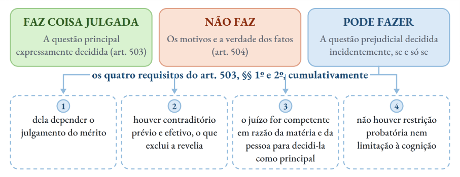

O dispositivo fala em questão **prejudicial**, e não preliminar. Também não exige, em nenhum momento, que ela conste do dispositivo da decisão. A coisa julgada sobre a prejudicial se forma ainda que ela tenha sido resolvida na fundamentação.

O art. 508 acrescenta a **eficácia preclusiva**. Transitada em julgado a decisão, consideram-se deduzidas e repelidas todas as alegações e defesas que a parte poderia ter oposto tanto ao acolhimento quanto à rejeição do pedido. O alcance é sobre o ==**deduzido e o dedutível**==. Ou seja: alcança **tudo** que poderia ter sido suscitado.

## 12.2. Limites subjetivos

Pelo art. 506, a sentença faz coisa julgada às partes entre as quais é dada, ==**não prejudicando terceiros**==. A redação é deliberada, porque o terceiro pode ser **beneficiado**, mas não prejudicado.

O **assistente simples** não se vincula à coisa julgada, mas à **justiça da decisão** do art. 123, se tiver atuado efetivamente e não estiver em uma das duas ressalvas do dispositivo.

:::JC_FFFFFF 
==**Nas ações coletivas aplicam-se os arts. 103 e 104 do CDC.**== Para os direitos
:::

individuais homogêneos, a coisa julgada é erga omnes apenas em caso de ==**procedência**==, para beneficiar as vítimas e seus sucessores. A ==**improcedência não impede**== a ação individual de quem não interveio no processo coletivo como litisconsorte.

:::JC_FFE698 JÁ CAIU!
No **TRF2, em 2026**, ação civil pública julgada procedente contra concessionária aeroportuária foi seguida de ação individual de passageiro. A sentença coletiva que reconhece a ilicitude produz efeitos favoráveis aos titulares de direitos individuais homogêneos, sem impedir que promovam ações individuais destinadas à reparação específica.
:::

Fora do CDC, o alcance muda conforme o veículo processual e o modo como a associação está em juízo:

| **AÇÕES COLETIVAS · ALCANCE SUBJETIVO** | > |
|---|---|
| **SITUAÇÃO** | **REGIME** |
| **Ação civil pública** | O art. 16 da Lei nº 7.347/1985, na redação da Lei nº 9.494/1997, é **inconstitucional**, e a redação original foi repristinada. A sentença **não se limita à competência territorial do órgão prolator** (RE 1.101.937, Tema 1.075) |
| **Associação em rito ordinário** | [Chance alta TRF5] Quando a associação age por representação do art. 5º, XXI, da Constituição, a coisa julgada alcança **apenas os filiados até a propositura que constem da relação juntada à inicial** (RE 612.043, Tema 499) |
| **Alcance territorial dessa relação** | O título abrange os associados residentes na jurisdição do **tribunal de segundo grau**, e não apenas os domiciliados na do juízo que sentenciou (REsp 2.021.777/SC, Info 842) |
| **Mandado de segurança coletivo** | [Chance alta TRF5] A exigência da relação de filiados **não se aplica**, porque ali a associação é **substituta processual** e a impetração independe de autorização dos associados (Súmula 629 do STF) |

## 12.3. Relações jurídicas continuativas

Pelo art. 505, I, nenhum juiz decidirá novamente as questões já decididas relativas à mesma lide, **salvo** se, tratando-se de relação jurídica de **trato continuado**, sobrevier modificação no **estado de fato ou de direito**, caso em que a parte poderá pedir a revisão do que foi estatuído na sentença.

A sentença dessas relações também transita em julgado, mas sob cláusula ==**rebus sic stantibus**==. A ação revisional **não viola** a coisa julgada, porque tem causa de pedir e pedido distintos, e não se configura a tríplice identidade.

A revisibilidade das astreintes segue lógica parecida, embora por fundamento próprio. A decisão que comina a multa **não faz coisa julgada** e não preclui pelo decurso do tempo (Tema 706 do STJ), e o juiz pode, de ofício ou a requerimento, inclusive no cumprimento, modificar o valor ou a periodicidade ou excluí-la, desde que presente um dos pressupostos do art. 537, § 1º. O que o Tema 706 afasta é a preclusão temporal, e não a consumativa. A preclusão que alcança o próprio juiz só impede rever o montante acumulado depois que ele já foi modificado uma vez.

:::JC_FBEFD6 Chance alta TRF5
O art. 537, § 1º, só alcança a multa **vincenda**. A Corte Especial do STJ firmou que o poder revisional ==**não atinge a multa já vencida**==, ainda que tenha alcançado patamares elevados (EAREsp 1.766.665/RS, j. 3/4/2024, Info 806, e EAREsp 1.479.019/SP, j. 7/5/2025, Info 853, ambos com acórdão do Min. Ricardo Villas Bôas Cueva). A multa **vence dia a dia**, desde que se configura o descumprimento (art. 537, § 4º), de modo que o montante acumulado já é vencido. Contra o acúmulo, o caminho é preventivo, pela conversão em perdas e danos (art. 499) ou por ordens que assegurem o resultado prático equivalente.
:::

O tema merece acompanhamento porque a própria Corte Especial afetou o **Tema 1.442** para definir se cabe modificar as multas vencidas, além das vincendas, e o que se considera multa vencida (ProAfR no REsp 2.236.049/PE e REsp 1.932.269/RJ, rel. Min. Raul Araújo, afetação em 26/5/2026, Info 891). Enquanto a tese não é firmada, vale o precedente da Corte Especial.

Isso caiu na questão 17 do TJPE de 2026. Multa diária de mil reais, teto de cinquenta mil, descumprimento por cem dias e pedido de exclusão integral por impossibilidade superveniente.

O gabarito preliminar apontou a alternativa que reproduz o art. 537, § 1º, II, em abstrato, admitindo a exclusão da multa diante de justa causa. **Discordamos.** Os cem dias já haviam vencido, e o § 1º limita a modificação à multa vincenda, de modo que a alternativa correta seria a que veda alterar as parcelas já vencidas. Precisaremos ver o gabarito oficial da FGV antes de nos posicionarmos em definitivo.

| **COISA JULGADA · JULGADOS RECENTES** | > |
|---|---|
| **TEMA** | **O QUE FOI DECIDIDO** |
| **Preclusão pro judicato** | [Chance alta TRF5] Matéria de ordem pública pode ser conhecida de ofício a qualquer tempo, mas, **uma vez decidida, não pode ser rediscutida**. A preclusão consumativa alcança o próprio juiz. No caso, a legitimidade passiva do banco sucessor já fora reconhecida em exceção de pré-executividade, e a mesma alegação **não podia voltar** na impugnação ao cumprimento de sentença. STJ, 2ª Seção, EREsp 1.488.048/MT, rel. Min. Marco Aurélio Bellizze, j. 13/11/2024, Info 23 da Edição Extraordinária |
| **Relativização da coisa julgada** | A paternidade fora reconhecida em 1992 com base em outras provas, diante da recusa do réu ao exame. Admite-se relativizar a coisa julgada quando **DNA posterior, determinado pelo próprio Judiciário, afasta o vínculo genético**. A regra segue sendo relativizar apenas quando o exame deixou de ser feito por razão alheia à vontade das partes. STJ, 4ª Turma, REsp 1.639.372/SC, rel. Min. Raul Araújo, j. 4/6/2024, Info 20 da Edição Extraordinária |
| **Juros e correção contra a Fazenda** | [Chance alta TRF5] Sentença que fixou juros em contrariedade ao art. 1º-F da Lei nº 9.494/1997 pode ser ajustada na fase de execução, **sem ofensa à coisa julgada**. Desde a Lei nº 11.960/2009, o índice do art. 1º-F é o que incide nas condenações da Fazenda em relações não tributárias, e o STF estendeu o entendimento à correção monetária. STF, Plenário, RE 1.317.982/ES, rel. Min. Nunes Marques, j. 11/12/2023, Tema 1.170, Info 1120, e Rcl 50.431 |

## 12.4. Coisa julgada inconstitucional

Aqui, remetemos à Semana 01! **LEITURA OBRIGATÓRIA.** Em resumo, o que diz a ==**QO na AR 2.876:**==

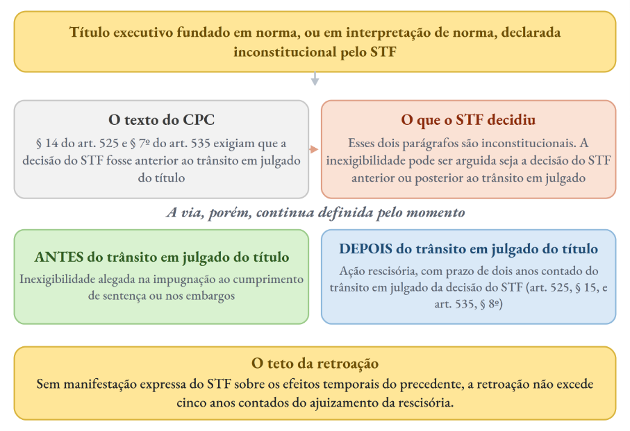

## 12.5. Querela nullitatis

Isso também já foi analisado na Semana 01. Mas falemos mais um pouco. A hipótese típica é a **ausência ou nulidade da citação** quando o processo correu **à revelia**, prevista no art. 525, § 1º, I, e no art. 535, I. Ali não há sentença rescindível, e sim decisão **inexistente** para quem não foi chamado ao processo.

A alegação não tem prazo e pode ser feita a qualquer tempo. O veículo é a ação declaratória de inexistência, ajuizada perante o juízo que proferiu a decisão, não perante o tribunal.

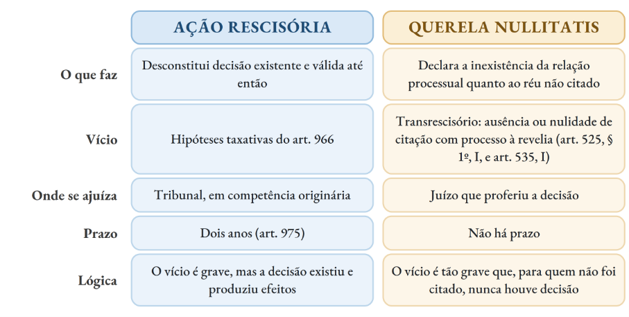

## 13. Ação rescisória

## 13.1. Cabimento

| **AÇÃO RESCISÓRIA · HIPÓTESES DO ART. 966** | > |
|---|---|
| **VÍCIO DE QUEM JULGOU** | > |
| **INCISO** | **HIPÓTESE** |
| **I** | Decisão proferida por **força de prevaricação, concussão ou corrupção** do juiz |
| **II** | Decisão proferida por juiz **impedido** ou por juízo **absolutamente incompetente** |
| **VÍCIO NA FORMAÇÃO DA DECISÃO** | > |
| **III** | Decisão que resultar de **dolo ou coação** da parte vencedora em detrimento da parte vencida, ou de **simulação ou colusão** entre as partes a fim de fraudar a lei |
| **IV** | Decisão que **ofender a coisa julgada** |
| **V** | Decisão que **violar manifestamente norma jurídica** |
| **VÍCIO NA BASE FÁTICA DO JULGAMENTO** | > |
| **VI** | Decisão fundada em **prova cuja falsidade** tenha sido apurada em processo criminal ou venha a ser demonstrada na própria rescisória |
| **VII** | Decisão em que o autor **obtiver prova nova**, cuja existência ignorava ou de que não pôde fazer uso, capaz, por si só, de lhe assegurar pronunciamento favorável |
| **VIII** | Decisão fundada em **erro de fato** verificável do exame dos autos |

O inciso II restringe a hipótese ao juiz ==**impedido**==. A ==**suspeição não autoriza a rescisória**==, e a diferença se explica pela natureza dos dois institutos. O impedimento é objetivo e insanável. A suspeição depende de arguição oportuna e se convalida com o silêncio da parte.

O **erro de fato** tem definição própria no art. 966, § 1º. Há erro quando a decisão **admite fato inexistente** ou quando **considera inexistente fato efetivamente ocorrido**, sendo indispensável que o fato ==**não represente ponto controvertido sobre o qual o juiz deveria ter se pronunciado**==.

O erro de fato só serve à rescisão se o fato ==**não tiver sido controvertido**==. Onde houve controvérsia e pronunciamento judicial, o que existe é eventual ==**erro de julgamento**==, que se corrige por recurso, não por rescisória.

Quanto ao objeto, o art. 966, § 2º, admite a rescisão de decisão que não é de mérito quando ela impedir nova propositura da demanda ou a admissibilidade do recurso correspondente. O § 4º, por sua vez, esclarece que os atos de disposição de direitos homologados pelo juiz ==**não são rescindíveis**==, e sim ==**anuláveis**==, pelas vias próprias.

## 13.2. Petição inicial, depósito e efeitos

| **A INICIAL DA RESCISÓRIA** | > |
|---|---|
| **PONTO** | **REGIME** |
| **Pedido** | Cumular o pedido de rescisão com o de novo julgamento, se for o caso. A ausência do segundo pedido, quando cabível, é **vício sanável**, e o relator concede prazo para emenda |
| **Depósito** | **Cinco por cento** do valor da causa, convertido em multa se a ação for, por unanimidade, declarada inadmissível ou improcedente. Limitado a mil salários mínimos |
| **Dispensa do depósito** | União, Estados, DF, Municípios, respectivas autarquias e fundações, **Ministério Público, Defensoria Pública** e beneficiários da **gratuidade** de justiça |
| **Efeito suspensivo** | A propositura **não impede** o cumprimento da decisão rescindenda, ressalvada a concessão de tutela provisória |
| **Instrução** | Havendo necessidade de prova, o relator pode delegar a competência ao órgão que proferiu a decisão rescindenda, com prazo de **um a três meses** para devolução dos autos |

A primazia do julgamento de mérito orienta o tratamento dos vícios da inicial, e foi isso que a FGV cobrou:

:::JC_FFE698 JÁ CAIU!
No **TJPR, em 2026**, a autora de rescisória por violação manifesta a norma jurídica formulou apenas o pedido de rescisão. O relator deve conceder prazo para emenda da inicial, e não indeferi-la de plano nem julgar liminarmente improcedente o pedido.
:::

Lembre-se, por fim, que a propositura ==**não suspende automaticamente**== o cumprimento da decisão rescindenda, mas também ==**não impede**== que o autor requeira tutela provisória com esse efeito.

## 13.3. Prazo

:::JC_FFFFFF 
O prazo é de ==**dois anos**==. O erro mais comum não está no número, e sim no marco inicial: conta-se do ==**trânsito em julgado da última decisão proferida no processo**==. ==**Não corre**== **da prolação da decisão rescindenda nem do trânsito de cada capítulo isoladamente**.

%% NÃO CONFUNDA

**Coisa julgada progressiva.** Há julgado da 1ª Turma do STF, ainda sob o CPC de 1973, afirmando que os capítulos não atacados por recurso precluem e que daí já corre o biênio da rescisória (RE 666.589, rel. Min. Marco Aurélio, j. 25/3/2014). Esse entendimento ==**não prevalece hoje**==. O art. 975, caput, encampou a Súmula 401 do STJ, de modo que “o direito à rescisão se extingue em 2 (dois) anos contados do trânsito em julgado da última decisão proferida no processo”.

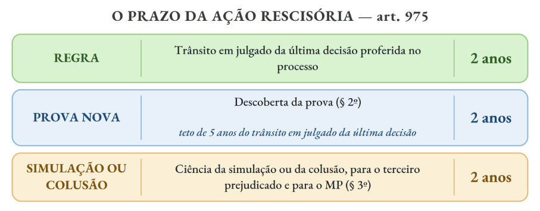

## 13.4. Competência
:::

A rescisória é de competência **originária do tribunal**, jamais do juízo de primeiro grau que proferiu a decisão. Quando a decisão rescindenda é de primeiro grau, a competência é do tribunal a que o juízo está vinculado.

%% Chance alta TRF5

:::JC_FFFFFF 
A exceção vem do ==**Tema 775 da repercussão geral**== (RE 598.650, rel. Min. Marco
:::

Aurélio, j. 2021).

Proposta pela União a rescisória para desconstituir sentença transitada em julgado de juiz estadual que afete interesse de órgão federal, a competência é do ==**Tribunal Regional Federal**==, porque a União não se submete à Justiça Estadual (arts. 108, I, b, e II, e 109, I, da Constituição). Não importa que a União não tenha figurado no processo originário, bastando que seja autora da rescisória e titular do interesse federal.

:::JC_D9F2D0 De olho na RG
**Tema 775, STF:** Compete ao Tribunal Regional Federal processar ação rescisória proposta pela União com o objetivo de desconstituir sentença transitada em julgado proferida por juiz estadual, quando afeta interesses de órgão federal.
:::

## Notas de rodapé

⁷ ⁷ Lembrem-se: fizemos os comentários completos da prova!

⁷ ⁸ Leiam. São as hipóteses em que a parte não está obrigada a depor.

⁷ ⁹ A **nulidade de algibeira** ocorre quando a parte identifica um vício no processo, mas **deixa de alegá-lo no momento oportuno**, preferindo guardá-lo para invocação posterior, normalmente após uma decisão desfavorável. A expressão “algibeira” significa **bolso** e traduz justamente essa ideia: a parte mantém a nulidade “guardada”, para utilizá- la apenas quando lhe for conveniente. O STJ tem alguns julgados sobre isso!

⁸ ⁰ 1. A técnica da fundamentação por referência (*per relationem*) é permitida desde que o julgador, ao reproduzir trechos de decisão anterior (documentos e/ou pareceres) como razões de decidir, enfrente, ainda que de forma sucinta, as novas questões relevantes para o julgamento do processo, dispensada a análise pormenorizada de cada uma das alegações ou provas.
