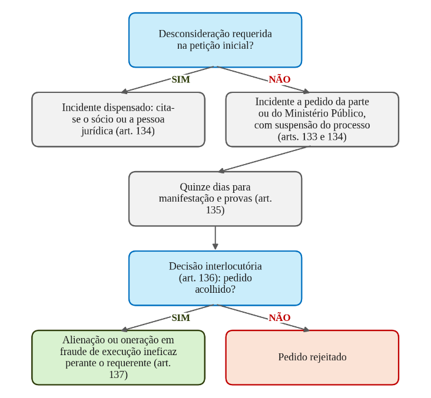

# Direito Empresarial

*Ponto 3 do edital: Teoria geral do Direito Societário*

:::JC_F2F2F2 
**3. Teoria geral do Direito Societário. Sociedades personificadas e não personificadas. Personalidade jurídica e autonomia patrimonial. Desconsideração. Sócios e administradores. Capital social. Responsabilidade. Deliberações. Reorganizações societárias. Dissolução, liquidação e extinção. Grupos societários. Sociedades dependentes de autorização.**
:::

| [JusLEGIS] | > |
|---|---|
| **Código Civil** | arts. 44 a 46, 49-A e 50; arts. 981 a 985; arts. 986 a 996 (sociedades não personificadas); arts. 997 a 1.038 (sociedade simples, sócios, administradores, deliberações, resolução e dissolução); arts. 1.097 a 1.101 (coligadas); arts. 1.102 a 1.112 (liquidação); arts. 1.113 a 1.122 (reorganizações); arts. 1.123 a 1.141 (sociedade dependente de autorização) |

O regime geral do direito das sociedades está nos arts. 997 a 1.038 do Código Civil, escritos para a **sociedade simples** e estendidos por remissão aos demais tipos. O tema aparece com frequência nas provas de magistratura federal da FGV, ora direto, ora dentro de questão de Civil ou de Processo Civil.

Quase tudo se resolve pela **literalidade do Código Civil**, e a jurisprudência pesa em três assuntos: desconsideração, dissolução parcial e apuração de haveres. Já tivemos questões recentres que versaram sobre:

→ **Sociedade em comum** (arts. 986 a 990). Caso concreto de sócios que não registraram o ato constitutivo (ENAM 2024).

→ **Sociedade simples como regime geral** (arts. 997 a 1.038). Administração, alteração do contrato e cessão de quotas na mesma questão (TRF3 2025).

→ **Desconsideração da personalidade jurídica** (art. 50). Caso concreto de esvaziamento patrimonial (ENAM 2026).

→ **Distribuição de lucros entre os sócios** (arts. 1.007 e 1.008), no ENAM 2025.

→ **Sociedades dependentes de autorização** (art. 1.126). A nacionalidade da sociedade, no TRF5 de 2015, quando outra banca aplicava a prova.

## 1. Teoria geral do Direito Societário

## 1.1 O contrato de sociedade e o contrato plurilateral

:::JC_FFFFFF 
O contrato de sociedade é celebrado pelas pessoas que reciprocamente se obrigam a contribuir, com bens ou serviços, para o exercício de atividade econômica e a partilha, entre si, dos resultados ==**(art. 981 do Código Civil)**==. Do conceito legal se extraem três elementos: **contribuição**, **atividade econômica** e **partilha dos resultados**.

O parágrafo único admite que a atividade se restrinja a um ou mais negócios determinados, e esse é o fundamento da **sociedade de propósito específico (SPE)**, sociedade de objeto único constituída para um projeto determinado.

O contrato social não é bilateral como a compra e venda. Ele é **plurilateral**: várias pessoas dele participam e todas assumem obrigações umas perante as outras e perante a sociedade, convergindo para um fim comum.

Dessa convergência decorre a ==**affectio societatis**==, a disposição permanente dos sócios de colaborar para o objetivo comum. Não é simpatia, é intenção duradoura de somar esforços, e a expressão reaparece na dissolução parcial e na exclusão de sócio.

Embora o art. 981 fale em contribuir "com bens ou serviços", há tipos que ==**não admitem contribuição em serviços**==, por exemplo a limitada (art. 1.055, § 2º) e a anônima (art. 7º da Lei nº 6.404/1976). Na sociedade simples pura, admitem (art. 997, V).

O plural "as pessoas" indica pluralidade de sócios como regra, com exceções legais de unipessoalidade, entre elas a **subsidiária integral**, companhia constituída por escritura pública tendo como único acionista sociedade brasileira (art. 251, *caput*, da Lei das S.A.) e a **sociedade limitada unipessoal** (art. 1.052, §§ 1º e 2º). E "pessoas" abrange pessoas jurídicas: a sociedade cujo objeto é participar de outras é uma **holding**.

## 1.2 Sociedade simples e sociedade empresária, e os tipos societários
:::

O critério está no art. 982: salvo as exceções expressas, considera-se **empresária** a sociedade que tem por objeto o exercício de atividade própria de empresário sujeito a registro, e **simples** as demais. O que separa as duas é o objeto explorado com empresarialidade, isto é, com profissionalismo e organização dos fatores de produção.

As exceções do parágrafo único são de literalidade: independentemente do objeto, **a sociedade por ações é sempre empresária e a cooperativa é sempre simples**.

A distinção repercute no registro. A empresária vincula-se ao Registro Público de Empresas Mercantis, a cargo das Juntas Comerciais, e a simples ao Registro Civil das Pessoas Jurídicas, que, **se a sociedade simples adotar um dos tipos de sociedade empresária, obedece às normas fixadas para o registro mercantil** (art. 1.150). A cooperativa, embora simples, arquiva seus atos na Junta Comercial (art. 18, § 6º, da Lei nº 5.764/1971).

Não confunda **natureza** com **tipo**. "Simples" e "empresária" são naturezas; os tipos são as formas dos arts. 1.039 a 1.092: sociedade em nome coletivo, em comandita simples, limitada, anônima e em comandita por ações.

Pelo art. 983, a empresária **deve** constituir-se segundo um desses tipos, e a simples **pode** adotar um deles e, não o fazendo, subordina-se às normas que lhe são próprias (arts. 997 a 1.038), no modelo que a praxe chama de sociedade simples pura. Por isso, ==**está errada a**==

:::JC_FBE3D6 
**alternativa que troca o dever pela faculdade ou que obriga a simples a adotar um tipo**.
:::

O parágrafo único do art. 983 ressalva as disposições próprias da sociedade em conta de participação e da cooperativa, e também as leis especiais que, para o exercício de certas atividades, **impõem** a constituição segundo determinado tipo. Onde a lei especial impõe o tipo, desaparece a liberdade de escolha.

Como as sociedades por ações são sempre empresárias, a simples só pode usar as formas de limitada, em nome coletivo e em comandita simples.

As normas dos arts. 997 a 1.038, escritas para a sociedade simples, funcionam como **regime geral** por força de cinco remissões⁸¹:

→ **Limitada** (art. 1.053). Rege-se, nas omissões do seu capítulo, pelas normas da sociedade simples, e o parágrafo único faculta ao contrato prever a regência supletiva pelas normas da sociedade anônima.

→ **Em nome coletivo** (art. 1.040). Remete à sociedade simples.

→ **Comandita simples** (art. 1.046). Remete à sociedade em nome coletivo.

→ **Cooperativa** (art. 1.096). Aplicam-se as disposições da sociedade simples, resguardadas as características do art. 1.094.

→ **Anônima** (art. 1.089). Rege-se por lei especial, com o Código Civil apenas nos casos omissos.

%% Esquematizando

Os tipos societários e a responsabilidade dos sócios

| **TIPO** | **QUEM PODE SER SÓCIO E COMO RESPONDE** |
|---|---|
| **Sociedade em nome coletivo** | **Somente pessoas físicas**, e todos respondem solidária e ilimitadamente, podendo limitar a responsabilidade entre si no ato constitutivo ou por unânime convenção posterior (art. 1.039) |
| **Sociedade em comandita simples** | **Comanditados**, pessoas físicas, responsáveis solidária e ilimitadamente; **comanditários**, obrigados somente pelo valor de sua quota (art. 1.045) |
| **Sociedade limitada** | Responsabilidade restrita ao valor das quotas, respondendo todos solidariamente pela integralização do capital (art. 1.052). Desenvolvida no ponto 4 |
| **Sociedade anônima** | Responsabilidade do acionista limitada ao preço de emissão das ações subscritas ou adquiridas (art. 1º da Lei das S.A.). Desenvolvida no ponto 5 |
| **Sociedade em comandita por ações** | Só o acionista administra e, como diretor, responde subsidiária e ilimitadamente; havendo mais de um diretor, são solidários depois de esgotados os bens sociais (art. 1.091) |
| **Sociedade cooperativa** | Sempre simples, com **variabilidade, ou dispensa, do capital social**, intransferibilidade das quotas a estranhos, ainda que por herança, e voto por cabeça (art. 1.094) |

:::JC_FBEFD6 EXCEÇÃO
**Sociedade entre cônjuges.** O art. 977 faculta aos cônjuges contratar sociedade, entre si ou com terceiros, **desde que não tenham casado no regime da comunhão universal de bens, ou no da separação obrigatória**. A vedação atinge apenas a participação dos dois numa mesma sociedade, e não impede que um deles contrate sociedade com terceiro.
:::

:::JC_D9F2D0 JURISPRUDÊNCIA
**Enunciado 94 da III Jornada de Direito Comercial (CJF)**: "A vedação da sociedade entre cônjuges contida no art. 977 do Código Civil não se aplica às sociedades anônimas, em comandita por ações e cooperativa."
:::

:::JC_DAE9F7 Atualização legislativa
A Lei nº 14.195/2021 **não** extinguiu a sociedade simples. Desapareceu a **empresa individual de responsabilidade limitada (EIRELI)**: o art. 41 daquela lei transformou as EIRELIs existentes em sociedades limitadas unipessoais, e a Lei nº 14.382/2022, no art. 20, VI, revogou o inciso VI do art. 44 e o Título I-A do Livro II da Parte Especial, onde estava o art. 980-A. No mesmo art. 44 entrou o **inciso VII, os empreendimentos de economia solidária**, pela Lei nº 15.068/2024, que também reescreveu o § 2º para mandar aplicar-lhes subsidiariamente as disposições das associações. A Lei nº 14.195/2021 revogou ainda o parágrafo único do art. 1.015 e o inciso IV e o parágrafo único do art. 1.033.
:::

## 2. Personalidade jurídica e autonomia patrimonial

A sociedade adquire personalidade jurídica **com a inscrição**, no registro próprio e na forma da lei, dos seus atos constitutivos ==**(art. 985 do Código Civil)**==. O art. 45 diz o mesmo para todas as pessoas jurídicas de direito privado: começa a existência legal com a inscrição do ato constitutivo no respectivo registro, precedida, quando necessário, de autorização ou aprovação do Poder Executivo.

O contrato de sociedade, portanto, só se converte em pessoa com o registro. Sem ele, há contrato, mas não há pessoa jurídica, e a sociedade é **não personificada**.

Personificada, a sociedade torna-se sujeito de direitos, com patrimônio distinto do dos sócios, e disso decorre a ==**autonomia patrimonial**==, que opera em dois planos:

→ **Plano material** (art. 1.024). Os bens particulares dos sócios não podem ser executados por dívidas da sociedade senão depois de executados os bens sociais.

→ **Plano processual** (art. 795 do CPC). Os bens particulares dos sócios não respondem pelas dívidas da sociedade, senão nos casos previstos em lei.

A Lei nº 13.874/2019 elevou a ideia a princípio expresso, no art. 49-A:

:::JC_D9F2D0 JURISPRUDÊNCIA
**Código Civil, art. 49-A** (incluído pela Lei nº 13.874/2019): "A pessoa jurídica não se confunde com os seus sócios, associados, instituidores ou administradores. Parágrafo único. A autonomia patrimonial das pessoas jurídicas é um instrumento lícito de alocação e segregação de riscos, estabelecido pela lei com a finalidade de estimular empreendimentos, para a geração de empregos, tributo, renda e inovação em benefício de todos."
:::

## 3. Sociedades não personificadas

O Código Civil separa as sociedades em **personificadas** (arts. 997 a 1.141) e **não personificadas** (arts. 986 a 996). Estas são duas: a sociedade em comum e a sociedade em conta de participação.

## 3.1 Sociedade em comum

==**Sociedade em comum**== é aquela cujos atos constitutivos ainda não foram inscritos no registro competente. Enquanto não inscritos, ela se rege pelo capítulo próprio, observadas, subsidiariamente e no que com ele forem compatíveis, as normas da sociedade simples ==**(art. 986 do Código Civil)**==, ==**exceto por ações em organização**==, que segue as regras da Lei das S.A.

A doutrina distingue a **sociedade de fato**, sem contrato escrito, da **sociedade irregular**, com contrato não registrado ou com vício posterior ao registro, mas o regime é o mesmo.

→ **Prova da existência** (art. 987). Os sócios, nas relações entre si ou com terceiros, **somente por escrito** podem provar a existência da sociedade, mas os terceiros podem prová-la de qualquer modo. Se você vir os sócios provando a existência da sociedade por qualquer meio, a alternativa inverteu essa assimetria.

→ **Patrimônio especial** (art. 988). Os bens e dívidas sociais constituem patrimônio especial, do qual **os sócios** são titulares em comum, e não a sociedade.

→ **Gestão** (art. 989). Os bens sociais respondem pelos atos de gestão de qualquer dos sócios, salvo pacto expresso limitativo de poderes, que somente terá eficácia contra o terceiro que o conheça ou deva conhecer.

A **responsabilidade** está no art. 990: todos os sócios respondem solidária e ilimitadamente pelas obrigações sociais, **excluído do benefício de ordem, previsto no art. 1.024, aquele que contratou pela sociedade**.

Imagine que João e Pedro exploram uma lanchonete sem registro e que João compra mercadorias a prazo, que a lanchonete não paga. O credor ataca primeiro o patrimônio especial; se não bastar, alcança o patrimônio pessoal dos sócios, solidários entre si, mas **João, que contratou, não tem benefício de ordem**, e Pedro mantém a subsidiariedade.

No art. 990, a pegadinha está em duas palavras. A primeira é **"solidária"**: a solidariedade é entre os sócios, e não entre os sócios e a sociedade, pois em face do patrimônio especial a relação é subsidiária. A segunda é **"excluído"**: ==**o benefício de ordem cai apenas para quem contratou pela sociedade**==, e não para todos.

No processo, a sociedade e a associação irregulares e outros entes sem personalidade jurídica são representados em juízo **pela pessoa a quem couber a administração de seus bens** (art. 75, IX, do CPC).

## 3.2 Sociedade em conta de participação

A sociedade em conta de participação (SCP) é, na essência, um contrato de investimento com aparência de sociedade. Não tem personalidade jurídica, nome empresarial nem patrimônio autônomo oponível a terceiros, e sua constituição independe de qualquer formalidade, podendo provar-se por todos os meios de direito (art. 992).

E se o contrato for registrado? Nada muda. O contrato social produz efeito somente entre os sócios, e a eventual inscrição de seu instrumento em qualquer registro ==**não confere personalidade jurídica à sociedade**== (art. 993).

São duas as categorias de sócios. O **sócio ostensivo** exerce a atividade constitutiva do objeto social em seu nome individual e sob sua própria e exclusiva responsabilidade; o **sócio participante**, também chamado de oculto, apenas participa dos resultados.

Por isso, obriga-se perante terceiro tão somente o sócio ostensivo; e, exclusivamente perante este, o sócio participante, **nos termos do contrato social** (art. 991, parágrafo único).

:::JC_F2F2F2 Exemplo
Carlos, construtor, precisa de capital, e Mariana o aporta sem querer aparecer. Para os fornecedores só existe Carlos, e **só Carlos se obriga perante eles**. Por outro lado, se Mariana passar a negociar com os fornecedores, responde solidariamente pelas obrigações **em que intervier** (art. 993, parágrafo único).
:::

O art. 994 cria um **patrimônio especial** formado pelas contribuições dos dois sócios, mas ==**a especialização patrimonial somente produz efeitos em relação aos sócios**== (§ 1º).

Na falência, a do **ostensivo** dissolve a sociedade e liquida a conta, cujo saldo constituirá crédito **quirografário**, isto é, sem garantia real e sem preferência legal; falindo o **participante**, o contrato fica sujeito às normas dos efeitos da falência nos contratos bilaterais do falido (§§ 2º e 3º).

O art. 996 manda aplicar subsidiariamente o disposto para a sociedade simples, regendo-se a **liquidação pelas normas da prestação de contas**. E, **salvo estipulação em contrário**, o sócio ostensivo ==**não pode admitir novo sócio sem o consentimento expresso dos demais**== (art. 995).

Não diga que o registro confere personalidade à conta de participação, que a atividade é exercida em conjunto, quando o art. 991 diz "unicamente pelo sócio ostensivo", nem que o saldo do participante, na falência do ostensivo, tem classificação diversa de crédito quirografário.

%% Esquematizando

Sociedades não personificadas lado a lado

| **CRITÉRIO** | **SOCIEDADE EM COMUM** | **SOCIEDADE EM CONTA DE PARTICIPAÇÃO** |
|---|---|---|
| **Prova da existência** | Sócios só por escrito; terceiros por qualquer meio (art. 987) | Independe de formalidade e prova-se por todos os meios (art. 992) |
| **Quem aparece perante terceiros** | Todos os sócios | Apenas o sócio ostensivo (art. 991) |
| **Responsabilidade perante terceiros** | Solidária e ilimitada de todos, sem benefício de ordem para quem contratou (art. 990) | Só do ostensivo; o participante responde solidariamente se intervier (art. 993, parágrafo único) |
| **Patrimônio especial** | Dos sócios em comum, garante os credores sociais (art. 988) | Das contribuições dos dois, com efeitos apenas entre eles (art. 994, § 1º) |

:::JC_FBEFD6 Chance alta TRF5
**A mera inexistência de bens penhoráveis e o encerramento irregular das atividades não bastam para a desconsideração** nas relações de direito civil e empresarial: **exige-se a efetiva comprovação do abuso da personalidade jurídica**, por desvio de finalidade **ou** por confusão patrimonial (art. 50 do Código Civil; STJ, Tema 1210). A tese foi fixada pela Segunda Seção em 7/5/2026, e a desconsideração foi cobrada no TRF1 de 2023, no ENAM de 2024, no TRF3 de 2025 e no ENAM de 2026.
:::

## 4. Desconsideração da personalidade jurídica

A ==**desconsideração da personalidade jurídica**== (em inglês, *disregard doctrine*) consiste em afastar episodicamente a separação entre a sociedade e as pessoas que estão por trás dela, para que os efeitos de determinadas obrigações alcancem o patrimônio de sócios ou administradores⁸².

A pessoa jurídica ==**não se anula nem se extingue**==: a separação é afastada **episodicamente**, e só para **determinadas** obrigações.

## 4.1 O art. 50 do Código Civil na redação da Lei nº 13.874/2019

A desconsideração exige **abuso da personalidade jurídica**, caracterizado por desvio de finalidade ou por confusão patrimonial ==**(art. 50 do Código Civil)**==. Depende de requerimento da parte ou do Ministério Público, quando lhe couber intervir no processo, e estende os efeitos de certas e determinadas relações de obrigações aos bens particulares de administradores ou de sócios **beneficiados direta ou indiretamente pelo abuso**.

A Lei nº 13.874/2019, a Lei da Liberdade Econômica⁸³, acrescentou cinco parágrafos ao artigo:

→ **Desvio de finalidade** (§ 1º). Utilização da pessoa jurídica com o propósito de lesar credores e para a prática de atos ilícitos de qualquer natureza.

→ **Confusão patrimonial** (§ 2º). Ausência de separação de fato entre os patrimônios, caracterizada pelo cumprimento repetitivo pela sociedade de obrigações do sócio ou do administrador ou vice-versa (I), pela transferência de ativos ou de passivos sem efetivas contraprestações, **exceto os de valor proporcionalmente insignificante** (II), e por outros atos de descumprimento da autonomia patrimonial (III).

→ **Desconsideração inversa** (§ 3º). O caput e os §§ 1º e 2º aplicam-se também à extensão das obrigações de sócios ou administradores à pessoa jurídica.

→ **Grupo econômico** (§ 4º). ==**A mera existência de grupo econômico, sem os requisitos do caput, não autoriza a desconsideração**==.

→ **Expansão da atividade** (§ 5º). Não constitui desvio de finalidade a **mera expansão ou a alteração da finalidade original** da atividade econômica específica da pessoa jurídica.

:::JC_DAE9F7 PEGADINHA
No art. 50, a pegadinha está em três palavras. Primeira, **"ou"**: desvio de finalidade ou confusão patrimonial, em alternativa, **e não em cumulação**. Segunda, **"insignificante"**: a transferência sem contraprestação só configura confusão patrimonial se não for de valor proporcionalmente insignificante (§ 2º, II). Terceira, **"mera"**: nem a mera existência de grupo econômico (§ 4º) nem a mera expansão da finalidade original (§ 5º) autorizam a desconsideração.
:::

## 4.2 Teoria maior e teoria menor

A **teoria maior** é a regra geral: só há desconsideração quando existe abuso da personalidade jurídica, caracterizado pelo desvio de finalidade ou pela confusão patrimonial (art. 50). ==**Não bastam a insolvência nem o encerramento irregular**==, ou seja, a falta de bens e o fechamento sem baixa não autorizam, por si sós, alcançar o sócio.

O STJ fixou a teoria maior no Tema 1210:

:::JC_B3E5A1 SÚMULA
**STJ, Tema 1210**: "Nas relações jurídicas de direito civil e empresarial, a desconsideração da personalidade jurídica requer a efetiva comprovação de abuso da personalidade jurídica, caracterizado por desvio de finalidade ou por confusão patrimonial, nos termos exigidos pelo art. 50 do Código Civil (Teoria Maior), sendo insuficiente a mera inexistência de bens penhoráveis e/ou de encerramento irregular das atividades da sociedade empresária." (Segunda Seção, REsp 1.873.187- SP e REsp 1.873.811-SP, Rel. Ministro Raul Araújo, julgado em 7/5/2026, acórdão publicado em 1º/6/2026).

**Em uma frase**: nas relações de direito civil e empresarial, desconsiderar a personalidade jurídica exige a prova do abuso, por desvio de finalidade ou por confusão patrimonial, e não bastam, por si sós, a falta de bens penhoráveis ou o encerramento irregular das atividades.
:::

Cuidado com o alcance da tese, porque ela tem sujeito declarado: vale para as relações de **direito civil e empresarial**. Em matéria tributária, no entanto, o encerramento irregular produz efeito oposto, e não por desconsideração, mas por responsabilidade própria do art. 135, III, do Código Tributário Nacional.

A **Súmula 435 do STJ** presume dissolvida irregularmente a empresa que deixa de funcionar no domicílio fiscal sem comunicar os órgãos competentes, e legitima o redirecionamento da execução fiscal para o sócio-gerente, na forma do Tema 981. **Redirecionamento de execução fiscal e desconsideração são institutos distintos**.

A **teoria menor** é excepcional e vale onde a lei especial a prevê, como ocorre com o Código de Defesa do Consumidor e com a Lei nº 9.605/1998: basta o prejuízo ao credor, isto é, ser a personalidade jurídica obstáculo ao ressarcimento.

No Código de Defesa do Consumidor, o art. 28 permite desconsiderar quando, em detrimento do consumidor, houver abuso de direito, excesso de poder, infração da lei, fato ou ato ilícito ou violação dos estatutos ou contrato social, e ainda quando houver falência, insolvência, encerramento ou inatividade provocados por má administração.

O § 5º consagra a teoria menor: "Também poderá ser desconsiderada a pessoa jurídica sempre que sua personalidade for, de alguma forma, obstáculo ao ressarcimento de prejuízos causados aos consumidores".

No mesmo sentido, o art. 4º da Lei nº 9.605/1998: "Poderá ser desconsiderada a pessoa jurídica sempre que sua personalidade for obstáculo ao ressarcimento de prejuízos causados à qualidade do meio ambiente".

A teoria menor tem, porém, limite subjetivo. O § 5º do art. 28 do Código de Defesa do Consumidor ==**não alcança o administrador não sócio**== (STJ, REsp 1.860.333-DF, Quarta Turma, Rel. Min. Marco Buzzi, julgado em 11/10/2022, Info 754).

O dispositivo ==**também não alcança o sócio que não pratica atos de gestão**==, salvo prova de que contribuiu, ao menos culposamente, para a prática de atos de administração (STJ, REsp 1.900.843-DF, Terceira Turma, Rel. p/ acórdão Min. Ricardo Villas Bôas Cueva, julgado em 23/5/2023, Info 777).

Os §§ 2º a 4º do art. 28 tratam das sociedades ligadas, e cada categoria responde de um jeito: as integrantes de grupos societários e as controladas respondem **subsidiariamente** (§ 2º); as consorciadas, **solidariamente** (§ 3º); e as coligadas **só respondem por culpa** (§ 4º).

A Lei nº 12.529/2011 repete no art. 34 a fórmula do caput do art. 28 e, no art. 33, impõe responsabilidade solidária às integrantes de grupo econômico, de fato ou de direito, quando ao menos uma delas praticar infração à ordem econômica.

A pegadinha do art. 28 é trocar o rol dele pelo do art. 50: insolvência e encerramento por má administração ==**bastam no Código de Defesa do Consumidor**== e ==**não bastam no Código Civil**==.

%% Esquematizando

Teorias da desconsideração

| **TEORIA** | **ONDE ESTÁ** | **O QUE BASTA** |
|---|---|---|
| **Teoria maior** | Art. 50 do Código Civil | **Abuso da personalidade jurídica**, isto é, desvio de finalidade ou confusão patrimonial |
| **Teoria maior de lei especial** | Caput do art. 28 do Código de Defesa do Consumidor e art. 34 da Lei nº 12.529/2011 | Outro rol: abuso de direito, excesso de poder, infração da lei, fato ou ato ilícito, violação dos estatutos ou contrato social, e ainda **falência, insolvência, encerramento ou inatividade provocados por má administração** |
| **Teoria menor** | Art. 28, § 5º, do Código de Defesa do Consumidor e art. 4º da Lei nº 9.605/1998 | Basta que a personalidade jurídica seja **obstáculo ao ressarcimento** |

## 4.3 Desconsideração inversa e outras designações

:::JC_FFFFFF 
A **desconsideração inversa** alcança o patrimônio da sociedade por dívida do sócio, e não o contrário. Basta pensar no sócio que esvazia o próprio patrimônio transferindo bens para a pessoa jurídica que controla. Além do art. 50, § 3º, do Código Civil, o art. 133, § 2º, do CPC lhe estende o incidente.

A doutrina usa ainda outras designações, todas de construção doutrinária:

→ **Desconsideração expansiva**. Alcança o sócio oculto atrás de interposta pessoa.

→ **Desconsideração indireta**. Alcança a controladora por meio da controlada.

→ **Desconsideração positiva**. É invocada pelo próprio devedor para preservar direito seu, como no reconhecimento da impenhorabilidade do bem de família registrado em nome da pessoa jurídica.

Você precisa conhecê-las pelo nome, porque a FGV cobrou a **positiva** e a **expansiva** na prova do TRF1 em 2023, em questão que pedia o conceito da primeira e trazia a segunda como alternativa errada.

## 4.4 O incidente do art. 133 do CPC e a desconsideração na falência
:::

==**A desconsideração não se decreta de ofício**==. O incidente será instaurado **a pedido da parte ou do Ministério Público, quando lhe couber intervir no processo**, observados os pressupostos previstos em lei (art. 133).

O incidente é admitido em todas as fases do processo de conhecimento, no cumprimento de sentença e na execução fundada em título extrajudicial, e a instauração **suspende o processo**, salvo se a desconsideração for requerida na própria inicial, quando o incidente é dispensado e o sócio ou a pessoa jurídica é citado (art. 134).

Seguem-se quinze dias para manifestação e provas (art. 135) e decisão interlocutória, com agravo interno se proferida pelo relator (art. 136). Acolhido o pedido, a alienação ou oneração havida em fraude de execução é ineficaz perante o requerente (art. 137).

O art. 795, § 4º, torna **obrigatória** a observância do incidente, e o art. 1.062 o estende aos juizados especiais.

**Incidente de desconsideração da personalidade jurídica**

Na falência, o art. 82-A da Lei nº 11.101/2005⁸⁴**veda a extensão da falência** ou de seus efeitos aos sócios de responsabilidade limitada, aos controladores e aos administradores da sociedade falida, admitida, contudo, a desconsideração, observados o art. 50 do Código Civil e os arts. 133 a 137 do CPC, sem a suspensão do art. 134, § 3º.

Extensão de falência e desconsideração são coisas diferentes: ==**a extensão é vedada**==, e ==**a desconsideração é admitida**==.

:::JC_FFE698 JÁ CAIU!
**(ENAM - FGV - 2026)** A sociedade empresária Orion Tecnologia Ambiental Ltda., regularmente constituída, celebrou contrato de fornecimento com a Delta Bioenergia S.A., no valor de R$ 4.000.000,00. Após inadimplemento contratual e execução frustrada, verificou-se que a Orion possuía patrimônio social ínfimo, incompatível com o vulto de suas operações. No curso do processo, apurou-se que: I. os sócios retiravam mensalmente valores elevados a título de “antecipação de lucros”, embora a sociedade operasse com prejuízo contábil; II. parte significativa do faturamento era direcionada, sem contraprestação identificável, a outra sociedade empresária do mesmo grupo econômico, pertencente aos mesmos sócios; III. não houve confusão formal de contas bancárias entre sócios e sociedade;
:::

:::JC_FFE698 
e IV. a escrituração contábil era formalmente regular. O credor sustenta que houve esvaziamento patrimonial deliberado para frustrar o adimplemento, requerendo a instauração do incidente de desconsideração da personalidade jurídica. Diante da situação hipotética e à luz da legislação civil aplicável, assinale a afirmativa correta.

a) A desconsideração é possível, caso se demonstre que as retiradas de valores e o redirecionamento de receitas tiveram a finalidade de lesar credores, ainda que a escrituração fosse formalmente regular e inexistisse confusão contábil direta.

b) A desconsideração é incabível, pois a transferência de faturamento para a sociedade empresária do mesmo grupo econômico não caracteriza abuso da personalidade jurídica, sendo lícita a atuação empresarial integrada.

c) A desconsideração deve ser indeferida, pois a ausência de mistura formal de contas bancárias e a regularidade da escrituração afastam a configuração de confusão patrimonial.

d) A desconsideração somente seria cabível se houvesse prova cumulativa de desvio de finalidade e confusão patrimonial, não bastando indícios de esvaziamento patrimonial.

e) A mera subcapitalização da sociedade, evidenciada pelo patrimônio ínfimo diante do contrato celebrado, autoriza automaticamente a responsabilização dos sócios.⁸⁵
:::

## 5. Sócios, capital social e responsabilidade

O contrato social da sociedade simples é escrito, particular ou público, e o art. 997 lista o **conteúdo obrigatório**, com destaque para o capital (III), a quota de cada sócio e o modo de realizá-la (IV), os administradores e seus poderes (VI), a participação nos lucros e nas perdas (VII) e a cláusula sobre responsabilidade subsidiária (VIII).

O art. 998 impõe a inscrição no Registro Civil das Pessoas Jurídicas em **trinta dias**.

==**Capital social**== é o montante das contribuições que os sócios se comprometem a fazer à sociedade para que ela realize o objeto social. Ele mede a participação de cada sócio, forma o fundo inicial da atividade e serve de garantia mínima aos credores.

Por isso, dois princípios o regem: o da **realidade**, pelo qual o capital deve corresponder a contribuições efetivas e corretamente avaliadas, e o da **intangibilidade**, pelo qual ==**os sócios não podem reaver o que aportaram em prejuízo dos credores**==.

Distinga o **capital subscrito**, que é o prometido, do **capital integralizado**, que é o entregue. Quem integraliza transmitindo domínio, posse ou uso responde pela evicção⁸⁶; quem transfere crédito responde pela solvência do devedor ==**(art. 1.005 do Código Civil)**==.

Quem não integraliza na forma e no prazo do contrato é o **sócio remisso**: notificado, tem **trinta dias** para pagar, sob pena de responder pelo dano emergente da mora (art. 1.004), podendo a maioria dos demais sócios preferir, à indenização, a **exclusão** do remisso ou a **redução** de sua quota ao montante já realizado.

O art. 1.008 fulmina de nulidade a estipulação contratual que exclua qualquer sócio de participar dos lucros e das perdas, a **cláusula leonina**. Se você encontrar alternativa dizendo que o contrato é nulo, ela está errada: nula é só a estipulação.

No silêncio, aplica-se o art. 1.007: o sócio participa dos lucros e das perdas na proporção das quotas, mas aquele cuja contribuição consiste em serviços somente participa dos lucros **na proporção da média do valor das quotas**.

A responsabilidade dos sócios na sociedade simples pura é **subsidiária** em relação à sociedade (art. 1.024) e, entre eles, **ilimitada e proporcional** à participação nas perdas, salvo cláusula de solidariedade (art. 1.023). O sócio admitido em sociedade já constituída não se exime das dívidas sociais anteriores à admissão (art. 1.025).

Quanto à saída, a sociedade simples é sociedade de pessoas: o sócio ==**não pode ser substituído sem o consentimento dos demais**== (art. 1.002), e a cessão total ou parcial de quota, sem a correspondente modificação do contrato social com o consentimento dos demais sócios, **não terá eficácia** quanto a estes e à sociedade (art. 1.003).

A lei não cria direito de preferência: exige consentimento, exigência mais severa.

A saída, contudo, não exonera de imediato. Até **dois anos** depois de averbada a modificação, o cedente responde solidariamente com o cessionário pelas obrigações que tinha como sócio (art. 1.003, parágrafo único).

O mesmo prazo está no art. 1.032: a retirada, a exclusão ou a morte do sócio não o eximem, nem a seus herdeiros, da responsabilidade pelas obrigações sociais **anteriores**, até dois anos após averbada a resolução; e, nos casos de retirada e de exclusão, também pelas obrigações **posteriores**, em igual prazo, **enquanto não se requerer a averbação**.

A quota também pode ser liquidada por credor particular do sócio (art. 1.026), observado o art. 861 do CPC.

:::JC_F2F2F2 Exemplo
Fábio cede suas quotas a Gustavo, com o consentimento dos demais sócios, e a modificação do contrato é averbada. Pelas obrigações que tinha como sócio, **Fábio responde solidariamente com Gustavo por dois anos** contados da averbação. Por outro lado, se Fábio se retira e ninguém requer a averbação da resolução, ele responde **também pelas obrigações posteriores** à saída, enquanto não se requerer a averbação (art. 1.032).
:::

O sócio cuja contribuição consiste em serviços ==**não pode, salvo convenção em contrário, empregar-se em atividade estranha à sociedade**==, sob pena de ser privado dos lucros e excluído (art. 1.006).

A distribuição de lucros ilícitos ou fictícios acarreta responsabilidade solidária dos administradores que a realizarem e dos sócios que os receberem, **conhecendo ou devendo conhecer-lhes a ilegitimidade** (art. 1.009). A responsabilidade do administrador independe desse elemento subjetivo, ao passo que a do sócio depende.

## 6. Administradores

A sociedade é sujeito de direito, mas não tem vontade própria: quem a manifesta é o administrador. Pela ==**teoria orgânica**==, ele não representa a sociedade, ele a **presenta**, porque é órgão da própria pessoa jurídica.

Na sociedade simples, a administração é restrita a pessoas naturais (art. 997, VI), e o administrador deve ter **o cuidado e a diligência que todo homem ativo e probo costuma empregar na administração de seus próprios negócios** ==**(art. 1.011 do Código Civil)**==.

O § 1º acrescenta os impedimentos: além das pessoas impedidas por lei especial, **não podem** administrar os condenados a pena que vede, ainda que temporariamente, o acesso a cargos públicos, e os condenados por crime falimentar, de prevaricação, peita ou suborno, concussão, peculato, ou contra a economia popular, o sistema financeiro nacional, as normas de defesa da concorrência, as relações de consumo, a fé pública ou a propriedade, **enquanto perdurarem os efeitos da condenação**.

O impedimento é temporário e acompanha os efeitos da condenação.

O § 2º manda aplicar à atividade do administrador, no que couber, as disposições do mandato, e o art. 1.018 lhe veda fazer-se substituir, facultando-lhe constituir mandatários com poderes especificados no instrumento.

No silêncio do contrato quanto a quem administra, ==**a administração compete separadamente a cada um dos sócios**== (art. 1.013), ==**e não aos sócios em conjunto**==. Cada um pode impugnar operação pretendida por outro, cabendo a decisão aos sócios por maioria de votos.

Nos atos de **competência conjunta** exige-se o concurso de todos, salvo urgência com risco de dano irreparável ou grave (art. 1.014). No silêncio quanto aos poderes, o art. 1.015 autoriza todos os atos pertinentes à gestão, mas a oneração ou a venda de bens imóveis, quando não constituírem objeto social, dependem do que a maioria dos sócios decidir.

São **irrevogáveis** os poderes do sócio investido na administração por cláusula expressa do contrato social, salvo justa causa, reconhecida **judicialmente**, a pedido de qualquer dos sócios (art. 1.019). Ou seja, esse administrador só perde os poderes por decisão do juiz. Já os poderes conferidos a sócio por ato separado ou a quem não seja sócio são revogáveis a qualquer tempo.

Quando o administrador é nomeado por instrumento em separado, e não no próprio contrato social, o art. 1.012 lhe impõe averbar esse instrumento à margem da inscrição da sociedade, e, pelos atos que praticar **antes de requerer a averbação**, ele responde pessoal e solidariamente com a sociedade.

A data que define a responsabilidade é a do requerimento da averbação, e não a da nomeação nem a da averbação concluída.

A ==**teoria ultra vires**== (expressão latina que significa "além das forças", isto é, além dos poderes) sustenta que a sociedade não se vincula por atos evidentemente estranhos ao objeto social praticados pelo administrador. Ela era o inciso III do parágrafo único do art. 1.015, **revogado pela Lei nº 14.195/2021** (art. 57, XXIX, alínea c).

A revogação foi além do inciso III. O parágrafo único listava as hipóteses em que o excesso do administrador podia ser oposto a terceiros: a limitação de poderes inscrita ou averbada no registro (I), a limitação comprovadamente conhecida do terceiro (II) e a operação evidentemente estranha aos negócios da sociedade (III).

Revogado o parágrafo inteiro, prevalece a teoria da aparência, isto é, a proteção de quem confiou, de boa-fé, na situação que se apresentava como verdadeira: ==**a sociedade responde perante o terceiro de boa-fé**==, cabendo-lhe agir em regresso contra o administrador.

:::JC_D9F2D0 JURISPRUDÊNCIA
**Enunciado 11 da I Jornada de Direito Comercial (CJF)**: "A regra do art. 1.015, parágrafo único, do Código Civil deve ser aplicada à luz da teoria da aparência e do primado da boa-fé objetiva, de modo a prestigiar a segurança do tráfego negocial. As sociedades se obrigam perante terceiros de boa-fé."

O enunciado comenta o parágrafo único do art. 1.015, hoje revogado pela Lei nº 14.195/2021, mas a sua conclusão sobreviveu à revogação: **as sociedades se obrigam perante terceiros de boa-fé**.
:::

Na sociedade simples, e na limitada por força do art. 1.053, os administradores respondem **solidariamente** perante a sociedade e os terceiros prejudicados **por culpa no desempenho de suas funções** (art. 1.016).

Não estenda essa regra à sociedade anônima, regida, por sua vez, pelo art. 158 da Lei das S.A., que afasta a responsabilidade pessoal pelos atos regulares de gestão e não presume solidariedade entre administradores.

O art. 1.017 obriga a restituir créditos ou bens sociais aplicados em proveito próprio ou de terceiros sem consentimento escrito dos sócios. E o art. 1.021 assegura ao sócio, **a qualquer tempo**, examinar os livros e documentos e o estado da caixa e da carteira, salvo estipulação que determine época própria.

A lei diz **"culpa"** no art. 1.016, que basta, sem exigir dolo; e **"a qualquer tempo"** no art. 1.021, salvo estipulação contratual de época própria, e não "nas épocas determinadas por lei".

## 7. Deliberações sociais

Quando a lei ou o contrato atribui aos sócios a decisão sobre os negócios da sociedade, as deliberações são tomadas por **maioria de votos, contados segundo o valor das quotas de cada um** ==**(art. 1.010 do Código Civil)**==. Não se conta cabeça, conta-se capital.

Para a **maioria absoluta**, são necessários votos correspondentes a **mais de metade do capital** (§ 1º). No empate, prevalece a decisão sufragada pelo **maior número de sócios** e, se persistir, decide o **juiz** (§ 2º).

O § 3º responsabiliza por perdas e danos o sócio que, tendo interesse contrário ao da sociedade, participar da deliberação que a aprove graças a seu voto.

Para a alteração do contrato, o art. 999 separa duas hipóteses: as modificações de **matéria indicada no art. 997** dependem do consentimento de **todos** os sócios; as demais vão por **maioria absoluta**, se o contrato não determinar deliberação unânime.

%% Esquematizando

Quóruns e prazos societários

| **SITUAÇÃO** | **EXIGÊNCIA** | **ONDE ESTÁ E A QUE SE APLICA** |
|---|---|---|
| **Alteração de matéria do art. 997** | Unanimidade | Art. 999 do CC, sociedade simples |
| **Demais alterações do contrato** | Maioria absoluta, mais de metade do capital | Arts. 999 e 1.010, § 1º, do CC |
| **Transformação** | Unanimidade, salvo previsão no ato constitutivo, com retirada do dissidente | Art. 1.114 do CC e art. 221 da Lei das S.A. |
| **Fusão da companhia, sua incorporação em outra, cisão, dissolução e participação em grupo** | Metade, no mínimo, do total de votos conferidos pelas ações com direito a voto, se o estatuto da companhia fechada não exigir mais | Art. 136, IV, V, IX e X, da Lei das S.A. |
| **Demais deliberações da assembleia geral** | Maioria absoluta de votos, não computados os brancos | Art. 129 da Lei das S.A. |
| **Anulação de incorporação, fusão ou cisão pelo credor prejudicado** | Noventa dias no Código Civil, para as três operações; na Lei das S.A., sessenta dias, e só na incorporação e na fusão. Na cisão a Lei das S.A. não prevê anulação, e sim a solidariedade do art. 233 | Art. 1.122 do CC e art. 232 da Lei das S.A. |
| **Oposição do credor à cláusula de não solidariedade na cisão parcial** | Noventa dias da publicação dos atos | Art. 233, parágrafo único, da Lei das S.A. |

:::JC_DAE9F7 PEGADINHA
Cuidado com a **transformação**: ela **não** está no rol do art. 136 da Lei das S.A., que alcança a fusão, a incorporação da companhia em outra, a cisão, a dissolução e a participação em grupo. A transformação tem regra própria no art. 221, que exige unanimidade, salvo previsão estatutária ou contratual. O art. 136, IV, fala em "fusão

da companhia, ou sua incorporação em outra", e por isso **a companhia incorporadora não está nessa hipótese**.
:::

## 8. Reorganizações societárias

As quatro operações são a transformação, a incorporação, a fusão e a cisão, e o regime depende de haver sociedade anônima envolvida: havendo, aplicam-se os arts. 220 a 234 da Lei nº 6.404/1976; não havendo, aplicam-se os arts. 1.113 a 1.122 do Código Civil.

:::JC_D9F2D0 JURISPRUDÊNCIA
**Enunciado 70 da I Jornada de Direito Civil (CJF)**: "As disposições sobre incorporação, fusão e cisão previstas no Código Civil não se aplicam às sociedades anônimas. As disposições da Lei n. 6.404/76 sobre essa matéria aplicam-se, por analogia, às demais sociedades naquilo em que o Código Civil for omisso."
:::

→ **Transformação** (art. 220 da Lei das S.A. e art. 1.113 do Código Civil). A sociedade passa, independentemente de dissolução e liquidação, de um tipo para outro; a pessoa jurídica é a mesma e por isso **não há sucessão**, e a operação não prejudica, em caso algum, os direitos dos credores (art. 222 da Lei das S.A. e art. 1.115 do Código Civil).

→ **Incorporação** (art. 227 da Lei das S.A. e arts. 1.116 a 1.118 do Código Civil). Uma ou mais sociedades são absorvidas por outra, que lhes sucede em todos os direitos e obrigações.

→ **Fusão** (art. 228 da Lei das S.A. e art. 1.119 do Código Civil). Duas ou mais sociedades se unem para formar sociedade nova, que lhes sucederá em todos os direitos e obrigações.

→ **Cisão** (art. 229 da Lei das S.A.). A companhia transfere parcelas do seu patrimônio para uma ou mais sociedades, constituídas para esse fim ou já existentes, extinguindo-se a cindida se houver versão de todo o patrimônio, ou dividindo-se o seu capital, se parcial a versão.

%% Esquematizando

As quatro operações lado a lado

| **OPERAÇÃO** | **O QUE É** | **A SOCIEDADE ORIGINAL** | **NASCE SOCIEDADE NOVA?** | **SUCESSÃO** |
|---|---|---|---|---|
| **Transformação** | Mudança de tipo societário | Continua existindo | Não | Não há sucessão: a pessoa jurídica é a mesma |
| **Incorporação** | Uma sociedade absorve outra | A incorporada é extinta | Não | A incorporadora sucede a incorporada em todos os direitos e obrigações |
| **Fusão** | Duas ou mais se unem para formar outra | Todas são extintas | Sim | A nova sucede todas as anteriores |
| **Cisão parcial** | Parte do patrimônio é vertida a outra sociedade | Subsiste, com capital reduzido | Pode haver ou não | A receptora sucede nas obrigações relacionadas no ato de cisão, mas, perante os credores, a cindida e as receptoras respondem solidariamente pelas obrigações anteriores à cisão (art. 233), salvo se o ato de cisão parcial afastar a solidariedade e o credor não se opuser em noventa dias |
| **Cisão total** | Todo o patrimônio é vertido | É extinta | Pode haver ou não | As receptoras sucedem, e nas obrigações não relacionadas o fazem na proporção dos patrimônios líquidos transferidos; perante os credores, respondem solidariamente pelas obrigações da companhia extinta (art. 233) |

O acionista dissidente tem a sua proteção no ==**direito de retirada**==, também chamado de **recesso**: aprovadas as matérias dos incisos I a VI e IX do art. 136, ele pode retirar-se mediante reembolso do valor de suas ações ==**(art. 137 da Lei das S.A.)**==, a ser reclamado à companhia em **trinta dias** contados da publicação da ata.

Nas **três** matérias dos incisos IV e V do art. 136, a fusão, a incorporação da companhia em outra e a **participação em grupo de sociedades**, ==**não tem direito de retirada o titular de ação de espécie ou classe que tenha liquidez e dispersão no mercado**== (art. 137, II).

Na cisão, por outro lado, só há direito de retirada se ela implicar mudança do objeto social, redução do dividendo obrigatório ou participação em grupo de sociedades (art. 137, III). No Código Civil, a transformação prevista no ato constitutivo também abre a retirada ao dissidente (art. 1.114).

Na incorporação e na fusão regidas pela Lei das S.A., o credor anterior prejudicado tem **sessenta dias** da publicação dos atos para pleitear judicialmente a anulação da operação, sob pena de decadência, e a falência da incorporadora ou da sociedade nova nesse prazo dá a qualquer credor anterior o direito de pedir a **separação dos patrimônios** (art. 232).

No Código Civil, ao contrário, o prazo para anular a incorporação, fusão **ou cisão** é de **noventa dias** (art. 1.122).

Na cisão, o art. 233 estabelece **solidariedade**: com extinção da cindida, as receptoras respondem pelas obrigações da companhia extinta; subsistindo a cindida, ela e as receptoras respondem pelas obrigações anteriores à cisão. O ato de cisão parcial pode afastar a solidariedade, mas o credor anterior pode opor-se, quanto ao seu crédito, notificando a sociedade em **noventa dias**.

## 9. Dissolução, liquidação e extinção

Não confunda os três momentos: a **dissolução** é o ato que dá início ao fim; a **liquidação** é o procedimento de realizar o ativo e pagar o passivo; a **extinção** é o resultado. Entre uma e outra a sociedade **conserva a personalidade jurídica**, só para os fins da liquidação (art. 51 do Código Civil e art. 207 da Lei das S.A.), acrescentando ao nome a expressão "em liquidação".

A sociedade simples se dissolve nas hipóteses do art. 1.033, cujo inciso IV e cujo parágrafo único foram revogados pela Lei nº 14.195/2021:

→ **Vencimento do prazo de duração**, salvo prorrogação tácita.

→ **Consenso unânime dos sócios**.

→ **Deliberação dos sócios, por maioria absoluta**, na sociedade de prazo indeterminado.

→ **Extinção, na forma da lei, de autorização para funcionar**.

O art. 1.044, que encerra o capítulo da sociedade em nome coletivo, remete a essas mesmas causas e acrescenta uma, **a declaração da falência, se a sociedade for empresária**; a regra alcança a comandita simples pelo art. 1.046 e a limitada pelo art. 1.087.

A falência dissolve a sociedade? Depende do tipo. ==**A falência não dissolve a sociedade simples não empresária**==, mas ==**dissolve de pleno direito a limitada empresária**==.

Judicialmente, a sociedade se dissolve a requerimento de qualquer dos sócios, quando anulada a constituição ou exaurido o fim social, ou verificada a sua inexequibilidade (art. 1.034). E o contrato **pode prever outras causas** de dissolução, verificadas judicialmente quando contestadas (art. 1.035).

Ocorrida a dissolução, cabe aos administradores investir imediatamente o liquidante e restringir a gestão aos negócios inadiáveis, ==**vedadas novas operações**==, pelas quais responderão solidária e ilimitadamente (art. 1.036). O liquidante, se não designado no contrato, é eleito pelos sócios, podendo ser pessoa estranha à sociedade (art. 1.038).

Na liquidação, o liquidante averba e publica o ato de dissolução, arrecada bens, livros e documentos, elabora inventário e balanço nos quinze dias seguintes à investidura, ultima os negócios e emprega a firma ou denominação social sempre seguida da cláusula **"em liquidação"** (art. 1.103).

No pagamento, respeitados os direitos dos credores preferenciais, ele paga as dívidas sociais **proporcionalmente, sem distinção entre vencidas e vincendas**, e as vincendas com desconto (art. 1.106). Não é ordem de classes como na falência⁸⁷: é rateio proporcional.

Aprovadas as contas, **encerra-se a liquidação e a sociedade se extingue ao ser averbada no registro próprio a ata da assembleia** (art. 1.109). O credor não satisfeito só pode exigir dos sócios, individualmente, o pagamento **até o limite da soma por eles recebida em partilha** (art. 1.110).

Nas sociedades por ações vale o art. 206 da Lei nº 6.404/1976, que separa três modalidades de dissolução:

→ **De pleno direito**. Término do prazo, casos do estatuto, deliberação da assembleia, unipessoalidade não reconstituída até a assembleia geral ordinária do ano seguinte, ressalvada a subsidiária integral, e extinção da autorização para funcionar.

→ **Por decisão judicial**. Constituição anulada; impossibilidade de preencher o fim, em ação de acionistas que representem **5% ou mais** do capital social; e falência.

→ **Por decisão de autoridade administrativa**.

## 9.1 Dissolução parcial e apuração de haveres

Em homenagem ao princípio da preservação da empresa, a saída de um sócio não extingue a sociedade: liquida-se apenas a quota dele. É a ==**dissolução parcial**==, cujas causas estão nos arts. 1.028 a 1.030:

→ **Morte** (art. 1.028). Liquida-se a quota, salvo se o contrato dispuser diferentemente, se os remanescentes optarem pela dissolução total ou se, por acordo com os herdeiros, regular-se a substituição do falecido.

→ **Retirada** (art. 1.029). Na sociedade de prazo indeterminado é direito potestativo, isto é, direito cujo exercício não depende do consentimento dos demais, exercido por notificação com antecedência mínima de **sessenta dias**, e nos trinta dias subsequentes à notificação os demais sócios podem optar pela dissolução total da sociedade (art. 1.029, parágrafo único). Na de prazo determinado, exige justa causa provada judicialmente.

→ **Exclusão** (art. 1.030). Judicial, por falta grave ou incapacidade superveniente, por iniciativa da maioria dos demais sócios, ou de pleno direito, no caso do sócio falido ou cuja quota tenha sido liquidada por credor particular.

Na exclusão judicial, a maioria se conta **pelo capital**, excluídas do cálculo as quotas do sócio que se pretende excluir, de modo que **o minoritário pode pedir a exclusão do majoritário** (STJ, REsp 1.653.421-MG, Terceira Turma, Rel. Min. Ricardo Villas Bôas Cueva, julgado em 10/10/2017, Info 616).

Apurados os haveres, o capital sofre a correspondente redução, salvo se os demais sócios suprirem o valor da quota, e a quota liquidada é paga em dinheiro no prazo de **noventa dias**, salvo acordo ou estipulação contratual (art. 1.031, §§ 1º e 2º, e art. 609 do CPC).

:::JC_F2F2F2 Exemplo
Ana, sócia de sociedade simples de prazo indeterminado, notifica os demais de que quer se retirar, com **sessenta dias** de antecedência. Nos trinta dias seguintes, os outros sócios podem optar pela dissolução total; se não o fizerem, **liquida-se apenas a quota de Ana**, paga em dinheiro em noventa dias, salvo acordo ou estipulação contratual. Por outro lado, se a sociedade fosse de prazo determinado, **Ana precisaria provar justa causa em juízo** para se retirar.
:::

O procedimento está nos arts. 599 a 609 do CPC. O § 2º do art. 599 admite expressamente a dissolução parcial de **sociedade anônima de capital fechado**, quando demonstrado, por acionista ou acionistas que representem **5% ou mais** do capital social, que ela não pode preencher o seu fim, consolidando o que o STJ já admitia nas companhias fechadas de feição personalista (EREsp 111.294/PR, Segunda Seção).

Havendo concordância expressa e unânime, o juiz decreta a dissolução e passa à liquidação, sem honorários (art. 603). O juiz fixa a data da resolução, define o critério à vista do contrato social e nomeia perito, determinando o depósito da parte incontroversa (art. 604).

No Código Civil, **salvo disposição contratual em contrário**, a quota se liquida com base na situação patrimonial da sociedade à data da resolução, verificada em balanço especialmente levantado (art. 1.031, *caput*). No silêncio do contrato, o critério do CPC é o **valor patrimonial apurado em balanço de determinação**, isto é, levantado para apurar o valor real do patrimônio na data da resolução, a preço de saída, incluindo intangíveis (art. 606).

Omisso o contrato, o STJ manda usar **exclusivamente o balanço de determinação**, ==**sem fluxo de caixa descontado e sem incluir expectativa de lucro futuro**== (REsp 2.063.134- MG, Terceira Turma, Rel. Min. Ricardo Villas Bôas Cueva, julgado em 12/8/2025, Info 860; REsp 2.223.719-SP, Terceira Turma, Rel. Min. Nancy Andrighi, julgado em 2/9/2025, Info 864).

%% Esquematizando

Datas de resolução (art. 605)

| **HIPÓTESE** | **DATA DA RESOLUÇÃO** |
|---|---|
| **Morte** | Data do **óbito** |
| **Retirada imotivada** | **Sexagésimo dia** seguinte ao recebimento da notificação |
| **Recesso** | Dia do **recebimento da notificação** |
| **Retirada por justa causa em sociedade de prazo determinado e exclusão judicial** | **Trânsito em julgado** |
| **Exclusão extrajudicial** | Data da **assembleia** |

:::JC_B3E5A1 SÚMULA
**Súmula 265 do STF**: "Na apuração de haveres, não prevalece o balanço não aprovado pelo sócio falecido ou que se retirou."
:::

:::JC_D9F2D0 JURISPRUDÊNCIA
Na sociedade limitada, o STJ admite que o sócio se retire imotivadamente de sociedade de prazo indeterminado, com base no art. 1.029 do Código Civil, ainda que o contrato preveja regência supletiva pela Lei das S.A. (REsp 1.839.078/SP, Terceira Turma, Rel. Ministro Paulo de Tarso Sanseverino).
:::

## 10. Grupos societários

O Código Civil chama de ==**coligadas**==, em sentido amplo, as sociedades que, em suas relações de capital, são controladas, filiadas ou de simples participação (art. 1.097). A Lei das S.A. usa critério diverso, o da **influência significativa**, assim entendido o poder de participar nas decisões das políticas financeira ou operacional da investida sem controlá-la.

Não confunda os percentuais da coligação: **dez por cento** no Código Civil e **vinte por cento** na Lei das S.A. E controlar exige maioria de votos **e** poder de eleger a maioria dos administradores, cumulativamente.

%% Esquematizando

Coligação e controle

| **FIGURA** | **CRITÉRIO** |
|---|---|
| **Controlada (art. 1.098, I e II, do Código Civil)** | Maioria dos votos nas deliberações dos quotistas ou da assembleia geral **e** poder de eleger a maioria dos administradores, diretamente ou por meio de sociedades já controladas |
| **Coligada ou filiada (art. 1.099 do Código Civil)** | Participação de **dez por cento ou mais** do capital, sem controle |
| **Simples participação (art. 1.100 do Código Civil)** | Participação de **menos de dez por cento** do capital com direito de voto |
| **Coligada na Lei das S.A. (art. 243, §§ 1º, 4º e 5º)** | **Influência significativa**, presumida quando a investidora for titular de **vinte por cento ou mais** dos votos conferidos pelo capital da investida |

A **participação recíproca** é limitada. Pelo art. 1.101, salvo disposição especial de lei,

:::JC_FBE3D6 
**a sociedade não pode participar de outra que seja sua sócia por montante superior,**
:::

==**segundo o balanço, ao das próprias reservas**==, excluída a reserva legal; excedido o limite, suspende-se o direito de voto correspondente e as participações excedentes devem ser alienadas nos **cento e oitenta dias** seguintes à aprovação do balanço.

Na Lei das S.A., por outro lado, o art. 244 **veda** a participação recíproca entre a companhia e suas coligadas ou controladas, **salvo** quando ao menos uma das sociedades participa da outra observando as condições em que a lei autoriza a aquisição das próprias ações (§ 1º).

Quando a reciprocidade decorre de incorporação, fusão, cisão ou aquisição de controle, ela deve ser mencionada nas demonstrações financeiras de ambas e eliminada no prazo máximo de **um ano** (§ 5º).

O **grupo de direito** se forma por convenção pela qual a controladora e suas controladas se obrigam a combinar recursos ou esforços para a realização dos respectivos objetos ou a participar de empreendimentos comuns (art. 265 da Lei das S.A.).

A sociedade de comando deve ser brasileira e exercer de modo permanente o controle das filiadas (art. 265, § 1º), cada sociedade conserva personalidade e patrimônios distintos (art. 266), e o grupo se constitui com o arquivamento da convenção no registro do comércio da sede da sociedade de comando (art. 271).

O **grupo de fato** é a simples relação de controle ou coligação, sem convenção.

O **consórcio** não é grupo nem sociedade: pelo art. 278, ==**o consórcio não tem personalidade jurídica**==, e cada consorciada responde por suas obrigações **sem presunção de solidariedade**.

## 11. Sociedades dependentes de autorização

A Constituição assegura o livre exercício de qualquer atividade econômica independentemente de autorização de órgãos públicos, ==**salvo nos casos previstos em lei**== (art. 170, parágrafo único).

Para esses casos valem os arts. 1.123 a 1.141 do Código Civil, e a competência para a autorização é **sempre do Poder Executivo federal** ==**(art. 1.123, parágrafo único, do Código Civil)**==.

Na falta de prazo estipulado em lei ou em ato do poder público, a autorização é **caduca** se a sociedade não entrar em funcionamento nos **doze meses** seguintes à publicação (art. 1.124), e o Executivo pode, a qualquer tempo, **cassar** a autorização de sociedade que infringir disposição de ordem pública ou praticar atos contrários aos fins do estatuto (art. 1.125).

É **nacional** a sociedade organizada de conformidade com a lei brasileira e que tenha no País a sede de sua administração (art. 1.126). A nacionalidade dos sócios e a origem do capital, portanto, **não entram no critério**.

E não há mudança de nacionalidade de sociedade brasileira sem o consentimento **unânime** dos sócios ou acionistas (art. 1.127).

A sociedade **estrangeira**, por sua vez, qualquer que seja o seu objeto, ==**não pode, sem autorização do Poder Executivo, funcionar no País**==, ainda que por estabelecimentos subordinados, podendo, todavia, ressalvados os casos expressos em lei, **ser acionista de sociedade anônima brasileira** (art. 1.134).

Autorizada, **não pode** iniciar atividade antes de inscrita no registro próprio (art. 1.136), fica sujeita às leis e aos tribunais brasileiros quanto aos atos praticados no Brasil (art. 1.137) e pode **nacionalizar-se**, mediante autorização do Poder Executivo (art. 1.141).

:::JC_FFE698 JÁ CAIU!
**(Juiz Federal - TRF5 - CEBRASPE - 2015)** Assinale a opção correta a respeito das sociedades dependentes de autorização governamental para funcionamento.

a) A sociedade terá o prazo de doze meses para obter ratificação da autoridade governamental em caso de alteração dos fins sociais, sob pena de cassação.

b) Ao contrário das sociedades de leasing, as administradoras de consórcio não necessitam de autorização governamental para funcionarem.

c) A origem do capital investido na sociedade pouco importa para que esta seja considerada de nacionalidade brasileira.

d) A competência para autorizar o funcionamento de sociedade anônima será do ente federativo onde estiver situada a sede da empresa.

e) Não havendo prazo no ato governamental que expeça a autorização, esta não caducará se a sociedade não entrar em funcionamento.⁸⁸
:::

## Notas de rodapé

⁸ ¹ A sociedade anônima será estudada na Semana 06; o empresário e o estabelecimento, na Semana 07; e a sociedade limitada, na Semana 08, com os quóruns dos arts. 1.071 a 1.076, a exclusão extrajudicial do art. 1.085 e a unipessoalidade do art. 1.052.

⁸ ² A desconsideração volta em Direito Civil, na Semana 09, no ponto das pessoas jurídicas.

⁸ ³ A reforma do art. 50 pela Lei da Liberdade Econômica e o Tema 1210 do STJ já apareceram em Econômico, na Semana 04.

⁸ ⁴ O art. 82-A foi desenvolvido na Semana 03, no estudo da falência.

⁸ ⁵ Gabarito: a. O art. 50, § 1º, define desvio de finalidade como a utilização da pessoa jurídica com o propósito de lesar credores, e é disso que o caso trata; a regularidade formal da escrituração não sana o abuso. A letra b ignora que a transferência de ativos sem efetivas contraprestações é hipótese expressa de confusão patrimonial (§ 2º, II). A letra c confunde confusão formal de contas com ausência de separação de fato entre os patrimônios, que é o conceito do § 2º. A letra d exige cumulação que a lei não faz, pois o caput usa "ou". A letra e erra porque a subcapitalização, por si só, não é hipótese legal de desconsideração, e a responsabilização depende do incidente do art. 133 do CPC.

⁸ ⁶ A evicção foi estudada em Civil, na Semana 03, na teoria geral dos contratos.

⁸ ⁷ A falência foi estudada na Semana 03.

⁸ ⁸ Gabarito: c. É a leitura do art. 1.126 do Código Civil: nacional é a sociedade organizada conforme a lei brasileira e com sede de administração no País, pouco importando a nacionalidade dos sócios ou a origem do capital. A letra a inventa prazo de ratificação, pois o art. 1.133 apenas sujeita a aprovação as modificações do contrato ou do estatuto, salvo as decorrentes de aumento de capital por utilização de reservas ou reavaliação do ativo. A letra d contraria o art. 1.123, parágrafo único, porque a competência é sempre do Poder Executivo federal. A letra e inverte o art. 1.124, que declara caduca a autorização se a sociedade não entrar em funcionamento nos doze meses seguintes à publicação. A letra b é falsa porque compete ao Banco Central conceder autorização para o funcionamento das administradoras de consórcio (art. 7º, I, da Lei nº 11.795/2008).
