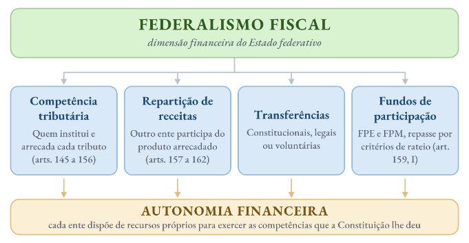
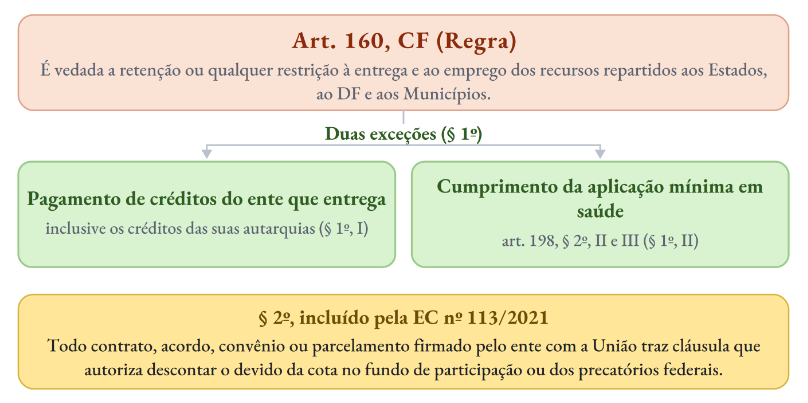
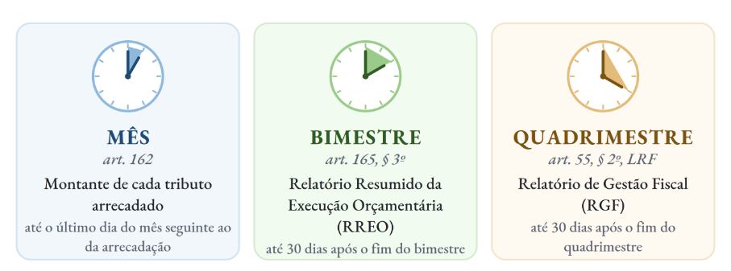
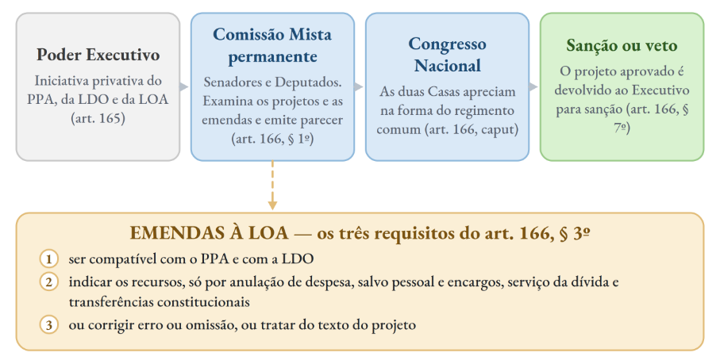
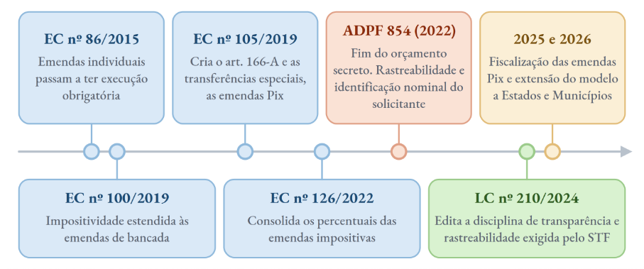
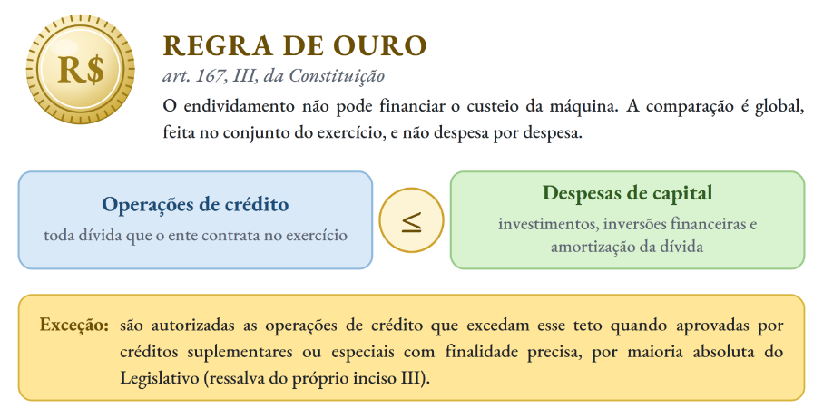
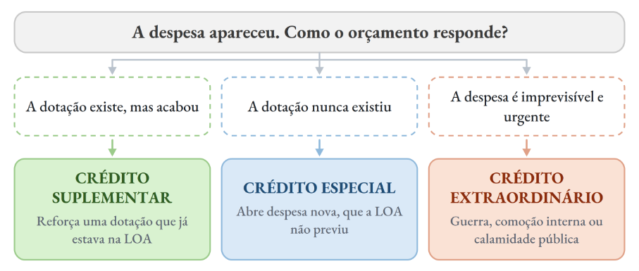
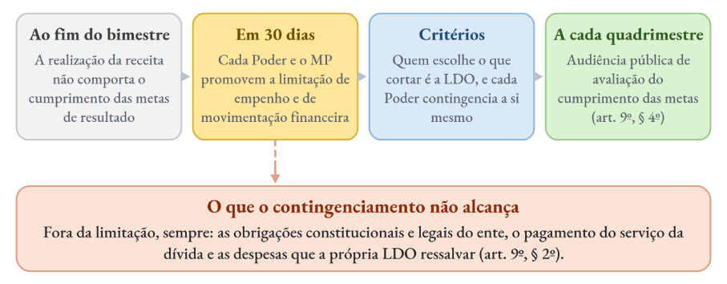

# Direito Financeiro

*Pontos 1 e 2 do edital*

:::JC_F2F2F2 
**1. Direito Financeiro e atividade financeira do Estado. Conceito, fontes e princípios. Receitas, despesas, orçamento e crédito público. Federalismo fiscal. Responsabilidade, sustentabilidade, transparência e equilíbrio fiscal. 2. Direito Orçamentário. Conceito, natureza e funções. Princípios orçamentários. Plano plurianual, diretrizes orçamentárias e orçamento anual. Orçamentos fiscal, de investimento e da seguridade social. Processo legislativo orçamentário. Emendas. Créditos adicionais. Execução. Contingenciamento. Controle.**
:::

| **ESTUDO DE LEI SECA** | > |
|---|---|
| **DIPLOMA** | **DISPOSITIVOS** |
| **Constituição, federalismo fiscal** | Arts. 145 a 149-A (competência) · arts. **157 a 162** (repartição) · art. 167, IV |
| **Constituição, orçamento** | Arts. 163 a 164-A · arts. **165 a 169** · art. 166-A (transferências) · art. 163-A (transparência) |
| **Controle** | Arts. 70 a 75 · art. 49, IX · art. 71, I e II |
| **ADCT** | Art. 35, § 2º (prazos) · art. 76 e arts. 76-A e 76-B |
| **Lei nº 4.320/1964** | Arts. 2º a 8º · arts. **40 a 46** (créditos adicionais) |
| **LRF** | Arts. 1º a 10 · arts. 48 a 59 (transparência e controle) |
| **Outras** | LC nº 200/2023 |

## 1. Estrutura normativa

Pessoal, na aula passada eu fui mais “completo” para que hoje eu pudesse ser um pouco mais direto. Se estiverem ainda com dúvida, releiam a aula anterior antes de avançar. Ali também está o essencial sobre despesas e receitas e, portanto, não vamos repetir.

A fonte primária do Direito Financeiro é, óbvio, a Constituição. O núcleo orçamentário está nos arts. 163 a 169. Abaixo dela, temos alguns diplomas relevantes:

| **DIPLOMA** | **FUNÇÃO** | **PONTO DE ATENÇÃO** |
|---|---|---|
| **Lei nº 4.320/1964** | Normas gerais de direito financeiro, classificação de receitas e despesas, estágios e créditos adicionais | Foi **recepcionada com status de lei complementar**, como o STF reconheceu na ADI 1.726 MC |
| **LC nº 101/2000** | Responsabilidade na gestão fiscal, metas, limites e transparência | Tem **vigência nacional** e alcança os três Poderes de todos os entes, inclusive Tribunais de Contas e Ministério Público. Ficam de fora apenas as estatais **não dependentes** |

:::JC_DAE9F7 PEGADINHA
A competência para legislar sobre Direito Financeiro é **concorrente** (art. 24, I), e a União se limita às normas gerais. Repare em quem ==**não está no art. 24**==: os **Municípios**. Todavia, existem leis orçamentárias municipais, é claro, mas o fundamento é o **art. 30, I e II**, que confere ao Município legislar sobre interesse local e suplementar a legislação federal e estadual.
:::

## 2. Federalismo fiscal

Eu adoro esse tema. Uma pena que aqui ele precisa ser visto brevemente. O federalismo fiscal é a dimensão financeira do Estado federativo. É o conjunto de regras constitucionais que distribui receitas e despesas entre União, Estados, Distrito Federal e Municípios. É dizer: não basta a Constituição atribuir competências administrativas e legislativas a cada ente. Se ele não tiver receita própria para custeá-las, a autonomia fica apenas no papel.

A Constituição resolve isso com um conjunto de instrumentos que operam juntos.

%% Esquematizando

Dentre esses temas, **repartição de receitas** e **fundos de participação** são os dois que mais aparecem em prova.

## 2.1. Repartição direta e indireta

A repartição de receitas é instrumento de federalismo fiscal porque corrige uma “distorção” criada pela própria Constituição. Quem tem a melhor base tributária nem sempre é quem carrega o maior encargo de prestar serviço. O ICMS é do Estado, mas quem atende o cidadão na ponta é o Município. Repartir o produto da arrecadação aproxima a receita de quem gasta, sem precisar mexer na divisão de competências tributárias.

A repartição é: Ø ==**direta**== quando a Constituição destina a um ente parte da arrecadação de um tributo determinado; Ø indireta quando os recursos passam antes por um fundo, que os distribui segundo critérios de rateio fixados em lei complementar. Vejamos:

| REPARTIÇÃO DE RECEITAS | > |
|---|---|
| **MODALIDADE** | **PRINCIPAIS HIPÓTESES** |
| **Direta, da União para Estados e DF** | [Chance alta TRF5] · **IR** retido na fonte sobre rendimentos pagos pelo ente · **20%** do imposto residual (art. 157) |
| **Direta, da União para Municípios** | · **IR** retido na fonte · **50%** do ITR, ou **100%** se o Município fiscalizar e cobrar, na forma da lei · **7,25%** do IOF-ouro (art. 158) |
| **Direta, do Estado para o Município** | · **50%** do IPVA · **25%** do ICMS · **25%** da CIDE-combustíveis recebida pelo Estado (art. 158) |
| **Indireta, por fundos** | [Chance alta TRF5] **FPE, FPM** e fundos regionais, na forma do art. 159, I · **10%** do IPI proporcional às exportações (art. 159, II) · **29%** da CIDE-combustíveis (art. 159, III) |

De longe, fundos e o IR são os mais relevantes. **Há temas de RG importantes sobre ambos.** Falaremos deles mais abaixo. Mas, em essência, vimos que repartir não basta. A Constituição ainda precisa garantir que o dinheiro chegue aos entes. Vejamos o que a CRFB prevê a esse respeito:

Temos precedentes desse ano que, sobre o tema, trabalham justamente as questões relacionadas com a retenção de valores do fundo:

:::JC_D9F2D0 Chance alta TRF5 · De olho no RR
**Tema 1.401 do STJ** (REsp 2.177.031 e REsp 2.238.302, Primeira Seção, rel. Min. Maria Thereza de Assis Moura, j. 7/5/2026, Info 893). Não se aplicam aos bloqueios do FPM por dívidas de contribuições previdenciárias os limites de 9% da cota-parte e de 15% da receita corrente líquida previstos no art. 1º, caput, e no art. 5º, § 4º, da Lei nº 9.639/1998.
:::

%% TRADUZINDO

Imagine que **a União deve repassar mensalmente dinheiro aos Municípios pelo FPM**. Só que o Município também **deve contribuições previdenciárias à União**. A Constituição permite, em determinadas situações, que a União **segure parte desse dinheiro para cobrar a dívida**. A dúvida era outra: **quanto a União pode segurar?**

O Município dizia: “Existe uma lei (Lei nº 9.639/1998) que fala que só podem ser comprometidos 9% do FPM e 15% da Receita Corrente Líquida. Então esse limite também deveria valer para mim.”

O STJ respondeu: não. Esses percentuais de 9% e 15% foram criados para um parcelamento específico da Lei nº 9.639/1998. Funcionam como as condições daquele acordo: quem entra naquele parcelamento recebe aquelas regras. Não são um limite geral para qualquer dívida previdenciária do Município.

Em resumo: o STJ respondeu que são limites do parcelamento, e não teto geral, porque ==**norma sobre parcelamento comporta interpretação literal**====.== A retenção por débito previdenciário tem fundamento próprio, no art. 160, § 1º, I, da Constituição e no art. 56 da Lei nº 8.212/1991. Na prática, ==**o bloqueio do FPM pode superar aqueles percentuais**==.

## 2.2. FPE e FPM

Os fundos de participação são **o coração da repartição indireta**. A União separa metade do que arrecada com o imposto de renda, com o IPI e com o Imposto Seletivo e destina essa fatia aos fundos de participação e aos fundos de financiamento das regiões Norte, Nordeste (alô, TRF5!) e Centro-Oeste. Quem recebe mais não é quem gerou mais arrecadação, e sim quem tem menor capacidade própria, o que faz do fundo um instrumento de redução de desigualdade regional.

| **OS FUNDOS DE PARTICIPAÇÃO** | > | > | > |
|---|---|---|---|
| **FUNDO** | **QUEM RECEBE** | **BASE** | **COMO SE DIVIDE** |
| **FPE** | Estados e Distrito Federal | 21,5% do IR, do IPI e do IS (art. 159, I, "a"). O IS integra a base a partir de 2027 | Critérios de rateio em lei complementar, que devem promover o equilíbrio socioeconômico (art. 161, II) |
| **FPM** | Municípios | 25,5%, somadas as alíneas "b", "d", "e" e "f" do art. 159, I | Coeficiente individual por faixa populacional. O cálculo das quotas é do TCU (art. 161, parágrafo único) |

Vejamos a casuística da jurisprudência sobre os fundos:

:::JC_D9F2D0 JURISPRUDÊNCIA
**EREsp 1.749.966/PR** (Primeira Seção, rel. Min. Francisco Falcão, j. 27/10/2021, Info 716). Não é possível, por ofensa ao princípio da anualidade, a aplicação imediata, em meio ao exercício financeiro, de novos coeficientes individuais de participação no FPM.
:::

Um Município sustentou que o censo havia subestimado a sua população e pediu a aplicação imediata do coeficiente maior, com as diferenças retroativas. O STJ negou. **Como o montante do fundo é fixo, elevar o coeficiente de um no meio do ano reduz o dos demais e desorganiza a previsão de receita de todo mundo**. O coeficiente, por isso, ==**vale para o exercício inteiro**== e só muda no seguinte, pela decisão normativa anual do TCU. A proteção vale nos dois sentidos, contra a majoração e contra a redução no curso do ano.

:::JC_D9F2D0 JURISPRUDÊNCIA
**ADI 5.069** (Pleno, rel. Min. Cármen Lúcia, j. 16/6/2023, Info 1.099). É inconstitucional, por violar o art. 161, II, da Constituição, norma de lei

complementar que distribui os recursos do FPE entre os entes sem a devida promoção do respectivo equilíbrio socioeconômico.
:::

Lembrem-se: o FPE existe justamente para promover o equilíbrio socioeconômico entre os entes. Por isso a Ministra Cármen assim decidiu. Ela própria, inclusive em 1º de outubro de 2026, no Plenário do STF, afirmou que “o art. 3º da Constituição Federal consagra o desenvolvimento nacional, e não o desenvolvimento econômico”, o que dá o tom desse entendimento sobre o papel do FPE na redistribuição de receitas.

## 2.3. Federalismo fiscal na jurisprudência

%% Chance alta TRF5

Essa parte aqui é justamente o **diálogo entre Direito Financeiro e Tributário.** São os casos em que o STF examina a questão do federalismo fiscal “na prática”. Fiquem atentos:

| **O QUE O STF DECIDIU** | > |
|---|---|
| **JULGADO** | **TESE** |
| **Tema 42** (RE 572.762) | [TRADUZINDO] A **retenção** da parcela do ICMS constitucionalmente devida aos Municípios, a pretexto de concessão de incentivos fiscais, configura **indevida interferência** do Estado no sistema de repartição de receitas O Estado não pode deixar de repassar aos Municípios a parte do ICMS, mesmo que o ICMS seja, de acordo com a Constituição, dos Estados. É que, por essa ótica “federalista”, esse dinheiro pertence, “na prática”, aos Municípios e não pode ser retido pelo Estado. |
| **Tema 653** (RE 705.423, 2016) | [TRADUZINDO] É **constitucional** a concessão regular de incentivos, benefícios e isenções fiscais relativos ao **IR e ao IPI** pela União, ainda que isso reduza o Fundo de Participação dos Municípios. O que não ingressou nos cofres não se reparte A União pode dar **descontos, benefícios ou isenções de IR e IPI**, mesmo que isso faça o FPM receber menos dinheiro. A lógica é simples: **só dá para dividir o que foi realmente arrecadado**. Se aquele valor nem chegou aos cofres da União, ele não entra na divisão com os Municípios. |
| **ADI 3.837** (2024) | Os créditos de ICMS extintos por **compensação ou transação** integram o cálculo dos **25%** devidos aos Municípios. **A receita pública antecede o recolhimento**, e a extinção do crédito aumenta a disponibilidade financeira do Estado. Aqui, portanto, **deve ser garantida a quota dos Municípios.** |
| **ADI 5.635** (2023) | [TRADUZINDO] É **constitucional** a lei estadual que institui **fundo atípico** de equilíbrio fiscal, com receitas de destinação genérica, condicionando o aproveitamento de incentivos de ICMS a depósito em seu favor A lógica do STF foi a seguinte: **o depósito não cria um novo tributo**, mas apenas reduz parcialmente o benefício fiscal concedido pelo próprio Estado. Como esse valor continua ligado ao ICMS, o fundo pode existir, desde que |
|   | tenha **destinação ampla e genérica**, sem vinculação a uma despesa específica, e respeite as regras constitucionais aplicáveis ao imposto |

:::JC_DAE9F7 NÃO CONFUNDA
Não confunda o **Tema 42** com o **Tema 653**.
:::

:::JC_DAE9F7 
Se o tributo foi ==**arrecadado**==, a fração do outro ente já lhe pertence e não pode ser retida. Aqui, evita-se qualquer burla à arrecadação que prejudique o ente menor. Se o tributo ==**não foi arrecadado**==, por renúncia regular na origem, não há o que repartir. Aqui, prestigia-se a autonomia do ente “maior” na definição de sua política fiscal.
:::

## 2.4. ADO 25 e a desoneração das exportações

Esse caso também é muito interessante. A EC nº 42/2003 desonerou as exportações do ICMS e, em contrapartida, inseriu o art. 91 do ADCT, que obrigava a União a entregar aos Estados e ao DF o montante definido em lei complementar. A lei complementar nunca veio.

:::JC_D9F2D0 JURISPRUDÊNCIA
**ADO 25** (Pleno, rel. Min. Gilmar Mendes, j. 30/11/2016). Declarada a mora do Congresso quanto à lei complementar do art. 91 do ADCT, com prazo de doze meses para sanar a omissão. Vencido o prazo, caberia ao TCU fixar o montante anual a ser transferido e calcular as quotas de cada ente.
:::

A parte interessante veio depois:

:::JC_D9F2D0 JURISPRUDÊNCIA
**ADO 25 QO** (Pleno, rel. Min. Gilmar Mendes, j. 20/5/2020, Info 978). O Plenário **referendou** as decisões monocráticas que prorrogaram o prazo, por fatos supervenientes, e **homologou o acordo** firmado entre a União, os Estados e o Distrito Federal, encaminhando-o ao Congresso Nacional para as providências cabíveis.
:::

A lógica mais importante do julgado não é a discussão em abstrato sobre o tema. **É que em conflitos federativos se admite que os entes celebrem acordos.** Isso aqui foi o “embrião” dos acordos, por exemplo, firmados no Tema 1.234 da Repercussão Geral.

## 3. Princípios orçamentários

Os princípios orçamentários não estão reunidos em um dispositivo único. Estão espalhados entre a Constituição, a Lei nº 4.320/1964 e a LRF, e cada um responde a uma pergunta diferente sobre a lei do orçamento: **o que ela pode conter**, **o que ela precisa conter** e o **que pode ser mudado depois de aprovada.** Se não tiver tempo, saiba pelo menos o básico:

| **OS PRINCÍPIOS ORÇAMENTÁRIOS** | > | > |
|---|---|---|
| **PRINCÍPIO** | **CONTEÚDO** | **BASE E EXCEÇÕES** |
| **Legalidade** | Nenhuma despesa se realiza sem **autorização legal prévia** | Arts. 165 e 167, I, II e V. O crédito **extraordinário** por **medida provisória** é a única autorização que não passa por lei em sentido estrito |
| **Exclusividade** | A LOA **não conterá dispositivo estranho** à previsão da receita e à fixação da despesa | Art. 165, § 8º. Duas exceções expressas: Ø **autorização** para abrir créditos **suplementares** Ø e para **contratar operações de crédito**, inclusive por antecipação de receita |
| **Universalidade** | A LOA reúne **todas as receitas e todas as despesas do ente**, sem que nenhuma fique fora do documento que o Legislativo aprova | Arts. 2º a 4º da Lei nº 4.320/1964. **Alcança os três orçamentos** do art. 165, § 5º |
| **Orçamento bruto** | Receitas e despesas **entram pelos valores integrais**. Lançar apenas o saldo líquido esconderia parte do que se arrecada e do que se gasta | Art. 6º da Lei nº 4.320/1964 |
| **Especialização** | A despesa é autorizada de **forma discriminad**a, por órgão e por finalidade. A dotação global esvaziaria a autorização, porque o Legislativo não saberia no que o dinheiro seria aplicado | Art. 5º da Lei nº 4.320/1964 e art. 5º, § 4º, da LRF. Duas exceções: **programas especiais de trabalho** e **reserva de contingência** |
| **Unidade** | Cada ente tem um só orçamento por exercício. A unidade é de programação e de política fiscal, e não exige documento físico único | Art. 2º da Lei nº 4.320/1964. É unidade de **programação**, e não de documento físico |
| **Unidade de tesouraria** | Disponibilidades de caixa **centralizadas** | Art. 164, § 3º. Exceção legal no art. 43, § 1º, da LRF, que manda manter em **conta separada** as disponibilidades dos regimes de previdência |
| **Anualidade** | O orçamento vige por **um exercício**, que coincide com o ano civil | Art. 165, III, e art. 34 da Lei nº 4.320/1964. Exceção no art. 167, § 2º |
| **Programação** | O gasto não é autorizado por item de material, e sim por programa, vinculado a objetivos e metas que permitam medir o resultado | Art. 165, §§ 4º e 7º, e art. 7º do Decreto-Lei nº 200/1967, que adota o **orçamento-programa** |
| **Equilíbrio fiscal** | Despesas **compatíveis** com receitas, em perspectiva de sustentabilidade | Art. 164-A e art. 1º, § 1º, da LRF |
| **Transparência** | Receita, despesa e execução **acessíveis** ao controle social | Arts. 162, 163-A e 165, § 3º, e arts. 48 e 49 da LRF |
| **Não afetação** | **Vedada** a vinculação de receita de **impostos** a órgão, fundo ou despesa | Art. 167, IV, com as exceções do próprio dispositivo |

## 3.1. Exclusividade

:::JC_FFFFFF 
A regra nasceu de um vício antigo. Como o projeto de orçamento tramitava rápido e tinha aprovação garantida, o Congresso aproveitava a lei para enxertar matéria sem nenhuma relação com receita e despesa. Essas **caudas orçamentárias** renderam ao texto o apelido de ***orçamento rabilongo***, e a exclusividade existe para impedir que a lei do orçamento vire carona de assunto alheio.

O art. 165, § 8º, abre ==**duas**== exceções expressas: Ø a autorização para **abrir créditos suplementares**; Ø e **a autorização para contratar operações de crédito**, inclusive por antecipação de receita. As duas se justificam pelo mesmo motivo: tratam da execução do próprio orçamento, e não de matéria estranha a ele. O crédito especial fica de fora porque serve a despesa que a LOA não previu, e o extraordinário porque nasce de situação que, por definição, não se antecipa.

%% JÁ CAIU!

**TRF4, 2022** (banca própria). É vedada a inclusão na LOA de dispositivo estranho à previsão da receita e à fixação da despesa, não se incluindo na proibição a autorização para abertura de créditos suplementares e contratação de operações de crédito, ainda que por antecipação de receita.

## 3.2. Universalidade e anualidade
:::

A universalidade impõe que “tudo”, universalmente, esteja na lei orçamentária. Esse “mundo ideal”, todavia, não impede que tributos sejam criados ou cobrados depois de aprovada a LOA, ainda que a receita não tenha sido prevista. Não faz mais sentido! A Constituição de 1988 não acolhe a anualidade tributária, substituída pela anterioridade.

:::JC_DAE9F7 NÃO CONFUNDA
A **anualidade orçamentária** é do **Direito Financeiro** e **continua viva**. Por outro lado, a anualidade tributária vinha da Constituição de 1946, que exigia prévia autorização orçamentária para a cobrança do tributo em cada exercício. Isso há muito já não mais existe no ordenamento. No direito tributário, não temos “anualidade”, mas a anterioridade anual e nonagesimal.
:::

A exceção à anualidade orçamentária está no art. 167, § 2º: **os créditos especiais e extraordinários autorizados nos** ==**últimos quatro meses**== **do exercício podem ser reabertos no exercício seguinte**, nos limites dos seus saldos, e são incorporados ao orçamento subsequente.

:::JC_DAE9F7 NÃO CONFUNDA
Universalidade e unidade não são a mesma coisa. A **universalidade** responde o que entra no orçamento, e a resposta é tudo, **todas as receitas e todas as despesas.** A **unidade** responde em quantos orçamentos isso cabe, e a resposta é **um só por exercício.** Por isso a divisão do art. 165, § 5º, em três orçamentos não viola nenhuma das duas.
:::

:::JC_FFE698 JÁ CAIU!
**FGV, TCE-PA, 2024.** O orçamento que contém todas as receitas e despesas, de qualquer natureza, procedência ou destino, inclusive as dos fundos, dos empréstimos e dos subsídios, atende ao princípio da ==**universalidade**==.⁸⁹
:::

## 3.3. Unidade, tesouraria e transparência

O art. 165, § 5º, divide a LOA em três orçamentos, que são: Ø o **fiscal**; Ø o de **investimento** das estatais controladas; Ø e o da **seguridade social**. Isso não é exceção à unidade, porque a segmentação é organizacional e tudo permanece dentro da mesma lei.

Quanto à tesouraria, o STF decidiu na **Rcl 3.872** que os ==**valores destinados à folha**==

:::JC_D9F2D0 
**de pagamento dos servidores podem ser depositados em banco privado**, porque ==**esses**==
:::

==**valores não são disponibilidade de caixa.**==

%% OLHO NO PRAZO!

Na transparência, três prazos precisam estar **decorados**:

## 4. PPA, LDO e LOA

Temos que conhecer bem o básico sobre as leis orçamentárias!

O **PPA** fixa o que o governo pretende fazer ao longo de quatro anos, com foco em investimento e em programa que não se esgota num exercício, e por isso é instrumento de planejamento de **médio prazo**.

A **LDO** é a ponte entre o plano e o orçamento, porque seleciona do PPA o que será prioridade no ano seguinte e **fixa as regras que a LOA terá de seguir**.

Por fim, a **LOA é a mais concreta e realiza tudo isso em números**, prevendo a receita e fixando a despesa de um exercício.

| **PPA, LDO E LOA** | > | > | > |
|---|---|---|---|
| **CRITÉRIO** | **PPA** | **LDO** | **LOA** |
| **Base** | Art. 165, I e § 1º | Art. 165, II e § 2º | Art. 165, III e §§ 5º a 8º |
| **Conteúdo** | Diretrizes, objetivos e metas para as **despesas de capital** e para os **programas de duração continuada**, de forma regionalizada | **Metas e prioridades**, diretrizes de política fiscal, trajetória sustentável da dívida, orientação para a LOA, alterações na legislação tributária e política das agências de fomento | Previsão da **receita** e fixação da **despesa** do exercício, nos três orçamentos do § 5º |
| **Vigência** | **Quatro anos**, do segundo ano de um mandato ao primeiro do mandato seguinte | **Um exercício** | **Um exercício** |
| **Envio** | Até **quatro meses** antes do fim do primeiro exercício do mandato | Até **oito meses e meio** antes do fim do exercício | Até **quatro meses** antes do fim do exercício |
| **Devolução** | Até o encerramento da **sessão legislativa** | Até o encerramento do **primeiro período** da sessão legislativa | Até o encerramento da **sessão legislativa** |
| **Rejeição** | Não há vedação expressa | A sessão legislativa **não se interrompe** sem a aprovação da LDO (art. 57, § 2º) | Rejeitada a despesa, ela só se realiza por crédito especial ou suplementar com autorização específica (art. 166, § 8º) |

:::JC_DAE9F7 DECORE
**Para memorizar:** O **PaPAi (PPA)** tem o **DOM** (**d**iretrizes, os **o**bjetivos e as **m**etas). Ao **L**a**DO** do juiz, o **MP:** a **LDO** fixa **M**etas e **P**rioridades
:::

**Toda essa preocupação com “metas” é o que enquadra o nosso orçamento como** ==**orçamento-programa**==, introduzido pelo art. 7º do Decreto-Lei nº 200/1967 e absorvido pela Constituição no art. 165, §§ 4º e 7º. Nele o orçamento deixa de ser uma lista de objetos de gasto e passa a organizar a despesa por programa, atrelado a objetivo, meta e indicador de resultado. É por isso que o PPA e a LDO existem. Sem plano e sem seleção de prioridades, não há programa a financiar.

:::JC_FFE698 JÁ CAIU!
Na prova para o TCE-PA (2024), a **FGV** pediu a correspondência entre as metodologias orçamentárias. O orçamento **clássico** é peça meramente contábil-financeira, o de **desempenho** é instrumento de gerenciamento, o **base zero** reavalia periodicamente cada programa e o ==**orçamento-programa integra o planejamento ao orçamento**==.
:::

## 4.1. Conteúdo específico do PPA

:::JC_FFFFFF 
O PPA cuida de despesa de capital e de programa de duração continuada, e não do custeio trivial da máquina, porque é instrumento de plano de governo. **Programa de duração continuada** é aquele que se prolonga além de um exercício e gera obrigação de manutenção, como um programa de assistência farmacêutica ou de transferência de renda. Não é a compra de material de escritório, que se esgota no ano.

| Daí a regra do art. 167, § 1º: | **nenhum investimento cuja execução ultrapasse um** |
|---|---|
| **exercício pode ser iniciado sem prévia inclusão no PPA ou sem lei que autorize a inclusão,** | > |
| **sob pena de crime de responsabilidade.** | > |

## 4.2. Anexos da LDO
:::

Com a LDO, temos, também, “anexos”, que servem para dar ainda mais concretude para a lei. Tem-se mais facilidade de controlar inclusive os casos em que as coisas “dão errado”:

| **OS ANEXOS DA LDO** | > | > |
|---|---|---|
| **ANEXO** | **CONTEÚDO** | **FONTE** |
| **Metas Fiscais** | Metas anuais de receitas, despesas, **resultado primário**, **resultado nominal** e dívida pública, para o exercício e os dois seguintes. Avalia o cumprimento das metas do ano anterior, a situação dos regimes de previdência e a evolução do patrimônio líquido | LRF, art. 4º, § 1º |
| **Riscos Fiscais** | Avalia **passivos contingentes** e outros eventos incertos capazes de afetar as contas, com as providências caso se concretizem | LRF, art. 4º, § 3º |
| **Agregados fiscais e investimentos** | Previsão de agregados fiscais e proporção de recursos para **investimentos em andamento**, para o exercício e pelo menos os dois seguintes | CF, art. 165, § 12 |

Há ainda o **anexo específico**, com os objetivos das políticas monetária, creditícia e cambial e as metas de inflação. Ele acompanha a ==**mensagem**== que encaminha o projeto, e ==**não é anexo da LDO**==.

## 4.3. Conteúdo da LOA

A LOA não é apenas previsão de receita e fixação de despesa. O art. 5º da LRF exige um conjunto de demonstrativos:

Ø demonstrativo de **compatibilidade** com o Anexo de Metas Fiscais da LDO, Ø demonstrativo **regionalizado** do efeito das renúncias de receita e das medidas de compensação, exigido também pelo art. 165, § 6º, Ø **reserva de contingência**, cujo montante e forma de utilização são definidos pela **LDO**,

Ø estimativa das despesas **financeiras e primárias** para o exercício e os dois seguintes, Ø despesas da **dívida pública** consignadas separadamente do refinanciamento.

:::JC_DAE9F7 PEGADINHA
A **reserva de contingência** está na **LOA**, mas quem define o montante e a forma de utilização é a LDO. E ela atende aos riscos previstos no **Anexo de Riscos Fiscais**. São três leis relacionadas ao mesmo tema.
:::

**Atenção** também ao art. 165, § 7º: a função de **reduzir desigualdades inter- regionais**, segundo critério populacional, é atribuída aos orçamentos **fiscal e de investimento**, e ==**não ao da seguridade social**==, que financia sistema concebido para ser universal.

## 5. Processo legislativo orçamentário

O orçamento não segue o rito comum das leis. Ele tem assento próprio na CF (vide art. 166). Daí existir uma comissão mista permanente de Senadores e Deputados, que concentra o exame do projeto e das emendas.

Os requisitos do § 3º não esgotam o controle. Como a iniciativa em matéria orçamentária é privativa do Chefe do Executivo, **a emenda que não guarda pertinência com o projeto apresentado invade essa iniciativa, ainda que respeite a forma**.

:::JC_D9F2D0 JURISPRUDÊNCIA
**ADI 7.643 MC-Ref/PB** (Pleno, rel. Min. Alexandre de Moraes, j. 10/6/2024, Info 1.140). Referendada a cautelar que suspendeu dispositivos de lei estadual oriundos de emenda parlamentar sem pertinência com o projeto orçamentário originalmente proposto pelo Chefe do Executivo, que fixavam cronograma de execução das emendas individuais.
:::

%% PASSO A PASSO

Se o Presidente da República **não envia** o projeto no prazo, **o Legislativo considera como proposta a própria lei orçamentária vigente**, nos termos do art. 32 da Lei nº 4.320/1964. A omissão configura ==**crime de responsabilidade**==, pelo art. 10, I, da Lei nº 1.079/1950.

Por sua vez, se o Legislativo **não devolve** o projeto aprovado a tempo, não há lei orçamentária vigente para autorizar o gasto. Não existe regra geral sobre execução provisória, já que o art. 6º da LRF foi ==**vetado**==. A solução costuma vir na própria **LDO**, que autoriza a execução de determinadas programações do projeto até a publicação da LOA.

## 6. Emendas parlamentares

Esse tema ainda vai dar pano para manga. É **muito dinheiro** enviado pelos parlamentares por meio dessas emendas. Isso é revelador da relevância do tema e justifica por qual razão o STF tanto se debruça em torno disso.

%% Tome seu café

**Até 2015 o orçamento era inteiramente autorizativo**. O Legislativo aprovava a despesa, mas quem decidia se ela sairia do papel era o Executivo. Emenda parlamentar valia tanto quanto o governo quisesse que valesse, o que dava ao Planalto uma moeda de troca permanente com o Congresso.

:::JC_FFFF00 
**A EC nº 86/2015 quebrou essa lógica para uma fatia do orçamento. A emenda**
:::

:::JC_FFFF00 
**individual passou a ter execução obrigatória dentro de um limite, e com isso o Parlamento**
:::

:::JC_FFFF00 
**ganhou poder real de alocação de recursos. Ou seja: se o Deputado Tiririca quiser obrigar**
:::

:::JC_FFFF00 
**o Chefe do Executivo a realizar um gasto, e ele conseguir a emenda, não tem jeito. Teria**
:::

==**que executar.**==

**Adivinhem só o que ocorreu?** Quanto maior o valor carimbado por parlamentar, maior o incentivo para que o

:::JC_FFFFFF 
destino do dinheiro ficasse opaco. ==**Foi daí que nasceu o problema do orçamento secreto, e é**==
:::

:::JC_FFFF00 
**por isso que a jurisprudência constitucional da última década se concentrou neste item.**
:::

Ainda falaremos um pouco mais sobre cada um desses pontos, mas você já pode se adiantar com o quadro a seguir:

## 6.1. Emendas impositivas

**Decorem** o regime jurídico das emendas (ao menos o “geral”):

| **O REGIME DAS EMENDAS IMPOSITIVAS** | > |
|---|---|
| **PONTO** | **REGIME** |
| **Emenda individual** (um parlamentar) | Limite de **2% da receita corrente líquida** do exercício anterior, e **metade** desse percentual é destinada a ações e serviços públicos de **saúde** (art. 166, § 9º) |
| Emenda de bancada (vários parlamentares) | Limite de **1% da receita corrente líquida** realizada no exercício anterior (art. 166, § 12) |
| **Execução** | É **obrigatória**. A programação é de execução orçamentária e financeira **equitativa**, e o montante aprovado constitui limite de empenho e pagamento |
| **Impedimento técnico** | Justificado o impedimento de ordem técnica, abre-se o procedimento do art. 166, §§ 13 e 14, com prazos para **justificar**, **remanejar** e **empenhar** |
| **Meta fiscal** | Havendo risco de descumprimento da meta fixada na LDO, a execução pode ser **reduzida na mesma proporção** da limitação incidente sobre o conjunto das despesas discricionárias |

## 6.2. Orçamento secreto

:::JC_FFFFFF Chance alta TRF5
No processo legislativo, alguém tem que relatar as discussões. O Congresso já é bagunçado, imaginem se discussões dessas não fossem centralizadas por alguém.

Mas estamos no Brasil. O papel do relator, que antes era apenas de organizar, passou a se converter em espaço fértil para que ele fizesse “outras coisinhas mais”. Então esse papel de relator acabou servindo para criar emendas sem indicar exatamente quem seria o autor do projeto.

As emendas de relator-geral, classificadas pelo identificador RP 9, destinam-se exclusivamente a corrigir erros e omissões, na forma do art. 166, § 3º, III, a. Na prática, porém, passaram a ser usadas para criar despesas novas e ampliar programações, com distribuição definida por acertos informais e sem registro do parlamentar solicitante.

%% JURISPRUDÊNCIA

**ADPF 850, 851, 854 e 1.014** (Pleno, rel. Min. Rosa Weber, j. 19/12/2022, Info 1080). É **vedada** a utilização das emendas do relator-geral para **criar novas despesas** ou **ampliar as programações** previstas no projeto de lei orçamentária anual, uma vez que elas se destinam **exclusivamente** a corrigir erros e omissões.

O fundamento não foi de mérito político, e sim constitucional. O modelo violava o princípio republicano, a publicidade do art. 37 e o dever de transparência do **art. 163-A**, porque tornava impossível identificar quem demandou o recurso e para onde ele foi.

Daí as duas exigências que passaram a organizar todo o sistema:

→ **rastreabilidade**, ou seja, a identificação da origem exata da emenda e do destino da verba, da votação até a execução, → **identificação nominal** do parlamentar solicitante ou autor, inclusive nas emendas de **comissão** e de **bancada**, com registro em ata. A ==**LC nº 210/2024**== foi editada para dar cumprimento a essas determinações, e o Congresso editou resoluções de adequação.

## 6.3. Transferências especiais e emendas Pix
:::

A EC nº 105/2019 criou o art. 166-A, com duas modalidades de transferência decorrente de emenda individual, que são a ==**transferência com finalidade definida**== e a ==**transferência especial**==, esta última conhecida como ==**emenda Pix.**==

Vejamos o regime jurídico dessas emendas: Ø Não possuem previsão em convênio ou instrumento congênere; Ø o recurso pertence ao ente no ato da transferência; Ø aplicação em qualquer programação da sua competência; Ø mínimo de 70% em despesa de capital; Ø vedado pessoal, encargos e serviço da dívida; Ø não integra a RCL para os limites de endividamento e de pessoal. O desenho gerou o problema que a Corte enfrentou em seguida. Sem convênio e sem plano de trabalho, o recurso entrava no caixa do ente e se perdia de vista, o que **esvaziava a rastreabilidade exigida pelo art. 163-A.**

:::JC_D9F2D0 JURISPRUDÊNCIA
**ADI 7.688 MC-Ref, ADI 7.695 MC-Ref e ADI 7.697 MC-Ref** (Pleno, rel. Min. Flávio Dino, j. 19/8/2024, Info 1146). Deferida cautelar para **suspender** as transferências especiais até que se assegurassem instrumentos de planejamento e mecanismos de controle, diante do risco de dano ao erário e à ordem constitucional caso as emendas Pix seguissem sem ferramentas que garantissem **transparência e rastreabilidade** dos dados, na forma do art. 163- A.
:::

A partir daí, o regime das transferências especiais passou a exigir:

→ **plano de trabalho** prévio, aprovado em plataforma eletrônica, → **conta bancária específica e exclusiva** por transferência, o que eliminou as antigas contas de passagem, → **vinculação federativa**, com destinação ao Estado ou Município pelo qual o parlamentar foi eleito, salvo projeto de âmbito nacional, → **parecer prévio** das instâncias do SUS, quando a destinação for a saúde, → fiscalização integral pelo **TCU** e pela **CGU**, com prestação de contas nos mesmos moldes das transferências com finalidade definida.

## 6.4. Desdobramentos recentes

O tema seguiu vivo na ADPF 854. O Ministro Dino não quer me deixar dormir e sempre publica algo novo aqui.

%% Chance alta TRF5

:::JC_FFFFFF 
A regra mais importante é que ==**o ciclo completo de fiscalização e de aprovação**==
:::

:::JC_FFFFFF 
==**das contas das transferências especiais é de responsabilidade do TCU**==, sem prejuízo de
:::

colaborações eventuais dos Tribunais de Contas dos Estados e dos Municípios, porque os recursos têm origem federal (ADPF 854/DF, rel. Min. Flávio Dino, decisão monocrática de 23/8/2024, item 26, reiterada na decisão de 2/12/2024 e referendada pelo Plenário em 3/12/2024).

Vejamos mais detalhes:

| **EMENDAS PIX** | > |
|---|---|
| **MOMENTO** | **DECISÃO** |
| **Setembro de 2025 (monocrática)** | Prazo de quinze dias para que TCU e AGU apresentassem cronograma detalhado de fiscalização das transferências especiais executadas entre 2020 e 2024 |
| **Outubro de 2025 (monocrática)** | Extensão do modelo federal de transparência e rastreabilidade aos Estados, ao Distrito Federal e aos Municípios, com eficácia a partir de 1º de janeiro de 2026 e notificação dos Tribunais de Contas, dos Ministérios Públicos de Contas e das Procuradorias-Gerais de Justiça. A execução das emendas de deputados estaduais, distritais e vereadores no exercício de 2026 ficou condicionada à demonstração prévia, perante o respectivo Tribunal de Contas, do cumprimento do art. 163-A |
| **Agosto de 2026 (monocrática)** | Diante de auditoria do TCU sobre cem transferências especiais, que apontou fraude em licitações, obras inacabadas e pagamentos sem comprovação, determinação de envio do relatório à Polícia Federal, com prioridade aos casos de dano apurado |

## 7. Vedações orçamentárias

O art. 167 traz uma série de **restrições orçamentárias.** Se o seu examinador da FGV estiver sem criatividade, seguramente irá se inspirar por ele:

| **AS VEDAÇÕES DO ART. 167** | > |
|---|---|
| **INCISO** | **VEDAÇÃO E EXCEÇÃO** |
| **I e II** | Iniciar programa ou projeto **não incluído na LOA** e realizar despesa que **exceda** os créditos orçamentários ou adicionais |
| **III** | [Chance alta TRF5] Operações de crédito que **excedam o montante das despesas de capital**. É a **regra de ouro**. Ressalvadas as autorizadas por créditos suplementares ou especiais com finalidade precisa, aprovados por **maioria absoluta** |
| **IV** | [EXCEÇÃO] Vincular receita de **impostos** a órgão, fundo ou despesa. **Exceções** no próprio inciso: repartição dos arts. 158 e 159, **saúde**, **educação**, administração tributária, garantia de operação de crédito por antecipação de receita e a hipótese do § 4º |
| **V** | Abrir crédito suplementar ou especial **sem prévia autorização legislativa** e **sem indicação dos recursos** |
| **VI** | **Transpor, remanejar ou transferir** recursos de uma categoria de programação para outra ou de um órgão para outro sem prévia autorização legislativa. É a vedação do **estorno**. Exceção no § 5º, para **ciência, tecnologia e inovação**, por ato do Poder Executivo |
| **VII** | Conceder ou utilizar **créditos ilimitados**. **Não há exceção** |
| **VIII e IX** | Usar recursos dos orçamentos fiscal e da seguridade para suprir **deficit** de empresas, fundações e fundos sem autorização específica, e **instituir fundos** sem prévia autorização legislativa |
| **X** | Transferir recursos e conceder empréstimos, pelos Governos Federal e Estaduais e suas instituições financeiras, para pagar **pessoal ativo, inativo e pensionista** de Estados, DF e Municípios. Não alcança instituição financeira **privada** |
| **XI e XII** | Utilizar as contribuições previdenciárias em despesa **diversa do custeio** do RGPS, e a mesma lógica quanto ao regime próprio |
| **XIII** | Transferir voluntariamente, avalizar ou emprestar a ente que **descumpra** as regras do regime próprio de previdência |
| **XIV** | Criar **fundo público** quando os objetivos puderem ser alcançados por vinculação de receitas específicas ou por programação direta |

Entre as vedações do art. 167, a do inciso III é a que mais cobra entendimento, e não decoreba. Ela existe para impedir, basicamente, que o Estado se endivide a fim de pagar até mesmo uma conta de luz. **Dívida deve financiar o que fica, como obra e equipamento, e não o consumo do exercício.**

Essa comparação global muda a forma de responder. Como se olha o **total** das operações de crédito contra o **total** das despesas de capital no exercício, não é possível apontar uma operação isolada e dizer que ela financiou despesa corrente. Foi nesse sentido que o STF decidiu a **ADI 5.683/RJ** (Pleno, rel. Min. Luís Roberto Barroso, j. 20/4/2022). E, na **ADI 2.238**, o Tribunal declarou inconstitucional o art. 12, § 2º, da LRF, porque ele suprimia a ressalva que o próprio inciso III previa.

:::JC_DAE9F7 PEGADINHA
A ADI 5.683 não liberou tudo. O que ela afastou foi a leitura de que cada operação de crédito teria de ser vinculada a uma despesa de capital específica. A vedação do art. 167, **X**, continua de pé: o ente não pode tomar empréstimo em instituição financeira **estatal** para pagar pessoal ativo, inativo e pensionista. Com instituição privada, pode.
:::

Na vedação do **estorno**, o descumprimento tem consequência fora do Direito Financeiro. Configura o crime do art. 315 do Código Penal e ato de improbidade pelo art. 10, XI, da Lei nº 8.429/1992.

:::JC_FFE698 JÁ CAIU!
**FGV, TRF1, 2023.** A única alternativa que configura ==**exceção**== às proibições constitucionais: a transposição de recursos de uma categoria de programação para outra, no âmbito das atividades de **ciência, tecnologia e inovação**, mediante ato do Poder Executivo, sem prévia autorização legislativa.
:::

## 7.1. Crédito público

Crédito público é o endividamento do Estado, e a **operação de crédito** do art. 29, III, da LRF é o compromisso financeiro assumido em razão de mútuo, abertura de crédito, emissão de título, aquisição financiada de bens e negócios equiparados.

A modalidade mais cobrada é a **operação de crédito por antecipação de receita orçamentária**, a ARO, do art. 38 da LRF:

→ destina-se a atender ==**insuficiência de caixa**== durante o exercício, → só pode ser realizada a partir do dia ==**dez de janeiro**==, → deve ser liquidada, com juros e encargos, até o dia ==**dez de dezembro**==, → é ==**vedada**== enquanto existir operação anterior da mesma natureza não integralmente resgatada, → é ==**vedada no último ano de mandato**== do Presidente, Governador ou Prefeito. A dívida se divide em **consolidada**, que é o montante das obrigações assumidas por lei, contrato ou convênio para amortização em prazo superior a doze meses, e **mobiliária**, representada por títulos emitidos pelo ente. Os limites globais são fixados pelo ==**Senado Federal**==, por resolução, na forma do art. 52, VI a IX.

## 8. Créditos adicionais

A LOA é uma previsão feita com meses de antecedência, e previsão erra. A despesa pode sair maior do que o estimado, pode surgir uma despesa que ninguém imaginou, ou pode acontecer uma calamidade. Os créditos adicionais são a resposta do sistema a cada um desses problemas, e é pelo problema que se escolhe a espécie.

| **CRÉDITOS ADICIONAIS** | > | > | > |
|---|---|---|---|
| **CRITÉRIO** | **SUPLEMENTAR** | **ESPECIAL** | **EXTRAORDINÁRIO** |
| **Finalidade** | **Reforço** de dotação já existente | Despesa **nova**, sem dotação específica | Despesa **imprevisível e urgente**, como guerra, |
|   |   |   | comoção interna ou calamidade |
| **Autorização** | Lei, podendo a **própria LOA** autorizar previamente até certo limite | **Lei específica**, nunca a própria LOA | **Dispensa autorização legislativa prévia** |
| **Abertura** | Decreto do Executivo | Decreto do Executivo | **Medida provisória** na União e decreto nos entes que não a preveem, com imediato conhecimento ao Legislativo |
| **Recursos** | Exige **recursos disponíveis** e exposição justificativa | Exige **recursos disponíveis** e exposição justificativa | **Não depende** da prévia indicação da fonte |
| **Vigência** | Restrita ao exercício | Restrita ao exercício, salvo se autorizado nos **últimos quatro meses** | Restrita ao exercício, com a mesma regra de reabertura |

Os recursos disponíveis do art. 43, § 1º, são quatro: **superavit financeiro** do exercício anterior, **excesso de arrecadação**, **anulação** parcial ou total de dotações e produto de **operações de crédito** autorizadas.

Por sua vez, o art. 62, § 1º, I, d, veda medida provisória sobre planos plurianuais, diretrizes orçamentárias, orçamento e créditos adicionais e suplementares, ==**ressalvado o art. 167, § 3º**==, que é exatamente o crédito extraordinário.

Isso não torna a medida provisória imune ao controle. A urgência e a imprevisibilidade do art. 167, § 3º, não são as mesmas do art. 62. São **qualificadas** pelos próprios exemplos do dispositivo, que são guerra, comoção interna e calamidade pública. Nas **ADI 4.048 e 4.049** o STF admitiu o controle abstrato de lei orçamentária de efeitos concretos e declarou inconstitucional medida provisória que abriu crédito extraordinário fora dessas hipóteses.

:::JC_FFE698 JÁ CAIU!
**FGV, TJ-MS, 2023** e **FGV, TJ-PE, 2022.** As duas provas cobraram a mesma distinção. As despesas não computadas ou insuficientemente dotadas são autorizadas por **créditos adicionais, que podem ser especiais, suplementares ou extraordinários**, e o crédito **suplementar** é aberto por **decreto executivo desde que autorizado em lei**, com indicação da fonte.
:::

:::JC_FFE698 JÁ CAIU!
**FGV, TRF1, 2025.** Alternativa correta: poderá ser aberto crédito **especial, por decreto do Poder Executivo**, para despesa sem dotação própria, devendo a abertura ser ==**autorizada por lei específica**==, condicionada à existência de recursos disponíveis e precedida de exposição justificativa.
:::

## 9. Execução e contingenciamento

O art. 165, § 10, impõe à Administração o dever de executar as programações orçamentárias, para garantir a efetiva entrega de bens e serviços à sociedade. Esse dever vem com balizas no § 11:

→ subordina-se ao cumprimento de **metas fiscais e limites de despesa**, e não impede o cancelamento necessário à abertura de créditos adicionais,

→ não se aplica aos casos de **impedimento de ordem técnica** devidamente justificados,

→ aplica-se ==**exclusivamente às despesas primárias discricionárias**==. O § 13 esclarece que essas regras alcançam apenas os orçamentos fiscal e da seguridade social **da União**.

O contingenciamento é o que impede que a meta fiscal vire letra morta. Se a receita vem abaixo do previsto e nada acontece, o ente gasta tudo o que a LOA autorizou e fecha o ano fora da meta. O art. 9º da LRF antecipa o problema, porque em vez de esperar o resultado obriga a cortar empenho assim que o desvio aparece.

:::JC_DAE9F7 PEGADINHA
O § 3º do art. 9º autorizava o Executivo a limitar os valores financeiros dos demais Poderes quando estes não promovessem a própria limitação. O STF o declarou ==**inconstitucional na ADI 2.238**==, por violação da separação dos Poderes. ==**Cada Poder contingencia a si mesmo.**==
:::

Por fim, o § 4º exige que o Ministro ou Secretário da Fazenda demonstre e avalie o cumprimento das metas fiscais em **audiência pública quadrimestral**, até o fim de maio, setembro e fevereiro.

:::JC_FFE698 JÁ CAIU!
**FGV, TRF2, 2026.** Precatório inscrito na ordem cronológica, sem alocação orçamentária e com pagamento de precatórios mais recentes. Alternativa correta: o sequestro é cabível nas ==**hipóteses taxativas**== do art. 100, § 6º, que são a **quebra da ordem cronológica** e a **não alocação orçamentária** do valor necessário. Simples atraso, dolo do gestor e insuficiência financeira ==**não autorizam**== a medida. O regime completo do precatório está na Semana 04.
:::

## 10. Controle orçamentário

O controle é **interno**, exercido por cada Poder sobre os seus próprios atos na forma do art. 74, e **externo**, exercido pelo Congresso Nacional com o auxílio do Tribunal de Contas, na forma dos arts. 70 e 71.

:::JC_FBEFD6 Esquematizando
**Execução da despesa** → **prestação de contas** → **controle interno** de cada Poder → **controle externo** pelo Legislativo com auxílio do Tribunal de Contas → **parecer prévio** ou **julgamento**, conforme o responsável.
:::

A distinção que organiza o item é entre **emitir parecer prévio** e **julgar**. O Tribunal de Contas julga diretamente as contas de quem administra dinheiro público, mas não julga as contas do chefe do Executivo. Nesse caso ele apenas opina, em parecer técnico, e quem julga é o Legislativo.

| **QUEM JULGA O QUÊ** | > |
|---|---|
| **SITUAÇÃO** | **REGIME** |
| **Contas do Presidente da República** | O TCU emite **parecer prévio** em sessenta dias. Quem **julga** é o **Congresso Nacional** (art. 49, IX, e art. 71, I) |
| **Contas dos demais administradores** | O TCU **julga** diretamente as contas dos responsáveis por dinheiros, bens e valores públicos (art. 71, II) |
| **Contas de Prefeito** | No **Tema 835** o STF fixou que a competência para julgar é sempre da **Câmara Municipal**, tanto nas contas de governo quanto nas de gestão, e o parecer prévio do Tribunal de Contas só deixa de prevalecer por decisão de **dois terços** dos vereadores |
| **Aposentadoria e pensão** | A **Súmula Vinculante 3** dispensa o contraditório na apreciação da legalidade do ato de **concessão inicial**. No **Tema 445** o STF fixou o prazo de **cinco anos** para que o Tribunal de Contas julgue esse ato, contados da chegada do processo à Corte |

O Tribunal de Contas **não integra o Poder Legislativo**. É órgão autônomo, e o auxílio de que fala o art. 71 não estabelece subordinação.

Quanto ao controle de constitucionalidade das próprias leis orçamentárias, houve virada relevante. O STF ==**superou**== a jurisprudência que afastava a ação direta contra lei de efeitos concretos e passou a admitir o controle abstrato das leis orçamentárias, como fez nas **ADI 4.048 e 4.049**.

## 11. Desvinculação de receitas

A vinculação protege finalidades constitucionais sensíveis, mas engessa o orçamento. A resposta veio pelos mecanismos do ADCT, cujo regime detalhado já foi visto na Semana 04. Aqui interessa o essencial:

→ a EC nº 27/2000 criou a DRU com 20% da arrecadação de impostos e contribuições sociais da União, e a EC nº 93/2016 elevou o percentual para 30%, incluiu as taxas e estendeu o mecanismo a Estados e Municípios pela DRE e pela DRM dos arts. 76-A e 76-B,

→ sucessivas prorrogações levaram a desvinculação até 31 de dezembro de 2032, preservados o RGPS, o salário-educação, os repasses constitucionais ou legais a Estados, DF e Municípios, o Fundo Social e as receitas vinculadas à educação e à saúde na forma da Lei nº 12.858/2013.

:::JC_FFE698 JÁ CAIU!
**FGV, TJ-SE, 2025.** Alternativa correta: a Desvinculação de Receitas da União, dos Estados, do Distrito Federal e dos Municípios tem ==**natureza temporária**==, o que demanda periódica aquiescência do Poder Constituinte Reformador no sentido da continuidade dos mecanismos.
:::

Leiam a íntegra dos arts. 157 a 162 e 163 a 169 da Constituição e dos arts. 40 a 46 da Lei nº 4.320/1964. São dispositivos curtos, de literalidade cobrada, e cobrem a maior parte desta aula.

## Notas de rodapé

⁸ ⁹ Alternativa correta.
