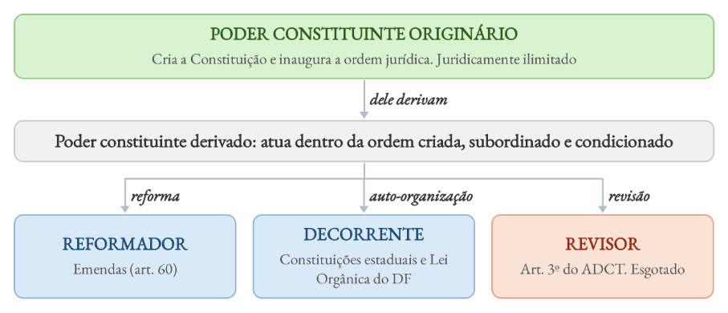
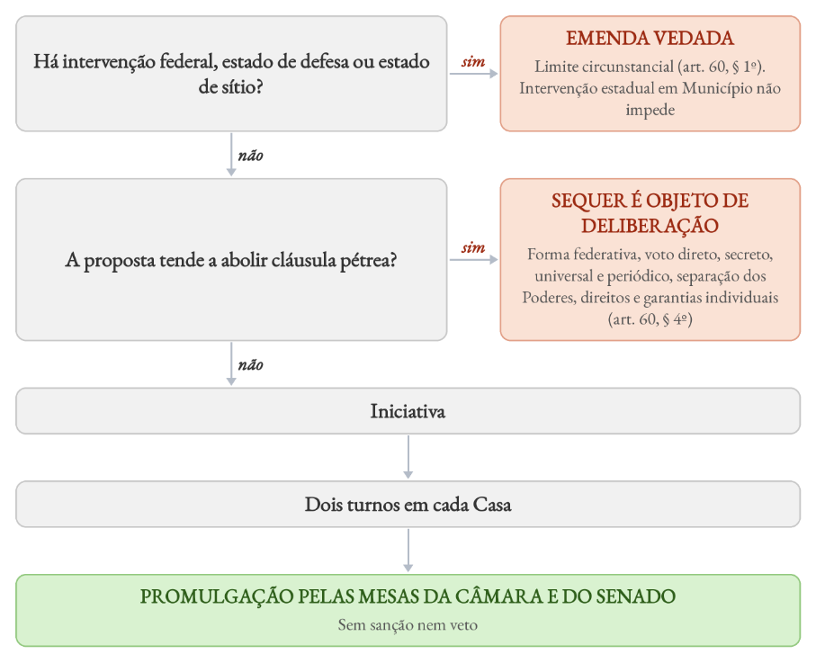
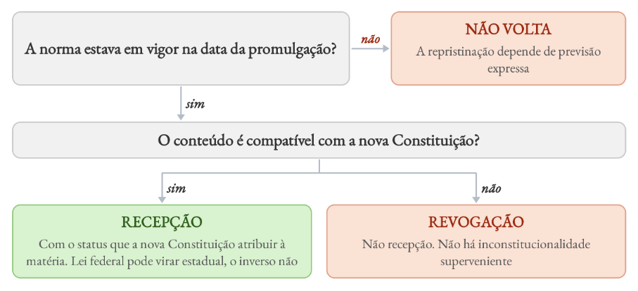
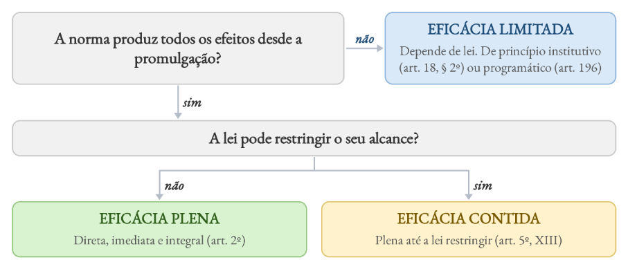

# Direito Constitucional

*Bloco I*

*Ponto 1 do edital: Constituição, constitucionalismo e neoconstitucionalismo*

:::JC_F2F2F2 
**1. Constituição, constitucionalismo e neoconstitucionalismo. Transconstitucionalismo. Poder constituinte originário e derivado. Reforma constitucional. Emendas constitucionais. Mutação constitucional. Direito constitucional intertemporal. Eficácia e aplicabilidade das normas constitucionais. Disposições constitucionais transitórias. Princípios fundamentais. Estado Democrático de Direito. República, Federação e separação de Poderes.**
:::

| **ESTUDO DE LEI SECA** | > |
|---|---|
| **DIPLOMA** | **DISPOSITIVOS** |
| **CF, princípios fundamentais** | Arts. 1º a 4º |
| **CF, eficácia** | Art. 5º, § 1º |
| **CF, poder decorrente** | Arts. 25, 29, 32 e 34, VII |
| **ADCT** | Arts. 2º, 3º, 8º e 19 |

## 1. Constituição, constitucionalismo e neoconstitucionalismo

O constitucionalismo moderno nasce das revoluções liberais (EUA, 1787, e França, 1789) com uma ideia: ==**limitar o poder**== pela separação de Poderes e pelos direitos individuais. Depois da Segunda Guerra, a Constituição passa a limitar também o legislador, e o foco se desloca para a ==**efetividade da Constituição**==. É o **neoconstitucionalismo**, também chamado de constitucionalismo **pós-positivista**.

A mudança não foi apenas histórica. Ela alterou a forma de compreender a Constituição: os direitos fundamentais ganharam centralidade, a Constituição passou a ==**irradiar efeitos sobre todo o ordenamento**== e a jurisdição constitucional se expandiu. Na formulação de Barroso, essa virada tem três marcos:

| **NEOCONSTITUCIONALISMO (BARROSO)** | > |
|---|---|
| **MARCO** | **CONTEÚDO** |
| **Histórico** | Constitucionalismo do pós-guerra. No Brasil, a CF de 1988 |
| **Filosófico** | Pós-positivismo: **reaproximação entre Direito, moral e justiça**. **Não separa Direito e moral** |
| **Teórico** | Força normativa da Constituição, expansão da jurisdição constitucional e nova interpretação constitucional |

Dessas três mudanças decorre a **constitucionalização do Direito**: todo o ordenamento passa pela "filtragem constitucional", e a lei se lê a partir da Constituição. Uma das críticas ao modelo é o risco de que a ampliação da força dos princípios e da jurisdição constitucional produza ==**decisões excessivamente abertas**==. Daniel Sarmento denominou esse excesso de **carnavalização dos princípios**.

## 1.1. Concepções de Constituição

Essa classificação é clássica. Tenta-se explicar o papel da Constituição na sociedade:

| **CONCEPÇÕES DE CONSTITUIÇÃO** | > | > |
|---|---|---|
| **AUTOR** | **CONCEPÇÃO** | **IDEIA** |
| **Ferdinand Lassalle** | Sociológica | Soma dos **fatores reais de poder**. O texto que não corresponde a eles é "folha de papel" |
| **Carl Schmitt** | Política | **Decisão política fundamental** do titular do poder constituinte. Distingue Constituição (as decisões) de leis constitucionais (o resto do texto) |
| **Hans Kelsen** | Jurídica | Norma suprema. Sentido jurídico-positivo (topo do ordenamento) e lógico-jurídico (norma fundamental hipotética) |
| **Konrad Hesse** | Força normativa | Reage ao determinismo de Lassalle: a Constituição não apenas reflete a realidade, **também pode conformá-la**, desde que exista **vontade de Constituição** |
| **Meirelles Teixeira** | Culturalista | Expressão da cultura de um povo, que ao mesmo tempo a condiciona. "Constituição total" |
| **Peter Häberle** | Aberta | A interpretação constitucional **não pertence apenas aos órgãos estatais**. Sociedade, grupos e instituições também participam, daí o valor do amicus curiae e das audiências públicas |
| **Zagrebelsky** | Dúctil | Em sociedade pluralista, a Constituição cria as condições da convivência, sem impor um projeto de vida |
| **Canotilho** | Moldura | Fixa os limites externos dentro dos quais o legislador decide. O STF a adotou para a CF/88 (ADI 4.650) |
| **Marcelo Neves** | Simbólica | A função simbólica prevalece sobre a jurídica: o texto existe, mas não se concretiza (**déficit de concretização**) |

## 1.2. Classificações

As classificações respondem a aspectos diferentes da Constituição: como surgiu, como foi elaborada, quanto pode ser alterada, como se relaciona com a realidade etc.

| **CLASSIFICAÇÃO DAS CONSTITUIÇÕES** | > | > |
|---|---|---|
| **CRITÉRIO** | **ESPÉCIES** | **CF/88** |
| **Origem** | Outorgada (imposta) · promulgada (votada)· **cesarista** (do detentor do poder, submetida a referendo, sem ser democrática) · pactuada | Promulgada |
| **Forma e sistemática** | Escrita ou costumeira (mesmo as costumeiras, porém, tem normas escritas). **Codificada** (documento único) ou não codificada | Escrita e codificada |
| **Modo de elaboração** | **Dogmática** (feita de uma vez, com os dogmas do momento), ortodoxa ou eclética. | Dogmática e eclética |
| **Estabilidade** | Imutável · rígida · semirrígida (só a de 1824) · flexível · **super-rígida** (rígida com cláusulas pétreas) | Rígida (majoritária) |
| **Realidade (Loewenstein)** | **Normativa** (regula o poder) · **nominal** (quer regular, mas não consegue) · **semântica** (só formaliza quem detém o poder, como a de 1937) | Normativa (majoritária) |
| **Conteúdo** | Material · formal | Formal |
| **Extensão e finalidade** | Sintética ou analítica. Garantia, **dirigente** ou balanço | Analítica e dirigente |
| **Ideologia** | Liberal · social | Social |

A rigidez é o que dá supremacia formal à Constituição. Na Constituição **flexível** ==**não há hierarquia formal**== entre Constituição e lei, e o conflito se resolve pelo ==**critério cronológico**==, e não pela especialidade.

Nesse sentido, afirma-se, com tranquilidade, que a **CF/88 é formal por inteiro**, pois **tudo que está nela só pode ser alterado mediante quórum qualificado de 3/5 dos votos da Câmara e do Senado.** Carrega consigo, no entanto, normas **formalmente e material constitucionais.** Exemplo de regra formal é o art. 242, § 2º (que trata do Colégio Pedro II).

As classificações se combinam. A Constituição feita de uma vez, com os valores do momento, é **dogmática**. Se nasceu para perpetuar quem está no poder, é também **semântica**. Se não consegue se projetar na realidade, **nominal**:

:::JC_FFE698 JÁ CAIU!
**FGV, TJ-PR, 2026.** Após o decurso de duas décadas desde a edição da Constituição do Estado de Direito Alfa, surgiram movimentos populares defendendo a necessidade de ser convocada uma Assembleia Constituinte. Esses movimentos observaram corretamente que a referida Constituição, aprovada em plebiscito popular e que podia ser alterada por meio do processo legislativo ordinário, retratou e petrificou os valores existentes no ambiente sociopolítico no momento de sua edição, conferindo-lhes força normativa. Além disso, apesar de ser intitulada de democrática, foi moldada com o objetivo de assegurar a perpetuação no poder da aristocracia dominante, considerando a forma como as instituições e o processo de escolha dos seus dirigentes foram estruturados. A Constituição do Estado de Direito Alfa pode ser classificada como. A) flexível e nominal. B) dirigente e ortodoxa. C) cesarista e normativa. D) plebiscitária e analítica. E) dogmática e semântica.¹
:::

:::JC_FFE698 JÁ CAIU!
**FGV, TJ-PE, 2024.** Após um longo processo revolucionário, as forças populares de libertação do país Alfa lograram êxito em afastar a aristocracia que dominava o poder há décadas. Ato contínuo, foi publicada a nova Constituição de Alfa, cujo texto foi elaborado pelo comitê revolucionário, integrado pelas lideranças do movimento. Foram incorporados ao texto constitucional os valores que norteavam a sociedade naquele momento e que direcionaram a revolução, os quais adquiriram caráter normativo. Apesar de muito avançada e de prestigiar o princípio democrático, a Constituição de Alfa apresentava algumas dissonâncias em relação ao ambiente sociopolítico, as quais, com o passar dos anos, se mostraram insuperáveis, impedindo a sua projeção na realidade. A Constituição de Alfa pode ser classificada como: A) histórica e dirigente. B) dogmática e nominal. C) ortodoxa e semântica. D) outorgada e normativa. E) autoconstituição e cesarista.²
:::

## 1.3. Constituições brasileiras

A evolução constitucional brasileira pode ser recuperada pelos seguintes marcos:

| **CONSTITUIÇÕES BRASILEIRAS** | > |
|---|---|
| **TEXTO** | **O QUE A IDENTIFICA** |
| **1824** | Outorgada. Monarquia, Estado unitário, **Poder Moderador (idealizado por Benjamin Constant)**, religião oficial católica, voto censitário. **Semirrígida** |
| **1891** | República, federação e presidencialismo. Cria a Justiça Federal. Garantiu a **representação da minoria** na Câmara. **Início do controle difuso de constitucionalidade no país.** |
| **1934** | Constitucionalismo social (Weimar). Cria o **mandado de segurança** e a **ação popular**. Voto secreto e feminino |
| **1937** | Conhecida como “Polaca” (por ser inspirada na Constituição da Polônia de 1935). Outorgada no Estado Novo. **Extingue a Justiça Federal**, a Justiça Eleitoral e os partidos. Suprime MS e ação popular |
| **1946** | Redemocratização. Cria o TFR. **Parlamentarismo entre 1961 e 1963**. **A EC 16/1965 introduz o controle concentrado** |

Constituição cesarista, que é a elaborada pelo próprio detentor do poder e só ratificada pelo povo, e normativa é a que efetivamente limita o poder, o contrário do caso. D usa critério que a doutrina não consagra (plebiscitária) e nada se sabe sobre a extensão do texto.

| **CONSTITUIÇÕES BRASILEIRAS** | > |
|---|---|
| **TEXTO** | **O QUE A IDENTIFICA** |
| **1967 e EC 1/1969** | Regime militar, federalismo centralizado, eleição indireta. AI-5 (1968) |
| **1988** | Analítica, compromissória e dirigente. **Municípios como entes federativos**, STJ, MS coletivo, habeas data, ADO e ADPF |

## 1.4. Estrutura e elementos da Constituição

A CF/88 tem preâmbulo, corpo permanente, ADCT, tratados de direitos humanos com status de emenda e emendas avulsas. Entre essas partes ==**não há hierarquia**==.

Os cinco elementos da Constituição, na lição de José Afonso da Silva:

| **ELEMENTOS DA CONSTITUIÇÃO** | > |
|---|---|
| **ELEMENTO** | **FUNÇÃO E EXEMPLO** |
| **Orgânicos** | Organizam o Estado e o poder (art. 18) |
| **Limitativos** | Direitos e garantias que limitam o poder (art. 5º, LIV) |
| **Socioideológicos** | Revelam a ideologia do texto (art. 170) |
| **De estabilização constitucional** | Defendem o Estado e o regime (art. 136, estado de defesa). **Controle concentrado está aqui também!** |
| **Formais de aplicabilidade** | Regras de aplicação da própria Constituição (art. 5º, § 1º, e preâmbulo) |

:::JC_DAE9F7 DICA DO PROFESSOR
Para decorar, lembre que os elementos são **F-E-S-O-L.**
:::

## 2. Transconstitucionalismo

O transconstitucionalismo, associado ao professor Marcelo Neves (cuja Alma Mater é, diga-se de passagem, a Universidade Federal de Pernambuco), parte da ideia de que **certos problemas constitucionais ultrapassam uma única ordem jurídica.**

A mesma controvérsia pode ser enfrentada simultaneamente por tribunais nacionais, internacionais ou supranacionais, ==**sem que uma dessas ordens seja necessariamente superior às demais**==. A solução depende de diálogo entre elas. O exemplo clássico é a controvérsia dos **pneus usados**, discutida na OMC, no Mercosul e no STF. Por isso, afirmar que é vedado ao juiz usar jurisprudência estrangeira ==**contraria a ideia**==.

:::JC_DAE9F7 NÃO CONFUNDA
**Transconstitucionalismo**: enfrentamento simultâneo do mesmo problema, ==**sem hierarquia**==.

**Cross-constitucionalismo**: empréstimo de argumentos e precedentes de outra ordem.
:::

## 3. Poder constituinte

O Abade de Sieyès (1788) separou **poder constituinte** e **poderes constituídos**. A distinção é importante porque o poder constituinte ==**cria a ordem jurídica**==, enquanto os poderes constituídos passam a atuar ==**dentro dela**==. Para Sieyès, o titular era a **nação**.

Hoje o titular é o ==**povo**== (art. 1º, parágrafo único), que não se confunde com população, conceito demográfico. Para mim, o povo é o grupo de alunos @Jusconc, mas isso é assunto para outro momento.

Vamos de tabela!

**PODER CONSTITUINTE · QUEM CRIA E QUEM ATUA DENTRO DA ORDEM**

Vamso comparar o originário com o derivado:

| **PODER CONSTITUINTE · ORIGINÁRIO × DERIVADO** | > | > |
|---|---|---|
| **PONTO** | **ORIGINÁRIO** | **DERIVADO** |
| **Características** | Inicial, autônomo, **juridicamente ilimitado**, incondicionado, inalienável e **permanente** (fica latente no povo) | Derivado, **subordinado** e **condicionado** |
| **Limites** | Só metajurídicos: ideológicos, institucionais e substanciais (Jorge Miranda), inclusive os direitos humanos | Expressos e implícitos, fixados pelo originário |
| **Controle** | **Não há norma originária inconstitucional** (rejeitada a tese de Bachof) nem hierarquia entre normas originárias | Normas sujeitas a controle |
| **Direito adquirido** | **Não se opõe** à norma originária | Protegido (art. 5º, XXXVI) |

## 3.1. Poder decorrente

O poder decorrente é dos **Estados**, que elaboram e reformam as suas Constituições, e do **Distrito Federal**, cuja Lei Orgânica ==**se equipara a Constituição estadual**== e serve de parâmetro de controle.

Lembrem-se, contudo, que os **Municípios** ==**não exercem poder decorrente**==: a Lei Orgânica municipal observa duas ordens, a federal e a estadual, e o ato contrário a ela gera controle de legalidade.

O poder decorrente não é livre. Os Estados devem respeitar três grupos de limitações constitucionais:

Ø **sensíveis**, cuja violação pode autorizar ==**intervenção federal**== (art. 34, VII),³ Ø **estabelecidos**, dispersos pela Constituição, como a repartição de competências, Ø **extensíveis**, formados por regras federais que ==**também se projetam sobre os Estados**==, como as do processo legislativo.

%% Chance alta TRF5

Vejamos, na jurisprudência do STF, casos em que o tema dos limites ao poder decorrente foi enfrentado na prática:

:::JC_D9F2D0 JURISPRUDÊNCIA
**Aposentadoria de servidor:** As regras da CF sobre aposentadoria dos servidores efetivos são **normas de reprodução obrigatória** nas Constituições estaduais. A Constituição do Piauí que fixou critério diverso do art. 40, § 1º, II, invadiu a competência da União para normas gerais de previdência (art. 24, XII) e ==**extrapolou os limites do poder decorrente reformador**==. A mudança posterior da idade pela EC 88/2015 ==**não convalidou**== a norma. *ADI 4.696, rel. min. Edson Fachin, j. 30-6-2017, P, DJE de 14-9-2017.* **Reserva de lei complementar.** A lei complementar não é hierarquicamente superior à ordinária, mas exige maioria absoluta (art. 69). Criar reserva de lei complementar fora das hipóteses da CF dificulta a deliberação de maiorias legislativas. Por isso **o constituinte estadual** ==**não pode ampliar essa reserva**== por conta própria. *ADI 5.003, rel. min. Luiz Fux, j. 5-12-2019, P, DJE de 19-12-2019.* **Chefia da Procuradoria do Estado.** A CF não fixou critérios para a escolha do Procurador-Geral do Estado e deixou a matéria ao **poder constituinte decorrente**, em respeito à autonomia estadual. ==**Não se aplicam, por simetria**==, os requisitos para o cargo de Advogado-Geral da União. *ADI 2.820, rel. min. Nunes Marques, j. 5-6-2023, P, DJE de 13-7-2023.*
:::

## 3.2. Poder revisor

O revisor do art. 3º do ADCT ==**esgotou-se**==. Em 1993 e 1994, em ==**sessão unicameral e por maioria absoluta**==, produziu seis Emendas de Revisão.

:::JC_DAE9F7 NÃO CONFUNDA
**Sessão Unicameral** x **Sessão Conjunta - Sessão conjunta (art. 57, § 3º, CF):** deputados e senadores reúnem-se no mesmo contexto, mas as Casas mantêm sua autonomia, com votação e apuração separadas. Exemplo: deliberação sobre vetos presidenciais, cuja rejeição exige maioria absoluta tanto dos deputados (257) quanto dos senadores (41).
:::

:::JC_DAE9F7 
**- Sessão unicameral (art. 3º do ADCT):** deputados e senadores reúnem-se como um único órgão deliberativo, com votação e apuração conjuntas, sem distinção entre as Casas. Exemplo citado acima foi a revisão de 93 (não há outros relevantes no texto).
:::

## 4. Reforma constitucional e emendas constitucionais

O poder de reforma existe dentro da Constituição e, por isso, ==**não dispõe da mesma liberdade do constituinte originário**==. Ele se submete a limites de forma, de circunstância e de conteúdo. O caminho da emenda é este:

**EMENDA CONSTITUCIONAL · DA PROPOSTA À PROMULGAÇÃO**

Além dos limites expressos, há os **implícitos**: a titularidade do poder constituinte, a vedação de facilitar o próprio processo de reforma, entre outros. Por isso, **não se admite a teoria da dupla revisão no Brasil** (revoga-se a proibição e depois se normatiza o que antes era proibido).

Duas decisões recentes mostram como o STF lida com as emendas. Na tramitação de EC, o STF ==**não revisa a aplicação das normas regimentais**== das Casas: por isso a EC 19/1998, que revogou o regime jurídico único, ==**não violou o devido processo legislativo**== (ADI 2.135, com efeitos ex nunc).

E a emenda pode ser usada, inclusive, para **superar decisão do próprio STF**: depois da ADI 4.983, a EC 96/2017 protegeu a vaquejada, e o Tribunal a validou desde que garantido o bem-estar animal, sem alcançar a farra do boi nem a rinha de galos (ADI 5.772, 2026).

## 5. Mutação constitucional

A mutação constitucional altera o **sentido** da Constituição sem modificar o seu **texto**. É um processo informal, produzido pela interpretação e pela prática constitucional, obra do chamado **poder constituinte** ==**difuso**==. Ocorre pela interpretação judicial ou administrativa, pela atuação do legislador e pelos costumes.

Mas encontra limite no próprio texto e no núcleo protegido da Constituição: não pode contrariar texto que não comporte outra leitura nem atingir o conteúdo essencial das cláusulas pétreas⁴. Ultrapassados esses limites, fala-se em ==**mutação inconstitucional**==.

Nos casos abaixo, o STF mudou o sentido da Constituição sem que o texto mudasse:

| **MUTAÇÃO CONSTITUCIONAL · CASOS DO STF** | > | > | > |
|---|---|---|---|
| **TEMA** | **LEITURA ANTERIOR** | **LEITURA ATUAL** | **JULGADO** |
| **Art. 52, X, e controle difuso** | A decisão incidental do STF só valia para as partes. O Senado suspendia a lei para estender os efeitos | A declaração de inconstitucionalidade pelo Plenário, **mesmo no controle difuso**, já tem eficácia erga omnes e efeito vinculante. O Senado apenas **dá publicidade** à decisão | ADI 3.406/RJ e ADI 3.470/RJ, rel. min. Rosa Weber, j. 29/11/2017 (Info 886) |
| **Art. 52, X, e repercussão geral** | Idem. | A mutação alcança as decisões em **recurso extraordinário com repercussão geral**, que também produzem efeitos erga omnes e vinculantes | [Chance alta TRF5] **Caso da coisa julgada inconstitucional em matéria tributária:** RE 955.227/BA (Tema 885) e RE 949.297/CE (Tema 881), j. 8/2/2023 (Info 1082) |
| **Licença prévia para processar Governador** | Válida a Constituição estadual que exigia autorização da Assembleia para o STJ receber denúncia (ADI 4.791, 2015) | **Inconstitucional** exigir a autorização. O afastamento do cargo **não é automático**: o STJ decide, fundamentadamente, ao receber a denúncia, e pode aplicar outras cautelares | ADI 4.777, 4.674 e 4.362, red. p/ acórdão min. Roberto Barroso, j. 9/8/2017 (Info 872). ADI 5.540/MG, j. 3/5/2017 (Info 863) |

## 6. Direito constitucional intertemporal

A nova Constituição ==**revoga integralmente**== a anterior, sem exame dispositivo por dispositivo. A **desconstitucionalização**, que receberia dispositivos antigos como lei, ==**não foi**==

==**adotada**== e só existiria por previsão expressa. Para o direito infraconstitucional, o critério é só material:

**O QUE ACONTECE COM O DIREITO ANTERIOR QUANDO CHEGA UMA NOVA**

**CONSTITUIÇÃO**

:::JC_DAE9F7 DICA DO PROFESSOR
**PARA QUE FIQUE CLARO (Isso foi até uma dúvida da Enilda, aluna do curso, no grupo do whatsapp):** se tínhamos várias leis estaduais anteriores, todas compatíveis com a Constituição, mas há uma mudança de competência legislativa, é absolutamente inviável que haja a recepção. O contrário, não. A legislação federal pode passar a ser considerada como regra até que os Estados editem suas próprias leis.
:::

Quanto ao tempo, a nova Constituição tem, em regra, **retroatividade mínima**: alcança os efeitos futuros de fatos passados.

É que, para haver retroatividade média ou máxima, exige-se previsão expressa (RE 140.499). Então por mais que a CF seja “ilimitada”, não se presume essa retriação.

Isso vale para normas **federais**, e as estaduais se sujeitam ao art. 5º, XXXVI. Como recepção não é declaração de inconstitucionalidade, para a jurisprudência tradicional do STF, o juízo de recepção ==**dispensa reserva de plenário**== (AO 2.870).⁵

A mesma lógica se aplica às **emendas**: a lei anterior incompatível é revogada, ==**ainda que a norma da emenda seja de eficácia limitada**==, porque a eficácia negativa existe desde a promulgação:

:::JC_FFE698 JÁ CAIU!
**FGV, TJ-SE, 2025.** Em determinada relação processual, discutia-se incidentalmente a compatibilidade da Lei Municipal nº X com a Constituição da República. A questão central cingia-se à identificação da possibilidade de esse diploma normativo ser aplicado apesar de colidir com o superveniente Art. Y da
:::

:::JC_FFE698 
Emenda Constitucional nº X, que tinha a natureza de norma de eficácia limitada e de princípio programático. Ao analisar o caso, o órgão jurisdicional competente decidiu, corretamente, que: A) como a eficácia do Art. Y é limitada, a sua existência não compromete a aplicação da Lei Municipal nº X. B) apesar de carecer de regulamentação para a integração de sua eficácia, o Art. Y revogou a Lei Municipal nº X. C) a revogação, ou não, da Lei Municipal nº X deve ser avaliada em consonância com a lei que integrar a eficácia do Art. Y. D) a análise da referida compatibilidade somente pode ser realizada em sede de arguição de descumprimento de preceito fundamental. E) o fato de ser um princípio programático indica que o Art. Y tem a função de direcionamento político, somente podendo ser cotejado com norma da mesma natureza.⁶
:::

## 7. Eficácia e aplicabilidade das normas constitucionais

A diferença entre normas plenas, contidas e limitadas está no ==**grau de aplicabilidade que possuem desde a promulgação**==. A pergunta que resolve a classificação é se a norma já produz todos os seus efeitos e se a lei pode restringi-los:

**EFICÁCIA DAS NORMAS CONSTITUCIONAIS**

Na norma de eficácia **contida,** o legislador atua para **conter** os efeitos da norma constitucional. Se a Constituição diz “é livre o exercício do trabalho, **nos termos da lei”,** o legislador pode, em seus termos, dizer: não vou deixar qualquer um realizar um procedimento cirúrgico. Exigirei formação em curso superior. Esse é o espírito da norma de eficácia contida.

Por outro lado, temos a norma de eficácia limitada, que exigirá complementação normativa para que deixe de sofrer de “limitações” e passe a produzir todos os seus efeitos. Mas veja: ela ==**produz alguns efeitos desde a promulgação**==, como, por exemplo, quando revoga o direito anterior incompatível, vincula o legislador, orienta a interpretação e é parâmetro de controle.

A **eficácia limitada não significa, portanto, ausência de efeitos jurídicos**. Mesmo antes da lei integradora, a norma pode impedir retrocessos incompatíveis com a Constituição.

É nesse contexto que se critica a chamada **teoria de bloqueio** do Estado Social, de visão legicêntrica, que exigiria lei para toda norma programática. Atingido um patamar de concretização, a supressão sem substituição viola a ==**proibição do retrocesso**== (ADPF 747 e 749, revogação de resoluções do CONAMA).

%% Chance alta TRF5

Quando a Constituição exige complementação legislativa, a simples ausência da lei ==**não basta para caracterizar mora**==. O STF considera o tempo decorrido, as providências adotadas e a complexidade da matéria, e exige ==**reticência injustificável**==.

==**Reconheceu a mora**== no adicional de penosidade (ADO 74) e na tipificação da retenção dolosa de salário (ADO 82, 2025), e a afastou quando havia processo de implementação em curso, como na polícia penal (ADO 88).

:::JC_DAE9F7 Atualização legislativa
A omissão da **licença-paternidade**, reconhecida na ADO 20, foi suprida pela **Lei nº 15.371/2026**: dez dias em 2027, quinze em 2028 e ==**vinte dias a partir de 2029**==, com salário-paternidade no RGPS.
:::

## 8. Disposições constitucionais transitórias

O ADCT tem **regras de transição** e **regras temporárias**, que perdem eficácia por ==**exaurimento do objeto**==. Tem o ==**mesmo status das demais normas constitucionais**==: só muda por emenda e serve de parâmetro. As **emendas avulsas** (que existem mas não alteram formalmente a CF) também, como a EC 106/2020 (orçamento de guerra), revogada com o fim da calamidade.

No ADCT, alguns dispositivos aparecem com frequência: Ø O **art. 8º** concede anistia aos atingidos por atos de exceção de motivação exclusivamente política, de 18/9/1946 a 5/10/1988. Ø O **art. 19** deu ==**estabilidade sem efetividade**== aos servidores não concursados que estavam em exercício havia cinco anos continuados em 5/10/1988, excluídos os cargos em comissão e as funções de confiança. Esses servidores estabilizados ==**não se submetem ao regime próprio de previdência**== (Tema 1.254 do STF). Ø O **art. 68** prevê que aos remanescentes das comunidades dos quilombos que estejam ocupando suas terras é reconhecida a propriedade definitiva, devendo o Estado emitir-lhes os títulos respectivos.

## 9. Princípios fundamentais

Os arts. 1º a 4º distribuem fundamentos, separação de Poderes, objetivos e princípios das relações internacionais:

| **OS PRINCÍPIOS FUNDAMENTAIS** | > | > |
|---|---|---|
| **DISPOSITIVO** | **CONTEÚDO** | **MNEMÔNICO E DESTAQUE** |
| **Art. 1º, caput** | União indissolúvel de Estados, Municípios e DF, em Estado Democrático de Direito | Território não integra |
| **Art. 1º, I a V (fundamentos)** | Soberania, cidadania, dignidade da pessoa humana, valores sociais do trabalho e da livre iniciativa, pluralismo político | **SO-CI-DI-VA-PLU** |
| **Art. 1º, parágrafo único** | Todo o poder emana do povo, por representantes ou diretamente | Democracia semidireta |
| **Art. 2º** | Poderes **independentes e harmônicos** | Cláusula pétrea |
| **Art. 3º (objetivos)** | Construir sociedade livre, justa e solidária, garantir o desenvolvimento nacional, erradicar a pobreza e a marginalização e reduzir as desigualdades, promover o bem de todos | **CON-GA-ERRA-PRO**. Verbos no infinitivo |
| **Art. 4º (relações internacionais)** | Independência nacional, prevalência dos direitos humanos, autodeterminação, não intervenção, igualdade entre os Estados, defesa da paz, solução pacífica, repúdio ao terrorismo e ao racismo, cooperação, **asilo político** | **CONDE PRESO NÃO REINA COOPERA IGUAL** |
| **Art. 4º, parágrafo único** | Integração dos povos da **América Latina** | **Não "sul-americana"** |

Não confunda **soberania** com **independência nacional**. A primeira é ==**fundamento da República**== (art. 1º, I), a segunda rege as relações internacionais (art. 4º, I).

Por fim, o asilo político é ato de ==**soberania**==, discricionário, do Presidente da República, e por isso ==**não é direito fundamental**== do estrangeiro (Ext 524):

:::JC_FFE698 JÁ CAIU!
**FGV, TRF5, 2025.** A República Federativa do Brasil tem as suas relações internacionais regidas por princípios listados na Constituição Federal. Entre esses princípios se encontra: A) a concessão de asilo político. B) o repúdio à misoginia. C) o combate ao crime organizado e ao tráfico de drogas. D) a preservação das fronteiras nacionais. E) a defesa do livre comércio.⁷
:::

## 10. Estado Democrático de Direito, República, Federação e separação de Poderes

O **Estado Democrático de Direito** combina duas exigências: o poder ==**se submete ao Direito**== e sua legitimidade ==**deriva da participação democrática**==. A erosão desse modelo por meios formalmente válidos, com líderes eleitos que alteram o ordenamento para concentrar poder, é o **constitucionalismo abusivo** (David Landau), expressão já usada pelo STF (ADPF 622).

A **República** envolve eletividade, temporariedade e responsabilidade dos governantes. Daí a exigência de publicidade no exercício do poder: por exemplo, o processo sancionador de agência reguladora contra concessionária ==**é público em toda a tramitação**==, salvo sigilo legal (ADI 5.371).

A **Federação** protege a autonomia dos entes e é cláusula pétrea. No Brasil, formou-se historicamente por movimento **centrífugo**, embora a Constituição concentre parcela relevante das competências na União, o que a torna ==**centrípeta na repartição**==.

A **separação de Poderes** não significa isolamento. Os Poderes são independentes, mas exercem ==**controles recíprocos**== e podem desempenhar funções atípicas. Três julgados recentes mostram o equilíbrio:

| **SEPARAÇÃO DE PODERES · JULGADOS RECENTES** | > |
|---|---|
| **JULGADO** | **O QUE FOI DECIDIDO** |
| **ADPF 366 (2025)** | Extrapolado de forma irrazoável o prazo do parecer prévio do Tribunal de Contas, **o Legislativo pode julgar** as contas do Governador |
| **ADI 5.705 (2025)** | Controle interno e externo são autônomos. **Inconstitucional** exigir que o controle interno atue "por determinação do Tribunal de Contas" |
| **ARE 1.499.584 AgR (2025)** | Sem lei, não se impõe a shopping center creche para as empregadas das lojas: seria atuar como **legislador positivo** |

No ponto 1, terminamos. Por uma questão de organização, decidi criar tópico próprio para o segundo bloco de temas da aula: **hermenêutica constitucional.** Avançemos!

*Ponto 2 do edital: Hermenêutica constitucional*

:::JC_F2F2F2 
**2. Hermenêutica constitucional. Métodos e princípios de interpretação e concretização constitucional. Interpretação dos direitos fundamentais. Colisão de normas e direitos fundamentais. Proporcionalidade e razoabilidade. Lacunas e integração. Interpretação conforme a Constituição. Declaração de inconstitucionalidade sem redução de texto. Limites da interpretação constitucional.**
:::

## 1. Regras, princípios e postulados

Regras e princípios são espécies de norma, sem hierarquia entre si. A diferença está no modo de aplicação:

| **REGRAS × PRINCÍPIOS** | > | > |
|---|---|---|
| **PONTO** | **REGRAS** | **PRINCÍPIOS** |
| **Aplicação** | Subsunção, **tudo ou nada** | **Ponderação**, conforme o peso |
| **Conflito** | Uma regra é afastada (especialidade, invalidade ou cláusula de exceção) | Colisão **sem invalidade** |
| **Alexy** | Mandamentos de definição | **Mandamentos de otimização** |

## 2. Métodos e correntes de interpretação

O método clássico trata a Constituição como lei. Os métodos contemporâneos nascem da insuficiência dos elementos tradicionais diante dos casos difíceis:

| **MÉTODOS DE INTERPRETAÇÃO CONSTITUCIONAL** | > | > |
|---|---|---|
| **MÉTODO** | **AUTOR** | **IDEIA** |
| **Clássico** | Forsthoff (Savigny) | Constituição como lei. Elementos gramatical, lógico, histórico e sistemático. **Não opera com valores** |
| **Tópico-problemático** | Viehweg | **Do problema para a norma**. Na **tópica pura**, o texto é só um ponto de vista e pode ser deixado de lado |
| **Hermenêutico- concretizador** | Hesse | **Da norma para o problema**. Pré-compreensão e círculo hermenêutico. **O texto é limite** |
| **Científico-espiritual** | Smend | Ordem de valores e integração com a realidade da comunidade |
| **Normativo-estruturante** | Müller | **Texto não é norma**. Norma é programa normativo mais domínio normativo |
| **Concretista aberto** | Häberle | Sociedade aberta dos intérpretes. **Pensamento do possível** |

:::JC_DAE9F7 TRADUZINDO
Vamos traduzir algumas expressões que já foram abordadas na FGV:
:::

:::JC_DAE9F7 
**1) Significante** é o texto, **significado** é o sentido. **2) Conflitualidades intrínsecas** são as tensões entre os sentidos possíveis, resolvidas nos planos **linguístico**, **axiológico** e **teleológico**. **3)** No **plano cognoscitivo**, o intérprete descobre um sentido ==**imanente**== ao texto. **4)** No **plano decisório**, ele constrói o sentido, o que ==**aproxima criação e aplicação do Direito**== e torna possível a mutação.
:::

As correntes de interpretação se distinguem pelo peso que dão ao texto, aos valores e ao caso concreto:

| **CORRENTES DE INTERPRETAÇÃO** | > |
|---|---|
| **CORRENTE** | **TRAÇO CARACTERÍSTICO** |
| **Formalismo e jurisprudência dos conceitos** | Interpretação cognoscitiva, sentido imanente, lógica dedutiva. Juiz "boca da lei" |
| **Originalismo** | Sentido do momento da edição. **Separa criação e aplicação** e resiste à mutação |
| **Jurisprudência dos interesses (Heck)** | Considera **fins** e aspectos sociais, morais e econômicos. Refratária ao formalismo |
| **Jurisprudência dos valores** | Valores constitucionais orientam a interpretação e a ponderação |
| **Escola do Direito Livre (Kantorowicz)** | Prevalência do **sociológico**, **inclusive contra o texto** |
| **Realismo jurídico** | O Direito é o que os tribunais decidem. O caso e os valores do julgador podem **afastar o texto** |
| **Lógica do razoável (Recaséns Siches)** | [Chance alta TRF5] Interpretação pelo razoável, pelos valores e fins, e não pela lógica formal |
| **Kelsen** | O texto é uma **moldura**. A escolha dentro dela é ato de vontade, e não só de conhecimento |
| **Pragmatismo (Posner)** | Decisão orientada pelas consequências |

Quem combina **texto, valores e problema** decide, aproxima criação e aplicação e é sensível ao pensamento problemático, mas ==**não adota a tópica pura**==, que dispensa o texto. Quem nega influência das peculiaridades do caso é ==**refratário à tópica**==.

:::JC_FFE698 JÁ CAIU!
**FGV, TJ-PE, 2026.** João ajuizou ação em desfavor do Município de Sigma, tendo por objeto a alegada inobservância de um direito fundamental de primeira dimensão consagrado em norma de eficácia limitada e princípio programático. De acordo com a petição inicial, o Art. X da Constituição da República, que consagra esse direito, deve ser interpretado em conformidade com os padrões axiológicos colhidos no ambiente sociopolítico, sendo plenamente factível a produção de efeitos jurídicos em momento anterior à edição da legislação regulamentar. Em contestação, argumentou o Município de Sigma que o processo de atribuição de significado ao referido Art. X deve considerar outros fatores relevantes por ocasião da resolução das conflitualidades intrínsecas da norma constitucional, a exemplo dos linguísticos, que estabelecem os balizamentos textuais para o desenvolvimento da atividade do intérprete, e dos teleológicos, não podendo se limitar aos padrões axiológicos invocados por João, o que pode resultar em significado diverso daquele sustentado na petição inicial. Após o regular desenvolvimento da relação processual, o magistrado competente, ao analisar o caso, observou de maneira correta que: A) as linhas argumentativas de João e do Município de Sigma se harmonizam com a tópica pura e a jurisprudência dos valores. B) a tese de que o Art. X produz efeitos da forma defendida por João é incompatível com a sistemática constitucional. C) as linhas argumentativas de João e do Município de Sigma se harmonizam com a concepção normativa defendida pela Escola do Direito Livre. D) a linha argumentativa defendida por João é compatível com a lógica do razoável e a do Município de Sigma é incompatível com o confinamento da atividade do intérprete ao plano puramente cognoscitivo. E) a utilização de referenciais semióticos, nas linhas argumentativas de João e do Município de Sigma, não obsta que esses referenciais sejam desconsiderados em prol de significados que se ajustem ao pragmatismo.⁸
:::

:::JC_FFE698 Chance alta TRF5 · JÁ CAIU!
**FGV, TJ-BA, 2026.** Ao interpretar o Art. X da Constituição da República, que consagrava um direito fundamental, o magistrado competente constatou a existência de uma pluralidade de valores, alguns deles contrapostos, que apresentavam correlação com o enunciado linguístico interpretado e influenciavam no surgimento de significados diversos, considerando o potencial expansivo da linguagem. Após resolver as conflitualidades intrínsecas nos planos linguístico e axiológico, delineou a norma que lhe parecia adequada à luz das especificidades do problema concreto. Considerando a situação descrita, é correto afirmar que: A) a norma constitucional obtida a partir do processo intelectivo realizado pelo magistrado tem natureza principiológica. B) o processo intelectivo realizado pelo magistrado está amparado pelos métodos de interpretação preconizados por Savigny. C) o processo intelectivo realizado pelo magistrado não se ajusta à tópica pura, mas é compatível com a declaração parcial de inconstitucionalidade sem redução de texto. D) a separação entre os referenciais de sujeito e objeto norteou o processo intelectivo realizado pelo magistrado, que desenvolveu uma atividade puramente cognoscitiva da norma. E) a consideração simultânea de referenciais linguísticos e axiológicos é contraditória, sendo incompatível com a interpretação, pois apenas os primeiros ocupam o plano deontológico.⁹

%% JÁ CAIU!

**FGV, TRF6, 2025.** O demandante, ao interpretar o Art. Z da Constituição da República, sustentou, em uma relação processual, a existência de uma aproximação entre os momentos de criação e aplicação do Direito, que legitimam a modificação de significados normativos apesar da imutabilidade dos significantes a que se referem, o que sofre grande influência dos aspectos situacionais e do problema concreto. O demandado, por sua vez, observou que a interpretação do Art. Z não
:::

Art. X pelos "padrões axiológicos colhidos no ambiente sociopolítico". O segundo é a distinção entre atividade **cognoscitiva** e **decisória**. Na cognoscitiva, o intérprete apenas descobre um sentido que já estaria pronto no texto. Na decisória, ele escolhe entre os sentidos possíveis, ponderando texto, valores e fins. O Município, ao falar em resolver as "conflitualidades intrínsecas" com fatores linguísticos e teleológicos, descreve uma escolha, e por isso a sua tese é ==**incompatível com o confinamento ao plano puramente cognoscitivo**==. Em termos kelsenianos, o texto é uma moldura, e escolher dentro dela é ato de vontade. A erra porque a tópica pura trata o texto como ponto de vista descartável, e o Município insiste nos balizamentos textuais. B erra porque a norma de eficácia limitada produz efeitos jurídicos desde a promulgação, de modo que a tese de João não é incompatível com o sistema. C erra porque a Escola do Direito Livre admite decidir até contra a lei, o que o Município rejeita. E erra porque nenhuma das partes admite abandonar o texto em favor do pragmatismo, e, para Hesse, o texto é limite da concretização.

:::JC_FFE698 
pode descurar de aspectos sociais, morais, econômicos etc., o que é influenciado pela realidade e pelos fins subjacentes ao padrão normativo interpretado. Ao analisar essas linhas argumentativas, o Magistrado observou corretamente que a interpretação apresentada pelo. A) demandante é compatível com a tópica pura e com a metódica estruturante. B) demandante é refratária ao originalismo e harmônica com a jurisprudência dos conceitos. C) demandado é refratária ao formalismo clássico e harmônica com a jurisprudência dos interesses. D) demandante é harmônica com os métodos de interpretação preconizados por Savigny e com a lógica do razoável. E) demandado é compatível com a necessidade de resolução das conflitualidades intrínsecas ao plano axiológico, mas refratária à sociedade aberta dos intérpretes da Constituição.¹⁰

%% JÁ CAIU!

**FGV, TJ-TO, 2025.** Em ação ajuizada em face de ente federativo subnacional, o demandante alicerçou sua pretensão em preceito constitucional que abrigava direito fundamental de primeira dimensão, sustentando que a essencialidade desses direitos lhes conferia uma posição de preeminência no sistema, de modo que os seus efeitos jurídicos não poderiam ser afastados ou amenizados pela necessidade de proteção de outros bens e valores constitucionais. O ente demandado, por sua vez, sustentou que nenhum preceito constitucional pode ser interpretado de forma dissociada da situação concreta e da base de valores que lhe dá sustentação, as quais podem afastar o alicerce semiótico utilizado no início do processo de interpretação, de modo que o intérprete delineie a norma que realize a justiça na situação sub judice. Ao proferir sua sentença, o magistrado observou corretamente que os argumentos do: A) demandado são refratários à tópica pura. B) demandado se ajustam às concepções originalistas. C) demandado são compatíveis com o realismo jurídico. D) demandante se ajustam à teoria externa dos direitos fundamentais. E) demandante se harmonizam com a concepção de que os direitos fundamentais apresentam um conteúdo prima facie.¹¹
:::

:::JC_FFE698 JÁ CAIU!
**FGV, TJ-CE, 2025.** Determinado Juiz de Direito, ao interpretar os preceitos constitucionais, parte da premissa de que a higidez textual não deve desnaturar a evolutividade da norma constitucional. Afinal, a polissemia textual e as vicissitudes da realidade fazem com que o intérprete desenvolva uma atividade essencialmente decisória, de modo que, a partir da resolução das conflitualidades intrínsecas que podem se apresentar no curso do processo de interpretação, deve atribuir o significado adequado ao significante interpretado. Considerando a forma de compreensão do Juiz de Direito a respeito da interpretação constitucional, assinale a afirmativa correta. A) Há uma separação entre os momentos de criação e aplicação da norma constitucional. B) Concepções originalistas devem ser preferidas por se aproximarem da concepção de justiça material. C) Aproxima-se da constituição em sentido sociológico, mas se distancia de sua perspectiva puramente cultural. D) Referenciais axiológicos não podem influir no delineamento de conteúdos deontológicos com alicerce semiótico. E) Apesar de não se harmonizar com as bases de desenvolvimento da tópica pura, não é refratária ao pensamento problemático.¹²

%% JÁ CAIU!

**FGV, TJ-SE, 2025.** Em uma relação processual, o juiz de direito competente, ao receber os autos conclusos para sentença, constatou que a causa de pedir versava sobre a interpretação do Art. X da Constituição da República. Ao delinear o conteúdo normativo desse preceito, o magistrado observou que as peculiaridades do caso concreto conferiam maior importância a determinados valores e não a outros, embora todos estivessem albergados pela Constituição brasileira, de natureza compromissória. Ao prestigiar os valores de maior importância, por ocasião da resolução das conflitualidades intrínsecas identificadas no curso do processo de interpretação, o magistrado atribuiu ao significante interpretado um significado distinto daquele defendido pelas partes. Na situação descrita na narrativa, é correto afirmar que: A) ao atribuir preeminência a alguns valores em detrimento de outros, o magistrado aderiu ao realismo jurídico, distanciando-se da tópica. B) o proceder do magistrado aproximou os momentos de criação e de aplicação do direito, distanciando-se do originalismo e se mostrando sensível ao pensamento problemático.
:::

apenas **prima facie** e pode ser restringido de fora, depois da ponderação. A tese do demandante se aproxima da teoria interna, ou da ideia de um núcleo absoluto.

:::JC_FFE698 
C) ao levar em consideração referenciais axiológicos para o delineamento de um padrão deontológico, o magistrado se distanciou da denominada interpretação constitucional. D) é traço fundamental de uma constituição compromissória que haja equidistância entre as ideologias e os referenciais axiológicos que alberga, de modo que o magistrado não poderia prestigiar alguns em detrimento de outros. E) apesar de o significado normativo apresentar uma relação de sobreposição com o significante interpretado, a dissociação entre ambos é admitida apenas em relação à oscilação dos valores, não em razão de aspectos do problema concreto.¹³

%% JÁ CAIU!

**FGV, TJ-PE, 2024.** Em determinado órgão jurisdicional colegiado, foi analisada a interpretação a ser dispensada a certo artigo da Constituição da República. Durante a prolação dos votos, a magistrada Maria sustentou que, no processo de interpretação, deve prevalecer um discurso de contornos sociológicos, em que preponderam as necessidades do ambiente sociopolítico. A magistrada Joana, por sua vez, defendeu que a preponderância deve ser atribuída ao discurso sociossemiótico, em que tanto os aspectos da linguagem como as necessidades do contexto devem influenciar no delineamento dos significados. Por fim, a magistrada Aline defendeu que o discurso semiótico deve preponderar, de modo que a linguagem direcione as conclusões do intérprete. À luz dessas concepções do processo de interpretação, é correto afirmar, em relação às construções de Maria, Joana e Aline, que: A) nenhuma delas se harmoniza com o formalismo. B) apenas as de Aline se harmonizam com a tópica pura. C) apenas as de Joana se harmonizam com o realismo jurídico. D) apenas as de Maria se harmonizam com a Escola do Direito Livre. E) apenas as de Joana e de Aline se harmonizam com o originalismo.¹⁴

%% JÁ CAIU!

**FGV, TJ-MT, 2024.** Um dos integrantes do Tribunal de Justiça do Estado Alfa afirmou, durante o julgamento de uma ação em que se discutia temática constitucional, que "as peculiaridades do caso concreto não devem ser consideradas pelo intérprete ao conduzir o processo intelectivo, de viés argumentativo e
:::

:::JC_FFE698 
decisório, que culminará no delineamento do significado a ser atribuído ao significante interpretado, o que é essencial para a preservação da coerência interna do ordenamento jurídico e para assegurar a isonomia na sua aplicação". Considerando a afirmação realizada, é correto afirmar que ela: A) é refratária à mutação constitucional. B) é compatível com a técnica da ponderação. C) indica uma adesão às concepções próprias do originalismo. D) indica uma adesão às concepções próprias do realismo jurídico. E) é refratária à influência da tópica na interpretação constitucional.¹⁵
:::

## 2.1. Princípios de interpretação

Os princípios de interpretação orientam a escolha entre os sentidos possíveis do texto:

| **PRINCÍPIOS DE INTERPRETAÇÃO CONSTITUCIONAL** | > |
|---|---|
| **PRINCÍPIO** | **IDEIA** |
| **Unidade** | Sem antinomias reais. Daí **não haver norma originária inconstitucional** |
| **Efeito integrador** | Primazia à **integração política e social** |
| **Concordância prática** | Evitar o sacrifício total de um bem, com limites recíprocos |
| **Força normativa** | Preferir soluções que deem **atualização normativa** e permanência à Constituição |
| **Máxima efetividade** | Entre as leituras possíveis, a de maior eficácia. **Não autoriza alterar o conteúdo** do direito |
| **Justeza ou conformidade funcional** | O intérprete **não subverte a repartição de funções** feita pelo constituinte |

:::JC_DAE9F7 NÃO CONFUNDA
"Compreender a historicidade das estruturas constitucionais para possibilitar a **atualização normativa**" é a ==**força normativa**==, e não a máxima efetividade.
:::

## 3. Interpretação dos direitos fundamentais

A pergunta é se o direito já nasce com seus limites ou se é restringido de fora, e se existe um núcleo que nenhuma restrição alcança:

| **RESTRIÇÕES A DIREITOS FUNDAMENTAIS · QUATRO TEORIAS** | > |
|---|---|
| **TEORIA** | **TESE** |
| **Interna** | O direito nasce com **limites imanentes** e conteúdo definitivo. **Sem restrição externa nem ponderação** |
| **Externa (Alexy)** | Conteúdo **prima facie**, restringido de fora, com justificação pela proporcionalidade |
| **Núcleo absoluto** | Há um núcleo duro, determinável em abstrato, **insuscetível de restrição** |
| **Núcleo relativo** | O núcleo só se define no caso, **após o sopesamento** |

Quem diz que a essencialidade de um direito impede que seus efeitos sejam amenizados pela proteção de outros bens ==**não se ajusta à teoria externa**==. Direito fundamental é **irrenunciável**, mas pode deixar de ser exercido: o colaborador ==**deixa de exercer**== o direito ao silêncio, sem renunciar à titularidade (ADI 5.567).

Os direitos fundamentais nasceram contra o Estado, mas também valem nas relações privadas:

| **EFICÁCIA DOS DIREITOS FUNDAMENTAIS** | > | > |
|---|---|---|
| **EFICÁCIA** | **RELAÇÃO** | **EXEMPLO** |
| **Vertical** | Estado × particular | A regra clássica |
| **Horizontal** | Particular × particular | Exclusão de sócio de associação sem contraditório e ampla defesa é inválida (RE 201.819) |
| **Diagonal** | Particulares em **desigualdade fática** | Relações de trabalho e de consumo |

## 4. Colisão, proporcionalidade e razoabilidade

Conflito de **regras** se resolve na validade. Colisão de **princípios**, no peso, sem invalidade. A **proporcionalidade** (devido processo substantivo, art. 5º, LIV) tem ==**três exames, nesta ordem**==: adequação, necessidade e proporcionalidade em sentido estrito. A **razoabilidade** tem origem norte-americana, e a proporcionalidade, alemã. No STF são usadas como sinônimas.

A regra válida pode deixar de incidir num caso. É a **derrotabilidade** (Hart): a regra fica no ordenamento, ==**diferentemente da declaração de inconstitucionalidade**==.

:::JC_D9F2D0 De olho na RG
**Tema 944 do STF.** Os atos ilícitos praticados por Estados estrangeiros em violação a direitos humanos, dentro do território nacional, **não gozam de imunidade de jurisdição**. *ARE 954.858/RJ, julgado em 20/8/2021.*
:::

## 5. Lacunas e integração

Nem todo silêncio da Constituição é lacuna. A distinção define se cabe integração:

| **LACUNAS E FIGURAS VIZINHAS** | > | > |
|---|---|---|
| **FIGURA** | **O QUE É** | **COMO SE RESOLVE** |
| **Lacuna constitucional** | Matéria constitucional que a Constituição não regulou | Integração (analogia, interpretação construtiva) |
| **Omissão legislativa** | A Constituição regulou, mas condicionou à lei | ADO e mandado de injunção |
| **Silêncio eloquente** | Exclusão deliberada pelo constituinte | **Não há o que integrar** |

Por exemplo, a **teoria dos poderes implícitos** integra: quem recebe o fim recebe os meios. Por ela o STF reconheceu o poder geral de cautela do TCU e o poder investigatório do MP.

## 6. Interpretação conforme e declaração sem redução de texto

A interpretação conforme é, ao mesmo tempo, princípio de interpretação e técnica de decisão. Como técnica, pressupõe ==**texto com mais de um sentido possível**==: a Corte fixa o sentido compatível com a Constituição. A nulidade sem redução de texto faz o movimento inverso e ==**exclui um sentido**== ou uma hipótese de aplicação.

:::JC_D9F2D0 JURISPRUDÊNCIA
**Ausente polissemia, é inviável interpretação conforme.** Comando de sentido inequívoco não se reinterpreta, e a única saída é a declaração de inconstitucionalidade. *ADI 6.662/DF (2023) e ADI 3.970/DF (2022).*
:::

Ao lado delas, a doutrina classifica as decisões que interferem no sentido da norma:

| **DECISÕES INTERPRETATIVAS E MANIPULATIVAS** | > |
|---|---|
| **ESPÉCIE** | **O QUE A CORTE FAZ** |
| **Interpretativa de rechaço** | Adota a leitura conforme e repele as demais |
| **Interpretativa de aceitação** | Anula decisão que adotou leitura inconstitucional |
| **Manipulativa aditiva** | Declara inconstitucional o que a norma **omite** e estende o alcance. **Não se limita ao controle da omissão** |
| **Manipulativa substitutiva** | Anula um conteúdo e o **substitui por outro** |

:::JC_FFE698 JÁ CAIU!
**FGV, ENAM, 2024.1.** Sobre a técnica de interpretação conforme a Constituição, analise as afirmativas a seguir e assinale (V) para a verdadeira e (F) para a falsa. ( ) A interpretação conforme a Constituição é um mecanismo de controle de constitucionalidade que não admite a alteração da literalidade do texto normativo, pois o Tribunal Constitucional atua sempre como legislador negativo. ( ) As chamadas decisões manipulativas com efeitos aditivos são uma técnica de interpretação constitucional em que o Tribunal Constitucional altera o texto original das normas infraconstitucionais a fim de conferir-lhes sentido conforme a Constituição. Tal técnica é aplicada pelo STF exclusivamente no controle de constitucionalidade por omissão. ( ) A técnica da interpretação conforme a Constituição não é utilizada pelo Supremo Tribunal Federal em matéria penal ou processual penal, tendo em vista a incidência dos princípios da legalidade estrita e da tipicidade. A) V, V, F. B) V, F, F. C) V, F, V. D) F, F, F.

E) F, V, F.¹⁶
:::

## 7. Limites da interpretação constitucional

O limite da interpretação se discute a partir de duas posturas norte-americanas, e a nomenclatura é contraintuitiva:

| **LIMITES DA INTERPRETAÇÃO · AUTORES E CORRENTES** | > |
|---|---|
| **CORRENTE** | **TESE** |
| **Interpretativismo** | O juiz não cria além do texto. Originalismo e textualismo. **Postura procedimentalista** |
| **Não interpretativismo** | O juiz aplica valores substantivos. **Substancialista** |
| **Reforço da democracia** | J. Hart Ely: proteger o processo democrático e as minorias que ele não protege |
| **Sunstein** | **Minimalismo**: decisão "estreita e rasa", que evita questões morais controversas |
| **Dworkin** | Leitura moral da Constituição |

A **justeza** é o limite funcional: a Corte não restringe a liberdade de conformação do legislador além do que a Constituição permite. A expansão do protagonismo dos tribunais em processos decisórios, associada às Constituições de pauta extensa, é a **judicialização da política**:

:::JC_D9F2D0 
**Revisão final · pontos 1 e 2**
:::

| **O QUE DE FATO JÁ CAIU** | > | > |
|---|---|---|
| **PROVA** | **TEMA** | **TESE DO GABARITO** |
| **TJ-PR, 2026** | Classificação | Feita de uma vez, com os valores do momento, e para perpetuar quem está no poder: **dogmática e semântica** |
| **TJ-PE, 2024** | Classificação | Feita de uma vez, mas sem projeção na realidade: **dogmática e nominal** |
| **TJ-MG, 2022** | Preâmbulo | Não é parâmetro de controle, mas é **vetor interpretativo** |
| **TRF5, 2025** | Art. 4º | Asilo político é princípio das relações internacionais |
| **TJ-SE, 2025** | Emenda e lei anterior | A norma de eficácia limitada trazida por emenda **revoga a lei anterior incompatível**, mesmo sem regulamentação |
| **TJ-SC, 2024** | Eficácia limitada | A norma não tem sentido imanente, e a interpretação tangencia o pensamento problemático |
| **TJ-PE, 2026** | Hermenêutica e eficácia | Valores do contexto: **lógica do razoável**. Texto, valores e fins juntos: atividade **decisória, não só cognoscitiva** |
| **TJ-BA, 2026** | Hermenêutica | Parte do texto e escolhe entre sentidos: **não é tópica pura**, e é compatível com a nulidade sem redução de texto |
| **TRF6, 2025** | Hermenêutica | Fins e aspectos sociais, morais e econômicos: **jurisprudência dos interesses**, refratária ao formalismo |
| **TJ-TO, 2025** | Hermenêutica | Valores e caso concreto que afastam o texto: **realismo jurídico** |
| **TJ-CE, 2025** | Hermenêutica | Evolutividade da norma sem abandonar o texto: não é tópica pura, mas **não é refratária ao pensamento problemático** |
| **TJ-SE, 2025** | Hermenêutica | Juiz que constrói o sentido conforme o caso: aproxima criação e aplicação e **se afasta do originalismo** |
| **TJ-PE, 2024** | Hermenêutica | Discurso sociológico puro: **Escola do Direito Livre** |
| **TJ-MT, 2024** | Hermenêutica | Negar influência das peculiaridades do caso: **refratário à tópica** |
| **TJ-SC, 2024** | Limites | Protagonismo dos tribunais em processos decisórios: **judicialização da política** |

## Notas de rodapé

¹ **Gabarito: E.** A questão combina dois critérios de classificação, e cada pista do enunciado aponta para um deles. O primeiro é o **modo de elaboração**. A Constituição que "retratou e petrificou os valores existentes no ambiente sociopolítico no momento de sua edição" foi feita de uma só vez, a partir dos dogmas daquele tempo. Isso é Constituição ==**dogmática**==, o oposto da histórica, que se forma lentamente pelos costumes. O segundo é a **correspondência com a realidade**, de Loewenstein. A Constituição que se diz democrática, mas foi moldada para perpetuar a aristocracia no poder, não limita o poder, apenas o formaliza em favor de quem já o detém. Isso é Constituição ==**semântica**==. A erra no segundo termo: flexível ela é, porque se altera por lei ordinária, mas nominal é a que quer regular o poder e não consegue, e aqui ela nem pretendeu. B não tem apoio no enunciado, que nada diz sobre programas de governo (dirigente) ou ideologia única (ortodoxa). C erra duas vezes: o plebiscito, sozinho, não torna a

² **Gabarito: B.** Mesma lógica da questão anterior, outro desfecho. A Constituição foi escrita de uma vez pelo comitê revolucionário, incorporando os valores daquele momento: é ==**dogmática**==. Ela queria regular o poder e prestigiava a democracia, mas as "dissonâncias em relação ao ambiente sociopolítico" impediram a sua "projeção na realidade". Esse é o retrato da Constituição ==**nominal**==: tem pretensão normativa, mas a realidade não a acompanha. A diferença para a semântica está na intenção. A nominal ==**quer e não consegue**== regular o poder. A semântica ==**nunca quis**==. A erra porque histórica é a Constituição formada lentamente, o oposto do caso. C erra porque ortodoxa supõe uma só ideologia e semântica supõe texto feito para manter quem manda. D erra porque a Constituição não foi outorgada e normativa seria a que efetivamente rege a realidade. E até acerta no primeiro termo (autoconstituição é a elaborada pelo próprio Estado, e não imposta de fora), mas cesarista exige elaboração pelo detentor do poder com mera ratificação popular.

³ Para decorar: **F-A-R-D-A-S-P,**

⁴ Já que em 2026 tivemos o incrível lançamento cinematográfico de *A Odisseia*, de Christopher Nolan, vale recordar a conhecida passagem de Odisseu e as sereias para falar, acreditem se quiser, de **cláusulas pétreas.** @Jusconc é cultura, mas a metáfora é de Daniel Sarmento. Consciente de que poderia sucumbir ao canto das sereias, Odisseu determinou que fosse amarrado ao mastro de sua embarcação, impedindo que suas próprias vontades futuras o conduzissem à ruína. **A metáfora ilustra a teoria do pré-compromisso constitucional:** assim como Odisseu estabeleceu limites à própria vontade, o poder constituinte instituiu as **cláusulas pétreas** para impedir que maiorias futuras, eventualmente movidas por circunstâncias políticas passageiras, comprometam os fundamentos essenciais da Constituição. Essa limitação também se projeta sobre a **mutação constitucional**: embora a interpretação da Constituição possa evoluir, não se admite que, sob o pretexto de atualizá-la, sejam desfigurados seus princípios estruturantes. Afinal, **a mutação constitucional não pode servir como instrumento de superação dos limites impostos ao próprio poder de reforma.**

⁵ Acompanhem o andamento do Tema 441 da Repercussão Geral. Isso pode mudar. O tema trata justamente sobre a recepção e a cláusula de reserva. Em 02.10.2026, pediu vista do feito o Ministro Gilmar Mendes. Aguardemos as cenas dos próximos capítulos.

⁶ **Gabarito: B.** O ponto central é que norma de eficácia limitada **não é norma sem efeito**. Ela depende de lei para produzir todos os seus efeitos positivos, mas desde a promulgação já tem a chamada ==**eficácia negativa**==: revoga o direito anterior com ela incompatível e impede que se edite norma em sentido contrário. Como a Lei Municipal nº X é anterior ao Art. Y da emenda e com ele colide, foi revogada no momento da promulgação, ainda que o Art. Y aguarde regulamentação. A confunde eficácia limitada com ausência de eficácia. C condiciona a revogação a uma lei futura, quando ela já ocorreu. D erra porque o choque entre lei anterior e norma constitucional posterior se resolve por revogação e pode ser reconhecido em qualquer processo, inclusive incidentalmente. A ADPF é apenas a via para levar o tema ao controle concentrado. E erra porque norma programática também é norma jurídica e serve de parâmetro para qualquer ato infraconstitucional, e não só para normas da mesma natureza.

⁷ **Gabarito: A.** É a literalidade do art. 4º, X. As demais alternativas trazem temas com aparência de política externa, mas fora do rol. O art. 4º fala em repúdio ao **terrorismo e ao racismo** (VIII), e não à misoginia. Não menciona crime organizado ou tráfico de drogas, preservação de fronteiras ou livre comércio. O parágrafo único trata da ==**integração com os povos da América Latina**==, que não se confunde com livre comércio. Vale lembrar que a concessão de asilo é ato de soberania, discricionário, do Presidente da República, e não direito subjetivo do estrangeiro (Ext 524).

⁸ **Gabarito: D.** Dois conceitos resolvem a questão. O primeiro é a ==**lógica do razoável**==, de Recaséns Siches. Para ele, o Direito é vida humana objetivada, carregada de valores, e a sua interpretação não se faz por dedução formal, mas pela busca da solução razoável à luz dos valores e dos fins em jogo. É exatamente o que João propõe ao interpretar o

⁹ **Gabarito: C.** O magistrado partiu do **texto** (plano linguístico), percebeu que ele comportava vários sentidos por causa dos valores em tensão (plano axiológico) e escolheu o sentido adequado ao problema. Dois conceitos explicam o gabarito. A ==**tópica pura**==, de Viehweg, parte do problema e trata o texto como apenas um dos argumentos possíveis, que pode ser deixado de lado. Aqui o texto foi o ponto de partida, então não há tópica pura. Já a ==**declaração parcial de inconstitucionalidade sem redução de texto**== pressupõe exatamente essa situação: um texto com vários sentidos possíveis, do qual a Corte exclui um, sem alterar a redação. Por isso o raciocínio do juiz é compatível com a técnica. A erra porque a natureza principiológica da norma não decorre do método usado para interpretá-la. B erra porque os elementos de Savigny (gramatical, lógico, histórico e sistemático) não trabalham com valores. D descreve a atividade cognoscitiva, de quem separa sujeito e objeto e apenas descobre o sentido, e o juiz decidiu. E erra porque texto e valores convivem na interpretação, sem contradição.

¹ ⁰ **Gabarito: C.** O demandado diz que a interpretação deve considerar aspectos sociais, morais e econômicos e os **fins** da norma. Essa é a marca da ==**jurisprudência dos interesses**==, de Philipp Heck: a lei existe para proteger interesses da vida, e o intérprete deve buscá-los, em vez de deduzir soluções a partir de conceitos abstratos. Por isso ela é ==**refratária ao formalismo clássico**==, a jurisprudência dos conceitos, que via o Direito como um sistema lógico fechado. A erra porque o demandante não diz que o texto pode ser descartado, como na tópica pura, e a metódica estruturante de Müller tem o texto como ponto de partida. B erra na segunda parte: quem aproxima criação e aplicação é mesmo refratário ao originalismo, mas não combina com a jurisprudência dos conceitos, que é formalista. D erra porque Savigny não opera com valores nem com o problema concreto. E erra porque considerar a realidade e os fins não é refratário à sociedade aberta dos intérpretes, ao contrário.

¹ ¹ **Gabarito: C.** O demandado afirma que a situação concreta e os valores podem **afastar o alicerce semiótico**, isto é, o próprio texto, para que se faça justiça no caso. Essa é a marca do ==**realismo jurídico**==: o Direito é aquilo que os tribunais efetivamente decidem, e o texto é só um dos fatores da decisão, podendo ceder diante do caso e dos valores do julgador. A erra porque, ao admitir o abandono do texto, o demandado se aproxima da tópica pura, e não o contrário. B erra porque o originalismo prende o intérprete ao sentido do momento da edição, o oposto do que ele defende. D e E erram pelo mesmo motivo. O demandante diz que os direitos fundamentais não podem ser afastados nem amenizados por outros bens constitucionais. Isso ==**nega a teoria externa**==, para a qual o direito tem conteúdo

¹ ² **Gabarito: E.** O juiz não abandona o texto ("higidez textual"), mas entende que ele não pode congelar a "evolutividade" da norma, e por isso exerce atividade decisória para atribuir o significado adequado. Duas distinções resolvem a questão. A ==**tópica pura**== dispensa o texto, e o juiz não o dispensa. Mas ele é ==**sensível ao pensamento problemático**==, porque deixa a realidade e o problema influírem no sentido. É possível valorizar o problema sem adotar a tópica na sua versão radical. A erra porque separar criação e aplicação é próprio do formalismo e do originalismo. B erra porque o originalismo prende o sentido ao momento da edição, o contrário da evolutividade. C erra porque a Constituição em sentido sociológico, de Lassalle, é a soma dos fatores reais de poder, tema estranho à interpretação descrita. D erra porque os valores influem, sim, no conteúdo da norma.

¹ ³ **Gabarito: B.** O juiz atribuiu ao texto um significado distinto do defendido pelas partes, dando peso a certos valores conforme as peculiaridades do caso. Ao construir o sentido no momento de aplicar, ele ==**aproxima criação e aplicação do Direito**==. Ao não se prender ao sentido original, ==**distancia-se do originalismo**==. E, ao deixar o caso concreto orientar a escolha, mostra-se **sensível ao pensamento problemático**. A erra porque prestigiar valores conforme o caso não é, por si, realismo jurídico, que admite afastar o próprio texto. C erra porque considerar valores faz parte da interpretação constitucional contemporânea. D erra porque a Constituição compromissória abriga valores diversos justamente para que o intérprete os harmonize no caso, sem equidistância rígida. E erra porque a dissociação entre significante e significado também decorre do problema concreto, e não só da oscilação dos valores.

¹ ⁴ **Gabarito: D.** Cada magistrada dá peso diferente ao texto (discurso **semiótico**) e ao contexto social (discurso **sociológico**). Maria faz prevalecer o sociológico, as necessidades do ambiente sociopolítico. Essa é a marca da ==**Escola do Direito Livre**==, de Kantorowicz e Ehrlich, para a qual o juiz busca a solução no Direito que nasce da sociedade e pode, nas versões radicais, decidir até contra a lei. Joana combina texto e contexto, e Aline privilegia a linguagem, e nenhuma das duas se encaixa nessa escola. A erra porque Aline, que dá preponderância à linguagem, harmoniza-se com o formalismo. B erra porque a tópica pura é o oposto da postura de Aline. C erra porque o realismo admite afastar o texto, e Joana o preserva. E erra porque o originalismo busca o sentido da época da edição, critério que nenhuma delas adota.

¹ ⁵ **Gabarito: E.** O desembargador nega que as peculiaridades do caso influam no sentido do texto. A ==**tópica**==, de Viehweg, é justamente o pensamento orientado pelo problema concreto, e por isso a afirmação é ==**refratária à sua influência**==. Atenção ao detalhe: ele próprio chama a atividade de "argumentativa e decisória", então não está negando a mutação nem adotando o originalismo. Apenas recusa que o caso concreto molde o significado. A erra porque a mutação pode decorrer de mudanças gerais na realidade, e não necessariamente do caso. B erra porque a ponderação depende das circunstâncias do caso. C erra porque o originalismo trata do sentido histórico, tema que a afirmação não aborda. D erra porque o realismo é o extremo oposto: o caso e o julgador definem o Direito.

¹ ⁶ **Gabarito: D.** As três afirmativas são falsas, e cada uma esconde um erro conceitual. A primeira supõe que a Corte atua **sempre** como legislador negativo, que só retira normas do ordenamento. Mas a interpretação conforme e as decisões manipulativas também produzem efeito construtivo, ==**fixando ou ampliando o sentido da norma**==. A segunda restringe as **decisões manipulativas aditivas** ao controle da omissão. O STF as usa também para estender o alcance de normas por isonomia, ==**fora do controle da omissão**==. A terceira nega a interpretação conforme em matéria penal, mas o STF a usou na ADO 26 (homotransfobia) e na ADI 5.567 (colaboração premiada).
