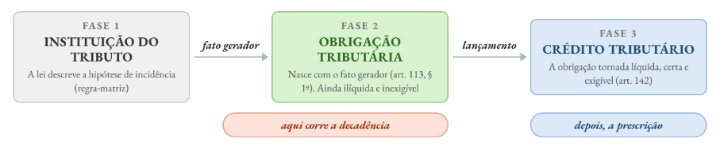
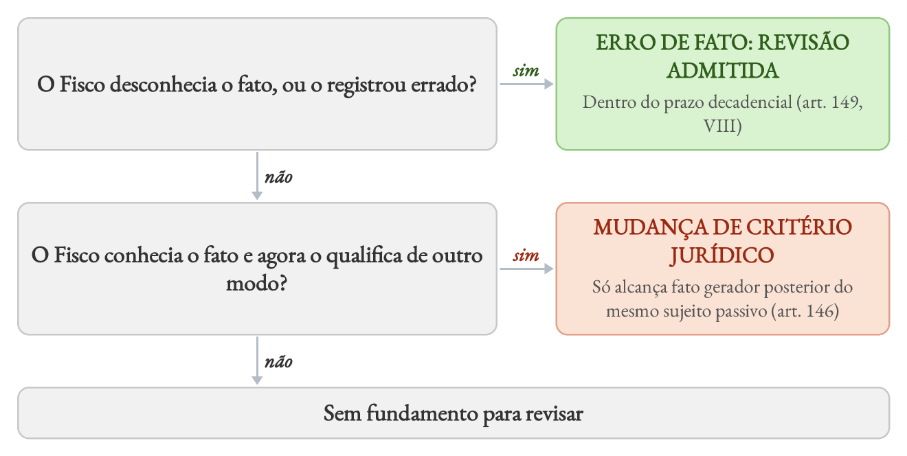
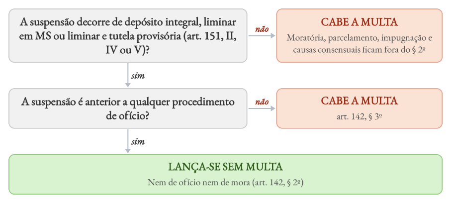
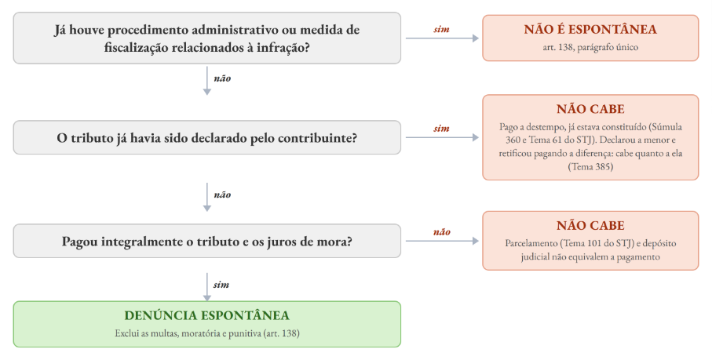
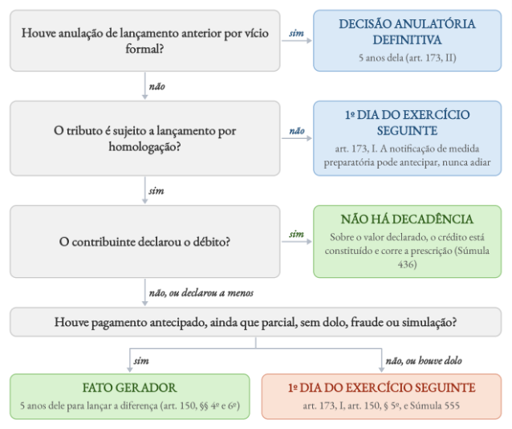
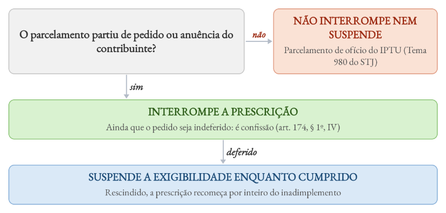
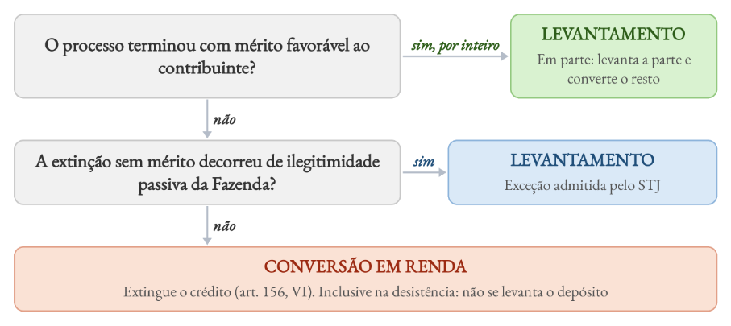
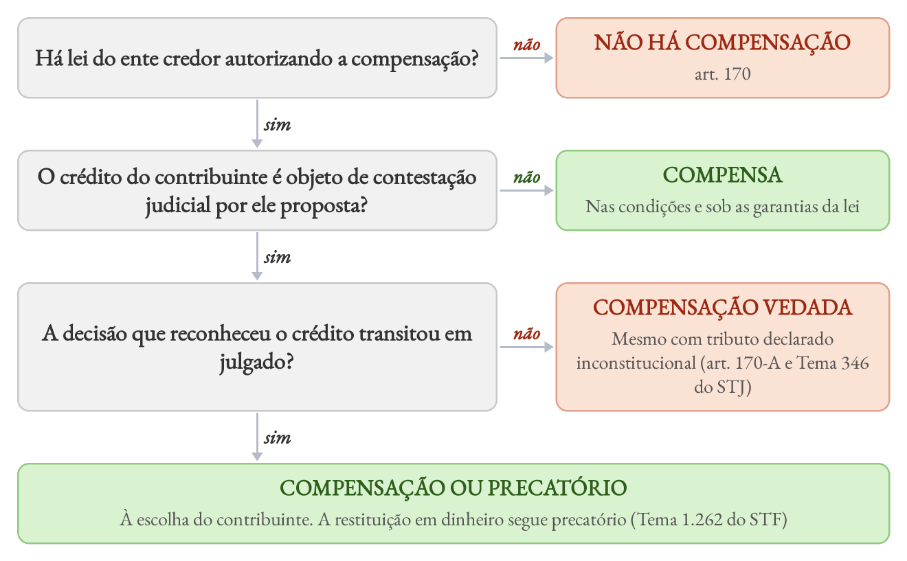
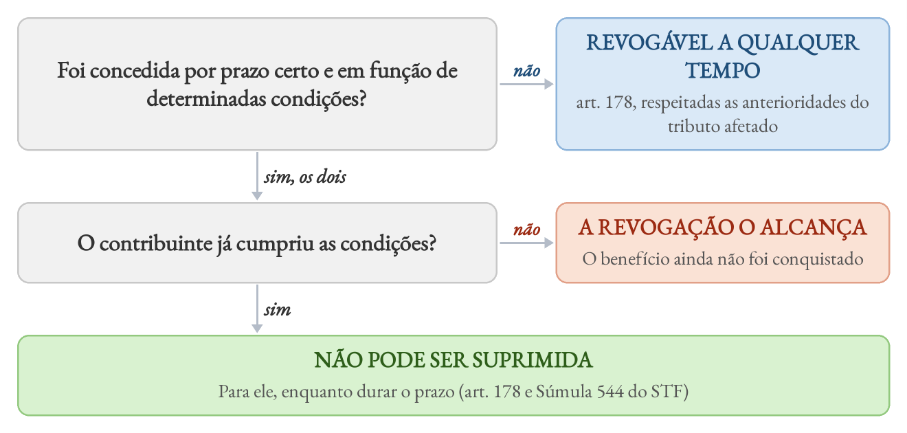
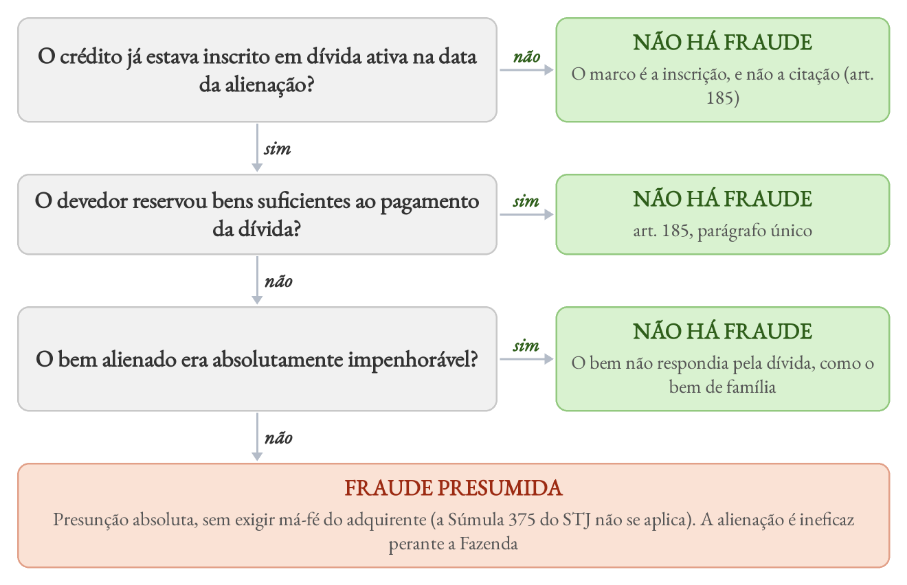

# Direito Tributário

*Ponto 14 do edital: Crédito tributário*

:::JC_F2F2F2 
**14. Crédito tributário. Constituição pelo lançamento. Modalidades. Suspensão, extinção e exclusão. Pagamento. Compensação. Transação. Remissão. Consignação. Conversão de depósito. Dação em pagamento. Prescrição e decadência. Restituição. Garantias e privilégios.**
:::

| **ESTUDO DE LEI SECA** | > |
|---|---|
| **DIPLOMA** | **DISPOSITIVOS** |
| **CTN** | Arts. 138 a 193 e 208-C, com a redação da **LC nº 236/2026** |
| **CF** | Art. 146, III, b, art. 150, § 6º, e art. 195, § 11 |
| **ADCT** | Art. 113 (estimativa de impacto da renúncia) |
| **Lei nº 9.430/1996** | Arts. 74 e 74-A (compensação federal) |

## 1. Da lei ao crédito

O crédito é a última fase de um processo de positivação, que começa na lei:

Entre o fato gerador e o lançamento corre a ==**decadência**==. Depois que o crédito está constituído e vence o prazo de pagamento, corre a ==**prescrição**==.

Essa é a visão da doutrina majoritária, adotada pelo CTN: o crédito é a ==**obrigação tornada líquida e certa**==. A obrigação nasce no mundo dos fatos. O crédito vem depois, em regra pelo lançamento, mas também pela declaração do contribuinte ou pelo depósito integral.

Lembrem-se da aula da Semana 02. Já falamos sobre o processo de cobrança do crédito tributário: o **processo administrativo fiscal**, em que o crédito se constitui, e o **processo judicial tributário**, por meio do qual ele é cobrado.

Aqui focaremos no regime do próprio crédito: como nasce, o que o suspende, o que o extingue, o que o exclui e o que o protege.

Os arts. 139 a 141 regulam a relação entre crédito e obrigação:

| **CRÉDITO E OBRIGAÇÃO · ARTS. 139 A 141** | > | > |
|---|---|---|
| **IDEIA** | **REGRA** | **CONSEQUÊNCIA** |
| **Unidade (art. 139)** | Crédito e obrigação têm a mesma natureza. Não há crédito sem obrigação, mas pode haver obrigação sem crédito | Lançamento acima do fato gerador real é **nulo quanto ao excesso** |
| **Autonomia (art. 140)** | O que afeta o crédito não afeta a obrigação. O inverso não vale: extinta a obrigação, extingue-se o crédito | Anulado o lançamento por vício formal, **a obrigação fica** e o Fisco lança de novo (art. 173, II) |
| **Indisponibilidad e (art. 141)** | O crédito só se modifica, extingue, suspende ou exclui nos casos previstos no CTN | **A autoridade não dispensa o crédito fora da lei**, sob pena de responsabilidade funcional |

Para a maior parte da doutrina, os róis¹²⁰de suspensão, extinção e exclusão do CTN são **taxativos**. O STF, porém, admitiu que lei estadual criasse a **dação em pagamento** como modalidade de extinção: se o ente pode remitir, pode aceitar forma alternativa de pagamento, e a CF reservou à lei complementar ==**só prescrição e decadência**== (ADI 2.405). Por outro lado, vale lembrar que a lei distrital da ADI 1.917, que admitia dação em bens móveis, caiu por contornar a licitação, ==**e não por falta de lei complementar**==.

Em resumo: lei estadual pode criar nova hipótese de extinção, desde que respeite as demais exigências constitucionais, como o dever de licitar.

## 2. Lançamento

O art. 142 define o lançamento como **procedimento administrativo** privativo da autoridade, **vinculado e obrigatório** (art. 142 e § 1º). A palavra designa também o ato que resulta desse procedimento.

O lançamento é ==**declaratório da obrigação e constitutivo do crédito**==: declara a obrigação que nasceu com o fato gerador e lhe confere liquidez e certeza.

O juiz que encontra vício anula o lançamento, ==**mas não o refaz**==. Vejamos o regime do lançamento:

| **LANÇAMENTO · REGIME** | > |
|---|---|
| **PONTO** | **REGRA** |
| **Lei material (art. 144)** | A do **fato gerador**, ainda que revogada |
| **Lei formal (art. 144, § 1º)** | A da **data do lançamento**: novos critérios de apuração, mais poderes de fiscalização, mais garantias. **Exceto para atribuir responsabilidade a terceiro** |
| **Lei procedimental e fatos pretéritos** | A LC nº 105/2001¹²¹alcança fatos anteriores **ainda não decaídos** (STJ, Tema 275) |
| **Moeda estrangeira (art. 143)** | Câmbio do dia do **fato gerador**, salvo lei em contrário |
| **Notificação** | **Condição de eficácia**. Notificado, o lançamento está feito. Torna-se **definitivo** quando não cabe mais discussão administrativa. No IPTU, basta o envio do carnê (Súmula 397 do STJ) |
| **Alteração após a notificação (art. 145)** | Por **impugnação** do sujeito passivo, por razões de fato ou de direito. Por **recurso de ofício** ou **iniciativa de ofício** (art. 149), só por erro de fato (art. 146) |
| **Revisão de ofício (art. 149)** | Só enquanto não extinto o direito da Fazenda (parágrafo único) |

%% CONECTANDO

**Até quando o Fisco pode rever um lançamento?** O limite da revisão está na **distinção** entre **erro de fato** e **mudança de critério jurídico**. O erro de fato é um desajuste entre o lançamento e o evento (área, município ou valor errados). A mudança de critério é nova leitura da lei sobre fatos que o Fisco já conhecia:

**O FISCO PODE REVER O LANÇAMENTO?**

Vejamos exemplos dos dois lados:

| **REVISÃO DO LANÇAMENTO · EXEMPLOS** | > |
|---|---|
| **SITUAÇÃO** | **EXEMPLOS** |
| **Erro de fato (revisão admitida)** | Retificação de dados cadastrais do imóvel (STJ, Tema 387). Requantificação da base do ISS com dados da agência reguladora (AREsp 2.362.445) |
| **Mudança de critério (só fatos posteriores)** | Reclassificação fiscal de mercadoria aceita no desembaraço aduaneiro. Mudança da **prática reiterada** de não cobrar o tributo (AREsp 1.688.160, arts. 100, III, e 146) |

:::JC_DAE9F7 Atualização legislativa
A **LC nº 236/2026** incluiu no art. 146 a ==**sentença arbitral**== da arbitragem especial tributária e aduaneira como **fonte de mudança de critério jurídico**, com o mesmo limite: ==**só alcança fato gerador posterior**==.

%% Chance alta TRF5

**Art. 146.** A **modificação** introduzida, de ofício ou em consequência de decisão administrativa ou judicial ou **sentença arbitral proferida no âmbito da arbitragem especial tributária e aduaneira**, nos critérios jurídicos adotados pela autoridade administrativa no exercício do lançamento, **somente pode ser efetivada, em relação a um mesmo sujeito passivo, quanto a fato gerador ocorrido posteriormente à sua introdução.**
:::

A classificação aceita no desembaraço e depois trocada é mudança de critério jurídico (portanto, a revisão é vedada!):

:::JC_FFE698 JÁ CAIU!
**FGV, TRF5, 2025.** A sociedade empresária ABC adquiriu, em 2019, 2020 e 2021, diversos produtos importados pela sociedade empresária DEF, com quem firmara contrato de importação por conta e ordem daquela. Nos períodos mencionados, as importações foram realizadas mediante indicação da classificação “X”, tendo os procedimentos sido regularmente homologados pelo Fisco. Entretanto, na data de 15/12/2022, as mercadorias adquiridas pela sociedade empresária ABC foram classificadas pela autoridade fiscal sob o código “Y”, embora se tratasse dos mesmos tipos de produtos importados nos anos anteriores com indicação classificatória diversa. O Fisco, então, lavrou Auto de Infração em face das sociedades empresárias ABC e DEF, em virtude da incorreta classificação das mercadorias relativas às Declarações de Importação concernentes aos períodos de 2019, 2020 e 2021, cobrando as diferenças do Imposto sobre a Importação (II) e do Imposto sobre Produtos Industrializados (IPI) incidentes sobre as aludidas operações, acrescidas de juros e multa. Segundo o disposto no Código Tributário Nacional e no Decreto-Lei nº 37/1966, assim como em conformidade com a jurisprudência do Superior Tribunal de Justiça sobre o tema, o referido lançamento suplementar deverá ser considerado: A) insubsistente em relação à sociedade empresária ABC, uma vez que esta não pode ser qualificada como sujeito passivo da obrigação tributária, ainda que a importação das mercadorias estrangeiras por ela adquiridas seja realizada por sua conta e ordem. B) insubsistente, haja vista ser vedada a revisão do lançamento anterior diante de erro de classificação operado pelo Fisco aceitando as declarações do importador quando do desembaraço aduaneiro, por se tratar de mudança de critério jurídico. C) subsistente, porquanto a autoridade fiscal possui o poder-dever de efetuar a revisão do lançamento anterior, observado o prazo decadencial, na hipótese de ocorrência de erro de fato na classificação das mercadorias importadas, sendo este entendido como aquele relacionado ao conhecimento da existência de determinada situação. D) insubsistente apenas em relação aos acréscimos legais, pois a observância das normas complementares, a exemplo das práticas reiteradamente adotadas pelas autoridades administrativas até a data da revisão do lançamento, exclui a imposição de juros e multa, não havendo, contudo, dispensa legal do pagamento dos tributos devidos. E) subsistente, na medida em que o Decreto-Lei nº 37/1966 prevê procedimento específico para a apuração da exatidão das informações prestadas pelo importador e a aferição da regularidade do pagamento do imposto, podendo ser efetuada a revisão do lançamento em razão da alteração da classificação tarifária, desde que dentro do prazo decadencial de cinco anos.¹²²
:::

%% Atualização legislativa

**Lançamento para prevenir a decadência** A suspensão da exigibilidade ==**impede a cobrança, mas não o lançamento**==. Há muito se entende que o Fisco deve, nesse caso, realizar o lançamento. Isso evita a decadência (EREsp 572.603), pois o prazo para lançar não cessa com a suspensão.

==**A LC nº 236/2026 decidiu quando esse lançamento vem sem multa:**==

**HÁ MULTA NO LANÇAMENTO PARA PREVENIR A DECADÊNCIA?**

:::JC_DAE9F7 Atualização legislativa
**Art. 142, § 5º.** Redução da multa de ofício: **50%** no pagamento e **40%** no parcelamento dentro do prazo de impugnação. **30%** e **20%** depois desse prazo e antes da inscrição em dívida ativa. A redução é ==**da multa, não do tributo**== (§ 7º), e ==**não alcança o devedor contumaz**== (§ 6º).
:::

## 3. Modalidades de lançamento

A lei define o rito para que o tributo seja lançado. Disso depende o **termo inicial da decadência.** Vamos comparar as modalidades:

| **MODALIDADES DE LANÇAMENTO** | > | > |
|---|---|---|
| **MODALIDADE** | **PAPEL DO SUJEITO PASSIVO** | **EXEMPLOS E OBSERVAÇÕES** |
| **De ofício ou direto (art. 149)** | Nenhum na apuração | IPTU, IPVA, taxas. Também é a **via supletiva de todas as modalidades** (auto de infração) |
| **Por declaração ou misto (art. 147)** | Informa os fatos, e o Fisco calcula | ITBI e ITCMD em muitos entes. Retificação para reduzir só **com prova do erro e antes da notificação**. Se o contribuinte declara, calcula e paga, o lançamento é por homologação, como no IRPF |

solidário). C e E tratam a reclassificação como erro de fato, revisável no prazo decadencial. D erra porque o problema não está só nos juros e na multa. O próprio lançamento suplementar é vedado.

| **MODALIDADES DE LANÇAMENTO** | > | > |
|---|---|---|
| **MODALIDADE** | **PAPEL DO SUJEITO PASSIVO** | **EXEMPLOS E OBSERVAÇÕES** |
| **Por homologação (art. 150)** | Apura, calcula e antecipa o pagamento | IR, IPI, ICMS, ISS, PIS, COFINS. O pagamento extingue o crédito **sob condição resolutória** da homologação (§ 1º) |
| **Arbitramento (art. 148)** | Declarações omissas ou que não merecem fé | Técnica de apuração no lançamento de ofício, **e não modalidade autônoma**, com avaliação contraditória. ICMS por **pauta fiscal** é ilegal (Súmula 431 do STJ), salvo como arbitramento do art. 148 |

Parte da doutrina fala em "autolançamento", mas o CTN rejeitou a tese ao tornar o lançamento privativo da autoridade. O contribuinte apura e antecipa o pagamento, e a ==**homologação**==, expressa ou tácita, é que configura o lançamento.

De toda sorte, vale lembrar:

:::JC_D9F2D0 SÚMULA
**Súmula 436 do STJ.** A entrega de declaração pelo contribuinte reconhecendo débito fiscal **constitui o crédito tributário**, dispensada qualquer outra providência do Fisco.
:::

Quem declara e não paga fica nesta situação:

| **DECLAROU E NÃO PAGOU · EFEITOS** | > |
|---|---|
| **PONTO** | **EFEITO** |
| **Decadência** | **Não corre mais** sobre o valor declarado |
| **Prescrição** | Corre do **vencimento**, ou da entrega da declaração, se posterior (STJ, Tema 383) |
| **Cobrança** | Inscrição e execução **sem novo procedimento** |
| **Denúncia espontânea** | **Afastada** no pagamento a destempo do tributo declarado (Súmula 360 do STJ) |
| **Diferença não declarada** | Depende de **lançamento de ofício**. A decadência conta do fato gerador se houve algum pagamento (art. 150, § 4º), e do 1º dia do exercício seguinte se nada foi pago (art. 173, I) |

A denúncia espontânea (art. 138) exclui a responsabilidade, ==**inclusive pela multa de mora**==, de quem confessa a infração e paga o tributo e os juros antes de procedimento fiscal

:::JC_FFFFFF 
relacionado a ela. ==**A LC nº 236/2026 deixou expressa a multa de mora**==. O STJ fixou três limites:
:::

**CABE DENÚNCIA ESPONTÂNEA?**

## 4. Decadência

Perda do direito de **constituir** o crédito. O prazo é decadencial porque o lançamento é um direito potestativo: o Fisco o exerce sem depender de conduta do contribuinte.

São cinco anos, fixados apenas ==**por lei complementar**==, reserva que alcança também ==**as causas de suspensão e de interrupção**== (Tema 2 do STF).

:::JC_DAE9F7 IMPORTANTE
**Súmula Vinculante 8.** São inconstitucionais o parágrafo único do artigo 5º do Decreto-lei nº 1.569/1977 e os artigos 45 e 46 da Lei nº 8.212/1991, que tratam de prescrição e decadência de crédito tributário. Os arts. 45 e 46 davam dez anos à seguridade social para lançar e cobrar as contribuições. Prescrição e decadência são **normas gerais** reservadas à ==**lei complementar**== (CF, art. 146, III, b), e ==**lei ordinária não pode alterá-las**==. Depois da SV 8, a LC nº 128/2008 revogou os dois artigos.
:::

A decadência **extingue o crédito** (art. 156, V): o pagamento de tributo decaído é ==**indevido**== e pode ser repetido.

O termo inicial depende da modalidade e da conduta do contribuinte:

**DECADÊNCIA · QUAL É O TERMO INICIAL?**

:::JC_DAE9F7 Atualização legislativa
A **LC nº 236/2026** escreveu no art. 150 o que o STJ já aplicava: **§ 5º**, dolo, fraude ou simulação levam ao art. 173, I. **§ 6º**, no pagamento parcial, o prazo conta do fato gerador.
:::

%% FIXANDO

**Vício formal x material** Vejam que a lei fala em “vício formal” quando alude ao termo inicial nos casos em que há anulação do lançamento anterior. **Vício formal** é defeito no modo de praticar o ato (incompetência, falta de requisito da notificação, cerceamento de defesa). **Vício material** atinge o conteúdo (fato gerador, base, sujeito passivo). ==**Só o formal reabre o prazo**==. No material, o novo lançamento só cabe se ainda aberto o **prazo original**.

Por fim, consumada a decadência, o **crédito está extinto e não renasce por confissão posterior:**

:::JC_FFE698 JÁ CAIU!
**FGV, TJ-MS, 2025.** Para se beneficiar de programa de parcelamento tributário instituído em 2023, a empresa Beta Ltda. apresentou declaração confessando créditos de ISS, relativos aos exercícios de 2015 e 2016, que não haviam sido objeto de lançamento pela Fazenda Municipal. Por ter deixado de pagar as parcelas no respectivo vencimento, o município ajuizou execução fiscal em 2024. Em embargos à execução, a empresa alegou a ocorrência de decadência. À luz do Código Tributário Nacional (CTN) e da jurisprudência do STJ, é correto afirmar que: A) a confissão de dívida apresentada para adesão ao parcelamento supre a falta de lançamento e impede a alegação de decadência.

B) a decadência não se consuma enquanto não houver ato expresso de lançamento ou auto de infração formalizado pela administração tributária. C) a adesão ao programa de parcelamento tem efeito interruptivo da decadência, reabrindo novo prazo para a constituição do crédito tributário. D) a decadência extingue o crédito tributário e não pode ser afastada por confissão de dívida ou parcelamento posterior, razão pela qual os créditos estão decaídos. E) a simples declaração do sujeito passivo ou documento equivalente, em se tratando de tributos sujeitos a lançamento por homologação, já constitui o crédito, impedindo a alegação de decadência, ainda que não pago o tributo.¹²³
:::

## 5. Prescrição

Perda do direito de **cobrar** o crédito constituído. O prazo é prescricional porque o pagamento depende de conduta do devedor.

São cinco anos (art. 174). A constituição definitiva é necessária, mas não basta: o prazo só corre depois de vencido o prazo para pagamento voluntário.

Como a decadência, ==**extingue o próprio crédito**==, e por isso o pagamento de crédito prescrito é ==**indevido**==.

O termo inicial varia conforme o modo de constituição do crédito:

| **PRESCRIÇÃO · TERMO INICIAL** | > |
|---|---|
| **SITUAÇÃO** | **COMEÇA A CORRER** |
| **Tributo declarado e não pago** | Dia seguinte ao **vencimento**, ou à entrega da declaração, se posterior (Tema 383 do STJ) |
| **Lançamento de ofício sem impugnação** | Fim do prazo de pagamento. No IPTU, **dia seguinte ao vencimento**, e **não o envio do carnê** (Tema 980 do STJ) |
| **Lançamento de ofício impugnado** | Fim do processo administrativo e do prazo de pagamento voluntário. Durante o processo, **nada corre** (Súmula 622 do STJ) |
| **Liminar cassada** | Volta a correr de imediato, salvo outra causa do art. 151 ou recurso com efeito suspensivo (EAREsp 407.940) |
| **Acórdão favorável depois anulado ou reformado** | Trânsito em julgado da decisão que anulou ou reformou (AREsp 1.280.342) |
| **Parcelamento rescindido** | Volta a correr **por inteiro** a partir do inadimplemento (REsp 1.922.063) |

A Súmula 622 do STJ resume a passagem da decadência para a prescrição no lançamento de ofício:

:::JC_D9F2D0 SÚMULA
**Súmula 622 do STJ.** A notificação do auto de infração faz cessar a contagem da decadência para a constituição do crédito tributário. Exaurida a instância administrativa com o decurso do prazo para a
:::

:::JC_D9F2D0 
impugnação ou com a notificação de seu julgamento definitivo e esgotado o prazo concedido pela Administração para o pagamento voluntário, inicia-se o prazo prescricional para a cobrança judicial.
:::

Ademais, não há **prescrição intercorrente no processo administrativo fiscal** federal, por falta de previsão legal (STJ, AgInt no REsp 2.109.509, 2025).

:::JC_FFFF00 
**Por fim, vejamos as causas de interrupção, com o que a LC nº 236/2026 incluiu:**
:::

| **INTERRUPÇÃO DA PRESCRIÇÃO · ART. 174, § 1º** | > |
|---|---|
| **INCISO** | **CAUSA** |
| **I** | **Despacho do juiz** que ordena a citação, retroagindo à propositura (CPC, art. 240, § 1º, e Tema 383 do STJ). A demora imputável ao Judiciário não prejudica a Fazenda (Súmula 106 do STJ). Execução ajuizada com CDA de **contribuinte diverso não interrompe** na data do ajuizamento: a juntada do título correto é emenda, e é ela que interrompe (REsp 1.931.196, 2025) |
| **II** | Protesto judicial ou **extrajudicial da CDA**. O extrajudicial veio com a LC nº 208/2024 e só vale para protestos posteriores a ela |
| **III e IV** | Ato judicial que constitua em mora o devedor. Ato inequívoco de **reconhecimento do débito** |
| **V** | [Chance alta TRF5] Instauração da **mediação** (novo) |
| **VI** | [Chance alta TRF5] Instituição da **arbitragem**, retroagindo ao requerimento (novo) |
| **VII** | [Chance alta TRF5] Sentença que extingue a execução por não localização do devedor ou de bens, **desde que a intercorrente não tenha começado** (novo) |
| **VIII** | [Chance alta TRF5] Informação do crédito na **falência ou liquidação extrajudicial**, com prazo suspenso até o encerramento (novo) |
| **IX** | [Chance alta TRF5] Ato inicial da **execução fiscal extrajudicial** (novo) |

:::JC_DAE9F7 Atualização legislativa
O prazo interrompido recomeça da data do ato interruptivo ou do último ato do processo destinado a interrompê-lo (art. 174, § 3º). Foi **vetado** o caput do § 1º que limitava a interrupção a ==**uma única vez**==.
:::

O protesto da CDA, além de interromper a prescrição, passou a ser condição para a execução fiscal de **baixo valor**. Hoje a Fazenda tem meios mais baratos e eficientes de cobrar, e o STF passou a exigi-los antes da via judicial (Tema 1.184, RG). O tema foi trabalhado na semana 2!

%% PEGADINHA

**Voltando ao tema principal: o CT fica suspenso com a inscrição em dívida?**

A suspensão da prescrição por 180 dias com a inscrição (LEF, art. 2º, § 3º) ==**não vale para crédito tributário**==: lei ordinária não cria causa de suspensão. Vale só para a dívida ativa não tributária (STJ).

O parcelamento afeta a prescrição de dois modos:

**PARCELAMENTO E PRESCRIÇÃO**

De acordo com a **súmula 653 do STJ,** o pedido de parcelamento fiscal, ainda que indeferido, interrompe o prazo prescricional, pois caracteriza confissão extrajudicial do débito. Porém, o parcelamento de ofício do IPTU, sem pedido do contribuinte, não interfere na prescrição:

:::JC_FFE698 JÁ CAIU!
**FGV, TJ-CE, 2025.** O Município X realizou, em janeiro de 2015, o lançamento do IPTU relativo ao exercício daquele ano, com vencimento em 15 de março de 2015. Caio, todavia, não efetuou o pagamento, nem manifestou interesse em parcelar o valor do IPTU. Em 2017, por meio de decreto municipal, a Administração Pública municipal efetuou o parcelamento de ofício de todos os débitos tributários pendentes com valor inferior a R$ 10.000,00 (dez mil reais), inclusive o débito do IPTU de Caio. Em abril de 2022, o Município ajuizou execução fiscal, em face de Caio, referente ao débito do IPTU do exercício de 2015. Sobre essa situação hipotética, assinale a afirmativa correta. A) O parcelamento de ofício interrompeu o prazo prescricional da cobrança judicial do IPTU, que voltou a correr por novo quinquênio a partir daquela data. B) O termo inicial do prazo prescricional da cobrança judicial do IPTU se iniciou no dia seguinte à data estipulada para o vencimento da exação, estando, portanto, o crédito prescrito em março de 2020. C) O crédito tributário não está prescrito, pois o prazo prescricional começa a correr apenas com a constituição definitiva do crédito, o que se deu com a inclusão da dívida em programa de parcelamento, ocorrida em 2017. D) O parcelamento de ofício suspende a exigibilidade do crédito, não estando, portanto, prescrito o crédito quando do ajuizamento da execução.

E) O termo inicial do prazo prescricional da cobrança judicial do IPTU se iniciou no dia seguinte à data do recebimento do carnê pelo contribuinte, estando, portanto, o crédito tributário prescrito em janeiro de 2020.¹²⁴

%% JÁ CAIU!

**FGV, TJ-PA, 2026.** Tício recebeu em sua residência o carnê de IPTU, tendo permanecido inadimplente quanto à parcela única. Sem sua solicitação ou anuência, o município realizou parcelamento de ofício do crédito tributário em dez cotas mensais. Sobre a situação descrita, com base na jurisprudência do STJ e no CTN, é correto afirmar que: A) o parcelamento de ofício é causa interruptiva da prescrição, pois revela ato inequívoco de reconhecimento da dívida pelo contribuinte. B) o parcelamento de ofício não altera o termo inicial do prazo prescricional, que se inicia no dia seguinte ao vencimento da exação à vista. C) o parcelamento de ofício não altera o termo inicial do prazo prescricional, que se inicia na data do envio do carnê à residência de Tício. D) o termo inicial da prescrição é o dia do vencimento da última parcela, pois somente com o inadimplemento dessa parcela se instaura a exigibilidade judicial do crédito. E) o parcelamento de ofício é causa suspensiva da exigibilidade do crédito tributário, iniciando-se o prazo prescricional no primeiro dia útil subsequente ao vencimento da exação.¹²⁵
:::

## 6. Suspensão da exigibilidade

O que se suspende é a ==**exigibilidade do crédito**==, e não a obrigação. O crédito existe, mas não pode ser cobrado.

A suspensão ==**não dispensa obrigações acessórias**== (art. 151, § 1º) e **não impede o lançamento**. Se a prescrição já corria, fica suspensa. Se ainda não começou, não se inicia.

Pode ser ==**anterior ao próprio crédito**== (MS preventivo, depósito antes do lançamento). As causas estão no art. 151, cada uma com o seu momento de início:

| **CAUSAS DE SUSPENSÃO · ART. 151** | > | > |
|---|---|---|
| **CAUSA** | **INCISO** | **A SUSPENSÃO COMEÇA** |
| **Moratória** | I | Com a lei ou o despacho que a concede |
| **Depósito do montante integral** | II | Com o depósito, **integral e em dinheiro** |
| **Impugnações, recursos e manifestação de inconformidade** | III | Com a apresentação **tempestiva** (art. 208-C). **Vedada caução** (§ 2º) |
| **Liminar em MS** | IV | Com a concessão |
| **Liminar ou tutela provisória em outras ações** | V | Com a concessão |
| **Parcelamento** | VI | Com o **deferimento**, expresso ou tácito |
| **Arbitragem especial** | VII | Com a instituição. Com execução em curso, **exige outra causa suspensiva ou garantia integral** (§ 3º) |
| **Transação** | VIII | Com a **proposta aceita** pela administração. **A proposta não aceita não suspende** |
| **Mediação** | IX | Com o acordo, até sua dissolução |
| **Seguro garantia ou fiança bancária** | X | [Chance alta TRF5] Com a **aceitação pelo credor** em execução fiscal, enquanto conformes e sem sinistro |

:::JC_DAE9F7 Atualização legislativa
A **LC nº 236/2026** levou o rol de seis para **dez** hipóteses (incisos VII a X), trocou "reclamações" por **impugnações e manifestação de inconformidade** e "tutela antecipada" por **tutela provisória**.
:::

Não suspendem: o **pedido de cancelamento** de débito inscrito e a reclamação contra a exclusão do parcelamento (STJ). A **consulta** feita no prazo de pagamento afasta os juros de mora (art. 161, § 2º), mas ==**não suspende a exigibilidade**==.

:::JC_DAE9F7 DICA DO PROFESSOR
**MODERE COPA, ATÉ MAIS! MO**ratória (I) · **DE**pósito integral (II) · **RE**cursos e impugnações no processo administrativo (III) · **CO**ncessão de liminar ou tutela provisória (IV e V) · **PA**rcelamento (VI) **A**rbitragem especial tributária e aduaneira (VII) · **T**ransação aceita pela administração (VIII) · **M**ediação (IX) · **S**eguro garantia ou fiança bancária aceitos pelo credor (X)
:::

## MO · Moratória

**Moratória é a prorrogação do prazo de pagamento**, concedida por lei. O tributo continua devido, por inteiro. Muda só a data a partir da qual ele pode ser exigido. Por isso ela ==**suspende a exigibilidade**== e ==**não extingue nem reduz o crédito**==.

Ela pode ser **geral**, quando a própria lei a concede a todos que se enquadram nela, ou **individual**, quando a lei autoriza a autoridade a concedê-la por despacho, a requerimento do interessado (art. 152). Vejamos o regime:

| **MORATÓRIA · REGIME** | > |
|---|---|
| **PONTO** | **REGRA** |
| **Fonte** | Sempre **lei** do ente competente (art. 152, I, a). A individual depende de despacho, nos termos da lei (art. 152, II) |
| **Moratória heterônoma** | O art. 152, I, b, permite que a União a conceda sobre tributos estaduais e municipais, se simultânea aos federais e às obrigações de direito privado. **É tida como não recepcionada**, por ofender o pacto federativo |
| **Conteúdo da lei (art. 153)** | Prazo, condições da concessão individual e, sendo o caso, tributos alcançados, número e vencimento das prestações e garantias |
| **Créditos alcançados (art. 154)** | Salvo lei em contrário, os **definitivamente constituídos** na data da lei ou do despacho, ou com lançamento já iniciado por ato notificado ao sujeito passivo |
| **Fraude** | **Não aproveita dolo, fraude ou simulação** do sujeito passivo ou de terceiro em seu benefício (art. 154, parágrafo único) |
| **Direito adquirido** | A individual **não gera direito adquirido** e pode ser "revogada" se o beneficiado não cumpria ou deixou de cumprir as condições (art. 155) |
| **Contribuições previdenciárias** | A CF veda moratória e parcelamento **acima de 60 meses** para as do art. 195, I, a, e II (art. 195, § 11, EC nº 103/2019) |

:::JC_DAE9F7 NÃO CONFUNDA
Na **moratória**, a lei empurra o vencimento para frente. No **parcelamento**, a dívida vencida é dividida em prestações e, salvo lei em contrário, mantém juros e multas (art. 155-A, § 1º). As regras da moratória se aplicam ao parcelamento no que couber (art. 155-A, § 2º).
:::

## DE · Depósito do montante integral

**Depósito é a entrega do valor exigido para discutir o débito sem sofrer a cobrança.** O dinheiro fica à espera do resultado do processo. Por isso ==**depósito não é pagamento**==: se o contribuinte vencer, levanta o valor. Se perder, o depósito se converte em renda.

É direito do contribuinte e ==**dispensa autorização do juiz**==. Só suspende se for **integral e em dinheiro** (Súmula 112 do STJ). "Integral" é o que o Fisco exige, e não o que o contribuinte entende devido.

Nos tributos sujeitos a homologação, o depósito com ciência da Fazenda ==**constitui o crédito**==, e o lançamento se torna desnecessário (EREsp 767.328). Por isso, o depósito integral impede o ajuizamento da execução, e a execução proposta depois dele ==**deve ser extinta**== (Tema 271 do STJ).

O destino do depósito depende do resultado do processo:

**O QUE ACONTECE COM O DEPÓSITO?**

Na execução, o depósito integral faz cessar a responsabilidade por correção e juros (LEF, art. 9º, § 4º). Mas não afasta a multa nem configura denúncia espontânea (EREsp 1.131.090).

Extinto o processo sem mérito, o depósito se converte em renda e não pode ser levantado:

:::JC_FFE698 JÁ CAIU!
**FGV, TRF1, 2025.** A Receita Federal do Brasil instaurou processo administrativo fiscal para apuração da suposta falta de pagamento, por parte da sociedade empresária Beta, de débitos de Imposto de Renda de Pessoa Jurídica (IRPJ) relativos ao ano de 2016. A sociedade empresária Beta, então, ajuizou ação pretendendo obstar o lançamento do crédito tributário, tendo efetuado o depósito integral do valor respectivo, na data de 23/04/2019. Todavia, o processo foi julgado extinto sem resolução de mérito em virtude da homologação da desistência manifestada pela sociedade empresária Beta, a qual levantou o valor depositado na data de 12/07/2021. A sentença de extinção do aludido feito transitou em julgado na data de 05/09/2021. Considerando a jurisprudência do Superior Tribunal de Justiça sobre a matéria, bem como as disposições do Código Tributário Nacional (CTN), é correto afirmar que o levantamento do valor depositado pela sociedade empresária Beta foi: A) indevido, sendo certo que, como o depósito integral constituiu o crédito tributário, a Fazenda Pública Federal poderá ajuizar execução fiscal para a cobrança da quantia respectiva, desde que observado o prazo prescricional quinquenal, contado a partir da extinção do depósito. B) devido, sendo certo, contudo, que, afastada a causa obstativa do lançamento, a Fazenda Pública Federal poderá constituir o crédito tributário mediante lançamento de ofício da quantia depositada, desde que observado o prazo decadencial quinquenal, contado a partir de 01/01/2022. C) indevido, sendo certo que, afastada a causa obstativa do lançamento, a Fazenda Pública Federal poderá constituir o crédito tributário mediante lançamento de ofício da quantia depositada, desde que observado o prazo decadencial quinquenal, contado a partir de 01/01/2022.

D) devido, sendo certo, contudo, que, afastada a causa de suspensão da exigibilidade do crédito tributário, a Fazenda Pública Federal poderá ajuizar execução fiscal para a cobrança da quantia respectiva, desde que observado o prazo prescricional quinquenal, contado a partir do levantamento do depósito. E) indevido, sendo certo que, como o depósito integral equivaleu a um lançamento por homologação, a Fazenda Pública Federal poderá ajuizar execução fiscal para a cobrança da quantia respectiva, desde que observado o prazo prescricional quinquenal, contado a partir da data do trânsito em julgado da sentença que extinguiu o processo relativo à ação antiexacional.¹²⁶
:::

:::JC_FFFFFF 
## RE · Recursos e impugnações no processo administrativo

**É a defesa do contribuinte na via administrativa**: a impugnação ao lançamento, os recursos contra a decisão e a manifestação de inconformidade contra a não homologação da compensação. Enquanto o Fisco revê o próprio ato, não pode cobrá-lo.

%% FIXANDO

A impugnação **tempestiva** instaura o contencioso e suspende a exigibilidade até a decisão definitiva (art. 208-C, I, LC nº 236/2026). ==**Defesa intempestiva ou não prevista em lei**==
:::

:::JC_FFFFFF 
==**não suspende**==.
:::

:::JC_FFFFFF 
Por fim, exigir depósito ou arrolamento para recorrer é ==**inconstitucional**== (SV 21), regra que a LC nº 236/2026 escreveu no art. 151, § 2º.

## CO · Concessão de liminar ou tutela provisória

**É a decisão judicial provisória que proíbe a cobrança enquanto se discute o tributo em juízo.** Pode ser a liminar em mandado de segurança (IV) ou a liminar e a tutela provisória em qualquer outra ação (V).

A ação judicial, sozinha, ==**não suspende**==. O que suspende é a decisão. E o juiz ==**não pode condicionar a liminar ao depósito**==, porque o depósito suspenderia por si (RMS 3.881).
:::

:::JC_DAE9F7 Atualização legislativa
**Art. 161, § 3º (LC nº 236/2026).** A liminar ou a tutela provisória ==**interrompe a multa de mora**== desde a concessão até **30 dias** após a publicação da decisão que considerar devido o tributo. Os juros continuam correndo.
:::

Vamos comparar as quatro primeiras causas:

| **MO · DE · RE · CO** | > | > | > |
|---|---|---|---|
| **CAUSA** | **QUEM PROVOCA** | **SUSPENDE DESDE** | **TERMINA COM** |
| **Moratória** | O legislador, e a autoridade na individual | A lei ou o despacho | O fim do prazo prorrogado |
| **Depósito integral** | O contribuinte | O depósito, integral e em dinheiro | Levantamento ou conversão em renda |
| **Recursos e impugnações** | O contribuinte, na via administrativa | A impugnação **tempestiva** | A decisão administrativa definitiva |
| **Liminar ou tutela provisória** | O juiz, a pedido do contribuinte | A concessão | A revogação ou a sentença desfavorável |

## PA · Parcelamento

%% Chance alta TRF5

**Parcelamento é a divisão da dívida em prestações**, nas condições da lei específica do ente (art. 155-A). Enquanto as parcelas são pagas, a dívida não pode ser cobrada.

Salvo lei em contrário, ==**mantém juros e multas**== (§ 1º). ==**Não é pagamento**== e não extingue o crédito, que só se extingue com a última parcela. Rescindido o parcelamento, a cobrança retoma o saldo.

Vejamos a jurisprudência sobre parcelamento:

| **PARCELAMENTO · JURISPRUDÊNCIA** | > |
|---|---|
| **CASO** | **SOLUÇÃO** |
| **Lei que exclui do parcelamento débitos com depósito judicial** | **Constitucional**. Quem depositou está em situação distinta do inadimplente (Tema 573 do STF) |
| **Compensação de ofício com débito parcelado sem garantia** | **Inconstitucional**. Esvazia a suspensão prevista em lei complementar (Tema 874 do STF) |
| **Exclusão do Refis sem notificação prévia** | **Inconstitucional** (Tema 668 do STF) |
| **Teto de adesão ao parcelamento simplificado** | Pode ser fixado por ato infralegal, **salvo se a lei já fixou o valor e o regulamento o reduz** (Tema 997 do STJ) |
| **Parcelamento pedido por um devedor solidário** | Não renuncia à solidariedade quanto aos demais (REsp 1.978.780) |
| **Multa de mora** | Corre até a data em que o contribuinte **inicia o pagamento** do parcelamento (AgInt no REsp 1.857.783, Info 877, 2026) |

Quem confessa para parcelar não perde o direito de discutir tudo:

:::JC_D9F2D0 JURISPRUDÊNCIA
**Confissão para parcelar.** ==**A confissão não impede discutir em juízo os aspectos jurídicos da obrigação.**== Os fatos confessados, em regra, não se revisam, salvo vício que anule o ato, como erro, dolo, simulação ou fraude. *STJ, Tema 375 (recurso repetitivo).*
:::

:::JC_F2F2F2 RATIO DECIDENDI
**A obrigação nasce da lei, e não da vontade.** O tributo é obrigação ex lege. A confissão não cria tributo onde a lei não o prevê. Por isso, a legalidade, a constitucionalidade e a própria incidência da norma continuam discutíveis. **Os fatos, em regra, ficam.** Quanto aos fatos, a confissão é declaração de vontade do contribuinte, que não pode depois negar o que reconheceu para obter o benefício. **Salvo, contudo, vício do ato.** Se a confissão foi viciada, cai também quanto aos fatos. No caso julgado, o erro de fato dos autos de infração passou para a confissão, feita só para obter certidão, e a contaminou.
:::

A lei pode excluir do parcelamento quem já depositou em juízo:

:::JC_FFE698 JÁ CAIU!
**FGV, TRF2, 2026.** Determinada sociedade empresária ajuizou ação judicial questionando a constitucionalidade da COFINS incidente sobre operação realizada e efetuou o depósito judicial integral do montante controvertido, com fundamento no art. 151, II, do CTN, a fim de suspender a exigibilidade do crédito tributário. Posteriormente, foi editada lei ordinária que instituiu programa de parcelamento da COFINS, vedando a adesão relativamente aos débitos que estivessem garantidos por depósito judicial. À luz da Constituição Federal e da jurisprudência consolidada do Supremo Tribunal Federal, é correto afirmar que A) a restrição é constitucional, pois o contribuinte que efetuou depósito judicial encontra-se em situação jurídica distinta daquele que permaneceu inadimplente, inexistindo ofensa à isonomia ou ao acesso à justiça. B) a vedação ao parcelamento é inconstitucional, pois o depósito judicial não equivale ao pagamento, razão pela qual o contribuinte deve ter assegurado o mesmo tratamento conferido aos inadimplentes. C) a restrição viola o princípio da isonomia, pois diferencia contribuintes em situação jurídica equivalente quanto à exigibilidade do crédito tributário. D) a vedação é inconstitucional, pois cria obstáculo indireto ao acesso ao Poder Judiciário, ao impor consequência negativa àquele que ajuizou ação. E) a vedação é inconstitucional, pois somente lei complementar poderia disciplinar condições de parcelamento de crédito tributário já submetido a discussão judicial.¹²⁷
:::

**“ATÉ MAIS” · Arbitragem, transação, mediação e seguro** Os incisos VII a X entraram com a LC nº 236/2026. Os três primeiros nascem de uma solução do conflito fora do contencioso tradicional. O quarto, de uma garantia que o Fisco aceita:

| **A · T · M · S** | > | > |
|---|---|---|
| **CAUSA** | **O QUE É** | **SUSPENDE DESDE** |
| **Arbitragem especial tributária e aduaneira (VII)** | Um árbitro **decide** o litígio. A sentença é vinculante e tem efeitos de decisão judicial (art. 171-A) | A instituição da arbitragem. Com execução em curso, **exige outra causa suspensiva ou garantia integral** (§ 3º) |
| **Transação (VIII)** | Fisco e contribuinte fazem **concessões mútuas** para encerrar o litígio (art. 171) | A **proposta aceita** pela administração. **A proposta não aceita não suspende** |
| **Mediação (IX)** | Um terceiro **auxilia** as partes a chegar a um acordo, **sem poder de decidir** (art. 171-B) | O acordo, até a sua dissolução |
| **Seguro garantia ou fiança bancária (X)** | Uma seguradora ou um banco **garante** o pagamento da dívida | A **aceitação pelo credor** em execução fiscal, enquanto conformes e sem sinistro |

Garantia e suspensão não se confundem. Nem toda garantia suspende a exigibilidade:

| **GARANTIA E SUSPENSÃO DA EXIGIBILIDADE** | > |
|---|---|
| **GARANTIA** | **SUSPENDE?** |
| **Depósito integral em dinheiro** | **Sim** (art. 151, II) |
| **Depósito parcial** | **Não** |
| Fiança ou seguro **apenas oferecidos** | **Não**. Garantem o juízo, como a penhora (Tema 378 do STJ) |
| Fiança ou seguro **aceitos** em execução fiscal | **Sim**, enquanto conformes e sem sinistro (art. 151, X) |
| **Penhora de outros bens** | **Não**. Só garante o juízo e dá direito à certidão positiva com efeitos de negativa (art. 206) |

A garantia do juízo é figura do **processo**. A suspensão da exigibilidade opera na **relação tributária**. ==**Uma pode existir sem a outra**==.

A fiança e o seguro só se liquidam após o trânsito em julgado desfavorável ao contribuinte (LEF, art. 9º, § 7º).

E se a devedora for a própria Fazenda Pública?

:::JC_D9F2D0 JURISPRUDÊNCIA
**Certidão da Fazenda devedora.** A Fazenda Pública, em ação anulatória ou em execução embargada, ==**tem direito à certidão positiva com efeitos de negativa independentemente de penhora**==, porque seus bens são inexpropriáveis. *STJ, Tema 273 (recurso repetitivo).*
:::

:::JC_F2F2F2 RATIO DECIDENDI
**A regra do art. 206:** a certidão positiva com efeitos de negativa exige crédito com exigibilidade suspensa ou execução em que se tenha efetivado a penhora. **A Fazenda não sofre penhora:** seus bens são impenhoráveis, e ela paga por precatório ou RPV (CF, art. 100). Seus embargos não dependem de garantia do

juízo (CPC, art. 910). **Exigir penhora seria exigir o impossível.** Por isso, a ação antiexacional basta para a certidão, e a Fazenda não fica impedida de obter repasses e contratar enquanto discute o débito.
:::

:::JC_FFFFFF 
## 7. Extinção do crédito tributário

Apesar do nome, **o art. 156 extingue a própria obrigação**, e o crédito com ela. A **exceção** é a anulação do lançamento por vício formal, que extingue só o crédito. As causas se agrupam pelo modo de extinguir:

| **CAUSAS DE EXTINÇÃO · ART. 156** | > |
|---|---|
| **MODO** | **CAUSAS** |
| **Satisfação** | Pagamento (I), compensação (II), conversão do depósito em renda (VI), pagamento antecipado homologado (VII), consignação julgada procedente (VIII), **dação de bens imóveis** (XI) |
| **Tempo** | Prescrição e decadência (V) |
| **Concessões mútuas** | Transação (III) |
| **Perdão por lei** | Remissão (IV) |
| **Decisão** | Decisão administrativa irreformável (IX), decisão judicial transitada (X), **sentença arbitral favorável ao sujeito passivo transitada** (XII, novo) |
| **Consenso cumprido** | **Cumprimento do acordo de mediação** (XIII, novo) |
:::

## Pagamento

:::JC_FFFFFF 
No silêncio da lei do ente, valem estas regras do CTN:

| **PAGAMENTO · REGRAS SUPLETIVAS** | > |
|---|---|
| **PONTO** | **REGRA** |
| **Lugar e prazo** | Domicílio do sujeito passivo (art. 159). **30 dias** da notificação, no silêncio da lei (art. 160) |
| **Penalidade** | **Não ilide o pagamento integral** do tributo (art. 157) |
| **Presunção** | Pagar uma parcela **não faz presumir** o pagamento das anteriores (art. 158), ao contrário do art. 322 do CC |
| **Juros de mora** | 1% ao mês no silêncio da lei (art. 161, § 1º). A SELIC federal é válida (Tema 214 do STF). Não correm na pendência de consulta (§ 2º) |
| **Multa moratória** | **Teto de 20% do débito** (STF, Tema 816) |
| **Cheque** | Extingue só com o resgate (art. 162, § 2º) |

O teto da multa moratória foi fixado no mesmo julgado sobre a não incidência do ISS na industrialização por encomenda. É possível que prova de TRF traga isso, portanto:
:::

:::JC_FFE698 JÁ CAIU!
**FGV, TJ-PE, 2026.** A sociedade empresária hipotética Metal XYZ Ltda. foi contratada por uma indústria siderúrgica para realizar, em materiais fornecidos pela própria contratante, corte, acabamento e requalificação de chapas de aço. Após a execução da atividade, os bens retornavam à siderúrgica para continuidade do processo produtivo e posterior comercialização. O município lavrou auto de infração exigindo ISS sobre a operação da sociedade Metal XYZ Ltda. e aplicou

multa moratória de 30% sobre o débito. Nessa hipótese, à luz da jurisprudência do Supremo Tribunal Federal, é correto afirmar que: A) não incide ISS, pois a atividade integra etapa intermediária do ciclo produtivo, e a multa moratória deve observar o teto de 20% do débito. B) não incide ISS, pois a contratada não comercializa o produto final, mas a multa moratória pode superar 20% se prevista em lei. C) incide ISS, pois a atividade realizada por encomenda consta da lista de serviços da Lei Complementar nº 116/2003, mas a multa moratória deve ser limitada a 20% do débito. D) incide ISS, pois os materiais foram fornecidos pela contratante, mas a multa moratória deve ser reduzida se demonstrado confisco. E) incidem ISS e ICMS, contudo, a multa moratória não pode ultrapassar o limite de 20% do débito.¹²⁸
:::

:::JC_FFFFFF 
A **imputação** é feita pela autoridade, e não pelo devedor, na ordem do art. 163: obrigação própria antes de responsabilidade, contribuição de melhoria, taxa e imposto, prazo de prescrição crescente e montante decrescente.

## Consignação em pagamento

Cabe na ==**recusa ou subordinação do recebimento**== ao pagamento de outro tributo, de penalidade ou ao cumprimento de obrigação acessória, na subordinação do recebimento a exigências administrativas sem fundamento legal e na **exigência do mesmo tributo, sobre o mesmo fato gerador, por mais de um ente** (art. 164).

Só se consigna a importância que se propõe pagar (§ 1º). A consignação ==**não serve para discutir a legalidade do tributo nem para parcelar**== (REsp 2.146.757, 2025).
:::

:::JC_FFFFFF NÃO CONFUNDA
Na **consignação**, o contribuinte quer pagar e pede a quitação. No **depósito** do art. 151, II, ele ==**não quer pagar**==, discute a exigência e garante o valor.

## Restituição
:::

Cabe **independentemente de prévio protesto**, qualquer que seja a modalidade do pagamento (art. 165). O indébito é atualizado pelos ==**mesmos índices dos créditos do ente**== (art. 165-A, LC nº 236/2026).

Os prazos dependem da pretensão:

| **PRAZOS DA RESTITUIÇÃO** | > | > |
|---|---|---|
| **PRETENSÃO** | **PRAZO** | **TERMO INICIAL** |
| **Repetição do indevido ou a maior (art. 165, I e II)** | 5 anos (art. 168, I) | Extinção do crédito. Na homologação, o **pagamento antecipado** (LC nº 118/2005 e Tema 4 do STF). No IRPF, a **entrega da declaração de ajuste**, e não a retenção, salvo na tributação exclusiva na fonte |
| **Reforma da decisão condenatória (art. 165, III)** | 5 anos (art. 168, II) | Decisão definitiva administrativa ou trânsito em julgado |
| **Habilitação administrativa do indébito judicial** | 5 anos (art. 168, §§ 2º e 3º) | Certificação do trânsito em julgado. Serve à **compensação**: a restituição em dinheiro do indébito judicial **segue precatório ou RPV** (Tema 1.262 do STF) |

:::JC_D9F2D0 JURISPRUDÊNCIA
**Nenhum pedido administrativo** interrompe o prazo da repetição (Súmula 625 do STJ), ==**nem a impugnação do lançamento**==. Quando cabível, o pedido só o suspende enquanto pende a decisão. *STJ, REsp 2.176.108/RS (Info 899), 2026.* A **habilitação do crédito** para compensação federal **suspende**, e não interrompe, a prescrição do pleito compensatório (AgInt no REsp 1.729.860). A **consulta** ==**não suspende nem interrompe**== o prazo da repetição (REsp 2.032.281, 2025).
:::

## Compensação

Depende de **lei do ente credor** (art. 170), que pode autorizá-la com créditos líquidos e certos, vencidos ou vincendos, do sujeito passivo contra a Fazenda. ==**Não opera automaticamente**==, como no direito civil.

A compensação depende de três condições:

**O CONTRIBUINTE PODE COMPENSAR?**

Vejamos o regime:

| **COMPENSAÇÃO · REGIME** | > |
|---|---|
| **PONTO** | **REGRA** |
| **Liminar para compensar** | A vedação da Lei do MS caiu (ADI 4.296), e a **Súmula 212 do STJ foi cancelada** (2022). Pela letra, o art. 170-A **segue vedando** a compensação antes do trânsito |
| **Ações anteriores à LC nº 104/2001** | O art. 170-A não se aplica (Tema 345 do STJ) |
| **Embargos à execução** | Não se alega compensação indeferida. Exceção: IR retido na fonte (Súmula 394 do STJ) |
| **Compensação de ofício** | Ato vinculado (Tema 484 do STJ), **salvo débito com exigibilidade suspensa** (Tema 874 do STF) |
| **Não homologada** | Cabem manifestação de inconformidade e recurso, que **suspendem** (art. 151, III). A declaração vale como **confissão** (Lei nº 9.430, art. 74) |
| **Não declarada** | Crédito de terceiro, decisão sem trânsito, título público, crédito-prêmio de IPI. **Não há recurso com efeito suspensivo** |
| **Multa isolada pela não homologação** | **Inconstitucional** (Tema 736 do STF) |
| **Forma** | Só eletrônica (PER/DCOMP). Em papel, é tratada como não declarada, sem recurso com efeito suspensivo (REsp 2.167.208, 2025) |
| **Compensação cruzada** | Vedada se o crédito ou o débito for de período de apuração anterior ao eSocial. O período é o do tributo, e não o do trânsito em julgado (REsp 2.109.311, 2025) |
| **MS para compensar** | Para declarar o direito, basta provar a condição de credor. Para quantificar ou homologar créditos, exige-se a prova pré-constituída dos recolhimentos (Tema 118 do STJ) |

A lei pode ainda escalonar a compensação dos créditos judiciais de grande valor:

:::JC_D9F2D0 JURISPRUDÊNCIA
**Limite mensal.** ==**É constitucional o limite mensal à compensação de créditos**== **superiores a R$ 10 milhões reconhecidos por decisão transitada em julgado** (arts. 74, § 3º, X, e 74-A da Lei nº 9.430/1996). A decisão garante o crédito, e não a forma de recebê-lo. A lei fixou os atingidos, o critério e o piso de 1/60 do crédito, e ao Ministro da Fazenda cabe só fixar o limite dentro dessas balizas. *STF, ADIs 7.587/DF e 7.609/DF, 2026.*
:::

## Transação, mediação e arbitragem

A LC nº 236/2026 colocou a mediação e a arbitragem ao lado da transação. Vamos comparar:

| **SOLUÇÕES CONSENSUAIS** | > | > | > |
|---|---|---|---|
| **INSTITUTO** | **TERCEIRO** | **SUSPENDE** | **EXTINGUE** |
| **Transação** | Não há. Concessões mútuas (art. 171) | Proposta aceita (art. 151, VIII) | **Cumprimento** da transação que encerra o litígio (art. 156, III) |
| **Mediação** | Auxilia, **sem poder decisório** (art. 171-B) | Acordo, até a dissolução (art. 151, IX) | **Cumprimento** do acordo (art. 156, XIII) |
| **Arbitragem** | Decide. Sentença vinculante, com efeitos de decisão judicial (art. 171-A) | Instituição (art. 151, VII) | Sentença **favorável ao sujeito passivo** transitada (art. 156, XII) |

As três ==**não caracterizam renúncia de receita**== para o art. 14 da LRF (art. 171-C). Arbitragem e mediação ainda dependem de lei especial. Na União, a transação está na Lei nº 13.988/2020.

## Remissão

Perdão, total ou parcial, do **crédito já constituído**, tributo ou penalidade. Exige **lei específica** do ente (CF, art. 150, § 6º).

A lei pode autorizar despacho fundamentado com base nos critérios do art. 172: situação econômica do sujeito passivo, erro ou ignorância escusáveis quanto a matéria de fato, diminuta importância, equidade e condições peculiares de região.

O despacho ==**não gera direito adquirido**==. O juiz ==**não pronuncia de ofício a remissão de pequeno valor**== olhando só o valor da execução, sem ouvir a Fazenda sobre outros débitos (STJ, Tema 457).

## Conversão em renda, decisões e dação

As demais causas têm regras próprias:

| **DEMAIS CAUSAS DE EXTINÇÃO** | > |
|---|---|
| **CAUSA** | **REGRA** |
| **Decisão administrativa irreformável (IX)** | A definitiva na órbita administrativa, que não pode mais ser objeto de ação anulatória. A Fazenda **não a rediscute em juízo**. A LC nº 236/2026 vedou recurso hierárquico contra ela (art. 208-C, § 2º). Com fundamento formal, extingue só o crédito, e o Fisco pode lançar de novo no prazo decadencial |
| **Decisão judicial transitada (X)** | Na relação de trato sucessivo, decisão do STF em controle concentrado ou repercussão geral **interrompe os efeitos futuros da coisa julgada**, respeitadas irretroatividade e anterioridades (Tema 885 do STF) |
| **Dação em pagamento (XI)** | Só **bens imóveis**, na forma da lei do ente. Na União, Lei nº 13.259/2016, para créditos inscritos. Com discussão judicial, só produz efeitos após **desistência e renúncia ao direito** |

## 8. Exclusão do crédito tributário

Impede a constituição do crédito, embora a obrigação tenha nascido (art. 175). Atua **depois do fato gerador e antes do lançamento**. ==**Não dispensa obrigações acessórias**== (parágrafo único).

É a teoria da isenção como **dispensa legal do pagamento**, adotada pelo CTN e pelo STF. Para a maior parte da doutrina, na isenção nem chega a nascer a obrigação.

Vejamos o regime da isenção:

| **ISENÇÃO · ARTS. 176 A 179** | > |
|---|---|
| **PONTO** | **REGRA** |
| **Fonte** | Sempre **lei**, ainda quando prevista em contrato (art. 176). Lei específica do ente (CF, art. 150, § 6º). No ICMS, convênio |
| **Região** | **Pode ser restrita a determinada região**, por condições peculiares (art. 176, parágrafo único) |
| **Extensão** | Salvo lei, **não alcança taxas, contribuições de melhoria e tributos posteriores** (art. 177) |
| **Interpretação** | Literal (art. 111, II) |
| **Individual** | Despacho a requerimento, **sem direito adquirido** (art. 179, § 2º). Nos tributos por período, renova-se a cada período (§ 1º) |
| **Renúncia de receita** | A proposição deve vir com **estimativa de impacto** (ADCT, art. 113) |

A revogação depende do tipo de isenção:

**A ISENÇÃO PODE SER REVOGADA?**

A renúncia de receita exige a estimativa de impacto durante a tramitação do projeto:

:::JC_FFE698 JÁ CAIU!
**FGV, TJ-ES, 2023.** Em 2023, projeto de lei ordinária do Estado Alfa, de iniciativa parlamentar, pretende conceder Isenção de ICMS na venda de próteses em favor de pessoas que sofreram amputações já a partir deste ano. O projeto foi aprovado por votação em Plenário da Assembleia Legislativa. Após a conclusão da votação do texto definitivo, foi elaborada, pela Comissão de Orçamento, Finanças e Tributação, estimativa de impacto orçamentário e financeiro da renúncia de receita quanto ao ano de 2023 e aos dois seguintes, atendendo-se ao disposto na lei de diretrizes orçamentárias e com previsão de medidas de compensação por meio do aumento de receita, proveniente da elevação de alíquota de tributo. O projeto de lei aprovado pela Assembleia Legislativa, junto com a estimativa de impacto, foi enviado ao governador, que o sancionou. Diante desse cenário e também à luz do entendimento dos tribunais superiores, é correto afirmar que: A) houve violação à iniciativa privativa do chefe do Executivo na propositura de tal projeto de lei, por configurar renúncia de receita em matéria tributária apta a afetar as contas públicas. B) a inserção da estimativa de impacto orçamentário e financeiro após a conclusão da votação do texto definitivo do projeto de lei viola exigência constitucional. C) por se tratar de hipótese de isenção tributária voltada à promoção de direitos de pessoas com deficiência, dispensa-se a autorização prévia no Confaz. D) a medida de compensação por meio do aumento de receita, proveniente da elevação de alíquota de tributo, deve vigorar ao menos nos anos de 2023 e 2024. E) as isenções de ICMS, por expressa previsão constitucional, devem ser concedidas mediante lei complementar.¹²⁹
:::

A **anistia** perdoa a infração e a penalidade, e não o tributo, e só alcança infrações **anteriores** à lei (art. 180). ==**Não se aplica a crimes, contravenções e atos com dolo, fraude ou simulação**==, e, salvo disposição em contrário, ao conluio.

:::JC_D9F2D0 JURISPRUDÊNCIA
Programa que exclui multas de quem adere e paga é **anistia**, e não parcelamento, moratória ou transação. Por isso ==**só alcança débitos vencidos antes da lei**==. *STJ, REsp 2.229.967/SP (Info 886), 2026, sobre a Lei nº 14.740/2023.*
:::

Vamos comparar isenção, anistia e remissão:

| **ISENÇÃO, ANISTIA E REMISSÃO** | > | > | > |
|---|---|---|---|
| **ASPECTO** | **ISENÇÃO** | **ANISTIA** | **REMISSÃO** |
| **Natureza** | Exclusão (art. 175, I) | Exclusão (art. 175, II) | **Extinção** (art. 156, IV) |
| **Alcança** | Tributo | Infração e penalidade | Tributo ou penalidade |
| **Momento** | Antes da constituição | Infração passada, antes do lançamento da multa. Multa já lançada se perdoa por remissão | **Crédito já constituído** |
| **Não alcança** | Taxas, contribuições de melhoria e tributos posteriores | Crimes, dolo, fraude, simulação e, salvo lei, conluio | Fora dos critérios do art. 172 |

## 9. Garantias e privilégios do crédito tributário

Garantias são os meios que asseguram o recebimento do tributo. Privilégios são a posição de preferência do crédito tributário.

Respondem pelo crédito todos os bens e rendas do devedor, mesmo os gravados com ônus real ou cláusula de impenhorabilidade, salvo os que a lei declare **absolutamente impenhoráveis** (art. 184).

O rol do CTN ==**não é taxativo**==: não exclui outras garantias previstas em lei, em função da natureza ou das características do tributo (art. 183). A natureza das garantias não altera a natureza do crédito (parágrafo único).

O bem de família é impenhorável também perante a Fazenda, ==**salvo tributos devidos em função do próprio imóvel**==, como o IPTU (Lei nº 8.009/1990, art. 3º, IV).

%% Chance alta TRF5

**A fraude à execução fiscal tem marco e presunção próprios:**

a todos os entes. A erra porque não há reserva de iniciativa do Executivo em matéria tributária, e o parlamentar pode propor isenção. C erra porque a isenção de ICMS depende de deliberação dos Estados em convênio (CF, art. 155, § 2º, XII, g), qualquer que seja a finalidade. D erra porque a compensação do art. 14 da LRF abrange o exercício e os dois seguintes. E erra porque a isenção de ICMS não exige lei complementar.

**A ALIENAÇÃO É FRAUDE À EXECUÇÃO FISCAL?**

O efeito da fraude e a indisponibilidade de bens seguem estas regras:

| **FRAUDE E INDISPONIBILIDADE** | > |
|---|---|
| **PONTO** | **REGRA** |
| **Efeito da fraude (art. 185)** | **Ineficácia** da alienação perante a Fazenda, **e não anulação** |
| **Sócio** | A alienação feita **antes do redirecionamento** é válida. Ele só é "sujeito passivo em débito" quando incluído no polo passivo (REsp 1.388.519) |
| **Indisponibilidade do art. 185-A** | **Só para dívida tributária** (STJ). Exige devedor citado que não paga nem indica bens e o exaurimento das diligências (Súmula 560 do STJ). Não se confunde com a penhora online do art. 854 do CPC, que vale para qualquer dívida e dispensa exaurimento |

O bem de família alienado não gera fraude, porque não respondia pela dívida:

:::JC_FFE698 JÁ CAIU!
**FGV, TJ-SC, 2024.** João era sócio da empresa Alfa Ltda. que foi dissolvida irregularmente, razão pela qual a Fazenda Pública requereu sua inclusão no polo passivo na qualidade de responsável tributário em razão de atos praticados com excesso de poderes. Ao ser citado em execução, doa seu único bem familiar, um apartamento de cinco quartos em um bairro de classe média alta, para seus três filhos, José, Antônio e Maria em quotas-partes iguais. Segundo recente entendimento dos Tribunais Superiores, a respeito da operação, é correto afirmar que: A) a doação é fraude à execução ainda que realizada anteriormente à citação. B) a doação simultânea aos três filhos descaracteriza a impenhorabilidade característica do bem de família.

C) a impenhorabilidade do único bem familiar não é oponível à Fazenda Pública, tratando-se de bem luxuoso. D) a doação é válida, contudo, é hipótese de fraude à execução se caracterizada a insolvência de João. E) a transferência é imune aos efeitos da execução, não havendo que se falar em fraude à execução.¹³⁰
:::

## Preferências

O crédito tributário tem preferência, com exceções:

| **PREFERÊNCIAS · ARTS. 186 A 192** | > |
|---|---|
| **SITUAÇÃO** | **REGRA** |
| **Regra geral (art. 186)** | O crédito tributário prefere a qualquer outro, **ressalvados os créditos trabalhistas e de acidente de trabalho** |
| **Falência (art. 186, parágrafo único)** | Não prefere aos **extraconcursais**, às importâncias passíveis de **restituição** e aos créditos com **garantia real**, no limite do bem. A lei pode limitar a preferência trabalhista (Lei nº 11.101: 150 salários mínimos). A **multa tributária só prefere aos subordinados** |
| **Fracionamento na falência** | Tributo, correção e juros até a quebra ficam na classe do crédito tributário (Lei nº 11.101, arts. 83, III, e 124), e o encargo legal os acompanha (Tema 969 do STJ). A multa desce. Juros posteriores à quebra ficam por último |
| **Restituição na falência** | Contribuições descontadas dos empregados e não repassadas são **restituídas antes de qualquer crédito**, inclusive trabalhista (REsp 1.183.383) |
| **Concurso (art. 187)** | A cobrança não se sujeita a concurso de credores ou habilitação. Afasta o concurso **formal**, e não a ordem de classificação. A habilitação é **faculdade** da Fazenda, sem duplicidade de garantias. O concurso de preferência entre entes (parágrafo único) **não foi recepcionado** (ADPF 357) |
| **Extraconcursais (art. 188)** | Créditos tributários de fatos geradores ocorridos **no curso da falência** |
| **Inventário e liquidação (arts. 189 e 190)** | Pagos preferencialmente os créditos vencidos ou vincendos exigíveis no curso do processo |
| **Quitação exigida (arts. 191 a 193)** | Extinção das obrigações do falido, recuperação judicial (art. 191-A), partilha ou adjudicação e contratação com a administração. No **arrolamento sumário**, a partilha **não depende do prévio recolhimento do ITCMD**, mas exige a quitação dos tributos sobre os bens e rendas do espólio (REsp 1.896.526) |

:::JC_D9F2D0 
**REVISÃO FINAL**
:::

| **O QUE DE FATO JÁ CAIU** | > | > |
|---|---|---|
| **PROVA** | **TEMA** | **TESE DO GABARITO** |
| **TRF5, 2025** | Revisão do lançamento | Reclassificação de mercadoria aceita no desembaraço é mudança de critério jurídico. Não alcança fatos anteriores |
| **TJ-MS, 2025** | Decadência | Crédito decaído não renasce por confissão ou parcelamento posterior |
| **TJ-BA, 2026** | Execução fiscal | Execução de baixo valor sem protesto nem tentativa extrajudicial: falta interesse de agir (Tema 1.184 do STF) |
| **TJ-CE, 2025** | Prescrição | IPTU: prescrição do dia seguinte ao vencimento. Parcelamento de ofício não interrompe nem suspende |
| **TJ-PA, 2026** | Prescrição | Parcelamento de ofício em cotas não altera o termo inicial, que é o vencimento da cota única |
| **TRF1, 2025** | Depósito | Depósito integral constitui o crédito. Extinto o processo sem mérito, converte-se em renda e não se levanta |
| **TRF2, 2026** | Parcelamento | Excluir do parcelamento quem depositou em juízo é constitucional |
| **TJ-PE, 2026** | Pagamento e multa | Industrialização por encomenda não sofre ISS. Multa moratória limitada a 20% do débito |
| **TJ-ES, 2023** | Isenção | Estimativa de impacto feita depois da votação viola o art. 113 do ADCT |
| **TJ-SC, 2024** | Garantias | Doação do bem de família pelo sócio redirecionado não é fraude à execução |

## Notas de rodapé

¹² ⁰ Estranho, né? Mas “róis” é o termo da língua portuguesa.

¹² ¹ LC que trata do sigilo de operações financeiras. Não implica retroação vedada pela lei.

¹² ² **Gabarito: B.** A pergunta é se o Fisco pode rever o lançamento de importações já desembaraçadas. O art. 149, VIII, permite a revisão por **erro de fato**: o Fisco não conhecia um fato, ou o conhecia de forma errada. O art. 146 impede a revisão por **mudança de critério jurídico**: o Fisco conhecia o fato, deu a ele uma qualificação jurídica e depois muda de entendimento. Aqui os produtos eram os mesmos, e o Fisco os examinou e aceitou a classificação “X” no desembaraço. Trocar para “Y” é nova qualificação de fatos já conhecidos, ou seja, ==**mudança de critério jurídico**==, que só alcança fatos geradores posteriores. O lançamento suplementar sobre 2019 a 2021 é insubsistente. A erra porque o adquirente, na importação por sua conta e ordem, pode ser sujeito passivo (o DL nº 37/1966 o torna responsável

¹² ³ **Gabarito: D.** Para o ISS de 2015 e 2016, sem declaração nem pagamento, o Município tinha cinco anos para lançar (art. 173, I), prazo que terminou no fim de 2021 e de 2022. Quando a empresa confessou, em 2023, ==**o crédito já estava extinto pela decadência**== (art. 156, V). A decadência não atinge só o direito de cobrar. Ela **extingue o próprio crédito**, e o que está extinto não renasce por confissão ou parcelamento posteriores (STJ, Tema 604). A erra por dar à confissão tardia o efeito de suprir o lançamento. B erra porque a decadência corre justamente enquanto falta o lançamento. C erra porque a decadência não se interrompe. E erra porque a declaração só constitui o crédito se apresentada antes de consumada a decadência (Súmula 436 do STJ).

¹² ⁴ **Gabarito: B.** São dois pontos. O primeiro é o **termo inicial** da prescrição no IPTU. O lançamento é de ofício e o envio do carnê já notifica o contribuinte, mas a prescrição só pode correr quando o crédito se torna exigível, isto é, ==**no dia seguinte ao vencimento**== (STJ, Tema 980). O segundo é o **parcelamento de ofício**. O parcelamento interrompe a prescrição porque o pedido do contribuinte é ato inequívoco de reconhecimento do débito (art. 174, § 1º, IV). Quando o Município parcela sozinho, sem pedido ou anuência, não há reconhecimento algum, e o prazo não se interrompe nem se suspende. Vencido em 15/3/2015, o crédito prescreveu em março de 2020, antes da execução de 2022. A erra ao dar efeito interruptivo ao parcelamento de ofício. C erra porque a constituição definitiva se deu com a notificação de 2015. D erra porque só o parcelamento aderido pelo contribuinte suspende a exigibilidade. E erra porque o termo é o vencimento, e não o recebimento do carnê.

¹² ⁵ **Gabarito: B.** Mesma tese da questão anterior (STJ, Tema 980). O parcelamento em dez cotas feito pelo Município, sem pedido nem anuência de Tício, é mera facilidade oferecida pelo credor. Não há reconhecimento da dívida pelo devedor, e por isso ==**o termo inicial não muda**==: a prescrição corre do dia seguinte ao vencimento da cota única, à vista. A erra porque o reconhecimento inequívoco teria de partir do contribuinte. C erra porque o envio do carnê notifica o lançamento, mas ainda não torna o crédito exigível. D erra porque as cotas oferecidas de ofício não adiam a exigibilidade. E erra porque o parcelamento de ofício não suspende a exigibilidade.

¹² ⁶ **Gabarito: A.** O ponto de partida é a natureza do depósito. Nos tributos sujeitos a lançamento por homologação, como o IRPJ, o depósito integral com ciência da Fazenda faz o papel do ato do contribuinte que apura e declara o débito. Por isso ==**o depósito constitui o crédito**== e torna desnecessário o lançamento (EREsp 767.328). Constituído o crédito, já não se fala em decadência, e sim em prescrição. Extinto o processo sem resolução de mérito, inclusive por desistência, o depósito é **convertido em renda** da Fazenda (a exceção é a extinção por ilegitimidade passiva), e o contribuinte não podia tê-lo levantado. Feito o levantamento indevido, a Fazenda cobra pela execução fiscal, no prazo prescricional contado da extinção do depósito. B e C exigem lançamento de ofício e contam decadência, o que pressupõe crédito ainda não constituído. D trata o levantamento como devido. E erra ao chamar o depósito de lançamento por homologação e ao contar o prazo do trânsito em julgado.

¹² ⁷ **Gabarito: A.** O parcelamento é benefício pensado para quem está **inadimplente**. Quem fez depósito judicial integral está em situação diferente: a exigibilidade já está suspensa (art. 151, II) e a dívida está garantida. Tratar de forma diferente quem está em situação diferente ==**não ofende a isonomia**== (STF, Tema 573). Também não há obstáculo ao acesso à justiça, porque o contribuinte continua livre para discutir o tributo em juízo. B e C partem da premissa de que as duas situações são equivalentes. D erra porque a restrição não impede ninguém de ajuizar ação. E erra porque as condições do parcelamento são fixadas pela lei específica do ente (art. 155-A), e não por lei complementar.

¹² ⁸ **Gabarito: A.** O STF julgou os dois temas juntos no Tema 816 (RE 882.461). O primeiro é o ISS na **industrialização por encomenda**. Quando a empresa trabalha sobre bem fornecido pelo cliente e esse bem volta ao ciclo produtivo para ser industrializado ou comercializado, a atividade é etapa intermediária da produção, e ==**não incide ISS**== (subitem 14.05 da lista da LC nº 116/2003). O ISS fica para o serviço prestado ao destinatário final. O segundo é a **multa moratória**, que pune o simples atraso e não pode ter efeito confiscatório. O STF fixou o teto de ==**20% do débito**== para todos os entes. B erra ao admitir multa acima de 20%. C e D afirmam a incidência do ISS. E erra ao afirmar a incidência dos dois impostos.

¹² ⁹ **Gabarito: B.** O art. 113 do ADCT exige que a proposição legislativa que crie ou altere renúncia de receita seja ==**acompanhada da estimativa do seu impacto orçamentário e financeiro**==. “Acompanhada” quer dizer que a estimativa tem de existir durante a deliberação, para que os parlamentares votem sabendo quanto a medida custa. Estimativa feita depois da votação não cumpre essa função, e a lei nasce com **vício formal**. O STF aplica a exigência

¹³ ⁰ **Gabarito: E.** A fraude à execução fiscal (art. 185) protege o patrimônio que responde pela dívida. O único imóvel residencial da família é **bem de família**, ==**impenhorável**== (Lei nº 8.009/1990), e a impenhorabilidade vale também contra a Fazenda, salvo tributos devidos em razão do próprio imóvel. Se o bem não podia ser penhorado, a doação não retira nada do alcance do credor. Por isso não há fraude, e a transferência fica imune aos efeitos da execução. A erra porque a alienação do bem de família não é fraude em momento algum, antes ou depois da citação, já que o imóvel não responde pela dívida. B, C e D erram porque a doação aos três filhos, o alto padrão do imóvel e a insolvência de João não afastam a impenhorabilidade.
