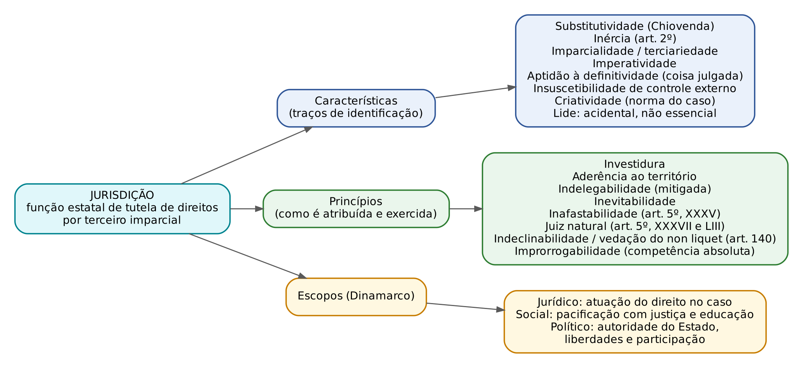
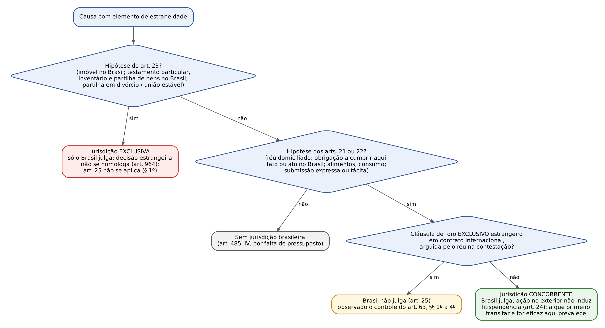
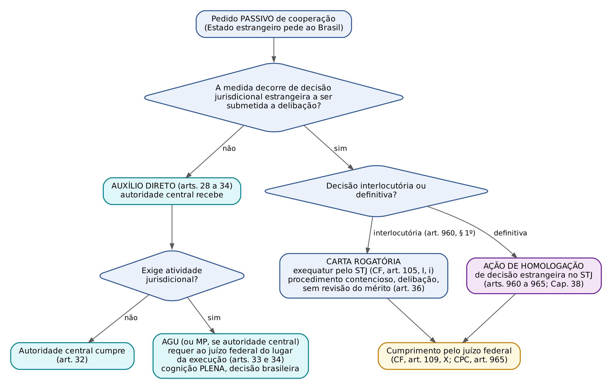
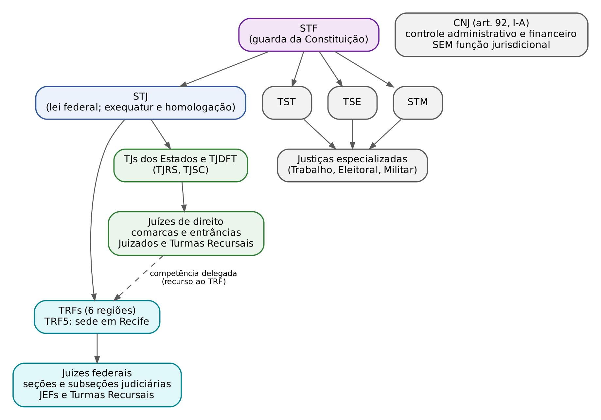

# CAPÍTULO 03 — JURISDIÇÃO, LIMITES DA JURISDIÇÃO NACIONAL, COOPERAÇÃO INTERNACIONAL E ORGANIZAÇÃO JUDICIÁRIA

:::INCIDENCIA
Pontos: TRF5 p. 2; TJRS p. 2, 3; TJSC p. 2. Nível A. Lote: 7 questões (FGV 7, FCC 0), duas de prova de juiz (TRF3 2025 e TJPR 2026) e uma do ENAM.
O que mais cai: letra dos arts. 21 a 25 do CPC (concorrente x exclusiva, litispendência estrangeira, foro estrangeiro), princípios da jurisdição em assertivas conceituais, auxílio direto x carta rogatória x homologação e a natureza da jurisdição voluntária.
:::

## 03.1 Jurisdição: conceito, escopos e características

### 03.1.1 Conceito e posição no sistema

Jurisdição é a função atribuída a terceiro imparcial de, mediante processo, reconhecer, efetivar ou proteger situações jurídicas concretamente deduzidas, de modo imperativo e criativo, em decisão insuscetível de controle externo e apta a tornar-se indiscutível. A formulação, corrente na doutrina contemporânea (Fredie Didier Jr.), interessa porque cada elemento corresponde a uma característica cobrada: terceiro imparcial (terciariedade), processo (a jurisdição só se exerce processualmente), situações concretas (não há jurisdição sobre lei em tese, salvo no controle abstrato de constitucionalidade), imperatividade, criatividade (o juiz produz a norma jurídica do caso), insuscetibilidade de controle externo e aptidão à coisa julgada.

As concepções clássicas continuam sendo a base das assertivas de prova. Para Chiovenda, jurisdição é a atuação da vontade concreta da lei por meio da substituição da atividade das partes pela atividade de órgãos públicos (daí a substitutividade). Para Carnelutti, é a justa composição da lide, entendida como conflito de interesses qualificado por uma pretensão resistida (daí a ideia de lide como elemento da jurisdição, hoje relativizada). As duas visões são complementares e nenhuma é exaustiva: há jurisdição sem lide (jurisdição voluntária, para quem a admite como jurisdição; ações constitutivas necessárias) e há atividade substitutiva fora da jurisdição (decisão administrativa).

A jurisdição é simultaneamente poder (manifestação da soberania), função (encargo do Estado de pacificar com justiça) e atividade (conjunto de atos do juiz no processo). O art. 16 do CPC registra a dimensão territorial: a jurisdição civil é exercida pelos juízes e pelos tribunais em todo o território nacional, conforme as disposições do Código.

Jurisdição e competência não se confundem. A jurisdição é UNA: todo juiz regularmente investido a possui por inteiro; o que se reparte entre os órgãos é a competência, medida do exercício legítimo da jurisdição (o tema dos critérios de repartição pertence ao Cap. 4). Consequência prática que aparece em questões: o juiz absolutamente incompetente tem jurisdição, e sua sentença existe e transita em julgado, sendo apenas rescindível (art. 966, II); o "juiz" sem investidura não tem jurisdição, e o ato que pratica é juridicamente inexistente (ver Cap. 13 sobre os planos da existência e da validade).

### 03.1.2 Escopos da jurisdição

A teoria dos escopos, sistematizada por Cândido Rangel Dinamarco na perspectiva instrumentalista, sustenta que a jurisdição não se esgota na aplicação do direito ao caso.

| Escopo | Conteúdo | Exemplo de leitura em prova |
|---|---|---|
| Jurídico | Atuação concreta do direito objetivo; produção da norma do caso | Única finalidade reconhecida pelas teorias clássicas (Chiovenda, Carnelutti) |
| Social | Pacificação com justiça e educação para o exercício e o respeito a direitos | Fundamenta o estímulo à autocomposição (art. 3º, §§ 2º e 3º) e a primazia do mérito |
| Político | Afirmação da autoridade do Estado e de seu ordenamento, preservação das liberdades públicas e participação democrática pelo processo | Ação popular, ação civil pública, mandado de segurança como canais de participação e controle do poder |

:::DICA
Em assertiva que reduz a jurisdição a "mera aplicação da lei ao caso concreto", o erro está em ignorar os escopos social e político. Em assertiva que atribui a teoria dos escopos a Chiovenda ou a Carnelutti, o erro está na autoria: a sistematização tripartite é de Dinamarco.
:::

### 03.1.3 Características

As características identificam a atividade jurisdicional em face das demais funções estatais. Nem todas estão presentes em todos os casos, e algumas são exclusivas sem serem essenciais.

| Característica | Conteúdo | Ressalva cobrável |
|---|---|---|
| Substitutividade | O Estado-juiz substitui a vontade e a atividade das partes pela vontade concreta do direito | Não há substituição propriamente dita nas ações constitutivas necessárias (anulação de casamento, interdição) nem na execução indireta, em que o próprio devedor cumpre sob coerção; e a substitutividade não é exclusiva da jurisdição |
| Inércia | O órgão jurisdicional não age de ofício para instaurar o processo (art. 2º: o processo começa por iniciativa da parte e se desenvolve por impulso oficial, "salvo as exceções previstas em lei") | Exceções legais em 03.2.1 |
| Terciariedade e imparcialidade | O juiz é estranho ao conflito e equidistante das partes | Imparcialidade não é neutralidade; impedimento e suspeição no Cap. 10 |
| Imperatividade | A decisão é ato de império, que se impõe independentemente da vontade dos destinatários | Liga-se à inevitabilidade (princípio) |
| Aptidão à definitividade | Só a decisão jurisdicional pode tornar-se indiscutível pela coisa julgada material | Característica exclusiva, mas não essencial: há decisões jurisdicionais que não produzem coisa julgada material (tutela provisória estabilizada, art. 304, § 6º; ver Cap. 15 e Cap. 21) |
| Insuscetibilidade de controle externo | Nenhum outro Poder revê o mérito da decisão jurisdicional; o controle é interno, pelos recursos e ações autônomas | CNJ não revê decisão jurisdicional (03.7.1) |
| Criatividade | O juiz reconstrói o sentido do texto e cria a norma individualizada do caso | Fundamenta o dever de fundamentação analítica (art. 489, § 1º; Cap. 20) |
| Lide | Conflito de interesses qualificado por pretensão resistida (Carnelutti) | Elemento acidental: há jurisdição sem lide |

:::PEGADINHA
"A substitutividade é característica exclusiva da jurisdição." Falso: órgãos administrativos também decidem conflitos substituindo a vontade dos interessados (por exemplo, o julgamento de impugnação administrativa). Exclusiva da jurisdição é a aptidão para a coisa julgada material, não a substitutividade.
:::

## 03.2 Princípios da jurisdição

Os princípios dizem como a jurisdição é atribuída e exercida. Bancas FGV os cobram em assertivas conceituais, quase sempre trocando o rótulo pelo conteúdo de outro princípio.

| Princípio | Conteúdo | Base | Mitigação ou detalhe |
|---|---|---|---|
| Investidura | Só exerce jurisdição quem foi regularmente investido no cargo | CF, arts. 93, I, 94, 101, 104, 107 | Investidura NÃO pressupõe concurso: quinto constitucional e nomeação para tribunais superiores são formas legítimas de investidura |
| Aderência ao território (territorialidade) | A jurisdição é exercida dentro de limites territoriais (comarcas, seções e subseções) | CPC, art. 16; arts. 21 a 25 no plano internacional | Arts. 60 (imóvel em mais de uma comarca), 255 (atos em comarcas contíguas e na mesma região metropolitana) e cooperação nacional (Cap. 5) |
| Indelegabilidade | O órgão não pode delegar o poder decisório que a Constituição lhe atribuiu | CF, art. 2º e regras de competência | Delegação de atos instrutórios e executivos: CF, art. 102, I, "m" (STF, execução de seus julgados); CPC, art. 972 (instrução da rescisória); atos ordinatórios por servidores (CF, art. 93, XIV; CPC, art. 203, § 4º). Cartas precatória, de ordem e rogatória são cooperação, não delegação |
| Inevitabilidade | As partes se sujeitam à decisão independentemente de vontade; o réu não escolhe não ser réu | Imperatividade | Não confundir com a vedação do *non liquet* |
| Indeclinabilidade (vedação do *non liquet*) | O juiz não se exime de decidir sob alegação de lacuna ou obscuridade do ordenamento | CPC, art. 140 | Decisão por equidade só nos casos previstos em lei (art. 140, parágrafo único) |
| Inafastabilidade | Não se exclui da apreciação jurisdicional ameaça ou lesão a direito | CF, art. 5º, XXXV; CPC, art. 3º | Desenvolvido no Cap. 1 (jurisdição condicionada, prévio requerimento administrativo, justiça desportiva) |
| Juiz natural | Juízo previamente constituído e competente segundo regras gerais, abstratas e impessoais; vedação de juízo ou tribunal de exceção | CF, art. 5º, XXXVII e LIII | Varas especializadas criadas por norma geral e prévia não ofendem o juiz natural; designação *ad hoc* para o caso concreto ofende |
| Improrrogabilidade | Os limites da competência são fixados em lei e não se alteram fora das hipóteses legais | CPC, arts. 54 a 63 (Cap. 5) | A competência relativa se prorroga (art. 65); a absoluta, não. Por isso é falso dizer que a improrrogabilidade é "absolutamente incompatível" com prorrogação |
| Inércia | Ver 03.1.3 e 03.2.1 | CPC, art. 2º | Exceções legais |

:::QUESTAO FGV 2024 — TCE-GO — ANALISTA DE CONTROLE EXTERNO (Q2524476)
Cobrou-se a assertiva correta sobre princípios da jurisdição. Gabarito: E, juiz natural como exigência de regras de competência prévias e abstratas, com vedação de juízos *ad hoc*.
Armadilhas: (A) atribuiu à inevitabilidade o conteúdo da vedação do *non liquet* (art. 140), que é indeclinabilidade; (B) disse que a improrrogabilidade é absolutamente incompatível com a prorrogação mesmo da competência relativa, quando a lei a admite (art. 65); (C) afirmou que a indelegabilidade proíbe cartas precatórias e de ordem instrutórias, que são cooperação e não delegação do poder decisório; (D) negou investidura aos membros do quinto constitucional, quando investidura não se confunde com concurso.
:::

:::QUESTAO FGV 2025 — DPE-RO — ANALISTA JURÍDICO (Q3395862)
Descreveu-se o princípio segundo o qual a jurisdição depende de provocação, vedada a iniciativa do juízo para deflagrar o processo. Gabarito: B, inércia (art. 2º).
Armadilha: indelegabilidade, investidura e juiz natural são princípios reais, mas tratam de outra coisa; "trânsito em julgado" não é princípio da jurisdição.
:::

### 03.2.1 Inércia e suas exceções

A inércia protege a imparcialidade: quem instaura o processo assume posição sobre o conflito. Por isso o art. 2º combina iniciativa da parte (princípio da demanda) com impulso oficial (o desenvolvimento independe de novo requerimento). As exceções são legais e taxativas, e o CPC/2015 reduziu-as.

- Arrecadação de herança jacente: o juiz da comarca do domicílio do falecido procede imediatamente à arrecadação (art. 738).
- Arrecadação dos bens do ausente, declarada a ausência (art. 744).
- Restauração de autos, de ofício ou a requerimento (art. 712).
- Instauração, pelo juiz ou relator, do incidente de resolução de demandas repetitivas mediante ofício ao tribunal (art. 977, I; Cap. 39) e suscitação de conflito de competência pelo juiz (art. 951; Cap. 4).
- Cumprimento de sentença de obrigação de fazer e não fazer: o juiz pode determinar as medidas necessárias de ofício (art. 536; Cap. 23).

:::PEGADINHA
O inventário de ofício (art. 989 do CPC/1973) NÃO foi reproduzido no CPC/2015. Hoje o requerimento de inventário cabe aos legitimados dos arts. 615 e 616; assertiva que repete a regra antiga ("o juiz determinará, de ofício, que se inicie o inventário") está errada. Também não há mais instauração de ofício de execução de título judicial de pagar quantia: o cumprimento de sentença por quantia depende de requerimento do exequente (art. 523; Cap. 22).
:::

### 03.2.2 Juiz natural e organização judiciária

O juiz natural tem duas faces. Na formal, exige órgão preexistente ao fato e competência definida por regras gerais e abstratas, vedando o tribunal de exceção (art. 5º, XXXVII) e o julgamento por autoridade incompetente (art. 5º, LIII). Na substancial, exige juiz imparcial (o regime de impedimento e suspeição, Cap. 10, é sua concretização).

Não ofendem o juiz natural, por serem critérios gerais e prévios: a criação de varas especializadas e a redistribuição de processos em razão dela; a convocação de juízes de primeiro grau para substituir em tribunal, nos termos da lei; a criação de novo tribunal com sucessão de competência (por exemplo, a criação do TRF da 6ª Região, com jurisdição sobre Minas Gerais); a distribuição por prevenção. Ofendem: a designação de juiz para julgar determinado processo, a escolha do juízo pela parte fora das regras de competência e a avocação discricionária.

:::DICA
A face formal do juiz natural se relaciona com a distribuição aleatória (art. 285 do CPC: distribuição alternada e aleatória, obedecendo-se rigorosa igualdade). Ajuizamento sucessivo para "escolher" o juízo é combatido pela prevenção do art. 286, II (reiteração de pedido após extinção sem mérito), tema do Cap. 5.
:::

## 03.3 Espécies de jurisdição

A jurisdição é una; as "espécies" são classificações didáticas do seu exercício, segundo critérios variados. Interessam à prova as seguintes.

| Critério | Espécies | Observação |
|---|---|---|
| Objeto (matéria) | Penal e civil (civil em sentido amplo: tudo o que não é penal, inclusive trabalhista, eleitoral não penal, administrativo, tributário) | O CPC regula a jurisdição civil (art. 16) e se aplica supletiva e subsidiariamente aos processos eleitorais, trabalhistas e administrativos (art. 15; Cap. 1) |
| Organismos que a exercem | Comum (federal e estadual) e especial (trabalhista, eleitoral, militar) | A justiça estadual tem competência residual (03.7) |
| Posição hierárquica | Inferior e superior | Relaciona-se ao duplo grau e à competência funcional (Cap. 4) |
| Fonte do critério de julgamento | De direito e de equidade | Equidade só quando a lei autoriza (art. 140, parágrafo único), como na jurisdição voluntária (art. 723, parágrafo único) e nos Juizados (Lei 9.099/1995, art. 6º; Cap. 36) |
| Existência de litígio deduzido | Contenciosa e voluntária | 03.3.1 |
| Sujeito que a exerce | Estatal e não estatal (arbitral) | 03.4 |

### 03.3.1 Jurisdição contenciosa e jurisdição voluntária

Na jurisdição contenciosa há pretensão deduzida contra alguém e decisão sobre o conflito. Na jurisdição voluntária (graciosa ou integrativa), o Estado-juiz intervém em negócios ou situações jurídicas privadas para integrá-los, fiscalizá-los ou dar-lhes eficácia, porque a lei, em razão da relevância do interesse envolvido, condiciona a produção de certos efeitos à participação judicial (por exemplo, alienação de bens de criança ou adolescente, art. 725, III; interdição; abertura de testamento).

#### Natureza: duas correntes

- Corrente clássica (administrativista): a jurisdição voluntária seria administração pública de interesses privados exercida por juízes. Faltariam lide, partes (há interessados), substitutividade e coisa julgada material; haveria procedimento, e não processo. É a posição tradicional, associada a Chiovenda e, no Brasil, a Frederico Marques, e ainda reproduzida em muitas questões.
- Corrente jurisdicionalista (revisionista): é jurisdição, porque há terceiro imparcial que decide imperativamente sobre situação concreta, mediante processo em contraditório, com sentença apelável. A lide não é essencial à jurisdição e o conflito pode existir (interdição contestada). É a posição de Fredie Didier Jr. e de parte expressiva da doutrina contemporânea, reforçada pelo CPC/2015, que trata a matéria no Livro do processo de conhecimento, manda citar os interessados (art. 721) e prevê apelação (art. 724).

:::ATENCAO
A existência de coisa julgada material na jurisdição voluntária é controvertida. O art. 1.111 do CPC/1973 dizia que a sentença poderia ser modificada, sem prejuízo dos efeitos já produzidos, se ocorressem circunstâncias supervenientes; o CPC/2015 não reproduziu o dispositivo, o que fortaleceu a corrente que admite coisa julgada (sujeita, como toda decisão sobre relação continuativa, à cláusula *rebus sic stantibus*, art. 505, I; Cap. 21). Em prova objetiva, a banca costuma adotar a classificação clássica nas questões conceituais básicas ("não há lide", "há interessados") e a letra do CPC nas questões de procedimento (sentença, apelação, equidade).
:::

:::LEI CPC, ARTS. 720 A 724
Art. 720. O procedimento terá início por provocação do interessado, do Ministério Público ou da Defensoria Pública, cabendo-lhes formular o pedido devidamente instruído com os documentos necessários e com a indicação da providência judicial.
Art. 721. Serão citados todos os interessados, bem como intimado o Ministério Público, nos casos do art. 178, para que se manifestem, querendo, no prazo de 15 (quinze) dias.
Art. 722. A Fazenda Pública será sempre ouvida nos casos em que tiver interesse.
Art. 723. O juiz decidirá o pedido no prazo de 10 (dez) dias.
Parágrafo único. O juiz não é obrigado a observar critério de legalidade estrita, podendo adotar em cada caso a solução que considerar mais conveniente ou oportuna.
Art. 724. Da sentença caberá apelação.
:::

Pontos de letra que a FGV explora:

- Legitimidade para provocar: interessado, Ministério Público ou Defensoria Pública (art. 720). Não há início de ofício na regra geral; as exceções estão nos procedimentos especiais (herança jacente, bens de ausente, 03.2.1).
- "Citados" os interessados: o Código usa citação, e não mera intimação, o que é argumento da corrente jurisdicionalista.
- Ministério Público: intimado SOMENTE nos casos do art. 178 (interesse público ou social, interesse de incapaz, litígios coletivos pela posse). A intervenção não é obrigatória em todos os procedimentos de jurisdição voluntária.
- Fazenda Pública: "sempre ouvida" quando tiver interesse (art. 722), e não vedada.
- Prazo de 15 dias para manifestação dos interessados e prazo impróprio de 10 dias para o juiz decidir.
- Critério de julgamento: o juiz NÃO está obrigado à legalidade estrita (art. 723, parágrafo único), hipótese legal de decisão por conveniência e oportunidade, compatível com o art. 140, parágrafo único.
- Recurso: apelação contra a sentença (art. 724).
- Rol do procedimento comum de jurisdição voluntária (art. 725): emancipação, sub-rogação, alienação, arrendamento ou oneração de bens de crianças ou adolescentes, de órfãos e de interditos, alienação, locação e administração da coisa comum, alienação de quinhão em coisa comum, extinção de usufruto e de fideicomisso nas hipóteses do inciso VI, expedição de alvará judicial e homologação de autocomposição extrajudicial, "de qualquer natureza ou valor" (inciso VIII).

Os procedimentos em espécie (notificação, alienação judicial, divórcio consensual, testamentos, herança jacente, ausentes, interdição etc.) são desenvolvidos no Cap. 31.

:::QUESTAO FGV 2024 — TJ-PE — JUIZ SUBSTITUTO (Q3117519; QUESTÃO DO CAP. 31, USADA AQUI PELO FUNDAMENTO)
Gabarito: A, a jurisdição voluntária se encerra por sentença, impugnável por apelação (art. 724). Armadilhas: intervenção obrigatória do Ministério Público "em todos os casos" (só nos do art. 178), vedação de oitiva da Fazenda (art. 722 manda ouvi-la quando tiver interesse) e legalidade estrita (art. 723, parágrafo único dispensa).
:::

| Critério | Contenciosa | Voluntária |
|---|---|---|
| Objeto | Pretensão deduzida contra alguém | Integração ou fiscalização de negócio ou situação jurídica |
| Sujeitos | Partes, em posições contrapostas | Interessados, sem contraposição necessária (corrente clássica) |
| Início | Iniciativa da parte (art. 2º) | Interessado, MP ou Defensoria (art. 720); exceções de ofício em procedimentos especiais |
| MP | Arts. 176 a 178 | Intimado nos casos do art. 178 (art. 721) |
| Critério de decisão | Legalidade; equidade só se a lei permitir (art. 140, parágrafo único) | Conveniência e oportunidade autorizadas (art. 723, parágrafo único) |
| Ato final e recurso | Sentença; apelação | Sentença; apelação (art. 724) |
| Coisa julgada material | Sim | Controvertida (clássica nega; CPC/2015 suprimiu a regra do art. 1.111 do CPC/1973) |

:::QUESTAO FGV 2025 — PGM-RJ — ANALISTA DE PROCURADORIA (Q3606019)
Caso: companheiros sem filhos, sem litígio, pedem ao juízo cível a homologação de partilha consensual dos bens da união estável; o juiz ressalta o controle de legalidade e do interesse público. Gabarito: D, jurisdição voluntária, porque não há litígio.
Passos: (1) não há pretensão resistida, logo não é contenciosa (afasta A); (2) a atividade é exercida por órgão do Judiciário em processo, não é "administrativa" pelo simples fato de ser homologação (afasta C); (3) consenso não transforma a atividade em arbitral, que exige convenção de arbitragem (afasta E).
Nota: as mesmas partes, capazes e sem filhos incapazes nem nascituro, poderiam fazer a extinção consensual da união estável com partilha por escritura pública (art. 733; Cap. 31). A via judicial é facultativa nesse caso, o que não muda a natureza da atividade quando escolhida.
:::

:::PEGADINHA
Acordo celebrado DENTRO de processo contencioso e homologado pelo juiz não converte a jurisdição em voluntária: a homologação resolve o mérito (art. 487, III, "b") e gera título executivo judicial (art. 515, II). Já a homologação de autocomposição EXTRAJUDICIAL, levada a juízo sem processo contencioso prévio, segue o procedimento de jurisdição voluntária (art. 725, VIII) e também gera título executivo judicial (art. 515, III).
:::

Distingue-se ainda a jurisdição voluntária necessária (o efeito só se produz com a intervenção judicial, como a alienação de bem de interdito) da facultativa (a parte pode optar pela via extrajudicial, como o divórcio consensual sem filhos incapazes, ou pela simples eficácia negocial, como a homologação do art. 725, VIII). O movimento legislativo de desjudicialização (inventário e partilha extrajudiciais, art. 610, §§ 1º e 2º; divórcio e extinção de união estável por escritura, art. 733; usucapião extrajudicial) reduziu o campo da jurisdição voluntária necessária.

## 03.4 Jurisdição estatal e não estatal; equivalentes jurisdicionais

O art. 3º do CPC substituiu a fórmula constitucional "apreciação do Poder Judiciário" por "apreciação jurisdicional" e, no § 1º, declarou permitida a arbitragem, na forma da lei. O art. 42 reforça: as causas cíveis serão processadas e decididas pelo juiz nos limites de sua competência, "ressalvado às partes o direito de instituir juízo arbitral, na forma da lei". A arbitragem integra, portanto, a jurisdição em sentido amplo, como jurisdição não estatal de base convencional.

| Mecanismo | Natureza | Observação |
|---|---|---|
| Jurisdição estatal | Jurisdição exercida por órgãos do Poder Judiciário | Única que dispõe de poder de império para atos executivos e coercitivos (o árbitro depende da carta arbitral, art. 237, IV) |
| Arbitragem | Jurisdição não estatal, segundo a corrente dominante (sentença arbitral é título executivo judicial, art. 515, VII, e não depende de homologação) | Regime da Lei 9.307/1996 no Cap. 2; a convenção de arbitragem não é conhecida de ofício (art. 337, § 5º) |
| Autotutela | Solução pela imposição da vontade de uma das partes; em regra vedada (crime de exercício arbitrário das próprias razões) | Permitida em hipóteses legais: desforço possessório imediato (CC, art. 1.210, § 1º), legítima defesa, direito de retenção, autoexecutoriedade administrativa |
| Autocomposição (negociação, conciliação, mediação) | Equivalente jurisdicional: solução pelas próprias partes, com ou sem terceiro facilitador sem poder decisório | Cap. 2 |
| Justiça desportiva | Instância administrativa de esgotamento obrigatório para disciplina e competições (CF, art. 217, §§ 1º e 2º) | Não é jurisdição; depois dela, ou após 60 dias, abre-se a via judicial (Cap. 1) |
| Tribunais administrativos (CARF, TCU, tribunais de contas, Tribunal Marítimo, CADE) | Função administrativa; decisões revisáveis pelo Judiciário | O Brasil adota a jurisdição una (sistema inglês), sem contencioso administrativo com coisa julgada |
| CNJ | Órgão do Judiciário sem função jurisdicional | 03.7.1 |

Os equivalentes jurisdicionais (expressão de Carnelutti difundida pela doutrina brasileira) são as formas não jurisdicionais de solução de conflitos: autotutela, autocomposição, mediação e, para a corrente minoritária que nega natureza jurisdicional à arbitragem, também ela. Para a posição dominante, arbitragem é jurisdição, e não equivalente.

:::DICA
Duas consequências práticas de reconhecer natureza jurisdicional à arbitragem cobradas em prova de juiz: (1) o conflito de competência entre juízo arbitral e juízo estatal é resolvido pelo STJ (orientação reiterada da Segunda Seção, com base no art. 105, I, "d", da CF; no mesmo sentido o gabarito da Q4083804, FGV 2026, TJ-BA, que considerou falsa a afirmação de que o STJ não teria competência para tanto; desenvolvimento no Cap. 2); (2) a sentença arbitral estrangeira se sujeita à homologação pelo STJ (art. 960, § 3º).
:::

## 03.5 Limites da jurisdição nacional (arts. 21 a 25 do CPC)

### 03.5.1 Terminologia e fundamentos

O CPC/2015 abandonou a expressão "competência internacional" do CPC/1973 e passou a falar em "limites da jurisdição nacional" (Título II do Livro II da Parte Geral). A mudança é técnica: não se reparte competência entre soberanias; cada Estado define unilateralmente até onde vai a sua própria jurisdição. As normas dos arts. 21 a 25 são, por isso, unilaterais: dizem quando o juiz brasileiro pode julgar, e não quando o juiz estrangeiro pode ou não pode.

Os critérios que orientam os limites são a efetividade (o Estado só se atribui jurisdição onde sua decisão possa produzir efeitos), a conveniência (proximidade com a causa, interesse em proteger a parte vulnerável, como credor de alimentos e consumidor), a soberania (reserva de matérias ligadas ao território, como imóveis) e a autonomia da vontade (submissão e eleição de foro). A ausência de jurisdição brasileira é falta de pressuposto processual e leva à extinção sem resolução do mérito (art. 485, IV); não se "remete" o processo ao juiz estrangeiro.

Os limites de ordem subjetiva, relativos à imunidade de jurisdição de Estados estrangeiros e organismos internacionais, completam o quadro (03.5.6).

### 03.5.2 Jurisdição concorrente (arts. 21 e 22)

:::LEI CPC, ARTS. 21 E 22
Art. 21. Compete à autoridade judiciária brasileira processar e julgar as ações em que:
I - o réu, qualquer que seja a sua nacionalidade, estiver domiciliado no Brasil;
II - no Brasil tiver de ser cumprida a obrigação;
III - o fundamento seja fato ocorrido ou ato praticado no Brasil.
Parágrafo único. Para o fim do disposto no inciso I, considera-se domiciliada no Brasil a pessoa jurídica estrangeira que nele tiver agência, filial ou sucursal.
Art. 22. Compete, ainda, à autoridade judiciária brasileira processar e julgar as ações:
I - de alimentos, quando:
a) o credor tiver domicílio ou residência no Brasil;
b) o réu mantiver vínculos no Brasil, tais como posse ou propriedade de bens, recebimento de renda ou obtenção de benefícios econômicos;
II - decorrentes de relações de consumo, quando o consumidor tiver domicílio ou residência no Brasil;
III - em que as partes, expressa ou tacitamente, se submeterem à jurisdição nacional.
:::

Na jurisdição concorrente o Brasil julga, mas o Estado estrangeiro também pode julgar, e sua decisão pode ser homologada aqui (art. 963). Os critérios são ALTERNATIVOS: basta um inciso.

Pontos de letra:

- Inciso I do art. 21: domicílio do réu, "qualquer que seja a sua nacionalidade". A nacionalidade é irrelevante: brasileiro domiciliado no exterior não atrai, só por isso, a jurisdição brasileira; estrangeiro domiciliado no Brasil a atrai.
- Inciso II: lugar de cumprimento da obrigação, independentemente do domicílio ou da nacionalidade do réu.
- Inciso III: fato ocorrido ou ato praticado no Brasil (acidente, ato ilícito, celebração do contrato).
- Parágrafo único: PJ estrangeira com agência, filial ou sucursal no Brasil considera-se aqui domiciliada.
- Art. 22, I: alimentos, por domicílio OU residência do credor no Brasil, ou por vínculos patrimoniais do réu (rol exemplificativo, "tais como").
- Art. 22, II: consumo, por domicílio ou residência do consumidor no Brasil. Inovação do CPC/2015.
- Art. 22, III: submissão expressa (cláusula de eleição de foro brasileiro) ou tácita (o réu comparece e se defende sem impugnar a jurisdição brasileira).

O art. 12, *caput*, da LINDB contém regra equivalente aos incisos I e II do art. 21 ("É competente a autoridade judiciária brasileira, quando for o réu domiciliado no Brasil ou aqui tiver de ser cumprida a obrigação"), e seu § 1º antecipou a regra do imóvel (art. 23, I).

:::QUESTAO FGV 2025 — TRF 3ª REGIÃO — JUIZ FEDERAL SUBSTITUTO (Q3179587)
Cobrou-se a alternativa correta sobre a autoridade judiciária brasileira. Gabarito: E, competência quando o réu for domiciliado no Brasil OU aqui tiver de ser cumprida a obrigação (LINDB, art. 12, *caput*; CPC, art. 21, I e II).
Armadilhas: (A) exclusividade para bens MÓVEIS situados no Brasil (a exclusividade é para imóveis); (B) e (D) inverteram a lógica, atribuindo jurisdição justamente quando ausentes os elementos de conexão; (C) disse que a diligência deprecada por autoridade estrangeira é cumprida "segundo a forma estabelecida pela lei estrangeira", quando o art. 12, § 2º, da LINDB manda cumpri-la, concedido o *exequatur*, segundo a forma da lei BRASILEIRA, observando-se a lei estrangeira apenas quanto ao OBJETO das diligências.
:::

:::QUESTAO FGV 2025 — DPE-RO — ANALISTA JURÍDICO (Q3395865)
Gabarito: B, compete à autoridade brasileira julgar ações decorrentes de relações de consumo quando o consumidor tiver domicílio ou residência no Brasil (art. 22, II).
Armadilhas: (A) acrescentou ao art. 21, II, a exigência de réu brasileiro, inexistente; (C) afirmou que a ação no estrangeiro induz litispendência, contra o art. 24; (D) inverteu o art. 25 (a cláusula de foro exclusivo estrangeiro arguida na contestação AFASTA a jurisdição brasileira); (E) qualificou como concorrente a jurisdição sobre imóveis situados no Brasil, que é exclusiva (art. 23, I).
:::

A jurisprudência recente do STJ trabalha os elementos de conexão no ambiente digital:

:::JURIS STJ, RESP 2.246.810, J. 1/9/2026 (INFORMATIVO 902)
Não há jurisdição brasileira para ação indenizatória ajuizada por atleta argentino, residente em Buenos Aires, contra empresas sediadas na Holanda e no Reino Unido, apenas porque terceiros comercializam no varejo brasileiro jogos eletrônicos que usariam sua imagem (Relatora Ministra Nancy Andrighi, Terceira Turma). A simples circulação do produto no mercado nacional não configura, por si, "fato ocorrido ou ato praticado no Brasil" suficiente para o art. 21, III, quando autor e réus não têm vínculo com o país.
:::

Em sentido complementar, o STJ afirmou que empresas multinacionais que atuam no Brasil se submetem à lei brasileira e devem fornecer dados requisitados pelo juízo nacional sem necessidade de cooperação internacional, com apoio no art. 11, § 2º, do Marco Civil da Internet (STJ, RMS 74.604, 2025, conforme compilado de jurisprudência consultado; dados completos a conferir).

### 03.5.3 Jurisdição exclusiva (art. 23)

:::LEI CPC, ART. 23
Art. 23. Compete à autoridade judiciária brasileira, com exclusão de qualquer outra:
I - conhecer de ações relativas a imóveis situados no Brasil;
II - em matéria de sucessão hereditária, proceder à confirmação de testamento particular e ao inventário e à partilha de bens situados no Brasil, ainda que o autor da herança seja de nacionalidade estrangeira ou tenha domicílio fora do território nacional;
III - em divórcio, separação judicial ou dissolução de união estável, proceder à partilha de bens situados no Brasil, ainda que o titular seja de nacionalidade estrangeira ou tenha domicílio fora do território nacional.
:::

Consequências da exclusividade:

- Decisão estrangeira sobre a matéria não é homologada nem recebe *exequatur* (art. 964 e parágrafo único).
- A cláusula de eleição de foro exclusivo estrangeiro não afasta a jurisdição brasileira (art. 25, § 1º).
- A vedação abrange apenas bens SITUADOS NO BRASIL. Partilha de bens situados no exterior, feita por juiz estrangeiro, pode ser homologada.
- Os incisos II e III falam em "bens", sem distinguir móveis e imóveis: na sucessão e na partilha conjugal, a exclusividade alcança quaisquer bens situados no Brasil. No inciso I, a exclusividade é só para ações relativas a IMÓVEIS.
- Testamento: a exclusividade é para a confirmação de testamento PARTICULAR; não abrange o testamento público ou cerrado.

O STJ vem delimitando o inciso I e o inciso II:

:::JURIS STJ, HDE 5.996 (NOTICIADA EM 7/10/2025)
A jurisdição brasileira é exclusiva apenas quando o imóvel é o objeto central da controvérsia; não alcança ações obrigacionais fundadas em contratos relacionados a imóveis. Assim, sentença estrangeira que condena ao pagamento de valores oriundos de contrato que envolve imóvel situado no Brasil pode ser homologada, porque a ação não é real nem tem o imóvel como bem disputado.
:::

:::JURIS STJ, CORTE ESPECIAL, PROCESSO EM SEGREDO DE JUSTIÇA, RELATOR MINISTRO OG FERNANDES, J. 11/11/2025 (INFORMATIVO 876)
A homologação de ato notarial estrangeiro que versa sobre bens situados no Brasil contraria o art. 964 do CPC. No caso, declaração de espólio e ata de execução de testamento lavradas por tabelião estrangeiro dispunham sobre bens no Brasil, matéria reservada à jurisdição brasileira (art. 23, II).
:::

:::PEGADINHA
"Só à autoridade brasileira compete conhecer das ações relativas a bens MÓVEIS situados no Brasil" (Q3179587, A) e "compete à autoridade brasileira, de forma CONCORRENTE, conhecer de ações relativas a imóveis situados no Brasil" (Q3395865, E): ambas falsas. Imóvel no Brasil, em ação real ou que o tenha como objeto central, é exclusiva; bem móvel não atrai exclusividade, salvo na sucessão e na partilha conjugal (art. 23, II e III).
:::

### 03.5.4 Litispendência internacional (art. 24)

:::LEI CPC, ART. 24
Art. 24. A ação proposta perante tribunal estrangeiro não induz litispendência e não obsta a que a autoridade judiciária brasileira conheça da mesma causa e das que lhe são conexas, ressalvadas as disposições em contrário de tratados internacionais e acordos bilaterais em vigor no Brasil.
Parágrafo único. A pendência de causa perante a jurisdição brasileira não impede a homologação de sentença judicial estrangeira quando exigida para produzir efeitos no Brasil.
:::

A regra só tem sentido nas hipóteses de jurisdição CONCORRENTE: nas de jurisdição exclusiva, a decisão estrangeira jamais produzirá efeito no Brasil, e o processo estrangeiro é irrelevante. O que a lei nega não é a existência fática de processos paralelos, mas seu efeito obstativo. Os dois processos correm, e o conflito se resolve pela coisa julgada eficaz no Brasil:

- Se a sentença estrangeira for homologada e transitar em julgado a decisão homologatória antes do trânsito da sentença brasileira, a coisa julgada estrangeira, agora eficaz aqui, impede o prosseguimento (extinção pelo art. 485, V).
- Se a sentença brasileira transitar antes, a homologação da estrangeira esbarra no requisito de não ofensa à coisa julgada brasileira (art. 963, IV).
- A simples pendência do processo brasileiro não impede a homologação (parágrafo único).

:::QUESTAO FGV 2026 — TJ-PR — JUIZ SUBSTITUTO (Q3898907)
Caso: sociedade brasileira propõe em Curitiba ação de cobrança contra empresa norte-americana, fundada em contrato de serviços executado no Brasil; a ré alega litispendência com ação idêntica em curso há seis meses em Nova Iorque; não há tratado. Gabarito: D, rejeitar a preliminar e prosseguir, porque a ação no estrangeiro não induz litispendência (art. 24).
Passos: (1) jurisdição brasileira: obrigação cumprida no Brasil (art. 21, II) e fato ou ato no Brasil (art. 21, III), concorrente; (2) art. 24: sem tratado em contrário, não há litispendência nem suspensão obrigatória; (3) não há opção imposta ao autor nem extinção (afasta A e C); (4) suspensão "até o trânsito" no exterior não tem base legal (afasta B); a existência de processo estrangeiro não atrai a Justiça Federal (afasta E: a competência federal depende do art. 109 da CF, Cap. 5).
:::

:::ATENCAO
Não confunda a regra do art. 24 com a suspensão por prejudicialidade externa (art. 313, V, "a"), cabível quando a sentença de mérito depender do julgamento de outra causa, nem com a suspensão do art. 377, pela qual a carta rogatória e o auxílio direto suspendem o julgamento (art. 313, V, "b") quando requeridos antes do saneamento e a prova solicitada for imprescindível. A questão do TJ-PR afastou a suspensão porque se tratava de causa IDÊNTICA (tríplice identidade), e não de causa prejudicial.
:::

### 03.5.5 Cláusula de eleição de foro exclusivo estrangeiro (art. 25)

:::LEI CPC, ART. 25
Art. 25. Não compete à autoridade judiciária brasileira o processamento e o julgamento da ação quando houver cláusula de eleição de foro exclusivo estrangeiro em contrato internacional, arguida pelo réu na contestação.
§ 1º Não se aplica o disposto no caput às hipóteses de competência internacional exclusiva previstas neste Capítulo.
§ 2º Aplica-se à hipótese do caput o art. 63, §§ 1º a 4º.
:::

Requisitos cumulativos para afastar a jurisdição brasileira: (1) contrato INTERNACIONAL; (2) cláusula de foro EXCLUSIVO estrangeiro (cláusula não exclusiva apenas acrescenta um foro); (3) arguição pelo réu NA CONTESTAÇÃO; (4) causa fora das hipóteses do art. 23.

Natureza: o vício não é conhecido de ofício e preclui se não alegado na contestação; o comparecimento do réu sem arguir a cláusula configura submissão tácita (art. 22, III). O regime se aproxima, por isso, do da incompetência relativa (art. 65).

A remissão do § 2º ao art. 63, §§ 1º a 4º, traz para o plano internacional: forma escrita e alusão expressa a determinado negócio (§ 1º), vinculação de herdeiros e sucessores (§ 2º), controle de ofício da cláusula abusiva ANTES da citação (§ 3º) e ônus do réu de alegar a abusividade na contestação, sob pena de preclusão (§ 4º). Com a Lei 14.879/2024, o § 1º do art. 63 passou a exigir também que a eleição guarde pertinência com o domicílio ou a residência de uma das partes ou com o local da obrigação, ressalvada a pactuação consumerista favorável ao consumidor; a aplicação desse requisito de pertinência aos contratos internacionais, por força da remissão do art. 25, § 2º, é questão nova, ainda não pacificada (ver Cap. 4 para o foro de eleição interno). Note que a remissão não inclui o § 5º (juízo aleatório), acrescentado pela mesma lei.

:::JURIS STJ, RESP 2.210.341 (2025)
Em contrato de adesão celebrado pela internet entre empresa estrangeira e consumidor brasileiro, a cláusula de eleição de foro estrangeiro pode ser declarada nula quando: (1) for contrato de adesão; (2) o aderente for hipossuficiente técnica, econômica ou juridicamente; e (3) a cláusula acarretar significativa dificuldade ou impossibilidade de acesso à jurisdição. O tribunal harmonizou o art. 22, II, com o art. 25, pela remissão do § 2º ao art. 63, e considerou que o sítio que direciona deliberadamente sua atividade ao público brasileiro (língua, moeda, domínio) se submete à jurisdição nacional. (Ementa conhecida por compilado de jurisprudência; relator, órgão e data a conferir.)
:::

### 03.5.6 Imunidade de jurisdição

Imunidade de jurisdição é a prerrogativa de Estados estrangeiros e de organismos internacionais de não se submeterem à jurisdição de outro Estado (*par in parem non habet imperium*). Não é tratada no CPC; decorre do direito internacional costumeiro e de tratados (Convenções de Viena sobre relações diplomáticas e consulares).

| Aspecto | Regra |
|---|---|
| Estado estrangeiro, atos de império | Imunidade de jurisdição (cognição), salvo renúncia |
| Estado estrangeiro, atos de gestão (contratos de trabalho, locação, relações comerciais) | Sem imunidade de cognição: o Estado estrangeiro responde no Brasil |
| Execução contra Estado estrangeiro | Imunidade de execução mais rígida: bens afetos à missão diplomática ou consular são impenhoráveis; a execução só alcança bens não afetados ou depende de renúncia expressa |
| Atos ilícitos de Estado estrangeiro, no território nacional, em violação a direitos humanos | Não gozam de imunidade de jurisdição (STF, Tema 944, ARE 954.858) |
| Organismo internacional com imunidade prevista em tratado internalizado | Não pode ser demandado, salvo renúncia expressa (STF, Tema 947, RE 1.034.840) |
| Competência | Juiz federal, para causas entre Estado estrangeiro ou organismo internacional e Município ou pessoa domiciliada ou residente no País (CF, art. 109, II), com recurso ordinário ao STJ (CF, art. 105, II, "c"); desenvolvimento no Cap. 5 e no Cap. 42 |

A soberania brasileira também é projetada para fora:

:::JURIS STJ, CR 22.380, RELATOR MINISTRO HERMAN BENJAMIN, CORTE ESPECIAL, J. 4/3/2026 (INFORMATIVO DE JURISPRUDÊNCIA N. 32, EDIÇÃO EXTRAORDINÁRIA)
Negou-se *exequatur* a carta rogatória estrangeira destinada a citar magistrado brasileiro em ação de responsabilização pessoal por atos jurisdicionais. O exame de irresignação contra pronunciamentos de juízes brasileiros, ainda que sob o argumento de serem ilegais (*ultra vires*), não pode ser feito em foro estrangeiro, por afronta à soberania e à ordem pública; e a pretensão indenizatória por ato jurisdicional deve ser dirigida exclusivamente contra o Estado, com regresso contra o agente apenas em caso de dolo ou culpa.
:::

## 03.6 Cooperação jurídica internacional (arts. 26 a 41 do CPC)

### 03.6.1 Fontes, princípios e objeto

Cooperação jurídica internacional é o conjunto de mecanismos pelos quais um Estado solicita ou presta a outro auxílio para a prática de atos processuais ou extraprocessuais e para a produção de efeitos de decisões fora do seu território. Chama-se ATIVA quando o Brasil é o requerente e PASSIVA quando é o requerido. O CPC/2015 deu ao tema capítulo próprio, distinto da cooperação nacional dos arts. 67 a 69 (Cap. 5).

:::LEI CPC, ART. 26
Art. 26. A cooperação jurídica internacional será regida por tratado de que o Brasil faz parte e observará:
I - o respeito às garantias do devido processo legal no Estado requerente;
II - a igualdade de tratamento entre nacionais e estrangeiros, residentes ou não no Brasil, em relação ao acesso à justiça e à tramitação dos processos, assegurando-se assistência judiciária aos necessitados;
III - a publicidade processual, exceto nas hipóteses de sigilo previstas na legislação brasileira ou na do Estado requerente;
IV - a existência de autoridade central para recepção e transmissão dos pedidos de cooperação;
V - a espontaneidade na transmissão de informações a autoridades estrangeiras.
§ 1º Na ausência de tratado, a cooperação jurídica internacional poderá realizar-se com base em reciprocidade, manifestada por via diplomática.
§ 2º Não se exigirá a reciprocidade referida no § 1º para homologação de sentença estrangeira.
§ 3º Na cooperação jurídica internacional não será admitida a prática de atos que contrariem ou que produzam resultados incompatíveis com as normas fundamentais que regem o Estado brasileiro.
§ 4º O Ministério da Justiça exercerá as funções de autoridade central na ausência de designação específica.
:::

Pontos que caem:

- Fonte primária: tratado. Sem tratado, reciprocidade manifestada por via diplomática (§ 1º), EXCETO para a homologação de sentença estrangeira, que dispensa reciprocidade (§ 2º). Exceção à exceção: a homologação para fins de execução FISCAL exige previsão em tratado ou promessa de reciprocidade (art. 961, § 4º).
- Autoridade central: o Ministério da Justiça, na falta de designação específica (§ 4º). Tratados podem designar outra autoridade.
- Limite material: ordem pública e normas fundamentais do Estado brasileiro (§ 3º; art. 39: o pedido passivo será recusado se configurar manifesta ofensa à ordem pública).
- Objeto (art. 27): citação, intimação e notificação judicial e extrajudicial; colheita de provas e obtenção de informações; homologação e cumprimento de decisão; concessão de medida judicial de urgência; assistência jurídica internacional; qualquer outra medida judicial ou extrajudicial não proibida pela lei brasileira (rol exemplificativo).
- Documentos (art. 41): o documento que instrui o pedido, inclusive a tradução para o português, é considerado autêntico quando encaminhado por autoridade central ou por via diplomática, dispensadas ajuramentação, autenticação e legalização, sem prejuízo da reciprocidade de tratamento (parágrafo único).
- Pedido ATIVO (arts. 37 e 38): a autoridade brasileira competente encaminha o pedido à autoridade central, acompanhado de tradução para a língua oficial do Estado requerido.

Os três instrumentos são o auxílio direto, a carta rogatória e a ação de homologação de decisão estrangeira. O critério de escolha não é discricionário: depende de existir, ou não, decisão jurisdicional estrangeira a ser submetida a juízo de delibação no Brasil (art. 28), e, existindo, de sua natureza interlocutória ou definitiva (arts. 40 e 960, § 1º).

### 03.6.2 Auxílio direto (arts. 28 a 34)

:::LEI CPC, ARTS. 28, 30, 33 E 34
Art. 28. Cabe auxílio direto quando a medida não decorrer diretamente de decisão de autoridade jurisdicional estrangeira a ser submetida a juízo de delibação no Brasil.
Art. 30. Além dos casos previstos em tratados de que o Brasil faz parte, o auxílio direto terá os seguintes objetos:
I - obtenção e prestação de informações sobre o ordenamento jurídico e sobre processos administrativos ou jurisdicionais findos ou em curso;
II - colheita de provas, salvo se a medida for adotada em processo, em curso no estrangeiro, de competência exclusiva de autoridade judiciária brasileira;
III - qualquer outra medida judicial ou extrajudicial não proibida pela lei brasileira.
Art. 33. Recebido o pedido de auxílio direto passivo, a autoridade central o encaminhará à Advocacia-Geral da União, que requererá em juízo a medida solicitada.
Parágrafo único. O Ministério Público requererá em juízo a medida solicitada quando for autoridade central.
Art. 34. Compete ao juízo federal do lugar em que deva ser executada a medida apreciar pedido de auxílio direto passivo que demande prestação de atividade jurisdicional.
:::

No auxílio direto, o Estado estrangeiro não pede o cumprimento de uma decisão sua; pede que o Estado brasileiro pratique o ato ou, se necessário, que o juiz brasileiro DECIDA originariamente sobre a medida, com cognição plena. Não há delibação nem passagem pelo STJ.

Trâmite passivo: o órgão estrangeiro encaminha o pedido à autoridade central brasileira, cabendo ao Estado requerente assegurar autenticidade e clareza (art. 29); a autoridade central comunica-se diretamente com suas congêneres (art. 31); se o ato não exigir prestação jurisdicional segundo a lei brasileira, a própria autoridade central adota as providências (art. 32); se exigir, encaminha à AGU, que requer em juízo (art. 33), ou o Ministério Público requer, quando for ele a autoridade central (parágrafo único); a competência é do juízo FEDERAL do lugar em que a medida deva ser executada (art. 34).

:::PEGADINHA
Três detalhes literais do auxílio direto: (1) "processos administrativos ou jurisdicionais FINDOS ou em curso" (art. 30, I): é possível obter informações de processo já transitado em julgado; (2) a colheita de provas é vedada se o processo estrangeiro versar matéria de competência EXCLUSIVA da autoridade brasileira (art. 30, II); (3) quem requer em juízo é a AGU, e não a parte estrangeira nem o Estado requerente diretamente; a competência é do juízo federal de primeiro grau, e não do STJ.
:::

:::JURIS STJ, CORTE ESPECIAL, PROCESSO EM SEGREDO DE JUSTIÇA, RELATOR MINISTRO HERMAN BENJAMIN, J. 23/9/2025 (INFORMATIVO 875)
A medida de produção de prova que decorre de decisão judicial estrangeira deve ser submetida ao juízo delibatório do STJ, pelo rito das cartas rogatórias, com as garantias do devido processo legal, porque se trata de ato típico de função jurisdicional. É a aplicação do critério do art. 28: havendo decisão jurisdicional estrangeira a cumprir, não cabe auxílio direto.
:::

Exemplos típicos de auxílio direto passivo judicializado: quebra de sigilo bancário ou telemático pedida por autoridade estrangeira sem decisão judicial de origem, bloqueio de ativos e o pedido de restituição de criança fundado na Convenção da Haia de 1980 sobre os aspectos civis do sequestro internacional de crianças (a ação é proposta pela União na Justiça Federal; competência federal por se tratar de causa fundada em tratado, CF, art. 109, III).

### 03.6.3 Carta rogatória

Carta rogatória é o instrumento pelo qual a autoridade jurisdicional de um Estado solicita à de outro a prática de ato processual (comunicação, prova) ou o cumprimento de decisão interlocutória. Na rogatória ATIVA, expedida pelo juiz brasileiro (art. 237, II), observam-se os requisitos do art. 260 e a tradução (art. 38), e o prazo de cumprimento pode ser considerado na suspensão do art. 377 (ver 03.5.4 e Cap. 12). Na rogatória PASSIVA, o cumprimento no Brasil depende de *exequatur* do STJ (CF, art. 105, I, "i"), e a execução cabe ao juiz federal (CF, art. 109, X).

:::LEI CPC, ART. 36
Art. 36. O procedimento da carta rogatória perante o Superior Tribunal de Justiça é de jurisdição contenciosa e deve assegurar às partes as garantias do devido processo legal.
§ 1º A defesa restringir-se-á à discussão quanto ao atendimento dos requisitos para que o pronunciamento judicial estrangeiro produza efeitos no Brasil.
§ 2º Em qualquer hipótese, é vedada a revisão do mérito do pronunciamento judicial estrangeiro pela autoridade judiciária brasileira.
:::

Pontos centrais:

- Natureza: procedimento de jurisdição CONTENCIOSA no STJ, com contraditório.
- Cognição: delibação. A defesa limita-se aos requisitos de eficácia (art. 36, § 1º), e o mérito do pronunciamento estrangeiro não é revisto "em qualquer hipótese" (§ 2º).
- Pressupostos do *exequatur*: os mesmos da homologação (art. 963, parágrafo único), mais a regra do art. 962, § 2º (medida de urgência concedida sem audiência do réu pode ser executada, desde que garantido o contraditório posterior).
- Vedação: não se concede *exequatur* em matéria de jurisdição exclusiva brasileira (art. 964, parágrafo único).
- Cabimento para decisão interlocutória estrangeira, inclusive concessiva de medida de urgência (arts. 960, § 1º, e 962, § 1º). O juízo sobre a urgência compete exclusivamente à autoridade estrangeira prolatora (art. 962, § 3º).
- Diligência deprecada: cumpre-se segundo a forma da lei brasileira, observada a lei estrangeira quanto ao objeto (LINDB, art. 12, § 2º; ver Q3179587).

:::JURIS STJ, CORTE ESPECIAL, PROCESSO EM SEGREDO DE JUSTIÇA, RELATOR MINISTRO JOÃO OTÁVIO DE NORONHA, J. 10/2/2026 (INFORMATIVO 891)
A citação de réu domiciliado no Brasil para responder a processo estrangeiro deve ser feita por carta rogatória (RISTJ, art. 216-D, II). Ausente citação válida, há ofensa à ordem pública que impede a homologação da sentença estrangeira; a flexibilização só se admite excepcionalmente, quando comprovada de forma inequívoca a ciência do réu sobre o processo estrangeiro.
:::

:::DICA
No plano ativo, se o país estrangeiro recusar o cumprimento de carta rogatória, ele é considerado lugar inacessível e a citação se faz por edital (art. 256, § 1º), com nomeação de curador especial ao revel (art. 72, II). O tema é do Cap. 12 (questões do banco no mesmo sentido: Q2449077, Q3868586 e Q3301237).
:::

### 03.6.4 Homologação de decisão estrangeira (noção)

A decisão estrangeira só produz efeitos no Brasil após a homologação ou a concessão do *exequatur* à rogatória, salvo disposição em contrário de lei ou tratado (art. 961). O procedimento da ação de homologação, a legitimidade e os requisitos em detalhe são desenvolvidos no Cap. 38; aqui interessam as noções que se cruzam com os limites da jurisdição e a cooperação.

- Objeto: decisão judicial definitiva e também decisão NÃO judicial que, pela lei brasileira, teria natureza jurisdicional (art. 961, § 1º); homologação parcial é possível (§ 2º); medidas de urgência e execução provisória podem ser deferidas no processo de homologação (§ 3º).
- Dispensa: a sentença estrangeira de divórcio CONSENSUAL produz efeitos no Brasil independentemente de homologação pelo STJ (art. 961, § 5º), competindo a qualquer juiz examinar sua validade, em caráter principal ou incidental (§ 6º). Títulos executivos EXTRAJUDICIAIS estrangeiros também não dependem de homologação (art. 784, § 2º; Cap. 24).
- Requisitos (art. 963): autoridade competente; citação regular, ainda que verificada a revelia; eficácia no país de origem; não ofensa à coisa julgada brasileira; tradução oficial, salvo dispensa em tratado; ausência de manifesta ofensa à ordem pública.
- Sob o CPC/2015 exige-se que a decisão seja EFICAZ na origem, e não mais transitada em julgado (STJ, Jurisprudência em Teses, edição 255, tese 4, com base em julgados da Corte Especial como a HDE 7.547).
- Vedação: jurisdição exclusiva brasileira (art. 964).
- Cumprimento: juízo federal competente, conforme as normas do cumprimento de decisão nacional (art. 965; CF, art. 109, X); a decisão homologada é título executivo judicial (art. 515, VIII), assim como a decisão interlocutória estrangeira após o *exequatur* (art. 515, IX).

:::QUESTAO FGV 2025 — ENAM — EXAME NACIONAL DA MAGISTRATURA 2025.2 (Q3692396)
Três afirmativas V/F sobre cooperação. Gabarito: D (F, F, V).
(1) "A homologação de sentença estrangeira, sem tratado, exige reciprocidade": FALSA, art. 26, § 2º (a ressalva fica para a execução fiscal, art. 961, § 4º).
(2) "A tradução por tradutor juramentado é sempre indispensável para a homologação": FALSA, o art. 963, V, ressalva a dispensa prevista em tratado, e o art. 41 considera autêntica a tradução encaminhada por autoridade central ou via diplomática, dispensada a ajuramentação. A palavra "sempre" é a armadilha.
(3) "É possível, por auxílio direto, obter informações de processos transitados em julgado": VERDADEIRA, art. 30, I ("processos [...] findos ou em curso").
:::

| Critério | Auxílio direto | Carta rogatória passiva | Homologação de decisão estrangeira |
|---|---|---|---|
| Há decisão jurisdicional estrangeira a cumprir? | Não | Sim, em regra interlocutória, ou pedido de ato processual | Sim, decisão definitiva (ou não judicial de natureza jurisdicional) |
| Base | Arts. 28 a 34 | Arts. 36, 960, § 1º, e 962 | Arts. 40 e 960 a 965 |
| Órgão | Autoridade central; se exigir jurisdição, juízo federal do lugar da execução, a pedido da AGU ou do MP | STJ (*exequatur*), CF, art. 105, I, "i" | STJ, CF, art. 105, I, "i" |
| Cognição | Plena; decisão brasileira originária | Delibação; vedada a revisão do mérito | Delibação; vedada a revisão do mérito |
| Execução posterior | Pelo próprio juízo federal | Juízo federal (CF, art. 109, X) | Juízo federal (art. 965) |
| Título executivo | Decisão nacional | Interlocutória estrangeira após *exequatur* (art. 515, IX) | Sentença homologada (art. 515, VIII) |
| Jurisdição exclusiva brasileira | Colheita de prova vedada (art. 30, II) | *Exequatur* vedado (art. 964, parágrafo único) | Homologação vedada (art. 964) |

:::PRATIQUE
Exercício elaborado para esta apostila (não é questão de banca). Autoridade central de Estado estrangeiro, com o qual o Brasil tem tratado de assistência mútua, pede que se obtenha no Brasil o depoimento de testemunha e cópia de processo administrativo encerrado, para instruir ação civil em curso no exterior, sem que exista decisão judicial estrangeira determinando a medida. Qual a via e quem a aprecia?
Resolução: auxílio direto (art. 28), porque não há decisão a ser delibada; cópia do processo findo é obtida pela própria autoridade central se não exigir atividade jurisdicional (arts. 30, I, e 32); a oitiva compulsória da testemunha, se demandar jurisdição, será requerida pela AGU ao juízo federal do lugar onde deva ser realizada (arts. 33 e 34). Se o pedido decorresse de decisão do juiz estrangeiro ordenando a prova, a via seria a carta rogatória com *exequatur* do STJ (Informativo 875).
:::

## 03.7 Organização judiciária (noções)

Organização judiciária é o conjunto de normas que estruturam os órgãos do Poder Judiciário, sua divisão territorial (comarcas, seções e subseções), a carreira e os serviços auxiliares. Não se confunde com direito processual: a competência legislativa sobre processo é privativa da União (CF, art. 22, I), ao passo que os Estados legislam sobre sua organização judiciária (CF, art. 125, § 1º) e, concorrentemente, sobre procedimentos em matéria processual (CF, art. 24, XI). Daí a regra prática: lei estadual de organização judiciária pode criar varas, especializá-las e distribuir competência de JUÍZO dentro do foro (competência de juízo é tema do Cap. 4), mas não pode criar recurso, alterar prazo processual ou modificar competência fixada em lei federal.

### 03.7.1 Estrutura constitucional

Os órgãos do Poder Judiciário estão no art. 92 da CF: STF; CNJ (inciso I-A, EC 45/2004); STJ; TST (inciso II-A, EC 92/2016); TRFs e juízes federais; tribunais e juízes do trabalho, eleitorais e militares; tribunais e juízes dos Estados, do Distrito Federal e Territórios. STF, CNJ e tribunais superiores têm sede na Capital Federal, e STF e tribunais superiores têm jurisdição em todo o território nacional (§§ 1º e 2º).

| Tema | Regra | Interesse processual |
|---|---|---|
| CNJ | Órgão do Judiciário de controle administrativo, financeiro e disciplinar | NÃO exerce jurisdição e não revê decisão jurisdicional; seus atos são controlados pelo STF |
| Justiça comum x especial | Especial: trabalho, eleitoral, militar; comum: federal (competência enumerada, CF, art. 109) e estadual (residual) | A competência da Justiça Federal é absoluta e constitucional (Cap. 5) |
| Quinto constitucional (art. 94) | Um quinto dos TRFs e dos TJs: membros do MP com mais de 10 anos de carreira e advogados de notório saber e reputação ilibada com mais de 10 anos de atividade, em lista sêxtupla da classe; o tribunal forma lista tríplice e o Executivo nomeia em 20 dias | Membro do quinto é investido: investidura não exige concurso (Q2524476) |
| Garantias (art. 95) | Vitaliciedade (no primeiro grau, após 2 anos de exercício), inamovibilidade (salvo interesse público, art. 93, VIII) e irredutibilidade de subsídio | Instrumentos da imparcialidade e do juiz natural |
| Vedações (art. 95, parágrafo único) | Outro cargo ou função, salvo uma de magistério; custas ou participação em processo; atividade político-partidária; auxílios ou contribuições, salvo exceções legais; advocacia no juízo ou tribunal do qual se afastou antes de 3 anos (quarentena) | Base de algumas hipóteses de impedimento e suspeição (Cap. 10) |
| Competência privativa dos tribunais (art. 96, I) | Eleger órgãos diretivos, elaborar regimentos internos "com observância das normas de processo e das garantias processuais das partes", organizar secretarias, propor criação de varas | Regimento interno não pode contrariar lei processual |
| Iniciativa legislativa (art. 96, II) | STF, tribunais superiores e TJs propõem ao Legislativo, entre outros, a alteração da organização e da divisão judiciárias (alínea "d") | Lei de organização judiciária estadual é de iniciativa do TJ (art. 125, § 1º) |
| Eleição em TJs com mais de 170 desembargadores (art. 96, parágrafo único, EC 134/2024) | Eleição dos cargos diretivos entre os membros do tribunal pleno, por maioria absoluta, voto direto e secreto, mandato de 2 anos, vedada mais de uma recondução sucessiva | Só alcança tribunais com MAIS de 170 desembargadores em efetivo exercício |
| Juizados e justiça de paz (art. 98) | Juizados especiais com juízes togados, ou togados e leigos, e turmas recursais de primeiro grau; justiça de paz remunerada, com juízes eleitos para mandato de 4 anos, competente para celebrar casamentos, verificar o processo de habilitação e exercer atribuições conciliatórias "sem caráter jurisdicional" | Juiz de paz não exerce jurisdição |
| Descentralização (arts. 107, §§ 2º e 3º, e 125, §§ 6º e 7º) | Justiça itinerante e câmaras regionais nos TRFs e nos TJs | Acesso à justiça |
| Varas agrárias (art. 126) | O TJ proporá a criação de varas especializadas com competência exclusiva para questões agrárias; o juiz se fará presente no local do litígio quando necessário | Liga-se aos litígios coletivos pela posse (art. 565 do CPC; Cap. 29) |
| LOMAN | LC 35/1979, recepcionada no que compatível, até a edição do Estatuto da Magistratura previsto no art. 93 da CF | Regras de carreira, deveres e disciplina |

### 03.7.2 Justiça Federal

A Justiça Federal compõe-se dos TRFs e dos juízes federais (CF, art. 106). Os TRFs têm no mínimo sete juízes, recrutados quando possível na região, nomeados pelo Presidente da República entre brasileiros com mais de 30 e menos de 70 anos (redação da EC 122/2022), um quinto do quinto constitucional e os demais por promoção de juízes federais com mais de 5 anos de exercício (art. 107). Cada Estado e o Distrito Federal constituem uma seção judiciária com sede na capital e varas localizadas segundo a lei (art. 110); as varas do interior formam as subseções.

São seis regiões. O TRF da 5ª Região, com sede em Recife, abrange Alagoas, Ceará, Paraíba, Pernambuco, Rio Grande do Norte e Sergipe. O TRF da 6ª Região (Minas Gerais) foi criado em 2021, por desmembramento da 1ª Região. Os Juizados Especiais Federais (Lei 10.259/2001) estão no Cap. 37; a competência delegada da justiça estadual em matéria previdenciária (CF, art. 109, § 3º, e Lei 13.876/2019) e o recurso ao TRF (art. 109, § 4º) estão no Cap. 5. Os TRFs também julgam, em grau de recurso, as causas decididas por juízes estaduais no exercício da competência federal (CF, art. 108, II).

### 03.7.3 Justiça estadual: comarcas, entrâncias e foros

Os Estados organizam sua Justiça observados os princípios da Constituição; a competência dos tribunais é definida na Constituição do Estado, e a lei de organização judiciária é de iniciativa do TJ (CF, art. 125, *caput* e § 1º). No primeiro grau, o território se divide em comarcas (unidade territorial de atuação do juiz de direito, com uma ou mais varas), que podem compreender distritos e, nas grandes capitais, foros regionais ou distritais. As comarcas são classificadas em entrâncias (inicial, intermediária e final, ou outra nomenclatura definida em lei estadual), critério que organiza a carreira (promoção de entrância para entrância, CF, art. 93, II) e não a competência. A entrância de uma comarca não define a competência do juízo; quem a define é a lei processual (competência de foro) e a lei de organização judiciária (competência de juízo).

:::DICA
Entrância é conceito de carreira; instância é conceito de grau de jurisdição. Questão que diga que o juiz de entrância final "julga em segunda instância" está errada: ele continua juiz de primeiro grau. Turmas recursais dos juizados, por sua vez, são órgãos de primeiro grau que exercem função recursal (CF, art. 98, I).
:::

### 03.7.4 Código de Organização Judiciária do Rio Grande do Sul (Lei estadual 7.356/1980)

O COJE-RS é a lei de divisão e organização judiciárias do Estado, citada expressamente no ponto 2 do edital do TJRS. Seu texto sofreu inúmeras alterações e revogações parciais; os pontos estruturais abaixo foram extraídos de texto compilado não oficial, conferido com as leis alteradoras citadas (ver nota de verificação).

| Tema | Disciplina no COJE-RS (artigo) |
|---|---|
| Objeto | Divisão e organização judiciárias do Estado, estrutura, atribuições e competência do Tribunal, dos juízes e dos serviços auxiliares (art. 1º) |
| Divisão territorial | Distritos, Municípios, Comarcas e comarcas integradas; a comarca tem o nome do município-sede (art. 2º) |
| Comarca integrada | O TJ pode agrupar comarcas contíguas, de fácil acesso e intensa movimentação populacional, para a prática de citações, intimações, diligências e provas, nos termos de ato do Conselho da Magistratura (art. 2º, § 2º); é instituto de cooperação territorial que dialoga com o art. 255 do CPC |
| Foros regionais | A comarca de Porto Alegre compreende o foro centralizado e os foros regionais, com área definida por ato do Conselho da Magistratura (art. 2º, § 3º) |
| Criação de comarcas e varas | Requisitos de população, eleitorado, movimento forense e receita (art. 3º) |
| Entrâncias | As comarcas são classificadas em três entrâncias, segundo movimento forense, população, receita, meios de transporte e outros fatores, com classificação em quadro anexo (art. 4º) |
| Órgãos do Poder Judiciário estadual | Tribunal de Justiça, Juízes de Direito, Tribunais do Júri, Juizados Especiais, Pretores e Juízes de Paz (art. 5º) |
| Tribunal de Justiça | Sede na Capital e jurisdição em todo o Estado, 170 desembargadores (art. 6º, na redação da Lei estadual 14.411/2014), com um quinto de advogados e membros do MP; divide-se em seções criminal e cível (art. 8º); são seus órgãos o Tribunal Pleno, os Grupos de Câmaras Criminais e Cíveis, as Câmaras Separadas e Especiais, a Presidência e as Vice-Presidências, o Conselho da Magistratura e a Corregedoria-Geral (art. 7º); o Órgão Especial decorre do art. 93, XI, da CF e tem composição definida no Regimento Interno; a competência dos órgãos fracionários é remetida ao Regimento Interno (art. 9º) |
| Conselho da Magistratura | Órgão maior de inspeção e disciplina na primeira instância, composto pelo Presidente, pelos Vice-Presidentes, pelo Corregedor-Geral e por dois desembargadores eleitos pelo Órgão Especial, com mandato de dois anos (art. 37); pode declarar comarca ou vara em regime de exceção, designando juízes para atuar cumulativamente (art. 39) |
| Corregedoria-Geral da Justiça | Órgão de fiscalização, disciplina e orientação administrativa com jurisdição em todo o Estado, dirigido por desembargador (art. 40), auxiliado por Juízes-Corregedores em número não superior a 17, juízes de entrância final (art. 43, na redação da Lei estadual 16.395/2025) |

:::PEGADINHA
O art. 96, parágrafo único, da CF (EC 134/2024) alcança apenas TJs com MAIS de 170 desembargadores em efetivo exercício. O COJE-RS fixa em 170 o número de desembargadores do TJRS (art. 6º, redação da Lei estadual 14.411/2014); com essa composição legal, o tribunal não se enquadra na regra (confirme se houve ampliação até a data da prova).
:::

### 03.7.5 Santa Catarina: noção

Em Santa Catarina, a divisão e a organização judiciárias são reguladas pela Lei Complementar estadual 339/2006 e por resoluções do TJSC, com a estrutura de comarcas organizadas em entrâncias e circunscrições. O edital do TJSC não destaca a lei de organização judiciária no ponto 2; basta, aqui, o regime constitucional comum (03.7.1 e 03.7.3).

## 03.8 Resumo para revisão pré-prova

| Instituto | Regra | Exceções e detalhes | Fundamento |
|---|---|---|---|
| Jurisdição | Função de terceiro imparcial que, por processo, tutela situações concretas de modo imperativo, criativo, sem controle externo e com aptidão à coisa julgada | Una; o que se reparte é a competência | CPC, art. 16 |
| Escopos | Jurídico, social e político | Sistematização de Dinamarco | Doutrina |
| Substitutividade | Estado substitui a atividade das partes (Chiovenda) | Não exclusiva; ausente nas constitutivas necessárias e na execução indireta | Doutrina |
| Definitividade | Só a decisão jurisdicional faz coisa julgada material | Exclusiva, não essencial (estabilização da tutela não faz coisa julgada) | Arts. 502 e 304, § 6º |
| Inércia | Processo começa por iniciativa da parte, desenvolve-se por impulso oficial | Exceções legais: arts. 712, 738, 744, 951, 977, I, 536; inventário de ofício foi suprimido | Art. 2º |
| Investidura | Só o regularmente investido exerce jurisdição | Não exige concurso: quinto e tribunais superiores | CF, arts. 94 e 101 |
| Indelegabilidade | Poder decisório não se delega | Atos instrutórios e executivos: CF, art. 102, I, "m"; CPC, arts. 972 e 203, § 4º; cartas são cooperação | CF e CPC |
| Indeclinabilidade | Vedação do *non liquet* | Equidade só nos casos legais | Art. 140 |
| Juiz natural | Juízo prévio e competente por regras gerais; vedado tribunal de exceção | Varas especializadas e novos tribunais por norma geral são válidos | CF, art. 5º, XXXVII e LIII |
| Improrrogabilidade | Competência não se altera fora das hipóteses legais | Competência relativa se prorroga | Art. 65 |
| Jurisdição voluntária | Integração e fiscalização de negócios e situações privadas | Início por interessado, MP ou Defensoria; MP só nos casos do art. 178; Fazenda ouvida se tiver interesse; 15 dias para manifestação; juiz decide em 10 dias; sem legalidade estrita; sentença apelável | Arts. 719 a 725 |
| Natureza da voluntária | Clássica: administração pública de interesses privados; revisionista: jurisdição | Coisa julgada controvertida | Doutrina |
| Arbitragem | Jurisdição não estatal (posição dominante) | Convenção não conhecida de ofício; sentença arbitral é título judicial | Arts. 3º, § 1º, 42, 337, § 5º, 515, VII |
| Jurisdição concorrente | Réu domiciliado no Brasil (qualquer nacionalidade; PJ com agência, filial ou sucursal); obrigação a cumprir no Brasil; fato ou ato no Brasil; alimentos (credor aqui ou vínculos do réu); consumo (consumidor aqui); submissão expressa ou tácita | Simples comercialização por terceiros no Brasil não basta (REsp 2.246.810) | Arts. 21 e 22; LINDB, art. 12 |
| Jurisdição exclusiva | Imóveis no Brasil; confirmação de testamento particular, inventário e partilha de bens no Brasil; partilha de bens no Brasil em divórcio, separação ou união estável | Só quando o imóvel é objeto central; decisão estrangeira não homologável; foro estrangeiro ineficaz | Arts. 23, 25, § 1º, e 964 |
| Litispendência estrangeira | Não induz litispendência nem impede o julgamento no Brasil | Salvo tratado; pendência no Brasil não impede homologação; prevalece a coisa julgada eficaz primeiro | Art. 24 |
| Foro exclusivo estrangeiro | Afasta a jurisdição brasileira se em contrato internacional e arguido na contestação | Não se aplica à exclusiva; controle de abusividade do art. 63, §§ 1º a 4º; adesão com consumidor hipossuficiente pode ser nula | Art. 25 |
| Imunidade de jurisdição | Atos de império: imunidade; atos de gestão: sem imunidade de cognição | Execução mais restrita; Temas 944 e 947 do STF | CF, arts. 109, II, e 105, II, "c" |
| Cooperação internacional | Por tratado; sem tratado, reciprocidade por via diplomática | Reciprocidade dispensada na homologação, exigida na execução fiscal; MJ é autoridade central residual; recusa por manifesta ofensa à ordem pública | Arts. 26, 39 e 961, § 4º |
| Auxílio direto | Medida não decorre de decisão estrangeira a delibar | Informações de processos findos ou em curso; AGU ou MP requer; juízo federal do lugar da execução; cognição plena | Arts. 28 a 34 |
| Carta rogatória passiva | *Exequatur* do STJ, procedimento contencioso, delibação | Defesa restrita aos requisitos; vedada revisão do mérito; cumprimento pelo juiz federal | Art. 36; CF, arts. 105, I, "i", e 109, X |
| Homologação | Decisão definitiva estrangeira só produz efeitos após homologação no STJ | Divórcio consensual e títulos extrajudiciais dispensam; basta eficácia na origem; requisitos do art. 963; procedimento no Cap. 38 | Arts. 960 a 965 |
| Organização judiciária | Lei estadual de iniciativa do TJ; processo é competência privativa da União | Entrância é carreira, não competência; CNJ e juiz de paz não exercem jurisdição | CF, arts. 22, I, 96, 98 e 125 |
| COJE-RS | Lei 7.356/1980: três entrâncias, comarcas integradas, foros regionais de Porto Alegre, órgãos do art. 5º, TJ com 170 desembargadores, Conselho da Magistratura e Corregedoria | Conferido em compilação não oficial; Órgão Especial tem composição regimental | Lei estadual 7.356/1980 |

## 03.9 Artigos de lei incidentes

- Constituição Federal: art. 5º, XXXV, XXXVII e LIII; art. 22, I; art. 24, XI; art. 92; art. 93, II, VIII, IX e XIV; art. 94; art. 95; art. 96; art. 98, I e II; art. 102, I, "m"; art. 105, I, "d" e "i", e II, "c"; arts. 106 a 110 (em especial 107, 108, II, 109, II, III e X, e 110); art. 125; art. 126; art. 217, §§ 1º e 2º.
- CPC: arts. 2º, 3º, 13, 15, 16, 21 a 41, 42, 63, §§ 1º a 5º, 65, 72, II, 140, 203, § 4º, 237, II e IV, 255, 256, § 1º, 260, 285, 286, 313, V, 337, § 5º, 377, 485, IV e V, 487, III, 515, II, III, VII, VIII e IX, 536, 610, 712, 719 a 725, 733, 738, 744, 784, § 2º, 951, 960 a 965, 966, II, 972, 977, I.
- LINDB (Decreto-lei 4.657/1942): art. 12, *caput* e §§ 1º e 2º.
- Lei 9.099/1995: art. 6º.
- Lei 12.965/2014 (Marco Civil da Internet): art. 11, § 2º.
- LC 35/1979 (LOMAN), em noção.
- Lei estadual 7.356/1980 (COJE-RS): arts. 1º a 7º, 9º, 37, 39, 40 e 43.
- LC estadual 339/2006 (SC), em noção.
- RISTJ: art. 216-D, II (citação por carta rogatória para processo estrangeiro), em noção.

## 03.10 Julgados, temas e súmulas do capítulo

- STJ, REsp 2.246.810 (Informativo 902): comercialização por terceiros de produto no Brasil não atrai, por si, a jurisdição brasileira.
- STJ, REsp 2.210.341: nulidade de foro estrangeiro em contrato de adesão eletrônico com consumidor brasileiro hipossuficiente.
- STJ, RMS 74.604: multinacional atuante no Brasil fornece dados ao juízo nacional sem cooperação internacional.
- STJ, HDE 5.996: exclusividade do art. 23, I, só quando o imóvel é o objeto central da controvérsia.
- STJ, Informativo 876 (Corte Especial, segredo de justiça): ato notarial estrangeiro sobre bens no Brasil não se homologa.
- STJ, Informativo 875 (Corte Especial, segredo de justiça, j. 23/9/2025): prova determinada por decisão estrangeira segue o rito da rogatória, não o auxílio direto.
- STJ, Informativo 891 (Corte Especial, segredo de justiça): réu domiciliado no Brasil é citado para processo estrangeiro por rogatória.
- STJ, CR 22.380 (Corte Especial): sem *exequatur* para citar juiz brasileiro por ato jurisdicional em foro estrangeiro.
- STJ, Jurisprudência em Teses, ed. 255, tese 4 (HDE 7.547 e outras): basta eficácia, não trânsito em julgado, para homologar.
- STF, Tema 944 (ARE 954.858): sem imunidade para ilícitos de Estado estrangeiro contra direitos humanos no território nacional.
- STF, Tema 947 (RE 1.034.840): organismo internacional com imunidade prevista em tratado não é demandado, salvo renúncia.

Remissões a outros capítulos: inafastabilidade e jurisdição condicionada (Cap. 1); arbitragem, mediação e conflito entre juízo arbitral e estatal (Cap. 2); competência, foro de eleição e Lei 14.879/2024 (Cap. 4); Justiça Federal, competência delegada e cooperação nacional (Cap. 5); impedimento e suspeição (Cap. 10); cartas e citação por edital (Cap. 12); procedimentos de jurisdição voluntária (Cap. 31); homologação de decisão estrangeira e *exequatur* (Cap. 38).

:::NOTA NOTAS DE VERIFICAÇÃO
Conferidos no Planalto em 5/11/2026: CPC, arts. 3º, 16 a 41, 42, 63, 69, 140, 237, 256, 719 a 725 e 960 a 965; CF, arts. 92, 94, 95, 96, 98, 107, 110, 125 e 126; LINDB, arts. 12 a 15. Conferidos também no Planalto em 5/11/2026 (revisão): CPC, arts. 2º, 65, 286, 377, 515, 784, § 2º, 951 e 977 (sem alteração recente). Demais artigos do CPC citados de memória (por exemplo, arts. 72, 285, 313, 337, § 5º, 536, 610, 712, 733, 738, 744 e 972): transcrição não conferida nesta tarefa, conteúdo de alta segurança.
Julgados: REsp 2.246.810, CR 22.380 e os informativos 875, 876 e 891 foram vistos no Radar do capítulo (dados conforme o Radar); HDE 5.996 também no Radar, sem relator e órgão informados (data é a da notícia). REsp 2.210.341 e RMS 74.604 vistos apenas no compilado "Graal TRF6 — Processual Civil" (Drive), sem relator, órgão e data: conferir antes de citar em peça. Temas 944 e 947 do STF: correspondência conferida em 5/11/2026 (ARE 954.858 = Tema 944, j. 20/8/2021, no Damásio; RE 1.034.840 com repercussão geral, no Empório do Direito, e Tema 947, Relator Ministro Luiz Fux, julgado em 2017, no Trilhante, com a mesma tese). A afirmação de que o STJ resolve conflito entre juízo arbitral e estatal remete ao Cap. 2 (CC 150.830 e CC 111.230).
COJE-RS: o texto oficial consolidado da Assembleia Legislativa do RS não foi aberto. Em 5/11/2026 conferiu-se em cópia compilada não oficial (direitohd.com, com notas de redação) e em notícia do Migalhas: art. 6º (170 desembargadores, redação da Lei estadual 14.411/2014), art. 7º (órgãos do TJ, sem menção ao Órgão Especial, cuja composição é regimental; o número de 25 membros antes indicado foi retirado por não confirmado), art. 37 (Conselho com dois desembargadores eleitos pelo Órgão Especial) e art. 5º, V (pretores ainda listados, sem marca de revogação; a situação funcional do cargo não foi conferida). Art. 43: redação da Lei estadual 16.395/2025 conferida no Normas Brasil. A LC estadual 339/2006 de SC foi confirmada apenas quanto à existência e ao objeto.
O compilado do Drive afirma que a EC 139/2026 alterou os arts. 96 e 235 da CF quanto a comarcas e varas; a pesquisa indicou que a EC 139, de 5/5/2026, alterou os arts. 31, § 1º, e 75 (Tribunais de Contas). A afirmação do compilado foi descartada.
Questão aberta: aplicação aos contratos internacionais do requisito de pertinência inserido no art. 63, § 1º, pela Lei 14.879/2024, por força da remissão do art. 25, § 2º. Gabaritos do lote: todos compatíveis com a lei vigente; na Q3606019, registrou-se que a via extrajudicial (art. 733) também estaria disponível, sem afetar o gabarito.
:::
