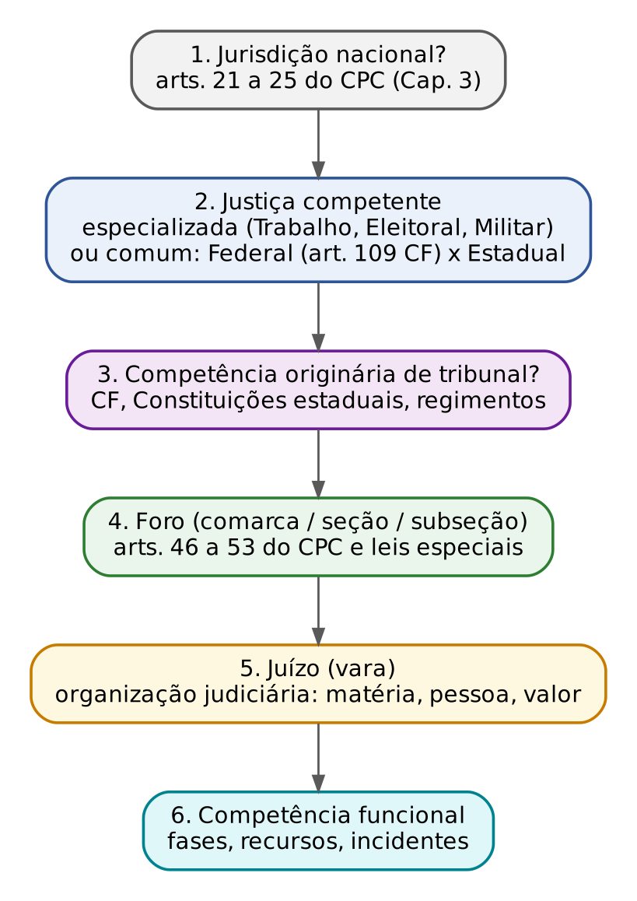
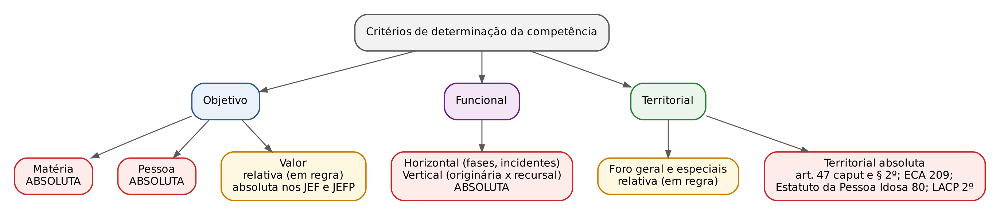
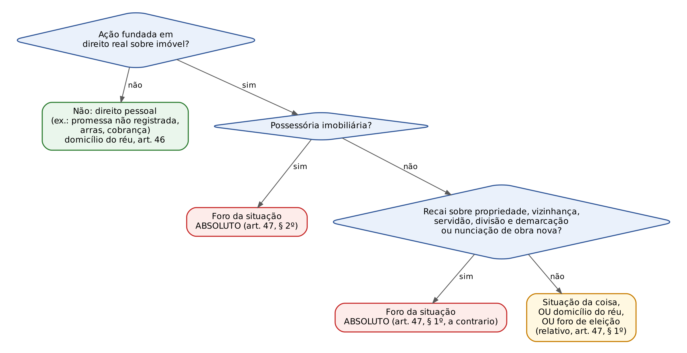
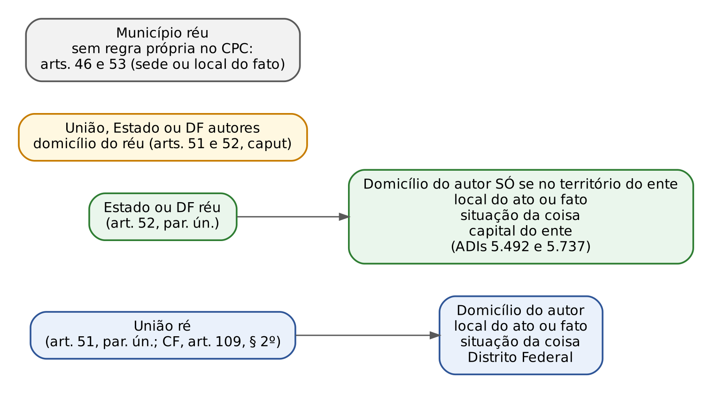
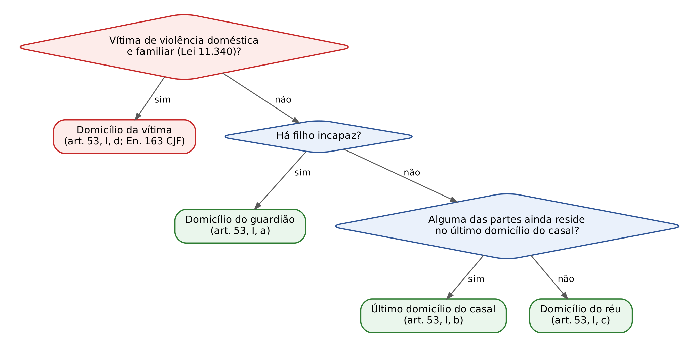
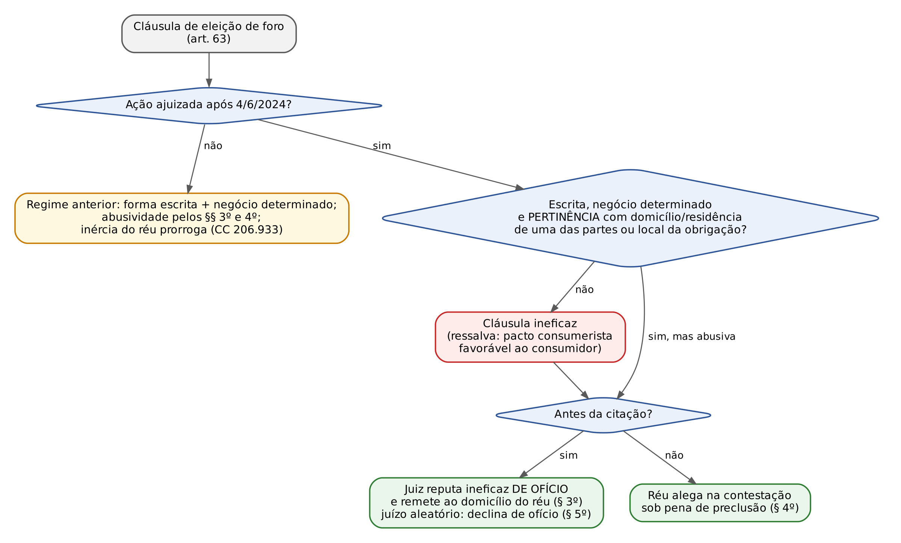
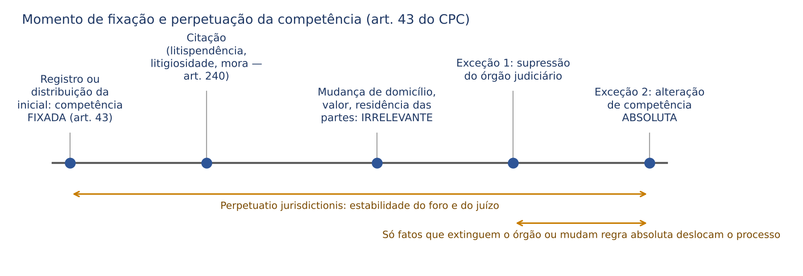
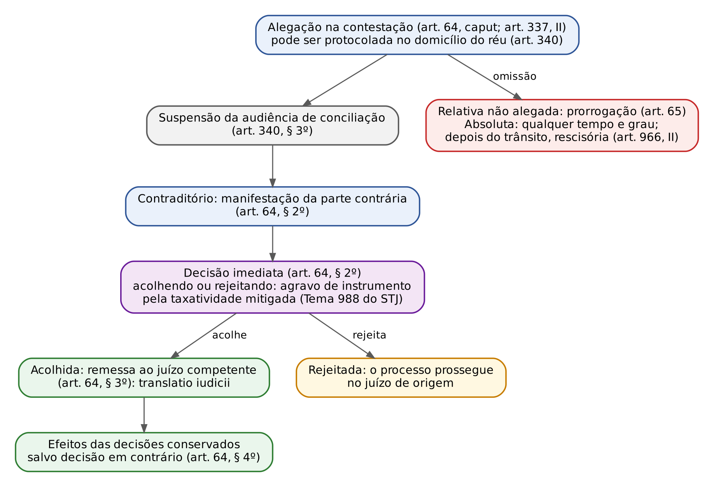

# CAPÍTULO 04 — COMPETÊNCIA I: CRITÉRIOS, FOROS, ELEIÇÃO, PERPETUAÇÃO E INCOMPETÊNCIA

:::INCIDENCIA
TRF5 p. 2; TJRS p. 3; TJSC p. 2. Nível A+; lote de 35 questões (FGV 25, FCC 10).
O que mais cai: foros dos arts. 46 a 53 em caso concreto (imóvel, família, Fazenda, serventia, acidente), eleição de foro após a Lei 14.879/2024 (juízo aleatório), natureza absoluta x relativa e regime de arguição, *perpetuatio* (art. 43) e suas exceções.
:::

| Subtema | FGV | FCC | Padrão de cobrança |
|---|---|---|---|
| Foros dos arts. 46 a 53 e foros especiais | 14 | 5 | Caso com três ou quatro cidades (autor, réu, coisa, fato); identificar o foro e dizer se é absoluto ou relativo |
| Foro de eleição e juízo aleatório (art. 63) | 3 | 1 | Cláusula sem pertinência; declinação de ofício antes da citação; literalidade do § 1º |
| Absoluta x relativa; arguição; prorrogação | 2 | 3 | Contestação como sede única; Súmula 33; preclusão; MP; efeitos do ato do juízo incompetente |
| *Perpetuatio jurisdictionis* e exceções | 4 | 1 | Momento (registro ou distribuição, não citação); mudança de domicílio; flexibilização em favor de criança |
| Conceito, critérios, justiça competente | 2 | 0 | Competência funcional vertical; Justiça do Trabalho x Comum; *kompetenz-kompetenz* |

## 04.1 Competência: conceito, natureza e fontes

### 04.1.1 Conceito e posição sistemática

A jurisdição é una; a competência é a quantidade de jurisdição cujo exercício a lei atribui a cada órgão, ou, mais precisamente, o conjunto de regras que distribui o exercício da função jurisdicional entre os vários órgãos que a detêm por igual. A crítica doutrinária à fórmula "medida da jurisdição" (Leonardo Carneiro da Cunha, citado na prova do TCE-PE) é que todos os juízes têm a mesma jurisdição; o que varia é o âmbito LEGÍTIMO de exercício. Daí a consequência prática: o juiz incompetente tem jurisdição, e seus atos existem e produzem efeitos até serem desfeitos ou substituídos (art. 64, § 4º; ver 04.8). O ato de quem NÃO tem jurisdição (não investido, aposentado, juiz de outra Justiça em certas leituras radicais) é que se aproxima da inexistência — mas essa construção pertence à teoria das invalidades (Cap. 13).

Natureza: a competência é PRESSUPOSTO PROCESSUAL DE VALIDADE (subjetivo, relativo ao juízo), não condição da ação. Por isso sua falta não leva, em regra, à extinção sem resolução do mérito, mas à remessa dos autos (art. 64, § 3º). A FGV explorou exatamente essa distinção na prova de Juiz do TJ-SE (ver box em 04.3).

O art. 42 abre o título: "As causas cíveis serão processadas e decididas pelo juiz nos limites de sua competência, ressalvado às partes o direito de instituir juízo arbitral, na forma da lei". A ressalva da arbitragem não cria "competência" do árbitro no sentido técnico do CPC; trata-se de jurisdição privada escolhida pelas partes, com a regra de *kompetenz-kompetenz* (art. 8º, parágrafo único, da Lei 9.307/1996), desenvolvida no Cap. 2.

:::DOUTRINA \*KOMPETENZ-KOMPETENZ\* NO PROCESSO ESTATAL
Todo juiz tem competência para examinar a própria competência (a chamada "competência mínima"). Mesmo o juiz absolutamente incompetente é competente para declarar a incompetência e remeter os autos, para suscitar conflito e para conceder medida urgente necessária a evitar perecimento de direito, cuja eficácia o art. 64, § 4º, preserva. Daí a afirmação corrente de que nenhum juiz é TOTALMENTE incompetente. O direito brasileiro ADOTA o princípio, e a FGV (ENAM 2025.2, ver 04.6) considerou FALSA a assertiva de que ele não seria adotado.
:::

### 04.1.2 Fontes normativas e juiz natural

:::LEI CPC, ART. 44
Obedecidos os limites estabelecidos pela Constituição Federal, a competência é determinada pelas normas previstas neste Código ou em legislação especial, pelas normas de organização judiciária e, ainda, no que couber, pelas constituições dos Estados.
:::

A hierarquia de fontes resolve questões de concurso:

- Constituição Federal: distribui a competência entre as Justiças (arts. 102, 105, 108, 109, 114, 121, 124 e 125) e fixa a competência originária e recursal dos tribunais superiores e regionais. Regra constitucional de competência é sempre absoluta e não pode ser alterada por lei ordinária.
- CPC e leis especiais: competência de FORO (territorial) e algumas regras funcionais (arts. 46 a 53, 61, 516, 781, 2º da Lei 7.347/1985, 101 do CDC, 80 do Estatuto da Pessoa Idosa, 147 e 209 do ECA, 4º da Lei 9.099/1995).
- Normas de organização judiciária (leis estaduais e federais de organização, resoluções dos tribunais quando autorizadas por lei): competência de JUÍZO (qual vara dentro do foro). No RS, o Código de Organização Judiciária (Lei estadual 7.356/1980) é tratado no Cap. 3.
- Constituições estaduais: competência originária dos Tribunais de Justiça (CF, art. 125, § 1º).

:::JURIS STJ, SÚMULA 206
A existência de vara privativa, instituída por lei estadual, não altera a competência territorial resultante das leis de processo.
:::

A Súmula 206 é a expressão da hierarquia: a lei de organização judiciária distribui processos ENTRE VARAS de um mesmo foro, mas não pode transportar a causa para outra comarca contra a regra do CPC. O exemplo clássico é a vara privativa da Fazenda na capital: ela não atrai para a capital a ação que, pelo CPC, pode ser ajuizada no interior.

O princípio do juiz natural (CF, art. 5º, XXXVII e LIII) exige que as regras de competência sejam prévias, gerais e abstratas, vedados juízos *ad hoc* e tribunais de exceção; não impede a criação de varas especializadas nem a redistribuição por lei geral (que é justamente uma das exceções à *perpetuatio*, ver 04.6). A FGV cobrou essa formulação (TCE-GO 2024, Q2524476, gabarito E), assim como a falsidade da afirmação de que a improrrogabilidade seria incompatível com a prorrogação da competência relativa: o que é improrrogável é a jurisdição em sentido estrito e a competência absoluta.

### 04.1.3 Distribuição concreta: a ordem de raciocínio

Para identificar o órgão competente, o raciocínio parte do geral para o particular. A figura resume a sequência que o examinador espera ver aplicada nos casos.

:::DICA FORO X JUÍZO
"Foro" é a circunscrição territorial (comarca na Justiça Estadual; seção ou subseção judiciária na Federal). "Juízo" é o órgão (a vara) dentro do foro. O CPC trata quase só de foro; o juízo é matéria de organização judiciária. Nas questões, "foro do domicílio do réu" decide a comarca; dizer que a causa vai à "vara de família" ou à "vara da Fazenda" já é competência de juízo (em regra absoluta, porque *ratione materiae* ou personae).
:::

## 04.2 Critérios de determinação da competência

### 04.2.1 A classificação tripartida

A doutrina brasileira, a partir de Chiovenda, distribui os critérios em OBJETIVO (natureza da causa, qualidade das partes, valor), FUNCIONAL (as funções que o juiz exerce no processo) e TERRITORIAL (o lugar). O CPC reflete essa divisão no art. 62 ("matéria, pessoa ou função": inderrogáveis) e no art. 63 ("valor e território": derrogáveis por eleição).

#### Critério objetivo

- Em razão da MATÉRIA (*ratione materiae*): leva em conta a natureza da relação jurídica controvertida, isto é, os elementos objetivos da demanda (causa de pedir e pedido). Exemplos: Justiça do Trabalho (CF, art. 114), varas de família, de falências, da infância e juventude (ECA, art. 148), de registros públicos. Absoluta.
- Em razão da PESSOA (*ratione personae*): leva em conta a qualidade de uma das partes. Exemplos: Justiça Federal pela presença da União, autarquia, fundação ou empresa pública federal (CF, art. 109, I — Cap. 5); varas da Fazenda Pública estadual. Absoluta.
- Em razão do VALOR: em regra relativa (o art. 63 a inclui entre as derrogáveis). Exceções: o valor é critério de competência ABSOLUTA nos Juizados Especiais Federais (Lei 10.259/2001, art. 3º, § 3º) e nos da Fazenda Pública (Lei 12.153/2009, art. 2º, § 4º), onde houver vara instalada; no JEC estadual, ao contrário, o procedimento é OPCIONAL para o autor (Caps. 36 e 37).

:::ATENCAO MATÉRIA TRABALHISTA X COMUM: O CRITÉRIO É A CAUSA DE PEDIR E O PEDIDO
A competência material se define pelos elementos objetivos da demanda tal como proposta, e não pela qualidade abstrata da relação. Assim, o STF fixou (Tema 992) que cabe à Justiça Comum, estadual ou federal, julgar ações contra concurso público realizado pela Administração para contratação de empregados celetistas: a controvérsia é pré-contratual e de direito administrativo. No mesmo sentido, o Tema 1.143 do STF (servidor celetista que pede parcela de natureza administrativa: Justiça Comum). O detalhamento das fronteiras entre as Justiças e da competência da Justiça Federal está no Cap. 5.
:::

:::QUESTAO FGV 2024 — CÂMARA DOS DEPUTADOS — CONSULTOR LEGISLATIVO (Q2511479)
Caso: edital de concurso municipal para empregos públicos celetistas impugnado por candidatos que não preenchiam requisito do edital.
Gabarito: A (inexistindo ainda relação de trabalho, a competência é da Justiça Comum).
Armadilhas: B (atração da Justiça do Trabalho pelo regime celetista do cargo futuro); C (generalização: a presença do Município não define a Justiça); D (modulação inventada, com marco "até 2020"); E (cisão artificial entre interpretação de cláusula e nulidade do certame).
Fundamento: Tema 992 do STF.
:::

#### Critério funcional

A competência funcional decorre das diferentes FUNÇÕES que os órgãos exercem num mesmo processo, ou em processos que se relacionam. Divide-se em:

- Funcional VERTICAL (hierárquica): distribui funções entre graus de jurisdição. Subdivide-se em ORIGINÁRIA (o tribunal conhece da causa em primeiro lugar: rescisória, mandado de segurança contra ato de juiz, conflito de competência) e RECURSAL ou DERIVADA (o tribunal conhece da causa por força de recurso).
- Funcional HORIZONTAL: distribui funções no mesmo grau. Exemplos: o juízo da causa principal é competente para a acessória (art. 61); o juízo que decidiu a causa em primeiro grau é competente para o cumprimento (art. 516, II); o juízo da execução é competente para os embargos do devedor (art. 914, § 1º); o juízo da ação é competente para a reconvenção, a denunciação e a oposição; no incidente de arguição de inconstitucionalidade em tribunal, o órgão fracionário julga o caso e o pleno ou órgão especial julga a questão constitucional (Cap. 38).

Toda competência funcional é ABSOLUTA. O art. 516, parágrafo único, mostra que o legislador pode temperar a regra com OPÇÕES do exequente (domicílio atual do executado, local dos bens ou local da obrigação de fazer), o que não a converte em relativa: o juiz não pode escolher, nem as partes podem pactuar foro diverso dos previstos (Cap. 22).

:::QUESTAO FGV 2025 — TCE-PE — PROCURADOR DO TRIBUNAL DE CONTAS (Q3592162)
Três assertivas sobre definição, modificação e prorrogação da competência. Gabarito: E (I e II corretas).
Passo 1 (I, correta para a banca): convenção de arbitragem e *kompetenz-kompetenz* — o árbitro decide sobre a própria competência; o processo judicial pode ser extinto sem resolução do mérito (art. 485, VII), e a comunicação entre juízos se faz pela carta arbitral (Cap. 2).
Passo 2 (II, correta): dúvida sobre o interesse da União remete o feito ao juízo federal, que decide sobre esse interesse e, se o negar, devolve os autos sem suscitar conflito (art. 45, § 3º; Súmulas 150 e 224 do STJ — Cap. 5).
Passo 3 (III, ERRADA): o julgamento, pelo TJ, de recurso contra sentença é competência funcional vertical RECURSAL (derivada), não ORIGINÁRIA. Originária seria, por exemplo, a rescisória.
:::

#### Critério territorial

Distribui as causas entre os foros segundo um elemento de conexão com o lugar: domicílio do réu (regra geral, art. 46), situação da coisa (art. 47), domicílio do autor da herança (art. 48), lugar do ato ou fato (art. 53, IV), local da obrigação (art. 53, III, d), domicílio do alimentando (art. 53, II) etc. Em regra RELATIVA, porque atende ao interesse das partes (comodidade da defesa). Torna-se ABSOLUTA quando a lei a vincula a interesse público, o que costuma vir dito de modo expresso.

:::PEGADINHA COMPETÊNCIA TERRITORIAL ABSOLUTA (A "TERRITORIAL FUNCIONAL")
Não é verdade que toda competência territorial seja relativa. São territoriais e ABSOLUTAS, por expressa dicção legal: o foro da situação do imóvel nas possessórias imobiliárias (art. 47, § 2º) e nas ações reais sobre propriedade, vizinhança, servidão, divisão, demarcação e nunciação de obra nova (art. 47, § 1º, *a contrario*); o foro do local do dano na ação civil pública ("competência funcional", Lei 7.347/1985, art. 2º — Cap. 33); o foro do local da ação ou omissão nas ações coletivas do ECA (art. 209); o foro do domicílio da pessoa idosa nas ações do capítulo de proteção judicial do Estatuto (art. 80). Parte da doutrina (Didier, por exemplo) prefere dizer que, nesses casos, o legislador apenas qualificou como absoluta uma competência territorial; outros a chamam de "territorial funcional". Para a prova, basta: território + absoluta = possível, quando a lei diz.
:::

:::LEI ECA, ART. 209; ESTATUTO DA PESSOA IDOSA, ART. 80
ECA, art. 209: As ações previstas neste Capítulo serão propostas no foro do local onde ocorreu ou deva ocorrer a ação ou omissão, cujo juízo terá competência absoluta para processar a causa, ressalvadas a competência da Justiça Federal e a competência originária dos tribunais superiores.
Estatuto da Pessoa Idosa (Lei 10.741/2003), art. 80: As ações previstas neste Capítulo serão propostas no foro do domicílio da pessoa idosa, cujo juízo terá competência absoluta para processar a causa, ressalvadas as competências da Justiça Federal e a competência originária dos Tribunais Superiores. (Redação dada pela Lei 14.423/2022)
:::

Note-se o alcance: o art. 80 do Estatuto refere-se às ações do capítulo da proteção judicial dos interesses difusos, coletivos e individuais indisponíveis ou homogêneos da pessoa idosa. Para a causa individual comum que verse "direito previsto no respectivo estatuto", o CPC tem regra própria e relativa (art. 53, III, e: foro da residência do idoso — ver 04.4.6).

## 04.3 Competência absoluta e relativa

### 04.3.1 O quadro de regimes

A distinção é a mais cobrada do capítulo. A razão de ser: a competência absoluta tutela interesse PÚBLICO (organização da Justiça, especialização, hierarquia), e por isso é inderrogável e cognoscível de ofício; a relativa tutela interesse das PARTES (comodidade de litigar), e por isso é disponível.

| Aspecto | Competência ABSOLUTA | Competência RELATIVA |
|---|---|---|
| Critérios | Matéria, pessoa, função; valor nos JEF e JEFP; território quando a lei o diz | Território (regra) e valor (regra) |
| Modificação por vontade | Inderrogável por convenção (art. 62) | Eleição de foro (art. 63) e prorrogação tácita (art. 65) |
| Modificação por conexão ou continência | NÃO (art. 54 fala só da relativa) | SIM (art. 54) |
| Conhecimento de ofício | Deve ser declarada de ofício (art. 64, § 1º; art. 337, § 5º) | NÃO (art. 337, § 5º; Súmula 33 do STJ), salvo cláusula abusiva antes da citação (art. 63, § 3º) e juízo aleatório (art. 63, § 5º) |
| Momento de alegação | Preliminar de contestação (art. 64), mas também em qualquer tempo e grau (art. 64, § 1º) | Preliminar de contestação, sob pena de prorrogação (art. 65) |
| Legitimidade para alegar | Partes, MP e o próprio juiz | Réu; MP nas causas em que atuar (art. 65, parágrafo único) |
| Preclusão | Não preclui no processo (mas a decisão que a rejeita, irrecorrida, faz preclusão sobre a QUESTÃO decidida — ver 04.7.4) | Preclui se não alegada na contestação |
| Após o trânsito em julgado | Ação rescisória (art. 966, II), no prazo do art. 975 | Nenhum remédio: o vício desaparece com a prorrogação |
| Consequência do acolhimento | Remessa ao juízo competente, com conservação dos efeitos (art. 64, §§ 3º e 4º) | Idem |

Texto-base: o art. 62 declara inderrogável por convenção a competência em razão da matéria, da pessoa ou da função; o art. 63, caput, permite às partes modificar a competência em razão do valor e do território, elegendo foro (04.5).

:::QUESTAO FGV 2025 — TJ-SE — JUIZ SUBSTITUTO (Q3301234)
Afirmações gerais sobre competência. Gabarito: D (a incompetência ABSOLUTA é suscitável como preliminar da contestação).
Passo 1: A está errada porque a competência é pressuposto processual de validade, não condição da ação, e sua falta leva à remessa, não à extinção.
Passo 2: B está errada porque o CPC/2015 aboliu a exceção de incompetência como peça autônoma; tanto a relativa quanto a absoluta vão na contestação (art. 64, caput; art. 337, II). Era a regra do CPC/1973 (exceção para a relativa) e ainda há quem erre por memória antiga.
Passo 3: C está errada (absoluta é declarada de ofício, art. 64, § 1º).
Passo 4: E está errada: a decisão do juízo absolutamente incompetente é válida e eficaz até ser substituída (art. 64, § 4º).
A armadilha é a D parecer "incompleta": o fato de a absoluta poder ser alegada a qualquer tempo não impede que a sede própria seja a contestação.
:::

:::QUESTAO FCC 2026 — TJ-CE — ANALISTA JUDICIÁRIO (Q4231776)
Caso: ação indenizatória no domicílio do autor; contestação sem alegação de incompetência; encerrada a fase de defesa, o juiz cogita declinar de ofício da competência territorial.
Gabarito: D (a ausência de alegação da incompetência relativa no momento oportuno prorroga a competência — art. 65).
Armadilhas: A (territorial "sempre absoluta"); C (relativa reconhecível de ofício a qualquer tempo); E (absoluta dependente de provocação). Atenção: numa ação indenizatória comum, o domicílio do autor pode até ser competente (art. 53, IV, a, e V; CDC, art. 101, I); mas, ainda que não fosse, a omissão do réu resolveria a questão.
No mesmo sentido: FCC 2024, TRF-3, Técnico (Q2564673, gabarito E: o juiz conhece de ofício da incompetência ABSOLUTA e determina a REMESSA, não a extinção); FGV 2024, Q2564204 (assertiva II, falsa: competência em razão da pessoa é inderrogável).
:::

:::QUESTAO FCC 2026 — TJ-CE — OFICIAL DE JUSTIÇA (Q4240016)
Caso: ação contra ente público ajuizada em juízo absolutamente incompetente; réu não suscita a incompetência; advogado do autor age com má-fé.
Gabarito: B (a incompetência absoluta pode ser reconhecida de ofício e não se submete à preclusão).
Armadilhas: C e D (prorrogação ou preclusão da absoluta pelo silêncio do réu); A e E misturam deveres processuais do advogado (Cap. 7): os deveres do art. 77 alcançam os procuradores, mas a responsabilidade disciplinar do advogado é apurada pela OAB (art. 77, § 6º), e a multa por litigância de má-fé não exige prova de prejuízo material.
:::

### 04.3.2 Competência relativa reconhecível de ofício: as exceções à Súmula 33

:::JURIS STJ, SÚMULA 33
A incompetência relativa não pode ser declarada de ofício.
:::

A Súmula 33 continua válida como regra, e o art. 337, § 5º, do CPC a positivou ("Excetuadas a convenção de arbitragem e a incompetência relativa, o juiz conhecerá de ofício das matérias enumeradas neste artigo"). Mas há três exceções, todas cobradas:

1. Cláusula de eleição ABUSIVA, antes da citação (art. 63, § 3º): o juiz pode reputá-la ineficaz de ofício e remeter ao foro do domicílio do réu (04.5).

2. Juízo ALEATÓRIO (art. 63, § 5º, incluído pela Lei 14.879/2024): ajuizamento sem vínculo com o domicílio ou residência das partes ou com o negócio jurídico; justifica declinação de ofício (04.5).

3. Relação de CONSUMO: o STJ trata como absoluta a competência territorial fundada na proteção do consumidor (domicílio do consumidor), permitindo declinação de ofício quando o fornecedor ajuíza fora dele ou quando o próprio consumidor escolhe foro aleatório sem justificativa (04.4.7).

:::PEGADINHA "RELATIVA NUNCA DE OFÍCIO" ESTÁ ERRADO DESDE 2015 (E MAIS AINDA DESDE 2024)
Assertiva do tipo "a incompetência relativa jamais pode ser reconhecida de ofício" é FALSA. A FGV usou isso no ENAM 2025.1 (Q3362345, item II, considerado falso: mesmo sendo relativa, o juízo PODE declinar de ofício quando a ação é ajuizada em juízo aleatório). Mas cuidado com o inverso: fora das três exceções, a regra continua sendo a Súmula 33.
:::

## 04.4 Os foros do CPC (arts. 46 a 53) e os foros especiais

### 04.4.1 Foro comum: domicílio do réu (art. 46)

:::LEI CPC, ART. 46
A ação fundada em direito pessoal ou em direito real sobre bens móveis será proposta, em regra, no foro de domicílio do réu.
§ 1º Tendo mais de um domicílio, o réu será demandado no foro de qualquer deles.
§ 2º Sendo incerto ou desconhecido o domicílio do réu, ele poderá ser demandado onde for encontrado ou no foro de domicílio do autor.
§ 3º Quando o réu não tiver domicílio ou residência no Brasil, a ação será proposta no foro de domicílio do autor, e, se este também residir fora do Brasil, a ação será proposta em qualquer foro.
§ 4º Havendo 2 (dois) ou mais réus com diferentes domicílios, serão demandados no foro de qualquer deles, à escolha do autor.
§ 5º A execução fiscal será proposta no foro de domicílio do réu, no de sua residência ou no do lugar onde for encontrado.
:::

Pontos de prova:

- "Em regra": o caput é norma geral e RESIDUAL. Antes de aplicá-la, verifique se há foro especial (arts. 47 a 53 e leis especiais). O foro especial, quando concorrente, não exclui o geral: o autor pode, em regra, renunciar ao foro especial instituído em seu favor e demandar no domicílio do réu (por exemplo, o alimentando, o consumidor, a vítima de acidente — Tema 606 do STJ abaixo).
- § 2º: domicílio incerto ou desconhecido — onde o réu for ENCONTRADO ou no domicílio do AUTOR (alternativa).
- § 3º: réu sem domicílio nem residência no Brasil — domicílio do autor; se o autor também residir fora, "qualquer foro". A FGV costuma trocar "qualquer foro" por "Distrito Federal" (assertiva falsa). A pergunta prévia — se a jurisdição brasileira alcança a causa — é dos arts. 21 a 23 (Cap. 3).
- § 4º: litisconsórcio passivo com domicílios diferentes — foro de QUALQUER deles, à escolha do autor. Não existe regra de "foro mais próximo do autor" (distrator da DPE-RO).
- § 5º: execução fiscal — domicílio, residência ou lugar onde for encontrado o executado. O STF, nas ADIs 5.492 e 5.737, limitou a aplicação do § 5º ao território do ente exequente (ou ao local do fato gerador), e firmou o Tema 1.204: o Estado ou o Município não é obrigado a executar em outro Estado. O desenvolvimento está na Apostila de Direito Tributário, Cap. 21, e no Cap. 28 desta.

:::QUESTAO FGV 2024 — TJ-MT — ANALISTA JUDICIÁRIO (Q3114972)
Três assertivas sobre ação fundada em direito pessoal. Gabarito: D (I e II corretas).
Passo 1: I reproduz o art. 46, caput.
Passo 2: II reproduz o § 2º (domicílio incerto: onde for encontrado ou domicílio do autor).
Passo 3: III troca o fim do § 3º: se o autor também residir fora do Brasil, a ação vai a QUALQUER foro, não "deverá" ir ao Distrito Federal.
No mesmo sentido: FGV 2025, DPE-RO (Q3395864, gabarito B: direito pessoal ou real sobre móveis, domicílio do réu; erradas as alternativas que dizem "capital" para o Estado AUTOR, "foro mais próximo do autor" com três réus, e "domicílio do herdeiro" para o inventário); FGV 2024, TJ-RR (Q3087132, gabarito D: I e III corretas — III com "qualquer foro"; II errada porque a possessória imobiliária é ABSOLUTA); FGV 2025, TCE-PE (Q3593094, gabarito E, com distratores: Estado autor na capital; réu fora do Brasil no DF; PJ ré no domicílio do autor; inventário no domicílio do inventariante).
:::

### 04.4.2 Imóveis: foro da situação da coisa (art. 47)

:::LEI CPC, ART. 47
Para as ações fundadas em direito real sobre imóveis é competente o foro de situação da coisa.
§ 1º O autor pode optar pelo foro de domicílio do réu ou pelo foro de eleição se o litígio não recair sobre direito de propriedade, vizinhança, servidão, divisão e demarcação de terras e de nunciação de obra nova.
§ 2º A ação possessória imobiliária será proposta no foro de situação da coisa, cujo juízo tem competência absoluta.
:::

A técnica do artigo é peculiar e precisa ser lida em três camadas:

1. O caput fixa o *forum rei sitae* para ações fundadas em DIREITO REAL sobre imóvel.

2. O § 1º abre ao autor a opção pelo domicílio do réu ou pelo foro de eleição, MAS só se o litígio NÃO recair sobre propriedade, vizinhança, servidão, divisão e demarcação de terras e nunciação de obra nova. Para esses sete direitos, o foro da situação é ABSOLUTO (por exclusão). Restam relativas, por exemplo, as ações reais sobre usufruto, uso, habitação, superfície, enfiteuse e hipoteca (a ação hipotecária, porém, costuma ser execução, sujeita ao art. 781).

3. O § 2º declara expressamente absoluta a competência do foro da situação para a possessória IMOBILIÁRIA — apesar de a posse não ser direito real na concepção dominante do Código Civil. A possessória mobiliária segue o art. 46.

O art. 60 completa: se o imóvel se situar em mais de um Estado, comarca, seção ou subseção judiciária, a competência territorial do juízo PREVENTO estende-se sobre a totalidade do imóvel (prevenção, Cap. 5).

:::ATENCAO DIREITO PESSOAL COM REFLEXO IMOBILIÁRIO NÃO É AÇÃO REAL
A ação de resolução de promessa de compra e venda NÃO registrada, a restituição de arras, a cobrança de aluguéis, a rescisão contratual com pedido de devolução de parcelas e a adjudicação compulsória (para parte da doutrina e da jurisprudência, pessoal quando fundada em promessa não registrada — tema controvertido) seguem a regra do domicílio do réu, porque o litígio não recai sobre direito real. A ação de despejo tem regra própria na Lei 8.245/1991 (Cap. 35). A ação de usucapião é real e recai sobre propriedade: foro da situação, absoluto (Cap. 30).
:::

:::QUESTAO FGV 2026 — ALERJ — PROCURADOR LEGISLATIVO (Q3880799)
Caso: ação de resolução de promessa particular de compra e venda, não registrada, com cláusula de arrependimento e restituição de arras em dobro; imóvel em Guapimirim, autor em Teresópolis, réu em Cantagalo (onde a ação foi proposta). O réu alega incompetência absoluta do foro da coisa.
Gabarito: C (o foro do domicílio do réu é competente, porque a demanda é obrigacional e não recai sobre direito real imobiliário).
Passo 1: a promessa não registrada não gera direito real de aquisição (CC, art. 1.417 exige registro); a causa de pedir é contratual.
Passo 2: afastado o art. 47, aplica-se o art. 46 (domicílio do réu: Cantagalo).
Armadilhas: A e B ("toda ação relacionada à promessa envolve direito real"); D (domicílio do autor, sem base legal); E (natureza real e vedação do domicílio do réu).
:::

:::QUESTAO FGV 2024 — ENAM — 1º EXAME NACIONAL DA MAGISTRATURA (Q2459894)
Caso: reivindicatória proposta em Maricá (domicílio da ré) quanto a imóvel situado em Saquarema; autor no Rio de Janeiro.
Gabarito: B (o juiz declina da competência em favor de Saquarema).
Passo 1: a reivindicatória recai sobre PROPRIEDADE: o § 1º do art. 47 exclui a opção pelo domicílio do réu; o foro da situação é absoluto.
Passo 2: absoluta = declaração de ofício já no juízo de admissibilidade (art. 64, § 1º), com remessa (§ 3º).
Armadilhas: A (aceitar o domicílio da ré); C (prorrogação pela inércia: só para relativa); D (suscitar conflito sem que haja dois juízos divergindo — conflito pressupõe manifestação de dois juízes, art. 66); E (domicílio do autor).
No mesmo sentido: FGV 2025, TJ-CE, Juiz Substituto (Q3505776, gabarito D: reivindicatória distribuída no domicílio do autor, sem certidão de propriedade — antes de qualquer juízo sobre emenda da inicial, o juiz deve declinar DE OFÍCIO para a comarca da situação; a ordem lógica importa: o juízo incompetente não deve sequer determinar emenda; armadilha E: aguardar arguição do réu).
:::

:::QUESTAO FCC 2024 — PREFEITURA DE JABOATÃO DOS GUARARAPES — PROCURADOR (Q3542110)
Caso: possuidor domiciliado em Recife; imóvel em Olinda; esbulhador domiciliado em Jaboatão. Ação apenas possessória.
Gabarito: E (Olinda, competência absoluta — art. 47, § 2º).
No mesmo sentido: FGV 2024, EBSERH, Advogado (Q3248776, gabarito A: imóvel em Natal; réus em Parnamirim e João Pessoa; autora com sede em Rio Verde — foro de Natal, absoluto); FCC 2024, TRT-20 (Q3233112, alternativa A falsa: possessória imobiliária não vai ao domicílio do réu).
:::

### 04.4.3 Sucessões, ausente e incapaz (arts. 48 a 50)

:::LEI CPC, ART. 48
O foro de domicílio do autor da herança, no Brasil, é o competente para o inventário, a partilha, a arrecadação, o cumprimento de disposições de última vontade, a impugnação ou anulação de partilha extrajudicial e para todas as ações em que o espólio for réu, ainda que o óbito tenha ocorrido no estrangeiro.
Parágrafo único. Se o autor da herança não possuía domicílio certo, é competente:
I - o foro de situação dos bens imóveis;
II - havendo bens imóveis em foros diferentes, qualquer destes;
III - não havendo bens imóveis, o foro do local de qualquer dos bens do espólio.
:::

- O critério é o ÚLTIMO DOMICÍLIO do autor da herança no Brasil — não o lugar do óbito, nem o domicílio do inventariante ou dos herdeiros, nem o cartório onde lavrada a escritura de partilha extrajudicial. A inclusão expressa da "impugnação ou anulação de partilha extrajudicial" é novidade do CPC/2015 e é a pegadinha preferida.
- Natureza: RELATIVA (territorial, sem declaração legal de absoluta). Consequência: cedendo diante de regra absoluta, como mostra a questão do TJ-MS abaixo. A jurisprudência admite, ainda, a prorrogação quando não arguida.
- Ações em que o espólio for AUTOR seguem as regras gerais (domicílio do réu etc.); o art. 48 atrai só as ações em que o espólio for RÉU.
- O parágrafo único é subsidiário: domicílio incerto. O critério subsidiário privilegia imóveis; sem imóveis, qualquer bem.
- A abertura da sucessão se dá no lugar do último domicílio do falecido (CC, art. 1.785 — Apostila de Direito Civil). O inventário extrajudicial é livre quanto ao tabelião (Provimento CNJ 149/2023 — Cap. 30).

:::QUESTAO FGV 2026 — TJ-MS — OUTORGA DE DELEGAÇÕES (Q3914307)
Caso: herdeiro quer anular partilha extrajudicial (lavrada em Dourados) cumulando reintegração de posse de imóvel situado em Corumbá; último domicílio do autor da herança em Ponta Porã; óbito em Três Lagoas; herdeiro nascido em Campo Grande.
Gabarito: E (Corumbá).
Passo 1: isolada, a anulação da partilha extrajudicial iria a Ponta Porã (art. 48) — foro relativo.
Passo 2: a reintegração de posse imobiliária tem foro ABSOLUTO na situação da coisa (art. 47, § 2º).
Passo 3: na cumulação, a regra absoluta prevalece e atrai a relativa (a competência relativa cede; a absoluta não se modifica). Dourados (cartório), Três Lagoas (óbito) e Campo Grande (nascimento) são distratores.
Observação: a solução da banca pressupõe que a cumulação é admissível no mesmo juízo (art. 327, § 1º, II, exige que o juízo seja competente para todos os pedidos); como a competência para a anulação é relativa, ela se modifica em favor do foro absoluto. Registro na nota a discussão.
:::

Ausente e incapaz réus: a ação em que o ausente for réu vai ao foro de seu ÚLTIMO DOMICÍLIO, também competente para a arrecadação, o inventário, a partilha e o cumprimento de disposições testamentárias (art. 49); a ação em que o incapaz for réu vai ao foro de domicílio de seu REPRESENTANTE ou ASSISTENTE (art. 50).

:::QUESTAO FCC 2024 — TRT-20 — OFICIAL DE JUSTIÇA (Q3233112)
Gabarito: D (ação em que o incapaz for réu: domicílio do representante ou assistente — art. 50).
Armadilhas: A (possessória imobiliária no domicílio do réu); B (ausente réu no domicílio dos herdeiros — o correto é o ÚLTIMO DOMICÍLIO do ausente, art. 49); C (direito real sobre móvel no foro da coisa — o correto é o domicílio do réu, art. 46); E (alimentos no domicílio do ALIMENTANTE — o correto é o do ALIMENTANDO, art. 53, II).
:::

### 04.4.4 Fazenda Pública como parte: União, Estados, DF e Municípios (arts. 51 e 52)

:::LEI CPC, ARTS. 51 E 52
Art. 51. É competente o foro de domicílio do réu para as causas em que seja autora a União.
Parágrafo único. Se a União for a demandada, a ação poderá ser proposta no foro de domicílio do autor, no de ocorrência do ato ou fato que originou a demanda, no de situação da coisa ou no Distrito Federal.
Art. 52. É competente o foro de domicílio do réu para as causas em que seja autor Estado ou o Distrito Federal.
Parágrafo único. Se Estado ou o Distrito Federal for o demandado, a ação poderá ser proposta no foro de domicílio do autor, no de ocorrência do ato ou fato que originou a demanda, no de situação da coisa ou na capital do respectivo ente federado.
:::

O art. 51 reproduz, para o CPC, o art. 109, §§ 1º e 2º, da CF (seção judiciária do domicílio da outra parte quando a União é autora; quatro foros concorrentes quando é ré). O STF estendeu o § 2º do art. 109 às autarquias federais (Tema 374). O detalhamento federal — inclusive subseções, interior e competência delegada — é do Cap. 5.

O art. 52 é a grande novidade do CPC/2015: transpôs para os Estados e o DF a lógica dos foros concorrentes, inclusive o DOMICÍLIO DO AUTOR. Na literalidade, um autor domiciliado em Porto Alegre poderia processar o Estado de Pernambuco em Porto Alegre, perante juiz gaúcho. O STF corrigiu isso.

:::JURIS STF, ADIS 5.492 E 5.737 (PLENÁRIO, SESSÃO VIRTUAL ENCERRADA EM 24/4/2023)
O Plenário, por maioria (prevaleceu o voto do Ministro Luís Roberto Barroso, divergindo parcialmente do Relator, Ministro Dias Toffoli), deu interpretação conforme aos arts. 46, § 5º, e 52, parágrafo único, do CPC: (i) a execução fiscal fica restrita aos limites territoriais de cada ente subnacional ou ao local do fato gerador; (ii) o foro do domicílio do autor, nas ações contra Estado ou DF, fica restrito às comarcas situadas nos limites territoriais do ente demandado. Fundamento: autonomia e auto-organização federativa — um ente não pode ser submetido ao Judiciário de outro Estado. Os Estados e o DF continuam podendo ser demandados no local do ato ou fato, no da situação da coisa e na sua capital.
:::

:::QUESTAO FCC 2026 — DPE-BA — DEFENSOR PÚBLICO (Q4037465)
Caso: vítima atropelada por viatura da PM de Pernambuco quando morava em Olinda; hoje reside em Ilhéus (BA); quer processar o Estado de Pernambuco.
Gabarito: D (local do acidente ou capital pernambucana).
Passo 1: o art. 52, parágrafo único, daria quatro opções: domicílio do autor (Ilhéus), local do fato (Olinda), situação da coisa (inaplicável) e capital do ente (Recife).
Passo 2: as ADIs 5.492 e 5.737 eliminam o domicílio do autor quando situado FORA do território do Estado réu. Ilhéus está na Bahia: opção afastada.
Passo 3: restam Olinda e Recife. Armadilhas: A e C (domicílio atual do autor ou capital baiana); B ("necessariamente" capital baiana); E (qualquer das capitais).
Observação: o art. 53, V, que dá o domicílio do autor nas ações por acidente de veículo, também esbarra no limite federativo quando o réu é Estado; a banca não o explorou.
:::

:::QUESTAO FGV 2025 — PREFEITURA DE CANAÃ DOS CARAJÁS — PROCURADOR MUNICIPAL (Q3265481)
Caso: ação de cobrança contra o Estado do Pará no foro do domicílio do autor (Canaã dos Carajás, PA); o Estado pede remessa à capital.
Gabarito: A (o domicílio do autor é competente porque situado dentro do território do Estado réu).
Armadilhas: B (capital ou local do fato como únicas opções); C (territorial absoluta); D (domicílio do autor em OUTRO Estado — exatamente o que as ADIs vedaram); E (regra inventada sobre execuções fiscais).
:::

Municípios. O CPC não tem regra específica para o Município como parte. Aplicam-se as regras gerais: Município réu, foro do domicílio do réu, que é o lugar onde funcione a administração municipal (CC, art. 75, III), salvo foro especial (local do ato ou fato na reparação de dano, art. 53, IV, a; acidente de veículo, art. 53, V). Município autor: domicílio do réu. A Justiça é a Estadual, e o juízo é definido pela organização judiciária (varas da Fazenda Pública, quando houver; JEFP até o teto).

:::QUESTAO FGV 2026 — TJ-BA — JUIZ SUBSTITUTO (Q4083732)
Caso: criança de 9 anos, residente com os pais na Comarca A, estuda em colégio municipal da Comarca B (sede do Município), onde sofre violência praticada por professora. Ação unicamente indenizatória contra o Município.
Gabarito: E (juízo CÍVEL da Comarca B, sede do Município).
Passo 1 (juízo): a ação indenizatória não é das hipóteses do art. 148 do ECA; o STJ afasta a competência da Infância e Juventude para ações de cunho patrimonial ou obrigacional que não estejam intimamente ligadas à proteção de direitos fundamentais da criança (Informativo 870, 1ª Seção, j. 2/10/2025, processo em segredo de justiça). Eliminam-se A e C.
Passo 2 (foro): sem regra protetiva do ECA aplicável, vale a regra geral para o Município réu: sede (art. 46; CC, art. 75, III). Coincidindo com o local do fato (art. 53, IV, a), não há dúvida: Comarca B.
Armadilhas: B e D (domicílio dos responsáveis ou da criança como se o art. 147 do ECA incidisse).
No mesmo sentido, com a mesma tese do Informativo 870: FGV 2026, TJ-PA, Juiz Substituto (Q3951736, gabarito A — "a regra geral de competência territorial deve prevalecer em ações indenizatórias contra municípios, salvo prova de efetivo prejuízo ao contraditório"; errada a B, que via na mudança da vítima para o Rio de Janeiro causa de remessa por força do "juízo imediato"; errada a D, que fixa a competência no "recebimento" da inicial; ver 04.6).
:::

:::JURIS STJ, TEMA 1.058 (REPETITIVO)
A Justiça da Infância e da Juventude tem competência absoluta para processar e julgar causas envolvendo matrícula de menores em creches ou escolas, nos termos dos arts. 148, IV, e 209 da Lei 8.069/90.
:::

O contraste entre o Tema 1.058 e o Informativo 870 é o ponto: o pedido de MATRÍCULA (direito fundamental à educação, art. 148, IV, e art. 209 do ECA) atrai a vara da Infância, com competência absoluta; o pedido de INDENIZAÇÃO por fato ocorrido na escola não atrai. Distinga juízo (vara da infância x vara cível — critério material) de foro (art. 147 do ECA x art. 46 do CPC — critério territorial).

### 04.4.5 Ações de família e alimentos (art. 53, I e II)

:::LEI CPC, ART. 53, I E II
É competente o foro:
I - para a ação de divórcio, separação, anulação de casamento e reconhecimento ou dissolução de união estável:
a) de domicílio do guardião de filho incapaz;
b) do último domicílio do casal, caso não haja filho incapaz;
c) de domicílio do réu, se nenhuma das partes residir no antigo domicílio do casal;
d) de domicílio da vítima de violência doméstica e familiar, nos termos da Lei nº 11.340, de 7 de agosto de 2006 (Lei Maria da Penha); (Incluída pela Lei nº 13.894, de 2019)
II - de domicílio ou residência do alimentando, para a ação em que se pedem alimentos;
:::

O CPC/2015 aboliu o foro privilegiado da MULHER que o art. 100, I, do CPC/1973 previa (residência da mulher), por incompatível com a igualdade conjugal. Em seu lugar, um sistema escalonado que protege o filho incapaz e, desde a Lei 13.894/2019, a vítima de violência doméstica.

:::JURIS ENUNCIADOS 108 E 163 DAS JORNADAS DE DIREITO PROCESSUAL CIVIL (CJF)
Enunciado 108 (II Jornada): A competência prevista nas alíneas do art. 53, I, do CPC não é de foros concorrentes, mas de foros subsidiários.
Enunciado 163 (III Jornada): O foro de domicílio da vítima de violência doméstica tem prioridade para a ação de divórcio, separação, anulação de casamento e reconhecimento ou dissolução de união estável.
:::

Leitura conjunta: as alíneas a a c são SUBSIDIÁRIAS (só se passa à seguinte se a anterior não incidir); a alínea d, embora topograficamente a última, tem PRIORIDADE. O foro da vítima é previsto em seu benefício; nada impede que ela, por conveniência, demande em outro foro legalmente previsto (é relativa).

A regra vale também para o reconhecimento de união estável *post mortem*: a 3ª Turma do STJ aplicou a alínea b (último domicílio do casal) à ação proposta após a morte do companheiro, sem filhos incapazes (STJ, REsp 1.909.279, Relator Ministro Ricardo Villas Bôas Cueva, Terceira Turma, j. 3/12/2024 — Informativo de Jurisprudência, Edição Extraordinária n. 23). O espólio é réu, mas o critério especial do art. 53, I, prevalece sobre o do art. 48.

:::QUESTAO FCC 2025 — DPE-SP — ANALISTA DE DEFENSORIA (Q3304119)
Caso: divórcio; autora em São José dos Campos, réu em Paraibuna, último domicílio do casal em Taubaté; sem filhos; violência doméstica relatada; imóvel no litoral.
Gabarito: C (domicílio da mulher, como vítima de violência doméstica — art. 53, I, d).
Armadilha: B (último domicílio do casal, que seria a regra sem a violência) e E (local do imóvel: a partilha não desloca a competência da ação de divórcio).
:::

:::QUESTAO FCC 2025 — TRT-6 — ANALISTA JUDICIÁRIO (Q3214735)
Caso: divórcio; autora em Recife, réu em Olinda, último domicílio do casal em Petrolina; sem filhos, sem bens, sem violência.
Gabarito: A (domicílio do réu — art. 53, I, c: nenhuma das partes reside no antigo domicílio do casal).
Armadilhas: E (último domicílio do casal, que só incide se ALGUMA das partes ainda lá residir); D (domicílio da mulher — regra do CPC/1973); B (escolha da autora); C (local do casamento).
:::

Alimentos (art. 53, II): foro do domicílio ou residência do ALIMENTANDO, para a ação em que se pedem alimentos. A regra protege o credor presumidamente vulnerável; por isso é relativa e renunciável pelo próprio alimentando. Vale também para a investigação de paternidade cumulada com alimentos: a Súmula 1 do STJ atribui a competência ao foro do domicílio ou da residência do alimentando. A ação revisional e a exoneratória proposta pelo alimentante seguem, segundo a orientação dominante, o foro do domicílio do alimentando (réu). O cumprimento de sentença de alimentos admite o juízo do atual domicílio do exequente (art. 528, § 9º — Cap. 23).

:::JURIS STJ, SÚMULA 383
A competência para processar e julgar as ações conexas de interesse de menor é, em princípio, do foro do domicílio do detentor de sua guarda.
:::

A expressão "em princípio" é deliberada: o STJ flexibiliza a súmula quando a mudança de domicílio do guardião é feita para frustrar a competência (alienação parental, mudança unilateral). A FGV transcreveu a súmula no ENAM 2025.2 (Q3692393, item III, considerado VERDADEIRO — ver 04.6). A interação entre a Súmula 383 e a *perpetuatio* é discutida em 04.6.3.

### 04.4.6 Pessoa jurídica, obrigação, idoso, serventia, ato ou fato e acidente (art. 53, III a V)

:::LEI CPC, ART. 53, III A V
III - do lugar:
a) onde está a sede, para a ação em que for ré pessoa jurídica;
b) onde se acha agência ou sucursal, quanto às obrigações que a pessoa jurídica contraiu;
c) onde exerce suas atividades, para a ação em que for ré sociedade ou associação sem personalidade jurídica;
d) onde a obrigação deve ser satisfeita, para a ação em que se lhe exigir o cumprimento;
e) de residência do idoso, para a causa que verse sobre direito previsto no respectivo estatuto;
f) da sede da serventia notarial ou de registro, para a ação de reparação de dano por ato praticado em razão do ofício;
IV - do lugar do ato ou fato para a ação:
a) de reparação de dano;
b) em que for réu administrador ou gestor de negócios alheios;
V - de domicílio do autor ou do local do fato, para a ação de reparação de dano sofrido em razão de delito ou acidente de veículos, inclusive aeronaves.
:::

Pessoa jurídica (III, a e b). A sede é o foro geral da pessoa jurídica ré; quanto às obrigações contraídas por agência ou sucursal, também o lugar desta. A Súmula 363 do STF, anterior ao CPC/2015 e compatível com ele, diz que a pessoa jurídica de direito privado pode ser demandada no domicílio da agência ou estabelecimento em que se praticou o ato (ver também CC, art. 75, § 1º, na Apostila de Direito Civil, Cap. 5). Sociedade ou associação sem personalidade jurídica (III, c): onde exerce suas atividades.

Lugar do cumprimento (III, d). A ação em que se exige o cumprimento da obrigação vai ao foro onde ela deve ser satisfeita. É foro concorrente com o do domicílio do réu (art. 46) e, sendo relativo, cede à eleição válida.

Idoso (III, e). Residência do idoso, para a causa que verse direito previsto no Estatuto da Pessoa Idosa. É regra relativa, de proteção individual, e não se confunde com o art. 80 do Estatuto (ações coletivas e de direitos individuais indisponíveis ou homogêneos: domicílio da pessoa idosa, competência absoluta — 04.2.1).

Serventia notarial ou de registro (III, f). A responsabilidade civil por ato praticado em razão do ofício é demandada no foro da SEDE DA SERVENTIA. O STJ aplicou a regra mesmo em relação de consumo, afastando o domicílio do consumidor: a regra especial do CPC prevalece porque o serviço notarial é público, delegado, e a sede da serventia é o local de fiscalização e de produção da prova (STJ, REsp 2.011.651, Relator Ministro Antonio Carlos Ferreira, Quarta Turma, j. 26/11/2024 — Informativo de Jurisprudência, Edição Extraordinária n. 23). No STJ, a matéria (responsabilidade civil dos serviços extrajudiciais) passou à Primeira Seção (QO no REsp 1.799.959, Corte Especial, j. 4/3/2026 — Informativo de Jurisprudência, Edição Extraordinária n. 31).

:::QUESTAO FGV 2026 — PGE-AC — PROCURADOR DO ESTADO (Q4079390)
Caso: averbação indevida de gravame na matrícula, por erro do registrador, impede financiamento; o adquirente quer indenização contra o delegatário.
Gabarito: B (foro da sede da serventia, art. 53, III, f).
Armadilhas: A (domicílio do autor por ser indenizatória — só nas hipóteses do art. 53, V, ou do CDC); C (capital pela fiscalização do TJ); D (opção entre domicílio do autor e sede — não há concorrência legal); E (local do prejuízo ou domicílio do alienante).
:::

Ato ou fato (IV). Reparação de dano em geral: lugar do ato ou fato. É foro concorrente com o do domicílio do réu. Administrador ou gestor de negócios alheios réu: lugar do ato ou fato.

Delito ou acidente de veículos, inclusive aeronaves (V). Domicílio do AUTOR ou local do FATO. É foro concorrente e eletivo em favor da vítima, que pode ainda optar pelo domicílio do réu.

:::JURIS STJ, TEMA 606 (REPETITIVO, RESP 1.357.813)
Em ação de cobrança objetivando indenização decorrente de Seguro Obrigatório de Danos Pessoais Causados por Veículos Automotores de Vias Terrestres - DPVAT, constitui faculdade do autor escolher entre os seguintes foros para ajuizamento da ação: o do local do acidente ou o do seu domicílio (parágrafo único do art. 100 do Código de Processo Civil); bem como, ainda, o do domicílio do réu (art. 94 do mesmo Diploma).
:::

A tese foi firmada sob o CPC/1973 (arts. 94 e 100, parágrafo único), cujas regras correspondem aos atuais arts. 46 e 53, V. Lição permanente: foro especial instituído em favor do autor é FACULTATIVO; o autor pode abrir mão dele.

:::QUESTAO FGV 2025 — AL-AM — PROCURADOR (Q3777940)
Caso: autor domiciliado em Tefé sofre acidente em Itacoatiara causado por veículo oficial da Assembleia Legislativa do Amazonas.
Gabarito: B (à escolha do autor, Tefé ou Itacoatiara — art. 53, V).
Passo 1: a Assembleia não tem personalidade jurídica; o réu é o Estado do Amazonas, mas a competência continua na Justiça Estadual.
Passo 2: acidente de veículo — domicílio do autor ou local do fato; como ambos estão no território do Amazonas, não há o limite federativo das ADIs 5.492 e 5.737; o art. 52, parágrafo único, também admitiria esses foros e a capital.
Armadilhas: A (local do fato "absoluto"); C, D e E (capital como foro privilegiado e exclusivo da Fazenda).
:::

Ilícitos pela internet e assédio judicial. A III Jornada do CJF aprovou o Enunciado 160: "A competência para julgamento de ações que envolvam violação aos direitos da personalidade, quando os atos ilícitos são praticados pela internet, é do foro do domicílio da vítima". O STF, por sua vez, protegeu o réu jornalista contra o uso do foro múltiplo como arma: caracterizado o assédio judicial — ajuizamento de numerosas ações sobre os mesmos fatos, em comarcas diversas, para intimidar ou dificultar a defesa —, "a parte demandada poderá requerer a reunião de todas as ações no foro de seu domicílio" (STF, ADIs 6.792 e 7.055, Relatora Ministra Rosa Weber, Redator do acórdão Ministro Luís Roberto Barroso, Plenário, j. 22/5/2024 — Informativo 1138). O Planalto anota as duas ADIs no caput do art. 53.

### 04.4.7 Foros especiais fora do CPC e no próprio CPC (prova, execução, consumidor)

Consumidor. O CDC, art. 101, I, dispõe que, na ação de responsabilidade civil do fornecedor de produtos e serviços, "a ação pode ser proposta no domicílio do autor". É faculdade do consumidor. Mas a jurisprudência do STJ trata como absoluta a regra que protege o consumidor, com dois corolários: (i) cláusula de eleição que o afasta do seu domicílio, em contrato de adesão, é nula e pode ser declarada de ofício; (ii) o próprio consumidor pode escolher entre os foros legais, mas não pode escolher foro aleatório.

:::JURIS STJ, RESP 2.173.132, RELATOR MINISTRO JOÃO OTÁVIO DE NORONHA, QUARTA TURMA, J. 22/9/2025 (INFORMATIVO 865)
A competência territorial em relações de consumo é absoluta, permitindo ao consumidor escolher o foro, mas não se admite escolha aleatória sem justificativa plausível. No caso, consumidor domiciliado no interior de Goiás, com advogado em Goiânia, ajuizou a ação em Brasília, sem nenhum vínculo com a causa; o STJ validou a declinação.
:::

:::JURIS STJ, TEMA 1.282 (REPETITIVO)
O pagamento de indenização por sinistro não gera para a seguradora a sub-rogação de prerrogativas processuais dos consumidores, em especial quanto à competência na ação regressiva.
:::

O Tema 1.282 é distinção fina: a seguradora sub-roga-se no CRÉDITO do segurado (CC, art. 786), mas não na posição processual de consumidor vulnerável. Na regressiva contra o causador do dano, vale a regra geral (domicílio do réu ou local do fato), e não o art. 101, I, do CDC.

Cláusula de foro ESTRANGEIRO em contrato de adesão com consumidor brasileiro, celebrado pela internet, pode ser declarada nula quando cria obstáculo ao acesso à justiça (STJ, REsp 2.210.341, Relator Ministro Antonio Carlos Ferreira, Quarta Turma, j. 17/6/2025). O tema é de limites da jurisdição nacional (art. 22, II, e art. 25 do CPC — Cap. 3).

Produção antecipada de prova. O art. 381, § 2º, atribui a competência ao foro onde a prova deva ser produzida ou ao foro de domicílio do réu; a produção antecipada não previne a competência para a ação principal (§ 3º). A regra especial prevalece sobre o foro de eleição (STJ, REsp 2.136.190; Q3786346; v. Cap. 18).

Juizados Especiais. No JEC estadual, o art. 4º da Lei 9.099/1995 prevê o domicílio do réu (ou onde exerça atividade profissional ou econômica), o lugar onde a obrigação deva ser satisfeita e o domicílio do autor ou o local do ato ou fato nas ações de reparação de dano de qualquer natureza. Por isso, a ação indenizatória por ofensa à honra pode tramitar no JEC do domicílio do autor (FGV 2024, TJ-SC, Juiz Substituto, Q3049349, gabarito E: o juiz deve dar prosseguimento normal). A incompetência territorial no JEC, diversamente do CPC, gera EXTINÇÃO sem resolução do mérito (Lei 9.099/1995, art. 51, III — Cap. 36).

Execução e cumprimento. O art. 781 (execução por título extrajudicial: domicílio do executado, eleição constante do título, situação dos bens, lugar do ato ou fato que deu origem ao título) e o art. 516 (cumprimento de sentença, com as opções do parágrafo único) são estudados nos Caps. 22 e 24. A ação civil pública (Lei 7.347/1985, art. 2º) e a competência do art. 93 do CDC são do Cap. 33.

:::ESQUEMA FOROS QUE MAIS CAEM, EM UMA LINHA CADA
| Situação | Foro | Natureza |
|---|---|---|
| Direito pessoal; real sobre móvel | Domicílio do réu (qualquer deles; vários réus: qualquer, à escolha do autor) | Relativa |
| Real sobre imóvel: propriedade, vizinhança, servidão, divisão, demarcação, nunciação | Situação da coisa | ABSOLUTA |
| Real sobre imóvel: demais direitos reais | Situação, domicílio do réu ou eleição | Relativa |
| Possessória imobiliária | Situação da coisa | ABSOLUTA |
| Inventário; anulação de partilha extrajudicial; espólio réu | Último domicílio do autor da herança | Relativa |
| Ausente réu | Último domicílio do ausente | Relativa |
| Incapaz réu | Domicílio do representante ou assistente | Relativa |
| União ré | Domicílio do autor, ato ou fato, coisa ou DF | Relativa (entre os foros) |
| Estado ou DF réu | Domicílio do autor DENTRO do Estado, ato ou fato, coisa ou capital | Relativa (entre os foros) |
| Divórcio e união estável | Vítima de violência > guardião de incapaz > último domicílio do casal > domicílio do réu | Relativa |
| Alimentos | Domicílio ou residência do alimentando | Relativa |
| PJ ré | Sede; agência ou sucursal quanto às obrigações dela | Relativa |
| Cumprimento de obrigação | Onde deva ser satisfeita | Relativa |
| Serventia extrajudicial | Sede da serventia | Relativa |
| Reparação de dano | Lugar do ato ou fato | Relativa |
| Delito ou acidente de veículo (inclusive aeronave) | Domicílio do autor ou local do fato | Relativa |
| Consumidor (responsabilidade do fornecedor) | Domicílio do consumidor (faculdade) | Tratada como absoluta pelo STJ |
| ECA (ações coletivas e individuais do capítulo) | Local da ação ou omissão | ABSOLUTA |
| Estatuto da Pessoa Idosa (ações do capítulo) | Domicílio da pessoa idosa | ABSOLUTA |
:::

## 04.5 Foro de eleição e cláusula abusiva

### 04.5.1 Regime do art. 63 após a Lei 14.879/2024

O foro de eleição é negócio jurídico processual TÍPICO (anterior e paralelo ao art. 190), pelo qual as partes modificam a competência territorial ou de valor para as ações oriundas de direitos e obrigações de determinado negócio. A Súmula 335 do STF já afirmava a validade da cláusula de eleição do foro para os processos oriundos do contrato. O fundamento material é o domicílio de eleição do Código Civil (art. 78, nos contratos escritos — Apostila de Direito Civil, Cap. 5).

:::LEI CPC, ART. 63, §§ 1º A 5º
§ 1º A eleição de foro somente produz efeito quando constar de instrumento escrito, aludir expressamente a determinado negócio jurídico e guardar pertinência com o domicílio ou a residência de uma das partes ou com o local da obrigação, ressalvada a pactuação consumerista, quando favorável ao consumidor. (Redação dada pela Lei nº 14.879, de 4 de junho de 2024)
§ 2º O foro contratual obriga os herdeiros e sucessores das partes.
§ 3º Antes da citação, a cláusula de eleição de foro, se abusiva, pode ser reputada ineficaz de ofício pelo juiz, que determinará a remessa dos autos ao juízo do foro de domicílio do réu.
§ 4º Citado, incumbe ao réu alegar a abusividade da cláusula de eleição de foro na contestação, sob pena de preclusão.
§ 5º O ajuizamento de ação em juízo aleatório, entendido como aquele sem vinculação com o domicílio ou a residência das partes ou com o negócio jurídico discutido na demanda, constitui prática abusiva que justifica a declinação de competência de ofício. (Incluído pela Lei nº 14.879, de 4 de junho de 2024)
:::

Requisitos de eficácia da cláusula (§ 1º), cumulativos:

1. Instrumento ESCRITO, público ou particular (não se exige escritura pública; não se admite eleição verbal ou tácita).

2. Alusão EXPRESSA a determinado negócio jurídico (não vale cláusula genérica para "quaisquer litígios entre as partes", sem referência a negócio).

3. PERTINÊNCIA (novidade de 2024): o foro eleito deve guardar relação com o domicílio ou a residência de UMA das partes ou com o LOCAL DA OBRIGAÇÃO.

4. Ressalva: a "pactuação consumerista, quando favorável ao consumidor" dispensa a pertinência. A ressalva não autoriza cláusula consumerista DESFAVORÁVEL: esta continua sujeita ao controle de abusividade (CDC, art. 51, IV).

Limites objetivos: só competência RELATIVA (valor e território) é derrogável (art. 62). Cláusula que elege foro para possessória imobiliária ou para ação reivindicatória é ineficaz (Q3028633, alternativa C, falsa). A eleição não alcança a escolha do JUÍZO (vara), que é de organização judiciária, nem afasta competência de Justiça.

Eficácia subjetiva (§ 2º): obriga herdeiros e sucessores. Para cessionário, avalista e fiador, a análise é casuística (o fiador que assina o contrato com cláusula de eleição a ela se submete; terceiros que não anuíram, em regra, não).

:::QUESTAO FCC 2025 — TRT-15 — ANALISTA JUDICIÁRIO (Q3295848)
Literalidade do § 1º. Gabarito: A (instrumento escrito, público ou particular; alusão expressa a determinado negócio; pertinência com domicílio ou residência de uma das partes ou com o local da obrigação; ressalvada a pactuação consumerista, quando favorável ao consumidor).
Armadilhas: B e E (exigência de instrumento PÚBLICO); C (independentemente de pertinência — redação anterior a 2024); D (negócio depreendido das circunstâncias; extensão da pertinência a qualquer pactuação consumerista).
:::

### 04.5.2 Controle de ofício: cláusula abusiva e juízo aleatório

São dois mecanismos distintos, que convivem:

| Aspecto | Cláusula abusiva (§ 3º) | Juízo aleatório (§ 5º) |
|---|---|---|
| Objeto do controle | A cláusula contratual de eleição | O ATO de ajuizar em foro sem vínculo (haja ou não cláusula) |
| Quando de ofício | Antes da citação | A lei não fixa o momento; a leitura sistemática com o § 3º e o art. 65 sugere o primeiro contato com a inicial (ponto controvertido) |
| Destino dos autos | Juízo do foro de domicílio do RÉU | Juízo competente segundo as regras legais (em geral, domicílio do réu) |
| Depois da citação | Réu alega na contestação, sob pena de preclusão (§ 4º) | Réu alega na contestação (art. 64); omissão leva à prorrogação (art. 65) |
| Fonte | Redação original do CPC/2015 | Lei 14.879/2024 |

A lógica do § 5º é coibir o *forum shopping* abusivo: escolha de comarca por critérios estranhos ao litígio (celeridade da vara, jurisprudência favorável, conveniência do advogado). O juízo aleatório é declarado "prática abusiva" pela própria lei, o que justifica romper a regra da Súmula 33.

A interpretação dos dois mecanismos se harmoniza: a cláusula sem pertinência (§ 1º) não "produz efeito"; se a ação for ajuizada no foro que ela indica, e esse foro não tiver vínculo com as partes nem com o negócio, há juízo aleatório (§ 5º). Abusividade (§ 3º) é conceito mais amplo, aplicável também a cláusula PERTINENTE mas que, por exemplo, em contrato de adesão, inviabiliza ou dificulta gravemente a defesa da parte mais fraca.

:::QUESTAO FGV 2026 — TJ-PE — JUIZ SUBSTITUTO (Q4349480)
Caso: contrato entre sociedades de Recife e Salvador, com obrigação a cumprir em São Paulo, elege Manaus. A autora ajuíza em Manaus; antes da citação, o juiz percebe que o foro é aleatório.
Gabarito: C (o juiz pode reconhecer de ofício a ineficácia da cláusula antes da citação e remeter os autos ao juízo competente).
Passo 1: a cláusula é escrita e alude a negócio determinado, mas não tem pertinência (nem domicílio de parte, nem local da obrigação): ineficaz (§ 1º).
Passo 2: ajuizamento em Manaus = juízo aleatório: declinação de ofício (§ 5º), e o momento (antes da citação) também atende ao § 3º.
Armadilhas: A e D (autonomia privada absoluta; cláusula válida só por ser escrita); B (eleição "somente em contratos de consumo ou de trabalho" — inversão grosseira); E (dependência de arguição do réu: Súmula 33 superada nessa hipótese).
No mesmo sentido: FGV 2026, TJ-SC, Analista Jurídico (Q4150713, gabarito C: contrato entre empresas de Florianópolis e Joinville elegendo Manaus; o juiz deve reputar a cláusula ineficaz e declinar de ofício; armadilhas A — aguardar contestação; D — declinação de ofício só em contratos consumeristas de adesão; E — exigência de prova de prejuízo de hipossuficiente).
:::

:::QUESTAO FGV 2025 — TRF-1 — JUIZ FEDERAL SUBSTITUTO (Q3425316)
Caso: mútuo celebrado em Anápolis entre credor domiciliado em Anápolis e devedora domiciliada em Brasília; cláusula elegendo a capital do RJ; ação proposta na 2ª Vara Cível do Rio de Janeiro; nenhuma das partes tem domicílio ou bens ali.
Gabarito: B (eleição abusiva de foro, cabendo declínio para Brasília, domicílio da ré).
Passo 1: falta pertinência (§ 1º) e há juízo aleatório (§ 5º).
Passo 2: destino: domicílio do RÉU (§ 3º; art. 46). Por isso a E está errada (domicílio do autor, Anápolis).
Passo 3: A (arguição "a qualquer tempo" de incompetência relativa — não: é na contestação); C (alegação como "prejudicial de mérito" — não: preliminar, art. 337, II); D (nulidade de todos os atos — não: art. 64, § 4º).
Observação: a questão narra que a ré já foi CITADA. Ainda assim, a alegação na contestação (§ 4º) leva ao mesmo destino; a banca não explorou o momento.
:::

### 04.5.3 Direito intertemporal: o marco é o ajuizamento

:::JURIS STJ, CC 206.933, RELATORA MINISTRA NANCY ANDRIGHI, SEGUNDA SEÇÃO, J. 6/2/2025 (INFORMATIVO 842)
A nova redação do art. 63, §§ 1º e 5º, do CPC aplica-se aos processos cuja petição inicial tenha sido ajuizada após 4/6/2024, data da vigência da Lei n. 14.879/2024. Quanto às demandas ajuizadas em momento anterior à sua vigência, a nova legislação não será aplicada, sobrevindo a prorrogação da competência relativa — pelo foro de eleição — em razão da inércia da contraparte e da incidência da Súmula n. 33/STJ.
:::

O critério é o do isolamento dos atos processuais (art. 14; Cap. 1): a data relevante é a do AJUIZAMENTO da ação, não a da celebração do contrato. Cláusula sem pertinência, em contrato de 2020, é ineficaz em ação ajuizada em 2025; a mesma cláusula, em ação ajuizada em maio de 2024, só podia ser afastada pelo regime anterior (abusividade, § 3º, antes da citação; ou alegação do réu).

:::SENTENCA DECISÃO DECLINATÓRIA DE OFÍCIO POR JUÍZO ALEATÓRIO (REDAÇÃO-MODELO)
"Trata-se de ação de cobrança ajuizada em [data posterior a 4/6/2024] por sociedade sediada em [cidade A] contra sociedade sediada em [cidade B], com base em contrato cujo objeto deve ser cumprido em [cidade C]. A petição inicial invoca cláusula que elege o foro desta comarca. Ocorre que nenhuma das partes tem domicílio ou residência neste foro, nem aqui deve ser cumprida a obrigação. Nos termos do art. 63, § 1º, do CPC, na redação da Lei 14.879/2024, a eleição de foro somente produz efeito quando guardar pertinência com o domicílio ou a residência de uma das partes ou com o local da obrigação; e o § 5º qualifica como prática abusiva o ajuizamento em juízo aleatório, autorizando a declinação de ofício, em exceção à Súmula 33 do STJ (STJ, CC 206.933, Segunda Seção, j. 6/2/2025). Ante o exposto, reputo ineficaz a cláusula de eleição e declino da competência em favor de uma das Varas Cíveis da Comarca de [cidade B], foro do domicílio da ré (arts. 46 e 63, § 3º, do CPC). Preservam-se os efeitos de eventuais decisões já proferidas até ulterior deliberação do juízo competente (art. 64, § 4º). Intime-se a autora e, decorrido o prazo recursal, remetam-se os autos."
:::

:::PEGADINHA ELEIÇÃO DE FORO E CONTRATO DE ADESÃO FORA DA RELAÇÃO DE CONSUMO
O § 3º não é restrito a relações de consumo. Em contrato de adesão entre empresas (franquia, representação comercial), a cláusula também pode ser abusiva se inviabilizar a defesa do aderente, embora o STJ, em regra, a preserve quando não demonstrada hipossuficiência. Já o § 1º (pertinência) é requisito OBJETIVO, sem indagação sobre vulnerabilidade: por isso a FGV marcou como errada a alternativa que exigia "prejuízo demonstrado pela parte hipossuficiente" (Q4150713, E).
:::

## 04.6 Perpetuatio jurisdictionis

### 04.6.1 Momento de fixação e regra de estabilidade

:::LEI CPC, ART. 43
Determina-se a competência no momento do registro ou da distribuição da petição inicial, sendo irrelevantes as modificações do estado de fato ou de direito ocorridas posteriormente, salvo quando suprimirem órgão judiciário ou alterarem a competência absoluta.
:::

Três pontos de prova:

- MOMENTO: registro ou distribuição da petição inicial (onde houver mais de um juízo, distribuição; onde houver vara única, registro — art. 284). NÃO é a citação, nem o despacho inicial, nem o "recebimento" da inicial. No CPC/1973 (art. 87), a competência se determinava "no momento em que a ação é proposta"; a mudança de redação reforçou o marco objetivo. A prevenção segue o mesmo marco (art. 59: o registro ou a distribuição torna prevento o juízo — Cap. 5). Cuidado com o art. 240: a citação válida, ainda que ordenada por juízo incompetente, induz litispendência, torna litigiosa a coisa e constitui o devedor em mora — mas não fixa a competência.
- IRRELEVÂNCIA: mudanças posteriores de fato (domicílio do réu ou do autor, valor do bem, situação de incapacidade, mudança de guarda) ou de direito (lei que altera competência RELATIVA) não deslocam o processo.
- EXCEÇÕES (literais): supressão do órgão judiciário e alteração da competência ABSOLUTA. Na segunda, a lei nova que muda competência em razão da matéria, da pessoa ou da função aplica-se aos processos em curso, salvo regra de transição.

:::QUESTAO FCC 2025 — TRT-15 — ANALISTA JUDICIÁRIO, OFICIAL DE JUSTIÇA (Q3302514)
Literalidade do art. 43. Gabarito: E (modificações posteriores interferem somente quando suprimirem órgão judiciário ou alterarem a competência absoluta).
Armadilhas: A e B (apenas uma das duas exceções); C (sempre interferem); D (nunca interferem).
No mesmo sentido: FGV 2024 (Q3113947, gabarito B — réu domiciliado em São Paulo muda-se para Natal no curso da instrução e pede redistribuição: irrelevante a mudança, a competência foi fixada na distribuição; armadilhas: A — "relativa, logo redistribuível"; C — acompanhar o domicílio; D — redistribuição por acordo das partes; E — só o autor poderia pedir).
:::

:::QUESTAO FGV 2025 — ENAM — EXAME NACIONAL DA MAGISTRATURA 2025.2 (Q3692393)
Verdadeiro ou falso. Gabarito: E (F, F, V).
Item I (F): o direito brasileiro ADOTA a regra de que todo juiz tem competência para examinar a própria competência (04.1.1).
Item II (F): a competência se determina no REGISTRO ou na DISTRIBUIÇÃO da petição inicial, não na citação válida; o restante do enunciado copia o art. 43 para disfarçar a troca.
Item III (V): é a Súmula 383 do STJ (ações conexas de interesse de criança ou adolescente: em princípio, foro do domicílio do detentor da guarda).
:::

### 04.6.2 Exceções jurisprudenciais e casos de fronteira

Alteração de competência absoluta e processos sentenciados. Quando a lei (ou emenda constitucional) altera competência absoluta, o deslocamento alcança os processos em curso, mas os tribunais modulam o alcance para preservar a sentença já proferida: a Súmula 367 do STJ dispõe que a competência estabelecida pela EC 45/2004 não alcança os processos já sentenciados. O mesmo raciocínio (sentença como marco) aparece em regras de deslocamento para a Justiça Federal (Cap. 5).

Inadequação do juízo. O STJ admitiu, em caráter excepcional, superar a regra do art. 43 quando se constata que o juízo onde tramita a ação não é adequado ou conveniente para processá-la e julgá-la (STJ, CC 199.079, Segunda Seção, j. 13/12/2023 — fonte: Informativo de Jurisprudência, edição indicada no Radar como n. 15). É manifestação da ideia de competência adequada (*forum non conveniens* interno), que a doutrina associa à cooperação judiciária (Cap. 5). Tome-a como exceção estreita, não como regra.

Permuta de magistrados. O STJ admitiu excepcionar a *perpetuatio* por acordo entre os juízos permutantes, para que cada qual sentencie os processos em que colheu diretamente a prova oral antes da substituição (STJ, REsp 2.104.647, Relatora Ministra Daniela Teixeira, Relator para acórdão Ministro Moura Ribeiro, Terceira Turma, j. 11/11/2025 — Informativo 871). A preocupação é a imediação, não o foro.

Ações coletivas nacionais. Para ações civis públicas de âmbito nacional ou regional, a reunião por conexão ou continência segue o critério do juízo que primeiro conheceu de uma delas (Tema 1.075 do STF), não a lógica da Súmula 235 do STJ (Informativo 885 do STJ — Cap. 33).

### 04.6.3 Criança e adolescente: o melhor interesse relativiza a perpetuatio

Nas ações de interesse de criança ou adolescente (guarda, alimentos, visitas, execução de alimentos), o STJ tem admitido o deslocamento do processo quando o guardião muda de domicílio no curso do feito, invocando o princípio do juízo imediato (ECA, art. 147, I e II) e o melhor interesse, que prevaleceriam sobre a regra processual geral do art. 43. É exceção construída para AÇÕES DE INTERESSE DIRETO DA CRIANÇA; não alcança a ação indenizatória proposta pela criança contra o Município (Informativo 870 — 04.4.4), e cede quando a mudança é estratégica ou ilícita (alienação parental).

:::QUESTAO FGV 2024 — CÂMARA MUNICIPAL DE SÃO PAULO — PROCURADOR LEGISLATIVO (Q2351268)
Caso: cumprimento de sentença de alimentos em São José do Rio Preto; criança e mãe mudam-se para Atibaia, onde também mora o pai; o juízo, a pedido da exequente e com base no melhor interesse, declina para Atibaia.
Gabarito: D (o juízo agiu corretamente: o processo civil é ordenado e interpretado conforme as normas fundamentais da Constituição — art. 1º do CPC).
Passo 1: além da flexibilização jurisprudencial da *perpetuatio* em favor da criança, o art. 528, § 9º, e o art. 516, parágrafo único, já dão ao exequente de alimentos a opção pelo juízo do seu domicílio atual ou do domicílio atual do executado — e aqui ambos estão em Atibaia.
Armadilhas: A (MP impedido de suscitar conflito — falso: o MP pode suscitar, art. 951); B (*perpetuatio* como vedação absoluta); C (regras do CPC acima de princípios constitucionais); E (juízo de Atibaia impedido de suscitar conflito de ofício "por ser territorial" — falso: o juiz que não acolhe a competência declinada deve suscitar conflito, art. 66, parágrafo único).
:::

:::ATENCAO CONTRASTE COM A AÇÃO INDENIZATÓRIA CONTRA MUNICÍPIO (Q3951736)
No caso do TJ-PA (Q3951736), a vítima e sua mãe também se mudaram no curso do processo, mas a ação era COMPENSATÓRIA contra o Município, e o STJ (Informativo 870) manteve a regra geral: a competência da Infância e o juízo imediato não se aplicam a ações patrimoniais sem ligação íntima com a proteção de direitos fundamentais da criança. A alternativa que via na mudança causa obrigatória de remessa estava ERRADA. O gabarito (A) reproduz a segunda parte da tese: prevalece a regra geral de competência territorial nas indenizatórias contra Municípios, salvo prova de efetivo prejuízo ao contraditório.
:::

:::DICA COMO RESOLVER A "MUDANÇA DE DOMICÍLIO NO CURSO DO PROCESSO"
1. É ação de interesse direto de criança (guarda, alimentos, visitas, cumprimento de alimentos)? Possível deslocamento pelo melhor interesse (STJ) e, no cumprimento de alimentos, opção legal do exequente (art. 528, § 9º).
2. Não é? *Perpetuatio*: a mudança é irrelevante (art. 43).
3. Mudou a LEI de competência absoluta ou foi extinta a vara? Desloca-se (exceções do art. 43), respeitada eventual regra de transição e, conforme a jurisprudência, a sentença já proferida.
:::

## 04.7 Incompetência: arguição, decisão e prorrogação

### 04.7.1 Sede única: a contestação

:::LEI CPC, ARTS. 64 E 65
Art. 64. A incompetência, absoluta ou relativa, será alegada como questão preliminar de contestação.
§ 1º A incompetência absoluta pode ser alegada em qualquer tempo e grau de jurisdição e deve ser declarada de ofício.
§ 2º Após manifestação da parte contrária, o juiz decidirá imediatamente a alegação de incompetência.
§ 3º Caso a alegação de incompetência seja acolhida, os autos serão remetidos ao juízo competente.
§ 4º Salvo decisão judicial em sentido contrário, conservar-se-ão os efeitos de decisão proferida pelo juízo incompetente até que outra seja proferida, se for o caso, pelo juízo competente.
Art. 65. Prorrogar-se-á a competência relativa se o réu não alegar a incompetência em preliminar de contestação.
Parágrafo único. A incompetência relativa pode ser alegada pelo Ministério Público nas causas em que atuar.
:::

O CPC/2015 unificou a forma: acabaram a exceção de incompetência (peça autônoma, que suspendia o processo no CPC/1973) e a distinção formal entre as duas incompetências quanto ao veículo. Ambas são preliminares (art. 337, II). A diferença ficou no REGIME: a absoluta não preclui; a relativa preclui com a contestação.

Pontos de detalhe:

- Prazo: o da contestação (15 dias úteis, art. 335), contado na forma do art. 335 (em regra, da audiência de conciliação ou do protocolo do pedido de cancelamento). Se o réu oferece contestação parcial ou intempestiva sem alegar a incompetência relativa, ocorre a prorrogação.
- Revelia: o réu revel não alegou; a competência relativa se prorroga. A absoluta pode ser alegada depois, ou declarada de ofício.
- Petição avulsa posterior: incompetência relativa alegada depois da contestação não é conhecida (preclusão), e o juiz também não pode declará-la de ofício (Súmula 33). Ver box da Q3339801 abaixo.
- Ministério Público: pode alegar a incompetência relativa nas causas em que atuar (art. 65, parágrafo único). Como fiscal da ordem jurídica, deve fazê-lo na primeira oportunidade em que falar nos autos; a lei não fixa prazo próprio.
- Reconvenção: a incompetência para a reconvenção é questão do autor-reconvindo, que a alega na contestação à reconvenção (art. 343, § 1º).
- Juízo para protocolar: o réu pode protocolar a contestação no foro do SEU domicílio quando alegar incompetência relativa ou absoluta (art. 340), regra de acesso para quem foi demandado longe. O juízo para o qual for distribuída a contestação (ou a carta precatória) fica prevento se reconhecida a competência do foro indicado pelo réu (art. 340, § 2º). A alegação suspende a audiência de conciliação ou de mediação já designada (art. 340, § 3º); definida a competência, o juízo competente designa nova data (§ 4º).

:::LEI CPC, ART. 340, CAPUT E §§ 2º E 3º
Havendo alegação de incompetência relativa ou absoluta, a contestação poderá ser protocolada no foro de domicílio do réu, fato que será imediatamente comunicado ao juiz da causa, preferencialmente por meio eletrônico.
§ 2º Reconhecida a competência do foro indicado pelo réu, o juízo para o qual for distribuída a contestação ou a carta precatória será considerado prevento.
§ 3º Alegada a incompetência nos termos do caput, será suspensa a realização da audiência de conciliação ou de mediação, se tiver sido designada.
:::

:::PEGADINHA O PRAZO DA CONTESTAÇÃO NÃO SE "SUSPENDE" PELA ALEGAÇÃO DE INCOMPETÊNCIA
O que se suspende (art. 340, § 3º) é a AUDIÊNCIA de conciliação ou de mediação. A contestação já foi apresentada, com a preliminar e todo o mérito (princípio da eventualidade, art. 336). Questões que falam em "suspensão do processo até o julgamento da exceção" reproduzem o CPC/1973.
:::

:::QUESTAO FGV 2025 — MPU — ANALISTA DO MPU, DIREITO (Q3339801)
Caso: pessoa jurídica de direito público obtém tutela de urgência contra servidor; citado, ele contesta só o mérito; já na fase instrutória, peticiona alegando incompetência relativa e pedindo revogação da tutela; o juiz se convence da incompetência.
Gabarito: C (não conhecer da arguição, por preclusão, e prosseguir rumo à instrução).
Passo 1: a incompetência relativa deveria ter sido alegada na contestação (arts. 64 e 65): prorrogou-se a competência.
Passo 2: o juiz não pode declinar de ofício (Súmula 33; art. 337, § 5º); a convicção pessoal sobre a incompetência é irrelevante.
Passo 3: prorrogada a competência, o juízo é COMPETENTE; nada há a conservar ou revogar com base no art. 64, § 4º.
Armadilhas: A e B (não conhecer, mas declinar de ofício — contradição); D e E (conhecer e acolher, ignorando a preclusão). A diferença entre A e B, conservação ou revogação da tutela, é distrator montado sobre o art. 64, § 4º.
:::

### 04.7.2 Decisão sobre a competência e recurso cabível

O juiz decide "imediatamente", após ouvir a parte contrária (art. 64, § 2º). A decisão é interlocutória, seja para acolher (remessa), seja para rejeitar (prosseguimento). Não é sentença: não extingue o processo, apenas o desloca (por isso não cabe apelação).

O art. 1.015 não arrola a decisão sobre competência. O STJ, ao fixar a tese da taxatividade mitigada (Tema 988 — desenvolvido no Cap. 42), utilizou precisamente a competência como exemplo de questão urgente, cuja revisão só no julgamento da apelação seria inútil: o processo correria todo perante juízo incompetente. Hoje é pacífico o cabimento de agravo de instrumento contra a decisão que acolhe ou rejeita a alegação de incompetência. A FGV cobrou isso na prova de Juiz do TJ-PR de 2026 (Q3898910, gabarito C: agravo de instrumento, pela taxatividade mitigada e pela urgência; armadilhas: apelação, por suposta extinção; mandado de segurança, por suposta ausência de recurso; mero pedido de reconsideração; embargos de declaração como recurso próprio).

:::ATENCAO DECISÃO DE JUÍZO FEDERAL SOBRE INTERESSE DA UNIÃO
A decisão do juiz FEDERAL que exclui o ente federal e devolve os autos não pode ser reexaminada pelo juízo estadual (Súmula 254 do STJ) nem impugnada por conflito de competência; o inconformismo vai pelas vias recursais (agravo ao TRF). O STJ reafirmou recentemente que o conflito não serve de sucedâneo recursal nesse cenário (Informativo 891 — Cap. 5).
:::

### 04.7.3 Incompetência absoluta: qualquer tempo e grau

Pode ser alegada a qualquer tempo e grau (art. 64, § 1º), inclusive em apelação e em contrarrazões. Duas qualificações:

- Nos recursos excepcionais, a alegação nova depende de prequestionamento (Súmulas 282 e 356 do STF; Cap. 43). O "qualquer grau" do art. 64, § 1º, não dispensa os requisitos constitucionais do REsp e do RE, segundo a orientação dominante no STJ.
- Após o trânsito em julgado, o remédio é a ação rescisória (art. 966, II: decisão proferida "por juízo absolutamente incompetente"), no prazo decadencial de 2 anos (art. 975 — Cap. 40). Não há *querela nullitatis* por incompetência absoluta: o vício é de validade, não de existência (Cap. 13).

:::EXEMPLO ABSOLUTA DESCOBERTA NA APELAÇÃO
Ação possessória sobre imóvel em Chapecó tramitou e foi sentenciada em Florianópolis, domicílio do réu. Ninguém alegou nada. Na apelação, o TJSC, de ofício, reconhece a incompetência absoluta (art. 47, § 2º). Solução: declara a incompetência, afasta a sentença como julgamento da causa e determina a remessa à comarca de Chapecó, onde o juízo competente aproveitará os atos instrutórios que entender válidos e proferirá nova decisão (podendo, inclusive, ratificar o que entender correto). Enquanto isso, os efeitos das decisões anteriores (por exemplo, a liminar possessória) conservam-se, salvo decisão em contrário (art. 64, § 4º). Se a questão só aparecesse depois do trânsito, caberia rescisória no prazo de 2 anos.
:::

### 04.7.4 Preclusão da decisão sobre competência

A incompetência absoluta não preclui pela omissão das partes. Mas, se o juiz DECIDE expressamente a questão (por exemplo, rejeita a preliminar) e a decisão não é agravada, há preclusão sobre a questão decidida? A doutrina se divide: parte entende que a matéria de ordem pública pode ser revista enquanto pendente o processo; parte (com apoio em julgados do STJ sobre preclusão *pro judicato*) sustenta que a questão expressamente decidida e não impugnada não pode ser reapreciada no mesmo grau. Para prova objetiva, prevalece a literalidade do art. 64, § 1º (absoluta: qualquer tempo e grau). Para prova discursiva, registre a controvérsia (Cap. 11).

## 04.8 Translatio iudicii e conservação dos efeitos

### 04.8.1 O princípio

A *translatio iudicii* é o aproveitamento do processo quando reconhecida a incompetência: em vez de extinguir e obrigar o autor a ajuizar de novo, o sistema transfere a mesma relação processual ao juízo competente, preservando a litispendência, a interrupção da prescrição e os atos praticados. É expressão da primazia do mérito e da duração razoável (arts. 4º e 6º — Cap. 1). No CPC, aparece em quatro regras:

1. Remessa dos autos, e não extinção (art. 64, § 3º).

2. Conservação dos efeitos das decisões do juízo incompetente, até que o competente decida de novo, salvo decisão em contrário (art. 64, § 4º).

3. Efeitos da citação válida e interrupção da prescrição, ainda que ordenadas por juízo incompetente, com retroação à propositura (art. 240, caput e § 1º; também a decadência, § 4º).

4. Na ação rescisória ajuizada perante tribunal incompetente, intimação do autor para emendar a inicial e remessa ao tribunal competente, em vez de extinção (art. 968, §§ 5º e 6º — Cap. 40).

:::LEI CPC, ART. 240, CAPUT E § 1º
A citação válida, ainda quando ordenada por juízo incompetente, induz litispendência, torna litigiosa a coisa e constitui em mora o devedor, ressalvado o disposto nos arts. 397 e 398 da Lei nº 10.406, de 10 de janeiro de 2002 (Código Civil).
§ 1º A interrupção da prescrição, operada pelo despacho que ordena a citação, ainda que proferido por juízo incompetente, retroagirá à data de propositura da ação.
:::

A FCC cobrou exatamente o § 1º na prova de Defensor do RS (FCC 2025, DPE-RS, Q3386991, gabarito D: a interrupção da prescrição pelo despacho que ordena a citação, ainda que proferido por juízo incompetente, retroage à propositura). O distrator C atribuía à citação válida o efeito de "prevenir o juízo" — regra do CPC/1973 (art. 219) que o CPC/2015 SUPRIMIU, porque a prevenção decorre do registro ou da distribuição (art. 59).

### 04.8.2 Conservação dos efeitos: alcance do art. 64, § 4º

O CPC/1973 (art. 113, § 2º) dizia que, declarada a incompetência absoluta, "somente os atos decisórios serão nulos". O CPC/2015 inverteu a lógica: os efeitos das decisões do juízo incompetente CONSERVAM-SE, até que outra seja proferida pelo competente, "salvo decisão judicial em sentido contrário". A regra vale para a incompetência absoluta e para a relativa. Consequências:

- A tutela provisória concedida pelo juízo incompetente continua eficaz; o juízo competente a mantém, modifica ou revoga (art. 296 — Cap. 14).
- O juízo que declina pode, fundamentadamente, afastar a conservação (a ressalva "salvo decisão judicial em sentido contrário").
- Os atos instrutórios (prova colhida) podem ser aproveitados pelo juízo competente, que decide sobre sua validade e eventual repetição.
- A afirmação de que "todos os atos são nulos porque a incompetência é vício insanável" é FALSA (Q3425316, D; Q3301234, E).

:::QUESTAO FCC 2026 — PGM MANAUS — PROCURADOR DO MUNICÍPIO (Q4338808) E FGV 2024 — PREFEITURA DE SÃO JOSÉ DOS CAMPOS (Q2362721)
Questões classificadas no Cap. 5, aqui citadas apenas pelo ponto de contato: em ambas, foram consideradas FALSAS as alternativas de que a incompetência relativa deve ser reconhecida de ofício (Q4338808, A), de que a absoluta pode ser prorrogada por convenção (Q4338808, C) e de que a incompetência seria alegada como "questão prejudicial" da contestação (Q2362721, C — é PRELIMINAR). Os gabaritos (conexão entre execução e conhecimento; reunião por risco de decisões conflitantes) são do Cap. 5.
:::

### 04.8.3 Onde a translatio NÃO se aplica

- Juizados Especiais Cíveis: a incompetência territorial gera extinção (Lei 9.099/1995, art. 51, III), e a incompatibilidade do procedimento também (art. 51, II). A remessa ao juízo comum não é a regra no sistema dos Juizados (Cap. 36).
- Incompetência internacional (falta de jurisdição brasileira, arts. 21 a 25): não há juízo brasileiro para onde remeter; o processo é extinto sem resolução do mérito (Cap. 3).
- Convenção de arbitragem: extinção (art. 485, VII), não remessa ao árbitro (Cap. 2).

## 04.9 Conflito de competência (noção)

:::LEI CPC, ART. 66
Há conflito de competência quando:
I - 2 (dois) ou mais juízes se declaram competentes;
II - 2 (dois) ou mais juízes se consideram incompetentes, atribuindo um ao outro a competência;
III - entre 2 (dois) ou mais juízes surge controvérsia acerca da reunião ou separação de processos.
Parágrafo único. O juiz que não acolher a competência declinada deverá suscitar o conflito, salvo se a atribuir a outro juízo.
:::

Espécies: POSITIVO (inciso I), NEGATIVO (inciso II) e o conflito sobre reunião ou separação de processos (inciso III, ligado à conexão e à continência — Cap. 5). O conflito pressupõe manifestação de DOIS juízos; por isso o juiz que recebe a inicial não "suscita conflito" para que o tribunal lhe diga qual a comarca competente (Q2459894, D).

O parágrafo único é cobrado: o juiz que recebe autos declinados e discorda tem duas saídas — suscitar o conflito ou atribuir a competência a um TERCEIRO juízo (hipótese em que este, se discordar, suscitará). O que não pode é simplesmente devolver os autos ao juízo que declinou, criando "pingue-pongue" processual.

Legitimidade (art. 951): qualquer das partes, o Ministério Público ou o juiz. O MP só é OUVIDO nos conflitos relativos às causas do art. 178, mas é parte nos que suscitar. Restrição importante (art. 952): não pode suscitar conflito a parte que arguiu incompetência relativa — já escolheu a via da preliminar; o conflito, porém, não obsta a que a parte que não o arguiu suscite a incompetência.

Quem julga o conflito: o tribunal ao qual ambos os juízos estão vinculados (TJ entre juízes estaduais do mesmo Estado; TRF entre juízes federais da região e entre juiz federal e juiz estadual investido de jurisdição federal — Súmula 3 do STJ; TRF entre Juizado Especial Federal e juízo federal da mesma seção — Súmula 428 do STJ); o STJ entre juízes vinculados a tribunais diversos (CF, art. 105, I, d); o STF nos casos do art. 102, I, o. Não há conflito entre juízo estadual e juízo federal quando este exclui o ente federal: deve restituir os autos (art. 45, § 3º; Súmula 224 do STJ — Cap. 5). O PROCEDIMENTO (relator, informações, julgamento monocrático, efeitos) é do Cap. 38.

:::DICA CONFLITO X INCOMPETÊNCIA: ESCOLHA A VIA
A parte que quer discutir a competência tem DUAS vias, que não se cumulam para a mesma incompetência relativa: a preliminar de contestação (arts. 64 e 65) ou o conflito, se dois juízos já se manifestaram. Se usou a preliminar, não pode suscitar conflito (art. 952). E o conflito não serve de sucedâneo recursal para rediscutir decisão de juízo federal sobre interesse da União (Súmula 254 do STJ; Informativo 891).
:::

:::PRATIQUE EXERCÍCIOS ELABORADOS PARA ESTA APOSTILA (NÃO SÃO QUESTÕES DE BANCA)
1. Contrato de locação de equipamentos entre empresa de Lages (SC) e empresa de Caxias do Sul (RS), com entrega e pagamento em Lages, elege o foro de Curitiba (PR). Ação de cobrança é ajuizada em 10/8/2024 em Curitiba. Citada, a ré nada alega sobre competência. O juiz, na fase de saneamento, pode declinar de ofício?
Resolução: não. Em ajuizamento posterior a 4/6/2024, a cláusula é ineficaz por falta de pertinência (art. 63, § 1º), e Curitiba seria juízo aleatório (§ 5º). Mas a lei autoriza o controle de ofício ANTES da citação (§ 3º), e o juízo aleatório deve ser identificado no primeiro contato com a inicial; citada a ré, incumbia a ela alegar na contestação (§ 4º; art. 64). Sem alegação, prorrogou-se a competência relativa (art. 65). Registre-se que a leitura do § 5º como autorizando declinação de ofício mesmo depois da citação é defendida por parte da doutrina; o ponto é controvertido (ver nota).
2. Ação reivindicatória sobre imóvel em Joinville é ajuizada em Blumenau (domicílio do réu); o réu contesta sem alegar incompetência; sentença de procedência transita em julgado. Há remédio?
Resolução: sim. Reivindicatória recai sobre propriedade: foro da situação, absoluto (art. 47, caput e § 1º). Não houve prorrogação (art. 65 só vale para a relativa). Após o trânsito, cabe ação rescisória (art. 966, II), em 2 anos (art. 975).
3. Mulher vítima de violência doméstica, sem filhos, mora em Porto Alegre; o marido mora em Pelotas, onde fica o último domicílio do casal e onde ele ainda reside. Ela ajuíza o divórcio em Pelotas. O juiz pode declinar de ofício para Porto Alegre?
Resolução: não. O foro da vítima (art. 53, I, d) é prioritário (Enunciado 163), mas é previsto em seu benefício e é relativo; ela pode optar por outro foro legalmente previsto, e o último domicílio do casal, onde o réu reside, é competente pela alínea b. Não há declinação de ofício (Súmula 33).
:::

## 04.10 Resumo para revisão pré-prova

| Instituto | Regra | Exceções e detalhes | Fundamento |
|---|---|---|---|
| Natureza da competência | Pressuposto processual de validade; incompetente tem jurisdição | Falta leva à remessa, não à extinção; *kompetenz-kompetenz* adotada | Arts. 42, 64, §§ 3º e 4º |
| Fontes | CF > CPC e leis especiais > organização judiciária > Constituições estaduais | Vara privativa não altera competência territorial | Art. 44; Súmula 206 do STJ |
| Critérios | Objetivo (matéria, pessoa, valor), funcional, territorial | Valor absoluto nos JEF e JEFP; territorial absoluta quando a lei diz | Arts. 62 e 63 |
| Funcional | Vertical (originária x recursal) e horizontal; sempre absoluta | Recurso ao TJ contra sentença = vertical RECURSAL | Arts. 61, 516, 914, § 1º |
| Absoluta | Matéria, pessoa, função; inderrogável; de ofício; qualquer tempo e grau | Após o trânsito: rescisória em 2 anos | Arts. 62, 64, § 1º, 966, II |
| Relativa | Território e valor; eleição e prorrogação; não de ofício | Exceções: cláusula abusiva antes da citação; juízo aleatório; consumidor | Arts. 63, 65; Súmula 33 do STJ |
| Foro geral | Domicílio do réu (direito pessoal e real sobre móvel) | Vários domicílios: qualquer; incerto: onde encontrado ou domicílio do autor; fora do Brasil: domicílio do autor, ou qualquer foro; vários réus: qualquer, à escolha do autor | Art. 46 |
| Execução fiscal | Domicílio, residência ou onde encontrado | Limite ao território do ente ou local do fato gerador | Art. 46, § 5º; ADIs 5.492 e 5.737; Tema 1.204 do STF |
| Imóveis | Situação da coisa | Absoluto para propriedade, vizinhança, servidão, divisão, demarcação, nunciação e possessória; demais: opção por domicílio do réu ou eleição; direito pessoal (promessa não registrada) vai ao art. 46 | Art. 47; art. 60 |
| Sucessões | Último domicílio do autor da herança: inventário, partilha, anulação de partilha extrajudicial, espólio réu | Domicílio incerto: imóveis; sem imóveis, qualquer bem; relativa (cede à absoluta) | Art. 48 |
| Ausente e incapaz réus | Último domicílio do ausente; domicílio do representante ou assistente | — | Arts. 49 e 50 |
| União | Autora: domicílio do réu; ré: domicílio do autor, ato ou fato, coisa, DF | Estende-se às autarquias federais | Art. 51; CF, art. 109, §§ 1º e 2º; Tema 374 do STF |
| Estado e DF | Autor: domicílio do réu; réu: domicílio do autor, ato ou fato, coisa, capital | Domicílio do autor só dentro do território do ente | Art. 52; ADIs 5.492 e 5.737 |
| Município | Sem regra própria: sede ou foros especiais | Indenizatória por fato em escola: vara cível, regra geral | CC, art. 75, III; Informativo 870 do STJ |
| Família | Vítima de violência > guardião de incapaz > último domicílio do casal > domicílio do réu | Alíneas a a c subsidiárias; d prioritária; vale para união estável *post mortem* | Art. 53, I; Enunciados 108 e 163 do CJF; REsp 1.909.279 |
| Alimentos | Domicílio ou residência do alimentando | Investigação de paternidade com alimentos; ações conexas de interesse de criança: foro do guardião, em princípio | Art. 53, II; Súmulas 1 e 383 do STJ |
| PJ, obrigação, idoso, serventia | Sede ou agência; local do cumprimento; residência do idoso; sede da serventia | Serventia prevalece sobre domicílio do consumidor | Art. 53, III; Súmula 363 do STF; REsp 2.011.651 |
| Ato ou fato; acidente | Lugar do ato ou fato; acidente de veículo ou delito: domicílio do autor ou local do fato | Foro especial a favor do autor é facultativo | Art. 53, IV e V; Tema 606 do STJ |
| Internet e assédio judicial | Violação da personalidade pela internet: domicílio da vítima | Assédio judicial contra jornalista: reunião no domicílio do réu | Enunciado 160 do CJF; ADIs 6.792 e 7.055 |
| Consumidor | Faculdade do domicílio do consumidor; tratada como absoluta | Vedado foro aleatório; seguradora sub-rogada não herda o foro | CDC, art. 101, I; REsp 2.173.132; Tema 1.282 do STJ |
| ECA e Estatuto da Pessoa Idosa | Local da ação ou omissão; domicílio da pessoa idosa (ações dos capítulos de proteção judicial) | Absolutas; ressalvadas Justiça Federal e originárias; matrícula em creche: vara da Infância | ECA, arts. 147, 148 e 209; Lei 10.741, art. 80; Tema 1.058 do STJ |
| Produção antecipada de prova | Foro onde a prova deva ser produzida ou domicílio do réu | Não previne; prevalece sobre foro de eleição | Art. 381, §§ 2º e 3º; REsp 2.136.190 |
| Eleição de foro | Escrita, negócio determinado, pertinência (domicílio, residência ou local da obrigação) | Ressalva consumerista favorável; obriga sucessores; só relativa | Art. 63, §§ 1º e 2º; Súmula 335 do STF |
| Cláusula abusiva | De ofício antes da citação, remessa ao domicílio do réu | Depois: réu alega na contestação sob pena de preclusão | Art. 63, §§ 3º e 4º |
| Juízo aleatório | Prática abusiva; declinação de ofício | Ações ajuizadas após 4/6/2024 | Art. 63, § 5º; CC 206.933 |
| *Perpetuatio* | Fixação no registro ou distribuição; mudanças posteriores irrelevantes | Supressão de órgão; alteração de competência absoluta (Súmula 367 do STJ); inadequação excepcional; permuta de juízes; melhor interesse da criança | Art. 43; CC 199.079; REsp 2.104.647 |
| Arguição | Preliminar de contestação (absoluta e relativa); contestação pode ser protocolada no domicílio do réu | Suspende a audiência de conciliação; MP pode alegar a relativa | Arts. 64, 65, 337, II, 340 |
| Decisão | Imediata, após contraditório; interlocutória | Agravo de instrumento por taxatividade mitigada | Art. 64, § 2º; Tema 988 do STJ |
| *Translatio iudicii* | Remessa; conservação dos efeitos; citação e interrupção da prescrição válidas mesmo por juízo incompetente | Não se aplica: JEC (extinção), falta de jurisdição nacional, arbitragem | Arts. 64, §§ 3º e 4º, 240, 968, §§ 5º e 6º; Lei 9.099, art. 51, III |
| Conflito (noção) | Positivo, negativo, sobre reunião ou separação | Juiz que não acolhe deve suscitar, salvo se atribuir a terceiro; parte que arguiu incompetência relativa não suscita | Arts. 66, 951 e 952; Súmulas 3, 224 e 428 do STJ |

## 04.11 Artigos de lei incidentes

- CPC (Lei 13.105/2015): arts. 14; 42 a 53; 59; 60; 61; 62; 63 (redação da Lei 14.879/2024); 64; 65; 66; 240; 284; 286; 327, § 1º, II; 335; 337, II e § 5º; 340; 343, § 1º; 381, §§ 2º e 3º; 485, VII; 516; 528, § 9º; 781; 914, § 1º; 951; 952; 966, II; 968, §§ 5º e 6º; 975; 1.015.
- Constituição Federal: art. 5º, XXXVII e LIII; arts. 102, I, o; 105, I, d; 109, I e §§ 1º e 2º; 114; 125, § 1º.
- Código Civil: arts. 75, III; 78; 786; 1.417; 1.785.
- CDC (Lei 8.078/1990): arts. 51, IV; 101, I.
- ECA (Lei 8.069/1990): arts. 147; 148; 209.
- Estatuto da Pessoa Idosa (Lei 10.741/2003): art. 80 (redação da Lei 14.423/2022).
- Lei 9.099/1995: arts. 4º; 51, II e III.
- Lei 10.259/2001: art. 3º, § 3º. Lei 12.153/2009: art. 2º, § 4º.
- Lei 7.347/1985: art. 2º. Lei 9.307/1996: art. 8º, parágrafo único.
- Lei 13.894/2019 (art. 53, I, d); Lei 14.879/2024 (art. 63, §§ 1º e 5º).

## 04.12 Julgados, temas e súmulas do capítulo

- STF, ADI 5.737 (julgada com a ADI 5.492, 2023): domicílio do autor contra Estado ou DF limitado ao território do ente; execução fiscal no território do ente.
- STF, ADIs 6.792 e 7.055 (22/5/2024, Info 1138): assédio judicial contra jornalista autoriza reunião das ações no domicílio do réu.
- STF, Tema 992: concurso para empregos celetistas é da Justiça Comum.
- STF, Súmula 335: validade da cláusula de eleição de foro.
- STF, Súmula 363: pessoa jurídica demandada no domicílio da agência onde praticou o ato.
- STJ, Súmula 1: investigação de paternidade com alimentos no foro do alimentando.
- STJ, Súmula 33: incompetência relativa não se declara de ofício (com as exceções de 2015 e 2024).
- STJ, Súmula 206: vara privativa não altera competência territorial.
- STJ, Súmula 367: competência da EC 45/2004 não alcança processos sentenciados.
- STJ, Súmula 383: ações conexas de interesse de criança no foro do guardião, em princípio.
- STJ, Tema 606: DPVAT — domicílio do autor, local do acidente ou domicílio do réu.
- STJ, Tema 1.058: matrícula em creche ou escola — competência absoluta da Infância e Juventude.
- STJ, Tema 1.282: seguradora sub-rogada não herda o foro do consumidor.
- STJ, CC 206.933 (Info 842): Lei 14.879/2024 só para ações ajuizadas após 4/6/2024.
- STJ, REsp 2.173.132 (Info 865): competência territorial consumerista absoluta; vedado foro aleatório.
- STJ, REsp 2.011.651 (Edição Extraordinária 23): ação contra tabelião no foro da sede da serventia.
- STJ, REsp 1.909.279 (Edição Extraordinária 23): união estável *post mortem* no último domicílio do casal.
- STJ, Informativo 870 (1ª Seção, 2/10/2025): indenizatória contra Município não vai à vara da Infância; prevalece a regra territorial geral.
- STJ, CC 199.079: superação excepcional do art. 43 por inadequação do juízo.
- STJ, REsp 2.104.647 (Info 871): *perpetuatio* excepcionada por acordo entre juízos permutantes.
- CJF, Enunciados 108, 160 e 163: alíneas do art. 53, I, subsidiárias; internet e domicílio da vítima; prioridade da vítima de violência doméstica.

Remissões a outros capítulos: ADI 5.492 quanto aos arts. 9º, 15 e 311 (Cap. 1) e ao art. 535, § 3º, II (Cap. 27); REsp 2.136.190, produção antecipada no foro do objeto (Cap. 18); Tema 988 do STJ (Cap. 42); Tema 1.204 do STF e execução fiscal (Cap. 28 e Apostila de Direito Tributário, Cap. 21); Súmulas 3, 150, 224, 254 e 428 do STJ, art. 45 e Tema 374 do STF (Cap. 5); Tema 1.075 do STF e Súmula 235 do STJ (Caps. 5 e 33); REsp 2.210.341 e foro estrangeiro (Cap. 3); conflito de competência como procedimento (Cap. 38); rescisória (Cap. 40).

:::NOTA NOTAS DE VERIFICAÇÃO
Conferido no Planalto em 5/11/2026: CPC, arts. 42 a 66, 240, 284, 286, 337, 340, 516, 781, 951, 952 e 959 (art. 63 na redação da Lei 14.879/2024; art. 53, I, d, incluído pela Lei 13.894/2019; anotações "Vide ADI 5.492 e 5.737" nos arts. 46, § 5º, e 52, parágrafo único, e "Vide ADI 6.792 e 7.055" no art. 53); ECA, arts. 147 e 209; Lei 10.741/2003, art. 80 (redação da Lei 14.423/2022); CDC, art. 101, I. Não localizei, no texto compilado, outra alteração de 2025 ou 2026 nos arts. 42 a 66.
Conferidos também no Planalto em 5/11/2026 (revisão): CPC, arts. 343, § 1º, 381, §§ 2º e 3º, 528, § 9º, 914, § 1º, 966, II, e 968, §§ 5º e 6º (sem alteração recente); varredura das anotações do CPC compilado: nenhuma lei de 2025 ou 2026 alterou dispositivo de competência (as alterações do período atingem os arts. 82, 927, 932, 979, 988, 998, 1.030, 1.035-A, 1.039, 1.042 e 1.063).
Transcrição ou referência NÃO conferida no Planalto nesta tarefa (citada de memória com alta segurança): CPC, arts. 335 e 975; Lei 9.099/1995, arts. 4º e 51; Lei 10.259/2001, art. 3º, § 3º; Lei 12.153/2009, art. 2º, § 4º; CC, arts. 75, 78, 786, 1.417 e 1.785.
ADIs 5.492 e 5.737: conteúdo e data (sessão virtual encerrada em 24/4/2023; voto condutor do Ministro Barroso; Relator Ministro Dias Toffoli) confirmados em notícia de escritório que reproduz comunicado do STF e na Apostila de Direito Tributário; em 5/11/2026, a ficha do acórdão no portal do Senado confirmou a interpretação conforme dos arts. 46, § 5º, e 52, parágrafo único, e a prevalência da tese do Ministro Barroso, "vencido o relator", nesse ponto (o nome do relator não consta da ficha). ADIs 6.792 e 7.055: tese e data (22/5/2024, Info 1138) conferidas no Dizer o Direito. Súmulas 1 e 383 do STJ: existência confirmada por busca; texto da 383 conferido pela transcrição da questão Q3692393 e por página do STJ listada na busca. Julgados do STJ de 2024 a 2026 (CC 206.933, REsp 2.173.132, 2.011.651, 1.909.279, 2.136.190, 2.104.647, CC 199.079 e Informativo 870): dados colhidos do Radar de Editais e do caderno de julgados comentados do Drive do usuário; a data do REsp 2.104.647 é a informada no Radar. O número da edição do informativo do CC 199.079 ("Info 15") veio do Radar sem clareza sobre a série; não o citei como número de informativo ordinário.
Orientações descritas sem número de julgado (não vistos nesta tarefa): cabimento de agravo contra decisão sobre competência (exemplo-paradigma do Tema 988); flexibilização da *perpetuatio* em favor da criança pela mudança do guardião; prorrogação da competência do art. 48; foro da revisional e da exoneratória de alimentos; necessidade de prequestionamento para incompetência absoluta em REsp; natureza pessoal da adjudicação compulsória fundada em promessa não registrada (tema controvertido).
Pontos controvertidos assinalados: momento do controle de ofício do juízo aleatório (art. 63, § 5º) após a citação; preclusão da decisão expressa sobre competência absoluta não impugnada.
Gabaritos discutíveis: Q3914307 (TJ-MS) pressupõe cumulação de anulação de partilha com possessória, com atração do foro relativo pelo absoluto — a solução é coerente com o art. 327, § 1º, II, mas a banca não enfrenta a admissibilidade da cumulação. Q3592162 (TCE-PE), item I: a banca considerou correto que o juízo arbitral "poderá oficiar" o juiz togado; a redação é imprecisa (o instrumento técnico é a carta arbitral ou a alegação da parte), mas o gabarito oficial foi mantido. Q3425316 (TRF-1): a ré já fora citada, de modo que o fundamento correto é a alegação do réu (art. 63, § 4º) e não o controle de ofício. Fontes do Drive consultadas: caderno de julgados comentados de Processo Civil (notas cpc-0504, 0519, 0535, 0537, 0542, 0543, 0544, 0547). Os PDFs indicados no briefing (Sujeitos do processo e competência; Graal; Sinopse TJSC; Súmulas; Vol. 04) não foram abertos.
:::
