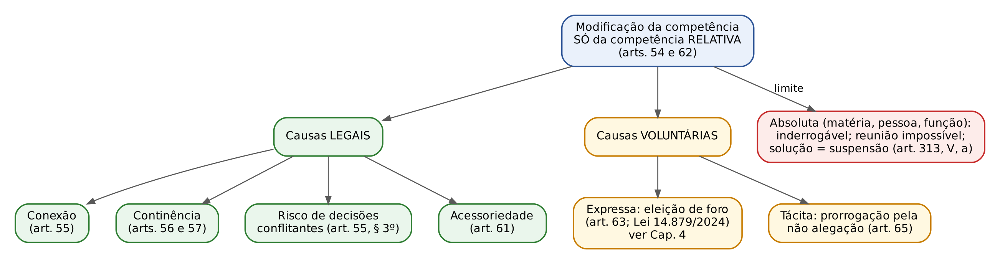
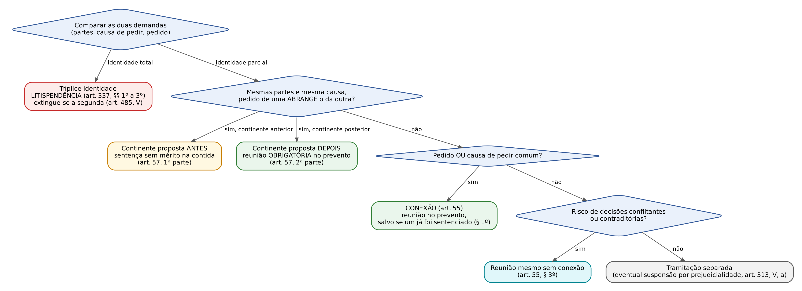
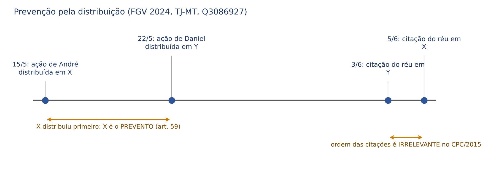
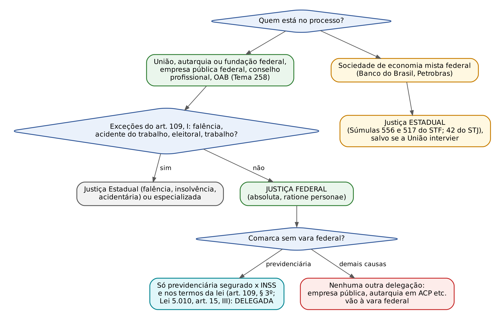
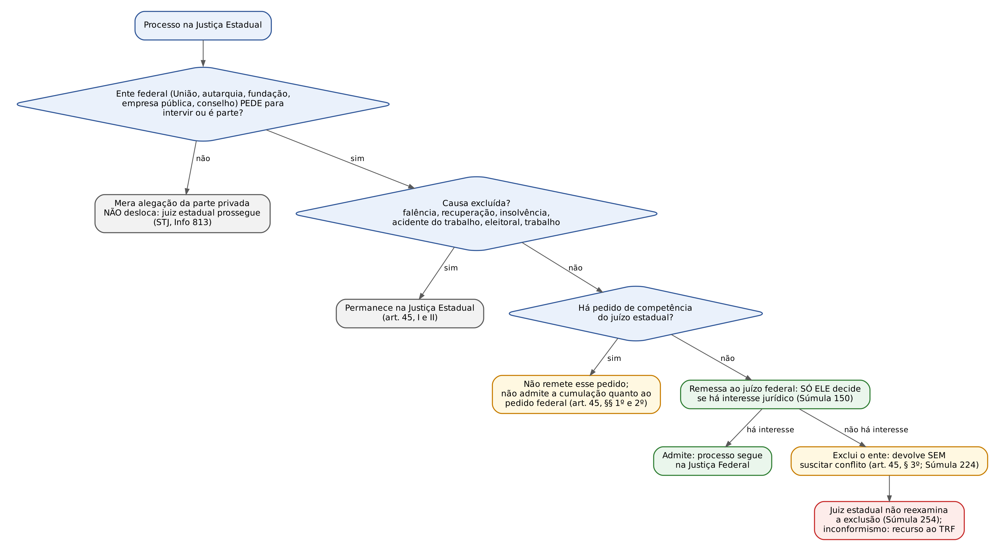
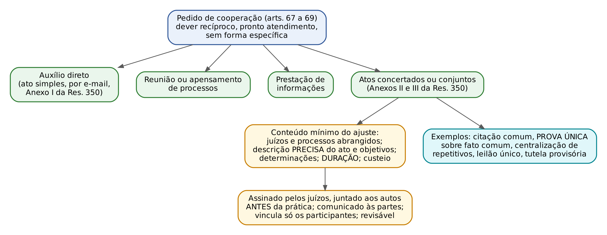

# CAPÍTULO 05 — COMPETÊNCIA II: MODIFICAÇÃO, JUSTIÇA FEDERAL, COMPETÊNCIA DELEGADA E COOPERAÇÃO NACIONAL

:::INCIDENCIA
Pontos: TRF5 p. 2; TJRS p. 3; TJSC p. 2. Nível A+. Lote: 22 questões (FGV 18, FCC 4).
O que mais cai: conexão x continência x litispendência com identificação do juízo prevento (art. 59: registro ou distribuição), Súmula 235 e art. 55, §§ 2º e 3º; mecânica do art. 45 com as Súmulas 150, 224 e 254 do STJ; casuística do art. 109, I (empresa pública x sociedade de economia mista, delegação só previdenciária, Temas 1.154 e 1.234 do STF); atos concertados (art. 69 do CPC e Resolução CNJ 350/2020).
:::

#### Mapa de cobrança

| Subtema | FGV | FCC | Padrão |
|---|---|---|---|
| Conexão, continência, prevenção e reunião (arts. 54 a 59 e 286) | 7 | 3 | caso com datas de distribuição e de citação; letra do art. 55, §§ 1º a 3º, e do art. 57; distribuição por dependência |
| Justiça Federal: art. 109, I, e art. 45 do CPC | 6 | 1 | ente federal no polo ou intervindo; quem decide o interesse; o que o juiz federal faz ao excluir o ente; sociedade de economia mista |
| Competência delegada e comarca sem vara federal | 2 | 0 | só previdenciária, só por lei; empresa pública e autarquia em ACP não se delegam |
| Saúde: Temas 793 e 1.234 do STF | 2 | 0 | valor de 210 salários mínimos; não somar incorporado com não incorporado; insumos fora da soma |
| Cooperação nacional e atos concertados | 2 | 0 | requisitos do ato concertado (descrição precisa, objetivos, vigência); cooperação é DEVER |

Distribuição de tarefas com os capítulos vizinhos: critérios de determinação, competência absoluta e relativa, foros dos arts. 46 a 53, foro de eleição (Lei 14.879/2024), *perpetuatio jurisdictionis* e arguição da incompetência estão no Cap. 4; aqui só se usam esses conceitos. Litispendência como pressuposto processual negativo está no Cap. 6; intervenção anômala da União (Lei 9.469/1997, art. 5º) e assistência, no Cap. 9; cooperação internacional, no Cap. 3; JEF, no Cap. 37; conflito de competência nos tribunais, no Cap. 38; competência na ação civil pública (art. 93 do CDC e Tema 1.075 do STF), no Cap. 33.

## 05.1 Modificação da competência: regime e limites

### 05.1.1 O que se modifica e o que não se modifica

A regra-matriz é o art. 54: "A competência RELATIVA poderá modificar-se pela conexão ou pela continência". O art. 62 fecha o sistema pelo outro lado: a competência determinada em razão da matéria, da pessoa ou da função é inderrogável por convenção das partes. Daí a fórmula que resolve quase todas as assertivas: modificam-se a competência territorial e a competência pelo valor (as do art. 63); não se modificam a material, a pessoal e a funcional. Quando o critério é absoluto, nem a conexão, nem a continência, nem a vontade das partes deslocam o processo.

A pegadinha clássica é a afirmação de que "a incompetência absoluta pode ser prorrogada por convenção das partes, já que a jurisdição é una" (FCC 2026, PGM-Manaus, alternativa errada da Q4338808). A unidade da jurisdição explica por que todo juiz tem jurisdição, mas não autoriza o deslocamento de competência absoluta: o art. 62 é expresso.

### 05.1.2 Causas legais e voluntárias

- Legais (independem da vontade das partes e se impõem ao juiz): conexão (art. 55, *caput*), continência (arts. 56 e 57), risco de decisões conflitantes sem conexão (art. 55, § 3º), acessoriedade (art. 61). Algumas leis especiais acrescentam regras próprias de prevenção (art. 2º, parágrafo único, da Lei 7.347/1985; art. 5º, § 3º, da Lei 4.717/1965), examinadas em 05.4.
- Voluntárias: expressa, pela eleição de foro (art. 63, com os limites da Lei 14.879/2024 — ver Cap. 4); tácita, pela prorrogação decorrente de o réu não alegar a incompetência relativa em preliminar de contestação (art. 65). O Ministério Público pode alegar a incompetência relativa nas causas em que atuar (art. 65, parágrafo único).

Distinção de linguagem que a FGV usa: "prorrogação" é o efeito (o juízo originariamente incompetente torna-se competente); "modificação" é o gênero; "derrogação" é o afastamento da regra legal pela vontade (eleição de foro). A prorrogação por inércia do réu é efeito da preclusão; a modificação por conexão é efeito de lei.

:::PEGADINHA CONEXÃO NÃO "CONVALIDA" INCOMPETÊNCIA ABSOLUTA
Se uma das ações conexas tramita em juízo absolutamente competente e a outra em juízo de competência material diversa (vara de família x vara cível; juizado x vara comum; Justiça Federal x Justiça Estadual), a reunião é IMPOSSÍVEL. O instrumento para evitar decisões contraditórias passa a ser a suspensão do processo prejudicado (art. 313, V, a), e não a reunião. É o que resolveu a FGV no caso de acidente de trânsito em que um condutor demandou no Juizado Especial Cível e o outro na vara cível: o juiz da vara deve SUSPENDER o processo, e não reunir (FGV 2025, TJ-SC, Juiz Leigo, Q3592826, gabarito D; o tema dos juizados é do Cap. 36).
:::

## 05.2 Conexão

### 05.2.1 Conceito legal e a ampliação doutrinária

:::LEI CPC, ART. 55
Reputam-se conexas 2 (duas) ou mais ações quando lhes for comum o pedido OU a causa de pedir.
§ 1º Os processos de ações conexas serão reunidos para decisão conjunta, SALVO se um deles já houver sido sentenciado.
§ 2º Aplica-se o disposto no caput: I - à execução de título extrajudicial e à ação de conhecimento relativa ao mesmo ato jurídico; II - às execuções fundadas no mesmo título executivo.
§ 3º Serão reunidos para julgamento conjunto os processos que possam gerar risco de prolação de decisões conflitantes ou contraditórias caso decididos separadamente, MESMO SEM CONEXÃO entre eles.
:::

A conexão do *caput* é a teoria tradicional (identidade de um dos elementos objetivos: pedido ou causa de pedir). Basta identidade PARCIAL da causa de pedir (por exemplo, o mesmo fato, ainda que os fundamentos jurídicos difiram) e é irrelevante que as partes sejam diferentes. Por isso, dois filhos que demandam o mesmo réu pela morte do pai no mesmo acidente propõem ações conexas (mesma causa de pedir, partes ativas diferentes), e não ações continentes, porque a continência exige identidade de partes.

O CPC/2015 incorporou, no § 3º, a chamada conexão por prejudicialidade ou "conexão material" defendida por parte da doutrina (o critério é o RISCO de decisões incompatíveis, não a identidade de elementos). Os §§ 2º e 3º são o que o CPC/2015 acrescentou ao art. 103 do CPC/1973, e é por isso que caem. O § 2º resolveu a antiga discussão sobre a conexão entre execução e ação de conhecimento (embargos à parte, anulatória, revisional, declaratória de inexigibilidade): há conexão por força de lei. O § 3º dispensa a conexão: o que importa é a possibilidade de decisões logicamente incompatíveis.

:::QUESTAO FCC 2026 — PGM-MANAUS — PROCURADOR (Q4338808)
Cobrado: assertiva correta sobre competência e modificação. Gabarito B: execução de título extrajudicial e ação de conhecimento relativa ao mesmo ato jurídico são conexas e devem ser reunidas (art. 55, § 2º, I).
Armadilhas: (A) incompetência relativa reconhecível de ofício "em qualquer situação" (falso: Súmula 33 do STJ e art. 337, § 5º; as exceções são a cláusula de eleição abusiva antes da citação e o juízo aleatório, art. 63, §§ 3º e 5º); (C) absoluta prorrogável por convenção (falso: art. 62); (D) continente anterior implica reunião "necessária" (falso: extingue-se a contida, art. 57); (E) "apenas a conexão" enseja reunião (falso: continência e § 3º também).
:::

:::QUESTAO FCC 2025 — MPE-PI — ANALISTA MINISTERIAL (Q3530384)
Cobrado: a letra do art. 55. Gabarito C: comum o pedido OU a causa de pedir, reunindo-se as ações, salvo se uma delas já houver sido sentenciada.
Armadilhas: "pedido E causa de pedir" (cumulativo: falso); exclusão da execução de título extrajudicial (falso, § 2º, I); a alternativa E reproduz a definição de continência (art. 56).
:::

### 05.2.2 Reunião: limites, momento e (não) obrigatoriedade

A reunião tem três limites que caem com frequência.

Primeiro, o temporal: não há reunião se um dos processos já foi sentenciado (art. 55, § 1º). O CPC positivou a Súmula 235 do STJ ("A conexão não determina a reunião dos processos, se um deles já foi julgado"). O critério é a SENTENÇA, e não o trânsito em julgado: proferida a sentença em um dos processos, cessa a utilidade da reunião, porque a decisão conjunta já não é possível. A tutela da coerência passa a ser feita pela suspensão (art. 313, V, a), se ainda útil, ou pelo próprio sistema recursal.

Segundo, o da competência absoluta (05.1.1): sem possibilidade de reunião, suspende-se.

Terceiro, o da utilidade. A literalidade do art. 55, § 1º ("serão reunidos") sugere dever. A jurisprudência do STJ, porém, tradicionalmente admite que o juiz deixe de reunir quando a reunião não atender à finalidade do instituto (evitar decisões contraditórias e prestigiar a economia), em juízo de conveniência, sobretudo em processos em fases muito distintas (orientação referida em material de curso de 2026 lido no Drive, sem indicação de julgado; ver nota). Na execução fiscal, a faculdade é sumulada: "A reunião de execuções fiscais contra o mesmo devedor constitui faculdade do Juiz" (Súmula 515 do STJ, que interpreta o art. 28 da Lei 6.830/1980).

:::DICA COMO DECIDIR A ALEGAÇÃO DE CONEXÃO
1. Identificar os elementos das demandas (art. 337, § 2º): há tríplice identidade? Então é litispendência, não conexão.
2. Verificar se as partes e a causa coincidem e um pedido abrange o outro: continência (art. 56) e aplicação do art. 57.
3. Pedido ou causa de pedir comum: conexão; não havendo, verificar o risco do § 3º.
4. Checar os bloqueios: sentença já proferida em um deles (§ 1º; Súmula 235); competência absoluta diversa (art. 54 a contrario).
5. Definir o prevento pelo registro ou distribuição (art. 59) e determinar a remessa (art. 58).
A conexão é matéria do art. 337, VIII, que o juiz conhece de ofício (art. 337, § 5º, exclui da cognição oficiosa apenas a convenção de arbitragem e a incompetência relativa). A decisão que reúne ou nega a reunião é interlocutória fora do rol do art. 1.015; a impugnação vai à preliminar de apelação (art. 1.009, § 1º) ou, se presente urgência que torne inútil o exame posterior, ao agravo pela taxatividade mitigada (Tema 988 do STJ, desenvolvido no Cap. 42).
:::

:::QUESTAO FGV 2025 — ENAM 2025.1 — EXAME NACIONAL DA MAGISTRATURA (Q3362345)
Cobrado: três itens sobre conexão e modificação. Gabarito C (I e III corretos).
Item I (correto): o juízo que julgou o divórcio é competente para a partilha posterior, por conexão substancial (ou acessoriedade) entre as demandas. A jurisprudência do STJ trata essa vinculação como competência FUNCIONAL, e por isso absoluta: a mudança de domicílio ou a incapacidade superveniente de um ex-cônjuge não desloca a partilha para o foro do art. 50 (julgado sistematizado em sinopse de jurisprudência lida no Drive, sem número do processo).
Item II (errado): o "juízo aleatório", sem vínculo com domicílio, residência ou negócio, autoriza a declinação DE OFÍCIO (art. 63, § 5º, incluído pela Lei 14.879/2024). A Súmula 33 do STJ cede nesse caso.
Item III (correto): reprodução do art. 55, § 1º.
:::

### 05.2.3 Conexão por prejudicialidade e o § 3º

O § 3º é o terreno das demandas que não compartilham pedido nem causa de pedir, mas cuja solução depende de uma mesma premissa: ação de despejo por falta de pagamento e consignatória dos mesmos aluguéis; anulatória de deliberação societária e ações de cobrança fundadas nessa deliberação; ação de investigação de paternidade e ação de alimentos movidas em foros diversos. O dispositivo não exige identidade de nenhum elemento.

:::QUESTAO FGV 2024 — PREFEITURA DE SÃO JOSÉ DOS CAMPOS — ANALISTA (Q2362721)
Gabarito B: reúnem-se os processos com risco de decisões conflitantes ou contraditórias, mesmo sem conexão (art. 55, § 3º).
Armadilhas: (A) repetição de demanda em curso é litispendência, não conexão; (C) a incompetência é preliminar, não "prejudicial", e só a relativa se prorroga; (D) a definição dada é de conexão, não de continência; (E) litispendência extingue SEM resolução do mérito (art. 485, V).
No mesmo sentido, com a armadilha invertida ("desde que haja conexão"): FGV 2024, EPE, Q2758998 (alternativa E errada).
:::

:::QUESTAO FGV 2026 — TJ-RJ — COMISSÁRIO DE JUSTIÇA DA INFÂNCIA (Q3870735)
Caso: pai ajuíza ação de guarda unilateral do filho contra a mãe; depois, sem saber da primeira, a mãe ajuíza ação de guarda unilateral do mesmo filho contra o pai, distribuída à mesma vara de família. O juiz extingue a segunda por falta de interesse.
Passo 1: não há litispendência (as partes estão em posições invertidas e os pedidos são opostos: cada um pede a guarda para si). Passo 2: a causa de pedir remota (a mesma relação parental e a situação da criança) é comum, e as decisões, separadas, seriam inconciliáveis. Passo 3: reunião para julgamento simultâneo.
Gabarito D: o pronunciamento foi incorreto, porque os processos deveriam ser reunidos. A armadilha é a alternativa C (extinção por litispendência): demandas com pedidos contrapostos sobre o mesmo bem da vida não são idênticas.
:::

:::QUESTAO FGV 2024 — TRF1 — OFICIAL DE JUSTIÇA AVALIADOR FEDERAL (Q3028633)
Caso: João ajuíza usucapião em Rio Bonito (foro da situação do imóvel). Dois meses depois, Regina ajuíza reintegração de posse do mesmo imóvel contra João em Niterói (domicílio do réu).
Passo 1: a possessória imobiliária é de competência ABSOLUTA do foro da situação (art. 47, § 2º): Niterói é incompetente, e as partes não podem eleger outro foro (alternativas A, C e D erradas). Passo 2: há conexão (mesma relação jurídica sobre o mesmo bem, com pedidos que se excluem). Passo 3: o prevento é Rio Bonito, onde a primeira ação foi distribuída, que coincide com o foro absolutamente competente.
Gabarito B. A alternativa E (inexistência de conexão por diferença de pedidos e causas) ignora que basta um elemento comum e, de todo modo, o § 3º.
:::

### 05.2.4 Situações especiais de conexão

- Execuções fundadas no mesmo título (art. 55, § 2º, II): por exemplo, execução movida contra o devedor principal e outra contra o avalista, ambas fundadas na mesma nota promissória.
- Execução e embargos: os embargos são distribuídos por dependência à execução (art. 914, § 1º, matéria do Cap. 26); a conexão do § 2º, I, refere-se às ações de conhecimento AUTÔNOMAS (anulatória, revisional) propostas em juízo diverso.
- Ação civil pública: "Reconhecida a continência, devem ser reunidas na Justiça Federal as ações civis públicas propostas nesta e na Justiça estadual" (Súmula 489 do STJ). A Justiça Federal atrai porque é a única que pode julgar o ente federal. E, nas ações civis públicas de âmbito nacional ou regional, a reunião por conexão ou continência não se submete à lógica da Súmula 235: fixa-se a competência no juízo que primeiro conheceu de uma delas, conforme o Tema 1.075 do STF (STJ, AgInt no CC n. 202.644, Relatora Ministra Maria Thereza de Assis Moura, Primeira Seção, j. 11/3/2026, Informativo 885). O regime do Tema 1.075 é do Cap. 33.
- Ações populares: a prevenção é especial (05.4.3). Na FGV, duas ações populares contra o mesmo contrato, com fundamentos diferentes (desvio de finalidade x vício de forma e incompetência do agente), são conexas pelo pedido (nulidade do mesmo contrato); prevento o juízo da PRIMEIRA distribuição, ainda que as citações nele tenham ocorrido depois (FGV 2024, ENAM, Q2459885, gabarito A; questão do lote do Cap. 33).
- Litisconsórcio facultativo: a conexão pelo pedido ou pela causa de pedir autoriza a formação do litisconsórcio (art. 113, II), que é a reunião "na origem".

:::QUESTAO FGV 2024 — TJ-MT — JUIZ SUBSTITUTO (Q3086927)
Caso: André ajuíza indenizatória pela morte do pai em acidente, distribuída em 15/5 na comarca X (citação do réu em 5/6). Daniel, irmão, ajuíza a mesma pretensão, pelos mesmos fatos e fundamentos, distribuída em 22/5 na comarca Y (citação em 3/6).
Passo 1: partes ativas diferentes impedem continência e litispendência. Passo 2: causa de pedir comum: conexão. Passo 3: prevento o juízo da distribuição mais antiga (art. 59): X. A citação anterior em Y é irrelevante no CPC/2015.
Gabarito A. Armadilhas: C (prevenção pela citação, regra do art. 219 do CPC/1973) e B e D (continência).
No mesmo sentido: FGV 2026, MPE-RJ, Q4088283 (três familiares, mesma viagem: a alternativa que reunia "onde a citação ocorreu em primeiro lugar" estava errada; questão do lote do Cap. 8).
:::

## 05.3 Continência

### 05.3.1 Requisitos e consequência

:::LEI CPC, ARTS. 56 E 57
Art. 56. Dá-se a continência entre 2 (duas) ou mais ações quando houver identidade quanto às partes e à causa de pedir, mas o pedido de uma, por ser mais amplo, abrange o das demais.
Art. 57. Quando houver continência e a ação continente tiver sido proposta ANTERIORMENTE, no processo relativo à ação contida será proferida sentença SEM resolução de mérito, caso contrário, as ações serão NECESSARIAMENTE reunidas.
:::

Requisitos cumulativos: mesmas partes, mesma causa de pedir e pedido de uma que abrange o da outra. A continência é, portanto, uma "litispendência parcial": a ação contida está inteiramente dentro da continente. Essa natureza explica o art. 57, novidade do CPC/2015:

- Continente ANTERIOR: a ação contida, posterior, nada acrescenta; repete parcela de demanda já em curso. Extingue-se sem resolução do mérito (art. 485, V, por litispendência parcial). Não há reunião.
- Continente POSTERIOR: a ação contida, anterior, não pode ser extinta, porque nada repete; a continente, posterior, traz algo a mais. Reunião obrigatória ("necessariamente"), no prevento.

A estrutura é contraintuitiva e é exatamente o que as bancas exploram: a ordem cronológica de propositura define a consequência.

:::QUESTAO FGV 2024 — TJ-AP — ANALISTA JUDICIÁRIO (Q2449081)
Caso: Caio pede, no Juízo X, a anulação de UMA cláusula do contrato. Dez dias depois, antes da citação, pede, no Juízo Y, a invalidação de TODO o contrato, pela mesma causa de pedir. A citação em Y ocorre antes da citação em X.
Passo 1: mesmas partes e mesma causa; o pedido da segunda (invalidade total) abrange o da primeira: continência. Passo 2: a continente é POSTERIOR, logo reunião necessária (art. 57, 2ª parte). Passo 3: prevento é X, distribuído primeiro (art. 59); a ordem das citações é irrelevante.
Gabarito B. Armadilhas: C (prevenção pela citação) e D e E (classificação como conexão).
:::

:::QUESTAO FCC 2025 — PGE-MT — PROCURADOR DO ESTADO (Q3745785)
Cobrado: o que NÃO justifica distribuição por dependência. Gabarito B: continência em que a ação continente foi proposta anteriormente.
Raciocínio: o art. 286, I, menciona genericamente "conexão ou continência", mas, se a continente é anterior, a contida será extinta (art. 57), e não reunida; logo, não há razão para distribuí-la por dependência. As demais alternativas reproduzem o art. 286: conexão (I), reiteração de pedido após extinção sem mérito, ainda que em litisconsórcio com outros autores (II), risco de decisões conflitantes (III, remetendo ao art. 55, § 3º) e oposição (art. 683, parágrafo único).
Atenção: a assertiva é deduzida do sistema, não da letra do art. 286; é o tipo de questão em que a FCC exige a combinação de dois dispositivos.
:::

### 05.3.2 Quadro comparativo

| Instituto | Elementos | Consequência | Fundamento |
|---|---|---|---|
| Litispendência | mesmas partes, causa e pedido; ação em curso | extinção da segunda sem mérito | art. 337, §§ 1º a 3º; art. 485, V |
| Coisa julgada | idem, primeira já decidida com trânsito | extinção sem mérito | art. 337, § 4º |
| Continência, continente anterior | mesmas partes e causa; pedido da primeira abrange o da segunda | extinção da contida sem mérito | art. 57, 1ª parte |
| Continência, continente posterior | idem, invertida a ordem | reunião obrigatória no prevento | art. 57, 2ª parte; art. 58 |
| Conexão | pedido OU causa de pedir comum (partes podem diferir) | reunião, salvo se um processo já sentenciado | art. 55, *caput* e § 1º |
| Conexão legal | execução x conhecimento sobre o mesmo ato; execuções sobre o mesmo título | reunião | art. 55, § 2º |
| Risco de decisões conflitantes | nenhum elemento comum exigido | reunião | art. 55, § 3º |
| Prejudicialidade com competência absoluta diversa | qualquer | suspensão do prejudicado | art. 313, V, a |

:::QUESTAO FGV 2024 — EPE — ADVOGADO (Q2758998)
Gabarito D: o registro ou a distribuição da petição inicial torna prevento o juízo (art. 59).
Armadilhas: (A) definição de continência atribuída à conexão; (B) reunião "mesmo se um deles já houver sido sentenciado" (inverte o § 1º); (C) competência ABSOLUTA modificável por conexão (inverte o art. 54); (E) § 3º "desde que haja conexão" (inverte o "mesmo sem conexão").
:::

## 05.4 Prevenção

### 05.4.1 Critério do CPC/2015

:::LEI CPC, ARTS. 58 A 60
Art. 58. A reunião das ações propostas em separado far-se-á no juízo prevento, onde serão decididas simultaneamente.
Art. 59. O registro ou a distribuição da petição inicial torna prevento o juízo.
Art. 60. Se o imóvel se achar situado em mais de um Estado, comarca, seção ou subseção judiciária, a competência territorial do juízo prevento estender-se-á sobre a totalidade do imóvel.
:::

Prevenção não é critério de determinação de competência; é critério de ESCOLHA entre juízos igualmente competentes (ou que se tornam competentes pela modificação). O CPC/1973 tinha duplo critério: entre juízos de mesma competência territorial, o primeiro despacho (art. 106); entre juízos de competências territoriais diversas, a primeira citação válida (art. 219). O CPC/2015 unificou: registro (comarca de vara única, onde não há distribuição) ou distribuição. Toda questão que traz datas de citação está testando se o candidato ainda raciocina com o art. 219 revogado.

Vale também a lembrança do art. 312: a ação considera-se proposta com o protocolo da inicial, mas, quanto ao réu, os efeitos do art. 240 (litispendência, litigiosidade da coisa, mora) só se produzem após a citação válida. Prevenção e litispendência têm, portanto, marcos distintos: a primeira nasce da distribuição; a segunda, para o réu, da citação.

### 05.4.2 Prevenção nos tribunais

- O primeiro recurso protocolado no tribunal torna prevento o relator para recurso subsequente no mesmo processo ou em processo conexo (art. 930, parágrafo único). Há precedente do STJ (citado em material de curso lido no Drive; número e data não conferidos) que restringiu a prevenção por conexão aos processos que tramitaram em conjunto na origem; parte da doutrina (Daniel Amorim Assumpção Neves, segundo o mesmo material) defende a leitura literal.
- Fica prevento o relator designado para examinar pedido de efeito suspensivo à apelação formulado entre a interposição e a distribuição (art. 1.012, § 3º, I), e há regra análoga para os recursos excepcionais (art. 1.029, § 5º, I).

### 05.4.3 Prevenções especiais e exceções

- Ação civil pública: "A propositura da ação prevenirá a jurisdição do juízo para todas as ações posteriormente intentadas que possuam a mesma causa de pedir ou o mesmo objeto" (Lei 7.347/1985, art. 2º, parágrafo único, incluído pela MP 2.180-35/2001).
- Ação popular: "A propositura da ação prevenirá a jurisdição do juízo para todas as ações, que forem posteriormente intentadas contra as mesmas partes e sob os mesmos fundamentos" (Lei 4.717/1965, art. 5º, § 3º).
- Produção antecipada de prova: NÃO previne a competência para a ação principal (art. 381, § 3º). Pegadinha recorrente, porque a lógica intuitiva sugere o contrário.
- Imóvel situado em mais de uma comarca ou seção: a competência do prevento estende-se sobre todo o imóvel (art. 60), exceção à rigidez do foro da situação.
- Distribuição por dependência (art. 286): é a técnica cartorária da prevenção. O inciso II combate a burla ao juiz natural: extinto o processo sem mérito, a reiteração do pedido vai ao mesmo juízo, "ainda que em litisconsórcio com outros autores ou que sejam parcialmente alterados os réus da demanda".

:::PEGADINHA PREVENÇÃO X \*PERPETUATIO JURISDICTIONIS\*
São institutos distintos. A *perpetuatio* (art. 43, Cap. 4) fixa a competência no registro ou distribuição e torna irrelevantes as alterações posteriores de fato ou de direito, salvo supressão do órgão ou alteração da competência absoluta. A prevenção escolhe, entre juízos competentes, aquele que reunirá as causas. Os dois usam o mesmo marco (registro ou distribuição), o que facilita a confusão em assertivas.
Duas flexibilizações recentes do art. 43 aparecem em informativos: o STJ admitiu, excepcionalmente, afastá-lo quando o juízo onde tramita a ação não é adequado ou conveniente para julgá-la, à luz da ideia de *forum non conveniens* e de competência adequada, em ação de guarda com graves indícios de influência indevida do genitor no juízo originário (STJ, CC n. 199.079, Relator Ministro Moura Ribeiro, relatora para o acórdão Ministra Nancy Andrighi, Segunda Seção, j. 13/12/2023); e admitiu excepcionar a *perpetuatio* por acordo entre juízos permutantes, para que cada qual sentencie os processos em que colheu diretamente a prova oral (STJ, REsp n. 2.104.647, relator para o acórdão Ministro Moura Ribeiro, Terceira Turma, j. 11/11/2025, Informativo 871) — este último, aplicação prática da cooperação judiciária (05.9).
:::

## 05.5 Ação acessória, reconvenção e outras atrações

A ação acessória é proposta no juízo competente para a principal (art. 61). É regra de competência funcional, e por isso absoluta, segundo a orientação dominante: cautelares e tutelas antecedentes (art. 299), oposição (art. 683, parágrafo único), embargos de terceiro (art. 676), habilitação (art. 689), restauração de autos, liquidação e cumprimento de sentença (art. 516, II, com as opções do parágrafo único), partilha posterior ao divórcio (05.2.2). A reconvenção e a intervenção de terceiro ampliam objetivamente o processo e são anotadas pelo distribuidor (art. 286, parágrafo único), sem alterar o juízo.

:::NOTA CONFLITO SOBRE REUNIÃO OU SEPARAÇÃO
O art. 66, III, prevê conflito de competência quando "entre 2 (dois) ou mais juízes surge controvérsia acerca da reunião ou separação de processos". O parágrafo único obriga o juiz que não acolhe a competência declinada a suscitar o conflito, salvo se a atribuir a outro juízo. O procedimento do conflito é do Cap. 38; os órgãos competentes para julgá-lo nas relações entre Justiça Federal e Estadual estão em 05.6.6.
:::

:::SENTENCA DECISÃO QUE RECONHECE A CONEXÃO E DETERMINA A REUNIÃO
"Os autos n. ... e os presentes têm a mesma causa de pedir (o acidente de 2/3/2025), embora formulados por autores diversos, o que configura conexão (art. 55 do CPC). Nenhum deles foi sentenciado (art. 55, § 1º) e ambos tramitam em varas cíveis da mesma competência material. A petição inicial daqueles autos foi distribuída em 15/5/2024, antes da destes (22/5/2024), de modo que o juízo da ... Vara Cível é o prevento (arts. 58 e 59), sendo irrelevante a ordem das citações. Determino a remessa destes autos àquele juízo, para julgamento simultâneo, com as anotações devidas (art. 286, I). Intimem-se."
:::

## 05.6 Competência da Justiça Federal

### 05.6.1 Natureza: constitucional, expressa, absoluta e, no inciso I, *ratione personae*

A competência da Justiça Federal está ENUMERADA na Constituição (art. 109); a da Justiça Estadual é residual (o que não pertence às Justiças especializadas nem à Federal). Por isso, a competência federal não pode ser ampliada por lei ordinária (salvo nas hipóteses em que a própria Constituição remete à lei, como no § 3º e no inciso VI), nem reduzida, nem modificada por conexão, continência ou vontade das partes. A violação gera incompetência absoluta, rescindível (art. 966, II).

No cível, o inciso I é critério PESSOAL: importa quem figura no processo, e não a matéria discutida. A causa entre particulares que discute lei federal é da Justiça Estadual; a causa em que a União é parte, ainda que o tema seja de direito civil comum, é federal. O STJ reafirmou a regra ao fixar a competência estadual para ação de obrigação de fazer e danos morais por uso indevido da imagem de advogado em golpe, porque, afastado pelo juiz federal o interesse da União e ausente vazamento de dados dos sistemas da Justiça Federal, a lide era entre particulares (STJ, CC n. 218.005, Relator Ministro Francisco Falcão, Primeira Seção, j. 17/3/2026, Informativo 884).

:::LEI CF, ART. 109, I A III E §§ 1º A 5º (INCISOS CÍVEIS E PARÁGRAFOS)
Art. 109. Aos juízes federais compete processar e julgar:
I - as causas em que a União, entidade autárquica ou empresa pública federal forem interessadas na condição de autoras, rés, assistentes ou oponentes, EXCETO as de falência, as de acidentes de trabalho e as sujeitas à Justiça Eleitoral e à Justiça do Trabalho;
II - as causas entre Estado estrangeiro ou organismo internacional e Município ou pessoa domiciliada ou residente no País;
III - as causas fundadas em tratado ou contrato da União com Estado estrangeiro ou organismo internacional;
(...) VIII - os mandados de segurança e os habeas data contra ato de autoridade federal, excetuados os casos de competência dos tribunais federais; (...) X - (...) a execução de carta rogatória, após o "exequatur", e de sentença estrangeira, após a homologação, as causas referentes à nacionalidade, inclusive a respectiva opção, e à naturalização; XI - a disputa sobre direitos indígenas.
§ 1º As causas em que a União for autora serão aforadas na seção judiciária onde tiver domicílio a outra parte.
§ 2º As causas intentadas contra a União PODERÃO ser aforadas na seção judiciária em que for domiciliado o autor, naquela onde houver ocorrido o ato ou fato que deu origem à demanda ou onde esteja situada a coisa, ou, ainda, no Distrito Federal.
§ 3º LEI PODERÁ autorizar que as causas de competência da Justiça Federal em que forem parte instituição de previdência social e segurado possam ser processadas e julgadas na justiça estadual quando a comarca do domicílio do segurado não for sede de vara federal. (Redação dada pela EC 103/2019)
§ 4º Na hipótese do parágrafo anterior, o recurso cabível será SEMPRE para o Tribunal Regional Federal na área de jurisdição do juiz de primeiro grau.
§ 5º Nas hipóteses de grave violação de direitos humanos, o Procurador-Geral da República, com a finalidade de assegurar o cumprimento de obrigações decorrentes de tratados internacionais de direitos humanos dos quais o Brasil seja parte, poderá suscitar, perante o Superior Tribunal de Justiça, em qualquer fase do inquérito ou processo, incidente de deslocamento de competência para a Justiça Federal.
:::

### 05.6.2 Os entes do inciso I

| Ente | Justiça | Observação e fonte |
|---|---|---|
| União | Federal | art. 109, I |
| Autarquias federais (INSS, Ibama, Incra, DNIT, agências reguladoras, universidades federais) | Federal | art. 109, I; fundações públicas federais também (art. 45 do CPC menciona "fundações") |
| Conselhos de fiscalização profissional | Federal | natureza autárquica; art. 45 do CPC os menciona expressamente; execução fiscal por conselho: Súmula 66 do STJ |
| OAB (Conselho Federal ou seccional) | Federal | STF, Tema 258 (RE n. 595.332, Relator Ministro Marco Aurélio, Plenário, j. 31/8/2016) |
| Fundação Habitacional do Exército | Federal | equiparada a autarquia (Súmula 324 do STJ) |
| Empresas públicas federais (CEF, ECT, Serpro, Dataprev, EBSERH) | Federal | art. 109, I; inclusive em execução de título extrajudicial movida contra elas |
| Sociedades de economia mista federais (Banco do Brasil, Petrobras, Eletrobras) | ESTADUAL | Súmula 556 do STF ("É competente a Justiça comum para julgar as causas em que é parte sociedade de economia mista"); Súmula 42 do STJ; Súmula 508 do STF (Banco do Brasil) |
| Sociedade de economia mista com intervenção da União | Federal | Súmula 517 do STF: só têm foro na Justiça Federal "quando a União intervém como assistente ou opoente" |
| Concessionária de serviço público federal (telefonia, energia) | Estadual, em regra | Súmula Vinculante 27: telefonia, quando a Anatel não for litisconsorte passiva necessária, assistente nem opoente |
| Serviços sociais autônomos (Sistema S) | Estadual | Súmula 516 do STF (Sesi); pessoas jurídicas de direito privado fora da Administração |
| Entidades fechadas de previdência complementar patrocinadas por estatais federais | Estadual | STJ, Temas 539 e 693 (litígio entre entidade e participante) |

:::PEGADINHA "ENTE DA ADMINISTRAÇÃO INDIRETA FEDERAL COM PERSONALIDADE JURÍDICA DE DIREITO PRIVADO"
A expressão abrange DOIS tipos com regimes opostos: empresa pública (Justiça Federal) e sociedade de economia mista (Justiça Estadual). A FGV explorou exatamente isso: diante de ação individual contra ente federal de direito privado distribuída à vara cível de comarca estadual, a única afirmação correta era a de que a Justiça Estadual NÃO é competente caso o ente seja empresa pública, ainda que a comarca não seja sede de vara federal (FGV 2026, TJ-BA, Juiz Substituto, Q4083776, gabarito C). As alternativas que condicionavam a competência estadual à inexistência de vara federal estavam erradas porque a delegação do § 3º só alcança a matéria previdenciária (05.7).
:::

:::QUESTAO FGV 2024 — ENAM (REAPLICAÇÃO) — EXAME NACIONAL DA MAGISTRATURA (Q2507030)
Caso: ação na Justiça Estadual contra sociedade de economia mista federal por danos de reforma em imóvel vizinho; a União pede ingresso como assistente litisconsorcial, alegando ser proprietária e beneficiária das obras.
Passo 1: a sociedade de economia mista, sozinha, não atrai a Justiça Federal (alternativa D errada). Passo 2: com o pedido de intervenção da União, o juiz estadual não delibera sobre o interesse; remete à Justiça Federal (Súmula 150 do STJ), de modo que não lhe cabe deferir o ingresso (alternativa A errada). Passo 3: o juiz federal que indeferir o ingresso NÃO suscita conflito: devolve os autos (art. 45, § 3º; Súmula 224).
Gabarito E. Armadilha: a alternativa B começava certa (remessa sem deliberar sobre a forma de ingresso) e terminava errada (suscitar conflito). A alternativa C confundia interesse econômico com litisconsórcio necessário.
:::

### 05.6.3 "Interessadas na condição de autoras, rés, assistentes ou oponentes"

A qualidade processual importa. A Constituição fala em autora, ré, assistente ou oponente; o art. 45 do CPC usa fórmula mais ampla ("na qualidade de parte ou de terceiro interveniente"), abrangendo, por exemplo, a denunciação e o chamamento. Ficam fora:

- A intervenção anômala da Lei 9.469/1997 (art. 5º, parágrafo único), fundada em interesse meramente econômico: a União intervém para esclarecer, juntar documentos e memoriais, sem deslocar a competência; só se recorrer passa a ser parte, e então o recurso desloca a causa para o tribunal federal (FGV 2024, EPE, Q2759000, gabarito C; matéria do Cap. 9).
- O ingresso de autarquia federal como *amicus curiae*: a intervenção "não implica alteração de competência" (art. 138, § 1º; FGV 2025, TJ-CE, Juiz Substituto, Q3505772, gabarito D; questão do lote do Cap. 9).
- O protesto pela preferência do crédito federal em execução que corre na Justiça Estadual: "não desloca a competência para a Justiça Federal" (Súmula 270 do STJ).
- A mera alegação, pela parte privada, de que a União deveria intervir: "a remessa do feito para que a Justiça Federal avalie se há interesse federal pressupõe, primeiramente, um pedido de intervenção formulado pela própria União, por suas autarquias ou empresas públicas federais" (STJ, EDcl no AgRg no Ag n. 1.275.461, Relatora Ministra Regina Helena Costa, Primeira Turma, j. 21/5/2024, Informativo 813).
- A intervenção obrigatória da Funai em adoção de criança indígena não atrai, automaticamente, a Justiça Federal; a competência é da Justiça Estadual, no melhor interesse da criança (STJ, Segunda Seção, Relatora Ministra Nancy Andrighi, j. 3/4/2025, Informativo 848, processo em segredo de justiça).
- A titularidade do domínio ou a função de fiscalizar e regular não obrigam União, DNIT ou ANTT a integrar a possessória ajuizada pela concessionária para defender a faixa de domínio de rodovia ou ferrovia federal: a assistência é voluntária e não há litisconsórcio necessário, porque a possessória discute só a posse (tese do STJ noticiada no caderno do Buscador Dizer o Direito lido no Drive, sem número do processo visível; ver nota). A intervenção do ente público na possessória entre particulares é faculdade (Súmula 637 do STJ).

### 05.6.4 As exceções do inciso I e a competência estadual mesmo com ente federal

- Falência, recuperação judicial e insolvência civil: o art. 109, I, fala só em "falência", mas o STF incluiu a insolvência civil entre as exceções (Tema 859, RE n. 678.162, relator para o acórdão Ministro Edson Fachin, Plenário, j. 26/3/2021), e o art. 45, I, do CPC enumera "recuperação judicial, falência, insolvência civil e acidente de trabalho".
- Acidente do trabalho: ações acidentárias contra o INSS são da Justiça Estadual "em ambas as instâncias" (Súmula 501 do STF; recurso ao TJ, não ao TRF). A distinção previdenciária x acidentária e as demais nuances estão na Apostila de Direito Previdenciário, Cap. 20.
- Causas sujeitas à Justiça Eleitoral e à Justiça do Trabalho.

:::QUESTAO FGV 2025 — TJ-GO — RESIDENTE JURÍDICO (Q3345941)
Cobrado: Justiça competente para (I) ação contra o INSS fundada em acidente do trabalho; (II) execução de título extrajudicial contra empresa pública federal; (III) homologação de sentença estrangeira.
Gabarito A: Estadual (exceção do art. 109, I, e Súmula 501 do STF), Federal (empresa pública federal em qualquer polo e em qualquer espécie de processo) e STJ (art. 105, I, i).
:::

### 05.6.5 A mecânica do deslocamento: art. 45 do CPC e as Súmulas 150, 224 e 254

:::LEI CPC, ART. 45
Tramitando o processo perante outro juízo, os autos serão remetidos ao juízo federal competente se nele intervier a União, suas empresas públicas, entidades autárquicas e fundações, ou conselho de fiscalização de atividade profissional, na qualidade de parte ou de terceiro interveniente, exceto as ações: I - de recuperação judicial, falência, insolvência civil e acidente de trabalho; II - sujeitas à justiça eleitoral e à justiça do trabalho.
§ 1º Os autos NÃO serão remetidos se houver pedido cuja apreciação seja de competência do juízo perante o qual foi proposta a ação.
§ 2º Na hipótese do § 1º, o juiz, ao não admitir a cumulação de pedidos em razão da incompetência para apreciar qualquer deles, não examinará o mérito daquele em que exista interesse da União, de suas entidades autárquicas ou de suas empresas públicas.
§ 3º O juízo federal restituirá os autos ao juízo estadual SEM SUSCITAR CONFLITO se o ente federal cuja presença ensejou a remessa for excluído do processo.
:::

As três súmulas formam um sistema:

- Súmula 150 do STJ: "Compete à Justiça Federal decidir sobre a existência de interesse jurídico que justifique a presença, no processo, da União, suas autarquias ou empresas públicas." O juiz estadual não aprecia o pedido de intervenção nem a legitimidade do ente federal: remete.
- Súmula 224 do STJ: "Excluído do feito o ente federal, cuja presença levara o Juiz Estadual a declinar da competência, deve o Juiz Federal restituir os autos e não suscitar conflito." Positivada no art. 45, § 3º.
- Súmula 254 do STJ: "A decisão do Juízo Federal que exclui da relação processual ente federal não pode ser reexaminada no Juízo Estadual." O juiz estadual que recebe os autos de volta também não suscita conflito; o inconformismo da parte vai por recurso ao TRF.

A lógica é hierárquica e não de "competência sobre a competência" em abstrato: só a Justiça Federal pode dizer se o ente federal tem interesse, porque, se tiver, só ela poderá julgá-lo. O conflito seria inútil, porque o STJ teria de reexaminar uma decisão sobre interesse jurídico, que é de mérito da intervenção, e não de competência. A Primeira Seção reafirmou essas premissas em 2026 e acrescentou que o conflito não pode ser usado como sucedâneo recursal para levar ao STJ, prematuramente, a discussão sobre responsabilidade de entes federativos em demandas de saúde (STJ, CC n. 218.933, Relator Ministro Marco Aurélio Bellizze, Primeira Seção, j. 13/5/2026, Informativo 891).

Os §§ 1º e 2º regulam a cumulação de pedidos de competências diversas. Se, entre os pedidos, há algum de competência do juízo estadual, os autos não sobem; o juiz estadual não admite a cumulação quanto ao pedido em que haja interesse federal e não examina seu mérito (o autor o deduz, se quiser, na Justiça Federal). A regra concretiza o art. 327, § 1º, II (cumulação exige competência do mesmo juízo para todos os pedidos). O STJ já aplicou solução análoga de CISÃO em ação popular contra a desocupação da orla do Lago Paranoá, mantendo na Justiça Federal só o que dizia respeito aos imóveis da União e à câmara de conciliação federal, e no juízo distrital o restante (julgado noticiado no caderno do Buscador Dizer o Direito lido no Drive; dados do acórdão não visíveis).

:::QUESTAO FGV 2026 — TRF2 — JUIZ FEDERAL SUBSTITUTO (Q3996861)
Caso: aposentado ajuíza, na vara cível estadual de Duque de Caxias, indenizatória contra o INSS e o Banco do Brasil por descontos de consignado que não contratou. O INSS alega ilegitimidade e incompetência absoluta.
Passo 1: o INSS, autarquia federal, é RÉU indicado na inicial; a competência se afere pela demanda tal como proposta (*in statu assertionis*). Passo 2: o juiz estadual não pode examinar a ilegitimidade do INSS, pois isso equivale a decidir sobre a presença do ente federal (Súmula 150). Passo 3: declara a incompetência absoluta e remete; o juízo federal examina a ilegitimidade e, se excluir o INSS, devolve os autos sem conflito quanto ao banco (Súmula 224; sociedade de economia mista, Súmula 556 do STF).
Gabarito B. Armadilhas: A (juiz estadual examinar antes a ilegitimidade), C ("competência concorrente" entre as Justiças) e E (necessidade de instrução para fixar competência).
:::

:::QUESTAO FGV 2025 — PREFEITURA DE CANAÃ DOS CARAJÁS — PROCURADOR (Q3265478)
Caso: possessória entre particulares domiciliados em Belém, sobre imóvel em São Bernardo do Campo, ajuizada em Belém. A União intervém dizendo-se proprietária; os autos vão à Justiça Federal; depois a União pede exclusão por não ter interesse.
Passo 1: possessória imobiliária: foro da situação, competência absoluta (art. 47, § 2º); Belém era incompetente (A e B erradas). Passo 2: a remessa à Justiça Federal diante da intervenção da União foi correta (art. 45; Súmula 150). Passo 3: excluída a União, o juízo federal restitui sem conflito (D errada). A alternativa E (possessória "não é" da Justiça Federal por disposição constitucional) é falsa: o critério é pessoal.
Gabarito C.
:::

### 05.6.6 Intervenção do ente federal depois da sentença e competência recursal

Questão recorrente: a União (ou o ente federal) pede ingresso quando a causa já foi sentenciada pelo juiz estadual. A sentença NÃO é anulada automaticamente; o processo vai ao TRF, que examina o pedido de ingresso e, se o deferir, julga a apelação.

- Súmula 553 do STJ: "Nos casos de empréstimo compulsório sobre o consumo de energia elétrica, é competente a Justiça estadual para o julgamento de demanda proposta exclusivamente contra a Eletrobrás. Requerida a intervenção da União no feito após a prolação de sentença pelo juízo estadual, os autos devem ser remetidos ao Tribunal Regional Federal competente para o julgamento da apelação se deferida a intervenção." Mesma tese no Tema 172 do STJ (REsp n. 1.111.159).
- Súmula 365 do STJ: "A intervenção da União como sucessora da Rede Ferroviária Federal S/A (RFFSA) desloca a competência para a Justiça Federal ainda que a sentença tenha sido proferida por Juízo estadual."
- Súmula 518 do STF (histórica): a intervenção da União em feito já julgado pela segunda instância e pendente de embargos não desloca o processo. A *ratio* sobrevive: o momento do ingresso define até onde vai o deslocamento.
- Súmula 367 do STJ, por analogia de raciocínio: a alteração de competência por emenda constitucional "não alcança os processos já sentenciados" (EC 45/2004).
- Seguro habitacional vinculado ao FCVS: o STJ, aplicando orientação do STF, fixou como marco temporal para a competência federal a existência de sentença na data da entrada em vigor da MP 513/2010 (STJ, AgInt no REsp n. 2.221.968, Relator Ministro Paulo Sérgio Domingues, Primeira Turma, j. 16/3/2026, Informativo 886); não identificado vínculo com apólice pública e não recorrendo a CEF da declinação, a seguradora privada não tem interesse para recorrer da remessa à Justiça Estadual (STJ, REsp n. 2.264.236, Relatora Ministra Nancy Andrighi, Terceira Turma, j. 2/6/2026, Informativo 895).

Competência recursal: o TRF julga recursos das decisões dos juízes federais e dos juízes estaduais NO EXERCÍCIO DA COMPETÊNCIA FEDERAL (art. 108, II, da CF; art. 109, § 4º). Contra decisão de juiz estadual NÃO investido de jurisdição federal, o recurso vai ao TJ, ainda que se discuta a competência federal: "Tribunal Regional Federal não é competente para julgar recurso de decisão proferida por juiz estadual não investido de jurisdição federal" (Súmula 55 do STJ). Exceção: a ação rescisória proposta por ente federal contra sentença ou acórdão da Justiça Estadual é da Justiça Federal, porque o critério pessoal do art. 109, I, prevalece sobre a regra de que cada tribunal rescinde os próprios julgados (STF, Tema 775; v. Cap. 40).

:::QUESTAO FCC 2025 — PGE-MT — PROCURADOR DO ESTADO (Q3745743)
Cobrado: Justiça competente para (I) rescisória da União contra sentença de juiz estadual em competência originária; (II) ação de servidor hoje estatutário cobrando horas extras e férias do período em que era celetista, antes da transposição de regime; (III) ação de candidato em concurso de empresa pública ESTADUAL para empregos públicos, discutindo cotas do edital.
Respostas: (I) Justiça Federal (Tema 775 do STF); (II) Justiça do Trabalho, porque a pretensão se refere ao período celetista anterior à transposição (STF, Tema 928: compete à Justiça do Trabalho julgar ações relativas às verbas trabalhistas do período em que o servidor mantinha vínculo celetista, antes da transposição para o regime estatutário; no mesmo sentido, o Tema 853, para servidores admitidos sem concurso antes da CF/88 sob regime celetista); (III) Justiça Comum Estadual: a fase pré-contratual do concurso é regida por normas de direito administrativo, e o concurso para empregos celetistas é da Justiça Comum (STF, Tema 992; v. Cap. 4).
Gabarito C (só III na Estadual; I na Federal; II na do Trabalho).
:::

Conflitos de competência que envolvem a Justiça Federal:

| Conflito entre | Quem julga | Fonte |
|---|---|---|
| Juiz federal x juiz estadual (sem jurisdição federal) | STJ | art. 105, I, d, da CF |
| Juiz federal x juiz estadual investido de jurisdição federal, na mesma região | TRF | Súmula 3 do STJ |
| Juízes federais vinculados ao mesmo TRF | TRF | art. 108, I, e, da CF |
| JEF x juízo federal comum da mesma seção judiciária | TRF | Súmula 428 do STJ |
| Já há sentença transitada em julgado de um dos juízos | não há conflito | Súmula 59 do STJ (v. Cap. 38) |

### 05.6.7 Outros incisos de interesse cível

- Inciso II (Estado estrangeiro ou organismo internacional x Município ou pessoa domiciliada ou residente no País): primeiro grau na Justiça Federal; recurso ORDINÁRIO ao STJ (art. 105, II, c), e não apelação ao TRF; agravo das interlocutórias também ao STJ (art. 1.027, II, b, e § 1º, do CPC). A imunidade de jurisdição do organismo internacional garantida em tratado internalizado impede a demanda, salvo renúncia expressa (STF, Tema 947, mencionado em material lido no Drive); os limites da jurisdição e a imunidade são do Cap. 3. Se o litígio é entre Estado estrangeiro ou organismo internacional e a UNIÃO, um Estado, o DF ou um Território, a competência originária é do STF (art. 102, I, e).
- Inciso III (causas fundadas em tratado ou contrato da União com Estado estrangeiro ou organismo internacional): base da competência federal para a ação de busca, apreensão e restituição fundada na Convenção da Haia sobre sequestro internacional de crianças.
- Inciso V-A e § 5º: incidente de deslocamento de competência (IDC), suscitado exclusivamente pelo Procurador-Geral da República perante o STJ, em qualquer fase do inquérito ou processo, em grave violação de direitos humanos, para assegurar o cumprimento de obrigações decorrentes de tratados de direitos humanos. Em noção: legitimidade exclusiva do PGR, competência do STJ, requisitos jurisprudenciais (grave violação, risco de responsabilização internacional e incapacidade das instâncias locais), alcance cível e penal.
- Inciso VIII (mandado de segurança contra autoridade federal): o critério é a autoridade, e não a pessoa jurídica. Considera-se autoridade federal também o dirigente de pessoa jurídica de direito privado investido de delegação da União (STF, Tema 722, RE n. 726.035, Relator Ministro Luiz Fux, Plenário, j. 24/4/2014). Por isso, o mandado de segurança contra ato de dirigente de sociedade de economia mista federal praticado por delegação da União é federal, embora a ação ordinária contra a mesma sociedade seja estadual (FGV 2025, TRF3, Juiz Federal, Q3179506, alternativa E errada justamente por negar isso). O MS é desenvolvido no Cap. 32.
- Inciso X (execução de carta rogatória após o *exequatur* e de sentença estrangeira após a homologação; nacionalidade e naturalização).
- Inciso XI (disputa sobre direitos indígenas): não basta a presença de indígena na lide; exige-se disputa sobre direitos coletivos indígenas (terras, cultura, organização social). Em área quilombola, o STJ fixou a competência federal para possessória entre particulares porque o Incra havia emitido licença de ocupação, revelando interesse federal na gestão fundiária (STJ, CC n. 190.297, Relator Ministro Francisco Falcão, Primeira Seção, j. 27/9/2023).

### 05.6.8 Casuística que cai

| Situação | Justiça | Fonte |
|---|---|---|
| Expedição de diploma de curso superior por instituição PRIVADA (curso não reconhecido pelo MEC), inclusive pedido só de indenização | Federal | STF, Tema 1.154 (RE n. 1.304.964, j. 25/6/2021) |
| Trade dress e concorrência desleal entre particulares, sem registro no INPI em discussão | Estadual | STJ, Tema 950 |
| Nulidade de registro de marca com o INPI, inclusive abstenção de uso e tutela provisória | Federal | STJ, Tema 950 |
| Previdência privada (entidade fechada x participante) | Estadual | STJ, Temas 539 e 693 |
| Piso nacional do magistério contra a União | União ilegítima; exclusão e incompetência federal | STJ, Tema 592 |
| Possessória do Banco do Brasil sobre imóvel do PMCMV adquirido com recursos do FAR | Estadual | STJ, REsp n. 2.204.632, Relatora Ministra Nancy Andrighi, Terceira Turma, j. 9/12/2025 (Informativo 874) |
| Indenização devida ao proprietário do solo em razão de alvará de pesquisa mineral | Estadual (situação do imóvel) | Súmula 238 do STJ |
| Justificação judicial destinada a instruir pedido perante entidade com foro federal | Federal, ressalvado o art. 15, II, da Lei 5.010/1966 | Súmula 32 do STJ |
| Produção antecipada de prova contra ente federal onde não há vara federal | Estadual | art. 381, § 4º, do CPC |
| Programa Indenizatório Definitivo do desastre de Mariana, na repactuação homologada pelo STF | Federal (TRF6) | STJ, CC n. 215.613, Relator Ministro Paulo Sérgio Domingues, Primeira Seção, j. 5/2/2026 (Informativo 878) |
| Saúde: inclusão da União "com base no Tema 793" | não atrai, por si só, a Justiça Federal | STJ, AgInt no CC n. 216.376, Relator Ministro Afrânio Vilela, Primeira Seção, j. 11/2/2026 |
| Medicamentos: competência pelo Tema 1.234 e Súmula Vinculante 60 | ver 05.6.9 | STF |

:::QUESTAO FGV 2026 — ENAM 2026.1 — EXAME NACIONAL DA MAGISTRATURA (Q4102404)
Caso: aluno de faculdade privada não obtém o diploma porque o curso não foi aprovado pelo órgão competente.
Solução: a controvérsia envolve o sistema federal de ensino e o interesse da União na regularidade da expedição de diplomas; por isso, a Justiça Federal é competente quer o pedido seja de emissão do diploma, quer apenas de indenização (Tema 1.154 do STF).
Gabarito D. Armadilhas: C (estadual em ambos os casos, raciocínio "lide entre particulares") e A e E (cisão conforme o pedido). Atenção: a regra é específica para a situação do diploma de curso não autorizado ou não reconhecido; cobranças de mensalidade continuam estaduais (Súmula 34 do STJ).
:::

### 05.6.9 Medicamentos: Tema 1.234 e Súmula Vinculante 60 sob o ângulo da competência

O regime material (requisitos para o fornecimento, Temas 6, 500 e 793, custeio e ressarcimento) está na Apostila de Direito Administrativo, Cap. 32, que transcreve a Súmula Vinculante 60 e sintetiza a tese do Tema 1.234 (RE n. 1.366.243/SC, Relator Ministro Gilmar Mendes, j. 16/9/2024). Para o processo, o que importa:

- Medicamento NÃO incorporado (ou oncológico), com registro na Anvisa, cujo tratamento anual, pelo PMVG da lista CMED, seja IGUAL OU SUPERIOR a 210 salários mínimos: Justiça Federal, com a União no polo passivo.
- Abaixo de 210 salários mínimos: Justiça Estadual, contra Estado e/ou Município, com ressarcimento parcial pela União.
- Cumulação: SOMAM-SE apenas os medicamentos não incorporados; não entram na soma os incorporados nem outros itens (insumos, fraldas, dieta).
- Sem registro na Anvisa: sempre Justiça Federal (Tema 500).
- Incorporados: seguem o fluxo do anexo do acordo homologado, inclusive quanto à competência.
- Modulação: as regras de competência valem para as ações ajuizadas depois da publicação do resultado do julgamento (19/9/2024); as anteriores ficam onde estão, sem conflito negativo.

:::QUESTAO FGV 2026 — TJ-PE — JUIZ SUBSTITUTO (Q4349529)
Caso: ação contra Estado e Município por dois fármacos: (1) incorporado ao SUS, do Grupo 1B do CEAF (aquisição descentralizada pelos Estados, com financiamento federal), custo anual de 215 salários mínimos; (2) não incorporado, com registro, custo anual de 150 salários mínimos. Os réus pedem inclusão da União e remessa à Justiça Federal.
Passo 1: o limiar de 210 salários mínimos aplica-se aos NÃO incorporados; o incorporado do Grupo 1B tem dispensação estadual e permanece na Justiça Estadual, ainda que custe mais de 210. Passo 2: o não incorporado custa menos de 210: Justiça Estadual. Passo 3: não se somam incorporados e não incorporados.
Gabarito C (Justiça Estadual integralmente competente). Armadilhas: D (soma dos dois fármacos) e E (Tema 793 tornando obrigatória a inclusão da União; ver o AgInt no CC n. 216.376, que afasta esse efeito automático).
:::

:::QUESTAO FGV 2026 — DPE-RJ — DEFENSOR PÚBLICO (Q4289399)
Caso: medicamento não incorporado de 180 salários mínimos anuais e insumos (fraldas, dieta enteral) de 30 salários mínimos.
Solução: só os não incorporados entram no cálculo; 180 é inferior a 210: Justiça Estadual para toda a demanda.
Gabarito B. Armadilhas: A (somar 180 + 30 = 210 e exigir a União); C e E (cisão obrigatória entre juízos ou juizados); D (prorrogação "definitiva" por desinteresse da União e "teoria do juízo aparente").
:::

## 05.7 Competência federal delegada após a EC 103/2019 e a Lei 13.876/2019

A Apostila de Direito Previdenciário (Cap. 20, item 20.1.3) desenvolve o tema com a transcrição do art. 15, III e § 2º, da Lei 5.010/1966. Aqui, o essencial para o processo civil:

- Desde a EC 103/2019, o § 3º do art. 109 não delega diretamente: "LEI PODERÁ autorizar". A lei é o art. 15, III, da Lei 5.010/1966, com a redação da Lei 13.876/2019, em vigor desde 1/1/2020: causas entre instituição de previdência social e segurado, relativas a benefícios de natureza pecuniária, quando a comarca de domicílio do segurado estiver a MAIS DE 70 KM de município sede de vara federal; cabe ao TRF indicar as comarcas que se enquadram (art. 15, § 2º).
- Direito intertemporal: "Os efeitos da Lei nº 13.876/2019 na modificação de competência para o processamento e julgamento dos processos que tramitam na Justiça Estadual no exercício da competência federal delegada (...) aplicar-se-ão aos feitos ajuizados após 1º de janeiro de 2020. As ações, em fase de conhecimento ou de execução, ajuizadas anteriormente a essa data, continuarão a ser processadas e julgadas no juízo estadual" (STJ, IAC 6, CC n. 170.051). É a *perpetuatio jurisdictionis* aplicada a uma mudança legislativa: não houve redistribuição de acervo.
- Instalada vara federal na comarca, cessa a delegação para as novas ações: a competência do § 3º "pressupõe inexistência de Vara Federal na Comarca do domicílio do segurado" (STF, Tema 820, RE n. 860.508).
- A delegação é faculdade do segurado: ele pode optar pela vara federal. E pode ajuizar ação contra o INSS "perante o juízo federal do seu domicílio ou nas varas federais da Capital do Estado-Membro" (Súmula 689 do STF).
- O recurso vai SEMPRE ao TRF (§ 4º); conflito entre juiz federal e juiz estadual investido de jurisdição federal é julgado pelo TRF (Súmula 3 do STJ).
- Não há outra delegação cível: a execução fiscal federal delegada (antigo art. 15, I, da Lei 5.010/1966) foi extinta pela Lei 13.043/2014 (matéria do Cap. 28 e da Apostila de Direito Tributário, Caps. 21 e 22). Permanecem hipóteses pontuais de atos de jurisdição federal praticados por juiz estadual (justificações do art. 15, II, da Lei 5.010/1966, na ressalva da Súmula 32 do STJ; produção antecipada de prova, art. 381, § 4º, do CPC).

:::ATENCAO A AÇÃO CIVIL PÚBLICA CONTRA ENTE FEDERAL EM COMARCA SEM VARA FEDERAL
A antiga Súmula 183 do STJ dizia competir ao juiz estadual, nas comarcas que não fossem sede de vara federal, processar e julgar ação civil pública ainda que a União figurasse no processo. Foi CANCELADA pela Primeira Seção em 8/11/2000 (EDcl no CC n. 27.676), por se entender que o art. 2º da Lei 7.347/1985 (foro do local do dano) não basta para delegar competência federal ao juiz estadual, já que a delegação depende de autorização constitucional. Hoje: ACP com ente federal vai à vara federal com jurisdição sobre o local do dano.
:::

:::QUESTAO FGV 2026 — MPE-RJ — PROMOTOR DE JUSTIÇA SUBSTITUTO (Q4088341)
Caso: associação ajuíza ACP contra autarquia federal (direito público) na comarca Alfa, sem vara federal, onde ocorreu o dano. O juiz de direito abre vista ao promotor.
Solução: a Justiça Estadual é absolutamente incompetente (art. 109, I) e o MP estadual não tem atribuição perante ela; a única delegação constitucional é a previdenciária do § 3º, e nenhuma lei pode criar outra fora dessa autorização.
Gabarito A ("o que não poderia ser contornado mesmo com a edição de permissivo legal expresso"). Armadilhas: B (acesso à justiça como fundamento de competência), C (competência estadual se o ente fosse de direito privado: a empresa pública também é federal), D (delegação a autarquia em matéria de seguridade com permissivo legal: a ACP associativa não se enquadra no § 3º, restrito a segurado x instituição de previdência), E (delegação pelo MPF).
:::

## 05.8 Foro das causas da União e das autarquias federais

Fixada a Justiça Federal, define-se a SEÇÃO (ou subseção) judiciária pelos §§ 1º e 2º do art. 109, reproduzidos no art. 51 do CPC:

| Polo da União | Foro | Natureza |
|---|---|---|
| União autora | seção judiciária do domicílio da outra parte (art. 109, § 1º; art. 51, *caput*, do CPC) | regra de proteção do réu |
| União ré | à escolha do autor: seu domicílio; local do ato ou fato; situação da coisa; Distrito Federal (art. 109, § 2º; art. 51, parágrafo único) | foros concorrentes, competência territorial relativa |
| Autarquia federal ré | as mesmas opções do § 2º | STF, Tema 374 (RE n. 627.709, Relator Ministro Ricardo Lewandowski, Plenário, j. 20/8/2014) |
| Segurado contra o INSS | vara federal do seu domicílio ou varas federais da capital do Estado | Súmula 689 do STF |
| Estado ou DF réu (simetria no CPC) | domicílio do autor; ato ou fato; situação da coisa; capital do ente (art. 52, parágrafo único) | ver Cap. 4 |

Detalhes que caem: o § 2º usa "poderão": a escolha é do autor e a competência é relativa; a opção pelo Distrito Federal existe para a União (e, pelo Tema 374, para autarquias), mas o art. 52, parágrafo único, troca o Distrito Federal pela "capital do respectivo ente" quando o réu é Estado ou o próprio DF. O Tema 374 estendeu o § 2º às autarquias porque a finalidade da norma é facilitar o acesso do jurisdicionado. As empresas públicas federais, por não serem mencionadas no § 2º, seguem as regras gerais do CPC (sede, agência ou sucursal, art. 53, III, a e b; Súmula 363 do STF) — orientação usual, não conferida em julgado nesta tarefa.

:::PRATIQUE EXERCÍCIOS ELABORADOS PARA ESTA APOSTILA (NÃO SÃO QUESTÕES DE BANCA)
1. Segurado domiciliado em comarca catarinense situada a 50 km do município sede de vara federal ajuíza, em 2026, na Justiça Estadual, ação de concessão de aposentadoria por idade contra o INSS. Competência?
Resolução: incompetência absoluta da Justiça Estadual; a delegação do art. 15, III, da Lei 5.010/1966 exige distância SUPERIOR a 70 km e ajuizamento a partir de 1/1/2020. Remessa à Justiça Federal (vara ou JEF da subseção).
2. Empresa domiciliada em Porto Alegre quer demandar a Anatel, autarquia federal, por ato praticado em Brasília. Onde pode ajuizar?
Resolução: na seção judiciária de Porto Alegre (domicílio do autor), na do Distrito Federal (local do ato e opção constitucional) ou, se houver coisa, na de sua situação (art. 109, § 2º, aplicável às autarquias pelo Tema 374 do STF).
3. Em ação de cobrança entre duas empresas na Justiça Estadual, a ré afirma que a União "deveria" intervir porque a controvérsia envolve portaria ministerial. O juiz deve remeter os autos à Justiça Federal?
Resolução: não. A remessa pressupõe pedido de intervenção formulado pelo próprio ente federal; a mera alegação da parte privada é insuficiente (STJ, EDcl no AgRg no Ag n. 1.275.461, Informativo 813).
:::

:::SENTENCA DECISÃO DO JUIZ FEDERAL QUE EXCLUI O ENTE E DEVOLVE OS AUTOS
"A União requereu o ingresso como assistente, invocando interesse econômico indireto no resultado da demanda entre particulares. Interesse meramente econômico não é interesse jurídico apto a justificar assistência (art. 119 do CPC) nem a fixar a competência desta Justiça (art. 109, I, da CF), cabendo a este juízo, com exclusividade, essa aferição (Súmula 150 do STJ). Indefiro o ingresso e, excluída a União, determino a restituição dos autos ao juízo estadual de origem, sem suscitar conflito (art. 45, § 3º, do CPC; Súmula 224 do STJ). Intimem-se."
:::

:::SENTENCA DECISÃO DO JUIZ ESTADUAL QUE DECLINA PARA A JUSTIÇA FEDERAL
"O INSS, autarquia federal, figura no polo passivo desde a inicial. A competência, fixada pela demanda tal como proposta, é da Justiça Federal (art. 109, I, da CF), e não cabe a este juízo examinar a alegada ilegitimidade passiva da autarquia, matéria reservada ao juízo federal (Súmula 150 do STJ). A causa não é acidentária nem se enquadra na delegação do art. 109, § 3º, da CF. Declaro a incompetência absoluta deste juízo e determino a remessa dos autos à Subseção Judiciária de ..., preservados os efeitos das decisões já proferidas até nova deliberação do juízo competente (art. 64, §§ 3º e 4º, do CPC)."
:::

## 05.9 Cooperação judiciária nacional

### 05.9.1 Fundamento e natureza

A cooperação nacional (arts. 67 a 69 do CPC) é a projeção, entre órgãos judiciais, do princípio da cooperação (art. 6º) e do dever de eficiência (art. 8º). É inovação do CPC/2015: o CPC/1973 só conhecia as cartas. O Código a disciplinou no Título III do Livro II da Parte Geral, logo depois da competência, e não entre os atos de comunicação, porque a cooperação é técnica de GESTÃO DA COMPETÊNCIA: permite compartilhar e combinar competências para a prática de atos, sem alterar a titularidade do julgamento.

:::LEI CPC, ARTS. 67 A 69
Art. 67. Aos órgãos do Poder Judiciário, estadual ou federal, especializado ou comum, em todas as instâncias e graus de jurisdição, inclusive aos tribunais superiores, incumbe o DEVER de recíproca cooperação, por meio de seus magistrados e servidores.
Art. 68. Os juízos poderão formular entre si pedido de cooperação para prática de QUALQUER ato processual.
Art. 69. O pedido de cooperação jurisdicional deve ser PRONTAMENTE atendido, PRESCINDE de forma específica e pode ser executado como: I - auxílio direto; II - reunião ou apensamento de processos; III - prestação de informações; IV - atos concertados entre os juízes cooperantes.
§ 1º As cartas de ordem, precatória e arbitral seguirão o regime previsto neste Código.
§ 2º Os atos concertados entre os juízes cooperantes poderão consistir, ALÉM DE OUTROS, no estabelecimento de procedimento para: I - a prática de citação, intimação ou notificação de ato; II - a obtenção e apresentação de provas e a coleta de depoimentos; III - a efetivação de tutela provisória; IV - a efetivação de medidas e providências para recuperação e preservação de empresas; V - a facilitação de habilitação de créditos na falência e na recuperação judicial; VI - a centralização de processos repetitivos; VII - a execução de decisão jurisdicional.
§ 3º O pedido de cooperação judiciária pode ser realizado entre órgãos jurisdicionais de diferentes ramos do Poder Judiciário.
:::

Pontos de letra que caem:

- É DEVER ("incumbe o dever"), não faculdade nem mera recomendação. A FGV pediu a assertiva incorreta e o gabarito foi exatamente a que dizia que a cooperação "não consiste propriamente em dever, mas é estimulada" (FGV 2024, Prefeitura de São José dos Campos, Procurador, Q3888043, gabarito A).
- Abrange todos os ramos e graus, "inclusive aos tribunais superiores" (art. 67), e pode ocorrer entre ramos diferentes (art. 69, § 3º): juízo estadual com juízo do trabalho, federal com estadual, cível com criminal.
- "Qualquer ato processual" (art. 68), "prescinde de forma específica" (art. 69, *caput*), rol de atos concertados EXEMPLIFICATIVO ("além de outros", § 2º).
- As cartas continuam regidas pelo CPC (§ 1º; arts. 260 a 268, Cap. 12). A carta é cooperação formal, típica, hierarquizada (carta de ordem) ou não (precatória); o auxílio direto é cooperação informal, sem carta.

:::QUESTAO FGV 2024 — PREFEITURA DE SÃO JOSÉ DOS CAMPOS — PROCURADOR (Q3888043)
Cobrado: assertiva INCORRETA sobre cooperação nacional e cartas. Gabarito A (cooperação seria estímulo e não dever: contraria o art. 67).
As demais eram corretas: pronto atendimento e ausência de forma específica (art. 69, *caput*); centralização de processos repetitivos como objeto de ato concertado (art. 69, § 2º, VI); cartas preferencialmente eletrônicas, com assinatura eletrônica do juiz (art. 263); carta de ordem para juízo subordinado, com qualquer objeto (art. 236, § 2º, matéria do Cap. 12).
:::

### 05.9.2 Resolução CNJ 350/2020

A Resolução CNJ 350, de 27/10/2020 (com as alterações das Resoluções 421/2021, 436/2021, 498/2023 e 499/2023), regulamenta a cooperação judiciária nacional. Os pontos cobráveis, conferidos no texto compilado do portal de atos do CNJ:

- Duas dimensões (art. 1º): a cooperação ativa, passiva e simultânea entre órgãos do Judiciário, "observados o princípio do juiz natural e as atribuições administrativas"; e a cooperação INTERINSTITUCIONAL entre o Judiciário e outras instituições, integrantes ou não do sistema de justiça (MP, OAB, Defensoria, procuradorias, Administração Pública, tribunais arbitrais e árbitros, art. 16).
- Comunicação às partes: os juízos podem pedir cooperação para qualquer ato, "intimando-se as partes do processo" (art. 3º); a cooperação deve ser documentada nos autos, fundamentada, objetiva, imparcial e comunicada às partes (art. 5º, III a V).
- A concertação vincula APENAS os órgãos judiciários que dela participaram (art. 4º, parágrafo único).
- Instrumentos: auxílio direto, atos concertados, atos CONJUNTOS e outros instrumentos adequados (art. 5º, II; art. 8º e Anexos I a III).
- Rol do art. 6º (exemplificativo: "além de outros definidos consensualmente"), mais amplo que o do CPC. Destaques: comunicação conjunta a pessoa cuja participação é necessária em vários processos (I); reunião de execuções contra o mesmo devedor em um único juízo (IV); definição do juízo competente para decidir questão comum ou semelhante, "respeitadas as regras constantes nos artigos 62 e 63 do Código de Processo Civil" (V); PRODUÇÃO DE PROVA ÚNICA RELATIVA A FATO COMUM (VII); gestão e centralização de repetitivos e mutirões (X); investigação patrimonial, penhora e constrição (XII); regulação do procedimento expropriatório de bem penhorado em diversos processos (XIII); compartilhamento de auxiliares da justiça (XVIII); consulta a outro magistrado ou órgão, ou a pessoa externa ao Judiciário (XXII).
- Participação das partes: podem requerer esclarecimentos e ajustes nos atos de cooperação, na forma do art. 357, § 1º (art. 8º, § 3º); as partes e entidades com representatividade adequada podem REQUERER ao juízo a realização de ato de cooperação (art. 8º, § 4º); quando a complexidade recomendar, os juízos podem intimar as partes a se manifestarem antes (art. 9º); e os atos de cooperação podem ser impugnados pelos meios previstos na legislação processual (art. 9º, parágrafo único).
- Forma do ato concertado ou conjunto (art. 11): assinado pelos juízos cooperantes e juntado aos autos ANTES da prática dos atos (§ 1º); redação clara e concisa, com identificação precisa das competências dos juízos e indicação das fontes de custeio, quando necessário (§ 2º); revisão e adaptação a qualquer tempo, preservados os atos já praticados (§ 3º); informação ao magistrado de cooperação e ao Núcleo (§ 4º).
- Estrutura: Rede Nacional de Cooperação Judiciária, formada pelos magistrados de cooperação (pontos de contato), pelos Núcleos de Cooperação Judiciária de cada tribunal e pelo Comitê Executivo instituído pelo CNJ (arts. 7º e 12 a 20).
- O modelo de ato concertado (Anexo III) exige: indicação dos juízos e processos; considerandos; "abrangência da concertação" com DESCRIÇÃO PRECISA do ato e de seus OBJETIVOS; "objeto da cooperação" com as determinações e atos a praticar; DURAÇÃO (vigência); disposições finais.

:::QUESTAO FGV 2024 — TJ-RJ — MEDIADOR JUDICIÁRIO (Q2370311)
Caso: onze ações individuais de vítimas de um mesmo acidente de trem contra o Estado, espalhadas por quatro varas de Fazenda Pública; os juízes querem concentrar no juízo prevento a produção de provas (perícias médicas e no trem).
Solução: ato concertado entre os juízes cooperantes, estabelecendo procedimento para obtenção e apresentação das provas (art. 69, IV, e § 2º, II; Resolução 350, art. 6º, VI e VII).
Gabarito B. Armadilhas: (A) carta de ordem pressupõe hierarquia, inexistente entre varas de primeiro grau; (C), (D) e (E) dispensam a descrição precisa do ato e dos objetivos, a indicação de vigência ou a especificação das determinações, todas exigidas pelo modelo do Anexo III e pelo art. 11, § 2º, da Resolução.
:::

### 05.9.3 Prova única nos litígios de massa

A produção de prova única relativa a fato comum (Resolução 350, art. 6º, VII; CPC, art. 69, § 2º, II) é a resposta da cooperação aos litígios de massa: desastres, defeitos construtivos em grandes condomínios, contaminações ambientais, eventos aéreos, fraudes repetitivas. Em vez de dezenas de perícias idênticas, faz-se uma, com custo rateado e aproveitamento em todos os processos.

Mecânica (modelo do Anexo II, exemplo 2, da Resolução): (1) despacho conjunto ou ato concertado dos juízos; (2) designação de processo-piloto em que a prova será produzida; (3) suspensão dos demais até a conclusão da prova (art. 313, V, b, por analogia: depende de prova a ser produzida em outro juízo); (4) perito único, quesitos e assistentes de todas as partes, nos autos do processo-piloto; (5) rateio *pro rata* dos honorários; (6) traslado do laudo e dos atos a todos os processos abrangidos.

Diferenças em relação a institutos vizinhos:

| Instituto | Natureza | Contraditório | Fonte |
|---|---|---|---|
| Prova única por cooperação | produção CONJUNTA, com participação de todas as partes de todos os processos | originário, porque todos participam da produção | CPC, art. 69, § 2º, II; Res. CNJ 350, art. 6º, VII |
| Prova emprestada | prova produzida em um processo e trasladada a outro | diferido; exige contraditório no processo de destino | CPC, art. 372 (Cap. 18) |
| Produção antecipada de prova | ação autônoma, antes ou independentemente do processo | no próprio procedimento | CPC, arts. 381 a 383 (Cap. 18) |
| Reunião por conexão | os processos passam a correr no mesmo juízo | pleno | CPC, arts. 55 e 58 |
| IRDR e repetitivos | uniformização da TESE jurídica; não resolve questão de fato | ampliado (audiências, *amicus curiae*) | CPC, arts. 976 e 1.036 (Caps. 39 e 43) |

A vantagem da prova única sobre a reunião é que ela preserva o juiz natural de cada processo (cada juízo continua a julgar o seu), atua inclusive entre juízos de competências absolutas distintas (federal e estadual, cível e do trabalho) e não esbarra no limite da sentença já proferida. A vantagem sobre a prova emprestada é que o contraditório é contemporâneo à produção, afastando a objeção de que a parte do processo de destino não participou da prova.

:::EXEMPLO DESABAMENTO PARCIAL DE CONDOMÍNIO COM 40 AÇÕES INDIVIDUAIS EM 4 VARAS CÍVEIS
Problema: cada autor pede perícia estrutural; a construtora é a mesma ré; as ações têm causas de pedir parcialmente comuns (o mesmo vício) mas pedidos distintos (danos de cada unidade).
Opções: reunião por conexão no prevento (art. 55), possível porque todas as varas têm a mesma competência, mas que concentraria 40 processos em um juízo; ou ato concertado para prova pericial única (art. 69, § 2º, II), mantendo cada processo em sua vara.
Solução recomendada: ato concertado firmado pelos quatro juízos, juntado em todos os autos antes da prática do ato (Res. 350, art. 11, § 1º), designando o processo-piloto, nomeando perito único, abrindo prazo comum para quesitos e assistentes, rateando honorários e suspendendo os demais até a juntada do laudo; vigência até a conclusão da perícia; comunicação às partes e possibilidade de impugnação pelos meios recursais (Res. 350, art. 9º, parágrafo único).
:::

:::PROCESSO ROTEIRO DE ATO CONCERTADO (ANEXO III DA RESOLUÇÃO CNJ 350/2020)
1. Identificação: número do ato, juízos cooperantes e processos abrangidos.
2. Considerandos: arts. 67 a 69 do CPC; Res. 350/2020; eficiência (art. 37 da CF; art. 8º do CPC); duração razoável (art. 5º, LXXVIII, da CF; art. 4º do CPC); circunstâncias do caso.
3. Abrangência: descrição precisa do ato e de seus objetivos.
4. Objeto: determinações e atos a praticar e por qual juízo (por exemplo, "a prova pericial será produzida nos autos n. ... e aproveitada por todos os juízos cooperantes").
5. Duração: até a prática do ato, até a decisão final em processo indicado ou até a definição de tese pelo tribunal superior.
6. Custeio, quando necessário (art. 11, § 2º).
7. Disposições finais: juntada em todos os autos, intimação das partes, eventual adesão de partes ao ato.
:::

### 05.9.4 Jurisprudência sobre cooperação

- Centrais de cumprimento de sentença: é constitucional resolução de tribunal de justiça que institui central de cumprimento como medida de cooperação judiciária, por encontrar amparo na autonomia dos tribunais para dispor sobre a competência e o funcionamento de seus órgãos; não há usurpação da competência privativa da União para legislar sobre processo nem ofensa ao juiz natural, porque a central complementa a atuação da unidade de origem (STF, ADI n. 7.636, Relator Ministro Alexandre de Moraes, Plenário, j. 15/12/2025, Informativo 1203, sobre a CENTRASE do TJMG). O julgado afirma que a cooperação "permite o compartilhamento e a combinação de competências jurisdicionais".
- Sala passiva e carta precatória: onde existe sala passiva, a deprecação deve limitar-se à disponibilização da sala em data e hora agendadas, à intimação dos necessários e aos atos preparatórios, para que o juiz competente faça ele mesmo a oitiva (STJ, EDcl no AgInt no CC n. 196.645, Relator Ministro Afrânio Vilela, Primeira Seção, j. 14/10/2025, Informativo 870). É a cooperação a serviço da imediatidade.
- Perpetuação excepcionada por acordo entre juízos permutantes (STJ, REsp n. 2.104.647, Informativo 871; ver 05.4.3).
- A cooperação NÃO altera, por si, as regras de competência: o STJ já afirmou que os arts. 67 a 69 se relacionam só ao cabimento da cooperação recíproca entre juízos (STJ, AgInt no REsp n. 1.706.647, Relator Ministro Francisco Falcão, Segunda Turma, DJ 5/6/2018, citado em coluna doutrinária consultada).
- Leilão eletrônico de bem penhorado situado em outra comarca dispensa carta precatória, porque os atos se praticam em ambiente virtual (orientação do STJ noticiada no caderno do Buscador Dizer o Direito lido no Drive, sem número visível).

:::DOUTRINA ATO CONCERTADO PODE MODIFICAR COMPETÊNCIA?
A questão divide a doutrina. Fredie Didier Jr., em monografia sobre cooperação judiciária nacional, sustenta que a cooperação é técnica de gestão que pode envolver o compartilhamento de competências para a prática de atos, sem alteração da competência para julgar a causa; há trabalhos acadêmicos que vão além e tratam o ato concertado como hipótese de modificação de competência. A Resolução 350, ao admitir a "definição do juízo competente para a decisão sobre questão comum", ressalvou expressamente os arts. 62 e 63 do CPC (art. 6º, V): competências absolutas não se alteram por concertação, e a relativa só nos limites legais. Para a prova objetiva, a fórmula segura é: a cooperação reparte a PRÁTICA de atos; não transfere a competência para JULGAR, salvo nos mecanismos legais (conexão, continência, reunião de execuções) que ela operacionaliza. Atribuição de posição a autor feita com base em referência bibliográfica localizada (bdjur do STJ), sem leitura integral da obra.
:::

:::SENTENCA CLÁUSULA DE DESPACHO CONJUNTO PARA PROVA PERICIAL ÚNICA
"Atuam os juízos signatários em cooperação (arts. 67 a 69 do CPC; Resolução CNJ 350/2020, art. 6º, VII). Por se tratar de perícia complexa e custosa, comum aos processos n. ..., determina-se: a) a realização de exame pericial único nos autos n. ..., a ser aproveitado nos demais; b) a suspensão dos processos n. ... até a juntada do laudo; c) a nomeação do perito ..., abrindo-se às partes de todos os processos prazo comum de 15 dias para quesitos e assistentes (art. 465, § 1º, do CPC); d) o rateio *pro rata* dos honorários periciais; e) a juntada de cópia deste despacho em todos os autos abrangidos. Intimem-se."
:::

## 05.10 Resumo para revisão pré-prova

| Instituto | Regra | Exceções e detalhes | Fundamento |
|---|---|---|---|
| Modificação | só da competência relativa (território e valor) | absoluta (matéria, pessoa, função) é inderrogável; sem reunião, suspende-se | arts. 54, 62 e 313, V, a |
| Prorrogação tácita | réu não alega incompetência relativa na contestação | MP pode alegar; juiz conhece de ofício a cláusula abusiva antes da citação e o juízo aleatório | arts. 63, §§ 3º e 5º, e 65 |
| Conexão | pedido OU causa de pedir comum | partes podem diferir; reunião salvo processo já sentenciado | art. 55, *caput* e § 1º; Súmula 235 do STJ |
| Conexão legal | execução x conhecimento sobre o mesmo ato; execuções sobre o mesmo título | embargos à execução são distribuídos por dependência | art. 55, § 2º |
| Risco de decisões conflitantes | reunião mesmo sem conexão | distribuição por dependência (art. 286, III) | art. 55, § 3º |
| Continência | mesmas partes e causa; pedido de uma abrange o da outra | continente anterior: extingue a contida; continente posterior: reunião obrigatória | arts. 56 e 57 |
| Prevenção | registro ou distribuição da inicial | citação é irrelevante (diferente do art. 219 do CPC/1973); produção antecipada de prova não previne | arts. 59 e 381, § 3º |
| Prevenção especial | ACP: mesma causa de pedir ou mesmo objeto; ação popular: mesmas partes e fundamentos | ACPs nacionais: juízo que primeiro conheceu (Tema 1.075) | Lei 7.347, art. 2º, parágrafo único; Lei 4.717, art. 5º, § 3º |
| Prevenção no tribunal | primeiro recurso previne o relator | inclusive processo conexo; pedido de efeito suspensivo antes da distribuição | arts. 930, parágrafo único, e 1.012, § 3º, I |
| Ação acessória | juízo da principal | partilha após divórcio: juízo do divórcio (funcional) | art. 61 |
| Justiça Federal, inciso I | União, autarquia, fundação, empresa pública federal, conselhos, OAB, como autora, ré, assistente ou opoente | sociedade de economia mista: estadual (Súmulas 556 e 517 do STF; 42 do STJ); exceções: falência, insolvência (Tema 859), acidente do trabalho (Súmula 501 do STF), eleitoral, trabalho | art. 109, I; art. 45 |
| Não deslocam | intervenção anômala sem recurso; *amicus curiae*; protesto pela preferência; mera alegação da parte privada | a União que recorre leva o recurso ao TRF | Lei 9.469, art. 5º; art. 138, § 1º; Súmula 270 do STJ; Info 813 |
| Quem decide o interesse federal | só o juiz federal | exclui e devolve sem conflito; estadual não reexamina | Súmulas 150, 224 e 254 do STJ; art. 45, § 3º |
| Cumulação com pedido estadual | autos não sobem; juiz estadual não admite o pedido federal | não examina seu mérito | art. 45, §§ 1º e 2º |
| Ente federal após a sentença | autos ao TRF, que decide o ingresso e julga a apelação | sentença não é anulada automaticamente | Súmulas 553 e 365 do STJ; Tema 172 do STJ |
| Recursos | TRF julga recursos de juiz federal e de juiz estadual com jurisdição federal | juiz estadual sem jurisdição federal: TJ; rescisória de ente federal contra julgado estadual: Justiça Federal | art. 108, II; Súmula 55 do STJ; Tema 775 do STF |
| Conflitos | federal x estadual: STJ; federal x estadual delegado: TRF; JEF x vara federal: TRF | sem conflito se houver trânsito em julgado | art. 105, I, d; Súmulas 3, 428 e 59 do STJ |
| Organismo internacional | juiz federal; recurso ordinário ao STJ | com a União, Estado ou DF: STF originário | art. 109, II; arts. 105, II, c, e 102, I, e |
| MS contra autoridade federal | Justiça Federal | inclui dirigente de pessoa privada com delegação da União | art. 109, VIII; Tema 722 do STF |
| Casuística | diploma de curso não reconhecido: federal (Tema 1.154); trade dress: estadual; nulidade de marca com INPI: federal (Tema 950); previdência privada: estadual (Temas 539 e 693) | FAR/PMCMV com Banco do Brasil: estadual | STF e STJ |
| Medicamentos | não incorporado com tratamento anual igual ou superior a 210 SM: federal | soma só dos não incorporados; sem registro: federal; ações anteriores a 19/9/2024 ficam | Tema 1.234; SV 60; Tema 500 |
| Delegada | lei autoriza; segurado x instituição de previdência; benefício pecuniário; comarca a mais de 70 km de sede de vara federal | só ações ajuizadas a partir de 1/1/2020; instalada vara federal na comarca, cessa; recurso ao TRF | art. 109, §§ 3º e 4º; Lei 5.010, art. 15, III; IAC 6; Tema 820 |
| ACP contra ente federal sem vara federal | vara federal | Súmula 183 do STJ cancelada | art. 109, I |
| Foro da União | autora: domicílio do réu; ré: domicílio do autor, ato ou fato, coisa ou DF | aplica-se às autarquias (Tema 374); segurado: Súmula 689 do STF | art. 109, §§ 1º e 2º; art. 51 |
| Cooperação nacional | dever recíproco; qualquer ato; pronto atendimento; sem forma específica | entre ramos diferentes; cartas seguem o CPC | arts. 67 a 69 |
| Ato concertado | assinado pelos juízos e juntado aos autos antes da prática; descrição precisa, objetivos, vigência, custeio | vincula só os participantes; revisável; impugnável | Res. CNJ 350, arts. 4º, 9º e 11; Anexo III |
| Prova única | produção conjunta de prova sobre fato comum | contraditório de todas as partes; suspensão dos demais processos; rateio | art. 69, § 2º, II; Res. 350, art. 6º, VII |

## 05.11 Artigos de lei incidentes

- Constituição Federal: arts. 102, I, e; 105, I, d, e II, c; 108, I, e, e II; 109, I a III, V-A, VIII, X e XI, e §§ 1º a 5º.
- CPC: arts. 6º, 8º, 43, 45, 47, § 2º, 51, 52, 54 a 63, 65, 66, 67 a 69, 113, II, 138, § 1º, 240, 286, 299, 312, 313, V, 327, § 1º, II, 337, VI, VIII e §§ 1º a 5º, 372, 381, §§ 3º e 4º, 485, V, 683, parágrafo único, 914, § 1º, 930, parágrafo único, 1.012, § 3º, I, 1.027, II, b, e § 1º, 1.029, § 5º, I.
- Lei 5.010/1966: art. 15, II e III, e § 2º (redação da Lei 13.876/2019).
- Lei 13.876/2019: art. 3º (alteração do art. 15 da Lei 5.010) e art. 5º, I (vigência em 1/1/2020).
- Lei 7.347/1985: art. 2º e parágrafo único.
- Lei 4.717/1965: art. 5º, § 3º.
- Lei 9.469/1997: art. 5º, parágrafo único (remissão ao Cap. 9).
- Lei 6.830/1980: art. 28 (reunião de execuções fiscais).
- Resolução CNJ 350/2020: arts. 1º, 3º a 6º, 8º, 9º, 11 e Anexos I a III.

## 05.12 Julgados, temas e súmulas do capítulo

- Súmula 235 do STJ: conexão não reúne se um processo já foi julgado (positivada no art. 55, § 1º).
- Súmula 489 do STJ: continência entre ACPs federal e estadual: reunião na Justiça Federal.
- Súmula 515 do STJ: reunião de execuções fiscais é faculdade do juiz.
- STJ, AgInt no CC n. 202.644 (Info 885): ACPs nacionais ou regionais: prevento o juízo que primeiro conheceu, sem a lógica da Súmula 235.
- STJ, CC n. 199.079 e REsp n. 2.104.647 (Info 871): flexibilizações excepcionais da *perpetuatio*.
- Súmulas 150, 224 e 254 do STJ: só a Justiça Federal decide o interesse federal; exclusão e devolução sem conflito; estadual não reexamina.
- STJ, CC n. 218.933 (Info 891): reafirmação das Súmulas 150, 224 e 254; conflito não é sucedâneo recursal.
- STJ, EDcl no AgRg no Ag n. 1.275.461 (Info 813): mera alegação da parte privada não desloca.
- STJ, CC n. 218.005 (Info 884): competência do inciso I é pessoal; afastado o interesse federal, Justiça Estadual.
- Súmulas 556, 517 e 508 do STF e 42 do STJ: sociedade de economia mista na Justiça Estadual, salvo intervenção da União.
- Súmula 270 do STJ: protesto pela preferência não desloca.
- Súmulas 553 e 365 do STJ e Tema 172 do STJ: ingresso do ente federal após a sentença leva os autos ao TRF.
- Súmula 55 do STJ: TRF não julga recurso de juiz estadual sem jurisdição federal.
- Súmulas 3 e 428 do STJ: conflitos envolvendo a Justiça Federal.
- STF, Tema 859: insolvência civil é exceção do art. 109, I.
- STF, Tema 258: causas da OAB na Justiça Federal.
- STF, Tema 722: MS contra dirigente com delegação da União na Justiça Federal.
- STF, Tema 1.154: diploma de curso superior na Justiça Federal, ainda que só indenização.
- STJ, Tema 950: trade dress na Justiça Estadual; nulidade de marca com INPI na Federal.
- STJ, Temas 539 e 693: previdência privada na Justiça Estadual.
- STJ, REsp n. 2.204.632 (Info 874): possessória do Banco do Brasil sobre imóvel do FAR na Justiça Estadual.
- STJ, CC n. 190.297: possessória em área quilombola com licença do Incra na Justiça Federal.
- STJ, AgInt no CC n. 216.376: Tema 793 não atrai, por si, a Justiça Federal.
- STJ, AgInt no REsp n. 2.221.968 (Info 886) e REsp n. 2.264.236 (Info 895): seguro habitacional, FCVS e competência.
- STF, Tema 1.234 e Súmula Vinculante 60: competência em medicamentos pelo limiar de 210 salários mínimos.
- STJ, IAC 6: Lei 13.876/2019 só para ações ajuizadas a partir de 1/1/2020.
- STF, Tema 820: delegação pressupõe ausência de vara federal na comarca.
- STF, Tema 374: § 2º do art. 109 aplica-se às autarquias.
- Súmula 689 do STF: segurado pode demandar no domicílio ou na capital.
- Súmula 183 do STJ (cancelada): ACP com ente federal não fica na Justiça Estadual.
- STF, ADI n. 7.636 (Info 1203): central de cumprimento de sentença como cooperação judiciária é constitucional.
- STJ, EDcl no AgInt no CC n. 196.645 (Info 870): sala passiva limita o objeto da precatória.

Remissões a outros capítulos: Súmula 33 do STJ, Lei 14.879/2024, art. 43, conflito de competência em noção e Tema 992 do STF (Cap. 4); Tema 775 do STF e rescisória de ente federal contra julgado estadual (Cap. 40); Súmula 59 do STJ e conflito de competência nos tribunais (Cap. 38); Tema 947 e cooperação internacional (Cap. 3); intervenção anômala da Lei 9.469/1997 e assistência (Cap. 9); Tema 988 (Cap. 42); Tema 1.075 e competência na ACP (Cap. 33); Súmula 501 do STF e causas acidentárias (Apostila de Direito Previdenciário, Cap. 20); Temas 6, 500 e 793 (Apostila de Direito Administrativo, Cap. 32); JEF e Súmula 428 no sistema dos juizados (Cap. 37).

:::NOTA NOTAS DE VERIFICAÇÃO
Conferido no Planalto em 5/11/2026 (Chrome): CPC, arts. 43 a 45, 51, 52, 54 a 69, 113, 240, 285, 286, 312, 337, 381, 930, 1.012 e 1.015 (o art. 63 traz a redação da Lei 14.879/2024; nenhum outro dispositivo do capítulo apareceu alterado por lei de 2025 ou 2026); CF, arts. 108 e 109; Lei 7.347/1985, art. 2º; Lei 4.717/1965, art. 5º. Resolução CNJ 350/2020 conferida no texto compilado do portal de atos do CNJ (com as Resoluções 421/2021, 436/2021, 498/2023 e 499/2023). Súmula 553 do STJ conferida em repositório de súmulas; cancelamento da Súmula 183 do STJ conferido no Arquivo Cidadão do STJ. Súmulas 150, 224, 254, 235, 489, 515, 42, 66, 173 do STJ e 556, 517, 501 e 689 do STF e SV 27 conferidas no caderno de súmulas do Drive; demais súmulas e temas (Súmulas 3, 32, 34, 55, 59, 238, 270, 324, 365, 367, 428 do STJ; 508, 516 e 518 do STF; Temas 172, 539, 592, 693, 950, IAC 6 do STJ; Temas 374, 775, 820, 859, 992, 1.154 do STF) conferidos no arquivo do Radar de Editais; Temas 258, 722 e 374, ADI 7.636 e os julgados de informativos de 2023 a 2026, no caderno do Buscador Dizer o Direito do Drive. Lei 5.010/1966, art. 15, III e § 2º, e Lei 13.876/2019 conferidos na Apostila de Direito Previdenciário (conferência no Planalto em 2/11/2026); extinção da delegação da execução fiscal pela Lei 13.043/2014 vista em obra de 2025 do Drive, sem conferência no Planalto.
Teses dos Temas 853 (ARE 906.491) e 928 (ARE 1.001.075) do STF conferidas em 5/11/2026 em repositório de teses (tesesesumulas.com.br); confirmam o gabarito da Q3745743 (item II na Justiça do Trabalho). Conferidos também no Planalto em 5/11/2026: CPC, arts. 67, 138, § 1º, e 1.027, II, b, e § 1º; Lei 5.010/1966, art. 15 (inciso I revogado pela Lei 13.043/2014, art. 114, IX, com a ressalva do art. 75 desta para as execuções fiscais já ajuizadas na Justiça Estadual). Incertos: (1) A tese do STJ sobre faixa de domínio (União, DNIT e ANTT não obrigados a intervir) e a cisão no caso do Lago Paranoá foram vistas sem o número do processo. (2) Orientação do STJ sobre a reunião por conexão como juízo de conveniência e o precedente sobre a prevenção do relator por conexão (art. 930, parágrafo único) vieram de material de curso; o número do acórdão, não confirmado na web em 5/11/2026, foi retirado do texto. (3) Regime das empresas públicas federais quanto ao foro (não aplicação do art. 109, § 2º) descrito como orientação usual, sem julgado conferido. (4) Posição de Didier sobre cooperação atribuída com base em referência bibliográfica, sem leitura da obra.
O arquivo do Drive indicado como "Processo Civil — Sujeitos do processo e competência" contém, na verdade, material de Direito Tributário (obrigação tributária); o "Graal TRF6" foi extraído só até o ponto 2 (o ponto 3, de competência, ficou fora do texto disponível).
Gabaritos: nenhum desatualizado. Observações: na Q3745785, a alternativa B é correta por dedução do art. 57, não pela letra do art. 286; na Q4349529, a solução depende do fluxo do Anexo I do acordo do Tema 1.234 para incorporados (Grupo 1B), aceito como estadual conforme o gabarito.
:::
