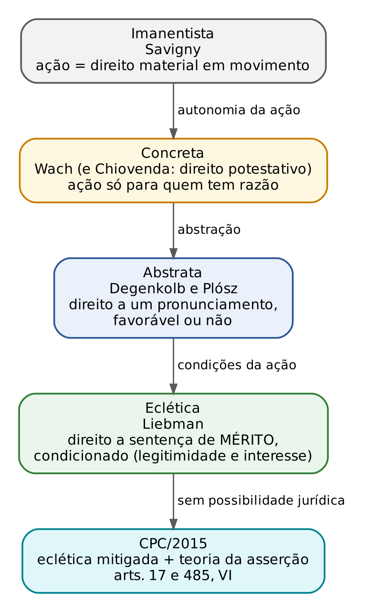
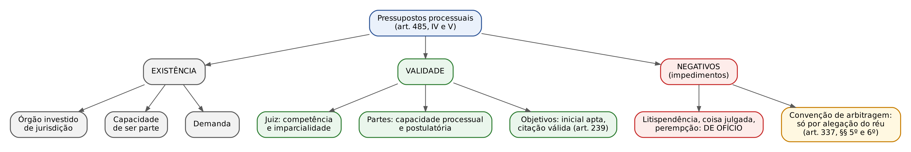
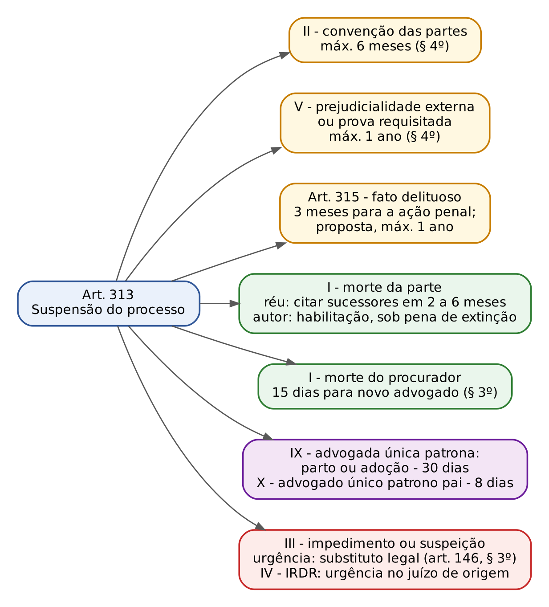
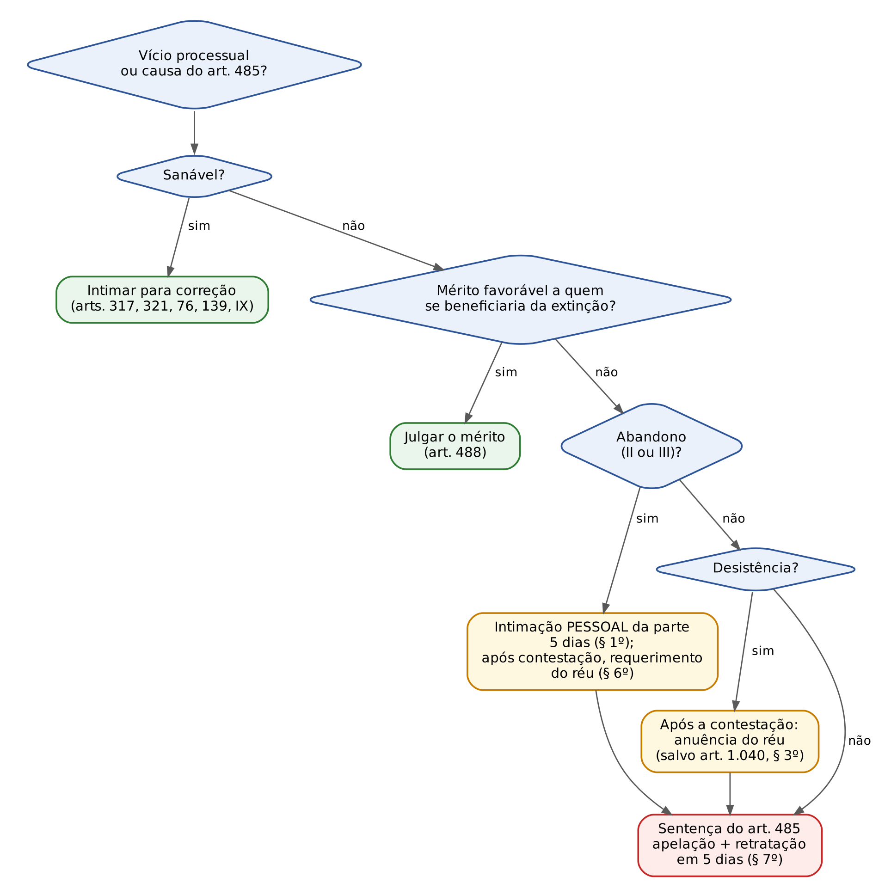
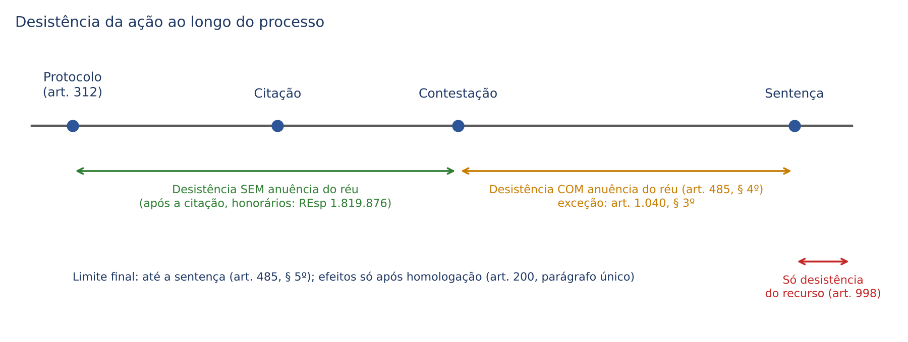

# CAPÍTULO 06 — AÇÃO E PROCESSO: CONDIÇÕES, ELEMENTOS, PRESSUPOSTOS, SUSPENSÃO E EXTINÇÃO

:::INCIDENCIA
TRF5 p. 3; TJRS p. 4 e 8 (formação, suspensão e extinção); TJSC p. 3 e 7 (formação, suspensão, extinção e elementos da demanda). Nível A.
Lote: 25 questões (FGV 17; FCC 8), mais 14 correlatas de outros capítulos.
O que mais cai: arts. 17 a 20 (interesse, legitimidade, substituição processual, declaratória), teoria da asserção, art. 313 (hipóteses e prazos de suspensão) e art. 485 (abandono com intimação pessoal, desistência após a contestação, retratação em 5 dias, perempção).
:::

| Subtema | FGV | FCC | Padrão de cobrança |
|---|---|---|---|
| Condições da ação, asserção e teorias | 6 | 2 | caso de ilegitimidade x improcedência; rol do art. 17 sem possibilidade jurídica; teoria eclética x asserção |
| Ação declaratória e interesse (arts. 19 e 20) | 4 | 2 | declaratória "ainda que tenha ocorrido a violação"; título extrajudicial e ação de conhecimento |
| Substituição processual (art. 18) | 1 | 1 | substituído como assistente LITISCONSORCIAL; "salvo quando autorizado pelo ordenamento jurídico" |
| Elementos da ação, litispendência e coisa julgada | 2 | 0 | tríplice identidade; extinção sem mérito (art. 485, V) |
| Pressupostos processuais | 1 | 1 | ausência impede o mérito; cognição de ofício |
| Suspensão do processo (art. 313) | 2 | 1 | convenção por até 6 meses; impedimento e suspeição; gratuidade não suspende |
| Extinção sem mérito: abandono e desistência | 6 | 4 | intimação pessoal da parte em 5 dias; consentimento do réu após a contestação; art. 1.040, § 3º; retratação |

## 06.1 Ação, demanda e pretensão

A palavra "ação" tem três sentidos que a prova costuma embaralhar. Em sentido constitucional, é o direito fundamental de provocar a jurisdição (art. 5º, XXXV, da CF; art. 3º do CPC), abstrato, autônomo e público, exercido contra o Estado. Em sentido processual, é a demanda: o ato concreto pelo qual alguém afirma uma situação jurídica e pede tutela, delimitando o objeto do processo (partes, causa de pedir e pedido). Em sentido material, é a "ação de direito material" (Pontes de Miranda), o agir do titular para realizar o próprio direito, hoje residual. A distinção resolve questões: a prescrição atinge a pretensão de direito material (art. 189 do CC), e não o direito de ação; por isso a sentença que pronuncia a prescrição é de MÉRITO (art. 487, II), proferida num processo em que o direito de ação foi plenamente exercido.

Pretensão tem dois usos. A pretensão material é o poder de exigir de outrem uma prestação, nascido com a violação do direito (art. 189 do CC); é o que prescreve. A pretensão processual é o pedido deduzido na demanda, o objeto litigioso do processo (o mérito, na linguagem do CPC, que fala em "pretensão formulada na ação ou na reconvenção" no art. 487, III, c). Lide, na concepção de Carnelutti, é o conflito de interesses qualificado por pretensão resistida; o CPC/2015 abandonou o termo "lide" como sinônimo de mérito, e há processo sem lide (jurisdição voluntária, ações necessárias como a anulação de casamento).

O direito de ação é exercido mesmo quando a sentença é de extinção sem resolução do mérito: o Estado prestou jurisdição, ainda que para dizer que não pode julgar o pedido. É esse o ponto que separa as teorias concretistas das abstratas e que a FCC explora nas assertivas sobre teorias (ver 6.2).

:::DICA
Demanda é sempre concreta; o direito de ação é abstrato. Quando a questão fala em "identificação da ação", "elementos da ação" ou "cumulação de ações", ela está usando "ação" no sentido de demanda. Quando fala em "direito de ação incondicionado", está no plano constitucional.
:::

## 06.2 Teorias da ação

| Teoria | Expoentes | Núcleo | Consequência que cai |
|---|---|---|---|
| Imanentista (civilista) | Savigny; CC/1916, art. 75 | ação é o próprio direito material reagindo à violação | não há ação sem direito; não explica a sentença de improcedência nem a declaratória negativa |
| Concreta | Wach | ação autônoma, mas só existe se a sentença for favorável | quem perde não teria tido ação |
| Direito potestativo | Chiovenda | variante concretista: poder de sujeitar o réu aos efeitos da sentença favorável | ação dirigida contra o adversário, não contra o Estado |
| Abstrata | Degenkolb e Plósz | direito público, autônomo e abstrato a um pronunciamento, favorável ou não | basta a provocação; não trabalha com condições da ação |
| Eclética | Liebman | direito abstrato a uma sentença de MÉRITO, condicionado à presença das condições da ação | ausentes as condições, há carência de ação e extinção sem mérito; para Liebman, nem haveria jurisdição propriamente dita |

O CPC/1973 adotou expressamente a eclética (art. 267, VI, com as três condições). O CPC/2015 manteve a lógica (art. 17: "Para postular em juízo é necessário ter interesse e legitimidade"; art. 485, VI), mas suprimiu a expressão "condições da ação" e a possibilidade jurídica do pedido. Daí a leitura dominante em provas: o Código segue uma teoria eclética mitigada, temperada pela teoria da asserção, que a jurisprudência do STJ aplica de forma consolidada. A distinção entre "direito de ação" (incondicionado, sempre exercido) e "exercício regular da ação" (condicionado a interesse e legitimidade) aparece literalmente em enunciados.

:::QUESTAO FCC 2026 — DPE-BA — DEFENSOR PÚBLICO (Q4037466)
Cobrança: identificar a assertiva correta sobre teorias da ação e STJ. Gabarito: E — pela teoria da asserção, as condições são aferidas à luz das afirmações da inicial, em juízo hipotético de veracidade, sem incursão na prova.
Armadilhas: (A) atribui à imanentista a autonomia da ação, que ela nega; (B) a eclética, adotada, "reconhece ter havido direito de ação" mesmo na extinção sem mérito é afirmação ambígua, mas a banca a tratou como incorreta, porque para Liebman só há ação (em sentido estrito) quando presentes as condições; (C) descreve a teoria abstrata como se fosse a concreta; (D) atribui à abstrata exigência de plausibilidade, que é o oposto do seu núcleo.
:::

:::QUESTAO FGV 2025 — TJ-GO — RESIDENTE JURÍDICO (Q3345937)
Cobrança: o enunciado transcreve ementa do STJ segundo a qual a legitimidade se aprecia "à luz da narrativa contida na petição inicial", sem se confundir com o exame do direito material, e pede o nome da teoria. Gabarito: C — teoria da asserção (STJ, AgInt no AgInt no AREsp n. 1.302.429, Relatora Ministra Nancy Andrighi, Terceira Turma, j. 24/8/2020, conforme citado no próprio enunciado).
Armadilha: "teoria da afirmação" (D) é sinônimo doutrinário de asserção (*in statu assertionis*, *prospettazione*), mas a banca exigiu o rótulo usual; substanciação (A) é teoria da causa de pedir (ver 6.4).
:::

## 06.3 Condições da ação no CPC/2015

### 06.3.1 O que mudou e a controvérsia sobre a categoria

O CPC/2015 fez três movimentos: (a) não reproduziu a locução "condições da ação"; (b) eliminou a possibilidade jurídica do pedido, cuja ausência passou a gerar improcedência (o pedido de cobrança de dívida de jogo é julgado improcedente, com coisa julgada material, e não extinto por carência); (c) manteve interesse e legitimidade no art. 17 e no art. 485, VI, em inciso próprio, distinto dos pressupostos processuais do inciso IV.

A doutrina se divide. Fredie Didier Jr. sustenta que a categoria das condições da ação foi eliminada: a legitimidade e o interesse passaram a ser examinados como pressupostos processuais (requisitos de admissibilidade do julgamento do mérito), e a legitimidade extraordinária seria pressuposto de validade, ao passo que a ordinária, por exigir exame da relação material, confundir-se-ia com o mérito. A maior parte da doutrina (e as bancas) mantém as duas condições como categoria autônoma, porque ambas pressupõem contato com a relação de direito material afirmada. A controvérsia é de rótulo: o efeito prático é idêntico, a sentença terminativa do art. 485, VI. Em prova objetiva, a assertiva "o CPC consagrou expressamente legitimidade e interesse como condições da ação, nominando-as como tal" é FALSA (o Código não usa a expressão), e a assertiva "são condições para o regular exercício do direito de ação o interesse processual e a legitimidade *ad causam*" é VERDADEIRA.

:::QUESTAO FGV 2025 — CGE-SP — AUDITOR (Q3781262)
Cobrança: indicar os requisitos que a lei qualifica como condições para o regular exercício do direito de ação. Gabarito: A — interesse processual e legitimidade *ad causam*.
Armadilhas: legitimidade *ad processum* (B e C) é capacidade processual, pressuposto processual de validade (ver 6.8); possibilidade jurídica do pedido (D e E) deixou de ser condição em 2015.
No mesmo sentido: Q3395863 (FGV 2025 — DPE-RO), em que a alternativa A, que repete o rol tríplice do CPC/1973, está errada; Q2524475 (FGV 2024 — TCE-GO), em que a alternativa A, que diz que o Código "nominou" as condições, está errada.
:::

### 06.3.2 Teoria da asserção, momento de aferição e regime

Pela teoria da asserção, legitimidade e interesse são aferidos *in statu assertionis*: o juiz toma por verdadeiras, hipoteticamente, as afirmações do autor e verifica se, sendo verdadeiras, aquele autor teria interesse e seria o legitimado em face daquele réu. Se a falta é perceptível pela simples leitura da inicial, há carência (art. 330, II e III, no indeferimento liminar; art. 485, VI, depois). Se a constatação depende de prova, a questão já é de mérito, e a sentença é de improcedência, com aptidão para a coisa julgada material. A lógica é evitar que o réu, vencido na prova, obtenha só uma sentença terminativa que permitiria a repropositura.

:::QUESTAO FGV 2026 — TJ-RJ — ANALISTA JUDICIÁRIO (Q3878290)
Caso: João cobra mútuo de Maria, afirmando que o celebrou em nome próprio; Maria admite o contrato, mas prova que o mutuante foi José, irmão de João.
Passos: (1) na asserção, João afirmou ser o credor: em tese, é legitimado ativo; (2) a descoberta de que o credor era outro dependeu de prova produzida; (3) logo, o tema virou mérito: João não é titular do crédito. Gabarito: B — julgar improcedente o pedido, com resolução do mérito.
Armadilha: as alternativas D e E (ilegitimidade ativa ou passiva) aplicariam a teoria da apresentação (exame em concreto), rejeitada pelo STJ.
:::

Regime: a ausência de legitimidade ou de interesse é matéria de ordem pública, cognoscível de ofício "em qualquer tempo e grau de jurisdição, enquanto não ocorrer o trânsito em julgado" (art. 485, § 3º), e deve ser alegada pelo réu em preliminar (art. 337, XI), mas não preclui para ele se não o fizer. Duas travas, porém:

- Preclusão *pro judicato*: decidida expressamente a questão (por exemplo, rejeitada a preliminar de ilegitimidade no saneamento, sem recurso), o juiz não pode voltar a ela. A Segunda Seção do STJ assentou que as matérias de ordem pública, embora cognoscíveis de ofício, são insuscetíveis de nova deliberação judicial, ante a preclusão *pro judicato*, espécie de preclusão consumativa (STJ, EREsp n. 1.488.048; v. Cap. 11).
- Nos recursos excepcionais, a cognição de ofício pressupõe recurso conhecido e prequestionamento (ver Cap. 43).

:::PEGADINHA
"A falta de interesse processual deve ser alegada na primeira oportunidade, sob pena de ser considerada suprida" é FALSO (FCC 2026, Q4338809, alternativa D): o art. 485, § 3º, permite a cognição de ofício até o trânsito em julgado. O que preclui é a reapreciação depois de decisão expressa (preclusão *pro judicato*), não a alegação omitida.
:::

A sentença terminativa por carência não faz coisa julgada material, mas a repropositura depende da correção do vício (art. 486, § 1º, ver 6.11.6), e a decisão terminativa que impeça nova propositura é rescindível (art. 966, § 2º, I; ver Cap. 40).

### 06.3.3 Interesse processual

Interesse processual é o binômio necessidade e adequação (parte da doutrina fala em utilidade, ou no trinômio necessidade, utilidade e adequação). Necessidade: a tutela jurisdicional é imprescindível para obter o bem da vida, porque não há como obtê-lo sem o Judiciário (pretensão resistida ou exigência legal de intervenção judicial, como nas ações constitutivas necessárias). Adequação: a via processual eleita é apta a produzir o resultado buscado. Utilidade: o provimento pode melhorar a situação jurídica do autor.

Pontos cobrados:

- Ação meramente declaratória: o interesse do autor pode limitar-se à declaração da existência, da inexistência ou do modo de ser de uma relação jurídica, ou da autenticidade ou falsidade de documento (art. 19), e "É admissível a ação meramente declaratória, ainda que tenha ocorrido a violação do direito" (art. 20). A violação não elimina o interesse na mera declaração: o autor pode preferir a certeza jurídica à condenação. Súmula 181 do STJ: é admissível ação declaratória para obter certeza quanto à exata interpretação de cláusula contratual. Não cabe declaratória de fato (salvo a autenticidade ou falsidade de documento) nem de interpretação de lei em tese.
- Título executivo extrajudicial e ação de conhecimento: "A existência de título executivo extrajudicial não impede a parte de optar pelo processo de conhecimento, a fim de obter título executivo judicial" (art. 785). Não há falta de interesse-adequação (ver Cap. 24).
- Prévio requerimento administrativo: não é exceção à inafastabilidade, e sim exigência de interesse (necessidade). O STF, no Tema 350 da repercussão geral, fixou que a concessão de benefício previdenciário depende de requerimento do interessado, não se caracterizando ameaça ou lesão antes da apreciação pelo INSS ou do excesso de prazo legal, sem exigir exaurimento das vias administrativas e dispensando o requerimento quando o entendimento da Administração for notória e reiteradamente contrário à postulação (ver Apostila de Direito Previdenciário, Cap. 20). O STJ alinhou-se (Tema 660 do STJ). Em contraste, o Tema 1.373 da repercussão geral fixou que a ação para reconhecimento de isenção de imposto de renda por doença grave e repetição do indébito NÃO exige prévio requerimento administrativo: onde a lei não estrutura um procedimento de concessão, a resistência é presumida. Em seguro, a Quarta Turma do STJ entendeu que o requerimento administrativo prévio é essencial para aferir o interesse de agir na ação de cobrança da indenização securitária (STJ, AgInt no REsp n. 2.091.602, Relator Ministro Antonio Carlos Ferreira, Quarta Turma, j. 15/9/2025).
- Relações de consumo: a Corte Especial afetou o Tema 1.396 dos repetitivos (REsp n. 2.209.304, Relator Ministro Ricardo Villas Bôas Cueva, afetação em 7/10/2025) para definir se é imprescindível a comprovação da prévia tentativa de solução extrajudicial para caracterizar o interesse de agir nas ações prestacionais de consumo. Nas fontes consultadas até julho de 2026, o tema ainda não havia sido julgado (ver nota de verificação).
- Perda superveniente do interesse: o interesse é aferido também no momento da sentença (fato superveniente, art. 493; ver Cap. 20); o pagamento no curso do processo ou a perda do objeto levam à extinção sem mérito, com honorários pela causalidade (ver Cap. 8).
- Habeas data exige recusa prévia; mandado de segurança contra ato sujeito a recurso administrativo com efeito suspensivo independente de caução é vedado (ver Cap. 32).

:::QUESTAO FGV 2025 — TJ-CE — JUIZ SUBSTITUTO (Q3505777)
Caso: primeira ação pede declaração de que o contrato está sujeito a condição resolutiva, e não a termo final; segunda ação pede condenação embora o autor já tenha título executivo extrajudicial.
Passos: (1) a primeira busca declarar o modo de ser de relação jurídica (art. 19, I): interesse presente; (2) a segunda é opção expressamente admitida pelo art. 785: interesse presente. Gabarito: B — juízo positivo de admissibilidade em ambas.
Armadilha: a alternativa E (emenda para converter em execução) ignora a opção legal do credor.
:::

:::QUESTAO FCC 2026 — PGM MANAUS — PROCURADOR (Q4338809)
Gabarito: E — é admissível a ação meramente declaratória ainda que tenha ocorrido a violação de direito de cunho pecuniário (art. 20).
Armadilhas: (A) a alienação da coisa litigiosa NÃO altera a legitimidade (art. 109, ver 6.3.4); (B) a declaração de falsidade de documento pode ser objeto principal de ação (art. 19, II); (C) o art. 18 ressalva a autorização do ordenamento; (D) ver a PEGADINHA acima.
No mesmo sentido (art. 20): Q3302513 (FCC 2025 — TRT-15), gabarito A; Q2524475 (FGV 2024 — TCE-GO), gabarito D; Q3395863 (FGV 2025 — DPE-RO), alternativas B e C erradas.
:::

:::QUESTAO FGV 2025 — PREFEITURA DE CANAÃ DOS CARAJÁS — PROCURADOR (Q3265476)
Caso: o juiz indeferiu inicial de ação declaratória de ocorrência de ato ilícito contra o Município, por entender inadmissível pretensão meramente declaratória.
Gabarito: C — a sentença é viciada, porque a declaratória é admissível ainda que violado o direito.
Armadilhas: (B) o prazo de retratação na apelação contra indeferimento é de 5 dias (art. 331), não 10; (D) a causa madura (art. 1.013, § 3º, I) exige processo em condições de imediato julgamento, o que não ocorre quando são necessárias provas; (E) não se pode exigir a inclusão de pedido condenatório.
:::

### 06.3.4 Legitimidade *ad causam*: ordinária e extraordinária

Legitimidade é a pertinência subjetiva da demanda: a aptidão para conduzir o processo em que se discute determinada situação jurídica afirmada. A regra é a legitimação ordinária: litiga em nome próprio quem se afirma titular do direito. "Ninguém poderá pleitear direito alheio em nome próprio, salvo quando autorizado pelo ordenamento jurídico" (art. 18). Legitimação extraordinária é a atribuída a quem litiga em nome próprio por direito alheio; substituição processual é a sua expressão mais comum (há quem diferencie, reservando "substituição" para o caso em que o substituto atua sem o substituído, mas a prova trata os termos como sinônimos).

A troca de "lei" (art. 6º do CPC/1973) por "ordenamento jurídico" é a pegadinha central. Ela abriu espaço para a legitimação extraordinária de origem negocial, defendida pela doutrina (Didier) e admitida em enunciado do FPPC: o negócio jurídico pode atribuir a terceiro legitimidade para defender em juízo direito alheio, observados os limites do art. 190 (ver Cap. 11).

| Classificação | Espécies | Exemplo |
|---|---|---|
| Quanto à coincidência com a relação material | ordinária (regra) x extraordinária (art. 18, parte final) | credor cobra o próprio crédito x MP em ação de alimentos de criança |
| Quanto ao número de legitimados | exclusiva x concorrente | ação de anulação de casamento por coação, só pelo coagido x ação coletiva (vários colegitimados) |
| Na concorrente | disjuntiva (cada um age sozinho) x conjuntiva (litisconsórcio necessário) | condômino reivindica o bem comum sozinho (art. 1.314 do CC) x cônjuges em ação real imobiliária (art. 73) |
| Na extraordinária | autônoma (o legitimado age sem o titular) x subordinada (depende da presença do titular) | administradora de consórcio x assistente simples do assistido revel (art. 121, parágrafo único) |

Exemplos de legitimação extraordinária que caem: o Ministério Público na ação de alimentos em favor de criança ou adolescente, independentemente do exercício do poder familiar ou da existência de Defensoria (STJ, REsp n. 1.265.821, Relator Ministro Luis Felipe Salomão, Segunda Seção, j. 14/5/2014, sob o rito dos repetitivos); o alienante da coisa litigiosa (art. 109); o condômino que reivindica a coisa comum de terceiro (art. 1.314 do CC); os legitimados à ação coletiva quanto aos direitos individuais homogêneos (ver Cap. 33); o impetrante do mandado de segurança do art. 3º da Lei 12.016/2009 (ver Cap. 32).

Regime da substituição processual:

- O substituído pode intervir como assistente LITISCONSORCIAL (art. 18, parágrafo único), porque é o titular da relação discutida e será atingido pela coisa julgada (art. 124). Não como assistente simples.
- Coisa julgada: atinge o substituído, salvo regras próprias do processo coletivo (coisa julgada *secundum eventum litis* e *in utilibus*; ver Cap. 34).
- Reconvenção: se o autor for substituto processual, o reconvinte deve afirmar ser titular de direito em face do substituído, e a reconvenção é proposta contra o autor, também na qualidade de substituto (art. 343, § 5º).
- Atos de disposição do direito material (renúncia, reconhecimento, transação) em regra não cabem ao substituto, que não é o titular; a desistência da ação, que é ato processual, é admitida nos limites legais.
- Substituição processual não se confunde com: representação (o representante age em nome alheio por direito alheio; parte é o representado, como a criança representada pela mãe); sucessão processual (troca de parte, como o espólio que sucede o falecido, arts. 108 a 110; ver Cap. 7); e representação processual de associação com autorização expressa dos associados (art. 5º, XXI, da CF; ver Cap. 33).

Exemplo cobrado de substituição superveniente: na alienação da coisa litigiosa sem consentimento da parte contrária, o alienante segue no processo como substituto processual do adquirente, que pode intervir como assistente litisconsorcial (art. 109, §§ 1º e 2º); a FGV cobrou o caso no TJ-SC 2025 (Q3324245, gabarito E) e no TJ-MS 2025 (Q3786348, gabarito D), ambas resolvidas em 07.6.2.

:::QUESTAO FGV 2026 — TCE-PE — ANALISTA (Q4283075)
Caso: sociedade anônima e sua acionista controladora (97% do capital) e administradora ajuízam juntas declaratória sobre o alcance de cláusula de exclusividade de contrato da companhia; a acionista alega que a multa reduziria seus dividendos.
Passos: (1) a sociedade é parte do contrato e há ameaça concreta de cobrança da multa: legitimidade e interesse presentes, inclusive para a mera declaração; (2) a acionista não é parte da relação contratual, e o prejuízo alegado é meramente reflexo; (3) não há norma que lhe atribua legitimação extraordinária. Gabarito: B — a sociedade é legitimada; a acionista é parte ilegítima.
Armadilhas: (A) declaratória não exige violação consumada (art. 20 e ameaça concreta); (D) controle acionário e administração não convertem o sócio em legitimado; a sociedade age por seus órgãos, em representação, e não por substituição.
:::

:::QUESTAO FGV 2026 — NAV BRASIL — ADVOGADO (Q4223061)
Cobrança: ação coletiva de associação em defesa de associados por vícios construtivos. Gabarito oficial: B — o associado pode intervir como assistente litisconsorcial (leitura do art. 18, parágrafo único).
Armadilhas: (A) o art. 18 ressalva a autorização do ordenamento; (C) capacidade postulatória é pressuposto processual, não condição da ação; (E) a legitimidade coletiva não dispensa o interesse.
Observação: no processo coletivo, a intervenção do indivíduo como litisconsorte segue regra própria (art. 94 do CDC, para direitos individuais homogêneos) e a natureza da atuação da associação (representação x substituição) depende da via; ver Cap. 33.
:::

:::DICA
Teses de legitimidade passiva em repetitivos do STJ vistas no Radar e que servem de exemplo de prova: o contribuinte de fato não tem legitimidade para pleitear a restituição do IPI recolhido pelo contribuinte de direito (Tema 173); a Caixa Econômica Federal é a legitimada exclusiva nas ações de correção de saldos do FGTS, excluídos União e bancos depositários (Tema 204; Súmula 249 do STJ); o Banco do Brasil, mero gestor do CCF, não responde pela falta de notificação prévia, que cabe ao banco sacado (Tema 874); o Banco do Brasil é legitimado passivo nas ações sobre desfalques em conta do Pasep (Tema 1.150); o sindicato não tem legitimidade para ACP buscando diferenças de complementação do FUNDEF ou do FUNDEB (Tema 1.408, ver Cap. 33).
:::

Ilegitimidade passiva alegada na contestação abre ao autor a possibilidade de substituir o réu em 15 dias (arts. 338 e 339; ver Cap. 17). Depois da sentença de mérito, porém, não se admite alteração do polo passivo, porque a demanda está estabilizada e encerrada a atividade jurisdicional de primeiro grau (STJ, REsp n. 2.236.487, Relator Ministro Marco Buzzi, Quarta Turma, j. 18/11/2025).

## 06.4 Elementos e identificação das ações

### 06.4.1 Os três elementos

Os elementos identificam a demanda e servem para aferir litispendência, coisa julgada, conexão e continência, para delimitar a congruência da sentença (arts. 141 e 492) e os limites objetivos da coisa julgada.

- Partes: autor e réu, sujeitos parciais da demanda. Para a identificação importa a parte em sentido processual e a qualidade jurídica em que atua; a mesma pessoa física que litiga em nome próprio e, depois, como substituta processual de outrem não é "a mesma parte" para fins de tríplice identidade. Na legitimação extraordinária, o substituído é atingido pela coisa julgada, o que faz a doutrina aceitar a identidade jurídica (e não física) das partes.
- Causa de pedir: os fatos e os fundamentos jurídicos do pedido (art. 319, III). O CPC adota a teoria da substanciação: a causa de pedir é composta pelos fatos jurídicos que dão suporte ao pedido (causa remota, os fatos; causa próxima, a consequência jurídica que deles se extrai). A teoria da individuação (bastaria indicar a relação jurídica) não foi adotada, embora a doutrina a aproxime do regime das ações reais e das relações jurídicas permanentes. Consequência: a qualificação jurídica (o artigo de lei indicado) não vincula o juiz (*iura novit curia*), mas os fatos sim; mudar o fato essencial é mudar a ação.
- Pedido: imediato (o provimento jurisdicional: declaração, constituição, condenação, ordem) e mediato (o bem da vida). Os dois integram a identificação: mesma causa de pedir com pedido imediato diverso (declarar x condenar) gera demandas distintas, ainda que conexas.

Há autores que distinguem causa de pedir ativa (o fato constitutivo do direito) e passiva (o fato que gera o interesse, como o inadimplemento). Em despejo por falta de pagamento, nova ação com o mesmo pedido, mas fundada em outro período de inadimplência, tem causa de pedir remota distinta e não esbarra na coisa julgada da primeira.

### 06.4.2 Tríplice identidade, litispendência e coisa julgada

:::LEI CPC, ART. 337, §§ 1º A 4º
"§ 1º Verifica-se a litispendência ou a coisa julgada quando se reproduz ação anteriormente ajuizada. § 2º Uma ação é idêntica a outra quando possui as mesmas partes, a mesma causa de pedir e o mesmo pedido. § 3º Há litispendência quando se repete ação que está em curso. § 4º Há coisa julgada quando se repete ação que já foi decidida por decisão transitada em julgado."
:::

Ambas levam à extinção SEM resolução do mérito (art. 485, V) e são cognoscíveis de ofício (art. 485, § 3º; art. 337, § 5º). Na litispendência, extingue-se o processo que repete o anterior. Para o réu, a litispendência é efeito da citação válida (art. 240), mas o juiz pode reconhecer a repetição de ofício já ao examinar a inicial, como no caso em que ele próprio conduz o primeiro processo. Identidade parcial não é litispendência: mesmo pedido OU mesma causa de pedir gera conexão (art. 55); identidade de partes e causa de pedir com pedido mais amplo de uma delas gera continência (art. 56). O tratamento de conexão e continência é do Cap. 5.

A teoria da tríplice identidade (*tria eadem*) é insuficiente em algumas situações, e a doutrina invoca a teoria da identidade da relação jurídica: há litispendência quando as duas demandas veiculam a mesma relação jurídica material, ainda que um dos elementos varie formalmente. É o que se vê entre ação coletiva e ação individual (que, pela regra legal, NÃO induzem litispendência: art. 104 do CDC; ver Cap. 34) e entre mandado de segurança e ação ordinária com o mesmo objeto (partes formalmente distintas: autoridade coatora x pessoa jurídica). A jurisprudência admite litispendência nesse último caso, porque o réu, materialmente, é o mesmo.

:::QUESTAO FGV 2026 — TJ-RS — JUIZ LEIGO (Q3978613)
Caso: com a primeira ação em curso, a autora propõe outra, no mesmo juízo, contra a mesma ré, com o mesmo pedido e a mesma causa de pedir.
Gabarito: E — litispendência; extinção do segundo processo sem resolução do mérito (arts. 337, § 3º, e 485, V).
Armadilhas: coisa julgada exige trânsito em julgado (A); continência exige pedido mais amplo (B); não existe "direito de opção" (C); conexão pressupõe identidade apenas parcial (D).
No mesmo sentido: Q2375297 (FGV 2024 — TJ-RJ — Residência), gabarito C (definição legal de ações idênticas); as demais alternativas trocam as definições de litispendência e coisa julgada, dizem que a litispendência leva à resolução do mérito e que a coisa julgada se alega "com o mérito" (é preliminar, art. 337, VII).
:::

:::PEGADINHA
Extinto o primeiro processo sem resolução do mérito (por desistência, por exemplo), a reiteração do pedido NÃO é litispendência nem coisa julgada: é nova ação, que deve ser distribuída por dependência ao juízo do processo extinto, "ainda que em litisconsórcio com outros autores ou que sejam parcialmente alterados os réus da demanda" (art. 286, II). Duas questões de magistratura exploraram o tema: Q2507020 (FGV 2024 — ENAM), gabarito A (o juízo Y deve declinar para o juízo X), e Q3117521 (FGV 2024 — TJ-PE), gabarito D (o conflito negativo suscitado pelo juízo originário deveria ser rejeitado, porque ele é o competente). O desenvolvimento da competência por dependência está no Cap. 5.
:::

## 06.5 Classificação das ações e das tutelas

A classificação útil é a processual, pelo tipo de tutela pretendida (pedido imediato). As classificações pela natureza do direito material (reais x pessoais; mobiliárias x imobiliárias; petitórias x possessórias) seguem relevantes para competência (art. 47), para a outorga do cônjuge (art. 73) e para os procedimentos especiais.

Quanto ao tipo de atividade jurisdicional: conhecimento (certificação, cognição exauriente), execução (satisfação de direito já certificado) e cautelar (asseguração). No CPC/2015 a cautelar perdeu autonomia procedimental: é tutela provisória requerida no próprio processo, em caráter antecedente ou incidental (ver Caps. 14 e 15). O processo sincrético reúne certificação e efetivação na mesma relação processual (cumprimento de sentença).

Nas ações de conhecimento, duas classificações disputam espaço:

| Espécie | Conteúdo | Efetivação | Prazo extintivo | Detalhes que caem |
|---|---|---|---|---|
| Declaratória | certeza sobre existência, inexistência ou modo de ser de relação jurídica, ou autenticidade ou falsidade de documento (art. 19) | autossuficiente: não exige execução | imprescritível (não veicula pretensão a prestação) | cabe ainda que violado o direito (art. 20); efeitos *ex tunc*; Súmula 181 do STJ; reconvenção em ação declaratória é admissível (Súmula 258 do STF; v. Cap. 17) |
| Constitutiva (positiva ou negativa) | cria, modifica ou extingue situação jurídica; tutela direito potestativo | autossuficiente | decadência, quando a lei fixar prazo | efeitos em regra *ex nunc* (há exceções, como a anulação do negócio jurídico); constitutivas necessárias exigem o Judiciário (anulação de casamento, interdição) |
| Condenatória | certifica o direito a uma prestação e impõe a sanção | exige cumprimento (sub-rogação) | prescrição da pretensão | forma título executivo (art. 515, I) |
| Mandamental | ordem ao réu, efetivada por coerção indireta | multa, prisão civil do devedor de alimentos, crime de desobediência | conforme a pretensão | mandado de segurança; obrigações de fazer com *astreintes* (ver Cap. 23) |
| Executiva *lato sensu* | efetivação por sub-rogação no próprio processo, sem execução autônoma | atos materiais do Estado | conforme a pretensão | despejo, reintegração de posse, entrega de coisa (art. 538) |

A teoria trinária (declaratória, constitutiva, condenatória) é a tradicional; a quinária, de Pontes de Miranda, acrescenta mandamental e executiva *lato sensu*, partindo da eficácia preponderante de cada sentença (toda sentença tem cargas de todas as eficácias, em graus diversos). Com o sincretismo e a atipicidade dos meios executivos (art. 139, IV; arts. 497 e 536), a distinção entre condenatória, mandamental e executiva perdeu parte da utilidade, mas segue útil para separar o que se efetiva por coerção do que se efetiva por sub-rogação.

Ponto de interseção cobrado: o art. 515, I, considera títulos executivos judiciais "as decisões proferidas no processo civil que reconheçam a exigibilidade de obrigação de pagar quantia, de fazer, de não fazer ou de entregar coisa". A sentença declaratória que contenha todos os elementos da obrigação (sujeitos, prestação, exigibilidade) pode, por isso, ser executada, orientação que o STJ já acolhia antes do CPC/2015. Daí a perda de interesse prático na distinção rígida entre declaratória e condenatória quando a declaração certifica obrigação exigível.

Classificação das tutelas quanto ao resultado: tutela preventiva (inibitória, contra a prática, a repetição ou a continuação do ilícito, independentemente de dano e de culpa, art. 497, parágrafo único) x tutela repressiva (remoção do ilícito, ressarcitória); tutela específica x tutela pelo equivalente monetário; tutela definitiva x provisória (satisfativa ou cautelar). Os pormenores estão nos Caps. 14 e 23.

:::EXEMPLO QUAL É A NATUREZA DA AÇÃO?
Ação para declarar a inexistência de débito e cancelar a inscrição em cadastro de inadimplentes: cúmulo de pedido declaratório (inexistência da relação) e de pedido mandamental ou executivo (ordem de exclusão). Ação de rescisão de compromisso de compra e venda com restituição das parcelas: constitutiva negativa (desfaz o contrato) cumulada com condenatória (devolução). Ação de usucapião: declaratória (a sentença reconhece a aquisição originária já consumada). Ação de divórcio: constitutiva negativa, sem prazo, porque o direito potestativo ao divórcio não se sujeita a decadência.
:::

## 06.6 Cumulação de ações

Cumulação de ações é a reunião de mais de uma demanda no mesmo processo. Pode ser subjetiva (pluralidade de partes: litisconsórcio, ver Cap. 9) ou objetiva (pluralidade de pedidos ou de causas de pedir). Na objetiva, o regime de admissibilidade (compatibilidade, mesmo juízo competente, procedimento adequado ou adoção do comum, art. 327) e as espécies de pedido estão no Cap. 16. Aqui interessa a taxonomia, frequente em questões teóricas:

| Espécie | Característica | Exigência de compatibilidade | Exemplo |
|---|---|---|---|
| Própria simples | o autor quer o acolhimento de todos os pedidos, independentes entre si | sim | danos materiais e morais pelo mesmo acidente |
| Própria sucessiva | o segundo pedido só pode ser acolhido se o primeiro o for (prejudicialidade) | sim | investigação de paternidade e alimentos |
| Imprópria subsidiária (eventual) | pedidos em ordem de preferência; o posterior só é examinado se o anterior não puder ser acolhido (art. 326) | não (art. 327, § 3º) | anulação do contrato ou, subsidiariamente, revisão das cláusulas |
| Imprópria alternativa | o autor quer um ou outro, sem preferência (art. 326, parágrafo único) | não | entrega do produto ou devolução do preço |

Não confundir pedido alternativo de cumulação imprópria com o pedido alternativo do art. 325, que decorre de obrigação alternativa (um só pedido, com prestações alternativas). Cumulação ulterior ocorre por reconvenção, aditamento (art. 329), denunciação da lide e ação declaratória incidental de falsidade; a questão prejudicial decidida incidentalmente pode fazer coisa julgada sem pedido (art. 503, § 1º; ver Cap. 21).

Súmula 170 do STJ: compete ao juízo onde primeiro for intentada a ação que cumula pedidos trabalhista e estatutário decidi-la nos limites da sua jurisdição, sem prejuízo do ajuizamento de nova causa, com o pedido remanescente, no juízo próprio. Ela ilustra o limite do requisito da competência comum (art. 327, § 1º, II), cuja falta leva à cisão, e não à extinção total.

## 06.7 Processo: conceito, natureza jurídica e relação processual

### 06.7.1 Conceito e teorias sobre a natureza jurídica

Processo é o método de exercício da jurisdição. Visto de fora, é um conjunto de atos encadeados rumo ao provimento (procedimento); visto por dentro, é o conjunto de situações jurídicas (poderes, deveres, ônus, faculdades) que ligam juiz e partes. As teorias:

| Teoria | Autor | Ideia | Crítica que cai |
|---|---|---|---|
| Contrato | doutrina francesa (séculos XVIII e XIX), de base romana (*litis contestatio*) | processo é acordo das partes de se submeterem à decisão | a sujeição do réu independe da vontade dele |
| Quase contrato | doutrina francesa do século XIX | não sendo contrato, nem delito, seria quase contrato | classificação por exclusão, sem conteúdo |
| Relação jurídica processual | Oskar von Bülow (1868) | relação autônoma, de direito público, entre autor, juiz e réu, com pressupostos próprios (pressupostos processuais) | é a teoria que funda a autonomia da ciência processual e o conceito de pressupostos; prevalece na doutrina brasileira |
| Situação jurídica | James Goldschmidt | não há direitos e deveres, mas expectativas, possibilidades e ônus diante da sentença | contribuiu com a noção de ônus processual; negou a relação jurídica |
| Instituição | Jaime Guasp | processo é instituição, complexo de atividades unificadas por uma ideia comum | vaga |
| Procedimento em contraditório | Elio Fazzalari | processo é a espécie de procedimento em que os interessados participam em simétrica paridade, em contraditório | influente no Brasil (modelo constitucional de processo); critica a relação jurídica como categoria inútil |
| Entidade complexa | doutrina brasileira contemporânea (Dinamarco, Didier) | processo é procedimento animado por relação jurídica, ou ato jurídico complexo de formação sucessiva | síntese adotada pela maioria dos manuais |

Para a prova, a formulação mais segura: o processo é procedimento em contraditório, animado pela relação jurídica processual (Dinamarco), e é instrumento da jurisdição.

### 06.7.2 Relação jurídica processual

Características: autonomia (distinta da relação material, existe mesmo que o autor não tenha o direito), natureza pública (o juiz é sujeito), complexidade (abrange várias situações jurídicas), dinamismo (desenvolve-se progressivamente) e unidade (os atos convergem para o provimento final). Quanto à configuração, discutiu-se se ela é linear (autor x réu, Kohler), angular (autor-juiz e juiz-réu, Hellwig) ou triangular (autor, juiz e réu, com vínculos também entre as partes, Wach). A doutrina brasileira prefere a triangular, porque há deveres recíprocos entre as partes (lealdade e boa-fé, art. 5º; reparação do dano processual, art. 79). A relação se forma em dois momentos: entre autor e juiz com a propositura, e completa-se (angulariza-se ou triangulariza-se) com a citação válida do réu (ver 6.9).

### 06.7.3 Processo e procedimento; espécies

Procedimento é a sequência ordenada de atos; processo é o procedimento acrescido da relação jurídica e do contraditório. A distinção tem relevância constitucional: compete privativamente à União legislar sobre direito processual (art. 22, I, da CF), e concorrentemente à União, aos Estados e ao Distrito Federal legislar sobre "procedimentos em matéria processual" (art. 24, XI, da CF). Por isso o STF invalida leis estaduais que criam recursos, alteram prazos ou disciplinam competência, e admite leis estaduais que apenas organizam a sequência de atos dentro dos limites das normas gerais (ver Cap. 3).

Espécies de processo pelo provimento buscado: de conhecimento e de execução (a cautelar autônoma desapareceu como processo). Procedimentos: comum (que se aplica subsidiariamente aos especiais e ao processo de execução, art. 318, parágrafo único) e especiais, de jurisdição contenciosa e voluntária (Caps. 29 a 31); sumaríssimo dos Juizados (Caps. 36 e 37). O procedimento comum admite flexibilização pelo juiz (art. 139, VI, dilação de prazos e inversão da ordem das provas) e pelas partes (negócios processuais e calendário, arts. 190 e 191; ver Cap. 11), e a cumulação de pedidos com procedimentos diversos aproveita as técnicas diferenciadas compatíveis (art. 327, § 2º).

## 06.8 Pressupostos processuais

### 06.8.1 Conceito e classificação

Pressupostos processuais são os requisitos para que a relação processual exista e se desenvolva validamente até o julgamento do mérito. O CPC os chama de "pressupostos de constituição e de desenvolvimento válido e regular do processo" (art. 485, IV). Não há rol legal; a classificação é doutrinária, e as bancas cobram a distribuição entre existência e validade e entre positivos e negativos.

| Plano | Subjetivos (juiz) | Subjetivos (partes) | Objetivos |
|---|---|---|---|
| Existência | órgão investido de jurisdição | capacidade de ser parte (personalidade judiciária) | demanda (ato inicial de provocação) |
| Validade (positivos) | competência; imparcialidade (ausência de impedimento; a suspeição é vício menos grave) | capacidade processual (*legitimatio ad processum*); capacidade postulatória | petição inicial apta; citação válida (art. 239); respeito ao formalismo |
| Validade (negativos, ou impedimentos processuais) | — | — | inexistência de litispendência, coisa julgada, perempção e convenção de arbitragem |

Notas de controvérsia:

- A citação: para parte da doutrina, é pressuposto de existência do processo em relação ao réu (a sentença proferida sem citação seria inexistente para ele, impugnável por *querela nullitatis* a qualquer tempo); para outra parte, é requisito de validade e de eficácia, porque o processo já existe desde a propositura (art. 312) e a lei fala em "validade" (art. 239). A posição do STJ e o regime da *querela nullitatis* estão no Cap. 13.
- A capacidade postulatória: o ato praticado por quem não é advogado é tratado pelo art. 4º da Lei 8.906/1994 como nulo; o art. 104 do CPC trata o ato de advogado sem procuração como ineficaz em relação ao representado se não ratificado. Há quem a classifique como pressuposto de existência (doutrina mais antiga) e quem a classifique como de validade (dominante).
- Legitimidade e interesse: são pressupostos para os que negam a categoria das condições da ação (ver 6.3.1).
- Convenção de arbitragem e incompetência relativa são pressupostos negativos que NÃO podem ser conhecidos de ofício (art. 337, § 5º); a ausência de alegação da convenção de arbitragem implica renúncia ao juízo arbitral (art. 337, § 6º).

### 06.8.2 Regime de controle e primazia do mérito

Regra: a ausência de pressuposto processual leva à extinção sem resolução do mérito (art. 485, IV e V), cognoscível de ofício até o trânsito em julgado (art. 485, § 3º). Três temperamentos derrubam assertivas absolutas:

- Nem toda falta de pressuposto extingue o processo: a incompetência, absoluta ou relativa, gera remessa ao juízo competente (art. 64, § 3º); a incapacidade processual e a irregularidade de representação geram suspensão para correção (art. 76); o impedimento gera remessa ao substituto legal (art. 146).
- O juiz deve dar oportunidade de correção: "Antes de proferir decisão sem resolução de mérito, o juiz deverá conceder à parte oportunidade para, se possível, corrigir o vício" (art. 317), e lhe incumbe determinar o suprimento de pressupostos processuais e o saneamento de outros vícios (art. 139, IX). O art. 317 é a projeção da primazia do mérito (art. 4º) e da vedação da decisão surpresa (art. 10; ver Cap. 1).
- Mérito favorável ao beneficiário do vício: "Desde que possível, o juiz resolverá o mérito sempre que a decisão for favorável à parte a quem aproveitaria eventual pronunciamento nos termos do art. 485" (art. 488). Exemplo: réu não citado validamente, mas o pedido é manifestamente improcedente; julga-se improcedente, sem anular nada. É o princípio do prejuízo (*pas de nullité sans grief*; ver Cap. 13).

A ordem lógica de exame segue a das preliminares do art. 337, com uma precisão recente do STJ: a impugnação ao valor da causa é questão processual preliminar, cuja análise deve preceder a extinção do processo sem julgamento do mérito, porque repercute nos honorários (STJ, REsp n. 2.169.414; v. Cap. 2).

:::QUESTAO FCC 2026 — TJ-CE — OFICIAL DE JUSTIÇA (Q4240015)
Cobrança: ação em que, verificadas as condições da ação e a regularidade da relação processual, surge questão prejudicial externa. Gabarito: D — a ausência de pressupostos processuais impede o exame do mérito, podendo levar à extinção sem resolução do mérito.
Armadilhas: a prejudicial externa NÃO paralisa automaticamente o processo; exige decisão de suspensão (art. 313, V, a), limitada a 1 ano (B); a prejudicial pode ser objeto de outro processo (C); mérito é o objeto litigioso, não as preliminares (E).
:::

## 06.9 Formação do processo

:::LEI CPC, ART. 312
"Considera-se proposta a ação quando a petição inicial for protocolada, todavia, a propositura da ação só produz quanto ao réu os efeitos mencionados no art. 240 depois que for validamente citado."
:::

O processo começa por iniciativa da parte (inércia, art. 2º) e se forma de modo progressivo. Com o protocolo, há processo entre autor e juiz: a ação está proposta, o juízo fica prevento pelo registro ou distribuição (art. 59), e podem ser praticados atos sem o réu (indeferimento da inicial, improcedência liminar, tutela provisória *inaudita altera parte*). Com a citação válida, a relação se completa em relação ao réu e se produzem os efeitos do art. 240: litispendência, litigiosidade da coisa e constituição em mora (ressalvados os arts. 397 e 398 do CC). A interrupção da prescrição é efeito do despacho que ordena a citação, retroativo à data da propositura (art. 240, § 1º), desde que o autor adote as providências para a citação em 10 dias (§ 2º), sem prejuízo pela demora imputável ao serviço judiciário (§ 3º); a regra vale para a decadência (§ 4º). O regime da citação e da teoria da aparência é do Cap. 12.

A partir da formação, desenvolve-se o processo por impulso oficial (art. 2º), e a demanda se estabiliza: até a citação, o autor altera pedido e causa de pedir livremente; até o saneamento, com consentimento do réu; depois, não mais (art. 329; ver Cap. 16). A estabilização subjetiva segue a mesma lógica: depois da sentença de mérito, não se altera o polo passivo (ver 6.3.4).

:::ATENCAO
A propositura com o protocolo serve, por exemplo, para fixar a competência (*perpetuatio jurisdictionis*, art. 43: "no momento do registro ou da distribuição da petição inicial") e para aferir a tempestividade de prazos de propositura (mandado de segurança, ação rescisória). Os efeitos perante o réu, ao contrário, dependem da citação válida, mesmo ordenada por juízo incompetente (art. 240, *caput*).
:::

## 06.10 Suspensão do processo

### 06.10.1 Hipóteses e prazos

Suspensão é a paralisação temporária da marcha processual, com a relação processual intacta. As hipóteses do art. 313 são cobradas em sua letra:

| Inciso do art. 313 | Hipótese | Prazo ou regra de cessação | Pontos de prova |
|---|---|---|---|
| I | morte ou perda da capacidade processual de qualquer das partes, de seu representante legal ou de seu procurador | até a habilitação (art. 689) ou as providências do § 2º; morte do procurador: 15 dias para constituir outro (§ 3º) | a suspensão opera desde o evento, ainda que o juiz só tome conhecimento depois; os atos posteriores só são anulados se houver prejuízo |
| II | convenção das partes | NUNCA mais de 6 meses (§ 4º); esgotado, o juiz determina o prosseguimento (§ 5º) | não é por tempo indeterminado; a lei não exige motivação |
| III | arguição de impedimento ou de suspeição | o relator declara os efeitos ao receber o incidente (art. 146, § 2º) | na pendência, tutela de urgência requerida ao substituto legal (art. 146, § 3º) |
| IV | admissão de IRDR | até o julgamento do incidente (art. 982, I; prazo de 1 ano, art. 980) | tutela de urgência requerida ao juízo do processo suspenso (art. 982, § 2º) |
| V, a | prejudicialidade externa: a sentença de mérito depende do julgamento de outra causa ou da declaração de relação jurídica objeto principal de outro processo pendente | NUNCA mais de 1 ano (§ 4º) | esgotado o prazo, o juiz prossegue e examina a questão incidentalmente (§ 5º) |
| V, b | sentença dependente de fato ou prova requisitada a outro juízo | NUNCA mais de 1 ano (§ 4º) | carta precatória ou rogatória com efeito suspensivo (art. 377) |
| VI | força maior | enquanto durar | ex.: calamidade que impede o funcionamento do foro |
| VII | questão decorrente de acidentes e fatos da navegação de competência do Tribunal Marítimo | sem prazo legal específico | inciso introduzido no CPC/2015 |
| VIII | demais casos que o Código regula | conforme a regra | ver lista abaixo |
| IX | parto ou concessão de adoção, quando a advogada for a ÚNICA patrona da causa | 30 dias do parto ou da adoção (§ 6º) | depende de certidão ou termo judicial e de notificação ao cliente (Lei 13.363/2016) |
| X | advogado ÚNICO patrono da causa que se tornar pai | 8 dias (§ 7º) | mesmas exigências de prova e notificação ao cliente |

Morte da parte sem ação de habilitação (art. 313, § 2º): falecido o RÉU, o juiz intima o autor para promover a citação do espólio, do sucessor ou dos herdeiros no prazo que designar, de no mínimo 2 e no máximo 6 meses; falecido o AUTOR e sendo transmissível o direito, o juiz intima espólio, sucessor ou herdeiros, pelos meios que reputar adequados, para manifestarem interesse e se habilitarem, sob pena de extinção sem resolução do mérito. Se o direito for intransmissível, a morte leva à extinção (art. 485, IX; ver 6.11). Morte do procurador, ainda que iniciada a audiência de instrução: prazo de 15 dias para constituir novo mandatário; se for o do autor, extinção sem mérito; se for o do réu, prosseguimento à revelia (art. 313, § 3º).

"Demais casos" (inciso VIII), espalhados pelo Código: incapacidade processual ou irregularidade de representação (art. 76); instauração do incidente de desconsideração da personalidade jurídica, salvo quando requerida na inicial (art. 134, §§ 2º e 3º; ver Cap. 9); reconhecimento da repercussão geral (art. 1.035, § 5º) e afetação de repetitivo (art. 1.037, II), ambos de abrangência nacional; prejudicialidade criminal (art. 315); habilitação (art. 689); oposição oferecida depois do início da audiência (art. 685, parágrafo único; ver Cap. 29); hipóteses de suspensão da execução (art. 921; ver Cap. 26).

Prejudicialidade criminal: se o conhecimento do mérito depender de verificação da existência de fato delituoso, o juiz PODE (faculdade) suspender o processo até o pronunciamento da justiça criminal (art. 315); se a ação penal não for proposta em 3 meses, contados da intimação do ato de suspensão, cessa o efeito, e o juiz cível examina incidentemente a questão (§ 1º); proposta, a suspensão dura no máximo 1 ano (§ 2º). A independência relativa das instâncias (art. 935 do CC) explica a faculdade.

### 06.10.2 Efeitos da suspensão

:::LEI CPC, ART. 314
"Durante a suspensão é vedado praticar qualquer ato processual, podendo o juiz, todavia, determinar a realização de atos urgentes a fim de evitar dano irreparável, salvo no caso de arguição de impedimento e de suspeição."
:::

- Atos urgentes: permitidos, salvo na arguição de impedimento ou suspeição, porque o juiz recusado não pode atuar; a urgência vai ao substituto legal (art. 146, § 3º). No IRDR, a urgência vai ao juízo do processo suspenso (art. 982, § 2º).
- Atos praticados durante a suspensão são, em regra, ineficazes ou nulos, salvo ausência de prejuízo (ver Cap. 13).
- Prazos: suspende-se o curso do prazo nas hipóteses do art. 313, restituindo-se por tempo igual ao que faltava (art. 221). Não se confundem com a interrupção (que devolve o prazo integral, como nos embargos de declaração, art. 1.026).
- Tutela provisória: "Salvo decisão judicial em contrário, a tutela provisória conservará a eficácia durante o período de suspensão do processo" (art. 296, parágrafo único).
- Prescrição: interrompida pela citação, a prescrição só recomeça do último ato do processo para a interromper (art. 202, parágrafo único, do CC); na execução, a suspensão por falta de bens penhoráveis deflagra a contagem da prescrição intercorrente (art. 921, §§ 1º e 4º; ver Cap. 26).

:::QUESTAO FGV 2025 — TCE-PE — PROCURADOR (Q3592165)
Caso: depois da contestação e da reconvenção, as partes informam que negociam um acordo e pedem a suspensão.
Gabarito: C — a suspensão convencional é possível, mas por no máximo 6 meses (art. 313, II, e § 4º).
Armadilhas: (A) não há suspensão por tempo indeterminado; (B) e (D) a convenção independe de fase e de motivação e prestigia a autocomposição (art. 3º, § 3º); (E) mesmo suspenso, admitem-se atos urgentes (art. 314).
Correlata de magistratura: Q3301241 (FGV 2025 — TJ-SE — Juiz Substituto), gabarito B — na execução, as partes podem convencionar a suspensão até o cumprimento voluntário do acordo, sem perda de interesse do exequente (art. 922; ver Cap. 26).
:::

:::QUESTAO FCC 2025 — TRT-15 — ANALISTA JUDICIÁRIO (Q3295850)
Cobrança: qual evento NÃO suspende o processo. Gabarito: E — pedido de gratuidade formulado depois da primeira manifestação da parte na instância, que se faz por petição simples e "não suspenderá seu curso" (art. 99, § 1º; ver Cap. 8).
Armadilha: (D) a morte de um dos autores em litisconsórcio facultativo também suspende o processo (art. 313, I fala em "qualquer das partes").
No mesmo sentido: Q2375298 (FGV 2024 — TJ-RJ — Residência), gabarito D (arguição de impedimento ou suspeição); erradas: advogado que se torna pai sem ser o único patrono (A), incidente de arguição de inconstitucionalidade (B), prazo de "um mês" para citar o espólio (C, o prazo é de 2 a 6 meses) e concessão de tutela provisória (E).
:::

Tutela provisória durante a suspensão: conserva a eficácia, salvo decisão em contrário, e pode ser revogada a qualquer tempo por decisão fundamentada (art. 296 e parágrafo único); cobrado na Q4079382 (FGV 2026, PGE-AC, gabarito C) e na Q4223062 (FGV 2026, NAV Brasil, gabarito C), resolvidas no Cap. 14.

## 06.11 Extinção do processo

### 06.11.1 Disposições gerais

"A extinção do processo dar-se-á por sentença" (art. 316). A sentença pode ser terminativa (art. 485, sem resolução do mérito) ou definitiva (art. 487, com resolução do mérito: acolhimento ou rejeição do pedido, prescrição e decadência, homologação de reconhecimento, transação ou renúncia; ver Cap. 20). No processo sincrético, a sentença não extingue o processo, que prossegue no cumprimento; o conceito de sentença do art. 203, § 1º, combina conteúdo (arts. 485 e 487) e função (põe fim à fase cognitiva ou extingue a execução). Se a extinção atinge só parte do processo (um dos pedidos, um dos litisconsortes, a reconvenção), o pronunciamento é decisão interlocutória, impugnável por agravo de instrumento (art. 354, parágrafo único; ver Cap. 42).

Antes da sentença terminativa, o dever de prevenção: o juiz deve dar à parte oportunidade de corrigir o vício, se possível (art. 317), e resolverá o mérito sempre que a decisão favorecer a parte a quem aproveitaria a extinção (art. 488).

### 06.11.2 Hipóteses do art. 485

| Inciso | Hipótese | De ofício (§ 3º)? | Intimação pessoal prévia? | Nova ação exige correção do vício (art. 486, § 1º)? |
|---|---|---|---|---|
| I | indeferimento da petição inicial (art. 330; ver Cap. 16) | sim, no exame da inicial | não; há emenda prévia em 15 dias (art. 321) | sim |
| II | processo parado por mais de 1 ano por negligência das partes (abandono bilateral) | sim | sim, das partes, para suprir a falta em 5 dias (§ 1º) | não |
| III | autor que, por não promover atos e diligências que lhe incumbem, abandona a causa por mais de 30 dias (abandono unilateral) | sim, se não houver contestação; depois dela, só a requerimento do réu (§ 6º) | sim, da parte, em 5 dias (§ 1º) | não, mas três abandonos geram perempção (art. 486, § 3º) |
| IV | ausência de pressupostos de constituição e de desenvolvimento válido e regular | sim | não (mas há o art. 317) | sim |
| V | perempção, litispendência ou coisa julgada | sim | não | na litispendência, sim |
| VI | ausência de legitimidade ou de interesse processual | sim | não (art. 317) | sim |
| VII | convenção de arbitragem acolhida ou reconhecimento da competência pelo juízo arbitral | NÃO (art. 337, § 5º) | não | sim |
| VIII | homologação da desistência da ação | não se aplica | não | não |
| IX | morte da parte, sendo a ação intransmissível por disposição legal | sim | não | não se aplica |
| X | demais casos previstos no Código | conforme a regra | conforme a regra | conforme a regra |

Exemplos do inciso X: não constituição de novo advogado pelo autor em 15 dias após a morte do procurador (art. 313, § 3º); não regularização da capacidade ou da representação pelo autor (art. 76, § 1º, I); não promoção da citação do litisconsorte necessário no prazo assinado (art. 115, parágrafo único); não habilitação dos sucessores do autor falecido (art. 313, § 2º, II).

Intransmissibilidade (inciso IX): ações personalíssimas, em que o direito se extingue com a morte do titular (divórcio, em regra; interdição; alimentos quanto à prestação futura do alimentando). Se o direito é transmissível, há sucessão (art. 110) e suspensão (art. 313, I).

### 06.11.3 Abandono da causa

Os dois abandonos exigem intimação PESSOAL da parte (não do advogado) para suprir a falta em 5 dias (art. 485, § 1º), porque a sanção recai sobre a parte, que pode desconhecer a inércia de seu procurador. É a positivação da Súmula 216 do STF, segundo a qual a absolvição de instância por paralisação exigia prévia intimação do autor. Custas: no abandono bilateral, rateio proporcional; no unilateral, o autor paga despesas e honorários (art. 485, § 2º).

:::LEI CPC, ART. 485, § 6º, E SÚMULA 240 DO STJ
"Oferecida a contestação, a extinção do processo por abandono da causa pelo autor depende de requerimento do réu." A Súmula 240 do STJ ("A extinção do processo, por abandono da causa pelo autor, depende de requerimento do réu") foi positivada com o recorte temporal: antes da contestação, o juiz extingue de ofício.
:::

A lógica do § 6º: depois de contestar, o réu tem direito à sentença de mérito, que lhe dá a coisa julgada de improcedência; o juiz não pode presumir que ele prefira uma sentença terminativa. Pela mesma razão, a desistência depende do seu consentimento (6.11.4).

Na Defensoria Pública, a regra se combina com o art. 186, § 2º: a requerimento da Defensoria, o juiz determina a intimação pessoal da parte patrocinada quando o ato depender de providência ou informação que somente por ela possa ser realizada ou prestada. A intimação da Defensoria não substitui a intimação pessoal da parte exigida pelo § 1º.

:::QUESTAO FGV 2025 — TJ-TO — JUIZ SUBSTITUTO (Q3453239)
Caso: autor patrocinado pela Defensoria não apresenta réplica; o juiz intima a Defensoria para dar andamento e, sem resposta, extingue por abandono. A Defensoria apela 20 dias úteis após sua intimação pessoal.
Passos: (1) não apresentar réplica não é "deixar de promover ato que incumbe ao autor" capaz de paralisar o processo: a réplica é ônus cuja omissão só preclui; (2) de todo modo, faltou a intimação pessoal da PARTE (art. 485, § 1º) e o requerimento do réu, já que havia contestação (§ 6º); (3) a apelação é tempestiva, porque a Defensoria tem prazo em dobro (art. 186): 30 dias úteis; (4) interposta a apelação contra sentença do art. 485, o juiz pode retratar-se em 5 dias (§ 7º). Gabarito: D — sentença errada; a apelação deve ser provida, caso o juiz não se retrate.
:::

:::QUESTAO FGV 2024 — TJ-PE — JUIZ SUBSTITUTO (Q3117515)
Caso: o juiz manda a Defensoria juntar documento que só o assistido pode fornecer; a Defensoria pede a intimação pessoal do assistido; o juiz recusa e, decorridos 30 dias, extingue o processo.
Passos: (1) o pedido da Defensoria tinha base legal (art. 186, § 2º), e o abandono exige intimação pessoal da parte (art. 485, § 1º); (2) o interesse recursal existe, embora a sentença terminativa não impeça a repropositura, porque a apelação proporciona resultado mais útil (aproveitamento do processo e afastamento da condenação em despesas); (3) o juízo de origem não faz juízo de admissibilidade da apelação (art. 1.010, § 3º), mas pode se retratar (art. 485, § 7º). Gabarito: D — o tribunal deve conhecer da apelação e dar-lhe provimento.
:::

:::QUESTAO FCC 2024 — PREFEITURA DE JABOATÃO DOS GUARARAPES — PROCURADOR (Q3542111)
Gabarito: C — a extinção por abandono deve ser precedida de intimação pessoal para suprimento da falta em 5 dias.
Armadilhas: o prazo do abandono bilateral é de mais de 1 ano e decorre de negligência das partes, não de fato não imputável a elas (A); o autor perempto pode alegar seu direito em defesa (B, art. 486, § 3º); depois da contestação, depende de requerimento do réu (D); a extinção é sem resolução do mérito (E).
No mesmo sentido: Q3870732 (FGV 2026 — TJ-RJ — Analista), gabarito A; erradas: conhecimento de pressupostos e condições só por arguição do réu (B), repropositura condicionada a alterar a causa de pedir (C; o que se exige é corrigir o vício nos incisos I, IV, VI e VII), desistência sem consentimento após a contestação (D) e vedação de retratação (E).
:::

### 06.11.4 Desistência da ação

Desistência é ato unilateral do autor que abre mão do processo, não do direito. Requisitos e regime:

- Momento: "pode ser apresentada até a sentença" (art. 485, § 5º). Depois da sentença, o que resta é a desistência do RECURSO, que não depende de anuência do recorrido nem dos litisconsortes (art. 998), ou a renúncia ao direito. Pelo parágrafo único do art. 998, na redação da Lei 15.484/2026, a desistência do recurso não impede a análise de questão cuja repercussão geral ou cuja relevância da questão de direito federal infraconstitucional já tenha sido reconhecida, nem daquela objeto de julgamento de recursos repetitivos (v. Cap. 43).
- Consentimento do réu: "Oferecida a contestação, o autor não poderá, sem o consentimento do réu, desistir da ação" (art. 485, § 4º). O marco é a CONTESTAÇÃO, e não a citação. Se o réu foi citado e ainda não contestou, a desistência independe de anuência (mas gera honorários, ver abaixo). A recusa do réu, segundo a orientação do STJ, deve ser fundamentada; oposição sem motivo legítimo pode ser superada pelo juiz (ver nota de verificação).
- Exceção do art. 1.040: publicado o acórdão paradigma de recurso repetitivo, a parte pode desistir da ação em primeiro grau, antes da sentença, se a questão for idêntica à resolvida, INDEPENDENTEMENTE de consentimento do réu, ainda que já apresentada a contestação (§§ 1º e 3º); se a desistência ocorrer antes da contestação, a parte fica isenta de custas e honorários (§ 2º).
- Homologação: "A desistência da ação só produzirá efeitos após homologação judicial" (art. 200, parágrafo único).
- Poderes especiais: o advogado precisa de poder específico para desistir, assim como para renunciar ao direito (art. 105).
- Honorários e despesas: pagos pela parte que desistiu (art. 90). O STJ entendeu que, havendo desistência após a citação e antes da contestação, são devidos honorários pela regra geral do art. 85, § 2º, porque a isenção do art. 1.040, § 2º, só se aplica no microssistema dos repetitivos (STJ, REsp n. 1.819.876, Relator Ministro Ricardo Villas Bôas Cueva, Terceira Turma, j. 5/10/2021). Ver Cap. 8.
- Autonomia da reconvenção: "A desistência da ação ou a ocorrência de causa extintiva que impeça o exame de seu mérito não obsta ao prosseguimento do processo quanto à reconvenção" (art. 343, § 2º).
- Execução: o exequente pode desistir de toda a execução ou de alguma medida; extinguem-se a impugnação e os embargos que versem apenas sobre questões processuais (com custas e honorários pelo exequente); nos demais casos, a extinção dos embargos ou da impugnação depende da concordância do embargante ou impugnante (art. 775). Não há regra de consentimento para a desistência da execução em si.
- IRDR: a desistência ou o abandono do processo não impede o exame do mérito do incidente (art. 976, § 1º).
- Mandado de segurança: o STF admite a desistência a qualquer tempo, mesmo depois da sentença de mérito e sem anuência da autoridade ou da pessoa jurídica (ver Cap. 32 e a nota de verificação).

| Critério | Desistência da ação | Renúncia ao direito (art. 487, III, c) | Desistência do recurso (art. 998) |
|---|---|---|---|
| Objeto | o processo | a pretensão material | o recurso interposto |
| Sentença | terminativa (art. 485, VIII) | definitiva, com coisa julgada material | não há sentença: transita a decisão recorrida |
| Anuência da parte contrária | após a contestação, sim (salvo art. 1.040, § 3º) | não | não |
| Momento | até a sentença | a qualquer tempo, inclusive em grau de recurso | até o julgamento do recurso |
| Repropositura | admitida (art. 486), distribuída por dependência (art. 286, II) | vedada pela coisa julgada | não se aplica |
| Poderes especiais (art. 105) | sim | sim | sim |

:::QUESTAO FGV 2026 — PGE-AC — PROCURADOR DO ESTADO (Q4079391)
Caso: ação contra o Estado (medicamento); o Estado contesta; antes do saneamento, o autor desiste.
Gabarito: E — após a contestação, a desistência depende do consentimento do réu, ainda que formulada antes da sentença (art. 485, §§ 4º e 5º).
Armadilhas: o limite temporal da sentença (§ 5º) não dispensa o consentimento (A); não há exigência de anuência do MP (B); a recusa do réu não autoriza extinção "com resolução do mérito por perda superveniente do interesse" (C), figura que, aliás, seria sem mérito; nada obriga o processo a ir até a sentença de mérito por envolver saúde (D).
No mesmo sentido: Q3179545 (FGV 2025 — TRF3 — Juiz Federal), em que a alternativa "a desistência da ação pode ser apresentada a qualquer tempo" está errada (limite: até a sentença).
:::

:::QUESTAO FGV 2024 — PREFEITURA DE VITÓRIA — PROCURADOR (Q3044227)
Caso: antes da citação, o autor desiste; o Município ingressa espontaneamente e condiciona a desistência à renúncia ao direito; o juiz homologa.
Gabarito: A — acertou o juiz: antes da contestação, a desistência independe do consentimento do réu. O ingresso espontâneo supre a citação (art. 239, § 1º), mas não equivale a contestação.
Armadilha: confundir citação com contestação (B e D), ou supor que o autor desiste sem consentimento até a sentença (E).
:::

:::QUESTAO FCC 2024 — PGE-GO — PROCURADOR DO ESTADO (Q2654944)
Gabarito: E — publicado o acórdão paradigma de repetitivo contrário ao pedido, o autor pode desistir até a sentença, independentemente do consentimento do réu, ainda que contestada a ação (art. 1.040, §§ 1º e 3º).
Armadilhas: (A) a desistência do mandado de segurança não se limita ao momento da sentença; (B) a desistência ou o abandono não impedem o exame do mérito do IRDR (art. 976, § 1º); (C) a desistência da execução pode exigir concordância do embargante quando os embargos versarem mérito (art. 775, parágrafo único, II); (D) o marco é a contestação, não a citação.
:::

:::QUESTAO FCC 2024 — PREFEITURA DE JABOATÃO DOS GUARARAPES — PROCURADOR (Q3542116)
Gabarito: A — a desistência não obsta o prosseguimento quanto à reconvenção (art. 343, § 2º).
Armadilhas: (B) depende do consentimento após a contestação; (C) extinção sem resolução do mérito; (D) depende de homologação (art. 200, parágrafo único); (E) pode ser apresentada até a sentença.
No mesmo sentido (autonomia da reconvenção): Q3179542 (FGV 2025 — TRF3 — Juiz Federal), alternativa D errada; Q3049350 (FGV 2024 — TJ-SC — Juiz Substituto), alternativa B errada; Q3870733 (FGV 2026 — TJ-RJ), alternativa D errada; Q3386985 (FCC 2025 — DPE-RS), alternativa D errada (a extinção da ação principal por falta de pressuposto não retira o interesse na reconvenção). A reconvenção em si é tratada no Cap. 17.
:::

:::PEGADINHA
Desistência parcial em relação a um dos réus antes da citação dele, com redesignação de audiência: o prazo de contestação do réu já citado conta da intimação da decisão que homologou a desistência (art. 335, § 2º). Foi o caso de Q3966651 (FGV 2026 — TJ-GO — Juiz Substituto), gabarito D; o desenvolvimento está no Cap. 17.
:::

### 06.11.5 Efeitos da sentença terminativa e repropositura

:::LEI CPC, ART. 486
"O pronunciamento judicial que não resolve o mérito não obsta a que a parte proponha de novo a ação. § 1º No caso de extinção em razão de litispendência e nos casos dos incisos I, IV, VI e VII do art. 485, a propositura da nova ação depende da correção do vício que levou à sentença sem resolução do mérito. § 2º A petição inicial, todavia, não será despachada sem a prova do pagamento ou do depósito das custas e dos honorários de advogado. § 3º Se o autor der causa, por 3 (três) vezes, a sentença fundada em abandono da causa, não poderá propor nova ação contra o réu com o mesmo objeto, ficando-lhe ressalvada, entretanto, a possibilidade de alegar em defesa o seu direito."
:::

A sentença terminativa produz só coisa julgada formal, mas o § 1º cria um efeito vinculativo próprio: corrigido o vício, a nova ação é admissível; não corrigido, a nova inicial deve ser extinta. Há aí um efeito que vai além da mera coisa julgada formal (a doutrina discute se seria coisa julgada sobre a questão processual), e por isso o art. 966, § 2º, I, admite rescisória contra decisão terminativa que impeça nova propositura (ver Cap. 40). Na coisa julgada (inciso V), a repropositura é vedada, pela própria natureza do fenômeno. O pagamento das custas e honorários como condição de despacho da nova inicial (art. 486, § 2º) reproduz o art. 92, aplicável quando a extinção se deu a requerimento do réu.

Perempção: é a perda do direito de demandar o réu sobre o mesmo objeto depois de três extinções por abandono (unilateral) imputáveis ao autor. O direito material não se extingue: o autor perempto pode alegá-lo em defesa (por exemplo, em compensação ou como matéria de contestação em ação movida pelo antigo réu). A perempção é pressuposto processual negativo, preliminar de contestação (art. 337, V) e cognoscível de ofício.

Perempção na prática de prova: três extinções anteriores por abandono e quarta ação com a mesma causa de pedir configuram perempção (art. 486, § 3º), e não coisa julgada (falta sentença de mérito) nem litispendência (falta processo em curso) — Q3345942 (FGV 2025, TJ-GO, gabarito D), resolvida no Cap. 17; correlata: Q2486007 (FGV 2024, AL-SC, gabarito A), em que a perempção é preliminar de contestação e a "nulidade da dívida" é defesa de mérito.

### 06.11.6 Recurso, retratação e julgamento pelo tribunal

Contra a sentença terminativa cabe apelação, e "o juiz terá 5 (cinco) dias para retratar-se" (art. 485, § 7º), em qualquer das hipóteses do art. 485. A retratação é exceção ao art. 494 (inalterabilidade da sentença publicada). Paralelos: retratação no indeferimento da inicial (art. 331, também 5 dias) e na improcedência liminar (art. 332, § 3º, 5 dias); ver Cap. 16. Não retratando, o juiz manda processar o recurso, sem juízo de admissibilidade (art. 1.010, § 3º). No tribunal, reformada a sentença fundada no art. 485, se o processo estiver em condições de imediato julgamento, o tribunal decide desde logo o mérito (art. 1.013, § 3º, I, causa madura; ver Cap. 41).

:::SENTENCA EXTINÇÃO SEM RESOLUÇÃO DO MÉRITO (MODELOS DE DISPOSITIVO)
Desistência após contestação, com anuência do réu: "Ante o exposto, HOMOLOGO a desistência da ação, com a anuência do réu, e JULGO EXTINTO o processo, sem resolução do mérito, com fundamento no art. 485, VIII, do Código de Processo Civil. Condeno o autor ao pagamento das custas e de honorários advocatícios de 10% sobre o valor atualizado da causa (arts. 85, § 2º, e 90 do CPC). Prossiga-se quanto à reconvenção (art. 343, § 2º)."
Abandono unilateral após contestação: "Intimado pessoalmente para dar andamento ao feito em 5 dias (evento X), o autor quedou-se inerte, e o réu requereu a extinção (evento Y). Ante o exposto, JULGO EXTINTO o processo, sem resolução do mérito, com fundamento no art. 485, III e §§ 1º e 6º, do CPC, condenando o autor ao pagamento das despesas e de honorários de 10% sobre o valor atualizado da causa (art. 485, § 2º)."
Carência por ilegitimidade aferida na asserção: "Da própria narrativa inicial extrai-se que o autor não é parte do contrato cuja revisão pretende, nem há norma que lhe atribua legitimação extraordinária (art. 18 do CPC). JULGO EXTINTO o processo, sem resolução do mérito, com fundamento no art. 485, VI, do CPC." Se a ilegitimidade só emergir da prova, o dispositivo deve ser de improcedência (art. 487, I).
:::

:::PASSO ROTEIRO PARA A SENTENÇA QUE RECONHECE VÍCIO PROCESSUAL
1. O vício é sanável? Intimar para correção (arts. 317, 321, 76 e 139, IX).
2. O mérito pode ser julgado a favor de quem se beneficiaria da extinção? Julgar o mérito (art. 488).
3. A matéria é cognoscível de ofício? Se não (arbitragem, incompetência relativa), só por alegação do réu.
4. Houve decisão anterior rejeitando a mesma questão? Há preclusão *pro judicato*.
5. Abandono? Intimação pessoal da parte em 5 dias; após a contestação, requerimento do réu.
6. Desistência? Contestação já oferecida exige anuência do réu (salvo art. 1.040, § 3º); verificar poderes especiais e reconvenção pendente.
7. Dispositivo: inciso exato do art. 485, custas e honorários (arts. 85, 90 e 485, § 2º), efeitos para a repropositura (art. 486).
:::

## 06.12 Resumo para revisão pré-prova

| Instituto | Regra | Exceções e detalhes | Fundamento |
|---|---|---|---|
| Direito de ação | abstrato, autônomo, público; exercido mesmo na extinção sem mérito | prescrição atinge a pretensão material, não a ação | art. 5º, XXXV, CF; art. 3º; art. 189 do CC |
| Teoria adotada | eclética mitigada pela asserção | CPC não usa "condições da ação"; possibilidade jurídica virou mérito | arts. 17 e 485, VI |
| Teoria da asserção | condições aferidas pelas afirmações da inicial | se depender de prova, é mérito: improcedência | jurisprudência do STJ |
| Controle das condições | de ofício, em qualquer tempo e grau, até o trânsito | preclusão *pro judicato* após decisão expressa (EREsp 1.488.048) | art. 485, § 3º |
| Interesse | necessidade e adequação (e utilidade) | declaratória ainda que violado o direito; título extrajudicial não impede conhecimento | arts. 19, 20 e 785; Súmula 181 do STJ |
| Prévio requerimento administrativo | exigido onde há procedimento de concessão (benefício previdenciário; seguro, segundo a 4ª Turma) | dispensado quando a Administração notoriamente indefere e na isenção de IR por doença grave (Tema 1.373 RG); consumo pendente (Tema 1.396 STJ) | Tema 350 STF; Tema 660 STJ |
| Legitimidade extraordinária | depende de autorização do ORDENAMENTO jurídico (inclusive negocial, para a doutrina) | substituído intervém como assistente LITISCONSORCIAL | art. 18 e parágrafo único |
| Alienação da coisa litigiosa | não altera a legitimidade; alienante vira substituto | sucessão só com consentimento da parte contrária; adquirente pode ser assistente litisconsorcial; sentença o alcança | art. 109 |
| Reconvenção e substituto | reconvenção contra o autor, também como substituto | reconvinte afirma direito em face do substituído | art. 343, § 5º |
| Elementos da ação | partes, causa de pedir (substanciação), pedido (imediato e mediato) | identidade jurídica das partes | arts. 319, III, e 337, § 2º |
| Litispendência x coisa julgada | repetição de ação em curso x de ação já decidida com trânsito | ambas: extinção sem mérito, de ofício | art. 337, §§ 1º a 4º; art. 485, V |
| Reiteração após extinção sem mérito | distribuição por dependência | ainda que com outros autores ou réus parcialmente alterados | art. 286, II |
| Classificação | trinária (declaratória, constitutiva, condenatória) e quinária (+ mandamental e executiva *lato sensu*) | declaratória imprescritível; constitutiva sujeita a decadência; declaratória de obrigação exigível é título | arts. 19, 20 e 515, I |
| Cumulação | própria (simples, sucessiva) e imprópria (subsidiária, alternativa) | imprópria dispensa compatibilidade | arts. 326 e 327 |
| Natureza do processo | relação jurídica (Bülow) + procedimento em contraditório (Fazzalari) | relação triangular, autônoma, pública, dinâmica | doutrina |
| Processo x procedimento | União legisla sobre processo; competência concorrente sobre procedimentos | — | arts. 22, I, e 24, XI, CF |
| Pressupostos de existência | jurisdição, capacidade de ser parte, demanda | citação: existência ou validade, conforme a corrente | doutrina; art. 239 |
| Pressupostos de validade | competência, imparcialidade, capacidade processual e postulatória, inicial apta, citação válida | negativos: litispendência, coisa julgada, perempção, arbitragem | art. 485, IV e V |
| Controle dos pressupostos | de ofício, salvo arbitragem e incompetência relativa | correção prévia (art. 317); mérito favorável (art. 488) | arts. 337, § 5º, 317, 488 e 139, IX |
| Formação | ação proposta com o protocolo | efeitos do art. 240 para o réu só após citação válida | arts. 312 e 240 |
| Suspensão convencional | até 6 meses | depois, prosseguimento de ofício | art. 313, II, e §§ 4º e 5º |
| Prejudicialidade externa e prova requisitada | até 1 ano | depois, exame incidental | art. 313, V, e §§ 4º e 5º |
| Prejudicialidade criminal | faculdade do juiz | 3 meses para a ação penal; proposta, máximo 1 ano | art. 315 |
| Morte da parte | suspensão; réu: citação dos sucessores em 2 a 6 meses; autor: habilitação sob pena de extinção | morte do procurador: 15 dias para constituir outro | art. 313, I e §§ 2º e 3º |
| Advogada parturiente ou adotante; advogado pai | 30 dias; 8 dias | só se for o ÚNICO patrono; certidão e notificação ao cliente | art. 313, IX e X, §§ 6º e 7º |
| Impedimento e suspeição | suspendem; urgência ao substituto legal | relator declara o efeito do incidente | arts. 313, III, 314 e 146, §§ 2º e 3º |
| Atos na suspensão | vedados, salvo urgentes | nunca pelo juiz arguido de impedimento ou suspeição | art. 314 |
| Tutela provisória na suspensão | conserva a eficácia | salvo decisão em contrário | art. 296, parágrafo único |
| Gratuidade superveniente | petição simples | não suspende o processo | art. 99, § 1º |
| Extinção | sempre por sentença | parcial: interlocutória, agravo | arts. 316 e 354, parágrafo único |
| Abandono | bilateral: mais de 1 ano; unilateral: mais de 30 dias | intimação pessoal da parte em 5 dias; após a contestação, requerimento do réu | art. 485, II, III, §§ 1º, 2º e 6º; Súmula 240 do STJ; Súmula 216 do STF |
| Desistência | até a sentença; após a contestação, com consentimento do réu | repetitivo julgado: sem consentimento (art. 1.040, § 3º); homologação necessária; poderes especiais | arts. 485, §§ 4º e 5º, 200, parágrafo único, 105 e 1.040 |
| Desistência x reconvenção | reconvenção prossegue | também na extinção da ação principal por outro motivo | art. 343, § 2º |
| Desistência na execução | livre | embargos de mérito: concordância do embargante | art. 775 |
| Repropositura | admitida | correção do vício (litispendência e incisos I, IV, VI e VII); custas e honorários pagos | art. 486, §§ 1º e 2º; art. 92 |
| Perempção | três abandonos: vedada nova ação com o mesmo objeto | direito pode ser alegado em defesa | art. 486, § 3º |
| Retratação | 5 dias após a apelação, em qualquer hipótese do art. 485 | tribunal pode julgar o mérito (causa madura) | arts. 485, § 7º, e 1.013, § 3º, I |

## 06.13 Artigos de lei incidentes

- Constituição Federal: art. 5º, XXXV e XXI; art. 22, I; art. 24, XI.
- CPC: arts. 2º, 3º, 4º, 10, 17 a 20, 43, 59, 76, 90, 92, 99, § 1º, 104, 105, 108 a 110, 115, parágrafo único, 121, 124, 134, 139, IX, 146, 186, § 2º, 200, parágrafo único, 203, 221, 239, 240, 286, II, 295, 296, 312 a 317, 319, III, 321, 325 a 327, 329, 330, II e III, 331, 335, § 2º, 337, 338, 339, 343, §§ 2º e 5º, 354, parágrafo único, 485 a 488, 493, 515, I, 689, 775, 785, 976, § 1º, 980, 982, 998, 1.010, § 3º, 1.013, § 3º, I, 1.035, § 5º, 1.037, II, 1.040.
- Código Civil: arts. 189, 202, parágrafo único, 935, 1.314.
- Lei 8.906/1994: art. 4º.
- Lei 13.363/2016 (inclusão dos incisos IX e X e dos §§ 6º e 7º no art. 313 do CPC).

## 06.14 Julgados, temas e súmulas do capítulo

- Súmula 216 do STF: absolvição de instância por paralisação exige prévia intimação do autor (base do art. 485, § 1º).
- Súmula 240 do STJ: extinção por abandono do autor depende de requerimento do réu (hoje, após a contestação).
- Súmula 181 do STJ: declaratória sobre a exata interpretação de cláusula contratual.
- Súmula 170 do STJ: cumulação de pedidos trabalhista e estatutário; cisão pela competência.
- Tema 350 do STF: prévio requerimento administrativo como interesse de agir no benefício previdenciário.
- Tema 1.373 do STF: isenção de IR por doença grave dispensa requerimento administrativo prévio.
- Tema 660 do STJ: adesão ao Tema 350 do STF.
- Tema 1.396 do STJ (afetado): prévia tentativa de solução extrajudicial nas ações prestacionais de consumo.
- Temas 173, 204, 874, 1.150 e 1.408 do STJ: exemplos de legitimidade em repetitivos.
- AgInt no AgInt no AREsp 1.302.429 (STJ, Terceira Turma, 2020): teoria da asserção.
- AgInt no REsp 2.091.602 (STJ, Quarta Turma, 2025): requerimento prévio na cobrança de seguro.
- REsp 2.236.487 (STJ, Quarta Turma, 2025): não se altera o polo passivo após a sentença de mérito.
- REsp 1.265.821 (STJ, Segunda Seção, 2014): legitimidade extraordinária do MP para alimentos de criança ou adolescente.
- REsp 1.819.876 (STJ, Terceira Turma, 2021): honorários na desistência após a citação e antes da contestação.

Remissões a outros capítulos: citação, teoria da aparência e efeitos do art. 240 (Cap. 12); *querela nullitatis* e nulidades (Cap. 13); petição inicial, emenda, indeferimento e aditamento (Cap. 16); contestação, reconvenção, substituição do réu e Súmula 258 do STF (Cap. 17); EREsp 1.488.048 e preclusão *pro judicato* (Cap. 11); REsp 2.169.414 e impugnação ao valor da causa antes da extinção (Cap. 2); honorários na extinção e gratuidade (Cap. 8); conexão, continência e distribuição por dependência (Cap. 5); coisa julgada e questão prejudicial (Cap. 21); ação rescisória contra decisão terminativa (Cap. 40); legitimidade coletiva e Tema 499 do STF (Cap. 33); mandado de segurança (Cap. 32); prescrição intercorrente (Cap. 26).

:::NOTA NOTAS DE VERIFICAÇÃO
Conferidos na página compilada do Planalto em 5/11/2026: CPC, arts. 16 a 20, 92, 108 a 110, 146, 240, 286, 296, 312 a 317, 327, 329, 337, 343, 485 a 488, 775, 982, 1.037 e 1.040. Conferidos no Planalto em 5/11/2026 (página compilada do CPC e do CC): CPC, arts. 76, 99, § 1º, 115, 134, 139, IX, 186, § 2º, 200, parágrafo único, 221, 239, 331, 335, § 2º, 354, 377, 515, I (citação corrigida para o plural da lei), 685, 689, 785, 976, § 1º, 980, 998 (parágrafo único com redação da Lei 15.484/2026, acrescentado ao texto), 1.010, § 3º, 1.013, § 3º, I, e 1.035, § 5º; CC, art. 189. Sem nova extração, citados com alta segurança: CPC, arts. 2º, 105, 295 e 330; CC, arts. 202 e 935.
Tema 1.396 do STJ: afetação vista no Informativo 872 do STJ (Radar); em notas técnicas de julho de 2026 (TJSC, Nota Técnica 13/2026; imprensa especializada) o tema ainda não havia sido julgado; em 5/11/2026, repositório de temas (Trilhante) ainda o indicava sem julgamento. Conferir se houve julgamento antes da prova.
Temas 350 do STF e 1.373 da repercussão geral: conteúdo extraído do Graal TRF6 (Drive); número do RE do Tema 350 não citado.
Sem número visto nesta tarefa (orientações descritas sem número): exigência de motivação da recusa do réu à desistência; desistência do mandado de segurança a qualquer tempo (orientação do STF); executividade da sentença declaratória que reconhece obrigação exigível; litispendência entre mandado de segurança e ação ordinária; enunciado do FPPC sobre legitimação extraordinária negocial.
Gabaritos discutíveis: Q4223061 (a associação, na via ordinária com autorização, atua como representante; a assistência litisconsorcial do art. 18, parágrafo único, pressupõe substituição processual, e o processo coletivo tem regra própria no art. 94 do CDC); Q4037466 (a alternativa B é ambígua; aceitou-se o gabarito E).
Fontes do Drive usadas: Graal TRF6 Processual Civil (trecho de ação e condições, via cópia local do texto extraído do mesmo arquivo); Direito Processual Civil vol. 4 (CP Iuris, 2025), capítulos de ação e processo; Súmulas de Direito Processual Civil; Caderno Dizer o Direito (sem julgados específicos do tema na parte extraída).
:::
