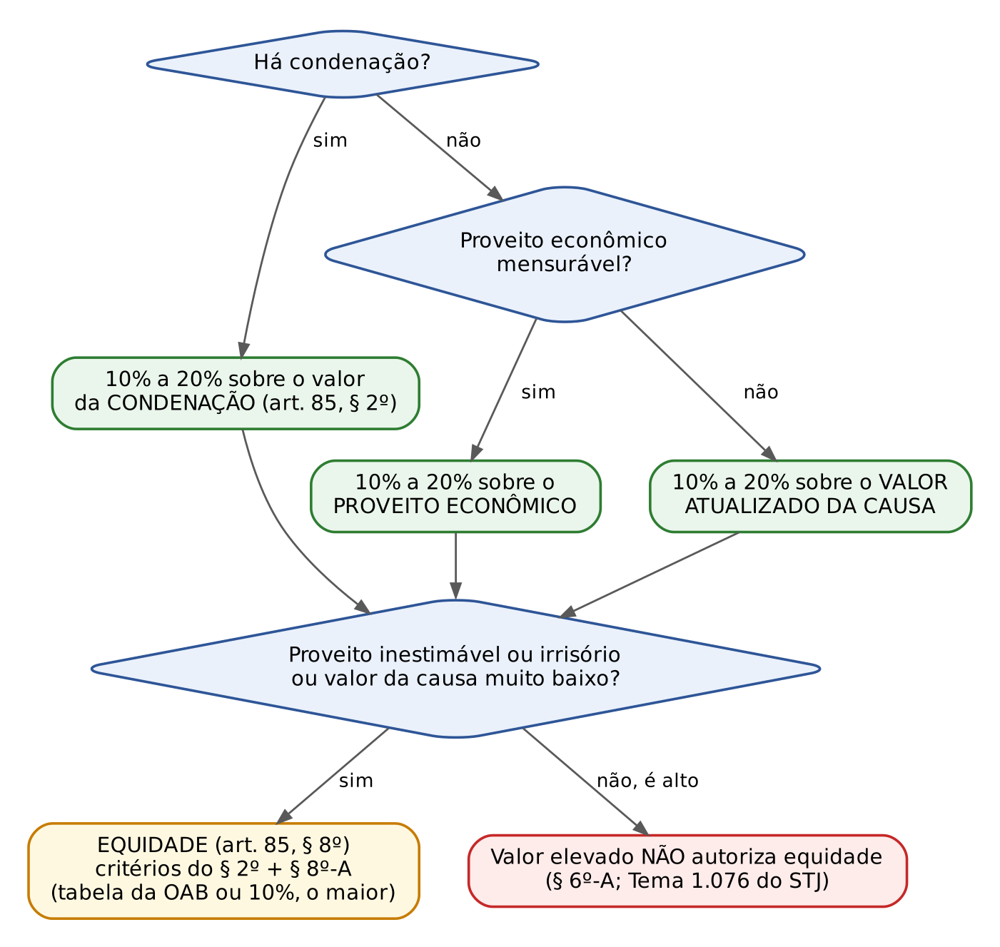
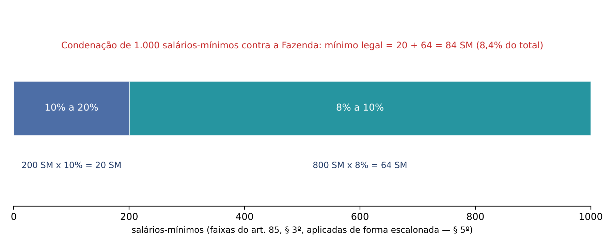
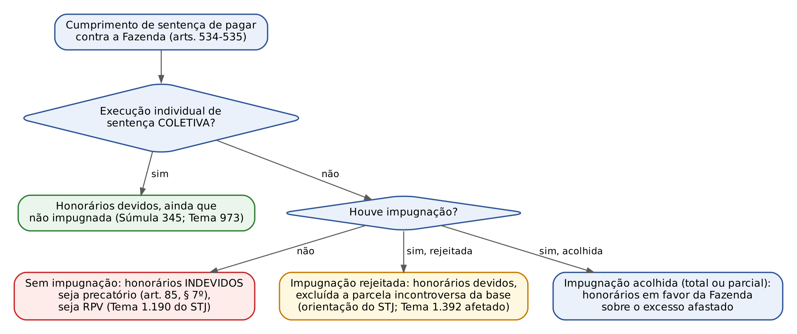
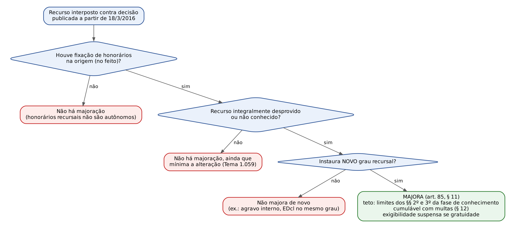
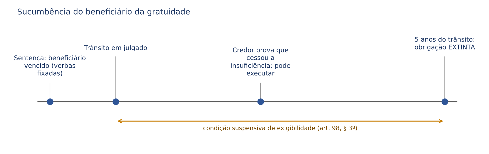
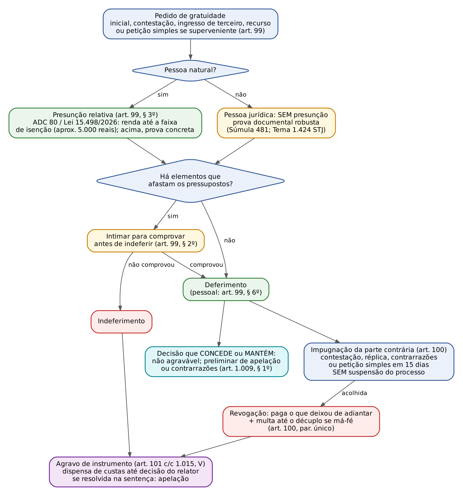

# CAPÍTULO 08 — DESPESAS, HONORÁRIOS, MULTAS E GRATUIDADE DA JUSTIÇA

:::INCIDENCIA
TRF5 p. 4; TJRS p. 5; TJSC p. 4 e 17 (Lei 1.060/1950). Nível A+. Lote: 24 questões (FGV 16, FCC 8), metade de provas de magistratura e Defensoria.
O que mais cai: gratuidade (presunção da pessoa natural x prova da pessoa jurídica, natureza pessoal, impugnação sem incidente, agravo do indeferimento, sucumbência suspensa e multas não abrangidas); base de cálculo e equidade (Temas 1.076 e 1.313 do STJ); honorários contra a Fazenda (faixas escalonadas, art. 85, § 7º, Tema 1.190); honorários recursais (Tema 1.059); causalidade (art. 85, § 10).
:::

#### Mapa de cobrança

| Subtema | FGV | FCC | Padrão |
|---|---|---|---|
| Gratuidade: requisitos, presunção, pessoa jurídica, extensão subjetiva | 5 | 1 | caso concreto com indeferimento por critério objetivo, PJ com declaração do contador, litisconsorte e sucessor |
| Gratuidade: impugnação, revogação e recurso | 3 | 3 | "incidente apartado?" (não); agravo do indeferimento; dispensa de preparo até o relator |
| Gratuidade: efeitos da sucumbência e multas | 1 | 3 | letra do art. 98, §§ 2º a 4º (5 anos; multas não abrangidas) |
| Base de cálculo, equidade e § 8º-A | 4 | 0 | saúde contra o Poder Público, improcedência de dano moral, exclusão de sócio |
| Fazenda Pública (faixas, § 7º) e Defensoria | 1 | 1 | escalonamento; honorários à Defensoria contra o próprio ente |
| Natureza, titularidade, causalidade, compensação, causa própria | 2 | 1 | ENAM: § 10 (perda do objeto) e § 18 (ação autônoma) |
| Honorários recursais | 1 | 1 | Tema 1.059; mandado de segurança |
| Redução abaixo do mínimo (monitória, execução) | 1 | 0 | arts. 701 e 827, § 1º |
| Adiantamento de custas pelo advogado (Lei 15.109/2025) | 1 | 0 | art. 82, § 3º |

## 08.1 O custo do processo: despesas, custas e o regime de adiantamento

### 08.1.1 Conceitos que a banca troca

O CPC usa "despesas" como gênero (art. 84): custas dos atos do processo, indenização de viagem, remuneração do assistente técnico e diária de testemunha, a que se somam honorários periciais, emolumentos e demais gastos. Custas e taxa judiciária têm natureza de TAXA (tributo vinculado à prestação do serviço judiciário), por isso dependem de lei do ente (Lei 9.289/1996 na Justiça Federal; leis estaduais de custas e emolumentos em SC e RS). Honorários advocatícios de sucumbência NÃO são despesas: o art. 85 os trata em separado, e a separação tem consequência prática, porque a lei frequentemente diferencia (por exemplo, art. 90, § 3º, dispensa só as "custas processuais remanescentes"; art. 82, § 3º, dispensa o advogado de adiantar "custas processuais").

| Verba | Natureza | Credor | Quem adianta | Quem paga ao final |
|---|---|---|---|---|
| Custas e taxa judiciária | tributo (taxa) | Estado ou União | quem pratica ou requer o ato (art. 82) | o vencido (reembolso, art. 82, § 2º) |
| Honorários periciais | remuneração do auxiliar | perito | quem requereu a perícia; rateio se de ofício ou requerida por ambos (art. 95) | o vencido |
| Assistente técnico | remuneração | assistente | cada parte (art. 95) | o vencido reembolsa (art. 84) |
| Honorários de sucumbência | direito autônomo, alimentar | advogado do vencedor (art. 85, § 14) | não há adiantamento | o vencido |
| Multas processuais | sanção | parte contrária ou Estado (tabela em 08.1.5) | não há | o sancionado, mesmo beneficiário da gratuidade |

### 08.1.2 O dever de adiantar (art. 82)

:::LEI CPC, ART. 82
Art. 82. Salvo as disposições concernentes à gratuidade da justiça, incumbe às partes prover as despesas dos atos que realizarem ou requererem no processo, antecipando-lhes o pagamento, desde o início até a sentença final ou, na execução, até a plena satisfação do direito reconhecido no título.
§ 1º Incumbe ao autor adiantar as despesas relativas a ato cuja realização o juiz determinar de ofício ou a requerimento do Ministério Público, quando sua intervenção ocorrer como fiscal da ordem jurídica.
§ 2º A sentença condenará o vencido a pagar ao vencedor as despesas que antecipou.
§ 3º Nas ações de cobrança por qualquer procedimento, comum ou especial, bem como nas execuções ou cumprimentos de sentença de honorários advocatícios, o advogado ficará dispensado de adiantar o pagamento de custas processuais, e caberá ao réu ou executado suprir, ao final do processo, o seu pagamento, se tiver dado causa ao processo. (Incluído pela Lei nº 15.109, de 2025)
:::

- Regra: quem realiza ou requer o ato adianta. Atos determinados DE OFÍCIO ou a requerimento do MP FISCAL da ordem jurídica: adianta o AUTOR (§ 1º), e não o MP, nem o réu. Perícia determinada de ofício, porém, segue a regra especial do art. 95 (rateio).
- O § 2º impõe condenação ao reembolso independentemente de pedido (pedido implícito, art. 322, § 1º; ver Cap. 16). A sentença omissa quanto às despesas comporta embargos de declaração.
- Desistência e extinção sem mérito a requerimento do réu: o autor não pode repropor a ação sem pagar ou depositar as despesas e os honorários a que foi condenado (art. 92). É pressuposto processual negativo de validade da nova demanda (ver Cap. 6).
- Atos adiados ou repetidos sem justo motivo: as despesas ficam com quem deu causa, seja parte, auxiliar, MP, Defensoria ou o próprio JUIZ (art. 93). O dispositivo é aplicação direta da causalidade (08.2).
- Assistente vencido o assistido: paga custas proporcionais à atividade exercida (art. 94). Honorários do assistente e contra ele: ver Cap. 9.
- Jurisdição voluntária: o requerente adianta e as despesas são rateadas entre os interessados (art. 88); juízos divisórios sem litígio: proporcionalmente aos quinhões (art. 89). Havendo litígio, volta a regra da sucumbência.

:::DICA O ART. 82, § 3º, É NOVIDADE DE 2025
A Lei 15.109/2025 inseriu o § 3º: na cobrança de honorários (por qualquer procedimento, comum ou especial) e na execução ou cumprimento de sentença de honorários, o ADVOGADO não adianta custas; o réu ou executado as paga AO FINAL, se tiver dado causa ao processo. Não é gratuidade (o advogado não precisa alegar insuficiência), é diferimento legal do adiantamento, semelhante ao da Fazenda (art. 91). O STJ já estendeu a lógica ao preparo recursal e às custas das pesquisas patrimoniais eletrônicas nessas demandas (Informativo 904 do STJ, dois julgados: o advogado fica dispensado de adiantar o preparo e as pesquisas via sistemas eletrônicos submetem-se ao regime de custas, pagas ao final por quem deu causa).
:::

:::QUESTAO FGV 2025 — TRT 24ª REGIÃO — OFICIAL DE JUSTIÇA (Q3349685)
Caso: advogado ajuíza cobrança de honorários contratuais sem pedir gratuidade nem recolher custas; o que faz o juiz antes da citação?
Gabarito: B — determinar a citação, pois o advogado está dispensado de adiantar custas, cabendo ao réu supri-las ao final se tiver dado causa ao processo (art. 82, § 3º).
Armadilha: as alternativas A e C aplicam o art. 290 (cancelamento da distribuição por falta de custas), que pressupõe dever de recolher; D sugere gratuidade de ofício (vedada sem pedido: ver 08.8.6); E inverte o ônus, mandando o réu recolher já na citação.
:::

### 08.1.3 Caução do autor não residente (art. 83)

O autor, brasileiro OU estrangeiro, que reside fora do Brasil ou deixa de residir no país durante o processo presta caução suficiente às custas e aos honorários da parte contrária, se não tiver no Brasil bens IMÓVEIS que assegurem o pagamento. O critério é a residência, não a nacionalidade. Dispensas (§ 1º, rol que a FCC cobra literalmente): (I) acordo ou tratado internacional de que o Brasil faça parte; (II) execução fundada em título extrajudicial e cumprimento de sentença; (III) reconvenção. Desfalcada a garantia, cabe pedido de reforço justificado (§ 2º). A entrada em vigor posterior de tratado com dispensa impõe a liberação da caução já prestada (Enunciado 4 da I Jornada de Direito Processual Civil do CJF).

:::PEGADINHA CAUÇÃO DO ART. 83 X GRATUIDADE
A caução do art. 83 não é "despesa adiantada"; mas o rol do art. 98, § 1º, VIII, isenta o beneficiário dos depósitos legais para propor ação e praticar atos inerentes à defesa. Por isso a doutrina majoritária admite que a gratuidade dispense a caução do autor não residente. Já a caução exigida como CONTRACAUTELA na tutela provisória (art. 300, § 1º) não é automaticamente dispensada pela gratuidade: o STJ exige demonstração da absoluta impossibilidade de prestá-la (Informativo de Jurisprudência n. 26, Edição Extraordinária, do STJ). O próprio art. 300, § 1º, ressalva a dispensa para a parte "economicamente hipossuficiente" que não puder oferecê-la (ver Cap. 14).
:::

### 08.1.4 Perícia: adiantamento, Fazenda, MP, Defensoria e beneficiário da gratuidade

- Regra (art. 95): cada parte adianta o seu assistente técnico; o perito é adiantado por quem requereu a perícia, ou RATEADO quando determinada de ofício ou requerida por ambas as partes. O juiz pode exigir depósito prévio, corrigido e liberado na forma do art. 465, § 4º (até 50% no início; o restante ao final, entregue o laudo e prestados os esclarecimentos).
- Atos requeridos pela Fazenda, pelo MP ou pela Defensoria: pagos AO FINAL pelo vencido (art. 91, caput). Perícias por eles requeridas: realizadas por entidade pública ou, havendo previsão orçamentária, adiantadas por quem requereu; sem previsão no exercício, pagas no exercício seguinte ou ao final pelo vencido (art. 91, §§ 1º e 2º). O STJ sistematizou a ordem: (I) verificar a possibilidade de entidade pública; (II) havendo previsão orçamentária, adiantamento pela instituição requerente; (III) sem previsão, pagamento no exercício seguinte ou ao final pelo vencido (Informativo 879 do STJ).
- A Fazenda, quando parte, deposita previamente os honorários do perito (Súmula 232 do STJ, lida com o art. 91, § 1º), e na ACP do MP o adiantamento recai sobre a Fazenda a que o MP se vincula (Tema 510 do STJ); ambos desenvolvidos no Cap. 19. Prerrogativas da Fazenda e do MP: ver Cap. 27 e Apostila de Direito Administrativo, Cap. 26.
- Beneficiário da gratuidade responsável pela perícia (art. 95, § 3º): (I) perícia por servidor do Judiciário ou órgão público conveniado, custeada pelo orçamento do ente; ou (II) perito particular pago com recursos da União, do Estado ou do DF, pelo valor da tabela do tribunal ou, na omissão, do CNJ. Após o trânsito, o juiz oficia a Fazenda para executar o valor contra quem foi condenado nas despesas; se o condenado for beneficiário, aplica-se a suspensão do art. 98, § 2º e § 3º (art. 95, § 4º). É VEDADO usar o fundo de custeio da Defensoria (§ 5º).
- A limitação da responsabilidade do Estado ao valor da tabela (art. 95, § 3º, II) não exclui do sucumbente beneficiário o ônus da verba pericial remanescente, cuja exigibilidade fica suspensa (Jurisprudência em Teses, ed. 150, tese 9).

:::QUESTAO FGV 2024 — TJ-SC — JUIZ SUBSTITUTO (Q3049352)
Caso: autor beneficiário, assistido pela Defensoria, contra Município; perícia requerida pelo autor; procedência parcial. A alternativa C dizia que os honorários do perito foram adiantados pelo Estado-membro e seriam ressarcidos pelo Município ao final.
Gabarito oficial: A (iliquidez da sentença impede dispensar a remessa necessária — ver Cap. 20). A alternativa C é FALSA porque o art. 95, § 3º, não impõe automaticamente ao Estado-membro o adiantamento: depende de a perícia ser feita por servidor ou órgão público ou paga com recursos orçamentários pela tabela; e a cobrança posterior se faz por execução da Fazenda contra o condenado nas despesas (§ 4º), não por "ressarcimento" automático.
Armadilha: misturar a sistemática do art. 91 (atos requeridos pela Fazenda, MP e Defensoria) com a do art. 95, § 3º (beneficiário da gratuidade). No caso, quem requereu foi o autor beneficiário, não a Defensoria como instituição.
:::

### 08.1.5 Multas processuais: destino e relação com a gratuidade

O CPC distingue sanções que revertem à PARTE (reparam o dano processual) e sanções que revertem ao ESTADO ou à UNIÃO (protegem a dignidade da jurisdição). O art. 96 dá a regra geral: sanções ao litigante de má-fé revertem à parte contrária; as impostas a serventuários pertencem ao Estado ou à União. O art. 97 autoriza a criação de fundos de modernização do Judiciário para onde vão as sanções destinadas aos entes. O conteúdo das condutas (arts. 77 a 81) é desenvolvido no Cap. 7; aqui interessa o destino, o teto e a interação com a gratuidade.

| Multa | Teto | Destino | Fundamento |
|---|---|---|---|
| Ato atentatório (descumprir decisão, criar embaraço, inovar ilegalmente) | até 20% do valor da causa; valor irrisório ou inestimável: até 10 salários-mínimos | União ou Estado (fundo do art. 97); inscrição em dívida ativa se não paga | art. 77, §§ 2º a 5º |
| Litigância de má-fé | superior a 1% e inferior a 10% do valor corrigido da causa; valor irrisório ou inestimável: até 10 salários-mínimos | parte contrária | arts. 81 e 96 |
| Citação por edital requerida com dolo | 5 salários-mínimos | citando | art. 258 |
| Ausência injustificada à audiência do art. 334 | até 2% da vantagem pretendida ou do valor da causa | União ou Estado | art. 334, § 8º |
| Ato atentatório na execução | até 20% do valor atualizado do débito | exequente | art. 774, parágrafo único |
| Revogação da gratuidade por má-fé | até o décuplo das despesas | Fazenda estadual ou federal; dívida ativa | art. 100, parágrafo único |
| Agravo interno manifestamente inadmissível ou improcedente (unânime) | 1% a 5% do valor atualizado da causa | agravado | art. 1.021, § 4º |
| Embargos de declaração protelatórios | até 2%; reiteração: até 10% | embargado | art. 1.026, §§ 2º e 3º |

Os tetos dos arts. 77, 258, 334, 774, 1.021 e 1.026 estão desenvolvidos nos Caps. 7, 12, 16, 25 e 42; aqui servem para a regra comum que interessa à gratuidade.

:::LEI CPC, ART. 98, § 4º
§ 4º A concessão de gratuidade não afasta o dever de o beneficiário pagar, ao final, as multas processuais que lhe sejam impostas.
:::

- A gratuidade NÃO isenta nem suspende multas processuais: multa é sanção, não custo do processo. A expressão "ao final" não cria condição suspensiva semelhante à do § 3º; a multa é exigível como as demais.
- Também NÃO alcança as *astreintes*: são meio coercitivo, e a isenção as esvaziaria (ver Cap. 23).
- A multa do art. 258 (citação por edital dolosa) incide ainda que o autor seja beneficiário da gratuidade.

:::QUESTAO FGV 2024 — TJ-RJ — MEDIADOR JUDICIÁRIO (Q2370330)
Caso: ré beneficiária da gratuidade, assistida por advogado particular, é condenada em indenização e em duas multas, por ato atentatório e por litigância de má-fé.
Gabarito: A — a gratuidade não afasta o dever de pagar, ao final, as multas processuais impostas (art. 98, § 4º).
Armadilhas: B (condição suspensiva de "3 anos": são 5, § 3º); C (a gratuidade compreende os honorários do advogado, § 1º, VI); D (advogado particular não impede o benefício, art. 99, § 4º); E (a redução percentual é expressamente admitida, § 5º).
No mesmo sentido (gratuidade não afasta multas e *astreintes*): Q3324242 (FGV 2025, TJ-SC, Juiz Substituto, gabarito A: citação por edital requerida com dolo pelo beneficiário gera a multa do art. 258 a despeito da gratuidade; resolvida no Cap. 12), Q4240019 (FCC 2026, TJ-CE, alternativa C falsa), Q3390842 (FGV 2025, DPE-PE, alternativa E falsa), Q3058651 (FGV 2024, ENAM, gabarito B: multa do art. 77 inscrita em dívida ativa, sem isenção pela gratuidade), Q3532393 (FGV 2025, MPE-RJ, alternativa D falsa) e Q3086926 (FGV 2024, TJ-MT, alternativa C falsa).
:::

## 08.2 Sucumbência e causalidade

### 08.2.1 Os dois critérios de imputação

O vencido paga (art. 85, caput; art. 82, § 2º): é o princípio da SUCUMBÊNCIA, critério objetivo que dispensa culpa e pedido expresso. Mas a sucumbência é apenas o indício mais frequente de um critério mais amplo, a CAUSALIDADE: responde pelo custo do processo quem lhe deu causa, isto é, quem tornou necessária a atuação jurisdicional ou nela insistiu indevidamente. Quando os dois critérios divergem, prevalece a causalidade. A lei a consagra expressamente em vários pontos:

- Perda do objeto: "os honorários serão devidos por quem deu causa ao processo" (art. 85, § 10).
- Desistência, renúncia e reconhecimento: paga quem desistiu, renunciou ou reconheceu, proporcionalmente se parcial (art. 90, caput e § 1º).
- Atos adiados ou repetidos sem justo motivo (art. 93).
- Nova propositura após extinção sem mérito (art. 92).

:::QUESTAO FGV 2024 — ENAM — 1º EXAME NACIONAL DA MAGISTRATURA (Q2459886)
Cobrado: disciplina legal dos honorários. Gabarito: C — na perda superveniente do interesse de agir, os honorários são devidos por quem deu causa ao processo (art. 85, § 10).
Armadilhas: A (compensação na sucumbência parcial — vedada pelo § 14); B (advogado público não recebe — o § 19 garante, "nos termos da lei"); D (causa própria não gera honorários — o § 17 diz o contrário); E (omissão transitada impede ação autônoma — o § 18 a admite, superando a Súmula 453 do STJ: ver 08.3.2).
No mesmo sentido, quanto à letra dos §§ 14 e 17: Q3542115 (FCC 2024, Procurador de Jaboatão dos Guararapes, gabarito E: natureza alimentar e vedação de compensação; a alternativa A, "sempre pelo autor" na perda do objeto, é falsa pelo § 10).
:::

### 08.2.2 Aplicações jurisprudenciais da causalidade

| Situação | Quem paga | Fonte |
|---|---|---|
| Embargos de terceiro acolhidos | quem deu causa à constrição indevida | Súmula 303 do STJ |
| Embargos de terceiro: comprador que não registrou ou não atualizou o cadastro | o embargante, salvo se o embargado, ciente da transmissão, insistiu na penhora | Tema 872 do STJ (v. Cap. 29) |
| Embargos de terceiro extintos por perda superveniente do objeto | quem deu causa à constrição indevida (art. 85, § 10) | STJ, REsp 2.131.651/PR (Informativo 819) |
| Execução fiscal extinta porque o débito foi quitado extrajudicialmente após o ajuizamento, ainda que antes da citação | o executado | Tema 1.413 do STJ |
| Execução extinta por abandono em razão da não localização de bens penhoráveis | o executado | Informativo 861 do STJ |
| Execução fiscal extinta por cancelamento administrativo da CDA antes da sentença | a Fazenda, por equidade (§ 8º) | Informativo 904 do STJ |
| Execução individual extinta pela procedência de rescisória que desconstituiu o título coletivo | ninguém (sem honorários) | Tema 1.399 do STJ |
| Rescisória procedente para aplicar a modulação do Tema 69 do STF, contestada até 11/9/2024 | sem honorários | Tema 1.419 do STJ |
| Rescisória fundada em erro do Judiciário, sem oposição do réu | sem honorários (falta causalidade) | Informativo 842 do STJ |
| Renúncia ao excedente do teto da RPV após a execução, sem embargos | sem honorários contra a Fazenda | Tema 721 do STJ |
| Curador especial (Defensoria) do réu revel citado por edital na usucapião | sem ônus sucumbenciais pela defesa técnica (não é resistência voluntária) | Informativo de Jurisprudência n. 32 (Edição Extraordinária) do STJ |
| Denunciação da lide sem resistência do denunciado | denunciado não é condenado na sucumbência | Enunciado 159 da III Jornada do CJF |
| Produção antecipada de prova com resistência do requerido | cabem honorários | Enunciado 118 da II Jornada do CJF |
| Cumulação alternativa, acolhido integralmente um dos pedidos | o réu suporta a sucumbência | Enunciado 109 da II Jornada do CJF |

:::EXEMPLO PERDA DO OBJETO: O RACIOCÍNIO EM TRÊS PERGUNTAS
Ação de obrigação de fazer contra plano de saúde; no curso, o plano autoriza a cirurgia e o juiz extingue o processo por perda superveniente do interesse (art. 485, VI). Pergunte: (1) a pretensão era fundada quando ajuizada? (2) a satisfação veio por ato voluntário do réu depois do ajuizamento? (3) houve fato alheio às partes (por exemplo, lei nova)? Respostas sim, sim e não: o réu deu causa e paga custas e honorários (art. 85, § 10). Se a perda decorre de fato superveniente neutro, o juiz examina, em juízo hipotético, quem seria o provável vencido. A extinção sem mérito NÃO afasta os percentuais do § 2º, porque o § 6º manda aplicá-los "inclusive" às sentenças sem resolução de mérito; só cabe equidade se presente hipótese do § 8º.
:::

### 08.2.3 Desistência, renúncia, reconhecimento e transação (art. 90)

:::LEI CPC, ART. 90
Art. 90. Proferida sentença com fundamento em desistência, em renúncia ou em reconhecimento do pedido, as despesas e os honorários serão pagos pela parte que desistiu, renunciou ou reconheceu.
§ 1º Sendo parcial a desistência, a renúncia ou o reconhecimento, a responsabilidade pelas despesas e pelos honorários será proporcional à parcela reconhecida, à qual se renunciou ou da qual se desistiu.
§ 2º Havendo transação e nada tendo as partes disposto quanto às despesas, estas serão divididas igualmente.
§ 3º Se a transação ocorrer antes da sentença, as partes ficam dispensadas do pagamento das custas processuais remanescentes, se houver.
§ 4º Se o réu reconhecer a procedência do pedido e, simultaneamente, cumprir integralmente a prestação reconhecida, os honorários serão reduzidos pela metade.
:::

- Os §§ 2º e 3º tratam de DESPESAS e CUSTAS: a transação silente divide as despesas igualmente e, se anterior à sentença, dispensa as custas REMANESCENTES. Não autorizam fixar honorários abaixo do mínimo; na transação silente, prevalece o entendimento de que cada parte arca com os honorários de seu advogado, salvo disposição em contrário (o direito do advogado ao que já foi fixado em decisão anterior, porém, não pode ser suprimido pelas partes sem sua anuência, art. 24, § 4º, do Estatuto da OAB, quando há título).
- § 4º: redução pela METADE exige reconhecimento E cumprimento integral simultâneo. A I Jornada do CJF estendeu a regra à Fazenda nas obrigações de fazer e não fazer (Enunciado 9). Na execução fiscal e nas causas da Fazenda Nacional, há regra própria: o art. 19, § 1º, I, da Lei 10.522/2002 dispensa honorários quando a Fazenda reconhece a procedência nas hipóteses dos incisos do art. 19; o STJ afirmou que a isenção é RESTRITA aos incisos I a VII, não bastando o mero reconhecimento (Informativo 880 do STJ). A questão foi afetada como repetitivo (Tema 1.454, pendente).
- Desistência de embargos à execução fiscal para aderir a parcelamento: não há nova condenação em honorários quando o programa já inclui a verba honorária (Tema 1.317 do STJ) ou quando incide o encargo do Decreto-lei 1.025/1969 (Tema 400); fora disso, aplica-se a regra geral do art. 90 (Tema 633, sob o CPC/1973). Desenvolvimento: Apostila de Direito Tributário, Caps. 21 e 22.

:::QUESTAO FGV 2026 — TJ-PE — JUIZ SUBSTITUTO (Q4349482)
Cobrado: em quais casos os honorários podem ficar abaixo do mínimo de 10% do art. 85, § 2º: (I) pagamento voluntário e tempestivo na monitória; (II) transação sem disposição sobre honorários antes da sentença; (III) pagamento em até 3 dias na execução por quantia certa.
Gabarito: C (I e III).
Fundamento: (I) na monitória, o mandado de pagamento já fixa honorários de 5% do valor da causa (art. 701, caput), e o réu que cumpre no prazo fica isento de custas (§ 1º); (III) na execução de título extrajudicial, o juiz fixa honorários de 10% ao despachar a inicial, reduzidos pela METADE se o executado pagar integralmente em 3 dias (art. 827, § 1º). (II) é falso: o art. 90, §§ 2º e 3º, cuida da divisão das despesas e da dispensa das custas remanescentes, não de redução de honorários.
Armadilha: confundir o art. 90, § 4º (reconhecimento com cumprimento: metade dos honorários), com a transação do § 2º. Procedimentos: ver Caps. 24 e 29.
:::

## 08.3 Honorários de sucumbência: natureza, titularidade e regime

### 08.3.1 Espécies e natureza

Há três espécies de honorários: contratuais (ajuste com o cliente), arbitrados judicialmente (na falta de ajuste, art. 22, § 2º, do Estatuto da OAB) e sucumbenciais (art. 85 do CPC e art. 23 do Estatuto). O § 20 do art. 85, incluído pela Lei 14.365/2022, manda aplicar aos honorários ARBITRADOS judicialmente os §§ 2º, 3º, 4º, 5º, 6º, 6º-A, 8º, 8º-A, 9º e 10. Os sucumbenciais pertencem ao ADVOGADO (direito autônomo), têm natureza ALIMENTAR e os mesmos privilégios dos créditos trabalhistas (§ 14).

:::LEI CPC, ART. 85, §§ 14 A 19
§ 14. Os honorários constituem direito do advogado e têm natureza alimentar, com os mesmos privilégios dos créditos oriundos da legislação do trabalho, sendo vedada a compensação em caso de sucumbência parcial.
§ 15. O advogado pode requerer que o pagamento dos honorários que lhe caibam seja efetuado em favor da sociedade de advogados que integra na qualidade de sócio, aplicando-se à hipótese o disposto no § 14.
§ 16. Quando os honorários forem fixados em quantia certa, os juros moratórios incidirão a partir da data do trânsito em julgado da decisão.
§ 17. Os honorários serão devidos quando o advogado atuar em causa própria.
§ 18. Caso a decisão transitada em julgado seja omissa quanto ao direito aos honorários ou ao seu valor, é cabível ação autônoma para sua definição e cobrança.
§ 19. Os advogados públicos perceberão honorários de sucumbência, nos termos da lei.
:::

Consequências cobradas da natureza alimentar e da titularidade:

- Vedação de compensação na sucumbência parcial (§ 14). A Súmula 306 do STJ e o Tema 195 (compensação obrigatória), firmados sob o CPC/1973, estão SUPERADOS para honorários fixados na vigência do CPC/2015 (Jurisprudência em Teses, ed. 129, tese 3). Sob o CPC/1973, a gratuidade não impedia a compensação (ed. 150, tese 10): dado histórico que ainda aparece em alternativas. Também não se compensam honorários dos embargos à execução com os da execução, por falta de reciprocidade de créditos (Tema 587).
- Preferência: o STF declarou formalmente constitucional o § 14 quanto à preferência dos honorários, inclusive contratuais, em relação ao crédito tributário, considerando o art. 186 do CTN (Tema 1.220 do STF).
- Penhora: os honorários autorizam penhora de verbas remuneratórias do devedor (Jurisprudência em Teses, ed. 129, tese 1), mas NÃO se enquadram na exceção do art. 833, § 2º (prestação alimentícia em sentido estrito), segundo o Tema 1.153 do STJ, que prevalece sobre o Enunciado 105 da I Jornada do CJF em sentido contrário. O FGTS do devedor não pode ser penhorado para pagar honorários (STJ, REsp 1.913.811/SP, Informativo 825). Detalhes da penhora: Cap. 25.
- Legitimidade concorrente: o advogado executa em nome próprio, mas a parte também tem legitimidade para recorrer do capítulo dos honorários e, se beneficiária da gratuidade, não sofre deserção (Jurisprudência em Teses, ed. 150, tese 13).
- Crédito único e indivisível: os honorários fixados em ação coletiva contra a Fazenda não podem ser fracionados proporcionalmente às execuções individuais para enquadrar cada fração em RPV (Tema 1.142 do STF); é possível, porém, executar os honorários por RPV ainda que o principal siga precatório, se não excederem o limite (Tema 608 do STJ). Regime de precatórios e Súmula Vinculante 47: Cap. 27 e Apostila de Direito Administrativo, Cap. 26.
- Cessão: comprovada a cessão por escritura pública e discriminados os honorários no precatório, o cessionário pode habilitar-se (Tema 2 do STJ).

### 08.3.2 Condenação de ofício, omissão e ação autônoma

- Pedido implícito: a condenação em honorários independe de pedido (Súmula 256 do STF; art. 322, § 1º). Também independe de pedido a condenação em honorários recursais (08.6).
- Omissão: até o trânsito, cabe embargos de declaração. Depois do trânsito, o § 18 admite AÇÃO AUTÔNOMA para definir e cobrar os honorários omitidos, superando a Súmula 453 e o Tema 222 do STJ (que vedavam a cobrança em execução ou ação própria). A doutrina majoritária tem a súmula por superada, e o ENAM cobrou a letra do § 18 (Q2459886, alternativa E falsa).
- Coisa julgada: o valor fixado em sentença transitada não pode ser modificado (Jurisprudência em Teses, ed. 129, tese 11). A remessa necessária devolve ao tribunal também o capítulo dos honorários impostos à Fazenda (Súmula 325 do STJ).
- Juros: honorários em quantia certa vencem juros a partir do trânsito (§ 16). Honorários fixados em percentual sobre o valor da causa são corrigidos desde o ajuizamento (Súmula 14 do STJ). É vedada a fixação em salários-mínimos (Súmula 201 do STJ), o que não impede usar o salário-mínimo como referência de FAIXA no § 3º (que é critério de enquadramento, não indexador).
- Direito intertemporal: o marco para aplicar as regras do CPC/2015 sobre honorários é a data da sentença ou do acórdão que os impõe (Jurisprudência em Teses, ed. 128, tese 1); sentença proferida sob o CPC/1973 não se submete ao art. 85, § 2º (ed. 128, tese 2). O STJ não arbitra originariamente honorários com base no art. 85 quando isso implicar supressão de instância (ed. 128, tese 3).

### 08.3.3 Causa própria, advogado público e partes sem advogado

- Advogado em causa própria: honorários DEVIDOS (§ 17). Não se confundem com a parte que litiga sem advogado onde isso é permitido (Juizado de primeiro grau, art. 55 da Lei 9.099/1995, que tem regra própria: sem custas nem honorários em primeiro grau, salvo litigância de má-fé; ver Cap. 36).
- Advogados públicos: percebem honorários "nos termos da lei" (§ 19). O Plenário do STF reconheceu a constitucionalidade da percepção, observado o teto remuneratório (matéria de Direito Administrativo; o número da ADI não foi conferido nesta tarefa: ver nota).
- Defensoria Pública: recebe honorários, inclusive contra o ente a que pertence (08.9).
- Ministério Público autor de ACP: por SIMETRIA com o art. 18 da LACP, não recebe honorários e só paga se comprovada má-fé (Jurisprudência em Teses, ed. 129, tese 7). A mesma simetria impede condenar a UNIÃO vencida em ACP ao pagamento de honorários, salvo má-fé (Tema 1.177 do STJ; v. Cap. 33). Não há simetria, porém, quando a ACP é ajuizada por associação ou fundação privada: o réu vencido paga honorários (ed. 273, tese 6). Aprofundamento: Cap. 33.

:::QUESTAO FGV 2026 — TJ-BA — JUIZ SUBSTITUTO (Q4083734)
Caso: advogada, em causa própria e com gratuidade, obtém do Estado o fornecimento de medicamento (valor da causa de 200.000 (duzentos mil) reais, custo anual do tratamento); a sentença nega honorários por não haver advogado constituído; ela apela só desse capítulo.
Gabarito: C — provido; são devidos honorários ao advogado em causa própria (art. 85, § 17), fixados por apreciação EQUITATIVA, por se tratar de demanda de saúde contra o Poder Público (Tema 1.313 do STJ; ver 08.4.3).
Armadilhas: B (a gratuidade da vencedora não impede honorários a seu favor; a Súmula 450 do STF já afirmava que são devidos honorários sempre que vencedor o beneficiário); D e E (valor da causa ou proveito econômico: afastados pelo Tema 1.313).
:::

## 08.4 Fixação dos honorários: percentuais, bases de cálculo e equidade

### 08.4.1 A regra geral e a ordem de preferência das bases

:::LEI CPC, ART. 85, §§ 2º E 6º
§ 2º Os honorários serão fixados entre o mínimo de dez e o máximo de vinte por cento sobre o valor da condenação, do proveito econômico obtido ou, não sendo possível mensurá-lo, sobre o valor atualizado da causa, atendidos:
I - o grau de zelo do profissional;
II - o lugar de prestação do serviço;
III - a natureza e a importância da causa;
IV - o trabalho realizado pelo advogado e o tempo exigido para o seu serviço.
§ 6º Os limites e critérios previstos nos §§ 2º e 3º aplicam-se independentemente de qual seja o conteúdo da decisão, inclusive aos casos de improcedência ou de sentença sem resolução de mérito.
:::

- As bases formam uma ordem SUCESSIVA e preferencial (não alternativa à escolha do juiz): (1) valor da CONDENAÇÃO; (2) PROVEITO ECONÔMICO obtido; (3) VALOR ATUALIZADO DA CAUSA, se não for possível mensurar o proveito. Só depois, e só nas hipóteses do § 8º, a EQUIDADE (Jurisprudência em Teses, ed. 129, tese 2; Enunciado 6 da I Jornada do CJF).
- O STJ admite considerar CUMULATIVAMENTE condenação e proveito econômico quando ambos existirem (por exemplo, condenação a pagar e declaração de inexistência de débito): o § 2º não impede a soma das bases (Informativo 875 do STJ).
- Improcedência: o proveito econômico do réu vencedor é, em regra, o que deixou de pagar (o valor pretendido); se não mensurável, aplica-se o valor da causa. A sentença sem mérito também segue os percentuais (§ 6º). Antes do CPC/2015, nas demandas declaratórias, o STJ admitia fixação em valor fixo (Tema 347); a orientação está superada pela ordem do § 2º e pelo § 6º-A.
- Ato ilícito contra a pessoa (indenização com pensão): o percentual incide sobre as prestações VENCIDAS mais 12 VINCENDAS (§ 9º). Nas ações previdenciárias, os honorários não incidem sobre as prestações vencidas após a sentença (Súmula 111 do STJ, mantida pelo Tema 1.105); e o pagamento administrativo do benefício após a citação não reduz a base de cálculo (Tema 1.050). Ver Apostila de Direito Previdenciário, Cap. 20.
- Os critérios dos incisos I a IV servem para graduar o percentual DENTRO da faixa; não autorizam ultrapassar os limites. A fixação abaixo de 10% sem amparo legal é nula por violação do § 2º.

### 08.4.2 Equidade: hipóteses taxativas, § 6º-A e § 8º-A

:::LEI CPC, ART. 85, §§ 6º-A, 8º E 8º-A
§ 6º-A. Quando o valor da condenação ou do proveito econômico obtido ou o valor atualizado da causa for líquido ou liquidável, para fins de fixação dos honorários advocatícios, nos termos dos §§ 2º e 3º, é proibida a apreciação equitativa, salvo nas hipóteses expressamente previstas no § 8º deste artigo.
§ 8º Nas causas em que for inestimável ou irrisório o proveito econômico ou, ainda, quando o valor da causa for muito baixo, o juiz fixará o valor dos honorários por apreciação equitativa, observando o disposto nos incisos do § 2º.
§ 8º-A. Na hipótese do § 8º deste artigo, para fins de fixação equitativa de honorários sucumbenciais, o juiz deverá observar os valores recomendados pelo Conselho Seccional da Ordem dos Advogados do Brasil a título de honorários advocatícios ou o limite mínimo de 10% (dez por cento) estabelecido no § 2º deste artigo, aplicando-se o que for maior.
:::

A equidade é válvula para CIMA, não para baixo: serve para que o advogado não receba valor aviltante quando a base é inestimável, irrisória ou muito baixa. Não serve para reduzir honorários de causas de valor elevado. É o que fixou a Corte Especial.

:::JURIS STJ, TEMA 1.076 (RESP 1.850.512/SP E OUTROS, CORTE ESPECIAL, J. 16/3/2022)
(i) A fixação por apreciação equitativa NÃO é permitida quando os valores da condenação, da causa ou o proveito econômico forem ELEVADOS; é obrigatória a observância dos percentuais dos §§ 2º ou 3º, conforme a presença da Fazenda, calculados sucessivamente sobre a condenação, o proveito econômico ou o valor atualizado da causa. (ii) Só se admite equidade quando, havendo ou não condenação, (a) o proveito econômico for inestimável ou irrisório, ou (b) o valor da causa for muito baixo.
Situação: acórdão publicado, com recurso extraordinário pendente. No STF, o Tema 1.255 (RE 1.412.069, Relator Ministro André Mendonça) discute a constitucionalidade da equidade nas causas de alto valor; em questão de ordem suscitada pelo relator e concluída em 11/3/2025, o Plenário, acompanhando todos os ministros o relator, limitou o exame às causas em que a FAZENDA PÚBLICA é condenada a pagar honorários de sucumbência, de modo que, nas causas entre particulares, o Tema 1.076 é definitivo. Em fevereiro de 2026 o mérito seguia pendente, com pedido da OAB de mesa de conciliação com a AGU (ver nota de verificação).
:::

- "Inestimável" não é "de difícil estimativa" nem "não liquidado": se o valor for LIQUIDÁVEL, a equidade é proibida (§ 6º-A). Sentença ilíquida contra a Fazenda: o percentual é definido na liquidação (§ 4º, II; 08.5).
- § 8º-A: na equidade, o juiz "deverá observar" a tabela da OAB ou 10% (o maior). O STJ tem afirmado que a tabela é REFERENCIAL e não vincula o juiz, que deve evitar tanto o enriquecimento sem causa quanto a remuneração aviltante (Informativo 864 do STJ). Nas demandas de saúde contra o Poder Público, o § 8º-A foi afastado por inteiro (Tema 1.313). A obrigatoriedade dos parâmetros mínimos do § 8º-A na equidade está AFETADA como repetitivo na Segunda Seção (Tema 1.388, pendente): em prova, cite a letra da lei e registre a controvérsia.
- O § 8º-A pressupõe equidade: se os honorários foram fixados em 10% do valor da causa em montante que não é baixo nem irrisório, não se aplica a tabela da OAB para elevá-los (Informativo de Jurisprudência n. 26, Edição Extraordinária, do STJ).

### 08.4.3 Hipóteses de equidade reconhecidas pelo STJ

| Situação | Solução | Fonte |
|---|---|---|
| Demanda de saúde contra o Poder Público (medicamento, tratamento) | equidade, SEM o § 8º-A | Tema 1.313 do STJ |
| Exceção de pré-executividade que apenas EXCLUI o excipiente do polo passivo da execução fiscal (a execução prossegue) | equidade (proveito inestimável) | Tema 1.265 do STJ; cabimento dos honorários: Tema 961 |
| Extinção de cautelar preparatória sem declarar extinção, inexistência ou redução da dívida (por exemplo, por cláusula arbitral) | equidade | Informativo de Jurisprudência n. 23 (Edição Extraordinária) do STJ |
| Extinção da ação sem repercussão no direito vindicado | equidade | Informativo 864 do STJ |
| Habilitação ou impugnação de crédito na recuperação ou falência em que se discute exigibilidade, natureza, classificação ou legitimidade | equidade; se discute existência ou valor, proveito econômico (valor controvertido) | Tema 1.250 do STJ |
| Desistência de desapropriação ou servidão | percentuais do art. 27, § 1º, do DL 3.365/1941 sobre o valor atualizado da causa; equidade só se o valor for muito baixo | Tema 1.298 do STJ (ver Cap. 35) |
| Execução fiscal extinta por cancelamento da CDA antes da sentença | equidade | Informativo 904 do STJ |

:::JURIS STJ, TEMA 1.313 (RESP 2.169.102/AL E RESP 2.166.690/RN, PRIMEIRA SEÇÃO)
Tese: nas demandas em que se pleiteia do Poder Público a satisfação do direito à saúde, os honorários advocatícios são fixados por apreciação equitativa, sem aplicação do art. 85, § 8º-A, do CPC. Fundamento: a prestação de saúde não tem conteúdo econômico que se transfira ao patrimônio do autor; o valor do tratamento (frequentemente atribuído à causa) não reflete proveito econômico. Situação: acórdão publicado, com RE pendente (Informativo 854 do STJ).
:::

:::QUESTAO FGV 2026 — TJ-PE — JUIZ SUBSTITUTO (Q4349488)
Caso: ação de medicamento contra o Estado, valor da causa de 148.500 (cento e quarenta e oito mil e quinhentos) reais (custo anual); honorários fixados em 800 (oitocentos) reais por impossibilidade de aferir o proveito econômico; o autor apelou e o tribunal manteve.
Gabarito: B — reprodução da tese do Tema 1.313 (equidade, sem o § 8º-A).
Armadilhas: A ("critérios do juiz" nas causas de valor inestimável: a equidade observa os incisos do § 2º, não critério livre); C e E (valor da prestação como condenação ou proveito: tese vencida no repetitivo); D inverte o § 6º-A (diz "válida" a equidade em valor líquido).
No mesmo sentido: Q3966650 (FGV 2026, TJ-GO, Juiz Substituto), gabarito A (equidade em saúde contra o Poder Público). As demais alternativas: B contraria o Tema 1.076; D contraria o Tema 1.265 (exclusão do sócio: equidade, não proveito econômico); E contraria a orientação da cautelar preparatória (equidade); C afirmava a ordem do § 2º na homologação de decisão estrangeira, que a banca considerou falsa (na homologação não há condenação nem proveito mensurável, e a Corte Especial costuma arbitrar por equidade; precedente específico não conferido: ver nota).
:::

:::QUESTAO FGV 2025 — TJ-MS — JUIZ SUBSTITUTO (Q3786347)
Caso: autora beneficiária da gratuidade pede indenização por dano moral por negativação; pedido julgado improcedente (havia anotações anteriores). Qual o parâmetro dos honorários?
Gabarito oficial: A — equidade, porque o abalo emocional teria valor inestimável.
Análise crítica: a resposta é DISCUTÍVEL à luz do Tema 1.076 e do § 6º-A. Na improcedência, o proveito do réu é o valor que deixou de pagar; e, se se entender não mensurável, a lei manda usar o valor atualizado da causa (§ 2º, parte final; § 6º), reservando a equidade ao valor da causa "muito baixo". A banca tratou o dano moral como "inestimável", leitura que confunde bem jurídico extrapatrimonial com proveito econômico (o pedido indenizatório tem valor certo, art. 292, V). Em prova, siga o gabarito da FGV para este padrão de enunciado, mas, em questão discursiva ou sentença, fundamente com a ordem do § 2º. A alternativa E (gratuidade impede honorários) é falsa: a gratuidade apenas suspende a exigibilidade (art. 98, § 3º).
:::

### 08.4.4 Honorários em incidentes, reconvenção e procedimentos especiais

- Cumulatividade (§ 1º): são devidos honorários na RECONVENÇÃO, no CUMPRIMENTO de sentença provisório ou definitivo, na EXECUÇÃO resistida ou não e nos RECURSOS, cumulativamente. A Súmula 472 do STF (condenação do autor em honorários depende de reconvenção) refere-se ao art. 64 do CPC/1939 e não tem aplicação atual.
- Cumprimento provisório: o § 1º e o art. 520, § 2º, afirmam serem devidos honorários; ficou superado o Tema 525 do STJ (CPC/1973), que os negava em execução provisória. Mas, se a impugnação apenas extingue o cumprimento provisório por necessidade de prévia liquidação, sem afetar o crédito, não há honorários (Informativo 897 do STJ).
- Cumprimento definitivo (art. 523, § 1º): multa de 10% e honorários de 10% se não houver pagamento voluntário em 15 dias; a rejeição da impugnação NÃO gera novos honorários (Súmula 519 do STJ; Tema 408), mas o acolhimento, ainda que parcial, gera honorários ao executado (Tema 410); ver Cap. 22.
- Execução de título extrajudicial: 10% ao despachar a inicial, reduzidos à metade com pagamento integral em 3 dias (art. 827, § 1º), elevados até 20% se rejeitados os embargos ou, mesmo sem embargos, pelo trabalho realizado (§ 2º). Execução e embargos têm honorários relativamente autônomos, mas a soma não pode ultrapassar o teto (Tema 587). As verbas dos embargos rejeitados e do cumprimento somam-se ao débito principal (§ 13). Ver Caps. 24 e 26.
- Exceção de pré-executividade acolhida, total ou parcialmente: honorários pelo exequente (Jurisprudência em Teses, ed. 129, tese 12; contra a Fazenda: Tema 421). Parcialmente acolhida: não há sucumbência recíproca, para evitar *bis in idem* com os honorários da execução que prossegue (Informativo 899 do STJ).
- Desconsideração da personalidade jurídica INDEFERIDA: honorários a favor do advogado de quem foi indevidamente chamado (Informativos 843 e 848 do STJ). Ver Cap. 9.
- Monitória: sem pagamento e sem embargos, não há sentença, e não cabe fixar honorários na forma do § 2º na fase inicial; vale apenas os 5% do art. 701 (Informativo 880 do STJ).
- Reclamação: honorários devidos nas julgadas sob o CPC/2015, desde que angularizada a relação (Jurisprudência em Teses, ed. 129, tese 8).
- Decisão parcial de mérito ou parcial sem mérito: condenação proporcional em honorários (Enunciado 5 da I Jornada do CJF).
- Mandado de segurança: não há honorários (art. 25 da Lei 12.016/2009; Súmula 512 do STF), nem no cumprimento da sentença do MS individual, ainda que com efeitos patrimoniais nos mesmos autos (Tema 1.232 do STJ; v. Cap. 32).
- Marco Civil da Internet: nenhuma regra afasta a sucumbência nas ações contra provedores, ainda que a remoção dependa de ordem judicial (Informativo 885 do STJ).

## 08.5 Honorários nas causas da Fazenda Pública

### 08.5.1 Faixas e escalonamento (§§ 3º a 5º)

:::LEI CPC, ART. 85, §§ 3º, 4º E 5º
§ 3º Nas causas em que a Fazenda Pública for parte, a fixação dos honorários observará os critérios estabelecidos nos incisos I a IV do § 2º e os seguintes percentuais:
I - mínimo de dez e máximo de vinte por cento sobre o valor da condenação ou do proveito econômico obtido até 200 (duzentos) salários-mínimos;
II - mínimo de oito e máximo de dez por cento sobre o valor da condenação ou do proveito econômico obtido acima de 200 (duzentos) salários-mínimos até 2.000 (dois mil) salários-mínimos;
III - mínimo de cinco e máximo de oito por cento sobre o valor da condenação ou do proveito econômico obtido acima de 2.000 (dois mil) salários-mínimos até 20.000 (vinte mil) salários-mínimos;
IV - mínimo de três e máximo de cinco por cento sobre o valor da condenação ou do proveito econômico obtido acima de 20.000 (vinte mil) salários-mínimos até 100.000 (cem mil) salários-mínimos;
V - mínimo de um e máximo de três por cento sobre o valor da condenação ou do proveito econômico obtido acima de 100.000 (cem mil) salários-mínimos.
§ 4º Em qualquer das hipóteses do § 3º:
I - os percentuais previstos nos incisos I a V devem ser aplicados desde logo, quando for líquida a sentença;
II - não sendo líquida a sentença, a definição do percentual, nos termos previstos nos incisos I a V, somente ocorrerá quando liquidado o julgado;
III - não havendo condenação principal ou não sendo possível mensurar o proveito econômico obtido, a condenação em honorários dar-se-á sobre o valor atualizado da causa;
IV - será considerado o salário-mínimo vigente quando prolatada sentença líquida ou o que estiver em vigor na data da decisão de liquidação.
§ 5º Quando, conforme o caso, a condenação contra a Fazenda Pública ou o benefício econômico obtido pelo vencedor ou o valor da causa for superior ao valor previsto no inciso I do § 3º, a fixação do percentual de honorários deve observar a faixa inicial e, naquilo que a exceder, a faixa subsequente, e assim sucessivamente.
:::

- O § 3º vale nas causas em que a Fazenda for PARTE, vencida OU vencedora: protege o erário quando paga e também limita o que recebe.
- Escalonamento (§ 5º): as faixas incidem como alíquotas progressivas, cada uma sobre a parcela que lhe corresponde, e não como alíquota única sobre o total.
- Sentença ilíquida: o juiz NÃO fixa o percentual; remete à liquidação (§ 4º, II), considerando o salário-mínimo da data da decisão de liquidação (§ 4º, IV). Fixar desde logo percentual em sentença ilíquida contra a Fazenda é erro frequente em segundo grau.
- Equidade em causa da Fazenda de valor elevado: vedada pelo Tema 1.076 do STJ; pendente o Tema 1.255 do STF (08.4.2).

:::EXEMPLO CÁLCULO ESCALONADO
Condenação líquida da União em 2.500 salários-mínimos, honorários no mínimo legal. Faixa I: 200 SM x 10% = 20 SM. Faixa II: 1.800 SM (de 200 a 2.000) x 8% = 144 SM. Faixa III: 500 SM (de 2.000 a 2.500) x 5% = 25 SM. Total: 189 SM, convertidos em moeda pelo salário-mínimo vigente na data da sentença líquida (§ 4º, IV) e depois atualizados. Erro típico: aplicar 5% sobre os 2.500 SM (125 SM) ou 8% sobre o total (200 SM).
:::

:::QUESTAO FGV 2026 — AL-RO — ANALISTA LEGISLATIVO (Q3883086)
Caso: cumprimento de sentença contra o Estado (condenação de 500.000 (quinhentos mil) reais); impugnação por excesso rejeitada integralmente.
Gabarito: C — aplicar os percentuais escalonados do art. 85, §§ 3º e 5º, com faixas decrescentes conforme o valor ultrapassa as faixas de salários-mínimos.
Armadilhas: A (equidade pelo valor elevado: Tema 1.076); B (10% a 20% "independentemente da natureza da parte": ignora o § 3º); D (sem honorários com precatório "independentemente de impugnação": o § 7º só dispensa se NÃO houver impugnação); E (piso de 5% do valor da causa: inexistente).
:::

### 08.5.2 Cumprimento de sentença contra a Fazenda (§ 7º)

:::LEI CPC, ART. 85, § 7º
§ 7º Não serão devidos honorários no cumprimento de sentença contra a Fazenda Pública que enseje expedição de precatório, desde que não tenha sido impugnada.
:::

A lógica é a da causalidade: a Fazenda não pode pagar espontaneamente, por força do art. 100 da CF; o cumprimento é inevitável e, se ela não resiste, não deu causa a trabalho adicional. Por isso:

:::JURIS STJ, TEMA 1.190 (RESP 2.029.636/SP E OUTROS, PRIMEIRA SEÇÃO)
Tese: na ausência de impugnação à pretensão executória, não são devidos honorários advocatícios sucumbenciais em cumprimento de sentença contra a Fazenda Pública, ainda que o crédito esteja submetido a pagamento por meio de Requisição de Pequeno Valor (RPV).
Alcance: estende à RPV a lógica do § 7º, superando a leitura literal (que restringia a dispensa ao precatório). Situação: acórdão publicado, com RE pendente.
:::

- Exceção: na execução INDIVIDUAL de sentença COLETIVA, os honorários são devidos ainda que não impugnada (Súmula 345 e Tema 973 do STJ; v. Cap. 34).
- Impugnação REJEITADA: honorários devidos, inclusive com precatório, excluída da base de cálculo a parcela incontroversa (STJ, AgInt no AgInt no REsp 2.008.452/SP, Informativo 826). A Primeira Seção afetou a questão como repetitivo (Tema 1.392, pendente); note que, para o particular executado no art. 523, a orientação é oposta (Súmula 519 do STJ), porque ali os 10% já remuneram a fase.
- Impugnação ACOLHIDA total ou parcialmente: honorários a favor da Fazenda sobre o excesso afastado.

:::QUESTAO FGV 2024 — TJ-PE — JUIZ SUBSTITUTO (Q3117524)
Caso: servidora obtém condenação do Estado; apelação dela conhecida e desprovida; cumprimento sem impugnação.
Gabarito: A — não incidem honorários na execução, pois não houve impugnação (§ 7º; Tema 1.190).
Armadilhas: B (devidos se RPV: tese superada pelo Tema 1.190); E (apelação conhecida e desprovida "ensejará majoração" a favor da própria recorrente: os honorários recursais beneficiam o advogado do RECORRIDO, não do recorrente vencido no recurso); D (prazo de impugnação da Fazenda é de 30 dias, art. 535; ver Cap. 27).
No mesmo sentido: Q3044219 (FGV 2024, Procurador de Vitória, gabarito E: sem impugnação, honorários indevidos ainda que RPV).
:::

### 08.5.3 Outras regras dos honorários na Fazenda em juízo

- Execução fiscal: aplica-se a sucumbência (Súmula 519 do STF); o encargo do DL 1.025/1969 substitui os honorários nas execuções da União (Tema 400). Acolhida exceção de pré-executividade que extingue a execução fiscal, a Fazenda paga honorários (Tema 421).
- Desapropriação: honorários entre 0,5% e 5% da diferença entre a oferta e a indenização (art. 27, § 1º, do DL 3.365/1941; Tema 184). Ver Cap. 35.
- FGTS: a dispensa de honorários do art. 29-C da Lei 8.036/1990 só se aplicava às ações ajuizadas após 27/7/2001 (Tema 117 do STJ); o STF depois a declarou inconstitucional (assunto do Tema 116 do STF; julgamento de mérito não conferido nesta tarefa).
- Remessa necessária devolve o capítulo dos honorários (Súmula 325 do STJ).

## 08.6 Honorários recursais (art. 85, §§ 11 e 12)

:::LEI CPC, ART. 85, §§ 11 E 12
§ 11. O tribunal, ao julgar recurso, majorará os honorários fixados anteriormente levando em conta o trabalho adicional realizado em grau recursal, observando, conforme o caso, o disposto nos §§ 2º a 6º, sendo vedado ao tribunal, no cômputo geral da fixação de honorários devidos ao advogado do vencedor, ultrapassar os respectivos limites estabelecidos nos §§ 2º e 3º para a fase de conhecimento.
§ 12. Os honorários referidos no § 11 são cumuláveis com multas e outras sanções processuais, inclusive as previstas no art. 77.
:::

O § 11 tem dupla função: remunerar o trabalho adicional e desestimular o recurso abusivo (Jurisprudência em Teses, ed. 128, tese 5). Requisitos cumulativos (ed. 129, tese 4):

1. decisão recorrida publicada a partir de 18/3/2016 (vigência do CPC/2015; ed. 128, tese 4);

2. recurso NÃO CONHECIDO integralmente ou DESPROVIDO, monocraticamente ou pelo colegiado (ed. 128, tese 9);

3. condenação em honorários DESDE A ORIGEM no feito em que interposto o recurso (os recursais são acréscimo, não verba autônoma: ed. 128, tese 6).

:::JURIS STJ, TEMA 1.059 (RESP 1.865.553/PR E OUTROS)
Tese: a majoração do § 11 pressupõe recurso integralmente desprovido ou não conhecido, monocraticamente ou pelo colegiado. Não se aplica o § 11 em caso de provimento total ou parcial, ainda que mínima a alteração do resultado ou limitada a consectários da condenação.
:::

Desdobramentos cobrados:

- Novo GRAU: majora-se uma vez por instauração de novo grau recursal, não a cada recurso no mesmo grau (ed. 128, tese 8). Agravo interno e embargos de declaração contra decisão do mesmo grau não geram nova majoração.
- Agravo de instrumento: em regra não há majoração, salvo se interposto contra interlocutória que fixou honorários na origem (Enunciado 8 da I Jornada do CJF).
- Ausência de contrarrazões não afasta, por si, a majoração (Enunciado 7 da I Jornada do CJF); o trabalho adicional mede o QUANTUM, não é requisito (ed. 128, tese 7).
- Teto: o somatório não ultrapassa 20% (§ 2º) ou a faixa do § 3º na fase de conhecimento. Fixados 20% na sentença, não há espaço para majoração.
- Recurso do VENCEDOR para ampliar a condenação, desprovido, não gera honorários recursais à parte contrária, que não foi condenada na origem a pagar a ele (ed. 129, tese 6).
- Terceiro prejudicado que recorre de sentença com honorários fixados e tem o recurso não conhecido paga honorários recursais (Informativo 846 do STJ).
- Omissão do relator: o colegiado pode arbitrar de ofício, por ser matéria de ordem pública (ed. 129, tese 5).
- Gratuidade do recorrente vencido: majora-se, com exigibilidade suspensa (art. 98, § 3º).
- Cumuláveis com as multas dos arts. 77, 1.021, § 4º, e 1.026, § 2º (§ 12).
- Mandado de segurança: não há (art. 25 da Lei 12.016/2009), porque não houve fixação na origem.

:::QUESTAO FCC 2026 — DPE-MA — DEFENSOR PÚBLICO (Q4012615)
Caso: condenada em dano moral e 10% de honorários, a ré apela pedindo reforma total; o tribunal dá parcial provimento só para alterar o termo inicial da correção monetária.
Gabarito: D — não há majoração, pois houve provimento parcial, ainda que mínimo (Tema 1.059).
Armadilhas: B (alteração mínima "equipara-se" ao desprovimento: tese expressamente rejeitada); C (majoração ao teto por "majoritariamente desprovido"); E (recursais podem ultrapassar 20%: vedado pelo § 11).
:::

:::QUESTAO FGV 2024 — CÂMARA DE FORTALEZA — ADVOGADO (Q2450542)
Caso: MS denegado em primeiro grau, concedido em apelação por maioria. Gabarito: D — o tribunal não fixou honorários recursais porque a fixação pressupõe honorários devidos na origem, o que não ocorre no MS (art. 25 da Lei 12.016/2009).
Armadilhas: C (vedação da técnica do art. 942 em MS: o STJ admite a ampliação do colegiado em apelação de MS; ver Cap. 38); B (efeitos patrimoniais desde o preenchimento dos requisitos: o MS não é substitutivo de ação de cobrança e só produz efeitos patrimoniais a partir da impetração, conforme orientação sumulada do STF e o art. 14, § 4º, da Lei 12.016/2009; ver Cap. 32); E (recurso ordinário só cabe contra acórdão de tribunal em MS de sua competência ORIGINÁRIA e denegatório).
:::

## 08.7 Distribuição: sucumbência recíproca, mínima e litisconsórcio

:::LEI CPC, ARTS. 86 E 87
Art. 86. Se cada litigante for, em parte, vencedor e vencido, serão proporcionalmente distribuídas entre eles as despesas.
Parágrafo único. Se um litigante sucumbir em parte mínima do pedido, o outro responderá, por inteiro, pelas despesas e pelos honorários.
Art. 87. Concorrendo diversos autores ou diversos réus, os vencidos respondem proporcionalmente pelas despesas e pelos honorários.
§ 1º A sentença deverá distribuir entre os litisconsortes, de forma expressa, a responsabilidade proporcional pelo pagamento das verbas previstas no caput.
§ 2º Se a distribuição de que trata o § 1º não for feita, os vencidos responderão solidariamente pelas despesas e pelos honorários.
:::

- Sucumbência recíproca: cada advogado recebe honorários sobre a parte em que seu cliente venceu, SEM compensação (§ 14). Exemplo: pedido de 100, procedência de 60: o réu paga honorários sobre 60 ao advogado do autor; o autor paga honorários sobre 40 ao advogado do réu (proveito econômico do réu). As despesas são rateadas na proporção.
- Sucumbência mínima: o outro paga tudo (art. 86, parágrafo único). A condenação em montante inferior ao postulado não afasta, por si, a sucumbência mínima (Tema 441 do STJ). Na indenização por dano moral, a condenação inferior ao pedido não implica sucumbência recíproca, pois o valor indicado é estimativo (Súmula 326 do STJ, que a Quarta Turma reputou compatível com o CPC/2015; v. Cap. 16). O autor, mesmo vitorioso, tem interesse em recorrer adesivamente para majorar o dano moral (Tema 459; ver Cap. 41).
- Cumulação de pedidos: a sucumbência se mede pelo número e pela importância dos pedidos acolhidos e rejeitados, não pela soma aritmética de índices (Tema 152, em ações do FGTS); na cumulação alternativa, o acolhimento de um pedido é vitória integral (Enunciado 109 do CJF); na subsidiária, o acolhimento só do pedido subsidiário configura sucumbência parcial do autor, segundo a orientação dominante.
- Litisconsórcio: a sentença DEVE distribuir expressamente a responsabilidade proporcional (§ 1º); se não o fizer, SOLIDARIEDADE entre os vencidos (§ 2º). Pegadinha: no CPC/1973 a regra era a proporcionalidade sem previsão de solidariedade pela omissão.
- Assistente: custas proporcionais à atividade (art. 94). Denunciação da lide: ver Cap. 9 (a sucumbência na lide secundária depende da resistência do denunciado e do resultado da principal).

:::SENTENCA DISPOSITIVO COM SUCUMBÊNCIA RECÍPROCA E LITISCONSÓRCIO PASSIVO
"Diante do exposto, JULGO PARCIALMENTE PROCEDENTES os pedidos para condenar os réus A. B. C. e D. E. F., solidariamente, ao pagamento de 60.000 (sessenta mil) reais a título de danos materiais, com correção monetária desde o desembolso e juros de mora desde a citação, e julgo improcedente o pedido de danos morais. Diante da sucumbência recíproca (art. 86 do CPC), condeno o autor ao pagamento de 40% das custas e de honorários ao advogado dos réus, fixados em 10% sobre o proveito econômico destes (o valor do pedido rejeitado), e os réus ao pagamento de 60% das custas e de honorários ao advogado do autor, fixados em 15% sobre o valor da condenação, vedada a compensação (art. 85, § 14). Entre os réus, a responsabilidade pelas verbas de sucumbência é distribuída em partes iguais (art. 87, § 1º). Suspendo a exigibilidade das verbas impostas ao autor, beneficiário da gratuidade (art. 98, § 3º)."
:::

## 08.8 Gratuidade da justiça (arts. 98 a 102 do CPC)

### 08.8.1 Três institutos que não se confundem

|  | Gratuidade da justiça | Assistência judiciária | Assistência jurídica integral e gratuita |
|---|---|---|---|
| Conteúdo | dispensa do adiantamento (e suspensão da cobrança) de custas, despesas e honorários | patrocínio gratuito da causa por advogado (Defensoria, dativo, NPJ) | orientação jurídica, extrajudicial e judicial, prestada pelo Estado |
| Fonte | arts. 98 a 102 do CPC | Lei 1.060/1950 (artigos remanescentes); LC 80/1994 | art. 5º, LXXIV, e art. 134 da CF |
| Natureza | benefício processual, instituto de direito processual | serviço público de representação | direito fundamental (prestação estatal) |
| Relação | pode existir SEM assistência judiciária (advogado particular: art. 99, § 4º) | não implica, por si, gratuidade (Jurisprudência em Teses, ed. 148, tese 2; ed. 149, tese 1) | gênero que abrange as duas |

O CPC revogou expressamente os arts. 2º, 3º, 4º, 6º, 7º, 11, 12 e 17 da Lei 1.060/1950 (art. 1.072, III). Seguem vigentes, entre outros: art. 1º (dever dos poderes públicos de conceder assistência judiciária); art. 5º, caput e §§ 1º a 5º (deferimento de plano, indicação do advogado pelo serviço estatal ou pela OAB, nomeação pelo juiz onde não houver subseção, preferência pelo advogado indicado pelo interessado e intimação pessoal com prazo em dobro do defensor público); art. 8º (revogação de ofício, ouvida a parte em 48 horas); art. 9º (benefícios abrangem todos os atos até decisão final, em todas as instâncias); art. 10 (benefícios individuais, que não se transmitem ao cessionário e se extinguem com a morte, podendo ser concedidos aos herdeiros que continuarem a demanda e deles necessitarem); art. 13 (pagamento parcial das custas pelo assistido que puder atender a parte das despesas); arts. 14 e 15 (dever do profissional nomeado e motivos de recusa); art. 16 (dispensa do instrumento de mandato para o advogado de entidade pública de assistência, ressalvados os poderes especiais); art. 18 (acadêmicos de direito a partir da 4ª série).

:::DICA A LEI 1.060 NO TJSC (PONTO 17)
O edital do TJSC lista a Lei 1.060/1950 na legislação extravagante. O que sobra dela e é cobrável: art. 5º, § 5º (intimação pessoal e prazo em dobro do defensor público, que o STJ estende ao NPJ: Jurisprudência em Teses, ed. 149, tese 2), art. 8º (revogação de ofício), art. 9º (todas as instâncias), art. 10 (benefício individual, não transmissível ao cessionário, extinto com a morte, mas concedível aos herdeiros necessitados, que confirma o art. 99, § 6º, do CPC) e art. 13 (pagamento parcial, que antecipava a gratuidade parcial do art. 98, § 5º). O defensor DATIVO não tem prazo em dobro, por não integrar o serviço estatal (ed. 150, tese 11).
:::

### 08.8.2 Quem tem direito

:::LEI CPC, ART. 98, CAPUT, E ART. 99, §§ 2º A 4º
Art. 98. A pessoa natural ou jurídica, brasileira ou estrangeira, com insuficiência de recursos para pagar as custas, as despesas processuais e os honorários advocatícios tem direito à gratuidade da justiça, na forma da lei.
Art. 99, § 2º O juiz somente poderá indeferir o pedido se houver nos autos elementos que evidenciem a falta dos pressupostos legais para a concessão de gratuidade, devendo, antes de indeferir o pedido, determinar à parte a comprovação do preenchimento dos referidos pressupostos.
§ 3º Presume-se verdadeira a alegação de insuficiência deduzida exclusivamente por pessoa natural.
§ 4º A assistência do requerente por advogado particular não impede a concessão de gratuidade da justiça.
:::

- Requisito: INSUFICIÊNCIA de recursos para os custos do processo, não miserabilidade. Ter bens, emprego ou advogado particular não exclui, por si, o benefício (§ 4º). Reservas financeiras afetadas a necessidades básicas e urgentes (moradia, tratamento oncológico) não afastam a presunção (Informativo 896 do STJ).
- Estrangeiro: o CPC/2015 passou a admitir a gratuidade ao estrangeiro NÃO residente (Jurisprudência em Teses, ed. 255, tese 1), e a pessoa jurídica estrangeira também pode requerê-la, com prova da insuficiência.
- Pessoa natural: presunção RELATIVA da declaração (§ 3º), afastável por elementos dos autos ou prova da parte contrária (ed. 149, tese 10). A declaração falsa de pobreza não é, por si, crime, dada a presunção relativa (ed. 150, tese 3).
- Pessoa jurídica, com ou sem fins lucrativos: tem direito, mas SEM presunção; precisa DEMONSTRAR a impossibilidade (Súmula 481 do STJ). Vale também para PJ em liquidação extrajudicial ou falência (ed. 148, tese 8), sindicato (ed. 149, tese 4) e espólio (ed. 149, tese 5).
- Criança ou adolescente autor: o pedido se examina sob o prisma da própria parte, não do representante legal (ed. 149, tese 6).
- Defensoria e NPJ: o patrocínio não gera presunção automática (ed. 148, tese 2; ed. 149, tese 1); mas o item (ii) da ADC 80 estende a presunção relativa aos assistidos pela Defensoria (08.8.3).

:::JURIS STJ, TEMA 1.424 (RESP 2.225.061/PE E RESP 2.234.386/PE, CORTE ESPECIAL)
Tese: a demonstração da hipossuficiência da pessoa jurídica exige esclarecimentos sobre sua situação financeira e patrimonial (ativo, passivo, patrimônio líquido, resultado do exercício, fluxo de caixa, participações societárias, saldos e aplicações), o que NÃO se concretiza com a mera prova de inatividade ou de queda de faturamento (Informativo 896 do STJ). Antes do repetitivo, o Informativo 883 já afirmava a insuficiência da simples declaração de inatividade fiscal.
:::

:::QUESTAO FGV 2025 — AL-AM — PROCURADOR (Q3777939)
Caso: sociedade limitada (restaurante) pede gratuidade só com declaração do contador; o juiz indefere de plano; no agravo, alega-se presunção salvo impugnação.
Gabarito: D — o juiz agiu corretamente: a PJ não goza de presunção (art. 99, § 3º, restringe-a à pessoa natural), sendo indispensável comprovação por documentação idônea (Súmula 481; Tema 1.424).
Armadilhas: A e C (estendem à PJ a presunção da pessoa natural); B (PJ não teria direito: o art. 98 o garante); E (falência ou liquidação gerariam presunção: também exigem prova).
Observação: o indeferimento "de plano" é tolerado para PJ porque não há presunção a afastar; para pessoa natural, o § 2º exige intimação prévia. No mesmo sentido (direito da PJ, letra do art. 98): Q3386992 (FCC 2025, DPE-RS, gabarito C).
:::

### 08.8.3 A virada de 2026: ADC 80 e Lei 15.498/2026

O CPC não fixa critério objetivo de renda. O STJ, no Tema 1.178, vedou o uso de critérios objetivos para o indeferimento imediato e só os admitiu em caráter suplementar.

:::JURIS STJ, TEMA 1.178 (RESP 1.988.687/RJ E OUTROS, CORTE ESPECIAL)
Teses: (i) é vedado o uso de critérios objetivos para o indeferimento imediato da gratuidade requerida por pessoa natural; (ii) havendo nos autos elementos aptos a afastar a presunção, o juiz deve determinar ao requerente a comprovação, indicando de modo preciso as razões do afastamento (art. 99, § 2º); (iii) cumprida a diligência, parâmetros objetivos podem ser usados em caráter meramente SUPLEMENTAR, nunca como fundamento exclusivo do indeferimento (Informativo 864 do STJ). A faixa de isenção do imposto de renda, sozinha, também não basta (Jurisprudência em Teses, ed. 150, tese 2).
:::

Em 2026 o quadro mudou por duas vias:

1. Lei 15.498, de 4/9/2026 (DOU da mesma data), que alterou a lei de custas da Justiça Federal (Lei 9.289/1996, art. 1º, §§ 6º a 8º): "para fins do disposto no art. 98" do CPC, presume-se a insuficiência da pessoa natural que COMPROVADAMENTE tenha rendimentos tributáveis dentro da faixa sujeita à redução máxima do imposto de renda (art. 3º-A da Lei 9.250/1995, incluído pela Lei 15.270/2025); acima dessa faixa, o juiz pode conceder em vista das particularidades do caso (§ 6º), mas o requerente deve demonstrar a efetiva insuficiência para custas, despesas e honorários (§ 7º); a presunção é relativa, admitida prova em contrário pela parte adversa (§ 8º). Por estar na Lei 9.289/1996, a regra mira a Justiça Federal. Vigência: o art. 6º, I, difere os arts. 3º e 5º (tabelas e custas do STJ) para 1º de janeiro do ano seguinte, respeitados 90 dias; o inciso II, que punha os arts. 1º, 2º e 4º em vigor na data da publicação, foi VETADO, com a razão expressa de fazer incidir a regra geral do art. 1º da LINDB. Logo, os §§ 6º a 8º NÃO vigoram desde a publicação: entram em vigor 45 dias depois de oficialmente publicada a lei, isto é, em 19/10/2026 (contagem do art. 8º, § 1º, da LC 95/1998, com inclusão do dia da publicação e do último dia).

2. ADC 80 (STF, Plenário, j. 3/9/2026, ata publicada em 16/9/2026, redator para o acórdão o Ministro Gilmar Mendes, vencidos o relator, Ministro Edson Fachin, e a Ministra Cármen Lúcia), que examinou o art. 790, §§ 3º e 4º, da CLT (Reforma Trabalhista) e, segundo o resumo oficial divulgado: (i) declarou inconstitucional o parâmetro de 40% do teto do RGPS; (ii) deu interpretação conforme para estabelecer, até adequação legislativa, presunção RELATIVA de insuficiência para quem recebe salário igual ou inferior a 5.000 (cinco mil) reais, valor atualizado pela tabela do imposto de renda ou, sem atualização anual, pelo IPCA, presunção que vale também para os assistidos pela Defensoria; (iii) acima do patamar, o requerente deve demonstrar concretamente a efetiva insuficiência; (iv) mesmo dentro da presunção, o juiz pode indeferir diante de patrimônio ou renda familiar incompatíveis, com proporcionalidade; (v) o ônus de comprovar a renda ou a insuficiência é de quem pede, podendo o juiz exigir documentos (art. 99, § 2º, do CPC); (vi) declarou inconstitucionalidade por omissão parcial e mandou aplicar essas regras a TODOS os ramos do Poder Judiciário, até adequação legislativa; (vii) declarou inconstitucional a Súmula 463, I, do TST; (viii) determinou ao STJ e ao TST a revisão de sua jurisprudência, inclusive repetitiva; (ix) excluiu o primeiro grau dos Juizados Especiais (art. 54 da Lei 9.099/1995); (x) modulou os efeitos *ex nunc*, a partir da publicação da ata do julgamento de mérito, alcançando os processos ajuizados desde então.

|  | Antes (CPC + Tema 1.178) | Depois (ADC 80; Lei 15.498/2026 na Justiça Federal) |
|---|---|---|
| Pessoa natural até a faixa (5.000 reais) | presunção relativa da simples declaração | presunção relativa, condicionada à COMPROVAÇÃO da renda |
| Pessoa natural acima da faixa | presunção relativa; indeferimento só com elementos e após intimação | sem presunção; prova concreta da insuficiência |
| Critério objetivo | só suplementar | parâmetro de presunção, mas o juiz pode indeferir dentro da faixa e deferir acima dela |
| Intimação prévia do art. 99, § 2º | obrigatória antes de indeferir | mantida (a própria ADC 80 se refere ao § 2º) |
| Processos alcançados | todos | ajuizados após a publicação da ata (modulação *ex nunc*); Juizados de primeiro grau excluídos |

:::ATENCAO COMO RESPONDER QUESTÕES A PARTIR DE AGORA
Gabaritos de 2024 a meados de 2026 foram construídos sobre o Tema 1.178 e a presunção irrestrita do art. 99, § 3º. Para processos ajuizados depois da ata da ADC 80, a presunção da pessoa natural ficou ligada à faixa de renda comprovada, e o ônus é do requerente. Duas coisas NÃO mudaram e seguem sendo a resposta segura: o juiz não indefere sem antes intimar para comprovar (art. 99, § 2º) e a pessoa jurídica continua sem presunção (Súmula 481; Tema 1.424). Em provas objetivas, identifique se a questão pede a "letra do CPC" (presunção do § 3º), a "jurisprudência do STJ" (Tema 1.178) ou o "entendimento do STF" (ADC 80).
:::

:::QUESTAO FGV 2026 — TJ-PA — JUIZ SUBSTITUTO (Q3951732)
Caso: autora com salário bruto de 10.000 (dez mil) reais, comprometido quase integralmente por descontos de empréstimo consignado que alega não ter contratado, junta contracheque e declaração; o juiz indefere a gratuidade porque "quem ganha acima de 5.000 reais" não teria direito.
Gabarito: D — o juiz errou ao indeferir com base SOMENTE em critério objetivo, admissível apenas em caráter suplementar (Tema 1.178, item iii).
Armadilhas: A (critério objetivo imediato por isonomia); B (há elementos que afastam a presunção: ainda assim, o § 2º exige intimação prévia); C (presunção ABSOLUTA: é relativa); E (parcelamento como "direito" de quem não é hipossuficiente: o art. 98, § 6º, é modalidade do benefício, conforme o caso).
Atualização: mesmo após a ADC 80 (aplicável a processos ajuizados depois da ata), a resposta D se mantém no essencial. Acima do patamar, a autora não tem presunção e deve demonstrar a insuficiência concreta, o que ela fez com prova do comprometimento da renda; o juiz não pode indeferir sem examinar essa prova nem sem a intimação do art. 99, § 2º.
:::

### 08.8.4 Abrangência e modulação do benefício

:::LEI CPC, ART. 98, §§ 1º, 5º E 6º
§ 1º A gratuidade da justiça compreende:
I - as taxas ou as custas judiciais;
II - os selos postais;
III - as despesas com publicação na imprensa oficial, dispensando-se a publicação em outros meios;
IV - a indenização devida à testemunha que, quando empregada, receberá do empregador salário integral, como se em serviço estivesse;
V - as despesas com a realização de exame de código genético - DNA e de outros exames considerados essenciais;
VI - os honorários do advogado e do perito e a remuneração do intérprete ou do tradutor nomeado para apresentação de versão em português de documento redigido em língua estrangeira;
VII - o custo com a elaboração de memória de cálculo, quando exigida para instauração da execução;
VIII - os depósitos previstos em lei para interposição de recurso, para propositura de ação e para a prática de outros atos processuais inerentes ao exercício da ampla defesa e do contraditório;
IX - os emolumentos devidos a notários ou registradores em decorrência da prática de registro, averbação ou qualquer outro ato notarial necessário à efetivação de decisão judicial ou à continuidade de processo judicial no qual o benefício tenha sido concedido.
§ 5º A gratuidade poderá ser concedida em relação a algum ou a todos os atos processuais, ou consistir na redução percentual de despesas processuais que o beneficiário tiver de adiantar no curso do procedimento.
§ 6º Conforme o caso, o juiz poderá conceder direito ao parcelamento de despesas processuais que o beneficiário tiver de adiantar no curso do procedimento.
:::

- O rol do § 1º é EXEMPLIFICATIVO (Enunciado 171 da III Jornada do CJF). Inclui a DIÁRIA da testemunha (inciso IV): alternativa que a exclui é falsa (Q3390842, alternativa C). Inclui o depósito de 5% da rescisória e outros depósitos recursais (inciso VIII).
- "Honorários do advogado" (inciso VI) significa dispensa de ADIANTAR honorários (por exemplo, do advogado dativo nomeado), não isenção da sucumbência, que segue o § 2º.
- Memória de cálculo (inciso VII): o beneficiário tem direito aos cálculos pela contadoria judicial, independentemente da complexidade (Tema 672 do STJ).
- Emolumentos (inciso IX): o custeio segue o art. 95, §§ 3º a 5º, e a tabela da lei estadual (§ 7º). Havendo dúvida fundada, o notário ou registrador, DEPOIS de praticar o ato, pode requerer ao juízo competente para questões registrais a revogação total ou parcial ou a substituição pelo parcelamento; o beneficiário é citado para se manifestar em 15 dias (§ 8º). Na usucapião especial urbana, a gratuidade inclui o registro (art. 12, § 2º, do Estatuto da Cidade), interpretado em harmonia com o CPC (Jurisprudência em Teses, ed. 148, tese 10).
- Gratuidade PARCIAL ou por ATO (§ 5º): pode abranger só alguns atos ou consistir em redução percentual; e o juiz pode deferir PARCELAMENTO (§ 6º), que abrange taxas e custas judiciais (Informativo 867 do STJ). Alternativa que diz ser "vedada a concessão em relação a ato específico" é falsa (Q3386992, alternativa E; Q2370330, alternativa E).
- Não abrange: multas processuais (§ 4º) e *astreintes* (08.1.5); caução da tutela provisória, salvo absoluta impossibilidade; traslado de peças do agravo (Jurisprudência em Teses, ed. 150, tese 17).

### 08.8.5 Efeitos: dispensa de adiantamento e condição suspensiva

:::LEI CPC, ART. 98, §§ 2º E 3º
§ 2º A concessão de gratuidade não afasta a responsabilidade do beneficiário pelas despesas processuais e pelos honorários advocatícios decorrentes de sua sucumbência.
§ 3º Vencido o beneficiário, as obrigações decorrentes de sua sucumbência ficarão sob condição suspensiva de exigibilidade e somente poderão ser executadas se, nos 5 (cinco) anos subsequentes ao trânsito em julgado da decisão que as certificou, o credor demonstrar que deixou de existir a situação de insuficiência de recursos que justificou a concessão de gratuidade, extinguindo-se, passado esse prazo, tais obrigações do beneficiário.
:::

- A gratuidade NÃO ISENTA: o juiz CONDENA o beneficiário vencido nas despesas e honorários e SUSPENDE a exigibilidade (Jurisprudência em Teses, ed. 148, teses 5 e 6). Sentença que deixa de condenar por causa da gratuidade está errada.
- Prazo: 5 anos do TRÂNSITO da decisão que certificou as obrigações (não da sentença, não da citação). Na Lei 1.060 eram 5 anos com ressalva de prescrição; a FGV troca por "3 anos" (Q2370330, alternativa B falsa).
- Ônus: do CREDOR, que deve provar a cessação da insuficiência. Passados os 5 anos, as obrigações se EXTINGUEM (hipótese legal de extinção, não mera prescrição).
- Efeitos *ex nunc*: o deferimento não alcança encargos anteriores ao requerimento (ed. 149, tese 9; o ponto foi afetado como repetitivo no Tema 1.452, pendente). O recolhimento de custas é incompatível com o pedido posterior de gratuidade para o mesmo ato (ed. 150, tese 15).

:::QUESTAO FCC 2025 — TRF 4ª REGIÃO — ANALISTA JUDICIÁRIO, OFICIAL DE JUSTIÇA (Q3562215)
Caso: gratuidade negada em primeiro grau e concedida no agravo; sentença de improcedência total.
Gabarito: A — a gratuidade não afasta a responsabilidade pelas despesas e pelos honorários da sucumbência (art. 98, § 2º); a exigibilidade fica suspensa (§ 3º).
Armadilhas: B a E combinam isenções parciais inexistentes (custas x despesas x honorários).
No mesmo sentido: Q4240019 (FCC 2026, TJ-CE, Oficial de Justiça, gabarito A); Q3386992 (FCC 2025, DPE-RS, alternativa B falsa); Q3786347 (FGV 2025, TJ-MS, alternativa E falsa).
:::

### 08.8.6 Momento, forma e extensão subjetiva do pedido

:::LEI CPC, ART. 99, CAPUT E §§ 1º, 5º, 6º E 7º
Art. 99. O pedido de gratuidade da justiça pode ser formulado na petição inicial, na contestação, na petição para ingresso de terceiro no processo ou em recurso.
§ 1º Se superveniente à primeira manifestação da parte na instância, o pedido poderá ser formulado por petição simples, nos autos do próprio processo, e não suspenderá seu curso.
§ 5º Na hipótese do § 4º, o recurso que verse exclusivamente sobre valor de honorários de sucumbência fixados em favor do advogado de beneficiário estará sujeito a preparo, salvo se o próprio advogado demonstrar que tem direito à gratuidade.
§ 6º O direito à gratuidade da justiça é pessoal, não se estendendo a litisconsorte ou a sucessor do beneficiário, salvo requerimento e deferimento expressos.
§ 7º Requerida a concessão de gratuidade da justiça em recurso, o recorrente estará dispensado de comprovar o recolhimento do preparo, incumbindo ao relator, neste caso, apreciar o requerimento e, se indeferi-lo, fixar prazo para realização do recolhimento.
:::

- A qualquer tempo e grau. O pedido superveniente não precisa vir acompanhado de prova de alteração da situação econômica (Informativo 855 do STJ).
- Sem pedido, não há concessão DE OFÍCIO (Jurisprudência em Teses, ed. 149, tese 7). Já a REVOGAÇÃO de ofício é admitida diante de fundadas razões (ed. 149, tese 10; art. 8º da Lei 1.060/1950), observado o contraditório (art. 10 do CPC). Revogação exige fato novo que altere a condição, não mera reavaliação (ed. 149, tese 11), e não é sanção por litigância de má-fé (ed. 149, tese 12).
- Silêncio do juiz sobre o pedido: o STJ presumia o deferimento tácito quando acompanhado da declaração (ed. 149, tese 8); a Corte Especial afetou a questão (Tema 1.450, pendente).
- Pedido em recurso (§ 7º): dispensa de comprovar o preparo; se o relator indeferir, fixa prazo para recolher. No agravo interno contra a decisão monocrática que indeferiu a gratuidade, o preparo não é exigível antes da confirmação pelo colegiado (Informativo 855 do STJ).
- Pessoal (§ 6º): não se estende a litisconsorte nem a sucessor, salvo requerimento e deferimento expressos. Coerente com o art. 10 da Lei 1.060/1950.
- Preparo do recurso só sobre honorários (§ 5º): o advogado PARTICULAR do beneficiário que recorre exclusivamente do valor de seus honorários paga preparo, salvo se ele próprio fizer jus. Não se aplica ao advogado DATIVO (ed. 150, tese 12).
- Uma vez concedida, prevalece em todas as instâncias e para todos os atos do processo (ed. 150, tese 5; art. 9º da Lei 1.060), inclusive liquidação, execução e embargos (ed. 150, tese 7), mas não alcança outras ações autônomas (ed. 150, tese 6). O beneficiário deve, porém, comprovar a dispensa ao interpor o recurso (ed. 150, tese 14).

:::QUESTAO FGV 2026 — DPE-RJ — DEFENSOR PÚBLICO (Q4289334)
Caso: três autores em litisconsórcio; só Maria pede e obtém gratuidade; os demais invocam identidade de causa de pedir e mesmo advogado; Maria morre e o filho a sucede sem requerer.
Gabarito: E — a gratuidade é pessoal e não se estende a litisconsortes nem ao sucessor, salvo requerimento e deferimento expressos (art. 99, § 6º).
Armadilhas: A, B e C (extensão por advogado comum, causa de pedir ou "indivisibilidade"); D (transmissão ao sucessor).
No mesmo sentido: Q3390842 (FGV 2025, DPE-PE, alternativa D falsa: extensão à litisconsorte passiva).
:::

### 08.8.7 Impugnação e revogação (art. 100)

:::LEI CPC, ART. 100
Art. 100. Deferido o pedido, a parte contrária poderá oferecer impugnação na contestação, na réplica, nas contrarrazões de recurso ou, nos casos de pedido superveniente ou formulado por terceiro, por meio de petição simples, a ser apresentada no prazo de 15 (quinze) dias, nos autos do próprio processo, sem suspensão de seu curso.
Parágrafo único. Revogado o benefício, a parte arcará com as despesas processuais que tiver deixado de adiantar e pagará, em caso de má-fé, até o décuplo de seu valor a título de multa, que será revertida em benefício da Fazenda Pública estadual ou federal e poderá ser inscrita em dívida ativa.
:::

- Acabou o INCIDENTE em autos apartados da Lei 1.060/1950: a impugnação é feita na própria peça (contestação, réplica, contrarrazões) ou por petição simples em 15 dias, nos MESMOS autos, SEM suspensão. Na contestação, é preliminar (art. 337, XIII).
- Multa por má-fé na revogação: até o DÉCUPLO das despesas que deixou de adiantar, revertida à FAZENDA (não à parte contrária) e inscritível em dívida ativa.
- Transição: incidente instaurado em apartado sob o CPC/1973 e decidido já sob o CPC/2015 comporta agravo de instrumento (Jurisprudência em Teses, ed. 150, tese 16; ed. 255, tese 2).

:::QUESTAO FCC 2025 — DPE-SP — ANALISTA DE DEFENSORIA (Q3304122)
Caso: réu com advogado particular obtém gratuidade pedida na contestação; a autora informa que ele é empresário com recursos. Gabarito: B — impugnar na própria RÉPLICA, sem suspensão do processo (art. 100).
Armadilhas: A e C (agravo contra o DEFERIMENTO: não cabe; ver 08.8.8); D (incidente apartado: modelo revogado); E (suspensão: o art. 100 a exclui).
No mesmo sentido: Q3390842 (FGV 2025, DPE-PE, gabarito A: a autora pode impugnar na réplica, na apelação ou nas contrarrazões; a alternativa B, advogado particular impede o benefício, é falsa pelo art. 99, § 4º).
:::

### 08.8.8 Recursos e consequências do indeferimento (arts. 101 e 102)

:::LEI CPC, ARTS. 101 E 102
Art. 101. Contra a decisão que indeferir a gratuidade ou a que acolher pedido de sua revogação caberá agravo de instrumento, exceto quando a questão for resolvida na sentença, contra a qual caberá apelação.
§ 1º O recorrente estará dispensado do recolhimento de custas até decisão do relator sobre a questão, preliminarmente ao julgamento do recurso.
§ 2º Confirmada a denegação ou a revogação da gratuidade, o relator ou o órgão colegiado determinará ao recorrente o recolhimento das custas processuais, no prazo de 5 (cinco) dias, sob pena de não conhecimento do recurso.
Art. 102. Sobrevindo o trânsito em julgado de decisão que revoga a gratuidade, a parte deverá efetuar o recolhimento de todas as despesas de cujo adiantamento foi dispensada, inclusive as relativas ao recurso interposto, se houver, no prazo fixado pelo juiz, sem prejuízo de aplicação das sanções previstas em lei.
Parágrafo único. Não efetuado o recolhimento, o processo será extinto sem resolução de mérito, tratando-se do autor, e, nos demais casos, não poderá ser deferida a realização de nenhum ato ou diligência requerida pela parte enquanto não efetuado o depósito.
:::

| Decisão interlocutória | Recurso | Por quê |
|---|---|---|
| INDEFERE a gratuidade | agravo de instrumento | art. 101 c/c art. 1.015, V |
| ACOLHE pedido de REVOGAÇÃO | agravo de instrumento | art. 1.015, V ("rejeição do pedido de gratuidade da justiça ou acolhimento do pedido de sua revogação") |
| DEFERE a gratuidade | não agravável; impugnação (art. 100) e, depois, preliminar de apelação ou contrarrazões | fora do rol do art. 1.015; não preclui (art. 1.009, § 1º) |
| REJEITA a impugnação (mantém o benefício) | não agravável; preliminar de apelação ou contrarrazões | idem |
| Questão resolvida NA SENTENÇA | apelação | art. 101, parte final; art. 1.009, § 3º |

- O agravo do indeferimento não tem efeito suspensivo automático, mas a lei dispensa o recorrente de recolher custas até a decisão do relator (§ 1º). Confirmado o indeferimento, prazo de 5 dias para recolher, sob pena de não conhecimento (§ 2º).
- Após o desprovimento do agravo que manteve o indeferimento, não é necessária nova intimação para recolher as custas se a intimação anterior já advertia das consequências (Informativo 857 do STJ).
- Autor que, indeferida a gratuidade, não recolhe custas: CANCELAMENTO DA DISTRIBUIÇÃO se não houver recolhimento em 15 dias após intimação do advogado (art. 290); a decisão é sentença (extinção sem mérito), impugnável por APELAÇÃO.

:::QUESTAO FCC 2025 — PGE-MT — PROCURADOR DO ESTADO (Q3745783)
Cobrado: recurso contra o indeferimento da gratuidade de pessoa natural. Gabarito: E — agravo de instrumento, se interlocutória a decisão, ficando o recorrente dispensado do recolhimento de custas até decisão do relator (art. 101, § 1º).
Armadilhas: C (recolher custas desde logo); D (custas em dobro se desprovido: o § 2º manda recolher em 5 dias, sem dobra); A e B (apelação "em qualquer caso": só se resolvida na sentença).
No mesmo sentido: Q3386992 (FCC 2025, DPE-RS, alternativa A falsa: é cabível agravo contra o indeferimento no recebimento da inicial); Q3978612 (FGV 2026, TJ-RS, Juiz Leigo, gabarito D: agravo contra o indeferimento da gratuidade, a rejeição de intervenção de terceiros e a exclusão de litisconsorte).
:::

:::QUESTAO FGV 2026 — MPE-RJ — PROMOTOR DE JUSTIÇA SUBSTITUTO (Q4088283)
Caso (múltiplos temas): três demandas de membros da mesma família contra companhia aérea, distribuídas a juízos diversos; na ação da filha (criança, representada pelo pai advogado), a ré impugna a gratuidade em preliminar de contestação e o juiz a revoga.
Gabarito: D — a ré agiu tecnicamente ao impugnar em preliminar de contestação (art. 100; art. 337, XIII), e a decisão que acolheu a impugnação e revogou o benefício é agravável (art. 101; art. 1.015, V).
Armadilhas: A (continência exige identidade de partes, que não há); B (critério da citação: no CPC/2015 a prevenção decorre do registro ou da distribuição, art. 59); C (afirma que os feitos devem tramitar separadamente, ignorando a reunião por risco de decisões conflitantes do art. 55, § 3º, diante dos mesmos fatos) — ver Cap. 5; E (curador especial: a criança está regularmente representada pelo pai, que pode ser também seu advogado; o art. 72 exige colisão de interesses ou falta de representante — ver Cap. 7).
:::

:::QUESTAO FGV 2024 — ENAM — 1º EXAME NACIONAL DA MAGISTRATURA (Q2459887)
Caso: pessoa jurídica estrangeira pede gratuidade; intimada para comprovar, não comprova; indeferido o pedido e intimada (na pessoa do advogado) para recolher custas e taxa em 15 dias, permanece inerte; o juiz cancela a distribuição.
Gabarito: A — acertou o juiz, e a decisão é impugnável por APELAÇÃO (extinção sem mérito; art. 290).
Armadilhas: B (agravo); C (prazo de 5 dias: o art. 290 dá 15 dias; os 5 dias são do art. 101, § 2º, no tribunal); D (PJ estrangeira não teria direito: o art. 98 abrange PJ estrangeira); E (intimação pessoal da parte: o art. 290 manda intimar "na pessoa de seu advogado").
:::

:::QUESTAO FGV 2024 — TCE-PA — AUDITOR (Q2611618)
Caso: gratuidade e tutela de urgência deferidas; pedidos de revogação na contestação rejeitados sem recurso; sentença de procedência.
Gabarito: B — a concessão da gratuidade pode ser impugnada em preliminar de apelação (art. 1.009, § 1º: decisão não agravável não preclui).
Armadilhas: C (a decisão sobre tutela provisória É agravável, art. 1.015, I, e precluiu); E (preclusão de ambas).
No mesmo sentido: Q2449082 (FGV 2024, TJ-AP, gabarito B) e Q2489727 (FGV 2024, TJ-MS, gabarito B), ambas sobre a decisão que mantém o benefício impugnado.
:::

## 08.9 Assistência judiciária, Defensoria Pública e honorários

- A Defensoria não detém exclusividade na assistência jurídica aos necessitados (Jurisprudência em Teses, ed. 148, tese 1): advogados dativos, NPJs e convênios com a OAB também a prestam (Lei 1.060/1950, art. 5º, §§ 1º a 4º). Estrutura, prerrogativas e funções institucionais da Defensoria: Cap. 10.
- Prazo em dobro e intimação pessoal: Defensoria (art. 186 do CPC; art. 5º, § 5º, da Lei 1.060) e escritórios de prática jurídica de faculdades e entidades conveniadas (art. 186, § 3º); NÃO o dativo (ed. 150, tese 11). Ver Cap. 11.
- Despesas de atos requeridos pela Defensoria: ao final pelo vencido (art. 91); vedado usar o fundo da Defensoria para custear perícia de beneficiário (art. 95, § 5º).
- Curador especial: a Defensoria exerce a função (art. 72, parágrafo único); sua atuação por imperativo legal não gera ônus sucumbenciais (Informativo de Jurisprudência n. 32, Edição Extraordinária, do STJ).

:::JURIS STF, TEMA 1.002 (RE 1.140.005/RJ, RELATOR MINISTRO ROBERTO BARROSO, PLENÁRIO, J. 26/6/2023)
Teses: 1. É devido o pagamento de honorários sucumbenciais à Defensoria Pública quando representa parte vencedora em demanda ajuizada contra QUALQUER ente público, INCLUSIVE aquele que integra. 2. O valor recebido a esse título deve ser destinado exclusivamente ao aparelhamento das Defensorias, vedado o rateio entre os membros.
Efeitos: superou a tese da CONFUSÃO (art. 381 do CC) que fundamentava a Súmula 421 e os Temas 128 e 433 do STJ; a Corte Especial do STJ CANCELOU a Súmula 421 em abril de 2024. Fundamento: autonomia funcional, administrativa e financeira da Defensoria (art. 134, §§ 2º e 3º, da CF, após as ECs 45/2004, 74/2013 e 80/2014). Os honorários devidos à Defensoria são de sua livre gestão, não cabendo ao juiz mandar depositá-los em conta judicial por falta de regulamentação do fundo (Informativo 874 do STJ).
:::

:::QUESTAO FCC 2026 — DPE-MT — DEFENSOR PÚBLICO (Q3954607)
Caso: Defensoria vence ACP contra o Estado a que pertence; condenação em honorários ao fundo da Defensoria; o Estado recorre alegando confusão.
Gabarito: B — recurso desprovido; o STF, em repercussão geral, afirmou devidos os honorários contra o próprio ente, superada a tese da confusão pela autonomia da instituição (Tema 1.002).
Armadilhas: E (confusão "pacificamente acolhida" pelo STJ: era a Súmula 421, cancelada); C (destinação "exclusiva à capacitação dos membros" e origem repetitiva: a tese é do STF e veda rateio); A e D (vedação na Lei Orgânica ou valor simbólico). Nuance: a simetria do art. 18 da LACP impede honorários ao MP autor e à União ré (08.3.3); a Defensoria autora da ACP não está abrangida por essa simetria, segundo a orientação adotada pela banca.
:::

## 08.10 Roteiro de sentença: o capítulo da sucumbência

:::PASSO FIXAÇÃO DAS VERBAS DE SUCUMBÊNCIA NA SENTENÇA CÍVEL
1. Identifique o VENCIDO e quem DEU CAUSA (sucumbência total, mínima ou recíproca; perda do objeto: art. 85, § 10).
2. Fazenda Pública é parte? Sim: §§ 3º a 5º (faixas escalonadas; se ilíquida, percentual na liquidação, § 4º, II). Não: § 2º.
3. Escolha a BASE na ordem legal: condenação, proveito econômico, valor atualizado da causa (cumulação de condenação e proveito é possível).
4. Equidade só se proveito inestimável ou irrisório ou valor da causa muito baixo (§ 8º), com o piso do § 8º-A (exceto saúde contra o Poder Público: Tema 1.313); valor elevado nunca justifica equidade (Tema 1.076; § 6º-A).
5. Gradue o percentual pelos incisos I a IV do § 2º, com fundamentação concreta (art. 489, § 1º).
6. Litisconsortes vencidos: distribua expressamente (art. 87, § 1º), sob pena de solidariedade.
7. Beneficiário vencido: CONDENE e SUSPENDA a exigibilidade (art. 98, § 3º); multas não se suspendem (§ 4º).
8. Reembolso das despesas antecipadas pelo vencedor (art. 82, § 2º), inclusive honorários periciais e do assistente técnico (art. 84).
9. Em grau de recurso: verifique os três requisitos do § 11 (Tema 1.059) e o teto da fase de conhecimento.
:::

:::SENTENCA PROCEDÊNCIA CONTRA A FAZENDA COM SENTENÇA ILÍQUIDA E AUTOR BENEFICIÁRIO
"Ante o exposto, JULGO PROCEDENTE o pedido para condenar o Estado de Santa Catarina a pagar ao autor as diferenças remuneratórias vencidas desde 1/3/2021, observada a prescrição quinquenal, com correção monetária e juros na forma do art. 3º da EC 113/2021, em valores a apurar em liquidação. Sem custas pelo réu, isento na forma da lei estadual, ressalvado o reembolso das despesas antecipadas pelo autor, se houver. Condeno o réu ao pagamento de honorários advocatícios, cujo percentual será definido na liquidação, nos termos do art. 85, §§ 3º, 4º, II, e 5º, do CPC. Sentença sujeita à remessa necessária, por ilíquida (art. 496 do CPC; ver Cap. 20)."
:::

:::SENTENCA IMPROCEDÊNCIA COM AUTORA BENEFICIÁRIA E HONORÁRIOS POR EQUIDADE FUNDAMENTADA
"JULGO IMPROCEDENTE o pedido. Condeno a autora ao pagamento das custas e de honorários ao advogado do réu, que fixo, por apreciação equitativa, em 3.000 (três mil) reais, porque o valor atribuído à causa, de 1.500 (mil e quinhentos) reais, é muito baixo (art. 85, § 8º, do CPC), considerados o zelo do profissional, a natureza da causa e o trabalho desenvolvido, inclusive em audiência de instrução, e observado o valor recomendado pela tabela da Seccional da OAB (art. 85, § 8º-A). A exigibilidade dessas verbas fica suspensa, na forma do art. 98, § 3º, do CPC, por ser a autora beneficiária da gratuidade da justiça. Mantenho, contudo, a multa por litigância de má-fé de 2% sobre o valor corrigido da causa, a ser paga ao réu, que não é alcançada pela gratuidade (arts. 81, 96 e 98, § 4º, do CPC)."
:::

## 08.11 Resumo para revisão pré-prova

| Instituto | Regra | Exceções e detalhes | Fundamento |
|---|---|---|---|
| Adiantamento de despesas | quem realiza ou requer o ato | ato de ofício ou a requerimento do MP fiscal: autor; perito de ofício ou requerido por ambos: rateio; Fazenda, MP e Defensoria: ao final pelo vencido | arts. 82, 91 e 95 |
| Cobrança de honorários pelo advogado | não adianta custas | réu paga ao final se deu causa (Lei 15.109/2025) | art. 82, § 3º |
| Caução do não residente | autor que reside fora presta caução de custas e honorários | dispensa: tratado, execução e cumprimento, reconvenção; bens imóveis no Brasil | art. 83 |
| Causalidade | paga quem deu causa | perda do objeto; embargos de terceiro (Súmula 303, Tema 872); quitação após ajuizamento da execução fiscal (Tema 1.413) | art. 85, § 10; art. 90 |
| Transação | despesas divididas igualmente se silente; antes da sentença, dispensa de custas remanescentes | não reduz honorários abaixo do mínimo | art. 90, §§ 2º e 3º |
| Reconhecimento + cumprimento | honorários pela metade | Fazenda em obrigações de fazer (Enunciado 9 CJF) | art. 90, § 4º |
| Abaixo de 10% | monitória (5%), execução paga em 3 dias (metade de 10%) | não na transação silente | arts. 701 e 827, § 1º |
| Natureza dos honorários | do advogado, alimentar, privilégio trabalhista | sem compensação (superada a Súmula 306); não entram na exceção do art. 833, § 2º (Tema 1.153) | art. 85, § 14 |
| Omissão sobre honorários | embargos de declaração; após trânsito, ação autônoma | superada a Súmula 453 | art. 85, § 18 |
| Causa própria e advogado público | devidos | advogado público "nos termos da lei" | art. 85, §§ 17 e 19 |
| Base de cálculo | 10% a 20%: condenação, proveito econômico, valor atualizado da causa (ordem sucessiva) | aplica-se a improcedência e sem mérito; ilícito contra pessoa: vencidas + 12 vincendas | art. 85, §§ 2º, 6º e 9º |
| Equidade | só proveito inestimável ou irrisório ou valor da causa muito baixo | proibida se líquido ou liquidável; valor alto nunca (Tema 1.076); piso do § 8º-A (referencial para o STJ; Tema 1.388 pendente) | art. 85, §§ 6º-A, 8º e 8º-A |
| Saúde contra o Poder Público | equidade sem § 8º-A | Tema 1.313 | art. 85, § 8º |
| Exclusão de sócio por exceção de pré-executividade | honorários por equidade | Temas 961 e 1.265 | art. 85, § 8º |
| Fazenda parte | faixas de 10-20, 8-10, 5-8, 3-5, 1-3% por faixas de 200, 2.000, 20.000, 100.000 SM | escalonamento; ilíquida: percentual na liquidação; SM da sentença líquida ou da decisão de liquidação | art. 85, §§ 3º a 5º |
| Cumprimento contra a Fazenda | sem honorários se não impugnado | vale também para RPV (Tema 1.190); devidos na execução individual de sentença coletiva (Súmula 345; Tema 973); devidos se impugnação rejeitada (Tema 1.392 pendente) | art. 85, § 7º |
| Simetria na ACP | MP não recebe; União vencida não paga | salvo má-fé; não se aplica a associações | art. 18 da LACP; Tema 1.177 |
| Mandado de segurança | sem honorários | nem no cumprimento (Tema 1.232); sem recursais | art. 25 da Lei 12.016 |
| Honorários recursais | majora se recurso integralmente desprovido ou não conhecido, havendo honorários na origem | provimento parcial mínimo: não (Tema 1.059); um por grau; teto da fase de conhecimento; cumulável com multas | art. 85, §§ 11 e 12 |
| Sucumbência recíproca | distribuição proporcional, sem compensação | sucumbência mínima: o outro paga tudo | art. 86 |
| Litisconsortes vencidos | proporcional, distribuída expressamente | omissão: solidariedade | art. 87 |
| Destino das multas | má-fé: parte contrária; ato atentatório (art. 77): União ou Estado | revogação da gratuidade com má-fé: até o décuplo à Fazenda | arts. 77, 96, 97 e 100 |
| Gratuidade: titulares | pessoa natural ou jurídica, brasileira ou estrangeira | estrangeiro não residente admitido | art. 98 |
| Gratuidade: presunção | só pessoa natural, relativa | PJ prova robusta (Súmula 481; Tema 1.424); ADC 80 (até 5.000 reais, renda comprovada; acima, prova concreta; ex nunc; não alcança Juizado de 1º grau) | art. 99, § 3º |
| Indeferimento | só com elementos nos autos e após intimar para comprovar | critério objetivo só suplementar (Tema 1.178) | art. 99, § 2º |
| Abrangência | rol exemplificativo do § 1º (inclui diária de testemunha, DNA, depósitos, emolumentos) | parcial, por ato, redução percentual ou parcelamento | art. 98, §§ 1º, 5º e 6º |
| Efeitos | condena e suspende por 5 anos do trânsito; credor prova cessação | multas e astreintes não abrangidas; efeitos ex nunc | art. 98, §§ 2º a 4º |
| Pedido | inicial, contestação, ingresso de terceiro, recurso, petição simples | não de ofício; pessoal (litisconsorte e sucessor só com pedido); em recurso dispensa preparo até o relator | art. 99 |
| Impugnação | na contestação, réplica, contrarrazões ou petição simples em 15 dias | sem incidente, sem suspensão | art. 100 |
| Recurso | indefere ou revoga: agravo; na sentença: apelação | defere ou mantém: preliminar de apelação; custas em 5 dias se confirmado | arts. 101 e 1.015, V |
| Revogação transitada | recolher tudo no prazo fixado | autor que não recolhe: extinção sem mérito | art. 102 |
| Lei 1.060/1950 | vigentes arts. 1º, 5º, 8º a 10, 13 a 16 e 18 | revogados arts. 2º, 3º, 4º, 6º, 7º, 11, 12 e 17 | art. 1.072, III, do CPC |
| Defensoria | recebe honorários, inclusive contra o próprio ente | Súmula 421 cancelada; vedado rateio | Tema 1.002 do STF |

## 08.12 Artigos de lei incidentes

- CPC (Lei 13.105/2015): arts. 82 a 102 (despesas, honorários, multas e gratuidade); art. 77, §§ 2º a 5º; arts. 81 e 96 (multas); art. 186, § 3º; art. 258; art. 290; art. 322, § 1º; art. 334, § 8º; art. 337, XIII; art. 465, § 4º; art. 496; art. 520, § 2º; art. 523, § 1º; art. 535; art. 701, caput e § 1º; art. 774, parágrafo único; art. 827, §§ 1º e 2º; art. 1.009, § 1º; art. 1.015, V; art. 1.021, § 4º; art. 1.026, §§ 2º e 3º; art. 1.072, III.
- Lei 1.060/1950: arts. 1º, 5º, 8º, 9º, 10, 13 a 16 e 18.
- Lei 9.289/1996 (custas da Justiça Federal): art. 1º, §§ 6º a 8º, incluídos pela Lei 15.498/2026.
- Lei 15.109/2025 (art. 82, § 3º, do CPC); Lei 14.365/2022 (art. 85, §§ 6º-A, 8º-A e 20, do CPC).
- Lei 8.906/1994 (Estatuto da OAB): arts. 22, 23 e 24.
- CLT: art. 790, §§ 3º e 4º (objeto da ADC 80).
- CF: art. 5º, LXXIV; art. 100; art. 134.
- Lei 7.347/1985: art. 18. Lei 12.016/2009: art. 25. Lei 9.099/1995: arts. 54 e 55. Lei 10.522/2002: art. 19, § 1º. DL 3.365/1941: art. 27, § 1º.

## 08.13 Julgados, temas e súmulas do capítulo

- STF, ADC 80 — presunção relativa até 5.000 reais para todos os ramos, ex nunc, salvo Juizado de 1º grau.
- STF, Tema 1.002 — honorários à Defensoria contra qualquer ente, inclusive o seu; vedado rateio.
- STF, Tema 1.142 — honorários de ação coletiva contra a Fazenda são crédito único, sem fracionamento.
- STF, Tema 1.220 — preferência dos honorários sobre o crédito tributário (§ 14) formalmente constitucional.
- STF, Tema 1.255 — equidade em causas de alto valor da Fazenda (pendente).
- STF, Súmulas 256, 450, 512 e 519 — pedido implícito; beneficiário vencedor recebe; sem honorários no MS; sucumbência na execução fiscal.
- STJ, Tema 1.076 — equidade vedada em valores elevados.
- STJ, Tema 1.313 — saúde contra o Poder Público: equidade sem § 8º-A.
- STJ, Temas 961 e 1.265 — exclusão do sócio por exceção: honorários por equidade.
- STJ, Tema 1.059 — recursais só com desprovimento ou não conhecimento integral.
- STJ, Tema 1.190 — sem honorários no cumprimento não impugnado contra a Fazenda, ainda que RPV.
- STJ, Tema 1.153 — honorários fora da exceção do art. 833, § 2º.
- STJ, Tema 1.250 — honorários em habilitação e impugnação de crédito.
- STJ, Temas 1.399, 1.413 e 1.419 — causalidade em rescisória e execução fiscal.
- STJ, Súmula 303 — embargos de terceiro: honorários a cargo de quem deu causa à constrição.
- STJ, Temas 1.178 e 1.424 — critérios objetivos só suplementares; prova da PJ.
- STJ, Súmula 481 — PJ com prova da impossibilidade.
- STJ, Tema 672 — beneficiário tem direito à contadoria.
- STJ, Súmulas 14, 201, 306 (superada), 325, 453 (superada), 519 — correção, vedação de salário-mínimo, compensação, remessa, ação autônoma, impugnação rejeitada.
- STJ, Temas pendentes: 1.388 (§ 8º-A), 1.392 (impugnação rejeitada da Fazenda), 1.450 (deferimento tácito), 1.452 (retroatividade), 1.454 (art. 19 da Lei 10.522).
- Enunciados CJF: 4, 5, 6, 7, 8, 9, 109, 118, 159 e 171.

Remissões a outros capítulos: litigância de má-fé e ato atentatório (Cap. 7); assistência e denunciação (Cap. 9); Defensoria, MP e advocacia pública (Cap. 10); prazos em dobro (Cap. 11); multa da citação por edital (Cap. 12); tutela provisória e caução (Cap. 14); multa do art. 523 e impugnação (Cap. 22); astreintes (Cap. 23); execução e embargos (Caps. 24 a 26); Fazenda em juízo e precatórios (Cap. 27; Apostila de Direito Administrativo, Cap. 26); execução fiscal (Cap. 28; Apostila de Direito Tributário, Caps. 21 e 22); monitória e Tema 872 do STJ (Cap. 29); MS e Tema 1.232 do STJ (Cap. 32); ACP e Tema 1.177 do STJ (Cap. 33); execução individual de sentença coletiva, Súmula 345 e Tema 973 do STJ (Cap. 34); perícia, Súmula 232 e Tema 510 do STJ (Cap. 19); desapropriação (Cap. 35); Juizados (Caps. 36 e 37); agravo e embargos de declaração (Cap. 42).

:::NOTA NOTAS DE VERIFICAÇÃO
Conferido no Planalto em 5/11/2026: arts. 82 a 102 do CPC (inclusive o art. 82, § 3º, da Lei 15.109/2025 e os §§ 6º-A, 8º-A e 20 do art. 85, da Lei 14.365/2022); Lei 1.060/1950 compilada; Lei 15.498/2026 (art. 2º, que inclui os §§ 6º a 8º no art. 1º da Lei 9.289/1996, e art. 6º, vigência). Vigência CORRIGIDA em 5/11/2026 (Planalto: texto da lei, remissões de vigência ao art. 1º da LINDB e Mensagem de Veto 740/2026): vetado o art. 6º, II (vigência na publicação dos arts. 1º, 2º e 4º), incide a vacância de 45 dias; os §§ 6º a 8º do art. 1º da Lei 9.289/1996 vigoram desde 19/10/2026, e não desde a publicação, como constava. Tetos das multas dos arts. 77, 81, 100, 258, 334, 774, 1.021 e 1.026 conferidos no Planalto em 5/11/2026; corrigida a citação literal do art. 1.015, V ("gratuidade da justiça").
ADC 80: itens (i) a (x) do dispositivo conferidos em 5/11/2026 no boletim de precedentes do TRT da 11ª Região (setembro de 2026, versão revisada), que os transcreve e indica redator, vencidos, data do julgamento e publicação da ata em 16/9/2026; o conteúdo essencial (5.000 reais, ônus do requerente, indeferimento por patrimônio incompatível, Defensoria, extensão a todo o Judiciário e modulação a partir da ata) foi confirmado na notícia oficial do STF de 3/9/2026 (noticias.stf.jus.br), que menciona a proposta do Ministro Cristiano Zanin e a extensão proposta pelo Ministro Gilmar Mendes, sem trazer tese numerada. Tese oficial em formato de enunciado e acórdão não localizados no portal do STF; pendentes o alcance sobre o art. 99, § 3º, do CPC e a revisão do Tema 1.178 pelo STJ.
Tema 1.255 do STF: última informação vista (fevereiro de 2026) indicava mérito pendente e pedido de conciliação entre OAB e AGU; a questão de ordem de 11/3/2025 foi colhida da Apostila de Direito Administrativo, Cap. 26.
Não conferidos e por isso citados sem número: ADI sobre honorários dos advogados públicos; súmulas do STF sobre efeitos patrimoniais do MS; precedente da Corte Especial sobre equidade na homologação de decisão estrangeira; julgamento de mérito do Tema 116 do STF (FGTS). Súmula 326 do STJ conferida em 5/11/2026 no Arquivo Cidadão do STJ e no Dizer o Direito (subsistência sob o CPC/2015). Tema 1.002 do STF e cancelamento da Súmula 421 (abril de 2024) conferidos em fontes secundárias (Dizer o Direito; portal jurídico).
Gabaritos discutíveis: Q3786347 (FGV 2025, TJ-MS) — equidade na improcedência de dano moral conflita com a ordem do § 2º e o § 6º-A (ver 08.4.3). Q3951732 (FGV 2026, TJ-PA) — gabarito correto pelo Tema 1.178, mas a fundamentação deve ser atualizada pela ADC 80 para processos posteriores à ata.
Fontes do Drive indicadas no briefing não foram lidas nesta tarefa; o capítulo se apoiou no Radar, no banco de questões, no Planalto e em pesquisa na internet.
Atualização de 13/11/2026: Tema 1.255 do STF reconferido. A questão de ordem (RE 1.412.069, Relator Ministro André Mendonça) foi concluída em 11/3/2025, com todos os ministros acompanhando o relator, restringindo o tema às causas em que a Fazenda Pública é condenada em honorários (Migalhas, 12/3/2025); o mérito não foi julgado até a última informação vista (manifestação do CESA de 10/2/2026 noticia pedido conjunto da OAB e da AGU de retirada do feito da pauta virtual para conciliação). Pendência: andamento posterior a fevereiro de 2026 não conferido no portal do STF; uma notícia da OAB de 24/5/2024 já referia delimitação semelhante, cuja relação com a questão de ordem de 2025 não foi apurada.
:::
