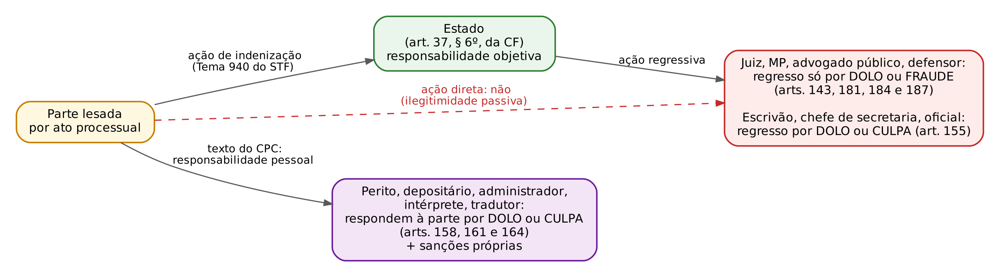
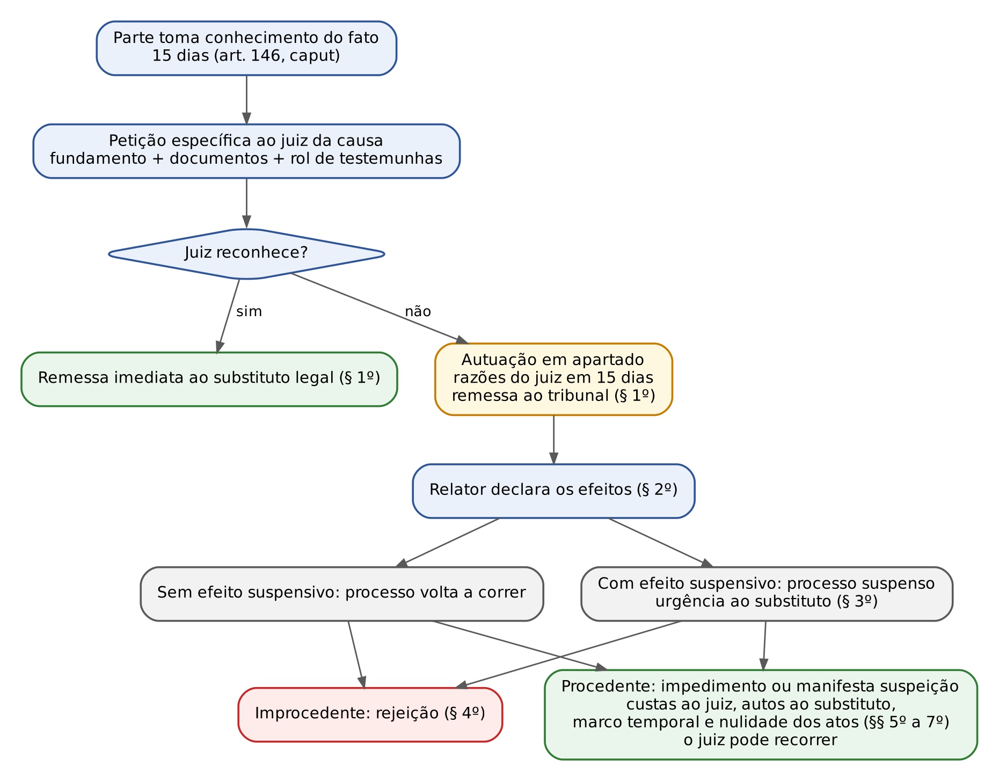
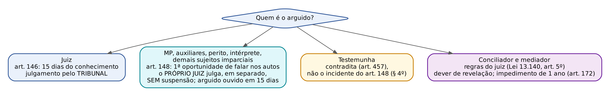
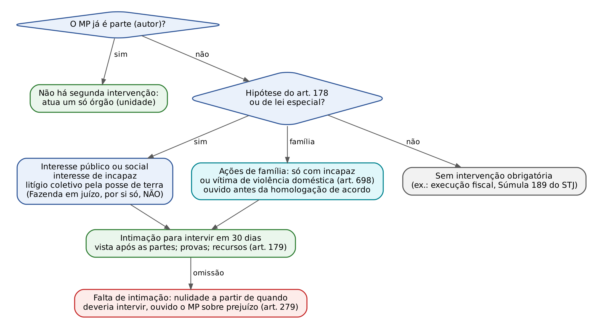

# CAPÍTULO 10 — O JUIZ, OS AUXILIARES DA JUSTIÇA, O MINISTÉRIO PÚBLICO, A ADVOCACIA PÚBLICA E A DEFENSORIA

:::INCIDENCIA
TRF5 p. 4; TJRS p. 2, 5; TJSC p. 4. Nível A. Lote: 21 questões (FGV 16, FCC 5), seis delas de provas da magistratura (TRF3, TRF5, TJSC, TJPA e duas do ENAM), além de correlatas de outros capítulos.
O que mais cai: hipóteses de impedimento x suspeição (arts. 144 e 145) e o incidente do art. 146; incisos do art. 139 (letra seca); intervenção do MP como fiscal (arts. 178, 279 e 698); prazo em dobro e intimação pessoal (arts. 180, 183 e 186); responsabilidade "civil e regressiva" por "dolo ou fraude" x "dolo ou culpa".
:::

#### Mapa de cobrança

| Subtema | FGV | FCC | Padrão |
|---|---|---|---|
| Impedimento e suspeição do juiz (hipóteses, incidente, efeitos, preclusão) | 9 | 0 | caso concreto com parentesco, amizade, vínculo com instituição de ensino; troca dos rótulos "impedido"/"suspeito" |
| Poderes e deveres do juiz (arts. 139 e 140) | 2 | 2 | inciso do art. 139 com uma palavra trocada (pena de confesso, prazo vencido, "salvo prestação pecuniária") |
| Ministério Público (intervenção, nulidade, recurso, prazo, unidade) | 5 | 1 | caso com incapaz, ação de família, interdição, MP autor e interveniente ao mesmo tempo |
| Auxiliares (oficial de justiça e perito) | 1 | 1 | "dolo ou culpa" e "2 a 5 anos" |
| Defensoria Pública e Advocacia Pública | 1 | 1 | intimação pessoal da parte patrocinada (art. 186, § 2º); intimação pessoal como condição de validade |

## 10.1 O juiz: poderes e deveres (arts. 139 a 142)

### 10.1.1 A lógica do art. 139

O art. 139 é a cláusula geral de direção do processo: "o juiz dirigirá o processo conforme as disposições deste Código, incumbindo-lhe" — e o verbo "incumbir" faz de cada inciso um PODER-DEVER, não uma faculdade. A FGV explora exatamente isso (Q3870762: "corresponde a um poder-dever do juiz"). Os incisos se agrupam em quatro blocos, e a leitura por bloco evita a confusão das alternativas:

| Bloco | Incisos | Conteúdo cobrado | Remissão |
|---|---|---|---|
| Isonomia e tempo | I e II | igualdade de tratamento; duração razoável | Cap. 1 |
| Lealdade e efetividade | III e IV | prevenir OU reprimir ato contrário à dignidade da justiça; indeferir postulações meramente protelatórias; medidas indutivas, coercitivas, mandamentais ou sub-rogatórias, "inclusive nas ações que tenham por objeto prestação pecuniária" | Caps. 7 e 24 |
| Gestão e adaptação | V, VI, VIII e IX | autocomposição "a qualquer tempo"; dilação de prazos e inversão da ordem das provas; comparecimento pessoal sem pena de confesso; suprimento de pressupostos e saneamento | Caps. 2, 11, 13 e 18 |
| Ordem e coletivização | VII e X | poder de polícia e força policial; ofício ao MP, à Defensoria e a outros legitimados diante de demandas individuais repetitivas | Caps. 17 e 33 |

:::LEI CPC, ART. 139 (INCISOS MAIS COBRADOS) E PARÁGRAFO ÚNICO
III - prevenir ou reprimir qualquer ato contrário à dignidade da justiça e indeferir postulações meramente protelatórias;
IV - determinar todas as medidas indutivas, coercitivas, mandamentais ou sub-rogatórias necessárias para assegurar o cumprimento de ordem judicial, inclusive nas ações que tenham por objeto prestação pecuniária;
V - promover, a qualquer tempo, a autocomposição, preferencialmente com auxílio de conciliadores e mediadores judiciais;
VI - dilatar os prazos processuais e alterar a ordem de produção dos meios de prova, adequando-os às necessidades do conflito de modo a conferir maior efetividade à tutela do direito;
VIII - determinar, a qualquer tempo, o comparecimento pessoal das partes, para inquiri-las sobre os fatos da causa, hipótese em que não incidirá a pena de confesso;
X - quando se deparar com diversas demandas individuais repetitivas, oficiar o Ministério Público, a Defensoria Pública e, na medida do possível, outros legitimados a que se referem o art. 5º da Lei nº 7.347, de 24 de julho de 1985, e o art. 82 da Lei nº 8.078, de 11 de setembro de 1990, para, se for o caso, promover a propositura da ação coletiva respectiva.
Parágrafo único. A dilação de prazos prevista no inciso VI somente pode ser determinada antes de encerrado o prazo regular.
:::

### 10.1.2 Dilação de prazos e inversão da ordem das provas (inciso VI)

O CPC/2015 tornou o procedimento comum flexível pela via judicial (art. 139, VI) e pela via negocial (arts. 190 e 191, ver Cap. 11). Três limites cobrados:

- Só DILATAR, nunca reduzir: a redução de prazo peremptório depende de anuência das partes (art. 222, § 1º, ver Cap. 11). O inciso VI é instrumento de efetividade e de contraditório, não de aceleração unilateral.
- Só ANTES de encerrado o prazo regular (parágrafo único). Prazo vencido não se "dilata"; a parte que perdeu o prazo precisa alegar justa causa (art. 223). A FCC transformou isso em pegadinha: a alternativa que fala em dilação de prazos "vencidos ou futuros" está errada (Q4338810, alternativa C).
- O Enunciado 13 da I Jornada de Direito Processual Civil (CJF) admite que o juiz, com base no inciso VI, desloque para o futuro o TERMO INICIAL do prazo — o que é útil quando a parte precisa de documentos ou de acesso a autos volumosos antes de o prazo correr.

A alteração da ordem de produção das provas (por exemplo, ouvir testemunhas antes da perícia quando o depoimento delimitará o objeto do exame) convive com o art. 361, que estabelece a ordem preferencial na audiência ("preferencialmente"), e deve ser anunciada às partes, de preferência na decisão de saneamento (art. 357, II e III).

### 10.1.3 Comparecimento pessoal (inciso VIII) x depoimento pessoal

|  | Interrogatório livre (art. 139, VIII) | Depoimento pessoal (arts. 385 a 388) |
|---|---|---|
| Iniciativa | juiz, de ofício, "a qualquer tempo" | requerimento da parte contrária ou determinação judicial |
| Finalidade | esclarecer fatos da causa | obter confissão |
| Pena de confesso | NÃO incide | incide se a parte, intimada com a advertência, não comparece ou se recusa a depor (art. 385, § 1º) |
| Momento | qualquer fase | em regra, audiência de instrução |

:::QUESTAO FCC 2026 — PGM MANAUS — PROCURADOR (Q4338810)
Cobrou poderes do juiz em cinco afirmações. Gabarito: A (o juiz pode determinar de ofício o comparecimento pessoal do réu para inquiri-lo, sem pena de confesso). Armadilhas: B diz que é "vedada qualquer providência de caráter preventivo" — o inciso III fala em "prevenir OU reprimir"; C admite dilação de prazos vencidos (parágrafo único veda); D autoriza meios atípicos "independentemente do emprego prévio de meios típicos" (contraria a subsidiariedade fixada no Tema 1.137 do STJ, ver 10.1.4); E desloca a distribuição dinâmica do ônus para o julgamento, quando o art. 373, § 1º, exige decisão fundamentada que dê à parte oportunidade de se desincumbir (regra de instrução, ver Cap. 18).
No mesmo sentido, sobre o inciso VIII: Q3179541 (FGV 2025 — TRF3 — Juiz Federal), alternativa E, errada por afirmar que "incidirá a pena de confesso".
:::

:::QUESTAO FGV 2026 — TJ-RJ — ANALISTA JUDICIÁRIO, EXECUÇÃO DE MANDADOS (Q3870762)
Pediu o que corresponde a poder-dever do juiz. Gabarito: A (dilatar prazos e alterar a ordem das provas — literalidade do inciso VI). Erros das demais: B troca "oficiar o MP" pela "conversão" da demanda individual em coletiva (o incidente de conversão do art. 333 foi VETADO; o inciso X só manda oficiar os legitimados); C cria limite temporal inexistente para a autocomposição ("a qualquer tempo", inciso V); D manda deferir prova protelatória (o inciso III manda INDEFERIR); E exclui as prestações pecuniárias, quando o inciso IV diz "inclusive".
:::

### 10.1.4 Medidas executivas atípicas (inciso IV) — noção

O inciso IV é a cláusula geral de efetivação: autoriza medidas indutivas (sanção premial), coercitivas (pressão psicológica), mandamentais (ordem sob pena de crime de desobediência e de ato atentatório) e sub-rogatórias (o Estado substitui a conduta do devedor), "inclusive nas ações que tenham por objeto prestação pecuniária". A novidade em relação ao CPC/1973 é justamente a extensão às obrigações de pagar, nas quais a atipicidade antes era restrita às obrigações de fazer, não fazer e entregar.

O STF declarou constitucional o art. 139, IV, vedando a exclusão abstrata de medidas como suspensão da CNH ou apreensão de passaporte (ADI 5.941), e o STJ fixou requisitos cumulativos para os meios atípicos nas execuções cíveis: subsidiariedade, fundamentação, contraditório, proporcionalidade e duração limitada (Tema 1.137); ambos estão desenvolvidos no Cap. 24.

O regime completo (requisitos, medidas em espécie, CNH, passaporte, cartões de crédito, sistemas de pesquisa patrimonial, execução fiscal) é desenvolvido no Cap. 24. Para este capítulo, guarde a fórmula: poder constitucional, uso subsidiário, decisão fundamentada e temporária.

### 10.1.5 Autocomposição, poder de polícia, saneamento e demandas repetitivas

- Inciso V: a autocomposição pode ser promovida "a qualquer tempo", inclusive depois da instrução e em grau de recurso, "preferencialmente com auxílio de conciliadores e mediadores judiciais" (estrutura e princípios no Cap. 2).
- Inciso VII e art. 360: o poder de polícia na audiência compreende manter a ordem e o decoro, retirar da sala os que se comportarem inconvenientemente, requisitar força policial, tratar com urbanidade partes, advogados, MP e Defensoria e registrar em ata os requerimentos.
- Inciso IX: dever de sanear vícios (pressupostos processuais, capacidade, representação), em linha com a primazia do mérito (arts. 4º, 76, 317 e 932, parágrafo único; ver Caps. 1 e 13).
- Inciso X: o juiz não converte a ação individual em coletiva; apenas OFICIA aos legitimados. É também o fundamento para comunicar a existência de demandas repetitivas que justifiquem IRDR (art. 977, I, ver Cap. 39).

### 10.1.6 Vedação do *non liquet*, equidade, congruência e processo simulado (arts. 140 a 142)

:::LEI CPC, ARTS. 140 E 142
Art. 140. O juiz não se exime de decidir sob a alegação de lacuna ou obscuridade do ordenamento jurídico.
Parágrafo único. O juiz só decidirá por equidade nos casos previstos em lei.
Art. 142. Convencendo-se, pelas circunstâncias, de que autor e réu se serviram do processo para praticar ato simulado ou conseguir fim vedado por lei, o juiz proferirá decisão que impeça os objetivos das partes, aplicando, de ofício, as penalidades da litigância de má-fé.
:::

- Lacuna: o juiz decide com analogia, costumes e princípios gerais (art. 4º da LINDB), nunca deixa de decidir.
- Equidade: o juiz decide COM equidade sempre (interpretação justa), mas só decide POR equidade (critério de julgamento que dispensa a norma legal) quando a lei autoriza. Exemplos legais: jurisdição voluntária (art. 723, parágrafo único: o juiz "não é obrigado a observar critério de legalidade estrita"); honorários por apreciação equitativa (art. 85, § 8º, ver Cap. 8); arbitragem de equidade, se as partes convencionarem (Lei 9.307/1996, art. 2º), vedada na arbitragem com a Administração (ver Cap. 2).
- Art. 141: o juiz decide nos limites propostos pelas partes (congruência, ver Cap. 20), vedado conhecer de questões cuja iniciativa a lei reserva à parte.
- Art. 142: processo simulado ou fraudulento — o juiz profere decisão que frustra o objetivo (normalmente extinção sem resolução de mérito) e aplica DE OFÍCIO as penas de má-fé a AMBAS as partes. Transitada em julgado a decisão obtida por colusão, abre-se a rescisória (art. 966, III), com legitimidade do MP (art. 967, III, b).

:::QUESTAO FCC 2025 — TRF 4ª REGIÃO — TÉCNICO JUDICIÁRIO (Q3538962)
Perguntou como o juiz procede diante de lacuna. Gabarito: B (não se exime de decidir e só decide por equidade nos casos previstos em lei). As erradas misturam "poderá se eximir", equidade "sempre que a lei não fornecer solução justa" e vedação absoluta da equidade.
No mesmo sentido: Q3179541 (FGV 2025 — TRF3 — Juiz Federal), alternativa D, errada por dizer "casos previstos em jurisprudência"; Q3049356 (FGV 2024 — TJSC — Juiz Substituto), alternativa C, errada por acrescentar "nos limites propostos pelas partes" como hipótese de equidade (a frase pertence ao art. 141, que trata da congruência).
:::

### 10.1.7 Prazos do juiz e representação por excesso de prazo

Os prazos do juiz são IMPRÓPRIOS (seu descumprimento não gera preclusão, mas pode gerar responsabilidade disciplinar e civil): despachos em 5 dias, decisões interlocutórias em 10 dias e sentenças em 30 dias (art. 226), excedíveis por igual tempo havendo motivo justificado, em qualquer grau (art. 227). O art. 235 dá a QUALQUER PARTE, ao MP e à Defensoria a representação ao corregedor do tribunal ou ao CNJ contra juiz ou relator que exceder injustificadamente os prazos; ouvido o juiz e não sendo caso de arquivamento liminar, ele tem 15 dias para justificar; mantida a omissão, é intimado para praticar o ato em 10 dias e, persistindo a inércia, os autos vão ao substituto legal, que decide em 10 dias (§§ 1º a 3º).

### 10.1.8 Ofensas e embaraços praticados por advogados, MP e Defensoria

Os deveres do art. 77 alcançam "todos aqueles que de qualquer forma participem do processo", e o art. 78 veda expressões ofensivas inclusive a juízes, membros do MP e da Defensoria. Mas a SANÇÃO pecuniária por ato atentatório (art. 77, §§ 2º a 5º) não se aplica a advogados públicos ou privados, defensores e promotores: a responsabilidade disciplinar é apurada pelo órgão de classe ou corregedoria, a que o juiz oficiará (art. 77, § 6º). O regime da multa e da litigância de má-fé está no Cap. 7.

:::LEI CPC, ART. 78, §§ 1º E 2º
§ 1º Quando expressões ou condutas ofensivas forem manifestadas oral ou presencialmente, o juiz advertirá o ofensor de que não as deve usar ou repetir, sob pena de lhe ser cassada a palavra.
§ 2º De ofício ou a requerimento do ofendido, o juiz determinará que as expressões ofensivas sejam riscadas e, a requerimento do ofendido, determinará a expedição de certidão com inteiro teor das expressões ofensivas e a colocará à disposição da parte interessada.
:::

:::QUESTAO FGV 2026 — TJ-MS — ANALISTA JUDICIÁRIO (Q3856342)
Promotor que atuava como fiscal reteve documentos de forma artificiosa (embaraço à efetivação de decisão) e ofendeu as partes oralmente e por escrito. Gabarito: C (oficiar à Corregedoria do MP, podendo cassar a palavra e riscar as expressões ofensivas de ofício ou a requerimento). Passos: (1) embaraço ao cumprimento de decisão é ato atentatório (art. 77, IV), mas o membro do MP não sofre a multa (art. 77, § 6º) — eliminam-se D e E; (2) a cassação da palavra é possível após advertência (art. 78, § 1º) — elimina A e B; (3) riscar expressões é "de ofício ou a requerimento" (art. 78, § 2º); a certidão de inteiro teor é que depende de requerimento do ofendido.
:::

## 10.2 Responsabilidade do juiz e o regime comum dos agentes do processo

:::LEI CPC, ART. 143
Art. 143. O juiz responderá, civil e regressivamente, por perdas e danos quando:
I - no exercício de suas funções, proceder com dolo ou fraude;
II - recusar, omitir ou retardar, sem justo motivo, providência que deva ordenar de ofício ou a requerimento da parte.
Parágrafo único. As hipóteses previstas no inciso II somente serão verificadas depois que a parte requerer ao juiz que determine a providência e o requerimento não for apreciado no prazo de 10 (dez) dias.
:::

Três pontos decidem as questões:

- "Civil e REGRESSIVAMENTE": o lesado aciona o Estado (responsabilidade objetiva, art. 37, § 6º, da CF), que regride contra o juiz. O CPC/2015 acrescentou o advérbio, que não existia no art. 133 do CPC/1973, alinhando-se à tese da dupla garantia. O STF fixou, no Tema 940 (RE 1.027.633, Relator Ministro Marco Aurélio, j. 14/8/2019), que a ação por danos causados por agente público deve ser ajuizada contra o Estado ou a pessoa jurídica prestadora de serviço público, sendo parte ilegítima o autor do ato, assegurado o regresso nos casos de dolo ou culpa. Para o juiz, a lei processual restringe o regresso ao DOLO ou FRAUDE (inciso I) e à desídia qualificada do inciso II; a culpa simples não basta.
- Inciso II exige prévio requerimento NÃO APRECIADO EM 10 DIAS (parágrafo único). Sem esse pressuposto, a omissão não gera responsabilidade civil, sem prejuízo da via disciplinar (art. 235).
- O art. 143 traz a anotação "Vide ADPF 774" no texto compilado do Planalto: a arguição questiona condenações da União por excesso de linguagem de magistrados e pede interpretação da LOMAN e do CPC. O estado atual do julgamento não foi confirmado (ver nota). A regra paralela da LOMAN (LC 35/1979, art. 49: responde por perdas e danos o magistrado que proceder com dolo ou fraude ou que recusar, omitir ou retardar providência sem justo motivo, só verificada esta após requerimento não atendido em dez dias) tem redação praticamente idêntica e traz a mesma anotação da ADPF 774.

O mesmo desenho, com variação do elemento subjetivo, vale para os demais sujeitos — e a FGV e a FCC trocam exatamente "dolo ou fraude" por "dolo ou culpa":

| Sujeito | Dispositivo | Como responde | Elemento subjetivo | Observação |
|---|---|---|---|---|
| Juiz | art. 143 | civil e regressivamente | dolo ou fraude; omissão injustificada após requerimento não apreciado em 10 dias | Tema 940 do STF |
| Membro do MP | art. 181 | civil e regressivamente | dolo ou fraude | multa do art. 77 não se aplica (§ 6º) |
| Advogado público | art. 184 | civil e regressivamente | dolo ou fraude | idem |
| Defensor público | art. 187 | civil e regressivamente | dolo ou fraude | idem |
| Escrivão, chefe de secretaria, oficial de justiça | art. 155 | civil e regressivamente | recusa sem justo motivo de cumprir no prazo; ato nulo com DOLO OU CULPA | culpa basta |
| Perito | art. 158 | responde pelos prejuízos à parte | informações inverídicas por DOLO OU CULPA | inabilitação de 2 a 5 anos e comunicação ao órgão de classe |
| Depositário e administrador | art. 161 | responde pelos prejuízos à parte | DOLO OU CULPA | perde a remuneração, mas é ressarcido do que gastou; o infiel responde ainda penalmente e por ato atentatório |
| Intérprete e tradutor | art. 164 | como o perito (arts. 157 e 158) | DOLO OU CULPA |  |
| Conciliador e mediador | art. 173 | exclusão do cadastro (processo administrativo) | dolo ou culpa na condução; atuação apesar de impedido ou suspeito | afastamento cautelar até 180 dias (§ 2º) |

:::DICA
Regra mnemônica: os agentes POLÍTICOS e as funções essenciais (juiz, MP, advocacia pública, Defensoria) só respondem por DOLO OU FRAUDE; os auxiliares (serventuários, perito, depositário, intérprete) respondem também por CULPA. Todos os que integram o Estado respondem "civil e regressivamente"; perito, depositário e intérprete têm, no texto do CPC, responsabilidade pessoal perante a parte.
:::

:::QUESTAO FGV 2024 — TJ-SC — JUIZ SUBSTITUTO, EDITAL 44 (Q3049356)
Afirmações sobre juiz, MP, Defensoria e advogado. Gabarito: D (a requerimento da Defensoria, o juiz determinará a intimação pessoal da parte patrocinada quando o ato depender de providência que só ela possa realizar — art. 186, § 2º; ver 10.7). Erros: A dá 10 dias para alegar impedimento (são 15, art. 146); B torna o membro do MP "civil e DIRETAMENTE responsável" (é regressivamente, art. 181); C (ver 10.1.6); E inclui receber citação, confessar e reconhecer o pedido na procuração geral para o foro (exigem poderes especiais, art. 105).
No mesmo sentido, sobre advocacia pública: Q3425317 (FGV 2025 — TRF1 — Juiz Federal), alternativa B errada por falar em "dolo ou culpa" (art. 184 diz dolo ou fraude).
:::

:::QUESTAO FCC 2025 — TRF 4ª REGIÃO — OFICIAL DE JUSTIÇA AVALIADOR FEDERAL (Q3562212)
Oficial de justiça que, por culpa, pratica ato nulo e causa dano. Gabarito: B (responde civil e regressivamente). Fundamento: art. 155, II ("praticarem ato nulo com dolo ou culpa"). Armadilhas: C (só dolo — é o regime do juiz, não do serventuário) e D (só a recusa injustificada — o art. 155 tem dois incisos alternativos).
:::

:::QUESTAO FGV 2025 — MPU — ANALISTA, PERITO EM CONTABILIDADE (Q3335599)
Perito que, por negligência, errou a metragem e levou a condenação em valor inferior ao devido. Gabarito: A (responde pelos prejuízos e fica inabilitado por 2 a 5 anos). Fundamento: art. 158 (dolo OU culpa). As distratoras trocam o intervalo (1 a 10, 1 a 5) ou suprimem uma das consequências.
:::

## 10.3 Impedimento e suspeição

### 10.3.1 Natureza e distinção

Ambos protegem a imparcialidade, pressuposto processual de validade (subjetivo, referente ao juiz). A diferença está na intensidade da presunção: o impedimento descreve situações OBJETIVAS, verificáveis documentalmente, em que a lei presume de modo absoluto a parcialidade; a suspeição descreve situações SUBJETIVAS ou de vínculo menos intenso, em que a parcialidade é presumida de modo relativo e depende de prova. Daí todas as consequências práticas:

|  | Impedimento (art. 144) | Suspeição (art. 145) |
|---|---|---|
| Natureza | objetiva; presunção absoluta | subjetiva; presunção relativa |
| Rol | taxativo (interpretação estrita, porque restringe o juiz natural) | taxativo nos incisos, com a válvula do foro íntimo (§ 1º) |
| Conhecimento de ofício | dever do juiz de se declarar | dever do juiz de se declarar; pode alegar foro íntimo sem declinar razões |
| Prazo para a parte | 15 dias do conhecimento (art. 146) | 15 dias do conhecimento (art. 146) |
| Preclusão para a parte | NÃO há: o vício sobrevive ao trânsito em julgado | SIM: perdido o prazo, não se alega mais; ilegítima se provocada pela parte ou aceita (§ 2º) |
| Após o trânsito | ação rescisória (art. 966, II: "juiz impedido") | não cabe rescisória |
| Fato superveniente criado para afastar o juiz | vedado (art. 144, § 2º) | alegação ilegítima se provocada por quem a alega (art. 145, § 2º, I) |

:::PEGADINHA
O prazo de 15 dias do art. 146 vale para impedimento E suspeição. A diferença está na consequência da inércia: no impedimento, a perda do prazo não convalida o vício (o juiz deve reconhecê-lo de ofício e a decisão é rescindível), ao passo que na suspeição a inércia gera preclusão. Cuidado com a formulação da banca: a FCC considerou ERRADA a assertiva de que a arguição de impedimento "pode ser feita a qualquer tempo e não está sujeita a prazo preclusivo, diferentemente da suspeição" (Q4231774, FCC 2026 — TJ-CE, correlata do Cap. 17, gabarito C), porque o art. 146 fixa o mesmo prazo para ambas. Em prova objetiva, prefira a letra: 15 dias para as duas arguições; o regime de ordem pública do impedimento aparece quando a questão fala em preclusão para o JUIZ, conhecimento de ofício ou rescisória.
:::

### 10.3.2 Hipóteses de impedimento (art. 144)

:::LEI CPC, ART. 144
Art. 144. Há impedimento do juiz, sendo-lhe vedado exercer suas funções no processo:
I - em que interveio como mandatário da parte, oficiou como perito, funcionou como membro do Ministério Público ou prestou depoimento como testemunha;
II - de que conheceu em outro grau de jurisdição, tendo proferido decisão;
III - quando nele estiver postulando, como defensor público, advogado ou membro do Ministério Público, seu cônjuge ou companheiro, ou qualquer parente, consanguíneo ou afim, em linha reta ou colateral, até o terceiro grau, inclusive;
IV - quando for parte no processo ele próprio, seu cônjuge ou companheiro, ou parente, consanguíneo ou afim, em linha reta ou colateral, até o terceiro grau, inclusive;
V - quando for sócio ou membro de direção ou de administração de pessoa jurídica parte no processo;
VI - quando for herdeiro presuntivo, donatário ou empregador de qualquer das partes;
VII - em que figure como parte instituição de ensino com a qual tenha relação de emprego ou decorrente de contrato de prestação de serviços;
VIII - em que figure como parte cliente do escritório de advocacia de seu cônjuge, companheiro ou parente, consanguíneo ou afim, em linha reta ou colateral, até o terceiro grau, inclusive, mesmo que patrocinado por advogado de outro escritório; (Vide ADI 5953)
IX - quando promover ação contra a parte ou seu advogado.
§ 1º Na hipótese do inciso III, o impedimento só se verifica quando o defensor público, o advogado ou o membro do Ministério Público já integrava o processo antes do início da atividade judicante do juiz.
§ 2º É vedada a criação de fato superveniente a fim de caracterizar impedimento do juiz.
§ 3º O impedimento previsto no inciso III também se verifica no caso de mandato conferido a membro de escritório de advocacia que tenha em seus quadros advogado que individualmente ostente a condição nele prevista, mesmo que não intervenha diretamente no processo.
:::

Leitura de prova:

- Inciso I: atuação anterior NO MESMO PROCESSO em outra função (advogado, perito, MP, testemunha). Ministro do STJ que oficiou no processo como procurador da República é IMPEDIDO, não suspeito (Q3373889, alternativa E, errada).
- Inciso II: exige que o juiz tenha conhecido do processo em outro grau E "proferido decisão". O juiz que só despachou em primeiro grau e depois foi promovido não está impedido de julgar a apelação; o que proferiu decisão (inclusive interlocutória) está. A Súmula 72 do STF afasta o impedimento dos Ministros do STF que funcionaram no TSE no mesmo processo, quando se julga a questão constitucional vinculada à decisão daquele tribunal.
- Incisos III e IV: parentesco consanguíneo ou afim, em linha reta ou colateral, ATÉ O TERCEIRO GRAU, inclusive. Tio e sobrinho são colaterais de terceiro grau (impedimento); primo é colateral de QUARTO grau (não há impedimento por parentesco). Cunhado é afim colateral de segundo grau (há impedimento). O parentesco por afinidade na linha colateral se extingue com a dissolução do casamento; na linha reta, não (CC, art. 1.595, § 2º).
- Inciso III e § 1º: o advogado parente só impede se JÁ integrava o processo antes do início da atividade do juiz — o advogado não pode ingressar no feito para afastar o juiz (combina com o § 2º). O § 3º estende o impedimento ao escritório que tenha em seus quadros o advogado parente, ainda que ele não atue no processo.
- Inciso VII: instituição de ensino com a qual o juiz tenha relação de emprego OU contrato de prestação de serviços (o juiz professor). É impedimento, não suspeição — e é a hipótese favorita da FGV (Q2611617 e Q4102123).
- Inciso VIII: DECLARADO INCONSTITUCIONAL. O STF, na ADI 5.953 (Relator Ministro Edson Fachin, redator do acórdão Ministro Gilmar Mendes, j. 22/8/2023, Informativo 1104), julgou procedente o pedido para declarar inconstitucional o impedimento do juiz no processo em que a parte é cliente do escritório de seu cônjuge ou parente, ainda que patrocinada por outro escritório, por ofensa ao juiz natural, à razoabilidade e à proporcionalidade (a regra exigiria do juiz conhecer toda a carteira de clientes dos escritórios de seus parentes). Questão que reproduza o inciso VIII como causa vigente de impedimento deve ser considerada errada, salvo se pedir a "literalidade do CPC".
- Inciso IX: juiz que promove ação contra a parte ou contra seu advogado. Note a assimetria: ser AUTOR de ação contra a parte gera impedimento; ser CREDOR ou DEVEDOR da parte gera suspeição (art. 145, III).

:::QUESTAO FGV 2026 — TJ-PA — JUIZ SUBSTITUTO (Q3951734)
Juiz recebe ação movida por seu TIO contra empresa cujo advogado é seu melhor amigo e padrinho de casamento. Gabarito: B (impedimento quanto ao tio; suspeição quanto ao amigo). Passos: (1) tio é parente colateral de terceiro grau, consanguíneo, e é PARTE: art. 144, IV; (2) amizade íntima com o ADVOGADO da parte: art. 145, I ("de qualquer das partes ou de seus advogados"); (3) a alternativa E tenta convencer de que o terceiro grau está fora do limite — o limite é "até o terceiro grau, inclusive".
:::

:::QUESTAO FGV 2024 — TCE-PA — AUDITOR DE CONTROLE EXTERNO (Q2611617)
Juiz que é professor empregado de instituição de ensino ré e que tem inimizade com o advogado do autor em outro processo. Gabarito: D (impedido no primeiro, suspeito no segundo). Fundamento: art. 144, VII, e art. 145, I. Armadilha: alternativa E, foro íntimo "devendo declarar as razões" (o § 1º do art. 145 dispensa a declaração).
:::

:::QUESTAO FGV 2026 — TJ-BA — JUIZ LEIGO (Q4102123)
No Juizado Especial Cível, o réu descobre que o juiz é professor da instituição de ensino autora, com contrato de prestação de serviços. Gabarito: C (alegar IMPEDIMENTO em petição específica, em 15 dias do conhecimento, com documentos e rol de testemunhas). Passos: (1) art. 144, VII, abrange "relação de emprego OU decorrente de contrato de prestação de serviços"; (2) no JEC a contestação concentra toda a defesa, "exceto arguição de suspeição ou impedimento do Juiz, que se processará na forma da legislação em vigor" (Lei 9.099/1995, art. 30) — logo, petição própria, nos moldes do art. 146 do CPC, e não preliminar de contestação (eliminam-se A e B); (3) D erra o rótulo (suspeição).
:::

:::QUESTAO FGV 2025 — TRF 3ª REGIÃO — JUIZ FEDERAL SUBSTITUTO (Q3179541)
Gabarito: C (impedimento do juiz herdeiro presuntivo, donatário ou empregador de qualquer das partes — art. 144, VI). Erros: A permite criar fato superveniente para caracterizar impedimento (§ 2º veda); B qualifica como suspeição a atuação em outro grau com decisão (é impedimento, inciso II); D e E, ver 10.1.3 e 10.1.6.
No mesmo sentido, sobre o inciso II: Q2507025 (FGV 2024 — ENAM, reaplicação), afirmativa I correta.
:::

### 10.3.3 Hipóteses de suspeição (art. 145)

:::LEI CPC, ART. 145
Art. 145. Há suspeição do juiz:
I - amigo íntimo ou inimigo de qualquer das partes ou de seus advogados;
II - que receber presentes de pessoas que tiverem interesse na causa antes ou depois de iniciado o processo, que aconselhar alguma das partes acerca do objeto da causa ou que subministrar meios para atender às despesas do litígio;
III - quando qualquer das partes for sua credora ou devedora, de seu cônjuge ou companheiro ou de parentes destes, em linha reta até o terceiro grau, inclusive;
IV - interessado no julgamento do processo em favor de qualquer das partes.
§ 1º Poderá o juiz declarar-se suspeito por motivo de foro íntimo, sem necessidade de declarar suas razões.
§ 2º Será ilegítima a alegação de suspeição quando:
I - houver sido provocada por quem a alega;
II - a parte que a alega houver praticado ato que signifique manifesta aceitação do arguido.
:::

- Inciso I: amizade ÍNTIMA ou inimizade (não basta conhecimento social, convívio profissional ou participação na mesma associação) com a parte OU COM O ADVOGADO. Amizade íntima com advogado é suspeição; parentesco com advogado é impedimento (art. 144, III). A FGV no TRF5 colocou a amizade íntima como impedimento (Q3373889, alternativa A, errada).
- Inciso III: relação creditícia com a parte, abrangendo cônjuge, companheiro e parentes destes "em linha RETA até o terceiro grau" — a colateral não entra aqui, diferentemente do art. 144, III e IV.
- Foro íntimo (§ 1º): o juiz não declara as razões nos autos. Para a prova, a resposta é a literalidade: "sem necessidade de declarar suas razões" (Q3373889, alternativa B, errada por exigir declaração das razões à presidência do tribunal em expediente sigiloso). Eventual regulamentação administrativa de comunicação reservada à corregedoria não integra o texto do CPC (ver nota).
- Ilegitimidade (§ 2º): suspeição provocada pela própria parte (ofender o juiz para afastá-lo) ou precedida de ato de manifesta aceitação do juiz (ex.: a parte, ciente da amizade, requer providências e pede julgamento antecipado sem arguir nada).

### 10.3.4 Suspeição superveniente e validade dos atos anteriores

A suspeição que nasce no curso do processo não contamina os atos praticados antes do fato gerador. É o que decorre do § 6º do art. 146 (o tribunal fixa o MOMENTO a partir do qual o juiz não poderia ter atuado) e do § 7º (a nulidade alcança os atos "praticados quando já presente o motivo"). O raciocínio vale para a declaração espontânea do juiz.

:::QUESTAO FGV 2024 — ENAM 2024.2 (Q3058645)
Juiz concede tutela de guarda; depois da audiência, a parte colide com o carro do juiz por desatenção, há discussão acalorada, o juiz se declara suspeito e a parte pede a anulação da tutela. Gabarito: C (rejeita-se o pedido: a suspeição superveniente não retroage). Passos: (1) o motivo surgiu DEPOIS da decisão; (2) arts. 146, §§ 6º e 7º: só são nulos os atos praticados quando já presente o motivo; (3) a alternativa B usa fundamento sedutor (o fato foi causado pela parte, art. 145, § 2º, I), mas a declaração foi do próprio juiz e o ponto decisivo é a irretroatividade; (4) E fala em "ratificação" pelo substituto, desnecessária.
:::

:::JURIS STJ, RESP 2.072.667, J. 11/3/2025
A Quarta Turma (Relator Ministro João Otávio de Noronha) decidiu que o magistrado que se declara suspeito por motivo superveniente pode requerer o cancelamento de seu voto, desde que o faça antes de concluído o julgamento com a proclamação do resultado (Informativo 844). Proclamado o resultado, o ato está perfeito e a suspeição posterior não o alcança.
:::

### 10.3.5 Juízes parentes no mesmo processo (art. 147)

Quando dois ou mais juízes forem parentes, consanguíneos ou afins, em linha reta ou colateral, até o terceiro grau, "o primeiro que conhecer do processo impede que o outro nele atue", devendo o segundo se escusar e remeter os autos ao substituto legal. A regra é relevante nos tribunais (composição de turmas e câmaras) e na sucessão de juízes em primeiro grau.

### 10.3.6 O incidente de arguição contra o juiz (art. 146)

:::LEI CPC, ART. 146, CAPUT E §§ 1º, 5º, 6º E 7º
Art. 146. No prazo de 15 (quinze) dias, a contar do conhecimento do fato, a parte alegará o impedimento ou a suspeição, em petição específica dirigida ao juiz do processo, na qual indicará o fundamento da recusa, podendo instruí-la com documentos em que se fundar a alegação e com rol de testemunhas.
§ 1º Se reconhecer o impedimento ou a suspeição ao receber a petição, o juiz ordenará imediatamente a remessa dos autos a seu substituto legal, caso contrário, determinará a autuação em apartado da petição e, no prazo de 15 (quinze) dias, apresentará suas razões, acompanhadas de documentos e de rol de testemunhas, se houver, ordenando a remessa do incidente ao tribunal.
§ 5º Acolhida a alegação, tratando-se de impedimento ou de manifesta suspeição, o tribunal condenará o juiz nas custas e remeterá os autos ao seu substituto legal, podendo o juiz recorrer da decisão.
§ 6º Reconhecido o impedimento ou a suspeição, o tribunal fixará o momento a partir do qual o juiz não poderia ter atuado.
§ 7º O tribunal decretará a nulidade dos atos do juiz, se praticados quando já presente o motivo de impedimento ou de suspeição.
:::

:::PROCESSO INCIDENTE DE IMPEDIMENTO OU SUSPEIÇÃO DO JUIZ
- Forma: PETIÇÃO ESPECÍFICA, dirigida ao próprio juiz (não é preliminar de contestação nem "exceção" autuada em apenso, como no CPC/1973). Pode ser oposta por qualquer das partes, inclusive pelo autor (que não conhecia o fato ao ajuizar) e pelos intervenientes.
- Prazo: 15 dias do conhecimento do fato (não da citação).
- Juízo de retratação imediato: o juiz pode reconhecer e remeter ao substituto. Não reconhecendo, NÃO JULGA: manda autuar em apartado, apresenta razões em 15 dias e remete ao tribunal. O juiz arguido é parte no incidente.
- Efeito suspensivo: o art. 313, III, prevê a suspensão do processo pela arguição, mas quem define a manutenção da suspensão é o RELATOR, ao receber o incidente (§ 2º): sem efeito suspensivo, o processo volta a correr; com efeito suspensivo, permanece suspenso. Até essa declaração, e enquanto houver suspensão, a tutela de urgência é requerida ao SUBSTITUTO LEGAL (§ 3º).
- Julgamento pelo tribunal: improcedente, rejeita (§ 4º); procedente, remete os autos ao substituto e, se impedimento ou MANIFESTA suspeição, condena o juiz nas custas (§ 5º). O juiz pode recorrer. O tribunal fixa o termo a partir do qual o juiz não poderia atuar e anula os atos praticados após o motivo (§§ 6º e 7º).
- Arguição contra desembargador ou ministro: segue o regimento interno do tribunal (art. 148, § 3º, por extensão; ver Cap. 38).
:::

:::QUESTAO FGV 2025 — ENAM 2025.2 (Q3692402)
Gabarito: D (acolhida a alegação de manifesta suspeição, o tribunal condena o juiz nas custas e remete os autos ao substituto, podendo o juiz recorrer — literalidade do art. 146, § 5º). Erros: A exclui MP e auxiliares (art. 148 os inclui); B admite fato superveniente criado para caracterizar impedimento (art. 144, § 2º); C veda ao juiz reconhecer o vício de imediato (o § 1º permite); E nega a nulidade dos atos (o § 7º a impõe).
:::

:::QUESTAO FGV 2024 — ENAM, 1º EXAME (REAPLICAÇÃO) (Q2507029)
Juiz é cunhado da ré (a esposa do juiz é irmã da ré). O autor sabia, nada alegou, perdeu e depois quis arguir. Gabarito: D (é impedimento e não há preclusão). Passos: (1) cunhado = parente por afinidade, colateral de segundo grau, sendo PARTE: art. 144, IV; (2) impedimento é matéria de ordem pública, cognoscível de ofício e fundamento de rescisória (art. 966, II) — não preclui com a omissão da parte; (3) as alternativas A, B e E tentam aplicar preclusão lógica, temporal ou *venire contra factum proprium*, cabíveis na suspeição (art. 145, § 2º), não no impedimento; C erra o rótulo.
Observação de segunda fase: a conduta de guardar o vício para usá-lo apenas se perder (a chamada nulidade de algibeira) é combatida com base na boa-fé processual (art. 5º); no impedimento, porém, o legislador fez opção expressa pela rescindibilidade (art. 966, II), e a boa-fé pode repercutir em sanções por má-fé, não na convalidação do vício (ver Cap. 13).
:::

### 10.3.7 Impedimento e suspeição dos demais sujeitos (art. 148)

:::LEI CPC, ART. 148
Art. 148. Aplicam-se os motivos de impedimento e de suspeição:
I - ao membro do Ministério Público;
II - aos auxiliares da justiça;
III - aos demais sujeitos imparciais do processo.
§ 1º A parte interessada deverá arguir o impedimento ou a suspeição, em petição fundamentada e devidamente instruída, na primeira oportunidade em que lhe couber falar nos autos.
§ 2º O juiz mandará processar o incidente em separado e sem suspensão do processo, ouvindo o arguido no prazo de 15 (quinze) dias e facultando a produção de prova, quando necessária.
§ 3º Nos tribunais, a arguição a que se refere o § 1º será disciplinada pelo regimento interno.
§ 4º O disposto nos §§ 1º e 2º não se aplica à arguição de impedimento ou de suspeição de testemunha.
:::

|  | Juiz (art. 146) | MP, auxiliares e demais sujeitos imparciais (art. 148) |
|---|---|---|
| Prazo | 15 dias do conhecimento do fato | primeira oportunidade de falar nos autos |
| Quem julga | o tribunal | o próprio juiz da causa |
| Autuação | em apartado (se o juiz não reconhecer) | em separado |
| Suspensão | relator decide o efeito; art. 313, III | SEM suspensão do processo |
| Oitiva do arguido | o juiz apresenta razões em 15 dias | o arguido é ouvido em 15 dias |

- "Demais sujeitos imparciais": inclui conciliadores e mediadores (art. 148, III, e Lei 13.140/2015, art. 5º, que manda aplicar ao mediador as hipóteses legais de impedimento e suspeição do juiz e impõe o dever de revelar previamente qualquer fato que possa suscitar dúvida justificada sobre sua imparcialidade). O árbitro também se submete às hipóteses do juiz (Lei 9.307/1996, art. 14), mas a arguição se faz no procedimento arbitral (ver Cap. 2).
- Testemunha: não há incidente; o impedimento ou a suspeição se alega por CONTRADITA, antes do depoimento (art. 457, § 1º; ver Cap. 19).
- Perito: o órgão técnico nomeado informa os nomes e dados dos profissionais que participarão da perícia justamente para permitir a verificação de impedimento ou suspeição (art. 156, § 4º); a arguição é feita em 15 dias da intimação da nomeação (art. 465, § 1º, I), aplicada a regra do art. 148, § 1º, quanto ao momento.

:::JURIS STJ, RESP 1.579.704, J. 16/6/2026
A Quarta Turma (Relator Ministro João Otávio de Noronha) assentou que a suspeição do perito deve ser arguida na primeira oportunidade em que couber à parte falar nos autos, sob pena de preclusão, e que a anulação da perícia por vício procedimental NÃO reabre o prazo para arguir suspeição fundada em fato pretérito e já conhecido (Informativo 899).
:::

:::QUESTAO FGV 2025 — TRF 5ª REGIÃO — JUIZ FEDERAL SUBSTITUTO (Q3373889)
Gabarito: D (arguido o impedimento do membro do MP, o juiz processa o incidente em separado, ouvindo o arguido em 15 dias — art. 148, § 2º). Erros: A (amizade íntima é suspeição); B (foro íntimo sem declaração de razões); C (o incidente contra o juiz é autuado em APARTADO, não nos próprios autos, e o processamento se dá no tribunal); E (atuação anterior como procurador da República no mesmo processo é IMPEDIMENTO, art. 144, I).
:::

:::QUESTAO FGV 2026 — ENAM 2026.1 (Q4102417 — CORRELATA DO CAP. 2)
Sobre mediação, gabarito E: aplicam-se ao mediador as hipóteses legais de impedimento e suspeição do juiz, com dever de revelação prévia e possibilidade de recusa pelas partes (Lei 13.140/2015, art. 5º). Em sentido convergente, Q2370308 (FGV 2024 — TJ-RJ — Mediador), alternativa C, errada por negar essa aplicação.
:::

:::ATENCAO
A arguição de impedimento ou suspeição do juiz SUSPENDE o processo (art. 313, III), salvo se o relator receber o incidente sem efeito suspensivo; a do MP e dos auxiliares NÃO suspende (art. 148, § 2º). Correlata: Q3295850 (FCC 2025 — TRT15), em que a arguição de suspeição do juiz aparece corretamente como causa de suspensão.
:::

## 10.4 Auxiliares da justiça (arts. 149 a 175)

### 10.4.1 Rol e classificação

O art. 149 traz rol EXEMPLIFICATIVO ("além de outros cujas atribuições sejam determinadas pelas normas de organização judiciária"): escrivão, chefe de secretaria, oficial de justiça, perito, depositário, administrador, intérprete, tradutor, mediador, conciliador judicial, partidor, distribuidor, contabilista e regulador de avarias. A doutrina distingue os auxiliares PERMANENTES (integram o quadro do Judiciário e atuam em todos os processos: escrivão, chefe de secretaria, oficial de justiça, distribuidor, contabilista, partidor) dos EVENTUAIS (nomeados para o processo concreto: perito, depositário particular, administrador, intérprete, tradutor). O conciliador e o mediador, cadastrados ou concursados, ocupam posição intermediária. Nos Juizados Especiais, conciliadores e juízes leigos são auxiliares da justiça, recrutados os primeiros preferentemente entre bacharéis em Direito e os segundos entre advogados com mais de cinco anos de experiência, ficando os juízes leigos impedidos de advogar perante os Juizados enquanto no desempenho das funções (Lei 9.099/1995, art. 7º; ver Cap. 36).

O chefe de secretaria é a denominação usada na Justiça Federal e nos juízos com secretaria; o escrivão é o titular do cartório na Justiça Estadual. O CPC os trata em conjunto.

### 10.4.2 Escrivão e chefe de secretaria

O art. 152 concentra as incumbências: redigir ofícios, mandados e cartas; efetivar ordens judiciais e realizar citações e intimações; comparecer às audiências (ou designar substituto); guardar os autos; fornecer certidões "independentemente de despacho", ressalvado o segredo de justiça; e praticar de ofício os atos meramente ORDINATÓRIOS (inciso VI), cabendo ao juiz titular editar ato que regulamente essa atribuição (§ 1º). No impedimento do escrivão, o juiz convoca substituto e, não havendo, nomeia pessoa idônea para o ato (§ 2º).

Os atos ordinatórios (juntada, vista obrigatória, intimação para contrarrazões, remessa à contadoria) são praticados pelo servidor e revistos pelo juiz quando necessário (art. 203, § 4º). Em correlata do Cap. 20, a FGV classificou o ato que dá vista obrigatória às partes como ato ordinatório e a homologação da indicação de depositário em penhora de empresa como despacho (Q3058647, ENAM 2024.2).

:::LEI CPC, ART. 153, CAPUT E §§ 4º E 5º (REDAÇÃO DA LEI 13.256/2016)
Art. 153. O escrivão ou o chefe de secretaria atenderá, preferencialmente, à ordem cronológica de recebimento para publicação e efetivação dos pronunciamentos judiciais.
§ 4º A parte que se considerar preterida na ordem cronológica poderá reclamar, nos próprios autos, ao juiz do processo, que requisitará informações ao servidor, a serem prestadas no prazo de 2 (dois) dias.
§ 5º Constatada a preterição, o juiz determinará o imediato cumprimento do ato e a instauração de processo administrativo disciplinar contra o servidor.
:::

- A redação original ("deverá obedecer") foi abrandada pela Lei 13.256/2016 para "atenderá, preferencialmente", na mesma linha da ordem cronológica de julgamento do art. 12 (ver Cap. 1).
- Excluem-se da lista os atos urgentes reconhecidos pelo juiz e as preferências legais, que têm lista própria (§§ 2º e 3º). A lista deve estar disponível para consulta pública permanente (§ 1º).
- O Enunciado 14 da I Jornada de Direito Processual Civil (CJF) dispõe que a ordem cronológica do art. 153 não é renovada quando houver equívoco atribuível ao Poder Judiciário no cumprimento de despacho ou decisão: o processo não volta para o fim da fila por erro do cartório.

### 10.4.3 Oficial de justiça

O art. 151 exige, em cada comarca, seção ou subseção, no mínimo tantos oficiais de justiça quantos sejam os juízos. As incumbências do art. 154 incluem citações, prisões, penhoras, arrestos e demais diligências, "sempre que possível na presença de 2 (duas) testemunhas", com certidão de lugar, dia e hora; executar as ordens do juiz; auxiliar na manutenção da ordem; efetuar avaliações (o oficial é também avaliador, art. 870); e certificar proposta de autocomposição apresentada por qualquer das partes no ato de comunicação.

:::LEI CPC, ART. 154, VI E PARÁGRAFO ÚNICO
VI - certificar, em mandado, proposta de autocomposição apresentada por qualquer das partes, na ocasião de realização de ato de comunicação que lhe couber.
Parágrafo único. Certificada a proposta de autocomposição prevista no inciso VI, o juiz ordenará a intimação da parte contrária para manifestar-se, no prazo de 5 (cinco) dias, sem prejuízo do andamento regular do processo, entendendo-se o silêncio como recusa.
:::

:::PEGADINHA
No art. 154, parágrafo único, o SILÊNCIO da parte contrária é RECUSA (e não aceitação), o prazo é de 5 dias e o processo NÃO se suspende. As bancas invertem os três elementos. As regras da citação por oficial e da hora certa (arts. 249 a 254) estão no Cap. 12; a responsabilidade do oficial (art. 155) foi vista em 10.2.
:::

### 10.4.4 Perito

O regime processual da prova pericial (quesitos, assistentes técnicos, perícia consensual, prova técnica simplificada, honorários e laudo) está no Cap. 19. Aqui interessam o estatuto do perito como auxiliar e o modo de nomeação:

- Nomeação a partir de CADASTRO mantido pelo tribunal, formado por consulta pública e consulta direta a universidades, conselhos de classe, MP, Defensoria e OAB, com avaliações periódicas (art. 156, §§ 1º a 3º). Onde não houver inscrito, a nomeação é de livre escolha do juiz, recaindo sobre profissional ou órgão técnico comprovadamente detentor do conhecimento necessário (§ 5º).
- Distribuição EQUITATIVA, por lista organizada na vara ou secretaria, observadas capacidade técnica e área de conhecimento (art. 157, § 2º).
- Escusa: o perito pode escusar-se por motivo legítimo, em 15 DIAS contados da intimação, da suspeição ou do impedimento supervenientes, sob pena de RENÚNCIA ao direito de alegá-la (art. 157, § 1º).
- Responsabilidade: dolo ou culpa nas informações inverídicas, prejuízos à parte, inabilitação por 2 a 5 anos e comunicação ao órgão de classe (art. 158; ver 10.2).
- A Fazenda Pública, quando parte, fica sujeita à exigência do depósito prévio dos honorários do perito (Súmula 232 do STJ; v. Cap. 19).

### 10.4.5 Depositário e administrador

A guarda e a conservação de bens penhorados, arrestados, sequestrados ou arrecadados são confiadas a depositário ou administrador, "não dispondo a lei de outro modo" (art. 159). Recebem remuneração fixada pelo juiz conforme a situação dos bens, o tempo do serviço e as dificuldades (art. 160), podendo o juiz nomear prepostos por indicação deles (parágrafo único). Respondem por dolo ou culpa, PERDENDO a remuneração, mas com direito ao reembolso do que legitimamente despenderam (art. 161).

:::LEI CPC, ART. 161, PARÁGRAFO ÚNICO
Parágrafo único. O depositário infiel responde civilmente pelos prejuízos causados, sem prejuízo de sua responsabilidade penal e da imposição de sanção por ato atentatório à dignidade da justiça.
:::

O dispositivo NÃO prevê prisão civil: o STF consolidou, inclusive em súmula vinculante, a ilicitude da prisão civil do depositário infiel, qualquer que seja a modalidade do depósito, após a incorporação do Pacto de São José da Costa Rica (ver nota). As consequências possíveis são a responsabilidade civil, a penal (apropriação indébita ou crime específico, conforme o caso) e a multa por ato atentatório. A ordem de preferência do depositário na penhora (art. 840) está no Cap. 25.

### 10.4.6 Intérprete e tradutor

O juiz nomeia intérprete ou tradutor para traduzir documento em língua estrangeira, verter para o português declarações de partes e testemunhas que não conheçam o idioma nacional e realizar a interpretação simultânea de depoimentos de pessoas com deficiência auditiva que se comuniquem por Libras, "quando assim for solicitado" (art. 162). Não pode exercer a função quem não tiver a livre administração de seus bens, quem for arrolado como testemunha ou atuar como perito no processo e quem estiver inabilitado por sentença penal condenatória enquanto durarem seus efeitos (art. 163). O ofício é obrigatório, aplicando-se-lhe a escusa e a responsabilidade do perito (art. 164, que remete aos arts. 157 e 158). Documento estrangeiro só é juntado acompanhado de versão para a língua portuguesa tramitada por via diplomática, autoridade central ou firmada por tradutor juramentado (art. 192, parágrafo único; ver Cap. 19).

### 10.4.7 Conciliadores e mediadores judiciais

Os princípios, as técnicas e a distinção entre conciliação e mediação estão no Cap. 2. O que interessa ao estatuto de auxiliar:

| Tema | Regra | Dispositivo |
|---|---|---|
| Cadastro | nacional e do TJ ou TRF, com capacitação mínima por curso de entidade credenciada; registro que pode ser precedido de concurso; distribuição alternada e aleatória | art. 167, §§ 1º e 2º |
| Quadro próprio | o tribunal pode criar quadro de conciliadores e mediadores por concurso de provas e títulos | art. 167, § 6º |
| Advocacia | o conciliador ou mediador cadastrado que for advogado fica impedido de advogar NOS JUÍZOS em que desempenha as funções | art. 167, § 5º |
| Remuneração | tabela do tribunal, conforme parâmetros do CNJ; possibilidade de trabalho voluntário; câmaras privadas suportam percentual de audiências não remuneradas para beneficiários da gratuidade | art. 169 |
| Quarentena | impedimento de 1 ANO, contado do término da última audiência em que atuou, para assessorar, representar ou patrocinar qualquer das partes | art. 172 |
| Exclusão do cadastro | dolo ou culpa na condução; violação da confidencialidade; atuação apesar de impedido ou suspeito; apuração em processo administrativo; afastamento pelo juiz por até 180 dias | art. 173 |
| Imparcialidade | hipóteses do juiz e dever de revelação (Lei 13.140/2015, art. 5º); o mediador não pode ser testemunha nem árbitro em processo sobre o conflito mediado (art. 7º da mesma lei) | art. 148, III |

:::PEGADINHA
A quarentena do conciliador e do mediador é de 1 ANO (CPC, art. 172; Lei 13.140/2015, art. 6º) — e não de dois anos, como na alternativa B da Q2370308 (FGV 2024 — TJ-RJ — Mediador, correlata do Cap. 2). O impedimento para advogar do art. 167, § 5º, é limitado aos juízos em que atua; o do juiz leigo do JEC alcança os Juizados Especiais (Lei 9.099/1995, art. 7º, parágrafo único).
:::

## 10.5 Ministério Público

### 10.5.1 Perfil processual

O MP atua "na defesa da ordem jurídica, do regime democrático e dos interesses e direitos sociais e individuais indisponíveis" (art. 176, que reproduz o art. 127 da CF) e exerce o direito de ação "em conformidade com suas atribuições constitucionais" (art. 177). Atua de dois modos: como PARTE (órgão agente), quando é autor ou, excepcionalmente, réu (ação rescisória por ele mesmo provocada, embargos em execução de título que formou); e como FISCAL DA ORDEM JURÍDICA (órgão interveniente), expressão que o CPC/2015 adotou em lugar de *custos legis* para sublinhar que o MP fiscaliza a correta aplicação do ordenamento como um todo, não apenas da lei, e não é assistente de nenhuma das partes.

### 10.5.2 MP como parte

A legitimidade ativa do MP é extraordinária (substituição processual) na tutela coletiva e em hipóteses legais de direitos individuais indisponíveis. O processo coletivo (ACP, legitimidade para direitos individuais homogêneos, inquérito civil e TAC) é desenvolvido no Cap. 33; aqui, os precedentes de legitimidade individual que caem em prova de juiz:

:::JURIS STJ, TEMA 717 (RECURSO REPETITIVO)
O MP tem legitimidade ativa para ajuizar ação de alimentos em proveito de criança ou adolescente, independentemente do exercício do poder familiar dos pais, de o infante estar em situação de risco do art. 98 do ECA ou de qualquer questionamento sobre a existência ou eficiência da Defensoria Pública na comarca.
:::

:::JURIS STJ, TEMA 766 (RECURSO REPETITIVO)
O MP é parte legítima para pleitear tratamento médico ou entrega de medicamentos nas demandas de saúde propostas contra os entes federativos, mesmo quando se tratar de feitos com beneficiários individualizados, porque se refere a direitos individuais indisponíveis (Lei 8.625/1993, art. 1º).
:::

- O MP tem legitimidade para ACP que vise anular aposentadoria lesiva ao patrimônio público (STF, RE 409.356; v. Cap. 33).
- Como parte, o MP tem os ônus e poderes das partes, com o regime próprio de despesas e honorários desenvolvido no Cap. 8 (e, na tutela coletiva, no Cap. 33).

### 10.5.3 MP como fiscal da ordem jurídica (art. 178)

:::LEI CPC, ART. 178
Art. 178. O Ministério Público será intimado para, no prazo de 30 (trinta) dias, intervir como fiscal da ordem jurídica nas hipóteses previstas em lei ou na Constituição Federal e nos processos que envolvam:
I - interesse público ou social;
II - interesse de incapaz;
III - litígios coletivos pela posse de terra rural ou urbana.
Parágrafo único. A participação da Fazenda Pública não configura, por si só, hipótese de intervenção do Ministério Público.
:::

Pontos de prova:

- O CPC/2015 REDUZIU as hipóteses do art. 82 do CPC/1973: desapareceram como causa autônoma as ações de estado, as causas relativas a casamento e as disposições de última vontade. Nas ações de FAMÍLIA, o MP "somente intervirá quando houver interesse de incapaz e deverá ser ouvido previamente à homologação de acordo" (art. 698), além das ações em que figure como parte vítima de violência doméstica e familiar (parágrafo único, incluído pela Lei 13.894/2019).
- "Interesse público ou social" (inciso I) é conceito aberto cuja avaliação compete ao próprio MP; a mera presença da Fazenda Pública NÃO o configura (parágrafo único). Por isso, é desnecessária a intervenção do MP nas execuções fiscais (Súmula 189 do STJ).
- "Interesse de incapaz" (inciso II) basta para a intervenção, ainda que o incapaz esteja representado por advogado e ainda que no polo passivo. Nos Juizados Especiais Cíveis não atuam incapazes como partes (Lei 9.099/1995, art. 8º), e o MP intervém "nos casos previstos em lei" (art. 11 da mesma lei; ver Cap. 36).
- Litígios coletivos pela posse (inciso III): o MP intervém e é intimado para a audiência de mediação do art. 565 (ver Cap. 29).
- Na jurisdição voluntária, o MP é intimado apenas nos casos do art. 178 (art. 721). O Enunciado 177 da III Jornada de Direito Processual Civil (CJF) aplica a mesma lógica à alteração do regime de bens (art. 734, § 1º): a intimação do MP só ocorre nos casos dos arts. 178 e 721.
- O Enunciado 112 da II Jornada (CJF) afirma que a intervenção do MP como fiscal não inviabiliza a celebração de negócios processuais.
- Prazo: 30 DIAS para intervir, contado em dobro? NÃO. O prazo de 30 dias é prazo próprio fixado expressamente para o MP, ao qual não se aplica a dobra (art. 180, § 2º). Findo o prazo sem parecer, o juiz requisita os autos e dá andamento ao processo (art. 180, § 1º) — o parecer não é condição para a sentença.

:::QUESTAO FGV 2026 — TJ-SC — OFICIAL DE JUSTIÇA E AVALIADOR (Q4153613)
Ação de alimentos de criança representada pela mãe; acordo celebrado em sessão de mediação no CEJUSC sem intimação do MP; ainda não homologado. Gabarito: C (o processo deve ser submetido ao MP para manifestação prévia sobre o acordo). Passos: (1) ação de família com interesse de incapaz: intervenção obrigatória (art. 698); (2) o MP "deverá ser ouvido previamente à homologação de acordo" — como o acordo ainda não foi homologado, não há nulidade a decretar, basta abrir vista antes da homologação; (3) A presume prejuízo (contraria o art. 279, § 2º); B inventa conflito de interesses que exigiria curador especial; E afirma que alimentos são disponíveis.
:::

:::QUESTAO FCC 2024 — TRF 3ª REGIÃO — ANALISTA JUDICIÁRIO (Q2564480)
Ação de servidor contra a União; o autor falece e é sucedido pelo filho incapaz. Gabarito: A (a intervenção passa a ser obrigatória pela sucessão por incapaz, com prazo em dobro para o MP, inclusive em autos eletrônicos). Passos: (1) a União no polo passivo não justifica, por si só, a intervenção (art. 178, parágrafo único) — eliminam-se C e D; (2) o ingresso do incapaz atrai o art. 178, II; (3) o art. 180 concede dobra ao MP sem exceção para autos eletrônicos — a exceção de processo eletrônico é exclusiva dos litisconsortes com procuradores diferentes (art. 229, § 2º).
:::

:::QUESTAO FGV 2026 — MPE-MT — PROMOTOR DE JUSTIÇA SUBSTITUTO (Q4117021)
MP ajuizou ACP ambiental contra proprietários, um deles incapaz; o juiz remeteu os autos a outro promotor para atuar como fiscal pelo interesse do incapaz. Gabarito: B (o promotor deve informar que, ainda que haja mais de uma causa para a intervenção, somente um órgão de execução deve oficiar). Lógica: o MP é uno e indivisível (CF, art. 127, § 1º); quando já é parte, a função de fiscal da ordem jurídica é absorvida pela atuação como autor, que já deve zelar pela legalidade e pelos interesses indisponíveis envolvidos. A duplicidade de órgãos (alternativa C) não se justifica, e o mecanismo de controle não é o conflito de atribuição (D), porque não há divergência entre órgãos sobre quem deve atuar, mas desnecessidade da segunda atuação.
:::

### 10.5.4 Poderes do MP fiscal e legitimidade recursal

:::LEI CPC, ART. 179
Art. 179. Nos casos de intervenção como fiscal da ordem jurídica, o Ministério Público:
I - terá vista dos autos depois das partes, sendo intimado de todos os atos do processo;
II - poderá produzir provas, requerer as medidas processuais pertinentes e recorrer.
:::

O recurso pode ser interposto pelo MP "como parte ou como fiscal da ordem jurídica" (art. 996), e "o Ministério Público tem legitimidade para recorrer no processo em que oficiou como fiscal da lei, ainda que não haja recurso da parte" (Súmula 99 do STJ). A legitimidade, contudo, é funcional: limita-se ao interesse que justificou a intervenção.

:::JURIS STJ, AGINT NO RESP 2.124.453, J. 24/2/2025
A Primeira Turma (Relator Ministro Benedito Gonçalves) negou legitimidade ao MP para recorrer em discussão que repercute apenas na relação jurídico-tributária entre contribuinte e fisco, envolvendo parcelamento no REFIS (Informativo 846). O interesse recursal do fiscal deve estar ligado às finalidades do art. 176.
:::

:::QUESTAO FGV 2025 — MPE-RJ — PROMOTOR DE JUSTIÇA SUBSTITUTO (Q3532393)
Caso extenso: criança agredida pede indenização e tutela provisória; o MP, com vista "para ciência", agrava do indeferimento da tutela e obtém provimento; o réu, beneficiário da gratuidade, embaraça o cumprimento e sofre multa por ato atentatório; no cumprimento de sentença, o juiz isenta o réu das astreintes por causa da gratuidade, e as partes não recorrem. Gabarito: B (a decisão no cumprimento é impugnável por agravo de instrumento, com legitimidade e interesse do MP ainda que a parte incapaz não recorra). Passos: (1) decisão interlocutória na fase de cumprimento: agravo de instrumento (art. 1.015, parágrafo único); (2) MP fiscal por interesse de incapaz recorre independentemente da parte (art. 996; Súmula 99 do STJ) — o que também torna errada a alternativa C (o agravo ministerial contra o indeferimento da tutela era cabível); (3) D erra porque a gratuidade não afasta multas processuais (art. 98, § 4º; ver Cap. 8); (4) A erra porque a suspensão do cível pela ação penal é faculdade do juiz (art. 315); (5) E erra porque a sentença que confirma tutela provisória produz efeitos imediatos nesse capítulo (art. 1.012, § 1º, V; ver Cap. 41).
:::

### 10.5.5 Nulidade por falta de intimação do MP

:::LEI CPC, ART. 279
Art. 279. É nulo o processo quando o membro do Ministério Público não for intimado a acompanhar o feito em que deva intervir.
§ 1º Se o processo tiver tramitado sem conhecimento do membro do Ministério Público, o juiz invalidará os atos praticados a partir do momento em que ele deveria ter sido intimado.
§ 2º A nulidade só pode ser decretada após a intimação do Ministério Público, que se manifestará sobre a existência ou a inexistência de prejuízo.
:::

- O vício é a falta de INTIMAÇÃO, não a falta de manifestação: intimado, o MP que não oferece parecer não gera nulidade (art. 180, § 1º).
- A nulidade não é automática: o próprio MP é ouvido sobre o prejuízo (§ 2º), e a jurisprudência do STJ só a decreta quando demonstrado prejuízo ao interesse que justificava a intervenção (por exemplo, não se anula sentença favorável ao incapaz).
- Após o trânsito em julgado, o MP que não foi ouvido em processo de intervenção obrigatória tem legitimidade para a ação RESCISÓRIA (art. 967, III, a; ver Cap. 40).

:::QUESTAO FGV 2025 — MPE-ES — PROMOTOR DE JUSTIÇA SUBSTITUTO (Q3752740)
Ação de interdição de pessoa com deficiência sem intimação do MP. Gabarito: E (o processo é nulo a partir do momento em que deveria ter ocorrido a intervenção). Fundamento: art. 279, § 1º; na interdição, o MP intervém sempre que não for o requerente (art. 752, § 1º; ver Cap. 31). Armadilhas: A ("mera irregularidade"), B (MP só em ações coletivas), C (vício só arguível pelo réu na apelação), D (substituição por curador especial).
:::

### 10.5.6 Prazos e responsabilidade

- Prazo em DOBRO "para manifestar-se nos autos", com início na intimação pessoal (art. 180, que remete ao art. 183, § 1º: carga, remessa ou meio eletrônico), salvo prazo próprio expresso (§ 2º).
- A Súmula 116 do STJ (Fazenda e MP com prazo em dobro para interpor agravo regimental no STJ) continua compatível com o CPC/2015, que generalizou a dobra.
- O Enunciado 21 da I Jornada (CJF) estende ao MP, à Defensoria e à Advocacia Pública a suspensão de prazos de 20 de dezembro a 20 de janeiro (art. 220).
- Responsabilidade civil e regressiva por dolo ou fraude (art. 181); a impossibilidade de multa por ato atentatório e a remessa à corregedoria (art. 77, § 6º) foram vistas em 10.1.8.

## 10.6 Advocacia Pública (arts. 182 a 184)

Incumbe à Advocacia Pública, "na forma da lei, defender e promover os interesses públicos da União, dos Estados, do Distrito Federal e dos Municípios, por meio da representação judicial, em todos os âmbitos federativos, das pessoas jurídicas de direito público que integram a administração direta e indireta" (art. 182). A representação judicial decorre da lei e da investidura no cargo, não de mandato: "Ao titular do cargo de procurador de autarquia não se exige a apresentação de instrumento de mandato para representá-la em juízo" (Súmula 644 do STF). Os Estados e o Distrito Federal (não os Municípios, no texto legal) podem ajustar compromisso recíproco para a prática de atos processuais por seus procuradores em favor de outro ente, mediante convênio entre procuradorias (art. 75, § 4º).

As prerrogativas da Fazenda Pública em juízo (prazo em dobro do art. 183, intimação pessoal, exceção do prazo próprio, revelia, despesas, honorários e remessa necessária) são desenvolvidas no Cap. 27 desta apostila e na Apostila de Direito Administrativo, Cap. 26 (item 26.2). Para este capítulo, guarde o quadro comparativo de 10.7.4 e três pontos:

- Beneficiários do art. 183: União, Estados, DF, Municípios e suas autarquias e fundações de direito PÚBLICO. Empresas públicas e sociedades de economia mista não têm a dobra.
- O prazo em dobro vale para TODAS as manifestações processuais, salvo prazo próprio expresso (art. 183, § 2º) — o que não ocorre, por exemplo, nos Juizados Especiais da Fazenda Pública, onde a lei veda prazo diferenciado (correlatas Q3538759, FCC 2025 — TRF4, gabarito E, e Q3883085, FGV 2026 — AL-RO, gabarito A; ver Cap. 36).
- Responsabilidade civil e regressiva por dolo ou fraude (art. 184), com a mesma armadilha "dolo ou culpa" (Q3425317, ver 10.2).

## 10.7 Defensoria Pública (arts. 185 a 187)

### 10.7.1 Funções

A Defensoria exerce "a orientação jurídica, a promoção dos direitos humanos e a defesa dos direitos individuais e coletivos dos necessitados, em todos os graus, de forma integral e gratuita" (art. 185; CF, art. 134). Funções típicas (defesa do necessitado econômico) convivem com funções atípicas, exercidas independentemente da condição econômica do assistido: curadoria especial (art. 72, parágrafo único; ver Cap. 7), defesa do réu revel citado fictamente e tutela de vulneráveis organizacionais. A Defensoria tem legitimidade para a ação civil pública em defesa de direitos difusos e coletivos de que sejam titulares, em tese, pessoas necessitadas (STF, Tema 607; ver Cap. 33). A Defensoria não detém exclusividade da assistência jurídica gratuita (Jurisprudência em Teses do STJ, edição 148, tese 1).

:::DOUTRINA CUSTOS VULNERABILIS
A expressão designa a intervenção da Defensoria, em nome próprio e em defesa de interesses institucionais de pessoas vulneráveis, em processo no qual não representa nenhuma parte, à semelhança do MP como fiscal. O STJ admitiu a intervenção da DPU como *custos vulnerabilis* em recurso especial repetitivo sobre fornecimento, por operadoras de planos de saúde, de medicamento não registrado na ANVISA, por poder o julgamento formar precedente que afetaria grande número de consumidores (EDcl no REsp 1.712.163, Segunda Seção, Relator Ministro Moura Ribeiro, j. 25/9/2019, Informativo 657). O Enunciado 169 da III Jornada de Direito Processual Civil (CJF) dispõe que a Defensoria pode ser admitida como *custos vulnerabilis* sempre que do julgamento puder resultar formação de precedente com impacto potencial no direito de pessoas necessitadas. Distingue-se do *amicus curiae* (art. 138, ver Cap. 9) porque a Defensoria intervém por atribuição constitucional própria, e não como colaborador do juízo.
:::

### 10.7.2 Prazo em dobro e intimação pessoal

:::LEI CPC, ART. 186
Art. 186. A Defensoria Pública gozará de prazo em dobro para todas as suas manifestações processuais.
§ 1º O prazo tem início com a intimação pessoal do defensor público, nos termos do art. 183, § 1º.
§ 2º A requerimento da Defensoria Pública, o juiz determinará a intimação pessoal da parte patrocinada quando o ato processual depender de providência ou informação que somente por ela possa ser realizada ou prestada.
§ 3º O disposto no caput aplica-se aos escritórios de prática jurídica das faculdades de Direito reconhecidas na forma da lei e às entidades que prestam assistência jurídica gratuita em razão de convênios firmados com a Defensoria Pública.
§ 4º Não se aplica o benefício da contagem em dobro quando a lei estabelecer, de forma expressa, prazo próprio para a Defensoria Pública.
:::

- A prerrogativa também está na LC 80/1994 (art. 128, I, para as Defensorias estaduais): intimação pessoal "em qualquer processo e grau de jurisdição ou instância administrativa, contando-se-lhes em dobro todos os prazos".
- Intimação pessoal é CONDIÇÃO DE VALIDADE: a publicação no Diário de Justiça, ainda que com o nome do defensor, não a supre (Q3954604, abaixo).
- Núcleos de prática jurídica: o § 3º estende a DOBRA aos escritórios de prática das faculdades de Direito e às entidades conveniadas. O STJ entende que a dobra alcança também os escritórios de prática de instituições PRIVADAS de ensino superior (Jurisprudência em Teses, edição 255, tese 3). A Corte Especial aplicou por analogia o § 3º ao processo penal e equiparou os advogados dos núcleos à Defensoria quanto à intimação pessoal em matéria penal (EAREsp 2.841.872, Relator Ministro Luis Felipe Salomão, j. 5/8/2026, Informativo 897). Na esfera cível, o § 3º remete apenas ao "caput" (a dobra); o Enunciado 15 da I Jornada (CJF) estende a essas entidades as regras de intimação pessoal das PARTES e de suas testemunhas (arts. 186, § 2º, 455, § 4º, IV, 513, § 2º, II, e 876, § 1º, II). Material de jurisprudência sistematizada consultado afirma que a prerrogativa de intimação pessoal da Defensoria se aplica aos núcleos de faculdades públicas ou privadas, mas o julgado de origem não foi identificado (ver nota).
- A dobra da Defensoria se aplica aos procedimentos do ECA (STJ, Quarta Turma, processo em segredo de justiça, Relator Ministro Antonio Carlos Ferreira, j. 27/10/2025, Informativo 870) e ao prazo de impugnação ao cumprimento de sentença (art. 525) quando o devedor é assistido pela Defensoria (Enunciado 90 da I Jornada, CJF).
- Habilitação da Defensoria no curso do prazo recursal: não altera o termo inicial nem devolve os dias já transcorridos, mas projeta o termo final para o limite da contagem em dobro calculada desde o marco original (STJ, Terceira Turma, processo em segredo de justiça, Relatora Ministra Nancy Andrighi, j. 18/8/2026, Informativo 903).

:::QUESTAO FCC 2026 — DPE-MT — DEFENSOR PÚBLICO (Q3954604)
Gabarito: B (a intimação pessoal do defensor, por carga, remessa ou portal eletrônico, é condição de validade e não é suprida pela publicação no Diário, ainda que conste o nome do membro). Erros: C (o prazo não começa da mera disponibilização independentemente de acesso; no processo eletrônico, a intimação pessoal pelo portal se dá na consulta ou no decurso do prazo de 10 dias da Lei 11.419/2006, art. 5º, § 3º — ver Cap. 12); D (a impugnação ao cumprimento também se conta em dobro, Enunciado 90 do CJF); E (a dobra vale para "todas as suas manifestações"). A alternativa A trata de matéria controvertida nos Juizados (ver Cap. 36).
No mesmo sentido, quanto à dobra para "todas as manifestações": Q3179542 (FGV 2025 — TRF3 — Juiz Federal), alternativa A, correta.
:::

### 10.7.3 Intimação pessoal da parte patrocinada (art. 186, § 2º)

A Defensoria, que atende massa de assistidos com contato precário, pode requerer ao juiz a intimação pessoal da parte quando o ato depender de providência ou informação que só ela possa realizar ou prestar (comparecer para depoimento, apresentar documento pessoal, indicar bens). O juiz "determinará" — não é faculdade, presentes os requisitos. Foi o gabarito da questão de Juiz do TJSC (Q3049356, ver 10.2).

### 10.7.4 Quadro comparativo das funções essenciais

|  | Ministério Público | Advocacia Pública | Defensoria Pública |
|---|---|---|---|
| Função no CPC | defesa da ordem jurídica, do regime democrático e dos interesses sociais e individuais indisponíveis (art. 176) | representação judicial das pessoas jurídicas de direito público (art. 182) | orientação jurídica, direitos humanos e defesa dos necessitados (art. 185) |
| Prazo em dobro | "para manifestar-se nos autos" (art. 180) | "para todas as suas manifestações processuais" (art. 183) | "para todas as suas manifestações processuais" (art. 186) |
| Termo inicial | intimação pessoal (art. 180, remetendo ao art. 183, § 1º) | intimação pessoal por carga, remessa ou meio eletrônico (art. 183, § 1º) | intimação pessoal do defensor (art. 186, § 1º) |
| Exceção | prazo próprio expresso (art. 180, § 2º), como os 30 dias do art. 178 | prazo próprio expresso (art. 183, § 2º), como os 30 dias do art. 535 | prazo próprio expresso (art. 186, § 4º) |
| Extensão | — | autarquias e fundações de direito público | NPJ de faculdades e entidades conveniadas (art. 186, § 3º) |
| Responsabilidade | civil e regressiva, dolo ou fraude (art. 181) | civil e regressiva, dolo ou fraude (art. 184) | civil e regressiva, dolo ou fraude (art. 187) |
| Multa por ato atentatório | não; ofício à corregedoria (art. 77, § 6º) | não; ofício ao órgão de classe ou corregedoria | não; ofício à corregedoria |

:::DICA
A dobra do litisconsórcio (art. 229) NÃO se aplica em autos eletrônicos (§ 2º); a do MP, da Fazenda e da Defensoria aplica-se SEMPRE, inclusive em processo eletrônico, ressalvado apenas o prazo próprio expresso. A FCC explorou essa diferença na Q2564480 (ver 10.5.3).
:::

:::SENTENCA DECISÃO SANEADORA EM AÇÃO COM INTERESSE DE INCAPAZ E ARGUIÇÃO DE SUSPEIÇÃO DE PERITO (REDAÇÃO-MODELO CURTA)
1. Verifico que figura no polo ativo criança representada por sua genitora. Intime-se o Ministério Público para intervir como fiscal da ordem jurídica, no prazo de 30 (trinta) dias (CPC, art. 178, II), com vista após as partes e intimação de todos os atos (art. 179, I).
2. A parte ré arguiu a suspeição do perito nomeado na primeira oportunidade em que lhe coube falar nos autos (art. 148, § 1º). Processe-se o incidente em separado, sem suspensão do processo, ouvindo-se o perito em 15 (quinze) dias (art. 148, § 2º).
3. Com fundamento no art. 139, VI, do CPC, e considerando a necessidade de que a prova pericial delimite o objeto da prova oral, altero a ordem de produção das provas, devendo a perícia preceder a audiência de instrução. Intimem-se.
:::

## 10.8 Resumo para revisão pré-prova

| Instituto | Regra | Exceções e detalhes | Fundamento |
|---|---|---|---|
| Poderes do juiz | poder-dever de direção; incisos do art. 139 | "prevenir ou reprimir"; meios atípicos "inclusive" em prestação pecuniária | CPC, art. 139 |
| Dilação de prazos | o juiz pode dilatar prazos e inverter a ordem das provas | só antes do fim do prazo regular; nunca reduzir sem anuência; pode deslocar o termo inicial | art. 139, VI e parágrafo único; art. 222, § 1º; Enunciado 13 CJF |
| Comparecimento pessoal | de ofício, a qualquer tempo | sem pena de confesso (diferente do depoimento pessoal) | arts. 139, VIII, e 385, § 1º |
| Meios atípicos | constitucionais | subsidiariedade, fundamentação, contraditório, proporcionalidade, duração limitada | ADI 5.941; Tema 1.137 do STJ; Cap. 24 |
| *Non liquet* e equidade | juiz sempre decide | decide POR equidade só quando a lei autoriza | art. 140 |
| Processo simulado | decisão que frustra o objetivo + má-fé de ofício | rescisória por colusão, legitimidade do MP | arts. 142, 966, III, e 967, III, b |
| Prazos do juiz | 5, 10 e 30 dias | excedíveis por igual tempo; representação ao corregedor ou CNJ | arts. 226, 227 e 235 |
| Responsabilidade do juiz | civil e regressiva | dolo ou fraude; omissão após requerimento não apreciado em 10 dias | art. 143; Tema 940 do STF |
| MP, AP e DP | civil e regressiva | dolo ou fraude; sem multa do art. 77 (§ 6º) | arts. 77, § 6º, 181, 184 e 187 |
| Serventuários | civil e regressiva | recusa injustificada ou ato nulo com dolo OU culpa | art. 155 |
| Perito | responde à parte | dolo ou culpa; inabilitação de 2 a 5 anos; escusa em 15 dias | arts. 157 e 158 |
| Impedimento | objetivo, rol do art. 144 | parentesco até 3º grau; instituição de ensino; inciso VIII inconstitucional; fato superveniente criado é vedado | art. 144; ADI 5.953 |
| Suspeição | subjetiva, rol do art. 145 + foro íntimo | amizade íntima ou inimizade com parte ou advogado; ilegítima se provocada ou aceita | art. 145 |
| Arguição contra o juiz | 15 dias do conhecimento, petição específica | juiz reconhece ou remete ao tribunal; relator define efeito; urgência ao substituto; custas ao juiz no impedimento ou manifesta suspeição; nulidade dos atos a partir do motivo | arts. 146 e 313, III |
| Arguição contra MP e auxiliares | primeira oportunidade de falar nos autos | o juiz da causa julga, em separado, sem suspensão; arguido em 15 dias; testemunha: contradita | art. 148 |
| Pós-trânsito | impedimento rescinde | suspeição não | art. 966, II |
| JEC | arguição fora da contestação | forma da legislação em vigor (CPC) | Lei 9.099/1995, art. 30 |
| Ordem cronológica do cartório | "preferencialmente" | urgentes e preferências legais; reclamação nos autos, informações em 2 dias | art. 153; Enunciado 14 CJF |
| Oficial de justiça | certifica proposta de autocomposição | parte contrária em 5 dias; silêncio = recusa | art. 154, VI e parágrafo único |
| Depositário | perde a remuneração se age com dolo ou culpa | infiel: civil, penal e ato atentatório; sem prisão civil | arts. 160 e 161 |
| Conciliador e mediador | cadastro; quarentena de 1 ano | impedido de advogar nos juízos em que atua; exclusão por dolo ou culpa; afastamento até 180 dias | arts. 167, 172 e 173 |
| MP fiscal | interesse público ou social, incapaz, litígio coletivo pela posse; 30 dias | Fazenda não basta; família só com incapaz ou violência doméstica; execução fiscal não | arts. 178 e 698; Súmula 189 do STJ |
| MP já autor | um só órgão oficia | unidade institucional | CF, art. 127, § 1º |
| Recurso do MP fiscal | legitimidade independente da parte | limitada ao interesse que justifica a intervenção | art. 996; Súmula 99 do STJ |
| Falta de intimação do MP | nulidade a partir de quando deveria intervir | MP ouvido sobre prejuízo; rescisória pelo MP | arts. 279 e 967, III, a |
| Prazos do MP | em dobro, da intimação pessoal | não se dobra prazo próprio; parecer não é condição da sentença | art. 180 |
| Advocacia Pública | representação legal, sem mandato | dobra para pessoas de direito público; não nos Juizados da Fazenda | arts. 182 e 183; Súmula 644 do STF; Cap. 27 |
| Defensoria | dobra e intimação pessoal (condição de validade) | intimação pessoal da parte a requerimento; NPJ e conveniadas; ECA; impugnação ao cumprimento | art. 186; LC 80/1994, art. 128, I; Enunciado 90 CJF |
| *Custos vulnerabilis* | intervenção institucional da Defensoria | formação de precedente com impacto em necessitados | EDcl no REsp 1.712.163; Enunciado 169 CJF |

## 10.9 Artigos de lei incidentes

- CF: arts. 37, § 6º; 127; 129; 131 e 132; 134.
- CPC: arts. 77, § 6º; 78; 139 a 142; 143; 144 a 148; 149 a 164; 167, 169, 172, 173 e 175; 176 a 181; 182 a 184; 185 a 187; 226, 227 e 235; 279; 313, III; 360; 698; 721; 966, II; 967, III; 996.
- Lei 9.099/1995: arts. 7º, 11 e 30.
- Lei 13.140/2015: arts. 5º a 7º.
- LC 80/1994: art. 128, I.
- LC 35/1979 (LOMAN): art. 49.

## 10.10 Julgados, temas e súmulas do capítulo

- STF, Tema 940: ação contra o Estado, regresso contra o agente; ilegitimidade do agente.
- STF, ADI 5.953: inconstitucionalidade do art. 144, VIII (cliente do escritório de parente).
- STF, Súmula 72: ministros do STF que atuaram no TSE não estão impedidos na questão constitucional.
- STJ, REsp 2.072.667 (Informativo 844): suspeição superveniente permite cancelar o voto antes da proclamação.
- STJ, REsp 1.579.704 (Informativo 899): suspeição do perito na primeira oportunidade; anulação da perícia não reabre o prazo.
- STJ, Temas 717 e 766: MP legitimado para alimentos de criança e para saúde individual indisponível.
- STJ, Súmula 99: MP fiscal recorre ainda que a parte não recorra.
- STJ, AgInt no REsp 2.124.453 (Informativo 846): sem legitimidade recursal do MP em relação puramente tributária (REFIS).
- STJ, Súmula 189: execução fiscal dispensa intervenção do MP.
- STJ, Súmula 116: dobra para agravo regimental no STJ (Fazenda e MP).
- STF, Súmula 644: procurador de autarquia dispensa procuração.
- STJ, EDcl no REsp 1.712.163 (Informativo 657): Defensoria como *custos vulnerabilis*.
- STJ, Jurisprudência em Teses ed. 255, tese 3: dobra para NPJ de instituições privadas.
- STJ, EAREsp 2.841.872 (Informativo 897): dobra e intimação pessoal dos NPJ no processo penal.
- STJ, Informativos 870 e 903: dobra da Defensoria no ECA; habilitação no curso do prazo recursal.
- CJF, Enunciados 13, 14, 15, 21, 90, 112, 169 e 177 das Jornadas de Direito Processual Civil.

Remissões a outros capítulos: Cap. 1 (normas fundamentais e ordem cronológica de julgamento); Cap. 2 (conciliação, mediação, arbitragem); Cap. 7 (deveres, má-fé, ato atentatório, curador especial); Cap. 8 (despesas, honorários e gratuidade); Cap. 9 (*amicus curiae*); Cap. 12 (comunicação dos atos); Cap. 13 (nulidades); Cap. 19 (perícia e contradita; Súmula 232 do STJ); Cap. 24 (meios atípicos: ADI 5.941 e Tema 1.137 do STJ); Cap. 27 (Fazenda Pública em juízo); Cap. 33 (legitimidade coletiva do MP e da Defensoria, Tema 607 e RE 409.356 do STF); Cap. 40 (rescisória).

:::NOTA NOTAS DE VERIFICAÇÃO
- Conferidos no Planalto (5/11/2026), pela página compilada: CPC, arts. 77, 78, 139 a 164, 167, 169, 172, 173, 175 a 187, 226, 227, 235, 279, 313, 360, 698, 721, 966, 967 e 996; Lei 9.099/1995, arts. 7º, 11 e 30; LC 80/1994, art. 128, I. Transcrições dos boxes LEI a partir desse texto.
- ADI 5.953: dados (relator, redator, data e Informativo 1104) colhidos no Dizer o Direito; o placar exato não foi confirmado (notícias mencionam 7 a 4).
- ADPF 774 (anotada no art. 143): confirmado apenas o objeto (condenações da União por excesso de linguagem de juízes, interpretação da LOMAN e do CPC) e a notícia de decisão monocrática suspendendo ações; o estado do julgamento de mérito NÃO foi confirmado.
- Tema 940 do STF: tese, leading case e data conferidos em fonte secundária (Trilhante). EDcl no REsp 1.712.163: Dizer o Direito. ADI 5.941 e Tema 1.137: Sinopse TJSC 2026 e Caderno Dizer o Direito (Drive). Temas 717 e 766, Súmulas 99, 116 e 189 do STJ, 644 e 72 do STF, Enunciados do CJF e Informativos 844, 846, 870, 897, 899 e 903: Radar do capítulo e Caderno de Súmulas (Drive).
- Núcleos de prática jurídica e intimação pessoal no cível: afirmação colhida na Sinopse TJSC 2026 (Drive), sem identificação do julgado; tratar com cautela.
- Não citados por número, por não vistos nesta tarefa: a súmula vinculante sobre a prisão civil do depositário infiel; a resolução do CNJ sobre comunicação reservada da suspeição por foro íntimo; a resolução do CNJ sobre o cadastro de peritos. LOMAN (LC 35/1979), art. 49: conferido em 5/11/2026 (Planalto), com a mesma anotação "Vide ADPF 774".
- Q4117021 (MP autor e interveniente): o gabarito B reflete a orientação de unidade de atuação (um só órgão oficia); a fundamentação dada é a mais plausível, sem ato normativo do CNMP conferido.
- Q4231774 (correlata): a assertiva sobre a arguição do impedimento "a qualquer tempo" foi tida por errada pela FCC; a doutrina afirma a não preclusão do vício, mas o art. 146 fixa o mesmo prazo para as duas arguições — registre a divergência entre letra e regime.
- Drive: o arquivo "Sujeitos do processo e competência" contém, na verdade, material de Direito Tributário (obrigação tributária) e não foi aproveitado; o Graal TRF6 lido cobre os pontos 1 a 3 (aproveitadas as passagens sobre mediador e árbitro); o Vol. 04 (CP Iuris) não trata do tema.
:::
