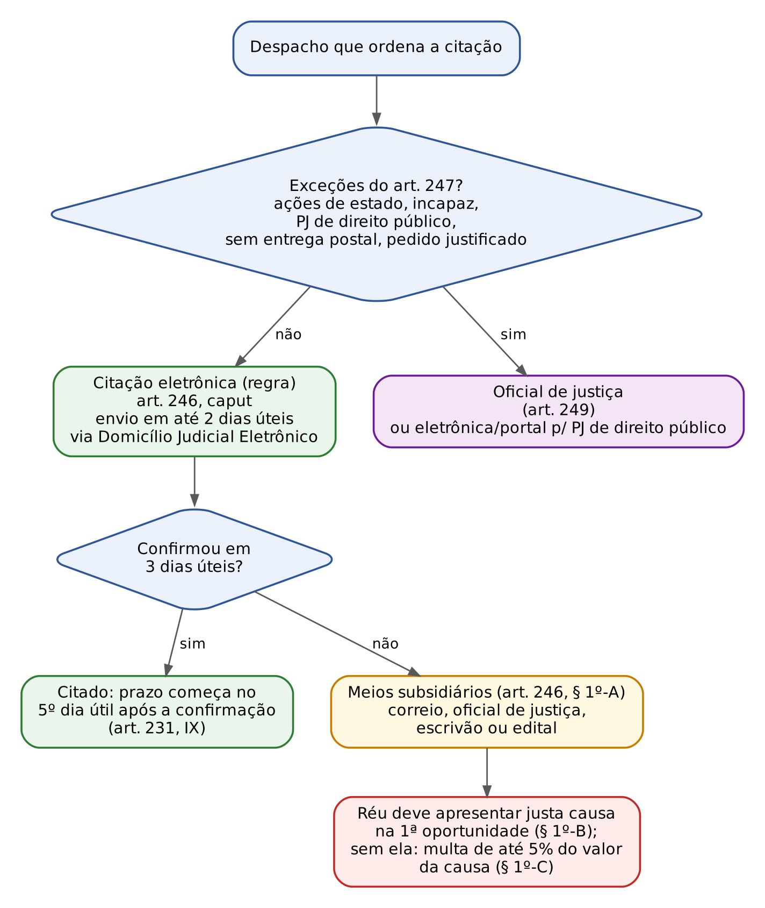
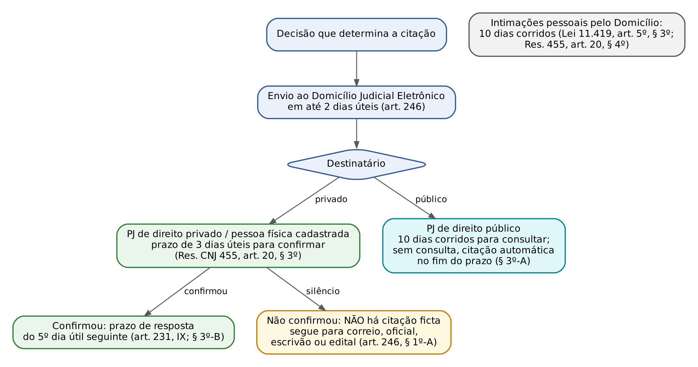
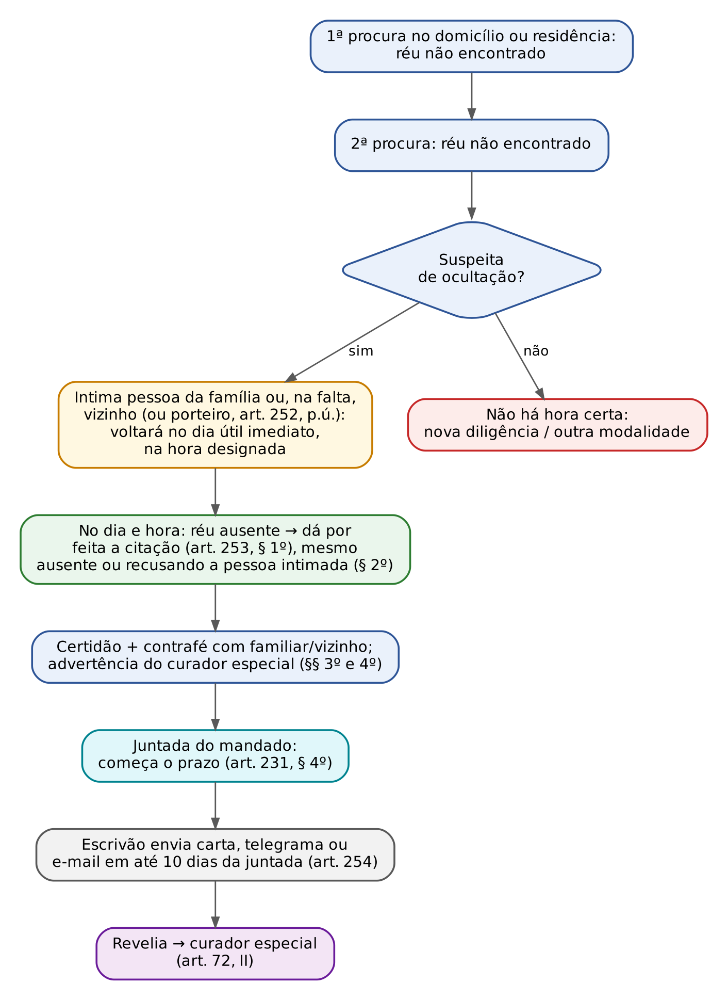
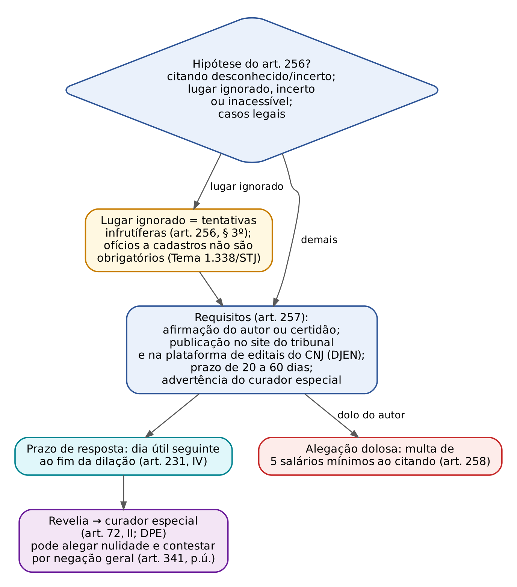
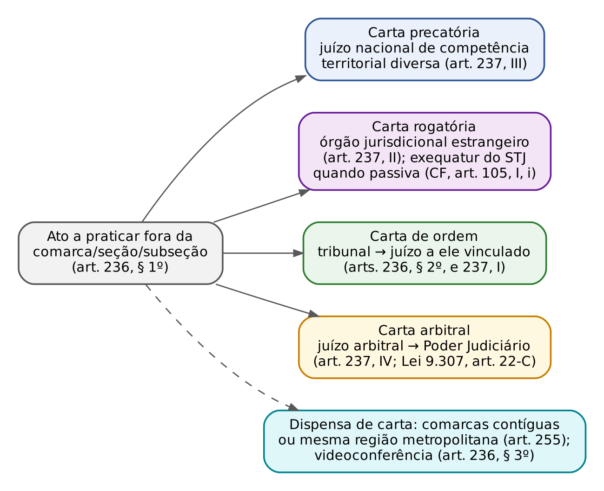
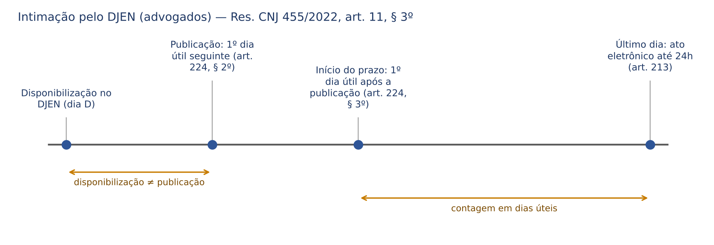
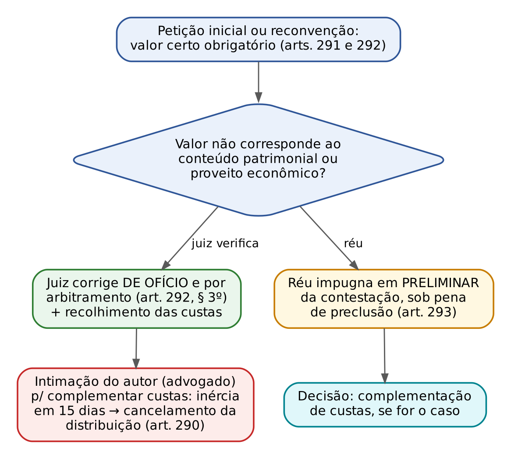

# CAPÍTULO 12 — COMUNICAÇÃO DOS ATOS, PROCESSO ELETRÔNICO, DISTRIBUIÇÃO E VALOR DA CAUSA

:::INCIDENCIA
TRF5 p. 5; TJRS p. 6; TJSC p. 5 e 17 (Lei 11.419/2006). Nível A+. Lote: 37 questões (FGV 23, FCC 14).
O que mais cai: modalidades e requisitos da citação (eletrônica após a Lei 14.195/2021, hora certa, edital, incapaz, portaria de condomínio), efeitos do art. 240, comparecimento espontâneo, nulidade de intimação e valor da causa (arts. 292 e 293).
:::

| Subtema | FGV | FCC | Padrão de cobrança |
|---|---|---|---|
| Citação: modalidades, requisitos, impedimentos, incapaz | 10 | 6 | caso prático com oficial de justiça; letra dos arts. 244 a 257 |
| Efeitos da citação e interrupção da prescrição | 1 | 3 | "ainda quando ordenada por juízo incompetente"; retroação do art. 240, § 1º |
| Comparecimento espontâneo e nulidade da intimação | 2 | 0 | termo inicial do prazo; art. 272, §§ 5º e 8º |
| Processo eletrônico (Lei 11.419 e CPC) | 2 | 0 | indisponibilidade do sistema; força probante do digitalizado |
| Distribuição por dependência | 2 | 0 | art. 286, II, após desistência |
| Valor da causa | 6 | 5 | incisos do art. 292; correção de ofício; preclusão do art. 293 |

## 12.1 Comunicação dos atos processuais: quadro geral

A comunicação dos atos é a face operacional do contraditório: sem ciência não há participação, e sem participação o pronunciamento é inválido (a teoria das invalidades fica no Cap. 13; os prazos em si, sua contagem e suspensão, no Cap. 11). O CPC organiza o tema no Livro IV, Título II: disposições gerais (arts. 236 e 237), citação (arts. 238 a 259), cartas (arts. 260 a 268) e intimações (arts. 269 a 275). A Lei 11.419/2006 e os atos do CNJ (art. 196 do CPC) disciplinam a camada eletrônica, hoje a regra.

Três ideias estruturam o capítulo e resolvem boa parte das questões:

- A citação convoca para integrar a relação processual (art. 238); a intimação dá ciência de atos e termos do processo (art. 269). Citar é chamar; intimar é cientificar. A citação é ato único e pessoal; as intimações são múltiplas e, em regra, dirigidas ao advogado.
- A ordem de preferência dos meios mudou com a Lei 14.195/2021: eletrônico primeiro (arts. 246 e 270), depois correio, oficial de justiça, escrivão e, por último, edital.
- Cada meio tem seu termo inicial de prazo próprio (art. 231). Errar o meio é errar o prazo, e a FGV explora isso em casos de litisconsórcio, carta precatória e citação eletrônica.

Os atos processuais são cumpridos por ordem judicial (art. 236, *caput*). Para atos fora dos limites territoriais do tribunal, da comarca, da seção ou da subseção, expede-se carta (art. 236, § 1º), ressalvadas as hipóteses legais: o oficial de justiça pode praticar citações, intimações, notificações, penhoras e outros atos executivos em comarcas contíguas de fácil comunicação ou da mesma região metropolitana (art. 255), e admite-se a prática de atos por videoconferência ou outro recurso de transmissão de sons e imagens em tempo real (art. 236, § 3º).

:::DICA
Art. 255 é faculdade do oficial ("poderá"), não dever; e abrange atos executivos (penhora), não só comunicação. A FCC costuma restringir o dispositivo a "citações e intimações" para tornar a assertiva falsa.
:::

## 12.2 Citação: conceito, indispensabilidade e pessoalidade

### 12.2.1 Conceito e destinatários

Art. 238: citação é o ato pelo qual são convocados "o réu, o executado ou o interessado" para integrar a relação processual. A inclusão do executado e do interessado (jurisdição voluntária) é proposital: o CPC/1973 falava em chamar o réu "a fim de se defender", fórmula que não servia à execução nem aos procedimentos sem lide. Por isso é falsa a afirmação de que a citação serve ao réu, "mas não ao executado" (FGV, Q2449077).

O parágrafo único do art. 238, incluído pela Lei 14.195/2021, manda efetivar a citação em até 45 dias a partir da propositura da ação. É prazo impróprio, dirigido ao aparato judiciário; seu descumprimento não gera nulidade nem prejudica o autor (art. 240, § 3º).

### 12.2.2 Indispensabilidade e as duas exceções

Art. 239, *caput*: a citação é indispensável "para a validade do processo", ressalvadas as hipóteses de indeferimento da petição inicial e de improcedência liminar do pedido. Nessas duas hipóteses o réu não é citado porque a sentença o favorece; transitada em julgado a sentença de mérito proferida em favor do réu antes da citação, o escrivão deve comunicar-lhe o resultado (art. 241).

:::PEGADINHA
O CPC fala em pressuposto de VALIDADE, não de existência. Em relação ao réu não citado, a doutrina majoritária vê vício transrescisório, atacável por *querela nullitatis* (Cap. 13), mas a letra do art. 239 é "validade". Em prova objetiva, assertiva que diga "para a existência do processo é indispensável a citação" tende a ser considerada errada (FGV, Q2362719, em que a alternativa correta foi outra, sobre quem deu causa à nulidade).
:::

:::QUESTAO FCC 2024 — TRF-3 — TÉCNICO JUDICIÁRIO (Q2564672)
Cobrou-se a letra dos arts. 239, 240, 245 e 247. Gabarito: C, a citação é requisito de validade do processo, salvo indeferimento da inicial e improcedência liminar. Armadilhas: (a) afirmar a citação por correio ou meio eletrônico para incapaz e pessoa de direito público (exceções do art. 247, II e III); (b) edital "sempre que frustrado o correio" (o correio frustrado leva ao oficial de justiça, art. 249); (c) citar o incapaz "independentemente de curador" (art. 245, § 5º); (d) efeitos "somente se ordenada por juízo competente" (art. 240 diz o contrário).
:::

No mesmo sentido, sobre a dispensa da citação nas duas hipóteses: FCC, Q3445927 (item III, falso por exigir a citação "mesmo" no indeferimento e na improcedência liminar).

### 12.2.3 Pessoalidade e citação na pessoa de terceiros

A citação é pessoal (art. 242), podendo ser feita na pessoa do representante legal ou do procurador do réu, do executado ou do interessado. O procurador só recebe citação se tiver poder específico: a procuração geral para o foro não habilita a "receber citação" (art. 105). Hipóteses de citação na pessoa de terceiro:

- mandatário, administrador, preposto ou gerente, na ausência do citando, quando a ação se originar de atos por eles praticados (art. 242, § 1º);
- administrador do imóvel encarregado de receber os aluguéis, quando o locador se ausentar do Brasil sem deixar procurador com poderes para receber citação (art. 242, § 2º), caso em que o administrador fica habilitado a representar o locador em juízo;
- União, Estados, DF, Municípios, autarquias e fundações de direito público: perante o órgão de Advocacia Pública responsável por sua representação judicial (art. 242, § 3º);
- curador nomeado ao citando incapaz (art. 245, § 5º).

### 12.2.4 Lugar e impedimentos temporários

A citação pode ser feita em qualquer lugar em que se encontre o citando (art. 243); o militar em serviço ativo é citado na unidade em que serve, se não conhecida a residência ou nela não encontrado (parágrafo único). O horário e os dias seguem o art. 212, § 2º: citações, intimações e penhoras podem ocorrer nas férias forenses, feriados ou fora do horário de 6 a 20 horas, independentemente de autorização judicial, respeitada a inviolabilidade do domicílio (CF, art. 5º, XI). A citação feita às 22 horas, sem demonstração de prejuízo, não é anulada (FGV, Q3114264, Cap. 13).

:::LEI CPC, ART. 244
Não se fará a citação, salvo para evitar o perecimento do direito: I - de quem estiver participando de ato de culto religioso; II - de cônjuge, de companheiro ou de qualquer parente do morto, consanguíneo ou afim, em linha reta ou na linha colateral em segundo grau, no dia do falecimento e nos 7 (sete) dias seguintes; III - de noivos, nos 3 (três) primeiros dias seguintes ao casamento; IV - de doente, enquanto grave o seu estado.
:::

Os detalhes cobrados: culto em andamento (não basta estar na igreja); parentes até o segundo grau colateral; 7 dias após o falecimento e 3 dias após o casamento; doente apenas "enquanto grave o seu estado" (não qualquer internação). A ressalva final ("salvo para evitar o perecimento do direito") autoriza a citação mesmo nessas situações.

:::QUESTAO FCC 2025 — TRT-1 — OFICIAL DE JUSTIÇA (Q3469452)
Pedia-se a pessoa que não pode ser citada, salvo para evitar perecimento do direito. Gabarito: C, doente enquanto grave o seu estado. Armadilhas: cônjuge do doente (a regra fala do cônjuge do MORTO), doente internado "independentemente do estado", casamento "na última semana" (são 3 dias) e pessoa na igreja sem culto em curso.
:::

### 12.2.5 Citando mentalmente incapaz ou impossibilitado

O art. 245 é campeão de cobrança em provas para oficial de justiça e para juiz. Não se faz a citação quando o citando é mentalmente incapaz ou está impossibilitado de recebê-la. O procedimento:

| Etapa | Regra | Dispositivo |
|---|---|---|
| Oficial de justiça | não cita; descreve e certifica minuciosamente a ocorrência | art. 245, § 1º |
| Juiz | nomeia médico para examinar o citando; laudo em 5 dias | art. 245, § 2º |
| Dispensa do médico | se pessoa da família apresentar declaração do médico do citando atestando a incapacidade | art. 245, § 3º |
| Reconhecida a impossibilidade | juiz nomeia curador ao citando, observada a preferência legal, restrita a nomeação à causa | art. 245, § 4º |
| Citação | na pessoa do curador, a quem incumbe a defesa dos interesses do citando | art. 245, § 5º |

O curador do art. 245 é curador à lide, restrito à causa: não se exige ação de curatela, nem se suspende ou extingue o processo. Distingue-se do curador especial do art. 72, que atua para o incapaz sem representante ou com interesses colidentes e para o revel citado de forma ficta (Cap. 7).

:::QUESTAO FGV 2024 — TJ-PE — JUIZ SUBSTITUTO (Q3117518)
O oficial certificou minuciosamente que o citando parecia mentalmente incapaz. O que faz o juiz? Gabarito: A, nomear médico para examinar o citando e apresentar laudo. Armadilhas: extinguir por falta de pressuposto, suspender até prova da incapacidade, citar por edital ou por hora certa. Nenhuma dessas soluções está no art. 245; o roteiro legal é exame médico, curador à causa e citação na pessoa do curador.
:::

No mesmo sentido: FGV, Q4153617 (TJSC, Oficial de Justiça; gabarito B, não citar, certificar e o juiz nomeia médico com laudo em 5 dias; erradas a citação ao cônjuge, a nomeação de curador pelo próprio oficial e o edital); FCC, Q3891325 (gabarito D, citação na pessoa do curador nomeado pelo juiz após certidão e laudo; erradas as alternativas que exigem ação de curatela ou sobrestamento).

## 12.3 Efeitos da citação válida

:::LEI CPC, ART. 240
A citação válida, ainda quando ordenada por juízo incompetente, induz litispendência, torna litigiosa a coisa e constitui em mora o devedor, ressalvado o disposto nos arts. 397 e 398 da Lei nº 10.406, de 10 de janeiro de 2002 (Código Civil). § 1º A interrupção da prescrição, operada pelo despacho que ordena a citação, ainda que proferido por juízo incompetente, retroagirá à data de propositura da ação. § 2º Incumbe ao autor adotar, no prazo de 10 (dez) dias, as providências necessárias para viabilizar a citação, sob pena de não se aplicar o disposto no § 1º. § 3º A parte não será prejudicada pela demora imputável exclusivamente ao serviço judiciário. § 4º O efeito retroativo a que se refere o § 1º aplica-se à decadência e aos demais prazos extintivos previstos em lei.
:::

### 12.3.1 O que mudou em relação ao CPC/1973

O art. 219 do CPC/1973 atribuía à citação cinco efeitos: prevenção do juízo, litispendência, litigiosidade da coisa, constituição em mora e interrupção da prescrição. O CPC/2015 redistribuiu dois deles:

- Prevenção: deixou de ser efeito da citação. Hoje decorre do registro ou da distribuição da petição inicial (art. 59; ver Cap. 5). Assertiva que diga que a citação "previne o juízo" está errada (FCC, Q3386991, alternativa C).
- Interrupção da prescrição: passou a ser efeito do DESPACHO que ordena a citação, em harmonia com o art. 202, I, do Código Civil, retroagindo à data da propositura (art. 240, § 1º). A citação continua indispensável para que a retroação se consolide, mas o marco interruptivo é o despacho.

Ficaram com a citação válida: litispendência, litigiosidade da coisa e constituição em mora (esta, ressalvados os arts. 397 e 398 do CC: na mora *ex re*, o devedor já está em mora pelo simples vencimento; nas obrigações provenientes de ato ilícito, desde a prática do ato). Todos esses efeitos se produzem "ainda quando ordenada por juízo incompetente", sem distinção entre incompetência absoluta e relativa.

:::QUESTAO FCC 2025 — TRT-1 — ANALISTA JUDICIÁRIO (Q3445927)
Itens sobre a citação. Gabarito: B (II e IV). Corretos: a interrupção operada pelo despacho retroage à propositura (II) e a citação válida induz litispendência e torna litigiosa a coisa (IV). Falsos: a citação ordenada por juiz incompetente seria inválida (I) e a citação seria indispensável mesmo no indeferimento e na improcedência liminar (III).
:::

No mesmo sentido: FCC, Q3386991 (gabarito D, retroação da interrupção ainda que o despacho seja de juízo incompetente; falsa a alternativa que inclui a prevenção entre os efeitos da citação); FGV, Q2449077 (alternativa C falsa: a citação válida ordenada por juízo relativamente incompetente torna a coisa litigiosa); FCC, Q4231778 (gabarito A, a citação válida da Fazenda constitui em mora e abre o prazo de resposta, com contagem em dobro; as demais alternativas negavam o processo eletrônico, ampliavam o prazo em dobro contra lei expressa, dispensavam o prejuízo para a nulidade e afastavam a preclusão para a Fazenda).

### 12.3.2 Interrupção da prescrição: a mecânica dos §§ 1º a 4º

O despacho interrompe; a interrupção retroage à propositura (data do protocolo, art. 312); a retroação depende de o autor adotar, em 10 dias, as providências para viabilizar a citação (recolher custas de diligência, indicar endereço, fornecer cópias); a demora imputável exclusivamente ao serviço judiciário não prejudica o autor (§ 3º, que positivou a Súmula 106 do STJ); e tudo se aplica à decadência e aos demais prazos extintivos (§ 4º).

:::JURIS STJ, SÚMULA 106
"Proposta a ação no prazo fixado para o seu exercício, a demora na citação, por motivos inerentes ao mecanismo da Justiça, não justifica o acolhimento da arguição de prescrição ou decadência." O CPC/2015 incorporou a orientação no art. 240, § 3º.
:::

Aplicação ao litisconsorte necessário incluído tardiamente por iniciativa do juízo: a citação válida dos corréus interrompe a prescrição também contra ele, com retroação à propositura (STJ, Tema 1.131; v. Cap. 9).

A extinção do processo sem resolução do mérito não apaga, em regra, a interrupção: o prazo volta a correr do trânsito em julgado da sentença terminativa, salvo nas extinções por paralisação (antigo art. 267, II e III, do CPC/1973), em que a inércia do autor impede o benefício (STJ, Tema 869, firmado sob o CPC/1973; a correspondência com o art. 485, II e III, do CPC/2015 é inferência da doutrina). A disciplina material da prescrição é da Apostila de Direito Civil.

:::QUESTAO FGV 2024 — TJ-AP — ANALISTA JUDICIÁRIO (Q2442322)
Petição protocolada em 5/6/2023; despacho de citação em 12/6/2023 com ordem ao autor para viabilizar a citação, que ele descumpriu; o réu acabou citado na secretaria em 26/6/2023, ao comparecer por outro motivo. Gabarito oficial: C, a prescrição se considera interrompida na data da citação (26/6/2023).
Passo 1: o despacho interrompe e a interrupção retroagiria à propositura (§ 1º). Passo 2: a retroação está condicionada às providências do autor em 10 dias (§ 2º); como ele nada fez, perde-se a retroação. Passo 3: a citação feita pelo escrivão é válida (art. 246, § 1º-A, III, e art. 231, III). A banca concluiu que, sem retroação, o marco é a própria citação.
Armadilha e ressalva: parte da doutrina sustenta que, perdida a retroação, a interrupção valeria na data do DESPACHO (alternativa B), porque é o despacho que interrompe (CC, art. 202, I). O gabarito adota a leitura de que, descumprido o § 2º, só a citação efetiva fixa o marco. Registre a divergência em prova discursiva.
:::

:::ATENCAO
Os efeitos materiais da citação (mora, litigiosidade) e o efeito processual da litispendência dependem de citação VÁLIDA. Citação nula não produz esses efeitos, mas o comparecimento espontâneo supre a falta ou a nulidade (art. 239, § 1º; ver 12.6) e, a partir dele, os efeitos se produzem.
:::

## 12.4 Modalidades de citação

### 12.4.1 Citação real e citação ficta

Citação real (ou pessoal) é aquela em que há certeza de que o citando tomou ciência: eletrônica com confirmação, correio com aviso de recebimento assinado, oficial de justiça com entrega da contrafé, escrivão. Citação ficta (ou presumida) é aquela em que a lei presume a ciência sem certeza dela: hora certa e edital. A consequência prática da distinção está no art. 72, II: ao revel citado por edital ou com hora certa nomeia-se curador especial, exercido pela Defensoria Pública, que não tem o ônus da impugnação especificada (art. 341, parágrafo único). Ao revel citado de forma real não se nomeia curador, salvo se estiver preso (Cap. 7 e Cap. 17).

A citação eletrônica não confirmada no prazo NÃO se converte em citação ficta para pessoas de direito privado: a falta de confirmação leva aos meios subsidiários (art. 246, § 1º-A). Já para as pessoas jurídicas de direito público, a Resolução CNJ 455/2022 adota a ciência automática ao fim de 10 dias corridos (ver 12.4.2).

### 12.4.2 Citação por meio eletrônico (Lei 14.195/2021)

:::LEI CPC, ART. 246, CAPUT E §§ 1º A 1º-C
A citação será feita preferencialmente por meio eletrônico, no prazo de até 2 (dois) dias úteis, contado da decisão que a determinar, por meio dos endereços eletrônicos indicados pelo citando no banco de dados do Poder Judiciário, conforme regulamento do Conselho Nacional de Justiça. § 1º As empresas públicas e privadas são obrigadas a manter cadastro nos sistemas de processo em autos eletrônicos, para efeito de recebimento de citações e intimações, as quais serão efetuadas preferencialmente por esse meio. § 1º-A A ausência de confirmação, em até 3 (três) dias úteis, contados do recebimento da citação eletrônica, implicará a realização da citação: I - pelo correio; II - por oficial de justiça; III - pelo escrivão ou chefe de secretaria, se o citando comparecer em cartório; IV - por edital. § 1º-B Na primeira oportunidade de falar nos autos, o réu citado nas formas previstas nos incisos I, II, III e IV do § 1º-A deste artigo deverá apresentar justa causa para a ausência de confirmação do recebimento da citação enviada eletronicamente. § 1º-C Considera-se ato atentatório à dignidade da justiça, passível de multa de até 5% (cinco por cento) do valor da causa, deixar de confirmar no prazo legal, sem justa causa, o recebimento da citação recebida por meio eletrônico.
:::

Pontos de prova, todos de letra:

- "Preferencialmente": a via eletrônica é a regra, não a única. Os incisos I a V do art. 246 (correio, oficial, escrivão, edital e meio eletrônico) foram revogados e reaparecem como meios subsidiários no § 1º-A.
- Endereço eletrônico: o "indicado pelo citando no banco de dados do Poder Judiciário", isto é, o cadastro no Domicílio Judicial Eletrônico, e não o e-mail informado pelo autor na inicial.
- Dois prazos distintos: até 2 dias úteis para o envio (prazo do cartório, contado da decisão) e até 3 dias úteis para a confirmação (prazo do citando, contado do recebimento).
- Termo inicial do prazo de resposta: "o quinto dia útil seguinte à confirmação" (art. 231, IX). A contestação, então, começa a correr no dia útil seguinte a esse quinto dia (art. 224).
- Obrigados ao cadastro: empresas públicas e privadas (§ 1º) e, pelo § 2º, União, Estados, DF, Municípios e entidades da administração indireta; pelo art. 270, parágrafo único, também o Ministério Público, a Defensoria Pública e a Advocacia Pública, para intimações. Microempresas e empresas de pequeno porte só se sujeitam ao § 1º se não tiverem endereço eletrônico cadastrado na Redesim (§ 5º), com compartilhamento de cadastro nos termos da legislação de sigilo fiscal e de proteção de dados (§ 6º).
- As citações por correio eletrônico seguem acompanhadas de orientações para a confirmação e de código identificador verificável na página do órgão judicial (§ 4º).
- Dever das partes de manter atualizados os dados cadastrais perante o Judiciário (art. 77, VII).
- Sanção: falta de confirmação sem justa causa é ato atentatório à dignidade da justiça, com multa de até 5% do valor da causa (§ 1º-C). O réu citado por meio subsidiário deve justificar a omissão "na primeira oportunidade de falar nos autos" (§ 1º-B).

:::PEGADINHA
A multa do art. 246, § 1º-C, é de ATÉ 5% do valor da causa. Não confunda com a multa do art. 77, § 2º (até 20%), nem com a do art. 258 (5 salários mínimos, para quem requer dolosamente o edital), nem com o art. 334, § 8º (até 2% pelo não comparecimento injustificado à audiência de conciliação).
:::

A regulamentação está na Resolução CNJ 455/2022, alterada pela Resolução CNJ 569/2024 (texto conferido em atos.cnj.jus.br):

| Situação no Domicílio Judicial Eletrônico | Regra | Dispositivo (Res. CNJ 455/2022) |
|---|---|---|
| Aperfeiçoamento da comunicação | no momento em que o destinatário obtém acesso ao conteúdo; consulta em dia não útil vale no primeiro dia útil seguinte | art. 20, *caput* e § 1º |
| Citação eletrônica sem acesso em 3 dias úteis do envio | o sistema gera a informação de ausência de citação, para os fins do art. 246, § 1º-A | art. 20, § 3º |
| Citação de pessoa jurídica de direito público sem consulta em 10 dias corridos | ente considerado automaticamente citado no término do prazo, sem aplicação do art. 219 do CPC | art. 20, § 3º-A |
| Citação consultada nos prazos | prazo de resposta a partir do quinto dia útil seguinte à confirmação (art. 231, IX) | art. 20, § 3º-B |
| Demais comunicações que exijam intimação pessoal | não consultadas em 10 dias corridos, consideram-se realizadas no término desse prazo (Lei 11.419, art. 5º, § 3º) | art. 20, § 4º |
| Uso do Domicílio | exclusivamente para citação eletrônica e comunicações que exijam vista, ciência ou intimação pessoal; a citação por edital vai ao DJEN | art. 18 |

:::QUESTAO FCC 2026 — PGM-MANAUS — PROCURADOR (Q4338807, ALTERNATIVA E)
Afirmava-se que, na citação eletrônica de pessoa jurídica de direito público, a falta de registro de ciência em 3 dias úteis tornaria tácita a ciência. Falsa (gabarito da questão: D, sobre preclusão *pro judicato*, Cap. 11). Para entes públicos o prazo é de 10 dias CORRIDOS, findos os quais há citação automática (Res. CNJ 455/2022, art. 20, § 3º-A); o prazo de 3 dias úteis é o do art. 246, § 1º-A, e sua consequência, para pessoas de direito privado, é a citação por outro meio, não a ciência tácita.
:::

:::DICA
Citação eletrônica de pessoa natural: o art. 246 não a proíbe, desde que haja endereço cadastrado pelo próprio citando no banco de dados do Judiciário (o cadastro de pessoa física no Domicílio é facultativo, Res. CNJ 455/2022, art. 16, § 2º). As exceções do art. 247 continuam valendo para qualquer meio eletrônico ou postal.
:::

### 12.4.3 Exceções: quando não cabe citação eletrônica nem postal

:::LEI CPC, ART. 247
A citação será feita por meio eletrônico ou pelo correio para qualquer comarca do País, exceto: I - nas ações de estado, observado o disposto no art. 695, § 3º; II - quando o citando for incapaz; III - quando o citando for pessoa de direito público; IV - quando o citando residir em local não atendido pela entrega domiciliar de correspondência; V - quando o autor, justificadamente, a requerer de outra forma.
:::

Duas observações. Primeira: o inciso III veda o CORREIO para pessoa de direito público, mas o art. 246, § 2º, e o art. 6º da Lei 11.419/2006 admitem expressamente a citação eletrônica "inclusive da Fazenda Pública". A leitura harmônica, adotada pela Resolução CNJ 455/2022 (arts. 16 e 20, § 3º-A), é que a pessoa de direito público é citada por meio eletrônico, via Domicílio, ou por oficial de justiça, nunca pelo correio (FGV, Q2449077, alternativa D falsa; FGV, Q2362719, alternativa E falsa). Segunda: nas ações de família, a citação é feita na pessoa do réu (art. 695, § 3º), com mandado desacompanhado da petição inicial (art. 695, § 1º) e antecedência mínima de 15 dias da audiência (art. 695, § 2º).

:::JURIS STJ, CORTE ESPECIAL, J. 3/3/2026 (INFORMATIVO 883; PROCESSO EM SEGREDO DE JUSTIÇA, RELATOR MINISTRO HERMAN BENJAMIN)
Em ações de estado é obrigatória a citação pessoal, sendo vedada pelo art. 247, I, a citação por meio eletrônico, a exemplo da feita por WhatsApp, tanto por chamada de voz quanto por mensagem de texto. O caso era de homologação de sentença estrangeira de divórcio.
:::

:::QUESTAO FGV 2026 — TCE-SC — AUDITOR (Q4088905)
Homologação de sentença estrangeira de divórcio no STJ; citação feita por oficial de justiça mediante chamada de voz no WhatsApp, certificada. Gabarito: B, inválida, porque chamada de voz e mensagem por aplicativo configuram citação eletrônica, vedada nas ações de estado. Armadilhas: tratar a chamada como "citação pessoal"; invocar a fé pública do oficial para validar o ato; atribuir ao WhatsApp natureza "híbrida" fora da vedação.
:::

### 12.4.4 Citação por meios atípicos: aplicativos de mensagens

Fora das ações de estado, a citação por aplicativo de mensagens não tem previsão legal no CPC. A Resolução CNJ 354/2020 (cumprimento digital de ato processual) autoriza que, nos casos em que cabível a citação pelo correio, por oficial de justiça ou pelo escrivão, o ato seja cumprido por meio eletrônico que assegure ter o destinatário tomado conhecimento do conteúdo (art. 8º), documentado por comprovante de envio e recebimento ou por certidão detalhada de como o destinatário foi identificado e tomou conhecimento (art. 10), vedadas, salvo ocultação, mensagens públicas (art. 10, § 2º). As partes devem informar endereços eletrônicos e dados para comunicação por aplicativos (art. 9º).

O STJ trata o tema pela liberdade das formas e pela finalidade (arts. 188 e 277): o ato atípico é válido se atingir a finalidade com ciência inequívoca, e inválido se houver dúvida razoável sobre a identidade do destinatário ou sobre a ciência.

Aplicação: o STJ validou citação por aplicativo sem documento com foto, com ciência inequívoca certificada pelo oficial de justiça (AREsp 3.129.052; v. Cap. 13, onde o julgado é desenvolvido).

:::ATENCAO
O STJ afetou o Tema 1.345 dos repetitivos: "definir se é válida a citação em ações cíveis por meio de aplicativo de mensagens ou de redes sociais". Até o fechamento desta apostila (5/11/2026), a tese não havia sido fixada. Para a INTIMAÇÃO que fundamenta prisão civil do devedor de alimentos, a Quarta Turma negou validade ao WhatsApp (RHC 227.145, Relator Ministro Raul Araújo, j. 3/3/2026, Informativo 880; Cap. 23).
:::

### 12.4.5 Citação pelo correio

Cabe para qualquer comarca do País, fora das exceções do art. 247, e passou a ser o primeiro meio subsidiário da citação eletrônica não confirmada. Requisitos:

- o escrivão remete cópias da petição inicial e do despacho, comunica o prazo de resposta, o endereço do juízo e o cartório (art. 248, *caput*); no processo de conhecimento, a carta contém os requisitos do mandado do art. 250 (art. 248, § 3º);
- carta registrada, exigindo o carteiro a assinatura do recibo pelo citando (art. 248, § 1º); a citação postal exige aviso de recebimento (Súmula 429 do STJ);
- pessoa jurídica: válida a entrega a pessoa com poderes de gerência geral ou de administração ou a funcionário responsável pelo recebimento de correspondências (art. 248, § 2º);
- condomínios edilícios e loteamentos com controle de acesso: válida a entrega ao funcionário da portaria responsável pelo recebimento de correspondência, que pode recusá-lo se declarar, por escrito, sob as penas da lei, que o destinatário está ausente (art. 248, § 4º).

:::JURIS STJ, RESP 1.840.466, RELATOR MINISTRO MARCO AURÉLIO BELLIZZE, TERCEIRA TURMA, J. 16/6/2020
Sendo o citando pessoa natural, a citação postal exige a entrega ao próprio réu, com assinatura do aviso de recebimento, sob pena de nulidade; a carta recebida por terceiro (no caso, no estabelecimento de que o réu era sócio) não basta. A exceção é a do art. 248, § 4º (portaria de condomínio ou loteamento com controle de acesso).
:::

A teoria da aparência entra aqui. Para a pessoa jurídica, o STJ já admitia, antes do CPC/2015, a validade da citação recebida, sem ressalvas, por quem se apresentava como apto a recebê-la no endereço da sede; o art. 248, § 2º, positivou a orientação ao validar a entrega ao funcionário responsável pela correspondência. A aparência protege o autor de boa-fé, mas tem limites: é inválida a citação da pessoa jurídica dirigida a endereço antigo quando a mudança foi registrada na Junta Comercial, ainda que o sítio eletrônico da empresa não tenha sido atualizado (STJ, REsp 1.976.741, Relator Ministro Paulo de Tarso Sanseverino, Terceira Turma, j. 26/4/2022, Informativo 734). Para a pessoa natural, a teoria da aparência não se aplica fora da hipótese legal do § 4º.

:::QUESTAO FCC 2025 — TRT-6 — OFICIAL DE JUSTIÇA (Q3215745)
Pedia-se quem pode receber validamente a citação de pessoa jurídica de direito privado. Gabarito: B, pessoa com poderes de gerência geral ou de administração ou funcionário responsável pelo recebimento de correspondências, por meio eletrônico, correio ou mandado. Armadilhas: excluir o funcionário da correspondência; restringir ao mandado; admitir "qualquer funcionário" da sede.
:::

:::QUESTAO FCC 2024 — TRT-7 — OFICIAL DE JUSTIÇA (Q3088390)
Carta de citação de pessoa física, residente em condomínio edilício, com indicação da unidade, recebida por funcionário. Gabarito: A, válida se entregue a funcionário da portaria responsável pelo recebimento de correspondência. Armadilhas: exigir prévia tentativa por oficial de justiça; restringir a regra à pessoa jurídica; admitir qualquer funcionário do condomínio.
:::

:::QUESTAO FGV 2026 — TJ-SC — OFICIAL DE JUSTIÇA E AVALIADOR (Q4153611)
O porteiro do condomínio de luxo recusa a entrada do oficial, mas se dispõe a receber o mandado dizendo que o morador viaja. Gabarito: B, o funcionário da portaria responsável pela correspondência pode receber o mandado, mas pode recusá-lo se declarar, por escrito, sob as penas da lei, que o morador está ausente. Observe que o § 4º do art. 248 fala em "mandado", embora esteja na seção do correio; a FGV o aplicou à diligência do oficial. Erradas: nulidade por falta de contato pessoal, edital por inacessibilidade, autorização do síndico e força policial.
:::

### 12.4.6 Citação por oficial de justiça

Cabe nas hipóteses previstas no CPC ou em lei, ou quando frustrada a citação pelo correio (art. 249), e, após a Lei 14.195/2021, também como meio subsidiário da eletrônica não confirmada. O mandado contém (art. 250): nomes e domicílios do autor e do citando; finalidade da citação, com as especificações da inicial e menção do prazo para contestar, sob pena de revelia, ou para embargar; sanção para o descumprimento da ordem, se houver; intimação para a audiência de conciliação ou mediação, se for o caso, com dia, hora e lugar; cópia da petição inicial, do despacho ou da decisão que deferir tutela provisória; e assinatura do escrivão com a declaração de que o subscreve por ordem do juiz.

Incumbe ao oficial procurar o citando e, onde o encontrar, citá-lo lendo o mandado e entregando a contrafé, portando por fé se a recebeu ou recusou e obtendo a nota de ciente ou certificando que o citando não a apôs (art. 251). A recusa em receber a contrafé ou em assinar não impede a citação: o oficial certifica, e sua certidão tem fé pública.

:::QUESTAO FGV 2026 — TJ-SC — OFICIAL DE JUSTIÇA E AVALIADOR (Q4153614)
O oficial certificou que o réu fugiu pulando o muro ao ver a viatura, e o porteiro disse não ter poderes para receber o mandado. Depois, o réu peticionou alegando que o oficial mentiu. Gabarito: D, a certidão do oficial goza de fé pública e presunção relativa de veracidade, cabendo ao réu provar a falsidade. Erradas: exigir áudio ou vídeo da diligência; renovação obrigatória da citação; edital por "local incerto"; nulidade automática apesar do comparecimento espontâneo. Note-se que o réu, ao peticionar, compareceu espontaneamente (art. 239, § 1º; ver 12.6), o que torna irrelevante discutir o vício.
:::

### 12.4.7 Citação com hora certa

:::LEI CPC, ARTS. 252 E 253
Art. 252. Quando, por 2 (duas) vezes, o oficial de justiça houver procurado o citando em seu domicílio ou residência sem o encontrar, deverá, havendo suspeita de ocultação, intimar qualquer pessoa da família ou, em sua falta, qualquer vizinho de que, no dia útil imediato, voltará a fim de efetuar a citação, na hora que designar. Parágrafo único. Nos condomínios edilícios ou nos loteamentos com controle de acesso, será válida a intimação a que se refere o caput feita a funcionário da portaria responsável pelo recebimento de correspondência. Art. 253. No dia e na hora designados, o oficial de justiça, independentemente de novo despacho, comparecerá ao domicílio ou à residência do citando a fim de realizar a diligência. § 1º Se o citando não estiver presente, o oficial de justiça procurará informar-se das razões da ausência, dando por feita a citação, ainda que o citando se tenha ocultado em outra comarca, seção ou subseção judiciárias. § 2º A citação com hora certa será efetivada mesmo que a pessoa da família ou o vizinho que houver sido intimado esteja ausente, ou se, embora presente, a pessoa da família ou o vizinho se recusar a receber o mandado. [...]
:::

Requisitos cumulativos e detalhes de letra:

- DUAS procuras infrutíferas (o CPC/1973 exigia três) no domicílio ou residência; a suspeita de ocultação deve existir após as procuras;
- intimação de pessoa da família ou, apenas na falta dela, de vizinho (ordem de preferência), ou do porteiro em condomínio ou loteamento com controle de acesso;
- retorno no DIA ÚTIL IMEDIATO, em HORA DESIGNADA (não "a qualquer hora");
- desnecessidade de novo despacho (o oficial age por conta própria; não precisa consultar o juiz);
- validade mesmo que a pessoa intimada esteja ausente ou se recuse a receber o mandado;
- certidão, contrafé deixada com familiar ou vizinho, com declaração do nome, e advertência de que será nomeado curador especial em caso de revelia (art. 253, §§ 3º e 4º);
- carta, telegrama ou correspondência eletrônica do escrivão ao réu, em 10 dias contados da juntada do mandado (art. 254);
- prazo de resposta contado da juntada do mandado (art. 231, § 4º, que remete ao inciso II), e não da carta do art. 254.

:::QUESTAO FGV 2025 — TJ-TO — JUIZ SUBSTITUTO (Q3453232)
O oficial, ao não encontrar o réu UMA vez, suspeitou de ocultação e intimou vizinho de que voltaria no dia útil seguinte; voltou, deu por feita a citação e deixou contrafé; o escrivão enviou telegrama 15 dias após a juntada; houve revelia, remessa ao curador especial, que arguiu nulidade e contestou por negação geral. Gabarito: A, o juiz acertou ao remeter ao curador, a quem assistia razão quanto à nulidade.
Passo 1: requisito das duas procuras ausente (art. 252), e o vizinho foi intimado sem indicação de falta de familiar. Passo 2: carta do art. 254 enviada fora dos 10 dias. Passo 3: revel citado com hora certa recebe curador especial (art. 72, II), que pode alegar nulidade da citação e contestar por negação geral (art. 341, parágrafo único). Armadilha: supor que o curador só pode contestar por negação geral, sem preliminares.
:::

:::QUESTAO FGV 2025 — TRT-24 — OFICIAL DE JUSTIÇA (Q3349684)
Carta citatória negativa; diligência por oficial, que encontra a esposa do réu dizendo desconhecer seu paradeiro e suspeita de ocultação. Gabarito: D, a oficial deve retornar mais uma vez e, persistindo a suspeita, intimar a esposa, qualquer pessoa da família ou qualquer vizinho de que voltará no dia útil imediato, em hora designada. Armadilhas: citar desde logo na pessoa da esposa; "dia seguinte, a qualquer hora"; devolver ao juiz para decidir (o art. 253 dispensa novo despacho).
:::

No mesmo sentido, sobre a exigência de duas e não três procuras: FGV, Q2362719 (alternativa D falsa). Sobre o curador especial do revel citado por hora certa, ser a Defensoria Pública e não o Ministério Público, sem ônus da impugnação especificada: FGV, Q2386968 (TJSC, Juiz, 2024) e Q2515305 (TJSC, Analista, 2024), desenvolvidas no Cap. 7.

### 12.4.8 Citação pelo escrivão ou chefe de secretaria

Quando o citando comparece em cartório, o escrivão ou chefe de secretaria pode citá-lo (art. 246, § 1º-A, III). O prazo começa na data da própria citação (art. 231, III). É a hipótese da Q2442322 (ver 12.3.2).

### 12.4.9 Citação por edital

:::LEI CPC, ARTS. 256 E 257
Art. 256. A citação por edital será feita: I - quando desconhecido ou incerto o citando; II - quando ignorado, incerto ou inacessível o lugar em que se encontrar o citando; III - nos casos expressos em lei. § 1º Considera-se inacessível, para efeito de citação por edital, o país que recusar o cumprimento de carta rogatória. § 2º No caso de ser inacessível o lugar em que se encontrar o réu, a notícia de sua citação será divulgada também pelo rádio, se na comarca houver emissora de radiodifusão. § 3º O réu será considerado em local ignorado ou incerto se infrutíferas as tentativas de sua localização, inclusive mediante requisição pelo juízo de informações sobre seu endereço nos cadastros de órgãos públicos ou de concessionárias de serviços públicos. Art. 257. São requisitos da citação por edital: I - a afirmação do autor ou a certidão do oficial informando a presença das circunstâncias autorizadoras; II - a publicação do edital na rede mundial de computadores, no sítio do respectivo tribunal e na plataforma de editais do Conselho Nacional de Justiça, que deve ser certificada nos autos; III - a determinação, pelo juiz, do prazo, que variará entre 20 (vinte) e 60 (sessenta) dias, fluindo da data da publicação única ou, havendo mais de uma, da primeira; IV - a advertência de que será nomeado curador especial em caso de revelia.
:::

O edital é medida excepcional, cabível só depois de esgotados razoavelmente os meios de localização. O art. 256, § 3º, gerou controvérsia sobre a obrigatoriedade de ofícios a cadastros públicos e concessionárias. O STJ a resolveu em repetitivo:

:::JURIS STJ, TEMA 1.338 (RESP 2.166.983 E RESP 2.162.483, CORTE ESPECIAL)
"A expedição de ofícios a cadastros de órgãos públicos ou a concessionárias de serviços públicos não é requisito obrigatório para a validade da citação por edital, competindo ao magistrado, à luz das circunstâncias do caso concreto, avaliar a suficiência das diligências realizadas e motivar a conclusão quanto ao esgotamento razoável dos meios disponíveis." Considera-se atendido, em regra, o § 3º quando infrutíferas as tentativas nos endereços dos autos e nos obtidos pelos sistemas informatizados de pesquisa à disposição do juízo, sem necessidade de esgotar meios extrajudiciais ou de oficiar a empresas privadas prestadoras de serviço público. Antes, no mesmo sentido: REsp 2.152.938, Relator Ministro Antonio Carlos Ferreira, Quarta Turma, j. 22/10/2024 (Informativo 832).
:::

Réu no exterior. O art. 256, § 1º, considera inacessível o país que recusa o cumprimento de carta rogatória, autorizando o edital. Mas a recusa não é o único caminho: se for incerto o endereço do réu no país estrangeiro, cabe o edital com base no art. 256, II, dispensada a rogatória; o simples fato de residir no exterior, com endereço conhecido, não autoriza o edital (STJ, REsp 2.145.294, Relatora Ministra Nancy Andrighi, Terceira Turma, j. 18/6/2024, Informativo 818).

Publicação. O edital é publicado no sítio do tribunal e na plataforma de editais do CNJ, que é o próprio DJEN (Res. CNJ 455/2022, art. 11, *caput*, e art. 13, IV), com certificação nos autos; o juiz pode determinar publicação também em jornal local de ampla circulação ou por outros meios (art. 257, parágrafo único); no lugar inacessível, divulgação também pelo rádio, se houver emissora na comarca (art. 256, § 2º). O prazo do edital (dilação) é fixado pelo juiz entre 20 e 60 dias, da primeira publicação; o prazo para contestar começa no dia útil seguinte ao fim da dilação (art. 231, IV).

Sanção. A parte que requerer o edital alegando dolosamente as circunstâncias autorizadoras paga multa de 5 salários mínimos, revertida ao citando (art. 258). A gratuidade da justiça não afasta o dever de pagar as multas processuais (art. 98, § 4º; Cap. 8).

Editais obrigatórios (art. 259): usucapião de imóvel, recuperação ou substituição de título ao portador e qualquer ação em que a lei exija a provocação de interessados incertos ou desconhecidos. Nas possessórias multitudinárias, o oficial procura os ocupantes no local por uma vez, citando-se pessoalmente os encontrados e por edital os demais, com intimação do MP e, havendo hipossuficientes, da Defensoria, e ampla publicidade (art. 554, §§ 1º a 3º; Cap. 29). Cabe edital na monitória (Súmula 282 do STJ) e, na execução fiscal, quando frustradas as demais modalidades (Súmula 414 do STJ; Cap. 28).

:::QUESTAO FGV 2025 — TJ-SC — JUIZ SUBSTITUTO (Q3324242)
O autor, beneficiário da gratuidade, pediu edital afirmando que o réu estava em lugar ignorado; o curador especial provou com documentos que o réu sempre teve endereço certo e que o autor sabia disso. Gabarito: A, reconhecer o vício, invalidar a citação, determinar sua renovação e impor multa ao autor, a despeito da gratuidade.
Passo 1: requisito material do art. 256 ausente; alegação dolosa. Passo 2: multa de 5 salários mínimos em favor do citando (art. 258). Passo 3: a gratuidade não afasta multas processuais (art. 98, § 4º). Passo 4: o vício da citação leva à repetição do ato, não à extinção; e a contestação do curador não convalida a citação nula (o curador não é o réu). Armadilhas: B (isentar da multa pela gratuidade), C (extinguir) e D (convalidar pela atuação do curador).
:::

:::QUESTAO FGV 2026 — TJ-RJ — ANALISTA JUDICIÁRIO (Q3868586)
Réu residente no exterior; o país recusou a rogatória; citação por edital; revelia certificada; sentença de procedência pela presunção de veracidade. Gabarito: B, acertou o edital (art. 256, § 1º), mas errou ao sentenciar sem nomear curador especial ao revel citado por edital (art. 72, II). Armadilhas: suspender até o réu voltar ao Brasil; extinguir; intimar o MP "pelo interesse de ausentes".
:::

:::QUESTAO FCC 2025 — TRT-2 — ANALISTA JUDICIÁRIO (Q3627615)
Requisito do edital: advertência de que, em caso de revelia, "será nomeado curador especial" (gabarito B, art. 257, IV). Armadilha: a advertência de presunção de veracidade (D) é a do mandado comum (art. 250, II, "sob pena de revelia"), não a do edital.
:::

No mesmo sentido: FGV, Q2449077 (gabarito E, edital quando o país recusa a rogatória); FGV, Q3301237 (TJSE, Juiz, 2025; curador especial contesta por negação geral, art. 341, parágrafo único; Cap. 7); FGV, Q3324243 (TJSC, Juiz, 2025; gabarito D: prosseguir com requisição de informações sobre o endereço da corré não localizada antes de pensar em edital; e não há revelia da ré já citada, porque, havendo mais de um réu, o prazo de contestação só começa com a última das citações, art. 231, § 1º; ver 12.7).

:::PRATIQUE EXERCÍCIO ELABORADO PARA ESTA APOSTILA (NÃO É QUESTÃO DE BANCA)
Banco réu, empresa de grande porte, recebe a citação no Domicílio Judicial Eletrônico em uma segunda-feira útil e não a abre. Na semana seguinte, é citado pelo correio, com AR juntado; contesta no prazo e silencia sobre a falta de confirmação. Qual a consequência?
Resolução: a falta de confirmação em 3 dias úteis levou à citação postal (art. 246, § 1º-A, I); o prazo correu da juntada do AR (art. 231, I). O banco deveria apresentar justa causa na primeira oportunidade (§ 1º-B); não o fazendo, o juiz pode aplicar multa de até 5% do valor da causa por ato atentatório (§ 1º-C), após contraditório (arts. 9º e 10). A contestação é tempestiva e não há revelia.
:::

## 12.5 Cartas: precatória, rogatória, de ordem e arbitral

| Carta | Quem expede e para quem | Objeto | Fundamento |
|---|---|---|---|
| De ordem | tribunal para juízo a ele vinculado, quando o ato deva ser praticado fora dos limites territoriais da sede do tribunal | qualquer ato (citação, prova, diligência); pressupõe vínculo hierárquico | arts. 236, § 2º, e 237, I |
| Rogatória | órgão jurisdicional brasileiro para órgão jurisdicional estrangeiro (ativa); a passiva depende de *exequatur* do STJ | ato de cooperação jurídica internacional relativo a processo em curso no Brasil | art. 237, II; CF, art. 105, I, "i"; arts. 35 e 36 |
| Precatória | órgão jurisdicional brasileiro para outro de competência territorial diversa, sem hierarquia | prática ou cumprimento de ato na área territorial do deprecado | art. 237, III |
| Arbitral | árbitro ou tribunal arbitral para órgão do Poder Judiciário | prática ou cumprimento de ato solicitado pelo árbitro, inclusive efetivação de tutela provisória | art. 237, IV; Lei 9.307/1996, art. 22-C |

Pontos cobrados:

- Justiça Federal sem vara no local: a carta relativa a processo da Justiça Federal ou de tribunal superior pode ser dirigida ao juízo estadual da comarca (art. 237, parágrafo único). É cooperação, não delegação de competência (a competência delegada do art. 109, § 3º, da CF está no Cap. 5).
- Requisitos comuns (art. 260): indicação dos juízes de origem e de cumprimento; inteiro teor da petição, do despacho e do instrumento de mandato; menção do ato objeto; encerramento com a assinatura do juiz. Perícia sobre documento: o original segue com a carta, ficando reprodução nos autos (§ 2º). A carta arbitral é instruída com a convenção de arbitragem e as provas da nomeação e da aceitação do árbitro (§ 3º), e no seu cumprimento observa-se o segredo de justiça se comprovada a confidencialidade da arbitragem (Lei 9.307, art. 22-C, parágrafo único; art. 189, IV, do CPC).
- Prazo de cumprimento fixado pelo juiz, conforme a facilidade das comunicações e a natureza da diligência (art. 261); as partes são intimadas da expedição (§ 1º) e acompanham o cumprimento no juízo destinatário, a quem compete a prática dos atos de comunicação (§ 2º).
- Caráter itinerante: a carta pode ser encaminhada a juízo diverso do que dela consta, antes ou depois de ordenado o cumprimento, comunicando-se imediatamente o expedidor, que intimará as partes (art. 262).
- Meio eletrônico preferencial, com assinatura eletrônica do juiz (art. 263; Lei 11.419, art. 7º); cartas de ordem e precatórias por telefone ou telegrama contêm em resumo substancial os requisitos do art. 250 (arts. 264 e 265).
- Recusa de cumprimento da precatória ou arbitral, com decisão motivada (art. 267): falta de requisitos legais, incompetência em razão da matéria ou da hierarquia (caso em que o deprecado pode remeter a carta ao juiz ou tribunal competente) e dúvida sobre a autenticidade. A incompetência TERRITORIAL do deprecado não está no rol, por causa do caráter itinerante.
- Cumprida, a carta é devolvida ao juízo de origem em 10 dias, independentemente de traslado (art. 268).
- Prazo: realizada a citação ou intimação por carta, o deprecado informa imediatamente, por meio eletrônico, ao deprecante (art. 232), e o prazo corre da juntada desse comunicado ou, não havendo, da juntada da carta cumprida aos autos de origem (art. 231, VI). Sob o CPC/1973, o STJ fixou que o prazo corre da juntada da carta (Tema 379; v. Cap. 11); o CPC/2015 antecipou o termo ao comunicado eletrônico.

:::DICA
O STJ dispensa a carta precatória para o leilão eletrônico de bens situados em outra comarca, porque o ato se realiza em ambiente virtual sob a direção do juízo da execução (orientação noticiada no Buscador Dizer o Direito; Cap. 25). É reflexo da mesma lógica do art. 236, § 3º: a territorialidade cede quando o ato não exige presença física.
:::

:::QUESTAO FGV 2024 — PREFEITURA DE SÃO JOSÉ DOS CAMPOS — PROCURADOR (Q3888043)
Pedia-se a INCORRETA sobre cooperação nacional e cartas. Gabarito: A, porque a cooperação recíproca entre os órgãos do Judiciário é DEVER (art. 67), e não mera recomendação. Corretas: pedido de cooperação sem forma específica (art. 69), atos concertados para centralização de processos repetitivos, cartas preferencialmente eletrônicas com assinatura eletrônica do juiz (art. 263) e carta de ordem pressupondo vínculo de hierarquia. A cooperação nacional é do Cap. 5.
:::

No mesmo sentido, sobre a carta arbitral expedida pelo árbitro ao Judiciário: FGV, Q4130153 (ENAC 2026, gabarito D; Cap. 2).

## 12.6 Comparecimento espontâneo, nulidade da citação e contumácia

### 12.6.1 Comparecimento espontâneo

:::LEI CPC, ART. 239, §§ 1º E 2º
§ 1º O comparecimento espontâneo do réu ou do executado supre a falta ou a nulidade da citação, fluindo a partir desta data o prazo para apresentação de contestação ou de embargos à execução. § 2º Rejeitada a alegação de nulidade, tratando-se de processo de: I - conhecimento, o réu será considerado revel; II - execução, o feito terá seguimento.
:::

A regra mudou em relação ao CPC/1973, que devolvia ao réu o prazo a partir da intimação da decisão que reconhecesse a nulidade. Agora o prazo flui da data do comparecimento. Por isso o réu que comparece apenas para alegar nulidade deve, por cautela, contestar desde logo: rejeitada a alegação, é revel (§ 2º, I); acolhida, o comparecimento já supriu o vício e o prazo começou a correr dele.

O que configura comparecimento espontâneo é questão de prova. Petição do réu nos autos, por advogado com procuração, mesmo sem poderes para receber citação, em regra o configura. O STJ, porém, exige atuação que revele ciência inequívoca da demanda:

:::JURIS STJ, RESP 2.164.750, RELATORA MINISTRA NANCY ANDRIGHI, TERCEIRA TURMA, J. 9/9/2025
Advogado sem poderes específicos para receber citação pode, por atuação defensiva efetiva, demonstrar ciência inequívoca da parte, configurando comparecimento espontâneo que dispensa a citação pessoal; a mera petição sem defesa substancial não basta. No caso, o executado praticou atos típicos de defesa e acompanhou diligências.
:::

Comparecimento antes do recebimento da inicial: a Terceira Turma do STJ decidiu que o comparecimento do réu antes de o juiz receber a petição inicial e designar a audiência de conciliação não deflagra automaticamente o prazo de contestação (STJ, REsp n. 1.909.271, Relator Ministro Ricardo Villas Bôas Cueva, Terceira Turma, j. 11/2/2025, Informativo 842). A lógica: não há o que contestar antes do juízo positivo de admissibilidade, e o procedimento comum prevê a audiência do art. 334 como termo inicial preferencial (art. 335, I).

:::QUESTAO FGV 2025 — AL-AM — PROCURADOR (Q3777943)
Após o juízo positivo de admissibilidade e antes de citado, o réu compareceu por advogado constituído e disse que contestaria no prazo; 40 dias úteis depois da (nula) citação, sem contestar, arguiu a nulidade, comprovando a entrega a terceiro. Gabarito: C, o comparecimento espontâneo supriu a nulidade, o prazo fluiu daquela data e o réu é revel.
Passo 1: a inicial já havia sido recebida (diferença em relação ao REsp 1.909.271). Passo 2: o réu peticionou por advogado, demonstrando ciência inequívoca. Passo 3: o prazo de 15 dias úteis correu do comparecimento (art. 239, § 1º) e se esgotou. Armadilhas: tratar a nulidade de citação como insuscetível de convalidação (A); prender o termo à juntada do mandado (B); dizer que o comparecimento afastaria o efeito material da revelia (E).
:::

No mesmo sentido: FGV, Q2449077 (alternativa A falsa: a nulidade PODE ser suprida pelo comparecimento); FGV, Q4102068 (JEC: comparecendo ambas as partes, a sessão de conciliação é instaurada de imediato, dispensados o registro prévio e a citação, Lei 9.099/1995, art. 17; Cap. 36).

### 12.6.2 Nulidade da citação: o que fica aqui e o que fica no Cap. 13

Aqui interessam os vícios de comunicação: citação de pessoa natural por carta recebida por terceiro; hora certa sem duas procuras ou sem suspeita de ocultação; edital sem esgotamento razoável das tentativas ou com alegação dolosa; citação eletrônica ou postal nas hipóteses vedadas do art. 247; citação do incapaz sem o procedimento do art. 245. A teoria geral (prejuízo, instrumentalidade, convalidação, vício transrescisório e *querela nullitatis*) está no Cap. 13. Lembre que o revel citado por edital ou hora certa tem curador especial, que pode arguir a nulidade da citação (Q3453232 e Q3324242), e que o executado revel citado por edital ou hora certa também recebe curador, com legitimidade para embargar (Súmula 196 do STJ; v. Cap. 26).

:::JURIS STJ, NULIDADE DO ATO E INTIMAÇÃO PESSOAL DO REVEL
A nomeação de curador especial ao réu citado por edital não dispensa a intimação pessoal do revel quando a lei a exigir na fase executiva, por exemplo, quanto à penhora (orientação noticiada no Buscador Dizer o Direito, consultado nesta tarefa; número do julgado não registrado). O curador representa processualmente, mas não substitui a ciência pessoal que a lei exige.
:::

### 12.6.3 Contumácia e revelia: distinção conceitual

Contumácia é a inércia da parte diante de um ônus processual, seja do autor, seja do réu. Revelia é a contumácia do réu quanto ao ônus de contestar, ou seja, a ausência jurídica de contestação tempestiva. A contumácia do autor tem consequências próprias: extinção por abandono (art. 485, III, após intimação pessoal, § 1º), cancelamento da distribuição por falta de custas (art. 290), perda da retroação da interrupção da prescrição (art. 240, § 2º). Efeitos da revelia, inclusive o art. 346 (prazos contra o revel sem patrono correm da publicação no órgão oficial) e a presunção relativa de veracidade, ficam no Cap. 17.

## 12.7 Termo inicial dos prazos conforme o meio de comunicação

A contagem (dias úteis, exclusão do dia do começo, prorrogações) é do Cap. 11. O que é próprio deste capítulo é o "dia do começo do prazo" de cada meio (art. 231), primeiro dia que, excluído, dá início à contagem no dia útil seguinte (art. 224).

| Meio de citação ou intimação | Dia do começo (art. 231) |
|---|---|
| Correio | data da juntada do aviso de recebimento (I) |
| Oficial de justiça e hora certa | data da juntada do mandado cumprido (II e § 4º) |
| Escrivão ou chefe de secretaria | data da ocorrência do ato (III) |
| Edital | dia útil seguinte ao fim da dilação assinada pelo juiz (IV) |
| Intimação eletrônica (portal ou Domicílio) | dia útil seguinte à consulta ou ao término do prazo para a consulta (V) |
| Carta precatória, rogatória ou de ordem | juntada do comunicado eletrônico do art. 232 ou, não havendo, juntada da carta cumprida (VI) |
| Diário da Justiça impresso ou eletrônico | data da publicação (VII) |
| Carga dos autos | dia da carga (VIII) |
| Citação eletrônica | quinto dia útil seguinte à confirmação (IX) |

Regras de litisconsórcio e de ato pessoal:

- Mais de um réu: o prazo para CONTESTAR começa da última das datas dos incisos I a VI (art. 231, § 1º). Note que o § 1º não menciona os incisos VII a IX.
- Mais de um intimado: o prazo para cada um é contado individualmente (§ 2º). O STJ aplica o § 2º ao prazo RECURSAL mesmo quando a intimação ocorre junto com a citação, restringindo o § 1º à contestação (REsp 1.897.379; v. Cap. 11).
- Ato a ser praticado pela própria parte, sem intermediação de representante: o prazo começa na data da comunicação (§ 3º), e não da juntada.
- Recurso do réu contra decisão anterior à citação: aplica-se o art. 231, I a VI (art. 1.003, § 2º).

:::QUESTAO FGV 2024 — TJ-AP — ANALISTA (Q2449083)
Litisconsortes passivos citados por oficial em dias distintos, sem audiência de conciliação. Gabarito: A, o prazo de contestação começa para todos no primeiro dia útil após a juntada do ÚLTIMO mandado cumprido (art. 231, § 1º, c/c art. 335, III). Armadilha: prazos individuais (alternativas B e E), que valem para intimações (§ 2º), não para a contestação.
:::

Desistência quanto a corréu não citado, com cancelamento da audiência: o prazo de contestação do réu já citado corre da intimação da decisão homologatória (STJ, REsp 2.180.502; v. Cap. 17).

## 12.8 Intimações

### 12.8.1 Conceito, impulso oficial e meios

Intimação é o ato pelo qual se dá ciência a alguém dos atos e termos do processo (art. 269). O juiz determina de ofício as intimações em processos pendentes, salvo disposição em contrário (art. 271). Ordem dos meios:

1. Meio eletrônico, sempre que possível, na forma da lei (art. 270), com aplicação ao MP, à Defensoria e à Advocacia Pública do dever de cadastro do art. 246, § 1º (art. 270, parágrafo único).

2. Não sendo eletrônica, publicação no órgão oficial (art. 272), hoje o DJEN para os advogados.

3. Inviável o meio eletrônico e não havendo órgão oficial na localidade: o escrivão intima os advogados pessoalmente, se domiciliados na sede do juízo, ou por carta registrada com AR, se domiciliados fora (art. 273).

4. Às partes, representantes e demais sujeitos, não dispondo a lei de outro modo: pelo correio ou, presentes em cartório, diretamente pelo escrivão (art. 274).

5. Frustrados o meio eletrônico e o correio: oficial de justiça (art. 275), cuja certidão contém lugar e descrição da pessoa intimada, declaração de entrega da contrafé e nota de ciente ou certidão de que não a apôs (§ 1º). Se necessário, intimação com hora certa ou por edital (§ 2º).

Outras regras de letra:

- Intimação entre advogados pelo correio: facultada, juntando-se cópia do ofício e do AR (art. 269, § 1º), instruído o ofício com cópia do ato (§ 2º).
- Fazenda Pública: intimação perante o órgão de Advocacia Pública (art. 269, § 3º); intimação pessoal por carga, remessa ou meio eletrônico (art. 183, § 1º). O mesmo regime de intimação pessoal vale para o MP (art. 180) e para a Defensoria (art. 186, § 1º), estendido aos escritórios de prática jurídica das faculdades e às entidades conveniadas com a Defensoria (art. 186, § 3º; STJ, REsp 1.829.747, Terceira Turma, j. 7/11/2023, Informativo 794, aplicando a prerrogativa aos núcleos de prática jurídica). A prerrogativa e o prazo em dobro são do Cap. 11 e do Cap. 27.
- Presunção de validade da intimação dirigida ao endereço constante dos autos, se a mudança não foi comunicada; o prazo flui da juntada do comprovante de entrega no endereço primitivo (art. 274, parágrafo único). É o fundamento do dever do art. 77, V.
- Carga dos autos implica intimação de qualquer decisão contida no processo retirado, ainda que pendente de publicação (art. 272, § 6º).

:::QUESTAO FCC 2026 — DPE-MT — DEFENSOR PÚBLICO (Q3954604)
Gabarito: B, a intimação pessoal do defensor (carga, remessa ou portal eletrônico) é condição de validade e não é suprida pela publicação no Diário da Justiça, ainda que conste o nome do membro. Fundamento: arts. 186, § 1º, e 183, § 1º; Res. CNJ 455/2022, art. 11, § 2º (a publicação no DJEN não substitui os casos de intimação pessoal, feitos pelo Domicílio).
:::

### 12.8.2 Publicação no órgão oficial e nulidades típicas

:::LEI CPC, ART. 272, §§ 2º, 5º, 8º E 9º
§ 2º Sob pena de nulidade, é indispensável que da publicação constem os nomes das partes e de seus advogados, com o respectivo número de inscrição na Ordem dos Advogados do Brasil, ou, se assim requerido, da sociedade de advogados. [...] § 5º Constando dos autos pedido expresso para que as comunicações dos atos processuais sejam feitas em nome dos advogados indicados, o seu desatendimento implicará nulidade. [...] § 8º A parte arguirá a nulidade da intimação em capítulo preliminar do próprio ato que lhe caiba praticar, o qual será tido por tempestivo se o vício for reconhecido. § 9º Não sendo possível a prática imediata do ato diante da necessidade de acesso prévio aos autos, a parte limitar-se-á a arguir a nulidade da intimação, caso em que o prazo será contado da intimação da decisão que a reconheça.
:::

Complementos: os advogados podem pedir que figure apenas o nome da sociedade registrada na OAB (§ 1º); a grafia dos nomes das partes não pode ter abreviaturas (§ 3º), e a dos advogados deve corresponder ao nome completo, igual ao da procuração ou ao do registro na OAB (§ 4º).

:::QUESTAO FGV 2025 — AL-AM — ASSESSOR JURÍDICO (Q3777495)
A autora pediu que as intimações fossem feitas exclusivamente em nome da advogada Roberta; o cartório publicou em nome de outro advogado do mesmo escritório, não constituído, inclusive a sentença; o prazo recursal transcorreu. Gabarito: A, reconhecer a nulidade da intimação e reabrir o prazo de apelação, com nova intimação em nome da advogada indicada.
Passo 1: pedido expresso desatendido gera nulidade (art. 272, § 5º). Passo 2: o advogado publicado não estava constituído, de modo que não há como presumir ciência. Passo 3: como a parte precisava de acesso prévio ao ato para recorrer, basta arguir a nulidade, e o prazo corre da intimação da decisão que a reconhecer (art. 272, § 9º). Armadilhas: exigir a interposição imediata da apelação com preliminar de nulidade (C, que é a regra do § 8º, mas sem prejuízo do § 9º), dever de fiscalização diária (E) e suficiência da publicação em nome de colega de escritório (D).
:::

:::PEGADINHA
Art. 272, § 8º x § 9º. Se a parte PODE praticar o ato (por exemplo, contestar ou recorrer, já conhecendo o conteúdo), deve fazê-lo alegando a nulidade em capítulo preliminar, e o ato será tido por tempestivo se o vício for reconhecido. Se NÃO pode praticá-lo sem acesso prévio aos autos, limita-se a arguir a nulidade, e o prazo corre da intimação da decisão que a reconhecer.
:::

### 12.8.3 Intimação para o cumprimento de sentença e Súmula 410

O art. 513, § 2º, fixa os meios de intimação do devedor para cumprir a sentença: Diário da Justiça, na pessoa do advogado constituído (I); carta com AR, quando representado pela Defensoria Pública ou sem procurador constituído (II); meio eletrônico, para as empresas do art. 246, § 1º, sem procurador constituído (III); e edital, quando citado por edital e revel na fase de conhecimento (IV). Requerido o cumprimento após 1 ano do trânsito em julgado, a intimação é na pessoa do devedor, por carta com AR (§ 4º). Esse é o fundamento da FCC, Q3215744 (devedor assistido pela Defensoria: intimação por carta com AR, gabarito C; Cap. 22). Para multa coercitiva em obrigação de fazer ou não fazer, o STJ mantém a exigência de prévia intimação pessoal (Súmula 410; Corte Especial, EREsp 1.360.577, j. 19/12/2018), tema afetado como Tema 1.296 dos repetitivos; ver Cap. 23.

## 12.9 Processo eletrônico

### 12.9.1 Fontes normativas e competência regulamentar

O processo eletrônico tem três camadas: (a) a Lei 11.419/2006, aplicável indistintamente aos processos civil, penal e trabalhista e aos juizados especiais, em qualquer grau (art. 1º, § 1º); (b) os arts. 193 a 199 do CPC, que tratam da prática eletrônica de atos; e (c) a regulamentação do CNJ e, supletivamente, dos tribunais (CPC, art. 196; Lei 11.419, art. 18).

:::LEI CPC, ART. 196
Compete ao Conselho Nacional de Justiça e, supletivamente, aos tribunais, regulamentar a prática e a comunicação oficial de atos processuais por meio eletrônico e velar pela compatibilidade dos sistemas, disciplinando a incorporação progressiva de novos avanços tecnológicos e editando, para esse fim, os atos que forem necessários, respeitadas as normas fundamentais deste Código.
:::

A competência regulamentar não autoriza criar regra processual contrária à lei: os atos do CNJ concretizam (prazos de consulta, funcionamento do Domicílio e do DJEN), mas não podem, por exemplo, reduzir prazos legais. Atos normativos centrais (ementas conferidas):

| Ato do CNJ | Conteúdo |
|---|---|
| Res. 185/2013 | institui o PJe como sistema de processamento de informações e prática de atos processuais |
| Res. 331/2020 | institui o DataJud, base nacional de dados do Poder Judiciário, fonte primária de dados estatísticos |
| Res. 335/2020 | política de governança e gestão do processo eletrônico; cria a Plataforma Digital do Poder Judiciário (PDPJ-Br), mantido o PJe como sistema prioritário |
| Res. 345/2020 | "Juízo 100% Digital" (adesão facultativa das partes) |
| Res. 354/2020 | cumprimento digital de ato processual e de ordem judicial (videoconferência, comunicação por meios eletrônicos atípicos) |
| Res. 372/2021 | Balcão Virtual (atendimento por videoconferência) |
| Res. 385/2021 | Núcleos de Justiça 4.0 |
| Res. 455/2022 | Portal de Serviços (jus.br), DJEN e Domicílio Judicial Eletrônico; alterada pelas Res. 569/2024 e 624/2025 |
| Res. 615/2025 | diretrizes para desenvolvimento, uso e governança de soluções de inteligência artificial no Judiciário |

:::DICA
Ponto do TRF5 menciona "interoperabilidade, integração de sistemas, coleta, tratamento e compartilhamento de dados processuais". A base legal está no art. 194 do CPC (interoperabilidade dos sistemas, serviços, dados e informações), no art. 195 (padrões abertos, autenticidade, integridade, temporalidade, não repúdio, conservação e confidencialidade, com ICP unificada), na Res. CNJ 455/2022, art. 23 (interoperabilidade do Domicílio e do Portal via API), e no art. 246, § 6º (compartilhamento de cadastro da Redesim observados o sigilo fiscal e a proteção de dados). O tratamento de dados pessoais segue a Lei 13.709/2018 (LGPD), referida expressamente na Res. 455, art. 16, § 1º. A Lei 11.419, art. 14, manda usar preferencialmente código aberto e identificar casos de prevenção, litispendência e coisa julgada.
:::

### 12.9.2 Princípios do CPC para o processo eletrônico

- Atos total ou parcialmente digitais, produzidos, comunicados, armazenados e validados eletronicamente; aplicação, no que couber, aos atos notariais e de registro (art. 193).
- Sistemas devem respeitar publicidade, acesso e participação das partes, inclusive em audiências e sessões, com disponibilidade, independência da plataforma, acessibilidade e interoperabilidade (art. 194).
- Informações do sistema de automação divulgadas pelos tribunais gozam de presunção de veracidade e confiabilidade; problema técnico e erro ou omissão do auxiliar no registro dos andamentos podem configurar justa causa (arts. 197 e 223).
- Equipamentos gratuitos à disposição dos interessados; onde não houver, admite-se a prática de atos por meio não eletrônico (art. 198).
- Acessibilidade para pessoas com deficiência aos sítios, ao meio eletrônico, à comunicação eletrônica e à assinatura eletrônica (art. 199).

### 12.9.3 Assinatura e identificação eletrônicas

A Lei 11.419 considera assinatura eletrônica (art. 1º, § 2º, III): (a) a assinatura digital baseada em certificado emitido por Autoridade Certificadora credenciada, na forma de lei específica (ICP-Brasil); e (b) a feita mediante cadastro de usuário no Poder Judiciário, conforme disciplinado pelos órgãos respectivos. O envio de petições exige assinatura eletrônica e credenciamento prévio no Judiciário, com identificação presencial do interessado (art. 2º e § 1º). Todos os atos do processo eletrônico são assinados eletronicamente (art. 8º, parágrafo único). A procuração pode ser assinada digitalmente (CPC, art. 105, § 1º).

O acesso ao Portal de Serviços exige o login único da PDPJ-Br (Res. 455, art. 5º), e o cadastro de pessoa física no Domicílio se faz por conta gov.br nível prata ou ouro ou por certificado digital (art. 16, § 2º). No plano probatório, o STJ admite títulos executivos extrajudiciais eletrônicos assinados por qualquer modalidade de assinatura eletrônica, sem exigir ICP-Brasil, desde que a integridade seja aferida por provedor de assinatura (orientação noticiada no Buscador Dizer o Direito; documentos eletrônicos no Cap. 19).

:::QUESTAO FGV 2025 — TJ-MS — JUIZ SUBSTITUTO (Q3786349)
Advogada perdeu o certificado digital; outra advogada, sem procuração nos autos, protocolou o recurso; recuperado o certificado, a constituída protocolou de novo no mesmo dia. Gabarito: B, inexistente o primeiro recurso e válido o segundo, tempestivo. A assinatura eletrônica identifica o signatário, e o ato assinado por advogado sem procuração não produz efeitos em nome da parte (desenvolvimento da capacidade postulatória no Cap. 7 e da preclusão consumativa no Cap. 11). Lição deste capítulo: a assinatura eletrônica é pessoal; quem assina é quem pratica o ato.
:::

### 12.9.4 Momento do ato, tempestividade e indisponibilidade

- Os atos eletrônicos consideram-se realizados no dia e hora do envio ao sistema, com protocolo eletrônico (Lei 11.419, art. 3º); para atender prazo, são tempestivas as petições transmitidas até as 24 horas do último dia (art. 3º, parágrafo único; art. 10, § 1º; CPC, art. 213), considerado o horário vigente no juízo perante o qual o ato deve ser praticado (CPC, art. 213, parágrafo único).
- Indisponibilidade do sistema por motivo técnico: o prazo fica automaticamente prorrogado para o primeiro dia útil seguinte à resolução do problema (Lei 11.419, art. 10, § 2º); o CPC protrai os dias do começo e do vencimento se houver indisponibilidade da comunicação eletrônica (art. 224, § 1º). A Res. CNJ 455/2022 objetiva os critérios: prorrogam-se os prazos que vencerem no dia em que a indisponibilidade for superior a 60 minutos, ainda que não ininterrupta, entre 6 e 23 horas, ou ocorrer qualquer indisponibilidade entre 23 e 24 horas (art. 8º); indisponibilidades entre 0 e 6 horas, em feriados e fins de semana não produzem efeito (§ 1º); não caracterizam indisponibilidade as falhas dos equipamentos do usuário ou de sua conexão (art. 6º, § 1º).

:::QUESTAO FGV 2024 — TJ-MT — JUIZ SUBSTITUTO (Q3086936)
Contestação protocolada às 0h30 do dia seguinte ao último dia, porque o sistema do tribunal estava indisponível. Gabarito: C, comprovada a indisponibilidade, o ato pode ser considerado tempestivo. Armadilhas: limite das 20 horas (que é do protocolo físico, art. 212, § 3º); intempestividade porque "a prorrogação não se aplica a atos eletrônicos" (o art. 10, § 2º, da Lei 11.419 diz o contrário); revelia e julgamento liminar.
:::

### 12.9.5 Comunicação eletrônica: portal, DJe/DJEN e Domicílio

Lei 11.419. O Diário da Justiça eletrônico substitui qualquer outro meio de publicação oficial, exceto os casos em que a lei exige intimação ou vista pessoal (art. 4º, § 2º); considera-se publicado no primeiro dia útil seguinte ao da disponibilização (§ 3º), e o prazo começa no primeiro dia útil seguinte à publicação (§ 4º; CPC, art. 224, §§ 2º e 3º). As intimações por portal próprio aos cadastrados dispensam a publicação no órgão oficial (art. 5º), realizam-se no dia da consulta ou, se esta ocorrer em dia não útil, no primeiro dia útil seguinte (§§ 1º e 2º), e, não consultadas em 10 dias corridos do envio, consideram-se realizadas no término desse prazo (§ 3º). Nos casos urgentes ou de tentativa de burla, o juiz determina outro meio (§ 5º). As intimações por portal, inclusive da Fazenda, são consideradas pessoais para todos os efeitos legais (§ 6º), e as citações, intimações e notificações que viabilizem o acesso à íntegra dos autos equivalem a vista pessoal (art. 9º, § 1º). A citação eletrônica é admitida, inclusive da Fazenda, excetuadas as dos processos criminal e infracional, desde que a íntegra dos autos seja acessível ao citando (art. 6º).

:::QUESTAO FGV 2025 — MPE-RJ — ANALISTA (Q3362526)
V/F. (1) A intimação eletrônica do MP não supre a intimação pessoal: FALSO (Lei 11.419, arts. 5º, § 6º, e 9º, § 1º; CPC, art. 183, § 1º, aplicado ao MP pelo art. 180). (2) A impossibilidade de acesso ao sistema prorroga o prazo "em qualquer hipótese": FALSO (só a indisponibilidade do sistema do Judiciário, não a falha do usuário). (3) Documentos produzidos eletronicamente com garantia de origem e signatário são originais, e os digitalizados têm a mesma força probante, ressalvada a alegação motivada de adulteração antes ou durante a digitalização: VERDADEIRO (art. 11 e § 1º). Gabarito: B (F, F, V).
:::

Regime atual da Res. CNJ 455/2022 (após a Res. 569/2024; o CNJ fixou 15/5/2025 como prazo final de integração dos tribunais e 16/5/2025 como início da contagem exclusivamente pelo DJEN ou pelo Domicílio):

- DJEN: instrumento de publicação dos atos judiciais e plataforma de editais do CNJ (art. 11); substitui os diários dos tribunais (art. 12); publica despachos, decisões interlocutórias, dispositivo das sentenças e ementas dos acórdãos (art. 13, I; CPC, art. 205, § 3º), as intimações destinadas aos advogados cuja ciência não exija vista ou intimação pessoal (II), a lista de distribuição (III) e os editais (IV).
- Prevalência: nos casos em que a lei não exige vista ou intimação pessoal, os prazos são contados da publicação no DJEN (art. 224, §§ 1º e 2º), tendo valor meramente informacional eventual comunicação concomitante por outro meio (art. 11, § 3º, na redação da Res. 569/2024).
- Domicílio Judicial Eletrônico: exclusivamente para citação eletrônica e comunicações que exijam vista, ciência ou intimação pessoal; o edital vai ao DJEN (art. 18); cadastro obrigatório para entes públicos, administração indireta e empresas públicas e privadas (art. 16), facultativo para pessoas físicas (§ 2º), e aplicável ao MP, à Defensoria e à Advocacia Pública (§ 3º).

:::JURIS STJ, EARESP 1.663.952, RELATOR MINISTRO RAUL ARAÚJO, CORTE ESPECIAL, J. 19/5/2021 (INFORMATIVO 697)
Havendo duplicidade de intimações eletrônicas, prevalece, para a contagem do prazo, a intimação pelo portal eletrônico sobre a publicação no Diário da Justiça eletrônico. Atenção: o STJ afetou o Tema 1.180 ("definir o marco inicial do prazo recursal nos casos de intimação eletrônica e de publicação no Diário da Justiça eletrônico"), ainda sem tese em 5/11/2026; e a Res. CNJ 569/2024 passou a atribuir ao DJEN a contagem quando não exigida intimação pessoal, relegando o outro meio a caráter informativo. Em prova, distinga: entendimento do EAREsp (casos anteriores ao novo regime) x regra regulamentar atual x tema pendente.
:::

:::JURIS STJ, RESP 2.018.319, RELATOR MINISTRO JOÃO OTÁVIO DE NORONHA, QUARTA TURMA, J. 20/2/2024 (INFORMATIVO 801)
É nula a alteração ou alternância, sem aviso prévio, do meio de intimação eletrônica (portal ou diário) no curso do processo, quando causar prejuízo, como a impossibilidade de comparecer à sessão e fazer sustentação oral. Também do STJ: a intimação eletrônica em nome do advogado cadastrado é pessoal e se reputa feita na consulta ou no fim dos 10 dias corridos (REsp 1.574.008, Relatora Ministra Nancy Andrighi, Terceira Turma, j. 12/3/2019, Informativo 644).
:::

### 12.9.6 Documentos, autos e acesso

- Documentos produzidos eletronicamente com garantia de origem e signatário são originais (Lei 11.419, art. 11); extratos digitais e documentos digitalizados juntados por órgãos da Justiça, MP, procuradorias, autoridades policiais, repartições públicas e advogados têm a mesma força probante dos originais, ressalvada a alegação motivada e fundamentada de adulteração antes ou durante a digitalização (§ 1º); a arguição de falsidade do original é processada eletronicamente (§ 2º); os originais são preservados até o trânsito em julgado ou, quando admitida, até o fim do prazo da rescisória (§ 3º).
- Documentos de digitalização inviável por volume ou ilegibilidade: apresentados ao cartório ou por protocolo integrado em 10 dias do envio de petição comunicando o fato (§ 5º, redação da Lei 14.318/2022).
- Acesso: partes, advogados independentemente de procuração, MP e magistrados acessam os digitalizados pela rede externa, salvo segredo de justiça (§ 6º); advogados, procuradores e membros do MP cadastrados, mas não vinculados ao processo, acessam automaticamente, demonstrado interesse para fins apenas de registro, salvo segredo (§ 7º).
- Título executivo no processo eletrônico: em regra não se exige a via original; o juiz avalia, caso a caso, se há fato concreto que ponha em dúvida autenticidade, titularidade ou exigibilidade (STJ, REsp 2.015.911, Relator Ministro Antonio Carlos Ferreira, Quarta Turma, j. 17/3/2026, Informativo 883).
- Distribuição da inicial e juntada de petições pelos próprios advogados, sem intervenção do cartório, com autuação automática e recibo eletrônico (art. 10); a parte informa, ao distribuir a inicial, o CPF ou CNPJ, salvo impossibilidade que comprometa o acesso à justiça (art. 15).
- Autos eletrônicos remetidos a juízo sem sistema compatível são impressos (art. 12, § 2º); a digitalização de autos físicos é precedida de intimação das partes para, em 30 dias preclusivos, manifestarem interesse em guardar originais (§ 5º).
- O juiz pode determinar exibição e envio eletrônico de dados e documentos necessários à instrução, considerando-se cadastros públicos, inclusive os mantidos por concessionárias e empresas privadas, os que contenham informações indispensáveis à função judicante (art. 13 e § 1º). É a base das pesquisas de endereço que dão suporte ao art. 256, § 3º, e ao Tema 1.338.

## 12.10 Distribuição e registro

:::LEI CPC, ARTS. 284 A 286
Art. 284. Todos os processos estão sujeitos a registro, devendo ser distribuídos onde houver mais de um juiz. Art. 285. A distribuição, que poderá ser eletrônica, será alternada e aleatória, obedecendo-se rigorosa igualdade. Parágrafo único. A lista de distribuição deverá ser publicada no Diário de Justiça. Art. 286. Serão distribuídas por dependência as causas de qualquer natureza: I - quando se relacionarem, por conexão ou continência, com outra já ajuizada; II - quando, tendo sido extinto o processo sem resolução de mérito, for reiterado o pedido, ainda que em litisconsórcio com outros autores ou que sejam parcialmente alterados os réus da demanda; III - quando houver ajuizamento de ações nos termos do art. 55, § 3º, ao juízo prevento. [...]
:::

Registro é sempre obrigatório; distribuição, só onde houver mais de um juiz. A distribuição é alternada, aleatória e igualitária, materialização do juiz natural, e sua lista é publicada (hoje no DJEN, Res. 455, art. 13, III). O registro ou a distribuição tornam prevento o juízo (art. 59; Cap. 5).

A distribuição por dependência (art. 286) é a ferramenta contra a escolha do juízo: conexão ou continência (I); reiteração do pedido após extinção sem resolução do mérito, ainda que com novos litisconsortes ativos ou réus parcialmente alterados (II); risco de decisões conflitantes do art. 55, § 3º (III). O inciso II é o mais cobrado: abrange QUALQUER extinção sem mérito (desistência, abandono, indeferimento), e a inclusão de outro autor ou a alteração parcial do polo passivo não afasta a dependência. A hipótese é de competência funcional, absoluta, de modo que o juízo que recebe a segunda demanda deve declinar de ofício.

Demais regras: ampliação objetiva do processo (intervenção de terceiro, reconvenção) é anotada pelo distribuidor por ordem do juiz, de ofício (art. 286, parágrafo único); a inicial vem acompanhada de procuração com endereços eletrônico e não eletrônico do advogado, dispensada nos casos do art. 104 (urgência), da Defensoria Pública e de representação decorrente de norma constitucional ou legal (art. 287); o juiz corrige o erro ou compensa a falta de distribuição de ofício ou a requerimento (art. 288); a distribuição pode ser fiscalizada pela parte, por seu procurador, pelo MP e pela Defensoria (art. 289); e é cancelada se a parte, intimada na pessoa de seu advogado, não pagar custas e despesas de ingresso em 15 dias (art. 290).

:::QUESTAO FGV 2024 — TJ-PE — JUIZ SUBSTITUTO (Q3117521)
Ação de anulação de assembleia condominial distribuída à 1ª Vara; desistência homologada antes da citação; três meses depois, mesma demanda com novo autor (Carlos) distribuída à 2ª Vara, que declinou para a 1ª; a 1ª devolveu os autos. Gabarito: D, se a 1ª Vara suscitasse conflito negativo, o tribunal deveria rejeitá-lo, porque a competência é dela (art. 286, II).
Passo 1: extinção sem mérito (desistência) e reiteração do pedido, com litisconsorte ativo novo: dependência. Passo 2: não há coisa julgada material (A errada) nem conflito a ser suscitado pela 2ª Vara, que acertou ao declinar (B). Passo 3: a 1ª Vara errou ao simplesmente devolver os autos (C); o conflito, se suscitado, seria conhecido e rejeitado, não "não conhecido" (E).
:::

:::QUESTAO FGV 2024 — ENAM — REAPLICAÇÃO (Q2507020)
Desistência homologada antes da citação; uma semana após o trânsito, nova ação idêntica com inclusão do candidato nomeado no polo passivo, distribuída livremente ao Juízo Y. Gabarito: A, o Juízo Y deve declinar da competência em favor do Juízo X. Fundamento: art. 286, II, que expressamente abrange réus parcialmente alterados. Armadilhas: litispendência (o primeiro processo acabou), coisa julgada material (a desistência gera sentença terminativa) e suscitar conflito (não há divergência entre juízos).
:::

:::PEGADINHA
A dependência do art. 286, II, nada tem a ver com o mérito: a segunda ação não é extinta; ela é remetida ao juízo do primeiro processo. E o fundamento não é conexão (o primeiro processo já foi extinto), mas a regra específica contra a burla ao juiz natural.
:::

## 12.11 Valor da causa

### 12.11.1 Funções e obrigatoriedade

Art. 291: a toda causa será atribuído valor certo, "ainda que não tenha conteúdo econômico imediatamente aferível". O valor da causa é requisito da petição inicial (art. 319, V) e da reconvenção (art. 292, *caput*) e repercute em custas, honorários (art. 85, §§ 2º e 8º; Cap. 8), multas processuais (arts. 77, § 2º, 81 e 246, § 1º-C), competência dos Juizados (Caps. 36 e 37), e cabimento de embargos infringentes na execução fiscal (LEF, art. 34). Por isso, é falso que se dispense valor às causas sem conteúdo econômico, às reconvenções ou às indenizatórias por dano moral (FGV, Q3453230; FCC, Q3088391 e Q3542114).

### 12.11.2 Critérios legais do art. 292

:::LEI CPC, ART. 292
O valor da causa constará da petição inicial ou da reconvenção e será: I - na ação de cobrança de dívida, a soma monetariamente corrigida do principal, dos juros de mora vencidos e de outras penalidades, se houver, até a data de propositura da ação; II - na ação que tiver por objeto a existência, a validade, o cumprimento, a modificação, a resolução, a resilição ou a rescisão de ato jurídico, o valor do ato ou o de sua parte controvertida; III - na ação de alimentos, a soma de 12 (doze) prestações mensais pedidas pelo autor; IV - na ação de divisão, de demarcação e de reivindicação, o valor de avaliação da área ou do bem objeto do pedido; V - na ação indenizatória, inclusive a fundada em dano moral, o valor pretendido; VI - na ação em que há cumulação de pedidos, a quantia correspondente à soma dos valores de todos eles; VII - na ação em que os pedidos são alternativos, o de maior valor; VIII - na ação em que houver pedido subsidiário, o valor do pedido principal. § 1º Quando se pedirem prestações vencidas e vincendas, considerar-se-á o valor de umas e outras. § 2º O valor das prestações vincendas será igual a uma prestação anual, se a obrigação for por tempo indeterminado ou por tempo superior a 1 (um) ano, e, se por tempo inferior, será igual à soma das prestações. § 3º O juiz corrigirá, de ofício e por arbitramento, o valor da causa quando verificar que não corresponde ao conteúdo patrimonial em discussão ou ao proveito econômico perseguido pelo autor, caso em que se procederá ao recolhimento das custas correspondentes.
:::

| Situação | Valor da causa | Pegadinha típica |
|---|---|---|
| Cumulação simples ou sucessiva | soma de todos os pedidos (VI) | "o de maior valor" (é o critério dos alternativos) |
| Pedidos alternativos | o de maior valor (VII) | "o de menor valor" |
| Pedido subsidiário (eventual) | o do pedido principal (VIII) | "soma" ou "o maior" |
| Alimentos | 12 prestações mensais pedidas (III) | 24 prestações ou uma prestação |
| Dano moral | o valor pretendido (V) | dispensa de valor ou valor simbólico |
| Ato jurídico (validade, cumprimento, rescisão) | valor do ato ou da parte controvertida (II) | valor do proveito ou do dano |
| Vencidas e vincendas | soma de umas e outras; vincendas = 1 prestação anual se prazo indeterminado ou superior a 1 ano (§§ 1º e 2º) | considerar só as vencidas |
| Divisão, demarcação, reivindicação | valor de avaliação da área ou do bem (IV) | valor venal fiscal |

Antes do CPC/2015, o STJ admitia valor estimativo nas indenizatórias por dano moral com pedido genérico; o inciso V superou essa prática ao exigir o "valor pretendido". A Súmula 449 do STF (consignatória de aluguel: uma anuidade) foi absorvida pela regra da Lei do Inquilinato (Cap. 35), e a Súmula 502 do STF, sobre alçada do CPC de 1939, é histórica.

:::QUESTAO FGV 2026 — TJ-MS — CARTÓRIOS (Q3914508)
Pedido principal de restituição de veículo avaliado em 80 mil reais e pedido subsidiário de perdas e danos de 100 mil reais. Gabarito: C, valor da causa de 80.000 (oitenta mil) reais, o do pedido principal (art. 292, VIII). Armadilhas: estimativa livre, valor dependente do pedido acolhido, valor do maior pedido e soma de ambos.
:::

:::QUESTAO FGV 2024 — ENAM 2024.2 (Q3058650)
Gabarito: D, impugnação em preliminar de contestação, sob pena de preclusão, com complementação de custas se for o caso (art. 293). Erradas: alimentos por 24 prestações (são 12); cumulação pelo maior pedido (é a soma); alternativos pelo menor (é o maior); e correção pelo juiz "apenas liminarmente", depois só a requerimento do réu (o § 3º não limita o momento).
:::

No mesmo sentido, sobre os incisos do art. 292: FCC, Q3233114 (gabarito A, indenizatória inclusive por dano moral, o valor pretendido; erradas a cumulação pelo maior, a reconvenção pelo valor da inicial, alimentos por uma prestação e subsidiário pela soma); FCC, Q3088391 e Q3542114 (subsidiário não se soma; alternativos pelo maior, e não pelo principal).

### 12.11.3 Controle do valor: correção de ofício e impugnação

O sistema tem duas vias:

- Correção de ofício e por arbitramento pelo juiz, sempre que o valor não corresponder ao conteúdo patrimonial ou ao proveito econômico, com recolhimento das custas correspondentes (art. 292, § 3º). Não há preclusão para o juiz: a correção pode ocorrer liminarmente ou depois, inclusive após a perícia revelar o valor real do bem. Não recolhidas as custas complementares no prazo, o juiz cancela a distribuição (art. 290) ou, já citado o réu, extingue sem mérito por falta de pressuposto (orientação comum na doutrina; o art. 290 fala em "custas e despesas de ingresso").
- Impugnação pelo réu em preliminar de contestação, sob pena de preclusão (arts. 293 e 337, III). Acabou o incidente autônomo do CPC/1973 (impugnação em autos apartados). A decisão sobre o valor da causa é, em regra, interlocutória não agravável por instrumento no procedimento comum (fora do rol do art. 1.015, ressalvada a taxatividade mitigada do Tema 988), impugnável em preliminar de apelação ou contrarrazões (art. 1.009, § 1º; Caps. 41 e 42).

:::QUESTAO FCC 2026 — DPE-BA — DEFENSOR PÚBLICO (Q4037461)
Reintegração de posse contra coletividade; a Defensoria, como *custos vulnerabilis*, contestou sem impugnar o valor; a perícia mostrou que o terreno valia muito mais. Gabarito: D, o juiz corrige de ofício e por arbitramento, com recolhimento das custas correspondentes (art. 292, § 3º). Armadilhas: preclusão da impugnação impedindo a correção (a preclusão do art. 293 atinge o réu, não o juiz) e correção sem complementação das custas iniciais.
:::

:::QUESTAO FGV 2026 — AL-RO — CONSULTOR LEGISLATIVO (Q3882044)
Cobrança de 80 mil reais com valor da causa de 5 mil reais; o juiz corrigiu de ofício e intimou o autor, por seu advogado, a complementar custas; inércia. Gabarito: E, cancelamento da distribuição (art. 290). Armadilhas: dispensa de complementação na correção de ofício; improcedência liminar parcial; redução do pedido ao valor da causa; inépcia por pedido indeterminado.
:::

:::QUESTAO FGV 2024 — TJ-MS — ANALISTA (Q2489724)
Mútuo de 5 mil reais, valor da causa de 500 reais; o réu arguiu, em preliminares, incompetência territorial, valor da causa e gratuidade indevida. Gabarito: D, o juiz poderia ter retificado de ofício o valor da causa ao receber a inicial. Erradas: exigência de incidente autônomo para o valor da causa ou para a gratuidade (ambos em preliminar, arts. 293 e 100) e declinação de ofício da incompetência territorial (relativa, não conhecível de ofício, art. 337, § 5º; Cap. 4); revogada a gratuidade, não se extingue de imediato: intima-se para recolher (art. 102).
:::

No mesmo sentido: FCC, Q3538761 (gabarito A, preliminar da contestação sob pena de preclusão; erradas petição apartada e incidente em autos próprios); FGV, Q3453230 (TJTO, Juiz, 2025; gabarito E, impugnação em preliminar; erradas a isenção da diferença de custas e a dispensa de valor em reconvenção, dano moral ou causa sem conteúdo econômico); FCC, Q3088391 (gabarito C, correção de ofício e por arbitramento; errada a impugnação "a qualquer momento"); FCC, Q3542114 (gabarito B, idem).

A preclusão do art. 293 pressupõe oportunidade: sem ela (improcedência liminar), a impugnação cabe nas contrarrazões de apelação (STJ, REsp 2.113.605; v. Cap. 16).

Arbitragem: a impugnação ao valor da causa é decidida pelo juízo estatal antes da extinção pela convenção de arbitragem (STJ, REsp 2.169.414 e REsp 1.857.194; v. Cap. 2).

:::QUESTAO FGV 2026 — TJ-BA — JUIZ SUBSTITUTO (Q4083731)
Obrigação de fazer (contrato de 50 mil reais) com pedido alternativo de indenização de 15 mil reais, valor da causa de 15 mil; o réu impugna o valor e informa arbitragem em curso em que o árbitro reconheceu sua competência. Gabarito: D, decidir a impugnação ao valor da causa e só então extinguir sem resolução do mérito (art. 485, VII). Fundamento: REsp 2.169.414 e REsp 1.857.194 (v. Cap. 2). Observe, de passagem, que o pedido indenizatório foi formulado para o caso de impossibilidade do primeiro, isto é, é subsidiário (art. 326), apesar do advérbio "alternativamente"; o valor da causa seria o do pedido principal (art. 292, VIII), que, versando sobre o cumprimento de contrato, corresponde ao valor do ato (art. 292, II). Armadilhas: remeter a impugnação ao árbitro, não conhecê-la ou extinguir sem examiná-la.
:::

:::ATENCAO
Tema 1.456 do STJ (afetado em 16/6/2026, Primeira Seção, Informativo 894): definir se, em ações que discutem apenas a regularidade de fase de concurso público, sem proveito econômico imediato, aplica-se o critério do art. 292, § 2º (prestações vincendas), para fixar o valor da causa. Sem tese até 5/11/2026.
:::

:::SENTENCA CORREÇÃO DE OFÍCIO DO VALOR DA CAUSA (DECISÃO INICIAL)
"O autor atribuiu à causa o valor de 5.000 (cinco mil) reais, mas pede a condenação do réu ao pagamento de 80.000 (oitenta mil) reais. Em ação de cobrança, o valor da causa corresponde à soma corrigida do principal, dos juros vencidos e das penalidades até a propositura (art. 292, I, do CPC). Corrijo-o, de ofício, para 80.000 (oitenta mil) reais (art. 292, § 3º). Intime-se o autor, na pessoa de seu advogado, para recolher a diferença das custas iniciais em 15 (quinze) dias, sob pena de cancelamento da distribuição (art. 290 do CPC). Anote-se."
:::

## 12.12 Resumo para revisão pré-prova

| Instituto | Regra | Exceções e detalhes | Fundamento |
|---|---|---|---|
| Citação | convoca réu, executado ou interessado para integrar a relação processual; efetivar em até 45 dias da propositura | prazo impróprio; demora do Judiciário não prejudica o autor | arts. 238 e 240, § 3º |
| Indispensabilidade | requisito de VALIDADE do processo | dispensada no indeferimento da inicial e na improcedência liminar; comunicação do trânsito ao réu | arts. 239 e 241 |
| Efeitos da citação válida | litispendência, coisa litigiosa, mora, ainda que ordenada por juízo incompetente | mora *ex re* e ato ilícito (CC, arts. 397 e 398); prevenção decorre do registro ou distribuição | arts. 240 e 59 |
| Interrupção da prescrição | pelo DESPACHO que ordena a citação, retroativa à propositura | autor deve viabilizar a citação em 10 dias; vale para decadência; Súmula 106 do STJ; Tema 1.131 | art. 240, §§ 1º a 4º |
| Pessoalidade | citação pessoal ou na pessoa do representante ou procurador com poder especial | mandatário, gerente, administrador do imóvel do locador ausente; ente público perante a Advocacia Pública | arts. 105, 242 |
| Impedimentos | culto religioso; parentes do morto, no dia e 7 dias; noivos, 3 dias; doente grave | salvo para evitar perecimento do direito | art. 244 |
| Incapaz mental | oficial não cita e certifica; médico, laudo em 5 dias; curador à causa; cita-se o curador | dispensa do médico com declaração do médico do citando trazida pela família | art. 245 |
| Citação eletrônica | preferencial; envio em 2 dias úteis; confirmação em 3 dias úteis; prazo do 5º dia útil após a confirmação | sem confirmação: correio, oficial, escrivão ou edital; justa causa; multa até 5% do valor da causa; ente público: 10 dias corridos e citação automática | arts. 246, 231, IX; Res. CNJ 455, art. 20 |
| Vedações a eletrônica e correio | ações de estado, incapaz, pessoa de direito público (correio), local sem entrega postal, pedido justificado do autor | WhatsApp vedado em ação de estado (Corte Especial, Info 883); Tema 1.345 pendente | art. 247 |
| Correio | carta registrada com AR assinado pelo citando | PJ: gerente ou funcionário da correspondência; portaria de condomínio pode receber ou recusar por escrito | art. 248; Súmula 429 do STJ |
| Oficial de justiça | quando previsto ou frustrado o correio; lê o mandado, entrega contrafé, certifica | certidão com fé pública relativa; atos em comarcas contíguas ou região metropolitana | arts. 249 a 251, 255 |
| Hora certa | 2 procuras + suspeita de ocultação; intima familiar, vizinho ou porteiro; volta no dia útil imediato, hora designada | sem novo despacho; carta do escrivão em 10 dias da juntada; prazo da juntada do mandado; curador especial | arts. 252 a 254, 231, § 4º, 72, II |
| Edital | citando incerto; lugar ignorado, incerto ou inacessível; casos legais | país que recusa rogatória é inacessível; ofícios a cadastros não obrigatórios (Tema 1.338); prazo de 20 a 60 dias; multa de 5 SM por dolo | arts. 256 a 259 |
| Comparecimento espontâneo | supre falta ou nulidade da citação; prazo flui da data do comparecimento | rejeitada a nulidade: revelia ou seguimento da execução; exige ciência inequívoca | art. 239, §§ 1º e 2º |
| Cartas | de ordem (hierarquia), rogatória (estrangeiro), precatória (juízos nacionais), arbitral (árbitro ao Judiciário) | caráter itinerante; preferência eletrônica; recusa só nas hipóteses do art. 267; devolução em 10 dias | arts. 236, 237, 260 a 268 |
| Termo inicial | conforme o meio (art. 231, I a IX) | contestação com vários réus: última data (I a VI); intimações: individual | art. 231, §§ 1º a 4º |
| Intimações | eletrônica; depois órgão oficial; correio; oficial de justiça | Fazenda, MP e Defensoria: intimação pessoal (carga, remessa ou meio eletrônico) | arts. 269 a 275, 183, 180, 186 |
| Nulidade de intimação | publicação sem nomes e OAB; desatendido pedido de intimação em nome de advogado indicado | arguir em preliminar do próprio ato (§ 8º) ou só arguir, se precisar de acesso (§ 9º) | art. 272 |
| Processo eletrônico | ato realizado no envio; tempestivo até 24h do último dia | indisponibilidade do sistema prorroga; DJe: publicação no dia útil seguinte à disponibilização | Lei 11.419, arts. 3º, 4º, 10; CPC, arts. 213, 224 |
| Portal e Domicílio | intimação na consulta ou após 10 dias corridos; considerada pessoal | DJEN para advogados quando não exigida intimação pessoal; Domicílio para citação e intimações pessoais | Lei 11.419, art. 5º; Res. CNJ 455, arts. 11, 18 |
| Assinatura eletrônica | certificado ICP-Brasil ou cadastro no Judiciário | credenciamento prévio com identificação presencial | Lei 11.419, arts. 1º e 2º |
| Documentos digitalizados | força probante dos originais | alegação motivada de adulteração; guarda do original até trânsito ou prazo da rescisória | Lei 11.419, art. 11 |
| Regulamentação | CNJ e, supletivamente, tribunais | interoperabilidade, padrões abertos, ICP unificada, LGPD | CPC, arts. 194 a 196 |
| Distribuição | registro obrigatório; distribuição alternada, aleatória e igual onde houver mais de um juiz | dependência: conexão, continência, reiteração após extinção sem mérito (mesmo com partes alteradas), risco de decisões conflitantes | arts. 284 a 290 |
| Cancelamento da distribuição | falta de custas de ingresso em 15 dias após intimação do advogado | aplica-se à complementação após correção do valor | art. 290 |
| Valor da causa | obrigatório, ainda que sem conteúdo econômico; também na reconvenção | critérios do art. 292 (soma; maior nos alternativos; principal no subsidiário; 12 prestações nos alimentos; valor pretendido no dano moral) | arts. 291 e 292 |
| Controle do valor | juiz corrige de ofício e por arbitramento, com custas; réu impugna em preliminar da contestação, sob pena de preclusão | sem preclusão se não houve oportunidade (contrarrazões); decidir antes de extinguir pela arbitragem | arts. 292, § 3º, 293 |

## 12.13 Artigos de lei incidentes

- CPC (Lei 13.105/2015): arts. 59, 67 a 69 (remissão), 72, 77, V e VII, 98, § 4º, 100, 105, 180, 183, 186, 189, 193 a 199, 205, § 3º, 212, 213, 223, 224, 230, 231, 232, 236 a 275, 284 a 293, 312, 319, V, 326, 334, 335, 337, III, 341, parágrafo único, 485, 513, § 2º, 554, 695, 1.003, § 2º.
- Lei 11.419/2006: arts. 1º a 15 e 18.
- Lei 9.307/1996: art. 22-C.
- Lei 14.195/2021: alterações dos arts. 77, 231, 238, 246 e 247 do CPC.
- Lei 9.099/1995: art. 17 (remissão).
- Código Civil: arts. 202, I, 397 e 398.
- Constituição Federal: arts. 5º, XI, e 105, I, "i".
- Resoluções do CNJ: 185/2013, 331/2020, 335/2020, 345/2020, 354/2020 (arts. 8º a 10), 372/2021, 385/2021, 455/2022 (arts. 3º a 23, com as alterações das Res. 569/2024 e 624/2025), 615/2025.

## 12.14 Julgados, temas e súmulas do capítulo

- STJ, Súmula 106: demora da citação imputável à Justiça não gera prescrição.
- STJ, Súmula 429: citação postal exige aviso de recebimento.
- STJ, Tema 1.338: ofícios a cadastros não são requisito obrigatório do edital.
- STJ, Tema 869: interrupção da prescrição subsiste após extinção sem mérito, salvo paralisação.
- STJ, Tema 1.345 (pendente): validade da citação por aplicativo ou rede social.
- STJ, Tema 1.180 (pendente): marco do prazo com intimação eletrônica e publicação no DJe.
- STJ, Tema 1.456 (pendente): valor da causa em ações sobre fase de concurso público.
- STJ, Corte Especial, j. 3/3/2026 (Info 883): WhatsApp vedado em ação de estado.
- STJ, REsp 1.840.466: carta recebida por terceiro não cita pessoa natural.
- STJ, REsp 1.976.741 (Info 734): citação em endereço antigo da PJ, com mudança registrada, é inválida.
- STJ, REsp 2.145.294: endereço incerto no exterior autoriza edital sem rogatória (a tese do Info 818, valor da causa da querela, está no Cap. 13).
- STJ, REsp 2.164.750: comparecimento espontâneo exige atuação defensiva que revele ciência.
- STJ, REsp 1.909.271: comparecimento antes do recebimento da inicial não abre prazo de contestação.
- STJ, EAREsp 1.663.952 (Info 697): portal prevalece sobre DJe na duplicidade.
- STJ, REsp 2.018.319 (Info 801): alternância do meio de intimação sem aviso, com prejuízo, é nula.
- STJ, REsp 1.574.008 (Info 644): intimação eletrônica do advogado cadastrado é pessoal.
- STJ, REsp 2.015.911 (Info 883): título eletrônico dispensa, em regra, o original.

Remissões a outros capítulos: REsp 2.169.414 e REsp 1.857.194, valor da causa e arbitragem (Cap. 2); Tema 1.131 do STJ (Cap. 9); REsp 1.897.379 e Tema 379 do STJ (Cap. 11); AREsp 3.129.052, citação por aplicativo (Cap. 13); REsp 2.113.605, impugnação ao valor em contrarrazões (Cap. 16); REsp 2.180.502 (Cap. 17); Súmula 196 do STJ (Cap. 26); Súmula 410 do STJ e Tema 1.296 (Cap. 23); Súmulas 282 e 414 do STJ (Caps. 29 e 28); REsp 1.829.747 e prerrogativas de intimação pessoal (Caps. 11 e 27); curador especial e revelia (Caps. 7 e 17); invalidades e *querela nullitatis* (Cap. 13); cooperação nacional e competência delegada (Cap. 5); carta rogatória passiva e *exequatur* (Cap. 38).

:::NOTA NOTAS DE VERIFICAÇÃO
Conferidos no Planalto (5/11/2026): CPC, arts. 72, 77, 100, 105, 180, 183, 186, 193 a 199, 212, 213, 224, 230 a 275, 284 a 293, 335, 341, 513, 554, 695, 1.003 e 1.019; Lei 9.307, art. 22-C. Lei 11.419/2006 lida na versão anotada do Drive (atualizada em 3/8/2026); arts. 1º a 15 conferidos no Planalto em 5/11/2026, sem divergência com o texto do capítulo. Res. CNJ 455/2022 (texto compilado, com Res. 569/2024 e 624/2025) e Res. CNJ 354/2020, arts. 8º a 10, conferidas em atos.cnj.jus.br; demais resoluções do CNJ citadas apenas pela ementa (página de legislação do TJDFT e notícias), inclusive a Res. 615/2025.
Data de aplicação do novo regime DJEN/Domicílio (16/5/2025): conferida em 5/11/2026 em documento oficial do CNJ ("Prazos: integração DJE e DJEN", cnj.jus.br, abril de 2025: prazo final de integração em 15/5/2025 e contagem só pelo Domicílio ou pelo DJEN a partir de 16/5/2025, com base na Res. 455/2022); o documento não indica resolução ou portaria específica que tenha fixado a data, por isso nenhuma é citada.
Temas 1.180 e 1.345 do STJ: conferidos em 5/11/2026 (tesesesumulas.com.br, páginas atualizadas em 1/11/2026): "em julgamento" e "afetado", respectivamente, ambos sem tese e na Corte Especial. Tema 1.338: tese colhida do Radar; número dos REsps e órgão (Corte Especial) conferidos no Informativo 849; data de julgamento não vista.
REsp 1.909.271: relator, turma e data conferidos em 6/11/2026 (Trilhante; tema noticiado no Informativo 842); REsp 2.164.750 e AREsp 2.588.146 colhidos de fontes secundárias. Julgados sobre intimação pessoal do revel acerca da penhora, leilão eletrônico sem precatória e assinatura eletrônica de títulos: vistos no Buscador Dizer o Direito sem número anotado; não citados por número.
Q2442322 (FGV, TJAP): gabarito oficial (interrupção na data da citação) discutível; parte da doutrina sustentaria a data do despacho. Q4083731 (FGV, TJBA): a alternativa correta não depende do critério do valor da causa; registrou-se que o pedido "alternativo" do enunciado é, tecnicamente, subsidiário.
Correspondência do Tema 869 (CPC/1973) com o art. 485, II e III, do CPC/2015 é inferência, não tese do STJ.
:::
