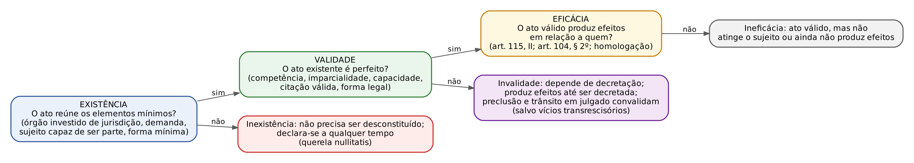
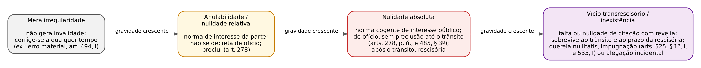
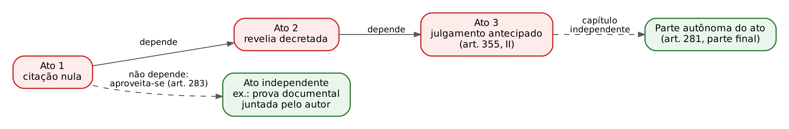
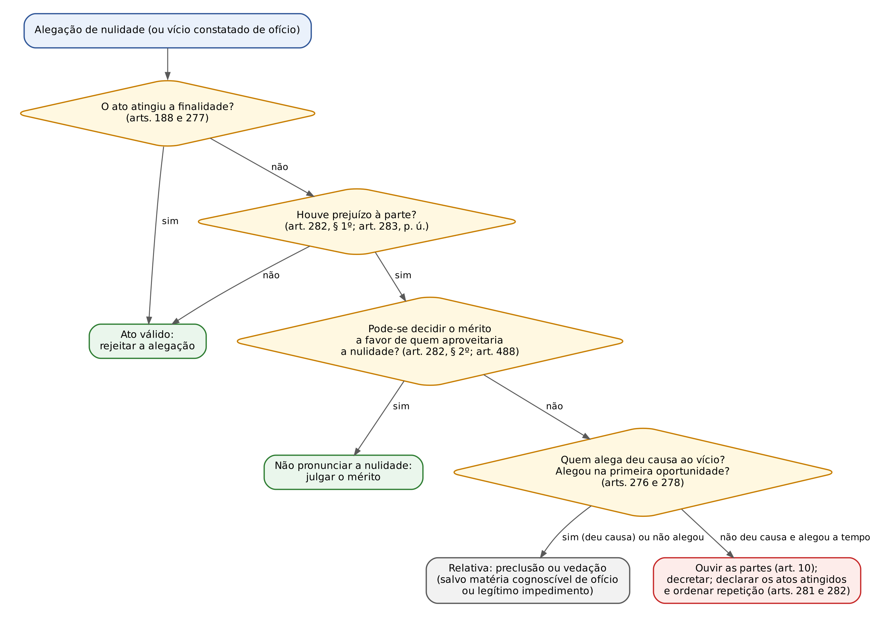
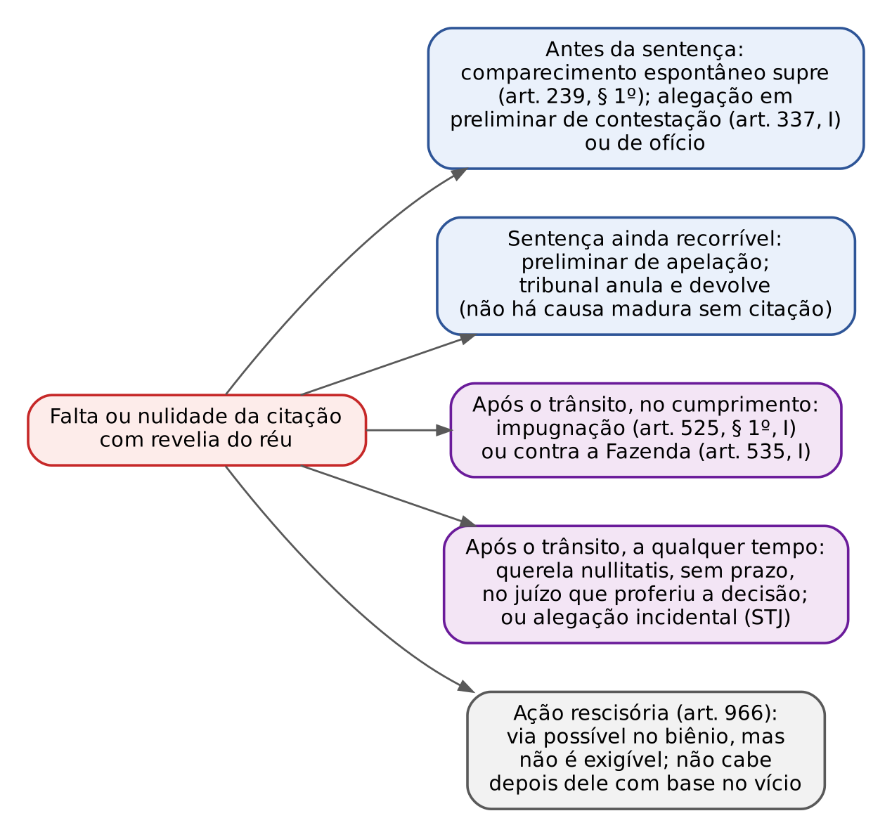

# CAPÍTULO 13 — INVALIDADES PROCESSUAIS: EXISTÊNCIA, VALIDADE, EFICÁCIA E QUERELA NULLITATIS

:::INCIDENCIA
Pontos: TRF5 p. 5; TJRS p. 6; TJSC p. 5 (invalidades, mera irregularidade, anulabilidade, nulidade, vícios sanáveis e insanáveis).
Nível A. Lote do capítulo: 5 questões (FGV 4, FCC 1), mais 15 correlatas comentadas de outros lotes.
O que mais cai: prejuízo como condição da decretação (art. 282, § 1º), falta de intimação do MP (art. 279, § 2º), vedação ao causador (art. 276), comparecimento espontâneo (art. 239, § 1º) e *querela nullitatis* contra sentença proferida sem citação.
:::

## 13.1 O sistema de invalidades do CPC/2015: premissas que resolvem questões

### 13.1.1 Invalidade processual é sanção que depende de decretação

No processo não há nulidade "de pleno direito". Todo ato processual defeituoso, por mais grave que seja o vício, produz efeitos até que um pronunciamento judicial o invalide. É a diferença estrutural em relação ao direito civil, em que o negócio nulo não produz efeitos e o juiz apenas declara o que já era (CC, arts. 166 a 169). No processo, a sentença proferida por juiz absolutamente incompetente transita em julgado, é exequível e só deixa de produzir efeitos se rescindida (art. 966, II); a sentença dada contra litisconsorte unitário não citado é nula (art. 115, I), mas vale até ser invalidada. Fredie Didier Jr. sintetiza a ideia afirmando que a invalidade processual é sempre decretada, nunca automática; por isso mesmo a nulidade "absoluta" pode convalescer com o trânsito em julgado, e o prazo da ação rescisória funciona como a última fronteira de sanação.

Três consequências práticas, todas cobradas:

- O ato viciado produz efeitos provisórios: o prazo que corre de intimação nula flui até que a nulidade seja reconhecida (por isso o art. 272, §§ 8º e 9º, manda arguir a nulidade da intimação no próprio ato a praticar, que será tido por tempestivo se o vício for reconhecido).
- A preclusão e o trânsito em julgado são mecanismos de convalidação: a nulidade relativa preclui se não alegada na primeira oportunidade (art. 278); a absoluta, cognoscível de ofício enquanto pendente o processo (art. 485, § 3º), passa a depender de rescisória após o trânsito.
- Só sobrevivem ao trânsito e ao biênio da rescisória os vícios chamados transrescisórios (falta ou nulidade de citação com revelia, essencialmente), atacáveis por *querela nullitatis* ou por alegação incidental (ver 13.8).

### 13.1.2 A forma a serviço do processo: liberdade, finalidade e primazia do mérito

O CPC/2015 consolidou um sistema em que a forma é garantia, não fim. O ponto de partida é o art. 188 (liberdade das formas: os atos independem de forma determinada, salvo quando a lei expressamente a exigir, e são válidos os que, realizados de outro modo, preencham a finalidade essencial). O art. 277 estende a lógica aos atos de forma prescrita, e os arts. 282 e 283 condicionam a decretação ao prejuízo e impõem o aproveitamento máximo.

:::LEI CPC, ARTS. 276 E 277
Art. 276. Quando a lei prescrever determinada forma sob pena de nulidade, a decretação desta não pode ser requerida pela parte que lhe deu causa.
Art. 277. Quando a lei prescrever determinada forma, o juiz considerará válido o ato se, realizado de outro modo, lhe alcançar a finalidade.
:::

:::PEGADINHA A SUPRESSÃO DE "SEM COMINAÇÃO DE NULIDADE"
O art. 244 do CPC/1973 aplicava o princípio da finalidade apenas aos atos cuja forma era prescrita "sem cominação de nulidade". O art. 277 do CPC/2015 suprimiu a ressalva: mesmo quando a lei comina expressamente a nulidade (por exemplo, art. 272, §§ 2º e 5º; art. 279; art. 280), o ato será válido se atingir a finalidade. A distinção clássica entre nulidade cominada e não cominada perdeu quase toda a utilidade prática. Alternativa que afirme que a cominação expressa torna irrelevante o atingimento da finalidade está errada.
:::

Ao lado das regras do capítulo das nulidades, o Código espalhou um verdadeiro dever judicial de sanação, expressão processual da primazia do julgamento de mérito (art. 4º; ver Cap. 1). O juiz não pode extinguir o processo, inadmitir recurso ou decretar invalidade sem antes oportunizar a correção do vício sanável:

| Dispositivo | Situação | Providência e prazo |
|---|---|---|
| Art. 139, IX | Qualquer vício processual | Juiz determina suprimento de pressupostos e saneamento de vícios |
| Art. 317 | Antes de decisão sem resolução de mérito | Oportunidade para corrigir o vício, "se possível" |
| Art. 321 | Petição inicial defeituosa | Emenda em 15 dias, indicando com precisão o que corrigir |
| Art. 352 | Irregularidades ou vícios sanáveis após a contestação | Correção em prazo nunca superior a 30 dias |
| Art. 76 | Incapacidade processual ou irregularidade de representação | Suspensão e prazo razoável; consequências do § 1º (instância originária) e do § 2º (fase recursal) |
| Art. 932, parágrafo único | Recurso com vício sanável | 5 dias ao recorrente antes de inadmitir |
| Art. 938, § 1º | Vício sanável constatado no tribunal, inclusive cognoscível de ofício | Relator determina a realização ou renovação do ato, no tribunal ou em primeiro grau |
| Art. 1.007, §§ 2º, 4º e 7º | Preparo insuficiente, ausente ou guia com erro | 5 dias para complementar; recolhimento em dobro; correção da guia |
| Art. 1.017, § 3º | Falta de peça no agravo de instrumento | Remete ao art. 932, parágrafo único |
| Art. 1.029, § 3º | Recurso extraordinário ou especial tempestivo com vício formal | STF e STJ podem desconsiderar o vício ou determinar a correção, desde que não o reputem grave |

:::DICA PRAZOS QUE SE CONFUNDEM
15 dias para emendar a inicial (art. 321); até 30 dias para sanar vícios na fase de providências preliminares (art. 352: "nunca superior a 30"); 5 dias no tribunal (arts. 932, parágrafo único, e 1.007, § 2º). A FGV troca esses números com frequência; em questão do TRF3 de 2025 (Q3179542, fora do lote), a alternativa que falava em prazo "nunca superior a 60 dias" para os vícios sanáveis estava errada exatamente por isso.
:::

## 13.2 Os planos da existência, da validade e da eficácia

A teoria das invalidades processuais trabalha com os três planos do fato jurídico (na formulação de Pontes de Miranda, recebida pela doutrina processual): o ato primeiro existe ou não existe; se existe, é válido ou inválido; se válido, é eficaz ou ineficaz. Os planos são sucessivos, mas não necessariamente dependentes: há ato inválido eficaz (toda invalidade não decretada produz efeitos) e ato válido ineficaz (sentença válida que não atinge quem não foi citado, art. 115, II).

### 13.2.1 Existência

O ato processual inexistente é aquele ao qual falta elemento mínimo para que seja reconhecido como ato daquele tipo. A doutrina costuma apontar como pressupostos de existência do processo a demanda (ato de provocação), o órgão investido de jurisdição e, para parte relevante dos autores, a capacidade de ser parte. Exemplos tradicionais de atos inexistentes: "sentença" proferida por quem não é juiz (servidor, juiz aposentado), decisão sem dispositivo, ato praticado em processo que não existe.

O ato inexistente não precisa ser desconstituído, não se sujeita à preclusão nem ao prazo da rescisória e pode ter sua inexistência declarada a qualquer tempo, inclusive incidentalmente. É esse o raciocínio que dá base à *querela nullitatis* (13.8), ainda que, a rigor, o vício de citação seja tratado pela maioria como de validade, e não de existência (ver 13.7.1).

:::PEGADINHA A CITAÇÃO É PRESSUPOSTO DE EXISTÊNCIA OU DE VALIDADE?
O art. 239 diz que a citação é indispensável "para a validade do processo", com ressalva do indeferimento da petição inicial e da improcedência liminar do pedido (casos em que o processo se forma, termina e pode até produzir coisa julgada material sem citação, art. 332). O processo existe desde o protocolo da petição inicial (art. 312), ao menos entre autor e juiz; a citação completa a relação processual em face do réu. Na prova objetiva, afirmar que a citação é indispensável para a EXISTÊNCIA do processo é errado (FGV 2024, Q2362719, alternativa A). Nas questões discursivas, convém registrar a controvérsia: Teresa Arruda Alvim sustenta que a sentença proferida sem citação é juridicamente inexistente em relação ao réu; a corrente majoritária fala em nulidade (vício transrescisório), por haver processo existente.
:::

:::QUESTAO FGV 2024 — PREFEITURA DE SÃO JOSÉ DOS CAMPOS — ANALISTA EM GESTÃO MUNICIPAL (Q2362719)
O que se cobrou: assertivas genéricas sobre atos processuais. Gabarito: C, reprodução do art. 276 (decretação da nulidade cominada não pode ser requerida pela parte que lhe deu causa).
Armadilhas: A (citação como requisito de existência do processo: o art. 239 fala em validade e ressalva os arts. 330 e 332); B (definição de citação atribuída à intimação, art. 269); D (hora certa exige duas procuras, não três, art. 252); E (citação postal é vedada para pessoa jurídica de direito público, art. 247, III). As regras de comunicação são do Cap. 12.
:::

### 13.2.2 Validade

Superado o plano da existência, o ato é válido quando preenche os requisitos que a lei estabelece. No plano do processo, fala-se em pressupostos processuais de validade (positivos: competência e imparcialidade do juízo, capacidade processual e postulatória, petição inicial apta, citação válida; negativos ou impedimentos: litispendência, coisa julgada, perempção, convenção de arbitragem). A teoria dos pressupostos processuais é do Cap. 6; aqui interessa o regime do defeito: a invalidade só se pronuncia mediante decisão, depois do contraditório, e com os filtros da finalidade, do prejuízo e da primazia do mérito.

### 13.2.3 Eficácia

Ato válido pode não produzir efeitos, ou não os produzir em relação a certo sujeito. Os exemplos do CPC:

- Art. 115, II: sentença de mérito proferida sem a integração do contraditório, em litisconsórcio necessário simples, é ineficaz "apenas para os que não foram citados" (no unitário, inciso I, é nula). A distinção cai muito e é desenvolvida no Cap. 9.
- Art. 104, § 2º: ato praticado por advogado sem procuração e não ratificado no prazo "será considerado ineficaz relativamente àquele em cujo nome foi praticado", respondendo o advogado por despesas e perdas e danos.
- Art. 200, parágrafo único: a desistência da ação só produz efeitos após homologação judicial (Cap. 11).
- Art. 506: a sentença não prejudica terceiros (limite subjetivo da coisa julgada, Cap. 21).

:::QUESTAO FGV 2025 — TJ-MS — JUIZ SUBSTITUTO (Q3786349)
Caso: advogada constituída, sem acesso ao certificado digital, pede a colega SEM procuração nos autos que protocole o recurso; horas depois, recupera o certificado e protocola o mesmo recurso, ainda no prazo. Gabarito: B (o primeiro recurso é "inexistente" e o segundo é válido, pelo protocolo tempestivo).
Resolução em passos: 1) o primeiro protocolo foi feito por quem não tinha capacidade postulatória naquele processo; 2) sem ratificação, o ato não produz efeitos em relação à parte (art. 104, § 2º), e a jurisprudência tradicional do STJ qualificava o recurso assinado por advogado sem procuração como inexistente; 3) não havendo ato eficaz anterior, não há preclusão consumativa a impedir o segundo protocolo, que é tempestivo.
Armadilha: as alternativas com preclusão consumativa (A e D) pressupõem que o primeiro ato valeu. Observação: o CPC/2015 trata o tema no plano da eficácia (art. 104, § 2º) e impõe oportunidade de regularização da representação (arts. 76, § 2º, e 932, parágrafo único); o rótulo "inexistente" do gabarito reflete a terminologia jurisprudencial, e não a técnica do Código.
:::

## 13.3 Graus de defeito: mera irregularidade, anulabilidade, nulidade relativa, nulidade absoluta e vícios transrescisórios

### 13.3.1 A classificação e seu critério

A sistematização mais difundida, de Galeno Lacerda, gradua os defeitos pela natureza da norma violada. Se a norma tutela interesse público e é cogente, o vício gera nulidade absoluta; se é cogente mas tutela predominantemente interesse da parte, nulidade relativa; se é dispositiva, anulabilidade. Abaixo de todas está a mera irregularidade (descumprimento de forma sem aptidão para invalidar), e acima delas, os vícios que sobrevivem ao próprio trânsito em julgado.

O CPC não usa os termos "absoluta" e "relativa", mas a distinção está na lei: o art. 278, parágrafo único, separa as nulidades "que o juiz deva decretar de ofício" das demais; o art. 485, § 3º, e o art. 337, § 5º, indicam quais matérias são cognoscíveis de ofício. Parte da doutrina (Didier, por exemplo) critica a tricotomia e prefere distinguir apenas os defeitos cognoscíveis de ofício dos que dependem de provocação. Para a prova, o que importa é o regime.

| Grau | Norma violada | Decretação de ofício? | Preclusão? | Exige prejuízo? | Após o trânsito |
|---|---|---|---|---|---|
| Mera irregularidade | Forma sem relevância para a finalidade | Não há decretação; corrige-se | Não | Não há invalidade | Corrigível a qualquer tempo (erro material, art. 494, I) |
| Anulabilidade | Norma dispositiva | Não | Sim (art. 278) | Sim | Convalida |
| Nulidade relativa | Cogente, interesse da parte | Não | Sim (art. 278, caput) | Sim | Convalida |
| Nulidade absoluta | Cogente, interesse público | Sim, em qualquer tempo e grau enquanto não transitar (arts. 278, parágrafo único, e 485, § 3º) | Não para as partes até o trânsito (mas ver nulidade de algibeira, 13.4.6) | Em regra sim, segundo o STJ, com exceções | Só por rescisória, se houver hipótese do art. 966, no biênio |
| Vício transrescisório | Falta ou nulidade de citação com revelia (e situações equiparadas) | Sim | Não | Prejuízo ínsito à revelia | *Querela nullitatis*, impugnação (arts. 525, § 1º, I, e 535, I) ou alegação incidental, sem prazo |

:::ATENCAO ABSOLUTA NÃO QUER DIZER INSANÁVEL
Nulidade absoluta é a que o juiz deve conhecer de ofício e não preclui para as partes; não é sinônimo de vício insanável. A incompetência absoluta é nulidade absoluta, mas o processo é remetido ao juízo competente e os efeitos das decisões são conservados (art. 64, §§ 3º e 4º). A falta de intimação do MP é causa de nulidade (art. 279), mas o próprio MP pode afirmar a inexistência de prejuízo. Sanável é o vício cujo ato pode ser repetido ou retificado (art. 282, caput) ou cujo defeito pode ser suprido (art. 76); insanável é o que não admite correção no processo, impondo extinção (por exemplo, coisa julgada anterior) ou só desafiando ação autônoma depois do trânsito.
:::

### 13.3.2 Mera irregularidade

São defeitos que não comprometem a finalidade e não geram invalidade: erros materiais e de cálculo (art. 494, I, corrigíveis de ofício a qualquer tempo), falta de numeração ou rubrica de folhas, abreviatura de nome de parte em publicação que não impede a identificação (o art. 272, § 3º, recomenda que a grafia dos nomes das partes não contenha abreviaturas, mas o § 2º só comina nulidade para a omissão dos nomes das partes e dos advogados), ato praticado fora do horário quando a lei o autoriza.

:::QUESTAO FGV 2024 — TJ-MT — ANALISTA JUDICIÁRIO (Q3114264)
Caso: executado alega nulidade da citação realizada às 22 horas, sem apontar qualquer prejuízo. Gabarito: E (rejeitar a alegação, porque não demonstrado prejuízo).
Fundamento: art. 282, § 1º, e art. 283, parágrafo único; a finalidade da citação (dar ciência da demanda) foi atingida (art. 277).
Armadilhas: C e D (prejuízo presumido ou dispensável); A (extinção do processo, sanção que nem a nulidade comprovada produziria: a consequência seria renovar o ato).
Observação que vale ponto em discursiva: o argumento do executado nem precisava chegar ao prejuízo. O art. 212, § 2º, autoriza, independentemente de autorização judicial, citações, intimações e penhoras em feriados ou em dias úteis fora do horário das 6 às 20 horas, observada a inviolabilidade do domicílio (CF, art. 5º, XI). A citação às 22 horas, sem ingresso forçado em domicílio, é ato regular (ver Cap. 11, item 11.5.1).
No mesmo sentido (exigência de prejuízo para decretar nulidade de intimação, cobrada como alternativa errada): FCC 2026, TJ-CE, Analista (Q4231778) e FCC 2026, TJ-CE, Oficial de Justiça (Q4240020).
:::

### 13.3.3 Vícios sanáveis e insanáveis no TJSC (ponto 5)

O edital do TJSC destaca a dicotomia. Em síntese operacional:

- Sanáveis por repetição ou retificação (art. 282, caput): citação ou intimação nula, perícia realizada sem intimação de assistente, sentença sem fundamentação (o tribunal pode anular e, se a causa estiver madura, julgar, art. 1.013, § 3º, IV).
- Sanáveis por suprimento (arts. 76 e 104): defeito de representação, falta de procuração, falta de autorização do cônjuge (art. 74).
- Sanáveis por convalidação: comparecimento espontâneo do réu (art. 239, § 1º), não alegação oportuna da nulidade relativa (art. 278), trânsito em julgado e decurso do prazo da rescisória.
- Insanáveis no próprio processo: ausência de pressuposto negativo (coisa julgada, litispendência, perempção), ilegitimidade quando inviável a correção (com a ressalva dos arts. 338 e 339), intransmissibilidade da ação (art. 485, IX). Levam à extinção sem mérito, depois de oportunizada a manifestação (arts. 10 e 317).
- Insanáveis em qualquer tempo (transrescisórios): falta ou nulidade de citação com revelia (13.7 e 13.8).

## 13.4 Os princípios (regras) do sistema de invalidades

### 13.4.1 Instrumentalidade das formas e finalidade

A forma só é relevante na medida em que protege um valor: contraditório, ampla defesa, segurança. Se o ato, praticado de modo diverso, alcança a finalidade, é válido (arts. 188 e 277). A FGV gosta de casos de comunicação por meio não previsto (regras da citação por aplicativos no Cap. 12, item 12.4.4): o STJ validou a citação feita por aplicativo de mensagens, mesmo sem envio de documento com foto, quando demonstrada a ciência inequívoca do réu, certificada pelo oficial de justiça; mas afirmou a nulidade da citação por aplicativo em ação de estado, em que a lei veda a citação eletrônica e exige a pessoal (art. 247, I). A diferença entre os dois julgados é a lição: a liberdade das formas cede quando a própria lei exclui a forma utilizada para proteger um interesse indisponível.

:::JURIS STJ, ARESP 3.129.052, J. 24/8/2026 (INFORMATIVO 902)
A ausência de documento com foto não invalida, por si só, a citação por aplicativo de mensagens quando demonstrada a ciência inequívoca, certificada pelo oficial de justiça e corroborada pelas circunstâncias do contato (réu confirmou nome e número, recebeu a contrafé e ouviu a explicação). Fundamento: liberdade das formas e convalidação do vício de forma pelo atingimento da finalidade (STJ, AREsp n. 3.129.052, Relator Ministro Moura Ribeiro, Terceira Turma, j. 24/8/2026).
:::

:::JURIS STJ, CORTE ESPECIAL, J. 3/3/2026 (INFORMATIVO 883)
Em ações de estado, é obrigatória a citação pessoal; a citação por meio eletrônico, inclusive por WhatsApp (chamada de voz ou mensagem), é vedada pelo art. 247, I, do CPC (processo em segredo de justiça, Relator Ministro Herman Benjamin, Corte Especial, j. 3/3/2026). Contraste com o Informativo 902: lá, a finalidade convalidou a forma; aqui, a proibição legal específica afasta o art. 277.
:::

Outros exemplos de finalidade atingida: perícia por médico não especialista na área não é nula se os elementos concretos revelarem que isso não comprometeu a idoneidade da prova (STJ, REsp n. 2.121.056, Relatora Ministra Nancy Andrighi, Terceira Turma, j. 21/5/2024, Informativo 814); eventual nulidade de decisão monocrática do relator fica superada com a apreciação da matéria pelo colegiado no agravo interno (STJ, Jurisprudência em Teses, edição 183, tese 10).

### 13.4.2 Prejuízo (*pas de nullité sans grief*)

Nenhum ato será repetido nem sua falta suprida quando não prejudicar a parte (art. 282, § 1º); o aproveitamento dos atos depende de não resultar prejuízo à defesa de qualquer parte (art. 283, parágrafo único). Prejuízo é a supressão concreta de uma possibilidade processual relevante (manifestar-se, produzir prova, recorrer, sustentar oralmente) que poderia influir no resultado.

:::LEI CPC, ARTS. 282 E 283
Art. 282. Ao pronunciar a nulidade, o juiz declarará que atos são atingidos e ordenará as providências necessárias a fim de que sejam repetidos ou retificados.
§ 1º O ato não será repetido nem sua falta será suprida quando não prejudicar a parte.
§ 2º Quando puder decidir o mérito a favor da parte a quem aproveite a decretação da nulidade, o juiz não a pronunciará nem mandará repetir o ato ou suprir-lhe a falta.
Art. 283. O erro de forma do processo acarreta unicamente a anulação dos atos que não possam ser aproveitados, devendo ser praticados os que forem necessários a fim de se observarem as prescrições legais.
Parágrafo único. Dar-se-á o aproveitamento dos atos praticados desde que não resulte prejuízo à defesa de qualquer parte.
:::

Duas questões de alta cobrança:

- O prejuízo também se exige para a nulidade absoluta? A orientação predominante no STJ é que, como regra, sim: mesmo vícios de ordem pública só levam à anulação quando houver prejuízo, em homenagem à instrumentalidade. Há, porém, vícios cujo prejuízo é ínsito ou que a Corte considera estruturais. Exemplo recente: a ausência de penhora prévia à adjudicação é nulidade absoluta que prescinde de demonstração de prejuízo, porque rompe a sequência penhora, avaliação e expropriação imposta pelos arts. 523, § 3º, 825 e 876 (STJ, REsp n. 2.200.180, Relator Ministro Antonio Carlos Ferreira, Quarta Turma, j. 5/8/2025, Informativo 857). Na prova, prefira a regra (prejuízo exigido) e reserve a exceção para hipóteses que a questão descreva como estruturais ou de prejuízo presumido.
- Quem prova o prejuízo? Quem alega a nulidade, em regra. Nos vícios de comunicação que suprimem oportunidade de defesa, o prejuízo costuma estar demonstrado pelo próprio resultado desfavorável e pela oportunidade perdida.

Julgados recentes sobre prejuízo em atos de comunicação e de julgamento (todos com decretação da nulidade):

| Situação | Orientação | Fonte |
|---|---|---|
| Julgamento de apelação em sessão virtual sem intimação dos advogados | Nulo, por cerceamento de defesa | STJ, REsp n. 2.136.836, Relator Ministro Ricardo Villas Bôas Cueva, Terceira Turma, j. 3/6/2025 |
| Sessão virtual assíncrona realizada durante o recesso forense | Nula (art. 220, § 2º) | REsp 2.125.599 (v. Cap. 11) |
| Tribunal que alterna, sem aviso, o meio de intimação eletrônica (portal para diário) | Nula a intimação da pauta | REsp 2.018.319 (v. Cap. 12) |
| Pauta publicada sem a antecedência legal, julgamento sem a presença das partes | Nulidade (Súmula 117 do STJ, editada sob o prazo de 48 horas; hoje o prazo mínimo é de 5 dias, art. 935) | Súmula 117 do STJ |
| Provimento de agravo sem intimação do agravado para contrarrazões | A intimação é condição de validade da decisão que causa prejuízo ao agravado; dispensada só quando o recurso é desprovido de plano | STJ, Tema 376 (regime do CPC/1973, lógica mantida no art. 932, V, e no art. 1.019, II) |

:::DICA LÓGICA DO TEMA 376 E DO ART. 932
Só se exige contraditório prévio do recorrido quando a decisão pode prejudicá-lo. Por isso o relator pode negar provimento monocraticamente sem ouvir o recorrido (art. 932, IV), mas só pode dar provimento "depois de facultada a apresentação de contrarrazões" (art. 932, V). É a regra do prejuízo antecipada pelo legislador.
:::

### 13.4.3 Primazia do mérito e aproveitamento: o art. 282, § 2º

Quando o juiz puder decidir o mérito a favor da parte a quem aproveitaria a decretação da nulidade, não a pronunciará. O art. 488 aplica a mesma ideia aos pressupostos processuais e às condições da ação: desde que possível, o juiz resolverá o mérito sempre que a decisão for favorável à parte a quem aproveitaria a extinção sem mérito.

:::EXEMPLO NULIDADE QUE NÃO SE PRONUNCIA
Réu citado por edital sem esgotamento das tentativas de localização; o curador especial contesta por negação geral e, no curso da instrução, prova-se que a dívida estava prescrita. O vício da citação aproveitaria ao réu, mas o juiz pode julgar improcedente o pedido, reconhecendo a prescrição: o réu obtém resultado melhor do que a renovação da citação lhe daria. A recíproca não vale: se a tendência for de procedência, o juiz precisa anular e renovar a citação, porque o mérito não pode ser decidido contra quem sofreu o vício.
:::

### 13.4.4 Causalidade (contaminação), conservação e aproveitamento

Anulado o ato, consideram-se de nenhum efeito todos os subsequentes que dele dependam; a nulidade de uma parte do ato não prejudica as outras que dela sejam independentes (art. 281). Ao decretar a nulidade, o juiz declara quais atos são atingidos (art. 282, caput), e o erro de forma só anula os atos que não possam ser aproveitados (art. 283). A contaminação segue a cadeia de dependência lógica, não a cronológica: a prova documental juntada pelo autor com a inicial não depende da citação nula; a revelia e o julgamento antecipado dependem.

Duas aplicações frequentes da conservação em temas de outros capítulos:

- Incompetência: acolhida a alegação, os autos são remetidos ao juízo competente (art. 64, § 3º) e, salvo decisão judicial em sentido contrário, conservam-se os efeitos da decisão proferida pelo juízo incompetente até que outra seja proferida pelo competente (art. 64, § 4º). Não há nulidade automática dos atos, nem mesmo na incompetência absoluta (a sentença de mérito transitada, essa sim, é rescindível, art. 966, II).
- Impedimento e suspeição: reconhecido o vício, o tribunal fixa o momento a partir do qual o juiz não poderia ter atuado (art. 146, § 6º) e decreta a nulidade dos atos praticados quando já presente o motivo (art. 146, § 7º). Os atos anteriores ao fato gerador permanecem.

:::QUESTAO FGV 2025 — TRF 1ª REGIÃO — JUIZ FEDERAL SUBSTITUTO (Q3425316)
Caso: ação de cobrança ajuizada no foro da capital do RJ com base em cláusula de eleição, sem que as partes tenham domicílio ou bens ali. Gabarito: B (eleição abusiva, com declínio para o foro do domicílio da ré, art. 63, §§ 1º e 5º, após a Lei 14.879/2024; ver Cap. 4).
Interesse para este capítulo: a alternativa D afirmava que, reconhecida a incompetência, "todos os atos" seriam nulos por ser vício insanável. Errada duas vezes: a incompetência relativa sequer é cognoscível de ofício fora da hipótese do art. 63, § 3º e § 5º, e, em qualquer incompetência, prevalece a conservação dos efeitos (art. 64, § 4º).
:::

:::QUESTAO FGV 2024 — ENAM 2024.2 — EXAME NACIONAL DA MAGISTRATURA (Q3058645)
Caso: juiz concede tutela de urgência em ação de guarda; depois da audiência, envolve-se em acidente e discussão com o réu e declara-se suspeito; o réu pede a anulação da tutela. Gabarito: C (rejeita-se o pedido, porque a suspeição superveniente não retroage).
Fundamento: art. 146, §§ 6º e 7º: só são nulos os atos praticados quando já presente o motivo; a tutela foi concedida antes do fato que gerou a suspeição. Acrescente-se o art. 145, § 2º, I (é ilegítima a alegação de suspeição provocada por quem a alega), o que reforça a solução, mas não era o fundamento do gabarito.
Armadilha: E (ratificação pelo substituto como fundamento): a ratificação é irrelevante quando o ato é válido.
No mesmo sentido: FGV 2025, ENAM 2025.2 (Q3692402), que considerou errada a afirmação de que o tribunal não poderia decretar a nulidade dos atos do juiz impedido ou suspeito praticados quando já configurado o motivo (art. 146, § 7º).
:::

### 13.4.5 Interesse e vedação ao comportamento contraditório: o art. 276

A parte que deu causa ao vício não pode requerer a decretação da nulidade. É desdobramento da boa-fé processual (art. 5º) e da proibição do *venire contra factum proprium*, além de expressão do princípio do interesse: quem causou o defeito não sofre prejuízo com ele. A letra do art. 276 refere-se à nulidade cominada ("quando a lei prescrever determinada forma sob pena de nulidade"), mas a doutrina estende a regra, com mais razão, às nulidades não cominadas.

:::PEGADINHA O ART. 276 NÃO IMPEDE O JUIZ
A vedação atinge o requerimento do causador, não o poder-dever do juiz. Se a nulidade for cognoscível de ofício (absoluta), o juiz pode e deve decretá-la, ainda que provocado por quem lhe deu causa, desde que haja prejuízo a outro sujeito ou ao interesse público tutelado. O dolo do causador pode, no entanto, gerar sanções (litigância de má-fé, art. 80; multa do art. 258 na citação por edital requerida dolosamente).
:::

### 13.4.6 Preclusão, convalidação e boa-fé: o art. 278 e a "nulidade de algibeira"

:::LEI CPC, ART. 278
Art. 278. A nulidade dos atos deve ser alegada na primeira oportunidade em que couber à parte falar nos autos, sob pena de preclusão.
Parágrafo único. Não se aplica o disposto no caput às nulidades que o juiz deva decretar de ofício, nem prevalece a preclusão provando a parte legítimo impedimento.
:::

Três pontos de prova:

- Primeira oportunidade é a primeira manifestação útil, em que a parte poderia efetivamente alegar o vício. A mera ciência de ato burocrático não basta: o aviso de digitalização dos autos físicos não é a "primeira oportunidade" do art. 278 (REsp 2.001.562; v. Cap. 11).
- A preclusão do caput não atinge as nulidades decretáveis de ofício, nem prevalece se a parte provar legítimo impedimento (parágrafo único). A suspeição do perito também preclui se não arguida na primeira oportunidade, e a anulação da perícia não reabre o prazo (REsp 1.579.704; v. Cap. 10).
- Nulidade de algibeira (ou "de bolso"): a parte que percebe o vício e silencia estrategicamente, guardando-o para alegar apenas se o resultado lhe for desfavorável, age contra a boa-fé; o STJ rejeita a alegação mesmo quando se trata de matéria que, em tese, seria cognoscível de ofício. A expressão foi cunhada pelo Ministro Humberto Gomes de Barros e reiterada, por exemplo, em caso de falta de intimação para contrarrazões ao agravo, tida por sanada quando a parte foi intimada da decisão monocrática e nada alegou (STJ, REsp n. 1.372.802, Relator Ministro Paulo de Tarso Sanseverino, Terceira Turma).

:::DICA ARGUIÇÃO DE NULIDADE DE INTIMAÇÃO: ARTS. 272, §§ 8º E 9º
A parte não precisa (nem deve) peticionar primeiro para depois praticar o ato: argui a nulidade da intimação em capítulo preliminar do próprio ato que lhe caiba praticar, que será tido por tempestivo se o vício for reconhecido (§ 8º). Se não puder praticá-lo de imediato por precisar de acesso prévio aos autos, limita-se a arguir a nulidade, e o prazo correrá da intimação da decisão que a reconhecer (§ 9º).
:::

:::QUESTAO FGV 2025 — AL-AM — ASSESSOR JURÍDICO (Q3777495)
Caso: a autora requereu intimações exclusivamente em nome de certa advogada; o cartório publicou, inclusive a sentença, em nome de outro advogado do mesmo escritório, não constituído; o prazo recursal transcorreu. Gabarito: A (reconhecer a nulidade da intimação e reabrir o prazo, com nova intimação em nome da advogada indicada).
Fundamento: art. 272, § 5º ("constando dos autos pedido expresso para que as comunicações dos atos processuais sejam feitas em nome dos advogados indicados, o seu desatendimento implicará nulidade"). O prejuízo é evidente (perda do prazo de apelação), e a parte alegou o vício logo que dele teve ciência (art. 278).
Armadilhas: C (exigir apelação imediata com preliminar: o § 9º permite apenas arguir a nulidade quando o ato depende de acesso prévio, e o prazo só corre da decisão que a reconhece); D (publicação em nome de colega de escritório "supre" a exigência: só a indicação da sociedade, a pedido, autoriza a intimação em nome dela, § 1º).
:::

## 13.5 A decretação da invalidade: quem, quando, como e com que recurso

### 13.5.1 Roteiro de decisão

A decretação de nulidade é a última etapa de um filtro sucessivo. O fluxo abaixo resume a ordem lógica que o juiz (e o examinador) seguem.

:::PASSO ROTEIRO DO JUIZ DIANTE DE ALEGAÇÃO DE NULIDADE
1) Identifique o ato e a norma violada: existe forma legal? Ela comina nulidade? (arts. 188, 276 e 277).
2) Verifique se o ato atingiu a finalidade (art. 277): se sim, é válido, ainda que a forma tenha sido outra.
3) Verifique o prejuízo concreto (art. 282, § 1º; art. 283, parágrafo único): sem ele, não se repete o ato.
4) Verifique se é possível decidir o mérito a favor de quem aproveitaria a nulidade (art. 282, § 2º; art. 488).
5) Verifique legitimidade e tempestividade da alegação: quem a faz deu causa ao vício (art. 276)? Alegou na primeira oportunidade (art. 278)? Trata-se de matéria cognoscível de ofício (art. 278, parágrafo único)?
6) Se a nulidade for cognoscível de ofício e ainda não submetida às partes, ouça-as antes de decidir (arts. 9º e 10).
7) Decretando, declare os atos atingidos, preserve os independentes e determine a repetição ou retificação (arts. 281 a 283); no tribunal, aplique os arts. 938, § 1º, e 1.013, § 3º.
:::

### 13.5.2 Contraditório prévio, mesmo nas nulidades de ofício

O art. 10 proíbe decidir com base em fundamento sobre o qual as partes não puderam se manifestar, "ainda que se trate de matéria sobre a qual deva decidir de ofício". Conhecer de ofício não é decidir sem ouvir. A decisão que anula atos sem prévia oitiva das partes é, ela própria, nula por violação do contraditório substancial (Cap. 1), salvo se nenhuma das partes puder ser prejudicada pela decisão (aplicação do art. 282, § 1º à própria decisão-surpresa).

### 13.5.3 Nulidades no tribunal

- Vício sanável constatado no julgamento do recurso, inclusive o cognoscível de ofício: o relator determina a realização ou a renovação do ato, no tribunal ou em primeiro grau, e, cumprida a diligência, prossegue no julgamento sempre que possível (art. 938, §§ 1º e 2º). O tribunal não precisa anular a sentença e devolver os autos se puder sanar o vício e julgar.
- Nulidade da sentença por incongruência (*extra* ou *ultra petita*) ou por falta de fundamentação: estando o processo em condições de imediato julgamento, o tribunal deve decidir desde logo o mérito (art. 1.013, § 3º, II e IV). A teoria da causa madura não se aplica à falta de citação: não há causa madura sem contraditório do réu.
- Matéria de ordem pública não suscitada nas instâncias ordinárias: no recurso especial e no extraordinário exige-se prequestionamento, mesmo para nulidades absolutas (ver Cap. 43). O art. 485, § 3º, autoriza o conhecimento de ofício "em qualquer tempo e grau de jurisdição", mas isso se refere às instâncias ordinárias, segundo a orientação tradicional do STJ e do STF.

:::SENTENCA CAPÍTULO QUE REJEITA PRELIMINAR DE NULIDADE POR AUSÊNCIA DE PREJUÍZO
O réu sustenta a nulidade da intimação para a audiência de instrução, porque realizada em nome de advogado diverso daquele indicado na contestação (art. 272, § 5º). O vício existe, mas não gerou prejuízo: o advogado indicado compareceu à audiência, formulou perguntas às testemunhas e apresentou alegações finais orais, sem nada alegar naquela oportunidade. O ato atingiu sua finalidade (art. 277), não houve prejuízo à defesa (arts. 282, § 1º, e 283, parágrafo único) e a matéria, de natureza relativa, não foi suscitada na primeira oportunidade em que coube à parte falar nos autos (art. 278). Rejeito a preliminar.
:::

:::SENTENCA DISPOSITIVO DE ACÓRDÃO QUE ANULA ATOS E DETERMINA RENOVAÇÃO
Ante o exposto, voto por conhecer do recurso e dar-lhe provimento para, acolhida a preliminar, declarar a nulidade da citação por edital (evento X) e de todos os atos subsequentes que dela dependam, inclusive a decretação da revelia e a sentença, preservados os documentos que instruíram a inicial e os demais atos independentes (CPC, arts. 281 e 283), determinando o retorno dos autos ao juízo de origem para a renovação da citação, com observância do art. 256, § 3º, e regular prosseguimento do feito. Prejudicado o exame das demais questões recursais.
:::

### 13.5.4 Recursos contra a decisão sobre nulidade

A decisão interlocutória que decreta ou rejeita nulidade não está, em regra, no rol do art. 1.015; não sendo agravável, a questão não preclui e deve ser suscitada em preliminar de apelação ou nas contrarrazões (art. 1.009, § 1º). Há exceções: a decisão que versar sobre tutela provisória, sobre exclusão de litisconsorte, sobre rejeição do pedido de limitação do litisconsórcio, entre outras (art. 1.015), e a taxatividade mitigada quando a urgência tornar inútil o julgamento futuro (Tema 988 do STJ; ver Cap. 42). Na liquidação, no cumprimento de sentença, na execução e no inventário, toda interlocutória é agravável (art. 1.015, parágrafo único).

### 13.5.5 Responsabilidade pelo ato nulo

O escrivão, o chefe de secretaria e o oficial de justiça respondem, civil e regressivamente, quando praticarem ato nulo com dolo ou culpa (art. 155, II). A responsabilidade é regressiva porque o lesado demanda o Estado, que responde objetivamente (CF, art. 37, § 6º) e se volta contra o servidor.

:::QUESTAO FCC 2025 — TRF 4ª REGIÃO — ANALISTA JUDICIÁRIO, OFICIAL DE JUSTIÇA AVALIADOR FEDERAL (Q3562212)
O que se cobrou: oficial de justiça que, com culpa, pratica ato nulo e causa dano às partes. Gabarito: B (responde civil e regressivamente).
Armadilhas: C (só por dolo: o inciso II fala em dolo ou culpa); D (responsabilidade restrita à recusa injustificada de cumprir atos, que é apenas a hipótese do inciso I); E (isenção se o ato comportar repetição ou se a nulidade for decretada de ofício: não há essa excludente na lei).
:::

## 13.6 Nulidades em espécie de maior incidência

### 13.6.1 Falta de intimação do Ministério Público

O MP intervém como fiscal da ordem jurídica nas hipóteses do art. 178 (interesse público ou social, interesse de incapaz, litígios coletivos pela posse de terra rural ou urbana) e nas previstas em lei especial; a participação da Fazenda Pública não configura, por si só, hipótese de intervenção (art. 178, parágrafo único). Nas ações de família, o MP só intervém quando houver interesse de incapaz (ou vítima de violência doméstica, art. 698, parágrafo único), e deve ser ouvido antes da homologação de acordo (art. 698, caput). É desnecessária a intervenção nas execuções fiscais (Súmula 189 do STJ; v. Cap. 10).

:::LEI CPC, ART. 279
Art. 279. É nulo o processo quando o membro do Ministério Público não for intimado a acompanhar o feito em que deva intervir.
§ 1º Se o processo tiver tramitado sem conhecimento do membro do Ministério Público, o juiz invalidará os atos praticados a partir do momento em que ele deveria ter sido intimado.
§ 2º A nulidade só pode ser decretada após a intimação do Ministério Público, que se manifestará sobre a existência ou a inexistência de prejuízo.
:::

Pontos de prova:

- O vício é a falta de INTIMAÇÃO, não a falta de manifestação. Intimado, o MP pode deixar de se manifestar sem que haja nulidade.
- A invalidação alcança os atos a partir do momento em que o MP deveria ter sido intimado (§ 1º), não o processo inteiro desde o ajuizamento.
- A decretação depende de prévia intimação do MP para dizer se houve prejuízo (§ 2º). A manifestação ministerial não vincula o juiz, mas é condição procedimental da decretação.
- O prejuízo se afere em relação ao interesse que justificava a intervenção (do incapaz, do interesse público). Sentença favorável ao incapaz, sem intimação do MP, não é anulada: falta prejuízo (aplicação conjunta dos arts. 279, § 2º, e 282, §§ 1º e 2º). A orientação do STJ, em linhas gerais, é a de que a ausência de intimação do MP como fiscal da ordem jurídica não gera nulidade automática, exigindo demonstração de prejuízo, e de que a atuação ministerial nas instâncias ordinárias, quando efetiva, pode suprir a falta de intimação em fase posterior.
- Se o processo transitou em julgado sem a intervenção obrigatória, o próprio MP tem legitimidade para a rescisória (art. 967, III, "a"), assim como aquele que não foi ouvido quando era obrigatória sua intervenção (art. 967, IV) (ver Cap. 40).

:::QUESTAO FGV 2026 — PGE-AC — PROCURADOR DO ESTADO (Q4079389)
Caso: ação de curatela movida pela filha contra o genitor idoso; o processo correu sem intimação do MP, com perícia, instrução e sentença de procedência; a falta só foi percebida depois da apelação do réu. Gabarito: B (a decretação da nulidade depende de prévia intimação do MP para se pronunciar sobre o prejuízo).
Resolução: 1) a intervenção era obrigatória (art. 178, II; na interdição, o MP intervém como fiscal se não for o requerente, art. 752, § 1º); 2) o vício é a falta de intimação (art. 279, caput); 3) antes de anular, o tribunal intima o MP (art. 279, § 2º) e, se houver prejuízo, invalida apenas os atos posteriores ao momento em que ele deveria ter sido intimado (§ 1º).
Armadilhas: A (nulidade automática de todo o processo desde o ajuizamento: contraria os §§ 1º e 2º); C (provocação exclusiva da parte: a nulidade é cognoscível de ofício); D (convalidação automática pela falta de arguição oportuna: o art. 278, parágrafo único, afasta a preclusão das nulidades decretáveis de ofício); E (apelação exclusiva do MP).
:::

:::QUESTAO FGV 2026 — MPE-RJ — PROMOTOR DE JUSTIÇA SUBSTITUTO (Q4088339)
Caso: ação contra réu incapaz, com MP estadual atuando como fiscal em primeiro e segundo graus; decisões desfavoráveis ao incapaz; no STJ, o agravo contra a inadmissão do recurso especial foi desprovido sem intimação do Ministério Público. Gabarito: A (a negativa de provimento, sem prévia intimação do Ministério Público Federal, configura prejuízo ao incapaz e enseja a nulidade da decisão).
Resolução em passos: 1) nos tribunais superiores, a função de fiscal da ordem jurídica é exercida pelo Ministério Público que oficia perante eles (o MPF, no STJ), e o relator deve determinar a intimação do MP quando for o caso (art. 932, VII); 2) a atuação do MP estadual nas instâncias ordinárias não supre a intimação devida na instância superior; 3) o prejuízo, nos termos do art. 279, § 2º, é aferido em relação ao interesse do incapaz: decisão que lhe é desfavorável evidencia o prejuízo; se a decisão lhe fosse favorável, não haveria nulidade.
Armadilhas: B (o MP estadual deveria ter sido intimado antes da inadmissão: confunde o órgão ministerial com atribuição na instância); C (exigir demonstração de que a decisão ignorou aspecto relevante: o prejuízo decorre do resultado desfavorável ao incapaz); D (atuação nas instâncias formativas da prova afasta o prejuízo); E (nulidade em qualquer hipótese: contraria o § 2º e a regra do prejuízo).
Observação: o gabarito é coerente com a lógica do prejuízo, mas há julgados do STJ que afastam a nulidade quando o MP atuou efetivamente nas instâncias ordinárias e foi intimado do julgado na instância superior sem recorrer; a distinção é o resultado desfavorável ao incapaz e a ausência de qualquer intimação no STJ (ver nota de verificação).
:::

### 13.6.2 Citações e intimações

As citações e as intimações são nulas quando feitas sem observância das prescrições legais (art. 280). É a mais cobrada das nulidades cominadas, e também a que mais se relativiza pelo atingimento da finalidade. As regras de cada modalidade de comunicação estão no Cap. 12; aqui, o regime do vício:

| Vício | Consequência | Fundamento |
|---|---|---|
| Publicação sem nome da parte ou do advogado e respectivo número na OAB | Nulidade | Art. 272, § 2º |
| Desatendimento de pedido expresso de intimação em nome de advogado indicado | Nulidade | Art. 272, § 5º |
| Intimação no endereço constante dos autos, sem comunicação da mudança | Presume-se válida; prazo flui da juntada do comprovante de entrega no endereço primitivo | Art. 274, parágrafo único |
| Carga dos autos pelo advogado, pela Advocacia Pública, Defensoria ou MP | Vale como intimação de qualquer decisão contida no processo, ainda que pendente de publicação | Art. 272, § 6º |
| Citação postal sem aviso de recebimento | Nulidade (Súmula 429 do STJ; v. Cap. 12) | Arts. 248 e 280 |
| Citação por edital sem esgotamento razoável das tentativas de localização | Nulidade; não é obrigatória a expedição de ofícios a cadastros públicos e concessionárias (Tema 1.338 do STJ) | Art. 256, § 3º |
| Citação de pessoa mentalmente incapaz ou impossibilitada de recebê-la | Não se faz a citação; nomeia-se curador ao citando, e a citação será feita na pessoa dele | Art. 245 |

:::QUESTAO FCC 2025 — DPE-AM — DEFENSOR PÚBLICO (Q3531627)
Caso: réu citado pessoalmente, revel e sem advogado; no cumprimento de sentença, a carta de intimação volta com a informação de mudança de endereço não comunicada. Gabarito: A (reputa-se válida a intimação dirigida ao endereço constante dos autos).
Fundamento: art. 274, parágrafo único, combinado com o art. 513, § 3º (no cumprimento de sentença, considera-se realizada a intimação quando o devedor houver mudado de endereço sem prévia comunicação ao juízo).
Armadilha: C (nulidade de toda a demanda por falta de curador especial ao revel): o curador especial só se nomeia ao revel citado por edital ou com hora certa (art. 72, II), não ao citado pessoalmente.
:::

:::QUESTAO FGV 2025 — TJ-SE — JUIZ SUBSTITUTO (Q3301236)
Caso: município (capital) intimado da sentença por carga dos autos ao procurador; não apela. Gabarito: E (certificar o trânsito em julgado).
Interesse para este capítulo: a alternativa B propunha pronunciar a nulidade da intimação e renová-la por oficial na pessoa do procurador-geral. Errada: a carga é forma válida de intimação pessoal da Advocacia Pública (arts. 183, § 1º, e 272, § 6º). Também não havia remessa necessária: embora a condenação (600 salários mínimos) superasse o limite de 500 aplicável aos municípios que são capitais (art. 496, § 3º, II), a sentença fundada em entendimento firmado em incidente de assunção de competência está excluída do reexame (art. 496, § 4º, III). Ver Caps. 20 e 27.
:::

### 13.6.3 Capacidade, representação e postulação

A incapacidade processual e a irregularidade de representação são vícios sanáveis: o juiz suspende o processo e fixa prazo razoável (art. 76). Descumprida a determinação na instância originária, o processo é extinto (se a providência cabia ao autor), o réu é considerado revel (se lhe cabia) ou o terceiro é considerado revel ou excluído; na fase recursal, o relator não conhece do recurso ou desentranha as contrarrazões (art. 76, §§ 1º e 2º). O ato praticado por advogado sem procuração, nas hipóteses de urgência do art. 104, caput, deve ser ratificado em 15 dias, prorrogáveis por igual período; sem ratificação, é ineficaz em relação ao suposto representado (art. 104, §§ 1º e 2º). Ver Cap. 7.

### 13.6.4 Litisconsórcio necessário não integrado

Sentença de mérito proferida sem a integração do contraditório é nula, se a decisão devesse ser uniforme para todos (litisconsórcio unitário), ou ineficaz apenas para os não citados, nos demais casos (art. 115). No litisconsórcio passivo necessário, o juiz determina ao autor que requeira a citação dos faltantes, sob pena de extinção (art. 115, parágrafo único). Após o trânsito, o litisconsorte unitário preterido pode valer-se da *querela nullitatis*, porque, em relação a ele, a situação equivale à falta de citação (13.8.2). Desenvolvimento no Cap. 9.

### 13.6.5 Negócios jurídicos processuais

O juiz controla, de ofício ou a requerimento, a validade das convenções processuais, recusando-lhes aplicação somente nos casos de nulidade, de inserção abusiva em contrato de adesão ou de manifesta situação de vulnerabilidade (art. 190, parágrafo único). O controle é de validade, não de conveniência; e o negócio só depende de homologação quando a lei expressamente a exigir, admitindo-se em todo caso o controle de validade (Enunciado 115 da II Jornada de Direito Processual Civil do CJF). O regime aplica a teoria das invalidades do CC (arts. 166 e 171) com os filtros processuais do prejuízo e da finalidade. Desenvolvimento no Cap. 11.

### 13.6.6 Incompetência, impedimento e suspeição

Remete-se a 13.4.4 (conservação dos efeitos e marco temporal da nulidade) e aos Caps. 4 e 10. Lembre-se apenas da gradação após o trânsito: sentença de juiz impedido ou de juízo absolutamente incompetente é rescindível no biênio (art. 966, II); a de juiz suspeito ou relativamente incompetente não é rescindível por esse fundamento, porque são vícios que precluem.

## 13.7 A falta e a nulidade da citação

### 13.7.1 Natureza do vício

A citação é o ato pelo qual são convocados o réu, o executado ou o interessado para integrar a relação processual (art. 238), indispensável à validade do processo (art. 239). Falta de citação (o réu nunca foi chamado) e nulidade de citação (foi chamado por forma viciada) recebem o mesmo tratamento legal, desde que o processo tenha corrido à revelia (arts. 525, § 1º, I, e 535, I). É o vício mais grave do sistema: viola diretamente o contraditório e a ampla defesa (CF, art. 5º, LV), e por isso sobrevive ao trânsito em julgado e ao prazo da rescisória.

A doutrina diverge sobre o plano: para uns, a sentença proferida contra réu não citado e revel é inexistente (em relação a ele); para a maioria, existe e é nula, mas de nulidade qualificada, transrescisória. O STJ usa as duas linguagens; a consequência prática é a mesma (declaração a qualquer tempo), e é isso que a prova cobra.

### 13.7.2 Sanação antes da sentença: comparecimento espontâneo

:::LEI CPC, ART. 239
Art. 239. Para a validade do processo é indispensável a citação do réu ou do executado, ressalvadas as hipóteses de indeferimento da petição inicial ou de improcedência liminar do pedido.
§ 1º O comparecimento espontâneo do réu ou do executado supre a falta ou a nulidade da citação, fluindo a partir desta data o prazo para apresentação de contestação ou de embargos à execução.
§ 2º Rejeitada a alegação de nulidade, tratando-se de processo de:
I - conhecimento, o réu será considerado revel;
II - execução, o feito terá seguimento.
:::

Pontos de prova:

- O comparecimento espontâneo convalida o vício e é termo inicial do prazo de contestação ou de embargos (§ 1º). O réu que comparece apenas para alegar a nulidade corre risco: rejeitada a alegação, será revel (§ 2º, I), porque o prazo fluiu do comparecimento. Por isso a técnica segura é contestar o mérito e, em preliminar, arguir a nulidade (art. 337, I).
- Comparecimento por advogado exige poderes: a procuração geral para o foro basta para que o comparecimento produza efeitos, mas receber citação é poder especial (art. 105); a jurisprudência admite, porém, que a petição do advogado com poderes gerais, demonstrando ciência inequívoca da demanda, configure comparecimento espontâneo.
- O curador especial pode e deve arguir a nulidade da citação ficta (art. 72, II e parágrafo único), além de contestar por negação geral (art. 341, parágrafo único).

:::QUESTAO FGV 2025 — AL-AM — PROCURADOR (Q3777943)
Caso: antes da citação formal, o réu comparece por advogado e informa que contestará no prazo; quarenta dias úteis depois, sem contestar, argui a nulidade do ato citatório (entregue a terceiro). Gabarito: C (o comparecimento espontâneo supre a nulidade e o prazo flui dessa data; o réu é revel).
Fundamento: art. 239, § 1º. A nulidade alegada é irrelevante, porque o comparecimento atingiu a finalidade da citação (ciência da demanda e convocação para se defender).
Armadilhas: A (vício insuscetível de convalidação); B (prazo só a partir da juntada do mandado: a regra do art. 231, II, cede ao comparecimento); E (comparecimento afasta o efeito material da revelia).
No mesmo sentido: FGV 2024, TJ-AP (Q2449077), em que era errada a afirmação de que a nulidade da citação não pode ser suprida pelo comparecimento espontâneo; FGV 2026, TJ-BA, Juiz Leigo (Q4102068), no JEC, em que o comparecimento simultâneo das partes dispensa registro prévio e citação (Lei 9.099/1995, art. 17), sendo errada a tese de nulidade absoluta por falta de citação formal.
:::

:::QUESTAO FGV 2025 — TJ-TO — JUIZ SUBSTITUTO (Q3453232)
Caso: oficial de justiça, na primeira e única procura, suspeita de ocultação e já intima vizinho para a hora certa; no dia seguinte, dá o réu por citado; o escrivão envia o telegrama de ciência após 15 dias da juntada do mandado. Revelia, curador especial argui a nulidade da citação e contesta por negação geral. Gabarito: A (acertou o juiz ao remeter os autos ao curador especial, a quem assistia razão ao arguir a nulidade).
Resolução em passos: 1) a hora certa exige que o oficial tenha procurado o citando por duas vezes em seu domicílio ou residência sem o encontrar, com suspeita de ocultação (art. 252); houve uma só procura; 2) a carta, telegrama ou correspondência eletrônica de ciência deve ser enviada pelo escrivão no prazo de 10 dias da data da juntada do mandado (art. 254); 3) a citação ficta atrai o curador especial ao revel (art. 72, II), que tem legitimidade para arguir a nulidade; 4) o vício é de forma que tutela o contraditório, e o prejuízo é a revelia.
Armadilha: B (curador só poderia contestar por negação geral): a defesa do curador é ampla, inclusive quanto aos vícios da própria citação ficta.
:::

:::NOTA CITAÇÃO POR EDITAL REQUERIDA COM DOLO
Comprovado que o autor sabia o endereço do réu e afirmou dolosamente estar ele em local ignorado, a citação por edital é nula e o autor incorre em multa de 5 vezes o salário mínimo, revertida ao citando (art. 258), sem que a gratuidade da justiça o isente da sanção processual (art. 98, § 4º). Questão do TJSC 2025 para Juiz Substituto (Q3324242, gabarito A: invalidar a citação, renová-la e impor a multa). Regras da citação por edital no Cap. 12.
:::

### 13.7.3 Depois da sentença: os meios de alegação

| Momento | Meio | Observações |
|---|---|---|
| Antes da sentença | Contestação (art. 337, I), simples petição, ou conhecimento de ofício | Comparecimento supre (art. 239, § 1º) |
| Sentença recorrível | Preliminar de apelação | Tribunal anula e devolve; não há causa madura sem contraditório do réu |
| Cumprimento de sentença | Impugnação (art. 525, § 1º, I) ou impugnação da Fazenda (art. 535, I) | Requisito: o processo ter corrido à revelia |
| Qualquer tempo após o trânsito | *Querela nullitatis* (ação declaratória autônoma) | Sem prazo; juízo que proferiu a decisão (13.8) |
| Qualquer tempo, em outro processo | Alegação incidental (defesa, MS, ACP, embargos) | STJ admite a pretensão de querela por qualquer via adequada (REsp n. 2.095.463) |
| Até 2 anos do trânsito | Ação rescisória (art. 966, V) | Via admitida por parte da doutrina e da jurisprudência, mas não exigida; a querela não depende do biênio |

:::ATENCAO "SE, NA FASE DE CONHECIMENTO, O PROCESSO CORREU À REVELIA"
Os arts. 525, § 1º, I, e 535, I, só permitem alegar falta ou nulidade de citação na impugnação se houve revelia. Se o réu, mal citado, compareceu e se defendeu, o vício convalesceu (art. 239, § 1º) e não pode ser reaberto na execução. Questão FGV 2024, AL-TO (Q2457285): era errada a alternativa A porque afirmava que a Fazenda poderia alegar falta ou nulidade da citação "pois esta é essencial para a validade de qualquer processo", sem a condição da revelia (o gabarito foi E, inexigibilidade de título fundado em lei inconstitucional, art. 535, § 5º). No mesmo sentido: FCC 2025, TRT1 (Q3445929), em que era errada a afirmação de que o executado não poderia impugnar com base em nulidade de citação na fase de conhecimento.
:::

:::QUESTAO FGV 2025 — TJ-CE — JUIZ SUBSTITUTO (Q3505775)
Caso: ação de cobrança contra três devedores solidários; o terceiro, revel, só aparece no cumprimento de sentença, impugnando com base na falta de citação na fase de conhecimento e pedindo efeito suspensivo com penhora suficiente. Gabarito: D (o juiz pode, mesmo atribuindo efeito suspensivo, deferir reforço da penhora e avaliação dos bens).
Resolução em passos: 1) o fundamento é admitido (art. 525, § 1º, I): o impugnante foi revel; A está errada; 2) o efeito suspensivo é possível, com garantia do juízo, relevância e risco de dano grave (art. 525, § 6º); B está errada; 3) o efeito suspensivo concedido a um executado não suspende a execução contra os que não impugnaram, quando o fundamento lhe disser respeito exclusivamente (art. 525, § 9º); a falta de citação é fundamento pessoal do terceiro, de modo que C está errada; 4) o efeito suspensivo não impede substituição, reforço ou redução da penhora e avaliação (art. 525, § 7º): D correta; 5) não há suspensão para ajuizamento de querela, porque a própria impugnação veicula a pretensão (E errada).
:::

## 13.8 *Querela nullitatis insanabilis*

### 13.8.1 Conceito, natureza e fundamento

A *querela nullitatis* (ou ação declaratória de nulidade, ou de inexistência) é a ação autônoma pela qual se pede a declaração de que a decisão transitada em julgado não produz efeitos em relação ao autor, por vício transrescisório. Não tem previsão expressa no CPC, que, no entanto, a pressupõe ao permitir a alegação da falta de citação na impugnação ao cumprimento de sentença (arts. 525, § 1º, I, e 535, I), isto é, depois do trânsito e sem limite temporal. A diferença essencial em relação à rescisória: esta desconstitui decisão válida (ou com vícios que a lei considera sanáveis pelo decurso do biênio) proferida em relação processual regularmente formada; a querela declara a ineficácia de decisão proferida sem o pressuposto do contraditório do réu, e por isso não se submete a prazo decadencial.

:::DOUTRINA INEXISTÊNCIA OU NULIDADE TRANSRESCISÓRIA
Teresa Arruda Alvim, em sua obra sobre nulidades do processo e da sentença, sustenta que a sentença proferida em processo sem citação é inexistente em relação ao réu, o que explica a desnecessidade de rescisão e a imprescritibilidade da declaração. Fredie Didier Jr. e Leonardo Carneiro da Cunha preferem falar em vício transrescisório: o processo existe, mas a decisão é invalidável a qualquer tempo, por expressa autorização legal (arts. 525, § 1º, I, e 535, I). O STJ tem tratado a querela como "pretensão" e não como "procedimento" (13.8.4), o que reduz a importância prática da controvérsia.
:::

### 13.8.2 Cabimento

- Hipótese paradigmática: falta ou nulidade de citação, tendo o processo corrido à revelia.
- Hipóteses equiparadas, admitidas por doutrina e jurisprudência: litisconsorte necessário unitário não citado (art. 115, I), em relação ao qual a decisão é nula; sentença proferida contra pessoa que nunca integrou o processo.
- Hipótese controvertida: sentença fundada em lei declarada inconstitucional pelo STF. A Segunda Turma do STF admitiu, por maioria, a querela contra sentença fundada em lei estadual declarada inconstitucional em controle difuso (STF, RE n. 1.339.781 AgR, Segunda Turma, 2023), mas o CPC disciplina o tema por meio da impugnação e da rescisória com prazo especial (arts. 525, §§ 12 a 15, e 535, §§ 5º a 8º) e o STF fixou parâmetros nos Temas 360 e 733. A matéria é do Cap. 21 (coisa julgada inconstitucional); na prova objetiva, não amplie a querela para além dos vícios de citação e de contraditório.
- Não cabe querela por incompetência absoluta, impedimento do juiz, violação de norma jurídica, erro de fato ou prova falsa: são hipóteses de rescisória (art. 966), sujeitas ao biênio do art. 975.

### 13.8.3 Legitimidade, competência, valor da causa e prazo

- Legitimidade ativa: o réu não citado e seus sucessores; o litisconsorte preterido; e o terceiro juridicamente interessado, por aplicação analógica do art. 967, II, que disciplina a rescisória (STJ, REsp n. 1.902.133, Relator Ministro Marco Aurélio Bellizze, Terceira Turma, j. 16/4/2024, Informativo 810: terceira adquirente de imóvel adjudicado em execução movida contra réus citados por edital irregular).
- Legitimidade passiva: quem se beneficia da decisão (o autor da ação originária e, havendo, os demais beneficiários).
- Competência: por ser ação declaratória e não rescisória, é processada perante o juízo que proferiu a decisão impugnada (em regra, o de primeiro grau), e não originariamente no tribunal. É a orientação doutrinária e jurisprudencial dominante (ver nota de verificação).
- Valor da causa: corresponde ao valor da causa originária ou ao proveito econômico pretendido, conforme o teor da decisão que se quer declarar inexistente, por analogia com a rescisória e com o art. 292, II (STJ, REsp n. 2.145.294, Relatora Ministra Nancy Andrighi, Terceira Turma, j. 18/6/2024, Informativo 818).
- Prazo: não há. A querela é imprescritível, o que não impede que os efeitos materiais consolidados por usucapião, prescrição aquisitiva ou boa-fé de terceiros sejam discutidos no plano do direito material.

### 13.8.4 Forma livre: a querela como pretensão

:::JURIS STJ, RESP 2.095.463, J. 18/3/2025 (INFORMATIVO 844)
A alegação de nulidade por vício transrescisório pode ser feita incidentalmente em qualquer processo, sem exigência de ação autônoma específica. A *querela nullitatis* é tratada como pretensão, não como procedimento, e pode ser veiculada em ações declaratórias em geral, em peças defensivas, no cumprimento de sentença, em ação civil pública e em mandado de segurança, conforme as circunstâncias. Exigir ação autônoma seria formalismo excessivo, contrário à instrumentalidade (STJ, REsp n. 2.095.463, Relatora Ministra Nancy Andrighi, Terceira Turma, j. 18/3/2025).
:::

:::QUESTAO FCC 2026 — DPE-MT — DEFENSOR PÚBLICO (Q3954610)
Caso: assistido sofre penhora em cumprimento de sentença de ação de cobrança transitada em julgado há mais de três anos; nunca foi citado e foi declarado revel. Gabarito: B (ação declaratória de inexistência, *querela nullitatis insanabilis*, não sujeita ao prazo decadencial de dois anos da rescisória, porque a ausência de citação impede a formação da relação processual e da coisa julgada em relação ao réu).
Resolução em passos: 1) vício: falta de citação com revelia (transrescisório); 2) o biênio da rescisória (art. 975) já se esgotara, o que afasta A (além de "erro de fato" ser fundamento inadequado e de não existir rescisória imprescritível); 3) a querela é a via própria e não tem prazo.
Armadilhas: C (exceção de pré-executividade como "única via": a pretensão pode ser deduzida por impugnação, se ainda no prazo do art. 525, por petição incidental ou por ação autônoma, como admite o STJ no REsp n. 2.095.463; o erro está no "única"); D (reabertura de prazo de contestação por hipossuficiência); E (mandado de segurança contra a penhora, sem enfrentar o vício do título).
:::

### 13.8.5 Querela x rescisória x impugnação (quadro)

| Aspecto | *Querela nullitatis* | Ação rescisória (Cap. 40) | Impugnação com base no art. 525, § 1º, I |
|---|---|---|---|
| Objeto | Declarar a ineficácia ou inexistência da decisão por vício transrescisório | Desconstituir decisão de mérito (ou terminativa do art. 966, § 2º) | Obstar a execução fundada em título formado sem citação |
| Hipóteses | Falta ou nulidade de citação com revelia; litisconsorte unitário preterido | Rol taxativo do art. 966 | Falta ou nulidade de citação com revelia |
| Prazo | Nenhum | 2 anos do trânsito da última decisão (art. 975), com termos especiais | 15 dias após o prazo de pagamento voluntário (art. 525, caput); contra a Fazenda, 30 dias (art. 535) |
| Competência | Juízo que proferiu a decisão | Tribunal (originária) | Juízo do cumprimento |
| Depósito prévio | Não há | 5% do valor da causa, com exceções (art. 968, II e § 1º) | Não há |
| Legitimidade | Réu não citado, sucessores, litisconsorte preterido, terceiro juridicamente interessado | Art. 967 | Executado |

## 13.9 Resumo para revisão pré-prova

| Instituto | Regra | Exceções e detalhes | Fundamento |
|---|---|---|---|
| Natureza da invalidade | Sanção que depende de decretação; ato viciado produz efeitos até ser invalidado | Inexistência dispensa desconstituição | Arts. 281 e 282 |
| Planos | Existência, validade, eficácia | Ato válido pode ser ineficaz (art. 115, II; art. 104, § 2º) | Doutrina; arts. 115 e 104 |
| Citação | Indispensável à validade do processo | Dispensada no indeferimento da inicial e na improcedência liminar | Art. 239 |
| Liberdade das formas | Atos independem de forma, salvo exigência legal; válidos se atingem a finalidade |  | Art. 188 |
| Finalidade | Ato de forma prescrita é válido se atinge a finalidade | Vale mesmo com cominação de nulidade (diferença em relação ao art. 244 do CPC/1973); cede à vedação legal expressa (art. 247, I) | Art. 277 |
| Prejuízo | Ato não se repete nem se supre sem prejuízo | Exceções pontuais de prejuízo ínsito (ausência de penhora antes da adjudicação) | Arts. 282, § 1º, e 283, parágrafo único |
| Primazia do mérito | Não se pronuncia nulidade se o mérito puder ser decidido a favor de quem dela se beneficiaria | Idem para extinção sem mérito | Arts. 282, § 2º, e 488 |
| Causalidade | Anulado o ato, caem os dependentes | Preservam-se os independentes e a parte autônoma do ato | Arts. 281 e 283 |
| Interesse | Quem deu causa não pode requerer a decretação | Não impede o juiz nas nulidades de ofício | Art. 276 |
| Preclusão | Nulidade alegada na primeira oportunidade de falar nos autos | Não se aplica às decretáveis de ofício nem a quem prova legítimo impedimento; nulidade de algibeira é rejeitada | Art. 278 |
| Ordem pública | Cognoscível de ofício em qualquer tempo e grau até o trânsito | Recursos excepcionais exigem prequestionamento; contraditório prévio obrigatório | Arts. 10 e 485, § 3º |
| Dever de sanar | Oportunizar correção antes de extinguir ou inadmitir | 15 dias (inicial); até 30 dias (art. 352); 5 dias (tribunal) | Arts. 139, IX, 317, 321, 352, 932, parágrafo único, 938, § 1º |
| Incompetência | Remessa ao competente; conservação dos efeitos | Salvo decisão em sentido contrário | Art. 64, §§ 3º e 4º |
| Impedimento e suspeição | Nulos os atos praticados quando já presente o motivo | Tribunal fixa o marco temporal | Art. 146, §§ 6º e 7º |
| MP | Processo nulo sem intimação do MP quando devia intervir | Invalidam-se só os atos a partir de quando devia ser intimado; decretação só após ouvir o MP sobre prejuízo | Art. 279 |
| Comunicações | Nulas sem observância das prescrições legais | Nomes e OAB na publicação; pedido de intimação exclusiva; endereço não atualizado presume válida a intimação | Arts. 272, 274 e 280 |
| Arguição de nulidade de intimação | Em preliminar do próprio ato, tido por tempestivo se reconhecido o vício | Se precisar de acesso aos autos, só argui; prazo da decisão que reconhecer | Art. 272, §§ 8º e 9º |
| Comparecimento espontâneo | Supre falta ou nulidade da citação; prazo flui dele | Rejeitada a nulidade, réu revel ou execução prossegue | Art. 239, §§ 1º e 2º |
| Citação após o trânsito | Impugnação, querela ou alegação incidental | Só se o processo correu à revelia | Arts. 525, § 1º, I, e 535, I |
| *Querela nullitatis* | Declaratória, sem prazo, no juízo que proferiu a decisão | Terceiro interessado é legitimado; valor da causa do proveito; forma livre | REsp 1.902.133; REsp 2.145.294; REsp 2.095.463 |
| Responsabilidade | Serventuário responde civil e regressivamente por ato nulo com dolo ou culpa |  | Art. 155 |

## 13.10 Artigos de lei incidentes

- CF: art. 5º, XI, LIV e LV; art. 37, § 6º.
- CPC: arts. 4º, 5º, 9º, 10; 64, §§ 3º e 4º; 72, II; 76; 104; 115; 139, IX; 145, § 2º; 146, §§ 6º e 7º; 155; 178; 179; 188; 190, parágrafo único; 200, parágrafo único; 212, § 2º; 220, § 2º; 238; 239; 245; 247, I; 252; 254; 256, § 3º; 258; 272, §§ 2º, 3º, 5º, 6º, 8º e 9º; 274, parágrafo único; 276 a 283; 317; 321; 337, I e § 5º; 352; 485, IV e § 3º; 488; 494, I; 506; 513, § 3º; 525, § 1º, I, §§ 6º, 7º e 9º; 535, I; 698; 752, § 1º; 932, IV, V, VII e parágrafo único; 935; 938, §§ 1º a 4º; 966; 967; 975; 1.007, §§ 2º, 4º e 7º; 1.009, § 1º; 1.013, § 3º; 1.015; 1.017, § 3º; 1.029, § 3º.
- CPC/1973 (para comparação): art. 244.
- Lei 9.099/1995: art. 17.

## 13.11 Julgados, temas e súmulas do capítulo

- STJ, AREsp 3.129.052 (Informativo 902): citação por aplicativo válida, sem documento com foto, se demonstrada ciência inequívoca.
- STJ, Corte Especial, 3/3/2026 (Informativo 883): citação eletrônica, inclusive por WhatsApp, vedada nas ações de estado.
- STJ, REsp 2.121.056 (Informativo 814): perícia por médico não especialista não é nula se não comprometida a idoneidade da prova.
- STJ, Jurisprudência em Teses 183, tese 10: agravo interno supera nulidade da decisão monocrática.
- STJ, REsp 2.200.180 (Informativo 857): adjudicação sem penhora prévia é nulidade absoluta que prescinde de prejuízo.
- STJ, REsp 2.136.836: julgamento sem intimação das partes para a sessão é nulo.
- Súmula 117 do STJ: inobservância do prazo entre pauta e julgamento acarreta nulidade.
- STJ, Tema 376: intimação para contrarrazões é condição de validade da decisão que prejudica o agravado.
- STJ, REsp 1.372.802: nulidade de algibeira rejeitada.
- STJ, REsp 1.902.133 (Informativo 810): terceiro juridicamente interessado tem legitimidade para a querela.
- STJ, REsp 2.145.294 (Informativo 818): valor da causa da querela segue o da causa originária ou o proveito econômico.
- STJ, REsp 2.095.463 (Informativo 844): vício transrescisório pode ser alegado incidentalmente, sem ação autônoma.
- STF, RE 1.339.781 AgR: querela admitida contra sentença fundada em lei declarada inconstitucional (controvertido; ver Cap. 21).

Remissões a outros capítulos: Tema 1.338 do STJ (citação por edital), Súmula 429 do STJ e REsp 2.018.319 (alternância do meio de intimação) e regras de citação e intimação no Cap. 12; REsp 2.125.599 (sessão virtual no recesso) e REsp 2.001.562 (primeira oportunidade do art. 278) no Cap. 11; Súmula 189 do STJ (MP na execução fiscal) no Cap. 10; Tema 988 do STJ no Cap. 42; Temas 360 e 733 do STF no Cap. 21; ação rescisória (arts. 966 a 975) no Cap. 40; pressupostos processuais no Cap. 6; litisconsórcio e art. 115 no Cap. 9; negócios processuais no Cap. 11; REsp 1.579.704, suspeição do perito (Cap. 10).

:::NOTA NOTAS DE VERIFICAÇÃO
Conferidos no Planalto (5/11/2026): arts. 4º, 10, 64, 76, 104, 115, 139, 146, 178, 179, 188, 190, 212, 239, 245, 272, 274, 276 a 283, 317, 321, 337, 352, 485, 488, 525, 535, 698, 932, 938, 966, 967, 1.007, 1.009, 1.013, 1.017 e 1.029 do CPC (o art. 932, IV, "b", e V, "b", tem redação dada pela Lei 15.484/2026, sem reflexo neste capítulo). Arts. 72, 105, 145, § 2º, 155, 183, § 1º, 247, 252, 254, 258, 341, 496, 513, § 3º, 752, § 1º, 935 e 975 do CPC: conferido em 5/11/2026 (Planalto, texto compilado). Nenhum dos arts. 276 a 283 e 239 foi alterado depois de 2015 (o compilado só registra, entre 2023 e 2026, alterações nos arts. 63, 82, 499, 784, 699-A, 927, 932, 979, 988, 998, 1.003, 1.030, 1.035-A, 1.039, 1.042 e 1.063). Não conferidos: art. 244 do CPC/1973; art. 17 da Lei 9.099/1995.
Julgados: números, relatores e datas extraídos do Drive do usuário (fichas de jurisprudência Dizer o Direito) e do Radar. REsp 1.372.802 (nulidade de algibeira): número e relator vistos em notícia, sem data de julgamento confirmada. STF, RE 1.339.781 AgR: visto em boletim que indica junho de 2023, sem relator. Competência do juízo de primeiro grau para a querela e orientação do STJ sobre prejuízo na falta de intimação do MP: descritas sem número de precedente (não confirmados nesta tarefa). A afirmação de que petição de advogado com poderes gerais pode configurar comparecimento espontâneo (13.7.2) é descrita sem precedente numerado.
Gabaritos: Q4088339 (MPE-RJ 2026) é discutível, pois há julgados do STJ que afastam a nulidade quando o MP atuou nas instâncias ordinárias e foi intimado na superior; manteve-se o gabarito oficial com a justificativa do prejuízo ao incapaz. Q3786349 (TJ-MS 2025) usa o rótulo "inexistente" para recurso sem procuração, quando o CPC/2015 fala em ineficácia (art. 104, § 2º). Q3114264 (TJ-MT 2024): o gabarito está correto, mas a citação às 22 horas é autorizada pelo art. 212, § 2º, o que torna desnecessário o argumento do prejuízo.
:::
