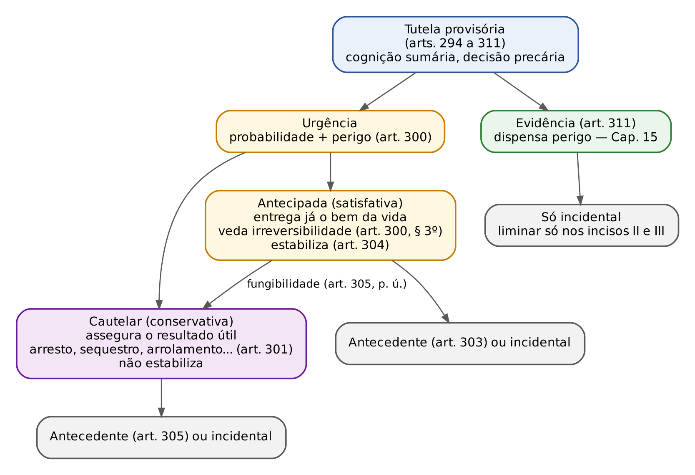
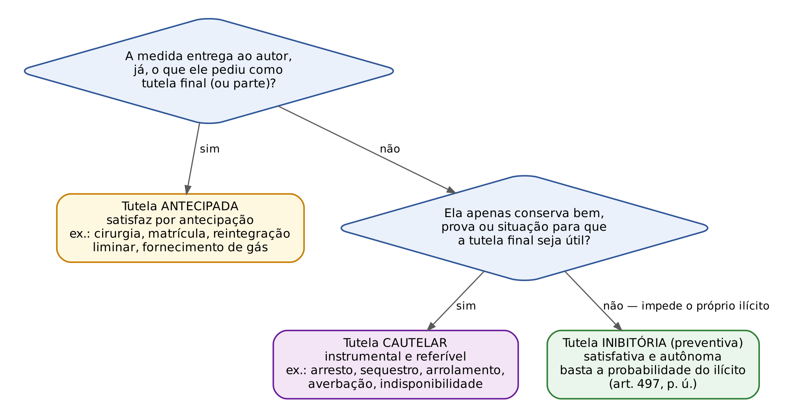
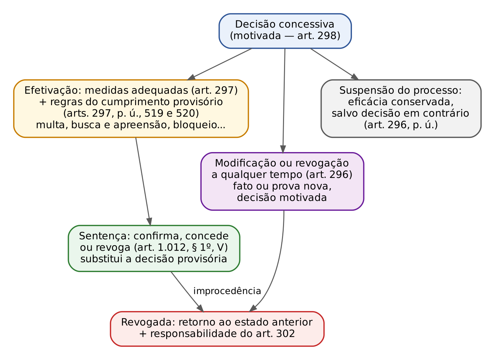
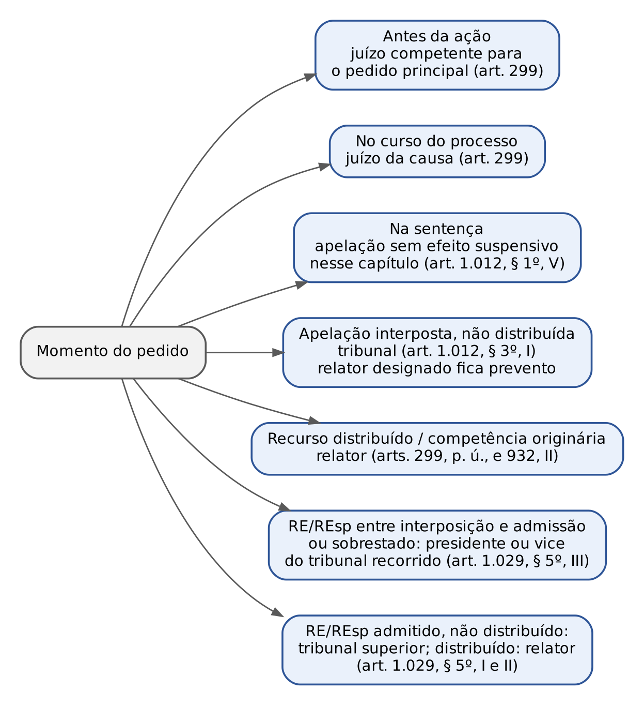
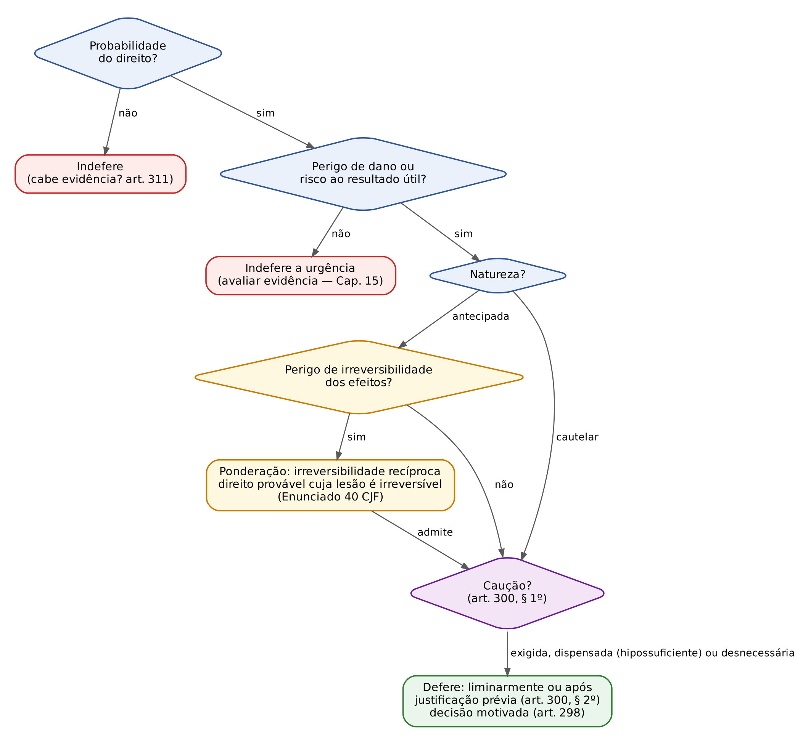
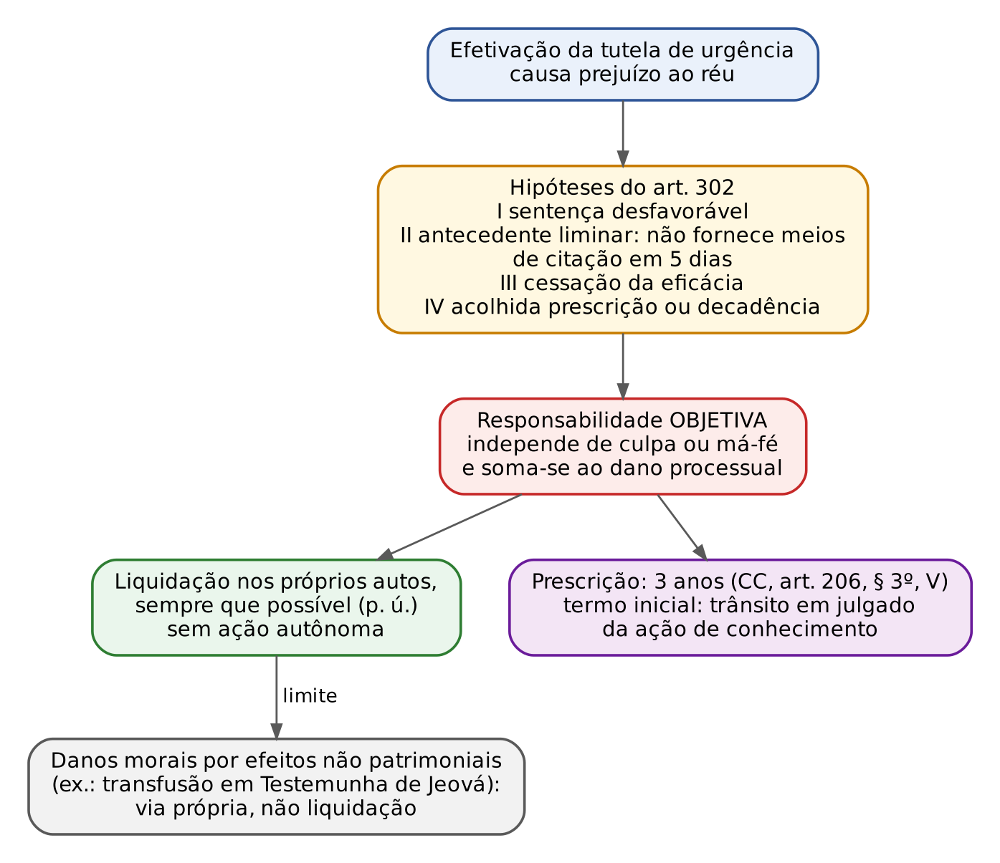
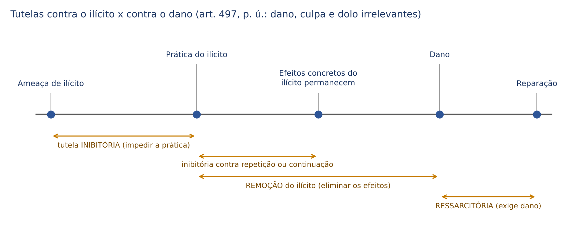

# CAPÍTULO 14 — TUTELA PROVISÓRIA I: TEORIA GERAL, TUTELA DE URGÊNCIA E TUTELA INIBITÓRIA

:::INCIDENCIA
TRF5 p. 6; TJRS p. 7; TJSC p. 6. Nível A+. Lote: 23 questões (FGV 18, FCC 5), 6 de provas da magistratura (TRF1, TRF2, TRF3, TJ-MS, TJ-SE, TJ-TO, TJ-MT).
O que mais cai: letra dos arts. 294 a 302 (custas, eficácia na suspensão, revogação a qualquer tempo, caução e hipossuficiente, liminar ou justificação, irreversibilidade), classificação antecipada x cautelar em caso concreto, fungibilidade, responsabilidade objetiva do art. 302 e inibitória sem dano nem culpa (art. 497, parágrafo único).
:::

| Subtema | FGV | FCC | Padrão de cobrança |
|---|---|---|---|
| Disposições gerais (arts. 294 a 299: custas, eficácia, suspensão, revogação, competência) | 6 | 2 | caso com suspensão do processo ou pedido incidental: "conserva a eficácia" e "independe de custas" |
| Requisitos, liminar e justificação prévia (art. 300, caput e § 2º) | 4 | 1 | troca de "e" por "ou" nos requisitos; "citação prévia obrigatória"; "prova inequívoca" do CPC/1973 |
| Irreversibilidade (art. 300, § 3º) | 2 | 1 | letra seca x mitigação em saúde (irreversibilidade recíproca) |
| Caução (art. 300, § 1º) | 2 | 1 | caução real ou fidejussória; dispensa ao hipossuficiente; finalidade de ressarcir o réu |
| Antecipada x cautelar e fungibilidade | 4 | 0 | identificar a natureza da medida pedida (cirurgia, matrícula, reintegração, sequestro) |
| Medidas cautelares típicas e atípicas, poder geral de cautela | 3 | 1 | rol do art. 301; fim das cautelares nominadas; averbação no processo de conhecimento; Tema 31 do STJ |
| Responsabilidade do requerente (art. 302) | 1 | 0 | prescrição trienal e termo inicial (trânsito em julgado) |
| Tutela inibitória e de remoção do ilícito | 1 | 1 | irrelevância de dano, culpa e dolo; cabimento incidental |
| Tutela provisória e vício de representação | 1 | 0 | ordem lógica: concede a urgência e manda sanar o vício |

Escopo e remissões. Este capítulo trata da teoria geral da tutela provisória (arts. 294 a 299), da tutela de urgência (arts. 300 a 302), do poder geral de cautela e das medidas cautelares e da tutela específica contra o ilícito (art. 497, parágrafo único). Os procedimentos antecedentes (arts. 303 a 310), a estabilização (art. 304), a tutela de evidência (art. 311), a tutela provisória contra a Fazenda Pública (Leis 8.437/1992 e 9.494/1997), a suspensão de liminar, os recursos contra decisões de tutela e a distribuição do tempo do processo estão no Cap. 15. As *astreintes* (fixação, alteração, exigibilidade e execução) estão no Cap. 23.

## 14.1 Tutela definitiva, tutela provisória e as técnicas de sumarização

### 14.1.1 Tutela definitiva x tutela provisória

A tutela definitiva é obtida por cognição exauriente, com contraditório pleno, e é apta a formar coisa julgada material. A tutela provisória é concedida com base em cognição sumária (juízo de probabilidade, não de certeza), é precária (pode ser revogada ou modificada a qualquer tempo, art. 296) e é inapta à coisa julgada; nasce para ser substituída por uma decisão de cognição exauriente que a confirme, a revogue ou a modifique. Até o CPC/2015 a lógica era dividida entre a antecipação de tutela do art. 273 do CPC/1973 (requisito de "prova inequívoca" que convencesse da "verossimilhança") e o Livro III (processo cautelar autônomo, com cautelares nominadas e inominadas). O CPC/2015 unificou o regime no Livro V da Parte Geral, sob o rótulo "tutela provisória", e extinguiu o processo cautelar autônomo.

| Critério | Tutela definitiva | Tutela provisória |
|---|---|---|
| Cognição | exauriente | sumária (probabilidade) |
| Estabilidade | coisa julgada material (art. 502) | precária: revogável e modificável a qualquer tempo (art. 296) |
| Função | resolve a crise de direito material | distribui o ônus do tempo do processo; neutraliza o perigo ou a evidência |
| Contraditório | prévio (art. 9º, caput) | pode ser diferido: urgência e evidência dos incisos II e III do art. 311 (art. 9º, parágrafo único) |
| Efetivação | cumprimento definitivo ou provisório | medidas adequadas e regras do cumprimento provisório (arts. 297 e 519) |
| Exceção de estabilidade | — | estabilização da tutela antecipada antecedente (art. 304), que NÃO é coisa julgada (Cap. 15) |

:::PEGADINHA PROVISÓRIA NÃO É SINÔNIMO DE TEMPORÁRIA
Na linguagem clássica (Calamandrei e, entre nós, a doutrina que o seguiu), temporária é a medida que dura por tempo limitado sem ser substituída por outra de mesma natureza (ex.: o arresto, que não é "convertido" em arresto definitivo, mas em penhora); provisória é a que será substituída por uma definitiva de mesma natureza (a tutela antecipada, substituída pela sentença de procedência). O CPC usa "provisória" para as duas espécies. Questão que diga que a cautelar é "satisfativa" ou que a antecipada "apenas assegura" erra a natureza, não o rótulo.
:::

Distinga a tutela provisória de outras técnicas que também aceleram ou sumarizam: o julgamento antecipado parcial do mérito (art. 356) é tutela DEFINITIVA, por cognição exauriente, apta à coisa julgada, sobre parcela incontroversa ou madura (Cap. 17); a ação monitória (arts. 700 a 702) é técnica de inversão do ônus de instaurar o contraditório (Cap. 29); o cumprimento provisório de sentença (art. 520) adianta a execução de decisão proferida em cognição exauriente, sem exigir perigo (Cap. 22). O Enunciado 184 da III Jornada de Direito Processual Civil (CJF) usa a distinção ao afirmar que o uso e a fruição antecipados de bens no inventário (art. 647, parágrafo único) são deferidos por tutela provisória satisfativa, e não por julgamento antecipado do mérito, cabendo ao juiz examinar a probabilidade de o bem vir a integrar o quinhão do herdeiro.

### 14.1.2 Classificação legal: fundamento, natureza e momento

O art. 294 organiza a matéria em três eixos que as bancas combinam para montar alternativas erradas:

- Fundamento: urgência (art. 300) ou evidência (art. 311). A evidência dispensa o perigo (Cap. 15).
- Natureza (só para a urgência): antecipada (satisfativa) ou cautelar (conservativa).
- Momento (só para a urgência, por força do parágrafo único do art. 294): antecedente (antes da formulação do pedido de tutela final, arts. 303 e 305) ou incidental (na inicial do processo ou no curso dele).

:::LEI CPC, ARTS. 294 E 295
Art. 294. A tutela provisória pode fundamentar-se em urgência ou evidência.
Parágrafo único. A tutela provisória de urgência, cautelar ou antecipada, pode ser concedida em caráter antecedente ou incidental.
Art. 295. A tutela provisória requerida em caráter incidental independe do pagamento de custas.
:::

:::PEGADINHA EVIDÊNCIA ANTECEDENTE
A tutela de evidência é sempre incidental: o parágrafo único do art. 294 só fala da urgência. Alternativa que afirme que "a tutela provisória de urgência, assim como a tutela de evidência, somente poderá ser requerida em caráter antecedente" erra duas vezes (Q4223062, alternativa E). E a evidência não é "estabilizável": a estabilização é privilégio da tutela antecipada de urgência requerida em caráter antecedente (art. 304; Cap. 15).
:::

### 14.1.3 Tutela antecipada (satisfativa) x tutela cautelar (conservativa)

A tutela antecipada entrega desde logo, total ou parcialmente, o próprio bem da vida pretendido como tutela final, com base em probabilidade; tem a mesma substância da tutela final, apenas sem a imutabilidade da coisa julgada. A tutela cautelar não satisfaz: assegura a utilidade futura da tutela satisfativa, conservando bens, provas ou situações (arresto para garantir futura execução; sequestro de coisa litigiosa; arrolamento). Daí os traços clássicos da cautelar: instrumentalidade (serve a outra tutela) e referibilidade (sempre se refere a um direito acautelado, a uma "situação tutelável").

Fórmula de bolso (repetida pela doutrina a partir de Calamandrei e adotada nas questões FCC): a antecipada combate o PERIGO DE TARDANÇA (o tempo, por si, causa o dano: o paciente não pode esperar a sentença para operar); a cautelar combate o PERIGO DE INFRUTUOSIDADE (o tempo permite que a futura tutela se torne inútil: o devedor dilapida o patrimônio). O CPC traduziu a dicotomia na redação do art. 300: "perigo de dano" (antecipada) "ou o risco ao resultado útil do processo" (cautelar).

:::DOUTRINA MARINONI: O ART. 301 COMO CRITÉRIO LEGAL DA DISTINÇÃO
Luiz Guilherme Marinoni (Tutela de urgência e tutela da evidência, RT, 2017, cap. sobre o perfil da tutela cautelar) sustenta que o art. 301, ao exemplificar a cautelar com arresto, sequestro, arrolamento e protesto contra alienação e falar em medida idônea para "asseguração do direito", fixou em lei que a cautelar não realiza o direito por antecipação, mas o assegura. A distinção deixou de ser só acadêmica, porque o CPC atribui consequências diferentes a cada espécie: só a antecipada sofre o óbice da irreversibilidade (art. 300, § 3º) e só ela estabiliza (art. 304). Para o autor, também a tutela antecipada de soma em dinheiro é satisfativa (realiza o crédito para proteger direito conexo, como a subsistência), e não cautelar.
:::

| Aspecto | Tutela antecipada | Tutela cautelar |
|---|---|---|
| Função | satisfazer (realizar) o direito provável | assegurar a utilidade da tutela satisfativa |
| Perigo combatido | de tardança ("perigo de dano") | de infrutuosidade ("risco ao resultado útil do processo") |
| Coincidência com o pedido final | sim, total ou parcial | não: pede-se algo diverso (constrição, conservação) |
| Instrumentalidade e referibilidade | não (a antecipada basta a si) | sim |
| Irreversibilidade (art. 300, § 3º) | óbice legal (mitigado: 14.3.4) | não se aplica |
| Procedimento antecedente | arts. 303 e 304 (aditamento em 15 dias ou prazo maior) | arts. 305 a 310 (pedido principal em 30 dias) |
| Estabilização | sim, se antecedente e não impugnada (art. 304) | não |
| Exemplos | cirurgia, fornecimento de medicamento, matrícula, liminar possessória, alimentos provisórios, restabelecimento de serviço | arresto, sequestro, arrolamento, protesto contra alienação, averbação da ação, indisponibilidade, caução |

:::QUESTAO FGV 2025 — TJ-TO — JUIZ SUBSTITUTO (Q3453242)
Caso: adolescente aprovado em vestibular pede, na inicial, que a instituição seja compelida a efetivar já a matrícula, sob pena de perder o semestre, cumulando danos morais. Gabarito: A — tutela antecipada de urgência.
Passo 1: o pedido final é a matrícula; a medida pedida é a própria matrícula, logo satisfaz por antecipação. Passo 2: o fundamento é o perigo (perda do semestre), não a evidência. Armadilhas: "cautelar satisfativa" (categoria do CPC/1973 que o CPC/2015 abandonou) e "antecipada de evidência" (não há perigo na evidência, e aqui o perigo é o fundamento).
No mesmo sentido: Q3752743 (FGV 2025, MPE-ES, Promotor — negativa de cirurgia urgente por plano de saúde: tutela de urgência antecipada, gabarito C; a armadilha era a "tutela de evidência estabilizada", que não existe) e Q3085867 (FGV 2024, DATAPREV — retomada do fornecimento de gás em 24 horas sob multa diária: tutela de urgência satisfativa, presentes probabilidade e perigo).
:::

:::QUESTAO FGV 2024 — TJ-MT — JUIZ SUBSTITUTO (Q3086928)
Caso: possessória de força nova (esbulho há dois meses) com pedido de liminar reintegratória, indeferido; em seguida, nova petição pede tutela provisória para reintegração imediata, agora invocando *fumus boni iuris* e *periculum in mora* (deterioração do imóvel, risco de desabamento). Gabarito: C — ambas as tutelas têm natureza de tutela antecipada.
Resolução: a liminar possessória do art. 562 (posse nova) é tutela antecipada satisfativa de evidência legal (não exige perigo, Cap. 29); o segundo pedido é tutela antecipada de urgência pelo art. 300. Em ambos, o autor quer o próprio bem da vida final (a reintegração), não a conservação do imóvel. A armadilha é rotular de "cautelar" o pedido fundado em *fumus* e *periculum*: esses requisitos são comuns às duas espécies de urgência; o que define a natureza é a função da medida. Se Caio pedisse apenas obras emergenciais de escoramento ou o depósito do bem, aí sim haveria cautelar.
:::

:::DICA LIMINAR POSSESSÓRIA EM POSSE VELHA
Indeferida a liminar do art. 562 por se tratar de posse de mais de ano e dia, o autor ainda pode obter a reintegração imediata pela tutela de urgência do art. 300, comprovados probabilidade e perigo: o STJ admitiu a liminar em posse velha com fundamento no art. 300 (STJ, AgInt no AREsp n. 1.089.677/AM, Relator Desembargador convocado Lázaro Guimarães, Quarta Turma, j. 8/2/2018). A Súmula 262 do STF (não cabe medida possessória liminar para liberação alfandegária de automóvel) é limite antigo, ainda citado em provas de literalidade.
:::

## 14.2 Disposições gerais (arts. 294 a 299)

### 14.2.1 Custas e caráter incidental

O pedido incidental (na inicial ou no curso do processo) independe do pagamento de custas (art. 295): não há novo processo nem nova demanda, apenas um requerimento dentro da relação processual já existente. Na tutela antecedente, as custas são as do próprio processo, que nasce com o requerimento antecedente; o aditamento (art. 303, § 3º) e a formulação do pedido principal (art. 308) não exigem novas custas (Cap. 15).

:::PEGADINHA GRATUIDADE NÃO É A RAZÃO DA DISPENSA
A dispensa de custas do art. 295 é objetiva, para qualquer requerente, e não depende de gratuidade da justiça. Alternativa que afirma que "o pedido incidental depende do recolhimento prévio de custas, salvo se a autora for beneficiária da gratuidade" está errada (Q4079382, A). No mesmo sentido, as alternativas sobre custas em Q4223062 (B), Q3593090 (B), Q3469456 (E) e Q2482663 (D): todas erradas pelo art. 295.
:::

### 14.2.2 Eficácia, revogação e modificação; suspensão do processo

:::LEI CPC, ART. 296
Art. 296. A tutela provisória conserva sua eficácia na pendência do processo, mas pode, a qualquer tempo, ser revogada ou modificada.
Parágrafo único. Salvo decisão judicial em contrário, a tutela provisória conservará a eficácia durante o período de suspensão do processo.
:::

Três regras de prova: (a) a tutela provisória dura enquanto pender o processo, até ser substituída pela decisão final (que a confirma, revoga ou modifica) ou cessar nas hipóteses legais (art. 309 para a antecedente; Cap. 15); (b) pode ser revogada ou modificada "a qualquer tempo" (não só na sentença), o que a doutrina chama de reversibilidade ou precariedade; (c) a suspensão do processo NÃO suspende a eficácia da tutela, salvo decisão judicial em contrário. A regra (c) dialoga com o art. 314 (durante a suspensão é vedado praticar atos processuais, mas o juiz pode determinar atos urgentes) e com o Enunciado 41 da I Jornada de Direito Processual Civil (CJF): nos processos sobrestados pelo regime repetitivo, cabe apreciar e efetivar tutela de urgência, e a competência é do órgão onde estiverem os autos.

A revogação ou modificação "a qualquer tempo" não autoriza o juiz a mudar de opinião sobre o mesmo quadro: exige alteração do quadro fático ou probatório, fato novo ou elemento antes não considerado, sob pena de violar a segurança da decisão e a vedação da decisão-surpresa (art. 10, que impõe ouvir as partes antes de revogar com base em fundamento não debatido). A decisão que modifica ou revoga também deve ser motivada de modo claro e preciso (art. 298) e é agravável (art. 1.015, I; Cap. 15). Se a revogação vem na sentença (improcedência), a apelação não tem efeito suspensivo quanto a esse capítulo (art. 1.012, § 1º, V), e o Enunciado 39 da I Jornada (CJF) admite que a parte, além de apelar, peça o restabelecimento da tutela ao tribunal, na própria petição do recurso ou em via autônoma.

:::QUESTAO FGV 2026 — PGE-AC — PROCURADOR DO ESTADO (Q4079382)
Caso: tutela incidental para bloqueio de valores, parcialmente deferida; o processo é suspenso pela instauração de IRDR; a ré pede a cessação da tutela, alegando a suspensão e a falta de custas. Gabarito: C — a tutela conserva, em regra, a eficácia durante a suspensão, podendo ser revogada a qualquer tempo por decisão fundamentada.
Armadilhas: perda "automática" de eficácia com a suspensão (B e E); revogação "somente após o julgamento definitivo" (D); custas (A). Fundamentos: arts. 295, 296 e parágrafo único, e 298.
No mesmo sentido: Q4223062 (FGV 2026, NAV Brasil — plano de saúde, processo suspenso por prejudicial externa; gabarito C), Q3593090 (FGV 2025, TCE-PE; gabarito C, literalidade do art. 296) e Q3087130 (FGV 2024, TJ-RR — a possibilidade de modificação ou revogação por decisão posterior é a "reversibilidade", gabarito A). Em Q3745790 (FCC 2025, PGE-MT), a assertiva I ("suspenso o processo, também sua eficácia será suspensa, salvo decisão judicial em sentido contrário") inverte a regra e é FALSA.
:::

### 14.2.3 Efetivação

:::LEI CPC, ART. 297
Art. 297. O juiz poderá determinar as medidas que considerar adequadas para efetivação da tutela provisória.
Parágrafo único. A efetivação da tutela provisória observará as normas referentes ao cumprimento provisório da sentença, no que couber.
:::

O art. 297 é cláusula geral de efetivação (atipicidade dos meios executivos), em linha com o art. 139, IV (medidas indutivas, coercitivas, mandamentais ou sub-rogatórias "inclusive nas ações que tenham por objeto prestação pecuniária") e com os arts. 536 e 537 (multa, busca e apreensão, remoção de pessoas e coisas, desfazimento de obras, impedimento de atividade nociva, força policial). O art. 519 manda aplicar à decisão de tutela provisória as disposições do cumprimento de sentença, provisório ou definitivo, e da liquidação, no que couber.

Consequências práticas cobradas:

- Regime do cumprimento provisório (art. 520): corre por iniciativa e responsabilidade do exequente; fica sem efeito sobrevindo decisão que modifique ou anule a decisão, restituindo-se as partes ao estado anterior e liquidando-se os prejuízos nos mesmos autos; levantamento de dinheiro e atos de alienação dependem, em regra, de caução (art. 520, IV), com as dispensas do art. 521. A tutela antecipada de pagar quantia, portanto, efetiva-se em autos próprios ou nos mesmos autos, conforme a organização do juízo, com a mesma lógica de risco.
- Independência do trânsito em julgado, inclusive contra o Poder Público: Enunciado 38 da I Jornada (CJF). As restrições específicas à tutela contra a Fazenda (art. 1.059 do CPC; Leis 8.437/1992 e 9.494/1997; art. 7º, § 2º, da Lei 12.016/2009) estão no Cap. 15; o regime de precatórios não é obstáculo à efetivação de obrigação de fazer.
- Bloqueio de verbas públicas para saúde e multa contra ente público: admitidos para efetivar a tutela de fornecimento de medicamentos (Temas 84 e 98 do STJ; v. Cap. 15).
- Multa coercitiva: pode ser fixada em tutela provisória, de ofício (art. 537, caput); a decisão que a fixa admite cumprimento provisório, com depósito e levantamento após o trânsito da sentença favorável (art. 537, § 3º). Para a multa fixada em antecipação de tutela, o STJ exigiu, sob o CPC/1973, confirmação pela sentença de mérito e recurso sem efeito suspensivo para a execução provisória (Tema 743); a compatibilização com o art. 537, § 3º, os limites à alteração da multa vencida (art. 537, § 1º, "multa vincenda") e a intimação pessoal do devedor como pressuposto da incidência (Súmula 410 do STJ, reafirmada no Tema 1.296) estão desenvolvidos no Cap. 23.

:::JURIS STJ, PET 16.334-DF, PRIMEIRA SEÇÃO, J. 8/4/2026 (INFORMATIVO 884)
A multa cominatória fixada em liminar de ação inibitória subsiste mesmo que a ação seja depois extinta sem resolução do mérito e que, em reconvenção, se reconheça a legalidade da conduta (no caso, a greve dos Auditores-Fiscais da Receita Federal): a transgressão da ordem liminar (manutenção das sessões do CARF) é fato gerador autônomo do dever de pagar a sanção processual.
Gancho: a multa protege a autoridade da decisão, não o direito material; por isso não cai automaticamente com a revogação posterior da tutela no mérito. Contraponto: o Tema 743 condiciona a EXECUÇÃO PROVISÓRIA à confirmação na sentença; aqui se discutia a SUBSISTÊNCIA do crédito já gerado pelo descumprimento.
:::

### 14.2.4 Motivação

O art. 298 exige que a decisão que conceder, negar, modificar ou revogar a tutela provisória seja motivada "de modo claro e preciso". Incide também o art. 489, § 1º (decisão interlocutória é "decisão judicial" para esse fim): não basta reproduzir o texto do art. 300 ("presentes os requisitos legais, defiro"), nem invocar conceito jurídico indeterminado ("risco de dano irreparável") sem explicar sua incidência no caso. Na tutela de urgência, a motivação deve enfrentar separadamente a probabilidade, o perigo, a reversibilidade (quando antecipada), a necessidade de caução e a adequação e proporcionalidade da medida escolhida para efetivá-la.

:::SENTENCA DECISÃO CONCESSIVA DE TUTELA DE URGÊNCIA ANTECIPADA (MODELO ENXUTO)
Trata-se de pedido de tutela de urgência formulado por F. S. (autor) para compelir a ré a autorizar e custear o procedimento cirúrgico prescrito. A probabilidade do direito decorre do contrato (cláusula de cobertura do procedimento), do relatório médico que indica a cirurgia como única alternativa terapêutica e da negativa escrita fundada em exclusão que a jurisprudência do STJ tem por abusiva. O perigo de dano é atual: o laudo aponta risco de agravamento irreversível em semanas. A irreversibilidade que a ré possa alegar é recíproca e se resolve em favor do direito mais provável, cuja lesão seria irreparável (art. 300, § 3º, interpretado conforme o art. 5º, XXXV, da CF; Enunciado 40 da I Jornada de Direito Processual Civil). Dispenso a caução, porque o autor é economicamente hipossuficiente e não pode oferecê-la (art. 300, § 1º). Ante o exposto, DEFIRO a tutela de urgência para determinar à ré que, no prazo de 48 (quarenta e oito) horas contadas da intimação, autorize e custeie integralmente o procedimento, sob pena de multa diária de 2.000 (dois mil) reais, limitada inicialmente a 60.000 (sessenta mil) reais, sem prejuízo de outras medidas (arts. 297 e 536, § 1º). Intime-se pessoalmente a ré para cumprimento (Súmula 410 do STJ). Cite-se.
:::

### 14.2.5 Competência

:::LEI CPC, ART. 299
Art. 299. A tutela provisória será requerida ao juízo da causa e, quando antecedente, ao juízo competente para conhecer do pedido principal.
Parágrafo único. Ressalvada disposição especial, na ação de competência originária de tribunal e nos recursos a tutela provisória será requerida ao órgão jurisdicional competente para apreciar o mérito.
:::

A competência para a tutela provisória é FUNCIONAL e acessória: segue a do pedido principal. Não existe "qualquer juízo" competente para a antecedente (é o erro da Q3179548, alternativa C). Desdobramentos:

- Incompetência: o juízo incompetente pode e deve apreciar a urgência que não admite espera, e os efeitos de sua decisão conservam-se, salvo decisão em sentido contrário, até que o juízo competente se pronuncie (art. 64, § 4º). É a solução para a tutela concedida no plantão ou por juízo depois declarado incompetente.
- Nos tribunais: compete ao relator apreciar a tutela provisória nos recursos e nos processos de competência originária (art. 932, II); no agravo de instrumento, o relator pode atribuir efeito suspensivo ou deferir, em antecipação de tutela, a pretensão recursal (efeito ativo, art. 1.019, I).
- Apelação: o pedido de efeito suspensivo nas hipóteses do art. 1.012, § 1º, vai ao tribunal, entre a interposição e a distribuição (o relator designado fica prevento), ou ao relator, se já distribuída (art. 1.012, § 3º). Requisitos do § 4º: probabilidade de provimento OU relevância da fundamentação somada a risco de dano grave ou de difícil reparação.
- RE e REsp: o efeito suspensivo é requerido ao tribunal superior entre a publicação da decisão de admissão e a distribuição (relator prevento), ao relator se já distribuído, e ao presidente ou vice-presidente do tribunal recorrido entre a interposição e a publicação da admissão ou no caso de sobrestamento (art. 1.029, § 5º, com a redação da Lei 13.256/2016). É a positivação das Súmulas 634 e 635 do STF (o STF não concede cautelar para dar efeito suspensivo a RE ainda não admitido na origem; cabe ao presidente do tribunal de origem decidir a cautelar em RE pendente de admissibilidade).
- Arbitragem: antes de instituída a arbitragem, a parte pode recorrer ao Judiciário para medida cautelar ou de urgência, que perde a eficácia se a instituição não for requerida em 30 dias da efetivação; instituída, cabe aos árbitros manter, modificar ou revogar a medida (Lei 9.307/1996, arts. 22-A e 22-B; Cap. 2).
- Ação rescisória: a propositura não impede o cumprimento da decisão rescindenda, "ressalvada a concessão de tutela provisória" (art. 969), requerida ao relator da rescisória; não há estabilização nesse caso (Enunciado 43 da I Jornada; Cap. 40).
- Reclamação: o relator, ao suspender o ato impugnado, pode conceder tutela provisória satisfativa correspondente à decisão cuja autoridade foi violada (Enunciado 64 da I Jornada; Cap. 40).
- IDPJ: cabe tutela de urgência no incidente de desconsideração (Enunciado 42 da I Jornada), tipicamente arresto ou indisponibilidade de bens do sócio (Cap. 9).

:::QUESTAO FGV 2025 — TRF3 — JUIZ FEDERAL SUBSTITUTO (Q3179548)
Item correto: E — a tutela de urgência pode ser concedida liminarmente ou após justificação prévia (art. 300, § 2º).
Erros das demais: (A) evidência por súmula de TRF — o art. 311, II, exige tese firmada em casos repetitivos ou súmula vinculante (o Enunciado 48 da I Jornada amplia para repercussão geral e súmulas dos tribunais superiores, não para súmula de TRF; Cap. 15); (B) troca o "e" por "ou" nos requisitos do art. 300; (C) "quando antecedente, a qualquer juízo" — é ao juízo competente para o pedido principal (art. 299); (D) a responsabilidade do art. 302 é objetiva, não depende de má-fé (14.6).
No mesmo sentido, sobre liminar ou justificação prévia: Q3028429 (FGV 2024, TRF1, Analista — itens I, II e III corretos, gabarito E) e Q2482663 (FGV 2024, SES-MT — errada a alternativa que exige justificação prévia).
:::

### 14.2.6 Requerimento, iniciativa e contraditório

Tutela de ofício. O CPC/2015 não reproduziu autorização genérica para o juiz conceder tutela provisória sem requerimento. Prevalece na doutrina e nas provas que a tutela antecipada depende de pedido (princípio dispositivo e, sobretudo, responsabilidade objetiva do art. 302, que não pode ser imposta a quem não pediu); quanto à cautelar, há quem admita a concessão de ofício em situações excepcionais, com base no poder geral de cautela e no dever de efetividade, mas a posição não é pacífica. Há autorizações legais específicas: no JEF, o juiz "poderá, de ofício ou a requerimento das partes, deferir medidas cautelares no curso do processo" (Lei 10.259/2001, art. 4º; Cap. 37); na ACP, o art. 11 da LACP admite a cessação da atividade nociva sob multa independentemente de requerimento; e a multa coercitiva para efetivar a tutela já pedida pode ser imposta de ofício (art. 537, caput). Em prova objetiva, "o juiz deve conceder de ofício a tutela antecipada" é afirmação a rejeitar.

Contraditório diferido. A tutela de urgência é exceção expressa à regra do contraditório prévio (art. 9º, parágrafo único, I): pode ser concedida *inaudita altera parte*, liminarmente, ou após justificação prévia (audiência ou produção sumária de prova para formar a convicção de probabilidade, art. 300, § 2º). O contraditório não é suprimido, mas postergado: concedida a tutela, o réu é intimado, pode agravar e pode pedir a revogação. A citação prévia do réu não é requisito (Q3085867, alternativa D, errada), nem o é a oitiva do ente público fora das hipóteses legais (Cap. 15 para o art. 2º da Lei 8.437/1992).

:::ATENCAO POSTERGAR A ANÁLISE TAMBÉM DECIDE
O juiz que, diante de pedido urgente, apenas "reserva a apreciação para após a contestação" ou condiciona o exame a exigência não prevista em lei profere decisão com conteúdo de indeferimento: o Enunciado 70 da I Jornada (CJF) afirma ser agravável o pronunciamento que posterga a análise de tutela provisória ou a condiciona a qualquer exigência. Postergar só é legítimo se a urgência admitir a espera e houver fundamentação concreta (ex.: necessidade de justificação prévia).
:::

:::QUESTAO FGV 2025 — TJ-TO — JUIZ SUBSTITUTO (Q3453241)
Caso: o mesmo adolescente de 17 anos (Q3453242) outorgou procuração sozinho, sem assistência dos pais; presentes os requisitos da tutela de urgência (matrícula). Gabarito: B — conceder a tutela provisória e, antes do juízo positivo de admissibilidade, intimar o autor para regularizar a representação processual.
Passo 1: a incapacidade relativa é vício sanável (art. 76): o juiz suspende e marca prazo para correção; não indefere de plano (D errada). Passo 2: a urgência não espera o saneamento, sob pena de perecimento do direito (art. 5º, XXXV, da CF; primazia do mérito); a tutela é concedida e o vício, corrigido em seguida. Passo 3: só depois de sanado o vício o juiz faz o juízo positivo de admissibilidade e manda citar. Armadilhas: (A) tratar a representação como regular; (C) inverter a ordem, deixando a urgência para depois da regularização; (E) remessa ao JEC — a opção pelo Juizado é do autor (Cap. 36), e o incapaz não pode ser parte no JEC (Lei 9.099/1995, art. 8º).
:::

## 14.3 Requisitos da tutela de urgência (art. 300)

:::LEI CPC, ART. 300
Art. 300. A tutela de urgência será concedida quando houver elementos que evidenciem a probabilidade do direito e o perigo de dano ou o risco ao resultado útil do processo.
§ 1º Para a concessão da tutela de urgência, o juiz pode, conforme o caso, exigir caução real ou fidejussória idônea para ressarcir os danos que a outra parte possa vir a sofrer, podendo a caução ser dispensada se a parte economicamente hipossuficiente não puder oferecê-la.
§ 2º A tutela de urgência pode ser concedida liminarmente ou após justificação prévia.
§ 3º A tutela de urgência de natureza antecipada não será concedida quando houver perigo de irreversibilidade dos efeitos da decisão.
:::

Leitura de prova: dois requisitos POSITIVOS cumulativos (probabilidade E perigo, este em uma de suas duas feições, "perigo de dano OU risco ao resultado útil"), um requisito NEGATIVO exclusivo da antecipada (ausência de perigo de irreversibilidade), uma contracautela facultativa (caução, "pode, conforme o caso") e duas formas de concessão (liminar ou após justificação). O "será concedida" do caput indica que, presentes os requisitos, a concessão é dever, não faculdade discricionária do juiz.

### 14.3.1 Probabilidade do direito

O CPC/2015 unificou o requisito, antes dividido entre a "prova inequívoca" que convencesse da "verossimilhança da alegação" (antecipação, art. 273 do CPC/1973) e o *fumus boni iuris* (cautelar). Hoje o *standard* é o mesmo para as duas espécies: elementos que evidenciem a probabilidade do direito. Nada impede, contudo, que o juiz calibre a intensidade da probabilidade exigida conforme o grau do perigo e a gravidade dos efeitos da medida para o réu (quanto mais invasiva e menos reversível a medida, mais robusta deve ser a probabilidade). Marinoni chama de "convicção de probabilidade" o juízo que considera as posições em disputa e a dificuldade da prova, justificando-o racionalmente na decisão.

A probabilidade abrange o direito material afirmado (fato e direito) e, na cautelar, a plausibilidade do direito acautelado. Não se confunde com a evidência do art. 311 (Cap. 15): na urgência, a probabilidade pode ser apenas razoável, porque é compensada pelo perigo; na evidência, o grau de convicção é tão alto que o perigo é dispensado.

:::PEGADINHA "PROVA INEQUÍVOCA"
"A tutela de urgência não poderia ter sido concedida, pois o autor deveria ter comprovado o direito por meio de prova inequívoca" (Q3085867, A): ERRADO. Prova inequívoca era a expressão do art. 273 do CPC/1973. Também é errado que a tutela "independe de qualquer requisito" por ser precária (Q3085867, B).
:::

### 14.3.2 Perigo de dano ou risco ao resultado útil do processo

O *periculum in mora* tem duas faces: o perigo de dano ao próprio direito material pela demora (antecipada) e o risco à utilidade do resultado do processo (cautelar). O perigo deve ser concreto (não hipotético), atual ou iminente e grave; a irreparabilidade ou difícil reparação do dano é elemento do juízo, ainda que o CPC/2015 não a repita expressamente como o art. 273, I, do CPC/1973 ("fundado receio de dano irreparável ou de difícil reparação").

Questões de detalhe:

- Perigo criado pelo próprio requerente (demora injustificada em agir) enfraquece a urgência; a demora razoável para reunir provas não.
- Perigo de ilícito: na tutela inibitória antecipada, o perigo relevante é o da prática, repetição ou continuação do ilícito, e não o de dano (14.7; art. 497, parágrafo único).
- O perigo não se presume pelo simples valor elevado da causa ou pela natureza do bem; mas a natureza alimentar, a saúde e a continuidade de serviço essencial costumam tê-lo demonstrado pelos próprios fatos.
- Perigo sem probabilidade não basta (o juiz não "acautela o improvável"); probabilidade sem perigo remete à evidência, se presente alguma hipótese do art. 311.

:::QUESTAO FCC 2025 — TRT1 — ANALISTA JUDICIÁRIO (Q3445928)
Gabarito: E — a tutela de urgência será concedida quando houver elementos que evidenciem a probabilidade do direito, podendo o juiz, conforme o caso, exigir caução real ou fidejussória idônea.
Armadilhas: (A) e (B) transplantam hipóteses do art. 311 (evidência: abuso do direito de defesa e propósito protelatório; tese em súmula vinculante) para a urgência; (C) "vedado ao juiz exigir caução" contraria o § 1º; (D) contraria a letra do § 3º. A alternativa correta é incompleta (omite o perigo), e a FCC a aceitou porque nenhuma afirmação era falsa: na FCC, a resposta "menos errada" e literal costuma prevalecer.
:::

### 14.3.3 Caução (contracautela)

A caução do § 1º é contracautela: garante o ressarcimento dos danos que a efetivação da tutela possa causar ao réu, sintonizada com a responsabilidade objetiva do art. 302. Características:

- Facultativa e casuística: "o juiz PODE, conforme o caso, exigir". Não é requisito de concessão nem de eficácia em todos os casos; é instrumento de proporcionalidade (reduz o risco do réu e viabiliza medidas que, sem ela, seriam desproporcionais).
- Espécies: real (dinheiro, bem imóvel ou móvel) ou fidejussória (fiança, seguro-garantia, carta de fiança bancária), sempre "idônea", isto é, suficiente e de liquidez compatível.
- Dispensa: o § 1º autoriza dispensar a caução "se a parte economicamente hipossuficiente não puder oferecê-la". É a cláusula de acesso à justiça: condicionar a urgência a garantia que o autor não pode dar equivale a negar a tutela. A hipossuficiência econômica não se confunde com a gratuidade, mas esta é forte indício daquela.
- Momento: pode ser exigida como condição prévia da concessão, como condição de eficácia (a medida é concedida mas só se efetiva após a caução) ou, mais tarde, como requisito para atos de alto risco (levantamento de dinheiro, art. 520, IV, aplicado por força dos arts. 297 e 519).
- Contracautela obrigatória por precedente: a sustação de protesto de título, por representar restrição a direito do credor, exige prévio oferecimento de contracautela fixada conforme o prudente arbítrio do magistrado (STJ, Tema 902). Para a abstenção de inscrição em cadastro de inadimplentes, o depósito da parcela incontroversa ou a caução é um dos três requisitos cumulativos (STJ, Tema 31; 14.5.4). Em sentido inverso, no SFH a suspensão da execução extrajudicial do Decreto-lei 70/1966 durante a demanda foi admitida independentemente de caução ou depósito, preenchidos os requisitos cautelares e havendo discussão do débito fundada em jurisprudência do STJ ou do STF (STJ, Tema 55; o regime atual da execução extrajudicial de garantias está no Cap. 28).

:::QUESTAO FCC 2026 — DPE-MA — DEFENSOR PÚBLICO (Q4012613)
Caso: idosa com doença grave, ação de obrigação de fazer contra plano de saúde patrocinada pela Defensoria; o juiz condicionou a tutela de urgência a caução real. Gabarito: B — a caução poderá ser dispensada se a parte economicamente hipossuficiente não puder oferecê-la (art. 300, § 1º).
Armadilhas: dispensa "somente se a demanda não tiver conteúdo econômico" (A); exigência "independentemente da capacidade econômica" (C); valor fixo de um salário mínimo (D e E), que a lei não prevê. Na prática, a decisão que condiciona a urgência a caução impossível é agravável (art. 1.015, I) e se enquadra no Enunciado 70 da I Jornada (condicionamento da tutela a exigência).
:::

:::QUESTAO FGV 2024 — SES-MT — ADVOGADO (Q2482663)
Caso: autor que perdeu o patrimônio por efeito colateral de remédio pede, incidentalmente, pensão mensal de 10.000 (dez mil) reais; o juiz concede liminarmente, mas condiciona a eficácia a caução de 20.000 (vinte mil) reais (dois meses de pensão). Gabarito: A — a caução é válida e destina-se a ressarcir os danos que o laboratório possa sofrer com a efetivação.
Armadilhas: (B) a estabilização só alcança a tutela antecipada requerida em caráter ANTECEDENTE (art. 304), e o pedido foi incidental; (C) a tutela pode ser liminar; (D) o pedido incidental independe de custas (art. 295). Observe que o patrimônio informado (dez milhões de reais) afasta a hipossuficiência e legitima a contracautela.
No mesmo sentido: Q3593090 (FGV 2025, TCE-PE) — a caução de 10% exigida para suspender inscrição em dívida ativa NÃO é vedada (alternativa E errada).
:::

### 14.3.4 Irreversibilidade (art. 300, § 3º)

O § 3º veda a tutela de urgência ANTECIPADA quando houver perigo de irreversibilidade dos efeitos da decisão; a cautelar, por conservar e não satisfazer, não sofre o óbice (a constrição cautelar é, em regra, reversível). A regra é literal e cai assim nas provas FCC (Q3469456, gabarito D: "não será concedida quando houver perigo de irreversibilidade"; Q3445928, D, errada ao dizer que será concedida "mesmo quando houver perigo de irreversibilidade").

A doutrina e a jurisprudência, contudo, nunca a aplicaram como regra absoluta, por três razões:

- Irreversibilidade recíproca: negar a tutela também pode produzir dano irreversível ao autor (o paciente que morre sem a cirurgia, o aluno que perde o ano). Se ambas as soluções são irreversíveis, o juiz pondera e protege o direito mais provável. O Enunciado 40 da I Jornada (CJF) consagra: "A irreversibilidade dos efeitos da tutela de urgência não impede sua concessão, em se tratando de direito provável, cuja lesão seja irreversível."
- Efeitos fáticos x efeitos jurídicos: para Marinoni, o que o § 3º proíbe é a criação provisória de situações jurídicas incompatíveis com a provisoriedade (decretar provisoriamente o divórcio, constituir provisoriamente a filiação), e não a produção de efeitos fáticos irreversíveis, que são inerentes a muitas tutelas satisfativas (a cirurgia realizada não se "desfaz"); proibir a tutela nesses casos obrigaria o juiz a sacrificar o direito provável para proteger o improvável.
- Reversibilidade econômica: a irreversibilidade se mede também pela possibilidade de conversão em perdas e danos (art. 302): pagar uma cirurgia é economicamente reversível, ainda que o ato médico não o seja.

:::QUESTAO FGV 2026 — TJ-SC — OFICIAL DE JUSTIÇA E AVALIADOR (Q4153612)
Caso: tutela de urgência para cirurgia cardíaca de emergência (custo de 60.000 (sessenta mil) reais) contra plano de saúde; o réu alega que, se improcedente o pedido, os efeitos serão irreversíveis. Gabarito: D — o CPC veda a tutela antecipada com perigo de irreversibilidade, mas o requisito pode ser mitigado em hipóteses excepcionais envolvendo o direito à saúde.
Armadilhas: (A) "qualquer risco" de irreversibilidade impediria a tutela; (B) inverte a regra (a irreversibilidade é óbice da antecipada de urgência, não da evidência); (C) caução em dinheiro obrigatória pelo custo; (E) "reexame necessário" de decisão interlocutória, instituto que só incide sobre sentenças contra a Fazenda (art. 496). Lição: a FGV cobra a regra E sua mitigação; a FCC costuma cobrar só a regra.
:::

:::QUESTAO FGV 2025 — TCE-PE — ANALISTA DE GESTÃO (Q3593090)
Caso: tutela incidental contra o Estado para sustar a inscrição em dívida ativa, condicionada a caução de 10%. Gabarito oficial: C — literalidade do art. 296 (conserva a eficácia, mas pode ser revogada ou modificada a qualquer tempo).
Alternativa D ("ainda que haja perigo de irreversibilidade, o magistrado poderá conceder") foi considerada errada: aqui a FGV seguiu a letra do § 3º, porque nada no caso indicava irreversibilidade recíproca ou direito fundamental em risco. Compare com Q4153612: a mitigação só é aceita quando o enunciado fornece a situação excepcional (saúde, vida). (A) é errada porque a tutela de urgência contra a Fazenda não exige contraditório prévio fora das hipóteses legais; (E), porque a caução é permitida (§ 1º).
:::

:::EXEMPLO IRREVERSIBILIDADE JURÍDICA X FÁTICA
(1) Pedido de tutela para decretar desde logo o divórcio litigioso: hoje o problema é outro, porque o divórcio é direito potestativo e pode ser decretado por tutela de evidência ou por julgamento parcial do mérito (Cap. 15 e Apostila de Direito Civil); mas uma "anulação provisória do casamento" seria vedada pelo § 3º (efeito jurídico incompatível com a provisoriedade). (2) Demolição imediata de prédio sob alegação de risco: medida faticamente irreversível; só se admite com probabilidade muito robusta e perigo atual à vida, com prova técnica (justificação prévia), e de preferência substituída por medida menos gravosa (interdição, escoramento), que é cautelar e reversível. (3) Transfusão de sangue em paciente que a recusa por convicção religiosa: o STJ registrou que a pretensão por danos morais decorrentes da efetivação dessa tutela deve ser deduzida em ação própria, não em liquidação (14.6.4).
:::

### 14.3.5 Liminar ou após justificação prévia

A tutela pode ser concedida antes da citação ou da oitiva do réu (*inaudita altera parte*), quando a ciência prévia possa frustrar a medida (ex.: arresto de bens que o réu dilapidaria) ou quando o perigo for incompatível com a espera; ou após justificação prévia, audiência ou diligência sumária em que o autor complementa a prova da probabilidade ou do perigo (art. 300, § 2º). O juiz também pode, havendo tempo, ouvir o réu antes de decidir. A justificação prévia é faculdade do juiz, não requisito (Q3469456, B, e Q2482663, C, erradas). Pode ainda ser concedida na sentença ou em grau recursal (14.4.3).

## 14.4 Fungibilidade, momento e cumulação

### 14.4.1 Fungibilidade entre antecipada e cautelar

:::LEI CPC, ART. 305, PARÁGRAFO ÚNICO
Parágrafo único. Caso entenda que o pedido a que se refere o caput tem natureza antecipada, o juiz observará o disposto no art. 303.
:::

O texto legal só prevê a conversão no sentido cautelar para antecipada (o autor pede cautelar antecedente, o juiz entende que a medida é satisfativa e segue o rito do art. 303). A doutrina e a jurisprudência admitem a fungibilidade nos DOIS sentidos (de antecipada para cautelar, por argumento *a fortiori* e pela instrumentalidade das formas), como admitia o art. 273, § 7º, do CPC/1973, que previa expressamente o caminho inverso. Requisitos: dúvida razoável sobre a natureza da medida (zona cinzenta entre as espécies), ausência de erro grosseiro e de má-fé, e adaptação do procedimento com contraditório (o juiz deve indicar o rito que seguirá e, se for o caso, intimar o autor para adequar o pedido; art. 10). A conversão tem consequências: se a antecipada antecedente for convertida em cautelar, desaparece a possibilidade de estabilização; se a cautelar for convertida em antecipada, aplica-se o prazo de aditamento do art. 303, § 1º, I, e o autor deve ser advertido.

:::QUESTAO FGV 2025 — TJ-MS — JUIZ SUBSTITUTO (Q3786351)
Caso: o sobrinho, sabendo que o tio pretende deixar o país levando quadros que integrariam o espólio dos pais, formula "tutela antecipada em caráter antecedente" pedindo o sequestro dos objetos até a definição da propriedade. Gabarito: C — o pedido tem natureza cautelar, e a fungibilidade permite sua concessão pelo instrumento de tutela antecipada apresentado.
Passo 1: sequestro de bem litigioso para conservá-lo até a definição da titularidade é cautelar típica (art. 301): não entrega o bem ao autor, só o preserva. Passo 2: o autor errou o rótulo (antecipada antecedente). Passo 3: a fungibilidade é bidirecional; o juiz recebe e processa como cautelar antecedente (arts. 305 a 310), ajustando o rito. Armadilhas: (A) e (D) qualificam o sequestro como satisfativo; (B) inventa falta de probabilidade (o enunciado diz o contrário); (E) nega a fungibilidade por suposta finalidade de "assegurar resultado em outro processo" — no CPC/2015 não há processo cautelar autônomo, e o pedido principal é formulado nos mesmos autos (art. 308).
:::

:::PEGADINHA FUNGIBILIDADE X ESTABILIZAÇÃO
Recebida como cautelar a medida pedida como antecipada antecedente, não há estabilização (art. 304 só alcança a antecipada). E o contrário: se o juiz converte a cautelar antecedente em antecipada (art. 305, parágrafo único), abre-se, em tese, a via do art. 304 — razão pela qual o réu deve ser advertido do rito e o autor intimado para o aditamento. Detalhes do procedimento: Cap. 15.
:::

### 14.4.2 Antecedente ou incidental

A urgência contemporânea à propositura autoriza o pedido antecedente, em que o autor se limita a requerer a tutela urgente, indicando o pedido de tutela final (art. 303) ou a lide e seu fundamento (art. 305). A incidental é formulada na própria inicial (junto com o pedido final) ou em petição posterior, a qualquer tempo, inclusive em grau recursal. O processamento dos antecedentes, o aditamento, a formulação do pedido principal em 30 dias e a cessação da eficácia (arts. 303 a 310) estão no Cap. 15. Aqui importa a distinção para efeito de custas (art. 295), estabilização (só antecedente antecipada) e responsabilidade (art. 302, II e III, voltados às antecedentes).

### 14.4.3 Tutela na sentença e em grau recursal

Na sentença: o juiz pode conceder, confirmar ou revogar a tutela provisória na própria sentença; nesse caso a apelação não tem efeito suspensivo quanto ao capítulo atingido (art. 1.012, § 1º, V), e o apelado pode promover desde logo o cumprimento provisório (art. 1.012, § 2º). O Enunciado 144 da II Jornada (CJF) resume: o deferimento de tutela provisória na sentença retira da apelação o efeito suspensivo referente ao capítulo atingido. O caminho do réu é o pedido de efeito suspensivo ao tribunal ou ao relator (art. 1.012, §§ 3º e 4º), e não mandado de segurança (Q3265479, FGV 2025, Procurador Municipal, gabarito E). Concedida a tutela antes e confirmada na sentença, a eficácia imediata continua; revogada na sentença, cessa desde logo, sem esperar o trânsito (o restabelecimento pode ser pedido ao tribunal: Enunciado 39 da I Jornada).

:::SENTENCA DISPOSITIVO COM CONFIRMAÇÃO DA TUTELA DE URGÊNCIA
Ante o exposto, JULGO PROCEDENTE o pedido (art. 487, I, do CPC) para condenar a ré a custear integralmente o tratamento prescrito ao autor, nos termos da fundamentação, CONFIRMANDO a tutela de urgência deferida no evento 8, que mantenho com a multa diária ali fixada, cujo montante será apurado em cumprimento de sentença. A apelação que vier a ser interposta não terá efeito suspensivo quanto a este capítulo (art. 1.012, § 1º, V, do CPC). Condeno a ré ao pagamento das custas e dos honorários advocatícios, fixados em 10% sobre o valor atualizado da condenação (art. 85, § 2º, do CPC).
:::

Em grau recursal: o relator aprecia pedidos de tutela provisória nos recursos (art. 932, II), concede efeito suspensivo ou ativo no agravo (art. 1.019, I) e suspende a eficácia da sentença nas hipóteses do art. 1.012, § 1º (art. 1.012, § 4º). Contra acórdão que defere medida liminar não cabe recurso extraordinário (Súmula 735 do STF; v. Cap. 15). O regime recursal (agravo de instrumento, agravo interno, prazo e efeitos) está no Cap. 15 e no Cap. 42.

### 14.4.4 Cumulação de tutelas e pedido de mais de uma medida

Nada impede cumular, no mesmo requerimento, medidas satisfativas e cautelares (ex.: alimentos provisórios e arrolamento de bens do casal; fornecimento de medicamento e bloqueio de verba para garanti-lo), nem cumular urgência e evidência como fundamentos alternativos ou sucessivos. O juiz pode conceder medida diversa da pedida, se mais adequada e menos gravosa para atingir o mesmo resultado (art. 297), sem incorrer em julgamento *extra petita*: a congruência, na tutela provisória, vincula-se ao resultado pretendido, não à técnica executiva indicada pelo autor (a fungibilidade das medidas é princípio expresso nas cautelares e se estende às medidas de efetivação). O que o juiz não pode é conceder tutela satisfativa de conteúdo mais amplo que o pedido final.

## 14.5 Poder geral de cautela e medidas cautelares típicas e atípicas

### 14.5.1 Do processo cautelar nominado à atipicidade do art. 301

O CPC/1973 dedicava um livro inteiro ao processo cautelar, com procedimento comum (arts. 796 a 812) e dezenas de cautelares nominadas, cada qual com requisitos próprios (arresto, sequestro, caução, busca e apreensão, exibição, produção antecipada de provas, alimentos provisionais, arrolamento, justificação, protestos, notificações e interpelações, homologação do penhor legal, posse em nome do nascituro, atentado, protesto e apreensão de títulos, obras de conservação em coisa litigiosa), além do poder geral de cautela (arts. 798 e 799). O CPC/2015:

- extinguiu o processo cautelar autônomo (a cautelar antecedente se processa nos mesmos autos em que será formulado o pedido principal, art. 308);
- suprimiu as cautelares nominadas COM REQUISITOS PRÓPRIOS: todas se submetem aos requisitos únicos do art. 300; o art. 301 apenas exemplifica medidas pelo nome (arresto, sequestro, arrolamento, registro de protesto contra alienação), sem lhes dar disciplina específica;
- consagrou a atipicidade ("qualquer outra medida idônea para asseguração do direito"), que é o poder geral de cautela do CPC/2015 (por muitos chamado de "poder geral de tutela provisória", porque a mesma atipicidade alcança a antecipada, art. 297);
- realocou algumas antigas cautelares para outros lugares do Código, sem natureza cautelar: a produção antecipada de provas virou ação probatória autônoma, que dispensa urgência (arts. 381 a 383; Cap. 18); o arrolamento para mera documentação segue o rito da produção antecipada (art. 381, § 1º); a justificação também (art. 381, § 5º); a exibição de documento ou coisa é incidente probatório (arts. 396 a 404; Cap. 19); notificação e interpelação (arts. 726 a 729) e homologação do penhor legal (arts. 703 a 706) são procedimentos especiais (Caps. 29 e 31).

:::QUESTAO FCC 2025 — PGE-MT — PROCURADOR DO ESTADO (Q3745790)
Gabarito: A — corretas apenas II e III.
I (falsa): a suspensão do processo não suspende a eficácia da tutela; é o contrário, salvo decisão em contrário (art. 296, parágrafo único). II (verdadeira): requerida incidentalmente, independe de custas (art. 295), e é competente o juízo do pedido de tutela definitiva (art. 299). III (verdadeira): o CPC eliminou as cautelares nominadas com requisitos próprios (o art. 301 só as nomeia como exemplos). IV (falsa): a antecipada combate o perigo de TARDANÇA; o "perigo de infrutuosidade" é o objeto da cautelar.
:::

:::PEGADINHA "AS CAUTELARES NOMINADAS FORAM EXTINTAS"
Cuidado com a formulação. As MEDIDAS (arresto, sequestro, arrolamento) continuam existindo e são citadas no art. 301; o que desapareceu foi o PROCEDIMENTO CAUTELAR ESPECÍFICO, com requisitos próprios, para cada uma. Afirmações como "o arresto não é mais admitido no CPC/2015" são falsas (Q3028429, item III: a cautelar pode ser efetivada mediante arresto, sequestro e arrolamento — correto). Já "o CPC/2015 eliminou as medidas cautelares nominadas com requisitos próprios" é verdadeira (Q3745790, III). O TJRS (ponto 7) ainda lista "medidas cautelares nominadas": responda com o regime atual (art. 301 + requisitos do art. 300) e com o conteúdo histórico de cada medida, que continua útil para identificá-la.
:::

### 14.5.2 As medidas do art. 301 e outras de uso frequente

| Medida | Finalidade | Objeto | Ponto de prova |
|---|---|---|---|
| Arresto | garantir futura execução por quantia, apreendendo bens indeterminados do devedor | bens quaisquer, suficientes para o crédito | depois se converte em penhora; não confundir com o arresto executivo do art. 830 (não cautelar, quando o executado não é encontrado; Cap. 25) |
| Sequestro | conservar coisa DETERMINADA cuja posse ou propriedade é disputada | bem litigioso específico | protege a tutela de entrega de coisa; quadros do espólio (Q3786351) |
| Arrolamento de bens | inventariar e conservar bens sob risco de extravio ou dissipação | universalidade (bens do casal, da herança, da sociedade) | se só documenta, sem apreensão, segue a produção antecipada (art. 381, § 1º) |
| Registro de protesto contra alienação de bem | dar publicidade à pretensão, alertando terceiros e afastando a boa-fé do adquirente | bem registrável | conservativo; facilita prova de fraude à execução |
| Averbação da ação no registro (por analogia ao art. 828) | publicidade da demanda no processo de conhecimento | imóveis, veículos | admitida como cautelar atípica (REsp 1.847.105-SP; abaixo) |
| Indisponibilidade de bens | impedir alienação ou oneração | patrimônio do réu, até o valor provável | típica na improbidade (Lei 8.429/1992, art. 16; Cap. 34) e na ACP |
| Busca e apreensão | apreender pessoa ou coisa | bem ou pessoa determinados | também meio executivo (art. 536, § 1º); com 2 oficiais (art. 536, § 2º) |
| Caução | garantir indenização por dano eventual | dinheiro, bem ou fiança | também contracautela (art. 300, § 1º) |
| Bloqueio de ativos (Sisbajud) | assegurar crédito | dinheiro | como cautelar exige perigo de dilapidação; como tutela de efetivação, segue os arts. 297 e 854 |
| Separação de corpos | afastar cônjuge ou companheiro do lar | relação familiar | tutela de urgência em ação de família; medidas protetivas da Lei Maria da Penha têm regime próprio |

### 14.5.3 Poder geral de cautela: fundamento e limites

O juiz pode adotar a medida idônea mesmo que não nominada (art. 301, parte final), escolher medida diversa da pedida e ajustar sua intensidade (arts. 297 e 139, IV). Limites que as bancas e o STJ impõem:

- Requisitos do art. 300: o poder geral não dispensa probabilidade e perigo; não é atalho para medidas que a lei condiciona a outros pressupostos.
- Proporcionalidade e menor onerosidade: escolher a medida suficiente e menos gravosa (arts. 8º e 805, por analogia).
- Contraditório e fundamentação específica (arts. 9º, 10 e 298). A FGV cobra a aplicação desse limite às medidas atípicas na execução (Q4289338, FGV 2026, DPE-RJ: CNH, passaporte e cartões suspensos sem contraditório, por prazo indeterminado e com fundamentação genérica — medidas atípicas são admissíveis, mas subsidiárias, fundamentadas e proporcionais; tema do Cap. 24).
- Não serve para criar ônus que a lei não prevê: no cumprimento DEFINITIVO de sentença, não bastam a mera referência ao poder geral de cautela e o elevado valor da execução para exigir fiança bancária do exequente para levantar valor incontroverso, nem a simples pendência de rescisória sem suspensão deferida (STJ, REsp n. 2.167.952-PE, Relatora Ministra Nancy Andrighi, Terceira Turma, j. 14/10/2025; Informativo 875).
- Não autoriza tutela "punitiva" ou de ofício fora do pedido no julgamento do mérito: condenar em valor superior ao pedido invocando caráter inibitório e "poder geral de cautela" viola a inércia e a congruência (Q3878291, FGV 2026, TJ-RJ, gabarito E; Cap. 20).

:::QUESTAO FGV 2025 — TJ-SE — JUIZ SUBSTITUTO (Q3301245)
Caso: sociedade cobra 600.000 (seiscentos mil) reais de ex-sócio que, às vésperas da ação, iniciou tratativas para doar e vender simuladamente todo o patrimônio; na inicial, pede certidão de admissibilidade da ação para averbação no Registro de Imóveis e no Detran. Gabarito: C — comprovados os requisitos da tutela de urgência de natureza cautelar, o pedido pode ser deferido.
Fundamento: o STJ admitiu que o juiz, com base no poder geral de cautela e observados os requisitos do art. 300, defira no processo de conhecimento tutela cautelar com conteúdo idêntico à averbação premonitória da execução (STJ, REsp n. 1.847.105-SP, Relator Ministro Antonio Carlos Ferreira, Quarta Turma, j. 12/9/2023; Informativo 789).
Armadilhas: (A) restringir a averbação à execução e ao cumprimento; (B) "nulidade" da alienação posterior — a consequência é a ineficácia perante o credor, por fraude (e a presunção do art. 828, § 4º, é da execução; no conhecimento a averbação serve à prova da má-fé); (D) negar a liminar em nome do contraditório — a ciência prévia frustraria a medida, e o contraditório é diferido (art. 9º, parágrafo único, I); (E) postergar para o saneamento.
:::

:::DICA AVERBAÇÃO CAUTELAR X AVERBAÇÃO PREMONITÓRIA
A averbação premonitória (art. 828) é ato do exequente, independe de decisão de urgência (basta a certidão de admissão da execução) e gera presunção de fraude para alienações posteriores (§ 4º), com dever de cancelar o excesso e responsabilidade por averbação indevida (§§ 2º, 3º e 5º). No processo de conhecimento, a averbação depende de decisão judicial de tutela cautelar, com probabilidade e perigo. Na execução, o art. 799, IX, incumbe ao exequente averbar a propositura e os atos de constrição, e o art. 799, VIII, autoriza pleitear medidas urgentes.
:::

### 14.5.4 Cadastros de inadimplentes, protesto e execução extrajudicial: as teses repetitivas

:::JURIS STJ, TEMA 31 (RESP N. 1.061.530/RS, RECURSO REPETITIVO)
A abstenção da inscrição ou manutenção em cadastro de inadimplentes, requerida em antecipação de tutela ou medida cautelar, somente será deferida se, CUMULATIVAMENTE: (i) a ação for fundada em questionamento integral ou parcial do débito; (ii) houver demonstração de que a cobrança indevida se funda na aparência do bom direito e em jurisprudência consolidada do STF ou do STJ; (iii) houver depósito da parcela incontroversa ou for prestada a caução fixada conforme o prudente arbítrio do juiz. A inscrição ou manutenção decidida na sentença ou no acórdão observará o que for decidido no mérito; caracterizada a mora, é correta a inscrição.
Gancho: a mera propositura de ação revisional não impede a negativação. Os três requisitos são cumulativos.
:::

:::QUESTAO FGV 2026 — TRF2 — JUIZ FEDERAL SUBSTITUTO (Q3996871)
Caso: revisional contra empresa pública federal (instituição financeira) para afastar a capitalização mensal de juros, com tutela antecipada para impedir a inscrição em cadastros restritivos. Gabarito: A — os três requisitos cumulativos do Tema 31.
Armadilhas: "alternativamente" (B, C e E) e a inclusão de requisito inexistente (sujeição ao CDC, D). Note que a competência é da Justiça Federal pela presença da empresa pública federal (art. 109, I, da CF; Cap. 5), sem impacto na tese.
:::

Teses correlatas (todas vistas no Radar): sustação de protesto exige prévia contracautela (Tema 902); no SFH, a execução extrajudicial do Decreto-lei 70/1966 pode ser suspensa durante a demanda, preenchidos os requisitos cautelares, independentemente de caução ou depósito, se houver discussão do débito fundada em jurisprudência do STJ ou do STF (Tema 55).

## 14.6 Responsabilidade do requerente (art. 302)

### 14.6.1 Natureza objetiva e hipóteses

:::LEI CPC, ART. 302
Art. 302. Independentemente da reparação por dano processual, a parte responde pelo prejuízo que a efetivação da tutela de urgência causar à parte adversa, se:
I - a sentença lhe for desfavorável;
II - obtida liminarmente a tutela em caráter antecedente, não fornecer os meios necessários para a citação do requerido no prazo de 5 (cinco) dias;
III - ocorrer a cessação da eficácia da medida em qualquer hipótese legal;
IV - o juiz acolher a alegação de decadência ou prescrição da pretensão do autor.
Parágrafo único. A indenização será liquidada nos autos em que a medida tiver sido concedida, sempre que possível.
:::

A tutela de urgência corre por conta e risco de quem a requer e a efetiva (lógica idêntica à do cumprimento provisório, art. 520, I). A responsabilidade é OBJETIVA: independe de culpa, dolo ou má-fé, bastando o dano, o nexo com a efetivação e uma das hipóteses do art. 302; e é cumulável com a responsabilidade por dano processual (arts. 79 a 81; Cap. 7), que exige má-fé. O STJ, em sede de Segunda Seção, afirmou que a obrigação de indenizar decorre diretamente da lei, independe de culpa ou má-fé do beneficiário e é consequência natural da revogação ou da improcedência, assumindo quem efetiva a medida o risco de reparar os prejuízos; os danos devem ser liquidados, sempre que possível, nos próprios autos (STJ, REsp n. 1.548.749-RS, Relator Ministro Luis Felipe Salomão, Segunda Seção, j. 13/4/2016; Informativo 584).

Leitura das hipóteses:

- I — sentença desfavorável: improcedência do pedido; também a extinção sem resolução do mérito (que leva à cessação da eficácia, inciso III).
- II — exclusiva da tutela antecedente concedida liminarmente: se o autor não fornecer meios para a citação em 5 dias, responde pelos prejuízos (o prazo não é de cessação da eficácia, é de responsabilização).
- III — cessação da eficácia "em qualquer hipótese legal": arts. 309 (não formulação do pedido principal em 30 dias, não efetivação em 30 dias, improcedência ou extinção) e 304, § 3º, para a estabilizada revista (Cap. 15).
- IV — acolhimento da prescrição ou da decadência.

:::PEGADINHA REQUISITOS INDEVIDOS
São falsas: "a parte não responde pelo prejuízo, salvo má-fé" (Q3179548, D); "responde se agiu com dolo ou culpa ao requerer o cumprimento" (Q3265479, C). Também é falso que a indenização exija ação autônoma: o parágrafo único manda liquidar nos mesmos autos, "sempre que possível". E a responsabilidade alcança a tutela de urgência; para a evidência, a doutrina estende a mesma lógica do risco (arts. 297, parágrafo único, 519 e 520, I).
:::

### 14.6.2 Liquidação e limites

A liquidação nos autos (art. 302, parágrafo único) segue as regras da liquidação de sentença (arts. 509 a 512): por arbitramento ou pelo procedimento comum, conforme a necessidade de provar fato novo. O título é a própria decisão que revogou a tutela ou julgou improcedente o pedido, combinada com a lei: não há necessidade de condenação expressa. Os danos indenizáveis são os decorrentes da EFETIVAÇÃO (despesas com cumprimento, lucros cessantes da constrição, desvalorização do bem bloqueado, custo da cirurgia que não era devida), não os do simples ajuizamento.

:::JURIS STJ, RESP N. 2.123.053-SP, RELATOR MINISTRO MOURA RIBEIRO, TERCEIRA TURMA, J. 17/3/2026 (INFORMATIVO 883)
Deferida e efetivada tutela de urgência para transfusão de sangue em paciente adepto da religião Testemunha de Jeová, a pretensão de reparação por danos MORAIS supostamente experimentados deve ser deduzida pela via processual própria, mediante ação cabível, e não em incidente de liquidação de sentença.
Gancho: a liquidação do art. 302, parágrafo único, é para o prejuízo da efetivação apurável nos autos ("sempre que possível"); pretensão extrapatrimonial, que exige ampla cognição sobre fatos e valores, não cabe nesse incidente.
:::

Na seara previdenciária, a devolução de benefícios recebidos por tutela depois revogada é disciplinada pelo Tema 692 do STJ (ver Apostila de Direito Previdenciário, Cap. 20, 20.5.3); nos alimentos, prevalece a irrepetibilidade (Cap. 23 e Apostila de Direito Civil).

### 14.6.3 Prescrição da pretensão indenizatória

:::QUESTAO FGV 2025 — TRF1 — JUIZ FEDERAL SUBSTITUTO (Q3425309)
Caso: antecipação de tutela contra plano de saúde, cassada em agravo de instrumento; depois, sentença de improcedência confirmada em todas as instâncias. Pergunta: prazo e termo inicial da pretensão de indenização pelas despesas com o cumprimento da tutela, à luz da *actio nata*. Gabarito: A — três anos a contar do trânsito em julgado da ação de conhecimento.
Fundamento: prazo trienal da reparação civil (CC, art. 206, § 3º, V); termo inicial no trânsito em julgado da ação em que a tutela foi concedida e depois revogada (STJ, AgInt no AREsp n. 1.725.366-SP, Relator Ministro João Otávio de Noronha, Quarta Turma, j. 23/9/2024; Informativo 23, Edição Extraordinária). Só então se tem a certeza da improcedência e, portanto, a pretensão exercitável: o acórdão do agravo é ainda provisório e poderia ser revertido pela própria sentença.
Armadilhas: dez anos (C, D, E), que seria o prazo geral do art. 205 do CC, e termo inicial no trânsito do agravo (B, E).
:::

## 14.7 Tutela específica contra o ilícito: inibitória e de remoção do ilícito

### 14.7.1 Ilícito x dano

O processo civil clássico, patrimonialista, identificou o ilícito com o dano e reduziu a tutela contra o ilícito à reparação em dinheiro. A distinção entre ilícito (ato contrário ao direito) e dano (consequência eventual do ilícito, pressuposto só da tutela ressarcitória) permitiu identificar tutelas que têm por pressuposto apenas o ato contrário ao direito: a inibitória (contra a probabilidade de prática, repetição ou continuação do ilícito) e a de remoção do ilícito (contra os efeitos concretos de ilícito já praticado, que continuam a ser fonte aberta de danos). Ambas são espécies de tutela ESPECÍFICA das obrigações e deveres de fazer e não fazer (arts. 497 e 536 do CPC; art. 84 do CDC para os direitos coletivos e do consumidor).

:::LEI CPC, ART. 497
Art. 497. Na ação que tenha por objeto a prestação de fazer ou de não fazer, o juiz, se procedente o pedido, concederá a tutela específica ou determinará providências que assegurem a obtenção de tutela pelo resultado prático equivalente.
Parágrafo único. Para a concessão da tutela específica destinada a inibir a prática, a reiteração ou a continuação de um ilícito, ou a sua remoção, é irrelevante a demonstração da ocorrência de dano ou da existência de culpa ou dolo.
:::

| Tutela | Pressuposto | Função | Exemplo |
|---|---|---|---|
| Inibitória | probabilidade de prática, repetição ou continuação do ilícito | preventiva: impedir o ato | proibir a publicação de notícia lesiva; impedir o uso de marca alheia; impedir a instalação de aterro em área vedada |
| Remoção do ilícito | ilícito praticado cujos efeitos concretos permanecem | eliminar a fonte do dano | retirar lixo tóxico depositado em local proibido; apreender produto com composição proibida exposto à venda; demolir obra irregular |
| Ressarcitória | dano (e, em regra, culpa) | reparar | indenização em dinheiro ou reparação *in natura* |
| Cautelar | perigo de infrutuosidade da tutela final | assegurar | arresto para garantir futura indenização |

Consequências de prova, todas extraídas da letra do parágrafo único e da doutrina de Marinoni:

- Dano, culpa e dolo são IRRELEVANTES: não precisam ser alegados nem provados pelo autor, e o réu não se defende dizendo que não haverá dano ou que agiu sem culpa. O objeto da cognição é a ilicitude do ato temido ou praticado (confronto entre a conduta e a norma) e, na inibitória, a probabilidade de sua ocorrência.
- A inibitória não é cautelar: é satisfativa e autônoma (o autor nada mais quer além da abstenção). Por isso não se requer pelo rito do art. 305, que exige pedido principal: a ação inibitória se ajuiza pelo procedimento comum, com a técnica dos arts. 497 e 536, e a tutela inibitória pode ser ANTECIPADA (urgência fundada no perigo de ilícito) ou concedida na sentença.
- Também a inibitória contra a repetição ou a continuação é preventiva: volta-se para o futuro, embora pressuponha ilícito já ocorrido.
- A remoção do ilícito é posterior ao ilícito, mas não ressarcitória: atua sobre a causa do dano, não sobre o dano.

:::QUESTAO FGV 2024 — MPE-GO — PROMOTOR DE JUSTIÇA SUBSTITUTO (Q2367614)
Caso: ACP contra a instalação de aterro sanitário, com base em laudo que aponta grande probabilidade de vazamento de chorume no manancial; pedido de tutela inibitória. Gabarito: B — para a tutela específica destinada a inibir a instalação do aterro, é irrelevante a demonstração de dano ou de culpa ou dolo.
Armadilhas: (A) requisitos diferentes para evitar o ilícito e para a remoção, esta exigindo culpa; (C) exigir culpa ou dolo; (D) exigir comprovação do dano; (E) correlação entre repressão e dano. Todas contrariam a letra do art. 497, parágrafo único, que trata igualmente as quatro situações (prática, reiteração, continuação e remoção).
:::

:::QUESTAO FCC 2026 — DPE-BA — DEFENSOR PÚBLICO (Q4037462)
Caso: em reintegração de posse contra coletividade, com liminar indeferida (posse velha) e instrução em curso, pessoas a mando do autor erguem muros e colocam cadeados no território *sub judice*. A Defensoria, pela comunidade, deve pedir: gabarito C — tutela inibitória incidental, independentemente da demonstração de dano ou de culpa ou dolo.
Passo 1: a conduta é ilícita e continuada (turbação no curso da demanda, contrária inclusive ao dever do art. 77, VI, de não praticar inovação ilegal no estado de fato de bem litigioso); o que se quer é impedir sua continuação e reiteração (inibitória) e, quanto aos muros e cadeados já instalados, removê-los (remoção do ilícito). Passo 2: pode ser pedida incidentalmente, no mesmo processo (art. 294, parágrafo único; arts. 297 e 536, § 1º: desfazimento de obras e impedimento de atividade). Passo 3: dano, culpa e dolo são irrelevantes (art. 497, parágrafo único). Armadilhas: exigir ação autônoma (A, D, E), tratar como evidência (B, E) e exigir dano ou culpa (A, B).
:::

### 14.7.2 Requisitos da inibitória antecipada e técnicas de efetivação

Para a inibitória antecipada exigem-se: probabilidade de que a conduta temida seja ilícita e probabilidade de que ela venha a ser praticada, repetida ou continuada (o perigo é o de ilícito, não o de dano). A prova da ameaça costuma ser indiciária (atos preparatórios, comunicações, prática anterior). Na efetivação, o juiz usa a técnica mandamental (ordem sob pena de multa) e a técnica executiva (busca e apreensão, desfazimento de obras, impedimento de atividade nociva, interdição, requisição de força policial: art. 536, § 1º), podendo escolher a mais adequada e menos gravosa, inclusive diversa da pedida (art. 297; art. 497, *in fine*: "providências que assegurem a obtenção de tutela pelo resultado prático equivalente"). A conversão em perdas e danos só ocorre se o autor a requerer ou se for impossível a tutela específica (art. 499; nas hipóteses do parágrafo único, incluído pela Lei 14.833/2024, o juiz concede antes ao réu a faculdade de cumprir a tutela específica; Cap. 23), e a indenização não prejudica a multa (art. 500).

:::JURIS STJ, RESP N. 2.195.999/ES, SEGUNDA TURMA, J. 15/4/2026 (INFORMATIVO 888)
É cabível tutela inibitória, em ação civil pública, para impedir que o Município emita licenças ambientais sem prévia manifestação do IPHAN sobre o patrimônio arqueológico, independentemente de prova de dano concreto. Desenvolvimento na Apostila de Direito Ambiental, Cap. 9, 09.9.3.
:::

:::SENTENCA DECISÃO DE TUTELA INIBITÓRIA E DE REMOÇÃO DO ILÍCITO (INCIDENTAL)
Os documentos dos eventos 41 e 42 (fotografias e boletim de ocorrência) demonstram, em juízo de probabilidade, que terceiros a serviço do autor construíram muros e instalaram cadeados na área objeto do litígio, no curso da instrução, alterando o estado de fato do bem litigioso (art. 77, VI, do CPC). A conduta é ilícita independentemente de dano ou culpa (art. 497, parágrafo único) e há probabilidade concreta de sua continuação. Ante o exposto, com fundamento nos arts. 294, parágrafo único, 297, 497 e 536, § 1º, do CPC, DEFIRO tutela de urgência incidental para: (a) determinar ao autor que se abstenha, por si ou por terceiros, de realizar novas obras, cercamentos ou bloqueios de acesso na área, sob pena de multa de 5.000 (cinco mil) reais por ato de descumprimento; (b) determinar a remoção, no prazo de 5 (cinco) dias, dos muros e cadeados instalados, sob pena de desfazimento por oficial de justiça, às expensas do autor, com auxílio de força policial se necessário. Intime-se pessoalmente o autor.
:::

### 14.7.3 Inibitória e outras tutelas preventivas

Não confundir a inibitória com: a condenação para o futuro (art. 323, prestações sucessivas), que pressupõe inadimplemento e só antecipa o título; o interdito proibitório (art. 567), que é inibitória possessória típica; e a ação declaratória, que não impõe conduta. A inibitória coletiva (art. 84 do CDC; art. 11 da LACP) e o uso no meio ambiente estão na Apostila de Direito Ambiental (Cap. 9) e nos Caps. 33 e 34.

## 14.8 Tutela de urgência em regimes especiais (quadro de remissões)

O regime geral dos arts. 294 a 302 é supletivo: leis especiais e procedimentos especiais têm regras próprias de liminar, que prevalecem no que dispuserem e são completadas pelo CPC.

| Regime | Regra especial | Onde está desenvolvido |
|---|---|---|
| Possessórias de força nova | liminar sem perigo, com prova da posse e do esbulho ou turbação há menos de ano e dia (arts. 561 e 562); posse velha: art. 300 | Cap. 29 |
| Mandado de segurança | liminar com fundamento relevante e risco de ineficácia (Lei 12.016/2009, art. 7º, III), com vedações do § 2º; Súmula 405 do STF (denegada a segurança, fica sem efeito a liminar, retroagindo os efeitos) | Cap. 32 |
| Ação civil pública e CDC | cautelar para evitar o dano (LACP, art. 4º); mandado liminar (art. 12); tutela liminar com relevância do fundamento e receio de ineficácia (CDC, art. 84, § 3º) | Caps. 33 e 34; Apostila de Direito Ambiental, Cap. 9 |
| Improbidade | indisponibilidade de bens (Lei 8.429/1992, art. 16, após a Lei 14.230/2021) | Cap. 34; Apostila de Direito Administrativo, Cap. 27 |
| Alimentos | alimentos provisórios na Lei 5.478/1968 (art. 4º) e gravídicos (Lei 11.804/2008) | Cap. 30; Apostila de Direito Civil |
| JEC, JEF e JEFP | cabimento de tutelas de urgência; no JEF, medidas cautelares de ofício (Lei 10.259/2001, art. 4º) e recurso contra a decisão (art. 5º) | Caps. 36 e 37 |
| Fazenda Pública | art. 1.059 do CPC; Leis 8.437/1992 e 9.494/1997; ADC 4; Súmula 729 do STF (a ADC 4 não alcança a antecipação em causa previdenciária); suspensão de liminar | Cap. 15; Apostila de Direito Administrativo, Cap. 26 |
| Execução | medidas urgentes (art. 799, VIII), arresto executivo (art. 830), averbação premonitória (art. 828) | Caps. 24 e 25 |
| Arbitragem | cautelares pré-arbitrais (Lei 9.307/1996, arts. 22-A e 22-B) | Cap. 2 |

:::DICA TUTELA PROVISÓRIA X MEDIDAS PROTETIVAS
As medidas protetivas de urgência da Lei Maria da Penha e os alimentos fixados no processo penal em razão de violência doméstica têm natureza satisfativa e eficácia própria: não dependem de ação principal em 30 dias. Por isso, os alimentos provisórios fixados pelo juízo criminal não perdem eficácia pela falta de ação principal (RHC 100.446-MG; v. Cap. 23). Pelo mesmo raciocínio, a antiga lógica cautelar de "ação principal em 30 dias" (Súmula 482 do STJ, editada sob o art. 806 do CPC/1973) só sobrevive hoje para a tutela CAUTELAR antecedente (art. 308; Cap. 15).
:::

:::PRATIQUE TRÊS CASOS DE CLASSIFICAÇÃO E DE REGIME (EXERCÍCIOS ELABORADOS PARA ESTA APOSTILA, NÃO SÃO QUESTÕES DE BANCA)
1. Em ação de cobrança, o credor demonstra que o devedor está transferindo suas cotas sociais a parentes e pede o bloqueio de valores e o arresto das cotas. O juiz, entendendo suficiente, defere apenas o registro da pendência da ação na Junta Comercial. Há julgamento *extra petita*? Resolução: não. A medida é cautelar (assegura a futura execução), e o juiz pode escolher a medida idônea e menos gravosa para o mesmo resultado (arts. 297 e 301, parte final). Se o autor entender insuficiente, agrava (art. 1.015, I).
2. Na sentença de improcedência, o juiz revoga a liminar que obrigava o réu a fornecer insumos ao autor. O autor apela e pede ao tribunal o restabelecimento. Qual o efeito da apelação quanto à revogação e como restabelecer? Resolução: a revogação produz efeitos imediatos (art. 1.012, § 1º, V); o restabelecimento depende de pedido ao tribunal ou ao relator, na apelação ou em petição autônoma (art. 1.012, §§ 3º e 4º; Enunciado 39 da I Jornada). O autor responde objetivamente pelos prejuízos da efetivação (art. 302, I), liquidáveis nos autos.
3. Uma editora soube que concorrente lançará na próxima semana livro com trechos copiados de obra sua; pede, na inicial de ação inibitória, a proibição do lançamento, sem demonstrar prejuízo econômico. O réu contesta afirmando que não houve dano e que agiu de boa-fé. Resolução: a tutela inibitória exige apenas a probabilidade do ilícito (violação de direito autoral) e de sua prática iminente; dano, culpa e dolo são irrelevantes (art. 497, parágrafo único). A antecipação é tutela antecipada (satisfativa), não cautelar; cabe multa e busca e apreensão de exemplares (arts. 536, § 1º, e 537).
:::

## 14.9 Resumo para revisão pré-prova

| Instituto | Regra | Exceções e detalhes | Fundamento |
|---|---|---|---|
| Tutela provisória | cognição sumária, precária, inapta à coisa julgada | estabilização da antecipada antecedente não é coisa julgada (Cap. 15) | arts. 294 a 311 |
| Espécies | urgência (antecipada ou cautelar) e evidência | só a urgência pode ser antecedente; evidência é sempre incidental | art. 294 |
| Custas | pedido incidental independe de custas | regra objetiva, não ligada à gratuidade | art. 295 |
| Eficácia | conserva-se na pendência do processo; revogável ou modificável a qualquer tempo | na suspensão do processo, conserva-se, salvo decisão em contrário | art. 296 |
| Efetivação | medidas adequadas + regras do cumprimento provisório | independe de trânsito, inclusive contra o Poder Público (Enunciado 38); sequestro de verba para medicamento (Tema 84; Cap. 15) | arts. 297, 519, 520 |
| Motivação | clara e precisa ao conceder, negar, modificar ou revogar | aplica-se o art. 489, § 1º; postergar ou condicionar é agravável (Enunciado 70) | art. 298 |
| Competência | juízo da causa; antecedente: juízo do pedido principal | tribunal: órgão do mérito, relator (art. 932, II); RE e REsp: art. 1.029, § 5º; juízo incompetente: art. 64, § 4º | art. 299 |
| Requisitos | probabilidade do direito E perigo de dano ou risco ao resultado útil | "prova inequívoca" é do CPC/1973 | art. 300, caput |
| Caução | o juiz pode exigir, conforme o caso, real ou fidejussória | dispensável ao hipossuficiente que não puder oferecê-la; obrigatória na sustação de protesto (Tema 902) | art. 300, § 1º |
| Liminar | concedida liminarmente ou após justificação prévia | contraditório diferido (art. 9º, parágrafo único, I) | art. 300, § 2º |
| Irreversibilidade | veda a antecipada com perigo de irreversibilidade | não se aplica à cautelar; mitigada pela irreversibilidade recíproca (Enunciado 40), sobretudo em saúde | art. 300, § 3º |
| Cautelares | arresto, sequestro, arrolamento, protesto contra alienação e qualquer medida idônea | fim das cautelares nominadas com requisitos próprios; produção antecipada de prova virou ação autônoma | arts. 301 e 381 |
| Fungibilidade | cautelar pedida, antecipada reconhecida: rito do art. 303 | aceita também no sentido inverso; exige dúvida razoável e adaptação com contraditório | art. 305, parágrafo único |
| Tutela na sentença | apelação sem efeito suspensivo no capítulo atingido | efeito suspensivo pelo tribunal ou relator (art. 1.012, §§ 3º e 4º); Enunciados 39 e 144 | art. 1.012, § 1º, V |
| Poder geral de cautela | medidas atípicas, proporcionais e fundamentadas | não cria ônus sem base legal (REsp 2.167.952-PE); averbação no conhecimento admitida (REsp 1.847.105-SP) | arts. 297, 301, 139, IV |
| Cadastro de inadimplentes | três requisitos cumulativos para impedir a inscrição | questionamento do débito + jurisprudência do STF ou STJ + depósito ou caução | STJ, Tema 31 |
| Responsabilidade | objetiva, pelos prejuízos da efetivação, nas quatro hipóteses | soma-se ao dano processual; liquidação nos autos sempre que possível; danos morais por via própria (REsp 2.123.053-SP) | art. 302 |
| Prescrição da indenização | 3 anos | termo inicial: trânsito em julgado da ação de conhecimento | CC, art. 206, § 3º, V; AgInt no AREsp 1.725.366-SP |
| Inibitória | contra a probabilidade de prática, reiteração ou continuação do ilícito | dano, culpa e dolo irrelevantes; satisfativa, não cautelar; pode ser antecipada ou incidental | art. 497, parágrafo único |
| Remoção do ilícito | contra os efeitos concretos de ilícito já praticado | não é ressarcitória; técnicas do art. 536, § 1º | arts. 497 e 536 |
| Multa | pode ser fixada em tutela provisória, de ofício | intimação pessoal (Súmula 410 do STJ e Tema 1.296); execução provisória (Tema 743 e art. 537, § 3º); subsiste à extinção da ação (Pet 16.334-DF) | art. 537; Cap. 23 |

## 14.10 Artigos de lei incidentes

- CPC (Lei 13.105/2015): arts. 9º, parágrafo único, I; 10; 64, § 4º; 76; 77, VI; 139, IV; 294 a 302; 305, parágrafo único; 308; 309; 314; 381, §§ 1º e 5º; 489, § 1º; 497 a 500; 519; 520; 536; 537; 562; 567; 799, VIII e IX; 828; 830; 932, II; 969; 1.012, § 1º, V, e §§ 2º a 4º; 1.015, I; 1.019, I; 1.029, § 5º; 1.059.
- CPC/1973 (referência histórica): arts. 273 (inclusive § 7º), 461, 796 a 812 e 806.
- Código Civil: art. 206, § 3º, V.
- CDC (Lei 8.078/1990): art. 84, § 3º.
- Lei 7.347/1985 (LACP): arts. 4º, 11 e 12.
- Lei 9.307/1996: arts. 22-A e 22-B.
- Lei 10.259/2001: arts. 4º e 5º.
- Lei 8.429/1992: art. 16.
- Lei 12.016/2009: art. 7º, III e § 2º.
- Decreto-lei 70/1966 (execução extrajudicial no SFH, referência do Tema 55).

## 14.11 Julgados, temas e súmulas do capítulo

- Súmula 262 do STF: não cabe possessória liminar para liberação alfandegária de automóvel.
- Súmulas 634 e 635 do STF: competência para cautelar em RE antes e depois da admissão (hoje art. 1.029, § 5º).
- STJ, Tema 31: três requisitos cumulativos para impedir a negativação.
- STJ, Tema 55: suspensão da execução extrajudicial do DL 70/1966 sem caução, com discussão do débito fundada em jurisprudência do STJ ou STF.
- STJ, Tema 902: sustação de protesto exige contracautela.
- STJ, REsp 1.548.749-RS (Info 584): responsabilidade objetiva do art. 302 e liquidação nos autos.
- STJ, AgInt no AREsp 1.725.366-SP (Info 23 extra): prescrição trienal desde o trânsito em julgado da ação de conhecimento.
- STJ, REsp 2.123.053-SP (Info 883): danos morais por efetivação de transfusão: via própria, não liquidação.
- STJ, REsp 1.847.105-SP (Info 789): averbação cautelar no processo de conhecimento pelo poder geral de cautela.
- STJ, REsp 2.167.952-PE (Info 875): poder geral de cautela não justifica fiança bancária no cumprimento definitivo.
- STJ, Pet 16.334-DF (Info 884): multa liminar em ação inibitória subsiste à extinção do processo.
- STJ, AgInt no AREsp 1.089.677/AM: liminar em possessória de posse velha pelo art. 300.
- Enunciados das Jornadas de Direito Processual Civil (CJF): 38, 39, 40, 41, 42, 43, 64 e 70 (I Jornada); 144 (II Jornada); 184 (III Jornada).
- Remissões a outros capítulos: estabilização, procedimentos antecedentes, Súmula 482 do STJ, evidência, Fazenda Pública, Súmula 735 e Súmula 729 do STF, Temas 84 e 98 do STJ e Enunciados 46, 48, 130 e 165 (Cap. 15); RHC 100.446-MG (Cap. 23); Temas 743, 705, 706, 1.296, 1.442 e 1.448 do STJ, EAREsp 1.479.019-SP e demais temas de *astreintes* (Cap. 23); Tema 692 do STJ (Apostila de Direito Previdenciário, Cap. 20); REsp 2.195.999/ES (Apostila de Direito Ambiental, Cap. 9); Súmula 405 do STF (Cap. 32).

:::NOTA NOTAS DE VERIFICAÇÃO
Conferido no Planalto (5/11/2026, aba própria do Chrome): redação vigente dos arts. 9º, 64, 139, 294 a 302, 305, 309, 381, 497, 519, 520, 536, 537, 799, 828, 932, 1.012, 1.015, 1.019, 1.029 e 1.059 do CPC; não há alteração recente nos arts. 294 a 302 (o art. 932, IV e V, "b", foi alterado pela Lei 15.484/2026, matéria do Cap. 43). Teses e enunciados citados foram vistos no Radar do capítulo; REsp 1.548.749-RS e REsp 1.847.105-SP, na Sinopse TJSC 2026 (Drive); REsp 2.167.952-PE, no Caderno Dizer o Direito (Drive); AgInt no AREsp 1.725.366-SP, no Dizer o Direito (web, fev. 2025); AgInt no AREsp 1.089.677/AM e RHC 100.446-MG, na Sinopse TJSC. Doutrina: Marinoni, Tutela de urgência e tutela da evidência (RT, 2017), lida nos capítulos sobre art. 301, cautelaridade x preventividade, tutelas contra o ilícito e irreversibilidade.
CPC, arts. 76, 77, VI, 314, 499 (inclusive o parágrafo único da Lei 14.833/2024), 500, 562, 567, 830 e 969: conferido em 5/11/2026 (Planalto, texto compilado). Lei 9.307/1996, arts. 22-A e 22-B, e LACP, art. 11: conferido em 5/11/2026 (Planalto). Transcrição não conferida no Planalto, mas de alta segurança: Lei 10.259/2001, art. 4º; CDC, art. 84, § 3º; CPC/1973, art. 273, § 7º.
Pontos incertos: (a) a tutela antecipada de ofício é controvertida (registrada como posição prevalente, sem atribuição a autor); (b) a fungibilidade "de antecipada para cautelar" é admitida pela doutrina e jurisprudência majoritárias, mas o texto do art. 305, parágrafo único, só prevê o sentido inverso.
Gabaritos discutíveis: Q3593090 (TCE-PE) considerou errada a afirmação de que o juiz "poderá" conceder a tutela mesmo com perigo de irreversibilidade, ao passo que Q4153612 (TJ-SC) aceitou a mitigação em caso de saúde; a diferença está nos fatos de cada enunciado (14.3.4). Q3445928 (FCC) tem alternativa correta incompleta (omite o perigo). Q3745790, item IV: a classificação "perigo de tardança x perigo de infrutuosidade" é doutrinária (Calamandrei), não legal.
*Astreintes*: Temas 1.442 e 1.448 do STJ (alteração da multa vencida e parâmetros de razoabilidade) estavam afetados, sem julgamento, na data do Radar; ver Cap. 23.
:::
