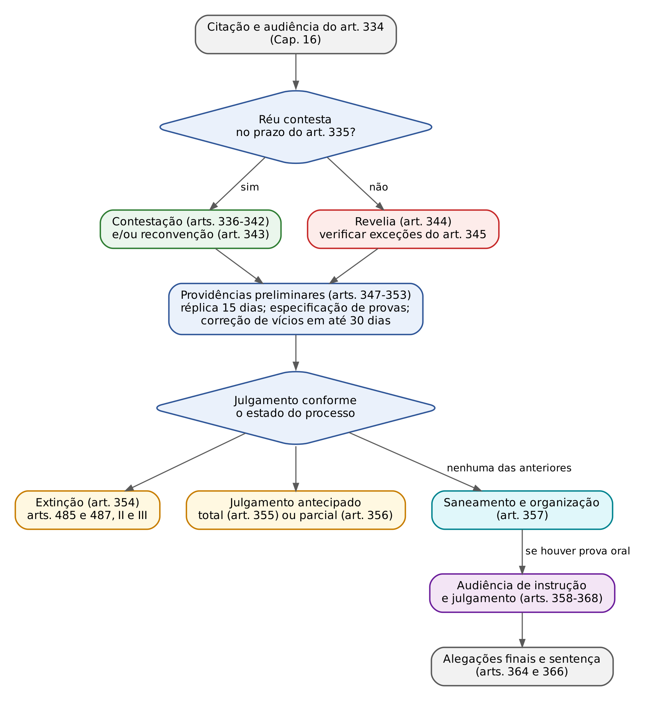
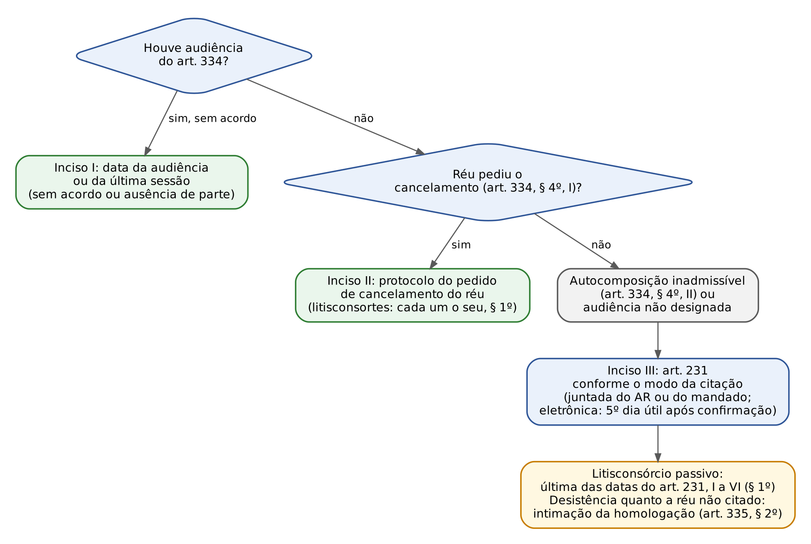
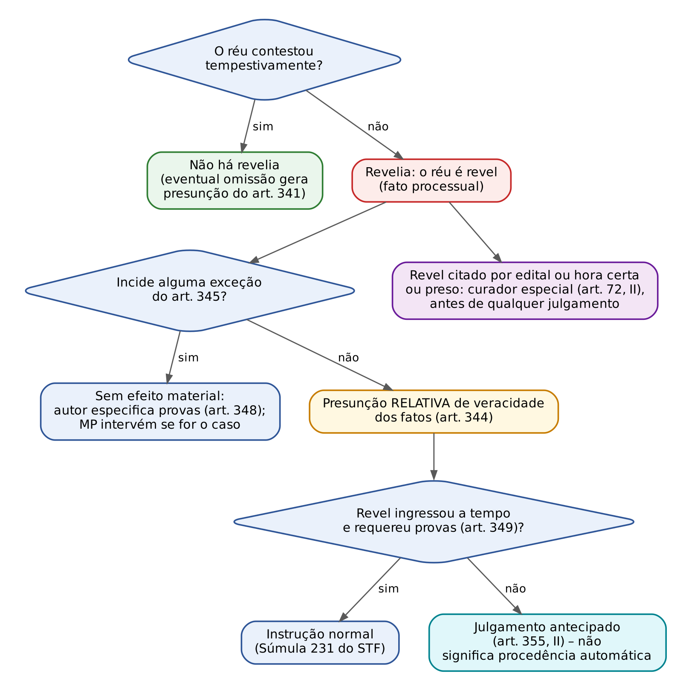
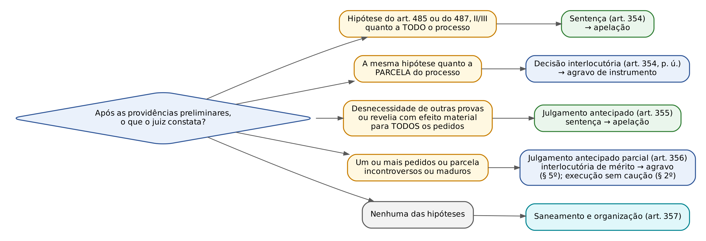
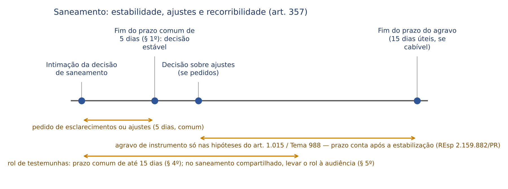
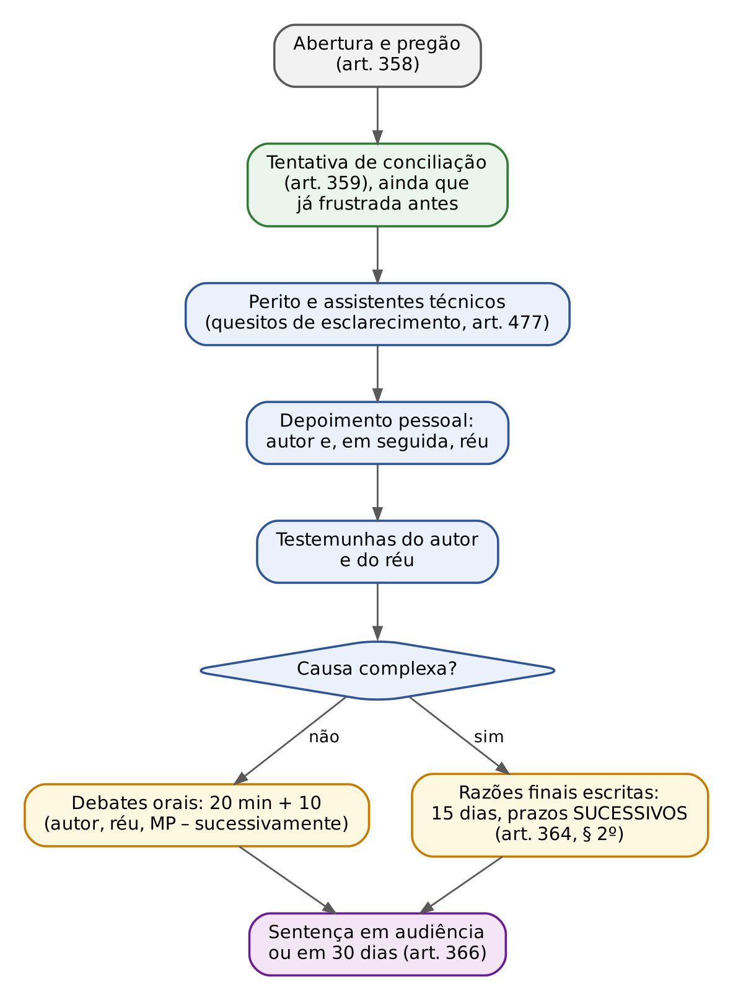

# CAPÍTULO 17 — PROCEDIMENTO COMUM II: RESPOSTA DO RÉU, REVELIA, JULGAMENTO CONFORME O ESTADO, SANEAMENTO E AIJ

:::INCIDENCIA
TRF5 p. 7; TJRS p. 8; TJSC p. 8. Nível A+. Lote: 41 questões (FGV 31, FCC 10), das quais 10 de provas de juiz (TJSC, TJPR, TJGO, TJBA, TJCE, TJSE, TRF3 e ENAM).
O que mais cai: exceções ao efeito material da revelia (art. 345) e "revelia não é procedência"; autonomia e ampliação subjetiva da reconvenção (art. 343, §§ 2º a 6º); natureza interlocutória e agravo da decisão parcial de mérito (arts. 354, p. ú., e 356); estabilidade do saneamento em 5 dias e rol de testemunhas no saneamento compartilhado (art. 357).
:::

| Subtema | FGV | FCC | Padrão de cobrança |
|---|---|---|---|
| Contestação: prazo, preliminares, impugnação especificada, arts. 338, 339 e 342 | 9 | 3 | Termo inicial do art. 335 em caso concreto; rol do art. 337 com intruso de mérito; "presunção também quando não se admite confissão"; honorários de 3% a 5% na substituição do réu |
| Reconvenção | 5 | 1 | Reconvenção sem contestação, com terceiro, contra terceiro; desistência da ação não extingue a reconvenção; intimação do autor-reconvindo na pessoa do advogado; recurso contra o indeferimento liminar |
| Revelia e seus efeitos | 7 | 3 | Exceções do art. 345; revelia sem procedência automática; direitos indisponíveis (família, Fazenda); prova documental que contradiz a inicial |
| Julgamento conforme o estado do processo | 5 | 3 | Decisão parcial de mérito: interlocutória, agravo de instrumento, obrigação ilíquida, execução sem caução; prescrição parcial reconhecida no saneamento |
| Saneamento e organização | 4 | 0 | Prazo COMUM de 5 dias para ajustes; estabilidade e preclusão; delimitação consensual vincula o juiz; rol de testemunhas no saneamento compartilhado |
| Audiência de instrução e julgamento | 1 | 0 | Ordem preferencial das provas; conciliação mesmo após frustração; memoriais em 15 dias sucessivos |

## 17.1 Resposta do réu: espécies e mapa da fase

O CPC/2015 concentrou a resposta do réu em uma única peça. Desapareceram as exceções rituais de incompetência relativa, impedimento e suspeição como "respostas" do réu (a incompetência relativa virou preliminar de contestação, art. 64; impedimento e suspeição seguem por petição autônoma no prazo de 15 dias do art. 146 — ver Cap. 10), a reconvenção passou a ser deduzida NA contestação (art. 343) e os antigos incidentes autuados em apenso (impugnação ao valor da causa e à gratuidade) também migraram para preliminares (art. 337, III e XIII). Denunciação da lide e chamamento ao processo, quando requeridos pelo réu, também vêm na contestação (arts. 126 e 131 — ver Cap. 9).

Diante da citação, o réu pode: (a) contestar; (b) reconvir, com ou sem contestação (art. 343, § 6º); (c) reconhecer a procedência do pedido (art. 487, III, a); (d) arguir impedimento ou suspeição em petição própria; (e) provocar intervenção de terceiro; (f) permanecer inerte (revelia). Essas posturas não se excluem, salvo a incompatibilidade lógica entre reconhecer integralmente o pedido e contestá-lo.

| Tema | CPC/1973 | CPC/2015 (a pegadinha) |
|---|---|---|
| Incompetência relativa | Exceção, em peça autônoma | Preliminar de contestação (arts. 64 e 337, II), podendo a contestação ser protocolada no foro do domicílio do réu (art. 340) |
| Reconvenção | Peça autônoma, simultânea à contestação | Na própria contestação; admissível sem contestação (art. 343, § 6º) |
| Valor da causa | Impugnação em apenso | Preliminar, sob pena de preclusão (arts. 293 e 337, III); o juiz pode corrigi-lo de ofício (art. 292, § 3º) |
| Gratuidade | Impugnação em autos apartados | Preliminar (art. 337, XIII) ou, nos demais casos, petição simples sem suspensão (art. 100) |
| Prazo da réplica | 10 dias | 15 dias (arts. 350 e 351) |
| Correção de vícios sanáveis | Até 30 dias | Prazo nunca superior a 30 dias (art. 352) |
| Ônus de indicar o legitimado | Nomeação à autoria (intervenção de terceiro) | Arts. 338 e 339, técnica de correção do polo passivo sem extinção |

:::QUESTAO FGV 2024 — TJ-AP — ANALISTA JUDICIÁRIO (Q2449078)
Réu quer contestar e, além do mérito, impugnar a gratuidade deferida ao autor e o valor da causa. Gabarito oficial: A — ambos os temas são preliminares de contestação. Armadilha: as alternativas que mantêm os incidentes autônomos do CPC/1973 (C, D e E). Fundamento: art. 337, III e XIII. No mesmo sentido, como correlatas de outros capítulos: Q2489724 (o juiz pode corrigir o valor da causa de ofício — ver Cap. 12).
:::

## 17.2 Prazo da contestação

### 17.2.1 Termo inicial (art. 335)

O prazo é de 15 dias úteis, e o termo inicial depende do que ocorreu com a audiência do art. 334 (ver Cap. 16): (I) data da audiência ou da última sessão de conciliação, quando qualquer parte não comparecer ou, comparecendo, não houver autocomposição; (II) data do protocolo do pedido de cancelamento apresentado pelo réu, quando ambas as partes manifestarem desinteresse (art. 334, § 4º, I); (III) nos demais casos, a data do art. 231, conforme o modo da citação.

:::LEI CPC, ART. 335, §§ 1º E 2º
§ 1º No caso de litisconsórcio passivo, ocorrendo a hipótese do art. 334, § 6º, o termo inicial previsto no inciso II será, para cada um dos réus, a data de apresentação de seu respectivo pedido de cancelamento da audiência.
§ 2º Quando ocorrer a hipótese do art. 334, § 4º, inciso II, havendo litisconsórcio passivo e o autor desistir da ação em relação a réu ainda não citado, o prazo para resposta correrá da data de intimação da decisão que homologar a desistência.
:::

Pontos finos:

- Inciso I: o prazo começa a correr no primeiro dia útil seguinte à audiência ou à última sessão (Enunciado 122 da II Jornada de Direito Processual Civil do CJF). Como as sessões podem estender-se por até 2 meses (art. 334, § 2º), o termo é a ÚLTIMA delas.
- Inciso II: no litisconsórcio passivo, o desinteresse deve ser manifestado por TODOS (art. 334, § 6º), mas cada réu tem seu próprio termo inicial (data do seu pedido de cancelamento — art. 335, § 1º). Não há o "prazo comum a partir do último" do art. 231, § 1º.
- Inciso III: litisconsórcio passivo sem audiência — o prazo para todos corre da última das datas dos incisos I a VI do art. 231 (art. 231, § 1º). Os incisos VII e VIII não entram nessa regra. Na citação eletrônica, o termo é o quinto dia útil seguinte à confirmação do recebimento (art. 231, IX, incluído pela Lei 14.195/2021 — ver Cap. 12).
- Comparecimento espontâneo do réu supre a falta ou a nulidade da citação e dele flui o prazo (art. 239, § 1º — ver Cap. 12). Mas o ingresso do réu ANTES de o juiz receber a inicial e designar a audiência do art. 334 não deflagra automaticamente o prazo de contestação, que segue os incisos I e II do art. 335 (REsp 1.909.271/PR; v. Cap. 12). No mesmo espírito, não há preclusão consumativa do direito de contestar se o réu se manifesta, antes da audiência, apenas sobre a incompetência (Enunciado 124 da II Jornada do CJF).
- Prazos diferenciados: Fazenda Pública, Ministério Público e Defensoria contestam em 30 dias úteis (prazo em dobro dos arts. 180, 183 e 186), contados da intimação/citação pessoal; litisconsortes com procuradores distintos, de escritórios diferentes, em autos FÍSICOS, têm prazo em dobro (art. 229), que cessa se, havendo apenas 2 réus, só um contestar (art. 229, § 1º), e que não se aplica a autos eletrônicos (§ 2º). A Fazenda NÃO tem prazo em quádruplo para contestar desde 2016.

:::JURIS STJ, RESP 2.180.502/GO, J. 20/5/2025 (INFORMATIVO 852)
Audiência do art. 334 redesignada porque um corréu não fora citado e, depois, cancelada porque o autor desistiu da ação quanto a esse corréu: o prazo de contestação do réu citado corre da intimação da decisão que homologou a desistência (art. 335, § 2º), e não da primeira audiência (Relatora Ministra Nancy Andrighi, Terceira Turma).
:::

:::QUESTAO FGV 2026 — TJ-GO — JUIZ SUBSTITUTO (Q3966651)
Caso idêntico ao do REsp 2.180.502/GO: corréu não citado, audiência remarcada, desistência homologada quanto a ele com abertura de prazo ao réu citado; o novo juiz considerou intempestiva a contestação contando o prazo da primeira audiência. Gabarito oficial: D — o juiz errou; o termo inicial é a intimação da homologação da desistência. Armadilhas: (C) afirma que as alegações "de João" seriam presumidas verdadeiras (a presunção recai sobre os fatos do AUTOR) e conduz à procedência automática; (E) inventa contagem individual "independentemente da desistência".
Passo a passo: 1) houve audiência designada e não realizada? sim, cancelada; 2) a frustração decorreu de réu não citado e de desistência quanto a ele? sim; 3) aplica-se o art. 335, § 2º, por analogia reforçada pelo STJ; 4) termo inicial = intimação da homologação.
:::

### 17.2.2 Local do protocolo (art. 340)

Alegada incompetência (relativa OU absoluta), a contestação pode ser protocolada no foro do domicílio do réu, com comunicação imediata ao juiz da causa; ela é livremente distribuída ou juntada à carta precatória, se o réu foi citado por precatória, e remetida ao juízo da causa (§ 1º). Reconhecida a competência do foro indicado, o juízo que recebeu a contestação ou a precatória fica prevento (§ 2º) — segundo o Enunciado 426 do FPPC, apenas se o foro competente for o local onde ocorreu a citação. A alegação suspende a audiência de conciliação já designada (§ 3º), que será redesignada pelo juízo competente (§ 4º).

## 17.3 Contestação

### 17.3.1 Concentração (eventualidade) e especificação de provas

O art. 336 impõe ao réu alegar "toda a matéria de defesa" na contestação, inclusive defesas subsidiárias e logicamente incompatíveis entre si no plano das alegações (ex.: "não houve contrato; se houve, foi pago; se não foi pago, prescreveu"). A contrapartida é a preclusão consumativa: o que não for alegado não poderá sê-lo depois, salvo as três exceções do art. 342 (17.3.6). O réu também deve "especificar as provas que pretende produzir", requisito simétrico ao do art. 319, VI. Na prática forense o juiz ainda intima as partes para especificar provas antes do saneamento, mas a omissão na contestação, somada à inércia posterior, pode inviabilizar a alegação de cerceamento (17.8.2).

### 17.3.2 Preliminares (art. 337)

Preliminares são questões processuais que o réu deve alegar "antes de discutir o mérito" e cujo acolhimento impede ou retarda o exame do pedido.

:::LEI CPC, ART. 337, §§ 5º E 6º
§ 5º Excetuadas a convenção de arbitragem e a incompetência relativa, o juiz conhecerá de ofício das matérias enumeradas neste artigo.
§ 6º A ausência de alegação da existência de convenção de arbitragem, na forma prevista neste Capítulo, implica aceitação da jurisdição estatal e renúncia ao juízo arbitral.
:::

| Inciso | Preliminar | Natureza e efeito do acolhimento | De ofício? |
|---|---|---|---|
| I | Inexistência ou nulidade da citação | Dilatória: o comparecimento supre o vício; prazo corre da alegação (art. 239, § 1º) | Sim |
| II | Incompetência absoluta e relativa | Dilatória: remessa ao juízo competente (art. 64, § 3º); conservação dos efeitos das decisões (§ 4º) | Só a absoluta; a relativa prorroga se não alegada (art. 65) |
| III | Incorreção do valor da causa | Dilatória: correção e complementação de custas (art. 293) | Sim (art. 292, § 3º) |
| IV | Inépcia da inicial | Peremptória, se não sanada (arts. 330, I, e 485, I) | Sim |
| V | Perempção | Peremptória (art. 485, V); 3 extinções por abandono (art. 486, § 3º) | Sim |
| VI e VII | Litispendência e coisa julgada | Peremptórias (art. 485, V); tríplice identidade (§§ 1º a 4º) | Sim |
| VIII | Conexão | Dilatória: reunião de processos (art. 55) | Sim |
| IX | Incapacidade, defeito de representação, falta de autorização | Dilatória: prazo para sanar (art. 76); peremptória se não sanada | Sim |
| X | Convenção de arbitragem | Peremptória (art. 485, VII) | NÃO |
| XI | Ilegitimidade ou falta de interesse | Peremptória (art. 485, VI), mas a ilegitimidade passiva abre a técnica dos arts. 338 e 339 | Sim |
| XII | Falta de caução ou outra prestação exigida como preliminar | Dilatória: prazo para prestá-la (ex.: art. 83) | Sim |
| XIII | Indevida concessão da gratuidade | Revogação do benefício e cobrança das despesas (art. 100, p. ú.) | Sim |

:::PEGADINHA TRÊS ARMADILHAS DO ROL DO ART. 337
1) Incompetência relativa e convenção de arbitragem são as DUAS matérias do rol que o juiz não conhece de ofício; a FGV gosta de incluir "conexão" ou "incompetência relativa" numa lista de matérias "cognoscíveis de ofício" (Q3179542, correlata do Cap. 11, alternativa C, falsa). Ressalva única: a cláusula de eleição de foro abusiva pode ser reputada ineficaz de ofício antes da citação, e o ajuizamento em juízo aleatório, sem vínculo com o domicílio ou a residência das partes ou com o negócio jurídico, justifica a declinação de ofício (art. 63, §§ 3º e 5º, este incluído pela Lei 14.879/2024; ver Cap. 4); fora disso, a incompetência relativa não alegada prorroga (art. 65).
2) A coisa julgada é preliminar, mas seu acolhimento extingue o processo SEM resolução de mérito (art. 485, V); a prescrição é questão de MÉRITO (art. 487, II), não preliminar (Q3530383, alternativas B e C, falsas).
3) "Nulidade da dívida" ou "pagamento" são defesas de mérito, não preliminares (Q2486007, gabarito A).
:::

:::QUESTAO FGV 2025 — TJ-GO — RESIDENTE JURÍDICO (Q3345942)
Autor teve três ações extintas por abandono da causa e propõe a quarta com a mesma causa de pedir. Gabarito oficial: D — perempção (arts. 337, V, 485, V, e 486, § 3º). Armadilha: confundir com coisa julgada (a extinção por abandono é sentença terminativa e não forma coisa julgada material) ou litispendência (não há ação em curso). Lembrar que, oferecida a contestação, a extinção por abandono depende de requerimento do réu (art. 485, § 6º; Súmula 240 do STJ), e que a perempção não impede o autor de alegar seu direito em defesa (art. 486, § 3º, parte final).
:::

### 17.3.3 Defesa de mérito: direta, indireta e exceções substanciais

Defesa de mérito direta nega o fato constitutivo ou suas consequências jurídicas; defesa indireta admite o fato constitutivo, mas opõe fato impeditivo, modificativo ou extintivo (pagamento, novação, compensação, prescrição, decadência, *exceptio non adimpleti contractus*, direito de retenção). A indireta tem duas consequências procedimentais: abre ao autor a réplica em 15 dias com possibilidade de prova (art. 350) e atrai para o réu o ônus da prova do fato que alegou (art. 373, II).

As exceções substanciais em sentido estrito (compensação, retenção, exceção de contrato não cumprido, prescrição) servem apenas para neutralizar a pretensão do autor. Quando o réu quer MAIS do que a improcedência (condenação do autor, declaração de um direito seu, rescisão ou revisão do contrato), precisa reconvir — salvo autorização legal para pedido na própria contestação (ações dúplices e pedido contraposto, 17.4.6).

:::JURIS STJ, TEMA 622 (RECURSO REPETITIVO)
A sanção do pagamento em dobro por cobrança judicial de dívida já paga (art. 940 do CC, antigo art. 1.531 do CC/1916) "pode ser postulada pelo réu na própria defesa", independentemente de ação autônoma ou de reconvenção, sendo imprescindível a demonstração de má-fé do credor. É exceção jurisprudencial relevante à regra de que pretensão condenatória do réu exige reconvenção.
:::

### 17.3.4 Ilegitimidade passiva e correção do polo (arts. 338 e 339)

O CPC/2015 substituiu a nomeação à autoria por uma técnica de saneamento: alegada a ilegitimidade passiva ou que o réu "não é o responsável pelo prejuízo invocado", o juiz faculta ao autor, em 15 dias, alterar a inicial para SUBSTITUIR o réu (art. 338), mesmo após a contestação e sem extinção do processo. O réu que alega ilegitimidade tem o ônus de indicar o verdadeiro sujeito passivo, se o conhecer, sob pena de arcar com as despesas e indenizar o autor (art. 339, caput); essa responsabilidade é subjetiva (Enunciado 44 do FPPC). Aceita a indicação, o autor pode substituir o réu (§ 1º) ou incluir o indicado como litisconsorte passivo (§ 2º), ambos em 15 dias.

:::LEI CPC, ART. 338, PARÁGRAFO ÚNICO
Realizada a substituição, o autor reembolsará as despesas e pagará os honorários ao procurador do réu excluído, que serão fixados entre três e cinco por cento do valor da causa ou, sendo este irrisório, nos termos do art. 85, § 8º.
:::

- Prazo único: o autor dispõe de um só prazo para requerer a substituição ou inclusão e para replicar (Enunciado 152 do FPPC).
- Abrangência: aplica-se a procedimentos especiais que não admitem intervenção de terceiros e aos Juizados (Enunciado 42 do FPPC) e ao mandado de segurança, para corrigir a autoridade coatora e a pessoa jurídica (Enunciado 123 da II Jornada do CJF; Enunciado 511 do FPPC — ver Cap. 32).
- Honorários reduzidos (3% a 5%) só na substituição no início do processo, sem resistência do autor (STJ, REsp n. 1.935.852/GO, Relator Ministro Paulo de Tarso Sanseverino, Terceira Turma, j. 4/10/2022, Informativo 760). Na extinção parcial quanto a um coexecutado, sem a técnica do art. 338, não cabe o patamar reduzido (STJ, REsp n. 1.895.919/PR, Relatora Ministra Nancy Andrighi, Terceira Turma, j. 1/6/2021, Informativo 699).

:::QUESTAO FCC 2024 — TRT-20 — ANALISTA JUDICIÁRIO (Q3170844)
Ré alega ilegitimidade e indica a única legitimada; o autor concorda e pede a substituição. Gabarito oficial: A — o juiz defere a substituição sem extinguir o processo e condena o autor a reembolsar despesas e a pagar honorários ao advogado da ré excluída. Armadilhas: "inadmissível depois da contestação" (B e E) e "honorários só se houver má-fé" (D). No mesmo sentido: Q2370326 (FGV 2024, TJ-RJ), em que a alternativa B errava a faixa dos honorários (5% a 10%, quando o correto é 3% a 5%) e a A trocava o prazo de 15 por 10 dias; e Q2442319 (FGV 2024, TJ-AP), em que o empregado indica o patrão como verdadeiro responsável e o gabarito (E) é o aditamento para incluir o indicado como litisconsorte passivo (art. 339, § 2º) — a "nomeação à autoria" (A) não existe mais.
:::

### 17.3.5 Ônus da impugnação especificada (art. 341)

O réu deve manifestar-se "precisamente" sobre cada alegação de fato; os fatos não impugnados presumem-se verdadeiros. É a versão parcial e silenciosa do efeito da revelia: o réu contestou, mas deixou fatos sem resposta. A contestação por negação geral é, em regra, ineficaz.

Exceções (art. 341, I a III): fatos sobre os quais não se admite confissão (direitos indisponíveis — art. 392); petição inicial desacompanhada de instrumento que a lei considere da substância do ato (ex.: escritura pública para imóvel de valor superior a 30 salários mínimos, art. 108 do CC); fatos em contradição com a defesa considerada em seu conjunto. Exceções subjetivas (parágrafo único): o ônus NÃO se aplica ao defensor público, ao advogado dativo e ao curador especial, que podem contestar por negação geral.

:::QUESTAO FGV 2026 — TJ-SC — OFICIAL DE JUSTIÇA E AVALIADOR (Q4153622)
Ação de danos materiais por infiltração que destruiu móveis planejados avaliados em 80.000 (oitenta mil) reais; a construtora concentra a defesa no nexo causal e nada diz sobre o valor dos móveis. Gabarito oficial: B — presume-se verdadeiro o valor não impugnado especificamente, dispensando prova a respeito. Armadilhas: "a contestação genérica sobre o mérito aproveita" (A), "nulidade absoluta e revelia" (C), "pessoa jurídica de grande porte pode contestar por negativa geral" (D, quem pode é o defensor público, o dativo e o curador especial) e "aditamento até a sentença" (E, viola a concentração).
:::

:::QUESTAO FCC 2025 — MPE-PI — ANALISTA MINISTERIAL (Q3530383)
Afirmações sobre a contestação. Gabarito oficial: A, transcrição do art. 343, caput (reconvenção na contestação para pretensão própria, conexa com a ação principal ou com o fundamento da defesa). Armadilhas: (E) estende a presunção do art. 341 aos fatos sobre os quais "não for admissível a confissão" — exatamente a exceção do inciso I; (D) diz ser "defeso" alegar incompetência na contestação. No mesmo sentido do item E: Q3386985, alternativa C (FCC 2025, DPE-RS), que afirmava aplicar-se o ônus ao defensor público "apenas" quando atua como curador especial — falso: o ônus não se aplica ao defensor público em nenhuma hipótese, nem ao curador especial.
:::

:::NOTA CURADOR ESPECIAL
A atuação do curador especial (art. 72, II: revel preso; revel citado por edital ou com hora certa, enquanto não constituir advogado) é desenvolvida no Cap. 7. Aqui interessa que ele pode arguir preliminares, inclusive nulidade da citação ficta, e contestar por negação geral (art. 341, p. ú.). Correlatas: Q3301237 (FGV 2025, TJ-SE, Juiz, gabarito D), Q2515305 e Q3868586 (a sentença contra revel citado por hora certa ou edital sem prévia atuação do curador é viciada).
:::

### 17.3.6 Novas alegações depois da contestação (art. 342)

Depois da contestação, só é lícito ao réu deduzir novas alegações quando: (I) relativas a direito ou fato superveniente (que dialoga com o art. 493, dever do juiz de considerar fato constitutivo, modificativo ou extintivo superveniente); (II) competir ao juiz conhecer delas de ofício (pressupostos processuais, condições da ação, incompetência absoluta, prescrição e decadência legal); (III) por expressa autorização legal, puderem ser formuladas em qualquer tempo e grau de jurisdição (ex.: decadência legal, art. 210 do CC; incompetência absoluta, art. 64, § 1º).

:::QUESTAO FGV 2025 — TRF-3 — JUIZ FEDERAL SUBSTITUTO (Q3179545)
Assertivas soltas. Gabarito oficial: B — depois da contestação é lícito ao réu deduzir novas alegações relativas a direito ou fato superveniente (art. 342, I). Armadilhas: (A) reconvenção "conexa ou não" (o art. 343 exige conexão); (C) réplica em 20 dias (são 15, art. 350); (D) produção antecipada "previne" a competência (o art. 381, § 3º, diz o contrário — ver Cap. 18); (E) desistência "a qualquer tempo" (só até a sentença e, após a contestação, com consentimento do réu — art. 485, §§ 4º e 5º).
No mesmo sentido do item II do art. 342: Q3386985 (FCC 2025, DPE-RS), gabarito E — mesmo após o prazo de contestação o réu pode alegar prescrição por petição, porque é matéria cognoscível de ofício (art. 487, II), observado o contraditório prévio do art. 487, p. ú.
:::

## 17.4 Reconvenção

### 17.4.1 Natureza, requisitos e forma

Reconvenção é ação do réu contra o autor (e eventualmente contra terceiro) proposta no mesmo processo, ampliando seu objeto. Não é defesa: o reconvinte pede tutela própria, "qualitativa ou quantitativamente maior que a simples improcedência" (Enunciado 45 do FPPC). Requisitos:

- Pretensão própria CONEXA com a ação principal ou com o fundamento da defesa (art. 343, caput). A conexão aqui é mais ampla que a do art. 55: basta vínculo com os fundamentos da defesa (STJ, REsp n. 2.076.127/SP, Relatora Ministra Nancy Andrighi, Terceira Turma, j. 12/9/2023).
- Competência do juízo para a reconvenção (sem violar competência absoluta) e compatibilidade procedimental.
- Interesse: se a contestação basta para obter o mesmo resultado (ação dúplice), falta interesse para reconvir.
- Forma: na própria contestação (ou em peça própria, se o réu não contestar), com requisitos da inicial (art. 319), valor da causa próprio (art. 292, caput: o valor da causa "constará da petição inicial ou da reconvenção") e custas. Não se exige o *nomen iuris* nem capítulo próprio, desde que o pedido esteja inequivocamente delimitado (Enunciado 45 do FPPC); pedido reconvencional rotulado como "pedido contraposto" deve ser julgado como reconvenção se claramente delimitado (STJ, REsp n. 1.940.016/PR, Relator Ministro Ricardo Villas Bôas Cueva, Terceira Turma, j. 22/6/2021, Informativo 702). Em sentido oposto, peça que não atende minimamente aos requisitos de reconvenção não pode ser tratada como tal (STJ, REsp n. 1.959.472, Relator Ministro Antonio Carlos Ferreira, DJe 19/12/2024).
- Emenda: deve o juiz oportunizar emenda também à reconvenção antes de rejeitá-la (Enunciado 120 da II Jornada do CJF).

:::LEI CPC, ART. 343, §§ 1º A 6º
§ 1º Proposta a reconvenção, o autor será intimado, na pessoa de seu advogado, para apresentar resposta no prazo de 15 (quinze) dias.
§ 2º A desistência da ação ou a ocorrência de causa extintiva que impeça o exame de seu mérito não obsta ao prosseguimento do processo quanto à reconvenção.
§ 3º A reconvenção pode ser proposta contra o autor e terceiro.
§ 4º A reconvenção pode ser proposta pelo réu em litisconsórcio com terceiro.
§ 5º Se o autor for substituto processual, o reconvinte deverá afirmar ser titular de direito em face do substituído, e a reconvenção deverá ser proposta em face do autor, também na qualidade de substituto processual.
§ 6º O réu pode propor reconvenção independentemente de oferecer contestação.
:::

### 17.4.2 Autonomia (§§ 2º e 6º)

A reconvenção é autônoma em relação à ação: a desistência ou a extinção sem mérito da ação principal NÃO impede o julgamento da reconvenção (§ 2º); e o réu pode reconvir sem contestar (§ 6º). Duas consequências práticas: (a) o réu que só reconvém fica sujeito aos efeitos da revelia quanto à ação, mas a revelia não se produz se a reconvenção, por si, controverter os fatos da inicial (art. 341, III, por analogia, e art. 345, IV); (b) o autor-reconvindo que não responde à reconvenção é revel nela, mas os fatos que ele afirmou na inicial continuam a contradizer os do reconvinte.

:::QUESTAO FGV 2026 — TJ-RJ — ANALISTA JUDICIÁRIO (Q3870733)
Réu assistido pela Defensoria, citado por mandado sem audiência do art. 334, apresenta só reconvenção (sem contestação), contra o autor e um terceiro, 25 dias úteis após a juntada do mandado; o autor desiste da ação e o juiz prossegue na reconvenção. Gabarito oficial: E — admitida a reconvenção, o autor deve ser intimado na pessoa do advogado para responder (art. 343, § 1º).
Passo a passo das armadilhas: (A) reconvenção pode ampliar subjetivamente o processo (§ 3º); (B) contestação simultânea é dispensável (§ 6º); (C) a Defensoria tem prazo em dobro, 30 dias úteis (art. 186), logo 25 dias é tempestivo; (D) a desistência da ação não obsta a reconvenção (§ 2º).
:::

:::QUESTAO FGV 2024 — TJ-RJ — MEDIADOR JUDICIÁRIO (Q2370313)
Dois réus; um, revel, sem advogado; o outro contesta e reconvém em litisconsórcio com terceiro. Gabarito oficial: D — eventual desistência da ação pela autora não impede o prosseguimento da reconvenção. Armadilhas: (A) efeito material da revelia apesar de o litisconsorte ter contestado (art. 345, I); (B) vedação da reconvenção com terceiro (art. 343, § 4º); (C) "o revel não poderá intervir" (art. 346, p. ú.); (E) intimação dos RÉUS em 10 dias (quem responde é o autor-reconvindo, em 15 dias). No mesmo sentido: Q3179542 (FGV 2025, TRF-3, Juiz, correlata do Cap. 11), alternativa D falsa por afirmar que a desistência "obsta" a reconvenção; Q3841679 (FGV 2025, Abreu e Lima), item I verdadeiro (reconvenção sem contestação); Q3386985, alternativas A e D falsas.
:::

### 17.4.3 Ampliação subjetiva (§§ 3º e 4º) e substituição processual (§ 5º)

A reconvenção pode ser proposta contra o autor e terceiro (§ 3º) e pelo réu em litisconsórcio com terceiro (§ 4º). A admissibilidade da ampliação subjetiva não se restringe ao litisconsórcio necessário (Enunciado 674 do FPPC) e pode veicular, por exemplo, usucapião com citação dos confinantes (Enunciado 46 do FPPC). O terceiro que reconvém ao lado do réu NÃO passa a integrar o polo passivo da ação principal (STJ, REsp n. 2.046.666/SP, Relatora Ministra Nancy Andrighi, Terceira Turma, j. 16/5/2023, Informativo 775). Quando o réu reconvém contra o autor e terceiro, o prazo de resposta de ambos só começa após a citação do terceiro (Enunciado 629 do FPPC); o terceiro é CITADO, o autor é INTIMADO na pessoa do advogado.

Substituto processual no polo ativo (§ 5º): o reconvinte deve afirmar ser titular de direito em face do SUBSTITUÍDO, e a reconvenção é proposta contra o autor, também na qualidade de substituto processual. A FCC inverteu a regra (Q3386985, alternativa B: "contra o substituído" — falsa).

:::QUESTAO FGV 2024 — TJ-SC — JUIZ SUBSTITUTO, EDITAL 44 (Q3049350)
Assertivas sobre reconvenção. Gabarito oficial: D — é lícito ao réu reconvir em litisconsórcio com terceiro e em face do autor e de terceiro (art. 343, §§ 3º e 4º). Armadilhas: (A) intimação "por oficial de justiça" (é na pessoa do advogado); (B) causa que obsta o mérito da ação impediria o da reconvenção (§ 2º); (C) vedação de reconvenção condenatória em ação declaratória (Súmula 258 do STF admite reconvenção em ação declaratória, e o conteúdo da reconvenção não se limita ao da ação); (E) apelação contra o indeferimento liminar da reconvenção (cabe agravo de instrumento — 17.4.5).
No mesmo sentido: Q4338814 (FCC 2026, PGM-Manaus), gabarito B — reconvenção proposta por terceiro, em litisconsórcio com o réu; as falsas eram a vedação de reconvenção condenatória em ação declaratória (A), o não conhecimento da reconvenção se a ação for extinta sem mérito (C), a dispensa de reconvenção para pedir rescisão ou revisão do contrato (D: é pretensão própria, que exige reconvenção — a ação de cobrança não é dúplice) e o descabimento na monitória (E: art. 702, § 6º). Q2507024 (FGV 2024, ENAM), alternativa B falsa.
:::

### 17.4.4 Cabimento em procedimentos e situações específicas

| Situação | Regra | Fonte |
|---|---|---|
| Ação declaratória | Cabe reconvenção | Súmula 258 do STF |
| Ação monitória | Cabe reconvenção (nos embargos); vedada reconvenção à reconvenção | Art. 702, § 6º; Súmula 292 do STJ (editada no CPC/1973, "após a conversão do procedimento em ordinário") |
| Reconvenção sucessiva (reconvenção à reconvenção) no procedimento comum | Admitida, se a questão que a justifica surgiu na contestação ou na primeira reconvenção | STJ, REsp n. 1.690.216/RS, j. 22/9/2020 (Informativo 680) |
| Embargos de terceiro | Admite-se reconvenção, inclusive com pedido típico de ação pauliana | Enunciado 133 da II Jornada do CJF |
| Juizados Especiais | Não cabe reconvenção; admite-se pedido contraposto | Art. 31 da Lei 9.099/1995 (ver Cap. 36) |
| Ações possessórias | Natureza dúplice quanto à proteção possessória e à indenização (art. 556); outros pedidos exigem reconvenção | Ver Cap. 29 |
| Renovatória | Revisão do aluguel pode vir na contestação ou em reconvenção; irregularidade formal não impede o exame se o pedido é identificável | STJ, AgInt no AREsp n. 1.888.890/GO, Relatora Ministra Maria Isabel Gallotti, Quarta Turma, j. 28/8/2023 |
| Usucapião | Reconvenção com pedido de imissão na posse do mesmo imóvel é admissível | STJ, REsp n. 2.051.579/MT, Relatora Ministra Nancy Andrighi, Terceira Turma, j. 22/8/2023 |

:::JURIS STJ, RESP 1.690.216/RS, J. 22/9/2020 (INFORMATIVO 680)
O CPC/2015 só veda expressamente a reconvenção à reconvenção na monitória (art. 702, § 6º); no procedimento comum, a reconvenção sucessiva é admissível, desde que a questão que a justifica tenha surgido na contestação ou na primeira reconvenção — limite que evita a cadeia infinita de reconvenções (Relator Ministro Paulo de Tarso Sanseverino; relatora para o acórdão Ministra Nancy Andrighi; Terceira Turma, por maioria).
:::

### 17.4.5 Indeferimento liminar e julgamento da reconvenção

A decisão que indefere liminarmente a reconvenção, ou a julga improcedente de plano, não encerra a fase de conhecimento: é decisão interlocutória (art. 203, § 2º), agravável por versar sobre parcela do processo (art. 354, p. ú.) ou sobre o mérito (art. 1.015, II). O Enunciado 154 do FPPC é expresso: cabe agravo de instrumento contra ato decisório que indefira parcialmente a petição inicial ou a reconvenção. A reconvenção e a ação são normalmente julgadas na mesma sentença, com capítulos próprios de sucumbência; a extinção da reconvenção sem mérito, após a resposta do reconvindo, gera honorários próprios (art. 85, § 1º: são devidos honorários "na reconvenção").

:::QUESTAO FGV 2024 — TJ-AP — ANALISTA JUDICIÁRIO (Q2442320)
Ré contesta (pagamento) e reconvém cobrando crédito; o juiz julga liminarmente improcedente a reconvenção e manda o autor replicar. Gabarito oficial: C — decisão interlocutória de mérito, impugnável por agravo de instrumento. Armadilhas: "sentença" (A e B), porque o processo prossegue; "interlocutória impugnável por apelação" (D), que seria a regra do art. 1.009, § 1º, mas o caso está no art. 1.015, II.
:::

### 17.4.6 Reconvenção, pedido contraposto, ação dúplice e exceção substancial

| Figura | O que é | Precisa de reconvenção? | Exemplo |
|---|---|---|---|
| Reconvenção | Ação do réu no mesmo processo, com pretensão própria conexa | É ela | Rescisão do contrato e perdas e danos na ação de cobrança |
| Pedido contraposto | Pedido do réu na contestação, autorizado por lei, limitado aos mesmos fatos | Não | Art. 31 da Lei 9.099/1995 |
| Ação dúplice (material) | A própria contestação, se acolhida, dá ao réu o bem da vida | Não (falta interesse para reconvir) | Possessórias (art. 556); ações declaratórias puras; consignatória (art. 545, § 2º) |
| Exceção substancial | Defesa que neutraliza a pretensão sem pedir condenação | Não | Compensação, retenção, *exceptio non adimpleti contractus* |
| Repetição em dobro (art. 940 do CC) | Pedido na própria defesa, provada a má-fé | Não | Tema 622 do STJ |

## 17.5 Revelia

### 17.5.1 Conceito e efeitos

Revelia é a ausência de contestação tempestiva (art. 344). É um fato processual; seus EFEITOS são variáveis:

- Efeito material: presunção de veracidade das alegações de FATO do autor (art. 344). Presunção RELATIVA: não alcança o direito, não dispensa o juiz de examinar se dos fatos decorre a consequência jurídica pedida e cede a prova em contrário nos autos (art. 345, IV).
- Efeitos processuais: prazos contra o revel sem patrono nos autos fluem da publicação do ato decisório no órgão oficial (art. 346), e não da publicação em cartório (REsp 2.106.717/PR; v. Cap. 11); possibilidade de julgamento antecipado (art. 355, II).
- O revel pode intervir em qualquer fase, recebendo o processo no estado em que se encontrar (art. 346, p. ú.), e produzir provas contrapostas às alegações do autor, se ingressar a tempo de praticar os atos necessários (art. 349; Súmula 231 do STF).

:::LEI CPC, ART. 345
A revelia não produz o efeito mencionado no art. 344 se:
I - havendo pluralidade de réus, algum deles contestar a ação;
II - o litígio versar sobre direitos indisponíveis;
III - a petição inicial não estiver acompanhada de instrumento que a lei considere indispensável à prova do ato;
IV - as alegações de fato formuladas pelo autor forem inverossímeis ou estiverem em contradição com prova constante dos autos.
:::

Leitura fina das exceções:

- Inciso I: a contestação de um litisconsorte só aproveita ao revel quanto aos fatos COMUNS (litisconsórcio unitário, ou simples com fatos comuns). Se o contestante se defende com matéria pessoal (ex.: ilegitimidade própria), não socorre o revel quanto aos fatos que só a este dizem respeito.
- Inciso II: direitos indisponíveis abrangem ações de estado (filiação, investigação de paternidade, guarda), interesses de incapazes e, em regra, direitos da Fazenda Pública (ver adiante).
- Inciso III: instrumento indispensável à prova do ato (substância do ato) — a revelia não supre escritura pública exigida por lei.
- Inciso IV: inverossimilhança e contradição com a prova dos autos. Se o próprio autor junta documentos que desmentem o fato alegado, não há presunção.

:::PEGADINHA REVELIA NÃO É PROCEDÊNCIA
1) A presunção recai sobre FATOS, não sobre o direito: o juiz pode julgar improcedente o pedido do revel se os fatos presumidos não levam à consequência jurídica pretendida, se há prescrição ou se falta pressuposto processual.
2) A revelia é "decretada" de ofício, sem requerimento do autor, e não impede que o revel constitua advogado e faça requerimentos (Q3114503, gabarito B; falsas a C, a D e a E).
3) A revelia de um réu em litisconsórcio não autoriza "decisão interlocutória" ou "sentença" de procedência contra ele enquanto o outro réu não é citado (Q3324243, abaixo).
4) Contestação intempestiva = revelia; a peça intempestiva pode valer como intervenção do revel (art. 346, p. ú.), mas não afasta o efeito material (Q3170842, gabarito C).
:::

:::QUESTAO FGV 2025 — TJ-SC — JUIZ SUBSTITUTO (Q3324243)
Duas rés; Ana citada por oficial em 3/2/2025 (mandado juntado três dias depois); Bruna não encontrada; em 7/4/2025 certifica-se que nenhuma se manifestou. Gabarito oficial: D — ordenar o prosseguimento, com requisição de informações sobre o endereço de Bruna nos cadastros públicos e de concessionárias.
Passo a passo: 1) no litisconsórcio passivo, o prazo de contestação só começa da ÚLTIMA juntada (art. 231, § 1º), e Bruna nem foi citada; logo, o prazo de Ana ainda não correu e não há revelia a decretar (erro de A, B e C); 2) frustrada a citação pessoal, antes do edital o juízo deve requisitar endereços em cadastros de órgãos públicos ou concessionárias (art. 256, § 3º — ver Cap. 12), o que afasta a E. Na prova, a FGV escondeu o problema do prazo atrás da pergunta sobre revelia.
:::

:::QUESTAO FGV 2025 — TCE-PE — PROCURADOR (Q3592168)
Cobrança de 500.000 (quinhentos mil) reais de saldo de confissão de dívida de 1.000.000 (um milhão de) reais; o próprio autor junta comprovantes de pagamentos que somam 750.000 (setecentos e cinquenta mil) reais; réu revel pede provas após o prazo; o juiz intima o autor a especificar provas. Gabarito oficial: C — acertou, porque, embora haja revelia, as provas juntadas pelo autor contradizem sua alegação e afastam a presunção (art. 345, IV; art. 348). Armadilha: (D) "direito indisponível" (é crédito patrimonial disponível). Note-se ainda que o revel que ingressa a tempo pode requerer provas (art. 349).
:::

:::QUESTAO FCC 2026 — TJ-CE — ANALISTA JUDICIÁRIO (Q4231774)
Cobrança contra dois devedores solidários; um contesta, o outro é revel; terceiro pede ingresso como assistente; arguição de parcialidade. Gabarito oficial: C — a revelia de um litisconsorte solidário não produz automaticamente efeitos quanto ao que contestou (rigorosamente, a contestação deste afasta o efeito material quanto aos fatos comuns — art. 345, I). Armadilhas: (A) suspeição e impedimento em regimes de prazo distintos (ambos se arguem em 15 dias, art. 146; o impedimento, porém, permite rescisória — ver Cap. 10); (D) presunção "em relação a ambos"; (E) assistência dependente de concordância das partes e com suspensão do processo (art. 120 — ver Cap. 9).
No mesmo sentido do inciso I: Q3390843 (FGV 2025, DPE-PE, correlata do Cap. 16), alternativa B falsa.
:::

### 17.5.2 Revelia e direitos indisponíveis: família, filiação e Fazenda Pública

Nas ações de estado e de família envolvendo interesses de criança ou adolescente, não há efeito material: o juiz manda o autor especificar provas (art. 348) e intima o Ministério Público, que intervém nas ações de família quando houver interesse de incapaz (art. 698 — ver Cap. 30) e nas causas do art. 178. A revelia, contudo, é decretável: ser revel é fato; o que se afasta é o efeito.

:::QUESTAO FGV 2026 — TJ-RJ — ANALISTA JUDICIÁRIO (Q3870736)
Investigação de paternidade proposta por criança de 7 anos, representada pela mãe; réu citado pessoalmente não contesta; o juiz decreta a revelia e intima o autor. Gabarito oficial: D — o autor deve protestar por provas, porque não ocorreu o efeito material da revelia (direito indisponível, art. 345, II). Armadilhas: (A) "não poderia decretar a revelia" (pode, ela é fato; o que não incide é o efeito); (E) julgamento antecipado pela presunção. No mesmo sentido: Q3856345 (FGV 2026, TJ-MS), gabarito A — revelia decretada sem efeito material em ação sobre direitos indisponíveis; Q4012616 (FCC 2026, DPE-MA), gabarito C — na modificação de guarda de filho de 10 anos, ré pessoalmente citada e revel: o juiz abre prazo para o autor especificar provas e intima o MP como fiscal da ordem jurídica (curador especial não cabe, porque a citação foi pessoal — falsa a D; e a E restringe indevidamente a intervenção do revel até a sentença).
:::

Fazenda Pública: a orientação tradicional é que a revelia não produz efeito material contra o Poder Público, por envolver direitos indisponíveis (art. 345, II), sem prejuízo de exceções. O STJ admite a presunção quando a lide versa obrigação de direito privado assumida pelo ente, em que se discute interesse público secundário (STJ, REsp n. 1.084.745/MG, Relator Ministro Luis Felipe Salomão, Quarta Turma, j. 6/11/2012 — desenvolvido na Apostila de Direito Administrativo, Cap. 26). Os efeitos processuais também são mitigados pela intimação pessoal (art. 183, § 1º).

:::QUESTAO FGV 2024 — PREFEITURA DE VITÓRIA — PROCURADOR (Q3044225)
Empresa cobra do Município 75.000 (setenta e cinco mil) reais por locação de impressoras; o Município não contesta. Gabarito oficial: E — os efeitos materiais da revelia podem ser aplicados em litígios que envolvam obrigações de direito privado, em que se discute interesse público secundário. Armadilhas: (A) efeito "em quaisquer litígios" com a Fazenda; (B), (C) e (D) inaplicabilidade absoluta. No mesmo sentido: Q3966643 (FGV 2026, TJ-GO, Juiz, correlata do Cap. 18), em que a FGV aceitou a revelia do Estado em pedido de pensão "de interesse privado" (gabarito A) — gabarito discutível, porque pensão paga pelo erário envolve, em regra, interesse público; ver nota de verificação.
:::

:::QUESTAO FGV 2025 — PGM-RJ — ANALISTA DE PROCURADORIA (Q3606021)
Condomínio cobra cotas de condômino revel; o juiz nega o julgamento antecipado afirmando que a revelia não gera automaticamente a presunção. Gabarito oficial: D, assim redigido: "mesmo com a revelia, a presunção não se aplica quando o autor deve provar fato constitutivo". Ver nota de verificação: a fórmula é tecnicamente imprecisa (o autor sempre tem o ônus do fato constitutivo, e é justamente sobre ele que a presunção incide); o que a banca quis afirmar é que a presunção não é automática nem absoluta. Falsas: (A) "sempre acarreta presunção"; (C) cotas condominiais como direito indisponível; (E) "confissão judicial tácita".
:::

### 17.5.3 Contumácia do autor e revelia na reconvenção

A revelia é instituto do réu. A inércia do autor gera outras consequências (abandono, art. 485, III e § 6º; ausência à audiência do art. 334, multa do § 8º; dispensa de provas na AIJ, art. 362, § 2º). Na reconvenção, o autor-reconvindo que não responde é revel quanto à pretensão reconvencional, mas a presunção é contida pela contradição com os fatos da própria inicial (art. 345, IV).

## 17.6 Reconhecimento do pedido e outras condutas do réu

O reconhecimento da procedência do pedido é ato de disposição do RÉU que adere à pretensão do autor (fato e direito), ao contrário da confissão, que é meio de prova e incide só sobre fatos (art. 389 — ver Cap. 19). Homologado, gera sentença COM resolução de mérito (art. 487, III, a), ou decisão parcial se reconhecida só parte dos pedidos (arts. 354, p. ú., e 356, I). Só é eficaz em direitos disponíveis e exige poderes especiais do advogado (art. 105). Quanto à sucumbência, quem reconhece paga as despesas e os honorários (art. 90); se o réu reconhece a procedência e, simultaneamente, cumpre integralmente a prestação reconhecida, os honorários são reduzidos pela metade (art. 90, § 4º).

| Ato | Quem pratica | Objeto | Efeito |
|---|---|---|---|
| Reconhecimento do pedido | Réu (ou reconvindo) | Pretensão (fato e direito) | Mérito (art. 487, III, a) |
| Renúncia à pretensão | Autor (ou reconvinte) | Direito material | Mérito (art. 487, III, c); independe de concordância do réu |
| Transação | Ambos | Concessões recíprocas | Mérito (art. 487, III, b) — Q3841679, item IV falso |
| Desistência da ação | Autor | Processo | Sem mérito (art. 485, VIII); após a contestação, exige consentimento do réu (art. 485, § 4º); até a sentença (§ 5º) |
| Confissão | Parte | Fatos contrários ao seu interesse | Meio de prova (art. 389) |

:::JURIS STJ, TEMA 524 (RECURSO REPETITIVO)
Após a contestação, o autor não pode desistir sem o consentimento do réu, e é legítima a oposição da Fazenda à desistência com fundamento no art. 3º da Lei 9.469/1997, caso em que a desistência fica condicionada à renúncia expressa ao direito sobre o qual se funda a ação. Tese firmada sob o CPC/1973, mantida pela identidade do art. 485, § 4º. Correlata: Q4079391 (FGV 2026, PGE-AC, Cap. 6), gabarito E.
:::

## 17.7 Providências preliminares (arts. 347 a 353)

Findo o prazo de contestação, o juiz adota, "conforme o caso", as providências preliminares (art. 347). São atos de preparação do julgamento conforme o estado do processo, destinados a completar o contraditório e a corrigir vícios.

| Situação | Providência | Prazo | Artigo |
|---|---|---|---|
| Revelia sem efeito material | Autor especifica as provas, se ainda não as indicou | Fixado pelo juiz | 348 |
| Revel que ingressa nos autos | Pode produzir provas contrapostas, se comparecer a tempo | — | 349; Súmula 231 do STF |
| Defesa indireta de mérito (fato impeditivo, modificativo ou extintivo) | Réplica do autor, com produção de prova | 15 dias | 350 |
| Preliminares do art. 337 | Réplica do autor, com produção de prova | 15 dias | 351 |
| Ilegitimidade passiva alegada | Alteração da inicial para substituir ou incluir réu | 15 dias (prazo único com a réplica — Enunciado 152 do FPPC) | 338 e 339 |
| Documentos novos juntados com a contestação | Vista ao autor | 15 dias | 437, § 1º |
| Irregularidades ou vícios sanáveis | Determinação de correção | Nunca superior a 30 dias | 352 |
| Reconvenção | Intimação do autor-reconvindo para responder | 15 dias | 343, § 1º |

A réplica não é peça para inovar no pedido ou na causa de pedir (art. 329 — ver Cap. 16), mas pode trazer fatos e documentos destinados a contrapor as defesas do réu. A omissão do juiz em abrir réplica só gera nulidade se o réu trouxe fato ou documento novo relevante e houve prejuízo (arts. 9º, 10 e 282, § 1º).

:::DICA PRAZOS DA FASE: "15, 15, 15, 30, 5"
Contestação 15 dias (art. 335); resposta à reconvenção 15 dias (art. 343, § 1º); réplica 15 dias (arts. 350 e 351); substituição do réu 15 dias (arts. 338 e 339); correção de vícios até 30 dias (art. 352); ajustes do saneamento 5 dias, prazo COMUM (art. 357, § 1º); rol de testemunhas até 15 dias, prazo comum (art. 357, § 4º); memoriais 15 dias, prazos SUCESSIVOS (art. 364, § 2º); sentença após a AIJ em 30 dias (art. 366, prazo impróprio).
:::

## 17.8 Julgamento conforme o estado do processo

Cumpridas as providências preliminares, ou não havendo necessidade delas, o juiz escolhe um de quatro caminhos (art. 353): extinguir o processo (art. 354), julgar antecipadamente todo o mérito (art. 355), julgar parcialmente o mérito (art. 356) ou sanear e organizar o processo (art. 357). As hipóteses não são excludentes: é comum o juiz, na mesma decisão, extinguir um pedido, julgar outro antecipadamente e sanear o restante.

### 17.8.1 Extinção do processo (art. 354)

Ocorrendo hipótese do art. 485 (sem mérito) ou do art. 487, II e III (prescrição ou decadência; homologação de reconhecimento, transação ou renúncia), o juiz profere sentença. A hipótese do art. 487, I (acolher ou rejeitar o pedido), não está no art. 354 porque é tratada nos arts. 355 e 356. Se a extinção atingir só PARCELA do processo (um pedido, um litisconsorte, a reconvenção), a decisão é interlocutória e impugnável por agravo de instrumento (art. 354, p. ú.).

:::LEI CPC, ART. 354, PARÁGRAFO ÚNICO
A decisão a que se refere o caput pode dizer respeito a apenas parcela do processo, caso em que será impugnável por agravo de instrumento.
:::

:::QUESTAO FGV 2026 — TJ-SC — ANALISTA JURÍDICO (Q4150714)
Ação cumulando danos materiais e morais de sinistro ocorrido há 4 anos e cobrança de parcelas contratuais; no saneamento, o juiz reconhece a prescrição trienal apenas dos pedidos indenizatórios e manda instruir a cobrança. Gabarito oficial: B — decisão interlocutória de mérito, impugnável por agravo de instrumento (arts. 354, p. ú., 487, II, e 1.015, II). Armadilhas: "sentença" e apelação (A); irrecorribilidade imediata com preliminar de apelação (C), regra do art. 1.009, § 1º, que não se aplica a decisões de mérito; embargos de declaração como "único recurso" (D).
:::

:::JURIS STJ, RESP 1.702.725/RJ (TERCEIRA TURMA)
Decisão interlocutória que examina prescrição ou decadência versa sobre o mérito do processo e é agravável com base no art. 1.015, II, do CPC, ainda que a REJEITE (no caso, afastou a prescrição aplicando o CDC); o enquadramento fático-normativo necessário para decidir a prescrição incorpora-se ao mérito (Relatora Ministra Nancy Andrighi). Data do julgamento não conferida em fonte primária (ver nota).
:::

### 17.8.2 Julgamento antecipado do mérito (art. 355)

O juiz julga antecipadamente o pedido, por sentença de mérito, quando: (I) não houver necessidade de produção de outras provas; (II) o réu for revel, ocorrer o efeito do art. 344 e não houver requerimento de prova na forma do art. 349. "Antecipado" significa sem fase instrutória (sem audiência de instrução e sem perícia), não "antes do contraditório": a contestação e as providências preliminares já ocorreram. O juiz não precisa anunciar previamente que julgará antecipadamente (Enunciado 27 da I Jornada do CJF), mas não pode surpreender as partes com fundamento sobre o qual não se manifestaram (art. 10).

Limites que a FGV cobra em casos concretos:

- Julgar antecipadamente é dever (o art. 355 diz "julgará"), não faculdade, quando a prova é desnecessária. Não há cerceamento de defesa quando os elementos documentais são suficientes (STJ, Tema 437, repetitivo).
- Contradição vedada: o juiz que dispensa a prova requerida e julga antecipadamente não pode julgar improcedente o pedido por falta de prova do fato que a parte pretendia provar (Enunciado 297 do FPPC). É a hipótese clássica de cerceamento reconhecido pelos tribunais.
- Cerceamento de defesa é nulidade relativa: deve ser alegado pela parte prejudicada na primeira oportunidade (art. 278), sob pena de preclusão, e não pode ser reconhecido de ofício pelo tribunal em causa sobre direitos disponíveis, sobretudo quando a própria parte que se diz prejudicada pediu o julgamento antecipado (STJ, embargos de divergência no REsp n. 1.895.933, Relatora Ministra Maria Isabel Gallotti, Segunda Seção, acórdão publicado em 13/5/2026 — ver nota).
- Não cabe agravo de instrumento contra a decisão que INDEFERE o pedido de julgamento antecipado por necessidade de dilação probatória (STJ, AgInt no AREsp n. 1.411.485/SP, j. 1/7/2019, Informativo 653): não está no rol do art. 1.015 e a questão pode ser suscitada na apelação.

:::QUESTAO FGV 2026 — TJ-BA — JUIZ SUBSTITUTO (Q4083709)
Seguro de vida contratado em abril de 2021; tentativa de suicídio em maio de 2023 e morte meses depois; a seguradora nega o capital alegando omissão dolosa de transtornos psiquiátricos e problemas circulatórios preexistentes; sem exames prévios. As partes pedem perícia (causa eficaz da morte), prova oral (premeditação) e documental (má-fé na omissão). Gabarito oficial: C — produzir a perícia e a prova documental, porque as circunstâncias do suicídio, se ele for a causa eficaz, são irrelevantes.
Passo a passo (art. 370, p. ú.: o juiz indefere diligências inúteis): 1) passados mais de dois anos de vigência, o suicídio é coberto, sem indagação de premeditação (Súmula 610 do STJ: "O suicídio não é coberto nos dois primeiros anos de vigência do contrato de seguro de vida", ressalvada a reserva técnica) — a prova oral é inútil; 2) se a causa eficaz for a doença preexistente, a recusa só é lícita se houve exames prévios ou prova de má-fé do segurado (Súmula 609 do STJ) — como não houve exames, a prova documental da má-fé é relevante; 3) a perícia define qual hipótese incide. Não cabe julgamento antecipado (A e B), porque há fatos relevantes controvertidos e dependentes de prova.
:::

:::QUESTAO FCC 2026 — TJ-CE — ANALISTA JUDICIÁRIO (Q4231775)
Indenizatória com inicial instruída, réu que alega prescrição e impugna os fatos sem produzir provas; o juiz, após as providências preliminares, conclui pela desnecessidade de outras provas. Gabarito oficial: B — o juiz poderá julgar antecipadamente o mérito (art. 355, I). Armadilhas: impugnação deficiente como "nulidade absoluta" (A); prescrição "só em reconvenção" (C); revelia como presunção "absoluta" (D).
No mesmo sentido do item I da Q4338812 (FCC 2026, PGM-Manaus): a ausência de contestação NÃO autoriza automaticamente o julgamento de procedência (falso).
:::

### 17.8.3 Julgamento antecipado parcial do mérito (art. 356)

O CPC/2015 rompeu com o dogma da unidade da sentença: o juiz DECIDIRÁ parcialmente o mérito quando um ou mais pedidos, ou parcela deles, mostrar-se incontroverso (I) ou estiver em condições de imediato julgamento nos termos do art. 355 (II).

:::LEI CPC, ART. 356, §§ 1º A 5º
§ 1º A decisão que julgar parcialmente o mérito poderá reconhecer a existência de obrigação líquida ou ilíquida.
§ 2º A parte poderá liquidar ou executar, desde logo, a obrigação reconhecida na decisão que julgar parcialmente o mérito, independentemente de caução, ainda que haja recurso contra essa interposto.
§ 3º Na hipótese do § 2º, se houver trânsito em julgado da decisão, a execução será definitiva.
§ 4º A liquidação e o cumprimento da decisão que julgar parcialmente o mérito poderão ser processados em autos suplementares, a requerimento da parte ou a critério do juiz.
§ 5º A decisão proferida com base neste artigo é impugnável por agravo de instrumento.
:::

Características que caem:

- Natureza: decisão interlocutória de mérito (não encerra a fase de conhecimento — art. 203, §§ 1º e 2º), proferida em cognição exauriente, apta à coisa julgada material e à ação rescisória (art. 966, caput: "decisão de mérito"; prazo próprio contado do trânsito de cada capítulo — ver Caps. 21 e 40).
- Objeto: pedido inteiro em cumulação OU parcela divisível de um único pedido (ex.: réu reconhece dever 60 e controverte 40).
- Dever, não faculdade: "decidirá". Não depende de requerimento da parte nem de concordância do réu; também não depende de pedido de tutela provisória.
- Liquidez: pode reconhecer obrigação ilíquida (§ 1º), mas só quando a sentença também puder sê-lo (Enunciado 512 do FPPC; art. 491).
- Execução imediata SEM caução, ainda que haja recurso (§ 2º) — regime mais favorável que o cumprimento provisório comum (art. 520, IV), porque a lei presume a solidez da cognição exauriente; com o trânsito, a execução é definitiva (§ 3º).
- Recurso: agravo de instrumento (§ 5º e art. 1.015, II), com direito a sustentação oral na forma e pelo prazo do art. 937, caput (Enunciado 61 da I Jornada do CJF) e, sendo reformada por maioria a decisão de mérito, técnica do art. 942, § 3º, II (ver Cap. 38).
- Estabilidade: a decisão parcial só pode ser modificada pelo recurso que a impugna (Enunciado 125 da II Jornada do CJF); não cabe ao juiz revê-la na sentença.
- Tribunais: o art. 356 aplica-se aos julgamentos nos tribunais (Enunciado 117 da II Jornada do CJF), inclusive na apelação (STJ, REsp n. 1.845.542/PR, j. 11/5/2021, Informativo 696).
- Outros desdobramentos: conexão ou continência não impedem decisão parcial (Enunciado 630 do FPPC); no despejo cumulado com cobrança, o juiz deve decidir parcialmente para ordenar a desocupação (Enunciado 513 do FPPC); processo sobrestado por repetitivo, repercussão geral, IRDR ou IAC pode ter julgamento parcial da matéria não afetada (Enunciado 126 da II Jornada do CJF).

|  | Julgamento antecipado parcial (art. 356) | Tutela de evidência (art. 311) |
|---|---|---|
| Cognição | Exauriente | Sumária |
| Estabilidade | Coisa julgada material | Provisória, revogável (art. 296) |
| Pressuposto | Pedido incontroverso ou maduro | Abuso de defesa, tese repetitiva, depósito, prova documental sem dúvida razoável |
| Execução | Imediata, sem caução (§ 2º) | Cumprimento provisório (art. 297, p. ú.) |
| Recurso | Agravo (art. 356, § 5º) | Agravo (art. 1.015, I) |

:::QUESTAO FGV 2024 — ENAM 2024.2 (Q3058655)
Três pedidos, nenhum pedido de tutela provisória; encerrada a fase postulatória, o juiz acolhe um deles condenando em obrigação ilíquida a apurar em liquidação e manda instruir os demais. Gabarito oficial: E — agiu corretamente, e a decisão é impugnável por agravo de instrumento. Armadilhas: inexistência de previsão de cisão (A); exigência de liquidez (B, contra o § 1º); exigência de pedido de tutela antecipada (C); apelação com retratação (D).
No mesmo sentido: Q4389180 (FGV 2026, DATAPREV), gabarito C — pedido de informação incontroverso julgado antes do indenizatório que depende de perícia: agravo de instrumento; falsas a exigência de concordância das partes (B), a irrecorribilidade imediata (D) e a vedação para pedidos de naturezas distintas (E). Q3891328 (FCC 2025, UNICAMP), gabarito A (obrigação líquida ou ilíquida); falsas a apelação (B), a caução e a ausência de recurso (C) e as hipóteses de tutela de evidência transportadas para o art. 356 (D e E). Q4338812 (FCC 2026, PGM-Manaus), gabarito A — corretos os itens II (pedido inteiro ou parcela divisível) e IV (interlocutória com coisa julgada material); falso o III (caução). Q2507024 (FGV 2024, ENAM), alternativa D falsa: o juiz decide parcialmente quando o pedido se mostra INCONTROVERSO, e não "controverso".
:::

:::QUESTAO FGV 2024 — AL-TO — ANALISTA LEGISLATIVO (Q2457697)
Viúvo pede ao Estado a implantação de pensão e atrasados; o Estado não se opõe à implantação e impugna só juros e correção dos atrasados. Gabarito oficial: A — o juiz pode julgar antecipada e parcialmente o pedido de implantação, por decisão agravável. Armadilhas: (B) julgamento antecipado só do mérito inteiro; (C) execução "provisória" mesmo após o trânsito (é definitiva, § 3º); (D) "efeito material da revelia" contra ente que contestou (o caso é de incontrovérsia, não de revelia); (E) atividade probatória "necessariamente" sobre o direito à pensão, que é incontroverso.
Observação para a Fazenda: a decisão parcial de mérito contra a Fazenda sujeita-se à remessa necessária nos limites do art. 496 (ver Caps. 20 e 27), e o pagamento de quantia segue precatório ou RPV após o trânsito (art. 100 da CF).
:::

:::SENTENCA DISPOSITIVO DE DECISÃO DE JULGAMENTO ANTECIPADO PARCIAL
"Ante o exposto, com fundamento no art. 356, I, do CPC, JULGO PARCIALMENTE O MÉRITO para condenar o réu a pagar ao autor 12.000 (doze mil) reais, correspondentes à parcela incontroversa do débito, com correção monetária desde cada vencimento e juros de mora desde a citação. Condeno o réu em honorários de 10% sobre o valor desta condenação (art. 85, § 2º). Prossiga-se quanto aos pedidos remanescentes, que demandam prova pericial: intimem-se as partes da decisão de saneamento que segue. Faculto ao autor o cumprimento desde logo, independentemente de caução (art. 356, § 2º), em autos suplementares (art. 356, § 4º)."
Nota: a fixação de honorários na decisão parcial é a solução coerente com sua natureza de decisão de mérito com capítulo autônomo de sucumbência; não localizei nesta pesquisa precedente vinculante a respeito (ver nota de verificação).
:::

:::PRATIQUE EXERCÍCIO ELABORADO PARA ESTA APOSTILA (NÃO É QUESTÃO DE BANCA)
Ação de divórcio cumulada com partilha e alimentos para a ex-cônjuge. O réu, citado, concorda com o divórcio e controverte os demais pedidos. O juiz pode decretar o divórcio desde logo? Por qual pronunciamento e com qual recurso?
Resolução: sim. O divórcio é direito potestativo e, incontroverso, comporta julgamento antecipado parcial (art. 356, I), por decisão interlocutória de mérito agravável (art. 356, § 5º), que, transitada, autoriza a averbação; a partilha e os alimentos seguem para instrução. Correlata: Q3304120 (FCC 2025, DPE-SP, Cap. 15), em que, sem citação do réu, a via indicada foi a tutela de evidência — diferença decisiva: sem contestação, não há "incontrovérsia" em sentido técnico.
:::

## 17.9 Saneamento e organização do processo (art. 357)

### 17.9.1 Conteúdo da decisão

"Não ocorrendo nenhuma das hipóteses deste Capítulo, DEVERÁ o juiz, em decisão de saneamento e de organização do processo": (I) resolver as questões processuais pendentes; (II) delimitar as questões de fato sobre as quais recairá a atividade probatória, especificando os meios de prova admitidos; (III) definir a distribuição do ônus da prova, observado o art. 373; (IV) delimitar as questões de direito relevantes para a decisão do mérito; (V) designar, se necessário, audiência de instrução e julgamento. O rol não exaure o conteúdo possível da decisão (Enunciado 28 da I Jornada do CJF): pode fixar calendário (art. 191 — ver Cap. 11), nomear perito e fixar prazos para quesitos (art. 465), decidir sobre intervenção de terceiros, prova emprestada etc.

Nomenclatura: o CPC/2015 fala em DECISÃO de saneamento, não em "despacho saneador". Há conteúdo decisório (rejeição de preliminares, distribuição do ônus, deferimento e indeferimento de provas). A ausência formal de decisão de saneamento não gera nulidade sem demonstração de prejuízo; o saneamento não tem momento único (STJ, AgInt no REsp n. 2.141.363/ES, Relator Ministro Francisco Falcão, Segunda Turma, j. 30/9/2024).

- Questões processuais pendentes (I): são resolvidas aqui as preliminares não decididas antes. O juiz pode legitimamente postergar para a sentença a questão prejudicial que se confunde com o mérito (Q3301244, abaixo).
- Ônus da prova (III): o momento adequado para redistribuir o ônus (art. 373, § 1º) é o saneamento, porque a parte precisa saber o que deve provar ("deverá dar à parte a oportunidade de se desincumbir"); a decisão que redistribui é agravável (art. 1.015, XI). A redistribuição de ofício exige contraditório prévio (Enunciado 632 do FPPC), e a convenção das partes sobre o ônus, se válida, afasta a redistribuição judicial (Enunciado 128 da II Jornada do CJF). O tema é desenvolvido no Cap. 18 (correlatas: Q4153615 e Q3865820, gabaritos B).
- Questões de direito (IV): a delimitação das questões de direito relevantes previne decisão-surpresa e orienta a fundamentação (art. 489, § 1º, IV).

:::QUESTAO FGV 2025 — TJ-SE — JUIZ SUBSTITUTO (Q3301244)
Réu alega três preliminares e uma prejudicial; no saneamento o juiz rejeita as preliminares, posterga a prejudicial por se confundir com o mérito, defere perícia (nomeando perito) e prova oral. Gabarito oficial: C — como a prejudicial se confunde com o mérito, não há nulidade na postergação. Armadilhas: (A) esclarecimentos em "dez dias" (são 5, comum); (B) seis testemunhas, duas por fato (são 10 e 3 — art. 357, § 6º); (D) impedimento ou suspeição do perito em "cinco dias" por petição simples (o prazo é de 15 dias da intimação da nomeação, art. 465, § 1º, I — ver Cap. 19); (E) uma parte assistir ao depoimento da outra antes de depor (vedado pelo art. 385, § 2º).
:::

### 17.9.2 Estabilidade, ajustes e recorribilidade

:::LEI CPC, ART. 357, §§ 1º E 2º
§ 1º Realizado o saneamento, as partes têm o direito de pedir esclarecimentos ou solicitar ajustes, no prazo comum de 5 (cinco) dias, findo o qual a decisão se torna estável.
§ 2º As partes podem apresentar ao juiz, para homologação, delimitação consensual das questões de fato e de direito a que se referem os incisos II e IV, a qual, se homologada, vincula as partes e o juiz.
:::

O pedido de esclarecimentos ou ajustes NÃO é recurso: é manifestação dialógica, no prazo COMUM de 5 dias, que o assistente e o *amicus curiae* também podem apresentar nos limites de seus poderes (Enunciado 675 do FPPC). Findo o prazo, a decisão "torna-se estável": o juiz não pode alterá-la livremente, e as partes ficam vinculadas à delimitação das questões e às provas admitidas. A estabilidade, porém, não impede a produção de outras provas cuja necessidade surja de fatos apurados na instrução (Enunciado 29 da I Jornada do CJF), nem afasta o dever de considerar fato superveniente (art. 493; Enunciado 631 do FPPC).

Recorribilidade: a decisão de saneamento é recorrível por agravo de instrumento apenas nos capítulos enquadrados no art. 1.015 (ex.: redistribuição do ônus, XI; exclusão de litisconsorte, VII; gratuidade, V; decisão de mérito, como prescrição, II; intervenção de terceiros, IX) ou na taxatividade mitigada do Tema 988 do STJ (urgência decorrente da inutilidade do julgamento na apelação — ver Cap. 42). Os demais capítulos (ex.: indeferimento de perícia) não precluem e podem ser impugnados em preliminar de apelação ou nas contrarrazões (art. 1.009, § 1º; correlata Q4349477, FGV 2026, TJ-PE, Juiz, gabarito B). O prazo do agravo só começa depois da estabilização: decididos os ajustes, ou findos os 5 dias sem pedido (STJ, REsp n. 1.703.571/DF, Relator Ministro Antonio Carlos Ferreira, Quarta Turma, j. 22/11/2022; Enunciado 173 da III Jornada do CJF; no mesmo sentido, REsp 2.159.882/PR, v. Cap. 11).

Preclusão e questões de ordem pública: o saneador irrecorrido se estabiliza, salvo as questões relegadas à sentença (Súmula 424 do STF, lida hoje como preclusão; v. Cap. 11), com dois temperamentos: (a) as matérias do art. 485, IV, V, VI e IX, podem ser conhecidas de ofício "em qualquer tempo e grau de jurisdição, enquanto não ocorrer o trânsito em julgado" (art. 485, § 3º), o que leva parte da doutrina e da jurisprudência a admitir reexame de pressupostos processuais mesmo após o saneamento, sobretudo diante de fato ou elemento novo; (b) capítulos não agraváveis não precluem para a parte (art. 1.009, § 1º). Na prova objetiva, a FGV tem adotado a literalidade: findo o prazo de ajustes sem manifestação, a delimitação das questões de fato fica estável e não pode ser rediscutida na AIJ.

:::QUESTAO FGV 2026 — TJ-PR — JUIZ SUBSTITUTO (Q3898908)
Saneamento delimitou os pontos controvertidos, distribuiu o ônus e deferiu prova oral; as partes ficaram inertes; na AIJ o advogado do réu pede reconsideração da delimitação. Gabarito oficial: B — o réu podia pedir esclarecimentos ou ajustes no prazo legal; não o fazendo, operou-se a preclusão (estabilidade). Armadilhas: (A) revisão "independentemente de prazo"; (C) ordem "obrigatória" de colheita (a ordem do art. 361 é PREFERENCIAL e, de todo modo, as partes depõem antes das testemunhas); (D) delimitação "apenas na sentença"; (E) cisão da audiência "independentemente de concordância" (o art. 365 exige concordância das partes).
No mesmo sentido: Q2370322 (FGV 2024, TJ-RJ), gabarito B (rol em prazo comum não superior a 15 dias), com as falsas "prazo comum de 10 dias" (A), "delimitação consensual não vincula o juiz" (C), "5 testemunhas" (D) e "AIJ sempre" (E); Q2507024 (FGV 2024, ENAM), alternativa E falsa por dizer "prazo sucessivo de cinco dias". Q3841679 (FGV 2025, Abreu e Lima), item III verdadeiro: o juiz deve definir a distribuição do ônus da prova no saneamento.
:::

### 17.9.3 Saneamento consensual (negociado) e saneamento compartilhado

|  | Saneamento consensual (§ 2º) | Saneamento compartilhado (§ 3º) | Saneamento por escrito (caput e § 1º) |
|---|---|---|---|
| Iniciativa | Das partes, que apresentam delimitação para homologação | Do juiz, obrigatório se a causa for complexa ("deverá") | Do juiz |
| Forma | Petição conjunta (negócio processual típico) | Audiência em cooperação com as partes | Decisão escrita |
| Vinculação | Se homologada, vincula as partes E o juiz | Decisão proferida na audiência | Estável após 5 dias |
| Rol de testemunhas | Prazo do § 4º | Levado à própria audiência (§ 5º) | Prazo comum de até 15 dias (§ 4º) |
| Particularidades | Pode agregar questões de fato não deduzidas (Enunciado 427 do FPPC); homologação parcial possível, após consulta às partes (Enunciado 127 da II Jornada do CJF) | Juiz convida as partes a integrar ou esclarecer suas alegações, o que não se confunde com aditamento (Enunciado 428 do FPPC); cabível mesmo em causa não complexa (Enunciado 298 do FPPC) e só para fixar calendário (Enunciado 299 do FPPC); útil no processo coletivo (Enunciado 676 do FPPC) | — |

A delimitação consensual homologada é negócio jurídico processual típico que vincula o próprio juiz: ele não pode, na sentença, fundar-se em questão de fato ou de direito fora da delimitação, salvo fato superveniente (art. 493) ou matéria cognoscível de ofício, sempre com contraditório (art. 10). A Q2370322 cobrou exatamente a inversão ("vincula só as partes", falsa).

:::QUESTAO FGV 2026 — TJ-MS — OUTORGA DE DELEGAÇÕES (Q3914308)
Em audiência de saneamento compartilhado, decidiu-se pela AIJ apenas para depoimentos pessoais; na AIJ, o réu leva três testemunhas, alegando que não fora intimado para juntar rol e que poderia trazê-las independentemente de intimação. Gabarito oficial: C — o juiz deve indeferir, porque o rol deveria ter sido apresentado na audiência de saneamento compartilhado (art. 357, § 5º). Armadilhas: (A) presença física das testemunhas; (B) ausência de intimação para o rol (no saneamento compartilhado não há prazo posterior; o ônus é levar o rol à audiência); (D) e (E) reabertura de prazo ou nova audiência. A dispensa de intimação judicial da testemunha (art. 455, § 2º) não dispensa o rol.
:::

### 17.9.4 Testemunhas, perícia e pauta (§§ 4º a 9º)

- Rol: prazo comum não superior a 15 dias (§ 4º), ou na audiência de saneamento compartilhado (§ 5º). O rol apresentado antes do saneamento é provisório e pode ser modificado no prazo dos arts. 357, § 4º, e 451 (Enunciado 185 da III Jornada do CJF); modificada a delimitação das questões de fato, a parte pode complementar ou alterar o rol (Enunciado 694 do FPPC).
- Número: até 10 testemunhas, no máximo 3 para a prova de cada fato (§ 6º); o juiz pode limitar, considerando a complexidade (§ 7º), e, segundo os Enunciados 300 e 677 do FPPC, também ampliar.
- Perícia: observar o art. 465 (nomeação, quesitos, assistentes em 15 dias) e, se possível, fixar calendário (§ 8º).
- Pauta: intervalo mínimo de 1 hora entre as audiências (§ 9º).

Correlata: Q4102429 (FGV 2026, ENAM, Cap. 19), gabarito A — 10 testemunhas, no máximo 3 por fato; falsas a ordem com o perito por último (B; o perito é ouvido primeiro, art. 361, I), o prazo de 15 dias para ajustes (C) e a vedação da intimação da testemunha pelo advogado (E; a regra é justamente a intimação pelo advogado, art. 455).

:::SENTENCA DECISÃO DE SANEAMENTO E ORGANIZAÇÃO (MODELO ENXUTO)
"1. Rejeito a preliminar de ilegitimidade passiva, porque a ré figura no contrato como fornecedora (art. 7º, p. ú., do CDC). A prejudicial de prescrição confunde-se com a data da ciência do dano, questão de fato a ser instruída, e será apreciada na sentença. 2. Questões de fato controvertidas: (a) existência de vício construtivo; (b) nexo entre o vício e as infiltrações; (c) extensão dos danos materiais. Meios de prova admitidos: pericial (a e b) e testemunhal (c). Indefiro o depoimento pessoal requerido pela ré, inútil diante da natureza técnica da controvérsia (art. 370, p. ú.). 3. Mantenho o ônus da prova na forma do art. 373, I e II; quanto ao item (b), redistribuo-o à ré, que detém os projetos e o histórico da obra (art. 373, § 1º), facultando-lhe desincumbir-se dele. 4. Questões de direito relevantes: aplicabilidade do CDC e termo inicial da prescrição. 5. Nomeio perito o engenheiro X; quesitos e assistentes em 15 dias (art. 465, § 1º); calendário: laudo em 60 dias após o início dos trabalhos; manifestação das partes em 15 dias comuns (art. 477, § 1º). 6. Rol de testemunhas em 15 dias comuns (art. 357, § 4º), até 3 por fato. 7. AIJ a ser designada após o laudo. 8. Intimem-se, ficando as partes cientes do prazo comum de 5 dias para esclarecimentos ou ajustes (art. 357, § 1º)."
:::

## 17.10 Audiência de instrução e julgamento e alegações finais (arts. 358 a 368)

A técnica de produção de cada prova oral (depoimento pessoal, testemunhas, esclarecimentos do perito, acareação) está no Cap. 19. Aqui, a estrutura da audiência.

:::PROCESSO ROTEIRO DA AIJ
1) Abertura e pregão das partes, advogados e demais participantes (art. 358).
2) Tentativa de conciliação, "independentemente do emprego anterior de outros métodos de solução consensual de conflitos, como a mediação e a arbitragem" (art. 359) — a arbitragem aí referida é a da Lei 9.307/1996 (Enunciado 429 do FPPC).
3) Provas orais, nesta ordem PREFERENCIAL (art. 361): (I) perito e assistentes técnicos, para responder aos quesitos de esclarecimento do art. 477, se não respondidos por escrito; (II) depoimento pessoal do autor e, em seguida, do réu; (III) testemunhas do autor e do réu. Enquanto depõem, advogados, MP e defensores não intervêm nem aparteiam sem licença do juiz (art. 361, p. ú.; Enunciado 430 do FPPC).
4) Debates orais: 20 minutos para o advogado do autor, do réu e para o MP, se intervier, sucessivamente, prorrogáveis por 10, a critério do juiz (art. 364); com litisconsortes ou terceiro interveniente, o tempo, somado à prorrogação, divide-se entre os do mesmo grupo, salvo convenção (§ 1º).
5) Em causa com questões complexas de fato ou de direito, razões finais escritas em prazos SUCESSIVOS de 15 dias (autor, réu e MP), assegurada vista dos autos (art. 364, § 2º).
6) Sentença na audiência ou em 30 dias (art. 366).
7) Termo lavrado pelo servidor sob ditado do juiz (art. 367), assinado pelo juiz, advogados, MP e escrivão, dispensadas as partes, salvo ato de disposição para o qual os advogados não tenham poderes (§ 2º); gravação integral admitida (§ 5º), inclusive diretamente pelas partes, independentemente de autorização judicial (§ 6º).
:::

Pontos que caem:

- Ordem PREFERENCIAL: pode ser alterada (ex.: perícia ainda não concluída), e o juiz pode realizar a AIJ antes da perícia se as peculiaridades do caso recomendarem. A inversão só gera nulidade com prejuízo demonstrado.
- Poder de polícia (art. 360): manter a ordem e o decoro, retirar da sala quem se comporte inconvenientemente, requisitar força policial, tratar todos com urbanidade, registrar em ata, com exatidão, todos os requerimentos. Expressões ofensivas orais: advertência e cassação da palavra (art. 78, § 1º); escritas: riscadas de ofício ou a requerimento do ofendido (art. 78, § 2º). Correlata: Q3856342 (FGV 2026, TJ-MS, Cap. 10), gabarito C — ofensas de promotor: ofício à Corregedoria, possibilidade de cassar a palavra e de riscar as ofensas de ofício ou a requerimento (multa por ato atentatório não se aplica a membro do MP, cuja responsabilidade é apurada pelo órgão de classe — art. 77, § 6º).
- Adiamento (art. 362): por convenção das partes; por ausência justificada de quem deva necessariamente participar (comprovada até a abertura, sob pena de prosseguimento — § 1º); por atraso injustificado superior a 30 minutos. Ausente o advogado ou defensor, o juiz PODE dispensar as provas requeridas pela parte, regra estendida ao MP (§ 2º). Quem der causa ao adiamento paga as despesas acrescidas (§ 3º). Antecipação ou adiamento exigem intimação dos advogados (art. 363).
- Unidade e continuidade (art. 365): a audiência é una e contínua; a cisão é excepcional, justificada pela ausência de perito ou de testemunha e DEPENDE de concordância das partes. Se não for possível concluir no mesmo dia, o prosseguimento é marcado para a data mais próxima, em pauta preferencial (p. ú.).
- Publicidade (art. 368), ressalvadas as hipóteses de segredo de justiça (art. 189).
- Depoimento pessoal: a parte pessoalmente intimada e advertida que não comparece ou se recusa a depor sofre a pena de confissão (art. 385, § 1º — correlata Q4240021, FCC 2026, gabarito E).

:::QUESTAO FGV 2025 — TJ-CE — JUIZ SUBSTITUTO (Q3505783)
Assertivas sobre a AIJ. Gabarito oficial: A — o juiz pode realizá-la antes da prova pericial se as peculiaridades do caso recomendarem (a ordem do art. 361 é preferencial). Armadilhas: (B) vedação de nova tentativa de conciliação após frustração de outros métodos (o art. 359 manda tentar "independentemente"); (C) vedação de ouvir perito e assistentes (art. 361, I); (D) vedação de requisitar força policial (art. 360, III); (E) vedação de substituir os debates por razões finais escritas (art. 364, § 2º).
No mesmo sentido: Q3324244 (FGV 2025, TJ-SC, Juiz, Cap. 19), gabarito E — admissível a oitiva do perito na audiência para esclarecimentos; falsas a inquirição só pelo juiz (as partes perguntam diretamente, art. 459), a ordem inalterável das testemunhas mesmo com concordância (art. 456, p. ú.), a vedação de ouvir a testemunha suspeita como informante (art. 457, § 2º, c/c art. 447, §§ 4º e 5º) e a intimação da testemunha pelo juízo como regra (art. 455).
:::

:::ATENCAO DEBATES X MEMORIAIS: "SUCESSIVAMENTE" DUAS VEZES
Os debates orais são sucessivos (autor, réu, MP), e as razões finais escritas também correm em prazos SUCESSIVOS de 15 dias. Na prática, muitos juízos fixam prazo comum em autos eletrônicos, mas a letra do art. 364, § 2º, é "prazos sucessivos", e é ela que a banca cobra. Já o prazo de ajustes do saneamento (art. 357, § 1º) e o do rol de testemunhas (§ 4º) são COMUNS.
:::

## 17.11 Resumo para revisão pré-prova

| Instituto | Regra | Exceções e detalhes | Fundamento |
|---|---|---|---|
| Prazo de contestação | 15 dias úteis | Termo: audiência sem acordo (I); protocolo do cancelamento pelo réu (II); art. 231 (III). Litisconsortes: II = cada um o seu; III = última juntada. Desistência quanto a réu não citado: intimação da homologação | Art. 335; art. 231, § 1º; REsp 2.180.502/GO |
| Prazos diferenciados | Fazenda, MP e DP: 30 dias | Litisconsortes com procuradores distintos: dobro só em autos físicos e cessa se só um de dois réus contesta | Arts. 180, 183, 186 e 229 |
| Comparecimento antecipado | Ingresso antes do recebimento da inicial e da designação da audiência não deflagra o prazo | Manifestação prévia só sobre incompetência não gera preclusão | REsp 1.909.271/PR; Enunciado 124 do CJF |
| Concentração | Toda a defesa na contestação, com especificação de provas | Novas alegações: fato ou direito superveniente; matéria de ofício; autorização legal | Arts. 336 e 342 |
| Preliminares | 13 incisos, antes do mérito | Juiz conhece de ofício, salvo arbitragem e incompetência relativa; omissão da arbitragem = renúncia | Art. 337, §§ 5º e 6º |
| Valor da causa e gratuidade | Preliminares | Valor da causa: preclusão se não impugnado, mas correção de ofício; gratuidade superveniente: petição simples em 15 dias | Arts. 292, § 3º, 293 e 100 |
| Ilegitimidade passiva | Autor pode substituir o réu em 15 dias | Honorários de 3% a 5%; réu deve indicar o legitimado (responsabilidade subjetiva); inclusão como litisconsorte | Arts. 338 e 339 |
| Impugnação especificada | Fatos não impugnados presumem-se verdadeiros | Não incide: confissão inadmissível; instrumento da substância do ato; contradição com a defesa; defensor público, dativo e curador especial | Art. 341 |
| Reconvenção: forma e prazo | Na contestação; autor intimado na pessoa do advogado; 15 dias | Sem contestação (§ 6º); valor da causa e custas próprios; emenda possível | Art. 343, §§ 1º e 6º; Enunciado 120 do CJF |
| Reconvenção: autonomia | Desistência ou extinção sem mérito da ação não obsta a reconvenção | Indeferimento liminar ou julgamento antecipado da reconvenção: agravo de instrumento | Arts. 343, § 2º, e 354, p. ú.; Enunciado 154 do FPPC |
| Reconvenção: sujeitos | Contra autor e terceiro; pelo réu com terceiro | Substituto processual: afirmar direito contra o substituído e reconvir contra o autor como substituto; terceiro reconvinte não vira réu na ação | Art. 343, §§ 3º a 5º; REsp 2.046.666/SP |
| Reconvenção: cabimento especial | Declaratória (Súmula 258 do STF); monitória (art. 702, § 6º); sucessiva no procedimento comum | Vedada reconvenção à reconvenção na monitória; JEC: pedido contraposto | REsp 1.690.216/RS; art. 31 da Lei 9.099/1995 |
| Revelia: efeito material | Presunção relativa de veracidade dos FATOS | Não incide: litisconsorte contesta; direitos indisponíveis; falta instrumento indispensável; inverossimilhança ou contradição com a prova | Arts. 344 e 345 |
| Revelia: efeitos processuais | Prazos contra o revel sem patrono fluem da publicação no órgão oficial | Revel pode intervir em qualquer fase e produzir provas se chegar a tempo | Art. 346; art. 349; Súmula 231 do STF |
| Revelia e Fazenda | Em regra, sem efeito material | Admite-se em obrigações de direito privado (interesse público secundário) | Art. 345, II; REsp 1.084.745/MG |
| Revelia e família | Revelia decretável, sem efeito material | Autor especifica provas; MP intervém se houver interesse de incapaz | Arts. 345, II, 348 e 698 |
| Reconhecimento do pedido | Mérito (art. 487, III, a) | Só direitos disponíveis; poderes especiais; honorários pela metade se cumpre integralmente | Arts. 90, § 4º, e 105 |
| Desistência | Após a contestação, exige consentimento do réu; até a sentença | Fazenda pode condicioná-la à renúncia | Art. 485, §§ 4º e 5º; Tema 524 |
| Providências preliminares | Réplica 15 dias (fato impeditivo, modificativo ou extintivo; preliminares) | Correção de vícios em até 30 dias; revel sem efeito material: autor especifica provas | Arts. 347 a 353 |
| Extinção | Sentença (arts. 485 e 487, II e III) | Parcela do processo: interlocutória e agravo | Art. 354 |
| Julgamento antecipado | Sentença de mérito sem instrução: prova desnecessária ou revelia com efeito material sem pedido de prova | Sem anúncio prévio; não pode julgar improcedente por falta da prova que indeferiu; cerceamento é nulidade relativa | Art. 355; Tema 437; Enunciado 297 do FPPC |
| Julgamento antecipado parcial | DEVER do juiz para pedido ou parcela incontroversos ou maduros | Interlocutória de mérito, coisa julgada, agravo; líquida ou ilíquida; execução sem caução; definitiva após o trânsito; cabível nos tribunais | Art. 356; Enunciados 117 e 125 do CJF; REsp 1.845.542/PR |
| Saneamento: conteúdo | Questões processuais, questões de fato e meios de prova, ônus da prova, questões de direito, AIJ | Rol não exaustivo; ausência sem prejuízo não anula | Art. 357, I a V; Enunciado 28 do CJF |
| Saneamento: estabilidade | Ajustes em 5 dias, prazo COMUM; depois, decisão estável | Novas provas por fatos apurados na instrução; agravo só nas hipóteses do art. 1.015/Tema 988, com prazo após a estabilização | Art. 357, § 1º; REsp 2.159.882/PR; Enunciados 29 e 173 do CJF |
| Saneamento consensual | Delimitação homologada vincula partes e juiz | Pode agregar fatos novos; homologação parcial | Art. 357, § 2º |
| Saneamento compartilhado | Audiência obrigatória se causa complexa | Rol de testemunhas levado à audiência | Art. 357, §§ 3º e 5º |
| Testemunhas | Rol em prazo comum até 15 dias; até 10, máximo 3 por fato | Juiz pode limitar (e, segundo o FPPC, ampliar); rol anterior é provisório | Art. 357, §§ 4º, 6º e 7º; Enunciado 185 do CJF |
| AIJ | Conciliação; perito, partes, testemunhas (ordem preferencial) | Una e contínua; cisão só com concordância das partes; adiamento por atraso superior a 30 minutos | Arts. 359, 361, 362 e 365 |
| Alegações finais | 20 minutos + 10 para cada um, sucessivamente | Memoriais em 15 dias sucessivos se causa complexa; sentença em 30 dias | Arts. 364 e 366 |

## 17.12 Artigos de lei incidentes

- CPC: arts. 64, 65 e 72 (incompetência e curador especial); 78 (expressões ofensivas); 85, § 1º, e 90 (honorários na reconvenção e no reconhecimento); 100 (impugnação à gratuidade); 105 (poderes especiais); 146 (impedimento e suspeição); 180, 183, 186 e 229 (prazos diferenciados); 231 (termo inicial); 239, § 1º (comparecimento espontâneo); 256, § 3º (requisição de endereços); 292, § 3º, e 293 (valor da causa); 334 (audiência — Cap. 16); 335 a 342 (contestação); 343 (reconvenção); 344 a 346 (revelia); 347 a 353 (providências preliminares); 354 a 356 (julgamento conforme o estado); 357 (saneamento); 358 a 368 (AIJ); 370, 373 e 385 (provas — Caps. 18 e 19); 455 a 459 e 465 (testemunhas e perito — Cap. 19); 485, 486, § 3º, 487 e 488 (extinção); 493 (fato superveniente); 702, § 6º (reconvenção na monitória); 1.009, § 1º, e 1.015, II, VII, IX e XI (recorribilidade).
- Código Civil: art. 940 (cobrança de dívida paga).
- Lei 9.099/1995: art. 31 (pedido contraposto).
- Lei 9.469/1997: art. 3º (desistência contra a Fazenda).

## 17.13 Julgados, temas e súmulas do capítulo

- Súmula 231 do STF: o revel pode produzir provas se comparecer em tempo oportuno.
- Súmula 258 do STF: cabe reconvenção em ação declaratória.
- Súmula 292 do STJ: reconvenção na monitória.
- Súmulas 609 e 610 do STJ: usadas na resolução da Q4083709 (pertinência da prova).
- STJ, Tema 437: julgamento antecipado com prova documental suficiente não é cerceamento.
- STJ, Tema 524: desistência após a contestação e oposição da Fazenda.
- STJ, Tema 622: repetição em dobro (art. 940 do CC) pedida na própria defesa.
- STJ, REsp 2.180.502/GO (Info 852): termo inicial após desistência quanto a corréu não citado.
- STJ, REsp 1.935.852/GO (Info 760) e REsp 1.895.919/PR (Info 699): honorários do art. 338, p. ú.
- STJ, REsp 1.084.745/MG: efeito material da revelia contra a Fazenda em obrigação de direito privado.
- STJ, REsp 1.690.216/RS (Info 680): reconvenção sucessiva.
- STJ, REsp 2.076.127/SP: conexão da reconvenção mais ampla que a do art. 55; autonomia.
- STJ, REsp 2.046.666/SP (Info 775): terceiro reconvinte não integra o polo passivo da ação.
- STJ, REsp 1.940.016/PR (Info 702): "pedido contraposto" delimitado julga-se como reconvenção.
- STJ, REsp 1.959.472: peça sem requisitos mínimos não vale como reconvenção.
- STJ, AgInt no AREsp 1.888.890/GO e REsp 2.051.579/MT: reconvenção na renovatória e na usucapião.
- STJ, REsp 1.702.725/RJ: decisão sobre prescrição é de mérito e agravável.
- STJ, embargos de divergência no REsp 1.895.933 (Segunda Seção): cerceamento de defesa não se reconhece de ofício.
- STJ, AgInt no AREsp 1.411.485/SP (Info 653): não cabe agravo contra indeferimento de julgamento antecipado.
- STJ, REsp 1.845.542/PR (Info 696): julgamento parcial do mérito na apelação.
- STJ, REsp 1.703.571/DF: prazo do agravo contra o saneamento conta da estabilização.
- STJ, AgInt no REsp 2.141.363/ES: ausência de saneador sem prejuízo não anula.
- CJF (Jornadas de Direito Processual Civil): Enunciados 27, 28, 29, 61, 117, 120, 122, 123, 124, 125, 126, 127, 128, 133, 173 e 185.
- FPPC: Enunciados 42, 44, 45, 46, 152, 154, 297, 298, 299, 300, 426, 427, 428, 429, 430, 512, 513, 629, 630, 631, 632, 674, 675, 676, 677 e 694.

Remissões a outros capítulos: audiência do art. 334, emenda e alteração do pedido (Cap. 16); Súmula 240 do STJ (Cap. 6); Súmula 424 do STF, REsp 2.159.882/PR e REsp 2.106.717/PR (Cap. 11); REsp 1.909.271/PR (Cap. 12); curador especial (Cap. 7); impedimento e suspeição (Cap. 10); intervenção de terceiros (Cap. 9); citação, valor da causa e prazos de comunicação (Caps. 11 e 12); ônus da prova e sua redistribuição (Cap. 18); provas em espécie e técnica da AIJ (Cap. 19); coisa julgada da decisão parcial (Cap. 21); revelia da Fazenda (Apostila de Direito Administrativo, Cap. 26); Tema 988 e agravo de instrumento (Cap. 42); ação rescisória de decisão parcial (Cap. 40); JEC e pedido contraposto (Cap. 36).

:::NOTA NOTAS DE VERIFICAÇÃO
1) Texto dos arts. 64, 65, 72, 100, 229, 231, 293, 335 a 368, 485, 487, 488, 702 e 1.015 do CPC conferido no Planalto (compilado) em 5/11/2026; não há alteração legislativa nos arts. 335 a 368. Arts. 63, §§ 3º e 5º, 78, 90, 105, 146, 186, 239, 256, 292, 385, 455 a 459, 465 e 477: conferido em 5/11/2026 (Planalto, texto compilado); corrigida a citação literal do art. 292, caput (que diz "constará da petição inicial ou da reconvenção", e não "inclusive na reconvenção"). O compilado não registra lei de 2023 a 2026 que tenha alterado os arts. 335 a 368; a ressalva da Lei 14.879/2024 (art. 63, § 5º) foi acrescentada na PEGADINHA do art. 337.
2) Fontes do Drive lidas: CPC anotado, arts. 335 a 353 e arts. 354 a 383 (versões "atualizado até 4/2/2026"), de onde vieram os enunciados do FPPC e diversos julgados; Enunciados das I, II e III Jornadas do CJF conferidos nos textos locais das Jornadas. Os volumes doutrinários indicados no briefing (Marinoni, Arenhart e Mitidiero; Sinopse TJSC; Graal TRF6; Caderno Dizer o Direito) não foram lidos por tamanho; nenhuma posição foi atribuída a autor.
3) REsp 1.690.216/RS: a fonte indica relator o Ministro Paulo de Tarso Sanseverino, vencido; a relatoria para o acórdão da Ministra Nancy Andrighi foi inferida do registro de que seu voto divergente prevaleceu (3 a 2) e de anotação "rel. Acd." no CPC anotado do Drive.
4) REsp 1.702.725/RJ: número, relatora e tese vistos em notícia (ConJur); data do julgamento não conferida. REsp 1.959.472: data do julgamento não vista (só DJe). AgInt no AREsp 1.411.485/SP e REsp 1.845.542/PR: relator não visto. Embargos de divergência no REsp 1.895.933: notícia do STJ de 17/6/2026; data do julgamento não informada (acórdão publicado em 13/5/2026); a nomenclatura exata da classe (EREsp) deve ser conferida.
5) REsp 1.084.745/MG (revelia da Fazenda) citado com os dados da Apostila de Direito Administrativo, Cap. 26, não conferido em fonte primária nesta tarefa.
6) Gabaritos discutíveis: Q3606021 (a alternativa D afirma que a presunção não se aplica "quando o autor deve provar fato constitutivo", fórmula tecnicamente imprecisa; mantido o gabarito oficial com a leitura de que a presunção não é automática); Q3966643 (correlata, Cap. 18: aceitação do efeito material da revelia contra o Estado em pedido de pensão, que tende a envolver interesse público primário).
7) Honorários na decisão parcial de mérito: posição adotada por coerência sistêmica (art. 85, caput e § 1º); não foi localizado precedente qualificado nesta pesquisa.
8) A Súmula 292 do STJ foi editada sob o CPC/1973 ("após a conversão do procedimento em ordinário"); sob o CPC/2015 a admissibilidade decorre diretamente do art. 702, § 6º.
:::
