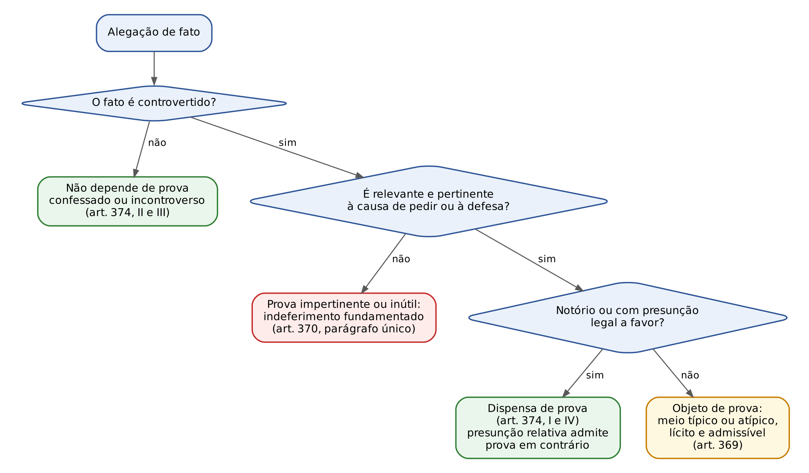
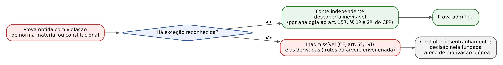
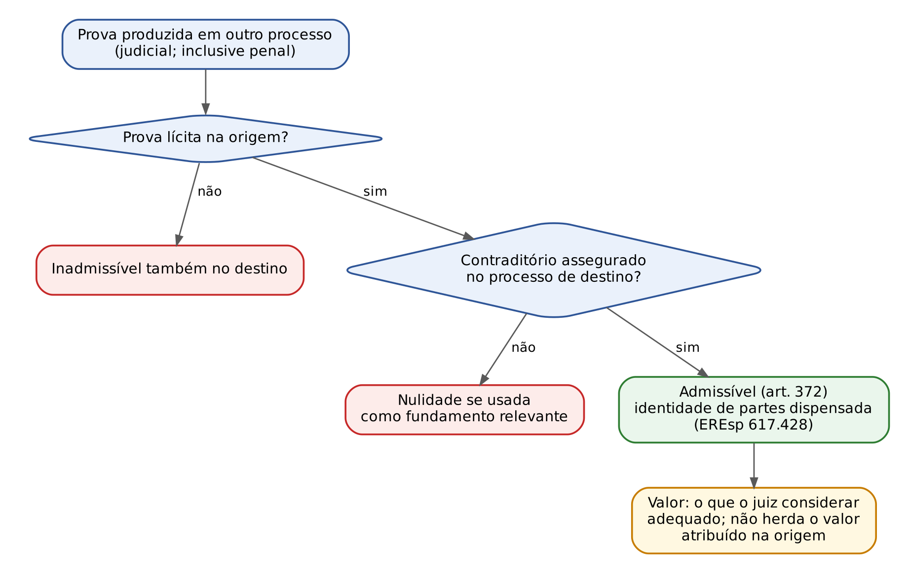
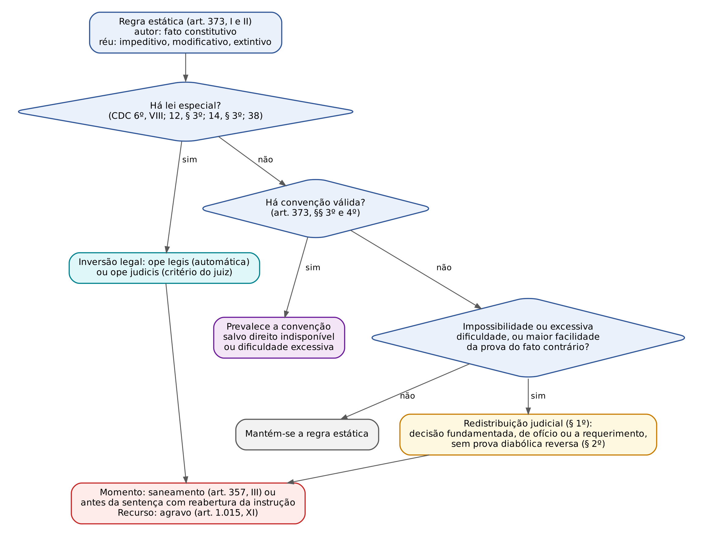
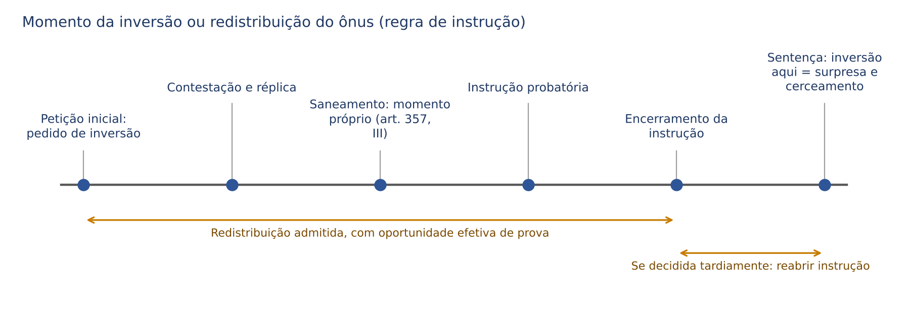
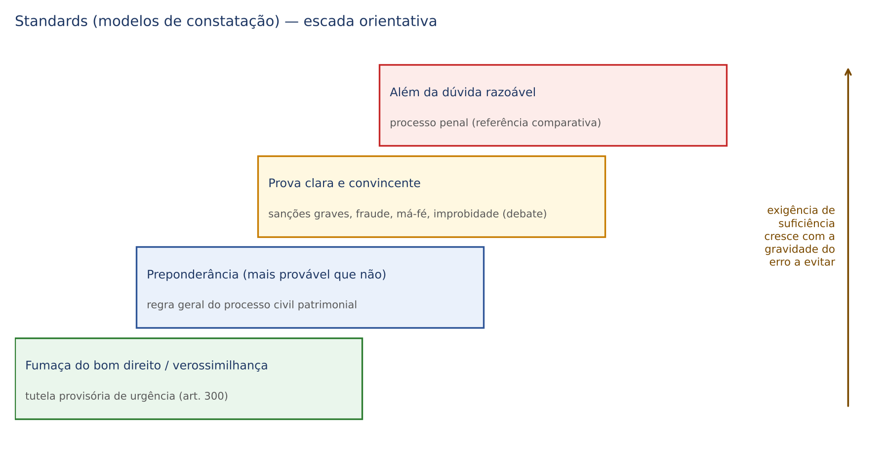
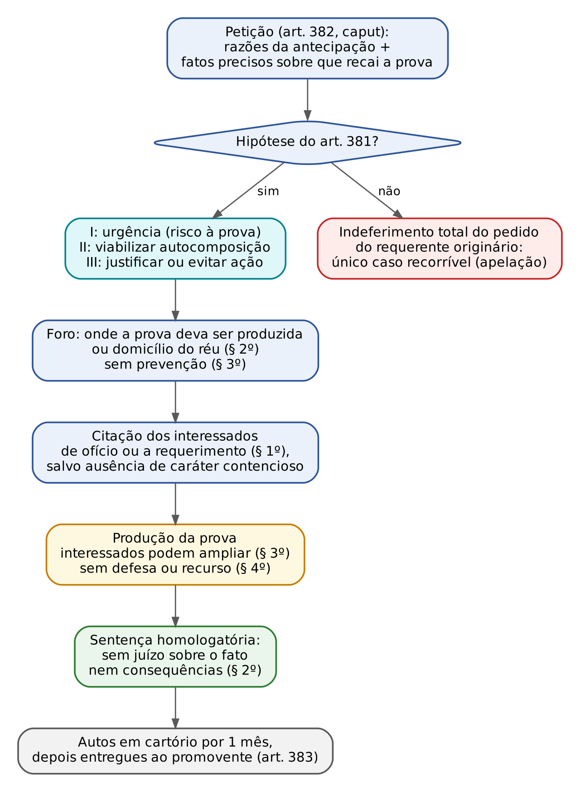

# CAPÍTULO 18 — PROVAS I: TEORIA GERAL, ÔNUS, VALORAÇÃO, STANDARDS E PRODUÇÃO ANTECIPADA

:::INCIDENCIA
Pontos: TRF5 p. 8; TJRS p. 9; TJSC p. 9. Nível A+. Lote: 27 questões (FGV 23, FCC 4).
O que mais cai: redistribuição e inversão do ônus (requisitos do art. 373, § 1º, momento — regra de instrução — e agravo do art. 1.015, XI), produção antecipada de prova (competência sem prevenção, ausência de juízo sobre o fato, recorribilidade restrita) e disposições gerais literais (arts. 370, 372, 374 e 376).
:::

| Subtema | FGV | FCC | Padrão de cobrança |
|---|---|---|---|
| Ônus da prova: estático, dinâmico, inversão no CDC, convenção | 10 | 2 | Caso prático no saneamento: pode redistribuir de ofício? em que momento? cabe na sentença? qual recurso? |
| Produção antecipada da prova (arts. 381 a 383) | 5 | 1 | Foro (onde a prova deva ser produzida ou domicílio do réu), não prevenção, ausência de valoração, recurso só contra indeferimento total |
| Disposições gerais: objeto, fatos que independem de prova, poderes instrutórios, direito local, revel | 6 | 1 | Literalidade dos arts. 370, 374, 376 e 349; prova impertinente; notoriedade x nexo causal |
| Prova emprestada, ilícita e atípica | 2 | 0 | Valor atribuído pelo juiz (não o da origem), contraditório no destino, derivação |

## 18.1 Prova: conceito, função, destinatários e direito fundamental à prova

### 18.1.1 Acepções e elementos

"Prova" designa, conforme o contexto, (a) a atividade de demonstrar (instrução), (b) o meio pelo qual o elemento ingressa no processo (testemunho, documento, perícia), (c) a fonte de onde se extrai a informação (a pessoa, a coisa, o lugar) e (d) o resultado, isto é, o convencimento alcançado. A distinção entre FONTE e MEIO resolve questões: a fonte preexiste ao processo e é extraprocessual (a testemunha que viu o acidente); o meio é a técnica processual de incorporação (a inquirição). A ilicitude pode recair sobre a obtenção da fonte (gravação clandestina obtida por invasão domiciliar) ou sobre o meio (depoimento colhido sem contraditório).

O objeto da prova não é propriamente o fato, mas a ALEGAÇÃO de fato: o processo trabalha com afirmações que precisam ser confirmadas ou infirmadas. Daí falar-se em "prova das alegações de fato" (a expressão do art. 371 e a lógica do art. 374, II e III, que dispensa prova de alegações confessadas ou incontroversas).

A finalidade da prova é formar o convencimento judicial sobre as alegações de fato relevantes. O CPC/2015 abandonou a retórica da "verdade real" como fim do processo civil: o art. 369 fala em "provar a verdade dos fatos" e "influir eficazmente na convicção do juiz". A doutrina contemporânea trabalha com verdade possível ou provável (aproximação controlável), o que se conecta aos *standards* probatórios (18.9).

### 18.1.2 Destinatário da prova

A jurisprudência do STJ repetiu por décadas que "o juiz é o destinatário da prova", fórmula usada para legitimar o indeferimento de provas desnecessárias. O CPC/2015 obriga a relativizar o bordão: as PARTES também são destinatárias (formam convicção para autocomposição, para recorrer, para decidir se propõem ação — o art. 381, II e III, só faz sentido nessa chave), e o TRIBUNAL também o é (a prova serve ao julgamento da apelação). Consequência prática: o juiz que indefere prova sob o fundamento de que "já está convencido" e depois julga contra a parte por falta de prova incorre em cerceamento de defesa (18.6.3).

:::PEGADINHA
"O juiz é o destinatário exclusivo da prova, razão pela qual pode indeferir qualquer diligência que repute desnecessária ao seu convencimento" — afirmativa ERRADA na versão contemporânea: o indeferimento só é legítimo para diligências "inúteis ou meramente protelatórias", em decisão fundamentada (art. 370, parágrafo único), e a prova também se dirige às partes e ao tribunal.
:::

### 18.1.3 Direito fundamental à prova

O direito à prova decorre do contraditório e da ampla defesa (CF, art. 5º, LV) e é explicitado no art. 369 do CPC. Abrange: (a) direito de requerer provas; (b) direito à admissão das provas relevantes e lícitas; (c) direito de participar da produção (inclusive da prova determinada de ofício); (d) direito de manifestar-se sobre a prova produzida; e (e) direito à valoração motivada da prova produzida (arts. 371 e 489, § 1º, IV). A produção antecipada da prova sem urgência (art. 381, II e III) consagrou o direito autônomo à prova, desvinculado de um pedido de tutela de mérito (18.11).

O direito à prova não é absoluto: cede diante da vedação de provas ilícitas (CF, art. 5º, LVI), das regras de exclusão e de privilégio (18.4) e da irrelevância ou inutilidade do meio (art. 370, parágrafo único).

:::LEI CPC, ARTS. 369 E 370
Art. 369. As partes têm o direito de empregar todos os meios legais, bem como os moralmente legítimos, ainda que não especificados neste Código, para provar a verdade dos fatos em que se funda o pedido ou a defesa e influir eficazmente na convicção do juiz.
Art. 370. Caberá ao juiz, de ofício ou a requerimento da parte, determinar as provas necessárias ao julgamento do mérito.
Parágrafo único. O juiz indeferirá, em decisão fundamentada, as diligências inúteis ou meramente protelatórias.
:::

### 18.1.4 Classificações cobráveis

| Critério | Espécies | Observação de prova |
|---|---|---|
| Objeto (relação com o fato probando) | Direta: recai sobre o próprio fato (testemunha que viu a colisão). Indireta: recai sobre fato diverso (indício) do qual se infere o fato probando por raciocínio (marcas de frenagem) | Prova indireta não é prova "menor": indícios graves, precisos e concordantes podem fundamentar a decisão (raciocínio presuntivo, 18.2.4) |
| Sujeito (fonte) | Pessoal (afirmação de pessoa: depoimento, testemunho) e real (atestação inconsciente de coisa: perícia em objeto, inspeção) |  |
| Forma | Oral, documental, material |  |
| Momento | Casual (produzida no processo) e pré-constituída (documento preparado antes para servir de prova) | Pré-constituída não se confunde com produção antecipada |
| Previsão legal | Típica (arts. 384 a 484 do CPC) e atípica (18.3) | Art. 369: "ainda que não especificados neste Código" |
| Licitude | Lícita e ilícita (inadmissível) | 18.4 |

O Código Civil também lista meios de prova do fato jurídico (art. 212: confissão, documento, testemunha, presunção e perícia), "salvo o negócio a que se impõe forma especial". A disciplina material dos meios (arts. 212 a 232 do CC) está na Apostila de Direito Civil, Cap. 10 (10.5); aqui interessa apenas que a forma especial exigida por lei (*ad substantiam*) não se supre por outro meio (art. 406 do CPC, ver Cap. 19).

## 18.2 Objeto da prova, relevância, admissibilidade e fatos que independem de prova

### 18.2.1 O que se prova: alegações de fato controvertidas e relevantes

São objeto de prova as alegações de fato (a) CONTROVERTIDAS, (b) RELEVANTES (aptas a influir no julgamento, porque integram a causa de pedir ou a defesa e sua demonstração alteraria o resultado) e (c) PERTINENTES (relacionadas à demanda tal como estabilizada). A decisão de saneamento delimita "as questões de fato sobre as quais recairá a atividade probatória, especificando os meios de prova admitidos" (art. 357, II; o saneamento em si está no Cap. 17).

Relevância e admissibilidade são juízos distintos. A relevância é lógica (a prova pode alterar o convencimento sobre fato que importa?); a admissibilidade é jurídica (a lei permite este meio para este fato? a prova é lícita? foi requerida no momento próprio?). Uma prova pode ser relevante e inadmissível (gravação obtida mediante invasão de domicílio) ou admissível e irrelevante (perícia sobre fato incontroverso).

:::QUESTAO FGV 2024 — ENAM — 1º EXAME NACIONAL DA MAGISTRATURA, REAPLICAÇÃO (Q2507031)
Caso: ação anulatória de contrato fundada EXCLUSIVAMENTE em coação; na fase de prova documental suplementar, o autor pede exibição de documentos que provariam a quitação do débito (consequência material idêntica à do pedido). Gabarito: D — o juiz deve indeferir a prova por impertinente e desnecessária.
Armadilha: a identidade do resultado prático (extinção do débito) seduz; mas quitação é causa de pedir diversa, não deduzida, e a demanda já está estabilizada após o saneamento (art. 329; ver Cap. 16). Prova sobre fato estranho à causa de pedir é impertinente, e a concordância do réu não a torna pertinente (afasta as alternativas que condicionam o indeferimento à oposição do réu). Fundamento: arts. 357, II, e 370, parágrafo único.
:::

### 18.2.2 Fatos que independem de prova (art. 374)

:::LEI CPC, ART. 374
Não dependem de prova os fatos:
I - notórios;
II - afirmados por uma parte e confessados pela parte contrária;
III - admitidos no processo como incontroversos;
IV - em cujo favor milita presunção legal de existência ou de veracidade.
:::

- NOTÓRIO (I): fato de conhecimento geral no círculo social em que o processo se insere, ao tempo da decisão. Notoriedade é relativa (local, regional, profissional) e não se confunde com o conhecimento privado do juiz, que não pode ser usado como prova. Atenção: a notoriedade cobre o FATO, não suas consequências ou o nexo causal com o dano do autor.
- CONFESSADOS (II): a confissão (Cap. 19) dispensa prova, salvo quando versar sobre direitos indisponíveis (art. 392) ou quando a lei exigir instrumento público.
- INCONTROVERSOS (III): decorrem da ausência de impugnação específica (art. 341) ou da revelia com efeito material (art. 344). A incontrovérsia não vincula o juiz quando a alegação for inverossímil ou contrária à prova dos autos (art. 345, IV) ou quando ocorrer uma das exceções dos arts. 341 e 345 (ver Cap. 17).
- PRESUNÇÃO LEGAL (IV): a presunção relativa (*juris tantum*) dispensa a prova do fato presumido, mas exige a prova do fato-base (indício) e admite prova em contrário; a absoluta (*juris et de jure*) não admite prova em contrário e, a rigor, é regra de direito material.

:::QUESTAO FGV 2026 — TJ-GO — JUIZ SUBSTITUTO (Q3966643)
Caso: ação contra o Estado de Goiás por pensão decorrente de doença atribuída à exposição ao Césio-137; o autor invoca a notoriedade do acidente; o Estado, revel, pede perícia sobre o nexo e sustenta que não se aplicam os efeitos da revelia à Fazenda. Gabarito: A — acolhe-se a primeira alegação (a notoriedade do evento não dispensa a prova do nexo de causalidade entre o evento e a doença do autor) e rejeita-se a segunda (a pretensão tem natureza de interesse privado, e o ente público revel pode sofrer os efeitos da revelia).
Passos: (1) o art. 374, I, dispensa a prova do FATO notório (o acidente radiológico), não da relação causal individual; (2) o revel pode intervir e requerer provas, recebendo o processo no estado em que se encontra (art. 346, parágrafo único; art. 349); (3) a revelia da Fazenda é tema do Cap. 17 e do Cap. 27. Observação: a parte da alternativa sobre revelia da Fazenda é discutível (a indisponibilidade do interesse público costuma afastar o efeito material — art. 345, II); o que a questão quis testar no ponto probatório é a extensão da notoriedade (ver nota de verificação).
:::

:::QUESTAO FGV 2025 — PROVA NÃO IDENTIFICADA NO BANCO (Q3593215)
Afirmações de três debatedores: (1) fatos notórios dependem de prova; (2) ao réu incumbe o ônus do fato impeditivo, modificativo ou extintivo; (3) o juiz, de ofício ou a requerimento, determina as provas necessárias. Gabarito: C — corretas apenas a segunda e a terceira. Fundamento: arts. 374, I, 373, II, e 370. No mesmo sentido, sobre a literalidade do art. 370: Q3781264 (FGV 2025 — CGE-SP), em que só a assertiva III estava certa — a I invertia os incisos do art. 373, e a II afirmava falsamente que o CPC adota "como regra" a carga dinâmica (a regra é a distribuição estática; a dinâmica é exceção do § 1º).
:::

:::QUESTAO FGV 2026 — PROVA NÃO IDENTIFICADA NO BANCO (Q4279874)
Questão correlata (capítulo 1): o réu (Estado) admite o fato descrito na inicial e discute apenas o nexo e a excludente; o autor pede testemunhas só para provar o fato admitido; o juiz indefere. Gabarito: D — o indeferimento foi legítimo, porque o fato era incontroverso (art. 374, III, e art. 370, parágrafo único); o uso, como fundamento determinante, de documento juntado com alegações finais sem ouvir o autor violou o contraditório (arts. 9º, 10 e 437, § 1º).
:::

### 18.2.3 Fato negativo e prova "diabólica"

Não existe regra que dispense a prova do fato negativo. O que é impossível é a prova do fato negativo INDEFINIDO ("nunca contratei com ninguém"); o negativo DEFINIDO é provável pela demonstração do fato positivo contrário ("no dia X eu estava em outra cidade"). A dificuldade extrema de prova de uma das partes (prova diabólica) é justamente um dos pressupostos da redistribuição dinâmica (art. 373, § 1º), e o § 2º veda que a redistribuição crie prova diabólica para a outra parte (prova diabólica reversa). A FGV cobrou essa ideia ao afastar, em caso de teste do pezinho contra o Estado, a alternativa segundo a qual "não é possível impor ao réu a prova de fato negativo" (Q3786350, 18.7.3).

### 18.2.4 Presunções e máximas de experiência

PRESUNÇÃO é o resultado de um raciocínio: de um fato conhecido (indício, fato-base) infere-se a ocorrência de outro, desconhecido. Distinguem-se:

| Espécie | Fonte | Efeito | Exemplos |
|---|---|---|---|
| Legal absoluta (*juris et de jure*) | Lei | Não admite prova em contrário; é regra material | Presunção de conhecimento de ato registrado em certos sistemas registrais |
| Legal relativa (*juris tantum*) | Lei | Dispensa a prova do fato presumido (art. 374, IV); inverte o encargo; admite prova em contrário | Revelia (art. 344); art. 400 (exibição); recusa a exame médico (CC, arts. 231 e 232); Súmula 301 do STJ |
| Judicial (*hominis*, simples) | Raciocínio do juiz a partir de indícios e máximas de experiência | Meio de valoração, não de dispensa; exige motivação do caminho inferencial | Marcas de frenagem e velocidade; padrão de fraude bancária |

Presunção não é meio de prova em sentido técnico (não há "produção" de presunção); é técnica de raciocínio ou de distribuição do encargo. O CC (art. 212, IV) a lista entre os meios de prova; a doutrina processual trata a presunção judicial como valoração de prova indiciária.

:::JURIS STJ, SÚMULA 301
Em ação investigatória, a recusa do suposto pai a submeter-se ao exame de DNA induz presunção *juris tantum* de paternidade. A presunção é relativa e deve ser apreciada com o contexto probatório (CC, arts. 231 e 232: quem se nega a exame médico não pode aproveitar-se da recusa; a recusa à perícia ordenada pelo juiz "poderá suprir" a prova pretendida). A disciplina material está na Apostila de Direito Civil (Cap. 10, 10.5.8, e Cap. 37, 37.5).
:::

MÁXIMAS (REGRAS) DE EXPERIÊNCIA são juízos gerais, extraídos da observação do que ordinariamente acontece, que servem de premissa maior ao raciocínio probatório. O art. 375 distingue duas espécies:

:::LEI CPC, ART. 375
O juiz aplicará as regras de experiência comum subministradas pela observação do que ordinariamente acontece e, ainda, as regras de experiência técnica, ressalvado, quanto a estas, o exame pericial.
:::

- Regras de experiência COMUM: conhecimento acessível ao homem médio (o freio de veículo molhado demora mais; quem paga em dinheiro vivo vultosa quantia costuma exigir recibo). Aplicáveis de ofício, sem prova.
- Regras de experiência TÉCNICA: conhecimento técnico difundido, que o juiz pode aplicar diretamente, "ressalvado [...] o exame pericial": se a matéria depender de conhecimento especializado controvertido, a perícia se impõe (art. 464, § 1º, I, a contrario).

Funções das máximas: (a) valorar a prova (credibilidade da testemunha); (b) construir presunções judiciais (inferência do fato desconhecido); (c) interpretar conceitos jurídicos indeterminados; (d) aferir a verossimilhança (art. 300; CDC, art. 6º, VIII, que remete expressamente às "regras ordinárias de experiências"). Máxima de experiência não se confunde com fato notório: o notório é um fato concreto conhecido; a máxima é um juízo geral e abstrato. Nem com o conhecimento privado do juiz (fato concreto que o juiz presenciou), cujo uso é vedado.

:::DICA
Raciocínio presuntivo em três degraus, útil na sentença: (1) fato-base provado (indício); (2) máxima de experiência explicitada (o que ordinariamente acontece); (3) conclusão sobre o fato probando. Sem explicitar o degrau 2, a decisão fica sem motivação controlável (art. 489, § 1º, ver Cap. 20).
:::

### 18.2.5 Prova do direito (art. 376) e *iura novit curia*

O direito não é, em regra, objeto de prova (*iura novit curia*). O art. 376 abre exceção para o direito municipal, estadual, estrangeiro ou consuetudinário: a parte que o alegar "provar-lhe-á o teor e a vigência, SE ASSIM O JUIZ DETERMINAR". A literalidade é a pegadinha: não há ônus automático; trata-se de faculdade judicial. O direito federal nunca precisa ser provado, e o direito estadual ou municipal do próprio foro, por ser de conhecimento esperado do juiz, normalmente dispensa a determinação.

:::QUESTAO FGV 2024 — TJ-MT — JUIZ SUBSTITUTO (Q3086933)
Gabarito: D — o juiz pode determinar que a parte que alegue direito municipal, estadual, estrangeiro ou consuetudinário lhe prove o teor e a vigência (art. 376).
Armadilhas das demais: (A) a redistribuição do ônus É agravável (art. 1.015, XI); (B) a convenção sobre o ônus pode ser celebrada "antes ou durante o processo" (art. 373, § 4º); (C) o juiz determina provas de ofício (art. 370); (E) o juiz DEVE indeferir diligência inútil (art. 370, parágrafo único), não deferi-la "por cautela".
:::

## 18.3 Meios de prova típicos e atípicos; prova estatística; prova e tutela inibitória

### 18.3.1 Atipicidade dos meios de prova

O sistema é de ATIPICIDADE: além dos meios típicos (depoimento pessoal, confissão, exibição, documental, testemunhal, pericial, inspeção judicial e ata notarial — todos no Cap. 19), admitem-se "todos os meios legais, bem como os moralmente legítimos, ainda que não especificados neste Código" (art. 369). Provas atípicas usuais: declarações escritas de terceiros (que não substituem o testemunho, mas podem ser valoradas como indício), comportamento processual das partes, constatações por oficial de justiça, prova por amostragem, prints de telas e extratos de sistemas, relatórios de geolocalização, registros de trilha de auditoria de assinatura eletrônica.

Limites da atipicidade: (a) a prova atípica não pode servir para burlar as garantias do meio típico equivalente (declaração escrita de testemunha que não comparece não pode ser usada para fugir da contradita e das perguntas da parte contrária, art. 459); (b) deve ser lícita e submetida ao contraditório; (c) sua valoração é motivada como qualquer outra (art. 371).

:::QUESTAO FGV 2026 — TJ-BA — JUIZ LEIGO (Q4102117)
Julgar V ou F: (1) a prova emprestada possui o mesmo valor que lhe foi dado no processo de origem; (2) a ilicitude originária contamina as provas dela derivadas; (3) a atipicidade das provas é regra, com valoração motivada. Gabarito: C (F, V, V).
Armadilha: o art. 372 manda o juiz atribuir à prova emprestada "o valor que considerar adequado" — não há transporte do valor atribuído na origem (18.5). No mesmo sentido, para a atipicidade: Q3301240 (FGV 2025 — TJ-SE, alternativa D errada ao vedar provas atípicas) e Q3386987 (FCC 2025 — DPE-RS, alternativa D errada pelo mesmo motivo; o gabarito A considerou desnecessária a demonstração de autenticidade de fotografias digitais não impugnadas — art. 422, § 1º, ver Cap. 19).
:::

:::JURIS STJ, RESP 2.179.441-DF, J. 10/3/2026 (INFORMATIVO 881)
Relatora Ministra Maria Thereza de Assis Moura, Segunda Turma. Telas e extratos de sistemas eletrônicos da Administração Pública constituem prova digital válida, com presunção relativa de veracidade, aptos a demonstrar parcelamento de débito tributário (interrupção da prescrição); cabe ao contribuinte impugnar especificamente sua autenticidade ou veracidade. Lição geral: prova digital atípica é admissível e, sem impugnação específica, prevalece; a impugnação genérica não basta (comparar com 18.7.5, Tema 1.061).
:::

### 18.3.2 Prova estatística e por amostragem

Prova estatística é a demonstração de fatos por inferência a partir de dados agregados (frequências, correlações, amostras representativas). É especialmente útil nas demandas coletivas e nos litígios de massa: (a) para provar a ocorrência de lesão a direitos individuais homogêneos sem examinar cada caso (por amostragem estatisticamente válida); (b) para quantificar danos globais; (c) para demonstrar discriminação (impacto desproporcional) quando a intenção é inacessível; (d) para aferir nexo causal em danos ambientais e à saúde (epidemiologia).

Regras de controle (convergentes na doutrina): (1) metodologia explicitada e reprodutível, submetida ao contraditório, normalmente pela via pericial (art. 375, parte final; art. 479, que manda o juiz considerar "o método utilizado pelo perito"); (2) a correlação estatística não prova, por si, causalidade individual — a passagem do dado coletivo ao caso individual exige elementos adicionais (a chamada falácia do promotor ou da taxa-base é exemplo de erro inferencial); (3) a força da inferência deve ser medida pelo *standard* aplicável (18.9). O desenvolvimento no processo coletivo (prova coletiva, liquidação por amostragem, *fluid recovery*) está no Cap. 34; a produção de prova única nos litígios de massa via cooperação judiciária, no Cap. 5.

:::EXEMPLO
Ação civil pública contra instituição financeira por cobrança de tarifa não contratada em milhares de contas. O juiz defere perícia por amostragem estratificada (agências, períodos, tipos de conta), fixando com as partes, no saneamento, o tamanho da amostra e a margem de erro aceitável. O resultado autoriza a condenação genérica (CDC, art. 95) quanto à prática; a demonstração de que cada consumidor específico sofreu a cobrança fica para a liquidação individual, em que a amostra serve como prova indiciária e a instituição pode demonstrar fato extintivo individual (pagamento ou contratação).
:::

### 18.3.3 Prova e tutela inibitória

A tutela inibitória (prevenção do ilícito) e a de remoção do ilícito têm objeto probatório próprio. O art. 497, parágrafo único, declara "irrelevante a demonstração da ocorrência de dano ou da existência de culpa ou dolo" para a tutela específica destinada a inibir a prática, a reiteração ou a continuação de um ilícito, ou a sua remoção. Logo, o *thema probandum* é (a) a ameaça de prática, reiteração ou continuação de ato CONTRÁRIO AO DIREITO e (b) a ilicitude da conduta, não o dano nem o elemento subjetivo. Dificuldades típicas: provar fato futuro (a probabilidade da prática) — resolvida por indícios (atos preparatórios, prática anterior, declarações) e por presunções judiciais; e a natureza técnica da ilicitude (normas ambientais, sanitárias), que favorece a redistribuição do ônus ao réu que detém os dados (art. 373, § 1º). A teoria da tutela inibitória e sua efetivação estão no Cap. 14; o julgamento das obrigações de fazer e não fazer, no Cap. 20.

:::QUESTAO FGV 2025 — MPE-ES — PROMOTOR DE JUSTIÇA SUBSTITUTO (Q3752741)
Caso: associação ambiental ajuíza ação coletiva inibitória contra despejo de resíduos; a indústria alega cumprir as normas, sem trazer documentos. Gabarito: B — o juiz pode redistribuir o ônus quando for mais fácil ao réu produzir a prova, cabendo à indústria demonstrar a regularidade de sua conduta.
Passos: (1) a inibitória dispensa prova de dano e culpa (art. 497, parágrafo único), concentrando o debate na conformidade da conduta; (2) quem detém licenças, monitoramentos e laudos é a ré — maior facilidade de prova do fato contrário (art. 373, § 1º); (3) em matéria ambiental, há ainda a Súmula 618 do STJ (18.7.4). Erradas: ônus exclusivo do autor; divisão "igual" do ônus; MP como fiscal sem ônus (impertinente).
:::

## 18.4 Prova ilícita, regras de exclusão e regras de privilégio

### 18.4.1 Prova ilícita e prova ilegítima

A Constituição declara "inadmissíveis, no processo, as provas obtidas por meios ilícitos" (art. 5º, LVI). A doutrina distingue prova ILÍCITA (obtida com violação de norma de direito material, sobretudo direitos fundamentais: intimidade, sigilo das comunicações, inviolabilidade do domicílio) e prova ILEGÍTIMA (produzida com violação de norma processual: testemunha impedida ouvida como testemunha compromissada, perícia sem intimação das partes). A consequência da ilicitude é a inadmissibilidade (e o desentranhamento); a da ilegitimidade segue o regime das invalidades processuais (Cap. 13), com relevância do prejuízo.

O CPC não reproduziu norma específica sobre prova ilícita: o art. 369 limita-se a exigir meios "legais" e "moralmente legítimos". A doutrina e a jurisprudência importam para o cível a teoria dos frutos da árvore envenenada (ilicitude por derivação) e suas exceções positivadas no processo penal (CPP, art. 157, §§ 1º e 2º: ausência de nexo de causalidade e fonte independente; a doutrina lê no conceito de fonte independente do § 2º a descoberta inevitável). A decisão fundada em prova ilícita carece de motivação idônea e pode ser invalidada ou rescindida.

Correntes sobre a admissibilidade da prova ilícita no cível (cobrança doutrinária):

| Corrente | Conteúdo | Situação |
|---|---|---|
| Inadmissibilidade absoluta | Leitura literal do art. 5º, LVI | Base do sistema |
| Proporcionalidade (ponderação) | Admite-se excepcionalmente a prova ilícita quando o bem jurídico protegido pela prova for de valor superior ao violado (por exemplo, proteção de criança contra abuso, em ação de guarda) | Aceita por parte relevante da doutrina, com cautela; no processo penal, a admissão *pro reo* é a hipótese mais aceita |
| Admissibilidade com responsabilização do infrator | Prova vale, e o infrator responde | Superada pelo texto constitucional |

### 18.4.2 Casos recorrentes: gravações, interceptação e sigilos

| Situação | Regra | Fonte vista |
|---|---|---|
| Gravação ambiental ou telefônica feita por um dos interlocutores sem conhecimento do outro | Lícita, em regra (não há terceiro violando a comunicação), salvo causa legal específica de sigilo ou reserva da conversa | STF, Tema 237 ("É lícita a prova consistente em gravação ambiental realizada por um dos interlocutores sem conhecimento do outro") |
| Gravação em departamento jurídico de empresa, por um dos interlocutores, sobre fatos não relativos ao exercício da advocacia | Lícita: não viola sigilo profissional nem inviolabilidade do escritório | STJ, REsp 1.969.798-DF, Quarta Turma, j. 12/5/2026 (Informativo de Jurisprudência n. 32, edição extraordinária) |
| Interceptação telefônica (por terceiro, com ordem judicial) | Só é autorizável para investigação criminal ou instrução processual penal (CF, art. 5º, XII); NÃO pode ser originariamente determinada em processo civil | Texto constitucional |
| Interceptação lícita do processo penal usada no cível ou no processo administrativo | Admissível como prova emprestada, com contraditório no processo de destino e acesso à integralidade das conversas | STJ, MS 17.815/DF (prova emprestada em PAD) e REsp 1.795.341/RS (integralidade dos áudios), noticiados no Informativo 648; Súmula 591 do STJ (PAD) |
| Prova obtida com quebra de sigilo bancário ou fiscal sem ordem judicial pelo particular | Ilícita | Regra geral |
| Documento de terceiro obtido por furto ou invasão de sistema | Ilícita (e derivadas) | Regra geral |

:::PEGADINHA
"Gravação clandestina" é expressão ambígua. Gravação por um dos interlocutores (ainda que sem ciência do outro) é, em regra, LÍCITA (Tema 237 do STF); ilícita é a INTERCEPTAÇÃO por terceiro sem ordem judicial, e a escuta ambiental por terceiro sem autorização. No processo civil, o juiz não pode autorizar interceptação telefônica, mas pode admitir como prova emprestada a interceptação regularmente produzida no processo penal.
:::

### 18.4.3 Regras de exclusão e regras de privilégio

A doutrina (sob influência do direito anglo-americano) separa, entre as restrições ao direito à prova:

- REGRAS DE EXCLUSÃO (*exclusionary rules*): impedem a admissão de prova por razões epistêmicas (risco de erro) ou de política judiciária. Exemplos no CPC: limitações à prova exclusivamente testemunhal quando a lei exige prova escrita (art. 444) ou instrumento público da substância do ato (art. 406); impedimentos e suspeições de testemunhas (art. 447); prova ilícita (exclusão por violação de direitos).
- REGRAS DE PRIVILÉGIO (*privileges*): protegem valores extraprocessuais (intimidade, sigilo profissional, relações familiares, liberdade religiosa) e permitem que a pessoa se recuse a depor ou exibir, ainda que a prova fosse epistemicamente útil. Exemplos: a parte não é obrigada a depor sobre fatos criminosos ou torpes que lhe forem imputados, a cujo respeito deva guardar sigilo por estado ou profissão, ou que a exponham a desonra ou perigo (art. 388); escusa da testemunha (art. 448); escusa de exibição (art. 404). A disciplina de cada escusa está no Cap. 19.

:::JURIS STJ, INFORMATIVO 868, PROCESSO EM SEGREDO DE JUSTIÇA, J. 14/10/2025
Relator Ministro Raul Araújo, Quarta Turma. Organização religiosa pode recusar o acesso a procedimento disciplinar eclesiástico instaurado contra autoridade religiosa. Exemplo de regra de privilégio fundada na liberdade religiosa e na autonomia das organizações religiosas, oponível ao dever de exibição (arts. 396 e 404).
:::

### 18.4.4 Dever de colaboração e direito de não produzir prova contra si

:::LEI CPC, ARTS. 378 A 380
Art. 378. Ninguém se exime do dever de colaborar com o Poder Judiciário para o descobrimento da verdade.
Art. 379. Preservado o direito de não produzir prova contra si própria, incumbe à parte: I - comparecer em juízo, respondendo ao que lhe for interrogado; II - colaborar com o juízo na realização de inspeção judicial que for considerada necessária; III - praticar o ato que lhe for determinado.
Art. 380. Incumbe ao terceiro, em relação a qualquer causa: I - informar ao juiz os fatos e as circunstâncias de que tenha conhecimento; II - exibir coisa ou documento que esteja em seu poder. Parágrafo único. Poderá o juiz, em caso de descumprimento, determinar, além da imposição de multa, outras medidas indutivas, coercitivas, mandamentais ou sub-rogatórias.
:::

Aqui está a distinção ÔNUS x DEVER probatório. Ônus é imperativo do próprio interesse: seu descumprimento gera consequência desfavorável para quem não o cumpre (o fato não provado é julgado contra quem tinha o encargo), sem sanção. DEVER é imposição em favor da administração da justiça: seu descumprimento autoriza sanção e medidas coercitivas. Parte e terceiro têm DEVER de colaborar (arts. 378 a 380), ao lado do ÔNUS de provar (art. 373). Para o terceiro, o parágrafo único do art. 380 autoriza multa e medidas atípicas; para a parte, a recusa ilegítima gera, além disso, presunções (arts. 385, § 1º — pena de confesso; 400 — admissão dos fatos que o documento pretendia provar; CC, art. 232).

O "direito de não produzir prova contra si própria" (art. 379, caput) tem alcance restrito no processo civil. O Enunciado 31 da I Jornada de Direito Processual Civil do CJF afirma que a compatibilização dos arts. 378 e 379 com o art. 5º, LXIII, da CF "assegura à parte, exclusivamente, o direito de não produzir prova contra si quando houver reflexos no ambiente penal". Fora disso, a parte não pode invocar o privilégio para recusar-se a exibir documento comum ou a comparecer ao depoimento.

:::DICA
Ônus da prova (art. 373) é regra de distribuição do risco da dúvida; dever de colaboração (arts. 378 a 380) é regra de conduta com sanção. A parte que tem o ônus pode precisar de documento que está com o adversário: o caminho é a exibição (arts. 396 a 404), cujo descumprimento gera presunção (art. 400) e admite medidas coercitivas (parágrafo único) — não a inversão automática do ônus.
:::

## 18.5 Prova emprestada

:::LEI CPC, ART. 372
O juiz poderá admitir a utilização de prova produzida em outro processo, atribuindo-lhe o valor que considerar adequado, observado o contraditório.
:::

Prova emprestada é a prova produzida em um processo e transportada documentalmente para outro, onde ingressa com a natureza originária (o testemunho continua sendo testemunho; a perícia, perícia), mas sob a forma documental. Requisitos e efeitos:

1. LICITUDE na origem: prova ilícita na origem é ilícita no destino; prova lícita na origem (interceptação penal autorizada) pode ser emprestada a processo em que não poderia ser originariamente produzida (18.4.2).

2. CONTRADITÓRIO no processo de destino: é o requisito decisivo. Não se exige identidade de partes: o STJ, na Corte Especial (EREsp 617.428/SP, Relatora Ministra Nancy Andrighi, DJe 17/6/2014), firmou que a prova emprestada não pode se restringir a processos em que figurem partes idênticas, sob pena de reduzir excessivamente sua aplicabilidade; o que se exige é que a parte contra quem a prova é usada tenha oportunidade de se manifestar sobre ela (e, se for o caso, de requerer a renovação ou a complementação). O Enunciado 30 da I Jornada do CJF segue a mesma linha ("ainda que não haja identidade de partes").

3. VALOR: o juiz atribui "o valor que considerar adequado" — não há vinculação ao valor dado na origem, e a prova emprestada contra quem não participou de sua produção tende a ter peso reduzido quando o fato depende de imediação (testemunho).

4. ECONOMIA: o STJ destaca que o empréstimo serve à eficiência e à duração razoável, sobretudo para evitar a repetição de perícias custosas (AgInt no AREsp 1.827.101/RJ, Relator Ministro Og Fernandes, Segunda Turma, j. 29/11/2021); e que o contraditório se satisfaz quando as partes, ainda que não tenham participado da produção original, puderam impugnar a prova no processo de destino (AgInt no AREsp 1.333.528/SP, Relator Ministro Marco Aurélio Bellizze, Terceira Turma, j. 19/8/2019).

:::QUESTAO FGV 2025 — TRF6 — JUIZ FEDERAL SUBSTITUTO (Q3742399)
Caso: em ação de improbidade movida pelo MPF, o juiz indefere a oitiva de testemunhas requerida por um réu (João) porque os depoimentos já tinham sido colhidos em ação penal sobre os mesmos fatos — da qual João não foi parte — e os termos estavam nos autos; o réu agrava alegando violação do contraditório. Gabarito: A — é lícita a utilização da prova emprestada, mas é necessário que João possa exercer o contraditório na ação de improbidade, sob pena de nulidade.
Passos: (1) a falta de identidade de partes não impede o empréstimo (EREsp 617.428); (2) o contraditório no destino é obrigatório (art. 372), o que inclui a possibilidade de requerer a reinquirição quando a imediação for relevante; (3) erradas: D (dispensa de manifestação "em nome da eficiência"), C (*in dubio pro societate* não é critério de julgamento cível) e E (a remessa necessária na improbidade foi afastada pela Lei 14.230/2021 — ver Cap. 34). A alternativa B toca a recorribilidade das interlocutórias na improbidade, tema do Cap. 34.
:::

No mesmo sentido, sobre o valor: Q3781265 (FGV 2025 — CGE-SP; capítulo 19), em que era verdadeira a assertiva de que cabe ao magistrado dar à prova emprestada o valor que entender adequado, observado o contraditório.

:::JURIS STJ, TEMA 1.366 (AFETADO; PRIMEIRA SEÇÃO)
Controvérsia afetada em 17/6/2025 (ProAfR no REsp 2.124.922-RJ e REsp 2.164.976-RJ, Relator Ministro Teodoro Silva Santos, Informativo 855): definir se é possível a utilização de prova emprestada, relacionada a perícia realizada em outras ações judiciais, para comprovar o caráter especial das atividades exercidas por aeronautas, mesmo que o processo contenha PPP sem menção a agentes nocivos. Tema pendente: acompanhar (relevante para o TRF5; o processo previdenciário está na Apostila de Direito Previdenciário, Cap. 20).
:::

## 18.6 Poderes instrutórios do juiz

### 18.6.1 Iniciativa probatória oficial

O art. 370 atribui ao juiz o poder de determinar, "de ofício ou a requerimento da parte", as provas necessárias ao julgamento do mérito. O fundamento é publicista: o processo é instrumento estatal de justiça, e a decisão justa pressupõe reconstrução adequada dos fatos. A iniciativa oficial é PRINCIPAL (não apenas supletiva) na letra do art. 370, mas a doutrina majoritária recomenda sua utilização para suprir lacunas, não para substituir a parte inerte em direitos disponíveis — tensão que se resolve pelo dever de imparcialidade e pelo contraditório prévio.

Manifestações típicas do poder instrutório no CPC: determinação de depoimento pessoal de ofício (art. 385); interrogatório livre das partes "a qualquer tempo", sem pena de confesso (art. 139, VIII); inquirição de testemunhas referidas (art. 461, I); acareação (art. 461, II); exibição (art. 396); nova perícia (art. 480); prova técnica simplificada de ofício (art. 464, § 2º); inspeção judicial (art. 481); alteração da ordem de produção dos meios de prova (art. 139, VI).

:::QUESTAO FCC 2026 — PGM-MANAUS — PROCURADOR DO MUNICÍPIO (Q4338810)
Questão correlata (capítulo 10). Gabarito: A — o juiz pode determinar de ofício o comparecimento pessoal da parte para inquiri-la sobre fatos relevantes, sem incidência da pena de confesso (art. 139, VIII). Armadilha de interesse aqui: a alternativa E dizia que o juiz pode distribuir dinamicamente o ônus "por ocasião do julgamento do mérito" — errada, porque a redistribuição é regra de instrução e exige oportunidade de desincumbência (art. 373, § 1º, parte final; 18.7.6). A alternativa C omitia o limite do art. 139, parágrafo único (dilação só antes de encerrado o prazo regular).
:::

### 18.6.2 Limites

1. CONTRADITÓRIO: a prova determinada de ofício submete-se ao contraditório pleno — intimação da determinação, possibilidade de indicar assistente e quesitos (perícia), de participar da produção e de manifestar-se sobre o resultado (arts. 9º, 10 e 474). Prova de ofício produzida sem participação das partes não pode fundamentar a decisão.

2. IMPARCIALIDADE: o juiz não pode buscar provas sobre fatos não alegados (o poder instrutório recai sobre as alegações já deduzidas; a causa de pedir é delimitada pelas partes — princípio dispositivo em sentido material).

3. LICITUDE e admissibilidade: o poder oficial não autoriza meio vedado.

4. FUNDAMENTAÇÃO: tanto a determinação quanto o indeferimento (art. 370, parágrafo único) exigem motivação.

5. PRECLUSÃO para as partes não se estende ao juiz em matéria probatória: a jurisprudência do STJ admite que o juiz determine prova de ofício mesmo após a parte ter perdido a oportunidade de requerê-la, desde que preserve a imparcialidade e o contraditório (formulação recorrente; ver nota de verificação).

:::QUESTAO FGV 2026 — MPE-GO — PROMOTOR DE JUSTIÇA SUBSTITUTO (Q3865821)
Questão correlata (capítulo 1). Caso: em ACP ambiental, o juiz, considerando inconclusiva a prova do nexo, determina de ofício nova perícia, com outro perito, sem comunicar a construtora (sem quesitos nem acompanhamento) e intima o MP só depois do laudo; a sentença condenatória baseia-se integralmente nesse laudo. Gabarito: C — a sentença é nula: o contraditório substancial exige que as partes possam influir também na prova determinada de ofício.
Armadilhas: "verdade real" que se sobrepõe ao contraditório (D); suprimento em grau recursal (B); exigência de demonstrar que o laudo foi determinante (E) — aqui o laudo foi o fundamento integral, de modo que o prejuízo é evidente. Fundamentos: arts. 9º, 10, 370, 465, § 1º, 466, § 2º, e 480, § 2º (a segunda perícia rege-se pelas regras da primeira).
:::

### 18.6.3 Indeferimento de prova e cerceamento de defesa

O indeferimento fundamentado de diligências inúteis ou protelatórias é DEVER (art. 370, parágrafo único: "indeferirá"). O STJ reconhece cerceamento de defesa quando o juiz indefere a prova requerida e, depois, julga contra a parte justamente por falta da prova que ela pretendia produzir (comportamento contraditório). Também há cerceamento quando matéria de fato ou técnica é tratada como exclusivamente de direito: no Tema 572, o STJ registrou que, verificado que matérias de fato ou eminentemente técnicas (capitalização de juros na Tabela Price) foram tratadas como de direito, reconhece-se o cerceamento para realizar a prova pericial.

A decisão que indefere prova não é agravável (fora do rol do art. 1.015 e sem urgência que justifique a taxatividade mitigada, Tema 988, ver Cap. 42); a questão é suscitada em apelação ou contrarrazões (art. 1.009, § 1º). Exceções: decisões sobre exibição (art. 1.015, VI) e redistribuição do ônus (art. 1.015, XI). O STJ afirmou não caber agravo contra decisão que defere perícia no incidente de desconsideração da personalidade jurídica (REsp 2.182.040-SP, Relator Ministro Ricardo Villas Bôas Cueva, Terceira Turma, j. 10/6/2025, Informativo de Jurisprudência n. 26, edição extraordinária).

:::QUESTAO FGV 2026 — TJ-BA — JUIZ SUBSTITUTO (Q4083709)
Questão correlata (capítulo 17). Caso: ação de cobrança de seguro de vida após suicídio ocorrido mais de dois anos após a contratação; a seguradora alega omissão dolosa de doenças preexistentes (depressão e problemas circulatórios, que teriam sido a causa eficaz da morte). Requerimentos: perícia sobre a causa eficaz da morte; prova oral sobre premeditação do suicídio; prova documental da omissão de má-fé. Gabarito: C — produzir a perícia médica e a prova documental, porque as circunstâncias do suicídio (premeditação), se este for a causa eficaz da morte após o prazo de carência, são irrelevantes.
Método: o juízo de relevância se faz a partir do direito material — superado o biênio do art. 798 do CC, a premeditação deixa de importar (ver Apostila de Direito Civil, contrato de seguro); só se produzem provas sobre fatos cuja demonstração possa alterar o resultado (art. 370, parágrafo único).
:::

:::QUESTAO FCC 2024 — TRF3 — TÉCNICO JUDICIÁRIO (Q2564674)
Gabarito: B — as provas podem ser produzidas pelo réu revel, desde que este se faça representar nos autos a tempo de praticar os atos processuais indispensáveis a essa produção (art. 349). Erradas: ônus sempre do autor sem possibilidade de redistribuição (A); impossibilidade de dispensar prova de fato notório ou incontroverso (C, contra o art. 374); vedação de prova de ofício (D, contra o art. 370); prova aproveitável só a quem a requereu (E, contra a comunhão da prova do art. 371, 18.8.2).
:::

:::QUESTAO FGV 2025 — TJ-SE — JUIZ SUBSTITUTO (Q3301240)
Gabarito: B — requerida a juntada de documento, o juiz ouvirá a outra parte, que terá 15 dias para se manifestar (art. 437, § 1º; detalhamento no Cap. 19). Armadilhas: o MP como fiscal da ordem jurídica PODE requerer provas (art. 179, II); a produção antecipada é expressamente prevista (arts. 381 a 383); provas atípicas são admitidas (art. 369); a decisão de redistribuição do ônus é agravável (art. 1.015, XI).
:::

## 18.7 Ônus da prova

### 18.7.1 Conceito, aspectos subjetivo e objetivo, regra de julgamento e regra de instrução

Ônus é o encargo cujo cumprimento atende ao próprio interesse do onerado; seu descumprimento não gera sanção, mas risco de resultado desfavorável. O ônus da prova tem duas dimensões:

- ASPECTO OBJETIVO (regra de julgamento): diante da dúvida insuperável ao final da instrução (*non liquet* fático vedado ao juiz), o art. 373 indica contra quem se decide. Só opera se, esgotada a instrução, o fato permanecer sem prova suficiente; se o fato está provado, pouco importa quem produziu a prova (comunhão da prova, art. 371).
- ASPECTO SUBJETIVO (regra de conduta ou de instrução): orienta a atividade das partes, que sabem de antemão o que lhes cabe demonstrar. O CPC/2015 valorizou essa dimensão ao exigir que a distribuição seja definida no saneamento (art. 357, III) e que a redistribuição dê "à parte a oportunidade de se desincumbir do ônus que lhe foi atribuído" (art. 373, § 1º).

A síntese cobrada pela FGV: a REGRA ESTÁTICA funciona como regra de julgamento (já é conhecida por todos desde a lei); qualquer ALTERAÇÃO da distribuição (inversão do CDC *ope judicis* ou redistribuição do art. 373, § 1º) é regra de INSTRUÇÃO e precisa ocorrer antes da sentença, com oportunidade de prova.

### 18.7.2 Distribuição estática (art. 373, caput)

:::LEI CPC, ART. 373
O ônus da prova incumbe:
I - ao autor, quanto ao fato constitutivo de seu direito;
II - ao réu, quanto à existência de fato impeditivo, modificativo ou extintivo do direito do autor.
§ 1º Nos casos previstos em lei ou diante de peculiaridades da causa relacionadas à impossibilidade ou à excessiva dificuldade de cumprir o encargo nos termos do caput ou à maior facilidade de obtenção da prova do fato contrário, poderá o juiz atribuir o ônus da prova de modo diverso, desde que o faça por decisão fundamentada, caso em que deverá dar à parte a oportunidade de se desincumbir do ônus que lhe foi atribuído.
§ 2º A decisão prevista no § 1º deste artigo não pode gerar situação em que a desincumbência do encargo pela parte seja impossível ou excessivamente difícil.
§ 3º A distribuição diversa do ônus da prova também pode ocorrer por convenção das partes, salvo quando: I - recair sobre direito indisponível da parte; II - tornar excessivamente difícil a uma parte o exercício do direito.
§ 4º A convenção de que trata o § 3º pode ser celebrada antes ou durante o processo.
:::

| Fato | Conceito | Exemplo (cobrança de mútuo) | Ônus |
|---|---|---|---|
| Constitutivo | Faz nascer o direito afirmado | Celebração do mútuo e entrega do dinheiro | Autor |
| Impeditivo | Fato anterior ou concomitante que impede a eficácia do constitutivo | Incapacidade do mutuário; vício do consentimento | Réu |
| Modificativo | Altera o conteúdo do direito | Novação parcial; moratória concedida | Réu |
| Extintivo | Faz cessar o direito | Pagamento, prescrição, compensação | Réu |

O critério é a posição do fato na norma de direito material, não a posição processual. O réu que reconvém assume o ônus do fato constitutivo da reconvenção; o embargante à execução, o dos fatos que alega. A mera negativa do fato constitutivo pelo réu (defesa direta) não lhe atribui ônus algum; a alegação de fato novo (defesa indireta) atrai o ônus do art. 373, II, e dá ao autor direito à réplica (art. 350).

:::JURIS STJ, TEMA 1.300 (RECURSO REPETITIVO)
Nas ações em que o participante contesta saques em sua conta individualizada do PASEP, o ônus de provar cabe: (a) ao participante, quanto aos saques sob as formas de crédito em conta e de pagamento por folha (PASEP-FOPAG), por ser fato constitutivo de seu direito (art. 373, I), sendo incabível a inversão (CDC, art. 6º, VIII) ou a redistribuição (art. 373, § 1º); (b) ao réu, quanto aos saques em caixa das agências do Banco do Brasil, por ser fato extintivo (art. 373, II). Lição: o repetitivo fixa a distribuição pela natureza do fato e pela aptidão probatória (o saque em caixa está documentado pelo banco). Tema de interesse da Justiça Federal e Estadual (TRF5).
:::

Outros repetitivos sobre distribuição do ônus (desenvolvidos em seus capítulos): Tema 103 do STJ (sócio cujo nome consta da CDA tem o ônus de provar a ausência das hipóteses do art. 135 do CTN — Cap. 28 e Apostila de Direito Tributário); Tema 243 do STJ (sem registro da penhora, é do credor o ônus de provar que o adquirente sabia da demanda — fraude à execução, Cap. 24); Tema 1.261 do STJ (bem de família dado em garantia de dívida de pessoa jurídica: ônus conforme a composição societária — Cap. 25).

### 18.7.3 Distribuição dinâmica judicial (art. 373, §§ 1º e 2º)

A teoria da carga dinâmica (de origem argentina, Jorge W. Peyrano) foi positivada no § 1º. Requisitos cumulativos:

1. HIPÓTESE AUTORIZADORA: (a) casos previstos em lei; OU (b) peculiaridades da causa relacionadas (b1) à impossibilidade ou excessiva dificuldade de cumprir o encargo nos termos do caput, ou (b2) à maior facilidade de obtenção da prova do fato contrário pela outra parte.

2. DECISÃO FUNDAMENTADA, que indique o fato cujo ônus se altera (não se redistribui "o ônus" genericamente, mas o ônus de fato determinado).

3. OPORTUNIDADE DE DESINCUMBÊNCIA ("deverá dar à parte a oportunidade de se desincumbir").

4. VEDAÇÃO DA PROVA DIABÓLICA REVERSA (§ 2º): a redistribuição não pode tornar a desincumbência impossível ou excessivamente difícil para a outra parte.

Características: pode ser determinada DE OFÍCIO ou a requerimento (o § 1º não exige requerimento: "poderá o juiz"); aplica-se a QUALQUER relação jurídica (não depende de relação de consumo); beneficia autor ou réu (o réu também pode requerer que se atribua ao autor o ônus de fato impeditivo se o autor tiver maior facilidade, como no caso do desabamento da garagem — Q3777941); o momento adequado é o saneamento (art. 357, III), mas pode ocorrer depois, desde que antes da sentença e com reabertura da instrução.

:::QUESTAO FCC 2026 — DPE-MT — DEFENSOR PÚBLICO (Q3954609)
Caso: ação indenizatória de ribeirinho, patrocinado pela Defensoria, contra mineradora por adoecimento atribuído a resíduos no rio; o juiz, no saneamento, aplica a distribuição dinâmica. Gabarito: E — o magistrado pode atribuir o ônus de modo diverso diante da excessiva dificuldade de cumprir o encargo ou da maior facilidade de obtenção da prova pela parte contrária, por decisão fundamentada, dando à parte oportunidade de se desincumbir.
Armadilhas: (A) nada impede convenção sobre ônus quando a Defensoria atua (os limites são os do § 3º); (B) não há vedação à dinamização em responsabilidade ambiental (ao contrário, Súmula 618 do STJ); (C) inverter na sentença, sem aviso, é surpresa; (D) a atribuição do ônus não obriga o réu a adiantar os honorários periciais nem gera "confissão ficta" pela recusa (18.7.7).
No mesmo sentido (literalidade do § 1º): Q3660515 (FCC 2025 — TRT2, gabarito C); Q3777941 (FGV 2025 — AL-AM, gabarito D, redistribuição em favor da RÉ, com oportunidade ao autor de se desincumbir; errada a alternativa que exigia relação de consumo ou concordância do autor); Q3593766 (FGV 2025, prova não identificada, gabarito C — redistribuição de ofício no saneamento, pela maior facilidade do réu em provar a regularidade da construção; errada a alternativa que vedava a iniciativa oficial).
:::

:::QUESTAO FGV 2025 — PGM-RJ — ANALISTA DE PROCURADORIA (Q3606027)
Caso: defeito em produto eletrônico; fabricante alega mau uso sem laudo; o juiz redistribui o ônus à ré pela vulnerabilidade técnica do consumidor e maior capacidade probatória da empresa. Gabarito: D — a redistribuição é válida e pode ser feita de ofício, desde que fundamentada e antes da sentença. Erradas: só a requerimento do autor (A); ofensa à inércia (B); efeitos só após a sentença (C); dependência de manifestação prévia do MP (E). Observação: em fato do produto, a prova do mau uso (culpa exclusiva do consumidor) já é do fornecedor por força de lei (CDC, art. 12, § 3º, III) — inversão *ope legis* (18.7.4).
:::

:::QUESTAO FGV 2025 — PREFEITURA DE CANAÃ DOS CARAJÁS — PROCURADOR MUNICIPAL (Q3265480)
Caso: consumidora alega venda de carne imprópria; no saneamento, o juízo atribui ao mercado o ônus de provar a adequação do produto pela maior facilidade de prova. Gabarito: B — as razões são plausíveis e a atribuição é válida. Armadilha da D: a convenção sobre o ônus NÃO pode tornar excessivamente difícil a uma parte o exercício do direito (art. 373, § 3º, II); e, em relação de consumo, é nula a cláusula que inverte o ônus em prejuízo do consumidor (CDC, art. 51, VI). Errada também a E: não há "presunção legal de veracidade" das alegações do consumidor.
:::

:::JURIS STJ, RESP 2.161.702-AM, J. 18/3/2025 (INFORMATIVO 844)
Relator Ministro Marco Aurélio Bellizze, Segunda Turma. O CDC não se aplica aos serviços públicos de saúde prestados pelo SUS (*uti universi*), mas é possível a redistribuição do ônus da prova com base no art. 373, § 1º, do CPC quando houver hipossuficiência técnica do paciente e melhor condição probatória do ente público (prontuários, protocolos). Caso: erro médico em parto em maternidade pública; afastada a inversão consumerista, mantida a dinamização processual.
:::

:::QUESTAO FGV 2025 — TJ-MS — JUIZ SUBSTITUTO (Q3786350)
Caso: ação de criança, representada pela mãe, contra o Estado W por falso negativo no teste do pezinho, atribuído ao mau acondicionamento da amostra; o Estado afirma possuir câmara refrigerada monitorada. Gabarito: D — o saneador deve aplicar a distribuição dinâmica, impondo ao Estado demonstrar a regularidade da colheita e do teste, por ter melhor capacidade de produzir a prova.
Passos: (1) serviço público de saúde: não se aplica o CDC (afasta A; REsp 2.161.702-AM, acima); (2) a dinamização não é "regra" (afasta B: é exceção que depende das peculiaridades); (3) a regularidade do armazenamento é fato cuja prova está ao alcance do Estado (registros da câmara, protocolos), e não é fato negativo indefinido (afasta C e E); (4) a decisão deve ser fundamentada e dar ao Estado oportunidade de prova.
:::

### 18.7.4 Inversão do ônus no CDC

| Aspecto | Inversão *ope judicis* (CDC, art. 6º, VIII) | Inversão *ope legis* (CDC, arts. 12, § 3º; 14, § 3º; 38) | Redistribuição do CPC (art. 373, § 1º) |
|---|---|---|---|
| Fonte | Decisão judicial | A própria lei (não há "decisão de inversão") | Decisão judicial |
| Requisitos | Verossimilhança da alegação OU hipossuficiência do consumidor, "a critério do juiz", "segundo as regras ordinárias de experiências" | Nenhum: a lei já distribui (fornecedor prova inexistência do defeito, culpa exclusiva, veracidade da publicidade) | Impossibilidade ou excessiva dificuldade, ou maior facilidade da prova do fato contrário |
| Beneficiário | Só o consumidor ("a seu favor") | Consumidor | Qualquer parte |
| Momento | Regra de instrução: preferencialmente no saneamento; se depois, com reabertura de prova | Conhecida desde a lei: opera como regra de julgamento | Regra de instrução |
| Recurso | Agravo de instrumento (art. 1.015, XI, por interpretação extensiva; Enunciado 72 do CJF) | Não há decisão a recorrer | Agravo (art. 1.015, XI) |

:::LEI CDC, ART. 6º, VIII
São direitos básicos do consumidor: [...] VIII - a facilitação da defesa de seus direitos, inclusive com a inversão do ônus da prova, a seu favor, no processo civil, quando, a critério do juiz, for verossímil a alegação ou quando for ele hipossuficiente, segundo as regras ordinárias de experiências.
:::

Pontos de prova:

- O "OU" é alternativo: basta verossimilhança OU hipossuficiência. Hipossuficiência, aqui, é sobretudo técnica e informacional (acesso à prova), não necessariamente econômica.
- A inversão do art. 6º, VIII, não é automática: depende de decisão judicial ("a critério do juiz"). Automática é a do art. 12, § 3º, e do art. 14, § 3º (o fornecedor "só não será responsabilizado quando provar"), e a do art. 38 (publicidade: o ônus da prova da veracidade e correção da informação "cabe a quem as patrocina").
- Inverter não significa presumir verdadeiras as alegações do consumidor nem dispensá-lo de provar o mínimo (a existência da relação, o dano, os fatos não abrangidos pela inversão).
- A cláusula contratual que inverta o ônus em prejuízo do consumidor é nula de pleno direito (CDC, art. 51, VI).

:::JURIS STJ, RESP 1.286.273-SP, J. 8/6/2021 (INFORMATIVO 701)
Relator Ministro Marco Buzzi, Quarta Turma. A inversão do ônus da prova do art. 6º, VIII, do CDC é regra de INSTRUÇÃO, e não de julgamento; deve ser determinada antes do encerramento da fase instrutória ou, se posterior, com a garantia de efetiva oportunidade de prova à parte que passou a suportar o encargo. A inversão realizada apenas na sentença, usada como fundamento para julgar contra quem não teve oportunidade de se desincumbir, configura cerceamento de defesa (consolida a orientação da Segunda Seção desde o início da década de 2010; ver nota).
:::

:::QUESTAO FGV 2026 — TJ-PR — JUIZ SUBSTITUTO (Q3898911)
Caso: idoso move revisional de juros contra banco; o saneador silencia sobre o pedido de inversão; a sentença julga procedente porque, "diante da presumida hipossuficiência técnica", caberia ao banco provar a regularidade da taxa. Gabarito: D — a sentença padece de nulidade: a distribuição diversa do ônus é regra de instrução, e o juiz não pode surpreender a parte na sentença sem lhe dar oportunidade de se desincumbir.
Armadilhas: (B) "regra de julgamento aplicável a qualquer tempo" — tese superada; (C) omissão não é deferimento tácito; (E) o capítulo da sentença não se impugna por agravo — a sentença é apelável por inteiro (art. 1.009, § 3º); (A) não há vedação à causa madura em relações de consumo. Solução de segundo grau: anular a sentença e devolver para instrução sob a nova distribuição, ou o próprio tribunal reabrir a fase probatória (art. 938, § 3º, ver Cap. 38).
:::

:::QUESTAO FGV 2026 — TJ-SC — OFICIAL DE JUSTIÇA E AVALIADOR (Q4153615)
Caso: o juiz indefere a inversão no saneamento e manda instruir pela regra legal; não há pedido de esclarecimento; a sentença julga improcedente por falta de prova do fato constitutivo; na apelação, o autor alega nulidade porque a inversão "só poderia ser decidida na sentença". Gabarito: B — o juiz agiu corretamente: a distribuição do ônus deve ser definida em momento que permita às partes orientar sua atividade instrutória.
Nota: a decisão que REJEITA a inversão é agravável segundo o Enunciado 72 do CJF; não agravada e sem pedido de esclarecimento (art. 357, § 1º), estabilizou-se.
:::

:::QUESTAO FGV 2026 — MPE-GO — PROMOTOR DE JUSTIÇA SUBSTITUTO (Q3865820)
Caso: ACP ambiental; no saneamento, o juiz redistribui o ônus à indústria (domínio técnico e dos dados), fixa calendário para a perícia e intima as partes; a ré não impugna; após laudo desfavorável, alega nulidade absoluta (violação do contraditório, prejulgamento, matéria de ordem pública insuscetível de preclusão). Gabarito: B — a redistribuição no saneamento é válida, se fundamentada e submetida ao contraditório, e a ausência de impugnação pela parte regularmente intimada gera preclusão.
Passos: (1) a decisão de redistribuição é agravável (art. 1.015, XI) e o saneamento se estabiliza após cinco dias para esclarecimentos (art. 357, § 1º); (2) não impugnada, a questão preclui — ainda que se discuta o rótulo (temporal e lógica, na alternativa); (3) redistribuir não é presumir a responsabilidade; (4) a Súmula 618 do STJ reforça a inversão em degradação ambiental.
:::

:::JURIS STJ, SÚMULA 618
A inversão do ônus da prova aplica-se às ações de degradação ambiental (aprovada em 24/10/2018). Fundamentos usuais: princípio da precaução, natureza indisponível do bem e microssistema da tutela coletiva (LACP, art. 21, c/c CDC, art. 6º, VIII). O fundamento material (precaução) está na Apostila de Direito Ambiental (Cap. 1 e Cap. 9).
:::

:::JURIS STF, TEMA 1.118 (REPERCUSSÃO GERAL)
Não há responsabilidade subsidiária da Administração Pública por encargos trabalhistas de empresa contratada se amparada EXCLUSIVAMENTE na premissa da inversão do ônus da prova, remanescendo imprescindível a comprovação, pela parte autora, de comportamento negligente ou nexo causal; haverá comportamento negligente quando a Administração permanecer inerte após notificação formal do descumprimento (RE 1.298.647/SP; tese de 2025). Lição processual: a inversão não substitui a prova do fato constitutivo quando a responsabilidade depende de culpa demonstrada.
:::

### 18.7.5 Autenticidade de documento e assinatura: Tema 1.061 do STJ

Regra geral (Cap. 19): impugnada a autenticidade, o ônus incumbe a quem produziu o documento (art. 429, II). O STJ aplicou-a às relações bancárias:

:::JURIS STJ, TEMA 1.061 (RECURSO REPETITIVO)
Na hipótese em que o consumidor/autor impugnar a autenticidade da assinatura constante em contrato bancário juntado ao processo pela instituição financeira, caberá a esta o ônus de provar a sua autenticidade (REsp 1.846.649/MA, Relator Ministro Marco Aurélio Bellizze, Segunda Seção, j. 24/11/2021).
:::

O STJ distinguiu, para contratos digitais: a assinatura eletrônica fora da ICP-Brasil é válida quando admitida pelas partes, inclusive tacitamente (MP 2.200-2/2001, art. 10, § 2º), e a negativa genérica posterior, sem indícios de fraude, não basta para anular o contrato quando o banco demonstra a regularidade (selfie com documento, geolocalização, crédito na conta do cliente). O Tema 1.061 permanece, mas o ônus do banco se cumpre com conjunto probatório robusto (STJ, REsp 2.197.156-SP, Relatora Ministra Nancy Andrighi, Terceira Turma, j. 3/3/2026, Informativo 880).

:::QUESTAO FGV 2026 — TJ-PE — JUIZ SUBSTITUTO (Q4349494)
Caso: autora nega ter contratado empréstimo que gerou negativação; o banco junta contrato assinado eletronicamente; em réplica, a autora insiste GENERICAMENTE e aponta que a autenticação foi feita fora da ICP-Brasil; o juiz inverte o ônus e intima o banco a completar a instrução; o banco declina e pede julgamento antecipado. Gabarito oficial: A — improcedência dos pedidos.
Leitura do gabarito: (1) a assinatura eletrônica fora da ICP-Brasil não é inválida por si (MP 2.200-2/2001, art. 10, § 2º); (2) a impugnação genérica não infirma o documento eletrônico já juntado, e o banco pode considerar cumprido seu ônus com o próprio contrato e os elementos que o acompanham; (3) inversão do ônus não equivale a presunção de veracidade da alegação do consumidor. As alternativas B a E partiam da premissa — rejeitada — de que a simples ausência de ICP-Brasil, somada à inversão, impunha a nulidade. Gabarito discutível na medida em que o enunciado não descreve os elementos de autenticação (trilha de auditoria) juntados pelo banco: ver nota de verificação.
:::

### 18.7.6 Momento, forma e recorribilidade da decisão sobre o ônus

- MOMENTO PRÓPRIO: decisão de saneamento (art. 357, III: "definir a distribuição do ônus da prova, observado o art. 373"). Nada impede decisão anterior (na apreciação da inicial, por exemplo) ou posterior, desde que antes de encerrada a instrução ou com sua reabertura.
- NA SENTENÇA: vedada a redistribuição ou inversão *ope judicis* como fundamento-surpresa (arts. 10 e 373, § 1º, parte final). A regra estática e as inversões *ope legis*, por serem conhecidas de antemão, podem ser aplicadas na sentença como regra de julgamento.
- RECURSO: agravo de instrumento contra a decisão que redistribui (art. 1.015, XI). O Enunciado 72 do CJF estende o agravo tanto à decisão que defere quanto à que rejeita a inversão. Não agravada, a decisão preclui; o pedido de esclarecimentos ou ajustes do saneamento tem prazo comum de cinco dias (art. 357, § 1º).
- NO TRIBUNAL: se o relator ou o colegiado entender necessária a redistribuição, deve converter o julgamento em diligência para produção da prova (art. 938, § 3º), não julgar diretamente contra a parte surpreendida.

Sobre a recorribilidade, confiram-se a alternativa A da Q3086933 (18.2.5) e a alternativa E da Q3301240 (18.6.3), ambas erradas por negarem o agravo do art. 1.015, XI.

### 18.7.7 Ônus da prova x ônus financeiro da prova

Inverter ou redistribuir o ônus da prova NÃO transfere à parte contrária o dever de adiantar as despesas da prova requerida pelo beneficiado. A orientação do STJ (reiterada em julgados das Turmas de Direito Privado) é que os efeitos da inversão não têm a força de obrigar a parte contrária a arcar com as custas da prova requerida pelo consumidor; mas, se a parte que recebeu o ônus não adiantar os honorários da perícia necessária à demonstração do fato que lhe incumbe, suportará as consequências processuais da ausência dessa prova. O adiantamento segue o art. 95 do CPC (quem requereu; rateio se requerida por ambas ou de ofício). Regras especiais: Fazenda Pública sujeita-se ao depósito prévio dos honorários periciais (Súmula 232 do STJ); MP em ACP não adianta, e a Fazenda a que se vincula arca com a despesa (Tema 510 do STJ); para perícias requeridas por Fazenda, MP ou Defensoria, o STJ fixou a ordem: perícia por entidade pública; havendo previsão orçamentária, adiantamento pela instituição requerente; não havendo, pagamento no exercício seguinte ou ao final pelo vencido (REsp 2.188.605-RJ, Relatora Ministra Nancy Andrighi, Terceira Turma, j. 3/2/2026, Informativo 879). Despesas processuais em geral: Cap. 8.

:::JURIS STJ, RESP 2.145.132-GO, J. 18/2/2025 (INFORMATIVO 842)
Relatora Ministra Nancy Andrighi, Terceira Turma. Não demonstrado pela prova técnica o nexo entre medicamento e doença, mas presentes outros elementos que confirmam a verossimilhança das alegações e que imputam à ré o risco pelo mau êxito da perícia, a ré deve ser condenada a indenizar. Lição: quem detém o ônus (por inversão) suporta o risco da prova técnica inconclusiva; a prova pericial não é a única via, e o conjunto indiciário pode bastar (art. 371).
:::

### 18.7.8 Convenção sobre o ônus da prova (art. 373, §§ 3º e 4º)

A distribuição pode ser alterada por negócio jurídico processual típico, celebrado "antes ou durante o processo" (§ 4º). Limites: não pode recair sobre direito indisponível da parte (§ 3º, I) nem tornar excessivamente difícil a uma parte o exercício do direito (§ 3º, II). Somam-se os controles gerais do art. 190, parágrafo único (nulidade, inserção abusiva em contrato de adesão, manifesta vulnerabilidade) e, nas relações de consumo, a nulidade da cláusula que inverte em prejuízo do consumidor (CDC, art. 51, VI). A teoria geral dos negócios processuais está no Cap. 11.

Relação entre convenção e redistribuição judicial: segundo o Enunciado 128 da II Jornada do CJF, "exceto quando reconhecida sua nulidade, a convenção das partes sobre o ônus da prova afasta a redistribuição por parte do juiz". A convenção vincula o juiz como regra de julgamento; não elimina, porém, os poderes instrutórios do art. 370 (o juiz pode determinar provas de ofício, embora não possa redistribuir o risco convencionado).

:::QUESTAO FGV 2026 — ENAM — EXAME NACIONAL DA MAGISTRATURA 2026.1 (Q4102438)
Questão correlata (capítulo 11). Caso: duas grandes empresas, assistidas por escritórios especializados, celebram antes da citação negócio processual que (i) redistribui o ônus, atribuindo à construtora a prova da adequação técnica da obra, (ii) limita testemunhas e (iii) renuncia previamente ao prazo recursal contra o saneamento; o juiz recusa tudo por "indisponibilidade do procedimento". Gabarito: E — o juiz só pode recusar a convenção por nulidade, inserção abusiva em contrato de adesão ou manifesta vulnerabilidade, não por mera conveniência ou celeridade.
Para este capítulo: (1) a convenção sobre ônus é expressamente admitida (art. 373, § 3º), afastando a alternativa A; (2) pode ser celebrada antes ou durante o processo (§ 4º), afastando a B; (3) partes paritárias, direito disponível, sem dificuldade excessiva: convenção válida. A questão do calendário (art. 191: depende de acordo com o juiz) é do Cap. 11.
:::

## 18.8 Valoração da prova e convencimento motivado

### 18.8.1 Sistemas de valoração

| Sistema | Conteúdo | No direito brasileiro |
|---|---|---|
| Prova legal (tarifada) | A lei fixa previamente o valor de cada prova | Resquícios: exigência de forma *ad substantiam* (art. 406); prova escrita para certos fatos (art. 444); presunções legais |
| Íntima convicção | O julgador decide sem motivar | Só no Tribunal do Júri (processo penal) |
| Persuasão racional (convencimento motivado) | O juiz aprecia livremente o conjunto, sem hierarquia legal entre meios, mas deve motivar segundo critérios racionais controláveis | Regra (CF, art. 93, IX; CPC, arts. 371 e 489, § 1º) |

:::LEI CPC, ART. 371
O juiz apreciará a prova constante dos autos, independentemente do sujeito que a tiver promovido, e indicará na decisão as razões da formação de seu convencimento.
:::

A supressão do advérbio "livremente" (presente no art. 131 do CPC/1973) é a pegadinha histórica. Parte da doutrina (Lenio Streck é o nome mais associado à crítica) sustentou que o CPC/2015 aboliu o "livre convencimento"; a leitura prevalecente é que permanece o sistema da persuasão racional, agora com ênfase no dever de justificação: não há hierarquia legal entre meios (a perícia não vincula — art. 479), mas a valoração deve ser racional, intersubjetivamente controlável e enfrentar as provas capazes de infirmar a conclusão (art. 489, § 1º, IV). As bancas ainda usam a expressão "livre convencimento motivado" como sinônimo de persuasão racional; trate-a como correta quando acompanhada do dever de motivação, e errada quando usada para dispensar regras de ônus ou o contraditório (alternativa C da Q4153615 e alternativa C da Q3954609).

### 18.8.2 Princípios e regras de valoração

- COMUNHÃO (aquisição) DA PROVA: a prova, uma vez produzida, pertence ao processo e pode favorecer qualquer das partes, "independentemente do sujeito que a tiver promovido" (art. 371). Consequências: a parte não pode desistir unilateralmente de prova já produzida; a testemunha arrolada pelo autor pode beneficiar o réu.
- VALORAÇÃO DA PERÍCIA: o juiz não está adstrito ao laudo, mas deve indicar os motivos que o levaram a considerar ou a deixar de considerar suas conclusões, "levando em conta o método utilizado pelo perito" (art. 479). A segunda perícia não substitui a primeira; o juiz aprecia o valor de uma e de outra (art. 480, § 3º).
- PROVA INDICIÁRIA E PRESUNÇÕES JUDICIAIS: válidas, desde que explicitado o raciocínio inferencial (18.2.4).
- COMPORTAMENTO PROCESSUAL: a recusa injustificada em colaborar, a contradição e a omissão podem ser valoradas como indícios (arts. 378 a 380, 385, § 1º, 400; CC, arts. 231 e 232).
- PROVA EMPRESTADA E ATÍPICA: valor que o juiz considerar adequado (art. 372), com motivação.

:::JURIS STJ, ARESP 2.773.143-SP, J. 14/4/2026 (INFORMATIVO 887)
Relator Ministro João Otávio de Noronha, Quarta Turma. A desconsideração do laudo pericial, nos termos dos arts. 371 e 479 do CPC, não pode se fundar em suposições, exigindo fundamentação técnica e racional apta a infirmar a conclusão do perito, especialmente em matéria complexa. Lição: o juiz não é vinculado ao laudo, mas o afastamento exige contraprova ou contra-argumento técnico idôneo (outros elementos dos autos, parecer de assistente, nova perícia — art. 480).
:::

:::SENTENCA VALORAÇÃO MOTIVADA (TRECHO DE FUNDAMENTAÇÃO)
Fixadas no saneamento as questões de fato (existência do defeito construtivo e nexo com as infiltrações) e atribuído à ré, nos termos do art. 373, § 1º, do CPC, o ônus de demonstrar a regularidade da impermeabilização, passo à valoração do conjunto. O laudo pericial concluiu, com base em ensaio de estanqueidade e inspeção das juntas (método descrito às fls. X), pela falha na execução da manta asfáltica. O parecer do assistente técnico da ré não infirma o método adotado, limitando-se a apontar hipótese alternativa (uso inadequado da unidade) desacompanhada de qualquer dado de campo. As testemunhas arroladas pela ré, ademais, confirmaram que as infiltrações surgiram antes da ocupação do imóvel, o que torna inverossímil a hipótese do mau uso. Não tendo a ré se desincumbido do ônus que lhe foi atribuído, e estando o fato constitutivo demonstrado pela prova técnica (arts. 371 e 479 do CPC), reconheço o defeito e o nexo causal.
:::

## 18.9 *Standards* probatórios

### 18.9.1 Conceito e função

*Standard* (ou modelo de constatação, critério de suficiência) é o grau mínimo de corroboração exigido para que uma alegação de fato seja considerada provada. Não se confunde com o ônus: o ônus diz QUEM perde se a prova for insuficiente; o *standard* diz QUANDO a prova é suficiente. E não se confunde com a valoração: a valoração mede o peso de cada elemento; o *standard* é o limiar que o conjunto precisa ultrapassar.

Função: distribuir o risco de erro entre as partes de acordo com a gravidade das consequências. No processo civil patrimonial, em que o erro contra o autor e o erro contra o réu têm custos equivalentes, o *standard* tende a ser a PREPONDERÂNCIA de prova (a hipótese do autor é mais provável que a do réu). Onde o erro contra uma das partes é mais grave (sanções, perda de direitos fundamentais, fraude, má-fé), justifica-se *standard* mais elevado ("prova clara e convincente"). No processo penal, a condenação exige prova além da dúvida razoável.

O CPC não positivou *standards*, mas eles estão implícitos em vários dispositivos: probabilidade do direito para tutela de urgência (art. 300) — ainda menor, por se tratar de cognição sumária; "alegações verossímeis" para afastar o efeito da revelia (art. 345, IV, a contrario); "prova escrita" na monitória (art. 700); "início de prova material" no previdenciário (Súmula 149 do STJ e Tema 554 do STJ, que a mitiga para boias-frias quando a prova material parcial é complementada por prova testemunhal idônea e robusta — ver Apostila de Direito Previdenciário, Cap. 20). Danilo Knijnik é referência brasileira na sistematização dos "modelos de constatação" (preponderância; prova clara e convincente; além da dúvida razoável).

### 18.9.2 Consequências práticas

1. *Standard* e cognição: na tutela provisória, a probabilidade exigida é inferior à da sentença; na estabilização da tutela antecipada não há coisa julgada justamente porque a cognição não atingiu o *standard* exauriente (Cap. 15).

2. *Standard* e ônus dinâmico: a redistribuição não reduz o *standard*; altera quem suporta o risco de não alcançá-lo.

3. *Standard* e motivação: a sentença deve explicitar por que o conjunto atingiu (ou não) o grau de suficiência — sobretudo em casos de prova indiciária.

4. *Standards* diferenciados no cível: a doutrina discute exigência maior para fraude, simulação, má-fé e sanções da improbidade; nas ações de improbidade após a Lei 14.230/2021, a exigência de dolo específico eleva, na prática, o rigor probatório (Cap. 34; Apostila de Direito Administrativo, Cap. 27).

5. Redução do *standard* (redução do módulo da prova): em situações de dificuldade probatória estrutural (danos ambientais difusos, erro médico, fatos antigos), parte da doutrina admite contentar-se com verossimilhança qualificada; o caminho legal mais seguro, porém, é a redistribuição do ônus (art. 373, § 1º) ou o uso de presunções judiciais, não o rebaixamento implícito do *standard*.

:::PRATIQUE EXERCÍCIO ELABORADO PARA ESTA APOSTILA (NÃO É QUESTÃO DE BANCA)
Julgue: "Se, ao fim da instrução, a hipótese do autor se mostra apenas um pouco mais provável que a do réu, o juiz deve julgar improcedente o pedido de indenização por dano material, porque o ônus do fato constitutivo é do autor."
Resolução: ERRADO. Em demanda patrimonial ordinária, o *standard* usual é a preponderância: se a hipótese do autor é mais provável que a contrária, o fato constitutivo está provado e o ônus da prova (regra de julgamento) nem chega a operar. O ônus só decide quando o conjunto NÃO atinge o *standard*.
:::

## 18.10 Produção da prova: fases, momentos e direito intertemporal

### 18.10.1 Fases do procedimento probatório

| Fase | Conteúdo | Momento e fundamento |
|---|---|---|
| Proposição (requerimento) | Indicação dos meios: na inicial (art. 319, VI) e na contestação (art. 336); especificação após as providências preliminares (art. 348) quando necessária | Requerimento genérico na inicial é tolerado; a especificação se concretiza antes do saneamento |
| Admissão | Juízo de relevância, pertinência e licitude; fixação das questões de fato e dos meios admitidos | Saneamento (art. 357, II e III); indeferimento motivado (art. 370, parágrafo único) |
| Produção | Documental com a inicial e a contestação (art. 434), documentos novos (art. 435); perícia antes da audiência; prova oral na AIJ (art. 361) | Ordem preferencial da AIJ: perito e assistentes, depoimentos pessoais do autor e do réu, testemunhas do autor e do réu (art. 361); o juiz pode alterar a ordem (art. 139, VI) |
| Valoração | Exame do conjunto e motivação | Sentença (arts. 371 e 489, § 1º) |

A AIJ (adiamento, ordem, alegações finais) e o saneamento estão no Cap. 17; os meios em espécie e a produção de cada um, no Cap. 19. Cartas e auxílio direto: a carta precatória, a rogatória e o auxílio direto suspendem o julgamento quando requeridos antes do saneamento e a prova for imprescindível (art. 377, remetendo ao art. 313, V, "b"); não devolvidos no prazo ou concedidos sem efeito suspensivo, podem ser juntados a qualquer momento (parágrafo único).

### 18.10.2 Direito intertemporal das provas

O art. 1.047 adota critério próprio: as disposições de direito probatório do CPC/2015 aplicam-se apenas às provas REQUERIDAS ou DETERMINADAS DE OFÍCIO a partir do início de sua vigência (18/3/2016). Prova requerida sob o CPC/1973 e produzida depois segue o regime antigo. A teoria do isolamento dos atos processuais está no Cap. 1.

:::ATENCAO
Redistribuição dinâmica, convenção sobre ônus e produção antecipada sem urgência são novidades do CPC/2015 (no CPC/1973, a dinâmica era construção doutrinária e jurisprudencial, e a produção antecipada era cautelar típica, dependente de urgência). Em questões sobre processos antigos, o art. 1.047 é o critério.
:::

## 18.11 Produção antecipada da prova (arts. 381 a 383)

### 18.11.1 Natureza: direito autônomo à prova

No CPC/1973, a produção antecipada era medida cautelar (exigia perigo de perecimento da prova e se vinculava a uma ação principal). O CPC/2015 a converteu em AÇÃO PROBATÓRIA AUTÔNOMA, de jurisdição voluntária ou contenciosa conforme o caso, cujo objeto é exclusivamente a produção da prova: não há pedido de tutela de mérito, não há valoração e não há prazo para propor ação posterior. O Enunciado 50 da I Jornada do CJF é expresso: a eficácia da produção antecipada "não está condicionada a prazo para a propositura de outra ação" (não se aplica o prazo de 30 dias da tutela cautelar antecedente, art. 308).

:::LEI CPC, ART. 381
A produção antecipada da prova será admitida nos casos em que:
I - haja fundado receio de que venha a tornar-se impossível ou muito difícil a verificação de certos fatos na pendência da ação;
II - a prova a ser produzida seja suscetível de viabilizar a autocomposição ou outro meio adequado de solução de conflito;
III - o prévio conhecimento dos fatos possa justificar ou evitar o ajuizamento de ação.
§ 1º O arrolamento de bens observará o disposto nesta Seção quando tiver por finalidade apenas a realização de documentação e não a prática de atos de apreensão.
§ 2º A produção antecipada da prova é da competência do juízo do foro onde esta deva ser produzida ou do foro de domicílio do réu.
§ 3º A produção antecipada da prova não previne a competência do juízo para a ação que venha a ser proposta.
§ 4º O juízo estadual tem competência para produção antecipada de prova requerida em face da União, de entidade autárquica ou de empresa pública federal se, na localidade, não houver vara federal.
§ 5º Aplica-se o disposto nesta Seção àquele que pretender justificar a existência de algum fato ou relação jurídica para simples documento e sem caráter contencioso, que exporá, em petição circunstanciada, a sua intenção.
:::

Hipóteses: o inciso I é a antiga hipótese cautelar (URGÊNCIA); os incisos II e III dispensam urgência e realizam o direito autônomo à prova (avaliar chances, viabilizar acordo, evitar demanda temerária). Os incisos são ALTERNATIVOS — a pegadinha FCC é afirmar que a ação "somente é admissível" com fundado receio de perecimento (Q4338816, assertiva I, falsa).

Objeto: qualquer meio de prova (perícia, inquirição de testemunha, depoimento, inspeção). A exibição de documentos pode ser objeto de produção antecipada (Enunciado 129 da II Jornada do CJF) e também de ação autônoma de exibição, inclusive pelo procedimento comum (Enunciado 119 da II Jornada do CJF); a exibição incidental está no Cap. 19. O arrolamento de bens para mera documentação segue esta seção (§ 1º); o que envolve apreensão é cautelar (Cap. 14). A justificação (§ 5º) também.

### 18.11.2 Competência

- Foro onde a prova deva ser produzida OU foro do domicílio do réu (§ 2º), à escolha do autor. A regra é especial e prevalece sobre o foro de eleição: o STJ decidiu que a produção antecipada de prova pericial pode ser processada no foro onde situado o objeto a ser periciado, em vez do foro da sede da ré que coincide com o foro eleito em contrato (REsp 2.136.190-RS, Relatora Ministra Nancy Andrighi, Terceira Turma, j. 4/6/2024, Informativo 815).
- NÃO HÁ PREVENÇÃO para a ação futura (§ 3º): a ação principal segue as regras gerais de competência, e não se distribui por dependência à produção antecipada.
- DELEGAÇÃO FEDERAL: o juízo estadual é competente para a produção antecipada contra União, autarquia ou empresa pública federal se na localidade não houver vara federal (§ 4º). Hipótese específica de competência delegada (ver Cap. 5).
- ARBITRAGEM: havendo cláusula compromissória, a produção antecipada SEM urgência deve ser requerida ao tribunal arbitral; a jurisdição estatal só atua antes da instituição da arbitragem na urgência (Lei 9.307/1996, art. 22-A) (STJ, REsp 2.023.615-SP, Relator Ministro Marco Aurélio Bellizze, Terceira Turma, j. 14/3/2023). Mas o juízo arbitral NÃO tem precedência para definir a própria competência quanto à produção antecipada requerida em face de TERCEIRO não signatário da convenção (STJ, Quarta Turma, processo em segredo de justiça, Relator Ministro Raul Araújo, j. 18/11/2025, Informativo de Jurisprudência n. 29, edição extraordinária). A interface com a arbitragem está no Cap. 2.

:::QUESTAO FGV 2026 — TJ-PE — JUIZ SUBSTITUTO (Q4349481)
Caso: Clara, temendo agravamento de vícios estruturais em imóvel em Petrolina, ajuíza produção antecipada (perícia) no foro do imóvel; a ação indenizatória futura poderá ser proposta no foro da construtora (Recife). Gabarito: C — Petrolina é competente, pois a produção antecipada pode ser ajuizada no foro onde a prova deva ser produzida, sem prevenção para a futura ação.
Armadilhas: (A) não se exige o juízo da futura ação principal; (B) não há prevenção (§ 3º); (D) o juiz não declara responsabilidade (art. 382, § 2º); (E) a natureza não é necessariamente cautelar e não há prazo de 30 dias (Enunciado 50 do CJF).
No mesmo sentido: Q4150717 (FGV 2026 — TJ-SC — Analista Jurídico, gabarito D: foro onde a prova deva ser produzida ou do domicílio do réu, sem prevenção; erradas a alternativa que nega apelação contra o indeferimento total e a que impõe prazo de 30 dias); Q3786346 (FGV 2025 — TJ-MS — Juiz Substituto, gabarito C: perícia em veículo abandonado em Beta, com foro de eleição em Alfa — competente o local onde se encontra o veículo, em sintonia com o REsp 2.136.190-RS); Q3179545 (FGV 2025 — TRF3 — Juiz Federal, alternativa D errada ao afirmar que a produção antecipada previne a competência).
:::

:::QUESTAO FGV 2026 — TJ-PE — JUIZ SUBSTITUTO (Q4349486)
Caso: credora ajuíza produção antecipada (oitiva do pai do devedor, em estado de saúde crítico) para instruir futuro pedido de desconsideração; depois, distribui por dependência a execução de título extrajudicial, já com pedido de desconsideração da personalidade jurídica contra a sociedade; o juiz aceita a dependência, mas rejeita de plano a desconsideração por "incompatibilidade procedimental". Gabarito: E — o juízo errou nas duas decisões: a produção antecipada não previne a competência (art. 381, § 3º), e o CPC permite requerer a desconsideração na petição inicial, inclusive da execução (art. 134, caput e § 2º; ver Cap. 9).
Passos: (1) identificar que a "conexão" entre a prova colhida e o pedido posterior é irrelevante diante da regra expressa do § 3º; (2) o pedido de desconsideração na inicial dispensa a instauração do incidente e provoca a citação do sócio ou da pessoa jurídica (art. 134, § 2º).
:::

### 18.11.3 Procedimento

:::LEI CPC, ART. 382
Na petição, o requerente apresentará as razões que justificam a necessidade de antecipação da prova e mencionará com precisão os fatos sobre os quais a prova há de recair.
§ 1º O juiz determinará, de ofício ou a requerimento da parte, a citação de interessados na produção da prova ou no fato a ser provado, salvo se inexistente caráter contencioso.
§ 2º O juiz não se pronunciará sobre a ocorrência ou a inocorrência do fato, nem sobre as respectivas consequências jurídicas.
§ 3º Os interessados poderão requerer a produção de qualquer prova no mesmo procedimento, desde que relacionada ao mesmo fato, salvo se a sua produção conjunta acarretar excessiva demora.
§ 4º Neste procedimento, não se admitirá defesa ou recurso, salvo contra decisão que indeferir totalmente a produção da prova pleiteada pelo requerente originário.
:::

Pontos de prova:

- PETIÇÃO (art. 382, caput): razões da necessidade de antecipação + fatos precisos. Não há pedido de mérito.
- CITAÇÃO DOS INTERESSADOS (§ 1º): de ofício ou a requerimento, "salvo se inexistente caráter contencioso". Não confundir "interessados" com "pessoas contra quem a prova será usada" — o legislador usou a expressão ampla (interessados na produção da prova OU no fato a ser provado). Na Q4338816 (FCC), a assertiva III, que exigia que o polo passivo abrangesse "as pessoas contra as quais a prova poderá ser utilizada posteriormente", foi tida como VERDADEIRA pela banca — leitura que se ajusta ao § 1º, porque essas pessoas são interessadas no fato a provar.
- AUSÊNCIA DE VALORAÇÃO (§ 2º): a sentença é homologatória da prova produzida; não declara o fato provado nem suas consequências. A valoração ficará para o processo em que a prova for usada (art. 372 não se aplica, porque não se trata de prova emprestada de outro processo de conhecimento; a prova antecipada é usada como prova pré-constituída, sob contraditório já realizado com os interessados citados).
- AMPLIAÇÃO PELOS INTERESSADOS (§ 3º): podem requerer qualquer prova relacionada ao mesmo fato, salvo excessiva demora.
- DEFESA E RECURSO (§ 4º): não se admitem, salvo contra a decisão que indeferir TOTALMENTE a produção da prova pleiteada pelo requerente originário (recurso: apelação, pois a decisão extingue o procedimento). O Enunciado 32 da I Jornada do CJF ressalva as matérias defensivas cognoscíveis de ofício (incompetência absoluta, ilegitimidade, falta de interesse), e o Enunciado 183 da III Jornada admite a arguição de defesas sobre a ADMISSIBILIDADE das diligências e das provas requeridas (pertinência, licitude, sigilo).
- AUTOS (art. 383): permanecem em cartório por 1 mês para extração de cópias e certidões; depois, entregues ao promovente (no processo eletrônico, a regra perde sentido prático, mas a literalidade cai).
- HONORÁRIOS: o Enunciado 118 da II Jornada do CJF admite honorários advocatícios na produção antecipada "na hipótese de resistência da parte requerida na produção da prova". Sem resistência, não há sucumbência (causalidade, Cap. 8).

:::QUESTAO FCC 2026 — PGM-MANAUS — PROCURADOR DO MUNICÍPIO (Q4338816)
Assertivas sobre a ação probatória autônoma: I — somente admissível com fundado receio de perecimento (FALSA: incisos II e III dispensam urgência); II — a inicial indica as razões da antecipação e os fatos sobre os quais recairá a prova (VERDADEIRA: art. 382, caput); III — o polo passivo deve abranger as pessoas contra as quais a prova poderá ser utilizada (VERDADEIRA: art. 382, § 1º, c/c art. 372 — a prova só será oponível a quem participou de sua produção em contraditório, daí a citação dos interessados contra os quais se pretende utilizá-la); IV — ao final, o juiz declara se os fatos ficaram comprovados (FALSA: § 2º). Gabarito: E (II e III).
:::

:::QUESTAO FGV 2025 — ENAM — EXAME NACIONAL DA MAGISTRATURA 2025.1 (Q3362354)
Caso: paciente, sem certeza do erro médico, ajuíza demanda probatória autônoma (perícia) no foro onde a prova deve ser produzida, diverso do domicílio do médico, e pede sua citação. Gabarito: C — a produção antecipada, se deferida, não gera prevenção do juízo para a eventual demanda futura.
Armadilhas: (A) não há incompetência: o foro da produção da prova é opção legal (§ 2º); (B) o indeferimento total É recorrível (§ 4º: apelação); (D) a citação do médico é devida (§ 1º), pois há caráter contencioso — a ausência de valoração não elimina a contrariedade de interesses; (E) há interesse de agir: o inciso III protege exatamente quem quer saber se deve ou não propor a ação.
:::

### 18.11.4 Quadro comparativo

|  | Produção antecipada (arts. 381 a 383) | Tutela cautelar antecedente (arts. 305 a 310) | Exibição incidental (arts. 396 a 404) |
|---|---|---|---|
| Natureza | Ação probatória autônoma | Tutela de urgência cautelar | Incidente probatório |
| Urgência | Só no inciso I | Sempre (perigo de dano ou risco ao resultado útil) | Não |
| Prazo para ação principal | Não há (Enunciado 50 do CJF) | 30 dias da efetivação (art. 308) | Não se aplica |
| Valoração | Não (art. 382, § 2º) | Sumária, quanto aos requisitos | Sim (art. 400 — presunção) |
| Competência | Foro da prova ou do domicílio do réu; sem prevenção | Juízo competente para o pedido principal (art. 299) | Juízo da causa |
| Recurso | Só contra o indeferimento total (apelação) | Agravo (art. 1.015, I) | Agravo (art. 1.015, VI) |

:::JURIS STJ, TEMA 648 E TEMA 915 (RECURSOS REPETITIVOS — EXIBIÇÃO COMO MEDIDA PREPARATÓRIA)
Tema 648: a ação de exibição de documentos bancários é cabível como medida preparatória, bastando demonstrar a relação jurídica, prévio pedido à instituição não atendido em prazo razoável e o pagamento do custo do serviço. Tema 915: para dados do sistema *credit scoring*, o interesse de agir exige ao menos prova do requerimento (ou tentativa) à instituição responsável com prazo razoável e de que a recusa do crédito decorreu da pontuação. Ambos foram firmados sob o CPC/1973, mas a exigência de prévio requerimento administrativo como condição do interesse de agir subsiste nas vias autônomas atuais (produção antecipada ou exibição autônoma). Desenvolvimento da exibição: Cap. 19.
:::

## 18.12 Resumo para revisão pré-prova

| Instituto | Regra | Exceções e detalhes | Fundamento |
|---|---|---|---|
| Direito à prova | Partes podem usar meios legais e moralmente legítimos, típicos ou atípicos | Limites: ilicitude, privilégios, irrelevância | CF, art. 5º, LV e LVI; CPC, art. 369 |
| Objeto da prova | Alegações de fato controvertidas, relevantes e pertinentes | Prova sobre fato estranho à causa de pedir é impertinente | Arts. 357, II, e 370 |
| Fatos que independem de prova | Notórios, confessados, incontroversos, presumidos por lei | Notoriedade do evento não dispensa prova do nexo; incontrovérsia cede à inverossimilhança | Art. 374; arts. 341 e 345 |
| Máximas de experiência | Comuns: aplicação direta; técnicas: aplicação direta, ressalvado o exame pericial | Não se confundem com fato notório nem com conhecimento privado do juiz | Art. 375; CDC, art. 6º, VIII |
| Prova do direito | Direito municipal, estadual, estrangeiro, consuetudinário: teor e vigência "se assim o juiz determinar" | Direito federal nunca se prova | Art. 376 |
| Presunções | Legal absoluta (sem prova contrária), legal relativa (dispensa prova do fato presumido), judicial (raciocínio indiciário) | Súmula 301 do STJ (recusa ao DNA) | Art. 374, IV; CC, arts. 231 e 232 |
| Prova atípica | Admitida, com contraditório e valoração motivada | Não pode burlar garantias do meio típico | Art. 369 |
| Prova estatística | Admissível, com metodologia controlável, normalmente via perícia | Correlação não prova causalidade individual; uso coletivo no Cap. 34 | Arts. 369, 375 e 479 |
| Prova e inibitória | Prova do ilícito ou da ameaça; irrelevantes dano e culpa | Redistribuição favorecida quando o réu detém os dados | Art. 497, parágrafo único |
| Prova ilícita | Inadmissível, com derivadas | Exceções: fonte independente e descoberta inevitável; gravação por interlocutor é lícita (Tema 237 do STF) | CF, art. 5º, LVI |
| Interceptação | Só para fins penais | Pode ser emprestada ao cível ou ao PAD com contraditório e integralidade | CF, art. 5º, XII; Súmula 591 do STJ |
| Exclusão x privilégio | Exclusão: razões epistêmicas; privilégio: valores extraprocessuais | Escusas dos arts. 388, 404 e 448 | Cap. 19 |
| Dever de colaboração | Partes e terceiros colaboram; terceiro sujeito a multa e medidas atípicas | Não autoincriminação só com reflexo penal (Enunciado 31 do CJF) | Arts. 378 a 380 |
| Prova emprestada | Admissível com contraditório no destino; sem exigir identidade de partes | Valor fixado pelo juiz do destino; ilícita na origem é ilícita no destino | Art. 372; EREsp 617.428 |
| Poderes instrutórios | Juiz determina provas de ofício | Contraditório pleno; não pode buscar fatos não alegados; indefere diligências inúteis em decisão fundamentada | Arts. 139, VI e VIII, 370 e 480 |
| Cerceamento | Indeferir prova e julgar contra a parte por falta dela | Tratar questão técnica como de direito (Tema 572) | Arts. 5º, LV, CF; 370 |
| Ônus estático | Autor: constitutivo; réu: impeditivo, modificativo, extintivo | Funciona como regra de julgamento | Art. 373, I e II |
| Ônus dinâmico | Juiz redistribui por lei ou por dificuldade excessiva ou maior facilidade da prova contrária | De ofício; fundamentado; oportunidade de desincumbência; sem prova diabólica reversa | Art. 373, §§ 1º e 2º |
| Inversão no CDC | *Ope judicis*: verossimilhança OU hipossuficiência; só a favor do consumidor | *Ope legis*: arts. 12, § 3º, 14, § 3º, e 38; cláusula contrária é nula (art. 51, VI) | CDC, art. 6º, VIII |
| Momento da inversão ou redistribuição | Regra de instrução: saneamento ou antes da sentença com reabertura | Na sentença: surpresa e cerceamento | Arts. 10, 357, III; REsp 1.286.273 |
| Recurso | Agravo de instrumento | Também contra a decisão que rejeita (Enunciado 72 do CJF); não agravada, preclui | Art. 1.015, XI |
| Ônus x custeio | Inversão não obriga a adiantar honorários periciais | Quem não adianta suporta a falta da prova; Súmula 232 e Tema 510 do STJ | Art. 95 |
| Ambiental | Inversão aplicável às ações de degradação ambiental | Precaução | Súmula 618 do STJ |
| SUS | Sem CDC, mas com dinamização do CPC | Prontuários e protocolos estão com o ente público | REsp 2.161.702-AM |
| Assinatura em contrato bancário | Impugnada pelo consumidor, ônus do banco | Assinatura eletrônica fora da ICP-Brasil vale se aceita; negativa genérica não basta | Tema 1.061; REsp 2.197.156-SP |
| Convenção sobre ônus | Antes ou durante o processo | Vedada sobre direito indisponível ou se tornar excessivamente difícil o exercício do direito; afasta a redistribuição judicial (Enunciado 128 do CJF) | Art. 373, §§ 3º e 4º; art. 190 |
| Valoração | Persuasão racional; comunhão da prova | Laudo não vincula, mas seu afastamento exige motivação técnica | Arts. 371, 479 e 480, § 3º |
| *Standards* | Grau de suficiência; preponderância no cível patrimonial | Mais elevados para sanções e fraude; probabilidade na tutela de urgência | Construção doutrinária; arts. 300 e 345, IV |
| Intertemporal | Regras probatórias do CPC/2015 para provas requeridas ou determinadas após a vigência | 18/3/2016 | Art. 1.047 |
| Produção antecipada: hipóteses | Urgência, autocomposição, justificar ou evitar ação (alternativas) | Arrolamento para documentação e justificação seguem a seção | Art. 381, I a III, §§ 1º e 5º |
| Produção antecipada: competência | Foro da prova ou do domicílio do réu; sem prevenção | Prevalece sobre o foro de eleição (REsp 2.136.190); juízo estadual sem vara federal; arbitragem sem urgência: árbitro | Art. 381, §§ 2º a 4º |
| Produção antecipada: procedimento | Citação dos interessados; sem valoração; sem defesa ou recurso | Recurso só contra o indeferimento total do requerente originário; defesas sobre admissibilidade e matérias de ordem pública (Enunciados 32 e 183); honorários se houver resistência (Enunciado 118); sem prazo para a ação (Enunciado 50); autos 1 mês em cartório | Arts. 382 e 383 |

## 18.13 Artigos de lei incidentes

- Constituição Federal: art. 5º, XII, LV, LVI e LXIII; art. 93, IX.
- CPC: arts. 9º, 10, 95, 134, § 2º, 139, VI e VIII, e parágrafo único, 179, II, 190, 299, 308, 341, 344, 345, 346, parágrafo único, 349, 350, 357, II, III e § 1º, 361, 369 a 383, 385, § 1º, 388, 400, 404, 406, 422, § 1º, 429, II, 437, § 1º, 444, 447, 448, 464, § 2º, 479, 480, 489, § 1º, IV, 497, parágrafo único, 938, § 3º, 1.009, §§ 1º e 3º, 1.015, VI e XI, e 1.047.
- CDC (Lei 8.078/1990): arts. 6º, VIII, 12, § 3º, 14, § 3º, 38 e 51, VI.
- Código Civil: arts. 212, 231, 232 e 798.
- CPP: art. 157, §§ 1º e 2º (por analogia).
- Lei 9.307/1996: art. 22-A.
- MP 2.200-2/2001: art. 10, § 2º.
- Lei 7.347/1985: art. 21.

## 18.14 Julgados, temas e súmulas do capítulo

- STF, Tema 237: gravação ambiental por um dos interlocutores sem conhecimento do outro é lícita.
- STF, Tema 1.118: inversão do ônus, isoladamente, não funda responsabilidade subsidiária da Administração por encargos trabalhistas.
- STJ, Súmula 301: recusa ao DNA gera presunção relativa de paternidade.
- STJ, Súmula 591: prova emprestada no PAD, autorizada pelo juízo e com contraditório.
- STJ, Súmula 618: inversão do ônus nas ações de degradação ambiental.
- STJ, Tema 572: tratar matéria técnica como de direito e negar perícia é cerceamento.
- STJ, Tema 1.061: impugnada a assinatura do contrato bancário pelo consumidor, o banco prova a autenticidade.
- STJ, Tema 1.300: PASEP — saque em conta e por folha, ônus do participante; saque em caixa, ônus do banco.
- STJ, Tema 1.366 (afetado): prova emprestada de perícias para atividade especial de aeronautas.
- STJ, Temas 648 e 915: exibição preparatória exige prévio requerimento não atendido.
- STJ, EREsp 617.428/SP: prova emprestada sem identidade de partes, com contraditório.
- STJ, AgInt no AREsp 1.827.101/RJ e AgInt no AREsp 1.333.528/SP: economia e contraditório no destino na prova emprestada.
- STJ, MS 17.815/DF e REsp 1.795.341/RS: interceptação como prova emprestada; integralidade dos áudios.
- STJ, REsp 1.969.798-DF: gravação em departamento jurídico de empresa sobre fatos estranhos à advocacia é lícita.
- STJ, Informativo 868 (segredo de justiça): organização religiosa pode recusar acesso a procedimento disciplinar eclesiástico.
- STJ, REsp 2.179.441-DF: telas de sistemas da Administração são prova digital com presunção relativa.
- STJ, REsp 1.286.273-SP: inversão do CDC é regra de instrução; inversão na sentença é cerceamento.
- STJ, REsp 2.161.702-AM: SUS sem CDC, mas com redistribuição do art. 373, § 1º.
- STJ, REsp 2.197.156-SP: assinatura eletrônica fora da ICP-Brasil aceita tacitamente; negativa genérica não anula.
- STJ, REsp 2.145.132-GO: ré que tinha o ônus suporta o risco da perícia inconclusiva.
- STJ, REsp 2.188.605-RJ: ordem para adiantamento de honorários periciais requeridos por Fazenda, MP ou Defensoria.
- STJ, AREsp 2.773.143-SP: afastar o laudo exige fundamentação técnica, não suposições.
- STJ, REsp 2.182.040-SP: não cabe agravo contra decisão que defere perícia no IDPJ.
- STJ, REsp 2.136.190-RS: produção antecipada pericial no foro do objeto, apesar do foro de eleição.
- STJ, REsp 2.023.615-SP: com cláusula compromissória, produção antecipada sem urgência vai ao árbitro.
- STJ, Informativo de Jurisprudência n. 29 (segredo de justiça, j. 18/11/2025): sem precedência arbitral para produção antecipada contra terceiro não signatário.
- CJF, Enunciados 30, 31, 32 e 50 (I Jornada), 72 (I Jornada), 118, 119, 128 e 129 (II Jornada) e 183 (III Jornada).

Remissões a outros capítulos: saneamento, revelia e AIJ (Cap. 17); provas em espécie, exibição, autenticidade documental (art. 429), escusas e perícia (Cap. 19); negócios processuais (Cap. 11); despesas e honorários periciais (Cap. 8); tutela inibitória (Cap. 14); prova coletiva e estatística e improbidade (Cap. 34); arbitragem (Cap. 2); competência delegada (Cap. 5); Tema 988 (Cap. 42); Temas 103, 243 e 1.261 (Caps. 28, 24 e 25); Súmula 232 e Tema 510 (Cap. 8 e Cap. 33); Tema 554 e Súmula 149 (Apostila de Direito Previdenciário, Cap. 20); arts. 212 a 232 do CC (Apostila de Direito Civil, Cap. 10).

:::NOTA NOTAS DE VERIFICAÇÃO
Conferido no Planalto (5/11/2026): CPC, arts. 139, 190, 341, 345, 357, 369 a 383, 385, 400, 464, 472, 479, 480, 497, 1.015 e 1.047 (sem alteração posterior nos arts. 369 a 383); CDC, arts. 6º, VIII, 38 e 51, VI; CC, arts. 212, 213, 231 e 232. Conferidos em 6/11/2026 (Planalto, via Claude in Chrome): CPC, arts. 134, 179, 299, 308, 346, 348, 349, 350, 361, 938 e 1.009; CDC, arts. 12 e 14; CPP, art. 157 (ajustada a paráfrase dos §§ 1º e 2º); Lei 9.307/1996, art. 22-A; MP 2.200-2/2001, art. 10, § 2º. Os arts. 95, 388, 404, 406, 422, 429, 437, 444, 447, 448, 461 e 474 do CPC foram conferidos no Planalto em 5/11/2026 na elaboração do Cap. 19 (arts. 384 a 484 e 95), sem alteração posterior.
Julgados vistos em fonte: Radar do capítulo (temas, informativos e enunciados do CJF), Sinopse TJSC 2026 do Drive (REsp 1.286.273-SP, REsp 2.161.702-AM, REsp 2.023.615-SP, REsp 2.136.190-RS, Tema 1.198), Caderno Dizer o Direito do Drive (REsp 2.136.190-RS), sites consultados (Súmulas 301, 591 e 618; Tema 1.061; Tema 237 do STF; EREsp 617.428 e AgInts sobre prova emprestada, via coluna Migalhas; MS 17.815 e REsp 1.795.341 via Informativo 648; REsp 2.197.156-SP via Dizer o Direito). O número do RE paradigma do Tema 237 do STF não foi visto (omitido). A afirmação de que o juiz pode determinar prova de ofício mesmo após preclusão para a parte (18.6.2, item 5) e a orientação sobre custeio da perícia após inversão (18.7.7) são descritas como orientação do STJ sem número de julgado, porque os números não foram vistos. A menção à Segunda Seção do STJ como origem da tese da inversão como regra de instrução (REsp 802.832) não foi conferida e por isso não traz número.
Gabaritos discutíveis: Q4349494 (TJ-PE 2026, gabarito A, improcedência) depende de pressupor que o banco juntou elementos de autenticação além do próprio contrato; à luz do Tema 1.061 e da inversão determinada, a solução é discutível. Q3966643 (TJ-GO 2026, gabarito A) afirma que a revelia do Estado produz efeitos por se tratar de "interesse privado", tese controvertida (art. 345, II). Q3865820: o gabarito fala em preclusão "lógica e temporal"; tecnicamente, a preclusão por ausência de agravo é temporal.
Questões das alternativas sobre o dever de colaborar, cerceamento e improbidade remetem a capítulos próprios. A sinopse de jurisprudência do Drive traz dados pessoais em marca d'água, não reproduzidos. Os volumes de Marinoni, Arenhart e Mitidiero e Direito Processual Civil vol. 4 (2025) foram lidos apenas parcialmente pelo conector (texto truncado antes da parte de provas); não houve citação deles.
:::
