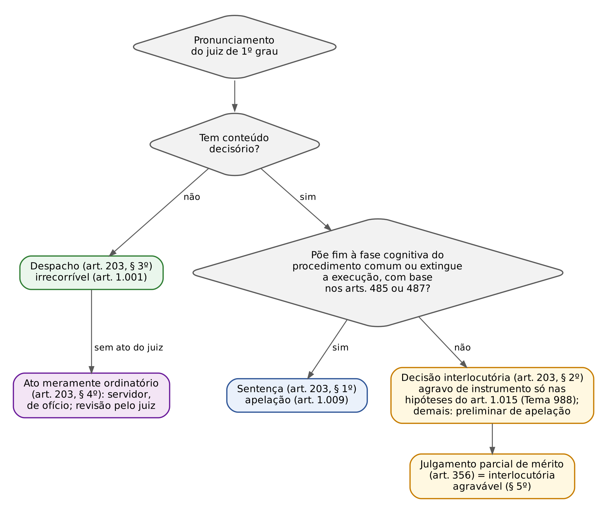
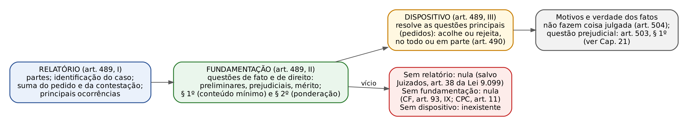
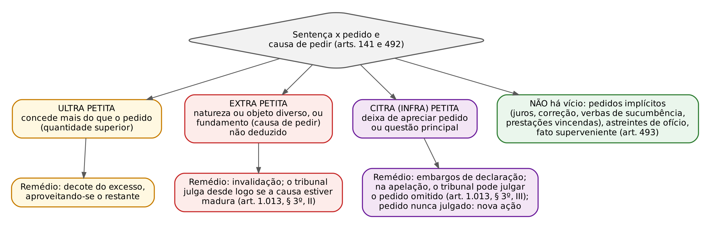
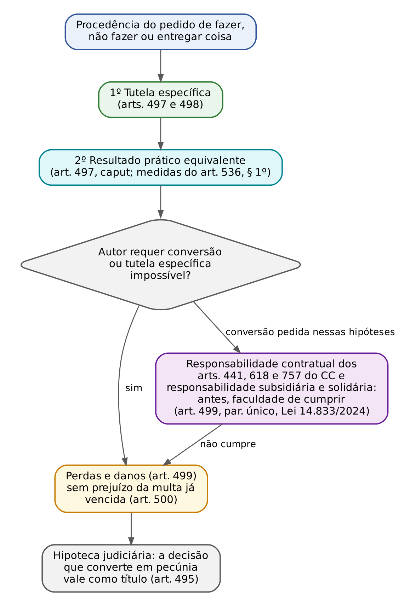
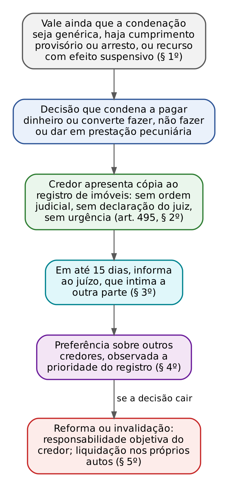
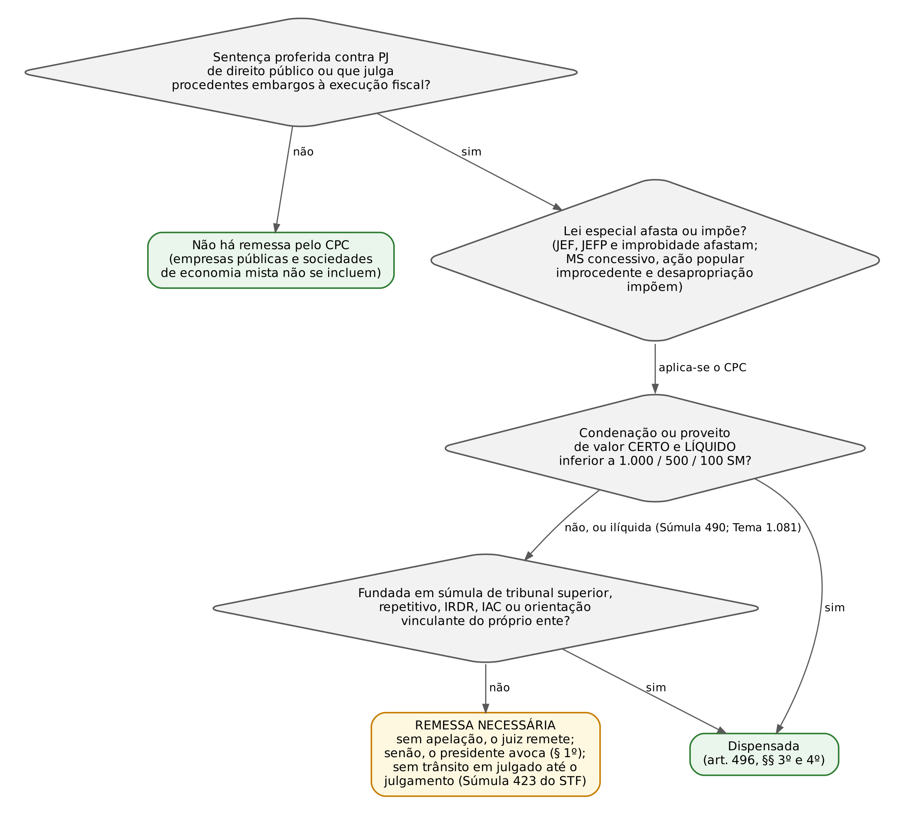

# CAPÍTULO 20 — PRONUNCIAMENTOS JUDICIAIS E SENTENÇA: FUNDAMENTAÇÃO, CONGRUÊNCIA, EFEITOS E REMESSA NECESSÁRIA

:::INCIDENCIA
Pontos: TRF5 p. 9; TJRS p. 10; TJSC p. 10 e 17 (LINDB). Nível A+. Lote: 26 questões (FGV 24; FCC 2), mais 15 correlatas de outros lotes.
O que mais cai: remessa necessária (faixas de 1.000/500/100 salários mínimos, dispensa por precedente, Súmulas 45 e 490 do STJ), classificação dos pronunciamentos em casos práticos (julgamento parcial = interlocutória), vícios de congruência (*citra*, *ultra*, *extra petita*), erro material e art. 494, fato superveniente (art. 493) e fundamentação *per relationem* (Tema 1.306 do STJ).
:::

#### Mapa de cobrança

| Subtema | FGV | FCC | Padrão |
|---|---|---|---|
| Remessa necessária | 9 | 1 | Caso com valor em salários mínimos e ente (União, Estado, capital, Município); dispensa por precedente; *reformatio in pejus*; sentença ilíquida |
| Classificação dos pronunciamentos | 7 | 0 | Sequência de atos (I a IV) para classificar; julgamento parcial; gratuidade; despacho do relator; literalidade do art. 203 |
| Congruência e vícios da sentença | 5 | 0 | Caso de pedido não apreciado (*citra*), causa de pedir diversa (*extra*), valor acima do pedido; pedidos implícitos |
| Publicação e alteração da sentença (art. 494) | 2 | 1 | Erro material corrigível de ofício, a qualquer tempo, inclusive pelo tribunal |
| Fundamentação (*per relationem*) | 1 | 0 | Adoção do parecer do MP como razão de decidir |

A distribuição confirma que a FGV cobra o capítulo em CASOS: o candidato recebe uma narrativa e precisa identificar o pronunciamento, o vício ou a incidência da remessa. Nas provas de juiz (TRF3, TJSE, TJMT, TJSC, ENAM), o foco recai sobre remessa necessária e congruência; nas de servidor e de procuradorias, sobre a literalidade dos arts. 203, 494 e 496.

## 20.1 Pronunciamentos do juiz e dos tribunais

### 20.1.1 O critério do art. 203: conteúdo somado à função

O CPC/1973, na redação original, definia sentença pela FUNÇÃO (ato que põe termo ao processo); a Lei 11.232/2005 passou a defini-la pelo CONTEÚDO (ato que implica alguma das situações dos arts. 267 e 269), o que gerou o problema das "sentenças parciais". O CPC/2015 combinou os dois critérios: sentença é o pronunciamento que, com fundamento nos arts. 485 ou 487 (conteúdo), põe fim à fase cognitiva do procedimento comum ou extingue a execução (função). Falta qualquer dos dois elementos, o ato é decisão interlocutória.

:::LEI CPC, ARTS. 203 E 204
Art. 203. Os pronunciamentos do juiz consistirão em sentenças, decisões interlocutórias e despachos.
§ 1º Ressalvadas as disposições expressas dos procedimentos especiais, sentença é o pronunciamento por meio do qual o juiz, com fundamento nos arts. 485 e 487, põe fim à fase cognitiva do procedimento comum, bem como extingue a execução.
§ 2º Decisão interlocutória é todo pronunciamento judicial de natureza decisória que não se enquadre no § 1º.
§ 3º São despachos todos os demais pronunciamentos do juiz praticados no processo, de ofício ou a requerimento da parte.
§ 4º Os atos meramente ordinatórios, como a juntada e a vista obrigatória, independem de despacho, devendo ser praticados de ofício pelo servidor e revistos pelo juiz quando necessário.
Art. 204. Acórdão é o julgamento colegiado proferido pelos tribunais.
:::

Quatro chaves de leitura resolvem quase todas as questões:

- A decisão interlocutória é conceito RESIDUAL e definido pelo conteúdo decisório: tudo o que decide e não é sentença é interlocutória (§ 2º). Não importa a relevância da matéria: a decisão que julga parcialmente o mérito (art. 356), que rejeita a prescrição ou que exclui um litisconsorte é interlocutória, porque não encerra a fase cognitiva.
- O despacho também é residual, mas em relação aos atos sem conteúdo decisório (§ 3º). Despacho é irrecorrível (art. 1.001). Se o ato rotulado como "despacho" causa gravame (por exemplo, determina a penhora de bem que a parte afirma impenhorável), é materialmente decisão e o rótulo não impede o recurso.
- O ato ordinatório (juntada, vista obrigatória, intimação para réplica, remessa ao contador) é praticado pelo servidor sem despacho, com revisão pelo juiz "quando necessário" (§ 4º; também art. 152, VI, e § 1º, que autoriza o juiz a editar ato regulamentando a prática desses atos).
- A ressalva "das disposições expressas dos procedimentos especiais" permite que o legislador chame de sentença atos que não encerram o procedimento ou que dê outro nome a atos terminativos (por exemplo, a ação de exigir contas, cuja primeira fase termina por "decisão" quando procedente o pedido, art. 550, § 5º; a fase subsequente termina por sentença).

Duas consequências práticas sustentam a classificação: o recurso cabível (apelação contra sentença, art. 1.009; agravo de instrumento contra as interlocutórias do rol do art. 1.015, com a taxatividade mitigada do Tema 988 do STJ, ver Cap. 42; nada contra despacho) e a publicação no Diário de Justiça Eletrônico, que alcança despachos, interlocutórias, o DISPOSITIVO das sentenças e a EMENTA dos acórdãos (art. 205, § 3º).

:::QUESTAO FGV 2026 — DIREITO PROCESSUAL CIVIL (Q4279873)
Ação contra o Estado com dois pedidos cumulados. Atos: (I) rejeição da prescrição e determinação de perícia; (II) acolhimento de um dos pedidos, por estar em condições de imediato julgamento, com prosseguimento quanto ao outro; (III) mera intimação do perito para iniciar os trabalhos; (IV) rejeição do pedido remanescente, encerrando a fase cognitiva. Gabarito: B (I e II interlocutórias; III despacho; IV sentença).
Passos: (1) o ato tem conteúdo decisório? I, II e IV sim; III não (despacho). (2) Encerra a fase cognitiva? Só IV. (3) Logo, I e II são interlocutórias, ainda que II resolva mérito (art. 356, § 5º: agravável). Armadilha: chamar de "sentença" o julgamento antecipado PARCIAL (alternativas A e E) ou chamar de despacho a rejeição da prescrição, que é decisão de mérito (art. 487, II) e agravável (art. 1.015, II).
:::

:::QUESTAO FGV 2025 — TJ-SC — JUIZ LEIGO (Q3592859)
Réu citado em causa exclusivamente de direito apresentou apenas reconvenção; o juiz julgou improcedente o pedido do autor e determinou especificação de provas sobre a reconvenção. Gabarito: C, decisão interlocutória. A ação e a reconvenção são processadas em conjunto; resolvido o pedido do autor sem encerrar a fase cognitiva (que prossegue na reconvenção), há julgamento antecipado parcial (art. 356, I e II), impugnável por agravo (art. 356, § 5º). Armadilha: "sentença definitiva", pelo conteúdo do art. 487, I, esquecendo o critério funcional.
:::

:::QUESTAO FGV 2025 — CGE-SP — AUDITOR (Q3781263)
Natureza do pronunciamento que nega a gratuidade de justiça. Gabarito: D, decisão interlocutória (conteúdo decisório, sem encerrar a fase), agravável (art. 1.015, V, e art. 101). Se a negativa vier na sentença, o capítulo é impugnado na apelação (art. 101, parte final). No mesmo sentido sobre literalidade do art. 203: Q2524471 (FGV 2024, TCE-GO; gabarito B, "São despachos todos os demais pronunciamentos do juiz praticados no processo, de ofício ou a requerimento da parte"; erradas: interlocutória praticada pelo servidor, acórdão como julgamento monocrático, assinatura física obrigatória — o art. 205, § 2º, admite assinatura eletrônica — e extinção da execução por interlocutória).
:::

:::QUESTAO FGV 2024 — PREFEITURA DE VITÓRIA — AUDITOR (Q3052484)
Três afirmações: interlocutórias são todos os pronunciamentos decisórios que não são sentenças; sentenças são os que põem fim à fase de conhecimento e extinguem a execução; atos meramente ordinatórios independem de despacho. Gabarito: A, todas certas (art. 203, §§ 1º, 2º e 4º). Lição: a FGV aceita a paráfrase simplificada do § 1º, sem a menção aos arts. 485 e 487 e à ressalva dos procedimentos especiais.
:::

:::QUESTAO FGV 2024 — ENAM 2024.2 (Q3058647)
Associar natureza a quatro atos: ato que põe fim à segunda fase da ação de exigir contas; ato que dá vista obrigatória; ato que julga embargos de declaração contra a concessão de tutela de urgência; homologação de indicação de depositário na penhora de empresa. Gabarito oficial: A (sentença; ato ordinatório; interlocutória; despacho). Os três primeiros são seguros: a segunda fase da exigir contas encerra o procedimento (art. 552); vista obrigatória é exemplo literal do art. 203, § 4º; a decisão de embargos contra interlocutória tem a natureza da decisão embargada. O quarto é discutível: a nomeação ou homologação do depositário-administrador na penhora de empresa (art. 862) tem conteúdo decisório e, em rigor, seria interlocutória; a banca a tratou como despacho, por exclusão. Na prova, siga o raciocínio da banca quando as demais associações forem inequívocas (ver nota de verificação).
:::

### 20.1.2 Situações-limite cobradas

| Situação | Natureza | Recurso | Fundamento |
|---|---|---|---|
| Julgamento antecipado parcial do mérito | Interlocutória | Agravo de instrumento | Arts. 356, § 5º, e 1.015, II |
| Exclusão de litisconsorte | Interlocutória | Agravo de instrumento | Art. 1.015, VII |
| Indeferimento parcial da inicial (um dos pedidos) | Interlocutória | Agravo de instrumento (Tema 988 ou art. 354, parágrafo único, por analogia) | Arts. 354, parágrafo único, e 1.015 |
| Acolhimento parcial de impugnação ou de exceção de pré-executividade que não extingue a execução | Interlocutória | Agravo de instrumento | Art. 1.015, parágrafo único |
| Acolhimento que extingue integralmente a execução ou o cumprimento | Sentença | Apelação | Arts. 203, § 1º, e 925 |
| Decisão do relator nos tribunais | Decisão monocrática (não é acórdão) | Agravo interno | Arts. 932 e 1.021 |
| Despacho do relator que abre vista sobre documento novo | Despacho | Irrecorrível | Art. 1.001 |
| Decisão que julga a liquidação | Interlocutória | Agravo de instrumento | Art. 1.015, parágrafo único; Enunciado 145 da II Jornada de Direito Processual Civil do CJF |

A Sinopse do TJSC (Drive) registra caso de Santa Catarina em que o STJ assentou que o acolhimento parcial de exceção de pré-executividade, para reconhecer a prescrição de parte do débito com prosseguimento quanto ao restante, não é sentença, cabendo agravo de instrumento (STJ, REsp n. 1.812.216, Relator Ministro Herman Benjamin, Segunda Turma, j. 25/6/2019).

:::QUESTAO FGV 2024 — TJ-AP — ANALISTA JUDICIÁRIO (Q2442317)
Relator, antes de pautar a apelação, verificou documentos novos juntados pelo apelante e determinou a intimação do apelado para se manifestar em quinze dias. Gabarito: A, irrecorrível. O ato concretiza o contraditório sobre documento novo (arts. 437, § 1º, e 10), sem conteúdo decisório: é despacho (art. 1.001). Armadilha: supor que todo ato do relator desafia agravo interno (art. 1.021 pressupõe DECISÃO).
:::

### 20.1.3 Acórdão, voto vencido e publicação

Acórdão é o julgamento COLEGIADO (art. 204); a decisão do relator, ainda que resolva o recurso (art. 932, III a V), é decisão monocrática, impugnável por agravo interno. Todo acórdão conterá ementa (art. 943, § 1º), e o voto vencido será necessariamente declarado e considerado parte integrante do acórdão para todos os fins legais, inclusive de prequestionamento (art. 941, § 3º) — gabarito da Q2386964 (FGV 2024, TJ-SC, Juiz Substituto, lote do Cap. 38). Na mesma linha, o Enunciado 186 da III Jornada de Direito Processual Civil do CJF: no julgamento não unânime, o acórdão só pode ser publicado com a integralidade dos votos, vencedor e vencido, sob pena de nova publicação. Se o acórdão não for publicado em 30 dias da sessão, as notas taquigráficas o substituem (art. 944). O detalhamento da ordem dos processos nos tribunais está no Cap. 38.

## 20.2 Sentença: elementos, requisitos e classificação

### 20.2.1 Elementos essenciais (art. 489, caput)

:::LEI CPC, ART. 489, CAPUT
Art. 489. São elementos essenciais da sentença:
I - o relatório, que conterá os nomes das partes, a identificação do caso, com a suma do pedido e da contestação, e o registro das principais ocorrências havidas no andamento do processo;
II - os fundamentos, em que o juiz analisará as questões de fato e de direito;
III - o dispositivo, em que o juiz resolverá as questões principais que as partes lhe submeterem.
:::

Consequências da ausência de cada elemento:

- Relatório: sua falta gera nulidade, dependente de prejuízo (instrumentalidade das formas, art. 277). Nos Juizados Especiais o relatório é dispensado (Lei 9.099/1995, art. 38), regra estendida ao JEF e ao JEFP pela aplicação subsidiária (ver Caps. 36 e 37).
- Fundamentação: ausência ou deficiência gera NULIDADE de matriz constitucional (CF, art. 93, IX; CPC, art. 11). Na apelação, o tribunal, se a causa estiver madura, decreta a nulidade e julga desde logo o mérito (art. 1.013, § 3º, IV). Ver 20.3.
- Dispositivo: sem ele não há decisão; a doutrina majoritária fala em sentença INEXISTENTE (não há comando a transitar em julgado), o que permite reconhecer o vício a qualquer tempo, inclusive por ação declaratória (ver Cap. 13 sobre *querela nullitatis*).

Questões principais x questões incidentais. O dispositivo resolve as questões principais (os pedidos); as questões resolvidas na fundamentação (preliminares, prejudiciais, pontos de fato) são incidentais e, em regra, não ficam acobertadas pela coisa julgada (art. 504). A exceção é a questão prejudicial decidida expressa e incidentemente, com contraditório prévio e efetivo, por juízo competente e sem restrição probatória (art. 503, §§ 1º e 2º), desenvolvida no Cap. 21. Por isso o art. 504 diz que não fazem coisa julgada os motivos, "ainda que importantes para determinar o alcance da parte dispositiva", nem a verdade dos fatos estabelecida como fundamento (alternativa E da Q3179546, errada).

### 20.2.2 Outros requisitos: certeza, liquidez, clareza e congruência

- Certeza (art. 492, parágrafo único): "A decisão deve ser certa, AINDA QUE resolva relação jurídica condicional." A sentença não pode ser condicional (condenar "se ficar provado..."), mas pode decidir relação jurídica condicional, declarando o direito sujeito à condição material. A FGV trocou "ainda que" por "salvo se" na alternativa B da Q3179546 (errada).
- Liquidez (art. 491): na ação relativa a obrigação de pagar quantia, AINDA QUE formulado pedido genérico, a decisão definirá desde logo a extensão da obrigação, o índice de correção monetária, a taxa de juros, o termo inicial de ambos e a periodicidade da capitalização, salvo quando não for possível determinar de modo definitivo o montante ou a apuração depender de prova de realização demorada ou excessivamente dispendiosa, assim reconhecida na sentença; nesses casos, segue-se a liquidação (§ 1º). A regra aplica-se ao acórdão que altera a sentença (§ 2º). A liquidação em si está no Cap. 22. Súmula 318 do STJ: "Formulado pedido certo e determinado, somente o autor tem interesse recursal em argüir o vício da sentença ilíquida."
- Clareza e precisão: decorrem do dever de fundamentação e do direito à compreensão da decisão (20.12); sentença obscura ou contraditória desafia embargos de declaração (art. 1.022, I).
- Congruência: limites do pedido e da causa de pedir (arts. 141 e 492), ver 20.6.

### 20.2.3 Primazia do mérito na sentença

"Desde que possível, o juiz resolverá o mérito sempre que a decisão for favorável à parte a quem aproveitaria eventual pronunciamento nos termos do art. 485" (art. 488). Exemplo: ilegitimidade passiva duvidosa, mas prova de pagamento inequívoca: o juiz julga improcedente (mérito) em vez de extinguir sem resolução, beneficiando o réu com a coisa julgada material. Antes de extinguir sem mérito, o juiz deve oportunizar a correção do vício (arts. 317 e 139, IX). A primazia do mérito como norma fundamental está no Cap. 1.

### 20.2.4 Classificações cobradas

| Critério | Espécies | Observações |
|---|---|---|
| Resolução do mérito | Terminativa (art. 485) x definitiva (art. 487) | Terminativa faz só coisa julgada formal, mas impede a repropositura sem correção do vício (art. 486, § 1º); nas hipóteses dos incisos I, IV, VI e VII do art. 485, nova ação depende da correção |
| Carga eficacial (classificação quinária, Pontes de Miranda) | Declaratória, constitutiva, condenatória, mandamental e executiva *lato sensu* | As duas últimas dispensam processo de execução autônomo: ordem ao réu (mandamental) ou atos de sub-rogação na própria fase (executiva). A sentença de fazer, não fazer e entregar coisa é mandamental ou executiva conforme a técnica (20.9) |
| Resultado | Procedência, improcedência, procedência parcial | A improcedência é sentença declaratória negativa |
| Necessidade de atividade posterior | Autossuficientes x não autossuficientes | Ver Cap. 21 (as primeiras satisfazem por si, como a declaratória e a constitutiva; as segundas dependem de cumprimento) |
| Extensão | Total x parcial (capítulos) | Cada pedido é um capítulo; a sentença pode ter capítulos de mérito e processuais, autônomos para recurso, coisa julgada e rescisória (art. 966, § 3º) |

Atenção à sentença declaratória com força executiva: "a sentença que reconheça a exigibilidade de obrigação de pagar quantia, de fazer, de não fazer ou de entregar coisa" é título executivo judicial (art. 515, I). Basta o reconhecimento da exigibilidade com todos os elementos da obrigação; não se exige a palavra "condeno" (ver Cap. 22).

:::SENTENCA ESTRUTURA DA SENTENÇA CÍVEL NA PROVA PRÁTICA (MODELO ENXUTO)
Cabeçalho: autos n., classe, autor, réu. "Vistos etc."
I — RELATÓRIO. Fulano ajuizou ação de [classe] contra Beltrano, alegando [causa de pedir em 3 a 5 linhas] e pedindo [pedidos numerados, inclusive tutela provisória]. Deferida/indeferida a tutela (evento). Citado, o réu contestou, arguindo [preliminares] e, no mérito, [teses]. Réplica. Saneamento: fixados os pontos controvertidos [x] e distribuído o ônus da prova [art. 373]. Produzidas as provas [y]. Alegações finais. É o relatório. Decido.
II — FUNDAMENTAÇÃO. 1. Questões processuais pendentes (preliminares, na ordem lógica do art. 337). 2. Prejudiciais de mérito (prescrição e decadência, art. 487, II). 3. Mérito: para cada pedido, premissa normativa (lei e precedente vinculante aplicável, com identificação dos fundamentos determinantes — art. 489, § 1º, V), premissa fática (valoração das provas, com indicação das razões do convencimento — art. 371), subsunção, enfrentamento dos argumentos capazes de infirmar a conclusão (art. 489, § 1º, IV) e, quando decidir com base em valores abstratos, consequências práticas (LINDB, art. 20). 4. Tutela provisória na sentença (confirmação, concessão ou revogação; efeito da apelação — art. 1.012, § 1º, V).
III — DISPOSITIVO. "Ante o exposto, com fundamento no art. 487, I, do CPC, JULGO PROCEDENTE EM PARTE o pedido para: a) declarar...; b) condenar o réu a pagar ao autor [valor em algarismos e por extenso], corrigido pelo [índice] desde [termo] e acrescido de juros de [taxa] desde [termo] (art. 491); c) condenar o réu a [obrigação de fazer], no prazo de [x] dias, sob pena de multa diária de [valor], limitada a [teto] (arts. 497 e 537). Rejeito o pedido [z]. Confirmo a tutela de urgência. Sucumbência recíproca: custas na proporção de [x]; honorários de [y]% do valor da condenação ao advogado do autor e de [z]% do proveito econômico ao advogado do réu, vedada a compensação (art. 85, §§ 2º e 14). [Remessa necessária: sentença sujeita / não sujeita — art. 496, § 3º, ou § 4º]. Publique-se. Registre-se. Intimem-se."
Dica de prova: o dispositivo resolve TODOS os pedidos, um a um (evita *citra petita*), e não contém "julgo procedente nos termos da fundamentação" sem explicitar o comando.
:::

## 20.3 Fundamentação analítica (art. 489, §§ 1º e 2º)

### 20.3.1 Matriz constitucional e função

"Todos os julgamentos dos órgãos do Poder Judiciário serão públicos, e fundamentadas todas as decisões, sob pena de nulidade" (CF, art. 93, IX; CPC, art. 11). A fundamentação tem dupla função: endoprocessual (permite às partes conhecer as razões, recorrer e ao tribunal controlar) e extraprocessual (legitima democraticamente o exercício do poder jurisdicional perante a sociedade e viabiliza o controle difuso e a formação de precedentes, cuja *ratio decidendi* se extrai justamente da fundamentação). O STF fixou, no Tema 339 da repercussão geral (Relator Ministro Gilmar Mendes, j. 23/6/2010), que o art. 93, IX, exige decisão fundamentada, AINDA QUE SUCINTAMENTE, sem determinar o exame pormenorizado de cada alegação ou prova. O CPC/2015 densificou esse padrão mínimo no art. 489, § 1º, que vale para QUALQUER decisão: interlocutória, sentença ou acórdão.

:::LEI CPC, ART. 489, §§ 1º A 3º
§ 1º Não se considera fundamentada qualquer decisão judicial, seja ela interlocutória, sentença ou acórdão, que:
I - se limitar à indicação, à reprodução ou à paráfrase de ato normativo, sem explicar sua relação com a causa ou a questão decidida;
II - empregar conceitos jurídicos indeterminados, sem explicar o motivo concreto de sua incidência no caso;
III - invocar motivos que se prestariam a justificar qualquer outra decisão;
IV - não enfrentar todos os argumentos deduzidos no processo capazes de, em tese, infirmar a conclusão adotada pelo julgador;
V - se limitar a invocar precedente ou enunciado de súmula, sem identificar seus fundamentos determinantes nem demonstrar que o caso sob julgamento se ajusta àqueles fundamentos;
VI - deixar de seguir enunciado de súmula, jurisprudência ou precedente invocado pela parte, sem demonstrar a existência de distinção no caso em julgamento ou a superação do entendimento.
§ 2º No caso de colisão entre normas, o juiz deve justificar o objeto e os critérios gerais da ponderação efetuada, enunciando as razões que autorizam a interferência na norma afastada e as premissas fáticas que fundamentam a conclusão.
§ 3º A decisão judicial deve ser interpretada a partir da conjugação de todos os seus elementos e em conformidade com o princípio da boa-fé.
:::

### 20.3.2 Leitura de cada inciso

| Inciso | Vício | Como se evita | Exemplo de decisão nula |
|---|---|---|---|
| I | Fundamentação "legalista" de mera transcrição | Ligar o texto ao fato: por que o dispositivo incide | "Defiro, nos termos do art. 300 do CPC." |
| II | Conceito jurídico indeterminado sem concretização | Explicar o motivo concreto (qual é a "boa-fé", a "função social", o "perigo de dano" neste caso) | "Presente o perigo de dano, defiro." |
| III | Fundamentação genérica, "de formulário" | Individualizar com dados dos autos | "Ausentes os requisitos legais, indefiro." |
| IV | Omissão sobre argumento relevante | Enfrentar todo argumento CAPAZ, EM TESE, de infirmar a conclusão | Sentença que ignora a alegação de pagamento comprovado por recibo |
| V | Aplicação mecânica de precedente ou súmula | Identificar a *ratio decidendi* e demonstrar a aderência do caso | "Aplica-se a Súmula X." sem cotejo |
| VI | Afastamento imotivado de precedente invocado | Demonstrar distinção (*distinguishing*) ou superação (*overruling*) | Ignorar tese repetitiva citada pela parte |

O inciso IV é o mais disputado. Prevalece no STJ que o julgador não está obrigado a responder a todas as questões suscitadas pelas partes quando já encontrou motivo suficiente para decidir; o dever do inciso IV restringe-se aos argumentos que, em tese, poderiam levar a resultado diferente (STJ, EDcl no MS n. 21.315, Relatora Desembargadora convocada Diva Malerbi, Primeira Seção, j. 8/6/2016, Informativo 585). A conclusão é lógica: se o juiz acolhe a prescrição, não precisa enfrentar as teses de mérito do réu, porque nenhuma delas pode infirmar a conclusão; mas, se rejeita a prescrição, deve enfrentar todas as teses do réu que, acolhidas, conduziriam à improcedência. Em termos de técnica: o vencedor não tem do que se queixar; o vencido tem direito a resposta para cada argumento seu capaz de alterar o resultado.

:::DICA FUNDAMENTAÇÃO SUCINTA NÃO É AUSÊNCIA DE FUNDAMENTAÇÃO
Fundamentação concisa, que enfrenta as questões relevantes, é válida (Tema 339 do STF). O § 1º não exige extensão, exige PERTINÊNCIA: o vício é a decisão que serviria para qualquer processo. Na prova discursiva, troque parágrafos doutrinários genéricos por uma frase ligando fato, prova e norma.
:::

Incisos V e VI e o sistema de precedentes. Os incisos V e VI conectam a fundamentação ao art. 927 (ver Cap. 39): quem aplica precedente deve demonstrar que os fundamentos determinantes se ajustam ao caso; quem deixa de aplicar precedente INVOCADO PELA PARTE deve demonstrar distinção ou superação. O inciso VI menciona "enunciado de súmula, jurisprudência ou precedente", o que levou parte da doutrina a sustentar que o dever de distinguir recai sobre qualquer precedente invocado, vinculante ou persuasivo; a leitura mais aceita é que, para os persuasivos, basta explicar por que não são seguidos, ao passo que a superação de precedente obrigatório é privativa do tribunal que o firmou. A superação deve ser motivada com critérios explícitos: o Enunciado 205 da III Jornada de Direito Processual Civil do CJF exige que a fundamentação da superação de tese repetitiva aponte expressamente incongruência social ou inconsistência sistêmica.

§ 2º e ponderação. O § 2º positiva a técnica da ponderação para colisão de NORMAS (a redação final falou em normas, não só em princípios, o que foi criticado por parte da doutrina, para a qual regras não se ponderam). A exigência é de transparência: indicar o objeto da ponderação, os critérios (adequação, necessidade e proporcionalidade em sentido estrito), as razões da interferência na norma afastada e as premissas fáticas. Não autoriza afastar regra legal válida por preferência valorativa do juiz.

Sanções processuais do vício. A decisão que incorre em qualquer dos incisos do § 1º é considerada OMISSA para fins de embargos de declaração (art. 1.022, parágrafo único, II), assim como a que deixa de se manifestar sobre tese firmada em casos repetitivos ou em IAC aplicável (inciso I). Na apelação, a nulidade por falta de fundamentação não implica necessariamente retorno dos autos: estando a causa madura, o tribunal decide o mérito (art. 1.013, § 3º, IV). No recurso especial, a violação do art. 489, § 1º, exige a prévia oposição de embargos (prequestionamento, art. 1.025) e a demonstração da relevância da omissão (detalhes no Cap. 43).

### 20.3.3 Fundamentação *per relationem* (Tema 1.306 do STJ)

Fundamentação *per relationem* (por referência, por remissão ou *aliunde*) é aquela que adota, como razão de decidir, fundamentos de outro ato: parecer do Ministério Público, sentença recorrida, decisão anterior, petição de uma das partes. Discutiu-se se o art. 489, § 1º, a teria proibido. O STJ e o STF continuaram a admiti-la, e o STJ fixou tese vinculante.

:::JURIS STJ, TEMA 1.306 (CORTE ESPECIAL; RESPS 2.148.059, 2.148.580 E 2.150.218; INFORMATIVO 859)
1. A técnica da fundamentação por referência (*per relationem*) é permitida desde que o julgador, ao reproduzir trechos de decisão anterior (documentos e/ou pareceres) como razões de decidir, enfrente, ainda que de forma sucinta, as novas questões relevantes para o julgamento do processo, dispensada a análise pormenorizada de cada uma das alegações ou provas. 2. O § 3º do art. 1.021 do CPC não impede a reprodução dos fundamentos da decisão agravada como razões de decidir pela negativa de provimento de agravo interno quando a parte deixa de apresentar argumento novo para ser apreciado pelo colegiado.
:::

A chave é a NOVIDADE: a remissão basta quando nada de novo e relevante foi trazido; se a parte apresentou argumento novo e relevante (por exemplo, nas razões de apelação, fatos que a sentença não examinou), a mera transcrição da sentença é insuficiente. O art. 1.021, § 3º, veda ao relator "limitar-se à reprodução dos fundamentos da decisão agravada para julgar improcedente o agravo interno"; o Tema 1.306 compatibiliza o dispositivo com a técnica, quando o agravo não traz argumento novo.

:::QUESTAO FGV 2025 — SEFAZ-PR — AUDITOR FISCAL (Q3363379)
Tribunal deu provimento à apelação contra apelado absolutamente incapaz adotando, como razões de decidir, o parecer do MP interveniente; o apelado alegou falta de fundamentação idônea. Gabarito: B, não há vício, pois se trata de técnica de remissão que evita repetição inútil. Armadilhas: restringir a técnica ao processo administrativo, a decisões sem resolução de mérito ou a decisões favoráveis ao incapaz.
:::

:::QUESTAO FGV 2025 — TJ-MS — JUIZ SUBSTITUTO (Q3786354, LOTE DO CAP. 42)
Relator desproveu monocraticamente a apelação discorrendo genericamente sobre a fundamentação por referência e transcrevendo a sentença, sem rebater os elementos indicativos de fraude trazidos pelo apelante; o agravo interno e os embargos repetiram a mesma fundamentação. Gabarito: A, houve negativa de prestação jurisdicional, porque a técnica só é válida se o julgador enfrentar, ainda que sucintamente, as NOVAS questões relevantes. Armadilha: a alternativa E reproduz a tese do Tema 1.306, mas conclui pela validade no caso; a alternativa B usa a parte 2 da tese (agravo interno sem argumento novo), que não se aplica porque havia argumento novo. Lição: a FGV cobra a APLICAÇÃO da tese, não só sua literalidade.
:::

## 20.4 Racionalidade, interpretação e argumentação na sentença

### 20.4.1 Justificação interna e externa

A sentença é ato de poder que se legitima pela racionalidade da justificação. A teoria da argumentação jurídica (Neil MacCormick, Robert Alexy, Jerzy Wróblewski), adotada por Marinoni, Arenhart e Mitidiero no Curso (vol. 2, Drive), distingue:

- Justificação interna: o teste LÓGICO; a conclusão decorre das premissas (norma e fato) por inferência válida. Vício típico: contradição entre fundamentação e dispositivo, ou entre premissas (embargos de declaração por contradição, art. 1.022, I).
- Justificação externa: a justificação das PRÓPRIAS PREMISSAS: por que esta interpretação do texto (premissa normativa) e por que estes fatos estão provados (premissa fática). Para Marinoni, Arenhart e Mitidiero, o juiz deve justificar as decisões observando a lógica (justificação interna) e a argumentação apoiada na Constituição e na legislação, tal como interpretadas pelo STF e pelo STJ em seus precedentes (justificação externa), observando normas de preferência argumentativa para estruturar as escolhas interpretativas.

O art. 489, § 1º, é essencialmente um catálogo de falhas de justificação externa: transcrever a lei sem explicar a escolha interpretativa (I), usar conceitos indeterminados sem concretizá-los (II), justificar genericamente (III), ignorar contra-argumentos (IV), usar precedente sem cotejo (V e VI).

Interpretação e argumentação: elementos cobráveis.

- Cânones clássicos (literal, sistemático, histórico, teleológico) combinados com o art. 8º do CPC: o juiz atenderá aos fins sociais e às exigências do bem comum, resguardando a dignidade da pessoa humana e observando a proporcionalidade, a razoabilidade, a legalidade, a publicidade e a eficiência.
- Coerência e integridade (art. 926): os tribunais devem uniformizar a jurisprudência e mantê-la estável, íntegra e coerente; a sentença que aplica precedentes participa desse dever (Cap. 39).
- Vedação do *non liquet* (art. 140): o juiz não se exime de decidir alegando lacuna ou obscuridade; julga por equidade só nos casos previstos em lei (parágrafo único).
- Contraditório como condição da argumentação válida (arts. 9º e 10): o juiz não pode decidir com base em fundamento sobre o qual as partes não puderam se manifestar, ainda que a matéria seja conhecível de ofício. O *iura novit curia* sobrevive (o juiz pode requalificar juridicamente os fatos), mas a requalificação que surpreende exige oitiva prévia.
- Prova e convencimento (art. 371): o juiz aprecia a prova "independentemente do sujeito que a tiver promovido, e indicará na decisão as razões da formação de seu convencimento"; a supressão do adjetivo "livre" do CPC/1973 reforça o dever de justificar racionalmente a valoração (standards probatórios, Cap. 18).

:::DOUTRINA DISCRICIONARIEDADE JUDICIAL E DECISÃO CORRETA
O debate entre a tese de que, nos casos difíceis, o juiz exerce discricionariedade (Hart) e a de que há uma resposta correta construída pela integridade (Dworkin) é o pano de fundo da redação do art. 926 e da supressão do "livre convencimento". Lenio Streck, crítico do solipsismo judicial, defendeu essa supressão durante a tramitação do projeto. Em prova objetiva, a ideia cobrável é que o CPC/2015 trocou a liberdade de convencimento pelo dever de justificação controlável.
:::

### 20.4.2 Interpretação da decisão judicial (art. 489, § 3º)

"A decisão judicial deve ser interpretada a partir da conjugação de todos os seus elementos e em conformidade com o princípio da boa-fé" (art. 489, § 3º), regra simétrica à da interpretação do pedido (art. 322, § 2º). Consequências:

- O dispositivo é lido à luz da fundamentação: se o dispositivo diz "julgo procedente o pedido" e a fundamentação deixa claro que só um dos pedidos foi acolhido, prevalece o sentido extraído do conjunto; a contradição evidente também se resolve por embargos.
- Na fase de cumprimento, a interpretação do título não pode ampliá-lo nem restringi-lo; mas parcelas implícitas no próprio título (correção monetária, juros) podem ser incluídas. A correção monetária é matéria de ordem pública que integra o pedido de forma implícita, e sua inclusão de ofício não caracteriza julgamento *extra* ou *ultra petita* (STJ, Tema 235). Na mesma linha, a Súmula 254 do STF: "Incluem-se os juros moratórios na liquidação, embora omisso o pedido inicial ou a condenação."
- A boa-fé veda leituras oportunistas do título: o credor não pode extrair do dispositivo isolado comando que a fundamentação claramente excluiu, nem o devedor invocar ambiguidade literal para frustrar o resultado que o conjunto da decisão evidencia. Questões sobre o alcance subjetivo do título coletivo (por exemplo, a sentença coletiva que não alcança sucessores de servidor falecido antes da propositura da ação, salvo previsão expressa — Tema 1.309 do STJ) são problemas de interpretação do título e de limites subjetivos da coisa julgada, tratados nos Caps. 21 e 34.

## 20.5 Consequências da decisão: a LINDB na sentença (arts. 20 a 30)

A Lei 13.655/2018 acrescentou à LINDB normas de segurança jurídica e eficiência na criação e aplicação do DIREITO PÚBLICO. Vários dispositivos se dirigem expressamente à esfera JUDICIAL (arts. 20, 21, 23, 24 e 27). O exame completo (origem, Decreto 9.830/2019, compromisso do art. 26, responsabilidade do agente no art. 28 e a ADI 6.421) está na Apostila de Direito Administrativo, Cap. 2 (seção 02.11). Aqui, apenas o impacto sobre a SENTENÇA.

| Dispositivo | Dever do juiz | Projeção processual |
|---|---|---|
| Art. 20, caput | Não decidir com base em valores jurídicos abstratos sem considerar as consequências práticas da decisão | Complementa o art. 489, § 1º, II (conceito indeterminado) e § 2º (ponderação) |
| Art. 20, parágrafo único | Demonstrar a necessidade e a adequação da medida imposta ou da invalidação, inclusive em face das possíveis alternativas | Motivação comparativa: por que esta medida, e não outra menos gravosa |
| Art. 21 | Na invalidação de ato, contrato, ajuste, processo ou norma administrativa, indicar expressamente as consequências jurídicas e administrativas e, quando for o caso, as condições de regularização proporcional, sem impor ônus anormais ou excessivos | Capítulo da sentença sobre efeitos da invalidação; possibilidade de restringir ou diferir efeitos |
| Art. 22 | Na interpretação de normas sobre gestão pública, considerar os obstáculos e dificuldades reais do gestor | Dirigido a quem julga a conduta do gestor (improbidade, ação popular, ACP, Tribunais de Contas) |
| Art. 23 | Interpretação NOVA sobre norma de conteúdo INDETERMINADO que imponha novo dever: prever regime de transição quando indispensável | Paralelo com a modulação do art. 927, § 3º |
| Art. 24 | Na revisão de validade de ato já completado, levar em conta as orientações gerais da época; vedado invalidar situações plenamente constituídas por mudança posterior de orientação geral | Proteção da confiança; "orientações gerais" incluem jurisprudência judicial majoritária |
| Art. 27 | PODERÁ impor compensação por benefícios indevidos ou prejuízos anormais ou injustos resultantes do processo ou da conduta dos envolvidos, com decisão motivada e oitiva prévia das partes sobre cabimento, forma e valor; admite compromisso processual para prevenir ou regular a compensação | Capítulo acessório da sentença, com contraditório específico (§ 1º) |

Observações de prova:

- O art. 20 NÃO proíbe decidir com base em princípios; proíbe decidir APENAS com base em valores abstratos, sem considerar consequências. O Decreto 9.830/2019 limita o ônus às consequências que o decisor consiga vislumbrar no exercício diligente de sua atuação (art. 3º, § 2º), afastando prognósticos impossíveis.
- O consequencialismo da LINDB foi transplantado para a sentença de improbidade (Lei 8.429/1992, art. 17-C, com a Lei 14.230/2021): o juiz deve considerar as consequências práticas sempre que decidir com base em valores jurídicos abstratos, os obstáculos e dificuldades reais do gestor e, na dosimetria, as sanções já aplicadas pelo mesmo fato. A FGV inverteu esses comandos ao perguntar o que a sentença NÃO deve considerar: gabarito, a "supremacia do interesse público sobre o particular" como critério de dosimetria (Q3593229, FGV 2025, TCE-PE, lote do Cap. 34).
- Os arts. 20 a 30 alcançam a decisão judicial que aplica DIREITO PÚBLICO (validade de atos, contratos e normas administrativas, políticas públicas, sanções). Em litígio puramente privado, os deveres equivalentes decorrem dos arts. 8º e 489 do CPC.
- Litígios estruturais: o STJ aplicou os arts. 20 a 22 da LINDB para impor à Administração obrigação de fazer considerando alternativas menos onerosas e plano dialógico (precedente desenvolvido na Apostila de Direito Administrativo, Cap. 2, e no Cap. 34 desta apostila, processo estrutural).

:::ATENCAO LINDB, ART. 5º (1942) X ARTS. 20 A 30 (2018)
"Na aplicação da lei, o juiz atenderá aos fins sociais a que ela se dirige e às exigências do bem comum" é redação ORIGINAL do art. 5º, não inovação da Lei 13.655/2018; o art. 8º do CPC a reproduz e acrescenta dignidade, proporcionalidade, razoabilidade, legalidade, publicidade e eficiência. A FCC já pediu "o que NÃO foi introduzido pela Lei 13.655/2018" com essa armadilha (ver Apostila de Direito Administrativo, Cap. 2).
:::

:::PRATIQUE EXERCÍCIO ELABORADO PARA ESTA APOSTILA (NÃO É QUESTÃO DE BANCA)
Em ação popular, o juiz anula contrato de concessão de transporte por violação genérica à "moralidade administrativa", determinando a imediata paralisação do serviço, sem examinar alternativas nem os efeitos sobre os usuários. Aponte os vícios.
Resolução: (1) art. 489, § 1º, II: conceito indeterminado (moralidade) sem motivo concreto de incidência; (2) LINDB, art. 20: decisão baseada em valor abstrato sem consideração das consequências práticas e sem demonstrar necessidade e adequação em face de alternativas (parágrafo único); (3) LINDB, art. 21: a invalidação deveria indicar expressamente as consequências jurídicas e administrativas e as condições de regularização proporcional (por exemplo, prazo para nova licitação com continuidade do serviço). Remédio: embargos de declaração (omissão, art. 1.022, parágrafo único, II) e apelação, com pedido de efeito suspensivo.
:::

## 20.6 Congruência (adstrição) e vícios da sentença

### 20.6.1 Fundamento e alcance

A congruência é a face decisória do princípio dispositivo (demanda) e da inércia (art. 2º): o juiz decide o mérito nos limites propostos pelas partes, vedado conhecer de questões não suscitadas a cujo respeito a lei exige iniciativa da parte (art. 141), e é vedado proferir decisão de natureza diversa da pedida, bem como condenar em quantidade superior ou em objeto diverso do demandado (art. 492). Protege também o contraditório: o réu se defende do que foi pedido, pelos fundamentos deduzidos.

A congruência tem três dimensões:

- Objetiva quanto ao PEDIDO: natureza da tutela (declarar, constituir, condenar) e bem da vida (objeto e quantidade).
- Objetiva quanto à CAUSA DE PEDIR: o juiz não pode acolher o pedido por fato essencial não alegado (causa de pedir diversa). A qualificação jurídica, porém, é livre (*iura novit curia*), respeitado o art. 10.
- Subjetiva: a sentença não pode beneficiar ou prejudicar quem não é parte (limites subjetivos da coisa julgada, art. 506, Cap. 21).

Também a sentença deve ser congruente com a DEFESA: a sentença que deixa de examinar exceção substancial do réu (pagamento, compensação, prescrição) é omissa.

:::LEI CPC, ARTS. 141 E 492
Art. 141. O juiz decidirá o mérito nos limites propostos pelas partes, sendo-lhe vedado conhecer de questões não suscitadas a cujo respeito a lei exige iniciativa da parte.
Art. 492. É vedado ao juiz proferir decisão de natureza diversa da pedida, bem como condenar a parte em quantidade superior ou em objeto diverso do que lhe foi demandado.
Parágrafo único. A decisão deve ser certa, ainda que resolva relação jurídica condicional.
:::

### 20.6.2 Os três vícios e seus remédios

| Vício | Conceito | Exemplo | Consequência e remédio |
|---|---|---|---|
| *Ultra petita* | Concede o que foi pedido, mas em QUANTIDADE maior | Pedidos 10.000 (dez mil) reais de danos morais, condena em 50.000 (cinquenta mil) reais | Nulidade apenas do EXCESSO: o tribunal decota (reduz aos limites do pedido), sem anular o restante |
| *Extra petita* | Concede coisa de natureza ou objeto diversos, ou acolhe por causa de pedir não deduzida | Pede anulação por vício formal e o juiz anula por coação não alegada; pede rescisão e o juiz declara nulidade | Nulidade da decisão (ou do capítulo); o tribunal, se a causa estiver madura, decreta a nulidade e julga o mérito (art. 1.013, § 3º, II) |
| *Citra* (*infra*) *petita* | Deixa de apreciar pedido (ou questão principal, inclusive pedido do réu na reconvenção) | Pede reintegração de posse e indenização; a sentença só julga a indenização | Embargos de declaração (omissão); na apelação, o tribunal pode julgar o pedido omitido se a causa estiver madura (art. 1.013, § 3º, III); se transitar em julgado sem exame, o pedido não julgado não faz coisa julgada e pode ser renovado em nova ação |

Precisões cobradas:

- O vício *citra petita* também abrange a sentença que deixa de enfrentar fundamento ou defesa relevante, mas aí o rótulo técnico é omissão de fundamentação (art. 489, § 1º, IV), e não falta de julgamento de pedido.
- O pedido julgado em quantidade MENOR que a pedida não é *citra petita*: é procedência parcial. *Citra petita* é deixar de julgar, não julgar menos.
- No dano moral, o pedido de valor certo vincula o teto (*ultra petita* se exceder); a fixação abaixo do pedido não gera sucumbência recíproca para fins de honorários segundo orientação tradicional do STJ (Súmula 326 do STJ, "Na ação de indenização por dano moral, a condenação em montante inferior ao postulado na inicial não implica sucumbência recíproca"; sobre a subsistência da súmula após o art. 292, V, do CPC, ver Cap. 8).
- O vício de congruência é *error in procedendo*; só o prejudicado tem interesse em alegá-lo. Mas o tribunal, na apelação, conhece de ofício do vício quando ele afeta o capítulo impugnado.

:::QUESTAO FGV 2025 — ENAM 2025.2 (Q3692395)
Autor pediu reintegração de posse e indenização de 50.000 (cinquenta mil) reais, sem mencionar juros e correção; a sentença acolheu a indenização com correção e juros, mas não apreciou a reintegração. Gabarito: D, *citra petita* ao não apreciar o pleito reintegratório. Passos: (1) a cumulação é simples (pedidos autônomos, ambos queridos), não alternativa nem eventual; (2) juros e correção são pedidos implícitos (art. 322, § 1º), logo não há *ultra petita* (alternativa C); (3) a omissão de pedido é *citra*, não *extra*. No mesmo sentido: Q2515579 (FGV 2024, TJ-SC, Oficial de Justiça: sentença que acolhe danos emergentes e não aprecia lucros cessantes é inválida por *citra petita*; gabarito E).
:::

:::QUESTAO FGV 2025 — TJ-ES — CARTÓRIOS (Q3520608)
Ação para anular doação por vício formal da escritura; o juiz, embora reconhecendo a inexistência de vício formal, anulou o negócio por coação de terceiro, fundamento não deduzido. Gabarito: A, sentença inválida por *extra petita*. O juiz acolheu o pedido por causa de pedir não deduzida, alterando o fato jurídico essencial (vício de consentimento x vício de forma), o que viola os arts. 141 e 492 e o contraditório. Armadilha: *ultra petita* "com poda do excesso" — não há excesso quantitativo, mas fundamento diverso.
:::

:::QUESTAO FGV 2026 — TJ-RJ — ANALISTA (Q3878291)
Autor pediu 10.000 (dez mil) reais por danos morais; o juiz condenou em 50.000 (cinquenta mil) reais, invocando o caráter punitivo. Gabarito: E, conduta incorreta em razão da inércia da jurisdição. Tecnicamente, há julgamento *ultra petita* (art. 492), cujo fundamento último é o princípio da demanda e a inércia (arts. 2º e 141). Armadilhas: efetividade e poder geral de cautela não autorizam exceder o pedido; juiz natural nada tem a ver com o vício.
:::

### 20.6.3 O que NÃO viola a congruência

| Situação | Por que não há vício | Fundamento |
|---|---|---|
| Juros legais, correção monetária e verbas de sucumbência | Compreendem-se no principal (pedidos implícitos) | Art. 322, § 1º; Tema 235 do STJ; Súmula 254 do STF |
| Prestações sucessivas vincendas | Consideram-se incluídas no pedido, independentemente de declaração expressa, enquanto durar a obrigação | Art. 323 |
| Multa coercitiva (*astreintes*) e medidas de apoio | O juiz pode fixá-las de ofício, como técnica de efetivação | Arts. 497, 536, § 1º, e 537 |
| Resultado prático equivalente | O juiz pode determinar providências que assegurem resultado equivalente ao adimplemento | Art. 497, caput |
| Conversão da obrigação de fazer em perdas e danos quando impossível a tutela específica | Previsão legal (art. 499) | STJ, Informativo 885 (fornecimento de tratamento de saúde) |
| Fato constitutivo, modificativo ou extintivo superveniente | Deve ser considerado de ofício ou a requerimento | Art. 493 |
| Requalificação jurídica dos fatos alegados | *Iura novit curia*, com contraditório prévio | Arts. 10 e 493, parágrafo único |
| Fungibilidade legal (possessórias, tutelas provisórias) | Autorização legal expressa | Arts. 554 e 305, parágrafo único |
| Interpretação do pedido pelo conjunto da postulação e pela boa-fé | Não amplia o pedido, revela seu conteúdo | Art. 322, § 2º |

Hipóteses em que o STJ reconheceu violação:

- Condenação de ofício, em ação individual, ao pagamento de indenização por "danos sociais" a terceiro estranho à lide: nula, por *extra petita* (STJ, Tema 742, firmado em reclamação).
- Concessão de ofício de auxílio-acidente a segurado que pedira benefício por incapacidade e não postulou benefício indenizatório: ofensa à congruência e à adstrição (STJ, REsp n. 2.246.096, Relator Ministro Gurgel de Faria, Primeira Turma, j. 14/4/2026, Informativo 885). Atenção: nas lides previdenciárias há orientação flexível sobre fungibilidade de benefícios por incapacidade; o precedente traça o limite quando o benefício concedido tem natureza distinta (indenizatória) e não foi requerido (ver Apostila de Direito Previdenciário, Cap. 20).

Por outro lado, a conversão da obrigação de fazer em perdas e danos em razão da ineficiência estatal em fornecer tratamento adequado ao paciente NÃO configura julgamento *extra petita* (STJ, Segunda Turma, processo em segredo de justiça, Relatora Ministra Maria Thereza de Assis Moura, j. 11/3/2026, Informativo 885).

:::QUESTAO FGV 2024 — TJ-PE — JUIZ SUBSTITUTO (Q3117520, LOTE DO CAP. 23)
Sentença que condena a cumprir obrigação de fazer e comina multa diária não pedida pelo autor. Gabarito: E, válida. A multa é técnica de efetivação que o juiz pode impor de ofício, "independentemente de requerimento da parte" (art. 537, caput), não um bem da vida pedido. No mesmo sentido, nos Juizados: Q3592908 (FGV 2025, TJ-SC, Juiz Leigo, lote do Cap. 36: multa diária não pedida é válida e o teto de alçada se dirige ao principal, não à multa; gabarito B — ver Cap. 36). Lição: *astreintes* de ofício nunca geram *ultra* ou *extra petita*.
:::

## 20.7 Fato e direito supervenientes (art. 493)

:::LEI CPC, ART. 493
Art. 493. Se, depois da propositura da ação, algum fato constitutivo, modificativo ou extintivo do direito influir no julgamento do mérito, caberá ao juiz tomá-lo em consideração, de ofício ou a requerimento da parte, no momento de proferir a decisão.
Parágrafo único. Se constatar de ofício o fato novo, o juiz ouvirá as partes sobre ele antes de decidir.
:::

A sentença deve refletir o estado de fato e de direito do momento em que é proferida, não o da propositura. A regra mitiga a estabilização da demanda (art. 329) sem violá-la: o que se considera é fato superveniente que influi sobre o MESMO pedido, e não nova causa de pedir que transforme a demanda.

Elementos e desdobramentos:

- Abrangência: fatos constitutivos (o direito do autor, inexistente na propositura, surge no curso: por exemplo, a dívida vence no curso do processo), modificativos e extintivos (pagamento, perda superveniente do objeto). Inclui o DIREITO superveniente (lei nova aplicável à relação jurídica, observadas as regras de direito intertemporal) e o precedente vinculante superveniente.
- Iniciativa: de ofício ou a requerimento. Depois da contestação, é lícito ao réu deduzir novas alegações relativas a direito ou fato superveniente (art. 342, I) — gabarito B da Q3179545 (FGV 2025, TRF3, Juiz Federal, lote do Cap. 17).
- Contraditório obrigatório: constatado de ofício, o juiz ouve as partes antes de decidir (parágrafo único), aplicação concreta do art. 10.
- Nos tribunais: o relator que constatar fato superveniente à decisão recorrida ou questão apreciável de ofício ainda não examinada intimará as partes para manifestação em 5 dias; se a constatação ocorrer na sessão, o julgamento é suspenso para manifestação específica (art. 933, §§ 1º e 2º). A FGV trocou o prazo por "quinze dias" na alternativa A da Q2386964 (TJ-SC, Juiz, lote do Cap. 38).
- Na apelação, questões de fato não propostas no juízo inferior podem ser suscitadas se a parte provar que deixou de fazê-lo por motivo de força maior (art. 1.014).
- Instâncias extraordinárias: o STJ admite considerar fato superveniente em recurso especial, desde que o recurso tenha sido conhecido (superada a admissibilidade) e sem reexame de provas; orientação descrita sem número de julgado, por não ter sido conferido nesta tarefa.
- Consequência típica: perda superveniente do interesse (art. 485, VI), com honorários pela causalidade (quem deu causa à demanda, art. 85, § 10).

:::QUESTAO FGV 2025 — TRF3 — JUIZ FEDERAL SUBSTITUTO (Q3179546)
Assinalar a correta sobre a sentença. Gabarito: D, literalidade do art. 493. Erradas: A (contraria o art. 492); B ("salvo se" resolver relação condicional — a lei diz "ainda que"); C (motivos que se prestariam a justificar qualquer decisão: vício do art. 489, § 1º, III); E (a verdade dos fatos não faz coisa julgada, art. 504, II).
:::

:::QUESTAO FGV 2026 — DIREITO PROCESSUAL CIVIL (Q4279874, LOTE DO CAP. 1)
Após a instrução, o Estado juntou com as alegações finais documento sobre fato superveniente; o juiz admitiu a juntada e, sem intimar o autor, usou o documento como fundamento determinante da improcedência. Gabarito: D (indeferimento de prova sobre fato incontroverso legítimo; uso do documento sem manifestação viola o contraditório; distribuição por regras prévias respeita o juiz natural). Ligação com este capítulo: o fato superveniente PODE e DEVE ser considerado (art. 493), mas nunca sem contraditório (arts. 10, 437, § 1º, e 493, parágrafo único).
:::

## 20.8 Publicação da sentença e sua alteração (art. 494)

Com a publicação, o juiz cumpre e acaba seu ofício jurisdicional quanto àquela sentença: só poderá alterá-la para corrigir, de ofício ou a requerimento da parte, inexatidões materiais ou erros de cálculo (art. 494, I), ou por meio de embargos de declaração (II). A "publicação" aqui é o momento em que a sentença se torna pública (juntada aos autos eletrônicos ou leitura em audiência), e não a intimação pelo Diário.

:::LEI CPC, ART. 494
Art. 494. Publicada a sentença, o juiz só poderá alterá-la:
I - para corrigir-lhe, de ofício ou a requerimento da parte, inexatidões materiais ou erros de cálculo;
II - por meio de embargos de declaração.
:::

Erro material: é a divergência evidente entre a vontade do julgador e sua expressão (nome trocado, data errada, valor digitado em desacordo com a fundamentação, soma aritmética errada). Características: (i) corrigível de ofício ou a requerimento; (ii) a qualquer tempo, inclusive após o trânsito em julgado, porque não integra o conteúdo decisório acobertado pela coisa julgada; (iii) por qualquer grau de jurisdição, inclusive pelo tribunal no julgamento do recurso; (iv) sem necessidade de contraditório prévio quando a correção não altera o conteúdo do julgado. O erro de CRITÉRIO (índice, termo inicial, base de cálculo escolhidos) não é erro material: é erro de julgamento, sujeito a recurso e à preclusão.

Exceções legais ao art. 494 (retratação): o juiz pode retratar-se da sentença no indeferimento da petição inicial (art. 331), na improcedência liminar (art. 332, § 3º) e na extinção sem resolução do mérito (art. 485, § 7º), em 5 dias da interposição da apelação; e há retratação no ECA para recursos contra sentenças da Justiça da Infância (Lei 8.069/1990, art. 198, VII). Fora dessas hipóteses, nem mesmo com concordância das partes o juiz reaprecia o mérito.

:::QUESTAO FCC 2026 — CPU-PE — ANALISTA JURÍDICO (Q3872183)
Publicada a sentença, o juiz só poderá alterá-la... Gabarito: C, para corrigir, de ofício ou a requerimento, inexatidões materiais ou erros de cálculo, e por embargos de declaração. Distratoras trocam "de ofício ou a requerimento" por "somente de ofício" ou "somente a requerimento" e "inexatidões materiais OU erros de cálculo" por "apenas" um deles.
:::

:::QUESTAO FGV 2024 — TJ-MT — JUIZ SUBSTITUTO (Q3086937)
Na apelação do réu contra condenação por dano moral, a Câmara corrigiu de ofício erro material da sentença (100.000 reais em vez de 10.000 reais, valor pedido), manteve o restante e não se pronunciou sobre a tese de inexistência de dano; o réu foi direto ao recurso especial alegando violação do art. 1.022. Gabarito: E, o erro material pode ser corrigido de ofício pelo tribunal, a qualquer tempo, sem retorno dos autos. Armadilhas: correção de erro material como *extra petita* (D) ou como prerrogativa exclusiva do juiz sentenciante (B); omissão que dispensaria prequestionamento (C) — sem embargos de declaração na origem, não há prequestionamento nem sequer o ficto do art. 1.025 (Cap. 43). No mesmo sentido: Q3114498 (FGV 2024, TJ-MT, Oficial de Justiça: o juiz pode corrigir de ofício erro material na data do evento mesmo após a apelação; gabarito B).
:::

## 20.9 Julgamento das ações relativas às prestações de fazer, não fazer e entregar coisa

### 20.9.1 Primazia da tutela específica

Os arts. 497 a 501 disciplinam o CONTEÚDO da sentença nas obrigações específicas; a efetivação (cumprimento, multa, medidas de apoio) está nos arts. 536 a 538 e é desenvolvida no Cap. 23; a tutela inibitória e de remoção do ilícito como tutela de urgência, no Cap. 14.

:::LEI CPC, ARTS. 497 E 499
Art. 497. Na ação que tenha por objeto a prestação de fazer ou de não fazer, o juiz, se procedente o pedido, concederá a tutela específica ou determinará providências que assegurem a obtenção de tutela pelo resultado prático equivalente.
Parágrafo único. Para a concessão da tutela específica destinada a inibir a prática, a reiteração ou a continuação de um ilícito, ou a sua remoção, é irrelevante a demonstração da ocorrência de dano ou da existência de culpa ou dolo.
Art. 499. A obrigação somente será convertida em perdas e danos se o autor o requerer ou se impossível a tutela específica ou a obtenção de tutela pelo resultado prático equivalente.
Parágrafo único. Nas hipóteses de responsabilidade contratual previstas nos arts. 441, 618 e 757 da Lei nº 10.406, de 10 de janeiro de 2002 (Código Civil), e de responsabilidade subsidiária e solidária, se requerida a conversão da obrigação em perdas e danos, o juiz concederá, primeiramente, a faculdade para o cumprimento da tutela específica. (Incluído pela Lei nº 14.833, de 2024)
:::

Escalonamento: (1) tutela específica (o exato bem devido); (2) resultado prático equivalente (providência que gera ao credor situação equivalente à do adimplemento, como a contratação de terceiro à custa do réu ou a ordem a órgão público que substitua a conduta do devedor); (3) perdas e danos, apenas se o autor requerer ou se impossíveis as anteriores (art. 499). A indenização por perdas e danos se dá sem prejuízo da multa periódica (art. 500): a multa vencida durante o descumprimento não se confunde com a indenização e é cumulável.

Lei 14.833/2024 (art. 499, parágrafo único). Nas hipóteses de vício redibitório (CC, art. 441), responsabilidade do empreiteiro pela solidez e segurança da obra (CC, art. 618), seguro (CC, art. 757) e de responsabilidade subsidiária e solidária, ainda que o AUTOR requeira a conversão, o juiz concede PRIMEIRO ao réu a faculdade de cumprir a tutela específica. É exceção à regra de que basta o requerimento do autor para a conversão: o legislador privilegiou o adimplemento in natura (por exemplo, a seguradora que pode reparar o bem em vez de indenizar).

Inibitória e remoção do ilícito (art. 497, parágrafo único). A tutela contra o ILÍCITO (ato contrário ao direito) independe de dano e de culpa ou dolo: o dano e a culpa são pressupostos da tutela RESSARCITÓRIA, não da inibitória. Exemplo: ordem para que a empresa não comercialize produto com marca contrafeita, ainda que não haja prova de prejuízo concreto.

Entrega de coisa (art. 498). Ao conceder a tutela específica, o juiz FIXARÁ PRAZO para o cumprimento. Coisa determinada pelo gênero e quantidade: o autor individualiza na inicial se lhe couber a escolha; se a escolha couber ao réu, este a entrega individualizada no prazo fixado (parágrafo único). A Súmula 500 do STF ("Não cabe a ação cominatória para compelir-se o réu a cumprir obrigação de dar") perdeu o sentido desde a reforma de 2002 (art. 461-A do CPC/1973) e está superada pelo art. 498 combinado com o art. 538, § 3º (multa também nas obrigações de entregar coisa).

Declaração de vontade (art. 501). Na ação que tenha por objeto a emissão de declaração de vontade, a sentença de procedência, UMA VEZ TRANSITADA EM JULGADO, produz todos os efeitos da declaração não emitida. É sentença que dispensa execução (substitutiva da vontade): adjudicação compulsória (compromisso de compra e venda), outorga de escritura, consentimento para transferência. Pegadinha: o efeito depende do TRÂNSITO; não há "cumprimento provisório" da declaração de vontade.

:::PEGADINHA VERBOS E MOMENTOS DOS ARTS. 497 A 501
"Concederá" a tutela específica (dever, não faculdade); "somente" se converte em perdas e danos nos dois casos do art. 499; "irrelevante" a demonstração de dano, culpa ou dolo na inibitória; "fixará o prazo" na entrega de coisa; "uma vez transitada em julgado" na declaração de vontade; perdas e danos "sem prejuízo" da multa (art. 500).
:::

:::SENTENCA DISPOSITIVO EM OBRIGAÇÃO DE FAZER COM TUTELA ESPECÍFICA
"JULGO PROCEDENTE o pedido para condenar a ré a restabelecer o fornecimento de água no imóvel do autor, no prazo de 24 horas contadas da intimação, sob pena de multa diária de 500 (quinhentos) reais, limitada inicialmente a 20.000 (vinte mil) reais, sem prejuízo de outras medidas necessárias à obtenção do resultado prático equivalente (arts. 497, 536, § 1º, e 537 do CPC). Confirmo a tutela de urgência. A conversão em perdas e danos somente ocorrerá se o autor a requerer ou se impossível a tutela específica (art. 499)."
Observação: o teto da multa pode ser revisto, inclusive de ofício, quanto às parcelas vincendas (art. 537, § 1º; ver Cap. 23 sobre a orientação do STJ quanto à multa vencida).
:::

## 20.10 Efeitos da sentença e hipoteca judiciária

### 20.10.1 Efeitos principais, secundários (anexos) e reflexos

| Efeito | Conceito | Exemplos |
|---|---|---|
| Principal | Decorre do conteúdo do pedido acolhido (declarar, constituir, condenar, mandar, executar) | Divórcio decretado; condenação a pagar |
| Secundário ou anexo | Decorre da LEI, independentemente de pedido e de menção na sentença | Hipoteca judiciária (art. 495); título executivo (art. 515, I); perempção pela terceira extinção por abandono (art. 486, § 3º); dissolução da comunhão |
| Reflexo | Atinge terceiro titular de relação jurídica conexa ou dependente da decidida | Sublocatário atingido pelo despejo do locatário (fundamento da assistência simples, Cap. 9) |

A distinção entre efeitos da sentença e coisa julgada (Liebman) — os efeitos podem ser produzidos antes do trânsito e atingem terceiros; a coisa julgada é a qualidade de imutabilidade do comando e se restringe às partes (art. 506) — é desenvolvida no Cap. 21. Os efeitos da apelação sobre a eficácia imediata da sentença (art. 1.012, § 1º) estão no Cap. 41.

### 20.10.2 Hipoteca judiciária (art. 495)

:::LEI CPC, ART. 495
Art. 495. A decisão que condenar o réu ao pagamento de prestação consistente em dinheiro e a que determinar a conversão de prestação de fazer, de não fazer ou de dar coisa em prestação pecuniária valerão como título constitutivo de hipoteca judiciária.
§ 1º A decisão produz a hipoteca judiciária:
I - embora a condenação seja genérica;
II - ainda que o credor possa promover o cumprimento provisório da sentença ou esteja pendente arresto sobre bem do devedor;
III - mesmo que impugnada por recurso dotado de efeito suspensivo.
§ 2º A hipoteca judiciária poderá ser realizada mediante apresentação de cópia da sentença perante o cartório de registro imobiliário, independentemente de ordem judicial, de declaração expressa do juiz ou de demonstração de urgência.
§ 3º No prazo de até 15 (quinze) dias da data de realização da hipoteca, a parte informá-la-á ao juízo da causa, que determinará a intimação da outra parte para que tome ciência do ato.
§ 4º A hipoteca judiciária, uma vez constituída, implicará, para o credor hipotecário, o direito de preferência, quanto ao pagamento, em relação a outros credores, observada a prioridade no registro.
§ 5º Sobrevindo a reforma ou a invalidação da decisão que impôs o pagamento de quantia, a parte responderá, independentemente de culpa, pelos danos que a outra parte tiver sofrido em razão da constituição da garantia, devendo o valor da indenização ser liquidado e executado nos próprios autos.
:::

Pontos de prova:

- Natureza: efeito ANEXO da decisão condenatória (não precisa de pedido nem de menção na sentença); é "decisão", e não só sentença, de modo que a decisão interlocutória de julgamento parcial condenatório também a gera.
- Alcance: condenação em dinheiro e CONVERSÃO de fazer, não fazer ou dar em pecúnia. Não basta sentença declaratória ou de fazer não convertida.
- Independe de trânsito, de liquidez, de urgência e de ordem judicial; subsiste mesmo com recurso dotado de efeito suspensivo (§ 1º, III) — é a grande diferença em relação ao cumprimento provisório.
- Novidade do CPC/2015: direito de PREFERÊNCIA (§ 4º), antes negado pela doutrina majoritária, observada a prioridade no registro.
- Ônus e risco do credor: responsabilidade OBJETIVA pelos danos se a decisão for reformada ou invalidada, liquidados e executados nos próprios autos (§ 5º), na mesma lógica da tutela provisória (art. 302) e do cumprimento provisório (art. 520, I).
- Levantamento: reformada a sentença em apelação, a hipoteca deve ser levantada sem aguardar o trânsito em julgado, porque desaparece a condenação que a sustentava (STJ, REsp n. 1.963.553, Relator Ministro Ricardo Villas Bôas Cueva, Terceira Turma, 2022; data do julgamento não conferida).
- A hipoteca judiciária não equivale a pagamento: não afasta a multa e os honorários de 10% do art. 523, § 1º, se o devedor não pagar voluntariamente no prazo (STJ, REsp n. 2.090.733, Relatora Ministra Nancy Andrighi, Terceira Turma, 2024; data do julgamento não conferida).
- Contra a Fazenda Pública, a hipoteca judiciária é inviável, porque os bens públicos são inalienáveis e impenhoráveis e o pagamento segue o regime de precatórios (art. 100 da CF).

:::DICA HIPOTECA JUDICIÁRIA X CUMPRIMENTO PROVISÓRIO X ARRESTO
Hipoteca judiciária: garantia real com preferência, sem caução, sem pedido, mesmo com efeito suspensivo. Cumprimento provisório: atos executivos, depende de requerimento, de caução para levantamento e alienação (art. 520, IV) e não cabe se o recurso tiver efeito suspensivo. Arresto: tutela cautelar (Cap. 14) ou arresto executivo (art. 830, Cap. 25). O § 1º, II, diz que a hipoteca convive com os dois.
:::

## 20.11 Remessa necessária (art. 496)

A remessa necessária é tratada aqui por inteiro. A Apostila de Direito Administrativo (Cap. 26, seção 26.2.5) a examina como prerrogativa da Fazenda, e o Cap. 27 desta apostila remete a esta seção; a de Direito Previdenciário (Cap. 20) cuida das particularidades das ações contra o INSS.

### 20.11.1 Natureza e efeitos

:::LEI CPC, ART. 496
Art. 496. Está sujeita ao duplo grau de jurisdição, não produzindo efeito senão depois de confirmada pelo tribunal, a sentença:
I - proferida contra a União, os Estados, o Distrito Federal, os Municípios e suas respectivas autarquias e fundações de direito público;
II - que julgar procedentes, no todo ou em parte, os embargos à execução fiscal.
§ 1º Nos casos previstos neste artigo, não interposta a apelação no prazo legal, o juiz ordenará a remessa dos autos ao tribunal, e, se não o fizer, o presidente do respectivo tribunal avocá-los-á.
§ 2º Em qualquer dos casos referidos no § 1º, o tribunal julgará a remessa necessária.
§ 3º Não se aplica o disposto neste artigo quando a condenação ou o proveito econômico obtido na causa for de valor certo e líquido inferior a:
I - 1.000 (mil) salários-mínimos para a União e as respectivas autarquias e fundações de direito público;
II - 500 (quinhentos) salários-mínimos para os Estados, o Distrito Federal, as respectivas autarquias e fundações de direito público e os Municípios que constituam capitais dos Estados;
III - 100 (cem) salários-mínimos para todos os demais Municípios e respectivas autarquias e fundações de direito público.
§ 4º Também não se aplica o disposto neste artigo quando a sentença estiver fundada em:
I - súmula de tribunal superior;
II - acórdão proferido pelo Supremo Tribunal Federal ou pelo Superior Tribunal de Justiça em julgamento de recursos repetitivos;
III - entendimento firmado em incidente de resolução de demandas repetitivas ou de assunção de competência;
IV - entendimento coincidente com orientação vinculante firmada no âmbito administrativo do próprio ente público, consolidada em manifestação, parecer ou súmula administrativa.
:::

Natureza: NÃO é recurso (falta voluntariedade, tipicidade no art. 994, legitimidade recursal, prazo, razões e contrarrazões). Prevalece a qualificação como condição de eficácia da sentença ou, para parte da doutrina, sucedâneo recursal. A literalidade do caput ("não produzindo efeito senão depois de confirmada pelo tribunal") e a Súmula 423 do STF ("Não transita em julgado a sentença por haver omitido o recurso 'ex officio', que se considera interposto 'ex lege'") traduzem as consequências: sem o reexame, não há trânsito em julgado, e o prazo da rescisória não corre. Parte da doutrina critica a fórmula legal, porque a sentença pode produzir efeitos imediatos em certas hipóteses (por exemplo, a tutela provisória confirmada na sentença, art. 1.012, § 1º, V, e a sentença concessiva de mandado de segurança, que pode ser executada provisoriamente, salvo vedação legal, Lei 12.016/2009, art. 14, § 3º).

Consequências cobradas:

- Vedação da *reformatio in pejus*: "No reexame necessário, é defeso, ao Tribunal, agravar a condenação imposta à Fazenda Pública" (Súmula 45 do STJ). O instituto existe em favor da Fazenda.
- Devolutividade ampla em favor da Fazenda: "A remessa oficial devolve ao Tribunal o reexame de todas as parcelas da condenação suportadas pela Fazenda Pública, inclusive dos honorários de advogado" (Súmula 325 do STJ). Não se aplica o *tantum devolutum quantum appellatum*: o tribunal pode examinar condenações não impugnadas na apelação da Fazenda, sem preclusão (STJ, AgInt no REsp n. 1.935.370, Relator Ministro Paulo Sérgio Domingues, Primeira Turma, j. 24/2/2025, Informativo 846).
- A apelação da Fazenda não exclui a remessa: o § 1º descreve o procedimento quando não há apelação, mas a apelação pode ser parcial ou inadmissível; o tribunal julga a apelação e a remessa.
- Julgamento monocrático: "O art. 557 do CPC, que autoriza o relator a decidir o recurso, alcança o reexame necessário" (Súmula 253 do STJ, editada sob o CPC/1973 e mantida à luz do art. 932).
- Ampliação do colegiado: NÃO se aplica a técnica do art. 942 ao julgamento da remessa necessária (art. 942, § 4º, II). Isso substitui a lógica da Súmula 390 do STJ (não cabiam embargos infringentes em reexame).
- IAC: cabe assunção de competência no julgamento de remessa necessária (art. 947); o IRDR também pode ser instaurado a partir dela (art. 978, parágrafo único).
- Ação rescisória: cabível contra o acórdão que julga a remessa (decisão de mérito transitada em julgado, art. 966).

:::QUESTAO FGV 2026 — ENAM 2026.1 (Q4102431)
Afirmativa correta sobre a remessa necessária. Gabarito: A, sua incidência impede que o tribunal agrave a condenação imposta à Fazenda (Súmula 45 do STJ). Erradas: B (a remessa não retira o interesse recursal da Fazenda); C (inclui empresas públicas e sociedades de economia mista, que não estão no art. 496, I); D (manda aplicar o julgamento estendido, vedado pelo art. 942, § 4º, II); E (manda remeter qualquer condenação em que o juiz reconheça incidentalmente inconstitucionalidade, critério inexistente). No mesmo sentido sobre o art. 942: Q3049931 (FGV 2024, Procurador de Macaé, lote do Cap. 38; gabarito E).
:::

:::QUESTAO FGV 2024 — TRF1 — OFICIAL DE JUSTIÇA (Q3028632)
União condenada em 3.000.000 (três milhões) de reais; apelou só quanto a correção monetária e honorários; a autora não recorreu; o TRF, na apelação e na remessa, majorou a indenização. Gabarito: E, ao julgar a remessa, não caberia ao TRF agravar a condenação (Súmula 45). Erradas: A (a apelação não torna prescindível a remessa); B (precatório exige trânsito em julgado, CF, art. 100, § 5º); C (o limite da União é de 1.000, não de 5.000 salários mínimos — e o valor, de todo modo, superava 1.000 salários mínimos); D (o STJ só desconsidera vício formal não reputado grave, art. 1.029, § 3º; intempestividade não).
:::

### 20.11.2 Hipóteses de cabimento

- Sentença "proferida contra" pessoa jurídica de direito público (União, Estados, DF, Municípios, autarquias, inclusive as de regime especial e as agências reguladoras, e fundações de direito público). Abrange a procedência contra a Fazenda ré e a improcedência ou extinção sem mérito em ação proposta pela Fazenda, na leitura dominante, porque o critério é a sucumbência do ente. Não abrange empresas públicas e sociedades de economia mista (pessoas de direito privado); os conselhos de fiscalização profissional, por terem natureza autárquica, estão incluídos. A Súmula 620 do STF ("A sentença proferida contra autarquias não está sujeita a reexame necessário, salvo quando sucumbente em execução de dívida ativa") está SUPERADA desde a Lei 9.469/1997 e pelo texto expresso do art. 496, I.
- Sentença que julga PROCEDENTES, no todo ou em parte, os embargos à execução fiscal (inciso II). A improcedência dos embargos não se sujeita à remessa (a Fazenda venceu). Também não há remessa na sentença que rejeita embargos à execução opostos pela Fazenda (Enunciado 158 da II Jornada de Direito Processual Civil do CJF).
- Monitória: se a Fazenda não embargar, aplica-se o art. 496 antes da formação do título (art. 701, § 4º).
- Decisão interlocutória de mérito contra a Fazenda (julgamento parcial, art. 356): a doutrina majoritária a submete à remessa, por identidade de razão, observadas as dispensas.

:::QUESTAO FGV 2025 — TRF3 — JUIZ FEDERAL SUBSTITUTO (Q3179544)
Afirmativa correta sobre a remessa. Gabarito: A, ocorre na sentença que julgar procedentes, no todo ou em parte, os embargos à execução fiscal. Erradas: B (500 salários mínimos para a União — é 1.000); C (200 para Municípios não capitais — é 100); D (aplicável quando fundada em súmula de tribunal superior — é hipótese de dispensa); E (aplicável quando fundada em orientação vinculante do próprio ente — também dispensa). No mesmo sentido: Q2448993 (FGV 2024, AL-PR, Procurador: não há remessa na condenação do Estado em 510.000 reais, abaixo de 500 salários mínimos; caso idêntico a acórdão de Informativo, súmula de tribunal LOCAL e IRDR AINDA EM TRÂMITE não dispensam; procedência de embargos à execução fiscal impõe remessa; gabarito C).
:::

### 20.11.3 Dispensas

Dispensa pelo valor (§ 3º). Exige condenação ou proveito econômico de valor CERTO e LÍQUIDO inferior a 1.000 (União, autarquias e fundações federais), 500 (Estados, DF, suas autarquias e fundações e Municípios CAPITAIS) ou 100 salários mínimos (demais Municípios e suas autarquias e fundações). O salário mínimo considerado é o da data da sentença, segundo a orientação dominante. Em 2026, com salário mínimo de 1.621 (mil seiscentos e vinte e um) reais (Decreto 12.797, de 23/12/2025, vigente desde 1/1/2026), as faixas correspondem a 1.621.000 (um milhão, seiscentos e vinte e um mil) reais, 810.500 (oitocentos e dez mil e quinhentos) reais e 162.100 (cento e sessenta e dois mil e cem) reais.

Sentença ilíquida. "A dispensa de reexame necessário, quando o valor da condenação ou do direito controvertido for inferior a sessenta salários mínimos, não se aplica a sentenças ilíquidas" (Súmula 490 do STJ, originada do Tema 17, editada sob o CPC/1973). A súmula continua aplicável às sentenças MATERIALMENTE ilíquidas (que dependem de liquidação autônoma ou atividade cognitiva complementar), mas o STJ fixou que, nas demandas previdenciárias, a sentença cujo valor é aferível por SIMPLES CÁLCULOS ARITMÉTICOS com base nos parâmetros da sentença deve ser dispensada da remessa quando for possível estimar que não excederá o limite de 1.000 salários mínimos (Tema 1.081 do STJ, REsp n. 1.882.236 e outros, j. 4/2/2026, Informativo 878). A Sinopse do TJSC registra precedente anterior no mesmo sentido (STJ, REsp n. 1.735.097, Relator Ministro Gurgel de Faria, Primeira Turma, j. 8/10/2019) e adverte que a orientação não significa superação geral da Súmula 490.

:::QUESTAO FGV 2026 — TCE-SC — AUDITOR (Q4088903)
Sentença concessiva de aposentadoria por incapacidade contra o INSS, com atrasados apuráveis por simples cálculo, estimados em cerca de 380 salários mínimos; em impugnação ao cumprimento, o INSS alegou falta de remessa. Gabarito: D, não há remessa: havendo parâmetros para apuração por simples cálculos e sendo possível estimar valor inferior a 1.000 salários mínimos, afasta-se o duplo grau (Tema 1.081). Erradas: A (limite de 500 para autarquia federal); B (limite de 100); C (iliquidez "por natureza" das condenações previdenciárias); E ("irrelevante" a existência de parâmetros — o Tema 1.081 depende justamente deles).
:::

:::QUESTAO FGV 2024 — TJ-SC — JUIZ SUBSTITUTO, EDITAL 44 (Q3049352)
Município condenado a pagar danos morais de 60.000 (sessenta mil) reais e ressarcimento de despesas médicas e pensão mensal a apurar em liquidação. Gabarito: A, a iliquidez dos capítulos de despesas e pensão impede a dispensa da remessa (Súmula 490). Distratoras de outros capítulos: o indeferimento da denunciação não impede ação regressiva autônoma (art. 125, § 1º); a revelia não gera presunção contra a Fazenda, cujos interesses são indisponíveis (art. 345, II); a liquidação não permite rediscutir a lide nem modificar a sentença (art. 509, § 4º). Lição: a dispensa por valor exige que TODA a condenação seja certa e líquida; um capítulo ilíquido não estimável basta para impor a remessa.
:::

:::QUESTAO FGV 2025 — AL-RO — ANALISTA LEGISLATIVO (Q3882267)
Estado condenado a pagar quantia líquida de 450 salários mínimos, sem recurso das partes e sem fundamento em precedente. Gabarito: C, remessa dispensada, porque o valor é inferior ao limite de 500 salários mínimos para Estados e DF. No mesmo sentido, com faixas trocadas: Q3373891 (FGV 2025, TRF5, Juiz Federal, lote do Cap. 27: é falso que a remessa não se aplica à condenação do ESTADO inferior a 1.000 salários mínimos — o limite estadual é 500) e Q3117516 (FGV 2024, TJ-PE, Juiz, lote do Cap. 27: autarquia de Município não capital condenada em 200 salários mínimos está sujeita à remessa, limite de 100).
:::

Dispensa por precedente ou orientação administrativa (§ 4º). Não há remessa se a sentença estiver fundada em: súmula de TRIBUNAL SUPERIOR (não de tribunal local); acórdão do STF ou do STJ em recursos repetitivos (inclui repercussão geral julgada pelo regime dos repetitivos); entendimento FIRMADO em IRDR ou IAC (não incidente em trâmite); ou orientação vinculante do PRÓPRIO ente (manifestação, parecer ou súmula administrativa). A dispensa do § 4º independe do valor da condenação. Acrescenta-se, por construção doutrinária e da III Jornada, que a manifestação expressa da Fazenda reconhecendo a procedência do pedido ou o desinteresse de recorrer afasta a remessa (Enunciado 180 da III Jornada de Direito Processual Civil do CJF, com base no art. 496, § 4º, IV).

:::QUESTAO FGV 2026 — TJ-SC — ANALISTA JURÍDICO (Q4150716)
Município de Joinville (não capital) condenado a pagar 450.000 (quatrocentos e cinquenta mil) reais, líquidos, com base em tese firmada em recursos repetitivos; sem apelação. Gabarito: E, remessa dispensada independentemente do valor, por estar a sentença fundada em repetitivo (art. 496, § 4º, II). Passos: (1) faixa: Município não capital, 100 salários mínimos; o valor excede; (2) mas há dispensa pelo § 4º, que não depende do valor. Armadilhas: dizer que a dispensa por tese vinculante não vale para obrigação de pagar (B) ou parar no § 3º (A e C).
:::

:::QUESTAO FGV 2025 — TJ-SE — JUIZ SUBSTITUTO (Q3301236)
Município capital condenado em 600 salários mínimos com base em entendimento firmado em IAC; intimação pessoal da Advocacia Pública por carga; sem apelação. Gabarito: E, certificar o trânsito em julgado. Passos: (1) 600 excede 500 (capital); (2) a sentença está fundada em IAC: dispensa (§ 4º, III); (3) a intimação por carga é válida (art. 183, § 1º); (4) sem recurso e sem remessa, há trânsito. Armadilhas: renovar a intimação pela "indisponibilidade do interesse público", remeter ao tribunal ou provocar avocação. No mesmo sentido sobre IAC: Q3745793 (FCC 2025, PGE-MT, lote do Cap. 38; afirmativa III correta).
:::

:::QUESTAO FCC 2025 — PGE-MT — PROCURADOR DO ESTADO (Q3745784)
Gabarito: A, a remessa não será exigida se a sentença estiver em consonância com entendimento firmado em IRDR. Erradas: B (empresas públicas); C (embargos à execução fiscal "acolhendo ou rejeitando-os" — só a procedência); D (qualquer Município acima de 100 salários mínimos — capitais têm limite de 500); E (acórdão de apelação por maioria — remessa é de sentença, e a não unanimidade atrai o art. 942, não a remessa).
:::

### 20.11.4 Remessa na legislação extravagante

| Diploma | Regra | Observação |
|---|---|---|
| Mandado de segurança (Lei 12.016/2009, art. 14, § 1º) | Concedida a segurança, a sentença está sujeita obrigatoriamente ao duplo grau | Só a CONCESSÃO; aplicam-se as exceções do art. 496, §§ 3º e 4º (Enunciado 174 da III Jornada de Direito Processual Civil do CJF); admite execução provisória (art. 14, § 3º); ver Cap. 32 |
| Ação popular (Lei 4.717/1965, art. 19) | A sentença que concluir pela carência ou pela IMPROCEDÊNCIA está sujeita ao duplo grau | Remessa invertida: protege o interesse coletivo, não a Fazenda; da procedência cabe apelação com efeito suspensivo |
| Ação civil pública | Sem previsão na Lei 7.347/1985; o STJ aplica por analogia o art. 19 da LAP à carência e à improcedência, pelo microssistema coletivo | Orientação descrita sem número de julgado conferido; ver Cap. 33 |
| Improbidade (Lei 8.429/1992, art. 17-C, § 3º, e art. 17, § 19, IV, após a Lei 14.230/2021) | NÃO há remessa necessária nas sentenças da lei | Antes da reforma, o STJ admitia a remessa da improcedência por analogia à LAP (EREsp n. 1.220.667, Relator Ministro Herman Benjamin, Primeira Seção, j. 24/5/2017); a vedação não se aplica a sentenças anteriores à Lei 14.230/2021 (Tema 1.284 do STJ, v. Cap. 34) |
| Desapropriação (DL 3.365/1941, art. 28, § 1º) | Sujeita ao duplo grau a sentença que condenar a Fazenda em quantia superior ao DOBRO da oferecida | Ver Cap. 35 e Apostila de Direito Administrativo, Cap. 21 |
| JEF (Lei 10.259/2001, art. 13) e JEFP (Lei 12.153/2009, art. 11) | NÃO há reexame necessário | Ver Caps. 36 e 37 |
| Competência delegada (art. 109, § 3º, da CF) | Aplica-se o art. 496 do CPC no juízo estadual | Não incidem as regras do JEF (Lei 10.259, art. 20) |

:::QUESTAO FGV 2026 — ENAM 2026.1 (Q4102435, LOTE DO CAP. 40)
Ação popular com dois pedidos rejeitados: o primeiro por prescrição; o segundo por insuficiência de provas; o tribunal confirmou a sentença em reexame necessário e houve trânsito. Gabarito: C, a rescisória é cabível, em tese, apenas quanto ao primeiro pedido. Ligação com este capítulo: a improcedência da ação popular sobe por remessa (art. 19 da LAP), e o acórdão da remessa é rescindível; mas a improcedência por insuficiência de provas não faz coisa julgada material na ação popular (art. 18 da LAP), o que torna a rescisória desnecessária quanto a esse pedido (Caps. 33 e 40).
:::

:::PEGADINHA REMESSA NECESSÁRIA: NÚMEROS E PALAVRAS QUE A FGV TROCA
1.000 União e autarquias e fundações federais / 500 Estados, DF e capitais / 100 demais Municípios. Valor "certo e líquido". "Súmula de TRIBUNAL SUPERIOR" (não de TJ ou TRF). IRDR e IAC "firmados" (não em trâmite). Orientação vinculante do "PRÓPRIO ente". Embargos à execução fiscal "PROCEDENTES". MS: só a "concessão". Ação popular: "carência ou improcedência". Improbidade, JEF e JEFP: sem remessa. Art. 942: não se aplica à remessa. Súmula 45: não agrava a condenação.
:::

:::SENTENCA CAPÍTULO FINAL DA SENTENÇA CONTRA A FAZENDA
"Sentença não sujeita à remessa necessária, por ser a condenação de valor certo e líquido inferior a 500 salários mínimos (art. 496, § 3º, II, do CPC)." Ou: "Sentença sujeita à remessa necessária (art. 496, I, do CPC), por ser ilíquida a condenação quanto à pensão mensal (Súmula 490 do STJ). Decorrido o prazo recursal, remetam-se os autos ao Tribunal." Ou: "Dispensada a remessa necessária, por estar a sentença fundada em tese firmada no Tema [n.] do STJ (art. 496, § 4º, II, do CPC)."
Erro a evitar: deixar de decidir a questão na sentença. A omissão não gera trânsito em julgado (Súmula 423 do STF) e o presidente do tribunal avoca os autos (art. 496, § 1º).
:::

## 20.12 Linguagem simples, *Visual Law* e *Legal Design* na comunicação dos atos e decisões

### 20.12.1 Fundamento: dever de clareza e direito à compreensão

O ponto do TJRS fala em "dever de clareza, acessibilidade, transparência e compreensão da decisão judicial". O fundamento normativo é plural: publicidade e fundamentação (CF, art. 93, IX; CPC, art. 11); acesso à justiça e à informação (CF, art. 5º, XXXV e XIV); eficiência e cooperação (CPC, arts. 6º e 8º); e o requisito de clareza inerente à sentença (o dispositivo deve permitir saber exatamente o que foi decidido, art. 489, III; a obscuridade é vício sanável por embargos, art. 1.022, I).

### 20.12.2 Marco normativo

| Ato | Conteúdo | Alcance |
|---|---|---|
| Recomendação CNJ 144, de 25/8/2023 | Recomenda aos tribunais o uso da linguagem simples nas comunicações e atos que editem | Recomendação (não vinculante) |
| Pacto Nacional do Judiciário pela Linguagem Simples (CNJ, 2023) | Adesão voluntária dos tribunais; eixos: simplificação da linguagem nos documentos; brevidade nas comunicações; educação, conscientização e capacitação; tecnologia da informação; articulação interinstitucional e social | Base do Selo Linguagem Simples |
| Portaria da Presidência do CNJ 143, de 16/5/2024 (Selo Linguagem Simples 2024) | Define linguagem simples como aquela "direta e compreensível a todos os cidadãos na produção das decisões judiciais e na comunicação geral com a sociedade"; pressupõe acessibilidade (Libras, audiodescrição); incentiva versões resumidas de votos nas sessões, sem prejuízo da juntada da versão ampliada | Critérios de certificação dos tribunais |
| Resolução CNJ 347/2020 (governança das contratações), art. 32, parágrafo único | "Sempre que possível, dever-se-á utilizar recursos de *visual law* que tornem a linguagem de todos os documentos, dados estatísticos em ambiente digital, análise de dados e dos fluxos de trabalho mais claros, usuais e acessíveis" | Primeira menção expressa a *visual law* em ato do CNJ, no plano de comunicação das contratações |
| Lei 15.263, de 14/11/2025 (Política Nacional de Linguagem Simples) | Objetivos (art. 2º), princípios (art. 3º: foco no cidadão, transparência...) e técnicas obrigatórias (art. 5º) na comunicação da administração pública com o cidadão; define linguagem simples (art. 4º) | Órgãos e entidades da administração pública direta e indireta de TODOS os Poderes de todos os entes; cada Poder define diretrizes complementares (art. 8º); vigência na publicação |

Lei 15.263/2025. Os objetivos da Política estão no art. 2º: garantir o uso da linguagem simples na comunicação com o cidadão; possibilitar que os cidadãos consigam encontrar, entender e usar as informações publicadas; reduzir a necessidade de intermediários; reduzir custos administrativos e o tempo gasto no atendimento; promover a transparência ativa e o acesso à informação pública de forma clara; facilitar a participação popular e o controle social; e facilitar a compreensão da comunicação pública pelas pessoas com deficiência (incisos I a VII). Os princípios estão no art. 3º: foco no cidadão; transparência; facilitação do acesso aos serviços públicos; facilitação da participação popular e do controle social; facilitação da comunicação entre o poder público e o cidadão; facilitação do exercício do direito dos cidadãos (incisos I a VI). Não confundir: objetivos no art. 2º, princípios no art. 3º. A lei define linguagem simples como "o conjunto de técnicas destinadas à transmissão clara e objetiva de informações, de modo que as palavras, a estrutura e o leiaute da mensagem permitam ao cidadão facilmente encontrar a informação, compreendê-la e usá-la" (art. 4º). Entre as técnicas do art. 5º: frases em ordem direta e curtas; uma ideia por parágrafo; palavras comuns; explicar termos técnicos e jargões no próprio texto; evitar estrangeirismos que não sejam de uso corrente; nome completo antes das siglas; organização esquemática com listas, tabelas e recursos gráficos; informação mais importante primeiro; voz ativa; evitar frases intercaladas, redundâncias e palavras imprecisas; linguagem acessível à pessoa com deficiência; testar a compreensão com o público-alvo; e a vedação de "novas formas de flexão de gênero e de número" contrárias às regras gramaticais consolidadas (inciso XI). Comunicações destinadas a comunidades indígenas terão, sempre que possível, versão na língua dos destinatários (art. 6º). Atenção ao alcance: a lei disciplina a comunicação ADMINISTRATIVA dos órgãos com a população; aplica-se ao Judiciário em sua atividade administrativa e de comunicação institucional; para os atos jurisdicionais, serve como diretriz interpretativa, sem alterar os requisitos do art. 489 do CPC.

### 20.12.3 Conceitos e limites

- Linguagem simples: técnica de redação centrada no leitor; não é linguagem coloquial nem supressão de termos técnicos indispensáveis, que devem ser explicados.
- *Legal Design*: aplicação do design centrado no usuário (design thinking) a documentos, serviços e processos jurídicos, para torná-los úteis e compreensíveis; abrange a reengenharia de fluxos, formulários e mandados.
- *Visual Law*: subárea do *Legal Design* que usa elementos visuais (ícones, fluxogramas, linhas do tempo, tabelas, QR codes, vídeos) para comunicar conteúdo jurídico.
- Limites: o elemento visual COMPLEMENTA e não substitui o texto; o dispositivo continua a ser o comando que transita em julgado e deve ser completo e preciso; a fundamentação analítica do art. 489, § 1º, não é dispensada por resumos; a acessibilidade (leitores de tela, contraste, descrição de imagens) é condição de validade prática do recurso visual; o uso de imagens não pode introduzir conteúdo decisório não constante do texto, sob pena de contradição (embargos).
- Boas práticas reconhecidas pelos tribunais: ementa e "resumo em linguagem simples" no início da sentença; mandados e cartas de citação com destaque do que fazer, prazo e consequência; dispositivo em itens; versão resumida dos votos nas sessões.

:::SENTENCA DISPOSITIVO CLARO E QUADRO-RESUMO PARA A PARTE
"DISPOSITIVO. 1. Julgo procedente o pedido de restabelecimento do benefício. 2. O réu deve pagar as parcelas atrasadas desde 1/3/2025, com correção pelo [índice] e juros de [taxa]. 3. Mantenho a ordem para que o benefício volte a ser pago em 30 dias."
Resumo para a parte (em linguagem simples, após o dispositivo): "O que foi decidido: você ganhou a ação. O que acontece agora: o benefício deve voltar a ser pago em até 30 dias. Os valores atrasados serão calculados depois. A outra parte pode recorrer em 15 dias úteis (30 dias úteis, no caso de ente público)."
Observação: o resumo não pode divergir do dispositivo; se divergir, prevalece o dispositivo, interpretado em conjunto com a fundamentação (art. 489, § 3º).
:::

:::PRATIQUE EXERCÍCIO ELABORADO PARA ESTA APOSTILA (NÃO É QUESTÃO DE BANCA)
Julgue: (1) A Lei 15.263/2025 dispensa a fundamentação analítica do art. 489, § 1º, nas sentenças redigidas em linguagem simples. (2) A Resolução CNJ 347/2020 menciona expressamente recursos de *visual law*. (3) A Lei 15.263/2025 aplica-se apenas ao Poder Executivo federal.
Resolução: (1) Errado: a lei trata da comunicação administrativa com o cidadão e não altera os requisitos do CPC; linguagem simples convive com fundamentação completa. (2) Certo: art. 32, parágrafo único. (3) Errado: abrange a administração direta e indireta de todos os Poderes da União, dos Estados, do DF e dos Municípios (arts. 1º e 2º).
:::

## 20.13 Resumo para revisão pré-prova

| Instituto | Regra | Exceções e detalhes | Fundamento |
|---|---|---|---|
| Sentença | Pronunciamento com base nos arts. 485 ou 487 que põe fim à fase cognitiva do procedimento comum ou extingue a execução | Procedimentos especiais podem dispor diferente; julgamento parcial não é sentença | Art. 203, § 1º |
| Decisão interlocutória | Todo pronunciamento decisório que não é sentença | Recorrível por agravo só nas hipóteses do art. 1.015 (Tema 988); demais na preliminar de apelação | Art. 203, § 2º; art. 1.009, § 1º |
| Despacho | Pronunciamentos sem conteúdo decisório | Irrecorrível | Arts. 203, § 3º, e 1.001 |
| Ato ordinatório | Juntada, vista obrigatória; pelo servidor, sem despacho | Revisão pelo juiz quando necessário | Art. 203, § 4º |
| Acórdão | Julgamento colegiado | Monocrática do relator não é acórdão; voto vencido integra o acórdão; ementa obrigatória | Arts. 204, 941, § 3º, 943 |
| Publicação no DJe | Despachos, interlocutórias, dispositivo das sentenças e ementa dos acórdãos | Assinatura eletrônica admitida | Art. 205, §§ 2º e 3º |
| Elementos da sentença | Relatório, fundamentos, dispositivo | Sem relatório nos Juizados; sem dispositivo: inexistente | Art. 489; Lei 9.099, art. 38 |
| Fundamentação analítica | Seis hipóteses de decisão não fundamentada, para qualquer decisão | Fundamentação sucinta válida (Tema 339 do STF); só argumentos capazes de infirmar a conclusão (EDcl no MS 21.315) | Art. 489, § 1º; art. 1.022, parágrafo único, II |
| Ponderação | Justificar objeto, critérios, razões da interferência e premissas fáticas | Colisão entre normas | Art. 489, § 2º |
| Interpretação da decisão | Conjugação de todos os elementos e boa-fé | Correção monetária implícita (Tema 235) | Art. 489, § 3º |
| *Per relationem* | Válida se enfrentar, ainda que sucintamente, as novas questões relevantes | Agravo interno sem argumento novo admite reprodução | Tema 1.306 do STJ; art. 1.021, § 3º |
| LINDB na sentença | Consequências práticas; necessidade e adequação; efeitos da invalidação; transição; orientações da época; compensação | Dirige-se à esfera judicial nos arts. 20, 21, 23, 24 e 27 | LINDB, arts. 20 a 30; LIA, art. 17-C |
| Certeza e liquidez | Decisão certa, ainda que resolva relação condicional; definir extensão, índice, juros, termos | Iliquidez quando impossível ou dispendiosa a apuração | Arts. 491 e 492, parágrafo único |
| Congruência | Limites do pedido e da causa de pedir | Pedidos implícitos; astreintes de ofício; fato superveniente | Arts. 141, 322, 323, 492 e 537 |
| *Ultra* / *extra* / *citra petita* | Decote / anulação / integração | Tribunal julga desde logo se madura | Art. 1.013, § 3º, II e III |
| Fato superveniente | Considerado de ofício ou a requerimento | Contraditório prévio; no tribunal, 5 dias | Arts. 493, 342, I, e 933 |
| Alteração da sentença | Só erro material ou de cálculo (de ofício ou a requerimento) e embargos | Retratação nos arts. 331, 332, § 3º, e 485, § 7º | Art. 494 |
| Tutela específica | Tutela específica, depois resultado prático equivalente, por último perdas e danos | Lei 14.833/2024: faculdade de cumprir antes da conversão | Arts. 497 a 500 |
| Inibitória e remoção do ilícito | Independe de dano, culpa ou dolo | Contra o ilícito, não contra o dano | Art. 497, parágrafo único |
| Declaração de vontade | Sentença produz os efeitos da declaração | Só após o trânsito em julgado | Art. 501 |
| Hipoteca judiciária | Efeito anexo da condenação em dinheiro ou conversão | Mesmo genérica, com recurso suspensivo; sem ordem judicial; preferência; responsabilidade objetiva | Art. 495 |
| Remessa necessária: cabimento | Sentença contra PJ de direito público; procedência de embargos à execução fiscal | Não alcança empresas estatais | Art. 496, I e II |
| Remessa: dispensa por valor | Certo e líquido inferior a 1.000 / 500 / 100 SM | Ilíquida: Súmula 490; previdenciária por cálculo: Tema 1.081 | Art. 496, § 3º |
| Remessa: dispensa por precedente | Súmula de tribunal superior, repetitivo, IRDR, IAC, orientação do próprio ente | Independe do valor | Art. 496, § 4º |
| Remessa: efeitos | Sem trânsito até o reexame; não agrava a Fazenda; devolve tudo, inclusive honorários | Sem art. 942; relator pode decidir monocraticamente | Súmulas 423 do STF, 45, 253 e 325 do STJ; art. 942, § 4º, II |
| Remessa em leis especiais | MS concedido; ação popular improcedente; desapropriação acima do dobro da oferta | Sem remessa: JEF, JEFP, improbidade | Leis 12.016, 4.717, DL 3.365, Leis 10.259, 12.153, 8.429 |
| Linguagem simples | Técnicas de redação clara (Lei 15.263/2025); Recomendação CNJ 144/2023; Pacto e Selo | Não dispensa o art. 489; *visual law* complementa o texto | Lei 15.263/2025; Res. CNJ 347/2020, art. 32, parágrafo único |

## 20.14 Artigos de lei incidentes

- Constituição Federal: art. 5º, XIV e XXXV; art. 93, IX; art. 100.
- CPC: arts. 2º, 8º, 9º, 10, 11, 140, 141, 152, VI, 183, 203 a 205, 322, 323, 329, 342, I, 356, 371, 437, § 1º, 485 a 501, 503, 504, 515, I, 536 a 538, 550, § 5º, 701, § 4º, 926, 927, 932, 933, 941, § 3º, 942, § 4º, II, 943, 944, 947, 966, 978, parágrafo único, 1.001, 1.009, 1.013, § 3º, 1.014, 1.015, 1.021, § 3º, 1.022, 1.025.
- LINDB (Decreto-Lei 4.657/1942): arts. 5º e 20 a 30. Decreto 9.830/2019: art. 3º.
- Lei 8.429/1992: arts. 17, § 19, IV, e 17-C.
- Lei 12.016/2009: art. 14, §§ 1º e 3º. Lei 4.717/1965: arts. 18 e 19. Decreto-Lei 3.365/1941: art. 28, § 1º. Lei 10.259/2001: arts. 13 e 20. Lei 12.153/2009: art. 11. Lei 9.099/1995: art. 38.
- Código Civil: arts. 441, 618 e 757 (remissão do art. 499, parágrafo único, do CPC).
- Lei 14.833/2024 (art. 499, parágrafo único, do CPC). Lei 15.263/2025 (Política Nacional de Linguagem Simples).
- Atos do CNJ: Recomendação 144/2023; Portaria da Presidência 143/2024; Resolução 347/2020, art. 32, parágrafo único.

## 20.15 Julgados, temas e súmulas do capítulo

- STF, Tema 339: art. 93, IX, exige fundamentação, ainda que sucinta, sem exame pormenorizado de cada alegação.
- STJ, Tema 1.306: *per relationem* válida se enfrentadas as novas questões relevantes; agravo interno sem argumento novo.
- STJ, EDcl no MS 21.315 (Informativo 585): julgador não responde a todas as questões se já tem motivo suficiente.
- STJ, Tema 235: correção monetária é pedido implícito; inclusão de ofício não é *extra* nem *ultra petita*.
- STJ, Tema 742: condenação de ofício por danos sociais em ação individual é *extra petita*.
- STJ, REsp 2.246.096 (Informativo 885): auxílio-acidente não pedido não pode ser concedido de ofício.
- STJ, Informativo 885 (Segunda Turma, segredo de justiça): conversão em perdas e danos por ineficiência estatal na saúde não é *extra petita*.
- STJ, REsp 1.812.216: acolhimento parcial de exceção de pré-executividade é interlocutória.
- STJ, REsp 1.963.553: levantamento da hipoteca judiciária após reforma da sentença, sem aguardar trânsito.
- STJ, REsp 2.090.733: hipoteca judiciária não afasta multa e honorários do art. 523, § 1º.
- STJ, Tema 1.081: dispensa de remessa em sentença previdenciária aferível por simples cálculo, abaixo de 1.000 SM.
- STJ, REsp 1.735.097: precedente anterior sobre Súmula 490 e causas previdenciárias.
- STJ, AgInt no REsp 1.935.370 (Informativo 846): remessa necessária tem devolutividade ampla, sem preclusão.
- STJ, EREsp 1.220.667: remessa da improcedência na improbidade por analogia à LAP (antes da Lei 14.230/2021).
- Súmulas do STF: 254 (juros na liquidação), 423 (sem trânsito sem remessa), 500 (superada), 620 (superada).
- Súmulas do STJ: 45 (não agrava a Fazenda), 253 (julgamento monocrático da remessa), 318 (interesse em arguir iliquidez), 325 (devolve honorários), 326 (dano moral abaixo do pedido), 390 (sem infringentes em reexame), 490 (sentença ilíquida).
- Jornadas de Direito Processual Civil do CJF: Enunciados 145, 158, 174, 180, 186 e 205.

Remissões a outros capítulos: Tema 988 e agravo de instrumento (Cap. 42); coisa julgada, art. 503 e sentenças autossuficientes (Cap. 21); liquidação (Cap. 22); astreintes e cumprimento das obrigações específicas (Cap. 23); tutela inibitória de urgência (Cap. 14); prerrogativas da Fazenda (Cap. 27); MS (Cap. 32); ação popular e ACP (Caps. 33 e 34); Tema 1.284 do STJ, remessa na improbidade (Cap. 34); Juizados (Caps. 36 e 37); art. 942 e IAC (Cap. 38); precedentes (Cap. 39); rescisória (Cap. 40); apelação e causa madura (Cap. 41); prequestionamento (Cap. 43); LINDB completa (Apostila de Direito Administrativo, Cap. 2).

:::NOTA NOTAS DE VERIFICAÇÃO
- Conferido no Planalto (Chrome, 5/11/2026): CPC, arts. 8º, 10, 11, 140, 141, 203 a 205, 322, 489 a 501 (inclusive o parágrafo único do art. 499, da Lei 14.833/2024), 933, 1.013 e 1.022; LINDB, arts. 27 e 30; Lei 15.263/2025 (íntegra). Os arts. 20 a 24 da LINDB foram conferidos na Apostila de Direito Administrativo (Cap. 2). Conferidos no portal do CNJ: Portaria da Presidência 143/2024 (que menciona a Recomendação 144/2023) e o art. 32, parágrafo único, da Resolução 347/2020.
- Conferidos em 6/11/2026 (Planalto, via Claude in Chrome), sem divergência com as paráfrases: Lei 12.016, art. 14, §§ 1º e 3º; Lei 4.717, arts. 18 e 19; DL 3.365, art. 28, § 1º; Lei 10.259, art. 13; Lei 12.153, art. 11; Lei 9.099, art. 38; CPC, arts. 152, 183, 342, 356, 486, 488, 550, 552, 701, 941, 942, 943, 944, 1.001, 1.014 e 1.021, § 3º; ECA, art. 198, VII.
- Julgados conferidos em fonte: Tema 339 (página de temas; o número do processo paradigma, AI 791.292, não foi conferido e por isso não foi citado); EDcl no MS 21.315 e EREsp 1.220.667 (Dizer o Direito); REsps 1.963.553 e 2.090.733 (notícias do STJ reproduzidas em Migalhas e Diário das Leis; datas de julgamento não informadas); Tema 1.081 (Informativo 878 comentado, julgamento em 4/2/2026; relator não informado na fonte); Tema 1.306, Temas 235, 742, 1.284, 1.309, Informativos 846 e 885 (Radar e Drive); REsps 1.812.216 e 1.735.097 (Sinopse TJSC, Drive).
- Não conferidos e descritos sem número: aplicação analógica do art. 19 da LAP à ACP; fato superveniente em recurso especial.
- Salário mínimo de 2026 (1.621 reais): conferido em 6/11/2026 (Decreto 12.797, de 23/12/2025, DOU de 24/12/2025, texto visto em Normas Legais; página do Planalto localizada em busca).
- Gabarito discutível: Q3058647 (ENAM 2024.2), na classificação da homologação do depositário na penhora de empresa como despacho (ver 20.1.1).
- Fontes do Drive lidas: Graal TRF6 — Processual Civil; Sinopse TJSC 2026 (texto parcial devolvido pelo conector); Súmulas de Processo Civil; Processo Civil 2 (2026.1), seção de remessa necessária; Direito Processual Civil vol. 4 (2025), trechos de fundamentação; Marinoni, Arenhart e Mitidiero, vol. 2 (o conector devolveu só a parte inicial da obra, sem o capítulo da sentença); Caderno Dizer o Direito (sem conteúdo específico do tema).
Atualização de 13/11/2026: em 20.12.2, explicitado que os objetivos da Política Nacional de Linguagem Simples estão no art. 2º (incisos I a VII) e os princípios no art. 3º (incisos I a VI) da Lei 15.263/2025, com a enumeração de ambos, e indicados os artigos na tabela do marco normativo. Fonte: Lei 15.263/2025 reconferida na íntegra no Planalto (Chrome, 13/11/2026).
:::
