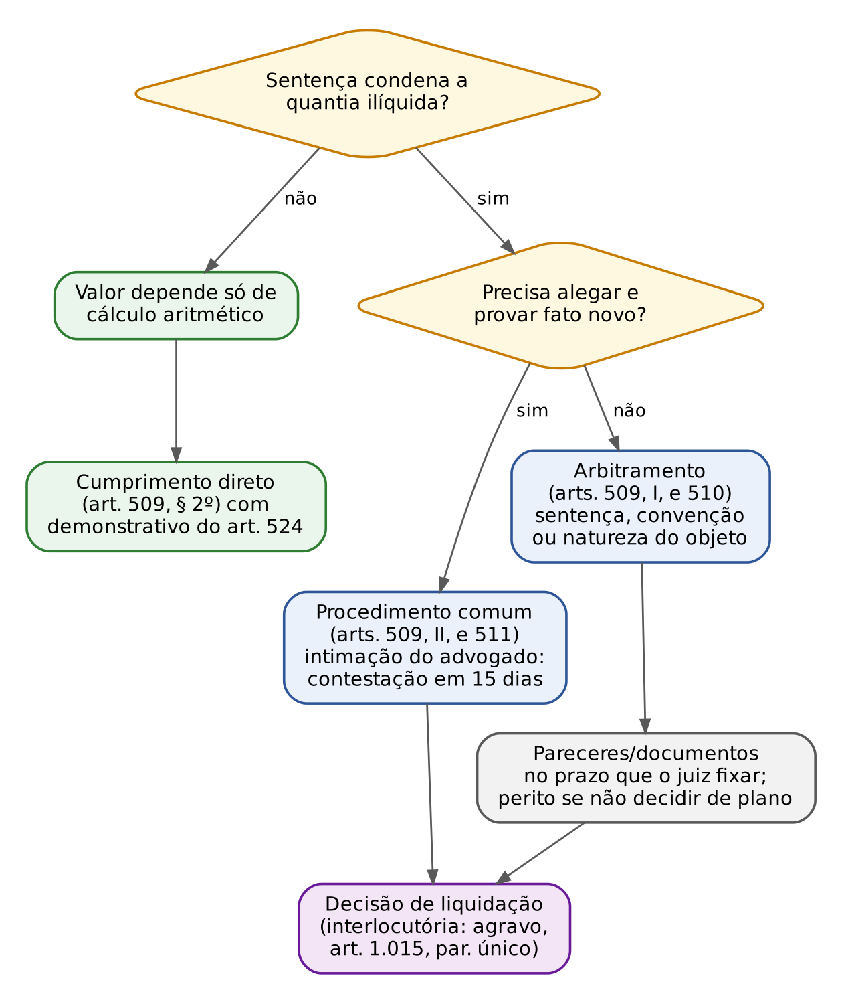
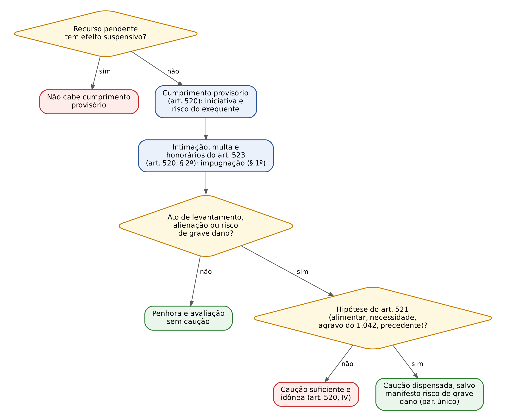
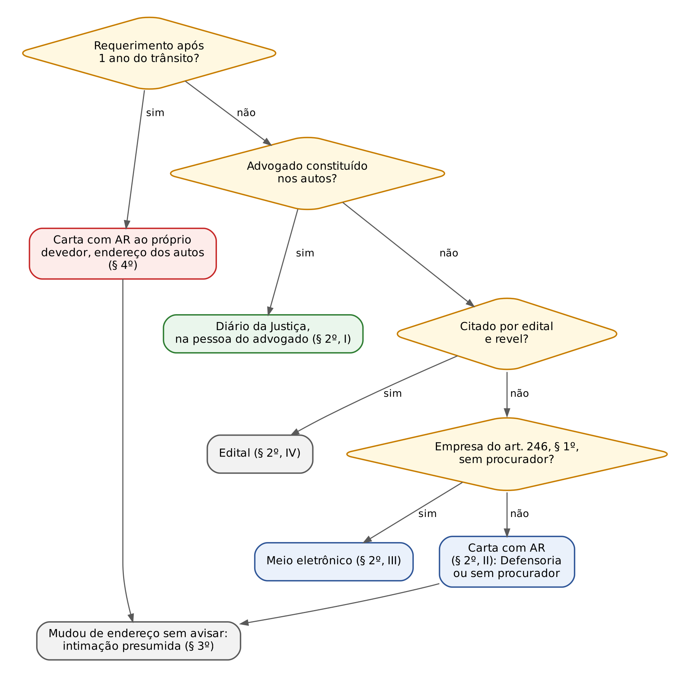
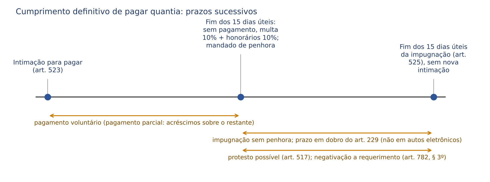
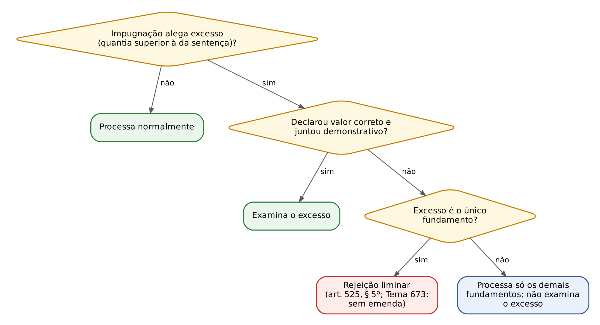
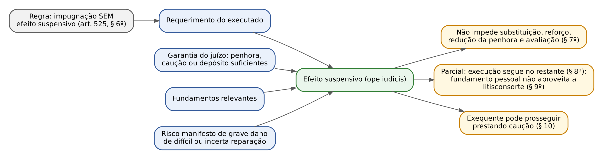
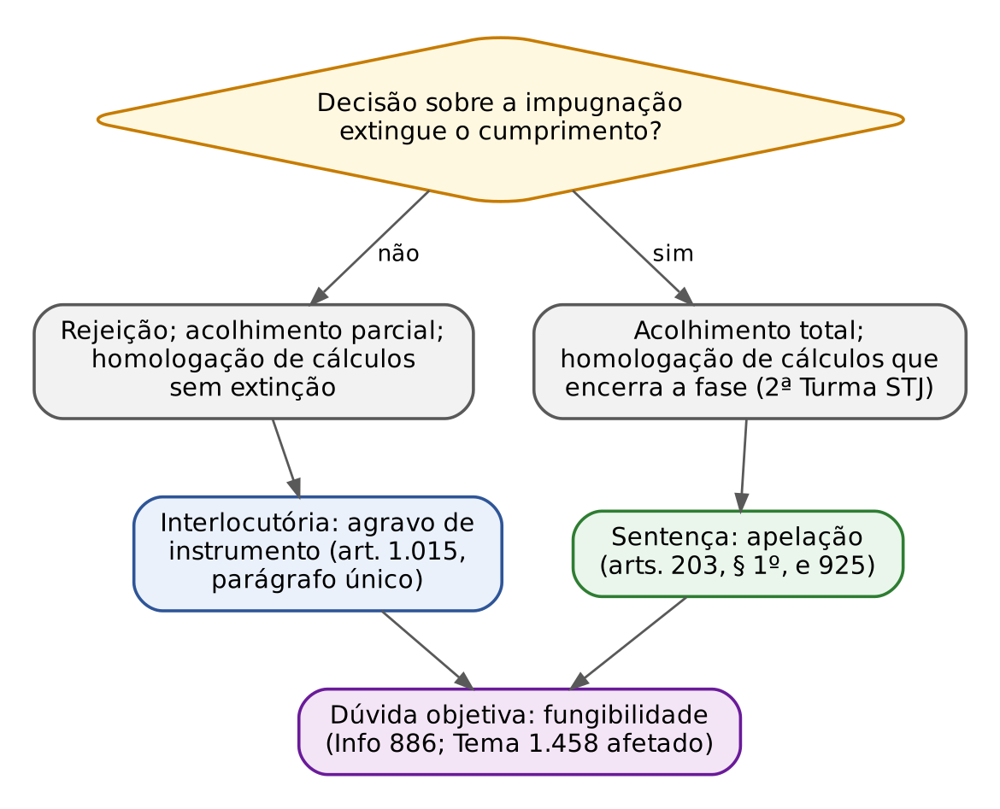

# CAPÍTULO 22 — LIQUIDAÇÃO E CUMPRIMENTO DE SENTENÇA DE PAGAR QUANTIA

:::INCIDENCIA
TRF5 p. 13; TJRS p. 10 e 11; TJSC p. 10 e 11. Nível A+. Lote: 36 questões (FGV 19, FCC 17).
O que mais cai: matérias e requisitos da impugnação (art. 525), multa e honorários do art. 523, cumprimento provisório e caução (arts. 520 e 521), modalidades de liquidação (arts. 509 a 511), meios de intimação do devedor (art. 513, § 2º) e competência (art. 516).
:::

#### Mapa de cobrança

| Subtema | FGV | FCC | Padrão |
|---|---|---|---|
| Liquidação (modalidades, iniciativa, vedação de rediscutir) | 2 | 4 | Letra dos arts. 509 a 511; troca arbitramento x procedimento comum |
| Títulos judiciais e regras gerais (arts. 513 a 518) | 4 | 3 | Homologação de autocomposição; fiador que não participou; protesto; competência |
| Intimação do devedor (art. 513, §§ 2º a 4º) | 2 | 2 | Caso prático: advogado, Defensoria, mais de 1 ano, mudança de endereço |
| Cumprimento provisório e caução | 3 | 4 | Efeito suspensivo do recurso; dispensa do art. 521; risco do exequente |
| Multa e honorários do art. 523; parcelamento | 3 | 1 | Depósito para garantir não é pagamento; art. 916, § 7º |
| Impugnação: prazo, matérias, excesso, efeito suspensivo | 5 | 6 | Superveniência à sentença; § 5º; requisitos cumulativos do § 6º; §§ 7º a 10 |

## 22.1 O cumprimento de sentença no processo sincrético: normas gerais

### 22.1.1 Fase, não processo; requerimento, não ofício

Desde as Leis 11.232/2005 (pagar quantia) e 10.444/2002 (fazer e entregar), a efetivação da sentença é FASE do mesmo processo, e o CPC/2015 consolidou o modelo sincrético: a sentença condenatória não encerra a relação processual, apenas a fase de conhecimento (art. 203, § 1º, ressalvadas as disposições sobre o cumprimento). O cumprimento observa o Título II do Livro I da Parte Especial e, no que couber, o Livro II (execução de título extrajudicial), por força da dupla remissão dos arts. 513, caput, e 771. É daí que vêm para o cumprimento a penhora, a avaliação, a expropriação, as medidas atípicas do art. 139, IV (Cap. 24), a suspensão do art. 921 (inclusive a prescrição intercorrente, § 7º; Cap. 26) e a negativação do art. 782, §§ 3º a 5º.

Duas regras de iniciativa separam o pagar quantia das demais obrigações:

- Pagar quantia, provisório ou definitivo: depende de REQUERIMENTO do exequente (arts. 513, § 1º, e 523, caput). O juiz não inicia de ofício. A FCC explora a ideia contrária ("é iniciado de ofício após o trânsito" ou "após a publicação da sentença": erradas em Q3542120 e Q3530388; "de ofício, multa de 10% inclusive à Fazenda": errada em Q2564675).
- Fazer, não fazer e entregar coisa: o juiz pode determinar as medidas de ofício (art. 536, caput, e 538), porque o que se busca é a tutela específica (Cap. 23).

:::PEGADINHA DE OFÍCIO X A REQUERIMENTO
"De ofício" só no fazer, não fazer e entregar (art. 536). Pagar quantia exige requerimento (art. 513, § 1º). E dois atos acessórios também dependem de requerimento: a negativação em cadastro de inadimplentes (art. 782, § 3º: "A requerimento da parte") e a requisição de dados ao executado para completar o demonstrativo (art. 524, § 4º: "a requerimento do exequente"). Já a requisição de dados em poder de terceiros ou do executado prevista no § 3º do art. 524 ("o juiz poderá requisitá-los") não exige pedido expresso.
:::

:::QUESTAO FGV 2026 — TJ-MS — DELEGAÇÃO DE NOTAS E REGISTRO (Q3914310)
Caso: no cumprimento de sentença condenatória transitada em julgado, o juiz, além de mandar intimar o devedor para pagar em 15 dias, determinou DE OFÍCIO a inclusão do nome do executado em cadastro de inadimplentes. Gabarito: D (equivocada, porque a inclusão depende de requerimento do exequente).
Fundamento: art. 782, § 3º ("A requerimento da parte, o juiz pode determinar"), aplicável ao cumprimento definitivo de título judicial (§ 5º). Armadilhas: A (poder geral de impulso executivo); C (só protesto: o protesto do art. 517 e a negativação coexistem); E (exigência de prévia recusa administrativa, inexistente na lei).
:::

### 22.1.2 Limites subjetivos do cumprimento: fiador, coobrigado e corresponsável

O § 5º do art. 513 é a projeção, na fase executiva, dos limites subjetivos da coisa julgada (art. 506; Cap. 21): "O cumprimento da sentença não poderá ser promovido em face do fiador, do coobrigado ou do corresponsável que não tiver participado da fase de conhecimento". Não importa a natureza da fiança, a renúncia ao benefício de ordem ou a solidariedade contratual: quem não foi parte não pode ser executado com base na sentença. O caminho é incluí-lo no polo passivo desde o início (litisconsórcio facultativo) ou chamá-lo ao processo (art. 130, se o réu for o devedor e quiser trazê-lo; Cap. 9), ou executar contra ele o título extrajudicial (contrato de fiança, art. 784). O STJ já sumulara a mesma ideia na locação: "O fiador que não integrou a relação processual na ação de despejo não responde pela execução do julgado" (Súmula 268 do STJ).

Ressalva cobrável: a desconsideração da personalidade jurídica permite atingir sócio ou sociedade que não participou da fase de conhecimento, mas exige o incidente dos arts. 133 a 137 (Cap. 9), que não suspende a execução contra os executados originários (Enunciado 110 da II Jornada de Direito Processual Civil do CJF). O STJ admite, porém, que o próprio juízo do cumprimento examine a sucessão empresarial fraudulenta sem instaurar o incidente (REsp 2.230.998; v. Cap. 9).

:::QUESTAO FGV 2025 — TRF3 — JUIZ FEDERAL SUBSTITUTO (Q3179547)
Afirmação correta: o cumprimento NÃO pode ser promovido em face do fiador, do coobrigado ou do corresponsável que não participou da fase de conhecimento (C; art. 513, § 5º). Armadilhas: A (relação sujeita a condição ou termo independeria de prova do implemento: o art. 514 exige a demonstração); B (não comportaria intimação por edital: o art. 513, § 2º, IV, a prevê); D (ordem pública permitiria rediscutir a lide: vedação do art. 509, § 4º, e eficácia preclusiva do art. 508); E (cumprimento inaplicável a benefícios assistenciais: invenção).
No mesmo sentido: FGV 2024, AL-PR, Q2449763 (alternativa A, que admitia o cumprimento contra fiadora com responsabilidade solidária contratual, é falsa); FCC 2025, UNICAMP, Q3891333 (alternativa A, falsa); FCC 2024, Jaboatão dos Guararapes, Q3542120 (alternativa C, falsa).
:::

### 22.1.3 Condição, termo e questões incidentes

- Relação sujeita a condição ou termo (art. 514): o cumprimento depende de demonstração de que se realizou a condição ou ocorreu o termo. Na execução de título extrajudicial, a falta dessa prova gera nulidade cognoscível de ofício (art. 803, III); no cumprimento, a matéria é veiculável por impugnação (inexigibilidade, art. 525, § 1º, III) ou por simples petição.
- Questões de validade do procedimento e dos atos executivos (art. 518): arguíveis "nos próprios autos" e "nestes serão decididas pelo juiz". É a base legal da defesa por simples petição e da objeção de pré-executividade no cumprimento (22.8).
- Tutela provisória (art. 519): aplicam-se as regras do cumprimento provisório ou definitivo e da liquidação, no que couber. A tutela provisória de pagar quantia efetiva-se, portanto, pelo regime dos arts. 520 a 522 (Cap. 14).

### 22.1.4 Prescrição da pretensão executiva

A pretensão ao cumprimento prescreve no mesmo prazo da pretensão de conhecimento (Súmula 150 do STF), contado do trânsito em julgado; uma vez iniciado o cumprimento e frustrada a localização do devedor ou de bens, corre a prescrição intercorrente do art. 921, §§ 1º a 7º, aplicável ao cumprimento do art. 523 por expressa previsão do § 7º (Cap. 26). Na execução individual de sentença coletiva, o prazo conta do trânsito em julgado da sentença coletiva, sendo desnecessária a providência do art. 94 do CDC (Tema 877 do STJ; v. Cap. 27).

## 22.2 Títulos executivos judiciais (art. 515)

### 22.2.1 O rol e a lógica de cada inciso

O título judicial nasce de atividade jurisdicional (estatal ou arbitral) ou de homologação judicial; por isso o executado não pode rediscutir o que foi decidido e sua defesa é restrita (art. 525, § 1º), ao contrário dos embargos à execução de título extrajudicial, em que cabe "qualquer matéria que lhe seria lícito deduzir como defesa em processo de conhecimento" (art. 917, VI).

| Inciso | Título | Ponto cobrado |
|---|---|---|
| I | Decisões no processo civil que reconheçam a exigibilidade de obrigação de pagar, fazer, não fazer ou entregar | "Decisões", não só sentenças: abrange interlocutória de mérito (art. 356) e tutela provisória (art. 519); sentença declaratória com todos os elementos da obrigação |
| II | Decisão homologatória de autocomposição judicial | Pode envolver terceiro e relação não deduzida (§ 2º) |
| III | Decisão homologatória de autocomposição extrajudicial de qualquer natureza | Jurisdição voluntária (art. 725, VIII) |
| IV | Formal e certidão de partilha | "Exclusivamente" em relação ao inventariante, herdeiros e sucessores a título singular ou universal |
| V | Crédito de auxiliar da justiça aprovado por decisão judicial | Custas, emolumentos, honorários periciais |
| VI | Sentença penal condenatória transitada em julgado | Citação no juízo cível (§ 1º); valor mínimo do art. 387, IV, do CPP; liquidação do restante |
| VII | Sentença arbitral | Citação no juízo cível (§ 1º); Cap. 2 |
| VIII | Sentença estrangeira homologada pelo STJ | Execução na Justiça Federal (CF, art. 109, X); Cap. 3 |
| IX | Decisão interlocutória estrangeira após *exequatur* | Idem |

Nos incisos VI a IX não há processo civil prévio no juízo do cumprimento; por isso "o devedor será CITADO no juízo cível para o cumprimento da sentença ou para a liquidação no prazo de 15 (quinze) dias" (§ 1º). É a única hipótese de citação no cumprimento; nas demais, intima-se (art. 513, § 2º).

:::DICA SENTENÇA DECLARATÓRIA E DE IMPROCEDÊNCIA COMO TÍTULO
O inciso I fala em decisão que "reconheça a exigibilidade de obrigação", e não em "condenação". O STJ, em repetitivo, assentou que a sentença, qualquer que seja sua natureza, de procedência ou de improcedência, constitui título executivo judicial desde que estabeleça obrigação de pagar quantia, de fazer, de não fazer ou de entregar coisa, admitida sua prévia liquidação e execução nos próprios autos (Tema 889 do STJ; STJ, REsp n. 1.324.152, Relator Ministro Luis Felipe Salomão, Corte Especial, j. 4/5/2016). Exemplo típico: improcedência de ação declaratória de inexistência de débito que reconhece a dívida com todos os seus elementos; o réu pode cumpri-la. A classificação das sentenças está no Cap. 6.
:::

:::QUESTAO FGV 2026 — NAV BRASIL — ADVOGADO (Q4223060)
Caso: acordo celebrado no curso de ação de cobrança e homologado; o réu descumpre. Gabarito: B (a decisão homologatória de autocomposição judicial é título executivo JUDICIAL; art. 515, II).
Armadilhas: A (título extrajudicial com processo de execução); C (só após o trânsito: o título é eficaz desde logo, e eventual recurso sem efeito suspensivo permite cumprimento provisório); D (só para pagar quantia: o inciso II não restringe a natureza da obrigação); E (depende de cláusula expressa de força executiva: a eficácia é legal).
No mesmo sentido: FGV 2024, TJ-SC, Juiz Substituto, Q3049347 (alternativa A, falsa).
:::

:::ATENCAO TRANSAÇÃO REFERENDADA PELA DEFENSORIA É TÍTULO EXTRAJUDICIAL
O instrumento de transação referendado pelo Ministério Público, pela Defensoria Pública, pela Advocacia Pública, pelos advogados dos transatores ou por conciliador ou mediador credenciado por tribunal é título EXTRAJUDICIAL (art. 784, IV). Só vira título judicial se homologado em juízo (art. 515, III). Em caso da FGV (2025, AL-AM, Q3777490, classificada no Cap. 24), o credor da sentença promove cumprimento; a credora da transação referendada pela Defensoria ajuíza execução de título extrajudicial (gabarito E). Desconstituição: a homologação de acordo sem incursão no mérito ataca-se por ação anulatória (art. 966, § 4º), não por rescisória (STJ, REsp n. 2.230.360, Relatora Ministra Nancy Andrighi, Terceira Turma, j. 14/4/2026, Informativo 887; Cap. 40).
:::

### 22.2.2 Sentença penal e sentença arbitral: liquidação e citação

- Sentença penal condenatória: o juiz criminal fixa valor MÍNIMO para reparação (CPP, art. 387, IV); esse valor é exequível desde logo no cível, sem prejuízo da liquidação para apurar o dano efetivamente sofrido (CPP, art. 63, parágrafo único). O cumprimento corre no "juízo cível competente" (art. 516, III), nunca no juízo criminal (erro da alternativa E de Q3542120).
- Sentença arbitral: título judicial que dispensa homologação; cumprimento no juízo cível (art. 516, III). A multa do art. 523, § 1º, incide se não houver pagamento em 15 dias contados da juntada do mandado de citação cumprido (título com quantia líquida) ou da intimação do advogado (se houve prévia liquidação certificada pelo juízo arbitral) (Tema 893 do STJ; v. Cap. 2). A defesa por nulidade do art. 32 da Lei 9.307/1996 na impugnação (art. 33, § 3º) está no Cap. 2.

:::PEGADINHA "EXCLUSIVAMENTE" NO FORMAL DE PARTILHA
O formal e a certidão de partilha são título judicial "exclusivamente em relação ao inventariante, aos herdeiros e aos sucessores a título singular ou universal" (art. 515, IV). Contra terceiro (por exemplo, o possuidor estranho ao inventário) não há título: é preciso ação de conhecimento. A FGV (2024, TJ-RJ, Mediador, Q2370298, Cap. 24) testa a classificação dos títulos: certidão de dívida ativa e contrato garantido por hipoteca são extrajudiciais (art. 784, IX e V), sentença arbitral é judicial (gabarito D).
:::

## 22.3 Liquidação de sentença

### 22.3.1 Natureza, finalidade e limites

A liquidação é fase (ou incidente, no caso de título penal, arbitral ou estrangeiro, em que se instaura por citação) destinada a integrar o título, fixando o *quantum debeatur* quando a sentença reconheceu o *an debeatur* sem precisar o valor. Tem natureza cognitiva, mas cognição limitada: "Na liquidação é vedado discutir de novo a lide ou modificar a sentença que a julgou" (art. 509, § 4º). Daí três corolários:

- A decisão de liquidação faz coisa julgada quanto ao valor (é decisão de mérito integrativa), apta à rescisória.
- O juiz da liquidação não pode alterar critérios fixados no título (índice, termo inicial de juros), salvo erro material; mas, se o título for omisso, pode integrá-los segundo a lei (juros e correção são pedidos implícitos, art. 322, § 1º).
- A liquidação por forma diversa da estabelecida na sentença não ofende a coisa julgada (Súmula 344 do STJ; v. Cap. 21): o rito da liquidação não é coberto pela coisa julgada; a modalidade adequada é a exigida pela natureza da apuração.

Admite-se a chamada liquidação de valor zero: se não houver prova do dano no valor, a liquidação conclui pela inexistência de crédito, sem ofender a coisa julgada, que reconheceu apenas a obrigação genérica de indenizar.

### 22.3.2 Quando a sentença pode ser ilíquida

Regra: ainda que formulado pedido genérico, a decisão definirá desde logo a extensão da obrigação, o índice de correção, a taxa de juros, o termo inicial de ambos e a periodicidade da capitalização (art. 491, caput). Só se admite sentença ilíquida quando (I) não for possível determinar, de modo definitivo, o montante devido, ou (II) a apuração depender de prova de realização demorada ou excessivamente dispendiosa (art. 491, I e II). Daí o erro de "sempre terá lugar a liquidação quando o autor formulou pedido genérico, pois é vedada decisão líquida" (FCC, Q3745795, alternativa E): o pedido genérico não impede a sentença líquida; ao contrário, a liquidez é a regra. E formulado pedido certo e determinado, somente o autor tem interesse recursal em arguir o vício da sentença ilíquida (Súmula 318 do STJ). Sentença ilíquida contra a Fazenda: o percentual de honorários só é definido na liquidação (art. 85, § 4º, II; Cap. 8); e a iliquidez afasta a dispensa de remessa necessária por valor (Cap. 20, Q3049352).

### 22.3.3 Legitimidade e momento

- Legitimidade: "a requerimento do credor ou do devedor" (art. 509, caput). O devedor tem interesse em liquidar para pagar e livrar-se dos encargos da mora. São erradas as alternativas que vedam a iniciativa do devedor (FGV, Q4079383, E; FGV, TJ-SE, Q3301235, C) ou que mandam instaurar a liquidação de ofício (FCC, Q3530387, B e E).
- Momento: pode ser realizada "na pendência de recurso", em autos apartados no juízo de origem, com cópias das peças pertinentes (art. 512). Vale ainda que o recurso tenha efeito suspensivo, porque a liquidação não é ato executivo: ela prepara a execução. Erram as alternativas que proíbem a liquidação na pendência de recurso (Q3530387, A) ou que a condicionam ao efeito suspensivo (Q3745795, B, que inverte a lógica).
- Parte líquida e parte ilíquida (art. 509, § 1º): "ao credor é lícito promover SIMULTANEAMENTE a execução daquela e, em autos apartados, a liquidação desta". Não há ordem obrigatória; é errado dizer que o credor "deve promover, antes, a liquidação" da parte ilíquida (Q3301235, D).

:::JURIS STJ, RESP 2.067.458, J. 4/6/2024 (INFORMATIVO 815)
Na liquidação, a quantia que o devedor reconhece e expressamente declara como devida representa a parte líquida da condenação e pode ser exigida desde logo (art. 509, § 1º), prosseguindo a liquidação quanto ao saldo. No mesmo julgado, os honorários periciais ficaram a cargo das devedoras, porque sucumbiram na fase de conhecimento e porque elas mesmas requereram a perícia (art. 95); o Tribunal reafirmou a orientação de repetitivo da Segunda Seção segundo a qual, na fase autônoma de liquidação por arbitramento ou por artigos, incumbe ao devedor antecipar os honorários periciais (STJ, REsp n. 2.067.458, Relator Ministro Antonio Carlos Ferreira, Quarta Turma, j. 4/6/2024).
:::

### 22.3.4 As duas modalidades e o "cálculo aritmético"

| Aspecto | Arbitramento (arts. 509, I, e 510) | Procedimento comum (arts. 509, II, e 511) | Cálculo aritmético (art. 509, § 2º) |
|---|---|---|---|
| Cabimento | Determinado pela sentença, convencionado pelas partes ou exigido pela natureza do objeto | Necessidade de alegar e provar FATO NOVO | Valor depende apenas de operação aritmética |
| Natureza | Liquidação (fase) | Liquidação (fase) | NÃO é liquidação: o credor inicia o cumprimento com demonstrativo (art. 524) |
| Ato inicial | Intimação das partes para pareceres ou documentos elucidativos, "no prazo que fixar" | Intimação do requerido, na pessoa do advogado ou da sociedade de advogados, para contestar em 15 dias | Requerimento de cumprimento com memória de cálculo |
| Prova | Perito, se não puder decidir de plano, observado o procedimento da prova pericial | Qualquer prova; segue o procedimento comum (Livro I da Parte Especial) | Contador do juízo, se necessário (art. 524, § 2º); requisição de dados (§§ 3º a 5º) |
| Exemplo | Valor de mercado de bem, extensão de dano a imóvel, lucros cessantes por estimativa técnica | Despesas médicas futuras ainda não comprovadas; prejuízos cuja ocorrência depende de prova de fato posterior | Juros e correção sobre valor certo; parcelas fixas vencidas |

O CPC/2015 aboliu o nome "liquidação por artigos", substituído por "pelo procedimento comum"; fato novo não significa fato superveniente à sentença, mas fato que não foi objeto de cognição na fase de conhecimento e que é necessário para quantificar a obrigação (por exemplo, o efetivo montante dos gastos). Os três critérios do arbitramento (determinação da sentença, convenção ou natureza do objeto) são alternativos.

:::LEI CPC, ARTS. 509 E 511
Art. 509. Quando a sentença condenar ao pagamento de quantia ilíquida, proceder-se-á à sua liquidação, a requerimento do credor ou do devedor:
I - por arbitramento, quando determinado pela sentença, convencionado pelas partes ou exigido pela natureza do objeto da liquidação;
II - pelo procedimento comum, quando houver necessidade de alegar e provar fato novo.
§ 2º Quando a apuração do valor depender apenas de cálculo aritmético, o credor poderá promover, desde logo, o cumprimento da sentença.
§ 4º Na liquidação é vedado discutir de novo a lide ou modificar a sentença que a julgou.
Art. 511. Na liquidação pelo procedimento comum, o juiz determinará a intimação do requerido, na pessoa de seu advogado ou da sociedade de advogados a que estiver vinculado, para, querendo, apresentar contestação no prazo de 15 (quinze) dias, observando-se, a seguir, no que couber, o disposto no Livro I da Parte Especial deste Código.
:::

:::PEGADINHA AS TROCAS PREFERIDAS DA FCC
- Fato novo: procedimento COMUM, nunca arbitramento (Q3872184, B, D e E; Q3530387, B e E).
- Prazo para pareceres no arbitramento: "no prazo que fixar" o juiz, não "prazo fixo de 15 dias" (Q3872184, C).
- Liquidação pelo procedimento comum: INTIMAÇÃO do advogado para contestar em 15 dias, não "citação" (Q3745795, C) e não "dispensa contestação" (Q3530387, D).
- Arbitramento não "depende de prova pericial ou oral, a critério do juiz" (Q3745795, D): o juiz pode decidir de plano com pareceres e documentos; o perito só é nomeado se não puder.
- Cálculo aritmético: a liquidação é "dispensável enquanto etapa processual" (Q3745795, A, correta), e não "necessária" (Q3301235, B, errada).
:::

:::QUESTAO FCC 2026 — CPU-PE — ANALISTA JURÍDICO (Q3872184)
Sentença ilíquida com necessidade de alegar e provar fato novo. Gabarito: A (procedimento comum, a requerimento do credor ou do devedor, vedado rediscutir a lide ou modificar a sentença; art. 509, II e § 4º). As alternativas B, D e E rotulam a hipótese como arbitramento; C mistura o rito do arbitramento com "prazo fixo de 15 dias".
No mesmo sentido: FCC 2025, MPE-PI, Q3530387 (gabarito C); FGV 2025, TJ-SE, Juiz Substituto, Q3301235 (gabarito A: procedimento comum quando há fato novo; as demais alternativas negam a iniciativa do devedor, exigem liquidação para cálculo aritmético e impõem ordem entre parte líquida e ilíquida; a E, que diz serem irrecorríveis as interlocutórias da liquidação, contraria o art. 1.015, parágrafo único).
:::

:::QUESTAO FGV 2026 — PGE-AC — PROCURADOR DO ESTADO (Q4079383)
Caso: condenação a indenizar danos materiais, com valor a apurar por avaliação técnica especializada da extensão dos danos e do custo dos reparos. Gabarito: B (arbitramento cabe quando determinado pela sentença, convencionado pelas partes ou exigido pela natureza do objeto).
Armadilhas: A (nova ação autônoma: a liquidação é fase do mesmo processo); C (depende de acordo com referendo do MP); D (arbitramento quando há fato novo: é o procedimento comum); E (só o credor tem legitimidade).
No mesmo sentido: FCC 2026, TJ-CE, Analista, Q4231777 (gabarito A: liquidação necessária quando não for possível determinar o valor, por arbitramento ou pelo procedimento comum; as demais alternativas afirmam que o excesso só se alega por embargos, que a impugnação suspende automaticamente, que bens públicos são penhoráveis e que a liquidação é dispensada sempre que a sentença não indica o valor). FCC 2025, PGE-MT, Q3745795 (gabarito A: dispensável a liquidação quando basta cálculo aritmético).
:::

### 22.3.5 Cálculo aritmético: requisição de dados e contadoria

Quando bastar cálculo, o credor instrui o requerimento com demonstrativo discriminado e atualizado (art. 524; ver 22.6.1). Se os dados estiverem com terceiros ou com o executado, o juiz pode requisitá-los sob cominação do crime de desobediência (§ 3º); se a complementação depender de dados adicionais em poder do executado, o juiz, a requerimento do exequente, os requisita em até 30 dias, e a omissão injustificada faz reputar corretos os cálculos do exequente com base nos dados de que dispõe (§§ 4º e 5º). O contabilista do juízo tem prazo máximo de 30 dias, salvo outro determinado (§ 2º); a parte assistida pela Defensoria Pública continua a poder valer-se da contadoria judicial (Enunciado 91 da I Jornada de Direito Processual Civil do CJF).

Execução individual de sentença coletiva em favor de servidores: sempre que demonstrado documentalmente que o exequente está na situação genérica da sentença, a execução pode ocorrer sem prévia liquidação, quando possível a apuração por simples cálculos; cabe ao juízo, em impugnação, analisar concretamente se a liquidação é necessária (Tema 1.169 do STJ). O regime da liquidação coletiva (art. 97 do CDC) está no Cap. 34.

:::ATENCAO LIQUIDEZ É PRESSUPOSTO DA MULTA DO ART. 523
Sentença ilíquida não autoriza a intimação para pagar sob pena de multa. A multa (então do art. 475-J) exige (i) prévia liquidação e, depois do acertamento, (ii) intimação do devedor, na pessoa do advogado, para pagar o valor definido em 15 dias (Tema 380 do STJ). Cumprimento provisório iniciado com planilha unilateral, quando o título exigia arbitramento, é extinto por falta de liquidez; esse acolhimento, porém, NÃO gera honorários ao executado, porque não extingue nem modifica o crédito, que continua exigível (STJ, REsp n. 2.233.988, Relator Ministro Raul Araújo, Quarta Turma, j. 4/6/2026, Informativo 897).
:::

### 22.3.6 Decisão e recurso

A decisão que encerra a liquidação é interlocutória (a fase não termina o processo, que segue para o cumprimento) e desafia agravo de instrumento: "Também caberá agravo de instrumento contra decisões interlocutórias proferidas na fase de liquidação de sentença ou de cumprimento de sentença" (art. 1.015, parágrafo único). Nos títulos dos incisos VI a IX do art. 515, em que a liquidação se instaura por citação, prevalece a mesma solução, porque a liquidação prepara o cumprimento no mesmo processo. A decisão que homologa a atualização do cálculo da liquidação desafia agravo de instrumento (Súmula 118 do STJ).

## 22.4 Competência para o cumprimento (art. 516)

### 22.4.1 Regra funcional e opções do exequente

| Título | Juízo competente | Opção do exequente (parágrafo único) |
|---|---|---|
| Causa de competência originária de tribunal | O próprio tribunal (inciso I) | Não há |
| Sentença do primeiro grau (inclusive confirmada ou reformada em recurso) | O juízo que decidiu a causa no primeiro grau (inciso II) | Juízo do atual domicílio do executado, do local dos bens sujeitos à execução ou do local onde deva ser executada a obrigação de fazer ou de não fazer |
| Sentença penal, arbitral, estrangeira ou acórdão do Tribunal Marítimo | Juízo cível competente (inciso III), apurado pelas regras gerais | As mesmas opções |

Notas que resolvem questões:

- A competência do inciso II é funcional e, por isso, absoluta (Cap. 4); o parágrafo único não a relativiza para o juiz, mas abre ao EXEQUENTE uma escolha. Exercida a opção, "a remessa dos autos do processo será solicitada ao juízo de origem" (parte final do parágrafo único). O juiz não pode declinar de ofício para o domicílio do executado.
- O tribunal que julgou o recurso NÃO é competente para o cumprimento: o acórdão que confirma ou reforma a sentença é cumprido no primeiro grau (erro da alternativa B de Q2449763, que remetia o cumprimento ao "Tribunal Superior que tenha julgado em definitivo a causa"). O STF, que julgou a ação coletiva originária, não é competente para a execução individual da sentença coletiva (STF, Pet 6.076 QO, j. 25/4/2017, Informativo 862).
- Honorários: o cumprimento, ainda que só de honorários, corre no juízo que decidiu a causa em primeiro grau, mesmo que se trate de vara especializada (por exemplo, da infância), salvo opção do exequente por outro juízo do parágrafo único (STJ, REsp n. 2.138.914, Relator Ministro Afrânio Vilela, Segunda Turma, j. 26/11/2024, Informativo de Jurisprudência 22, Edição Extraordinária).
- Justiça Estadual x Federal: o INSS que antecipou honorários periciais em ação acidentária (competência estadual, CF, art. 109, I) e pretende ressarcimento promove o cumprimento no juízo estadual que decidiu a causa (STJ, CC n. 191.185, Primeira Seção, j. 28/2/2024, Informativo 802). A regra funcional prevalece sobre a qualidade da parte exequente.
- Organização judiciária: o STF considerou constitucional resolução de tribunal de justiça que criou central de cumprimento de sentença em regime de cooperação judiciária (fonte: Caderno do Buscador Dizer o Direito, sem número do processo visto; ver nota). A cooperação nacional está no Cap. 5.

:::QUESTAO FCC 2025 — MPE-PI — ANALISTA MINISTERIAL (Q3530388)
Gabarito: B (o cumprimento efetua-se, em regra, perante o juízo que decidiu a causa no primeiro grau, podendo o exequente optar pelo juízo do atual domicílio do executado, do local dos bens ou do local da obrigação de fazer ou não fazer, solicitando-se a remessa dos autos ao juízo de origem). Armadilhas: A (início de ofício); D (só após o trânsito: há cumprimento provisório); C e E (efeitos da prisão civil sobre alimentos vencidos e vincendos: o cumprimento da pena não exime do pagamento, art. 528, § 5º; Cap. 23).
No mesmo sentido: FCC 2025, UNICAMP, Q3891333 (gabarito D: opção pelo domicílio atual do executado ou pelo local dos bens; as demais alternativas admitem cumprimento contra fiador que não participou, falam em intimação pelo Diário também do assistido pela Defensoria, permitem protesto antes do cumprimento e excluem o fazer e o não fazer do regime do cumprimento).
:::

:::QUESTAO FGV 2024 — TJ-SC — JUIZ SUBSTITUTO (Q3049347)
Afirmação dada como correta: o cumprimento de sentença de pagar quantia "deverá ser processado perante o juízo que decidiu a causa no primeiro grau de jurisdição" (B). As demais eram claramente falsas: A (homologação de autocomposição não seria título: art. 515, II); C (interlocutórias irrecorríveis por agravo: art. 1.015, parágrafo único); D (intimação pelo Diário independentemente da época do trânsito: o art. 513, § 4º, exige intimação pessoal por carta com AR se o requerimento vier após 1 ano); E (defesa por embargos à execução: é impugnação, art. 525).
Armadilha de método: a alternativa B reproduz o inciso II do art. 516 sem as opções do parágrafo único e sem a hipótese de competência originária dos tribunais. Na lógica da "mais correta", ela é a única compatível com a lei; em prova discursiva, mencione as opções do exequente.
:::

## 22.5 Cumprimento provisório

### 22.5.1 Cabimento: o que torna o cumprimento provisório

Cumprimento provisório é o que se funda em decisão ainda impugnada por recurso DESPROVIDO de efeito suspensivo (art. 520, caput). O critério não é a natureza da decisão (sentença, interlocutória, tutela provisória), mas o estado da impugnação:

- Recurso com efeito suspensivo (por exemplo, apelação na regra do art. 1.012, caput): NÃO cabe cumprimento provisório. A eficácia da decisão está suspensa.
- Recurso sem efeito suspensivo (apelação nas hipóteses do art. 1.012, § 1º, entre elas a sentença que confirma, concede ou revoga tutela provisória, inciso V; agravo de instrumento; recursos especial e extraordinário; agravo interno; agravo do art. 1.042): cabe cumprimento provisório desde a publicação da decisão (art. 1.012, § 2º, quanto à apelação).
- Decisão já transitada: cumprimento DEFINITIVO, ainda que penda impugnação ao cumprimento sem efeito suspensivo, ação rescisória ou *querela nullitatis*. Por isso a caução do art. 520, IV, não pode ser exigida em cumprimento definitivo (Enunciado 88 da I Jornada de Direito Processual Civil do CJF).

Duas situações costumam confundir:

- Decisão parcial de mérito (art. 356): o § 2º permite liquidar ou executar desde logo a obrigação reconhecida, "independentemente de caução, ainda que haja recurso contra essa interposto"; com o trânsito, a execução é definitiva (§ 3º). É regime mais favorável que o do art. 520, IV (Cap. 17).
- Tutela provisória confirmada na sentença: a apelação não tem efeito suspensivo quanto a esse capítulo (art. 1.012, § 1º, V), e o cumprimento é provisório; o apelante pode pedir efeito suspensivo ao tribunal ou ao relator (art. 1.012, §§ 3º e 4º).

:::QUESTAO FGV 2025 — MPU — ANALISTA (Q3339805)
Caso: no saneamento, o juiz julga procedente o pedido de dano material incontroverso (100 mil reais) e prossegue com a instrução quanto ao dano moral; o réu interpõe agravo de instrumento, recebido sem efeito suspensivo. Gabarito: A (execução provisória, DISPENSADA a caução).
Resolução: 1) a decisão é julgamento antecipado parcial do mérito (art. 356, I), impugnável por agravo de instrumento (art. 356, § 5º); 2) o recurso não tem efeito suspensivo, logo a execução é provisória e não definitiva (C errada: não houve trânsito); 3) o art. 356, § 2º, dispensa a caução, afastando o regime geral do art. 520, IV (B errada); 4) não há apelação a aguardar nem fungibilidade (D e E).
:::

:::QUESTAO FGV 2024 — TJ-MT — ANALISTA JUDICIÁRIO (Q3114268)
Caso: sentença condena a obrigação de fazer e concede tutela provisória na própria sentença; antes do julgamento da apelação, o autor requer cumprimento e a ré alega falta de trânsito em julgado. Pergunta: quando pode ser iniciado o cumprimento provisório? Gabarito: D (na pendência de recurso interposto sem efeito suspensivo; arts. 520, caput, e 1.012, § 1º, V). A alternativa C inverte a regra (após recurso COM efeito suspensivo); A confunde provisório com definitivo; E inventa prazo de 15 dias úteis após a sentença. O regime do art. 520 aplica-se, no que couber, ao fazer, não fazer e dar coisa (art. 520, § 5º).
:::

### 22.5.2 Regime do art. 520: "da mesma forma que o definitivo", com quatro temperamentos

O cumprimento provisório segue o mesmo procedimento do definitivo (intimação para pagar em 15 dias, multa e honorários, impugnação, penhora), sujeito aos incisos do art. 520:

1. Iniciativa e responsabilidade do exequente, que se obriga, se a sentença for reformada, a reparar os danos que o executado haja sofrido (I). A responsabilidade é OBJETIVA: independe de culpa ou má-fé, na mesma lógica do art. 302 (tutela provisória) e do art. 776 (execução extinta por inexistência da obrigação). O STJ aplicou a lógica objetiva até ao cumprimento definitivo de sentença arbitral extinto por falta de exequibilidade do título, mandando ressarcir o custo da carta de fiança contratada para garantir o juízo (fonte: APGE Juris, julgado da Terceira Turma sobre o art. 776, sem número conferido; ver nota).

2. Fica sem efeito se sobrevier decisão que modifique ou anule a sentença, restituindo-se as partes ao estado anterior e liquidando-se eventuais prejuízos NOS MESMOS AUTOS (II). Modificação ou anulação parcial: a execução fica sem efeito somente nessa parte (III).

3. A restituição ao estado anterior NÃO implica desfazer a transferência de posse ou a alienação de propriedade ou de outro direito real já realizada, ressalvada sempre a reparação dos prejuízos (§ 4º). O arrematante de boa-fé fica protegido; o executado converte o seu direito em perdas e danos. Erra a alternativa que manda "restituir as coisas ao estado anterior se houve expropriação" (FCC, Q2654935, D).

4. Levantamento de dinheiro, atos que importem transferência de posse ou alienação de propriedade ou de outro direito real, e atos dos quais possa resultar grave dano ao executado dependem de caução suficiente e idônea, arbitrada de plano pelo juiz e prestada nos próprios autos (IV).

Corolário do inciso IV, muito cobrado: a caução NÃO é condição para iniciar o cumprimento provisório, nem para penhorar ou avaliar. Ela só é exigida no momento do ato de risco (levantamento, alienação). Erram as alternativas que exigem caução "como condição para iniciar o procedimento" (Q3745611, C) e acerta a que afirma não ser exigível caução para a penhora, seu reforço e a avaliação (Q2654935, B).

:::LEI CPC, ART. 521
Art. 521. A caução prevista no inciso IV do art. 520 poderá ser dispensada nos casos em que:
I - o crédito for de natureza alimentar, independentemente de sua origem;
II - o credor demonstrar situação de necessidade;
III – pender o agravo do art. 1.042;
IV - a sentença a ser provisoriamente cumprida estiver em consonância com súmula da jurisprudência do Supremo Tribunal Federal ou do Superior Tribunal de Justiça ou em conformidade com acórdão proferido no julgamento de casos repetitivos.
Parágrafo único. A exigência de caução será mantida quando da dispensa possa resultar manifesto risco de grave dano de difícil ou incerta reparação.
:::

Leitura fina do art. 521:

- "Poderá ser dispensada": a dispensa é avaliada pelo juiz, não automática, e o parágrafo único funciona como cláusula de reserva: mesmo presente a hipótese, a caução é mantida se a dispensa puder causar manifesto risco de grave dano de difícil ou incerta reparação.
- Inciso I: crédito alimentar "independentemente de sua origem" (legítimo, indenizatório, salarial, honorários advocatícios).
- Inciso II: situação de necessidade do credor. Não é o mesmo que gratuidade da justiça: o benefício do art. 98 não dispensa, por si, a caução (erro da alternativa A de Q3745611).
- Inciso III: só o agravo do art. 1.042 (agravo em recurso especial ou extraordinário). Pendência de recurso especial ou extraordinário, de agravo interno ou de embargos de declaração NÃO dispensa (erros de Q3745611, B, e de Q2654935, E). A redação original falava em "agravo de instrumento junto ao STF ou ao STJ"; a Lei 13.256/2016 ajustou-a.
- Inciso IV: sentença em consonância com súmula do STF ou do STJ ou com acórdão de casos repetitivos (IRDR e recursos repetitivos, art. 928). Por extensão, a caução pode ser dispensada se o julgado estiver em consonância com tese firmada em incidente de assunção de competência (Enunciado 136 da II Jornada de Direito Processual Civil do CJF).

:::QUESTAO FCC 2025 — PGE-TO — PROCURADOR DO ESTADO (Q3745611)
Gabarito: E (mesmo nos casos de dispensa legal, o juiz mantém a caução se houver risco de grave dano de difícil ou incerta reparação; art. 521, parágrafo único). Armadilhas: A (gratuidade da justiça como causa de dispensa); B (pendência de agravo interno); C (caução como condição para iniciar e para intimar o devedor); D (exigência de caução na execução de decisão parcial de mérito: o art. 356, § 2º, a dispensa).
No mesmo sentido: FCC 2024, PGE-GO, Q2654935 (gabarito B: não se exige caução para penhora, reforço e avaliação). Na mesma questão: A errada (o cumprimento de título transitado não vira provisório por pender impugnação com efeito suspensivo; é definitivo, apenas suspenso); C errada (a multa de 10% incide já no provisório, art. 520, § 2º, não só após a convolação); D e E erradas (§ 4º e art. 521, III).
:::

### 22.5.3 Multa, honorários, impugnação e depósito no provisório

- Multa e honorários de 10% do art. 523, § 1º, "são devidos no cumprimento provisório de sentença condenatória ao pagamento de quantia certa" (art. 520, § 2º). Ficou superada a orientação do CPC/1973, que não admitia a multa na execução provisória.
- O executado pode depositar o valor para isentar-se da multa, e o ato "não será havido como incompatível com o recurso por ele interposto" (§ 3º). É exceção expressa à preclusão lógica do art. 1.000: depositar para evitar a multa não é aquiescência.
- Impugnação: o executado poderá apresentá-la, "se quiser, nos termos do art. 525" (§ 1º). Não precisa de garantia do juízo e o meio é a impugnação, não os embargos (FCC, Q3170843, gabarito E).
- Honorários: devidos no provisório (art. 85, § 1º; Cap. 8), salvo a hipótese do Informativo 897 vista em 22.3.5.
- Petição: dirigida ao juízo competente; em autos físicos, com cópias da decisão exequenda, da certidão de interposição do recurso sem efeito suspensivo, das procurações, da habilitação e, facultativamente, de outras peças, autenticáveis pelo advogado (art. 522).

:::QUESTAO FGV 2024 — ENAM (2024.2) (Q3058653)
Caso: tutela provisória para custeio de tratamento médico, confirmada em sentença de julgamento antecipado; a operadora apela pedindo anulação por cerceamento de defesa e, subsidiariamente, reforma; o autor requer cumprimento provisório. Gabarito: E (o juiz deve deferir o cumprimento provisório, cabendo ao autor reparar os danos da ré se a sentença for reformada).
Resolução em passos: 1) a sentença confirmou tutela provisória: apelação sem efeito suspensivo (art. 1.012, § 1º, V), logo A está errada; 2) o pedido de anulação não altera os efeitos do recurso (B errada); 3) cabe cumprimento provisório de obrigação de fazer (art. 520, § 5º), logo C está errada; 4) sobrevindo acórdão que anule a sentença, o cumprimento provisório fica sem efeito (art. 520, II), logo D está errada; 5) o risco é do exequente (art. 520, I).
No mesmo sentido: FCC 2024, Jaboatão dos Guararapes, Q3542120 (gabarito A: o cumprimento provisório corre por iniciativa e responsabilidade do exequente, que repara os danos se a sentença for reformada).
:::

### 22.5.4 Convolação em definitivo

Transitada em julgado a decisão, o cumprimento provisório converte-se em definitivo nos mesmos autos. A intimação feita na fase provisória não supre a do definitivo: o devedor deve ser novamente intimado para pagar em 15 dias ou impugnar, sob pena de violação do art. 523, caput (STJ, REsp n. 1.997.512, Relator Ministro Ricardo Villas Bôas Cueva, Terceira Turma, j. 17/3/2026, Informativo 883). Se o executado já pagou ou depositou no provisório, a convolação apenas libera o levantamento sem caução.

Contraste útil: o terceiro que paga a dívida e se sub-roga sucede o exequente, e o cumprimento prossegue no estado em que se encontra, sem nova intimação para pagar (AREsp 935.216; v. Cap. 9): lá muda a natureza do título (provisório para definitivo); aqui, só o sujeito ativo.

No cumprimento definitivo, o poder geral de cautela e o elevado valor da execução não bastam para exigir fiança bancária do exequente para levantar valor incontroverso, porque a caução de levantamento é instituto do provisório (art. 520, IV) e do § 10 do art. 525 (REsp 2.167.952; v. Cap. 14). A propositura de rescisória não impede o cumprimento, salvo tutela provisória concedida na própria rescisória (art. 969; Cap. 40); o juiz que suspende a execução apenas porque a rescisória foi ajuizada usurpa a competência do tribunal, e a FGV deu como cabível reclamação (FGV 2025, TJ-ES, Q3520300, classificada no Cap. 40).

| Aspecto | Cumprimento provisório | Cumprimento definitivo |
|---|---|---|
| Base | Decisão impugnada por recurso sem efeito suspensivo | Decisão transitada em julgado (ou decisão parcial de mérito, art. 356, § 2º, quanto à caução) |
| Iniciativa | Requerimento; risco objetivo do exequente | Requerimento |
| Multa e honorários do art. 523 | Devidos (art. 520, § 2º) | Devidos |
| Caução | Para levantamento, alienação e atos de grave dano, salvo art. 521 | Não exigível (Enunciado 88 do CJF); só no § 10 do art. 525 |
| Reversão | Sem efeito, com restituição e liquidação nos mesmos autos; alienação preservada (§ 4º) | Só por rescisória ou querela; danos pelo art. 776 |
| Defesa | Impugnação (art. 520, § 1º) | Impugnação (art. 525) |

## 22.6 Cumprimento definitivo de pagar quantia: do requerimento à penhora

### 22.6.1 Requerimento e demonstrativo (art. 524)

O requerimento é instruído com demonstrativo discriminado e atualizado do crédito, com nome completo e CPF ou CNPJ das partes, índice de correção, juros e taxas, termos inicial e final, periodicidade da capitalização, descontos obrigatórios e, sempre que possível, indicação de bens penhoráveis (art. 524, I a VII). Se o valor apontado aparentemente exceder os limites da condenação, a execução é iniciada pelo valor pretendido, mas a penhora tem por base a importância que o juiz entender adequada (§ 1º). O juiz não indefere o requerimento por excesso aparente; ele limita a constrição. O CNJ deve disponibilizar programa de atualização financeira (art. 509, § 3º).

Na compensação de prestações previdenciárias recebidas administrativamente com as do benefício concedido judicialmente, o cálculo é feito mês a mês, no limite de cada competência, sem gerar valor negativo ao beneficiário (Tema 1.207 do STJ). Verbas acessórias não previstas no título não entram no cálculo: no cumprimento de sentença condenatória à complementação de ações, descabe incluir dividendos ou juros sobre capital próprio sem expressa previsão no título (Tema 670 do STJ).

### 22.6.2 Intimação do devedor (art. 513, §§ 2º a 4º)

A intimação para cumprir é, como regra, feita na pessoa do advogado pelo Diário da Justiça (Tema 536 do STJ, firmado no CPC/1973 e incorporado ao art. 513, § 2º, I). O regime completo:

| Situação | Meio | Fundamento |
|---|---|---|
| Advogado constituído nos autos | Diário da Justiça, na pessoa do advogado | § 2º, I |
| Representado pela Defensoria Pública ou sem procurador constituído | Carta com AR, ao próprio devedor | § 2º, II |
| Empresa do art. 246, § 1º, sem procurador constituído | Meio eletrônico | § 2º, III |
| Citado por edital (art. 256) e revel na fase de conhecimento | Edital | § 2º, IV |
| Requerimento formulado após 1 ano do trânsito | Pessoal, por carta com AR ao endereço dos autos | § 4º |
| Mudança de endereço sem comunicação (incisos II e III e § 4º) | Intimação considerada realizada | § 3º e art. 274, parágrafo único |

Lógica do § 4º: decorrido mais de um ano, presume-se que o vínculo entre o devedor e o advogado se afrouxou; a intimação pessoal preserva o contraditório. A regra vale mesmo que haja advogado constituído. A do inciso II explica-se porque o defensor público não mantém contato contínuo com o assistido; sua intimação pessoal (com prazo em dobro) não substitui a ciência do devedor para pagar.

:::QUESTAO FCC 2025 — TRT-6 — OFICIAL DE JUSTIÇA (Q3215744)
Caso: réu de ação de despejo, citado pessoalmente e representado pela Defensoria Pública, é condenado a pagar aluguéis atrasados; o autor promove o cumprimento. Gabarito: C (carta com aviso de recebimento; art. 513, § 2º, II). Armadilhas: E (Diário de Justiça na pessoa do defensor); B (aplicativo de mensagens: sem previsão legal); A (oficial de justiça); D (edital: só para o citado por edital e revel).
:::

:::QUESTAO FCC 2025 — DPE-AM — DEFENSOR PÚBLICO (Q3531627)
Caso: réu citado pessoalmente, revel, sem advogado; a carta de intimação para o cumprimento, enviada ao endereço do processo de conhecimento, volta com a informação de mudança. Gabarito: A (reputa-se válida a intimação, porque cabe ao devedor comunicar a mudança de endereço; art. 513, § 3º, c/c art. 274, parágrafo único).
Armadilhas: B e E (edital ou oficial de justiça com curadoria especial: o réu foi citado pessoalmente, logo não incide o inciso IV nem a curadoria do art. 72, II); C (nulidade por falta de curador ao revel citado pessoalmente: não há curador nessa hipótese); D (exigência de intimação pessoal frutífera). Pormenores sobre intimações no Cap. 12 e sobre nulidades no Cap. 13.
:::

:::QUESTAO FGV 2024 — AL-PR — ANALISTA LEGISLATIVO (Q2449763)
Caso: sentença transitada condena a prestadora de serviços (citada na pessoa da diretora e com advogado constituído) a pagar 17 mil reais e honorários; a fiadora não foi parte. Gabarito: C (requerido o cumprimento um ano após o trânsito, a intimação é na pessoa do devedor, por carta com AR; art. 513, § 4º).
Armadilhas: A (cumprimento contra a fiadora que não participou: art. 513, § 5º); B (cumprimento perante o tribunal que julgou a causa); D (intimação por oficial ou eletrônica na pessoa da diretora, com prazo de impugnação contado da juntada: o prazo da impugnação começa automaticamente após os 15 dias do pagamento, art. 525, caput); E (protesto com a mera publicação: só depois de transcorrido o prazo do art. 523, art. 517).
:::

Outras orientações sobre a intimação:

- Comparecimento espontâneo supre a intimação e é o termo inicial dos prazos para pagamento e, sucessivamente, para impugnação (Enunciado 84 da I Jornada de Direito Processual Civil do CJF).
- A intimação deve mencionar expressamente o prazo sucessivo para impugnar (Enunciado 92 da I Jornada de Direito Processual Civil do CJF).
- Cumprimento de obrigação de fazer ou não fazer sob multa: exige intimação PESSOAL do devedor (Súmula 410 do STJ, mantida no Tema 1.296 do STJ); a regra do art. 513, § 2º, I, não basta para a incidência das *astreintes* (Cap. 23).

### 22.6.3 Prazo para pagamento, multa e honorários (art. 523)

:::LEI CPC, ART. 523
Art. 523. No caso de condenação em quantia certa, ou já fixada em liquidação, e no caso de decisão sobre parcela incontroversa, o cumprimento definitivo da sentença far-se-á a requerimento do exequente, sendo o executado intimado para pagar o débito, no prazo de 15 (quinze) dias, acrescido de custas, se houver.
§ 1º Não ocorrendo pagamento voluntário no prazo do caput, o débito será acrescido de multa de dez por cento e, também, de honorários de advogado de dez por cento.
§ 2º Efetuado o pagamento parcial no prazo previsto no caput, a multa e os honorários previstos no § 1º incidirão sobre o restante.
§ 3º Não efetuado tempestivamente o pagamento voluntário, será expedido, desde logo, mandado de penhora e avaliação, seguindo-se os atos de expropriação.
:::

Pontos de prova:

- Prazo: 15 dias ÚTEIS (Enunciado 89 da I Jornada de Direito Processual Civil do CJF). O STJ assentou que o prazo do art. 523 é processual, porque se conta após intimação do advogado e produz efeitos processuais (multa, honorários, abertura do prazo de impugnação) (STJ, REsp n. 1.708.348, Relator Ministro Marco Aurélio Bellizze, Terceira Turma, j. 25/6/2019, Informativo 652). Erra quem fala em 10 dias e multa de 15% (Q2564675, A e C).
- Termo inicial: conforme o meio de intimação, pelo art. 231. O prazo em dobro dos litisconsortes com procuradores diferentes, de escritórios distintos, em autos não eletrônicos (art. 229) aplica-se expressamente à impugnação (art. 525, § 3º); o STJ estendeu-o ao prazo de pagamento voluntário, que, nessa hipótese, é de 30 dias úteis (STJ, REsp n. 1.693.784, Relator Ministro Luis Felipe Salomão, Quarta Turma, j. 28/11/2017, Informativo 619).
- Natureza da multa: sanção legal, automática e fixa (10%), de caráter coercitivo-punitivo, que não se confunde com as *astreintes* (art. 537): não é reduzível pelo juiz nem depende de previsão na sentença. Os honorários de 10% remuneram a fase executiva e independem dos fixados na fase de conhecimento (Súmula 517 do STJ: devidos haja ou não impugnação, depois de escoado o prazo para pagamento voluntário, que se inicia após a intimação do advogado).
- Pagamento parcial: multa e honorários incidem sobre o restante (§ 2º).
- Fazenda Pública: a multa não se aplica (art. 534, § 2º); o regime é o dos arts. 534 e 535 (Cap. 27). Por isso a alternativa B de Q2564675 é a correta (requerimento do exequente, 15 dias, multa de 10% que não se aplica à Fazenda), e a E está errada.
- Empresas públicas e sociedades de economia mista submetem-se, em regra, ao regime comum do art. 523, inclusive à multa (é o pressuposto da FGV 2026, DATAPREV, Q4389178, vista em 22.7.4); a sujeição ao regime de precatórios, reconhecida pelo STF a estatais prestadoras de serviço público essencial em regime não concorrencial, é tema do Cap. 27.
- Depósito para garantir o juízo NÃO é pagamento voluntário: se o executado deposita, no prazo, mas declara que o depósito visa apenas garantir o juízo para impugnar, incidem a multa e os honorários, porque o credor não recebe a quantia. A lógica é a mesma do STJ quanto aos encargos da mora: a satisfação só ocorre quando o valor ingressa na disponibilidade do exequente (STJ, AgInt no REsp n. 1.965.048, Relatora Ministra Maria Isabel Gallotti, Quarta Turma, j. 12/6/2023, Informativo 783: o devedor responde pela diferença entre os encargos do título e os pagos pelo banco depositário enquanto o valor não estiver disponível ao credor).

:::QUESTAO FGV 2026 — TJ-SC — OFICIAL DE JUSTIÇA E AVALIADOR (Q4153620)
Caso: condenada a pagar 100.000 (cem mil) reais, a pessoa jurídica deposita o valor integral no prazo, mas declara que o depósito serve apenas para garantir o juízo e impugnar. Gabarito: A (incidem multa e honorários de 10% cada, pois o depósito em garantia não se confunde com pagamento voluntário).
Armadilhas: B (prazo de impugnação dependente de decisão sobre o depósito: corre automaticamente, art. 525, caput); C (garantia do juízo como requisito da impugnação: não é, salvo para o efeito suspensivo); D (o depósito tempestivo afastaria a multa); E (isenção de pessoas jurídicas). Contraste com o art. 520, § 3º: no cumprimento PROVISÓRIO, o depósito "com a finalidade de isentar-se da multa" a afasta e não implica aquiescência; aqui o depósito foi declaradamente para garantia, com impugnação ao crédito.
:::

### 22.6.4 Pagamento espontâneo antes da intimação (art. 526)

O réu pode, antes de intimado, comparecer e oferecer em pagamento o valor que entender devido, com memória de cálculo (art. 526, caput). O autor é ouvido em 5 dias e pode impugnar o valor, sem prejuízo do levantamento da parcela incontroversa (§ 1º); se o juiz concluir pela insuficiência, sobre a diferença incidem multa e honorários de 10%, seguindo-se penhora (§ 2º); se não houver oposição, o juiz declara satisfeita a obrigação e extingue o processo (§ 3º). É a chamada execução invertida por iniciativa do devedor. Distinga a execução invertida como prática judicial (determinar que a Fazenda apresente os cálculos): o STJ não admite impô-la à Fazenda no cumprimento de sentença do procedimento comum (STJ, AREsp n. 2.014.491, Relator Ministro Herman Benjamin, Segunda Turma, j. 12/12/2023, Informativo 799; Cap. 27).

### 22.6.5 Parcelamento do art. 916: vedado no cumprimento

O parcelamento (30% de entrada e o restante em até 6 parcelas mensais) é benefício da execução de título extrajudicial e "não se aplica ao cumprimento da sentença" (art. 916, § 7º). O credor pode, é claro, aceitar acordo de parcelamento (negócio jurídico); o que não existe é direito potestativo do executado.

:::QUESTAO FGV 2024 — TJ-RJ — RESIDÊNCIA JURÍDICA (Q2375292)
Caso: intimado no cumprimento, o devedor deposita 30% e pede parcelamento do restante em seis vezes. Gabarito: C (indeferido, porque incabível o parcelamento no cumprimento; art. 916, § 7º). Armadilhas: A, B e E (deferimento total ou parcial); D (exigência de 50% de entrada).
:::

:::QUESTAO FGV 2025 — AL-AM — PROCURADOR (Q3777946)
Caso: intimada para pagar 450.000 (quatrocentos e cinquenta mil) reais, a devedora pede parcelamento pelo art. 916, apresenta impugnação por excesso sem garantir o juízo e pede efeito suspensivo; a credora requer multa, honorários e penhora on-line. Gabarito: B (o efeito suspensivo exige requerimento, garantia do juízo e os requisitos de relevância e risco de dano grave; art. 525, § 6º).
Resolução em passos: 1) parcelamento: vedado (art. 916, § 7º), logo A está errada; 2) intimação na pessoa do advogado é a regra quando requerido o cumprimento antes de 1 ano do trânsito (art. 513, § 2º, I), logo C está errada; 3) a garantia do juízo não é requisito de admissibilidade da impugnação, só do efeito suspensivo (D errada); 4) impugnação apresentada antes do fim do prazo de pagamento é tempestiva (art. 218, § 4º: ato praticado antes do termo inicial é tempestivo), logo E está errada; 5) não houve pagamento: incidem multa e honorários.
:::

### 22.6.6 Protesto e negativação

- Protesto da decisão (art. 517): só de decisão TRANSITADA em julgado e "depois de transcorrido o prazo para pagamento voluntário previsto no art. 523" (caput). O exequente apresenta certidão de teor, fornecida em 3 dias, com qualificação das partes, número do processo, valor da dívida e data de decurso do prazo (§§ 1º e 2º). O executado que propôs rescisória pode pedir, a suas expensas, a anotação à margem do título protestado (§ 3º). O cancelamento depende de satisfação integral e se faz por ofício do juiz em 3 dias do protocolo do requerimento (§ 4º). Não cabe protesto "antes da propositura do cumprimento" (Q3891333, C) nem "com a publicação" (Q2449763, E).
- Negativação (art. 782, §§ 3º a 5º): a requerimento da parte, aplica-se à execução definitiva de título judicial; cancela-se imediatamente com o pagamento, a garantia da execução ou a extinção por qualquer motivo. Ver Q3914310 (22.1.1).
- Pesquisa patrimonial: o juízo do cumprimento pode usar os sistemas eletrônicos (Sisbajud, Renajud, Infojud, CNIB, SERP-JUD); o STJ considerou legal o uso do SNIPER no âmbito cível, cabendo ao juiz avaliar a necessidade e o sigilo das informações (STJ, REsp n. 2.163.244, Relator para o acórdão Ministro Marco Buzzi, Quarta Turma, j. 18/11/2025, Informativo 872). A penhora e a expropriação estão no Cap. 25.

:::SENTENCA DESPACHO INICIAL DO CUMPRIMENTO DEFINITIVO (MODELO)
1. Intime-se o executado, na pessoa de seu advogado, pelo Diário da Justiça (art. 513, § 2º, I, do CPC), para pagar o débito apontado no demonstrativo do evento X, de 52.340,00 (cinquenta e dois mil, trezentos e quarenta) reais, acrescido de custas, se houver, no prazo de 15 (quinze) dias úteis (art. 523, caput).
2. Não ocorrendo o pagamento voluntário, o débito será acrescido de multa de 10% (dez por cento) e de honorários advocatícios de 10% (dez por cento) (art. 523, § 1º); havendo pagamento parcial, os acréscimos incidirão sobre o restante (§ 2º). O depósito realizado com finalidade exclusiva de garantia do juízo não equivale a pagamento.
3. Fica o executado ciente de que, transcorrido o prazo do item 1 sem pagamento, iniciar-se-á, independentemente de penhora ou de nova intimação, o prazo de 15 (quinze) dias úteis para apresentar impugnação nos próprios autos (art. 525, caput); alegando excesso de execução, deverá declarar o valor que entende correto e apresentar demonstrativo discriminado e atualizado, sob pena de rejeição liminar ou de não exame dessa alegação (art. 525, §§ 4º e 5º).
4. Decorrido o prazo sem pagamento, voltem conclusos para penhora e avaliação (art. 523, § 3º), com prioridade à pesquisa de ativos financeiros, e, a requerimento do exequente, para expedição de certidão de teor para protesto (art. 517) e inclusão em cadastro de inadimplentes (art. 782, § 3º).
:::

## 22.7 Impugnação ao cumprimento de sentença (art. 525)

### 22.7.1 Natureza, prazo e forma

A impugnação é meio de defesa incidental, nos próprios autos, sem autonomia procedimental (não é ação, ao contrário dos embargos à execução). O prazo é de 15 dias (úteis) e começa AUTOMATICAMENTE quando termina o prazo de 15 dias para pagamento, "independentemente de penhora ou nova intimação" (art. 525, caput). Os prazos são SUCESSIVOS, não simultâneos: erram as alternativas que fazem a impugnação correr junto com o pagamento (FCC, Q3745796, D; Q3745608, E, classificada no Cap. 26).

- Garantia do juízo: NÃO é requisito de admissibilidade. Só é requisito do efeito suspensivo (§ 6º). A FGV e a FCC exploram a analogia indevida com os embargos do CPC/1973 (Q3777946, D; Q4153620, C).
- Litisconsortes com procuradores diferentes: prazo em dobro (§ 3º, remetendo ao art. 229, que exclui os autos eletrônicos).
- Defensoria Pública: prazo em dobro (art. 186), inclusive quando assiste o executado na impugnação (Cap. 10).
- Impugnação apresentada antes de esgotado o prazo de pagamento: tempestiva (art. 218, § 4º).
- Impedimento e suspeição: não se alegam na impugnação, mas pelo incidente próprio dos arts. 146 e 148 (§ 2º).
- Rejeição liminar: aplica-se à impugnação o procedimento do art. 920, com rejeição liminar nas hipóteses dos arts. 525, § 5º, e 918 (Enunciado 94 da I Jornada de Direito Processual Civil do CJF): intempestividade, inépcia, manifesta protelação.
- Custas: o STJ firmou, no regime anterior, que se cancela a distribuição da impugnação ou dos embargos se as custas não forem recolhidas em 30 dias, independentemente de intimação (Temas 674 e 675), mas não se o recolhimento, embora intempestivo, estiver comprovado nos autos (Tema 676). A incidência de custas na impugnação depende hoje do regimento de custas local, porque a impugnação corre nos próprios autos.

:::QUESTAO FCC 2025 — PGE-MT — PROCURADOR DO ESTADO (Q3745796)
Gabarito: A (a impugnação não impede o prosseguimento da execução, mesmo com efeito suspensivo, se o credor prestar caução nos próprios autos; art. 525, § 10). Armadilhas: B (Fazenda dispensada de indicar o valor correto: o art. 535, § 2º, impõe o mesmo ônus; Cap. 27); C (efeito suspensivo bastando relevância e risco: falta requerimento e garantia); D (prazo simultâneo ao do pagamento); E (efeito suspensivo estendido a litisconsortes mesmo com fundamento pessoal: § 9º).
:::

### 22.7.2 Matérias arguíveis: rol do § 1º

:::LEI CPC, ART. 525, § 1º
Na impugnação, o executado poderá alegar:
I - falta ou nulidade da citação se, na fase de conhecimento, o processo correu à revelia;
II - ilegitimidade de parte;
III - inexequibilidade do título ou inexigibilidade da obrigação;
IV - penhora incorreta ou avaliação errônea;
V - excesso de execução ou cumulação indevida de execuções;
VI - incompetência absoluta ou relativa do juízo da execução;
VII - qualquer causa modificativa ou extintiva da obrigação, como pagamento, novação, compensação, transação ou prescrição, desde que supervenientes à sentença.
:::

A restrição decorre da coisa julgada e de sua eficácia preclusiva (art. 508; Cap. 21): tudo o que poderia ter sido alegado na fase de conhecimento está coberto. Leitura inciso por inciso:

- I: só com revelia. Se o réu mal citado compareceu e se defendeu, o vício convalesceu (art. 239, § 1º). É a única porta, na impugnação, para um vício anterior à sentença, porque a falta de citação com revelia é vício transrescisório (Cap. 13).
- II: ilegitimidade de parte NA EXECUÇÃO (quem executa ou contra quem se executa não corresponde ao título: por exemplo, cumprimento contra quem não foi parte, art. 513, § 5º; sucessão mal demonstrada). Não reabre a legitimidade da fase de conhecimento.
- III: inexequibilidade do título (falta de título, título ilíquido sem liquidação, decisão ainda não exigível) ou inexigibilidade da obrigação (condição não implementada, art. 514). Inclui a coisa julgada inconstitucional dos §§ 12 a 15: obrigação fundada em lei ou interpretação declarada inconstitucional pelo STF em controle concentrado ou difuso, desde que a decisão do STF seja ANTERIOR ao trânsito da decisão exequenda (§ 14); se posterior, cabe rescisória, com prazo contado do trânsito da decisão do STF (§ 15), com os temperamentos fixados pelo STF (Tema 360 e julgamento dos §§ 15 do art. 525 e 8º do art. 535; desenvolvimento no Cap. 21).
- IV: penhora incorreta ou avaliação errônea, se já realizadas; se posteriores ao prazo da impugnação, arguem-se por simples petição em 15 dias (§ 11).
- V: excesso (quantia superior à do título, coisa diversa, modo diferente, falta de contraprestação, condição não provada, por analogia ao art. 917, § 2º) ou cumulação indevida de execuções.
- VI: incompetência ABSOLUTA OU RELATIVA do juízo da execução. A relativa também se alega aqui, sob pena de prorrogação (erro de Q3445929, A).
- VII: causas modificativas ou extintivas SUPERVENIENTES à sentença. Pagamento, novação, compensação, transação ou prescrição anteriores à sentença estão cobertos pela eficácia preclusiva. A prescrição aqui é a da pretensão executiva (Súmula 150 do STF) ou a intercorrente, não a da pretensão de conhecimento.

:::QUESTAO FGV 2025 — TJ-TO — JUIZ SUBSTITUTO (Q3453236)
Caso: julgado procedente o pedido de cumprimento de obrigação contratual, confirmada a sentença em apelação e transitada em julgado, o réu, na impugnação, alega e comprova pagamento ANTERIOR que não invocou na contestação, sustentando tratar-se de fato extintivo cognoscível de ofício. Gabarito: C (deixar de conhecer da matéria).
Resolução em passos: 1) o pagamento é anterior à sentença; o art. 525, § 1º, VII, só admite causas extintivas supervenientes; 2) a eficácia preclusiva da coisa julgada (art. 508) reputa deduzidas e repelidas todas as alegações que a parte poderia opor ao pedido; 3) ser matéria cognoscível de ofício não afasta a preclusão: a coisa julgada cobre também as questões de ordem pública não suscitadas; 4) não há embargos à execução no cumprimento (A errada), nem cabe reservar a rescisória (B: pagamento não alegado não é hipótese do art. 966). Entre "não conhecer" (C) e "conhecer e rejeitar" (D), a FGV escolheu o não conhecimento, porque a matéria está fora do rol admissível da impugnação.
:::

:::QUESTAO FGV 2024 — SES-MT — ADVOGADO (Q2482661)
Pergunta: qual matéria NÃO pode ser alegada na impugnação ao cumprimento de sentença condenatória a danos morais? Gabarito: B (prescrição anterior à sentença). Ilegitimidade de parte, incompetência absoluta e penhora incorreta estão no rol (incisos II, VI e IV).
No mesmo sentido: FCC 2025, TRT-1, Q3445929 (gabarito C: qualquer causa modificativa ou extintiva, desde que superveniente à sentença; erradas a A, que exclui a incompetência relativa, a B, que exclui a nulidade de citação, a D, que admite ampla cognição sobre fatos supervenientes, e a E, que admite excesso como único fundamento sem indicar o valor); FCC 2025, TRT-2, Q3660529 (alternativa A, que exclui causas supervenientes, é falsa).
:::

:::QUESTAO FGV 2024 — TJ-AP — ANALISTA JUDICIÁRIO (Q2442318)
Caso: o credor, embora tivesse nota promissória (título extrajudicial), preferiu a ação de conhecimento (art. 785); a ré, revel, foi condenada; requerido o cumprimento, qual a via defensiva? Gabarito: D (impugnação ao cumprimento de sentença). Escolhida a via cognitiva, o título passa a ser judicial e a defesa é a do art. 525, não os embargos (B). Reclamação e embargos de terceiro são impertinentes (A e C).
:::

### 22.7.3 Impugnação x embargos à execução

| Aspecto | Impugnação ao cumprimento (art. 525) | Embargos à execução (arts. 914 a 920) |
|---|---|---|
| Natureza | Defesa incidental nos próprios autos | Ação autônoma incidental, distribuída por dependência |
| Título | Judicial | Extrajudicial |
| Prazo e termo inicial | 15 dias após o prazo de pagamento, sem nova intimação | 15 dias da juntada do comprovante de citação (art. 915) |
| Litisconsortes | Prazo em dobro do art. 229 (§ 3º) | Prazo contado individualmente; NÃO se aplica o art. 229 (art. 915, §§ 1º e 3º) |
| Matérias | Restritas (§ 1º); causas extintivas só supervenientes à sentença | Amplas: "qualquer matéria" de defesa (art. 917, VI) |
| Garantia | Não exigida; só para efeito suspensivo | Não exigida (art. 914); só para efeito suspensivo (art. 919, § 1º) |
| Efeito suspensivo | Requerimento, garantia, relevância e risco (§ 6º) | Os mesmos requisitos, mais os da tutela provisória (art. 919, § 1º) |
| Excesso sem valor correto | Rejeição liminar se único fundamento; senão não se examina (§ 5º) | Idem (art. 917, § 4º) |
| Parcelamento do art. 916 | Vedado (§ 7º do art. 916) | Cabível, com renúncia aos embargos |
| Decisão | Sentença se extingue o cumprimento; interlocutória nos demais casos | Sentença (apelação sem efeito suspensivo, art. 1.012, § 1º, III) |

Os embargos estão no Cap. 26.

### 22.7.4 Excesso de execução: o ônus do § 4º e a sanção do § 5º

Quem alega excesso deve "declarar de imediato o valor que entende correto, apresentando demonstrativo discriminado e atualizado de seu cálculo" (§ 4º). Sem isso: se o excesso for o ÚNICO fundamento, rejeição liminar; se houver outro, a impugnação é processada, mas o juiz não examina o excesso (§ 5º).

A emenda: o STJ, em repetitivo do CPC/1973, afirmou que a omissão leva à rejeição liminar, "não se admitindo emenda à inicial" (Tema 673 do STJ). A I Jornada de Direito Processual Civil do CJF propôs o contrário: antes de rejeitar liminarmente, o juiz deve intimar o impugnante para sanar o vício, em observância à cooperação (Enunciado 95). As bancas seguem a letra da lei e o Tema 673. Em Q3086932, porém, o juiz determinou o suprimento, a parte não atendeu e a FGV aplicou o § 5º; logo, mesmo com a oportunidade de emenda, o resultado é o mesmo.

:::QUESTAO FGV 2026 — DATAPREV — ANALISTA (ADVOCACIA) (Q4389178)
Caso: empresa pública executada pelo art. 523 impugna apenas por excesso (índice de correção diverso e juros em duplicidade), sem declarar o valor correto nem apresentar demonstrativo. Gabarito: D (rejeição liminar, sem abertura de prazo para emenda).
Fundamento: art. 525, §§ 4º e 5º, e Tema 673 do STJ. Armadilhas: A (conversão em embargos); B (iliquidez superveniente e nova liquidação); C (intimação para juntar a memória em 15 dias, que corresponde à proposta do Enunciado 95 do CJF, não acolhida pela banca); E (efeito suspensivo automático e remessa obrigatória à contadoria).
Gabarito discutível em segunda fase: a cooperação (art. 6º) e o art. 321 sustentam a emenda; registre a divergência e a posição repetitiva do STJ.
:::

:::QUESTAO FGV 2024 — TJ-MT — JUIZ SUBSTITUTO (Q3086932)
Caso: impugnação com dois fundamentos (excesso e novação superveniente à sentença); o executado não indicou o valor correto nem juntou demonstrativo, e não atendeu à determinação de suprir. Gabarito: C (processa-se a impugnação, mas o juiz não examina o excesso).
Resolução: 1) há outro fundamento, a novação superveniente, admissível pelo inciso VII; 2) logo, não cabe rejeição liminar (A e B); 3) aplica-se a segunda parte do § 5º: examina-se só a novação (C correta; D e E erradas).
:::

### 22.7.5 Efeito suspensivo (§§ 6º a 10)

Regra: a impugnação não impede a prática dos atos executivos, "inclusive os de expropriação" (§ 6º). O efeito suspensivo é *ope iudicis* e depende de quatro requisitos CUMULATIVOS: requerimento do executado; garantia do juízo com penhora, caução ou depósito suficientes; relevância dos fundamentos; e risco manifesto de grave dano de difícil ou incerta reparação.

Consequências e limites:

- § 7º: o efeito suspensivo NÃO impede substituição, reforço ou redução da penhora e avaliação dos bens. O juiz suspende os atos de satisfação, não os de conservação e preparação.
- § 8º: efeito suspensivo parcial (só quanto à parte impugnada): a execução prossegue quanto ao restante.
- § 9º: o efeito suspensivo concedido a um executado não suspende a execução contra os que não impugnaram, quando o fundamento disser respeito exclusivamente ao impugnante (por exemplo, nulidade da citação dele). Se o fundamento for comum (pagamento, excesso), aproveita a todos.
- § 10: ainda que atribuído efeito suspensivo, o exequente pode prosseguir oferecendo e prestando, nos próprios autos, caução suficiente e idônea arbitrada pelo juiz.

:::PEGADINHA TRÊS FALSIDADES RECORRENTES
- "O efeito suspensivo decorre de texto expresso de lei, como regra geral": falso; é exceção, por decisão judicial (FCC, Q3214734: gabarito D; Q3660529: gabarito D, a impugnação "corre nos próprios autos e não possui, em regra, efeito suspensivo", dependente de requerimento e garantia).
- "O efeito suspensivo impede reforço da penhora e avaliação": falso (§ 7º; FCC, Q3214734, A e E; Q3660529, C).
- "A impugnação impede atos expropriatórios mesmo sem efeito suspensivo": falso (§ 6º; Q3660529, B).
:::

:::QUESTAO FGV 2025 — TJ-CE — JUIZ SUBSTITUTO (Q3505775)
Caso: três devedores solidários condenados; só o revel impugna, alegando falta de citação, pede efeito suspensivo e garante o juízo. Gabarito: D (mesmo atribuindo efeito suspensivo, o juiz pode deferir reforço da penhora e avaliação; § 7º).
A resolução em passos está no Cap. 13 (13.7.3). Síntese: o fundamento é admissível (inciso I, houve revelia); o efeito suspensivo é possível (§ 6º); mas a falta de citação é fundamento pessoal, e a suspensão não alcança os dois outros executados (§ 9º), o que torna errada a C; não há suspensão para ajuizar *querela nullitatis* (E).
:::

### 22.7.6 Defesa por simples petição (§ 11 e art. 518)

Fatos supervenientes ao término do prazo da impugnação e questões sobre validade e adequação da penhora, da avaliação e dos atos executivos subsequentes arguem-se por simples petição, no prazo de 15 dias contado da comprovada ciência do fato ou da intimação do ato (§ 11). Exemplos: pagamento feito depois da impugnação; prescrição intercorrente; impenhorabilidade de bem penhorado depois do prazo. A impenhorabilidade, porém, deve ser arguida no primeiro momento em que couber ao executado falar nos autos ou na impugnação, sob pena de preclusão (orientação firmada pelo STJ ao julgar o Tema 1.235, sobre a impenhorabilidade da poupança, que não pode ser reconhecida de ofício; Cap. 25).

### 22.7.7 Decisão, honorários e recurso

Honorários (o regime geral dos honorários está no Cap. 8; aqui, só o que é próprio da impugnação):

- Rejeição da impugnação: NÃO gera novos honorários (Súmula 519 do STJ; Tema 408 do STJ), porque os 10% do art. 523, § 1º, já remuneram a fase; a impugnação é incidente.
- Acolhimento com extinção: quem deu causa ao cumprimento foi o exequente, que paga honorários (Tema 409 do STJ). Acolhimento parcial: também gera honorários ao executado, proporcionalmente ao proveito (Tema 410 do STJ; v. Cap. 26).
- Total rejeição da impugnação: a III Jornada do CJF admite a majoração do art. 827, § 2º (até 20%), por analogia à rejeição dos embargos (Enunciado 210 da III Jornada de Direito Processual Civil do CJF). Não confunda com a Súmula 519: o enunciado não cria honorários pela rejeição, apenas eleva os já fixados.
- Contra a Fazenda: regime próprio do art. 85, § 7º, e do Tema 1.190 do STJ (Caps. 8 e 27).

Recurso:

- Decisão que acolhe a impugnação e EXTINGUE o cumprimento: sentença, apelação (arts. 203, § 1º, e 925).
- Decisão que rejeita a impugnação ou a acolhe parcialmente sem extinguir: interlocutória, agravo de instrumento (art. 1.015, parágrafo único) (Enunciado 93 da I Jornada de Direito Processual Civil do CJF).
- Decisão que rejeita a impugnação, homologa os cálculos e manda expedir precatório ou RPV: a Segunda Turma do STJ viu nela efeitos terminativos e afirmou caber apelação (STJ, REsp n. 2.202.015, Relator Ministro Afrânio Vilela, Segunda Turma, j. 9/9/2025, Informativo 875); diante da divergência interna, o STJ aplicou a fungibilidade ao agravo interposto contra decisão que apenas homologa cálculos (STJ, REsp n. 2.200.952, Relator Ministro Francisco Falcão, Segunda Turma, j. 7/4/2026, Informativo 886), e a Primeira Seção afetou o tema para definir a natureza do pronunciamento e as hipóteses de fungibilidade (Tema 1.458 do STJ, afetado em 23/6/2026, Informativo 894, pendente).

:::DICA SENTENÇA OU INTERLOCUTÓRIA? O TESTE DO ART. 203
O critério é o efeito: põe fim à fase executiva (art. 203, § 1º, combinado com o art. 924)? Apelação. Prossegue o cumprimento? Agravo. Acolhimento parcial de impugnação ou de objeção de pré-executividade que reconhece a prescrição de parte do débito, com prosseguimento quanto ao restante, é interlocutória (Cap. 20, quadro do 20.1). Na dúvida objetiva sobre a homologação de cálculos com expedição de requisitório, a fungibilidade tem sido admitida até que o Tema 1.458 seja julgado.
:::

:::JURIS STJ, RESP 1.808.482, J. 8/10/2024 (INFORMATIVO 829)
Não ofende a coisa julgada reconhecer, em cumprimento de sentença de repetição de indébito, o direito à restituição de parcelas cujo pagamento o contribuinte não comprovou na fase de conhecimento, mas que o próprio ente público noticiou por documento juntado à sua impugnação. A prova do pagamento pode vir na fase de cumprimento, porque a sentença reconheceu o direito à repetição do que fosse comprovadamente pago (STJ, REsp n. 1.808.482, Relator Ministro Paulo Sérgio Domingues, Primeira Turma, j. 8/10/2024).
:::

## 22.8 Exceção (objeção) de pré-executividade no cumprimento de sentença

### 22.8.1 Fundamento e utilidade residual

A exceção de pré-executividade é construção doutrinária e jurisprudencial: petição avulsa, sem prazo e sem garantia, para levar ao juiz matéria de ordem pública, cognoscível de ofício e demonstrável sem dilação probatória. Na execução fiscal, a Súmula 393 do STJ a admite para matérias conhecíveis de ofício que não demandem dilação probatória (v. Cap. 26). O nome mais técnico, quando a matéria é de ordem pública, é objeção.

No cumprimento de sentença, sua utilidade é residual, porque o próprio CPC já oferece vias sem garantia: a impugnação independe de penhora (art. 525, caput); as questões de validade do procedimento e dos atos executivos podem ser arguidas nos próprios autos (art. 518); os fatos supervenientes e os vícios da penhora, por simples petição em 15 dias (§ 11). Ainda assim, é cabível para:

- Matéria de ordem pública arguida ANTES do início do prazo da impugnação (por exemplo, inexistência ou iliquidez do título apontada logo após o requerimento de cumprimento provisório, como no caso do Informativo 897 visto em 22.3.5).
- Matéria de ordem pública arguida DEPOIS de esgotado o prazo da impugnação, desde que não decidida antes: falta de título, nulidade absoluta da execução, ilegitimidade manifesta, prescrição superveniente comprovada documentalmente, falta de citação com revelia (vício transrescisório, que pode ser alegado a qualquer tempo e por qualquer via adequada; Cap. 13).

### 22.8.2 Limites

- Ordem pública não é salvo-conduto contra a preclusão: as matérias de ordem pública, embora cognoscíveis de ofício, são insuscetíveis de nova deliberação judicial quando já decididas, por preclusão *pro judicato* (EREsp 1.488.048; v. Cap. 11).
- Sem dilação probatória: se a matéria exigir perícia ou testemunhas, só a impugnação tempestiva a comporta.
- Não reabre o prazo da impugnação nem substitui o ônus do § 4º: excesso de execução que exige cálculos controvertidos não é matéria de objeção, salvo erro evidente.
- Não tem efeito suspensivo automático; o juiz pode suspender atos específicos por tutela provisória se houver probabilidade e risco.
- Honorários: o acolhimento que extingue ou reduz a execução gera honorários contra o exequente; a rejeição, não (Cap. 8).
- Recurso: acolhimento que extingue, apelação; rejeição ou acolhimento parcial, agravo de instrumento (art. 1.015, parágrafo único).

:::EXEMPLO CUMPRIMENTO PROVISÓRIO SEM LIQUIDAÇÃO
Sentença condena a indenizar e determina liquidação por arbitramento. Antes do trânsito, o autor requer cumprimento provisório com planilha própria e pede intimação para pagar sob pena de multa. O réu, ainda dentro do prazo de pagamento, peticiona apontando a iliquidez do título. Solução: 1) a liquidez é pressuposto do cumprimento e da multa (art. 509; Tema 380); 2) a matéria é de ordem pública e documental, arguível por objeção ou já como impugnação (art. 525, § 1º, III); 3) o juiz extingue o cumprimento provisório e determina a liquidação (que pode correr na pendência do recurso, art. 512); 4) não há honorários ao executado, porque o crédito não foi extinto nem reduzido (Informativo 897); 5) recurso: apelação, pois a decisão extinguiu a fase iniciada.
:::

:::PRATIQUE EXERCÍCIOS ELABORADOS PARA ESTA APOSTILA (NÃO SÃO QUESTÕES DE BANCA)
1. Transitada em julgado a sentença, o exequente requer o cumprimento 14 meses depois. O executado tem advogado constituído nos autos. Como será intimado? Resolução: pessoalmente, por carta com AR no endereço dos autos (art. 513, § 4º); se tiver mudado de endereço sem comunicar, a intimação considera-se realizada (§ 3º).
2. Na impugnação, o executado alega (a) compensação com crédito surgido antes da sentença e (b) incompetência relativa do juízo do cumprimento, escolhido pelo exequente no domicílio do executado. O que o juiz conhece? Resolução: não conhece da compensação anterior (art. 525, § 1º, VII, e art. 508); conhece da incompetência relativa (inciso VI), mas a escolha do domicílio atual do executado é opção legal do exequente (art. 516, parágrafo único), de modo que a alegação deve ser rejeitada.
3. Concedido efeito suspensivo à impugnação de um dos três executados solidários, por excesso de execução, o exequente pede o prosseguimento contra os demais. Resolução: o excesso é fundamento comum, e a suspensão aproveita a todos quanto à parte controvertida (§ 9º, a contrario); a execução prossegue quanto à parte incontroversa (§ 8º), e o exequente pode prosseguir integralmente prestando caução (§ 10).
:::

## 22.9 Resumo para revisão pré-prova

| Instituto | Regra | Exceções e detalhes | Fundamento |
|---|---|---|---|
| Iniciativa | Pagar quantia: requerimento do exequente | Fazer, não fazer e entregar: de ofício; negativação só a requerimento | Arts. 513, § 1º, 536 e 782, § 3º |
| Limite subjetivo | Não se executa fiador, coobrigado ou corresponsável que não participou do conhecimento | Desconsideração por incidente; sucessão fraudulenta examinável nos próprios autos | Art. 513, § 5º; Súmula 268 do STJ; Info 875 |
| Condição ou termo | Cumprimento depende da prova do implemento | Falta: inexigibilidade | Art. 514 |
| Títulos judiciais | Rol do art. 515; inciso I abrange decisões, inclusive declaratórias com todos os elementos | Penal, arbitral e estrangeiros: citação no cível (§ 1º); formal de partilha "exclusivamente" para herdeiros | Art. 515; Tema 889 |
| Transação referendada (MP, Defensoria, advogados) | Título extrajudicial | Homologada: judicial | Arts. 784, IV, e 515, III |
| Liquidação: legitimidade e momento | Credor ou devedor; cabe na pendência de recurso, em autos apartados | Parte líquida executável simultaneamente | Arts. 509, caput e § 1º, e 512 |
| Arbitramento | Determinado pela sentença, convencionado ou exigido pela natureza do objeto | Pareceres no prazo fixado pelo juiz; perito se não decidir de plano | Arts. 509, I, e 510 |
| Procedimento comum | Fato novo a alegar e provar | Intimação do advogado para contestar em 15 dias | Arts. 509, II, e 511 |
| Cálculo aritmético | Não há liquidação: cumprimento com demonstrativo | Requisição de dados; contador em 30 dias; silêncio do executado valida cálculo do exequente | Arts. 509, § 2º, e 524 |
| Limites da liquidação | Vedado rediscutir a lide ou modificar a sentença | Forma diversa não ofende a coisa julgada; liquidação zero | Art. 509, § 4º; Súmula 344 do STJ |
| Recurso na liquidação | Agravo de instrumento | Homologação de atualização de cálculo: agravo | Art. 1.015, parágrafo único; Súmula 118 do STJ |
| Competência | Juízo que decidiu em primeiro grau; tribunal na originária; cível competente para penal, arbitral e estrangeira | Opção do exequente: domicílio atual do executado, local dos bens, local da obrigação de fazer | Art. 516 |
| Cumprimento provisório: cabimento | Recurso sem efeito suspensivo | Decisão parcial de mérito: sem caução; transitada: definitivo | Arts. 520 e 356, §§ 2º e 3º |
| Provisório: regime | Risco objetivo do exequente; sem efeito se reformada, com liquidação de prejuízos nos mesmos autos | Alienação já feita não se desfaz (§ 4º) | Art. 520, I a III e § 4º |
| Caução | Para levantamento, alienação e atos de grave dano; não para iniciar, penhorar ou avaliar | Dispensa: alimentar, necessidade, agravo do art. 1.042, súmula ou repetitivo (e IAC); mantida se manifesto risco | Arts. 520, IV, e 521; Enunciados 88 e 136 do CJF |
| Multa no provisório | Devida | Depósito para isentar-se não é incompatível com o recurso | Art. 520, §§ 2º e 3º |
| Convolação | Nova intimação para pagar ou impugnar | Sub-rogação de terceiro: sem nova intimação | Info 883; Info 887 |
| Intimação do devedor | Diário, na pessoa do advogado | Carta com AR (Defensoria ou sem procurador; após 1 ano); eletrônico (empresa sem procurador); edital (citado por edital e revel) | Art. 513, §§ 2º a 4º; Tema 536 |
| Mudança de endereço | Intimação considerada realizada | Vale para carta, meio eletrônico e § 4º | Arts. 513, § 3º, e 274, parágrafo único |
| Prazo de pagamento | 15 dias úteis | Pagamento parcial: acréscimos sobre o restante | Art. 523; Enunciado 89 do CJF |
| Multa e honorários | 10% + 10% se não houver pagamento voluntário | Depósito para garantir não afasta; não se aplica à Fazenda; sentença ilíquida exige prévia liquidação | Arts. 523, § 1º, e 534, § 2º; Temas 380 e 893; Súmula 517 do STJ |
| Oferta espontânea | Antes da intimação, com memória de cálculo | Autor ouvido em 5 dias; diferença com multa e honorários | Art. 526 |
| Parcelamento | Vedado no cumprimento | Acordo do credor é possível | Art. 916, § 7º |
| Protesto | Decisão transitada, após o prazo do art. 523 | Certidão em 3 dias; anotação de rescisória; cancelamento em 3 dias | Art. 517 |
| Impugnação: prazo | 15 dias após o prazo de pagamento, sem penhora nem nova intimação | Dobra do art. 229 (§ 3º); impedimento e suspeição por incidente próprio | Art. 525, caput e §§ 2º e 3º |
| Impugnação: matérias | Rol do § 1º | Citação só com revelia; extintivas só supervenientes; incompetência absoluta ou relativa | Art. 525, § 1º; art. 508 |
| Coisa julgada inconstitucional | Inexigibilidade se a decisão do STF é anterior ao trânsito | Posterior: rescisória com prazo do trânsito da decisão do STF | Art. 525, §§ 12 a 15; Tema 360 do STF; Cap. 21 |
| Excesso | Declarar valor correto e juntar demonstrativo | Único fundamento: rejeição liminar; outro fundamento: não se examina o excesso; emenda (Tema 673 x Enunciado 95) | Art. 525, §§ 4º e 5º |
| Efeito suspensivo | Requerimento + garantia + relevância + risco grave | Não impede substituição, reforço, redução da penhora e avaliação; parcial; fundamento pessoal; caução do exequente | Art. 525, §§ 6º a 10 |
| Fatos supervenientes e penhora | Simples petição em 15 dias | Questões de validade nos próprios autos | Arts. 525, § 11, e 518 |
| Honorários na impugnação | Rejeição: não | Acolhimento total ou parcial: sim; rejeição total: majoração do art. 827, § 2º | Súmula 519 do STJ; Temas 408, 409 e 410; Enunciado 210 do CJF |
| Recurso | Extingue: apelação; não extingue: agravo | Homologação de cálculos com requisitório: divergência, fungibilidade, Tema 1.458 pendente | Enunciado 93 do CJF; Infos 875 e 886 |
| Objeção de pré-executividade | Ordem pública, sem dilação probatória, sem garantia | Preclusão *pro judicato* do já decidido; utilidade residual (arts. 518 e 525, § 11) | Súmula 393 do STJ; EREsp 1.488.048 |
| Prescrição | Mesmo prazo da pretensão de conhecimento | Intercorrente pelo art. 921, § 7º | Súmula 150 do STF; Cap. 26 |

## 22.10 Artigos de lei incidentes

- CPC: arts. 85, § 1º; 95; 130; 133 a 137; 203, § 1º; 218, § 4º; 229; 239, § 1º; 246, § 1º; 256; 274, parágrafo único; 322, § 1º; 356, §§ 2º e 3º; 491; 506; 508; 509 a 512; 513 a 519; 520 a 522; 523 a 527; 534, § 2º; 535, § 2º; 536; 771; 776; 782, §§ 3º a 5º; 784, IV; 785; 803; 827, § 2º; 915; 916, § 7º; 917; 919, § 1º; 920; 921, § 7º; 924 e 925; 966, § 4º; 969; 1.012, § 1º, V, e §§ 2º a 4º; 1.015, parágrafo único.
- CPP: arts. 63, parágrafo único, e 387, IV.
- Lei 9.307/1996: arts. 31, 32 e 33, § 3º.
- CDC: art. 94 (Tema 877) e art. 97 (remissão).
- CF: art. 109, I e X.

## 22.11 Julgados, temas e súmulas do capítulo

- Súmula 150 do STF: prescreve a execução no mesmo prazo da ação.
- Súmula 118 do STJ: homologação da atualização do cálculo da liquidação, agravo.
- Súmula 268 do STJ: fiador que não integrou a ação de despejo não responde pela execução.
- Súmula 318 do STJ: pedido certo, só o autor recorre da sentença ilíquida.
- Súmula 517 do STJ: honorários no cumprimento após o prazo de pagamento, haja ou não impugnação.
- Súmula 519 do STJ (Tema 408): rejeição da impugnação não gera honorários.
- Tema 380 do STJ: sentença ilíquida, multa só após liquidação e intimação.
- Tema 409 do STJ: acolhimento da impugnação com extinção gera honorários.
- Tema 536 do STJ: intimação para pagar na pessoa do advogado pela imprensa oficial.
- Tema 673 do STJ: excesso sem valor correto, rejeição liminar sem emenda.
- Temas 674, 675 e 676 do STJ: custas da impugnação e cancelamento da distribuição.
- Tema 670 do STJ: verbas não previstas no título não entram no cálculo.
- Tema 889 do STJ: sentença de qualquer natureza como título, se estabelece obrigação exigível.
- Tema 1.169 do STJ: execução individual de coletiva de servidores sem liquidação, se bastarem cálculos.
- Tema 1.207 do STJ: compensação previdenciária mês a mês, sem execução invertida.
- Tema 1.458 do STJ (afetado): natureza da decisão que homologa cálculos e manda expedir requisitório.
- STJ, REsp 2.067.458 (Info 815): parcela reconhecida pelo devedor exigível desde logo; honorários periciais.
- STJ, REsp 2.233.988 (Info 897): extinção do provisório por iliquidez não gera honorários.
- STJ, REsp 1.997.512 (Info 883): convolação em definitivo exige nova intimação.
- STJ, REsp 1.708.348 (Info 652) e REsp 1.693.784 (Info 619): prazo do art. 523 em dias úteis; dobra do art. 229.
- STJ, REsp 2.202.015 (Info 875) e REsp 2.200.952 (Info 886): recurso contra homologação de cálculos e fungibilidade.
- STJ, REsp 2.138.914 (Info Extraordinário 22): honorários executados no juízo da causa.
- STJ, CC 191.185 (Info 802): ressarcimento de honorários periciais do INSS na Justiça Estadual.
- STF, Pet 6.076 QO (Info 862): STF não executa sentença coletiva que julgou.
- STJ, AgInt no REsp 1.965.048 (Info 783): satisfação só com disponibilidade do valor ao credor.
- STJ, AREsp 2.014.491 (Info 799): execução invertida não imposta à Fazenda.
- STJ, REsp 2.163.244 (Info 872): SNIPER no cível.
- STJ, REsp 1.808.482 (Info 829): pagamento noticiado pelo ente na impugnação.
- Enunciados do CJF (Jornadas de Direito Processual Civil): 84, 88, 89, 91, 92, 93, 94, 95, 110, 136 e 210.

Remissões a outros capítulos: Tema 893 do STJ (Cap. 2); REsp 2.230.998 e AREsp 935.216 (Cap. 9); EREsp 1.488.048 (Cap. 11); REsp 2.167.952 (Cap. 14); Súmula 344 do STJ (Cap. 21); Súmula 393 e Tema 410 do STJ (Cap. 26); Tema 877 do STJ (Cap. 27); Tema 360 do STF e §§ 12 a 15 do art. 525 (Cap. 21); Súmula 410 e Tema 1.296 do STJ (Cap. 23); Tema 1.235 do STJ e penhora (Cap. 25); embargos e prescrição intercorrente (Cap. 26); art. 85, § 7º, e Tema 1.190 do STJ (Caps. 8 e 27); REsp 2.095.463 e *querela nullitatis* (Cap. 13); REsp 2.230.360, ação anulatória (Cap. 40).

:::NOTA NOTAS DE VERIFICAÇÃO
- Texto dos arts. 509 a 527, 771, 782, 803, 916, 917 e 921 do CPC conferido no Planalto em 6/11/2026; não se localizou alteração legislativa recente nesses dispositivos. Arts. 491, 1.012, 1.015, 356, 229, 915 e 919 citados de memória, sem transcrição (redação usual, alta segurança).
- Jurisprudência conferida no Radar do capítulo, no Caderno do Buscador Dizer o Direito, no APGE Juris (Processo de Execução) e no caderno de Súmulas (Drive). Súmula 150 do STF confirmada por busca na web (texto não transcrito do portal do STF).
- Central de cumprimento de sentença (resolução do TJMG): julgamento do STF visto no Caderno Dizer o Direito sem número do processo; não citado.
- Responsabilidade objetiva do exequente no cumprimento definitivo de sentença arbitral (art. 776): visto no APGE Juris sem número do acórdão identificado com segurança; citado só pela orientação.
- Prazo do art. 523 em dias úteis (REsp 1.708.348, Info 652) e dobra do art. 229 no prazo de pagamento (REsp 1.693.784, Info 619): conferidos em 6/11/2026 (Dizer o Direito e notícia da AASP).
- Temas 674 a 676 do STJ foram firmados no regime do CPC/1973 (impugnação então autuada em apartado em alguns tribunais); sua aplicação atual depende do regimento de custas local.
- Gabaritos discutíveis: Q4389178 (rejeição liminar sem emenda, conforme Tema 673; contraria o Enunciado 95 do CJF); Q3049347 (alternativa B omite as opções do art. 516, parágrafo único, e a competência originária dos tribunais); Q3453236 (a banca preferiu "não conhecer" a "conhecer e rejeitar" a matéria preclusa).
- Questões do lote: 36 (FGV 19, FCC 17), todas utilizadas; correlatas de outros capítulos apenas referidas (Q3777490, Q2370298, Q3520300, Q3049352).
:::
