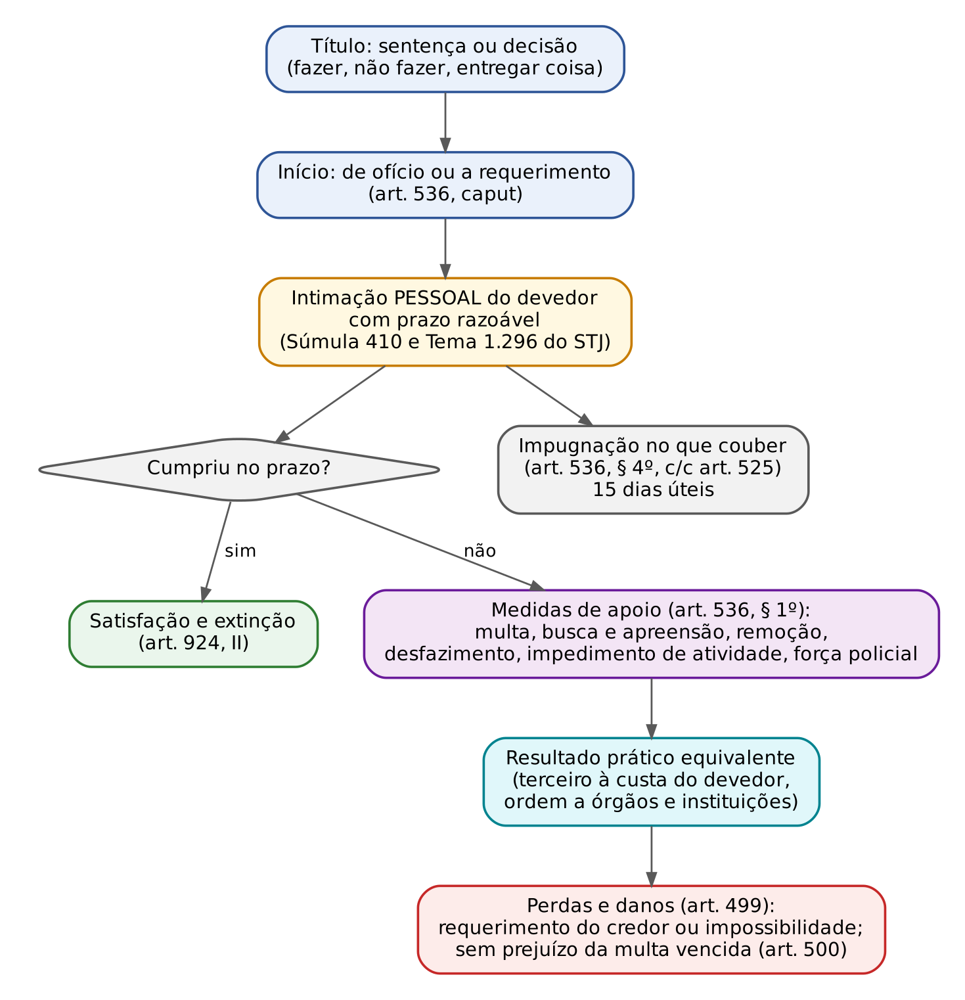
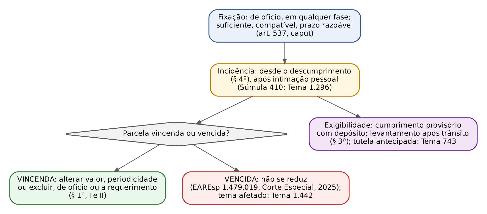
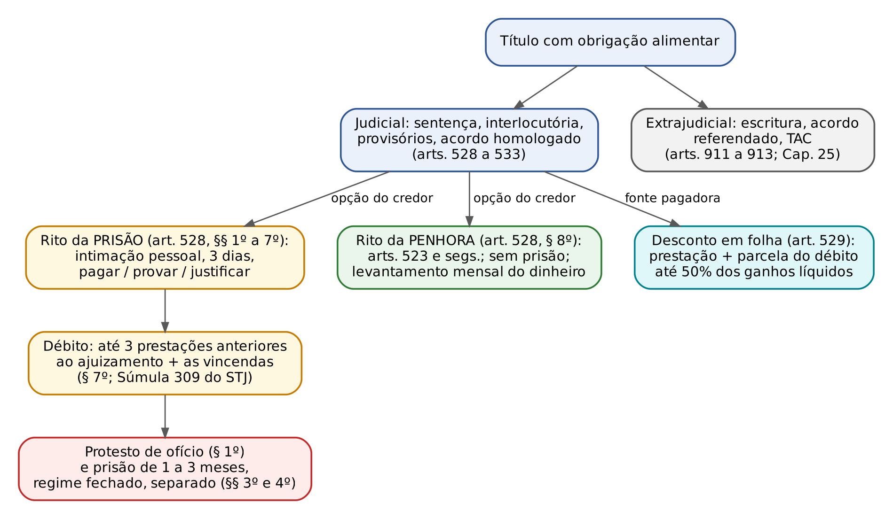
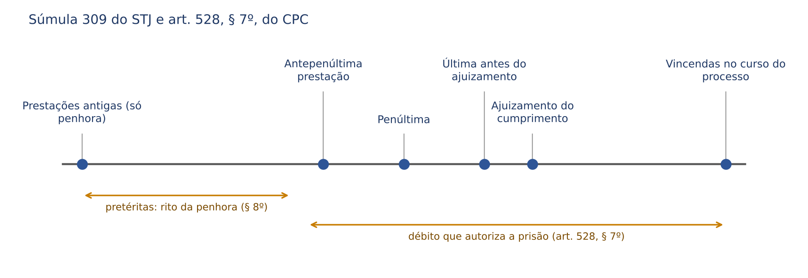

# CAPÍTULO 23 — CUMPRIMENTO DE SENTENÇA II: FAZER, NÃO FAZER, ENTREGAR COISA E ALIMENTOS

:::INCIDENCIA
TRF5 p. 13; TJRS p. 11; TJSC p. 11. Nível A. Lote: 15 questões (FGV 11, FCC 4), mais 12 correlatas de outros lotes.
O que mais cai: alteração da multa vencida x vincenda (art. 537, § 1º, e EAREsp 1.479.019), execução provisória das *astreintes*, multa de ofício sem violar a congruência; no cumprimento de alimentos, Súmula 309 e art. 528, § 7º, opção do credor pelo rito da penhora, desconto em folha até 50%, foro do domicílio do credor e cumulação de ritos.
:::

#### Mapa de cobrança

| Subtema | FGV | FCC | Padrão de cobrança |
|---|---|---|---|
| Multa coercitiva: alteração, exclusão, multa vencida | 4 | 0 | caso com valor acumulado alto; distratores "preclusão *pro judicato*", "coisa julgada", "rescisória", "concordância do exequente" |
| Multa: fixação de ofício, exigibilidade, execução provisória | 3 | 0 | sentença com multa não pedida (válida); depósito e levantamento após o trânsito |
| Rito da prisão: débito, prazo, regime, justificativa | 3 | 2 | "3 prestações anteriores ao ajuizamento"; "1 a 3 meses"; "regime fechado separado"; desemprego não justifica |
| Opção pelo rito da penhora e cumulação de ritos | 2 | 2 | "não será admissível a prisão"; conversão é do credor, não do devedor nem do juiz de ofício |
| Desconto em folha | 2 | 2 | 50% dos ganhos líquidos; débito pretérito também pode ser descontado; empregador não é parte |
| Competência e autos | 3 | 1 | foro do domicílio do credor (art. 528, § 9º); provisórios em autos apartados, definitivos nos mesmos autos |
| Título: alimentos da Lei Maria da Penha | 1 | 0 | natureza satisfativa, prisão cabível, sem ação principal |

Escopo e remissões. Este capítulo trata da EFETIVAÇÃO das decisões que impõem prestações de fazer, não fazer e entregar coisa (arts. 536 a 538) e do cumprimento das decisões que fixam alimentos (arts. 528 a 533). O CONTEÚDO da sentença nessas obrigações (arts. 497 a 501, primazia da tutela específica, Lei 14.833/2024 no art. 499, parágrafo único, declaração de vontade) está no Cap. 20 (20.9); a tutela inibitória e de remoção do ilícito, no Cap. 14 (14.7); as disposições gerais do cumprimento, o cumprimento provisório e a impugnação (arts. 513 a 527), no Cap. 22; as medidas atípicas do art. 139, IV, e a ADI 5.941, no Cap. 24; a execução de título extrajudicial de fazer, não fazer, entregar coisa e alimentos (arts. 806 a 823 e 911 a 913), no Cap. 25; a ação de alimentos (Lei 5.478/1968) e os gravídicos, no Cap. 30; o direito material dos alimentos (trinômio, avoengos, Súmulas 358, 596 e 621 em sua face material, quem não pode ser preso), na Apostila de Direito Civil, Cap. 39 (39.9 traz quadro sobre execução e prisão civil, que aqui só se complementa no ângulo processual).

## 23.1 Cumprimento de sentença das obrigações de fazer e não fazer (art. 536)

### 23.1.1 A lógica do regime: atipicidade e técnica mandamental

O CPC/2015 manteve o modelo inaugurado pela reforma de 1994 (art. 461 do CPC/1973): nas obrigações específicas, a sentença não se executa por processo autônomo nem por procedimento rígido; ela se EFETIVA por meio de medidas escolhidas pelo juiz, na mesma relação processual, segundo a necessidade do caso. Três traços estruturam o regime e explicam as questões:

- Atipicidade dos meios. O juiz "poderá, de ofício ou a requerimento, [...] determinar as medidas necessárias à satisfação do exequente" (art. 536, *caput*). O rol do § 1º é exemplificativo ("entre outras medidas").
- Iniciativa oficial. Diferentemente do cumprimento de obrigação de pagar quantia, que depende de requerimento do exequente (art. 513, § 1º), o cumprimento de fazer e não fazer pode ser deflagrado DE OFÍCIO. A diferença decorre da natureza mandamental e executiva *lato sensu* da tutela específica: a ordem judicial já contém em si o comando a ser efetivado.
- Dupla finalidade. As medidas servem à "efetivação da tutela específica" (o exato bem devido) ou à "obtenção de tutela pelo resultado prático equivalente" (situação equivalente à do adimplemento). Perdas e danos são o último degrau (art. 499; Cap. 20, 20.9).

:::LEI CPC, ART. 536
Art. 536. No cumprimento de sentença que reconheça a exigibilidade de obrigação de fazer ou de não fazer, o juiz poderá, de ofício ou a requerimento, para a efetivação da tutela específica ou a obtenção de tutela pelo resultado prático equivalente, determinar as medidas necessárias à satisfação do exequente.
§ 1º Para atender ao disposto no caput, o juiz poderá determinar, entre outras medidas, a imposição de multa, a busca e apreensão, a remoção de pessoas e coisas, o desfazimento de obras e o impedimento de atividade nociva, podendo, caso necessário, requisitar o auxílio de força policial.
§ 2º O mandado de busca e apreensão de pessoas e coisas será cumprido por 2 (dois) oficiais de justiça, observando-se o disposto no art. 846, §§ 1º a 4º, se houver necessidade de arrombamento.
§ 3º O executado incidirá nas penas de litigância de má-fé quando injustificadamente descumprir a ordem judicial, sem prejuízo de sua responsabilização por crime de desobediência.
§ 4º No cumprimento de sentença que reconheça a exigibilidade de obrigação de fazer ou de não fazer, aplica-se o art. 525, no que couber.
§ 5º O disposto neste artigo aplica-se, no que couber, ao cumprimento de sentença que reconheça deveres de fazer e de não fazer de natureza não obrigacional.
:::

### 23.1.2 Pontos de letra que as bancas exploram

- "De ofício ou a requerimento" (caput) e "independe de requerimento da parte" (art. 537, caput): a iniciativa oficial vale para as medidas e para a multa.
- "Entre outras medidas" (§ 1º): rol exemplificativo; o juiz pode adotar medida diversa da pedida, se mais adequada e menos gravosa, sem julgamento *extra petita*, porque a congruência se mede pelo resultado pretendido, não pela técnica executiva indicada (Cap. 14, 14.4.4).
- Busca e apreensão por DOIS oficiais de justiça (§ 2º), com a disciplina do arrombamento do art. 846, §§ 1º a 4º (ordem de arrombamento, auto circunstanciado assinado por duas testemunhas, força policial se necessário).
- Descumprimento injustificado gera litigância de má-fé, "sem prejuízo" do crime de desobediência (§ 3º). A sanção por litigância (art. 81) é cumulável com a multa coercitiva, porque têm naturezas distintas (punitiva x coercitiva).
- Defesa por impugnação "no que couber" (§ 4º): prazo de 15 dias úteis contado do fim do prazo assinado para cumprimento, com as matérias do art. 525, § 1º, adaptadas (inexigibilidade, causa extintiva superveniente, ilegitimidade, falta ou nulidade de citação na fase de conhecimento se o processo correu à revelia, excesso que aqui assume a forma de exigência além do título). A impugnação não tem efeito suspensivo automático (art. 525, § 6º; Cap. 22).
- Deveres "de natureza não obrigacional" (§ 5º; idem art. 537, § 5º): o regime se aplica também a deveres legais sem fonte negocial (abstenção de poluir, dever de não violar direito da personalidade, deveres de vizinhança, deveres impostos por lei ao poder público). É a base da efetivação das tutelas inibitórias e das condenações em ações coletivas.

### 23.1.3 Competência, intimação e prazo para cumprir

Competência. Aplica-se o art. 516 (Cap. 22): juízo que decidiu a causa em primeiro grau, com a opção do exequente, no parágrafo único, pelo juízo do atual domicílio do executado, pelo do local dos bens ou pelo "do local onde deva ser executada a obrigação de fazer ou de não fazer", com remessa dos autos solicitada ao juízo de origem.

A FCC cobrou a letra dessa opção e o contraste com o início de ofício (Q3530388, gabarito B, e Q3891333, gabarito D; boxes no Cap. 22, 22.4.1); na Q3530388, as alternativas C e E afirmavam que o cumprimento da prisão exime o devedor de alimentos das prestações vencidas ou vincendas, o que o art. 528, § 5º, nega (23.7.3).

Intimação pessoal (Súmula 410 e Tema 1.296). A multa só incide depois que o devedor é intimado PESSOALMENTE para cumprir a obrigação de fazer ou não fazer especificada na decisão. A Súmula 410 do STJ ("A prévia intimação pessoal do devedor constitui condição necessária para a cobrança de multa pelo descumprimento da obrigação de fazer ou não fazer"), editada sob o CPC/1973, teve sua vigência questionada diante do art. 513, § 2º, I, do CPC/2015 (intimação do devedor pelo Diário, na pessoa do advogado). A Corte Especial encerrou a controvérsia em repetitivo.

:::JURIS STJ, TEMA 1.296 (RESP 2.096.505-SP, RESP 2.140.662-GO E RESP 2.142.333-GO, CORTE ESPECIAL, J. 4/3/2026; INFORMATIVO 880)
Tese: "A prévia intimação pessoal do devedor para o cumprimento de obrigação de fazer ou de não fazer especificada na decisão judicial é pressuposto para a incidência da multa coercitiva, nos termos da Súmula n. 410/STJ, cujo teor permanece hígido após a entrada em vigor do CPC de 2015."
Por quê: a obrigação de fazer é ato PESSOAL do devedor, e a multa é técnica de pressão sobre a vontade dele; não se coage quem não sabe, com certeza, o que deve fazer e em que prazo. O art. 513, § 2º, I, cuida da intimação para PAGAR (ato que o advogado pode providenciar com recursos do cliente). Pessoa jurídica: intimação dirigida ao representante legal.
Consequência prática: intimada só a parte pelo advogado, a multa não corre; o juiz deve determinar a intimação pessoal (por carta, oficial ou meio eletrônico admitido em lei) antes de contar o prazo.
:::

:::ATENCAO SÚMULA 410 X EFEITOS DA TUTELA
A intimação pessoal é pressuposto da INCIDÊNCIA DA MULTA, não da eficácia da ordem. A ordem vale desde a intimação regular pelo advogado para os demais efeitos (litigância de má-fé, medidas sub-rogatórias, busca e apreensão). Em prova, "a falta de intimação pessoal torna nula a decisão" é falso; "impede a cobrança da multa" é verdadeiro.
:::

Prazo. O juiz assina "prazo razoável para cumprimento do preceito" (art. 537, caput). Não há prazo legal fixo no cumprimento de sentença (o de 15 dias do art. 523 é do pagar quantia). Na execução de título extrajudicial de fazer, ao contrário, o prazo é o do título e, se omisso, o fixado pelo juiz (art. 815; Cap. 25).

:::QUESTAO FCC 2025 — TRT 2ª REGIÃO — ANALISTA JUDICIÁRIO, OFICIAL DE JUSTIÇA (Q3660530; LOTE DO CAP. 25)
Execução de obrigação de fazer (título extrajudicial). Gabarito: E — não satisfeita a obrigação, o exequente pode, nos próprios autos, requerer a satisfação à custa do executado ou perdas e danos (art. 816). Armadilhas: prazo fixo de 5 ou 15 dias "ainda que outro conste do título" (A e D: vale o prazo do título, art. 815); multa só se prevista no título (B: o juiz fixa ao despachar a inicial, art. 814); multa do título "não pode ser reduzida" (C: se excessiva, o juiz a reduz, art. 814, parágrafo único). Serve aqui como contraste: no cumprimento de sentença a satisfação por terceiro e a conversão também ocorrem nos próprios autos.
:::

## 23.2 Medidas de apoio, resultado prático equivalente e conversão em perdas e danos

### 23.2.1 Medidas sub-rogatórias e coercitivas

As medidas de apoio dividem-se em sub-rogatórias (o Estado substitui o devedor e obtém o resultado sem a colaboração dele: busca e apreensão, remoção de pessoas e coisas, desfazimento de obras, ordem a terceiro ou a órgão público) e coercitivas (pressionam a vontade do devedor para que ele mesmo cumpra: multa, restrições de direitos). Nas obrigações FUNGÍVEIS, a via sub-rogatória costuma ser mais eficiente (contratação de terceiro à custa do devedor, ordem ao registro ou ao órgão que substitua a conduta). Nas INFUNGÍVEIS, só a coerção serve; frustrada, resta a conversão em perdas e danos.

| Medida | Tipo | Exemplo | Observação |
|---|---|---|---|
| Multa periódica ou fixa | coercitiva | multa diária por não restabelecer serviço | ver 23.3 |
| Busca e apreensão | sub-rogatória | apreensão de exemplares contrafeitos | 2 oficiais (art. 536, § 2º) |
| Remoção de pessoas e coisas | sub-rogatória | retirada de equipamentos de área pública | força policial se necessário |
| Desfazimento de obras | sub-rogatória | demolição de muro irregular às custas do réu | custeio pelo devedor |
| Impedimento de atividade nociva | sub-rogatória ou coercitiva | interdição de estabelecimento poluidor | também nas ações coletivas |
| Ordem a órgãos e instituições | sub-rogatória | ofício ao DETRAN ou ao registro para transferir bem; ao banco para baixar gravame | preferencial (EAREsp 1.479.019) |
| Bloqueio de verbas públicas | sub-rogatória | sequestro de valores para medicamento | Tema 84 do STJ (Cap. 14, 14.2.3) |
| Medidas atípicas restritivas (CNH, passaporte) | coercitivas | após esgotar as típicas | art. 139, IV; ADI 5.941 (Cap. 24) |

:::DICA ORDENS DIRIGIDAS A TERCEIROS: A SAÍDA PREFERIDA PELO STJ
Quando o resultado puder ser obtido sem a vontade do devedor — expedição de ofício ao órgão de trânsito, ao cartório, à instituição financeira, à operadora de cadastro —, o juiz deve preferir essa via à multa. A Corte Especial afirmou isso expressamente como forma de evitar *astreintes* desproporcionais: a multa é instrumento para obrigações que dependem do devedor, não substituto preguiçoso das medidas sub-rogatórias (EAREsp 1.479.019-SP; 23.3.4).
:::

### 23.2.2 Conversão em perdas e danos na fase de cumprimento

A conversão ocorre se o credor a requerer ou se impossíveis a tutela específica e o resultado prático equivalente (art. 499); nas hipóteses do parágrafo único do art. 499 (Lei 14.833/2024), o juiz concede primeiro ao devedor a faculdade de cumprir (Cap. 20, 20.9.1). Na fase de cumprimento, a conversão se processa NOS PRÓPRIOS AUTOS, com liquidação incidental do valor (arbitramento ou procedimento comum, conforme o caso — Cap. 22), seguindo-se o cumprimento de pagar quantia (arts. 523 e seguintes). A indenização "dar-se-á sem prejuízo da multa" (art. 500): o crédito de *astreintes* já vencido soma-se às perdas e danos.

Quatro precisões jurisprudenciais:

- Conversão de ofício por inércia abusiva do credor. A Corte Especial admitiu a conversão de ofício quando o credor, diante de multa que se acumula, deixa deliberadamente de requerer a conversão ou outras medidas, apostando no crescimento do crédito (EAREsp 1.479.019-SP; 23.3.4). É o remédio preventivo contra a "indústria das *astreintes*".
- Conversão por ineficiência estatal não é *extra petita*. Em demanda de saúde, a conversão da obrigação de fornecer tratamento em perdas e danos, diante da ineficiência do Estado em cumprir, não configura julgamento *extra petita* (STJ, processo em segredo de justiça, Relatora Ministra Maria Thereza de Assis Moura, Segunda Turma, j. 11/3/2026; Informativo 885): a conversão é consequência legal da impossibilidade (arts. 499 e 536), não pedido novo.
- Limite nas ações coletivas ambientais. O MPF e o particular não podem, por acordo no cumprimento de sentença de ACP ambiental, converter a obrigação de demolir em obrigação de indenizar (STJ, AgInt no REsp 2.154.598-CE, Relatora Ministra Regina Helena Costa, Primeira Turma, j. 22/6/2026; Informativo 900): o direito é indisponível, a tutela específica do meio ambiente tem primazia e o título coletivo não se transaciona como crédito disponível (tema de fundo na Apostila de Direito Ambiental).
- Credor requer a conversão ainda que a tutela específica seja possível. Fora das hipóteses do parágrafo único do art. 499, basta o requerimento do credor; o juiz não pode impor a tutela específica a quem prefere o equivalente.

:::QUESTAO FGV 2025 — TJ-SE — JUIZ SUBSTITUTO (Q3301243; LOTE DO CAP. 16)
Sentença condena o vizinho a remover muro e, sem pedido expresso, a pagar custas e honorários; no cumprimento, multa diária e, depois, pedido de conversão em perdas e danos. Gabarito: A — custas e honorários são pedidos implícitos (Cap. 16). Pontos deste capítulo: (B) é falsa, porque o credor pode requerer a conversão ainda que possível a tutela específica (art. 499); (C) é falsa pela palavra "apenas": o juiz pode modificar valor ou periodicidade da multa vincenda "ou excluí-la" (art. 537, § 1º); (D) é falsa, pois a multa "independe de requerimento" (art. 537); (E) é falsa porque, transitada a sentença, o cumprimento é definitivo. Lição: a FGV transforma a letra do § 1º em pegadinha pela supressão do "ou excluí-la".
:::

### 23.2.3 Obrigações de fazer contra o Poder Público

Nada impede a imposição de multa e de medidas sub-rogatórias à Fazenda Pública e às empresas estatais: a imposição de multa diária a ente público para compeli-lo a fornecer medicamento a pessoa desprovida de recursos foi admitida em repetitivo (Tema 98 do STJ; v. Cap. 15), e o bloqueio de verbas públicas para garantir o fornecimento, também (Tema 84; Cap. 14). As restrições à tutela provisória contra o Poder Público (Leis 8.437/1992 e 9.494/1997; art. 1.059) não alcançam a efetivação de sentença nem as matérias previdenciária e de saúde (Cap. 15). O regime de precatórios só se aplica à obrigação de PAGAR; a multa vencida, convertida em crédito pecuniário, é cobrada pelo rito dos arts. 534 e 535 (Cap. 27).

:::QUESTAO FGV 2026 — DATAPREV — ANALISTA, ADVOCACIA (Q4389177)
Tutela de urgência em ação previdenciária determina ao INSS a atualização do CNIS e à DATAPREV (empresa pública) a disponibilização de dados em 5 dias úteis, sob multa diária de 1.000 (mil) reais. Gabarito: D — a multa contra empresa pública é lícita e o juiz pode, de ofício ou a requerimento, modificar valor ou periodicidade da multa vincenda se insuficiente ou excessiva (art. 537, § 1º). Armadilhas: (A) nulidade da multa contra estatal, com responsabilização só do agente (falso: a parte é a pessoa jurídica; Tema 98 admite multa até contra pessoa jurídica de direito público); (B) irrecorribilidade imediata da tutela (cabe agravo de instrumento, art. 1.015, I); (C) imutabilidade da multa (Tema 706: não preclui nem faz coisa julgada); (E) vedação absoluta de tutela em matéria previdenciária (falso; Cap. 15).
:::

## 23.3 Multa coercitiva (*astreintes*)

### 23.3.1 Natureza e regime legal

A multa do art. 537 é técnica de coerção indireta: não é pena, não é indenização, não integra o pedido nem o mérito. Disso decorrem as soluções cobradas: (a) pode ser imposta de ofício, sem ofensa à congruência; (b) não faz coisa julgada e não preclui temporalmente (Tema 706), podendo ser modificada; (c) é cumulável com perdas e danos (art. 500), com a multa por litigância de má-fé e com a multa por ato atentatório à dignidade da justiça; (d) seu valor não se limita ao da obrigação principal; (e) reverte ao exequente (§ 2º).

:::LEI CPC, ART. 537
Art. 537. A multa independe de requerimento da parte e poderá ser aplicada na fase de conhecimento, em tutela provisória ou na sentença, ou na fase de execução, desde que seja suficiente e compatível com a obrigação e que se determine prazo razoável para cumprimento do preceito.
§ 1º O juiz poderá, de ofício ou a requerimento, modificar o valor ou a periodicidade da multa vincenda ou excluí-la, caso verifique que:
I - se tornou insuficiente ou excessiva;
II - o obrigado demonstrou cumprimento parcial superveniente da obrigação ou justa causa para o descumprimento.
§ 2º O valor da multa será devido ao exequente.
§ 3º A decisão que fixa a multa é passível de cumprimento provisório, devendo ser depositada em juízo, permitido o levantamento do valor após o trânsito em julgado da sentença favorável à parte. (Redação dada pela Lei nº 13.256, de 2016)
§ 4º A multa será devida desde o dia em que se configurar o descumprimento da decisão e incidirá enquanto não for cumprida a decisão que a tiver cominado.
§ 5º O disposto neste artigo aplica-se, no que couber, ao cumprimento de sentença que reconheça deveres de fazer e de não fazer de natureza não obrigacional.
:::

### 23.3.2 Fixação: de ofício, em qualquer fase, com parâmetros

Requisitos do caput: multa "suficiente" (apta a vencer a resistência do devedor, considerada sua capacidade econômica) e "compatível com a obrigação" (proporcional ao bem tutelado), com "prazo razoável" para cumprir. Os critérios devem ser observados no MOMENTO DA FIXAÇÃO; a multa "não está limitada ao valor da obrigação principal" (Enunciado 96 da I Jornada de Direito Processual Civil do CJF). A periodicidade pode ser diária, horária, semanal ou por ato de descumprimento (esta, a mais adequada às obrigações de não fazer: "multa de X por ato de violação"). É boa técnica fixar um teto inicial, revisável — o teto não impede que a multa continue a incidir se o juiz o elevar, nem dá ao devedor o "direito" de descumprir pagando o teto.

:::QUESTAO FGV 2024 — TJ-PE — JUIZ SUBSTITUTO (Q3117520)
Sentença condena o réu a cumprir obrigação de fazer contratual em prazo, sob multa diária não pedida na inicial. Gabarito: E — a sentença é válida, conforme a disciplina legal. Fundamento: a multa "independe de requerimento da parte" e pode ser aplicada "na sentença" (art. 537, caput). Armadilhas: as quatro alternativas restantes combinam *ultra* ou *extra petita* com anulação ou decote; nenhuma se aplica a técnica executiva imposta de ofício (Cap. 20, 20.6.3). No mesmo sentido: Q3966654 (FGV 2026 — TJ-GO — Juiz, alternativa C falsa: multa de ofício tem fundamento no CPC).
:::

Hipóteses em que a multa não cabe ou é limitada:

- Exibição de documento relativo a direito disponível: o STJ fixou, sob o CPC/1973, o "descabimento de multa cominatória na exibição, incidental ou autônoma, de documento relativo a direito disponível" (Tema 705), em linha com a Súmula 372 do STJ (v. Cap. 19). Atenção: o CPC/2015 passou a autorizar, na exibição incidental, "medidas indutivas, coercitivas, mandamentais ou sub-rogatórias necessárias para que o documento seja exibido" (art. 400, parágrafo único), e o STJ, no Tema 1.000, admitiu a multa na exibição incidental depois de tentada a busca e apreensão ou outra medida coercitiva e com contraditório prévio (v. Cap. 19). Em contraste, admitiu-se a multa pelo atraso injustificado da Caixa na exibição dos extratos do FGTS (Tema 149 do STJ; v. Cap. 19).
- Obrigação de pagar quantia: a multa do art. 537 não é técnica do pagar (que tem a multa de 10% do art. 523, § 1º); medidas coercitivas atípicas no pagar seguem o art. 139, IV (Cap. 24).
- Prisão civil: não é medida de apoio das obrigações de fazer; a única prisão civil admitida é a do devedor de alimentos (art. 5º, LXVII, da CF; o depositário judicial infiel não pode ser preso — Tema 220 do STJ).

### 23.3.3 Incidência e termo inicial

A multa é devida "desde o dia em que se configurar o descumprimento" e incide "enquanto não for cumprida a decisão" (§ 4º). Termo inicial: o primeiro dia após o fim do prazo assinado, contado da intimação PESSOAL (Súmula 410; Tema 1.296; 23.1.3). Termo final: o cumprimento, a decisão que exclua a multa vincenda, a conversão em perdas e danos ou a impossibilidade superveniente. O fato gerador é o descumprimento da ordem, não o direito material: por isso a multa fixada em liminar de ação inibitória subsistiu à posterior extinção da ação sem resolução do mérito (Pet 16.334-DF; v. Cap. 14, 14.2.3).

Transmissibilidade. O crédito da multa, já vencido, tem natureza patrimonial e transmite-se aos sucessores do credor que falece, ainda que a obrigação principal fosse personalíssima (tratamento médico): admitir a extinção premiaria o descumprimento (STJ, AgInt no REsp 2.123.791-SP, Relator Ministro Marco Buzzi, Quarta Turma, j. 4/11/2024; Informativo 837).

Gratuidade. O beneficiário da gratuidade não se exime da multa coercitiva: a gratuidade abrange despesas processuais, e "a concessão de gratuidade não afasta o dever de o beneficiário pagar, ao final, as multas processuais que lhe sejam impostas" (art. 98, § 4º; Cap. 8).

### 23.3.4 Alteração e exclusão: vincenda x vencida

É o ponto mais cobrado, e a jurisprudência oscilou. A letra do § 1º autoriza o juiz, de ofício ou a requerimento, a "modificar o valor ou a periodicidade da multa VINCENDA ou excluí-la", se (I) insuficiente ou excessiva, ou (II) se o obrigado demonstrou cumprimento parcial superveniente ou justa causa para o descumprimento. O CPC/1973 (art. 461, § 6º) falava apenas em "multa", sem qualificativo.

| Fase | Orientação | Fonte |
|---|---|---|
| CPC/1973 e primeiros anos do CPC/2015 | valor acumulado revisável a qualquer tempo, de ofício, mesmo no cumprimento, porque fixado *rebus sic stantibus*; a decisão "não preclui, não fazendo tampouco coisa julgada" | Tema 706 (REsp 1.333.988-SP, Segunda Seção, j. 9/4/2014); EAREsp 650.536-RJ (Corte Especial, j. 7/4/2021) |
| 2024 | Tema 706 afasta a preclusão TEMPORAL, não a CONSUMATIVA: uma vez reduzido o valor, não se admitem sucessivas revisões ("não é lícito modificar o que já foi modificado"); sinalização de que o § 1º só permite alterar a vincenda | EAREsp 1.766.665-RS, Corte Especial, j. 3/4/2024 (Informativo 806) |
| 2025 | "A modificação das astreintes somente é possível em relação à multa vincenda [...] de modo que não é lícita a redução da multa vencida, ainda que alcançados patamares elevados"; o excesso combate-se preventivamente: conversão de ofício em perdas e danos diante da inércia abusiva do credor e preferência por ordens a órgãos e instituições | EAREsp 1.479.019-SP, Relator para o acórdão Ministro Ricardo Villas Bôas Cueva, Corte Especial, j. 7/5/2025 (Informativo 853) |
| 2026 | afetação para definir (i) a possibilidade de modificar multas vencidas, além das vincendas, e (ii) o que se considera multa vencida; e, em tema conexo, parâmetros de razoabilidade e proporcionalidade na fixação e no montante acumulado; suspensão dos REsp e AREsp sobre a matéria | Temas 1.442 e 1.448 do STJ (Corte Especial, Relator Ministro Raul Araújo; afetados em 26/5/2026 e 2/6/2026; sem julgamento até a data desta apostila) |

:::JURIS STJ, EARESP 1.479.019-SP, CORTE ESPECIAL, J. 7/5/2025 (INFORMATIVO 853)
Tese: a modificação das *astreintes* só é possível quanto à multa vincenda (art. 537, § 1º); não é lícita a redução da multa vencida, ainda que em patamar elevado. Remédios preventivos contra valores exorbitantes: (i) conversão da obrigação de fazer em perdas e danos, DE OFÍCIO, quando verificada a inércia abusiva do credor quanto à faculdade do art. 499; (ii) preferência por ordens judiciais a órgãos públicos e instituições privadas que alcancem o resultado prático equivalente, substituindo a atuação do obrigado.
Lógica: vencida a multa, o crédito sai da esfera processual e ingressa no patrimônio do credor; reduzi-lo retroativamente premiaria o devedor recalcitrante e incentivaria a "litigância abusiva reversa" (descumprir e depois pedir redução). O controle da proporcionalidade se faz no momento da fixação e ao longo da incidência, não depois.
:::

:::QUESTAO FGV 2026 — TJ-GO — JUIZ SUBSTITUTO (Q3966654)
Tutela de urgência, deferida sem pedido de multa, manda concessionária restabelecer água em 24 horas, sob multa HORÁRIA de 1.000 (mil) reais, sem teto; a autora viaja por 90 dias e, ao voltar, pede o cumprimento provisório do valor acumulado; a ré alega falta de pedido, descabimento da execução provisória e desproporção. Gabarito: A — a modificação só é possível quanto à multa vincenda; não é lícita a redução da vencida, ainda que elevada (EAREsp 1.479.019). Armadilhas: (B) a ausência da autora não torna o serviço não essencial nem autoriza revogação retroativa; (C) multa de ofício é válida (art. 537); (D) inverte a jurisprudência: eficácia e exigibilidade NÃO se confundem — a multa produz efeitos desde o descumprimento, e só a exigibilidade se condiciona (Tema 743; 23.3.5); (E) reproduz a tese, mas troca "preferência" por "obrigatoriedade" das ordens judiciais e funde os dois remédios como requisitos cumulativos. Lição: a FGV copia a ementa e altera uma palavra.
:::

:::QUESTAO FGV 2026 — TJ-PE — JUIZ SUBSTITUTO (Q4349478)
Remoção de conteúdo ofensivo na internet; multa diária de 1.000 (mil) reais com teto de 50.000 (cinquenta mil) reais; 100 dias de descumprimento; depois a executada demonstra que o cumprimento se tornou impossível por fato alheio à sua vontade e pede a exclusão integral da multa. Gabarito: D — a exclusão integral é cabível quando demonstrada justa causa para o descumprimento ou impossibilidade não imputável ao obrigado. Fundamento: art. 537, § 1º, II (justa causa) e § 4º (a multa pressupõe descumprimento; sem conduta exigível do devedor não há o que coagir). Armadilhas: (A) "preclusão *pro judicato*" e "direito adquirido"; (B) coisa julgada e rescisória (Tema 706); (C) "apenas a vincenda, vedado alterar as vencidas" — foi considerada FALSA aqui; (E) concordância do exequente.
Compare com Q3966654 (TJ-GO, mesmo ano e mesma banca), que deu como CORRETA a vedação de reduzir a multa vencida. Conciliação possível: no TJ-GO, o fundamento invocado era a desproporção do valor acumulado (inciso I), que o EAREsp 1.479.019 só admite para a vincenda; no TJ-PE, o fundamento é a inexigibilidade do próprio cumprimento (justa causa ou impossibilidade não imputável, inciso II), que retira o pressuposto da incidência desde a sua ocorrência. Em prova: excesso de valor acumulado → não se reduz a vencida; impossibilidade não imputável ou justa causa demonstrada → exclusão cabível. A questão é sensível e está pendente nos Temas 1.442 e 1.448 (ver Nota).
:::

:::QUESTAO FGV 2024 — TJ-MT — JUIZ SUBSTITUTO (Q3086926)
Afirmações sobre a multa cominada para obrigação de fazer. Gabarito: B — a decisão que fixa as *astreintes* admite cumprimento provisório, mas o levantamento só após o trânsito da sentença favorável (art. 537, § 3º). Armadilhas: (A) incompatibilidade com a multa por ato atentatório (falso: a multa do art. 77, § 2º, "poderá ser fixada independentemente da incidência das previstas nos arts. 523, § 1º, e 536, § 1º" (art. 77, § 4º); naturezas e destinatários distintos — a do ato atentatório, não paga, inscreve-se em dívida ativa da União ou do Estado e reverte aos fundos do art. 97 (art. 77, § 3º); a *astreinte* reverte ao exequente, art. 537, § 2º); (C) gratuidade isenta (falso, art. 98, § 4º); (D) redução do acumulado "desde que haja requerimento do devedor" (falso: de ofício ou a requerimento; e, hoje, só da vincenda); (E) inscrição em dívida ativa (falso: o crédito é do exequente — confusão proposital com o art. 77, § 3º).
:::

:::PEGADINHA SEIS FRASES SOBRE A MULTA
"Depende de pedido" (falso). "Faz coisa julgada" (falso, Tema 706). "Limita-se ao valor da obrigação principal" (falso, Enunciado 96). "O juiz pode reduzir o valor já vencido porque excessivo" (falso hoje, EAREsp 1.479.019, salvo nova orientação nos Temas 1.442 e 1.448). "Pode ser revista sucessivas vezes" (falso, preclusão consumativa: EAREsp 1.766.665). "Reverte ao Estado" (falso: ao exequente, § 2º).
:::

Recursos. A decisão que fixa, majora, reduz ou exclui a multa, proferida na fase de conhecimento como capítulo de tutela provisória, é agravável (art. 1.015, I); na fase de cumprimento, toda interlocutória é agravável (art. 1.015, parágrafo único). Embargos de divergência não se prestam a discutir o VALOR da multa, que depende das particularidades do caso (Jurisprudência em Teses do STJ, ed. 173, tese 12). Multa cominatória aplicada por juízo criminal com base no CPC tem natureza cível: os embargos de declaração seguem o prazo de cinco dias do CPC (Jurisprudência em Teses do STJ, ed. 191, tese 10).

### 23.3.5 Exigibilidade e execução provisória da multa

Duas camadas normativas convivem:

- Art. 537, § 3º (redação da Lei 13.256/2016): "A decisão que fixa a multa é passível de cumprimento provisório, devendo ser depositada em juízo, permitido o levantamento do valor após o trânsito em julgado da sentença favorável à parte." A redação original do CPC/2015 permitia o levantamento também na pendência de agravo contra a inadmissão de recurso especial ou extraordinário; a Lei 13.256/2016 eliminou essa hipótese.
- Tema 743 do STJ (CPC/1973): "A multa diária [...], devida desde o dia em que configurado o descumprimento, quando fixada em antecipação de tutela, somente poderá ser objeto de execução provisória após a sua confirmação pela sentença de mérito e desde que o recurso eventualmente interposto não seja recebido com efeito suspensivo."

A Terceira Turma chegou a afirmar que o Tema 743 não se aplicaria ao CPC/2015, que permitiria a execução provisória antes da sentença (REsp 1.958.679-GO, Relatora Ministra Nancy Andrighi, j. 23/11/2021; Informativo 719). A Corte Especial, porém, reafirmou o Tema 743 sob o CPC/2015: eficácia e exigibilidade não se confundem; a multa produz efeitos desde o descumprimento, mas, fixada em tutela antecipada, só pode ser executada provisoriamente após a confirmação pela sentença de mérito e se o recurso não tiver efeito suspensivo (EAREsp 1.883.876-RS, Relator para o acórdão Ministro Luis Felipe Salomão, Corte Especial, j. 23/11/2023; Informativo 827). Confirmada pela sentença, prossegue o cumprimento provisório com depósito, e o levantamento fica condicionado ao trânsito em julgado (STJ, REsp 2.169.203-MG, Relator Ministro Ricardo Villas Bôas Cueva, Terceira Turma, j. 4/2/2025).

| Momento da fixação | Pode executar provisoriamente? | Levantamento |
|---|---|---|
| Tutela antecipada, antes da sentença | NÃO, enquanto não confirmada pela sentença de mérito (Tema 743; EAREsp 1.883.876) | — |
| Tutela confirmada na sentença, apelação sem efeito suspensivo (art. 1.012, § 1º, V) | SIM, com depósito (art. 537, § 3º) | após o trânsito da sentença favorável |
| Sentença com multa, apelação com efeito suspensivo | NÃO (a própria sentença não é eficaz) | — |
| Sentença transitada em julgado | cumprimento DEFINITIVO | imediato, após a fase de pagamento |

:::ATENCAO ENUNCIADO 96 DO CJF X TEMA 743
O Enunciado 96 da I Jornada diz que a multa "não pode ter sua exigibilidade postergada para depois do trânsito em julgado". Não há contradição com o § 3º: o que se posterga é o LEVANTAMENTO, não a exigibilidade (o devedor deve depositar). A tensão real é com o Tema 743, que posterga a exigibilidade da multa fixada em tutela antecipada até a sentença. Em prova FGV de 2024 a 2026, prevaleceu a jurisprudência da Corte Especial (Tema 743 reafirmado).
:::

Se a sentença final for de improcedência, a tutela provisória revoga-se, e a multa fixada nela, ainda não levantada, em regra não é devida (o § 3º condiciona o levantamento à "sentença favorável à parte"). A exceção da Pet 16.334-DF (23.3.3) não deve ser generalizada.

:::SENTENCA DECISÃO QUE FIXA A MULTA E DETERMINA A INTIMAÇÃO PESSOAL
"Defiro o cumprimento de sentença. Intime-se PESSOALMENTE a executada, na pessoa de seu representante legal (Súmula 410 e Tema 1.296 do STJ), para que, no prazo de 10 (dez) dias, proceda à baixa do gravame sobre o veículo descrito no título, sob pena de multa diária de 500 (quinhentos) reais, limitada inicialmente a 15.000 (quinze mil) reais, sem prejuízo de outras medidas (arts. 536, § 1º, e 537 do CPC). Sem prejuízo, oficie-se ao DETRAN para que, decorrido o prazo sem cumprimento, proceda diretamente à baixa, valendo esta decisão como ordem (resultado prático equivalente). A impugnação poderá ser oferecida no prazo de 15 (quinze) dias úteis após o término do prazo para cumprimento (arts. 525 e 536, § 4º)."
Observação: a ordem simultânea ao órgão de trânsito realiza a diretriz da Corte Especial (EAREsp 1.479.019) e evita multa acumulada desproporcional.
:::

## 23.4 Cumprimento de sentença de obrigação de entregar coisa (art. 538)

Transcorrido o prazo fixado na sentença (art. 498) sem entrega, "será expedido mandado de busca e apreensão ou de imissão na posse em favor do credor, conforme se tratar de coisa móvel ou imóvel" (art. 538, caput). Aplicam-se, no que couber, as disposições do fazer e não fazer (§ 3º): multa, medidas de apoio, intimação pessoal para a incidência da multa, impugnação. A Súmula 500 do STF (descabimento de cominatória na obrigação de dar) está superada (Cap. 20, 20.9.1).

Benfeitorias: a regra de concentração. A existência de benfeitorias deve ser alegada NA FASE DE CONHECIMENTO, EM CONTESTAÇÃO, de forma discriminada e com atribuição, sempre que possível e justificadamente, do respectivo valor (§ 1º); o direito de retenção por benfeitorias "deve ser exercido na contestação, na fase de conhecimento" (§ 2º). Não alegado ali, preclui: não pode ser deduzido na impugnação ao cumprimento. A lógica é a da sentença executiva *lato sensu*: a cognição sobre benfeitorias integra o acertamento do direito à coisa.

| Ponto | Cumprimento de sentença (art. 538) | Execução de título extrajudicial (arts. 806 a 813) |
|---|---|---|
| Ato inicial | intimação para entregar no prazo da sentença | CITAÇÃO para entregar em 15 dias (art. 806) |
| Multa | sim (§ 3º) | o juiz pode fixá-la ao despachar a inicial (art. 806, § 1º) |
| Não entrega | mandado de busca e apreensão (móvel) ou imissão na posse (imóvel) | mandado constante da própria citação, cumprido de imediato se não satisfeita a obrigação (art. 806, § 2º) |
| Benfeitorias e retenção | só na contestação, na fase de conhecimento (§§ 1º e 2º) | em EMBARGOS à execução: retenção por benfeitorias necessárias ou úteis (art. 917, IV) |
| Coisa alienada quando já litigiosa | — (regras gerais de fraude e de alienação de coisa litigiosa) | mandado contra o terceiro adquirente, que só será ouvido após depositá-la (art. 808) |
| Coisa deteriorada, não entregue ou não encontrada | conversão em perdas e danos (arts. 499 e 536) | o exequente tem direito ao valor da coisa e às perdas e danos, apurados em liquidação (art. 809) |

:::QUESTAO FCC 2024 — PREFEITURA DE JABOATÃO DOS GUARARAPES — PROCURADOR (Q3542122; LOTE DO CAP. 25)
Execução para entrega de coisa certa (título extrajudicial). Gabarito: E — o executado pode alegar, em embargos, retenção por benfeitorias necessárias ou úteis (art. 917, IV). Armadilhas: (A) multa de 10% (é do pagar quantia); (B) "apenas necessárias"; (C) perda ou deterioração apurada em "ação autônoma" (falso: liquidação nos próprios autos, art. 809); (D) terceiro adquirente "ouvido" antes da entrega (falso: só é ouvido depois de depositar a coisa, art. 808). Contraste cobrado: no CUMPRIMENTO DE SENTENÇA, a retenção vai na contestação (art. 538, § 2º), e não na impugnação.
:::

Coisa incerta. Se a escolha couber ao credor, ele individualiza a coisa na petição inicial; se ao devedor, este a entrega individualizada no prazo fixado (art. 498, parágrafo único). Na execução extrajudicial, o incidente de impugnação à escolha tem prazo de 15 dias (art. 812; Cap. 25).

## 23.5 Cumprimento provisório das obrigações específicas

Ao cumprimento provisório de sentença que reconheça obrigação de fazer, não fazer ou dar coisa aplica-se, no que couber, o regime do cumprimento provisório do pagar (art. 520, § 5º): corre por iniciativa e responsabilidade do exequente, que responde objetivamente pelos danos se a sentença for reformada (inciso I); fica sem efeito se sobrevier decisão que modifique ou ANULE a sentença (inciso II); atos de transferência de posse ou de que possa resultar grave dano dependem de caução (inciso IV), dispensável nas hipóteses do art. 521 (desenvolvimento no Cap. 22). Pressuposto: recurso sem efeito suspensivo. A apelação contra sentença que "confirma, concede ou revoga tutela provisória" não tem efeito suspensivo automático (art. 1.012, § 1º, V), e o apelado pode promover o cumprimento provisório depois de publicada a sentença (§ 2º).

:::QUESTAO FGV 2024 — ENAM (2024.2) (Q3058653; LOTE DO CAP. 22)
Tutela de custeio de tratamento confirmada na sentença; a operadora apela pedindo anulação (cerceamento de defesa) e, subsidiariamente, reforma; o autor requer cumprimento provisório. Gabarito: E — deve-se deferir o cumprimento provisório, respondendo o autor pelos danos se a sentença for reformada (art. 520, I). Passos: (1) sentença que confirma tutela: apelação sem efeito suspensivo (art. 1.012, § 1º, V); (2) o pedido de anulação não confere efeito suspensivo (B, falsa); (3) cumprimento provisório cabe em obrigação de fazer (art. 520, § 5º; C, falsa); (4) a anulação posterior TORNA SEM EFEITO a execução (art. 520, II; D, falsa). No mesmo sentido: Q3114268 (FGV 2024 — TJ-MT — Analista, gabarito D: cumprimento provisório na pendência de recurso sem efeito suspensivo) e Q3744583 (FGV 2025 — TJ-RS — Analista, lote do Cap. 41, gabarito D: tanto a apelação contra sentença de alimentos quanto a contra sentença que concede tutela provisória têm só efeito devolutivo, art. 1.012, § 1º, II e V).
:::

## 23.6 Cumprimento de sentença de alimentos: estrutura, títulos, competência e autos

### 23.6.1 Duas portas, dois ritos e o desconto em folha

O CPC disciplina a cobrança de alimentos por título judicial nos arts. 528 a 533 (cumprimento de sentença) e por título extrajudicial nos arts. 911 a 913 (execução; Cap. 25). Em ambos, o credor ESCOLHE entre o rito da coerção pessoal (prisão civil) e o rito da expropriação (penhora), e pode requerer o desconto em folha quando o devedor tiver fonte pagadora. A escolha é do exequente: o juiz não converte o rito de ofício, e o devedor não tem direito subjetivo à conversão.

### 23.6.2 Títulos que comportam o rito especial

- Sentença que condena a prestar alimentos e "decisão interlocutória que fixe alimentos" (art. 528, caput), inclusive a tutela de urgência e os provisórios da Lei 5.478 (art. 4º).
- Acordo homologado judicialmente (título judicial, art. 515, II e III).
- Alimentos "definitivos ou provisórios" (art. 531, caput). Os gravídicos e os provisionais (hoje realizados como tutela de urgência) também (Apostila de Direito Civil, Cap. 39, 39.6).
- Decisão do juízo criminal que fixa alimentos provisórios como medida protetiva de urgência (Lei 11.340/2006, art. 22, V): título judicial hábil à cobrança imediata, inclusive pelo rito da prisão; natureza SATISFATIVA, não cautelar; não depende de ação principal em 30 dias nem de ratificação pelo juízo cível; subsiste enquanto perdurar a situação de vulnerabilidade decorrente da violência, não apenas o período das agressões, e só se revoga por decisão judicial (STJ, RHC 100.446-MG, Relator Ministro Marco Aurélio Bellizze, Terceira Turma, j. 27/11/2018; Informativo 640).

:::QUESTAO FGV 2026 — TJ-GO — JUIZ SUBSTITUTO (Q3966644)
Alimentos provisórios fixados como medida protetiva no processo criminal por violência doméstica (Lei 11.340/2006, art. 22, V); dez meses sem pagamento; execução com pedido de prisão. Gabarito: D — o crédito é exigível, porque a fixação tem caráter satisfativo e não depende de outra medida judicial, e o inadimplemento justifica a prisão civil. Armadilhas: (A) limitar a obrigação "ao período em que se manteve a violência" (a vulnerabilidade, não a agressão, é o marco); (B) remeter o pedido de prisão ao juízo criminal (a execução e a prisão civil se processam no juízo cível); (C) tratar como cautelar antecedente sujeita aos 30 dias do art. 308 (a natureza é satisfativa); (E) exigir ratificação pelo juízo cível. Atenção ao cálculo: dez meses de atraso não significa prisão por dez meses de débito — pela prisão, só as três últimas antes do ajuizamento e as vincendas; o restante, pela penhora (23.7.4).
:::

Alimentos indenizatórios (ato ilícito) e compensatórios não admitem a prisão civil, segundo o STJ: a hipótese constitucional (art. 5º, LXVII) é a do vínculo familiar (quadro completo de quem não pode ser preso na Apostila de Direito Civil, Cap. 39, 39.9.3). Para os indenizatórios, o CPC oferece garantia própria: a constituição de capital, a requerimento do exequente (art. 533; 23.10).

### 23.6.3 Competência: o foro do domicílio do credor

Além das opções do art. 516, parágrafo único (atual domicílio do executado, local dos bens), "o exequente pode promover o cumprimento da sentença ou decisão que condena ao pagamento de prestação alimentícia no juízo de seu domicílio" (art. 528, § 9º). A regra protege o alimentando que mudou de comarca e afasta a ideia de competência funcional absoluta do juízo da sentença para o cumprimento de alimentos. É faculdade do CREDOR: o devedor não pode exigir que o cumprimento corra em seu domicílio, nem o juízo de origem pode recusar a remessa.

:::QUESTAO FGV 2024 — ENAM (REAPLICAÇÃO) (Q2507021)
Sentença de alimentos (20% dos rendimentos líquidos) proferida em Ponta Grossa; após o trânsito, a credora distribui o cumprimento em Rolândia, atual domicílio do DEVEDOR, pedindo desconto em folha de vencidos e vincendos em 60% dos ganhos líquidos. Gabarito: C — o juiz intima o executado e, sem pagamento voluntário, pode deferir parcialmente o pedido, limitando o desconto a 50% (art. 529, § 3º). Passos: (1) competência: o domicílio do executado é opção legal (art. 516, parágrafo único) — A e D, que afirmam competência absoluta de Ponta Grossa, são falsas; (2) B erra três vezes: intimação na pessoa do advogado (é pessoal), 5 dias (são 3) e "até seis meses" (são 1 a 3); (3) E fala em "cinco prestações" (são três; art. 528, § 7º); (4) o pedido de 60% excede o teto e é deferido em parte.
:::

:::QUESTAO FGV 2024 — TJ-AP — ANALISTA JUDICIÁRIO (Q2442321)
Sentença de alimentos na 1ª Vara de Família da Comarca X; a criança passa a residir na Comarca Y e o pai deixa de pagar. Gabarito: A — o cumprimento poderá ser promovido na Comarca Y, domicílio atual do credor (art. 528, § 9º). Armadilhas: "deverá" na Comarca X (B e C), "processo autônomo" (D: é cumprimento de sentença, com remessa dos autos ou instauração no novo foro) e competência do tribunal (E). No mesmo sentido: Q3345938 (FGV 2025 — TJ-GO — Residente, alternativa D falsa: a competência não é "privativa" da comarca da sentença).
:::

### 23.6.4 Autos: mesmos ou apartados?

| Situação | Onde se processa | Fundamento |
|---|---|---|
| Alimentos PROVISÓRIOS (decisão interlocutória) | autos apartados | art. 531, § 1º |
| Alimentos fixados em sentença ainda NÃO transitada em julgado (cumprimento provisório) | autos apartados | art. 531, § 1º |
| Cumprimento DEFINITIVO (sentença transitada) | nos mesmos autos em que proferida a sentença | art. 531, § 2º |

A razão é prática: os autos principais seguem para o tribunal com a apelação ou continuam na instrução; o cumprimento provisório ou dos provisórios corre em paralelo. Em processo eletrônico, "autos apartados" significa incidente ou processo de cumprimento autônomo, vinculado ao principal.

:::QUESTAO FCC 2026 — MPE-AL — ANALISTA DO MP (Q4092737)
Cumprimento de sentença de alimentos cobrando os últimos 3 meses. Gabarito: B — o credor pode optar desde logo pelo rito da penhora, caso em que não se admite a prisão (art. 528, § 8º). Armadilhas: (A) o cumprimento da prisão "exime" o devedor (falso, § 5º); (C) desconto em folha só para vincendos (falso: o débito também, parcelado, art. 529, § 3º); (D) autos apartados para provisórios, não transitados "e definitivos" (falso: o definitivo corre nos mesmos autos, art. 531, § 2º); (E) prisão e protesto liminares, antes da intimação (falso: primeiro a intimação pessoal e o prazo de 3 dias; o protesto e a prisão vêm depois, §§ 1º e 3º).
:::

## 23.7 Rito da prisão (art. 528, §§ 1º a 7º)

### 23.7.1 Intimação pessoal e prazo de 3 dias

O juiz, "a requerimento do exequente", manda intimar o executado PESSOALMENTE para, em 3 (três) dias, (a) pagar o débito, (b) provar que o fez ou (c) justificar a impossibilidade de efetuá-lo (art. 528, caput). No título extrajudicial, o executado é CITADO, também para 3 dias (art. 911).

- Prazo em dias úteis, contado na forma dos incisos do art. 231, sem aplicação do § 3º (que manda contar da intimação da própria parte, sem a juntada, quando o ato deva ser praticado por ela pessoalmente): Enunciado 146 da II Jornada de Direito Processual Civil do CJF.
- A intimação por aplicativo de mensagens (WhatsApp) não tem previsão legal e não é apta a ensejar o decreto de prisão (STJ, processo em segredo de justiça, Relator Ministro Raul Araújo, Quarta Turma, j. 3/3/2026; Informativo 880).
- A ausência de intimação pessoal não afasta a prisão se não demonstrado prejuízo e evidenciada a ciência inequívoca do devedor quanto à cobrança (STJ, processo em segredo de justiça, Relator Ministro João Otávio de Noronha, Quarta Turma, j. 31/8/2026; Informativo 904). A instrumentalidade prevalece, mas a ciência inequívoca precisa estar documentada.
- O peticionamento de advogado constituído apenas para ter vista dos autos, sem poderes especiais para receber citação, não configura comparecimento espontâneo apto a suprir a citação na execução de alimentos, e a prisão decretada nessas condições é ilegal (STJ, RHC 168.440-MT, Relator Ministro Raul Araújo, Quarta Turma, j. 16/8/2022; Informativo 745).

:::PRATIQUE PRAZOS DO CUMPRIMENTO DE ALIMENTOS (EXERCÍCIO ELABORADO PARA ESTA APOSTILA, NÃO É QUESTÃO DE BANCA)
| Prazo | Ato | Termo inicial | Dobra? | Fundamento |
|---|---|---|---|---|
| 3 dias úteis | pagar, provar ou justificar (rito da prisão) | intimação pessoal (art. 231, incisos) | prazo para ato pessoal do devedor; a aplicação da dobra (arts. 186 e 229) é controvertida | art. 528, caput; Enunciado 146 |
| 3 dias | citação para pagar parcelas anteriores e vincendas (título extrajudicial) | citação | idem | art. 911 |
| 15 dias úteis | pagar (rito da penhora) | intimação do art. 523 | ver Cap. 22 | arts. 523 e 528, § 8º |
| 15 dias úteis | impugnação (rito da penhora) | fim do prazo de pagamento | sim, nas hipóteses dos arts. 180, 183, 186 e 229 | art. 525 |
| 1 a 3 meses | prisão civil | cumprimento do mandado | — | art. 528, § 3º |
| 3 dias | cancelamento do protesto após quitação | protocolo do requerimento | — | arts. 517, § 4º, e 528, § 1º |
Resolução da pergunta "o devedor intimado numa sexta-feira, com juntada na segunda, paga quando?": conta-se em dias úteis a partir do termo do art. 231 aplicável ao meio de intimação (juntada do mandado ou do AR, ou o dia útil seguinte à consulta eletrônica), não da data da ciência pessoal.
:::

### 23.7.2 Justificativa: só a impossibilidade absoluta

"Somente a comprovação de fato que gere a impossibilidade ABSOLUTA de pagar justificará o inadimplemento" (art. 528, § 2º). Desemprego, constituição de nova família, dificuldades financeiras ou pagamento parcial não bastam. A justificativa é incidente de cognição sumária, voltada só a afastar a prisão; não é sede para rediscutir o valor dos alimentos (que exige ação revisional) nem para alegar a desnecessidade do credor sem prova pré-constituída.

### 23.7.3 Protesto, prisão, regime e efeitos

- Protesto de ofício. Sem pagamento, prova ou justificativa no prazo, "o juiz mandará protestar o pronunciamento judicial" (§ 1º), aplicando-se no que couber o art. 517. Diferença cobrada: no cumprimento comum, o protesto é providência do EXEQUENTE, após o prazo do art. 523, e exige trânsito em julgado (art. 517, caput); no de alimentos, é DEVER do juiz e alcança também a decisão interlocutória.
- Prisão de 1 (um) a 3 (três) meses (§ 3º), decretada se o executado não pagar ou se a justificativa não for aceita, "além de mandar protestar". O art. 19 da Lei 5.478/1968 ("até 60 dias") é tido por superado pela regra posterior do CPC. O prazo deve ser fundamentado (Apostila de Direito Civil, Cap. 39, 39.9.1).
- Regime FECHADO, com o preso "separado dos presos comuns" (§ 4º). A prisão civil não é pena: é coerção. Por isso não há progressão de regime, e ela cessa com o pagamento.
- O cumprimento da prisão NÃO exime o executado do pagamento das prestações vencidas e vincendas (§ 5º); a dívida continua, então pelo rito da penhora.
- Pago o débito, o juiz SUSPENDE o cumprimento da ordem de prisão (§ 6º). Pagamento parcial não basta.
- Impugnação da decisão: agravo de instrumento (art. 1.015, parágrafo único; também art. 19, § 2º, da Lei 5.478, sem efeito suspensivo automático, § 3º) e *habeas corpus*, este restrito à legalidade (não se reexamina a capacidade financeira em HC).
- Indícios de abandono material: se verificada conduta procrastinatória, o juiz "deverá, se for o caso, dar ciência ao Ministério Público" (art. 532).

:::QUESTAO FGV 2026 — TJ-SC — OFICIAL DE JUSTIÇA E AVALIADOR (Q4153616)
Execução de alimentos dos últimos seis meses; o pai alega desemprego há um ano e pede a conversão da prisão em penhora de bens móveis. Gabarito: E — o débito que autoriza a prisão compreende as 3 prestações anteriores ao ajuizamento e as que vencerem no curso do processo (art. 528, § 7º). Armadilhas: (A) desemprego, por si só, justifica e suspende (falso: só a impossibilidade absoluta, § 2º); (B) pagamento parcial impede a prisão (falso: Enunciado 147 do CJF e Informativo 904); (C) regime fechado "misturado aos presos comuns" (falso: separado, § 4º); (D) conversão como "direito" do devedor (falso: a escolha do rito é do credor, § 8º).
:::

:::QUESTAO FGV 2025 — TJ-GO — RESIDENTE JURÍDICO (Q3345938)
Pai domiciliado em Salvador condenado em Jequié a pagar 20% dos rendimentos à filha, domiciliada em São Paulo; inadimplente há um ano. Gabarito: B — a credora pode requerer o cumprimento pelo procedimento da quantia certa, e então não caberá a prisão (art. 528, § 8º). Armadilhas: (A) prisão de "1 a 6 meses" (são 1 a 3, § 3º); (C) prisão pelo débito "integral" (só as 3 anteriores e as vincendas, § 7º); (D) competência "privativa" da comarca da sentença (§ 9º e art. 516); (E) desconto até 30% (o teto é 50%, art. 529, § 3º).
:::

### 23.7.4 O débito que autoriza a prisão: Súmula 309 do STJ e art. 528, § 7º

Súmula 309 do STJ: "O débito alimentar que autoriza a prisão civil do alimentante é o que compreende as três prestações anteriores ao ajuizamento da execução e as que se vencerem no curso do processo." A redação original (2005) falava em prestações anteriores "à citação"; a Segunda Seção a alterou em 22/3/2006 (HC 53.068-MS) para "ao ajuizamento da execução", evitando que o devedor que se oculta prolongasse o período "atual". O CPC positivou o enunciado (§ 7º), com o acréscimo de "ATÉ as 3 (três) prestações": a prisão pode basear-se em uma, duas ou três.

- Basta o inadimplemento de UMA parcela, no todo ou em parte, para a decretação da prisão (Enunciado 147 da II Jornada do CJF).
- Pagamentos parciais não afastam a atualidade e a urgência do crédito, e por isso não impedem a prisão (Informativo 904, acima).
- As vincendas no curso do processo integram o débito do rito da prisão sem necessidade de nova execução (§ 7º, parte final); o devedor só se livra pagando as três anteriores e TODAS as vencidas até o pagamento.
- O critério temporal não é absoluto em favor do credor: o STJ afastou a prisão quando, no caso concreto, não havia "urgência no recebimento dos alimentos executados" (STJ, HC 875.013-RN, j. 20/2/2024; Informativo 802) — por exemplo, dívida antiga cobrada por credor já adulto e autossuficiente. A técnica é a ponderação da finalidade da coerção (garantir a subsistência atual), não a rejeição do § 7º.

:::PASSO CALCULAR O DÉBITO DO RITO DA PRISÃO
1. Identifique a data do AJUIZAMENTO do cumprimento (não a da citação ou intimação).
2. Separe as três prestações imediatamente anteriores (se inadimplidas, total ou parcialmente).
3. Some as que vencerem até a data do pagamento ou do decreto.
4. Tudo o que for mais antigo segue pelo rito da penhora, no mesmo processo (cumulação; 23.8.2) ou em outro.
5. Abata pagamentos parciais, especificando a que parcelas se imputam (o credor indica, o juiz especifica na intimação, o devedor discrimina ao pagar).
6. Verifique a urgência atual (credor criança, adolescente ou dependente) e a natureza familiar dos alimentos.
:::

:::QUESTAO FGV 2024 — SES-MT — ADVOGADO (Q2482662)
Cumprimento de alimentos (20% dos rendimentos) e de 50.000 (cinquenta mil) reais de atrasados de cinco anos; intimação para pagar em três dias; inércia; desconto em folha de 40% (20% vincendos e 20% do débito) deferido. Gabarito: B — o desconto foi correto: somados, 40% não ultrapassam 50% dos ganhos líquidos (art. 529, § 3º). Armadilhas: (A) prazo de 5 dias (é de 3, art. 528); (C) prisão por parcelas vencidas dois anos antes do ajuizamento (só as três anteriores, § 7º); (D) prisão "exime" os vencidos (falso, § 5º).
:::

## 23.8 Rito da penhora e cumulação de ritos

### 23.8.1 Opção pelo rito da expropriação (art. 528, § 8º)

"O exequente pode optar por promover o cumprimento da sentença ou decisão desde logo" pelo regime do pagar quantia (arts. 523 e seguintes), "caso em que não será admissível a prisão do executado", e, "recaindo a penhora em dinheiro, a concessão de efeito suspensivo à impugnação não obsta a que o exequente levante mensalmente a importância da prestação" (§ 8º). Consequências:

- intimação para pagar em 15 dias, sob multa de 10% e honorários de 10% (art. 523, § 1º), e impugnação em 15 dias (art. 525) — tudo no Cap. 22;
- impenhorabilidade relativa: salários, vencimentos, proventos e poupança até 40 salários mínimos são penhoráveis "para pagamento de prestação alimentícia, independentemente de sua origem" (art. 833, § 2º), observados os limites do art. 528, § 8º, e do art. 529, § 3º; o FGTS é penhorável para alimentos, mas não para honorários (STJ, REsp 1.913.811-SP, Relator Ministro Antonio Carlos Ferreira, Quarta Turma, j. 10/9/2024; Informativo 825);
- inclusão das vincendas: embora o § 8º não repita a regra do § 7º, as prestações que vencerem no curso do cumprimento podem ser incluídas também no rito da penhora, por interpretação lógico-sistemática e economia processual — negar isso empurraria o credor para o rito mais gravoso (STJ, REsp 1.846.966-SP, Relator Ministro Antonio Carlos Ferreira, Quarta Turma, j. 12/9/2023; Informativo 790);
- caução no cumprimento provisório de alimentos: dispensável, pois "o crédito for de natureza alimentar, independentemente de sua origem" (art. 521, I).

### 23.8.2 Cumulação dos ritos no mesmo procedimento

É admissível cumular, no mesmo cumprimento de sentença, a cobrança dos alimentos ATUAIS pelo rito da prisão e dos PRETÉRITOS pelo rito da penhora (STJ, REsp 2.004.516-RO, Relatora Ministra Nancy Andrighi, Terceira Turma, j. 18/10/2022; Informativo 756), desde que não haja prejuízo ao devedor nem tumulto processual (STJ, REsp 1.930.593-MG, Relator Ministro Luis Felipe Salomão, Quarta Turma, j. 9/8/2022; Informativo 744). O art. 780 (identidade de procedimento para cumular execuções) e o § 8º do art. 528 não impõem a cisão em dois processos; o cumprimento definitivo corre nos mesmos autos (art. 531, § 2º). Cautelas: o credor especifica quais parcelas segue por cada rito, o juiz discrimina na intimação, e o devedor imputa os pagamentos.

:::QUESTAO FCC 2026 — DPE-MT — DEFENSOR PÚBLICO (Q3954606)
Afirmações sobre execução de alimentos. Gabarito: E — havendo débitos atuais e pretéritos, é possível cumular, em um único procedimento, prisão e penhora, desde que não haja tumulto processual. Armadilhas: (A) conversão DE OFÍCIO do rito da prisão em penhora (falso: a opção é do exequente); (B) prisão de até seis meses (são 1 a 3); (C) uso "necessário" do rito da prisão para as parcelas atuais, sem que o credor possa dispor (falso: § 8º); (D) vedação de desconto em folha do débito pretérito (falso: art. 529, § 3º).
:::

:::DICA CONVERSÃO DE RITO NO CURSO DO CUMPRIMENTO
Iniciado pelo rito da prisão, o credor pode requerer a conversão para o da penhora (por exemplo, depois de cumprida a prisão sem pagamento, já que o § 5º preserva a dívida). O que NÃO existe: conversão de ofício e conversão a pedido do devedor como "direito".
:::

## 23.9 Desconto em folha de pagamento (art. 529)

Cabimento: executado "funcionário público, militar, diretor ou gerente de empresa ou empregado sujeito à legislação do trabalho" (caput). O juiz oficia à autoridade, à empresa ou ao empregador, "sob pena de crime de desobediência", para desconto "a partir da primeira remuneração posterior do executado, a contar do protocolo do ofício" (§ 1º); o ofício contém nome e CPF de exequente e executado, a importância mensal, o tempo de duração e a conta de depósito (§ 2º).

Débito pretérito: "Sem prejuízo do pagamento dos alimentos vincendos, o débito objeto de execução pode ser descontado dos rendimentos ou rendas do executado, de forma parcelada, [...] contanto que, somado à parcela devida, não ultrapasse CINQUENTA POR CENTO de seus ganhos líquidos" (§ 3º). Três leituras de prova: (a) o desconto alcança vincendos E vencidos; (b) o teto de 50% é sobre a SOMA (prestação corrente + parcela do débito); (c) base: ganhos LÍQUIDOS.

O empregador ou ente pagador NÃO é parte no cumprimento: é destinatário de ordem judicial, sujeito a responsabilidade por desobediência e, se descumprir, a responder pelos valores que deixou de reter.

:::QUESTAO FCC 2025 — DPE-SP — ANALISTA DE DEFENSORIA (Q3304121)
Mãe relata que o pai, empregado com vínculo, deixou recentemente de pagar a pensão; deseja o rito da prisão. Gabarito: D — no polo passivo, APENAS o pai, com pedido de prisão e de ofício ao empregador para desconto das prestações futuras e do débito parcelado, até 50% dos ganhos líquidos. Armadilhas: incluir o empregador no polo passivo (A e E); 60% (E); desconto só dos alimentos futuros (B); "apenas" prisão e medidas atípicas (C), ignorando a via preferencial do desconto. A FCC mostrou que prisão e desconto em folha se combinam no mesmo requerimento: o desconto garante o futuro e parcela o passado; a prisão pressiona quanto às parcelas atuais.
:::

:::QUESTAO FCC 2024 — TRT 7ª REGIÃO — ANALISTA JUDICIÁRIO (Q3089737)
Desconto em folha da prestação e da dívida alimentar de servidor público. Gabarito: E — viável, contanto que a soma dos vincendos e da parcela da dívida não ultrapasse 50% dos ganhos líquidos (art. 529, § 3º). Armadilhas: esgotamento prévio de outros meios (A), ausência de limite (B), 40% (C) e impenhorabilidade dos vencimentos quanto à dívida (D; art. 833, § 2º, a afasta para alimentos).
:::

#### Transferência automática da prestação (art. 529-A, Lei 15.479/2026, em *vacatio legis*)

A Lei 15.479, de 29/7/2026 (DOU de 30/7/2026), incluiu no CPC o art. 529-A e o parágrafo único do art. 913, mas só entra em vigor "após decorrido 1 (um) ano de sua publicação oficial" (art. 4º): em 5/11/2026 o dispositivo ainda NÃO vigora. Para o devedor sem fonte pagadora formal (autônomo, empresário individual), é o equivalente bancário do desconto em folha.

:::LEI CPC, ART. 529-A, CAPUT (LEI 15.479/2026, VIGÊNCIA DIFERIDA)
Art. 529-A. O exequente poderá requerer, em qualquer fase do cumprimento de sentença, a transferência automática, mês a mês, do montante da prestação alimentícia para conta de sua titularidade ou de seu representante legal, facultado ao executado o direito de informar a conta preferencial para débito, observado o seguinte:
:::

- Iniciativa: requerimento do EXEQUENTE, "em qualquer fase do cumprimento de sentença"; ao executado se faculta apenas indicar a conta preferencial para débito.
- Operação: o juiz ordena à instituição financeira, por sistema eletrônico gerido pela autoridade supervisora do sistema financeiro nacional, a transferência automática nas datas definidas (inciso I); a ordem contém nome e CPF das partes, valor mensal, duração, contas de débito e de crédito, forma de atualização (CC, art. 1.710), índice de correção e juros de mora em caso de inadimplemento, periodicidade das informações ao juízo e providências em caso de saldo insuficiente (inciso II); a instituição informa periodicamente as transferências, e as informações são juntadas aos autos (incisos III e IV).
- Saldo insuficiente: a autoridade supervisora torna indisponíveis os ativos dos incisos I a III do art. 835 (dinheiro, títulos da dívida pública com cotação, títulos e valores mobiliários com cotação), limitada a indisponibilidade ao valor atualizado das prestações em atraso (inciso V); alcança os ativos do empresário individual, ainda que afetados à atividade empresarial (inciso VI); observa-se o rito do art. 854, §§ 1º a 9º (inciso VII).
- Conversão em penhora: rejeitada ou não apresentada a manifestação do executado, a indisponibilidade converte-se em penhora sem termo, e o juiz manda transferir o valor em 24 horas para a conta do exequente (inciso VIII); o exequente manifesta-se em 5 dias (inciso IX); insuficientes os bens, pode prosseguir pelo art. 528 (inciso X), o que inclui o rito da prisão.
- Fixação já na fase de conhecimento: as providências dos incisos V a IX aplicam-se às prestações que se vencerem na fase de cumprimento (parágrafo único).
- Execução de título extrajudicial de alimentos: aplica-se "no que couber" (art. 913, parágrafo único; v. Cap. 25, 25.12).

:::PEGADINHA LEI PUBLICADA NÃO É LEI VIGENTE
Em prova aplicada antes do fim da *vacatio*, a afirmação de que o credor "pode requerer a transferência automática mês a mês" refere-se a lei ainda não vigente; confira a data da prova e a do fim da *vacatio*. Depois de vigente, atenção às palavras: "em qualquer fase", requerimento do exequente, indisponibilidade limitada ao valor das prestações EM ATRASO, prazo de 24 horas para a transferência e 5 dias para o exequente.
:::

## 23.10 Protesto, cadastros de inadimplentes, medidas atípicas e outras técnicas

- Protesto do pronunciamento: de ofício no rito da prisão (art. 528, §§ 1º e 3º); cancelamento mediante prova da satisfação integral, por ofício do juiz em 3 dias (art. 517, § 4º).
- Negativação: "a requerimento da parte, o juiz pode determinar a inclusão do nome do executado em cadastros de inadimplentes" (art. 782, § 3º), regra aplicável à execução definitiva de título judicial (§ 5º); a inscrição é cancelada imediatamente com o pagamento, a garantia ou a extinção (§ 4º). Diferença: o protesto do § 1º do art. 528 é de ofício; a negativação depende de requerimento.
- Medidas atípicas (art. 139, IV): na execução de alimentos, a suspensão de CNH e a apreensão de passaporte podem ser deferidas de modo subsidiário, fundamentado, com contraditório e proporcionalidade, especialmente quando há indícios de patrimônio oculto; o STF declarou a constitucionalidade do art. 139, IV, com essas balizas (ADI 5.941; desenvolvimento no Cap. 24).
- Desconsideração da personalidade jurídica, inclusive inversa, no cumprimento de alimentos: cabível, por incidente (arts. 133 a 137) ou por pedido na inicial do cumprimento, com citação da pessoa jurídica cujos bens se quer atingir (Cap. 9).
- Constituição de capital nos alimentos indenizatórios (art. 533): a requerimento do exequente, o executado constitui capital (imóveis, direitos reais, títulos da dívida pública ou aplicações em banco oficial) inalienável e impenhorável enquanto durar a obrigação, que forma patrimônio de afetação (§ 1º); substituível por inclusão em folha de pessoa jurídica de notória capacidade econômica ou, a requerimento do executado, por fiança bancária ou garantia real (§ 2º); a prestação pode ser fixada com base no salário mínimo (§ 4º); finda a obrigação, libera-se o capital (§ 5º).

:::QUESTAO FCC 2026 — DPE-MT — DEFENSOR PÚBLICO (Q3954602; LOTE DO CAP. 24)
Executado de alimentos, empresário bem-sucedido sem bens em seu nome, inadimplente após buscas típicas; pedido de suspensão da CNH e do passaporte. Gabarito: E — medidas atípicas podem ser deferidas em caráter subsidiário, com contraditório e proporcionalidade, havendo indícios de patrimônio oculto. Armadilhas: aplicação automática (A); prisão como única coerção pessoal possível (B); necessidade de alterar o título (C); inconstitucionalidade (D; ADI 5.941).
:::

:::QUESTAO FGV 2024 — TJ-SC — ANALISTA JURÍDICO (Q2515308; LOTE DO CAP. 9)
Cumprimento de alimentos sem bens penhoráveis; prisão incabível; o credor pede a desconsideração para alcançar bens da sociedade da qual o devedor é sócio, para onde transferiu bens pessoais a fim de ocultá-los. Gabarito: C — é possível (desconsideração inversa, art. 133, § 2º), devendo a pessoa jurídica ser citada para responder ao incidente (art. 135). Armadilhas: só na fase de conhecimento (A; o art. 134 admite em todas as fases, inclusive no cumprimento), "deve atingir o sócio, não a sociedade" (B), processo autônomo com livre distribuição (D), citação de todos os sócios (E).
:::

## 23.11 Alimentos provisórios e definitivos no cumprimento

O regime dos arts. 528 a 533 aplica-se "aos alimentos definitivos ou provisórios" (art. 531). Pontos processuais:

- Provisórios da Lei 5.478: fixados "desde logo" ao despachar o pedido, salvo declaração expressa de desnecessidade (art. 4º), revisáveis a qualquer tempo em apartado (art. 13, § 1º), e "devidos até a decisão final, inclusive o julgamento do recurso extraordinário" (art. 13, § 3º). Os alimentos fixados "retroagem à data da citação" (art. 13, § 2º).
- Sentença que fixa alimentos: produz efeitos imediatos (apelação sem efeito suspensivo, art. 1.012, § 1º, II), comportando cumprimento provisório em autos apartados (art. 531, § 1º), sem caução (art. 521, I).
- Sentença que modifica os provisórios. "Os efeitos da sentença que reduz, majora ou exonera o alimentante do pagamento retroagem à data da citação, vedadas a compensação e a repetibilidade" (Súmula 621 do STJ). No cumprimento: majorados, o credor pode cobrar a diferença desde a citação; reduzidos ou exonerado o devedor, o que já foi pago não se devolve nem se compensa com prestações futuras; a retroação alcança, assim, as parcelas ainda não pagas, que passam a ser exigíveis pelo novo valor (conteúdo material na Apostila de Direito Civil, Cap. 39).
- Exoneração por maioridade: depende de decisão judicial, com contraditório, ainda que nos próprios autos (Súmula 358 do STJ; Apostila de Direito Civil, Cap. 39, 39.6.6); a maioridade não é, por si, defesa no cumprimento nem no *habeas corpus*.

:::ESQUEMA CUMPRIMENTO DE SENTENÇA X EXECUÇÃO DE TÍTULO EXTRAJUDICIAL DE ALIMENTOS
| Ponto | Cumprimento (arts. 528 a 533) | Execução (arts. 911 a 913) |
|---|---|---|
| Ato de comunicação | intimação PESSOAL | CITAÇÃO |
| Prazo | 3 dias | 3 dias |
| Débito | até 3 anteriores ao ajuizamento + vincendas | parcelas anteriores ao início e as que vencerem no curso (com os §§ 2º a 7º do art. 528) |
| Protesto de ofício | sim (art. 528, § 1º) | os §§ 2º a 7º do art. 528 aplicam-se "no que couber" (art. 911, parágrafo único); o § 1º não é expressamente remetido |
| Rito da penhora | art. 528, § 8º (arts. 523 e seguintes) | art. 913 (arts. 824 e seguintes), levantamento mensal ainda que os embargos tenham efeito suspensivo |
| Defesa no rito da penhora | impugnação (art. 525) | embargos (art. 914) |
| Desconto em folha | art. 529, com débito parcelado até 50% | art. 912 (sem regra expressa sobre o débito parcelado) |
| Foro do credor | expresso (art. 528, § 9º) | regras gerais da execução (Cap. 24) |
:::

:::SENTENCA DECISÃO QUE DECRETA A PRISÃO CIVIL (RITO DO ART. 528)
"Trata-se de cumprimento de sentença de alimentos, pelo rito do art. 528 do CPC, quanto às prestações de março, abril e maio de 2026 (as três anteriores ao ajuizamento, em 2/6/2026) e às vencidas no curso do processo. Intimado pessoalmente (evento 12), o executado J. S. (genitor) alegou desemprego, sem demonstrar impossibilidade absoluta de pagar (art. 528, § 2º): exerce atividade informal, conforme admitiu, e efetuou pagamentos parciais, que não afastam a atualidade do crédito (Enunciado 147 da II Jornada de Direito Processual Civil). Rejeito a justificativa. Determino o protesto do pronunciamento judicial (art. 528, § 1º) e DECRETO a prisão civil do executado pelo prazo de 30 (trinta) dias, mínimo legal suficiente diante da primariedade na inadimplência, em regime fechado, separado dos presos comuns (art. 528, §§ 3º e 4º). O pagamento do débito atualizado, abrangendo as prestações vencidas até a data do efetivo pagamento, suspenderá o cumprimento da ordem (§ 6º); o cumprimento da prisão não exime o executado do pagamento (§ 5º). As prestações anteriores a março de 2026 prosseguem pelo rito da penhora, neste mesmo procedimento (art. 528, § 8º; STJ, REsp 2.004.516-RO). Oficie-se ao empregador indicado para desconto das prestações vincendas e de parcela do débito, respeitado o limite de 50% dos ganhos líquidos (art. 529, § 3º). Ciência ao Ministério Público."
:::

## 23.12 Resumo para revisão pré-prova

| Instituto | Regra | Exceções e detalhes | Fundamento |
|---|---|---|---|
| Início do cumprimento de fazer e não fazer | de ofício ou a requerimento | pagar quantia exige requerimento | arts. 536 e 513, § 1º |
| Medidas de apoio | rol exemplificativo: multa, busca e apreensão, remoção, desfazimento, impedimento de atividade, força policial | busca e apreensão por 2 oficiais; descumprimento = má-fé + desobediência | art. 536, §§ 1º a 3º |
| Defesa | impugnação no que couber | 15 dias úteis; sem efeito suspensivo automático | arts. 536, § 4º, e 525 |
| Deveres não obrigacionais | mesmo regime | inibitória, vizinhança, deveres legais | arts. 536, § 5º, e 537, § 5º |
| Foro | juízo da causa ou, à escolha do exequente, domicílio do executado, local dos bens ou local do cumprimento do fazer/não fazer | remessa solicitada ao juízo de origem | art. 516 |
| Conversão em perdas e danos | requerimento do credor ou impossibilidade | Lei 14.833/2024: faculdade prévia de cumprir; de ofício se inércia abusiva do credor; não em ACP ambiental por acordo | arts. 499 e 500; EAREsp 1.479.019; Info 900 |
| Multa: fixação | de ofício, em qualquer fase; suficiente, compatível, prazo razoável | não limitada à obrigação principal; contra ente público | art. 537; Enunciado 96; Tema 98 |
| Multa: incidência | desde o descumprimento | após intimação PESSOAL do devedor | § 4º; Súmula 410; Tema 1.296 |
| Multa: alteração | vincenda: valor, periodicidade, exclusão, de ofício ou a requerimento | vencida não se reduz por excesso (EAREsp 1.479.019); preclusão consumativa (EAREsp 1.766.665); Temas 1.442 e 1.448 pendentes | § 1º; Tema 706 |
| Multa: exigibilidade | cumprimento provisório com depósito; levantamento após trânsito | fixada em tutela antecipada: só após confirmação na sentença e recurso sem efeito suspensivo | § 3º; Tema 743; EAREsp 1.883.876 |
| Multa: titular | exequente | transmissível aos sucessores; gratuidade não isenta; cumulável com ato atentatório | § 2º; AgInt no REsp 2.123.791; arts. 98, § 4º, e 77, § 4º |
| Multa: exibição de documento | não cabe quanto a direito disponível (Tema 705; Súmula 372) | art. 400, parágrafo único, para a exibição incidental (Cap. 19) |  |
| Entrega de coisa | busca e apreensão (móvel) ou imissão na posse (imóvel) | benfeitorias e retenção só na contestação | art. 538 |
| Cumprimento provisório de fazer/entregar | regime do art. 520 | responsabilidade objetiva; fica sem efeito se anulada | art. 520, § 5º |
| Alimentos: títulos | sentença, interlocutória, provisórios, acordo | Lei Maria da Penha: satisfativos, prisão cabível | arts. 528 e 531; RHC 100.446 |
| Alimentos: foro | também o domicílio do credor | opção do exequente | art. 528, § 9º |
| Alimentos: autos | provisórios e não transitados: apartados | definitivo: mesmos autos | art. 531 |
| Rito da prisão | intimação pessoal; 3 dias (úteis); pagar, provar, justificar | WhatsApp não serve; ciência inequívoca supre | art. 528; Enunciado 146; Infos 880 e 904 |
| Justificativa | só impossibilidade absoluta | desemprego não basta | § 2º |
| Protesto | de ofício pelo juiz | no cumprimento comum, pelo exequente após trânsito | §§ 1º e 3º; art. 517 |
| Prisão | 1 a 3 meses, regime fechado, separado dos presos comuns | pagamento suspende; cumprimento não exime | §§ 3º a 6º |
| Débito da prisão | até 3 anteriores ao ajuizamento + vincendas | uma parcela basta; pagamento parcial não afasta; falta de urgência pode afastar | § 7º; Súmula 309; Enunciado 147; HC 875.013 |
| Rito da penhora | opção do credor, sem prisão | levantamento mensal do dinheiro mesmo com efeito suspensivo; vincendas incluídas | § 8º; REsp 1.846.966 |
| Cumulação de ritos | prisão (atuais) + penhora (pretéritos) no mesmo procedimento | sem tumulto e sem prejuízo | REsp 2.004.516; REsp 1.930.593 |
| Desconto em folha | prestação + parcela do débito | soma até 50% dos ganhos líquidos; empregador não é parte | art. 529 |
| Transferência automática bancária | requerimento do exequente, em qualquer fase do cumprimento; débito mensal em conta | saldo insuficiente: indisponibilidade dos ativos do art. 835, I a III, até o valor em atraso, convertida em penhora; vigência só após 1 ano da publicação (DOU de 30/7/2026) | art. 529-A; Lei 15.479/2026 |
| Impenhorabilidade | salário e poupança penhoráveis para alimentos | FGTS penhorável para alimentos | art. 833, § 2º; REsp 1.913.811 |
| Negativação e medidas atípicas | negativação a requerimento; atípicas subsidiárias e proporcionais | ADI 5.941 | arts. 782, §§ 3º a 5º, e 139, IV |
| Indenizatórios | constituição de capital | sem prisão civil | art. 533 |
| Revisão | efeitos retroagem à citação | vedadas compensação e repetição | Súmula 621 |

## 23.13 Artigos de lei incidentes

- CF: art. 5º, LXVII.
- CPC (Lei 13.105/2015): arts. 77, §§ 2º a 4º; 98, § 4º; 133 a 137; 139, IV; 231; 400, parágrafo único; 497 a 500; 513, § 1º; 515, II e III; 516; 517; 519; 520, § 5º; 521, I; 523; 525; 528 a 533; 536 a 538; 780; 782, §§ 3º a 5º; 806, 808, 809, 812, 814 a 816; 833, IV, X e § 2º; 846, §§ 1º a 4º; 911 a 913; 917, IV; 924, II; 1.012, § 1º, II e V, e § 2º; 1.015, I e parágrafo único.
- Lei 5.478/1968: arts. 4º, 13, §§ 1º a 3º, e 19.
- Lei 11.340/2006: art. 22, V.
- Lei 13.256/2016 (redação do art. 537, § 3º); Lei 14.833/2024 (art. 499, parágrafo único); Lei 15.479/2026 (art. 529-A e art. 913, parágrafo único, em *vacatio legis* de 1 ano).

## 23.14 Julgados, temas e súmulas do capítulo

- STJ, Tema 1.296 (REsp 2.096.505-SP e outros; Info 880): intimação pessoal é pressuposto da multa; Súmula 410 hígida.
- STJ, Súmula 410: intimação pessoal para cobrança da multa em fazer ou não fazer.
- STJ, Tema 706: decisão que comina *astreintes* não preclui nem faz coisa julgada.
- STJ, EAREsp 650.536-RJ (Corte Especial, 2021): orientação anterior, revisão do acumulado a qualquer tempo.
- STJ, EAREsp 1.766.665-RS (Info 806): preclusão consumativa; não se revisa o que já foi revisado.
- STJ, EAREsp 1.479.019-SP (Info 853): multa vencida não se reduz; conversão de ofício por inércia abusiva; preferência por ordens a terceiros.
- STJ, Temas 1.442 e 1.448 (afetados em 2026): multa vencida e parâmetros de proporcionalidade, pendentes.
- STJ, Tema 743 e EAREsp 1.883.876-RS (Info 827): multa de tutela antecipada só se executa após confirmação na sentença.
- STJ, REsp 1.958.679-GO (Info 719): posição superada da Terceira Turma sobre o Tema 743.
- STJ, REsp 2.169.203-MG: cumprimento provisório da multa com levantamento só após o trânsito.
- STJ, AgInt no REsp 2.123.791-SP (Info 837): crédito de multa transmite-se aos sucessores.
- STJ, Tema 705: sem multa na exibição de documento relativo a direito disponível (CPC/1973).
- STJ, Tema 220: descabe prisão civil do depositário judicial infiel.
- STJ, Info 885 (Segunda Turma, 2026): conversão em perdas e danos por ineficiência estatal não é *extra petita*.
- STJ, AgInt no REsp 2.154.598-CE (Info 900): vedado acordo que converte demolição em indenização em ACP ambiental.
- STJ, JT ed. 173, tese 12, e JT ed. 191, tese 10: embargos de divergência sobre valor da multa; prazo de embargos de declaração.
- STJ, Súmula 309 (redação de 2006, HC 53.068-MS): três prestações anteriores ao ajuizamento e as vincendas.
- STJ, RHC 100.446-MG (Info 640): alimentos da Lei Maria da Penha são satisfativos e admitem prisão.
- STJ, Info 880 (Quarta Turma, 2026): intimação por WhatsApp não autoriza prisão.
- STJ, Info 904 (Quarta Turma, 2026): pagamento parcial e ciência inequívoca não afastam a prisão.
- STJ, RHC 168.440-MT (Info 745): advogado sem poderes especiais não gera comparecimento espontâneo.
- STJ, HC 875.013-RN (Info 802): prisão afastada por ausência de urgência.
- STJ, REsp 2.004.516-RO (Info 756) e REsp 1.930.593-MG (Info 744): cumulação de prisão e penhora.
- STJ, REsp 1.846.966-SP (Info 790): vincendas incluídas no rito da penhora.
- STJ, REsp 1.913.811-SP (Info 825): FGTS penhorável para alimentos, não para honorários.
- STJ, Súmula 621: efeitos da revisional retroagem à citação, sem compensação nem repetição.
- CJF, Enunciados 96 (I Jornada), 146 e 147 (II Jornada).

Remissões a outros capítulos: Lei 14.833/2024 e arts. 497 a 501 (Cap. 20); Tema 84, Pet 16.334-DF e tutela inibitória (Cap. 14); Tema 98 do STJ e Leis 8.437/1992 e 9.494/1997 (Cap. 15); Súmula 372 e Temas 149 e 1.000 do STJ (Cap. 19); arts. 513 a 527, Temas 380, 536 e 743 no cumprimento do pagar (Cap. 22); ADI 5.941 (Cap. 24); arts. 806 a 823 e 911 a 913, inclusive o art. 913, parágrafo único, da Lei 15.479/2026 (Cap. 25, 25.12); Súmulas 358 e 596 e quadro de quem não pode ser preso (Apostila de Direito Civil, Cap. 39).

:::NOTA NOTAS DE VERIFICAÇÃO
Conferido no Planalto em 6/11/2026 (aba própria do Chrome): redação vigente dos arts. 77, 98, 139, 400, 499, 500, 516, 517, 519 a 521, 528 a 533, 536 a 538, 782, 806, 808, 809, 812, 814 a 816, 833, 911 a 913, 917 e 1.012 do CPC, inclusive a redação original (riscada) do art. 537, § 3º; arts. 4º, 13 e 19 da Lei 5.478/1968 (arts. 16 a 18 revogados). Súmulas 309 e 621 do STJ conferidas no portal do STJ (SCON); Súmula 410, no caderno de súmulas do Drive. Temas 1.442 e 1.448: afetados, com suspensão dos REsp e AREsp (ofício do STJ publicado pelo TRF3, 1º/6/2026), sem julgamento até a data desta apostila — reexaminar antes da prova.
Lei 15.479/2026 (art. 529-A e art. 913, parágrafo único, do CPC): texto conferido no Planalto em 6/11/2026 (aba própria do Chrome); vigência após 1 ano da publicação no DOU de 30/7/2026 (art. 4º), portanto ainda não vigente na data desta apostila.
Fontes do Drive: Caderno Dizer o Direito (Temas 743, 706, EAREsp 650.536, 1.766.665, 1.883.876, 1.479.019, REsp 1.958.679, AgInt no REsp 2.123.791, Tema 1.296, REsp 1.913.811); Sinopse TJSC 2026 (REsp 2.169.203-MG, RHC 100.446-MG, RHC 168.440-MT; arquivo lido só em parte, pois o conector devolve trecho inicial); Súmulas de Processo Civil. Scarpinella, vol. 3, e Direito Processual Civil vol. 4 (2025): o conector devolveu apenas sumário e trecho inicial, sem utilidade para o tema. Web (Dizer o Direito): REsp 2.004.516-RO, REsp 1.930.593-MG e REsp 1.846.966-SP.
Dados incompletos: HC 875.013-RN (Info 802) — relator e turma não confirmados; Infos 880, 885 e 904 — processos em segredo de justiça, citados pelo informativo. Tema 1.000 do STJ (multa na exibição incidental): conferido no Cap. 19 (portal de temas), aqui só referido em 6/11/2026.
Gabaritos em tensão: Q4349478 (TJ-PE 2026: exclusão integral da multa por justa causa ou impossibilidade, alternativa "só a vincenda" falsa) x Q3966654 (TJ-GO 2026: vencida não se reduz, correta). Proposta de conciliação no box (excesso de valor x inexistência de descumprimento exigível); a solução definitiva depende do Tema 1.442. Q3966654, alternativa E, reproduz a tese do EAREsp 1.479.019 com troca de "preferência" por "obrigatoriedade"; o gabarito oficial (A) é coerente com a ementa.
:::
