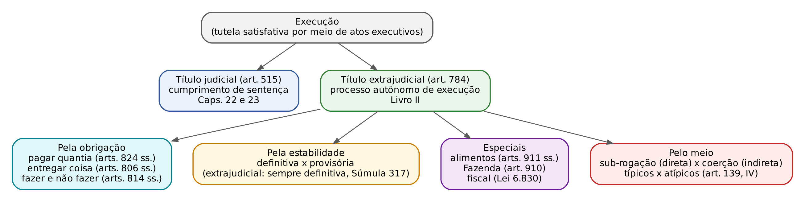
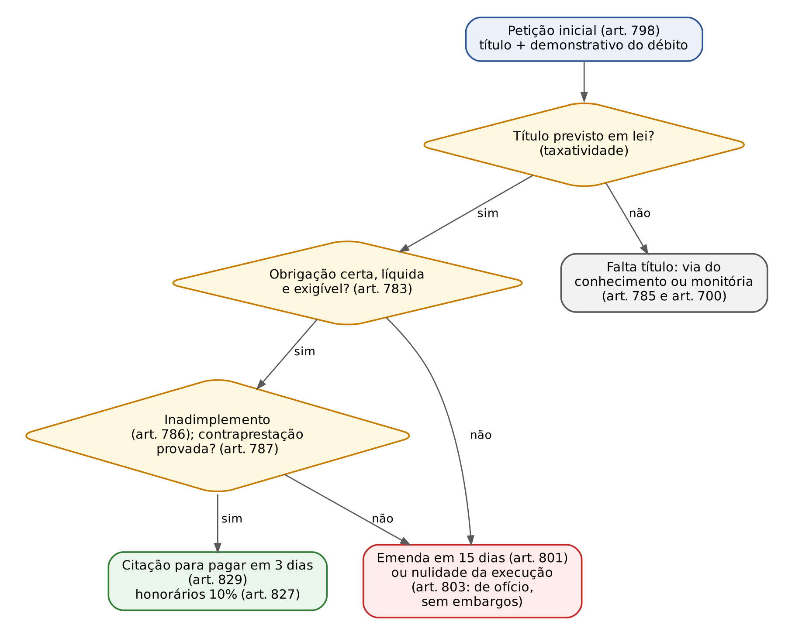
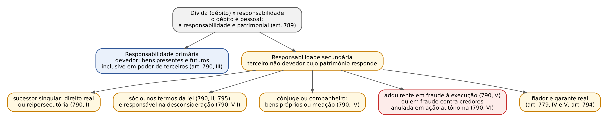
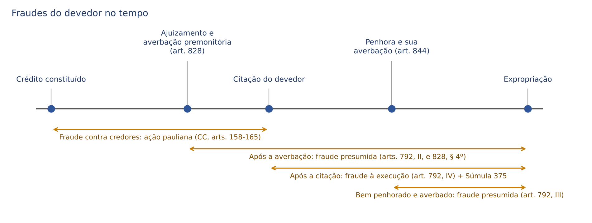
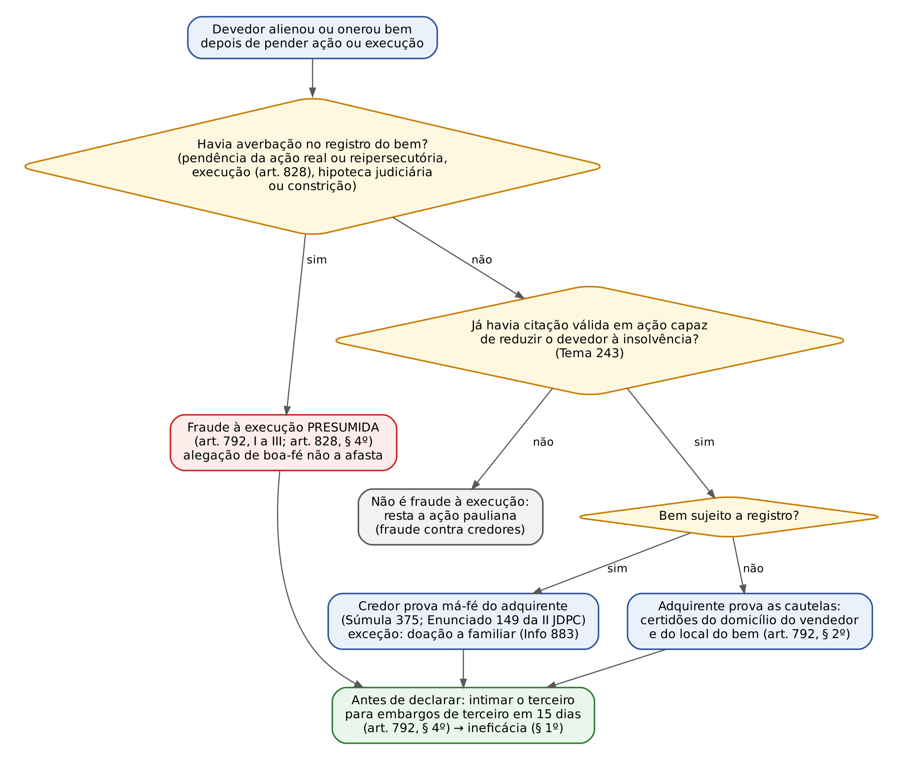
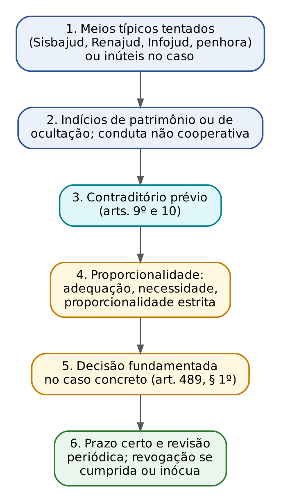

# CAPÍTULO 24 — EXECUÇÃO POR TÍTULO EXTRAJUDICIAL I: TEORIA GERAL, TÍTULOS, RESPONSABILIDADE PATRIMONIAL, FRAUDES E MEDIDAS ATÍPICAS

:::INCIDENCIA
TRF5 p. 13; TJRS p. 18; TJSC p. 14. Nível A+; lote de 23 questões (FGV 14, FCC 9), mais correlatas de outros capítulos.
O que mais cai: fraude à execução (art. 792, Súmula 375, averbação do art. 828, intimação do terceiro), medidas atípicas (ADI 5.941 e Tema 1.137 do STJ), rol do art. 784 e distinção título judicial x extrajudicial, opção pelo processo de conhecimento (art. 785).
:::

#### Mapa de cobrança

| Subtema | FGV | FCC | Padrão |
|---|---|---|---|
| Fraude à execução e averbações | 4 | 2 | caso prático: alienação após citação ou averbação; via (petição x pauliana); intimação do terceiro; "nula" x "ineficaz" |
| Medidas executivas atípicas | 3 | 2 | requisitos cumulativos do Tema 1.137; subsidiariedade; contraditório; prazo; constitucionalidade (ADI 5.941) |
| Títulos executivos extrajudiciais | 3 | 2 | identificar título judicial x extrajudicial; TAC; transação referendada; título estrangeiro; assinatura eletrônica |
| Interesse na via de conhecimento (art. 785) | 2 | 0 | credor com título que propõe ação de cobrança: admissibilidade positiva |
| Princípios e requisitos da execução | 1 | 2 | taxatividade, menor onerosidade, atipicidade; nulidade do art. 803; patrimonialidade |
| Partes e legitimidade | 0 | 1 | cessionário dispensa consentimento do devedor (Tema 1 do STJ; art. 778, § 2º) |
| Responsabilidade do exequente | 1 | 0 | responsabilidade objetiva (art. 776) |

## 24.1 O sistema executivo do CPC e as espécies de execução

### 24.1.1 Dois modelos: cumprimento de sentença e processo autônomo

O CPC/2015 consolidou o sincretismo inaugurado pelas Leis 11.232/2005 e 11.382/2006: o título JUDICIAL (art. 515) executa-se por fase do mesmo processo, o cumprimento de sentença (Caps. 22 e 23); o título EXTRAJUDICIAL (art. 784) dá ensejo a processo autônomo de execução, regulado pelo Livro II da Parte Especial (arts. 771 a 925), com citação do executado e defesa por ação incidental (embargos, Cap. 26). Os dois regimes se comunicam: o Livro II aplica-se subsidiariamente ao cumprimento de sentença (arts. 513, caput, e 771), e o Livro I da Parte Especial (procedimento comum) aplica-se subsidiariamente à execução (art. 771, parágrafo único).

:::LEI CPC, ART. 771
Este Livro regula o procedimento da execução fundada em título extrajudicial, e suas disposições aplicam-se, também, no que couber, aos procedimentos especiais de execução, aos atos executivos realizados no procedimento de cumprimento de sentença, bem como aos efeitos de atos ou fatos processuais a que a lei atribuir força executiva.
Parágrafo único. Aplicam-se subsidiariamente à execução as disposições do Livro I da Parte Especial.
:::

A consequência prática mais cobrada da distinção é o meio de defesa e o recurso: no processo de execução o executado defende-se por embargos (ação incidental, sentença apelável), não por impugnação; no cumprimento de sentença, por impugnação (incidente, decisão em regra agravável). Errar a natureza do título leva a errar a via.

:::PEGADINHA TÍTULOS QUE "PARECEM" EXTRAJUDICIAIS E SÃO JUDICIAIS
Sentença arbitral, decisão homologatória de autocomposição judicial ou EXTRAJUDICIAL (homologada), formal e certidão de partilha, crédito de auxiliar da justiça aprovado por decisão judicial, sentença penal condenatória transitada em julgado, sentença estrangeira homologada pelo STJ e decisão interlocutória estrangeira após o *exequatur* são títulos JUDICIAIS (art. 515, II a IX). A CDA, ao contrário, é título EXTRAJUDICIAL (art. 784, IX), embora produzida pela Administração e executada por rito especial (Lei 6.830/1980; Cap. 28). Regra de bolso: se passou pelo crivo de juiz ou árbitro, é judicial; se o Judiciário não interveio na formação, é extrajudicial.
:::

:::QUESTAO FGV 2024 — TJ-RJ — MEDIADOR JUDICIÁRIO (Q2370298)
Pediu-se, na ordem, dois títulos extrajudiciais e um judicial. Gabarito: D (contrato garantido por hipoteca, certidão de dívida ativa e sentença arbitral). Armadilhas: a alternativa C inverte a CDA e a sentença penal; a E põe a homologação judicial de autocomposição como extrajudicial; a A abre com título judicial. Fundamento: art. 784, V e IX, e art. 515, VII.
:::

No mesmo sentido: Q3673855 (FGV 2025, ENAC — dos itens, só o cheque é título extrajudicial "expressamente apontado"; sentença arbitral, sentença penal, formal de partilha e decisão que reconhece obrigação de pagar são judiciais, art. 515); Q3386986 (FCC 2025, DPE-RS — a alternativa E erra ao chamar a sentença arbitral de título extrajudicial); Q2386967 (FGV 2024, TJ-SC, Juiz — o acordo HOMOLOGADO judicialmente é título judicial, não extrajudicial).

:::QUESTAO FGV 2025 — AL-AM — ASSESSOR JURÍDICO (Q3777490)
Dois credores: um com sentença condenatória transitada em julgado; outro com instrumento de transação referendado pela Defensoria Pública. Gabarito: E (o primeiro promove cumprimento de sentença; a segunda ajuíza execução de título extrajudicial). A transação referendada pela Defensoria é título extrajudicial (art. 784, IV), e não há "escolha" entre os ritos (alternativa C): a via executiva segue a natureza do título. O prazo de 15 dias úteis (alternativa B) é do art. 523; na execução extrajudicial o prazo para pagar é de 3 dias (art. 829).
:::

### 24.1.2 Classificações das execuções

| Critério | Espécies | Observação cobrável |
|---|---|---|
| Natureza do título | judicial (cumprimento) x extrajudicial (processo autônomo) | defesa: impugnação x embargos |
| Estabilidade do título | definitiva x provisória | a execução de título extrajudicial é definitiva, "ainda que pendente apelação contra sentença que julgue improcedentes os embargos" (Súmula 317 do STJ; v. Cap. 26); a apelação, aqui, não tem efeito suspensivo (art. 1.012, § 1º, III) |
| Obrigação | pagar quantia (arts. 824 e seguintes), entregar coisa certa e incerta (arts. 806 a 813), fazer e não fazer (arts. 814 a 823) | o procedimento segue a prestação; desenvolvimento no Cap. 25 |
| Sujeito ou crédito | comum x especiais: alimentos (arts. 911 a 913), contra a Fazenda Pública (art. 910; Súmula 279 do STJ), fiscal (Lei 6.830/1980) | alimentos: Cap. 25; Fazenda: Cap. 27; fiscal: Cap. 28 |
| Meio executivo | direta ou por sub-rogação (o Estado substitui o devedor: penhora, expropriação, busca e apreensão) x indireta ou por coerção (pressiona a vontade: multa, prisão civil do alimentante, medidas atípicas) | a atipicidade (art. 139, IV) alcança ambas, inclusive nas obrigações de pagar (ver 24.9) |
| Solvência do devedor | singular (individual) x concursal (insolvência civil, falência) | o art. 797 ressalva o concurso universal; a insolvência civil continua regida pelo CPC/1973 até lei específica (art. 1.052) |

:::JURIS STJ, SÚMULA 279
É cabível execução por título extrajudicial contra a Fazenda Pública. O rito é o do art. 910 (citação para embargos em 30 dias, pagamento por precatório ou RPV); desenvolvimento no Cap. 27.
:::

A execução comporta também CUMULAÇÃO de execuções: o exequente pode cumular várias, "ainda que fundadas em títulos diferentes", desde que o executado seja o mesmo, o juízo competente seja o mesmo para todas e o procedimento idêntico (art. 780). E pode fundar uma só execução em mais de um título relativo ao mesmo negócio (Súmula 27 do STJ: contrato e nota promissória a ele vinculada, por exemplo).

:::DICA PRESTAÇÕES VINCENDAS E OBRIGAÇÕES ALTERNATIVAS
As prestações que se vencerem até o efetivo cumprimento incluem-se na execução de título extrajudicial (Enunciado 86 da I Jornada de Direito Processual Civil do CJF, com base nos arts. 323 e 318, parágrafo único). Nas obrigações alternativas com escolha do devedor, este é citado para optar e cumprir em 10 dias, salvo outro prazo legal ou contratual; não exercida a opção, ela se devolve ao credor (art. 800); se a escolha for do credor, vem indicada na inicial (§ 2º).
:::

## 24.2 Princípios da execução

Os princípios da execução não são um rol fechado; as bancas cobram sobretudo os que têm texto de lei por trás. A FGV costuma pedir que o candidato associe a descrição ao nome.

| Princípio | Conteúdo | Base | Pegadinha |
|---|---|---|---|
| Nulla executio sine titulo (título) | toda execução pressupõe título; sem ele, a execução é nula | arts. 783 e 803, I | o título é condição necessária, mas não basta: exige-se o inadimplemento (art. 786) |
| Taxatividade (tipicidade) dos títulos | só a lei cria título executivo; as partes não podem convencionar um título fora do rol | art. 784, XII ("por disposição expressa, a lei") | NÃO se confunde com tipicidade dos MEIOS executivos, que o CPC/2015 abandonou |
| Atipicidade dos meios executivos | o juiz pode adotar medidas não previstas expressamente, inclusive em prestação pecuniária | arts. 139, IV, 297 e 536, § 1º | limites: Tema 1.137 do STJ (ver 24.9) |
| Patrimonialidade (responsabilidade patrimonial) | a execução recai sobre bens, não sobre a pessoa do devedor | art. 789 | exceção constitucional: prisão civil do devedor de alimentos (CF, art. 5º, LXVII); a do depositário infiel é vedada pela jurisprudência vinculante do STF |
| Resultado ou interesse do credor | a execução realiza-se no interesse do exequente | art. 797 | convive com a menor onerosidade: esta não autoriza execução ineficaz |
| Menor onerosidade (menor gravosidade) | entre meios IGUALMENTE eficazes, escolhe-se o menos gravoso ao executado | art. 805 | ônus do executado de indicar meio mais eficaz e menos oneroso (parágrafo único) |
| Disponibilidade | o exequente pode desistir de toda a execução ou de alguma medida | art. 775 | efeitos sobre os embargos: ver 24.2.2 |
| Cooperação e lealdade | o executado deve indicar bens, não embaraçar a penhora, cumprir ordens | arts. 772 a 774 | multa de até 20% do débito atualizado, revertida ao exequente |
| Contraditório | existe na execução, embora limitado ao objeto executivo | arts. 9º, 10 e 803, parágrafo único | medidas atípicas e segunda penhora exigem oitiva prévia (Informativo 904 do STJ) |
| Responsabilidade do exequente | o exequente responde pelos danos se a obrigação for declarada inexistente | art. 776 | responsabilidade OBJETIVA (risco da execução) |

:::QUESTAO FGV 2025 — ENAM — EXAME NACIONAL DA MAGISTRATURA 2025.1 (Q3362349)
Três descrições: só é título o documento previsto em lei; a execução deve impor o menor gravame ao executado; os meios executivos não precisam ser os previstos em lei. Gabarito: E (taxatividade, menor onerosidade e atipicidade dos meios executivos). A armadilha é a alternativa B, que chama o primeiro de "tipicidade" (aceitável) mas o segundo de "eficiência"; e a C, que troca a ordem. Note que "taxatividade" responde ao título; "atipicidade", aos meios.
:::

### 24.2.1 Menor onerosidade: alcance e ônus

A regra do art. 805 só opera quando há "vários meios" de promover a execução com eficácia equivalente. Não serve para frustrar a satisfação, e quem a invoca suporta o ônus argumentativo e probatório: "Ao executado que alegar ser a medida executiva mais gravosa incumbe indicar outros meios mais eficazes e menos onerosos, sob pena de manutenção dos atos executivos já determinados" (parágrafo único). O STJ, ao tratar da penhora de faturamento (Tema 769), assentou que a decisão deve reportar-se aos elementos probatórios concretos trazidos pelo devedor, não sendo lícito aplicar a menor onerosidade em abstrato ou com base em alegações genéricas (detalhes da penhora no Cap. 25).

:::QUESTAO FCC 2025 — PGE-MT — PROCURADOR DO ESTADO (Q3745797)
Afirmações gerais sobre o processo de execução. Gabarito: B (é nula a execução se o título extrajudicial não corresponder a obrigação certa, líquida e exigível — art. 803, I). Armadilhas: a alternativa A troca "menos gravoso para o executado" por "mais proveitoso" ao exequente (art. 805); a C erra a redução dos honorários (é pela metade em caso de pagamento integral no prazo de 3 dias, art. 827, § 1º, e não 15); a D inverte a regra do cônjuge (a intimação do cônjuge na penhora de imóvel é dispensada só se casados em separação absoluta de bens, art. 842); a E ignora que a avaliação pelo oficial é dispensada quando uma parte aceita a estimativa da outra (art. 871, I).
:::

### 24.2.2 Disponibilidade e desistência

O exequente pode desistir de toda a execução ou de apenas alguma medida (art. 775), sem consentimento do executado, porque a execução existe no seu interesse. Os efeitos sobre a defesa dependem do conteúdo desta: serão extintos a impugnação e os embargos que versarem APENAS sobre questões processuais, pagando o exequente custas e honorários (parágrafo único, I); nos demais casos, a extinção dos embargos ou da impugnação dependerá da concordância do embargante (II). A lógica: os embargos de mérito são ação de conhecimento do executado, que tem direito a obter sentença declarando, por exemplo, a inexistência da dívida.

:::PEGADINHA DESISTÊNCIA X RENÚNCIA AO CRÉDITO
Desistir da execução não extingue o crédito (sentença terminativa); a renúncia ao crédito extingue a execução com resolução de mérito (art. 924, IV). O STJ, no Tema 289, exige prévia intimação do credor para a extinção por renúncia ao crédito remanescente, vedada a presunção de renúncia tácita. Suspensão e extinção: Cap. 26.
:::

### 24.2.3 Lealdade: atos atentatórios e poderes de informação

O art. 774 tipifica como atentatória à dignidade da justiça a conduta comissiva ou omissiva do executado que frauda a execução (I), opõe-se maliciosamente com ardis (II), dificulta ou embaraça a penhora (III), resiste injustificadamente às ordens judiciais (IV) ou, intimado, não indica quais e onde estão os bens penhoráveis, seus valores, prova de propriedade e certidão negativa de ônus (V). Sanção: multa "em montante não superior a vinte por cento do valor atualizado do débito em execução", revertida em proveito do EXEQUENTE (diferentemente da multa do art. 77, § 2º, que vai para o Estado), exigível nos próprios autos, sem prejuízo de outras sanções (parágrafo único). Pelo art. 772, o juiz pode, em qualquer momento, ordenar o comparecimento das partes, advertir o executado de que sua conduta é atentatória e determinar que sujeitos indicados pelo exequente forneçam informações, documentos e dados relacionados ao objeto da execução; recebidos dados sigilosos, deve assegurar a confidencialidade (art. 773, parágrafo único). O Enunciado 219 da III Jornada de Direito Processual Civil admite, com base no art. 772, III, atos típicos ou atípicos de busca e localização patrimonial por cooperação judiciária interinstitucional.

| Multa | Destinatário | Teto | Fundamento |
|---|---|---|---|
| Ato atentatório na execução (executado) | exequente | até 20% do débito atualizado | art. 774, parágrafo único |
| Ato atentatório à dignidade da justiça em geral (qualquer participante) | União ou Estado (fundo de modernização) | até 20% do valor da causa | art. 77, §§ 2º e 3º (Cap. 7) |
| Litigância de má-fé | parte contrária | superior a 1% e inferior a 10% do valor corrigido da causa | art. 81 (Cap. 7) |
| Embargos manifestamente protelatórios (considerados ato atentatório) | exequente | o do art. 774, parágrafo único | art. 918, parágrafo único (Cap. 26) |

A cobrança dessas multas e de indenizações por má-fé ou ato atentatório faz-se "nos próprios autos do processo" (art. 777).

### 24.2.4 Responsabilidade objetiva do exequente

O exequente ressarcirá ao executado os danos que este sofreu, "quando a sentença, transitada em julgado, declarar inexistente, no todo ou em parte, a obrigação que ensejou a execução" (art. 776). A responsabilidade é OBJETIVA, fundada no risco da atividade executiva, tal como a do cumprimento provisório (art. 520, I) e a da tutela de urgência (art. 302). Não se exige dolo ou culpa; a liquidação faz-se, em regra, nos próprios autos.

:::QUESTAO FGV 2024 — MPE-GO — PROMOTOR DE JUSTIÇA SUBSTITUTO (Q2367632)
Condomínio executou cotas já pagas, obteve penhora do imóvel durante a instrução dos embargos e perdeu; o executado pediu liquidação dos prejuízos (perda de negócio). O condomínio alegou boa-fé e ausência de culpa. Gabarito: A (responsabilidade objetiva do exequente por ter buscado satisfazer dívida inexistente, art. 776). Armadilhas: B (cotas condominiais são título extrajudicial, art. 784, X); C (embargos não suspendem automaticamente a execução, art. 919); D (exige dolo ou culpa, o que a lei não exige); E (há honorários na execução e nos embargos).
:::

:::QUESTAO FCC 2026 — TJ-CE — OFICIAL DE JUSTIÇA (Q4240022)
Executado citado não pagou nem embargou. Gabarito: D (a responsabilidade patrimonial recai, em regra, sobre o patrimônio do devedor — art. 789). As demais erram regras básicas: embargos não têm efeito suspensivo automático (art. 919), a penhora independe de autorização do executado, a inércia não suspende a execução e o prosseguimento não depende de embargos.
:::

## 24.3 Partes e legitimidade

### 24.3.1 Legitimidade ativa (art. 778)

A legitimidade ordinária primária é do credor "a quem a lei confere título executivo" (caput). Em sucessão ao exequente originário, podem promover a execução ou nela prosseguir (§ 1º): o Ministério Público, nos casos previstos em lei (I); o espólio, os herdeiros ou os sucessores do credor, por morte deste (II); o cessionário, por ato entre vivos (III); e o sub-rogado, na sub-rogação legal ou convencional (IV). A regra de ouro do § 2º: "A sucessão prevista no § 1º independe de consentimento do executado". Afasta-se, na execução, a exigência do art. 109, § 1º, que condiciona a sucessão da parte por ato entre vivos, no processo de conhecimento, ao consentimento da parte contrária.

:::JURIS STJ, TEMA 1 (RESP 1.091.443 E RESP 1.101.723)
A substituição processual, no polo ativo da execução, do exequente originário pelo cessionário dispensa a autorização ou o consentimento do devedor. Tese anterior ao CPC/2015, positivada no art. 778, § 2º, e aplicável também ao cumprimento de sentença (art. 513, caput).
:::

:::QUESTAO FCC 2025 — TRF4 — ANALISTA JUDICIÁRIO, ÁREA JUDICIÁRIA (Q3538758)
Cumprimento definitivo de sentença indenizatória; comunicada a cessão do crédito, pediu-se a substituição do cedente pelo cessionário. Gabarito: B (a substituição dispensa autorização ou consentimento do devedor). As alternativas A, C e D exigem consentimento (tácito, expresso ou suprido pelo juiz), que é a regra do art. 109, § 1º, para o processo de conhecimento, e não para a execução.
:::

Dois desdobramentos jurisprudenciais. Primeiro, o cedente perde a legitimidade quando a cessão foi noticiada ao devedor: a cessão de crédito, desde logo comunicada em transação firmada entre credor e devedor, afasta a legitimidade do cedente para executar diferenças decorrentes da mora no cumprimento do pacto (STJ, AgInt no REsp n. 1.267.649, Quarta Turma, j. 27/2/2024; Informativo 802). Segundo, o sub-rogado que executa título com cláusula compromissória submete-se a ela quanto às questões do contrato: a execução corre no juízo estatal, único dotado de coerção, mas este não pode apreciar, nos embargos, as questões alusivas às disposições do contrato, a serem dirimidas na arbitragem (orientação do STJ noticiada no compilado APGE Juris; ver 24.4.3).

O Ministério Público executa, por exemplo, o termo de ajustamento de conduta por ele tomado e a sentença coletiva não executada pelos legitimados (CDC, art. 100; Lei 7.347/1985, art. 15), e o crédito de alimentos em favor de criança ou adolescente. O Enunciado 85 da I Jornada de Direito Processual Civil admite a citação postal na execução de título extrajudicial ou judicial.

#### O beneficiário individual do TAC

O compromisso de ajustamento de conduta tomado por órgão público legitimado tem eficácia de título executivo extrajudicial (Lei 7.347/1985, art. 5º, § 6º; art. 784, XII, do CPC). Quando o TAC estipula prestação líquida e individualizada em favor de pessoas determinadas (indenização fixa a cada atingido que comprovar residência na área, por exemplo), o beneficiário tem legitimidade para executá-lo individualmente, sem necessidade de ação de conhecimento, de monitória ou de execução coletiva pelo órgão que o celebrou.

:::QUESTAO FCC 2026 — DPE-MT — DEFENSOR PÚBLICO (Q3954624)
TAC nacional firmado pela Defensoria após rompimento de barragem previa indenização líquida de 50.000 (cinquenta mil) reais a cada morador da área atingida; uma moradora teve o pagamento negado. Gabarito: D (execução de título extrajudicial em nome da moradora, com o TAC como título). Armadilhas: B (o TAC "só pode ser executado coletivamente pelo legitimado que o firmou"); C (monitória, que pressupõe prova escrita SEM eficácia de título, art. 700); E (nova ação de conhecimento). A falta de interesse para a monitória é a lição que se repete no art. 785, mas em sentido inverso: quem tem título PODE optar pelo conhecimento; não precisa.
:::

### 24.3.2 Legitimidade passiva (art. 779)

A execução pode ser promovida contra: o devedor reconhecido no título (I); o espólio, os herdeiros ou os sucessores do devedor (II); o novo devedor que assumiu a obrigação "com o consentimento do credor" (III; assunção de dívida, CC, art. 299); o fiador do débito constante em título EXTRAJUDICIAL (IV); "o responsável titular do bem vinculado por garantia real ao pagamento do débito" (V); e o responsável tributário, assim definido em lei (VI).

| Executado | Requisito | Detalhe cobrado |
|---|---|---|
| Espólio, herdeiros, sucessores | morte do devedor | antes da partilha responde o espólio; depois, cada herdeiro, "dentro das forças da herança e na proporção da parte que lhe coube" (art. 796) |
| Novo devedor | assunção com consentimento do credor | sem consentimento, a assunção é ineficaz perante o credor (CC, art. 299) |
| Fiador | título extrajudicial em que figure como fiador | no CUMPRIMENTO de sentença, o fiador, o coobrigado ou o corresponsável que não participou da fase de conhecimento não pode ser executado (art. 513, § 5º; Súmula 268 do STJ, na locação) |
| Garantidor real não devedor | bem dado em garantia de dívida alheia | responde só com o bem gravado; a execução pode ser promovida apenas contra o titular do bem, com intimação de eventual coproprietário que não outorgou a garantia (Enunciado 97 da I Jornada de Direito Processual Civil) |
| Responsável tributário | definição legal (CTN, arts. 128 a 138) | execução fiscal e redirecionamento: Cap. 28 e Apostila de Direito Tributário |

:::PEGADINHA FIADOR: TÍTULO EXTRAJUDICIAL SIM, CUMPRIMENTO DE SENTENÇA NÃO
O art. 779, IV, legitima o fiador "do débito constante em título extrajudicial". Já o art. 513, § 5º, veda o cumprimento de sentença "em face do fiador, do coobrigado ou do corresponsável que não tiver participado da fase de conhecimento". Afirmações como "o cumprimento da sentença poderá ser promovido em face do fiador que não participou da fase de conhecimento" são FALSAS (Q3891333, FCC 2025, UNICAMP; Q3542120, FCC 2024, Jaboatão dos Guararapes). O fiador executado tem o benefício de ordem (ver 24.7.4).
:::

O cônjuge do devedor não é, em regra, parte passiva: seus bens próprios ou sua meação respondem nos casos legais (art. 790, IV), e ele é intimado da penhora de imóvel (art. 842), podendo defender a meação por embargos de terceiro (ver 24.7.5). O sócio também não é parte, salvo desconsideração da personalidade jurídica, que exige o incidente (arts. 133 a 137 e 795, § 4º; Cap. 9).

### 24.3.3 Litisconsórcio e cumulação

Há litisconsórcio ativo facultativo entre credores solidários ou cocredores de título comum e passivo facultativo entre codevedores, solidários ou não; o exequente pode escolher executar apenas um deles, se solidários (CC, art. 275). A cumulação de execuções contra o mesmo executado exige identidade de juízo competente e de procedimento (art. 780): não se cumulam, por isso, execução de alimentos pelo rito da prisão e execução comum por quantia, nem execução por quantia e execução para entrega de coisa.

## 24.4 Competência

### 24.4.1 Foros concorrentes do art. 781

A execução fundada em título extrajudicial "será processada perante o juízo competente", com as seguintes regras (art. 781): foro do domicílio do EXECUTADO, de eleição constante do título ou de situação dos bens a ela sujeitos (I); se o executado tiver mais de um domicílio, qualquer deles (II); domicílio incerto ou desconhecido: lugar onde for encontrado ou foro do domicílio do EXEQUENTE (III); mais de um devedor com domicílios diferentes: foro de qualquer deles, à escolha do exequente (IV); foro do lugar do ato ou fato que deu origem ao título, ainda que o executado não mais resida ali (V).

:::PEGADINHA DOMICÍLIO DO EXEQUENTE
O foro do domicílio do exequente só aparece no art. 781 como alternativa SUBSIDIÁRIA (domicílio do executado incerto ou desconhecido, inciso III). Afirmar que, "em regra", a execução pode ser proposta no foro do domicílio do exequente é falso.
:::

:::QUESTAO FCC 2025 — UNICAMP — PROCURADOR DE UNIVERSIDADE (Q3891326)
Cinco assertivas sobre execução de título extrajudicial. Gabarito: C (II, III e IV corretas). I é falsa (regra é o domicílio do EXECUTADO, art. 781, I). II reproduz o art. 784, II e III. III reproduz o art. 784, § 2º (título estrangeiro não depende de homologação). IV reproduz o art. 785. V é falsa: o art. 784, § 4º, admite qualquer modalidade de assinatura eletrônica prevista em lei nos títulos constituídos ou atestados por meio eletrônico.
:::

A competência territorial é RELATIVA: não pode ser declinada de ofício e deve ser arguida pelo executado (arts. 64 e 65; Cap. 4) e prorroga-se se o executado não a arguir. Ressalva relevante após a Lei 14.879/2024: a cláusula de eleição de foro só produz efeito se "guardar pertinência com o domicílio ou a residência de uma das partes ou com o local da obrigação" (art. 63, § 1º), e "o ajuizamento de ação em juízo aleatório", sem vinculação com o domicílio ou a residência das partes ou com o negócio, "constitui prática abusiva que justifica a declinação de competência de ofício" (art. 63, § 5º). O tema é do Cap. 4; aqui importa que o foro de eleição do art. 781, I, se submete a esse filtro, e que a cláusula abusiva pode ser reputada ineficaz de ofício antes da citação (art. 63, § 3º).

### 24.4.2 Justiça Federal, competência delegada e execução contra a Fazenda

A competência de JUSTIÇA segue o art. 109 da Constituição: execução movida por ou contra a União, entidade autárquica ou empresa pública federal tramita na Justiça Federal (Cap. 5). A Caixa Econômica Federal executando contrato de mútuo ou cédula de crédito, por exemplo, o faz na Justiça Federal; a sociedade de economia mista (Banco do Brasil) executa na Justiça Estadual. A execução fiscal federal não é mais delegável à Justiça Estadual após a Lei 13.043/2014, que revogou o art. 15, I, da Lei 5.010/1966 (ressalvadas as já ajuizadas); a competência delegada remanescente, após a Lei 13.876/2019, é a previdenciária (Caps. 5 e 28). A execução de título extrajudicial contra a Fazenda (art. 910) segue as regras de competência comuns (Cap. 27).

### 24.4.3 Execução, arbitragem e foro estrangeiro

A existência de cláusula compromissória no contrato que é título executivo NÃO impede o ajuizamento imediato da execução no Judiciário, porque o árbitro não tem poder de coerção. É possível a coexistência de execução e procedimento arbitral, cada qual no seu âmbito; a suspensão da execução não decorre automaticamente da cláusula: só se justifica com a instauração da arbitragem seguida de requerimento ao juízo da execução (STJ, REsp n. 2.167.089, Relatora Ministra Nancy Andrighi, Terceira Turma, j. em agosto de 2025, conforme o Buscador Dizer o Direito). As matérias de mérito relativas ao contrato que o executado quiser opor (exceção de contrato não cumprido, por exemplo) devem ser levadas ao juízo arbitral; o juízo da execução conhece das questões formais do título e dos atos executivos.

:::JURIS STJ, RESP 1.966.276-SP, J. 9/4/2024 (INFORMATIVO 807)
Havendo previsão contratual que faculte ao credor a escolha do foro de execução, e optando ele por executar no Brasil contratos de empréstimo celebrados no exterior, há submissão à forma processual típica dessa via, inclusive quanto ao conhecimento e ao julgamento dos embargos à execução no juízo brasileiro.
:::

O título estrangeiro dispensa homologação (art. 784, § 2º), mas "só terá eficácia executiva quando satisfeitos os requisitos de formação exigidos pela lei do lugar de sua celebração e quando o Brasil for indicado como o lugar de cumprimento da obrigação" (§ 3º). A distinção cobrada: SENTENÇA estrangeira é título judicial e depende de homologação pelo STJ (art. 515, VIII; Cap. 38); TÍTULO EXTRAJUDICIAL estrangeiro não.

### 24.4.4 Execução por carta e atos fora da comarca

O oficial de justiça pode cumprir atos executivos "nas comarcas contíguas, de fácil comunicação, e nas que se situem na mesma região metropolitana" (art. 782, § 1º), dispensando carta precatória. A Segunda Seção do STJ entendeu que o leilão eletrônico de bens penhorados não exige carta precatória ao foro da situação dos bens, sendo competente o juízo da execução (CC n. 214.818, Relator Ministro Raul Araújo, Segunda Seção, j. 8/10/2025; Informativo de Jurisprudência n. 29, edição extraordinária). Na execução por carta, os embargos são decididos no juízo deprecante, salvo se versarem unicamente sobre vícios ou defeitos da penhora, avaliação ou alienação (Súmula 46 do STJ; art. 914, § 2º; Cap. 26).

## 24.5 Requisitos da execução: título e inadimplemento

### 24.5.1 Título executivo e atributos da obrigação

"A execução para cobrança de crédito fundar-se-á sempre em título de obrigação certa, líquida e exigível" (art. 783). Os atributos qualificam a OBRIGAÇÃO, não o documento:

| Atributo | Pergunta que responde | Observações |
|---|---|---|
| Certeza | existe a obrigação e quem são os sujeitos? (an debeatur e quem deve a quem) | a certeza é formal, extraída do título; não equivale a indiscutibilidade (o executado pode negar a dívida nos embargos) |
| Liquidez | quanto se deve ou o que se deve? (quantum ou quid debeatur) | "A necessidade de simples operações aritméticas para apurar o crédito exequendo não retira a liquidez" (art. 786, parágrafo único); o título extrajudicial ilíquido não admite liquidação: falta título |
| Exigibilidade | a obrigação já pode ser cobrada? | ausente se pendente condição suspensiva ou termo (art. 803, III), ou se o credor não provou a contraprestação nos contratos bilaterais (art. 787) |

O título executivo é, assim, o documento que a lei reveste de eficácia executiva por representar, com grau suficiente de probabilidade, obrigação certa, líquida e exigível; a doutrina discute se ele é ato (Liebman) ou documento (Carnelutti), debate pouco cobrado em objetiva. O que se cobra é a CONSEQUÊNCIA da falta de algum atributo: nulidade da execução.

:::LEI CPC, ART. 803
É nula a execução se:
I - o título executivo extrajudicial não corresponder a obrigação certa, líquida e exigível;
II - o executado não for regularmente citado;
III - for instaurada antes de se verificar a condição ou de ocorrer o termo.
Parágrafo único. A nulidade de que cuida este artigo será pronunciada pelo juiz, de ofício ou a requerimento da parte, independentemente de embargos à execução.
:::

O parágrafo único é a base legal da chamada exceção (objeção) de pré-executividade quanto a essas matérias: o vício pode ser reconhecido de ofício ou por simples petição, sem embargos nem garantia (Cap. 26).

:::QUESTAO FGV 2026 — TJ-SC — OFICIAL DE JUSTIÇA E AVALIADOR (Q4153621)
Correlata: execução fundada em confissão de dívida assinada só pelo devedor, sem testemunhas; o executado, dois dias após a citação, peticionou alegando falta de título. Gabarito: C (uso correto da exceção de pré-executividade, cabível para matéria cognoscível de ofício e sem dilação probatória, independentemente de garantia). O documento particular só é título com a assinatura do devedor e de duas testemunhas (art. 784, III); o vício não se sana "colhendo as assinaturas" depois (D); e a exceção não suspende automaticamente a execução (E). Ressalva: se o documento fosse eletrônico com integridade conferida por provedor de assinatura, as testemunhas seriam dispensadas (art. 784, § 4º).
:::

### 24.5.2 Inadimplemento, contraprestação e oferta de pagamento

O título é condição necessária, mas não suficiente: "A execução pode ser instaurada caso o devedor não satisfaça a obrigação certa, líquida e exigível consubstanciada em título executivo" (art. 786). O inadimplemento integra o interesse de agir executivo. Nos contratos bilaterais, se o devedor só está obrigado mediante a contraprestação do credor, este deve provar que a adimpliu ao requerer a execução, "sob pena de extinção do processo" (art. 787; art. 798, I, d); o executado pode eximir-se depositando em juízo a prestação ou a coisa, e o juiz não permitirá que o credor a receba sem cumprir a contraprestação (parágrafo único). E o credor não pode iniciar a execução ou nela prosseguir se o devedor cumprir a obrigação, mas pode recusar a prestação que não corresponda ao título, requerendo a execução forçada, ressalvado ao devedor o direito de embargar (art. 788).

:::EXEMPLO VENCIMENTO ANTECIPADO
Cédula de crédito bancário com cláusula de vencimento antecipado: inadimplida a primeira parcela, o banco declara vencida toda a dívida e executa o saldo integral. A exigibilidade da totalidade decorre da cláusula (Lei 10.931/2004, art. 28, § 1º, III, admite pactuar "as hipóteses de vencimento antecipado da dívida"; CC, art. 1.425, para as garantias reais). Foi o pano de fundo do caso cobrado em Q3966649 (ver 24.9). A CCB, por lei, representa dívida certa, líquida e exigível "seja pela soma nela indicada, seja pelo saldo devedor demonstrado em planilha de cálculo, ou nos extratos da conta corrente" (art. 28, caput).
:::

### 24.5.3 Petição inicial, emenda e interrupção da prescrição

A inicial deve ser instruída com o título, o demonstrativo do débito atualizado até a propositura (na execução por quantia) e, se for o caso, a prova da condição, do termo ou da contraprestação (art. 798, I). O demonstrativo indicará índice de correção, taxa de juros, termos inicial e final de cada um, periodicidade da capitalização e descontos obrigatórios (parágrafo único). O exequente indicará a espécie de execução preferida, quando houver mais de um modo, os nomes e CPF ou CNPJ das partes e, "sempre que possível", os bens penhoráveis (art. 798, II). Incumbe-lhe ainda requerer a intimação dos titulares de direitos reais sobre o bem a ser penhorado (credor pignoratício, hipotecário, anticrético ou fiduciário, usufrutuário, promitente comprador com promessa registrada, superficiário, sociedade na penhora de quotas, titular de laje) e "proceder à averbação em registro público do ato de propositura da execução e dos atos de constrição realizados, para conhecimento de terceiros" (art. 799, I a XI). A falta de intimação desses titulares gera INEFICÁCIA da alienação em relação a eles (art. 804), e não nulidade.

Incompleta a inicial ou faltando documento indispensável, o juiz determinará a correção em 15 dias, sob pena de indeferimento (art. 801). É vedado indeferir de plano sem oportunizar a emenda (Q3606018, FGV 2025, PGM-RJ: gabarito D, intimar para emendar em 15 dias).

No processo eletrônico, a juntada da via original do título não é requisito de admissibilidade da execução; o juiz só a exige diante de fato concreto que ponha em dúvida autenticidade, titularidade ou circulação do título (REsp 2.015.911; v. Cap. 12).

O despacho que ordena a citação, desde que esta se realize na forma do art. 240, § 2º, interrompe a prescrição, "ainda que proferido por juízo incompetente", e a interrupção retroage à data da propositura (art. 802). A pretensão executiva prescreve no mesmo prazo da pretensão de direito material (Súmula 150 do STF; v. Cap. 22): cheque em 6 meses após o prazo de apresentação (Lei 7.357/1985, art. 59), nota promissória e letra de câmbio em 3 anos contra o emitente ou aceitante (Lei Uniforme), dívida líquida constante de instrumento particular em 5 anos (CC, art. 206, § 5º, I). O STJ aplicou o prazo quinquenal ao contrato de contragarantia, que qualificou como título executivo extrajudicial (AgInt no REsp n. 1.878.110, Relatora Ministra Maria Isabel Gallotti, Quarta Turma, j. 27/10/2025; Informativo de Jurisprudência n. 29, edição extraordinária). A prescrição intercorrente fica no Cap. 26.

### 24.5.4 A opção pelo processo de conhecimento (art. 785)

"A existência de título executivo extrajudicial não impede a parte de optar pelo processo de conhecimento, a fim de obter título executivo judicial" (art. 785). O CPC/2015 superou a orientação que via, no ajuizamento de ação de cobrança por quem tinha título, falta de interesse de agir. A razão: o título judicial transitado em julgado é mais estável (coisa julgada material, defesa restrita do art. 525, § 1º), e o credor pode preferir afastar desde logo a controvérsia. A recíproca não vale: quem NÃO tem título não pode executar, e a monitória pressupõe prova escrita "sem eficácia de título executivo" (art. 700), razão pela qual o credor com título não tem interesse na monitória (salvo título prescrito, que perdeu a eficácia executiva).

:::QUESTAO FGV 2024 — ENAM — 1º EXAME NACIONAL DA MAGISTRATURA (Q2459888)
Credor com nota promissória vencida e não paga ajuizou ação de conhecimento pedindo a condenação do devedor. Gabarito: D (juízo positivo de admissibilidade e citação do réu para resposta). Armadilhas: indeferir por falta de interesse (B), converter de ofício para execução (C) e mandar emendar para adequar à execução (E): todas ignoram que a escolha é do credor (art. 785).
:::

No mesmo sentido: Q3301239 (FGV 2025, TJ-SE, Juiz Substituto — autor interditado, crédito de 30 salários mínimos em título extrajudicial, ação de cobrança: gabarito B, admissibilidade positiva; a incapacidade e o valor são distratores, e o Juizado Especial é vedado ao incapaz, art. 8º da Lei 9.099/1995); Q3505777 (FGV 2025, TJ-CE, Juiz Substituto — ação declaratória sobre a natureza de cláusula contratual e ação condenatória por quem tem título: ambas admissíveis, gabarito B; ver art. 19 e Cap. 6); Q3673856 (FGV 2025, ENAC — a alternativa que nega interesse à ação de cobrança fundada em confissão de dívida com duas testemunhas está errada).

:::DICA AÇÃO DE CONHECIMENTO E EXECUÇÃO SIMULTÂNEAS
"A propositura de qualquer ação relativa a débito constante de título executivo não inibe o credor de promover-lhe a execução" (art. 784, § 1º). A ação anulatória, declaratória ou revisional proposta pelo devedor não suspende, por si, a execução; para isso, precisa de tutela provisória ou de embargos com efeito suspensivo. Entre ação autônoma do devedor e embargos pode haver conexão ou litispendência parcial (Cap. 26).
:::

## 24.6 Títulos executivos extrajudiciais

### 24.6.1 O rol do art. 784 e a taxatividade

O rol é TAXATIVO no sentido de que só a lei cria título (inciso XII), mas é ABERTO a leis especiais: o art. 784 convive com dezenas de títulos previstos fora do CPC. As partes não podem, por convenção, atribuir eficácia executiva a documento que a lei não contemple (o negócio processual do art. 190 não cria título executivo, porque isso afetaria o Estado e terceiros e envolve reserva legal).

:::LEI CPC, ART. 784 (REDAÇÃO VIGENTE, CONFERIDA NO PLANALTO)
São títulos executivos extrajudiciais: I - a letra de câmbio, a nota promissória, a duplicata, a debênture e o cheque; II - a escritura pública ou outro documento público assinado pelo devedor; III - o documento particular assinado pelo devedor e por 2 (duas) testemunhas; IV - o instrumento de transação referendado pelo Ministério Público, pela Defensoria Pública, pela Advocacia Pública, pelos advogados dos transatores ou por conciliador ou mediador credenciado por tribunal; V - o contrato garantido por hipoteca, penhor, anticrese ou outro direito real de garantia e aquele garantido por caução; VI - o contrato de seguro de vida em caso de morte; VII - o crédito decorrente de foro e laudêmio; VIII - o crédito, documentalmente comprovado, decorrente de aluguel de imóvel, bem como de encargos acessórios, tais como taxas e despesas de condomínio; IX - a certidão de dívida ativa da Fazenda Pública da União, dos Estados, do Distrito Federal e dos Municípios, correspondente aos créditos inscritos na forma da lei; X - o crédito referente às contribuições ordinárias ou extraordinárias de condomínio edilício, previstas na respectiva convenção ou aprovadas em assembleia geral, desde que documentalmente comprovadas; XI - a certidão expedida por serventia notarial ou de registro relativa a valores de emolumentos e demais despesas devidas pelos atos por ela praticados, fixados nas tabelas estabelecidas em lei; XI-A - o contrato de contragarantia ou qualquer outro instrumento que materialize o direito de ressarcimento da seguradora contra tomadores de seguro-garantia e seus garantidores; XII - todos os demais títulos aos quais, por disposição expressa, a lei atribuir força executiva.
§ 4º Nos títulos executivos constituídos ou atestados por meio eletrônico, é admitida qualquer modalidade de assinatura eletrônica prevista em lei, dispensada a assinatura de testemunhas quando sua integridade for conferida por provedor de assinatura.
:::

O inciso XI-A foi incluído pela Lei 14.711/2023 (marco legal das garantias) e o § 4º pela Lei 14.620/2023. Os §§ 1º a 3º (ação relativa ao débito não inibe a execução; título estrangeiro) estão em 24.4.3 e 24.5.4.

### 24.6.2 Inciso por inciso: o que cai

| Inciso | Título | Ponto cobrado |
|---|---|---|
| I | letra de câmbio, nota promissória, duplicata, debênture, cheque | duplicata SEM aceite é título se protestada, acompanhada de documento hábil comprobatório da entrega e do recebimento da mercadoria (permitida a comprovação por meio eletrônico, Lei 14.301/2022) e sem recusa comprovada do aceite nos termos dos arts. 7º e 8º (Lei 5.474/1968, art. 15, II, requisitos cumulativos); cheque prescrito perde a força executiva e enseja monitória ou cobrança |
| II | escritura pública ou outro documento público assinado pelo devedor | dispensa testemunhas; a escritura de confissão de dívida é o exemplo clássico |
| III | documento particular assinado pelo devedor e por 2 testemunhas | sem as duas testemunhas, não há título (salvo documento eletrônico com integridade conferida por provedor, § 4º); a falta não se supre depois |
| IV | transação referendada por MP, Defensoria, Advocacia Pública, advogados dos transatores, conciliador ou mediador credenciado por tribunal | NÃO exige homologação; se homologada, passa a ser título judicial (art. 515, II e III) |
| V | contrato com garantia real (hipoteca, penhor, anticrese ou outra) ou caução | a penhora recai preferencialmente sobre a coisa dada em garantia, intimando-se o terceiro garantidor (art. 835, § 3º; Cap. 25) |
| VI | contrato de seguro de vida em caso de morte | o CPC/1973 incluía o seguro de acidentes pessoais de que resultasse incapacidade; o CPC/2015 restringiu ao seguro de vida em caso de MORTE |
| VII | crédito de foro e laudêmio | enfiteuse (direito real em extinção no CC/2002, art. 2.038) e terrenos de marinha |
| VIII | aluguel de imóvel e encargos acessórios documentalmente comprovados | executa-se o locatário e o fiador que figure no contrato; encargos condominiais pagos pelo locatário ao locador |
| IX | CDA | título extrajudicial produzido unilateralmente; rito da Lei 6.830/1980 (Cap. 28) |
| X | contribuições ordinárias ou extraordinárias de condomínio edilício previstas na convenção ou aprovadas em assembleia, documentalmente comprovadas | novidade do CPC/2015 (antes: ação de cobrança em rito sumário); abrange condomínio de lotes (Enunciado 100 da I Jornada de Direito Processual Civil; CC, art. 1.358-A) |
| XI | certidão de emolumentos de serventia notarial ou registral | crédito do delegatário contra o usuário |
| XI-A | contrato de contragarantia ou instrumento do direito de ressarcimento da seguradora contra o tomador do seguro-garantia e seus garantidores | Lei 14.711/2023; o STJ já reconhecia a contragarantia como título por sua certeza, liquidez e exigibilidade (prescrição quinquenal, CC, art. 206, § 5º, I) |
| XII | demais títulos previstos em lei | ver 24.6.3 |

:::QUESTAO FGV 2024 — MPE-GO — PROMOTOR DE JUSTIÇA SUBSTITUTO (Q2367632, OUTRO ÂNGULO)
A alternativa B dizia que contribuições condominiais não têm eficácia executiva e exigem ação de conhecimento: falsa desde o CPC/2015 (art. 784, X). No mesmo sentido: Q3301241 (FGV 2025, TJ-SE, Juiz — alternativa D chama o crédito condominial de título JUDICIAL: falso; o gabarito, quanto à suspensão da execução por acordo antes da citação, é desenvolvido no Cap. 26).
:::

:::PEGADINHA TRANSAÇÃO REFERENDADA X ACORDO HOMOLOGADO X TERMO DE MEDIAÇÃO
Transação referendada pelos advogados das partes (ou por MP, Defensoria, Advocacia Pública, conciliador ou mediador credenciado): título EXTRAJUDICIAL (art. 784, IV). O mesmo acordo homologado pelo juiz: título JUDICIAL (art. 515, II ou III). O termo final de mediação extrajudicial com acordo constitui título extrajudicial e, homologado, judicial (Lei 13.140/2015, art. 20, parágrafo único). Quando o acordo versar sobre direitos indisponíveis transigíveis (alimentos e guarda de criança ou adolescente, por exemplo), o consenso deve ser homologado em juízo, com oitiva do Ministério Público (Lei 13.140/2015, art. 3º, § 2º; Q4116975, FGV 2026, MPE-MT, gabarito E).
:::

### 24.6.3 Títulos previstos em leis especiais (art. 784, XII)

| Título | Lei | Observação |
|---|---|---|
| Cédula de crédito bancário | Lei 10.931/2004, art. 28 | "é título executivo extrajudicial e representa dívida em dinheiro, certa, líquida e exigível", pela soma indicada ou pelo saldo em planilha ou extratos; a lei superou a resistência jurisprudencial aos contratos de abertura de crédito em conta-corrente |
| Cédulas de crédito rural, industrial, comercial, à exportação e imobiliário | Decreto-lei 167/1967, Decreto-lei 413/1969, Lei 6.840/1980, Lei 6.313/1975, Lei 10.931/2004 | execução e garantias: Cap. 28 |
| Contrato escrito de honorários advocatícios | Lei 8.906/1994, art. 24 | dispensa testemunhas; a decisão que fixa ou arbitra honorários é título judicial |
| Compromisso de ajustamento de conduta | Lei 7.347/1985, art. 5º, § 6º | tomado por órgão público legitimado; executável pelo beneficiário individual quando fixa prestação individualizada (24.3.1) |
| Termo de acordo de mediação extrajudicial | Lei 13.140/2015, art. 20, parágrafo único | homologado, vira título judicial |
| Decisão do TCU que imputa débito ou multa | CF, art. 71, § 3º | eficácia de título executivo; execução pelo ente credor, não pelo TCU nem pelo MP de Contas |
| Decisão do Plenário do CADE que comina multa ou impõe obrigação | Lei 12.529/2011, art. 93 | título extrajudicial |
| Contrato de contragarantia | CPC, art. 784, XI-A (Lei 14.711/2023) | ver tabela anterior |

:::DICA CONTRATO DE ABERTURA DE CRÉDITO E DOCUMENTOS BANCÁRIOS
Antes da Lei 10.931/2004, o STJ sumulou que "O contrato de abertura de crédito, ainda que acompanhado de extrato da conta-corrente, não é título executivo" (Súmula 233; falta liquidez: o valor depende de lançamentos unilaterais do banco), servindo de prova escrita para a monitória; que a nota promissória vinculada a contrato de abertura de crédito não goza de autonomia, em razão da iliquidez do título que a originou (Súmula 258); e que "O instrumento de confissão de dívida, ainda que originário de contrato de abertura de crédito, constitui título executivo extrajudicial" (Súmula 300). Com a CCB, o banco que formaliza o crédito por cédula tem título por lei.
:::

:::JURIS STJ, RESP 2.205.708-PR, J. 4/11/2025 (INFORMATIVO 871)
Título executivo eletrônico pode ser assinado por qualquer modalidade de assinatura eletrônica, não sendo obrigatória a certificação ICP-Brasil, desde que admitida pelas partes ou aceita por quem a ela se opõe, e conferida a integridade por provedor (art. 784, § 4º; MP 2.200-2/2001, art. 10, § 2º). O juiz não pode, de ofício, afastar a validade do título por falta de certificação ICP-Brasil (Relatora Ministra Maria Isabel Gallotti, Quarta Turma).
:::

## 24.7 Responsabilidade patrimonial

### 24.7.1 Débito e responsabilidade

A execução por quantia é PATRIMONIAL: o devedor responde "com todos os seus bens presentes e futuros para o cumprimento de suas obrigações, salvo as restrições estabelecidas em lei" (art. 789; CC, art. 391). A doutrina alemã separa a dívida (*Schuld*, o dever de prestar, de direito material) da responsabilidade (*Haftung*, a sujeição do patrimônio aos atos executivos, de natureza processual para a corrente majoritária). Normalmente coincidem no devedor, mas podem dissociar-se: há débito sem responsabilidade (obrigação natural, dívida de jogo, dívida prescrita) e responsabilidade sem débito (fiador antes do inadimplemento, garantidor real de dívida alheia, adquirente em fraude). É essa dissociação que explica por que terceiros não devedores podem ter bens penhorados.

"Bens presentes e futuros" significa os existentes no momento da execução e os que vierem a ser adquiridos no curso dela; os bens que já saíram do patrimônio antes da execução só respondem se a saída for ineficaz (fraude à execução) ou anulada (fraude contra credores). "Restrições estabelecidas em lei" são as impenhorabilidades (art. 833 e Lei 8.009/1990; Cap. 25). A II Jornada de Direito Processual Civil admite que a penhorabilidade seja objeto de convenção processual (Enunciado 153) e que o pacto de impenhorabilidade produza efeitos entre as partes, sem alcançar terceiros (Enunciado 152).

### 24.7.2 Responsabilidade primária e secundária (art. 790)

Responsabilidade PRIMÁRIA é a do devedor, com seus bens, "ainda que em poder de terceiros" (art. 790, III: bem do executado locado, emprestado ou depositado com terceiro). Responsabilidade SECUNDÁRIA é a de quem não é devedor, mas cujo patrimônio fica sujeito à execução por previsão legal.

:::LEI CPC, ART. 790
São sujeitos à execução os bens: I - do sucessor a título singular, tratando-se de execução fundada em direito real ou obrigação reipersecutória; II - do sócio, nos termos da lei; III - do devedor, ainda que em poder de terceiros; IV - do cônjuge ou companheiro, nos casos em que seus bens próprios ou de sua meação respondem pela dívida; V - alienados ou gravados com ônus real em fraude à execução; VI - cuja alienação ou gravação com ônus real tenha sido anulada em razão do reconhecimento, em ação autônoma, de fraude contra credores; VII - do responsável, nos casos de desconsideração da personalidade jurídica.
:::

| Inciso | Hipótese | Raciocínio |
|---|---|---|
| I | sucessor singular, em execução de direito real ou obrigação reipersecutória | a coisa disputada é perseguida onde estiver; a alienação da coisa litigiosa não altera a legitimidade e a sentença estende-se ao adquirente (art. 109, §§ 1º a 3º; Cap. 9); se averbada a pendência, há fraude à execução (art. 792, I) |
| II | sócio, nos termos da lei | só nos tipos societários de responsabilidade ilimitada ou por previsão legal (sociedade em nome coletivo, sócio comanditado, sociedade em comum); benefício de excussão (art. 795) |
| III | bens do devedor em poder de terceiro | responsabilidade primária; o terceiro possuidor pode opor embargos de terceiro se tiver direito incompatível |
| IV | cônjuge ou companheiro | bens próprios ou meação, quando respondem pela dívida (24.7.5) |
| V | bens alienados ou onerados em fraude à execução | o ato é ineficaz perante o exequente; o bem é penhorado no patrimônio do adquirente (24.8) |
| VI | bens cuja alienação foi anulada por fraude contra credores em AÇÃO AUTÔNOMA | a fraude contra credores não se reconhece na execução nem em embargos de terceiro (Súmula 195 do STJ) |
| VII | responsável na desconsideração | sempre pelo incidente (arts. 133 a 137 e 795, § 4º) |

O art. 791 trata do direito de superfície: responde exclusivamente o direito real do executado (o terreno, se o devedor é o proprietário; a construção ou plantação, se é o superficiário), com averbações separadas na matrícula; aplica-se, no que couber, à enfiteuse, à concessão de uso especial para fins de moradia e à concessão de direito real de uso (§ 2º) e, segundo o Enunciado 150 da II Jornada de Direito Processual Civil, ao direito de laje.

### 24.7.3 Credor com direito de retenção

"O exequente que estiver, por direito de retenção, na posse de coisa pertencente ao devedor não poderá promover a execução sobre outros bens senão depois de excutida a coisa que se achar em seu poder" (art. 793). É um benefício de ordem a favor do devedor, que o credor-retentor deve respeitar.

### 24.7.4 Fiador e sócio: benefícios de ordem e de excussão

O fiador executado "tem o direito de exigir que primeiro sejam executados os bens do devedor situados na mesma comarca, livres e desembargados, indicando-os pormenorizadamente à penhora" (art. 794). Os bens do fiador ficam sujeitos à execução se os do devedor, situados na mesma comarca, forem insuficientes (§ 1º); o fiador que pagar pode executar o afiançado nos autos do mesmo processo (§ 2º); e o benefício não se aplica se o fiador o renunciou (§ 3º), o que é a regra nos contratos bancários e de locação (CC, art. 828, I). O sócio responsável pela dívida social tem igual direito de exigir que primeiro sejam excutidos os bens da sociedade, nomeando bens sociais na mesma comarca, livres e desembargados, que bastem para o pagamento (art. 795, §§ 1º e 2º), e o sócio que pagar pode executar a sociedade nos mesmos autos (§ 3º).

:::PEGADINHA "MESMA COMARCA", "LIVRES E DESEMBARGADOS", "PORMENORIZADAMENTE"
O benefício de ordem do fiador e o de excussão do sócio exigem a indicação de bens do devedor principal (ou da sociedade) situados na MESMA COMARCA, livres e desembargados. A simples alegação de que o devedor tem patrimônio, sem indicação concreta, não basta. E o benefício do fiador pressupõe que ele não o tenha renunciado.
:::

A regra matriz do art. 795, caput, é a separação patrimonial: "Os bens particulares dos sócios não respondem pelas dívidas da sociedade, senão nos casos previstos em lei". Para alcançar o patrimônio do sócio (ou, na inversa, o da sociedade por dívida do sócio), "é obrigatória a observância do incidente previsto neste Código" (§ 4º). O incidente cabe em todas as fases, inclusive na execução de título extrajudicial, e suspende o processo, salvo se requerido na inicial (art. 134, §§ 2º e 3º); o requerido é citado para manifestar-se e requerer provas em 15 dias (art. 135); a decisão é interlocutória, agravável (art. 1.015, IV). Desenvolvimento no Cap. 9 e, quanto ao direito material, na Apostila de Direito Civil, Cap. 6.

:::QUESTAO FGV 2026 — TJ-PR — JUIZ SUBSTITUTO (Q3898904, CORRELATA)
IDPJ instaurado na execução para alcançar o sócio administrador por confusão patrimonial. Gabarito: E (admitido o incidente, o sócio é citado para manifestar-se e requerer provas em 15 dias, art. 135). Armadilhas que tocam este capítulo: a alternativa B (citação do sócio para pagar em 3 dias, como se já fosse executado) e a D, que diz que a alienação de bens do sócio após SUA citação "será nula" — a fraude à execução gera ineficácia (art. 792, § 1º), e o § 3º fixa o marco na "citação da parte cuja personalidade se pretende desconsiderar", ou seja, da pessoa jurídica executada (ou, na inversa, do sócio devedor), e não na citação do sócio para o incidente.
:::

:::DICA GRUPO ECONÔMICO E SUCESSÃO EMPRESARIAL FRAUDULENTA
Para atingir bens de outra empresa do mesmo grupo econômico, o STJ exige a prévia instauração do incidente de desconsideração; não basta o redirecionamento contra quem não integrou a fase de conhecimento (orientação noticiada no compilado APGE Juris). Diversamente, a sucessão empresarial fraudulenta (nova sociedade que prossegue na mesma atividade, no mesmo endereço e com o mesmo objeto, absorvendo o negócio sem as dívidas) pode ser examinada pelo juízo da execução sem incidente em apartado (REsp 2.230.998; v. Cap. 9). A diferença: na sucessão, a nova empresa responde como sucessora, e não por abuso da personalidade.
:::

### 24.7.5 Cônjuge e companheiro

Respondem pela dívida de um dos cônjuges os bens comuns quando a obrigação foi contraída em benefício da família (CC, arts. 1.643, 1.644 e 1.664) e, no regime da comunhão universal, a meação do devedor alcança os bens do casal, inclusive os registrados apenas em nome do outro. O cônjuge não devedor é TERCEIRO: defende a meação ou os bens próprios por embargos de terceiro (art. 674, § 2º, I), mesmo tendo sido intimado da penhora (Súmula 134 do STJ). A companheira em união estável tem a mesma via (Q2400474, FCC 2024, TRT-11: gabarito B, embargos de terceiro).

:::JURIS STJ, RESP 2.145.365-SP, J. 22/6/2026 (INFORMATIVO 899)
No regime da comunhão universal, é possível penhorar valores em conta bancária do cônjuge que não integra o polo passivo, resguardada a meação, porque a constrição recai sobre bens do próprio executado (art. 790, IV, do CPC; CC, art. 1.667). A exclusividade ou incomunicabilidade (o salário, excluído da comunhão pelo art. 1.659, VI, do CC, por exemplo) deve ser demonstrada pelo cônjuge em embargos de terceiro (art. 674, § 2º, I), e na alienação de coisa indivisível respeita-se a meação (art. 843) (Relator Ministro João Otávio de Noronha, Quarta Turma).
:::

O art. 843 permite alienar por inteiro o bem indivisível, reservando ao coproprietário ou cônjuge alheio à execução o equivalente à sua quota sobre o produto, com preferência na arrematação em igualdade de condições, quota calculada sobre o valor da avaliação (REsp 2.180.611; v. Cap. 25). A disciplina da penhora e da alienação fica no Cap. 25. Na execução fiscal, a meação só responde pelo ato ilícito se o credor provar que o enriquecimento dele resultante aproveitou ao casal (Súmula 251 do STJ).

### 24.7.6 Espólio e herdeiros

"O espólio responde pelas dívidas do falecido, mas, feita a partilha, cada herdeiro responde por elas dentro das forças da herança e na proporção da parte que lhe coube" (art. 796; CC, art. 1.997). Antes da partilha, o executado é o espólio, representado pelo inventariante (art. 75, VII); depois, os herdeiros, cada qual limitado ao quinhão recebido. A morte do executado no curso da execução suspende o processo para habilitação (arts. 313, I, e 687 e seguintes); o STJ considera relativa a nulidade pela não suspensão, exigindo demonstração de prejuízo (orientação noticiada no compilado APGE Juris).

:::QUESTAO FGV 2025 — TJ-MS — JUIZ SUBSTITUTO (Q3786333, CORRELATA)
Execução fiscal de ISS contra herdeiros do único imóvel, antes de findo o inventário; alegou-se bem de família. Gabarito: E (a proteção aplica-se se o imóvel serve, ao tempo da ordem de penhora, à moradia de pelo menos um dos herdeiros ou de seus familiares). O ponto deste capítulo: a responsabilidade dos sucessores é a do art. 796; a impenhorabilidade, que é "restrição estabelecida em lei" (art. 789), protege o bem enquanto servir de moradia, ainda que integrante do espólio (Cap. 25).
:::

| Sujeito | Responde com | Defesa típica | Fundamento |
|---|---|---|---|
| Devedor | todo o patrimônio presente e futuro, salvo impenhoráveis | embargos à execução | art. 789 |
| Fiador | seu patrimônio, com benefício de ordem (salvo renúncia) | embargos à execução; nomeação de bens do afiançado | arts. 779, IV, e 794 |
| Garantidor real não devedor | somente o bem gravado | embargos (como executado) | art. 779, V; art. 835, § 3º |
| Sócio | bens particulares, só nos casos legais ou por desconsideração | defesa no incidente; benefício de excussão | arts. 790, II e VII, e 795 |
| Cônjuge ou companheiro não devedor | bens próprios ou meação, nos casos legais | embargos de terceiro | arts. 790, IV, e 674, § 2º, I; Súmula 134 do STJ |
| Adquirente em fraude à execução | o bem adquirido | embargos de terceiro após intimação | arts. 790, V, 792, § 4º, e 674, § 2º, II |
| Herdeiros | até as forças da herança e na proporção do quinhão | embargos | art. 796 |

## 24.8 Fraudes do devedor: fraude contra credores, fraude à execução e averbações

### 24.8.1 Escala das fraudes

O devedor que subtrai bens da garantia comum pode incidir em três figuras, de gravidade crescente conforme o grau de comprometimento da jurisdição: fraude contra credores (antes de qualquer ação capaz de levá-lo à insolvência), fraude à execução (na pendência de processo) e alienação de bem já constrito (penhorado, arrestado ou indisponível). O regime material da fraude contra credores (requisitos, ação pauliana, anterioridade do crédito, natureza da sentença) está na Apostila de Direito Civil, Cap. 9 (seção 09.6). Aqui interessa o regime processual.

| Aspecto | Fraude contra credores | Fraude à execução | Alienação de bem penhorado |
|---|---|---|---|
| Momento | antes da citação em ação capaz de levar à insolvência | pendente ação (após citação ou averbação), art. 792 | após a constrição |
| Interesse ofendido | do credor (privado) | do credor e da jurisdição (ato atentatório, art. 774, I; crime do art. 179 do CP) | idem, com maior intensidade |
| Requisitos | crédito anterior, *eventus damni*, *consilium fraudis* no ato oneroso (CC, arts. 158 e 159) | hipóteses do art. 792; no inciso IV, insolvência e citação; boa-fé do adquirente relevante (Súmula 375) | constrição; se averbada, presunção absoluta (art. 844) |
| Via | ação pauliana autônoma (não cabe em embargos de terceiro: Súmula 195 do STJ) | simples petição nos próprios autos, com intimação do adquirente (art. 792, § 4º) | nos próprios autos |
| Consequência | anulação (CC, art. 171, II), bem sujeito à execução (art. 790, VI) | ineficácia perante o exequente (art. 792, § 1º), bem sujeito à execução (art. 790, V) | ineficácia |
| Prova da insolvência | necessária | necessária no inciso IV; dispensada nos incisos I a III, em que a fraude é presumida | dispensada |

:::QUESTAO FGV 2026 — ENAM — EXAME NACIONAL DA MAGISTRATURA 2026.1 (Q4102433)
Locador cobrava aluguéis vencidos, documentados, em valor superior ao patrimônio do locatário; já citado, o locatário doou imóvel ao sobrinho para frustrar a constrição. Gabarito: C (simples petição na própria ação, por se tratar de fraude à execução, dispensada a demonstração de má-fé, com intimação do adquirente para, querendo, opor embargos de terceiro). Passo 1: a alienação ocorreu APÓS a citação em ação capaz de levar à insolvência (o débito superava o patrimônio): art. 792, IV; logo não é fraude contra credores (afasta A e D). Passo 2: a via é a petição nos autos, não a pauliana. Passo 3: a doação a parente dispensa prova de má-fé do adquirente (ato gratuito, sem contraprestação a proteger; e o STJ presume o conluio em transferências no âmbito familiar, Informativo 883); a averbação não é requisito no inciso IV (afasta E). Passo 4: intimação do adquirente é obrigatória (afasta B, que a dispensa). Ver nota de verificação sobre a generalidade da afirmação "dispensável a má-fé".
:::

### 24.8.2 As hipóteses do art. 792

:::LEI CPC, ART. 792
A alienação ou a oneração de bem é considerada fraude à execução: I - quando sobre o bem pender ação fundada em direito real ou com pretensão reipersecutória, desde que a pendência do processo tenha sido averbada no respectivo registro público, se houver; II - quando tiver sido averbada, no registro do bem, a pendência do processo de execução, na forma do art. 828; III - quando tiver sido averbado, no registro do bem, hipoteca judiciária ou outro ato de constrição judicial originário do processo onde foi arguida a fraude; IV - quando, ao tempo da alienação ou da oneração, tramitava contra o devedor ação capaz de reduzi-lo à insolvência; V - nos demais casos expressos em lei.
§ 1º A alienação em fraude à execução é ineficaz em relação ao exequente.
§ 2º No caso de aquisição de bem não sujeito a registro, o terceiro adquirente tem o ônus de provar que adotou as cautelas necessárias para a aquisição, mediante a exibição das certidões pertinentes, obtidas no domicílio do vendedor e no local onde se encontra o bem.
§ 3º Nos casos de desconsideração da personalidade jurídica, a fraude à execução verifica-se a partir da citação da parte cuja personalidade se pretende desconsiderar.
§ 4º Antes de declarar a fraude à execução, o juiz deverá intimar o terceiro adquirente, que, se quiser, poderá opor embargos de terceiro, no prazo de 15 (quinze) dias.
:::

Leitura funcional dos incisos:

- Inciso I (ação real ou reipersecutória): a fraude atinge o próprio bem disputado, não importa se o devedor fica insolvente. A averbação da pendência é condição ("desde que... tenha sido averbada"), salvo bem não sujeito a registro ("se houver"). É a hipótese da reivindicatória, da adjudicação compulsória, da execução para entrega de coisa.
- Inciso II (averbação premonitória da execução, art. 828): dispensa prova de insolvência e de má-fé; a presunção decorre da publicidade registral (art. 828, § 4º).
- Inciso III (hipoteca judiciária ou constrição averbada): a constrição deve ser "originária do processo onde foi arguida a fraude"; a penhora averbada gera presunção absoluta de conhecimento por terceiros (art. 844).
- Inciso IV (ação capaz de reduzir à insolvência): é a hipótese residual e a mais litigiosa. Exige pendência de ação (de conhecimento ou de execução) com citação válida e que a alienação reduza o devedor à insolvência; sem averbação, incide a Súmula 375 (prova da má-fé do adquirente).
- Inciso V (casos expressos em lei): o exemplo cobrado é o art. 185 do CTN, que presume fraudulenta a alienação após a inscrição em dívida ativa (Tema 290 do STJ: para atos a partir de 9/6/2005, basta a inscrição), sem aplicação da Súmula 375. Execução fiscal: Cap. 28 e Apostila de Direito Tributário.

:::QUESTAO FCC 2025 — TRT-1 — ANALISTA JUDICIÁRIO (Q3445926)
Qual alienação é fraude à execução? Gabarito: D (quando pender ação fundada em direito real ou com pretensão reipersecutória, desde que averbada a pendência no registro público, se houver — art. 792, I). Armadilhas: A (ação iniciada DEPOIS da alienação: não há fraude); B (execução "independentemente da averbação": o inciso II exige averbação, e o IV exige insolvência); C (qualquer ação de conhecimento "independentemente do valor": o inciso IV exige que a ação seja capaz de reduzir à insolvência); E (mistura direito pessoal e real com averbação).
:::

### 24.8.3 O marco da citação e o Tema 243 do STJ

:::JURIS STJ, TEMA 243 (RESP 956.943, CORTE ESPECIAL)
(1) É indispensável a citação válida para a configuração da fraude de execução, ressalvada a hipótese de averbação da execução (hoje art. 828). (2) O reconhecimento da fraude depende do registro da penhora do bem alienado ou da prova de má-fé do terceiro adquirente (Súmula 375). (3) A boa-fé se presume; a má-fé se prova. (4) Inexistindo registro da penhora na matrícula, é do credor o ônus de provar que o terceiro tinha conhecimento de demanda capaz de levar o alienante à insolvência. (5) Presume-se em fraude de execução a alienação ou oneração realizada após a averbação da execução.
:::

A citação é o marco porque é ela que torna litigiosa a coisa e induz litispendência em relação ao réu (art. 240). Exceção: a averbação premonitória pode ser feita antes da citação (basta que a execução tenha sido "admitida pelo juiz"), e a alienação posterior a ela presume-se fraudulenta mesmo que o devedor ainda não tenha sido citado. Na desconsideração, o § 3º desloca o marco para "a citação da parte cuja personalidade se pretende desconsiderar" (a pessoa jurídica devedora; na inversa, o sócio devedor): alienações do sócio feitas depois dessa citação podem ser declaradas ineficazes, ainda que anteriores à instauração do incidente.

:::QUESTAO FGV 2024 — TJ-RR — ANALISTA JUDICIÁRIO (Q3087131)
Exequente averbou a pendência da execução no registro do imóvel do executado após a distribuição e antes da citação; citado, o devedor alienou o imóvel, o carro que usava como motorista de aplicativo e um carro de lazer. Gabarito: B (há fraude à execução quanto ao imóvel, ante a averbação). Armadilhas: A (as alienações seriam "nulas" e todos os bens penhoráveis: o efeito é ineficácia e o veículo de trabalho é impenhorável, art. 833, V); C (prazo de 10 dias para embargos de terceiro: são 15, art. 792, § 4º); D (os dois veículos impenhoráveis: o de lazer não é); E (prazo de 5 dias e "multa e honorários de 10% cada": na execução de título extrajudicial o prazo é de 3 dias, art. 829, e não há a multa de 10% do art. 523, § 1º).
:::

### 24.8.4 Súmula 375 do STJ, boa-fé do adquirente e bens não registráveis

:::JURIS STJ, SÚMULA 375
O reconhecimento da fraude à execução depende do registro da penhora do bem alienado ou da prova de má-fé do terceiro adquirente.
:::

A súmula, editada sob o CPC/1973, foi recepcionada e harmoniza-se com o sistema do CPC/2015, que privilegia a publicidade registral: com averbação (da ação, da execução, da hipoteca judiciária ou da constrição), a fraude é presumida; sem averbação, o exequente deve provar que o adquirente sabia da demanda capaz de reduzir o devedor à insolvência. O Enunciado 149 da II Jornada de Direito Processual Civil esclarece que a falta de averbação "não impede que o exequente comprove a má-fé do terceiro". O STJ afirmou que esse entendimento existe desde a redação original do art. 659, § 4º, do CPC/1973 (AgInt no REsp n. 1.577.144, Relator Ministro Raul Araújo, Quarta Turma, j. 2/10/2023).

A Lei 13.097/2015 reforçou o princípio da concentração na matrícula: os negócios que constituam, transfiram ou modifiquem direitos reais sobre imóveis são eficazes em relação a atos jurídicos precedentes quando não registradas ou averbadas na matrícula a citação de ações reais ou reipersecutórias, a admissão da execução (art. 828), constrições, indisponibilidades e outras ações capazes de reduzir o proprietário à insolvência (art. 54, I a V), e, para a caracterização da boa-fé do adquirente de imóvel, não se exige "a apresentação de certidões forenses ou de distribuidores judiciais" (art. 54, § 2º, II, incluído pela Lei 14.382/2022). Daí a importância prática da averbação: sem ela, o adquirente de imóvel se presume de boa-fé.

O regime se inverte para bens NÃO sujeitos a registro (art. 792, § 2º): o ônus é do ADQUIRENTE, que deve provar ter adotado as cautelas necessárias, exibindo certidões obtidas no domicílio do vendedor e no local do bem. Exemplos: joias, obras de arte, semoventes, maquinário, estoque.

| Situação | Ônus da prova | Fundamento |
|---|---|---|
| Bem registrável com averbação (ação, execução, constrição, hipoteca judiciária) | nenhum: presunção de fraude | art. 792, I a III; art. 828, § 4º; art. 844 |
| Bem registrável sem averbação, alienação após a citação | do exequente: provar a má-fé (ciência da demanda) do adquirente e a insolvência | art. 792, IV; Súmula 375; Tema 243 |
| Bem não sujeito a registro | do adquirente: provar as cautelas (certidões) | art. 792, § 2º |
| Transferência gratuita a familiar após a citação | má-fé presumida pelo vínculo familiar, independentemente de registro da penhora | STJ, Informativo 883 |
| Crédito tributário inscrito em dívida ativa | presunção legal, sem Súmula 375 | CTN, art. 185; Tema 290 do STJ |

:::JURIS STJ, ARESP 2.847.102-GO, J. 16/3/2026 (INFORMATIVO 883)
Configura fraude à execução a transferência patrimonial a descendente realizada pelo devedor após a citação válida, presumindo-se a má-fé em virtude do vínculo familiar, independentemente da existência de registro da penhora. No caso, o STJ manteve a permuta com terceiro sem vínculo familiar (aplicando a Súmula 375) e declarou ineficaz a doação posterior à neta, com reserva de usufruto (Relator Ministro Raul Araújo, Quarta Turma).
:::

:::JURIS STJ, SEGUNDA SEÇÃO, PROCESSO EM SEGREDO DE JUSTIÇA, J. 6/2/2025 (INFORMATIVO 840)
É possível manter a proteção do bem de família que, embora doado aos filhos em fraude à execução, continua sendo utilizado como moradia da família. A declaração de ineficácia da doação não afasta, por si, a impenhorabilidade do art. 1º da Lei 8.009/1990, se o imóvel segue cumprindo a função de moradia (Relatora Ministra Nancy Andrighi).
:::

:::PEGADINHA NULA, ANULÁVEL OU INEFICAZ?
Fraude à execução: o ato é INEFICAZ em relação ao exequente (art. 792, § 1º), válido entre alienante e adquirente; se o débito for pago por outro modo, o adquirente conserva o bem. Fraude contra credores: pela letra do Código Civil, ANULÁVEL (art. 171, II), por ação pauliana. Afirmativas que chamam a alienação em fraude à execução de "nula" estão erradas (Q3745607, I; Q3898904, D; Q3087131, A).
:::

### 24.8.5 Averbações: premonitória, da penhora e na fase de conhecimento

A averbação premonitória é o principal instrumento preventivo do exequente. Requisitos e regime (art. 828): (a) basta que a execução tenha sido ADMITIDA pelo juiz (despacho positivo da inicial), não se exigindo citação; (b) o exequente obtém certidão com identificação das partes e do valor da causa e a averba no registro de imóveis, de veículos ou de outros bens sujeitos a penhora, arresto ou indisponibilidade; (c) deve comunicar ao juízo as averbações em 10 dias de sua concretização (§ 1º); (d) formalizada penhora suficiente, deve cancelar, em 10 dias, as averbações relativas aos bens não penhorados (§ 2º), sob pena de cancelamento de ofício ou a requerimento (§ 3º); (e) presume-se em fraude à execução a alienação ou oneração posterior (§ 4º); (f) responde por perdas e danos quem promover averbação manifestamente indevida ou não cancelar no prazo, em incidente em autos apartados (§ 5º). O art. 799, IX, impõe ao exequente o ônus de "proceder à averbação em registro público do ato de propositura da execução e dos atos de constrição realizados, para conhecimento de terceiros". A certidão é do JUÍZO; a averbação é ato do exequente perante o registro.

:::QUESTAO FGV 2025 — TJ-ES — CARTÓRIOS, PROVIMENTO (Q3520611)
Exequente pediu certidão de admissão da execução, averbou-a no registro de imóveis e comunicou ao juiz cinco dias depois. Gabarito: C (a certidão foi corretamente expedida; presume-se em fraude à execução a alienação posterior à averbação). Armadilhas: A (exigir citação prévia: basta a admissão da execução); B (requerer diretamente ao cartório: a certidão é judicial); D e E (comunicação "extemporânea": o prazo é de 10 dias, e foi cumprido; a presunção não depende de prova da insolvência).
:::

A averbação da PENHORA (ou do arresto) é outro ônus do exequente, feita mediante cópia do auto ou termo, "independentemente de mandado judicial", e gera "presunção absoluta de conhecimento por terceiros" (art. 844). A afirmativa da Q3891322 (FCC 2025, UNICAMP, item V) reproduz esse texto e foi dada como correta.

Na fase de CONHECIMENTO, a certidão do art. 828 não está prevista (a lei fala em execução "admitida"). O autor que teme dilapidação pode pedir tutela provisória cautelar para averbar a pendência da ação nos registros (art. 301, que admite "qualquer outra medida idônea para asseguração do direito"), e a Lei 13.097/2015 prevê a averbação, mediante decisão judicial, de ação capaz de reduzir o proprietário à insolvência (art. 54, IV). Na fase de cumprimento de sentença, a averbação é possível (Lei 13.097/2015, art. 54, II).

:::QUESTAO FGV 2025 — TJ-SE — JUIZ SUBSTITUTO (Q3301245, CORRELATA)
Sociedade ajuizou ação condenatória de 600 mil reais contra ex-sócio que iniciava doações e vendas simuladas, pedindo certidão de admissibilidade para averbar no registro de imóveis e no Detran. Gabarito: C (comprovados os requisitos da tutela de urgência cautelar, o pedido pode ser deferido). Armadilhas: A (só caberia no cumprimento ou na execução: a averbação do art. 828 sim, mas a medida cautelar atípica não); B (alienação "nula"); D (vedação de liminar sem oitiva: o art. 9º, parágrafo único, I, ressalva a tutela de urgência); E (postergar para o saneamento).
:::

### 24.8.6 Procedimento do reconhecimento da fraude à execução

:::PROCESSO RECONHECIMENTO DA FRAUDE À EXECUÇÃO (ART. 792, § 4º)
1. Requerimento do exequente por simples petição nos autos da execução ou do cumprimento, com prova da alienação, da pendência da ação e, conforme a hipótese, da averbação, da insolvência ou da má-fé do adquirente.
2. Intimação OBRIGATÓRIA do terceiro adquirente, ANTES da declaração, para que, se quiser, oponha embargos de terceiro em 15 dias (art. 792, § 4º). O juiz não decide de plano, ainda que os elementos pareçam suficientes.
3. Se o terceiro embarga: os embargos de terceiro são ação autônoma, distribuída por dependência, julgada por sentença APELÁVEL (arts. 674 a 681). O adquirente é terceiro legitimado (art. 674, § 2º, II).
4. Se não embarga: o juiz decide a fraude por decisão interlocutória, agravável por instrumento (art. 1.015, parágrafo único).
5. Reconhecida a fraude: declara-se a ineficácia da alienação perante o exequente (§ 1º) e penhora-se o bem, que permanece no patrimônio do adquirente para os demais efeitos (art. 790, V).
6. Consequências acessórias ao executado: multa de até 20% do débito por ato atentatório (art. 774, I e parágrafo único) e eventual responsabilidade penal (CP, art. 179).
:::

:::QUESTAO FGV 2024 — ENAM — 2º EXAME NACIONAL DA MAGISTRATURA (Q3058654)
Execução de nota promissória com averbação na matrícula do imóvel; um mês após a citação, o executado vendeu o imóvel e o exequente pediu o reconhecimento da fraude. Gabarito: A (intimar o adquirente para, querendo, opor embargos de terceiro, a serem resolvidos por sentença apelável). Armadilhas: B e D (aguardar a iniciativa do terceiro: o juiz DEVE intimar); C e D (inventam um "incidente de aferição de fraude"); E (decidir de imediato, "caso já disponha de elementos": viola o § 4º, que impõe a intimação prévia).
:::

:::QUESTAO FCC 2025 — PGE-TO — PROCURADOR DO ESTADO (Q3745607)
Quatro assertivas sobre fraude à execução. Gabarito: B (II e IV). I é falsa (ineficaz, não nula); II reproduz o § 3º (desconsideração: a partir da citação da parte cuja personalidade se pretende desconsiderar); III é falsa (a intimação do terceiro é obrigatória); IV reproduz o inciso II (averbação da pendência da execução).
:::

No mesmo sentido, quanto à anterioridade da averbação: Q3386984 (FCC 2025, DPE-RS, item IV) é falso ao dizer "provada" a fraude quando a transferência ocorreu ANTES da averbação da penhora; nessa hipótese, o exequente precisa provar a má-fé do adquirente (Súmula 375), salvo outra averbação anterior.

:::JURIS STJ, RESP 2.170.194-SP, J. 12/5/2026 (INFORMATIVO DE JURISPRUDÊNCIA N. 31, EDIÇÃO EXTRAORDINÁRIA)
Na execução fiscal de dívida ativa tributária, aplica-se subsidiariamente o art. 792, § 4º, do CPC: antes de declarar a fraude à execução, o juiz deve intimar o terceiro adquirente, que poderá opor embargos de terceiro (Relator para o acórdão Ministro Afrânio Vilela, Segunda Turma, por maioria). A presunção do art. 185 do CTN dispensa a prova da má-fé, mas não o contraditório do adquirente.
:::

:::SENTENCA DECISÃO QUE RECONHECE A FRAUDE À EXECUÇÃO (DISPOSITIVO-MODELO)
Intimado na forma do art. 792, § 4º, do CPC, o adquirente F. A. M. não opôs embargos de terceiro. A alienação do imóvel matrícula n. ... ocorreu em 10/3/2026, após a averbação, em 2/2/2026, da certidão de admissão desta execução (art. 828 do CPC), circunstância que faz presumir a fraude (art. 828, § 4º, e art. 792, II, do CPC), independentemente de prova de insolvência ou de má-fé do adquirente. Ante o exposto, DECLARO INEFICAZ, em relação ao exequente, a alienação do imóvel matrícula n. ... (art. 792, § 1º, do CPC), mantida sua validade entre as partes do negócio, e DEFIRO a penhora do bem, que deverá ser averbada na matrícula (art. 844 do CPC). APLICO ao executado multa de 10% do valor atualizado do débito, por ato atentatório à dignidade da justiça (art. 774, I e parágrafo único, do CPC), revertida em favor do exequente e exigível nestes autos. Intimem-se, inclusive o adquirente.
:::

## 24.9 Medidas executivas atípicas (art. 139, IV)

### 24.9.1 Fundamento e mudança de paradigma

O art. 139, IV, incumbe ao juiz "determinar todas as medidas indutivas, coercitivas, mandamentais ou sub-rogatórias necessárias para assegurar o cumprimento de ordem judicial, inclusive nas ações que tenham por objeto prestação pecuniária". A novidade em relação ao CPC/1973 é a extensão da atipicidade às obrigações de PAGAR (antes restrita às de fazer, não fazer e entregar coisa, hoje no art. 536, § 1º). A noção do dispositivo e a classificação das medidas estão no Cap. 10 (seção 10.1.4); aqui, o regime de aplicação na execução.

Distinga medidas TÍPICAS de atípicas. São típicas, por estarem previstas em lei: penhora e arresto, inclusive eletrônicos (Sisbajud, Renajud), protesto da decisão (art. 517), inclusão em cadastro de inadimplentes a requerimento da parte (art. 782, §§ 3º a 5º; Enunciados 98 e 99 da I Jornada de Direito Processual Civil), averbação da execução (art. 828), multa coercitiva nas obrigações específicas (art. 537), prisão civil do devedor de alimentos (art. 528, § 3º) e desconto em folha. São atípicas, por construção judicial: suspensão da CNH, apreensão de passaporte, bloqueio de cartões de crédito, indisponibilidade pela CNIB fora das hipóteses legais, proibição de participar de licitações ou de concursos, entre outras.

:::LEI CPC, ART. 139, IV
[Incumbe ao juiz] determinar todas as medidas indutivas, coercitivas, mandamentais ou sub-rogatórias necessárias para assegurar o cumprimento de ordem judicial, inclusive nas ações que tenham por objeto prestação pecuniária.
:::

### 24.9.2 STF, ADI 5.941: constitucionalidade

:::JURIS STF, ADI 5.941, RELATOR MINISTRO LUIZ FUX, JULGAMENTO FINALIZADO EM 9/2/2023 (INFORMATIVO 1082)
São constitucionais, desde que respeitados os direitos fundamentais da pessoa humana e observados os valores do próprio ordenamento processual, em especial a proporcionalidade e a razoabilidade, as medidas atípicas previstas no CPC/2015 para assegurar a efetivação dos julgados. O STF recusou a declaração abstrata de inconstitucionalidade de medidas como a apreensão de CNH e de passaporte: sua validade depende de exame casuístico, com decisão motivada e escolha da medida menos gravosa ao executado. O controle da proporcionalidade faz-se no caso concreto, pelos meios processuais ordinários.
:::

### 24.9.3 STJ, Tema 1.137: requisitos cumulativos

:::JURIS STJ, TEMA 1.137 (RESP 1.955.539 E RESP 1.955.574, RELATOR MINISTRO MARCO BUZZI, SEGUNDA SEÇÃO, J. 4/12/2025, INFORMATIVO 874)
Nas execuções cíveis, submetidas exclusivamente às regras do Código de Processo Civil, a adoção judicial de meios executivos atípicos é cabível desde que, cumulativamente: i) sejam ponderados os princípios da efetividade e da menor onerosidade do executado; ii) seja realizada de modo prioritariamente subsidiário; iii) a decisão contenha fundamentação adequada às especificidades do caso; iv) sejam observados os princípios do contraditório, da proporcionalidade, da razoabilidade, inclusive quanto à sua vigência temporal.
:::

Pontos de leitura fina da tese:

- "Execuções cíveis, submetidas exclusivamente às regras do CPC": a tese não abrange a execução fiscal (Lei 6.830/1980), objeto de discussão própria nas Turmas de direito público (Cap. 28).
- "Prioritariamente subsidiário": a regra é tentar antes os meios típicos; não se exige esgotamento absoluto em toda hipótese, mas a antecipação da medida atípica precisa de justificativa concreta.
- Contraditório PRÉVIO (arts. 9º e 10): a medida não é deferida sem ouvir o executado, salvo urgência concreta e fundamentada.
- "Vigência temporal": medida por prazo indeterminado é desproporcional; deve haver prazo, revisão e revogação se cumprida a obrigação ou demonstrada a inutilidade.
- Indícios de patrimônio: o precedente que inspirou a tese exigia "indícios de que o devedor possua patrimônio expropriável" (STJ, REsp n. 1.788.950, Relatora Ministra Nancy Andrighi, Terceira Turma, j. 23/4/2019). A redação final do Tema 1.137 não incorporou expressamente o requisito, mas a coerção só é ADEQUADA se houver indicação de que o devedor pode pagar e oculta patrimônio; contra o devedor comprovadamente insolvente a medida vira pena, e não meio executivo.

:::QUESTAO FGV 2026 — DPE-RJ — DEFENSOR PÚBLICO (Q4289338)
Após uma única tentativa frustrada de Sisbajud, o juiz suspendeu CNH, apreendeu passaporte e bloqueou cartões de crédito, sem prévia oitiva, por prazo indeterminado e com fundamentação genérica. Gabarito: C (as medidas atípicas são admissíveis, mas exigem uso prioritariamente subsidiário, fundamentação adequada, proporcionalidade e razoabilidade). Os vícios do caso, um a um: subsidiariedade (uma só tentativa típica), contraditório (nenhum), fundamentação (genérica), vigência temporal (indeterminada). Armadilhas: A (poderes "irrestritos"); B (inconstitucionalidade abstrata, rejeitada na ADI 5.941); D (exigência de crime de fraude à execução); E (restrição às obrigações de fazer e não fazer, contrariando o texto do art. 139, IV).
:::

:::QUESTAO FCC 2026 — DPE-MA — DEFENSOR PÚBLICO (Q4012614)
Quais critérios o STJ fixou em repetitivo para as medidas atípicas? Gabarito: E (I, III e V: ponderação entre efetividade e menor onerosidade; fundamentação adequada e, em regra, subsidiariedade; contraditório e proporcionalidade). Armadilhas: II ("priorização das medidas atípicas sobre as demais", inversão da subsidiariedade) e IV ("perenidade e imutabilidade", oposto da exigência de vigência temporal).
:::

:::QUESTAO FGV 2026 — TJ-GO — JUIZ SUBSTITUTO (Q3966649)
Banco executou cédula de crédito bancário vencida antecipadamente e, já na inicial, pediu medidas atípicas alegando blindagem patrimonial. Gabarito: E (o juiz poderá deferir, de forma subsidiária, medidas atípicas razoáveis e proporcionais, após a oitiva do executado). Armadilhas: A ("sempre que houver requerimento"); B (antes das típicas); C ("por prazo indeterminado"); D ("sem a oitiva prévia"). A menção à menor onerosidade nas alternativas é proposital: ela integra a ponderação exigida pelo Tema 1.137.
:::

:::QUESTAO FGV 2026 — TJ-BA — JUIZ SUBSTITUTO (Q4083724)
Execução de 1.000.000 (um milhão) de reais frustrada por três anos; o juiz indeferiu medidas atípicas. Gabarito: E (os poderes do juiz incluem todas as medidas indutivas, coercitivas, mandamentais ou sub-rogatórias, inclusive nas ações de prestação pecuniária, observados devido processo, proporcionalidade e eficiência). Armadilhas: A (o CPC/2015 NÃO adotou a tipicidade dos meios); B (o controle da proporcionalidade dá-se, sim, pelos recursos do CPC, caso a caso, sem supressão de instância); C (o STF não proibiu em abstrato a apreensão de passaporte ou da CNH); D (inventa inconstitucionalidade nas relações de consumo por "eficácia diagonal").
:::

:::QUESTAO FCC 2026 — DPE-MT — DEFENSOR PÚBLICO (Q3954602)
Cumprimento de sentença de alimentos; esgotadas as buscas típicas, o devedor, empresário de sucesso sem bens em nome próprio, segue inadimplente; pediu-se suspensão de CNH e passaporte. Gabarito: E (podem ser deferidas em caráter subsidiário, com contraditório e proporcionalidade, havendo indícios de patrimônio oculto). Armadilhas: aplicação automática (A); vedação em alimentos porque só a prisão seria admitida (B: a prisão não exclui outras medidas); necessidade de alterar o título (C); inconstitucionalidade por ofensa ao direito de ir e vir (D). O caso ilustra o papel dos indícios de patrimônio: o padrão de vida incompatível com a ausência de bens.
:::

No mesmo sentido: Q4338810 (FCC 2026, PGM-Manaus — a alternativa D, que admite "ampla utilização" de meios atípicos "independentemente do emprego prévio de meios típicos", é falsa); Q3891322 (FCC 2025, UNICAMP — o item III, que reproduz o art. 139, IV, é verdadeiro; o item I, inclusão de ofício em cadastro de inadimplentes ao receber a inicial, é falso, porque o art. 782, § 3º, exige requerimento da parte).

### 24.9.4 Medidas em espécie e sistemas de pesquisa patrimonial

| Medida | Natureza e requisitos | Referência |
|---|---|---|
| Suspensão da CNH | atípica e coercitiva; desproporcional se o executado depende da habilitação para trabalhar (motorista profissional) | ADI 5.941; Tema 1.137 |
| Apreensão de passaporte | atípica; afeta a liberdade de locomoção internacional; exige fundamentação reforçada e prazo | idem |
| Bloqueio de cartões de crédito | atípica; adequada quando o padrão de consumo revela capacidade de pagamento | idem |
| CNIB (indisponibilidade de bens) em execução entre particulares | atípica fora das hipóteses legais; subsidiária, após esgotados os meios típicos | STJ, REsp n. 1.969.105, Quarta Turma, j. 12/9/2023; REsp n. 1.963.178, Terceira Turma, j. 12/12/2023; REsp n. 2.141.068 |
| Inclusão em cadastro de inadimplentes (SerasaJud) | típica (art. 782, § 3º), a requerimento; cancelamento imediato com pagamento, garantia ou extinção (§ 4º); aplicável à execução definitiva de título judicial (§ 5º) | STJ, REsp n. 1.968.880 (Informativo 825), também quanto à CNIB |
| Reiteração automática de bloqueios no Sisbajud ("teimosinha") | medida legítima; cabe ao executado demonstrar causa impeditiva ou meio igualmente eficaz e menos gravoso; após a triangularização, o indeferimento exige fundamentação concreta | Tema 1.325 do STJ (v. Cap. 25); Enunciado 215 da III Jornada de Direito Processual Civil (reiteração independe de intervalo mínimo) |
| SNIPER (Sistema Nacional de Investigação Patrimonial e Recuperação de Ativos) | legal no âmbito cível, sem quebra necessária de sigilo bancário; o juiz avalia a necessidade e o sigilo das informações | REsp 2.163.244 (v. Cap. 22, 22.6.6) |
| SERP-JUD (Lei 14.382/2022) | pesquisa e constrição de bens registrados; ordem judicial fundamentada, dispensado o esgotamento de diligências extrajudiciais | STJ, REsp n. 2.226.101, Quarta Turma, j. 7/4/2026 (Informativo 884) |
| Consulta ao SREI (registro imobiliário eletrônico) | pode ser feita diretamente pela parte, sem intervenção judicial; o juiz não está obrigado a realizá-la | REsp 1.987.207 (v. Cap. 1) |
| Penhora de criptoativos | cabível o pedido, com indicação das diligências, ainda que sem indícios de que o executado os tenha | Enunciado 209 da III Jornada de Direito Processual Civil |

:::ATENCAO HABEAS CORPUS CONTRA MEDIDA ATÍPICA
A apreensão de passaporte toca diretamente a liberdade de locomoção e, por isso, o STJ conheceu de *habeas corpus* para controlá-la (e, no caso, afastou a medida por desproporcional e sem fundamentação adequada); a suspensão da CNH, por não impedir a locomoção por outros meios, foi considerada impugnável pelos recursos próprios, e não por *habeas corpus* (STJ, RHC n. 97.876, Relator Ministro Luis Felipe Salomão, Quarta Turma, j. 5/6/2018). Em prova objetiva, prefira a resposta que remete o controle da proporcionalidade ao sistema recursal: agravo de instrumento contra a decisão interlocutória na execução (art. 1.015, parágrafo único).
:::

:::PASSO DECISÃO SOBRE MEDIDA ATÍPICA (ROTEIRO DO JUIZ)
1. Verificar se a execução é cível regida pelo CPC (Tema 1.137) e qual a obrigação.
2. Registrar as medidas típicas já tentadas e seu resultado (Sisbajud, inclusive reiterado, Renajud, Infojud, SERP-JUD, penhora de bens indicados) ou por que seriam inúteis no caso.
3. Identificar indícios de capacidade de pagamento ou ocultação (padrão de vida, viagens, bens em nome de terceiros, movimentação empresarial).
4. Intimar o executado para manifestar-se previamente (arts. 9º e 10), inclusive para indicar meio mais eficaz e menos oneroso (art. 805, parágrafo único).
5. Escolher a medida adequada e necessária, ponderando efetividade e menor onerosidade; afastar a que inviabilize o trabalho ou a subsistência.
6. Fundamentar de modo específico (art. 489, § 1º), fixar prazo e condição de revogação (pagamento, garantia, acordo, demonstração de insolvência real).
:::

:::SENTENCA DECISÃO INTERLOCUTÓRIA QUE DEFERE MEDIDA ATÍPICA (DISPOSITIVO-MODELO)
Esgotados os meios típicos (Sisbajud reiterado por 60 dias, Renajud e Infojud negativos, SERP-JUD sem imóveis), e havendo indícios concretos de capacidade de pagamento (viagens internacionais recentes e uso de veículo de alto padrão registrado em nome de terceiro), ouvido previamente o executado, que não indicou meio mais eficaz e menos oneroso (art. 805, parágrafo único, do CPC), DEFIRO, com fundamento no art. 139, IV, do CPC e nos critérios do Tema 1.137 do STJ, a suspensão do passaporte do executado pelo prazo de 90 dias, renovável mediante nova decisão fundamentada, e INDEFIRO a suspensão da CNH, porque o executado comprovou exercer atividade de representante comercial que depende da condução de veículo. A medida será revogada de imediato se houver pagamento, garantia integral do juízo ou acordo. Oficie-se. Intimem-se.
:::

## 24.10 Resumo para revisão pré-prova

| Instituto | Regra | Exceções e detalhes | Fundamento |
|---|---|---|---|
| Âmbito do Livro II | regula a execução de título extrajudicial e aplica-se, no que couber, ao cumprimento de sentença | Livro I da Parte Especial aplica-se subsidiariamente à execução | art. 771 |
| Título judicial x extrajudicial | judicial: passou por juiz ou árbitro (art. 515); extrajudicial: art. 784 e leis especiais | sentença arbitral e acordo homologado são judiciais; CDA e transação referendada são extrajudiciais | arts. 515 e 784 |
| Execução definitiva | a de título extrajudicial é definitiva mesmo pendente apelação da sentença dos embargos | apelação sem efeito suspensivo | Súmula 317 do STJ; art. 1.012, § 1º, III |
| Cumulação | várias execuções contra o mesmo executado, mesmo juízo e mesmo procedimento | pode haver mais de um título do mesmo negócio | art. 780; Súmula 27 do STJ |
| Menor onerosidade | entre meios igualmente eficazes, o menos gravoso | executado deve indicar meio mais eficaz e menos oneroso | art. 805 |
| Desistência | livre, sem anuência do executado | embargos só processuais extinguem-se (exequente paga custas e honorários); demais dependem de concordância do embargante | art. 775 |
| Ato atentatório | fraude, oposição maliciosa, embaraço à penhora, resistência, omissão na indicação de bens | multa de até 20% do débito atualizado, em favor do exequente | art. 774 |
| Responsabilidade do exequente | objetiva, se declarada inexistente a obrigação | liquidação nos próprios autos | art. 776 |
| Legitimidade ativa | credor do título; sucessores, cessionário, sub-rogado, MP | sucessão independe de consentimento do executado | art. 778; Tema 1 do STJ |
| Legitimidade passiva | devedor, espólio e herdeiros, novo devedor com consentimento do credor, fiador (título extrajudicial), garante real, responsável tributário | fiador que não participou da fase de conhecimento não responde no cumprimento de sentença | arts. 779 e 513, § 5º |
| TAC | título extrajudicial | executável pelo beneficiário individual de prestação líquida | Lei 7.347/1985, art. 5º, § 6º |
| Competência | domicílio do executado, foro de eleição ou situação dos bens; lugar do ato ou fato | domicílio do exequente só se o do executado for incerto ou desconhecido; foro de eleição sujeito ao art. 63, § 1º (Lei 14.879/2024) | arts. 781 e 63 |
| Arbitragem | cláusula compromissória não impede a execução no Judiciário | suspensão só com arbitragem instaurada e requerimento | REsp 2.167.089 |
| Título estrangeiro extrajudicial | dispensa homologação | requisitos da lei do lugar de celebração e Brasil como lugar de cumprimento | art. 784, §§ 2º e 3º |
| Atributos | obrigação certa, líquida e exigível | cálculo aritmético não retira a liquidez | arts. 783 e 786 |
| Nulidade da execução | título sem os atributos, falta de citação, condição ou termo pendentes | de ofício ou a requerimento, independentemente de embargos | art. 803 |
| Contraprestação | credor prova que adimpliu, sob pena de extinção | devedor pode depositar a prestação | art. 787 |
| Inicial | título, demonstrativo, prova da condição ou da contraprestação; emenda em 15 dias | original físico não é requisito no processo eletrônico | arts. 798 e 801; Informativo 883 |
| Prescrição | despacho citatório interrompe, ainda que de juízo incompetente, retroagindo à propositura | prescrição da execução = da ação | art. 802; Súmula 150 do STF |
| Opção pelo conhecimento | credor com título pode propor ação de conhecimento | ação do devedor não inibe a execução | arts. 785 e 784, § 1º |
| Documento particular | assinado pelo devedor e por 2 testemunhas | eletrônico com integridade conferida por provedor dispensa testemunhas; certificação ICP-Brasil não obrigatória | art. 784, III e § 4º; Informativo 871 |
| Novos títulos | contragarantia de seguro-garantia (XI-A); cotas condominiais (X) | condomínio de lotes incluído | Lei 14.711/2023; Enunciado 100 da I JDPC |
| Responsabilidade patrimonial | bens presentes e futuros do devedor | salvo restrições legais (impenhorabilidades) | art. 789 |
| Responsabilidade secundária | sucessor singular, sócio, cônjuge, adquirente em fraude, responsável na desconsideração | fraude contra credores só após anulação em ação autônoma | art. 790 |
| Benefício de ordem do fiador | bens do devedor na mesma comarca, livres e desembargados | não se aplica se renunciado | art. 794 |
| Sócio | não responde, salvo lei; benefício de excussão | desconsideração exige incidente | art. 795 |
| Cônjuge | meação e bens próprios nos casos legais | defesa por embargos de terceiro | arts. 790, IV, e 674, § 2º, I; Súmula 134 do STJ; Informativo 899 |
| Herdeiros | espólio antes da partilha; depois, até as forças da herança e na proporção |  | art. 796 |
| Fraude à execução: hipóteses | ação real ou reipersecutória averbada; execução averbada; constrição ou hipoteca judiciária averbada; ação capaz de reduzir à insolvência; casos legais | marco: citação válida, salvo averbação | art. 792; Tema 243 |
| Fraude à execução: efeito | ineficácia perante o exequente | não é nulidade | art. 792, § 1º |
| Boa-fé do adquirente | sem averbação, credor prova má-fé | bem não registrável: adquirente prova cautelas; doação a familiar: má-fé presumida | Súmula 375; art. 792, § 2º; Informativo 883 |
| Procedimento | petição nos autos; intimação prévia do adquirente; embargos de terceiro em 15 dias | aplica-se também à execução fiscal | art. 792, § 4º; Informativo 31 (ed. extraordinária) |
| Desconsideração | fraude conta da citação da parte cuja personalidade se pretende desconsiderar |  | art. 792, § 3º |
| Averbação premonitória | certidão de execução admitida; comunicar em 10 dias; cancelar excedentes em 10 dias | presunção de fraude após a averbação; indenização por averbação indevida | art. 828 |
| Averbação da penhora | ônus do exequente, sem mandado | presunção absoluta de conhecimento | art. 844 |
| Fase de conhecimento | averbação por tutela cautelar | Lei 13.097/2015, art. 54, IV | art. 301 |
| Medidas atípicas | cabíveis inclusive em prestação pecuniária | constitucionais (ADI 5.941) | art. 139, IV |
| Tema 1.137 | ponderação efetividade x menor onerosidade; subsidiariedade; fundamentação; contraditório, proporcionalidade e vigência temporal | só execuções cíveis regidas exclusivamente pelo CPC | STJ, Tema 1.137 |
| Cadastro de inadimplentes | a requerimento; cancelamento com pagamento, garantia ou extinção | também na execução definitiva de título judicial | art. 782, §§ 3º a 5º |

## 24.11 Artigos de lei incidentes

- CPC: arts. 63, §§ 1º, 3º e 5º; 109; 133 a 137; 139, IV; 240; 297; 301; 513, § 5º; 515; 536, § 1º; 674, § 2º; 700; 771 a 805; 827, § 1º; 828; 829; 835, § 3º; 842; 843; 844; 1.012, § 1º, III; 1.015, parágrafo único; 1.052.
- Código Civil: arts. 158 a 165; 171, II; 275; 299; 391; 828, I; 1.643; 1.644; 1.659, VI; 1.667; 1.997.
- CTN: art. 185.
- Código Penal: art. 179.
- Lei 7.347/1985: art. 5º, § 6º.
- Lei 8.906/1994: art. 24.
- Lei 10.931/2004: art. 28.
- Lei 13.097/2015: art. 54.
- Lei 13.140/2015: arts. 3º, § 2º, e 20, parágrafo único.
- Lei 14.620/2023 (art. 784, § 4º, do CPC); Lei 14.711/2023 (art. 784, XI-A, do CPC); Lei 14.879/2024 (art. 63 do CPC); Lei 14.382/2022 (art. 54 da Lei 13.097/2015).
- Lei 5.474/1968: art. 15.
- CF: arts. 5º, LXVII; 71, § 3º; 109.

## 24.12 Julgados, temas e súmulas do capítulo

- STF, ADI 5.941: medidas atípicas constitucionais; exame casuístico, sem vedação abstrata.
- STJ, Tema 1.137: requisitos cumulativos das medidas atípicas nas execuções cíveis.
- STJ, Tema 243: citação válida como marco; Súmula 375; ônus do credor sem registro; presunção após averbação.
- STJ, Tema 1: cessionário substitui o exequente sem consentimento do devedor.
- STJ, Tema 290: fraude fiscal a partir da inscrição em dívida ativa (só remissão).
- STJ, Súmula 375: fraude depende do registro da penhora ou da prova de má-fé do adquirente.
- STJ, Súmula 279: cabe execução por título extrajudicial contra a Fazenda.
- STJ, Súmula 27: execução pode fundar-se em mais de um título do mesmo negócio.
- STJ, Súmula 134: cônjuge intimado pode opor embargos de terceiro pela meação.
- STJ, Súmula 195: em embargos de terceiro não se anula ato por fraude contra credores.
- STJ, Súmula 251: meação e ato ilícito na execução fiscal.
- STJ, Súmulas 233, 258 e 300: contrato de abertura de crédito não é título; nota promissória vinculada sem autonomia; confissão de dívida dele originada é título.
- STJ, AREsp 2.847.102 (Informativo 883): doação a descendente após citação; má-fé presumida.
- STJ, Informativo 840 (Segunda Seção): bem de família doado em fraude mantém proteção se segue como moradia.
- STJ, AgInt no REsp 1.577.144: sem registro, prova da ciência do adquirente.
- STJ, REsp 2.170.194 (Informativo 31, ed. extraordinária): intimação do adquirente também na execução fiscal.
- STJ, REsp 2.205.708 (Informativo 871): assinatura eletrônica sem ICP-Brasil.
- STJ, AgInt no REsp 1.878.110: contragarantia é título; prescrição quinquenal.
- STJ, AgInt no REsp 1.267.649 (Informativo 802): cessão noticiada afasta legitimidade do cedente.
- STJ, REsp 1.966.276 (Informativo 807): foro brasileiro escolhido para contrato celebrado no exterior.
- STJ, REsp 2.167.089: cláusula compromissória não impede nem suspende automaticamente a execução.
- STJ, CC 214.818: leilão eletrônico sem carta precatória.
- STJ, REsp 2.145.365 (Informativo 899): penhora de conta do cônjuge em comunhão universal, resguardada a meação.
- STJ, REsp 1.788.950: indícios de patrimônio para medidas atípicas.
- STJ, REsp 1.969.105, REsp 1.963.178 e REsp 2.141.068: CNIB subsidiária.
- STJ, REsp 1.968.880 (Informativo 825): SerasaJud e CNIB com proporcionalidade.
- STJ, REsp 2.226.101 (Informativo 884): SERP-JUD sem esgotamento de diligências.
- STJ, RHC 97.876: habeas corpus cabível contra apreensão de passaporte, não contra suspensão de CNH.
- Enunciados da I, II e III Jornadas de Direito Processual Civil (CJF): 85, 86, 97, 98, 99, 100, 149, 150, 152, 153, 209, 215 e 219.

Remissões a outros capítulos: REsp 1.987.207 (Cap. 1); REsp 2.230.998 (Cap. 9); REsp 2.015.911 (Cap. 12); Súmula 150 do STF e REsp 2.163.244 (Cap. 22); REsp 2.180.611, Tema 1.325, Tema 769 e penhora de faturamento, Temas 1.234 e 1.235 e impenhorabilidades (Cap. 25); Súmula 317, Tema 289, Súmula 46 e embargos (Cap. 26); execução contra a Fazenda (Cap. 27); execução fiscal e art. 185 do CTN (Cap. 28); IDPJ (Cap. 9); art. 139 em geral (Cap. 10); foro de eleição (Cap. 4); fraude contra credores no direito material (Apostila de Direito Civil, Cap. 9).

:::NOTA NOTAS DE VERIFICAÇÃO
Lei 5.474/1968, art. 15, II (redação da Lei 14.301/2022 na alínea b), e Lei 13.140/2015, arts. 3º, § 2º, e 20, parágrafo único: conferidos no Planalto em 6/11/2026. CPC, art. 1.042: redação dada pela Lei 15.484/2026 (inclui a relevância da questão federal), sem reflexo no art. 521, III. Conferidos no Planalto nesta tarefa: CPC, arts. 63, 139, 513, 516, 674, 675, 771 a 805, 827 a 830 e 844 (inclusive o inciso XI-A e o § 4º do art. 784); Lei 13.097/2015, art. 54; Lei 10.931/2004, art. 28. Transcrições não conferidas (de memória, alta segurança): Lei 7.347/1985, art. 5º, § 6º; Lei 8.906/1994, art. 24; Lei 12.529/2011, art. 93; CF, art. 71, § 3º; CC, arts. 828, I, e 1.997; art. 835, § 3º, e art. 1.012, § 1º, III, do CPC; leis das cédulas de crédito rural, industrial, comercial e à exportação (números indicados de memória); revogação do art. 15, I, da Lei 5.010/1966 pela Lei 13.043/2014.
Tema 1.137: órgão (Segunda Seção), relator, data (4/12/2025) e tese conferidos no Buscador Dizer o Direito (Informativo 874) e em notícia de escritório; a exclusão expressa do requisito "indícios de patrimônio" na redação final foi colhida de artigo doutrinário (Migalhas), não do acórdão. REsp 2.167.089: a data exata do julgamento aparece truncada na fonte (agosto de 2025).
Súmulas 233, 258 e 300 do STJ: conferidas em 6/11/2026 (texto da 233 e da 258 em notícia da Tribuna PR; da 300, na Revista de Súmulas do STJ). RHC 97.876 (passaporte e CNH em habeas corpus): número, relator, turma e conteúdo conferidos em 6/11/2026 (notícia da AASP e do site Juspodivm); a data do julgamento (5/6/2018) foi inferida da notícia publicada no mesmo dia, sem leitura do acórdão.
Gabarito discutível: Q4102433 (ENAM 2026.1) afirma "dispensável a demonstração de má-fé" na fraude à execução do art. 792, IV, sem averbação; a assertiva é correta no caso (doação a parente, ato gratuito) à luz do Informativo 883, mas não como regra geral, diante da Súmula 375. Q3898904 (correlata): a leitura do art. 792, § 3º, adotada (citação da pessoa jurídica executada) segue a letra da lei; há doutrina que sustenta marco diverso.
Fontes do Drive lidas: APGE Juris (processo de execução), Súmulas de Direito Processual Civil, Caderno Processo Civil do Buscador Dizer o Direito (trechos sobre execução). Não lidos: Scarpinella vol. 3, Sinopse TJSC, Graal TRF6 e demais volumes (tempo); nenhuma posição foi atribuída nominalmente a autor.
:::
