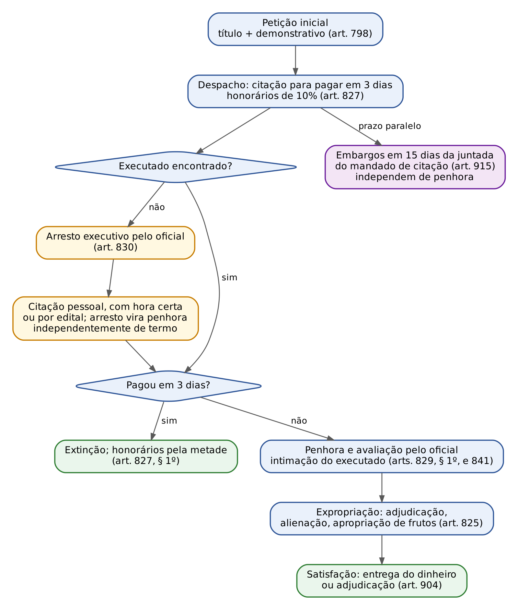
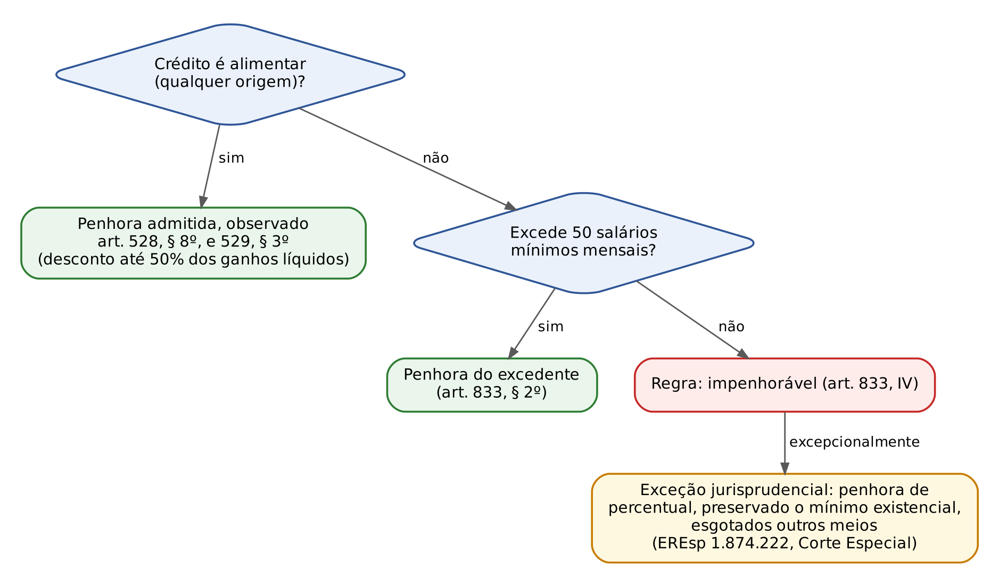
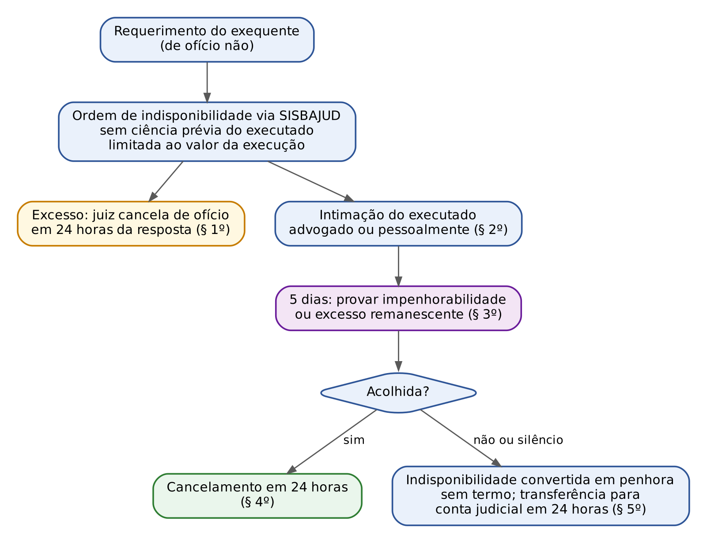
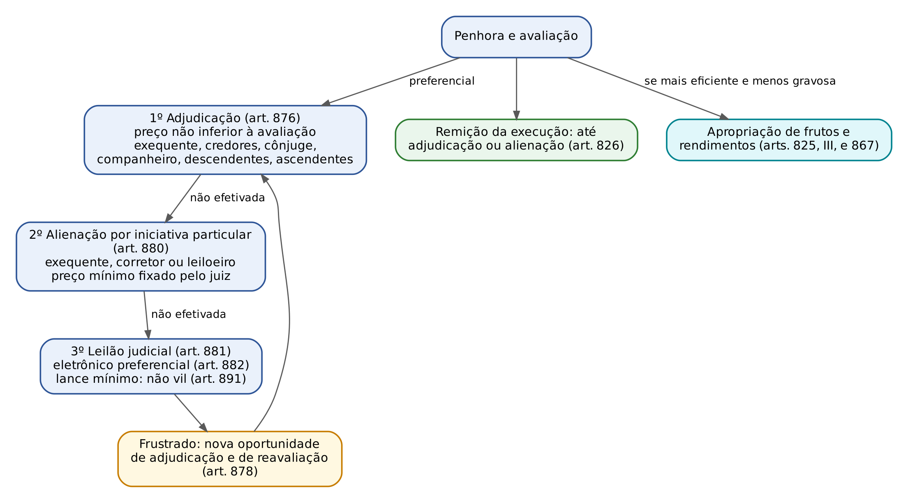
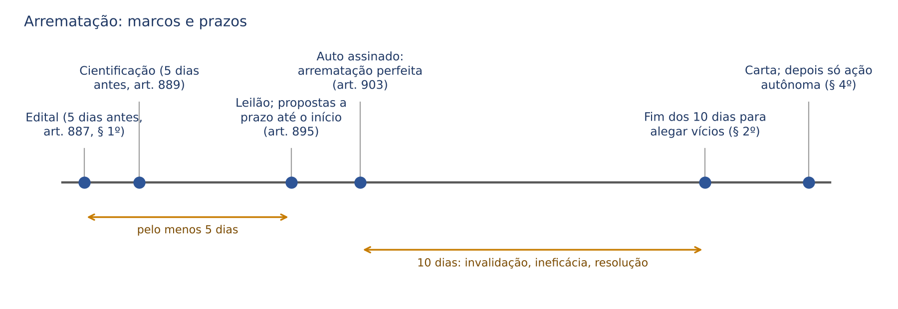
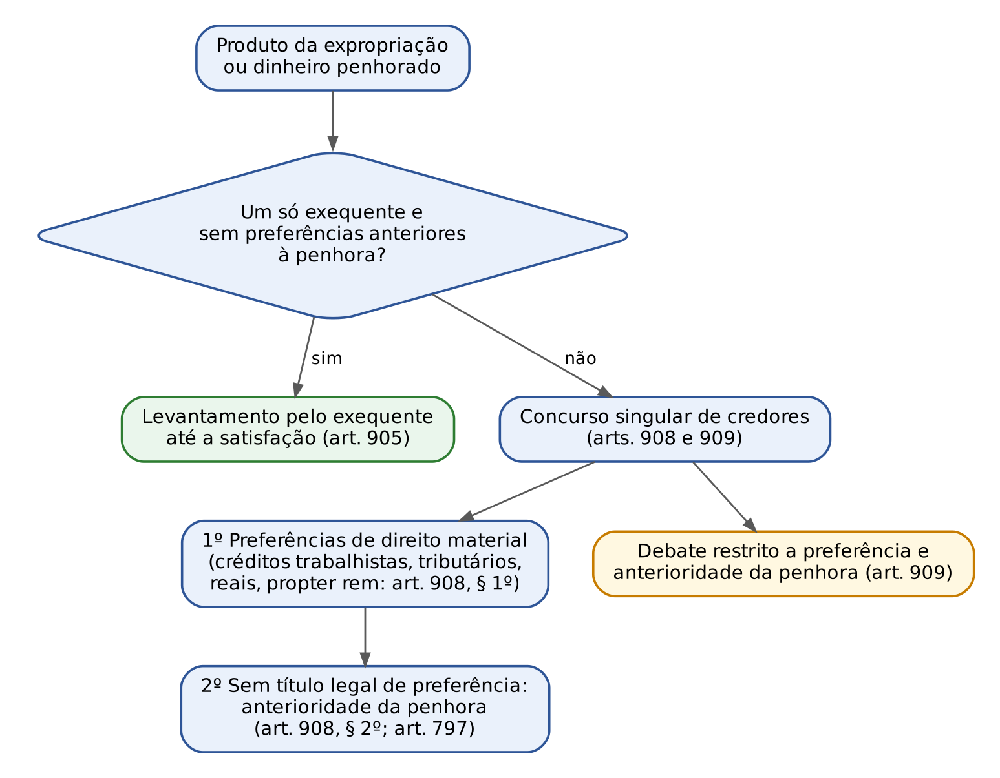
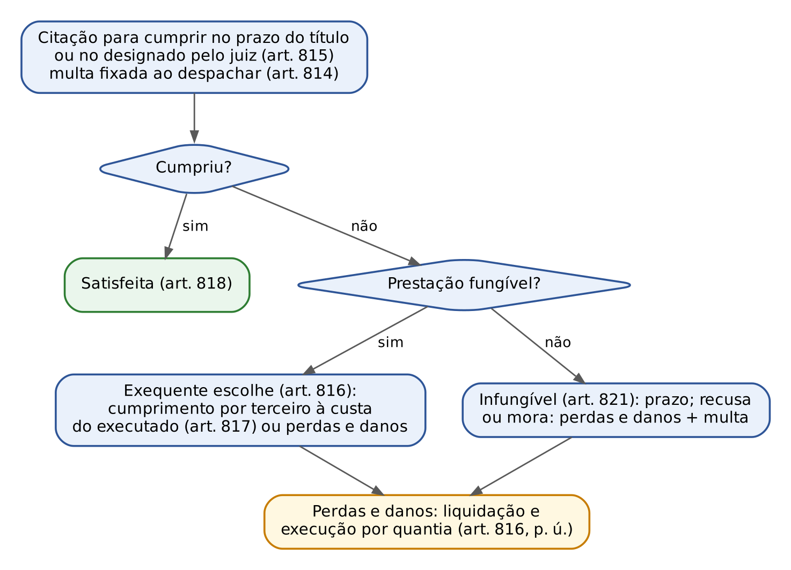

# CAPÍTULO 25 — EXECUÇÃO II: QUANTIA CERTA, PENHORA, EXPROPRIAÇÃO E EXECUÇÕES ESPECÍFICAS

:::INCIDENCIA
Pontos: TRF5 p. 13; TJRS p. 18; TJSC p. 14 e 17 (Lei 8.009/1990). Nível A+. Lote: 19 questões (FGV 9; FCC 10), mais correlatas de outros lotes.
O que mais cai: rol do art. 833 em literalidade (incisos IV, V, VI, VIII e X e o § 2º), bem de família em casos (Súmula 486, fiador de locação, execução *ex delicto*), Temas 769, 1.234 e 1.235 do STJ, prazos do art. 829 e do art. 915, seguro garantia (+30%), bem indivisível (art. 843), modalidades de expropriação (art. 825), entrega de coisa (benfeitorias, art. 917) e obrigação de fazer (art. 816).
:::

#### Mapa de cobrança

| Subtema | FGV | FCC | Padrão |
|---|---|---|---|
| Impenhorabilidades do art. 833 | 3 | 4 | Literalidade dos incisos; exceção dos alimentos e dos 50 salários mínimos; Tema 1.235 (40 salários mínimos não é ordem pública); Tema 1.234 (ônus da prova na pequena propriedade rural) |
| Bem de família (Lei 8.009/1990) | 4 | 1 | Caso: imóvel locado com renda revertida à família (Súmula 486); fiador de locação comercial (Tema 1.127 do STF); IPTU; sentença penal condenatória; herdeiros |
| Penhora: ordem, substituição, faturamento, averbação, intimação | 1 | 4 | Seguro garantia +30%; anuência do cônjuge na oferta de imóvel; faturamento subsidiário (Tema 769); averbação do art. 844; intimação pessoal do executado assistido por curador especial |
| Bem indivisível (art. 843) | 1 | 0 | Penhora do bem inteiro, sem citação do coproprietário; sub-rogação no produto |
| Citação, prazos e honorários (arts. 827 e 829) | 1 | 0 | Três dias da citação para pagar; quinze da juntada para embargar |
| Expropriação e avaliação | 0 | 3 | Rol do art. 825; avaliação pelo oficial (art. 870); lance do exequente |
| Entrega de coisa e fazer | 0 | 2 | Benfeitorias necessárias ou úteis em embargos; art. 816 (terceiro ou perdas e danos) |

O padrão é nítido: a FCC cobra LETRA DE LEI (arts. 825, 833, 835, 844, 847, 870, 816, 917), com alternativas que trocam uma palavra; a FGV cobra CASO, quase sempre com bem de família ou impenhorabilidade, e em prova de juiz combina a penhora com outro instituto (recurso cabível contra a decisão que pronuncia a impenhorabilidade, legitimidade do coproprietário).

## 25.1 Estrutura da execução por quantia certa

### 25.1.1 Expropriação e remição

A execução por quantia certa contra devedor solvente "realiza-se pela expropriação de bens do executado, ressalvadas as execuções especiais" (art. 824). As ressalvas são a execução contra a Fazenda Pública (precatório e RPV, Cap. 27), a execução fiscal (procedimento da Lei 6.830/1980, Cap. 28) e a execução de alimentos pelo rito coercitivo (25.12 e Cap. 23). O procedimento do Livro II, Título II, Capítulo IV (arts. 824 a 909) é também o regime subsidiário do cumprimento de sentença de pagar quantia: decorrido o prazo do art. 523 sem pagamento, "será expedido, desde logo, mandado de penhora e avaliação, seguindo-se os atos de expropriação" (art. 523, § 3º), e toda a disciplina de penhora, avaliação, expropriação e satisfação deste capítulo se aplica ao cumprimento (art. 513, *caput*, e art. 771). A teoria geral da execução, os títulos e a responsabilidade patrimonial estão no Cap. 24; o procedimento do cumprimento, a multa de 10% e a impugnação, no Cap. 22.

:::LEI CPC, ARTS. 825 E 826
Art. 825. A expropriação consiste em:
I - adjudicação;
II - alienação;
III - apropriação de frutos e rendimentos de empresa ou de estabelecimentos e de outros bens.
Art. 826. Antes de adjudicados ou alienados os bens, o executado pode, a todo tempo, remir a execução, pagando ou consignando a importância atualizada da dívida, acrescida de juros, custas e honorários advocatícios.
:::

Três observações que resolvem questões:

- O CPC/2015 aboliu a "praça" e a distinção entre praça (imóveis) e leilão (móveis): a alienação é por iniciativa particular ou em leilão judicial eletrônico ou presencial (art. 879). Alternativas que falam em "praceamento", "comissão" ou "hasta pública" como modalidades legais estão erradas, embora a expressão "hasta pública" ainda apareça em julgados.
- A ordem é de PREFERÊNCIA: adjudicação primeiro (art. 880 só autoriza a alienação particular "não efetivada a adjudicação"; art. 881 só autoriza o leilão "se não efetivada a adjudicação ou a alienação por iniciativa particular"). A apropriação de frutos e rendimentos pode ser priorizada em relação à adjudicação, "se não prejudicar o exequente e for mais favorável ao executado" (Enunciado 106 da I Jornada de Direito Processual Civil).
- Remição DA EXECUÇÃO (art. 826) é o pagamento integral pelo executado, que extingue a execução; não se confunde com a remição DO BEM hipotecado (arts. 877, § 3º, e 902), em que o executado resgata só o bem gravado oferecendo o preço da avaliação ou do maior lance. O marco final é a assinatura do auto de adjudicação ou de arrematação, não a data do leilão (Enunciado 151 da II Jornada: o executado pode remir "até a lavratura do auto de adjudicação ou de alienação").

:::QUESTAO FCC 2025 — TRT 15 — ANALISTA JUDICIÁRIO (Q3295849)
Pediu-se o conteúdo da expropriação. Gabarito: B — adjudicação, alienação e apropriação de frutos e rendimentos de empresa ou de estabelecimentos e de outros bens (art. 825). Armadilhas: "comissão" e "praceamento" (terminologia sem base no CPC/2015), "leilão, somente" (ignora adjudicação e alienação particular) e "desapropriação" (instituto de direito público, não modalidade expropriatória executiva).
:::

### 25.1.2 Petição inicial, honorários e certidão para averbação

A inicial vem instruída com o título, o demonstrativo do débito atualizado e a prova da condição ou do termo, podendo o exequente indicar desde logo os bens a penhorar (art. 798, I e II, *c*; requisitos do título e da inicial no Cap. 24). Dois atos do despacho inicial são cobrados:

- Honorários: "Ao despachar a inicial, o juiz fixará, de plano, os honorários advocatícios de dez por cento" (art. 827). Pagamento integral em 3 dias reduz pela metade (§ 1º); rejeitados os embargos, podem ser elevados até 20%; não opostos embargos, a majoração pode ocorrer ao final, considerado o trabalho do advogado (§ 2º). Os honorários dos embargos e os da execução são autônomos, mas a soma não pode passar do teto legal, e não se compensam entre si (Tema 587 do STJ; v. Cap. 26).
- Certidão de admissão da execução (art. 828): o exequente obtém certidão para averbar no registro de imóveis, de veículos ou de outros bens sujeitos a penhora, arresto ou indisponibilidade; deve comunicar as averbações em 10 dias; formalizada penhora suficiente, cancela as demais em 10 dias, sob pena de cancelamento de ofício; e responde por averbação manifestamente indevida, em incidente em autos apartados (§ 5º). A alienação posterior à averbação presume-se em fraude à execução (§ 4º). A fraude à execução, a Súmula 375 e o Tema 243 do STJ são do Cap. 24.

:::QUESTAO FGV 2024 — TJ-SC — ANALISTA JURÍDICO (Q2515306)
O mandado citou o executado para "pagar ou apresentar defesa em 15 dias úteis, contados da juntada", com honorários de 10%. Gabarito: E — o juiz errou, porque o prazo para PAGAR é de 3 dias contados da própria citação (art. 829), e não da juntada; o prazo de 15 dias contados da juntada é o dos embargos (art. 915). Armadilhas: A (aceita a fusão dos dois prazos); C (honorários iniciais são fixados "de plano" no despacho, art. 827, não na sentença); D (só o prazo de pagamento corre da citação; o dos embargos corre da juntada, art. 231).
:::

## 25.2 Citação e arresto executivo

### 25.2.1 Citação para pagar em 3 dias

:::LEI CPC, ART. 829
Art. 829. O executado será citado para pagar a dívida no prazo de 3 (três) dias, contado da citação.
§ 1º Do mandado de citação constarão, também, a ordem de penhora e a avaliação a serem cumpridas pelo oficial de justiça tão logo verificado o não pagamento no prazo assinalado, de tudo lavrando-se auto, com intimação do executado.
§ 2º A penhora recairá sobre os bens indicados pelo exequente, salvo se outros forem indicados pelo executado e aceitos pelo juiz, mediante demonstração de que a constrição proposta lhe será menos onerosa e não trará prejuízo ao exequente.
:::

Pontos de prova:

- O termo inicial é a CITAÇÃO (o ato), não a juntada do mandado: regra especial que afasta o art. 231 para o pagamento. O prazo dos embargos, ao contrário, corre na forma do art. 231 (art. 915), e os embargos independem de penhora, depósito ou caução (art. 914, *caput*; Cap. 26).
- Do CPC/1973 para o CPC/2015 inverteu-se a iniciativa da indicação: quem indica bens é o EXEQUENTE (art. 829, § 2º; art. 798, II, *c*), e o executado só substitui se provar menor onerosidade SEM prejuízo ao exequente. Os dois requisitos são cumulativos.
- A citação postal é admitida na execução (Enunciado 85 da I Jornada de Direito Processual Civil); a citação eletrônica segue o art. 246 (Cap. 12).
- Na execução de alimentos por título extrajudicial (art. 911) e na execução fiscal (art. 8º da LEF), os prazos e as consequências são outros: ver 25.12 e Cap. 28.

### 25.2.2 Arresto executivo (pré-penhora)

O art. 830 manda o oficial que não encontrar o executado arrestar-lhe tantos bens quantos bastem para garantir a execução; nos 10 dias seguintes, procurá-lo 2 vezes em dias distintos e, havendo suspeita de ocultação, citá-lo com hora certa (§ 1º); frustradas a citação pessoal e a com hora certa, incumbe ao exequente requerer o edital (§ 2º); aperfeiçoada a citação e transcorrido o prazo de pagamento, o arresto converte-se em penhora, independentemente de termo (§ 3º).

Natureza: o arresto do art. 830 é ato EXECUTIVO, praticado pelo oficial de justiça de ofício, sem os requisitos da tutela cautelar (não se exige probabilidade do direito nem perigo de dano: o título basta). Distingue-se do arresto cautelar (art. 301; Cap. 14), que exige *fumus* e *periculum* e é concedido pelo juiz. A doutrina o chama de pré-penhora: converte-se em penhora automaticamente, "independentemente de termo", depois de aperfeiçoada a citação (pessoal, com hora certa ou por edital) e transcorrido o prazo de pagamento.

| Arresto executivo (art. 830) | Arresto cautelar (art. 301) |
|---|---|
| Pressuposto: executado não encontrado | Pressupostos: probabilidade do direito e perigo de dano (art. 300) |
| Ato do oficial de justiça, independe de decisão específica | Depende de decisão judicial |
| Só na execução (título executivo) | Antecedente ou incidental, em qualquer processo |
| Converte-se em penhora com a citação e o decurso do prazo | Mantém-se até a satisfação ou a revogação; na execução, pode ser convertido em penhora |

Jurisprudência:

:::JURIS STJ, RESP 2.099.780-PR, RELATOR MINISTRO MOURA RIBEIRO, TERCEIRA TURMA, J. 22/4/2025 (INFO 848)
A tentativa de citação do devedor por oficial de justiça não constitui pré-requisito para o deferimento do arresto eletrônico de bens. O arresto "on-line" (via SISBAJUD) pode ser determinado quando o executado não é localizado por qualquer meio, inclusive por via postal ou eletrônica, sem que se exija a frustração da diligência pessoal do oficial.
:::

- Na execução fiscal, a Primeira Turma afirmou legítima a priorização de medidas executivas, como o arresto via SISBAJUD, antes da citação ficta (STJ, REsp 2.189.427-PE, Relator Ministro Paulo Sérgio Domingues, Primeira Turma, j. 4/8/2026, Info 900). A lógica é a mesma: o arresto busca bens antes que o executado, ciente da execução, os oculte, e pode estimular o comparecimento espontâneo.
- O curador especial do executado citado por edital ou por hora certa tem legitimidade para embargar e não precisa garantir o juízo (Súmula 196 e Tema 182 do STJ; v. Cap. 26). A citação ficta não é causa de suspensão pela não localização do executado (art. 921, III; Enunciado 213 da III Jornada); suspensão e prescrição intercorrente ficam no Cap. 26.

:::PEGADINHA ARRESTO NÃO DEPENDE DE PROVA DE OCULTAÇÃO
Para arrestar, basta o oficial não encontrar o executado; a SUSPEITA DE OCULTAÇÃO é requisito da citação com hora certa (art. 830, § 1º), não do arresto. E quem requer o edital é o exequente (§ 2º), não o oficial.
:::

## 25.3 Penhora: conceito, efeitos, objeto e ordem

### 25.3.1 Conceito e efeitos

Penhora é o ato executivo de afetação de bens determinados à satisfação do crédito: individualiza, dentro do patrimônio que responde pela dívida (art. 789), os bens que serão expropriados. Seus efeitos:

- Processuais: garantir o juízo (relevante para a substituição, para o efeito suspensivo dos embargos, art. 919, § 1º, e para a impugnação ao cumprimento, art. 525, § 6º); individualizar o bem; conferir ao exequente o DIREITO DE PREFERÊNCIA sobre o bem penhorado (art. 797: "realiza-se a execução no interesse do exequente que adquire, pela penhora, o direito de preferência sobre os bens penhorados"; recaindo mais de uma penhora sobre o mesmo bem, cada exequente conserva o seu título de preferência, art. 797, parágrafo único).
- Materiais: retirar do executado a posse direta, que passa ao depositário (art. 839), sem retirar a propriedade; tornar ineficazes perante o exequente os atos de alienação ou oneração posteriores (fraude à execução, art. 792, Cap. 24). Com a averbação no registro, a ciência de terceiros passa a ser presumida de modo absoluto (art. 844).

A penhora é ato PRÉVIO E NECESSÁRIO à adjudicação: sem penhora não se adjudica (STJ, REsp 2.200.180, Info 857; v. Cap. 13).

### 25.3.2 Objeto: limites quantitativos e qualitativos

- Quantitativo: "tantos bens quantos bastem para o pagamento do principal atualizado, dos juros, das custas e dos honorários advocatícios" (art. 831). Excesso de penhora se corrige por redução (arts. 850 e 874, I).
- Qualitativo: "Não estão sujeitos à execução os bens que a lei considera impenhoráveis ou inalienáveis" (art. 832); rol do art. 833 em 25.4 e Lei 8.009/1990 em 25.5.
- Inutilidade: não se penhora quando o produto for totalmente absorvido pelas custas (art. 836). Não encontrando bens penhoráveis, o oficial DESCREVE na certidão, independentemente de ordem judicial expressa, os bens que guarnecem a residência ou o estabelecimento, e o executado fica como depositário provisório (art. 836, §§ 1º e 2º): a lista serve para o exequente verificar se há bens de elevado valor fora da proteção do art. 833, II.

### 25.3.3 Ordem preferencial (art. 835)

:::LEI CPC, ART. 835
Art. 835. A penhora observará, preferencialmente, a seguinte ordem:
I - dinheiro, em espécie ou em depósito ou aplicação em instituição financeira;
II - títulos da dívida pública da União, dos Estados e do Distrito Federal com cotação em mercado;
III - títulos e valores mobiliários com cotação em mercado;
IV - veículos de via terrestre;
V - bens imóveis;
VI - bens móveis em geral;
VII - semoventes;
VIII - navios e aeronaves;
IX - ações e quotas de sociedades simples e empresárias;
X - percentual do faturamento de empresa devedora;
XI - pedras e metais preciosos;
XII - direitos aquisitivos derivados de promessa de compra e venda e de alienação fiduciária em garantia;
XIII - outros direitos.
§ 1º É prioritária a penhora em dinheiro, podendo o juiz, nas demais hipóteses, alterar a ordem prevista no caput de acordo com as circunstâncias do caso concreto.
§ 2º Para fins de substituição da penhora, equiparam-se a dinheiro a fiança bancária e o seguro garantia judicial, desde que em valor não inferior ao do débito constante da inicial, acrescido de trinta por cento.
§ 3º Na execução de crédito com garantia real, a penhora recairá sobre a coisa dada em garantia, e, se a coisa pertencer a terceiro garantidor, este também será intimado da penhora.
:::

Leitura:

- A ordem é "preferencial", não absoluta, MAS o dinheiro é "prioritário" (§ 1º): o juiz pode alterar a ordem dos incisos II a XIII conforme o caso, não deslocar o dinheiro. A Súmula 417 do STJ ("Na execução civil, a penhora de dinheiro na ordem de nomeação de bens não tem caráter absoluto") foi editada sob o CPC/1973; o texto do § 1º reforçou a primazia do dinheiro, e a súmula deve ser lida hoje como restrita a hipóteses excepcionais de menor onerosidade comprovada pelo executado, sem prejuízo ao exequente (art. 805, parágrafo único).
- O exequente pode recusar bem de difícil ou onerosa alienação, porque a execução se faz no interesse do credor (Jurisprudência em Teses, ed. 155, tese 5, firmada em execução fiscal, mas de lógica geral).
- Cotas de fundo de investimento NÃO são dinheiro para fins do inciso I, e a recusa da sua nomeação, conforme as particularidades do caso, é legítima (Tema 913 do STJ).
- Garantia real: a penhora recai sobre a coisa dada em garantia (§ 3º), e o terceiro garantidor é intimado. A execução pode ser promovida só contra o titular do bem dado em garantia, intimando-se o coproprietário que não a outorgou (Enunciado 97 da I Jornada).
- Direitos aquisitivos (inciso XII): desaparecem com a consolidação da propriedade em favor do credor fiduciário (STJ, REsp 1.835.431-SP, Info 805, j. 19/3/2024); se o bem (por exemplo, veículo de trabalho) é impenhorável, a impenhorabilidade se estende aos direitos aquisitivos do contrato de alienação fiduciária (STJ, REsp 2.173.633-PR, Info 834, j. 12/11/2024).

### 25.3.4 Seguro garantia e fiança bancária

Equiparam-se a dinheiro, para SUBSTITUIÇÃO da penhora, a fiança bancária e o seguro garantia judicial em valor não inferior ao débito da inicial acrescido de 30% (art. 835, § 2º; art. 848, parágrafo único). Consequência: o exequente não pode recusar a substituição do dinheiro penhorado por seguro garantia idôneo, salvo insuficiência, defeito formal ou inidoneidade da salvaguarda (STJ, TutCautAnt 672-SP, j. 24/9/2024, Info 830). Na execução fiscal de crédito tributário, a fiança bancária ou o seguro garantia não podem ser recusados por inobservância da ordem legal (Tema 1.385 do STJ; regime da LEF no Cap. 28).

:::QUESTAO FCC 2024 — PGE-GO — PROCURADOR DO ESTADO SUBSTITUTO (Q2654939)
Fase expropriatória. Gabarito: D — o seguro garantia não equivale a dinheiro para substituição da penhora, salvo se contratado em valor não inferior ao débito acrescido de 30% (arts. 835, § 2º, e 848, parágrafo único). Armadilhas: A (o exequente pode lançar no leilão: não está entre os impedidos do art. 890, e o art. 892, § 1º, regula justamente a arrematação pelo exequente; o limite "igual ou superior à avaliação" é da adjudicação, art. 876); B (a ampliação pode ser determinada após a avaliação, art. 874, II, ou diante de alteração significativa do valor, art. 850, sem esperar leilão frustrado); C (recursos do fundo partidário são impenhoráveis, art. 833, XI); E (a exceção do § 2º do art. 833 vale para prestação alimentícia "independentemente de sua origem", e não só de parentesco).
:::

### 25.3.5 Documentação, depósito e intimação

- Forma: auto (lavrado pelo oficial) ou termo (nos autos), com data, lugar, partes, descrição dos bens e nomeação do depositário (art. 838). A penhora se considera feita com a apreensão e o depósito (art. 839). Imóveis e veículos são penhorados por TERMO NOS AUTOS, onde quer que se localizem, à vista da certidão da matrícula ou do registro (art. 845, § 1º); só não sendo possível, a execução se faz por carta no foro da situação (§ 2º). Os embargos na execução por carta são decididos no juízo deprecante, salvo se versarem unicamente vícios da penhora, avaliação ou alienação realizadas no deprecado (art. 914, § 2º; Súmula 46 do STJ; v. Cap. 26).
- Depósito (art. 840): dinheiro, papéis de crédito, pedras e metais preciosos em banco oficial (Banco do Brasil, Caixa ou banco estadual) ou, na falta, instituição designada pelo juiz (inciso I, objeto da ADI 5.492, que o Planalto assinala); móveis, semoventes e imóveis urbanos com o depositário judicial, ou, na falta dele, com o EXEQUENTE (inciso II e § 1º); imóveis rurais e bens da atividade agrícola com o executado, mediante caução (inciso III). O executado pode ser depositário se os bens forem de difícil remoção ou se o exequente anuir (§ 2º). O encargo de depositário pode ser expressamente recusado (Súmula 319 do STJ); a prisão do depositário infiel é vedada (Súmula Vinculante 25).
- Averbação: "Para presunção absoluta de conhecimento por terceiros, cabe ao exequente providenciar a averbação do arresto ou da penhora no registro competente, mediante apresentação de cópia do auto ou do termo, independentemente de mandado judicial" (art. 844). A averbação não é requisito de validade da penhora: é ônus do exequente para gerar presunção absoluta de ciência (efeitos na fraude à execução, Cap. 24).
- Intimação do executado (art. 841): imediata; na pessoa do advogado ou da sociedade de advogados (§ 1º); sem advogado constituído, pessoalmente, de preferência por via postal (§ 2º); reputa-se intimado o executado presente à penhora (§ 3º); vale a intimação no endereço desatualizado (§ 4º).
- Cônjuge: penhorado imóvel ou direito real sobre imóvel, intima-se também o cônjuge, salvo separação absoluta de bens (art. 842). O cônjuge pode defender a meação por embargos de terceiro, mesmo intimado da penhora (Súmula 134 do STJ; v. Cap. 24); o mesmo vale para o companheiro (Q2400474, FCC 2024, gabarito B: embargos de terceiro, Cap. 29).

:::JURIS STJ, RESP 2.086.883-PR, RELATOR MINISTRO MARCO BUZZI, QUARTA TURMA, J. 16/12/2025 (INFORMATIVO DE JURISPRUDÊNCIA N. 29, EDIÇÃO EXTRAORDINÁRIA)
O curador especial não se equipara a advogado constituído para fins do art. 841, § 2º, do CPC: o executado citado fictamente e revel, assistido por curador especial (inclusive Defensoria Pública), deve ser intimado PESSOALMENTE da penhora. A razão é que o curador não recebe mandato nem mantém vínculo com a parte, e a intimação da penhora abre oportunidades de defesa (substituição, alegação de impenhorabilidade) que dependem do próprio executado.
:::

:::QUESTAO FCC 2026 — DPE-BA — DEFENSOR PÚBLICO (Q4037467)
Executada citada por edital, revel, com curador especial (Defensoria); penhora de imóvel no cumprimento de sentença. Gabarito: C — a intimação da penhora deve ser pessoal ao executado e não é suprida pela intimação do curador, que não se equipara a advogado constituído (REsp 2.086.883-PR). Armadilhas: A (dispensa da intimação ao revel citado fictamente: o art. 346 dispensa intimações ao revel SEM patrono, mas a penhora tem regime próprio); B e D (intimação "exclusivamente" ao curador); E (instrumentalidade das formas como salvação genérica).
:::

:::DICA INTIMAÇÃO DA PENHORA X INTIMAÇÃO PARA A ADJUDICAÇÃO
Penhora: executado sem advogado é intimado pessoalmente (art. 841, § 2º). Adjudicação: sem advogado, por carta com AR; com Defensoria, também por carta com AR; citado por edital e sem procurador, a intimação é DISPENSÁVEL (art. 876, §§ 1º e 3º). Leilão: sem advogado, por carta registrada, mandado, edital ou outro meio idôneo; revel sem advogado e sem endereço atual, vale o próprio edital do leilão (art. 889, I e parágrafo único).
:::

### 25.3.6 Substituição, modificações e segunda penhora

| Instituto | Quem e quando | Requisitos | Fundamento |
|---|---|---|---|
| Substituição a pedido do executado | Executado, em 10 dias da intimação da penhora | Menor onerosidade + ausência de prejuízo ao exequente; documentação do § 1º; imóvel só com anuência expressa do cônjuge, salvo separação absoluta (§ 3º); oitiva do exequente (§ 4º) | art. 847 |
| Substituição por qualquer das partes | Exequente ou executado | Hipóteses do art. 848 (ordem legal desrespeitada, bens no foro, bens livres, baixa liquidez, leilão frustrado, omissão do valor) | art. 848 |
| Substituição por fiança ou seguro | Executado | Valor da inicial + 30% | arts. 835, § 2º, e 848, p. ú. |
| Redução, ampliação ou transferência | Qualquer parte | Alteração significativa do valor de mercado (art. 850) ou desproporção apurada na avaliação, ouvida a parte contrária (art. 874) | arts. 850 e 874 |
| Segunda penhora | Exequente | Primeira anulada; produto insuficiente após alienação; desistência da primeira por litígio ou constrição prévia | art. 851 |
| Alienação antecipada | Qualquer parte ou de ofício | Bens sujeitos a deterioração ou depreciação, ou manifesta vantagem; oitiva da parte contrária | arts. 852 e 853 |

Sobre a segunda penhora, o STJ firmou duas balizas recentes: (i) antes de determiná-la, o juiz deve ouvir a parte contrária em 3 dias (art. 853), sob pena de nulidade não convalidável pelo contraditório em sede recursal; (ii) não anulada nem desistida a primeira penhora, a nova constrição exige demonstração de insuficiência dos bens penhorados, o que pressupõe avaliação prévia do primeiro bem (art. 874, II) ou sua alienação (art. 851, II) (STJ, REsp 2.250.086-SP, Relatora Ministra Nancy Andrighi, Terceira Turma, j. 14/9/2026, Info 904).

:::QUESTAO FCC 2025 — UNICAMP — PROCURADOR DE UNIVERSIDADE (Q3891322)
Cinco assertivas sobre atos executivos. Gabarito: A (III, IV e V corretas). III: medidas indutivas, coercitivas, mandamentais ou sub-rogatórias inclusive em prestação pecuniária (art. 139, IV; Cap. 24). IV: oferta de imóvel em substituição exige anuência expressa do cônjuge, salvo separação absoluta (art. 847, § 3º). V: literalidade do art. 844 (presunção absoluta, averbação pelo exequente, sem mandado). Erradas: I (a negativação depende de requerimento da parte, art. 782, § 3º: o juiz não a promove de ofício ao receber a inicial); II (a penhora de faturamento é subsidiária — inexistência, difícil alienação ou insuficiência de outros bens, art. 866 — e o percentual não tem teto legal fixo de 50%).
:::

## 25.4 Impenhorabilidades (arts. 833 e 834)

### 25.4.1 Fundamento e natureza

O CPC/2015 suprimiu o advérbio "absolutamente" do *caput* do antigo art. 649 ("São absolutamente impenhoráveis"). O STJ extraiu daí que a impenhorabilidade é RELATIVA e admite ponderação entre efetividade da execução e dignidade do devedor (fundamento do EREsp 1.874.222, 25.4.3). As impenhorabilidades protegem o mínimo existencial, a profissão, a família e certos fins públicos; não são todas de ordem pública: a dos 40 salários mínimos depende de alegação do executado (Tema 1.235, 25.4.4).

Duas regras gerais do próprio art. 833:

- A impenhorabilidade NÃO é oponível à execução de dívida relativa ao próprio bem, inclusive a contraída para sua aquisição (§ 1º). Exemplo: o vendedor do trator agrícola financiado executa o preço e penhora o próprio trator.
- Os incisos IV (verbas remuneratórias) e X (poupança até 40 salários mínimos) não se aplicam à penhora para pagamento de prestação alimentícia, "independentemente de sua origem", nem às importâncias excedentes a 50 salários mínimos mensais (§ 2º). Os demais incisos (inclusive o V, instrumentos de trabalho) valem também contra o credor de alimentos.

:::LEI CPC, ART. 833
Art. 833. São impenhoráveis:
I - os bens inalienáveis e os declarados, por ato voluntário, não sujeitos à execução;
II - os móveis, os pertences e as utilidades domésticas que guarnecem a residência do executado, salvo os de elevado valor ou os que ultrapassem as necessidades comuns correspondentes a um médio padrão de vida;
III - os vestuários, bem como os pertences de uso pessoal do executado, salvo se de elevado valor;
IV - os vencimentos, os subsídios, os soldos, os salários, as remunerações, os proventos de aposentadoria, as pensões, os pecúlios e os montepios, bem como as quantias recebidas por liberalidade de terceiro e destinadas ao sustento do devedor e de sua família, os ganhos de trabalhador autônomo e os honorários de profissional liberal, ressalvado o § 2º;
V - os livros, as máquinas, as ferramentas, os utensílios, os instrumentos ou outros bens móveis necessários ou úteis ao exercício da profissão do executado;
VI - o seguro de vida;
VII - os materiais necessários para obras em andamento, salvo se essas forem penhoradas;
VIII - a pequena propriedade rural, assim definida em lei, desde que trabalhada pela família;
IX - os recursos públicos recebidos por instituições privadas para aplicação compulsória em educação, saúde ou assistência social;
X - a quantia depositada em caderneta de poupança, até o limite de 40 (quarenta) salários-mínimos;
XI - os recursos públicos do fundo partidário recebidos por partido político, nos termos da lei;
XII - os créditos oriundos de alienação de unidades imobiliárias, sob regime de incorporação imobiliária, vinculados à execução da obra.
§ 1º A impenhorabilidade não é oponível à execução de dívida relativa ao próprio bem, inclusive àquela contraída para sua aquisição.
§ 2º O disposto nos incisos IV e X do caput não se aplica à hipótese de penhora para pagamento de prestação alimentícia, independentemente de sua origem, bem como às importâncias excedentes a 50 (cinquenta) salários-mínimos mensais, devendo a constrição observar o disposto no art. 528, § 8º, e no art. 529, § 3º.
§ 3º Incluem-se na impenhorabilidade prevista no inciso V do caput os equipamentos, os implementos e as máquinas agrícolas pertencentes a pessoa física ou a empresa individual produtora rural, exceto quando tais bens tenham sido objeto de financiamento e estejam vinculados em garantia a negócio jurídico ou quando respondam por dívida de natureza alimentar, trabalhista ou previdenciária.
:::

Art. 834: "Podem ser penhorados, à falta de outros bens, os frutos e os rendimentos dos bens inalienáveis." É a penhorabilidade SUBSIDIÁRIA: o bem inalienável não se penhora, mas o aluguel que produz, sim, se não houver outros bens.

### 25.4.2 Os incisos que caem, com as palavras que mudam

| Inciso | Regra | Palavra-armadilha |
|---|---|---|
| I | Inalienáveis e declarados, por ato voluntário, não sujeitos à execução | "alienáveis" (troca da FGV); cláusula de impenhorabilidade em doação ou testamento (CC, art. 1.911); o pacto processual de impenhorabilidade só vincula as partes, não terceiros (Enunciados 152 e 153 da II Jornada) |
| II | Móveis e utilidades domésticas da residência | "salvo os de elevado valor ou que ultrapassem as necessidades comuns de médio padrão de vida" |
| III | Vestuário e pertences de uso pessoal | "salvo se de elevado valor" (relógio de luxo é penhorável) |
| IV | Verbas remuneratórias, liberalidades para sustento, ganhos de autônomo, honorários de profissional liberal | Ressalva do § 2º; honorários advocatícios são verba alimentar e o § 2º se aplica a sua execução (Enunciado 105 da I Jornada) |
| V | Bens móveis necessários OU ÚTEIS à profissão | "úteis" também; § 3º estende a máquinas agrícolas de pessoa física ou empresa individual rural, salvo financiadas e dadas em garantia, ou dívida alimentar, trabalhista ou previdenciária; veículo essencial ao trabalho (REsp 2.173.633-PR); sede do estabelecimento comercial é penhorável (Tema 287 do STJ) |
| VI | Seguro de vida | o seguro é impenhorável, sem ressalva; o capital pago ao beneficiário não é patrimônio do segurado (CC, art. 794) |
| VII | Materiais de obra em andamento | "salvo se a obra for penhorada" |
| VIII | Pequena propriedade rural, definida em lei, "desde que trabalhada pela família" | Ônus do executado provar a exploração familiar (Tema 1.234); terrenos contínuos somando menos de 4 módulos fiscais (Tema 961 do STF); CF, art. 5º, XXVI |
| IX | Recursos públicos recebidos por entidades privadas para aplicação compulsória em educação, saúde ou assistência social | só os vinculados; recursos próprios da entidade são penhoráveis |
| X | Poupança até 40 salários mínimos | ver 25.4.4; Tema 1.235 |
| XI | Fundo partidário | o partido pode renunciar à impenhorabilidade para pagar dívida contraída na forma do art. 44 da Lei 9.096/1995 (STJ, REsp 2.101.596-RJ, Info 804); bloqueio só em nome do órgão partidário devedor (art. 854, § 9º) |
| XII | Créditos da venda de unidades em incorporação, vinculados à obra | proteção do patrimônio de afetação; a penhora em edifício em construção só recai sobre unidades não comercializadas (art. 862, § 3º) |

:::QUESTAO FGV 2025 — TRF 3 — JUIZ FEDERAL SUBSTITUTO (Q3179543)
Assertivas sobre o art. 833. Gabarito: D — são impenhoráveis os livros, as máquinas, as ferramentas, os utensílios, os instrumentos ou outros bens móveis necessários ou úteis ao exercício da profissão (inciso V). Armadilhas por troca de palavra: A ("alienáveis", quando o inciso I diz "inalienáveis"); B (pertences pessoais "mesmo que de elevado valor": o inciso III ressalva o elevado valor); C (pequena propriedade "ainda que não trabalhada pela família": o inciso VIII exige o trabalho familiar); E ("o seguro de vida é penhorável": o inciso VI diz o contrário).
:::

:::QUESTAO FCC 2024 — TRT 7 — OFICIAL DE JUSTIÇA (Q3088393)
Em dívida NÃO alimentar, o que é penhorável? Gabarito: A — os frutos e rendimentos dos bens inalienáveis, à falta de outros bens (art. 834). Erradas: honorários de profissional liberal (inciso IV), bens úteis à profissão (V), seguro de vida (VI) e poupança até 40 salários mínimos (X), todos impenhoráveis quando o crédito não é alimentar.
:::

:::QUESTAO FGV 2025 — DPE-PE — DEFENSOR PÚBLICO (Q3390847)
Cumprimento de sentença de alimentos (dois anos em atraso); penhora de 40.000 (quarenta mil) reais em poupança e de automóvel usado como instrumento de trabalho. Gabarito: D — o automóvel é impenhorável mesmo na execução de alimentos, porque o § 2º do art. 833 afasta apenas os incisos IV e X, não o V. Armadilhas: A (a poupança até 40 salários mínimos NÃO é impenhorável contra alimentos, § 2º); B (substituição por fiança exige o débito + 30%, não 10%); C (prisão só pelas três últimas prestações anteriores ao ajuizamento e as que vencerem no curso, art. 528, § 7º, e Súmula 309; dois anos de atraso não autorizam a prisão pela integralidade); E (penhorado dinheiro, o efeito suspensivo da impugnação NÃO impede o levantamento mensal da prestação, art. 528, § 8º, e, por simetria, art. 913).
:::

### 25.4.3 Verbas remuneratórias: a regra, as exceções legais e a relativização pelo STJ

Há TRÊS caminhos para penhorar verba remuneratória:

1. Crédito alimentar de qualquer origem (família, ato ilícito, honorários advocatícios): penhora admitida, com o limite do art. 529, § 3º (o desconto das parcelas vencidas, somado às vincendas, não pode ultrapassar 50% dos ganhos líquidos).

2. Excedente a 50 salários mínimos mensais (§ 2º, parte final): penhorável para qualquer crédito.

3. Relativização jurisprudencial para dívida não alimentar abaixo de 50 salários mínimos:

:::JURIS STJ, ERESP 1.874.222-DF, RELATOR MINISTRO JOÃO OTÁVIO DE NORONHA, CORTE ESPECIAL, J. 19/4/2023 (INFO 771)
Na execução de dívida não alimentar, é possível a penhora de salário, ainda que não exceda 50 salários mínimos, quando garantido o mínimo necessário para a subsistência digna do devedor e de sua família. Fundamentos: a supressão do "absolutamente" no art. 833 tornou relativa a impenhorabilidade; o limite de 50 salários mínimos destoa da realidade brasileira e torna o dispositivo quase inócuo; a ponderação entre efetividade e menor onerosidade se resolve pela dignidade da pessoa humana, que protege devedor e credor. Condições: caráter EXCEPCIONAL, inviabilizados outros meios executórios, e avaliação concreta do impacto da constrição sobre os rendimentos do executado. Na linha do EREsp 1.518.169/DF (Corte Especial, j. 3/10/2018), que já admitia a penhora da parcela que excede o necessário à subsistência.
:::

Consequências práticas para a decisão: (i) o percentual é fixado caso a caso (a prática oscila entre 10% e 30% dos rendimentos líquidos), justificando-se por que o remanescente preserva o mínimo existencial; (ii) a decisão exige prova concreta da renda e das despesas, não presunção; (iii) a relativização não se estende automaticamente à poupança (inciso X), cuja lógica é outra. O salário depositado em conta perde a natureza de verba alimentar quando não consumido no mês e convertido em reserva; nessa hipótese passa a reger-se pelo inciso X e pela jurisprudência dos 40 salários mínimos.

:::SENTENCA DECISÃO QUE DEFERE PENHORA PARCIAL DE SALÁRIO (DÍVIDA NÃO ALIMENTAR)
"Frustradas as tentativas de penhora de ativos financeiros (SISBAJUD reiterado), de veículos (RENAJUD) e de imóveis (consulta ao registro), e demonstrado pelos contracheques que o executado percebe remuneração líquida de 18.000 (dezoito mil) reais, sem dependentes informados e com despesas comprovadas de moradia e saúde de 9.000 (nove mil) reais, defiro a penhora de 15% da remuneração líquida mensal, mediante desconto em folha, até a satisfação do crédito, por estar preservado montante suficiente à subsistência digna do devedor (CPC, art. 833, IV e § 2º; STJ, EREsp 1.874.222-DF, Corte Especial). Oficie-se ao empregador."
:::

### 25.4.4 Quarenta salários mínimos: poupança, conta corrente e aplicações

O texto do inciso X fala em "caderneta de poupança". O STJ ampliou a proteção a QUALQUER aplicação financeira ou depósito, até 40 salários mínimos, quando se trate de reserva do devedor: são impenhoráveis os valores depositados em instituição bancária até 40 salários mínimos, ainda que não se trate especificamente de conta poupança (STJ, REsp 2.072.733-SP, j. 27/8/2024, Info 824; no mesmo sentido o julgado noticiado no Info 804, REsp 1.677.144-RS, j. 21/2/2024). A Corte Especial, contudo, AFETOU a questão ao rito repetitivo no Tema 1.285 ("definir se é ou não impenhorável a quantia de até quarenta salários mínimos poupada", esteja em papel-moeda, conta corrente, poupança ou fundo de investimento), em julgamento e sem tese fixada até a data desta apostila. Para a prova objetiva: letra da lei (poupança, até 40 salários mínimos) quando a questão pede "nos termos do CPC"; ampliação jurisprudencial quando pede "segundo o STJ".

:::JURIS STJ, TEMA 1.235 (RESP 2.061.973/PR E RESP 2.066.882/RS)
"A impenhorabilidade de quantia inferior a 40 salários mínimos (art. 833, X, do CPC) não é matéria de ordem pública e não pode ser reconhecida de ofício pelo juiz, devendo ser arguida pelo executado no primeiro momento em que lhe couber falar nos autos ou em sede de embargos à execução ou impugnação ao cumprimento de sentença, sob pena de preclusão."
:::

Desdobramentos:

- Na penhora on-line, o momento próprio é a manifestação de 5 dias do art. 854, § 3º, I (25.6.1). Antes de decidir a alegação, o juiz ouve o exequente em 5 dias, salvo rejeição liminar (Enunciado 211 da III Jornada).
- Os 40 salários mínimos são um limite GLOBAL por devedor, não por conta; o excedente é penhorável; o crédito alimentar afasta a proteção (§ 2º).
- O limite também não protege valores que revelem má-fé, abuso ou fraude (por exemplo, movimentação de conta corrente como se fosse poupança para blindar recursos de atividade empresarial), conforme a casuística do STJ.

:::QUESTAO FCC 2025 — DPE-RS — DEFENSOR PÚBLICO (Q3386984)
Quatro assertivas. Gabarito: D (I e II). I: é ônus do executado provar que a pequena propriedade rural é explorada pela família (Tema 1.234). II: a penhora de faturamento pode ser deferida após a demonstração de inexistência de bens em posição superior ou se o juiz constatar que são de difícil alienação (Tema 769). Erradas: III (a impenhorabilidade dos 40 salários mínimos NÃO é de ordem pública nem reconhecível de ofício, Tema 1.235); IV (alienação anterior à averbação da penhora não prova, por si, a fraude; sem averbação, o credor prova a má-fé do terceiro, Súmula 375 e Tema 243; Cap. 24).
:::

:::QUESTAO FGV 2024 — TJ-AP — OFICIAL DE JUSTIÇA (Q2449085)
Devedor solteiro tem um único imóvel, alugado a empresa; seguro de vida; e exatamente 40 salários mínimos em poupança. O que o oficial pode penhorar? Gabarito oficial: B — o valor do aluguel recebido. Raciocínio da banca: o seguro de vida é impenhorável (inciso VI); a poupança ATÉ 40 salários mínimos (inclusive o limite) é impenhorável (inciso X); o único imóvel residencial locado continua bem de família se a renda reverte à subsistência ou moradia da família (Súmula 486), de modo que a alternativa que afirma a penhorabilidade do imóvel foi tida como errada; resta o aluguel, que é rendimento penhorável (arts. 834 e 867). Gabarito discutível: o enunciado não diz que a renda é revertida à família (pressuposto da Súmula 486), e, se o for, a penhora do próprio aluguel esvazia a proteção que a súmula quer garantir. Na prova, siga a lógica da banca: o bem "da família" é protegido, e os frutos, à falta de outros bens, respondem.
:::

### 25.4.5 Pequena propriedade rural

- Requisitos: área até o limite legal (até 4 módulos fiscais, segundo a definição da Lei 8.629/1993 adotada pela jurisprudência) e TRABALHO pela família (art. 833, VIII; CF, art. 5º, XXVI, que veda a penhora "para pagamento de débitos decorrentes de sua atividade produtiva").
- Diferença com a CF: a Constituição protege contra dívidas da atividade produtiva; o CPC protege contra qualquer dívida, salvo a relativa ao próprio bem (§ 1º).
- Pluralidade de terrenos: é impenhorável a pequena propriedade rural formada por mais de um terreno, desde que contínuos e com área total inferior a 4 módulos fiscais (Tema 961 do STF).
- Ônus da prova: do executado, quanto à exploração familiar (Tema 1.234 do STJ). A proteção não depende de a dívida ser da atividade produtiva nem de o imóvel ser a moradia da família (essa é a lógica da Lei 8.009/1990, cumulável).
- O imóvel rural que é residência familiar recebe também a proteção da Lei 8.009/1990, restrita à sede de moradia e aos móveis (art. 4º, § 2º).

## 25.5 Bem de família (Lei 8.009/1990): aspectos processuais

### 25.5.1 Delimitação

O regime material do bem de família legal e convencional (beneficiários, residência permanente, imóvel rural, móveis, rol do art. 3º inciso por inciso, art. 4º, renúncia) está desenvolvido na Apostila de Direito Civil, Cap. 40. Aqui ficam o que o processo civil cobra: a oponibilidade em qualquer execução, os casos de prova em que a FGV combina a impenhorabilidade com outro instituto, o momento e o meio de alegação, a decisão e o recurso.

:::LEI LEI 8.009/1990, ARTS. 1º E 3º (EXCERTOS)
Art. 1º O imóvel residencial próprio do casal, ou da entidade familiar, é impenhorável e não responderá por qualquer tipo de dívida civil, comercial, fiscal, previdenciária ou de outra natureza, contraída pelos cônjuges ou pelos pais ou filhos que sejam seus proprietários e nele residam, salvo nas hipóteses previstas nesta lei.
Parágrafo único. A impenhorabilidade compreende o imóvel sobre o qual se assentam a construção, as plantações, as benfeitorias de qualquer natureza e todos os equipamentos, inclusive os de uso profissional, ou móveis que guarnecem a casa, desde que quitados.
Art. 3º A impenhorabilidade é oponível em qualquer processo de execução civil, fiscal, previdenciária, trabalhista ou de outra natureza, salvo se movido:
II - pelo titular do crédito decorrente do financiamento destinado à construção ou à aquisição do imóvel, no limite dos créditos e acréscimos constituídos em função do respectivo contrato;
III – pelo credor da pensão alimentícia, resguardados os direitos, sobre o bem, do seu coproprietário que, com o devedor, integre união estável ou conjugal, observadas as hipóteses em que ambos responderão pela dívida;
IV - para cobrança de impostos, predial ou territorial, taxas e contribuições devidas em função do imóvel familiar;
V - para execução de hipoteca sobre o imóvel oferecido como garantia real pelo casal ou pela entidade familiar;
VI - por ter sido adquirido com produto de crime ou para execução de sentença penal condenatória a ressarcimento, indenização ou perdimento de bens.
VII - por obrigação decorrente de fiança concedida em contrato de locação.
:::

O inciso I (créditos de trabalhadores da própria residência) foi revogado pela LC 150/2015. As exceções são TAXATIVAS (Jurisprudência em Teses, ed. 200, tese 9, conforme Apostila de Direito Civil, Cap. 40).

### 25.5.2 Quadro de decisão rápida

| Situação | Penhorável? | Fundamento |
|---|---|---|
| Devedor solteiro, separado ou viúvo que mora sozinho | NÃO | Súmula 364 do STJ |
| Único imóvel locado a terceiro, renda revertida à subsistência ou moradia da família | NÃO | Súmula 486 do STJ |
| Imóvel de alto valor | NÃO (o valor é irrelevante) | art. 1º; ver Civil, Cap. 40 |
| Vaga de garagem com matrícula própria | SIM | Súmula 449 do STJ |
| Fiador de locação residencial OU comercial | SIM | art. 3º, VII; Súmula 549 do STJ; Tema 1.127 do STF; Tema 1.091 do STJ |
| IPTU, taxas e contribuições do próprio imóvel; cotas condominiais | SIM | art. 3º, IV |
| Imposto não ligado ao imóvel (ISS, ICMS, IR) | NÃO | o inciso IV só alcança tributos "devidos em função do imóvel familiar" |
| Execução de sentença penal condenatória (indenização *ex delicto*) | SIM | art. 3º, VI |
| Indenização por ilícito civil reconhecida no juízo cível (sem condenação penal) | NÃO | o inciso VI exige sentença penal ou produto de crime |
| Hipoteca dada pela entidade familiar em dívida que a beneficiou | SIM | art. 3º, V; Tema 1.261 do STJ (ônus da prova conforme o caso) |
| Imóvel herdado que serve de moradia a herdeiro | NÃO | AgInt no REsp 2.168.820-RS (Info 861) |
| Doação em fraude à execução de imóvel que já era bem de família e continua a ser moradia | NÃO, em regra | EAREsp 2.141.032-GO (2ª Seção, Info 840) |
| Imóvel indivisível bem de família, em parte do devedor | NÃO (proteção do imóvel inteiro, salvo se suscetível de divisão) | REsp 1.861.107-RS |

:::QUESTAO FGV 2025 — TJ-TO — JUIZ SUBSTITUTO (Q3453234)
Sentença penal condenatória por lesão corporal transitada em julgado; liquidação no cível (200.000 (duzentos mil) reais); cumprimento de sentença; o juiz pronuncia a impenhorabilidade do único imóvel residencial do executado. Gabarito: C — a decisão é agravável (decisão interlocutória proferida no cumprimento de sentença, art. 1.015, parágrafo único) e o agravo de Caio deve ser PROVIDO, porque a execução de sentença penal condenatória a ressarcimento ou indenização é exceção à impenhorabilidade (Lei 8.009/1990, art. 3º, VI). Resolução em passos: (1) qual o título? sentença penal condenatória transitada em julgado (art. 515, VI), liquidada no cível; (2) que ato é a decisão sobre impenhorabilidade? interlocutória, pois não extingue o cumprimento (art. 203, § 2º); (3) recurso? agravo de instrumento, cabível contra QUALQUER interlocutória na fase de cumprimento ou no processo de execução (art. 1.015, parágrafo único); (4) mérito? exceção do inciso VI. Armadilhas: A (a ação civil *ex delicto* não se extingue pela superveniência do processo penal; pode ser suspensa, art. 315 do CPC e art. 64, parágrafo único, do CPP); B (título é a sentença penal condenatória transitada em julgado, de qualquer grau); D (apelação: decisão não é sentença); E (mandado de segurança: há recurso típico).
:::

:::QUESTAO FGV 2024 — TJ-RR — ANALISTA JUDICIÁRIO (Q3087128)
Devedor muda-se com a família para imóvel dos pais e aluga o seu, usando a renda para as necessidades básicas da família; condenado por acidente de trânsito, sofre pedido de penhora do imóvel. Gabarito: B — o imóvel é impenhorável, porque a renda da locação é revertida à subsistência da família (Súmula 486). Armadilhas: A (moradia efetiva como requisito absoluto: a súmula a dispensa quando a renda reverte à família); C (afirma que basta ser o único imóvel, dispensando a destinação: errada, é a destinação que protege); D (indenização por ilícito civil não está no art. 3º; só a sentença PENAL condenatória, inciso VI).
:::

:::QUESTAO FGV 2025 — TJ-ES — NOTARIAL E REGISTRAL (Q3520278)
Caio é fiador em locação comercial; João deve IPTU do imóvel. Gabarito: C — a proteção não beneficia nenhum dos dois: fiança em locação, residencial ou comercial (art. 3º, VII; Tema 1.127 do STF), e IPTU do próprio imóvel (art. 3º, IV). Armadilha A: inventa um limite de 20% do valor venal.
:::

:::QUESTAO FCC 2025 — DPE-AM — DEFENSOR PÚBLICO (Q3531610)
Fiadora de locação comercial pergunta se seu único imóvel pode ser penhorado. Gabarito: C — é válida a penhora do bem de família do fiador, seja a locação residencial, seja comercial (Tema 1.091 do STJ; Tema 1.127 do STF). Comentário completo na Apostila de Direito Civil, Cap. 40.
:::

:::QUESTAO FGV 2025 — TJ-MS — JUIZ SUBSTITUTO (Q3786333)
O único imóvel deixado pelo falecido é penhorado, antes da partilha, em execução fiscal de ISS devido por atividade empresarial exercida nos fundos do imóvel; os sucessores alegam bem de família. Gabarito: E — aplica-se a proteção, desde que o imóvel sirva, ao tempo da ordem de penhora, à moradia de pelo menos um dos herdeiros ou de seus familiares. Passos: (1) o ISS não é imposto "devido em função do imóvel" (o inciso IV abrange IPTU, ITR, taxas e contribuições do imóvel), logo não há exceção; (2) a pendência do inventário não afasta a proteção: o STJ assegura a impenhorabilidade do bem de família ainda que incluído em inventário (AgInt no REsp 2.168.820-RS, Relator Ministro Benedito Gonçalves, Primeira Turma, j. 18/8/2025, Info 861); (3) o momento relevante para aferir a moradia é o da constrição. Armadilhas: A (uso empresarial parcial não exclui a proteção do imóvel residencial); B ("não existe bem de família do espólio": errada); C (a responsabilidade dos herdeiros limitada às forças da herança não converte o bem em penhorável); D (exige moradia já ao tempo da abertura da sucessão: o critério é o momento da penhora).
:::

### 25.5.3 Alegação, preclusão, ônus e decisão

:::PROCESSO COMO O BEM DE FAMÍLIA ENTRA NO PROCESSO
- Meio: simples petição nos autos, impugnação ao cumprimento (art. 525, § 1º, IV: penhora incorreta), embargos à execução (art. 917, II) ou, para os familiares que residem no imóvel e o cônjuge, embargos de terceiro (art. 674; Cap. 29). Na execução fiscal, também por exceção de pré-executividade quando a prova é documental pré-constituída.
- Momento: até a arrematação ou a adjudicação; não se argui em ação anulatória da arrematação depois de encerrada a execução (Jurisprudência em Teses, edições 44 e 204, conforme Apostila de Direito Civil, Cap. 40).
- Preclusão: decidida a questão, há preclusão consumativa; fato novo (a família passa a residir no imóvel) permite nova alegação.
- Ônus da prova: do executado quanto à moradia permanente; NÃO lhe incumbe provar que é o único imóvel; Tema 1.261 distribui o ônus na hipoteca dada por sócio.
- Decisão: interlocutória, agravável (art. 1.015, parágrafo único).
- Honorários: reconhecida a impenhorabilidade em embargos, o credor que resistiu ao pedido de exclusão paga honorários (STJ, AREsp 2.160.071, Info 829; v. Cap. 26).
- Proteção do imóvel inteiro: penhorada a fração do devedor em imóvel indivisível que é bem de família, a impenhorabilidade alcança a integralidade, impedindo a alienação, salvo se o imóvel for suscetível de divisão (STJ, REsp 1.861.107-RS, Relator Ministro Paulo Sérgio Domingues, Primeira Turma, j. 10/12/2024).
- Direito intertemporal: a Lei 8.009/1990 aplica-se à penhora realizada antes de sua vigência (Súmula 205 do STJ).
:::

:::PEGADINHA BEM DE FAMÍLIA X ART. 833
A Lei 8.009/1990 protege o IMÓVEL residencial e os móveis QUITADOS que o guarnecem; o art. 833, II, protege os móveis da residência, salvo os de elevado valor ou acima do médio padrão de vida, sem exigir quitação. Os veículos de transporte, as obras de arte e os adornos suntuosos estão excluídos pela Lei 8.009/1990 (art. 2º). Em prova, verifique se a questão pede a proteção "nos termos do CPC" ou "da Lei 8.009/1990".
:::

## 25.6 Penhoras especiais

### 25.6.1 Penhora de dinheiro em depósito ou aplicação (penhora on-line)

:::LEI CPC, ART. 854, CAPUT E §§ 1º A 5º
Art. 854. Para possibilitar a penhora de dinheiro em depósito ou em aplicação financeira, o juiz, a requerimento do exequente, sem dar ciência prévia do ato ao executado, determinará às instituições financeiras, por meio de sistema eletrônico gerido pela autoridade supervisora do sistema financeiro nacional, que torne indisponíveis ativos financeiros existentes em nome do executado, limitando-se a indisponibilidade ao valor indicado na execução.
§ 1º No prazo de 24 (vinte e quatro) horas a contar da resposta, de ofício, o juiz determinará o cancelamento de eventual indisponibilidade excessiva, o que deverá ser cumprido pela instituição financeira em igual prazo.
§ 2º Tornados indisponíveis os ativos financeiros do executado, este será intimado na pessoa de seu advogado ou, não o tendo, pessoalmente.
§ 3º Incumbe ao executado, no prazo de 5 (cinco) dias, comprovar que:
I - as quantias tornadas indisponíveis são impenhoráveis;
II - ainda remanesce indisponibilidade excessiva de ativos financeiros.
§ 4º Acolhida qualquer das arguições dos incisos I e II do § 3º, o juiz determinará o cancelamento de eventual indisponibilidade irregular ou excessiva, a ser cumprido pela instituição financeira em 24 (vinte e quatro) horas.
§ 5º Rejeitada ou não apresentada a manifestação do executado, converter-se-á a indisponibilidade em penhora, sem necessidade de lavratura de termo, devendo o juiz da execução determinar à instituição financeira depositária que, no prazo de 24 (vinte e quatro) horas, transfira o montante indisponível para conta vinculada ao juízo da execução.
:::

Estrutura em dois tempos: INDISPONIBILIDADE (sem contraditório prévio, a requerimento) e PENHORA (conversão após 5 dias). Os prazos: 24 horas para o juiz cancelar o excesso de ofício; 5 dias para o executado; 24 horas para a instituição cumprir cancelamento ou transferência. A instituição financeira responde pelos prejuízos se bloquear além do valor indicado ou não cancelar no prazo determinado (§ 8º). Pago o débito por outro meio, o juiz manda cancelar imediatamente (§ 6º).

Jurisprudência que cai:

- Desnecessidade de esgotar diligências: após a Lei 11.382/2006 (vigência em 21/1/2007), o bloqueio eletrônico prescinde do exaurimento de diligências extrajudiciais pelo exequente (Temas 219 e 425 do STJ). Antes dela, era medida excepcional (Tema 218, de interesse histórico).
- Reiteração automática ("teimosinha"): é medida legítima, cabendo ao executado demonstrar causa impeditiva ou meio igualmente eficaz e menos gravoso; após a triangularização, o indeferimento exige fundamentação concreta (Tema 1.325 do STJ, firmado em execução fiscal). Nas execuções cíveis, o pedido de nova tentativa pode ser reiterado e independe de decurso mínimo de tempo (Enunciado 215 da III Jornada).
- Conta conjunta: presume-se o rateio em partes iguais; não se penhora a integralidade do saldo de conta conjunta solidária por dívida de um só correntista (salvo execução da própria instituição mantenedora), facultada a prova de titularidade diversa (IAC 12 do STJ). No regime da comunhão universal, é possível bloquear valores na conta do cônjuge não executado, resguardada a meação, e a exclusividade dos bens se discute em embargos de terceiro (STJ, REsp 2.145.365, Info 899; v. Cap. 24).
- Filiais: é possível penhorar valores em nome das filiais por dívida da matriz (Tema 614 do STJ), pois a filial não tem personalidade própria.
- Instituição financeira executada: é penhorável o numerário disponível, excluídas as reservas bancárias no Banco Central (Súmula 328 do STJ).
- Mora: o depósito em garantia do juízo ou a penhora de ativos não cessa a mora; os encargos do título continuam a incidir até a liberação ao credor, deduzido o saldo da conta judicial com os acréscimos da instituição depositária (Tema 677 do STJ; STJ, REsp 1.881.751-PR, Informativo de Jurisprudência n. 26, edição extraordinária). Mas o devedor não responde por juros e correção no período em que o valor bloqueado ficou retido sem atualização por demora na transferência (STJ, AgInt no REsp 1.763.569-RN, j. 27/5/2024).
- Partido político: bloqueio só em nome do órgão partidário que contraiu a dívida (§ 9º).
- Parcelamento fiscal: levanta-se o bloqueio se o parcelamento é anterior à constrição; mantém-se se posterior (Tema 1.012 do STJ; Cap. 28).

:::PEGADINHA DE OFÍCIO X A REQUERIMENTO
O BLOQUEIO depende de requerimento do exequente (art. 854, caput). O CANCELAMENTO do excesso é feito DE OFÍCIO pelo juiz em 24 horas (§ 1º). E a impenhorabilidade dos 40 salários mínimos não é reconhecida de ofício (Tema 1.235): o executado a alega no prazo de 5 dias do § 3º.
:::

Outras ferramentas de busca patrimonial (base no art. 139, IV, e no art. 772, III; teoria das medidas atípicas no Cap. 24):

| Ferramenta | Orientação do STJ |
|---|---|
| CNIB (indisponibilidade de bens) | Cabível no juízo cível, entre particulares, de modo subsidiário, exauridos os meios típicos (REsp 2.141.068; v. Cap. 24) |
| SERASAJUD e CNIB | Admitidos, observadas proporcionalidade e razoabilidade (REsp 1.968.880, Info 825; v. Cap. 24) |
| SERP-JUD | Pesquisa e constrição mediante ordem fundamentada, sem exigir esgotamento de diligências extrajudiciais (REsp 2.226.101, Info 884; v. Cap. 24) |
| SREI (registro de imóveis eletrônico) | Consulta direta pela parte, sem intervenção judicial (REsp 1.987.207; v. Cap. 1) |
| Criptoativos | Cabível o pedido de penhora, indicadas as diligências pretendidas, ainda que sem indícios de que o executado os tenha (Enunciado 209 da III Jornada) |
| Cooperação interinstitucional | O art. 772, III, autoriza atos típicos e atípicos de busca patrimonial por cooperação judiciária (Enunciado 219 da III Jornada) |

### 25.6.2 Penhora de créditos e no rosto dos autos

- Crédito comum: considera-se feita a penhora pela intimação do terceiro devedor para que não pague ao executado e do executado para que não disponha do crédito (art. 855). Título de crédito: pela apreensão do documento (art. 856); se o terceiro confessa a dívida, torna-se depositário; só se exonera depositando em juízo; se nega o débito em conluio com o executado, a quitação caracteriza fraude à execução (§§ 1º a 3º).
- Direito pleiteado em juízo (art. 860): averba-se a penhora, com destaque, nos autos do processo em que o direito é disputado, para que recaia sobre os bens que forem adjudicados ou couberem ao executado. Pode recair sobre direito litigioso ainda não reconhecido por decisão transitada em julgado (Enunciado 155 da II Jornada) e cabe também no rosto dos autos de processo arbitral (Enunciado 212 da III Jornada). Limite: exige-se expectativa real de o devedor receber algum bem ou valor naquele processo; sem ela, a penhora no rosto dos autos é inviável (STJ, REsp 2.250.086-SP, Relatora Ministra Nancy Andrighi, Terceira Turma, j. 14/9/2026, Info 904).

### 25.6.3 Quotas e ações (art. 861)

Penhoradas quotas ou ações de sócio em sociedade simples ou empresária, o juiz assina prazo razoável, NÃO SUPERIOR A 3 MESES (prorrogável nas hipóteses do § 4º), para que a sociedade: (I) apresente balanço especial; (II) ofereça as quotas aos demais sócios, observada a preferência legal ou contratual; (III) não havendo interesse dos sócios, liquide as quotas e deposite o valor em juízo. A sociedade pode adquiri-las sem redução do capital, com reservas, para tesouraria (§ 1º). A S.A. de capital aberto fica fora: as ações são adjudicadas ou vendidas em bolsa (§ 2º). Se nada disso ocorrer e a liquidação for excessivamente onerosa para a sociedade, o juiz pode determinar o LEILÃO das quotas (§ 5º). A lógica é preservar a *affectio societatis*: o credor estranho recebe o valor, não ingressa na sociedade, salvo leilão.

- A preferência dos sócios pode ser exercida antes mesmo da intimação da sociedade e da apresentação do balanço especial; o juiz não pode indeferir de plano o pedido do sócio (STJ, REsp 2.101.226-SP, Relatora Ministra Nancy Andrighi, Terceira Turma, j. 12/3/2024, Info 804).
- Na adjudicação de quota ou ação de S.A. fechada em favor de exequente alheio à sociedade, esta é intimada e informa os sócios, assegurando-se a eles a preferência (art. 876, § 7º).

### 25.6.4 Empresa, estabelecimento e faturamento

Penhora de estabelecimento, semoventes, plantações ou edifícios em construção (arts. 862 a 865): nomeia-se administrador-depositário, que apresenta plano em 10 dias; as partes podem ajustar a administração e escolher o depositário (homologação por despacho); em incorporação imobiliária, só unidades não comercializadas; e a medida "somente será determinada se não houver outro meio eficaz para a efetivação do crédito" (art. 865). Empresa que funcione mediante concessão ou autorização: a penhora recai, conforme o valor do crédito, sobre a renda, sobre determinados bens ou sobre todo o patrimônio, sendo depositário, de preferência, um de seus diretores; recaindo sobre todo o patrimônio, ouve-se o poder concedente antes da arrematação ou da adjudicação (art. 863).

:::LEI CPC, ART. 866
Art. 866. Se o executado não tiver outros bens penhoráveis ou se, tendo-os, esses forem de difícil alienação ou insuficientes para saldar o crédito executado, o juiz poderá ordenar a penhora de percentual de faturamento de empresa.
§ 1º O juiz fixará percentual que propicie a satisfação do crédito exequendo em tempo razoável, mas que não torne inviável o exercício da atividade empresarial.
§ 2º O juiz nomeará administrador-depositário, o qual submeterá à aprovação judicial a forma de sua atuação e prestará contas mensalmente, entregando em juízo as quantias recebidas, com os respectivos balancetes mensais, a fim de serem imputadas no pagamento da dívida.
§ 3º Na penhora de percentual de faturamento de empresa, observar-se-á, no que couber, o disposto quanto ao regime de penhora de frutos e rendimentos de coisa móvel e imóvel.
:::

:::JURIS STJ, TEMA 769 (RESP 1.835.864/SP E OUTROS)
I - Após a Lei 11.382/2006, não se exige esgotamento de diligências para a penhora de faturamento. II - No CPC/2015, a penhora de faturamento (décimo lugar na ordem do art. 835) pode ser deferida após a demonstração da inexistência dos bens classificados em posição superior, ou se o juiz constatar que tais bens são de difícil alienação; e pode até ocorrer sem observar a ordem, se o juiz, conforme as circunstâncias do caso, assim entender, em decisão fundamentada (art. 835, § 1º). III - A penhora de faturamento NÃO se equipara à de dinheiro. IV - Na aplicação da menor onerosidade, o juiz fixa percentual que não inviabilize a atividade, com base em elementos probatórios concretos trazidos pelo devedor, e não em abstrato ou em alegações genéricas.
:::

Pontos complementares:

- Não há percentual legal máximo: o critério é duplo (satisfação em tempo razoável e viabilidade da empresa, § 1º). A prática do STJ costuma validar percentuais entre 5% e 30%, mas a prova cobra o critério, não o número.
- Pluralidade de penhoras sobre o faturamento: não se mantém nova penhora quando constrição anterior e preferencial já absorve o percentual máximo tido como razoável (STJ, REsp 1.935.880-SP, Relatora Ministra Daniela Teixeira, Terceira Turma, j. 8/6/2026, Informativo de Jurisprudência n. 32, edição extraordinária).
- Tema 1.409 do STJ (afetado pela Corte Especial em 10/2/2026): definir se a penhora do faturamento é medida excepcional ou prioritária nas execuções civis e a admissibilidade de recurso especial que rediscute os pressupostos fáticos do art. 866. Sem tese até esta data.
- Faturamento x frutos: o § 3º manda aplicar, no que couber, o regime de frutos e rendimentos (arts. 867 a 869): administrador-depositário com poderes de administração, eficácia perante terceiros desde a publicação da decisão ou a averbação (imóveis), prestação de contas e imputação no pagamento.

### 25.6.5 Frutos e rendimentos de coisa móvel ou imóvel

O juiz pode ordenar a penhora de frutos e rendimentos quando a considerar MAIS EFICIENTE para o crédito E MENOS GRAVOSA ao executado (art. 867, requisitos cumulativos). O executado perde o gozo do bem até o pagamento do principal, juros, custas e honorários (art. 868). A medida produz efeitos perante terceiros desde a publicação da decisão ou, nos imóveis, da averbação, que o exequente providencia com certidão de inteiro teor, sem mandado (§§ 1º e 2º). O administrador-depositário pode ser o exequente ou o executado, ouvida a parte contrária, ou, sem acordo, profissional qualificado (art. 869); se o imóvel estiver arrendado, o inquilino paga o aluguel diretamente ao exequente, salvo se houver administrador (§ 3º); o exequente ou o administrador podem locar o bem, ouvido o executado (§ 4º). É a forma de satisfação do art. 825, III, sem alienação do bem.

### 25.6.6 Bem indivisível e meação (art. 843)

:::LEI CPC, ART. 843
Art. 843. Tratando-se de penhora de bem indivisível, o equivalente à quota-parte do coproprietário ou do cônjuge alheio à execução recairá sobre o produto da alienação do bem.
§ 1º É reservada ao coproprietário ou ao cônjuge não executado a preferência na arrematação do bem em igualdade de condições.
§ 2º Não será levada a efeito expropriação por preço inferior ao da avaliação na qual o valor auferido seja incapaz de garantir, ao coproprietário ou ao cônjuge alheio à execução, o correspondente à sua quota-parte calculado sobre o valor da avaliação.
:::

A mudança em relação ao CPC/1973 é a pegadinha: antes, o cônjuge defendia a meação por embargos de terceiro e se discutia se só a fração do executado ia a leilão; hoje o BEM INTEIRO é alienado, e a proteção do coproprietário ou cônjuge alheio se transfere para o PREÇO (sub-rogação real). Garantias do coproprietário:

- Intimação: o coproprietário de bem indivisível é cientificado da alienação com 5 dias de antecedência (art. 889, II); o exequente deve providenciar sua intimação já da penhora (Enunciado 154 da II Jornada). Não é litisconsorte nem precisa ser citado.
- Preferência na arrematação, em igualdade de condições (§ 1º); também pode adjudicar (art. 876, § 5º, remete ao art. 889, II).
- Piso: não se aliena por preço que não garanta ao coproprietário o valor de sua quota calculado sobre a AVALIAÇÃO (§ 2º). Exemplo: imóvel avaliado em 300.000 (trezentos mil) reais, executado com 1/3; o lance mínimo precisa assegurar 200.000 (duzentos mil) reais aos irmãos; lance de 210.000 (duzentos e dez mil) reais é aceitável (cobre 200.000 e não é vil, pois supera 150.000); lance de 180.000 (cento e oitenta mil) reais é inaceitável, ainda que não vil.
- Quando o coproprietário alheio exerce a preferência e arremata, sua quota-parte se calcula sobre o valor da AVALIAÇÃO, não sobre o lance (STJ, REsp 2.180.611-DF, Relatora Ministra Nancy Andrighi, Terceira Turma, j. 16/9/2025, Info 867).
- O cônjuge continua podendo opor embargos de terceiro para provar a exclusividade ou incomunicabilidade do bem (art. 674, § 2º, I; Súmula 134 do STJ; v. Cap. 24).
- Exceção: se o imóvel é bem de família, a proteção alcança a integralidade, impedindo a alienação, salvo se divisível (REsp 1.861.107-RS, 25.5.3).

:::QUESTAO FGV 2026 — ENAM — EXAME NACIONAL DA MAGISTRATURA (Q4102436)
João, executado por nota promissória que emitiu sozinho, tem 1/3 de imóvel indivisível; os irmãos, 2/3; penhora do imóvel sem citação dos irmãos. Gabarito: B — não há vício no polo passivo, e, respeitado o valor da avaliação, o leilão pode levar à alienação do bem inteiro, ficando os irmãos, se não exercerem a preferência, sub-rogados no produto, na proporção de suas cotas (art. 843 e §§). Passos: (1) legitimidade passiva: só o devedor (art. 779, I); os coproprietários não são devedores nem responsáveis (art. 790), logo não há litisconsórcio; (2) objeto: o art. 843 autoriza a penhora e a alienação do bem indivisível por inteiro; (3) proteção dos irmãos: intimação (art. 889, II), preferência (§ 1º), piso da avaliação (§ 2º) e sub-rogação no preço (*caput*). Armadilhas: A (cancelamento por ausência de citação); C (litisconsórcio facultativo: não há litisconsórcio algum); D e E (limitar a alienação à fração ideal: era a leitura do regime anterior, superada pelo art. 843).
:::

## 25.7 Avaliação

- Quem avalia: o OFICIAL DE JUSTIÇA (regra), com vistoria e laudo anexados ao auto de penhora (art. 872). Avaliador nomeado só se forem necessários conhecimentos especializados E o valor da execução o comportar (requisitos cumulativos), com prazo de até 10 dias.
- Dispensa da avaliação (art. 871): aceitação da estimativa da outra parte (salvo fundada dúvida do juiz, parágrafo único); títulos ou mercadorias com cotação em bolsa; títulos da dívida pública, ações e títulos negociáveis em bolsa (cotação oficial do dia); veículos e bens com preço médio conhecido por pesquisas oficiais ou anúncios, cabendo a prova da cotação a quem nomear o bem.
- Imóvel divisível: avaliação em partes, com memorial e proposta de desmembramento, ouvidas as partes em 5 dias (art. 872, §§ 1º e 2º).
- Nova avaliação (art. 873): erro ou dolo do avaliador arguidos fundamentadamente; majoração ou diminuição posterior do valor; fundada dúvida do juiz (aplicando-se o art. 480, segunda perícia). O simples decurso do tempo entre a avaliação e a alienação não impõe, por si, nova avaliação; ela se impõe havendo indícios nos autos de alteração do valor (Enunciado 156 da II Jornada). A reavaliação deve ser pedida antes de ultimada a adjudicação ou a arrematação (STJ, REsp 1.692.931-MG, Relator Ministro Moura Ribeiro, Terceira Turma, j. 24/3/2025, Info 847). Frustrada a alienação, reabre-se a adjudicação e pode-se pedir nova avaliação (art. 878).
- O conhecimento técnico do juiz sobre o mercado imobiliário não substitui a perícia de avaliação: não se equipara às regras de experiência do art. 375 (STJ, REsp 1.786.046-RJ, Relator Ministro Moura Ribeiro, Terceira Turma, j. 9/5/2023, Info 774).
- Após a avaliação, ouvida a parte contrária, o juiz pode reduzir, ampliar ou transferir a penhora (art. 874).
- Na execução fiscal, a inércia do executado em impugnar a avaliação conduz à preclusão e o juiz pode indeferir fundamentadamente a reavaliação (Jurisprudência em Teses, ed. 155, teses 8 e 9; Cap. 28).

:::QUESTAO FCC 2025 — TRT 1 — OFICIAL DE JUSTIÇA AVALIADOR (Q3469455)
Quem avalia o imóvel penhorado quando não são necessários conhecimentos especializados? Gabarito: A — o oficial de justiça (art. 870, *caput*). Armadilhas: avaliador ou perito nomeado pelo juiz (só no parágrafo único, com dois requisitos cumulativos) e as próprias partes (cuja estimativa só dispensa a avaliação quando aceita pela outra, art. 871, I).
:::

## 25.8 Expropriação

### 25.8.1 Adjudicação

:::LEI CPC, ART. 876, CAPUT E §§ 4º A 6º
Art. 876. É lícito ao exequente, oferecendo preço não inferior ao da avaliação, requerer que lhe sejam adjudicados os bens penhorados.
§ 4º Se o valor do crédito for:
I - inferior ao dos bens, o requerente da adjudicação depositará de imediato a diferença, que ficará à disposição do executado;
II - superior ao dos bens, a execução prosseguirá pelo saldo remanescente.
§ 5º Idêntico direito pode ser exercido por aqueles indicados no art. 889, incisos II a VIII, pelos credores concorrentes que hajam penhorado o mesmo bem, pelo cônjuge, pelo companheiro, pelos descendentes ou pelos ascendentes do executado.
§ 6º Se houver mais de um pretendente, proceder-se-á a licitação entre eles, tendo preferência, em caso de igualdade de oferta, o cônjuge, o companheiro, o descendente ou o ascendente, nessa ordem.
:::

- Natureza: forma preferencial de expropriação e, ao mesmo tempo, forma de satisfação (art. 904, II). O exequente recebe o bem em pagamento, pelo preço MÍNIMO da avaliação (não há adjudicação abaixo da avaliação, diferentemente do leilão, em que o piso é o preço não vil).
- Legitimados: exequente; os do art. 889, II a VIII (coproprietário, titulares de direitos reais, credores com garantia real ou penhora anterior, promitentes, entes públicos no bem tombado); credores concorrentes que penhoraram o mesmo bem; cônjuge, companheiro, descendentes e ascendentes. A antiga "remição de bens" pelos familiares do CPC/1973 foi absorvida pela adjudicação.
- Licitação: havendo mais de um pretendente, vence a maior oferta; empatadas, preferem cônjuge, companheiro, descendente e ascendente, NESSA ORDEM (§ 6º). A licitação entre pretendentes (que versa sobre o BEM) não se confunde com o concurso de preferências (que versa sobre o DINHEIRO arrecadado com a adjudicação a terceiro) (STJ, REsp 2.098.109-PR, j. 5/3/2024, Info 807).
- Intimação do executado do pedido (§ 1º): pelo Diário, na pessoa do advogado; por carta com AR, se representado pela Defensoria ou sem procurador; por meio eletrônico, se for o caso do art. 246, § 1º; dispensável se citado por edital e sem procurador (§ 3º).
- Prazo e auto: decorridos 5 dias da última intimação e decididas as questões, lavra-se o auto; a adjudicação está perfeita e acabada com a assinatura do juiz, do adjudicatário, do escrivão e, se presente, do executado, expedindo-se carta de adjudicação e mandado de imissão (imóvel) ou ordem de entrega (móvel) (art. 877). Bem hipotecado: o executado pode remi-lo até a assinatura do auto, pelo preço da avaliação, se não houve licitantes, ou do maior lance (art. 877, § 3º).
- Adequação: não é a medida mais adequada pretender adjudicar imóveis quando já há depósito em conta judicial de valor que supera o crédito (STJ, REsp 2.123.788-MG, Relator Ministro Humberto Martins, Terceira Turma, j. 24/9/2024).
- Frustradas as tentativas de alienação, reabre-se a adjudicação, com possibilidade de nova avaliação (art. 878).

### 25.8.2 Alienação por iniciativa particular

Não efetivada a adjudicação, o exequente pode requerer a alienação por sua própria iniciativa ou por corretor ou leiloeiro público credenciado (art. 880). O juiz fixa prazo, forma de publicidade, preço mínimo, condições de pagamento, garantias e, se for o caso, comissão (§ 1º). Formaliza-se por termo nos autos, assinado pelo juiz, pelo exequente, pelo adquirente e, se presente, pelo executado (§ 2º). Os tribunais regulamentam o procedimento e credenciam corretores e leiloeiros com pelo menos 3 anos de exercício (§ 3º); onde não houver credenciados, a indicação é de livre escolha do exequente (§ 4º).

A vedação do preço vil também se aplica à alienação por iniciativa particular, apesar do caráter negocial: em regra, é vil o preço que não alcança 50% da avaliação, ressalvadas particularidades do caso (STJ, REsp 2.096.465-SP, Relator Ministro Ricardo Villas Bôas Cueva, Terceira Turma, j. 14/5/2024, Info 812). O mesmo julgado aplicou a vedação ao leilão extrajudicial de imóvel alienado fiduciariamente, já antes da Lei 14.711/2023, que passou a exigir, no segundo leilão, lance mínimo de metade da avaliação (regime da Lei 9.514/1997 no Cap. 28).

### 25.8.3 Leilão judicial

Requisitos e atos:

- Subsidiariedade e forma: leilão só se não efetivadas adjudicação ou alienação particular (art. 881); realizado por leiloeiro público (§ 1º); ELETRÔNICO preferencialmente, presencial se o eletrônico não for possível (art. 882), segundo regulamentação do CNJ (§ 1º). O leiloeiro é designado pelo juiz e pode ser indicado pelo exequente (art. 883), e o juiz fixa preço mínimo, condições de pagamento e garantias (art. 885).
- Competência: a realização de leilão eletrônico de bens penhorados não requer carta precatória ao foro da situação dos bens; competente é o juízo da execução (STJ, CC 214.818-SC, Relator Ministro Raul Araújo, Segunda Seção, j. 8/10/2025); o leilão eletrônico prevalece sobre o presencial e justifica a recusa do cumprimento da precatória pelo deprecado (STJ, CC 210.807-PR, Relator Ministro Moura Ribeiro, Segunda Seção, j. 5/6/2025).
- Edital (art. 886): descrição do bem, valor da avaliação, PREÇO MÍNIMO, condições de pagamento, comissão, lugar dos bens, sítio e período do leilão eletrônico (ou local, dia e hora do presencial), data do segundo leilão presencial e menção a ônus, recurso ou processo pendente. A descrição deve corresponder à situação fática atual do bem; valorização expressiva por obra ou benfeitoria exige atualização da descrição, sob pena de violar a efetividade e a menor onerosidade (STJ, REsp 2.167.979-PB, Relatora Ministra Nancy Andrighi, Terceira Turma, j. 9/9/2025, Info 867, em leilão extrajudicial).
- Publicidade: edital publicado pelo menos 5 dias antes, na rede mundial de computadores, em sítio designado pelo juízo; afixação e publicação em jornal só se a publicação eletrônica for impossível ou insuficiente (art. 887).
- Cientificação com pelo menos 5 dias de antecedência (art. 889): executado (advogado ou, sem procurador, carta registrada, mandado, edital ou outro meio idôneo), coproprietário de bem indivisível, titulares de direitos reais sobre o bem ou o proprietário do terreno, credores com garantia real ou com penhora anteriormente averbada, promitentes comprador e vendedor com promessa registrada e União, Estado e Município no bem tombado. A falta de intimação do credor com garantia real torna a alienação INEFICAZ em relação a ele (art. 804), não nula.
- Impedidos de lançar (art. 890): tutores, curadores, testamenteiros, administradores e liquidantes (bens sob sua guarda); mandatários; juiz, membro do MP e da Defensoria, escrivão, chefe de secretaria e servidores e auxiliares da justiça (na localidade onde servirem); servidores públicos em geral (bens da pessoa jurídica a que servirem); leiloeiros e prepostos; ADVOGADOS DE QUALQUER DAS PARTES. O EXEQUENTE pode lançar: se for o único credor e arrematar, não precisa exibir o preço, depositando em 3 dias a diferença se o valor do bem exceder seu crédito (art. 892, § 1º).
- Pagamento: de imediato, salvo pronunciamento em sentido diverso (art. 892). Mais de um pretendente com igual oferta: preferem cônjuge, companheiro, descendente e ascendente; no bem tombado, União, Estados e Municípios, nessa ordem (§§ 2º e 3º). Leilão de diversos bens: prefere quem arremata todos em conjunto (art. 893).
- Suspensão: logo que o produto bastar ao pagamento do credor e das despesas (art. 899).

:::LEI CPC, ART. 891
Art. 891. Não será aceito lance que ofereça preço vil.
Parágrafo único. Considera-se vil o preço inferior ao mínimo estipulado pelo juiz e constante do edital, e, não tendo sido fixado preço mínimo, considera-se vil o preço inferior a cinquenta por cento do valor da avaliação.
:::

O CPC/1973 não definia preço vil, e a jurisprudência construía o critério caso a caso. O CPC/2015 tem critério DUPLO: (1) o mínimo do edital, que o juiz fixa (art. 885); (2) na falta dele, 50% da avaliação. O juiz pode fixar mínimo superior a 50%; se fixar inferior, a letra do parágrafo único faz prevalecer o mínimo do edital, e os 50% funcionam como critério supletivo. Regras especiais: imóvel de INCAPAZ que não alcance 80% da avaliação vai à guarda de depositário, com adiamento de até 1 ano (art. 896); bem indivisível não se aliena por valor incapaz de garantir a quota do coproprietário calculada sobre a avaliação (art. 843, § 2º).

#### Arrematação a prazo (art. 895)

- Prazo para a proposta escrita: até o início do PRIMEIRO leilão, por valor não inferior à avaliação; até o início do SEGUNDO leilão, por valor não vil (incisos I e II). No leilão eletrônico, a proposta parcelada deve ser apresentada até o início do leilão (Enunciado 157 da II Jornada).
- Conteúdo mínimo: pelo menos 25% à vista e o restante em até 30 meses, garantido por caução idônea (móveis) ou hipoteca do próprio bem (imóveis) (§ 1º).
- Atraso: multa de 10% sobre a soma da parcela inadimplida com as vincendas (§ 4º); o exequente pode pedir a resolução da arrematação ou executar o arrematante, nos próprios autos (§ 5º).
- A proposta não suspende o leilão (§ 6º); o lance à vista SEMPRE prevalece sobre o parcelado (§ 7º); entre parceladas, vence a de maior valor ou, iguais, a primeira (§ 8º); os pagamentos vão ao exequente até o limite do crédito e, depois, ao executado (§ 9º).

#### Arrematante remisso

Se o arrematante ou seu fiador não pagar o preço no prazo, perde a caução em favor do exequente, e os bens voltam a novo leilão, do qual não participam o arrematante e o fiador remissos (art. 897); o fiador que paga o valor do lance e a multa pode requerer que a arrematação lhe seja transferida (art. 898).

### 25.8.4 Arrematação perfeita, invalidação e ação autônoma

:::LEI CPC, ART. 903, CAPUT E §§ 1º A 4º
Art. 903. Qualquer que seja a modalidade de leilão, assinado o auto pelo juiz, pelo arrematante e pelo leiloeiro, a arrematação será considerada perfeita, acabada e irretratável, ainda que venham a ser julgados procedentes os embargos do executado ou a ação autônoma de que trata o § 4º deste artigo, assegurada a possibilidade de reparação pelos prejuízos sofridos.
§ 1º Ressalvadas outras situações previstas neste Código, a arrematação poderá, no entanto, ser:
I - invalidada, quando realizada por preço vil ou com outro vício;
II - considerada ineficaz, se não observado o disposto no art. 804;
III - resolvida, se não for pago o preço ou se não for prestada a caução.
§ 2º O juiz decidirá acerca das situações referidas no § 1º, se for provocado em até 10 (dez) dias após o aperfeiçoamento da arrematação.
§ 3º Passado o prazo previsto no § 2º sem que tenha havido alegação de qualquer das situações previstas no § 1º, será expedida a carta de arrematação e, conforme o caso, a ordem de entrega ou mandado de imissão na posse.
§ 4º Após a expedição da carta de arrematação ou da ordem de entrega, a invalidação da arrematação poderá ser pleiteada por ação autônoma, em cujo processo o arrematante figurará como litisconsorte necessário.
:::

Sistema em três camadas:

| Momento | Meio | Matérias |
|---|---|---|
| Até 10 dias da assinatura do auto | Simples petição nos próprios autos (art. 903, § 2º) | Preço vil ou outro vício (invalidade); falta de intimação do art. 804 (ineficácia); falta de pagamento ou caução (resolução) |
| Após a carta de arrematação ou a ordem de entrega | Ação autônoma, com o arrematante como litisconsorte necessário (§ 4º) | Invalidação |
| A qualquer tempo | Embargos à execução ou ação autônoma procedentes | NÃO desfazem a arrematação perfeita (*caput*); resolvem-se em perdas e danos contra o exequente |

- Os antigos "embargos à arrematação" (embargos de segunda fase do art. 746 do CPC/1973) foram extintos; a Súmula 331 do STJ (apelação em embargos à arrematação com efeito só devolutivo) perdeu objeto prático.
- Desistência do arrematante (§ 5º), com devolução imediata do depósito: ônus ou gravame não mencionado no edital, provado em 10 dias; alegação, pelo executado, antes da carta, de qualquer das situações do § 1º; ou, citado na ação autônoma, desistência no prazo de resposta.
- Ato atentatório: suscitar vício infundado para provocar a desistência do arrematante gera multa de até 20% do valor atualizado do bem, em favor do exequente (§ 6º).
- Carta de arrematação: só após o depósito ou as garantias, a comissão do leiloeiro e as despesas (art. 901, § 1º), com prova do imposto de transmissão e indicação de ônus (§ 2º).
- Débitos tributários do imóvel: é inválida a previsão do edital que atribui ao arrematante os tributos anteriores à alienação, porque o crédito se sub-roga no preço (CTN, art. 130, parágrafo único) (Tema 1.134 do STJ). Débitos *propter rem* (condomínio) também se sub-rogam no preço (art. 908, § 1º), embora a jurisprudência admita a responsabilidade do arrematante quando o edital os menciona expressamente (orientação aplicada às cotas condominiais; não confundir com os tributos do Tema 1.134).

:::PEGADINHA IRRETRATABILIDADE DA ARREMATAÇÃO
"Julgados procedentes os embargos do executado, desfaz-se a arrematação" — FALSO. A arrematação assinada é perfeita, acabada e irretratável AINDA QUE procedentes os embargos ou a ação autônoma; o executado vencedor recebe do exequente o valor (art. 903, *caput*, e art. 776: o exequente ressarce os danos se a obrigação for declarada inexistente). O exequente responde OBJETIVAMENTE pelos prejuízos da execução injusta (STJ, REsp 1.931.620-SP, Relator Ministro Raul Araújo, Quarta Turma, j. 5/12/2023, Info 798).
:::

## 25.9 Satisfação do crédito e concurso singular de credores

A satisfação se dá pela entrega do dinheiro ou pela adjudicação (art. 904). O exequente levanta o dinheiro (depósito, produto da alienação, faturamento, frutos) até a satisfação integral quando a execução é movida só em seu benefício e não há sobre os bens outros privilégios ou preferências ANTERIORES à penhora (art. 905). Durante o plantão judiciário é vedado o levantamento de dinheiro ou a liberação de bens (art. 905, parágrafo único). O levantamento pode ser feito por transferência eletrônica, e o exequente dá quitação por termo (art. 906). Pago o principal, juros, custas e honorários, a sobra é restituída ao executado (art. 907).

:::LEI CPC, ARTS. 908 E 909
Art. 908. Havendo pluralidade de credores ou exequentes, o dinheiro lhes será distribuído e entregue consoante a ordem das respectivas preferências.
§ 1º No caso de adjudicação ou alienação, os créditos que recaem sobre o bem, inclusive os de natureza propter rem, sub-rogam-se sobre o respectivo preço, observada a ordem de preferência.
§ 2º Não havendo título legal à preferência, o dinheiro será distribuído entre os concorrentes, observando-se a anterioridade de cada penhora.
Art. 909. Os exequentes formularão as suas pretensões, que versarão unicamente sobre o direito de preferência e a anterioridade da penhora, e, apresentadas as razões, o juiz decidirá.
:::

Chaves:

- Concurso SINGULAR (particular) x UNIVERSAL: o singular instaura-se nas execuções individuais contra devedor solvente, quando há mais de uma penhora sobre o mesmo bem ou credores com preferência sobre ele; só participam os credores com penhora ou com direito real ou privilégio sobre o bem. O universal ocorre na insolvência civil (ainda regida pelo CPC/1973, por força do art. 1.052) e na falência (Lei 11.101/2005).
- Ordem: primeiro as preferências de DIREITO MATERIAL (créditos trabalhistas e equiparados, tributários, com garantia real, *propter rem*), depois a anterioridade da PENHORA (*prior in tempore, potior in iure*: art. 797, parágrafo único, e art. 908, § 2º). Não é a anterioridade do ajuizamento, da citação ou da averbação premonitória que conta, mas a da penhora.
- Cotas condominiais preferem ao crédito hipotecário (Súmula 478 do STJ), por sua natureza *propter rem* e por se destinarem à conservação do próprio bem que garante a hipoteca.
- Honorários advocatícios têm natureza alimentar e privilégio no concurso singular SEM o limite de 150 salários mínimos do art. 83, I, da Lei 11.101/2005, que é próprio do concurso universal (STJ, REsp 1.839.608-SP, Relator Ministro Antonio Carlos Ferreira, Quarta Turma, j. 20/2/2024, Info 802).
- Matéria do incidente: SÓ preferência e anterioridade da penhora (art. 909). Não se rediscute o crédito de outro exequente, que tem seu próprio título.
- Concurso entre créditos fiscais e execuções fiscais de entes diversos: regime da LEF e do CTN (Cap. 28).
- Juízos diferentes: admite-se ato concertado entre juízos para resolver a validade de penhoras sobre o mesmo bem em execuções diversas, ainda que de competências distintas (Enunciado 164 da III Jornada; cooperação no Cap. 5).
- Insolvência: frustrada a execução singular, não é preciso desistir dela para requerer a insolvência civil; basta que fique suspensa até a sentença definitiva da insolvência (STJ, AgInt no REsp 2.034.944-RS, Relator Ministro Marco Buzzi, Quarta Turma, j. 12/11/2024, Info 838).

:::EXEMPLO DISTRIBUIÇÃO DO PRODUTO
Imóvel arrematado por 500.000 (quinhentos mil) reais. Credores: condomínio, 40.000 (quarenta mil) reais de cotas do próprio imóvel; banco hipotecário, 300.000 (trezentos mil) reais; credor quirografário A, penhora em março, 150.000 (cento e cinquenta mil) reais; credor quirografário B, penhora em maio, 100.000 (cem mil) reais. Ordem: condomínio (Súmula 478) 40.000; banco 300.000; A (penhora anterior) 150.000; B recebe os 10.000 restantes e prossegue pelo saldo de 90.000. Se houvesse crédito tributário do IPTU do imóvel, ele se sub-rogaria no preço com a preferência do CTN (art. 908, § 1º; CTN, art. 130, parágrafo único).
:::

## 25.10 Execução para entrega de coisa (arts. 806 a 813)

Aplica-se aos títulos EXTRAJUDICIAIS que contenham obrigação de dar coisa distinta de dinheiro. A obrigação de entregar coisa reconhecida em SENTENÇA segue o art. 538, com expedição de mandado de busca e apreensão ou de imissão na posse e aplicação do art. 536 (Cap. 23); é lá que se estudam a tutela específica e as *astreintes* em profundidade.

### 25.10.1 Coisa certa

Pontos:

- Prazo: 15 DIAS (não 3, como na quantia; não "o designado pelo juiz", como no fazer). O CPC/1973 dava 10 dias para entregar ou depositar e embargar; o CPC/2015 eliminou o "depósito para embargar": os embargos independem de garantia (art. 914).
- Multa: o juiz PODE fixá-la ao despachar (faculdade), alterável se insuficiente ou excessiva (§ 1º). Não há multa legal de 10% sobre o valor da coisa (essa é do art. 523, § 1º, no cumprimento de pagar quantia).
- Mandado com dupla ordem: citação e, desde logo, imissão (imóvel) ou busca e apreensão (móvel), cumprida de imediato se não houver entrega (§ 2º).
- Entrega: lavra-se termo e a execução prossegue para frutos e prejuízos, se houver (art. 807).
- Coisa alienada quando já litigiosa: mandado contra o terceiro adquirente, que SÓ é ouvido DEPOIS de depositá-la (art. 808). É aplicação da ineficácia da alienação de coisa litigiosa (art. 109, § 3º, e art. 792, I).
- Conversão em perdas e danos (art. 809): se a coisa se deteriorar, não for entregue, não for encontrada ou não for reclamada do terceiro, o exequente recebe o valor da coisa e as perdas e danos; sem valor no título e impossível a avaliação, o exequente estima, sujeitando a estimativa a arbitramento (§ 1º); o valor e os prejuízos são apurados em LIQUIDAÇÃO nos próprios autos (§ 2º), seguindo-se a execução por quantia.
- Benfeitorias (art. 810): havendo benfeitorias indenizáveis feitas pelo executado ou por terceiros, a liquidação prévia é OBRIGATÓRIA; saldo em favor do executado ou de terceiro é depositado pelo exequente ao requerer a entrega; saldo em favor do exequente é cobrado nos mesmos autos.
- Defesa por retenção: nos embargos, o executado pode alegar "retenção por benfeitorias necessárias ou úteis, nos casos de execução para entrega de coisa certa" (art. 917, IV). O exequente pode requerer a compensação com frutos ou danos (perito, art. 464) e pode ser imitido na posse a qualquer tempo prestando caução ou depositando o valor das benfeitorias ou da compensação (art. 917, §§ 5º e 6º). O direito de retenção pressupõe posse de boa-fé quanto às benfeitorias úteis (CC, art. 1.219); voluptuárias não geram retenção.

:::QUESTAO FCC 2024 — PROCURADOR DO MUNICÍPIO DE JABOATÃO DOS GUARARAPES (Q3542122)
Execução para entrega de coisa certa. Gabarito: E — o executado pode alegar, em embargos, retenção por benfeitorias necessárias ou úteis (art. 917, IV). Armadilhas: A (multa de 10% sobre o valor estimado: inexistente; a multa do art. 806, § 1º, é diária e facultativa); B ("apenas" necessárias); C (perda ou deterioração apurada em ação autônoma: é liquidação nos próprios autos, art. 809, § 2º); D (terceiro adquirente ouvido ANTES: só após depositar a coisa, art. 808).
:::

### 25.10.2 Coisa incerta

Coisa determinada pelo gênero e pela quantidade: se a escolha couber ao executado, ele é citado para entregá-la individualizada; se couber ao exequente, este a indica na inicial (art. 811). Qualquer das partes pode impugnar a escolha da outra em 15 dias, e o juiz decide de plano ou ouvindo perito (art. 812). No silêncio do título, a escolha cabe ao devedor, que não pode dar a pior nem é obrigado a dar a melhor (CC, art. 244). Individualizada a coisa, aplica-se o regime da coisa certa (art. 813).

## 25.11 Execução das obrigações de fazer e de não fazer (arts. 814 a 823)

### 25.11.1 Disposições comuns: a multa

"Na execução de obrigação de fazer ou de não fazer fundada em título extrajudicial, ao despachar a inicial, o juiz FIXARÁ multa por período de atraso no cumprimento da obrigação e a data a partir da qual será devida" (art. 814). Se o valor da multa estiver previsto no título e for excessivo, o juiz PODERÁ REDUZI-LO (parágrafo único). Comparação com a entrega de coisa (art. 806, § 1º: "poderá fixar", faculdade): no fazer e no não fazer, a fixação é DEVER ("fixará"). A multa prevista no título não vincula o juiz quando excessiva; e, mesmo sem previsão no título, o juiz a fixa. A disciplina geral das *astreintes* (exigibilidade, alteração das vincendas, execução provisória) está no Cap. 23.

### 25.11.2 Obrigação de fazer

:::LEI CPC, ARTS. 815 A 817
Art. 815. Quando o objeto da execução for obrigação de fazer, o executado será citado para satisfazê-la no prazo que o juiz lhe designar, se outro não estiver determinado no título executivo.
Art. 816. Se o executado não satisfizer a obrigação no prazo designado, é lícito ao exequente, nos próprios autos do processo, requerer a satisfação da obrigação à custa do executado ou perdas e danos, hipótese em que se converterá em indenização.
Parágrafo único. O valor das perdas e danos será apurado em liquidação, seguindo-se a execução para cobrança de quantia certa.
Art. 817. Se a obrigação puder ser satisfeita por terceiro, é lícito ao juiz autorizar, a requerimento do exequente, que aquele a satisfaça à custa do executado.
Parágrafo único. O exequente adiantará as quantias previstas na proposta que, ouvidas as partes, o juiz houver aprovado.
:::

- Prazo: o do TÍTULO; no silêncio, o que o JUIZ designar (art. 815). Não há prazo legal fixo (nem 5 nem 15 dias).
- Inadimplemento: o exequente ESCOLHE, nos próprios autos, entre (a) cumprimento por terceiro à custa do executado (só se a prestação for fungível) e (b) perdas e danos, apuradas em liquidação e cobradas pelo rito da quantia certa (art. 816). O caput do art. 816 não derrogou o art. 249 do CC: o exequente pode pedir a satisfação por terceiro cumulada ou não com perdas e danos (Enunciado 103 da I Jornada).
- Terceiro (arts. 817 a 820): o exequente ADIANTA as quantias da proposta aprovada pelo juiz, ouvidas as partes; realizada a prestação, as partes se manifestam em 10 dias e, sem impugnação, a obrigação é tida por satisfeita (art. 818); se o terceiro não cumpre ou cumpre mal, o exequente pode, em 15 dias, pedir autorização para concluir ou reparar à custa do contratante, ouvido este em 15 dias (art. 819); o exequente que quiser executar ou mandar executar as obras sob sua direção tem PREFERÊNCIA, em igualdade de condições, sobre o terceiro, a exercer em 5 dias após aprovada a proposta (art. 820). O cumprimento por terceiro pressupõe a anuência não só do exequente, mas também do próprio terceiro (STJ, AREsp 2.279.703-SP, j. 1/10/2024, Info 828).
- Obrigação personalíssima (art. 821): o exequente pede que o juiz assine prazo; havendo recusa ou mora, converte-se em perdas e danos, pelo rito da quantia certa. A multa coercitiva é o meio de pressão até a conversão.

:::QUESTAO FCC 2025 — TRT 2 — OFICIAL DE JUSTIÇA AVALIADOR (Q3660530)
Execução de obrigação de fazer. Gabarito: E — não satisfeita a obrigação, o exequente pode, nos próprios autos, requerer a satisfação à custa do executado ou perdas e danos (art. 816). Armadilhas: A e D (prazos fixos de 5 ou 15 dias "ainda que outro conste do título": o prazo é o do título ou o designado pelo juiz, art. 815); B (multa só se prevista no título: o juiz a fixa ao despachar, art. 814); C (multa prevista no título "não poderá ser reduzida": pode, se excessiva, art. 814, parágrafo único).
:::

### 25.11.3 Obrigação de não fazer

Se o executado praticou ato a cuja abstenção estava obrigado por lei ou contrato, o exequente pede que o juiz assine prazo para DESFAZÊ-LO (art. 822); havendo recusa ou mora, o juiz manda desfazer à custa do executado, que responde por perdas e danos (art. 823); não sendo possível desfazer, a obrigação resolve-se em perdas e danos, liquidadas e executadas como quantia certa (parágrafo único). A execução do art. 822 pressupõe ato já praticado (obrigação de não fazer violada, que se torna obrigação de desfazer); para evitar a prática, a via é a tutela inibitória (Cap. 14) ou a multa do art. 814.

| Espécie | Prazo para cumprir | Multa | Inadimplemento |
|---|---|---|---|
| Entrega de coisa certa (art. 806) | 15 dias | Juiz PODE fixar (§ 1º) | Imissão ou busca e apreensão imediata; conversão em perdas e danos (art. 809) |
| Fazer (art. 815) | O do título ou o designado pelo juiz | Juiz FIXARÁ (art. 814) | Terceiro à custa do executado ou perdas e danos (art. 816) |
| Fazer infungível (art. 821) | Prazo assinado pelo juiz | Juiz FIXARÁ | Perdas e danos |
| Não fazer (art. 822) | Prazo assinado para desfazer | Juiz FIXARÁ | Desfazimento à custa do executado + perdas e danos (art. 823) |
| Quantia certa (art. 829) | 3 dias da citação | Honorários de 10% (art. 827) | Penhora e expropriação |
| Alimentos, título extrajudicial (art. 911) | 3 dias | — | Prisão (art. 528, §§ 2º a 7º) ou penhora (art. 913) |

## 25.12 Execução de alimentos fundada em título extrajudicial (arts. 911 a 913)

O dono do cumprimento de sentença de alimentos (rito da prisão, do desconto e da penhora; Súmula 309; protesto) é o Cap. 23. Aqui ficam as particularidades da execução de alimentos fundada em TÍTULO EXTRAJUDICIAL (escritura pública de alimentos, acordo referendado pela Defensoria, MP ou advogados das partes, art. 784, II a IV).

:::LEI CPC, ARTS. 911 E 913
Art. 911. Na execução fundada em título executivo extrajudicial que contenha obrigação alimentar, o juiz mandará citar o executado para, em 3 (três) dias, efetuar o pagamento das parcelas anteriores ao início da execução e das que se vencerem no seu curso, provar que o fez ou justificar a impossibilidade de fazê-lo.
Parágrafo único. Aplicam-se, no que couber, os §§ 2º a 7º do art. 528.
Art. 913. Não requerida a execução nos termos deste Capítulo, observar-se-á o disposto no art. 824 e seguintes, com a ressalva de que, recaindo a penhora em dinheiro, a concessão de efeito suspensivo aos embargos à execução não obsta a que o exequente levante mensalmente a importância da prestação.
:::

- Três técnicas: (1) rito da PRISÃO (art. 911: CITAÇÃO, não intimação, para pagar, provar ou justificar em 3 dias; aplicam-se os §§ 2º a 7º do art. 528: só a impossibilidade ABSOLUTA justifica; prisão de 1 a 3 meses em regime fechado, separado dos presos comuns; o cumprimento não exime do pagamento; pago, suspende-se a ordem; o débito que autoriza a prisão é o das até 3 prestações anteriores ao ajuizamento e as que se vencerem no curso); (2) DESCONTO em folha (art. 912), para funcionário público, militar, diretor ou gerente de empresa e empregado celetista, com ofício ao empregador, sob pena de crime de desobediência, a partir da primeira remuneração posterior ao protocolo; (3) rito da PENHORA (art. 913), pelo procedimento comum da quantia certa, com a regra especial do levantamento mensal da prestação mesmo com efeito suspensivo dos embargos.
- Lei 15.479, de 29/7/2026 (DOU de 30/7/2026), com vigência só após decorrido 1 ano da publicação (art. 4º): incluiu o art. 529-A (transferência automática, mês a mês, da prestação alimentícia, por ordem do juiz à instituição financeira via sistema gerido pela autoridade supervisora do sistema financeiro; sem saldo, indisponibilidade dos ativos dos incisos I a III do art. 835, limitada ao valor atualizado das prestações em atraso, com o rito dos §§ 1º a 9º do art. 854 e conversão em penhora; insuficientes os bens, o exequente pode seguir pelo art. 528) e acrescentou parágrafo único ao art. 913: "Aplica-se, no que couber, o disposto no caput e no parágrafo único do art. 529-A". A técnica, portanto, também servirá à execução de alimentos por título extrajudicial; o regime do cumprimento é do Cap. 23.
- Diferença com o cumprimento: no cumprimento, o executado é INTIMADO pessoalmente (art. 528, *caput*); na execução, é CITADO (art. 911). Note que o art. 911, parágrafo único, remete aos §§ 2º a 7º do art. 528, e NÃO ao § 1º (protesto do pronunciamento judicial): não há pronunciamento a protestar, e o título extrajudicial já é protestável pela via comum; a negativação do art. 782, § 3º, segue o regime geral.
- Impenhorabilidades: contra o credor de alimentos não valem as dos incisos IV e X do art. 833 (§ 2º), mas valem as demais (instrumentos de trabalho, Q3390847, 25.4.2); o bem de família é penhorável pelo credor de pensão alimentícia, resguardada a meação do cônjuge ou companheiro coproprietário (Lei 8.009/1990, art. 3º, III).
- Prestações vincendas incluem-se na execução de título extrajudicial até o efetivo cumprimento (Enunciado 86 da I Jornada; arts. 323 e 318, parágrafo único).
- A cobrança de alimentos *in natura* pagos pela genitora (por exemplo, refeições escolares que o pai deveria custear) não cabe na execução de alimentos da filha pelo rito da prisão: a mãe não se sub-roga, e o reembolso exige ação própria (STJ, Terceira Turma, Relator Ministro Moura Ribeiro, j. 7/2/2023, Info 763, processo em segredo de justiça).

:::QUESTAO FGV 2026 — TJ-SC — OFICIAL DE JUSTIÇA E AVALIADOR (Q4153616)
Pai citado em execução de alimentos de seis meses alega desemprego e pede conversão da prisão em penhora. Gabarito: E — o débito que autoriza a prisão compreende as 3 prestações anteriores ao ajuizamento e as que vencerem no curso (art. 528, § 7º, aplicável ao art. 911 por remissão). Armadilhas: A (desemprego, por si, não é impossibilidade absoluta, § 2º); B (pagamento parcial não impede a prisão); C (regime fechado, mas SEPARADO dos presos comuns, § 4º); D (a escolha do rito é do exequente, não direito do executado). Questão classificada no Cap. 23; o mesmo raciocínio vale para o título extrajudicial.
:::

:::SENTENCA DESPACHO INICIAL EM EXECUÇÃO DE ALIMENTOS POR ESCRITURA PÚBLICA (RITO DA PRISÃO)
"Trata-se de execução de alimentos fundada em escritura pública (CPC, art. 784, II), pelo rito do art. 911. Cite-se o executado para, em 3 (três) dias, pagar as prestações vencidas nos três meses anteriores ao ajuizamento e as que se vencerem no curso do processo, provar que o fez ou justificar a impossibilidade absoluta de fazê-lo, sob pena de prisão civil de 1 (um) a 3 (três) meses, em regime fechado, separado dos presos comuns (art. 911, parágrafo único, c/c art. 528, §§ 2º a 7º). As prestações anteriores devem ser cobradas em execução própria pelo rito da expropriação (art. 913), facultada a cumulação no mesmo procedimento, se não houver tumulto. Intime-se o Ministério Público."
:::

## 25.13 Resumo para revisão pré-prova

| Instituto | Regra | Exceções e detalhes | Fundamento |
|---|---|---|---|
| Modalidades de expropriação | Adjudicação, alienação, apropriação de frutos e rendimentos | Ordem preferencial; frutos podem ser priorizados se mais eficientes e menos gravosos | arts. 825, 867; Enunciado 106 |
| Remição da execução | Pagamento integral até o auto de adjudicação ou alienação | Não confundir com remição do bem hipotecado | arts. 826, 877, § 3º, 902 |
| Honorários iniciais | 10% de plano | Metade se pagar em 3 dias; até 20% ao final | art. 827 |
| Citação | 3 dias DA CITAÇÃO para pagar | Embargos: 15 dias da juntada (art. 231), sem garantia | arts. 829, 914, 915 |
| Arresto executivo | Oficial arresta se não encontrar o executado | Procura 2 vezes em 10 dias; hora certa; edital a pedido do exequente; converte-se em penhora sem termo; arresto on-line não exige tentativa de citação por oficial | art. 830; REsp 2.099.780 |
| Ordem da penhora | Preferencial; dinheiro prioritário | Juiz altera os demais; cotas de fundo não são dinheiro; garantia real: penhora na coisa | art. 835; Súmula 417; Tema 913 |
| Fiança bancária e seguro garantia | Equiparam-se a dinheiro para substituição | Débito da inicial + 30%; exequente só recusa por insuficiência, defeito ou inidoneidade | arts. 835, § 2º, 848, p. ú.; TutCautAnt 672 |
| Imóveis e veículos | Penhora por termo nos autos, onde quer que estejam | Carta só se impossível o termo | art. 845 |
| Averbação | Ônus do exequente, sem mandado, gera presunção absoluta | Não é requisito de validade | art. 844 |
| Intimação da penhora | Advogado; sem advogado, pessoal (postal) | Curador especial não supre a intimação pessoal; cônjuge intimado na penhora de imóvel, salvo separação absoluta | arts. 841, 842; REsp 2.086.883 |
| Substituição pelo executado | 10 dias; menor onerosidade sem prejuízo | Imóvel: anuência do cônjuge, salvo separação absoluta | art. 847 |
| Segunda penhora | Primeira anulada, insuficiente após alienação ou desistida | Contraditório prévio de 3 dias; prova da insuficiência por avaliação | arts. 851, 853; REsp 2.250.086 |
| Impenhorabilidades | Rol do art. 833 | § 1º dívida do próprio bem; § 2º alimentos (IV e X) e acima de 50 salários mínimos; § 3º máquinas agrícolas | art. 833 |
| Frutos de inalienáveis | Penhoráveis à falta de outros bens | — | art. 834 |
| Salário em dívida não alimentar | Impenhorável | Penhora de percentual, excepcional, preservado o mínimo existencial | EREsp 1.874.222 |
| 40 salários mínimos | Impenhoráveis na poupança | STJ estende a outras aplicações; Tema 1.285 pendente; não é ordem pública | Temas 1.235 e 1.285 |
| Pequena propriedade rural | Impenhorável se trabalhada pela família | Ônus do executado; terrenos contínuos menores que 4 módulos | Tema 1.234; Tema 961 do STF |
| Bem de família | Impenhorável em qualquer execução | Rol taxativo do art. 3º; Súmulas 364, 449, 486, 549; Tema 1.127 do STF | Lei 8.009/1990 |
| Decisão sobre impenhorabilidade | Interlocutória | Agravo de instrumento (execução e cumprimento) | art. 1.015, p. ú. |
| Penhora on-line | A requerimento, sem ciência prévia | Excesso cancelado de ofício em 24 horas; executado tem 5 dias; conversão em penhora sem termo | art. 854 |
| Teimosinha | Legítima | Executado prova causa impeditiva; indeferimento exige fundamentação concreta | Tema 1.325; Enunciado 215 |
| Conta conjunta | Presunção de rateio igual | Não se penhora a integralidade por dívida de um correntista | IAC 12 |
| Rosto dos autos | Averbação no processo onde o direito é disputado | Exige expectativa de o devedor receber bem ou valor | art. 860; REsp 2.250.086 |
| Quotas | Prazo de até 3 meses: balanço, oferta aos sócios, liquidação | Leilão se liquidação excessivamente onerosa; S.A. aberta: bolsa | art. 861 |
| Faturamento | Subsidiário: sem bens, de difícil alienação ou insuficientes | Percentual que não inviabilize a empresa; não equivale a dinheiro | art. 866; Tema 769; Tema 1.409 pendente |
| Bem indivisível | Penhora e alienação do bem inteiro | Quota do coproprietário no produto; preferência; piso da avaliação | art. 843; REsp 2.180.611 |
| Avaliação | Oficial de justiça | Avaliador se conhecimento especializado E valor comportar; 10 dias | arts. 870 a 873 |
| Adjudicação | Preço não inferior à avaliação | Legitimados do § 5º; empate: cônjuge, companheiro, descendente, ascendente | arts. 876 a 878 |
| Alienação particular | Após adjudicação frustrada | Preço mínimo, prazo e condições pelo juiz; preço vil também vedado | art. 880; REsp 2.096.465 |
| Leilão | Eletrônico preferencial; edital 5 dias antes; cientificação 5 dias antes | Advogados das partes não lançam; exequente pode | arts. 881 a 892 |
| Preço vil | Abaixo do mínimo do edital; sem mínimo, abaixo de 50% | Incapaz: 80%; indivisível: quota sobre a avaliação | arts. 891, 896, 843, § 2º |
| Arrematação a prazo | Proposta até o início do leilão | 25% à vista, até 30 meses; lance à vista prevalece; multa de 10% | art. 895 |
| Arrematação perfeita | Irretratável com a assinatura do auto | Vícios em 10 dias; depois, ação autônoma com arrematante litisconsorte | art. 903 |
| Tributos do imóvel | Sub-rogam-se no preço | Inválida a previsão em edital que os atribua ao arrematante | Tema 1.134 |
| Concurso singular | Preferências materiais; depois anterioridade da penhora | Discussão restrita; condomínio antes do hipotecário | arts. 797, 908, 909; Súmula 478 |
| Entrega de coisa certa | 15 dias; multa facultativa | Terceiro adquirente ouvido após depositar; retenção por benfeitorias necessárias ou úteis | arts. 806 a 810, 917, IV |
| Fazer | Prazo do título ou do juiz; multa obrigatória | Terceiro à custa do executado ou perdas e danos; preferência do exequente em 5 dias | arts. 814 a 821 |
| Não fazer | Prazo para desfazer | Desfazimento à custa do executado ou perdas e danos | arts. 822 e 823 |
| Alimentos, título extrajudicial | Citação para pagar em 3 dias | Prisão (528, §§ 2º a 7º), desconto em folha ou penhora com levantamento mensal; transferência automática do art. 529-A quando a Lei 15.479/2026 entrar em vigor (1 ano após a publicação) | arts. 911 a 913 |

## 25.14 Artigos de lei incidentes

- CPC: arts. 797, 798, 804, 806 a 823, 824 a 909 (em especial 825 a 836, 838 a 848, 850 a 856, 860 a 863, 865 a 874, 876 a 882, 885 a 887, 889 a 893, 895 a 897, 899, 901 a 909), 911 a 913, 914, 915, 917, IV, e §§ 5º e 6º, 528, §§ 2º a 8º, 529, § 3º, 1.015, parágrafo único.
- Lei 8.009/1990: arts. 1º a 5º.
- CF: art. 5º, XXVI.
- CC: arts. 244, 249, 1.219.
- CTN: art. 130, parágrafo único.
- Lei 9.096/1995: art. 44.
- Lei 15.479/2026: art. 2º (art. 529-A e art. 913, parágrafo único, do CPC) e art. 4º (vigência).

## 25.15 Julgados, temas e súmulas do capítulo

- Súmula 205 do STJ: Lei 8.009/1990 aplica-se à penhora anterior à vigência.
- Súmula 319 do STJ: encargo de depositário pode ser recusado.
- Súmula 328 do STJ: numerário de instituição financeira é penhorável, excluídas as reservas no Banco Central.
- Súmula 364 do STJ: bem de família de solteiros, separados e viúvos.
- Súmula 417 do STJ: ordem de penhora do dinheiro não absoluta (leitura restrita após o art. 835, § 1º).
- Súmula 449 do STJ: vaga de garagem com matrícula própria é penhorável.
- Súmula 478 do STJ: cotas condominiais preferem ao crédito hipotecário.
- Súmula 486 do STJ: único imóvel locado com renda revertida à família.
- Súmula 549 do STJ: penhora do bem de família do fiador de locação.
- STF, Tema 961: pequena propriedade rural de terrenos contínuos inferiores a 4 módulos.
- STF, Tema 1.127: penhora do bem de família do fiador de locação residencial ou comercial.
- STJ, Temas 218, 219 e 425: penhora on-line sem exaurimento de diligências após a Lei 11.382/2006.
- STJ, Tema 287: sede do estabelecimento comercial é penhorável.
- STJ, Tema 614: penhora de valores das filiais por dívida da matriz.
- STJ, Tema 677: depósito em garantia não cessa a mora.
- STJ, Tema 769: penhora de faturamento subsidiária e percentual concreto.
- STJ, Tema 913: cotas de fundo de investimento não são dinheiro.
- STJ, Tema 1.091: fiador de locação residencial ou comercial.
- STJ, Tema 1.134: arrematante não responde por tributos anteriores, mesmo com previsão no edital.
- STJ, Tema 1.234: ônus do executado provar a exploração familiar da pequena propriedade.
- STJ, Tema 1.235: 40 salários mínimos não é ordem pública.
- STJ, Tema 1.285 (pendente): alcance da impenhorabilidade dos 40 salários mínimos poupados.
- STJ, Tema 1.325: reiteração automática de bloqueios (teimosinha).
- STJ, Tema 1.409 (afetado): penhora de faturamento excepcional ou prioritária.
- STJ, IAC 12: conta conjunta e presunção de rateio.
- STJ, EREsp 1.874.222-DF (Corte Especial, Info 771): penhora de salário em dívida não alimentar.
- STJ, REsp 2.072.733-SP (Info 824) e REsp 1.677.144-RS (Info 804): 40 salários mínimos além da poupança.
- STJ, REsp 2.173.633-PR (Info 834): veículo de trabalho e direitos aquisitivos de alienação fiduciária.
- STJ, REsp 2.101.596-RJ (Info 804): renúncia à impenhorabilidade do fundo partidário.
- STJ, REsp 1.835.431-SP (Info 805): direitos aquisitivos extintos com a consolidação fiduciária.
- STJ, TutCautAnt 672-SP (Info 830): seguro garantia substitui dinheiro.
- STJ, REsp 2.099.780-PR (Info 848): arresto eletrônico sem prévia tentativa de citação por oficial.
- STJ, REsp 2.189.427-PE (Info 900): arresto via SISBAJUD antes da citação ficta na execução fiscal.
- STJ, REsp 2.086.883-PR (Inf. 29, ed. extraord.): curador especial não supre intimação pessoal da penhora.
- STJ, REsp 2.250.086-SP (Info 904): segunda penhora e penhora no rosto dos autos.
- STJ, REsp 2.101.226-SP (Info 804): preferência do sócio antes do balanço especial.
- STJ, REsp 1.935.880-SP (Inf. 32, ed. extraord.): nova penhora de faturamento já absorvido.
- STJ, REsp 2.180.611-DF (Info 867): quota do coproprietário calculada sobre a avaliação.
- STJ, REsp 1.861.107-RS: bem de família indivisível protegido por inteiro.
- STJ, AgInt no REsp 2.168.820-RS (Info 861): bem de família em inventário.
- STJ, REsp 1.786.046-RJ (Info 774): avaliação exige perícia, não conhecimento pessoal do juiz.
- STJ, REsp 1.692.931-MG (Info 847): reavaliação antes da adjudicação ou arrematação.
- STJ, REsp 2.098.109-PR (Info 807): licitação entre pretendentes x concurso de preferências.
- STJ, REsp 2.123.788-MG: adjudicação inadequada havendo depósito suficiente.
- STJ, REsp 2.096.465-SP (Info 812): preço vil na alienação particular e no leilão fiduciário.
- STJ, CC 214.818-SC e CC 210.807-PR: leilão eletrônico pelo juízo da execução, sem precatória.
- STJ, REsp 2.167.979-PB (Info 867): edital deve refletir valorização do imóvel.
- STJ, REsp 1.931.620-SP (Info 798): responsabilidade objetiva do exequente.
- STJ, REsp 1.839.608-SP (Info 802): honorários no concurso singular sem o teto de 150 salários mínimos.
- STJ, AgInt no REsp 2.034.944-RS (Info 838): execução singular suspensa até a insolvência.
- STJ, AREsp 2.279.703-SP (Info 828): cumprimento por terceiro exige anuência do terceiro.
- Enunciados das Jornadas de Direito Processual Civil do CJF: 85, 86, 97, 103, 105 e 106 (I); 151 a 157 (II); 164, 209, 211, 212, 213, 215 e 219 (III).

Remissões a outros capítulos: REsp 1.987.207 (SREI; cooperação) (Cap. 1); REsp 2.200.180 (penhora prévia à adjudicação) (Cap. 13); títulos, responsabilidade patrimonial, fraude à execução (Súmula 375, Tema 243), medidas atípicas (Tema 1.137), Súmula 134 do STJ, REsp 2.145.365, REsp 2.141.068, REsp 1.968.880 e REsp 2.226.101 (Cap. 24); cumprimento de pagar quantia e impugnação (Cap. 22); tutela específica, *astreintes* e cumprimento de alimentos (Súmula 309) (Cap. 23); embargos à execução, efeito suspensivo, parcelamento e prescrição intercorrente, Súmulas 46 e 196 do STJ, Temas 182 e 587 do STJ e AREsp 2.160.071 (Cap. 26); execução contra a Fazenda (Cap. 27); execução fiscal, Temas 1.012, 1.385 e Lei 9.514/1997 (Cap. 28); embargos de terceiro (Cap. 29); bem de família no direito material, Temas 708, 1.261 e Jurisprudência em Teses (Apostila de Direito Civil, Cap. 40).

:::NOTA NOTAS DE VERIFICAÇÃO
- Conferidos no Planalto (Chrome, 6/11/2026): arts. 528, 529, 797, 798, 804, 806 a 823, 824 a 836, 838 a 848, 850 a 856, 860 a 863, 865 a 874, 876 a 882, 885 a 887, 889 a 893, 895 a 897, 899, 901 a 909, 911 a 915 e 917 do CPC. Lei 8.009/1990 reproduzida a partir da transcrição conferida na Apostila de Direito Civil, Cap. 40 (30/10/2026). Arts. 847, 854, 883, 898, 907 e 1.052 do CPC conferidos em 5/11/2026 (Planalto, CPC compilado); Lei 15.479/2026 (arts. 529-A e 913, parágrafo único, do CPC; vigência após 1 ano da publicação) conferida em 5/11/2026 (Planalto). Arts. 244, 249 e 1.219 do CC conferidos em 5/11/2026 (Planalto, CC compilado).
- Julgados e temas: textos do Radar do capítulo; EREsp 1.874.222, REsp 1.839.608, REsp 2.096.465, REsp 1.786.046, REsp 1.931.620 e Info 763 conferidos no e-book APGE Juris (Drive). Tema 1.285 (pendente, "em julgamento") conferido em juris.damasio.com.br em 6/11/2026. EAREsp 2.141.032-GO citado com base na Apostila de Direito Civil (o Radar o traz como processo em segredo de justiça, Info 840).
- Não afirmado sem fonte: número de resolução do CNJ sobre leilão eletrônico; julgado sobre responsabilidade do arrematante por cotas condominiais mencionadas no edital (descrito como orientação, sem número); percentuais usuais de penhora de salário e de faturamento (apresentados como prática, não como regra).
- Gabarito discutível: Q2449085 (FGV 2024, TJ-AP) — o enunciado não informa que a renda do aluguel reverte à família (pressuposto da Súmula 486) e, se reverter, penhorar o aluguel esvazia a proteção; mantida a explicação da lógica da banca.
- Fontes do Drive: lido o e-book APGE Juris — Processo de execução (íntegra textual extraída); demais arquivos do briefing não lidos por limitação de tempo.
:::
