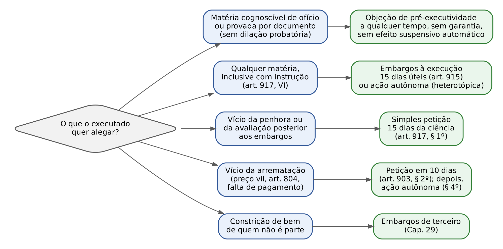
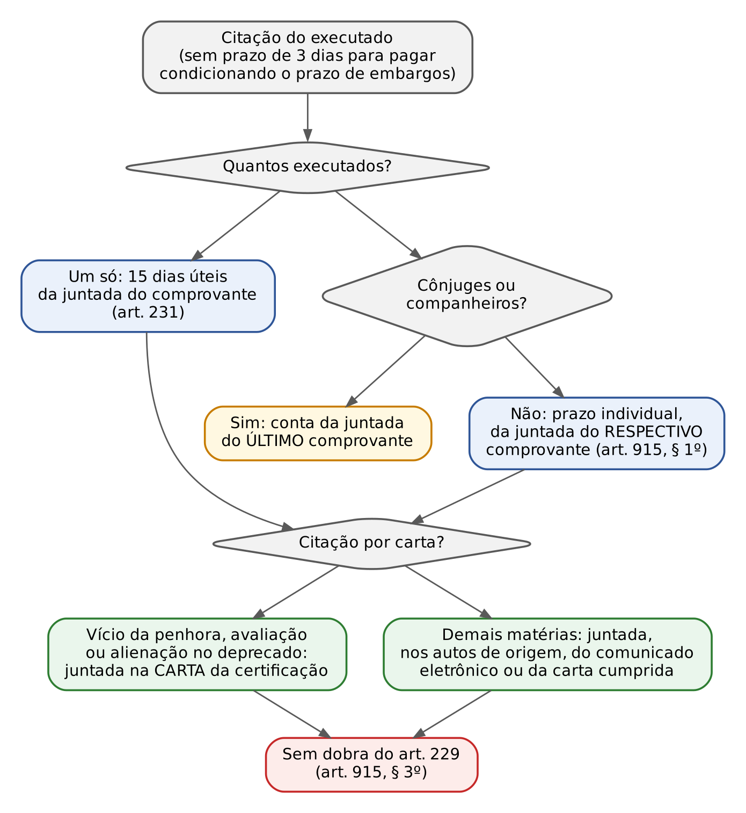
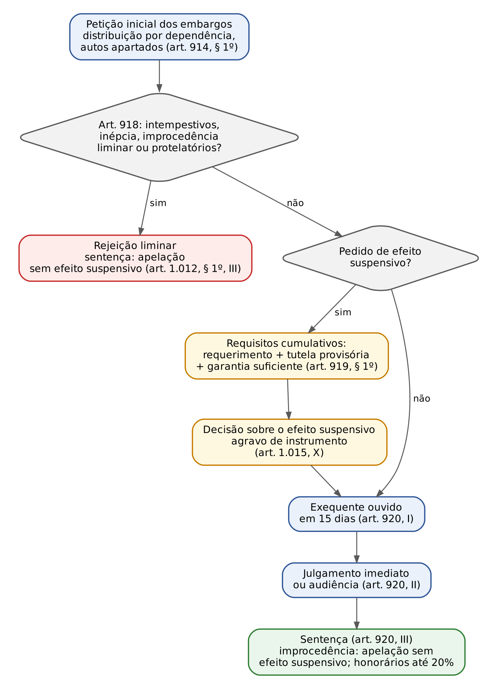
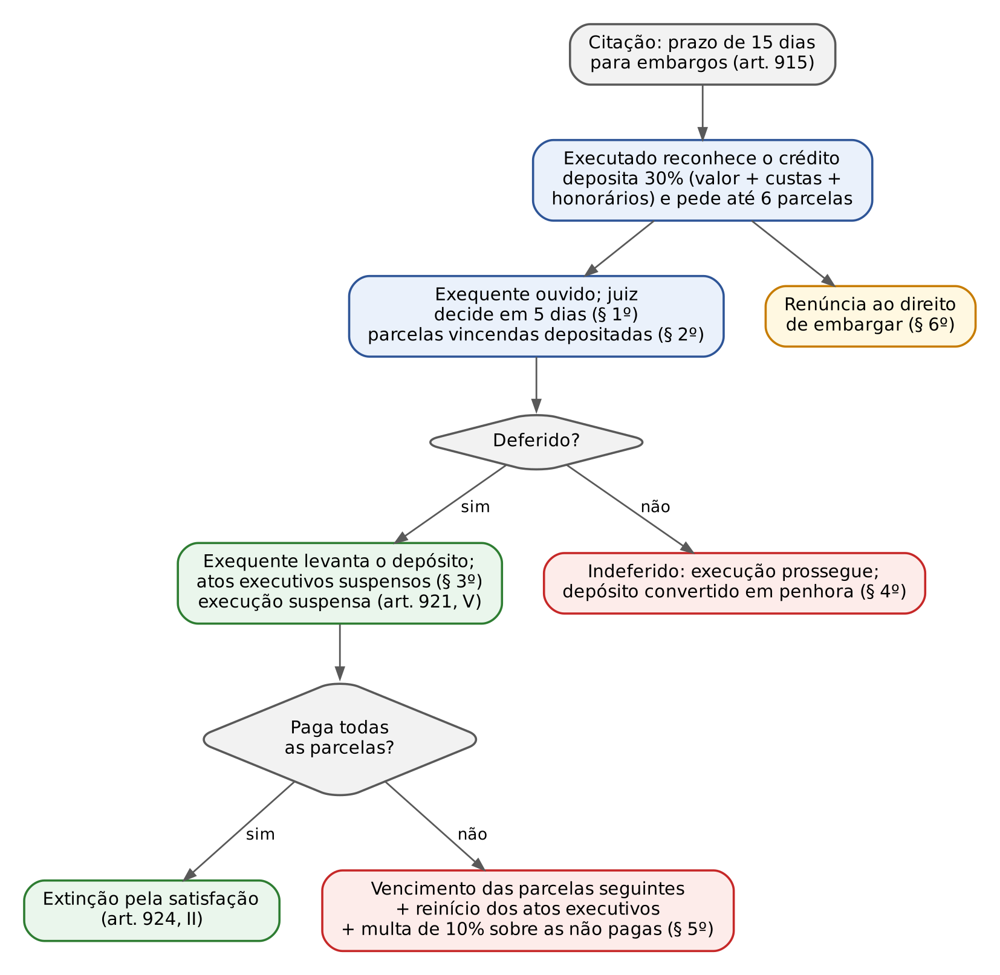
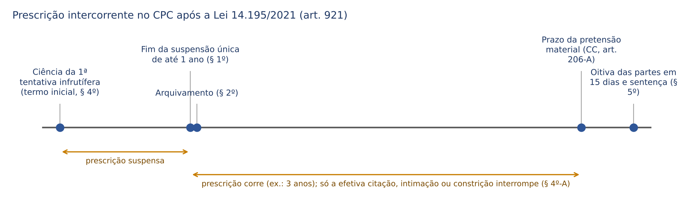
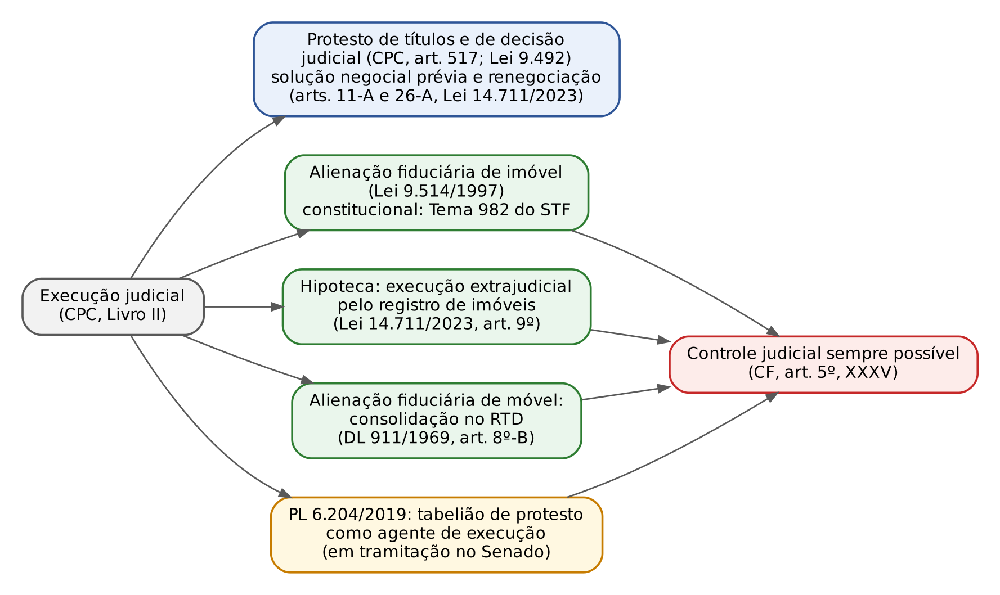

# CAPÍTULO 26 — DEFESAS DO EXECUTADO, SUSPENSÃO, PRESCRIÇÃO INTERCORRENTE E EXTINÇÃO DA EXECUÇÃO

:::INCIDENCIA
Pontos: TRF5 p. 13; TJRS p. 18; TJSC p. 14. Nível A+. Lote: 16 questões (FGV 12; FCC 4), mais correlatas de outros lotes.
O que mais cai: embargos sem garantia do juízo e sem efeito suspensivo automático (art. 919, § 1º), excesso de execução sem valor e memória de cálculo (art. 917, §§ 3º e 4º), prazo de 15 dias contado individualmente (art. 915, § 1º), parcelamento do art. 916 (renúncia aos embargos, multa de 10%), objeção de pré-executividade, suspensão por ausência de bens e prescrição intercorrente após a Lei 14.195/2021.
:::

#### Mapa de cobrança

| Subtema | FGV | FCC | Padrão |
|---|---|---|---|
| Embargos: garantia, efeito suspensivo, matérias, prazo | 6 | 3 | Alternativas que exigem garantia como condição de admissibilidade ou atribuem efeito suspensivo automático; prazo em litisconsórcio; rol "taxativo" de matérias |
| Excesso de execução sem valor ou demonstrativo | 2 | 1 | Art. 917, §§ 3º e 4º: rejeição liminar se for o único fundamento; não exame do excesso se houver outros |
| Parcelamento do art. 916 | 4 | 0 | Preclusão lógica e temporal, renúncia aos embargos, inadimplemento (vencimento antecipado + multa de 10%), inaplicabilidade ao cumprimento de sentença |
| Objeção de pré-executividade e curador especial | 2 | 0 | Título sem testemunhas alegado por simples petição; curador especial que embarga sem garantia e por negativa geral |
| Competência na execução por carta | 1 | 0 | Súmula 46 do STJ e art. 914, § 2º |
| Suspensão e extinção | 3 | 1 | Ausência de bens gera suspensão, não extinção; suspensão convencional até o cumprimento de acordo; desistência com embargos só processuais |

A FGV cobra o capítulo em CASOS (o executado que pede parcelamento depois de embargar, o juiz que extingue a execução por falta de bens, o curador especial que embarga por negativa geral) e, nas provas de juiz (TJSC, TJSE, TJPE, TJMS), privilegia a literalidade dos arts. 914 a 921. A FCC (TRTs, TRF3, PGE-TO) cobra a letra seca dos mesmos dispositivos, com trocas de termo inicial e de requisitos.

## 26.1 O sistema de defesas do executado

### 26.1.1 Panorama e lógica

Na execução de título extrajudicial não há contestação: a cognição do juiz, no processo executivo, é rarefeita e voltada à prática de atos materiais. Por isso a defesa típica do executado é uma AÇÃO incidental de conhecimento, os embargos à execução (arts. 914 a 920), que instaura processo autônomo, distribuído por dependência, no qual o executado é autor e o exequente é réu. Ao lado dela convivem defesas atípicas ou de criação jurisprudencial (objeção de pré-executividade), defesas por simples petição previstas pontualmente no Código (vícios da penhora e da avaliação, impenhorabilidade, invalidade da arrematação) e as ações autônomas ajuizadas fora da execução (defesas heterotópicas). No cumprimento de sentença, a defesa típica é a impugnação (art. 525), que é mero incidente e cujo estudo pertence ao Cap. 22; aqui ela aparece apenas como termo de comparação.

A razão de a cognição dos embargos ser AMPLA (art. 917, VI) é simples: o título extrajudicial não passou pelo crivo judicial nem está protegido pela coisa julgada. O executado pode discutir a *causa debendi*, os fatos anteriores à formação do título e os posteriores. Na impugnação ao cumprimento de sentença, ao contrário, a cognição é limitada (art. 525, § 1º) e as defesas devem ser supervenientes à sentença, porque o resto foi alcançado pela eficácia preclusiva da coisa julgada (ver Cap. 21 e Cap. 22).

### 26.1.2 Quadro geral: impugnação, embargos, objeção e ações autônomas

| Aspecto | Embargos à execução | Impugnação ao cumprimento | Objeção de pré-executividade | Ação autônoma (heterotópica) |
|---|---|---|---|---|
| Natureza | Ação incidental de conhecimento | Incidente (defesa nos próprios autos) | Petição nos autos (construção doutrinária e jurisprudencial) | Ação de conhecimento comum |
| Base legal | Arts. 914 a 920 | Arts. 525 e 535 | Art. 803, par. ún. (fundamento indireto); Súmula 393 do STJ (execução fiscal) | Art. 784, § 1º; art. 55, § 2º, I |
| Prazo | 15 dias úteis da juntada do comprovante de citação (art. 915) | 15 dias úteis após o prazo de pagamento voluntário (art. 525, caput) | Qualquer tempo, enquanto pendente a execução (respeitada a preclusão) | Prescrição ou decadência do direito material |
| Garantia do juízo | Dispensada (art. 914) | Dispensada (art. 525, caput) | Dispensada | Dispensada |
| Matérias | Qualquer defesa (art. 917, VI) | Rol do art. 525, § 1º (supervenientes) | Cognoscíveis de ofício ou provadas documentalmente | Qualquer matéria não preclusa |
| Efeito suspensivo | *Ope iudicis*: requerimento + requisitos da tutela provisória + garantia (art. 919, § 1º) | Igual (art. 525, § 6º) | Não há; pode-se pedir tutela de urgência | Só por tutela provisória; a ação não inibe a execução (art. 784, § 1º) |
| Decisão final | Sentença: apelação sem efeito suspensivo se improcedentes (art. 1.012, § 1º, III) | Interlocutória (agravo) ou sentença, se extinguir a execução | Interlocutória (agravo, art. 1.015, par. ún.) ou sentença, se extinguir | Sentença: apelação |
| Honorários | Autônomos em relação aos da execução (Tema 587 do STJ) | Ver Cap. 22 | Se acolhida (Temas 410 e 421 do STJ); ver 26.6.5 | Regra geral (art. 85) |

:::PEGADINHA GARANTIA DO JUÍZO: EXECUÇÃO COMUM X EXECUÇÃO FISCAL
No CPC, a garantia do juízo deixou de ser requisito dos embargos desde a Lei 11.382/2006 e assim permaneceu no art. 914, caput ("independentemente de penhora, depósito ou caução"). A garantia continua a ser exigida apenas como requisito do EFEITO SUSPENSIVO (art. 919, § 1º). Na execução fiscal, ao contrário, o art. 16, § 1º, da Lei 6.830/1980 exige a garantia para a admissibilidade dos embargos, e a jurisprudência do STJ admite os embargos com garantia parcial (Jurisprudência em Teses, ed. 156, tese 7). O tema da LEF pertence ao Cap. 28 e à Apostila de Direito Tributário, Caps. 21 e 22. Alternativa que, numa execução de título extrajudicial entre particulares, apresenta a garantia como "condição de procedibilidade" dos embargos está ERRADA (FGV 2025, TJSC, Q3324246, alternativa D).
:::

## 26.2 Embargos à execução: natureza, legitimidade, forma e competência

### 26.2.1 Natureza jurídica e consequências práticas

Os embargos são ação de conhecimento, de natureza predominantemente declaratória ou desconstitutiva (do título ou da execução), incidental ao processo executivo. Daí decorrem consequências cobradas:

- Petição inicial com os requisitos dos arts. 319 e 320, valor da causa (normalmente o proveito econômico pretendido, isto é, o valor impugnado) e recolhimento de custas, salvo gratuidade. A gratuidade concedida no processo de conhecimento persiste na execução e nos embargos, salvo revogação expressa (Jurisprudência em Teses do STJ, ed. 150, tese 7).
- Distribuição por dependência e autuação em apartado, instruída com cópias das peças relevantes, que o advogado pode declarar autênticas (art. 914, § 1º). Nos autos eletrônicos, a exigência de cópias perde relevo, mas a autuação apartada continua a ser a regra.
- O exequente é citado? Não: é INTIMADO, na pessoa do advogado, para responder em 15 dias (art. 920, I), porque já está representado no processo principal.
- Sentença própria, com honorários próprios. O STJ fixou que os honorários podem ser arbitrados na execução e nos embargos de forma relativamente autônoma, sem possibilidade de compensação entre as verbas (Tema 587 do STJ).

:::JURIS STJ, RESP 2.206.445-SP, J. 14/10/2025 (INFORMATIVO 870)
Embargos protocolados como simples petição nos autos da execução, em desconformidade com o art. 914, § 1º, configuram vício SANÁVEL, desde que o ato alcance sua finalidade e seja regularizado em prazo razoável, sem prejuízo ao contraditório (instrumentalidade das formas, art. 277). Consequência prática: a distribuição regular feita depois do 15º dia não torna intempestivos os embargos cuja petição foi apresentada no prazo (STJ, REsp n. 2.206.445, Relator Ministro Antonio Carlos Ferreira, Quarta Turma, j. 14/10/2025).
:::

### 26.2.2 Legitimidade e o curador especial

Legitimado ativo é o executado, isto é, quem figura no polo passivo da execução, inclusive o responsável secundário incluído na execução (fiador, sócio após desconsideração, cônjuge executado). Quem não é parte e sofre constrição usa embargos de terceiro (Cap. 29). O cônjuge intimado da penhora de imóvel (art. 842) pode embargar a execução, se for também executado, ou opor embargos de terceiro para defender a meação (Súmula 134 do STJ; v. Cap. 24). O STJ admite que o terceiro atingido pela constrição escolha entre os embargos de terceiro e o recurso como terceiro prejudicado (Tema 236 do STJ).

O executado citado por edital ou por hora certa que permanecer revel recebe curador especial (art. 72, II), com legitimidade para embargar (Súmula 196 do STJ). Três desdobramentos caem com frequência:

- A nomeação é OBRIGATÓRIA na execução: a falta de contestação não existe no processo executivo, mas a garantia do contraditório exige que alguém possa embargar em nome do revel ficto.
- O curador está dispensado de garantir o juízo (Tema 182 do STJ, firmado no regime do CPC/1973, em que a garantia ainda era exigida; no CPC/2015 a garantia nem sequer é requisito, o que reforça a tese).
- O curador especial pode embargar por NEGATIVA GERAL: o ônus da impugnação especificada não se aplica ao defensor público, ao advogado dativo e ao curador especial (art. 341, par. ún.). A curadoria especial é função institucional da Defensoria Pública independentemente da hipossuficiência econômica do curatelado (art. 4º, XVI, da LC 80/1994), porque a vulnerabilidade aqui é processual, não financeira.
- O curador especial não se equipara ao advogado constituído para fins da intimação da penhora pela imprensa (art. 841, § 2º): a intimação do executado sobre a penhora deve ser pessoal (STJ, REsp 2.086.883; v. Cap. 25).

:::QUESTAO FGV 2026 — DPE-RJ — DEFENSOR PÚBLICO (Q4289333)
Caso: execução de título extrajudicial; executado citado por edital e revel; Defensoria nomeada curadora especial embarga sem garantia e por negativa geral; o exequente pede o não conhecimento por desnecessidade de curador na execução, falta de garantia e ausência de impugnação específica.
Gabarito: C (a nomeação é impositiva; os embargos independem de penhora, depósito ou caução; admite-se negativa geral).
Armadilhas: E (conhecimento condicionado à garantia integral, regra que nunca valeu para o curador e hoje não vale para ninguém fora da LEF); D (exigência de hipossuficiência econômica, que não condiciona a curadoria especial); B (restrição à objeção de pré-executividade). Fundamento: Súmula 196 e Tema 182 do STJ; arts. 72, II, 341, par. ún., e 914 do CPC.
:::

### 26.2.3 Competência e execução por carta

Os embargos são da competência funcional do juízo da execução (distribuição por dependência). Na execução por carta, o art. 914, § 2º, separa o lugar de OFERECIMENTO do juízo de JULGAMENTO: os embargos podem ser oferecidos no deprecante ou no deprecado, mas são julgados pelo DEPRECANTE, salvo se versarem UNICAMENTE sobre vícios ou defeitos da penhora, da avaliação ou da alienação feitas no deprecado. A regra reproduz a Súmula 46 do STJ.

:::LEI CPC, ART. 914
Art. 914. O executado, independentemente de penhora, depósito ou caução, poderá se opor à execução por meio de embargos.
§ 1º Os embargos à execução serão distribuídos por dependência, autuados em apartado e instruídos com cópias das peças processuais relevantes, que poderão ser declaradas autênticas pelo próprio advogado, sob sua responsabilidade pessoal.
§ 2º Na execução por carta, os embargos serão oferecidos no juízo deprecante ou no juízo deprecado, mas a competência para julgá-los é do juízo deprecante, salvo se versarem unicamente sobre vícios ou defeitos da penhora, da avaliação ou da alienação dos bens efetuadas no juízo deprecado.
:::

:::QUESTAO FGV 2026 — TJ-RJ — ANALISTA JUDICIÁRIO (Q3868590)
Caso: executado citado por precatória em Teresópolis opõe embargos, por dependência, no juízo da execução (Capital), alegando erro da avaliação feita no deprecado, impenhorabilidade do bem de família e prescrição.
Resolução em passos: 1) o oferecimento pode ocorrer em qualquer dos juízos (art. 914, § 2º), logo o juízo da Capital é competente para receber; 2) o deprecado só julgaria se a matéria fosse UNICAMENTE vício da penhora, avaliação ou alienação; 3) como há também prescrição e impenhorabilidade, a competência para julgar é do deprecante.
Gabarito: D (opostos no juízo competente, devendo ser julgados no deprecante). Armadilha: E, que transfere todo o julgamento ao deprecado por haver vício de avaliação ali praticado, ignorando o advérbio "unicamente".
:::

Na mesma linha, o credor estrangeiro que opta por executar no Brasil submete-se à forma processual brasileira, inclusive quanto ao julgamento dos embargos pelo juízo nacional, que poderá aplicar o direito estrangeiro de regência do contrato (STJ, REsp 1.966.276; v. Cap. 24).

Execução de título com cláusula compromissória: a jurisdição estatal é a única dotada de coercibilidade para excutir patrimônio, de modo que a execução pode ser ajuizada de imediato no Judiciário; as questões relativas ao próprio contrato (existência, validade, exigibilidade da obrigação), porém, são da competência arbitral (art. 8º, par. ún., da Lei 9.307/1996). A cláusula não suspende automaticamente a execução (STJ, REsp 2.167.089; v. Cap. 24). A matéria contratual, nesses casos, não deve ser decidida nos embargos, cabendo ao executado provocar a arbitragem e, se quiser paralisar a execução, pedir efeito suspensivo com garantia (art. 919, § 1º).

## 26.3 Prazo dos embargos

### 26.3.1 Regra, termo inicial e litisconsórcio

O prazo é de 15 dias (úteis, art. 219), contado "conforme o caso, na forma do art. 231" (art. 915, caput): da juntada do aviso de recebimento, do mandado cumprido, da certidão de citação eletrônica, do fim da dilação do edital etc. Três pontos de prova:

- O termo inicial é a CITAÇÃO, não a penhora. A mudança veio com a Lei 11.382/2006 e é a principal diferença em relação à execução fiscal, em que o prazo de 30 dias corre da intimação da penhora (art. 16 da LEF; Tema 131 do STJ: da efetiva intimação da penhora, e não da juntada do mandado). O prazo de 3 dias para pagamento (art. 829) corre paralelamente e não posterga o prazo de embargos.
- Litisconsórcio passivo: o prazo é INDIVIDUAL, contado da juntada do RESPECTIVO comprovante de citação (art. 915, § 1º), ao contrário da regra geral da contestação (art. 231, § 1º, último comprovante). Exceção: cônjuges ou companheiros, cujo prazo corre da juntada do ÚLTIMO comprovante.
- Não há prazo em dobro para litisconsortes com advogados diferentes (art. 915, § 3º, que afasta o art. 229). Permanecem as dobras subjetivas da Fazenda Pública, do Ministério Público e da Defensoria (arts. 180, 183 e 186), mas a Fazenda executada por título extrajudicial tem regra própria: 30 dias (art. 910), prazo cuja constitucionalidade o STF afirmou (Tema 137 do STF); o tema é do Cap. 27.

Execução por carta (art. 915, § 2º): se os embargos versarem unicamente sobre vícios da penhora, da avaliação ou da alienação, o prazo corre da juntada, NA CARTA, da certificação da citação; nas demais matérias, da juntada, nos autos de origem, do comunicado eletrônico que o deprecado deve enviar imediatamente ao deprecante (§ 4º) ou, na falta dele, da juntada da carta cumprida.

:::LEI CPC, ART. 915, §§ 1º E 3º
§ 1º Quando houver mais de um executado, o prazo para cada um deles embargar conta-se a partir da juntada do respectivo comprovante da citação, salvo no caso de cônjuges ou de companheiros, quando será contado a partir da juntada do último.
§ 3º Em relação ao prazo para oferecimento dos embargos à execução, não se aplica o disposto no art. 229.
:::

:::QUESTAO FCC 2025 — PGE-TO — PROCURADOR DO ESTADO (Q3745608)
Cobrou-se a letra do art. 915, § 1º: os embargos são oferecidos em 15 dias, contados individualmente, em caso de litisconsórcio passivo, da juntada do respectivo comprovante de citação. Gabarito: A.
Armadilhas: B (nega a rejeição liminar por improcedência liminar, quando o art. 918, II, a prevê expressamente); C (nega a impugnação no cumprimento provisório, contra o art. 520, § 1º); D (dispensa a Fazenda de indicar o valor correto, contra o art. 535, § 2º); E (faz correr simultaneamente os prazos de pagamento e de impugnação, quando o art. 525 manda contar a impugnação após o fim do prazo de pagamento).
No mesmo sentido: FCC 2024, TRT-20 (Q3233116), em que o item III ("conta-se sempre da juntada do último comprovante") estava ERRADO e os itens II (embargos sem garantia) e IV (qualquer matéria de defesa do processo de conhecimento) estavam corretos; o item I também estava errado, porque os embargos não são opostos nos próprios autos. Gabarito: C.
:::

:::QUESTAO FGV 2025 — TJ-SC — JUIZ SUBSTITUTO (Q3324246)
Afirmação correta (A): se o embargante alegar excesso de execução, deve declarar na inicial o valor que entende correto, com demonstrativo discriminado e atualizado (art. 917, § 3º).
Armadilhas: B (prazo em dobro para executados com advogados de escritórios distintos: o art. 915, § 3º, afasta o art. 229); C (rejeição por intempestividade como "improcedência com coisa julgada material": a intempestividade é causa de rejeição liminar sem resolução do mérito, art. 918, I, e não impede que o executado discuta a matéria em ação autônoma, se não houver outra preclusão); D (garantia como condição de procedibilidade); E (vedação de efeito suspensivo, quando o art. 919, § 1º, o admite).
:::

### 26.3.2 Embargos intempestivos e o que sobra ao executado

Os embargos intempestivos são rejeitados liminarmente (art. 918, I), por sentença sem resolução do mérito. A perda do prazo, porém, não gera "revelia" com presunção de veracidade, nem impede: (a) a objeção de pré-executividade sobre matérias cognoscíveis de ofício (26.6); (b) a simples petição sobre vícios da penhora e da avaliação, com prazo próprio (art. 917, § 1º); (c) a ação autônoma (26.7), porque a sentença terminativa dos embargos não faz coisa julgada material sobre a relação de direito material.

:::QUESTAO FGV 2024 — PROVA DE CONCURSO, ÓRGÃO NÃO IDENTIFICADO NO BANCO (Q2564205)
Caso: ex-Secretária de Estado executada com base em acórdão condenatório do Tribunal de Contas não inscrito em dívida ativa; mandado juntado em 6/5/2024 (segunda-feira); embargos opostos 22 dias depois, alegando nulidade do título por falta de inscrição e inexistência de irregularidade.
Resolução em passos: 1) o acórdão do TCE que imputa débito tem eficácia de título executivo (art. 71, § 3º, da CF, aplicado aos tribunais de contas estaduais) e pode ser executado pelo CPC, sem inscrição em dívida ativa, o que afasta a alternativa A (rito da LEF); 2) o prazo é de 15 dias úteis a partir de 7/5/2024: mesmo sem considerar feriados, terminou em 27/5/2024, e 22 dias corridos depois da juntada é 28/5/2024; 3) embargos intempestivos são rejeitados liminarmente (art. 918, I), e a rejeição dos embargos autoriza elevar os honorários fixados no despacho inicial até 20% (art. 827, § 2º).
Gabarito: D. Armadilhas: B (rol taxativo de matérias, que só existe na impugnação); C (efeito suspensivo sem garantia); E (parcelamento cumulado com embargos, vedado pelo art. 916, § 6º, e de todo modo fora do prazo).
:::

## 26.4 Matérias alegáveis nos embargos (art. 917)

### 26.4.1 O rol e sua amplitude

:::LEI CPC, ART. 917, CAPUT E §§ 1º A 4º
Art. 917. Nos embargos à execução, o executado poderá alegar:
I - inexequibilidade do título ou inexigibilidade da obrigação;
II - penhora incorreta ou avaliação errônea;
III - excesso de execução ou cumulação indevida de execuções;
IV - retenção por benfeitorias necessárias ou úteis, nos casos de execução para entrega de coisa certa;
V - incompetência absoluta ou relativa do juízo da execução;
VI - qualquer matéria que lhe seria lícito deduzir como defesa em processo de conhecimento.
§ 1º A incorreção da penhora ou da avaliação poderá ser impugnada por simples petição, no prazo de 15 (quinze) dias, contado da ciência do ato.
§ 2º Há excesso de execução quando: I - o exequente pleiteia quantia superior à do título; II - ela recai sobre coisa diversa daquela declarada no título; III - ela se processa de modo diferente do que foi determinado no título; IV - o exequente, sem cumprir a prestação que lhe corresponde, exige o adimplemento da prestação do executado; V - o exequente não prova que a condição se realizou.
§ 3º Quando alegar que o exequente, em excesso de execução, pleiteia quantia superior à do título, o embargante declarará na petição inicial o valor que entende correto, apresentando demonstrativo discriminado e atualizado de seu cálculo.
§ 4º Não apontado o valor correto ou não apresentado o demonstrativo, os embargos à execução: I - serão liminarmente rejeitados, sem resolução de mérito, se o excesso de execução for o seu único fundamento; II - serão processados, se houver outro fundamento, mas o juiz não examinará a alegação de excesso de execução.
:::

O inciso VI torna o rol EXEMPLIFICATIVO e a cognição plena e exauriente: prescrição, pagamento, compensação, novação, vícios do consentimento (dolo, coação, erro), exceção do contrato não cumprido, nulidade de cláusulas, abusividade de encargos, falsidade do título, tudo é alegável. Questões que afirmam que a prescrição "não pode ser alegada em embargos por não constar do rol taxativo" estão erradas (FGV 2025, TJ-GO, Q3345940, alternativa D; FGV 2024, Câmara de Fortaleza, Q2450544, alternativa C).

Comentários por inciso, com o que cai:

- Inciso I (inexequibilidade do título ou inexigibilidade da obrigação): falta de título (documento fora do rol do art. 784 ou de lei especial), título sem os requisitos formais (instrumento particular sem as duas testemunhas, art. 784, III), obrigação ilíquida, incerta ou não vencida (art. 803, I e III). São matérias de ordem pública e, por isso, também veiculáveis por objeção (26.6).
- Inciso II (penhora incorreta ou avaliação errônea): só é matéria de embargos se a penhora já tiver ocorrido quando de seu oferecimento. Como o prazo corre da citação, em regra a penhora é posterior, e o § 1º abre a via da SIMPLES PETIÇÃO, em 15 dias da ciência do ato. Sob o CPC/1973 o STJ admitia novos embargos restritos aos aspectos formais da nova penhora (Tema 288 do STJ, Jurisprudência em Teses, ed. 52, tese 11); no regime atual, a simples petição cumpre essa função.
- Inciso III (excesso de execução ou cumulação indevida): o § 2º define o excesso de forma ampla (quantia superior, coisa diversa, modo diferente, exceção de contrato não cumprido, condição não provada). A cumulação indevida ocorre quando faltam os requisitos do art. 780 (identidade de executado, competência do mesmo juízo e identidade de procedimento).
- Inciso IV (retenção por benfeitorias): só na execução para entrega de coisa certa; o exequente pode pedir compensação com frutos ou danos, apurados por perícia (§ 5º), e pode ser imitido na posse a qualquer tempo, prestando caução ou depositando o valor das benfeitorias ou da compensação (§ 6º).
- Inciso V (incompetência ABSOLUTA OU RELATIVA): novidade do CPC/2015, coerente com o fim da exceção de incompetência como peça autônoma (art. 64). A incompetência relativa não alegada nos embargos prorroga a competência (art. 65).
- § 7º: impedimento e suspeição NÃO são matéria de embargos; seguem o incidente próprio dos arts. 146 e 148 (Cap. 10).

### 26.4.2 Excesso de execução: o ônus do valor e do demonstrativo

O § 3º impõe ao embargante simetria com o exequente, que deve instruir a inicial com o demonstrativo do débito (art. 798, I, b). A sanção do § 4º depende de o excesso ser ou não o ÚNICO fundamento:

| Situação | Consequência (art. 917, § 4º) |
|---|---|
| Excesso é o único fundamento e não há valor nem demonstrativo | Rejeição liminar, SEM resolução do mérito (inciso I) |
| Há outros fundamentos | Embargos processados, mas o juiz NÃO examina o excesso (inciso II) |
| Valor indicado e demonstrativo juntado | Exame regular; se necessário, perícia contábil |

O STJ mitiga a exigência quando a apuração do excesso depende de conhecimento técnico de que a parte não dispõe ou de documentos em poder do exequente: nesses casos a dilação probatória é necessária e, justamente por isso, a via adequada são os embargos, não a objeção (STJ, REsp n. 1.987.774, Relator Ministro Luis Felipe Salomão, Quarta Turma, j. 21/3/2023).

:::QUESTAO FCC 2024 — TRT-7 — ANALISTA JUDICIÁRIO (Q3089736)
Caso: executado por documento particular assinado por duas testemunhas reconhece a dívida, mas entende que o valor cobrado excede o do título.
Gabarito: C (opõe embargos independentemente de depósito, declarando na inicial o valor que entende correto). Armadilhas: A, B, D e E condicionam os embargos a depósitos (integral, de 30% ou do valor incontroverso), confundindo-os com o parcelamento do art. 916 e com a regra revogada do CPC/1973. Fundamento: arts. 914 e 917, § 3º.
:::

:::QUESTAO FGV 2024 — CÂMARA DE FORTALEZA — ADVOGADO (Q2450544)
Caso: embargos com excesso de execução sem valor, nulidade da promissória por dolo e prescrição; no mesmo ato, depósito de 30% e pedido de parcelamento em seis vezes; o juiz extingue os embargos por renúncia.
Gabarito: B (o parcelamento importa renúncia ao direito de embargar, art. 916, § 6º).
Armadilhas: A (o excesso sem valor não pode ser examinado, art. 917, § 4º, II, porque há outros fundamentos); C (prescrição é alegável, art. 917, VI); D (não há efeito suspensivo automático, art. 919); E (a apelação contra sentença que extingue os embargos sem resolução do mérito NÃO tem efeito suspensivo, art. 1.012, § 1º, III).
:::

### 26.4.3 Limites cognitivos excepcionais

Embora a regra seja a cognição ampla, há limites:

- Título extrajudicial com cláusula compromissória: matéria contratual vai à arbitragem (26.2.3).
- Execução contra a Fazenda por título extrajudicial: o art. 910, § 2º, também admite qualquer matéria de defesa do processo de conhecimento (Cap. 27).
- Execução de título judicial que tramite como execução autônoma (sentença penal, arbitral ou estrangeira, art. 515, VI a IX, com citação do devedor, § 1º): a defesa segue a lógica da impugnação, limitada às matérias do art. 525, § 1º, porque o mérito já foi decidido. Compensação não ressalvada pelo título transitado não se alega nos embargos à execução de sentença; prevista no título, admite-se (Temas 476 e 547 do STJ; v. Cap. 21).

## 26.5 Rejeição liminar, efeito suspensivo, procedimento e sentença

### 26.5.1 Rejeição liminar (art. 918)

:::LEI CPC, ART. 918
Art. 918. O juiz rejeitará liminarmente os embargos:
I - quando intempestivos;
II - nos casos de indeferimento da petição inicial e de improcedência liminar do pedido;
III - manifestamente protelatórios.
Parágrafo único. Considera-se conduta atentatória à dignidade da justiça o oferecimento de embargos manifestamente protelatórios.
:::

Pontos de prova:

- O inciso II remete aos arts. 330 (indeferimento, inclusive por inépcia e por falta de emenda) e 332 (improcedência liminar contrariando precedente vinculante ou reconhecendo prescrição ou decadência). A rejeição por improcedência liminar é SENTENÇA DE MÉRITO e faz coisa julgada material; as dos incisos I e III, e a do art. 917, § 4º, I, não resolvem o mérito.
- Embargos manifestamente protelatórios: além da rejeição, configuram ato atentatório à dignidade da justiça, punível com multa de até 20% do valor atualizado do débito em execução, revertida ao exequente (art. 774, par. ún.). A Jornada do CJF admite multa por boa-fé quando o executado ou o exequente reitera matérias já preclusas (Enunciado 148 da II Jornada de Direito Processual Civil).
- Recurso: apelação (é sentença), sem efeito suspensivo (art. 1.012, § 1º, III), e o juiz pode retratar-se nos casos de indeferimento e de improcedência liminar (arts. 331 e 332, § 3º).

### 26.5.2 Efeito suspensivo (art. 919)

A regra é a AUSÊNCIA de efeito suspensivo. O juiz pode concedê-lo se presentes, CUMULATIVAMENTE: (a) requerimento do embargante (não há concessão de ofício); (b) requisitos da tutela provisória (probabilidade do direito e perigo de dano ou risco ao resultado útil, ou hipótese de evidência); (c) execução garantida por penhora, depósito ou caução SUFICIENTES. O STJ, sob o regime do CPC/1973 reformado, já exigia os três requisitos (Tema 526 do STJ), e a orientação se mantém.

:::LEI CPC, ART. 919
Art. 919. Os embargos à execução não terão efeito suspensivo.
§ 1º O juiz poderá, a requerimento do embargante, atribuir efeito suspensivo aos embargos quando verificados os requisitos para a concessão da tutela provisória e desde que a execução já esteja garantida por penhora, depósito ou caução suficientes.
§ 2º Cessando as circunstâncias que a motivaram, a decisão relativa aos efeitos dos embargos poderá, a requerimento da parte, ser modificada ou revogada a qualquer tempo, em decisão fundamentada.
§ 3º Quando o efeito suspensivo atribuído aos embargos disser respeito apenas a parte do objeto da execução, esta prosseguirá quanto à parte restante.
§ 4º A concessão de efeito suspensivo aos embargos oferecidos por um dos executados não suspenderá a execução contra os que não embargaram quando o respectivo fundamento disser respeito exclusivamente ao embargante.
§ 5º A concessão de efeito suspensivo não impedirá a efetivação dos atos de substituição, de reforço ou de redução da penhora e de avaliação dos bens.
:::

Desdobramentos:

- Modificação ou revogação a qualquer tempo, mas A REQUERIMENTO e em decisão fundamentada (§ 2º): não há revisão de ofício.
- Efeito suspensivo parcial (§ 3º) e subjetivamente limitado (§ 4º): se o fundamento for comum (por exemplo, nulidade do título), a suspensão aproveita aos demais; se for pessoal (por exemplo, nulidade da fiança), só ao embargante.
- O efeito suspensivo não impede atos de substituição, reforço ou redução da penhora e de avaliação (§ 5º): o que fica paralisado é a EXPROPRIAÇÃO. A mesma regra vale para a impugnação ao cumprimento (art. 525, § 7º), cobrada em FGV 2025, TJ-CE, Juiz (Q3505775, gabarito D), questão do Cap. 22.
- A decisão que concede, modifica ou revoga o efeito suspensivo é agravável (art. 1.015, X). A que o NEGA também o é, segundo o Enunciado 71 da I Jornada de Direito Processual Civil do CJF, e, de todo modo, pelo parágrafo único do art. 1.015 (interlocutória proferida no processo de execução).
- Suspensão da execução (art. 921, II) ocorre "no todo ou em parte, quando recebidos com efeito suspensivo os embargos".

:::PEGADINHA "MERA OPOSIÇÃO SUSPENDE A EXECUÇÃO"
Três questões testaram a mesma ideia falsa: Q3345940 (FGV 2025, TJ-GO, alternativa C), Q2450544 (FGV 2024, alternativa D) e Q2367632 (FGV 2024, MPE-GO, alternativa C). Nenhum efeito suspensivo decorre da oposição; nem mesmo a garantia, sozinha, basta (Q2564205, alternativa C, inverteu o raciocínio ao dispensar a garantia). O efeito suspensivo dos embargos é *ope iudicis*, nunca *ope legis*. Contraste: os embargos de terceiro suspendem as medidas constritivas sobre os bens litigiosos quando reconhecido suficientemente provado o domínio ou a posse (art. 678), regra própria do Cap. 29.
:::

### 26.5.3 Procedimento (art. 920) e revelia nos embargos

Recebidos os embargos: o exequente é ouvido em 15 dias; o juiz julga imediatamente ou designa audiência; encerrada a instrução, profere sentença (art. 920). É procedimento sumarizado, mas a cognição é plena: cabem perícia (excesso de execução), prova testemunhal (vício de consentimento) e julgamento antecipado. Aplicam-se subsidiariamente as regras do procedimento comum (art. 771, par. ún.), inclusive saneamento e distribuição dinâmica do ônus da prova.

Se o exequente-embargado não responde, a doutrina majoritária e a jurisprudência negam o efeito material da revelia: o título executivo goza de presunção de certeza, liquidez e exigibilidade, que não se desfaz pela simples omissão do embargado, e o ônus de desconstituí-lo é do embargante.

### 26.5.4 Sentença, recursos e honorários

| Resultado | Natureza | Recurso e efeitos | Reflexos na execução |
|---|---|---|---|
| Rejeição liminar (art. 918) ou extinção sem mérito | Sentença | Apelação sem efeito suspensivo (art. 1.012, § 1º, III) | Execução prossegue; honorários da execução podem ser elevados até 20% (art. 827, § 2º) |
| Improcedência | Sentença de mérito | Apelação sem efeito suspensivo (art. 1.012, § 1º, III); execução continua DEFINITIVA (Súmula 317 do STJ) | Prossegue; verbas dos embargos somam-se ao débito (art. 85, § 13) |
| Procedência total | Sentença de mérito | Apelação com efeito suspensivo (regra do art. 1.012, caput) | Extinção da execução; levantamento de penhora; responsabilidade do exequente (art. 776) |
| Procedência parcial (excesso) | Sentença de mérito | Apelação | Execução prossegue pelo valor reconhecido |

Pontos de prova sobre a sentença dos embargos:

- Súmula 317 do STJ: é DEFINITIVA a execução de título extrajudicial, ainda que pendente apelação contra a sentença que julgue improcedentes os embargos. O CPC/2015 não reproduziu o art. 587 do CPC/1973 (na redação da Lei 11.382/2006), que tornava provisória a execução nessa hipótese quando os embargos tivessem sido recebidos com efeito suspensivo; a doutrina diverge sobre a sobrevivência dessa ressalva, mas a súmula continua sendo cobrada em sua literalidade.
- A sentença que rejeita os embargos opostos pela Fazenda Pública não se sujeita à remessa necessária (Enunciado 158 da II Jornada de Direito Processual Civil do CJF), porque o art. 496, II, só alcança a procedência dos embargos à EXECUÇÃO FISCAL.
- Honorários: os dos embargos são autônomos (Tema 587 do STJ), mas, se o executado sucumbe, as verbas dos embargos rejeitados são acrescidas ao débito principal (art. 85, § 13). Se os embargos são extintos por perda de objeto porque a própria execução foi extinta por ilegitimidade dos executados, o exequente paga honorários pela causalidade (STJ, AgInt no AREsp n. 2.586.064, Relator Ministro Raul Araújo, Quarta Turma, j. 9/9/2024). Reconhecida a impenhorabilidade do bem de família nos embargos, o credor que resistiu ao pedido de exclusão paga honorários (STJ, AgInt nos EDcl no AREsp n. 2.160.071, j. 2/9/2024, Informativo 829).
- Responsabilidade do exequente: se a sentença transitada em julgado declara inexistente, no todo ou em parte, a obrigação, o exequente ressarce os danos do executado (art. 776). A responsabilidade é OBJETIVA (STJ, REsp 1.931.620; v. Cap. 25), e os danos são liquidados nos próprios autos.

:::QUESTAO FGV 2025 — TJ-GO — RESIDENTE JURÍDICO (Q3345940)
Caso: embargos fundados em prescrição, julgados improcedentes após instrução, com prosseguimento da execução.
Gabarito: E (apelação sem efeito suspensivo, art. 1.012, § 1º, III).
Armadilhas: A (embargos como "mero incidente" sem custas nem honorários: são ação autônoma, com sucumbência própria); B (agravo de instrumento: a decisão é sentença); C (efeito suspensivo automático); D (rol taxativo que excluiria a prescrição).
:::

:::QUESTAO FGV 2024 — MPE-GO — PROMOTOR DE JUSTIÇA SUBSTITUTO (Q2367632, LOTE DO CAP. 24)
Caso: execução de cotas condominiais; embargos procedentes por prova de pagamento; executado pede liquidação dos prejuízos da penhora do imóvel, e o condomínio alega boa-fé.
Gabarito: A (responsabilidade objetiva do exequente, art. 776). Armadilhas: D (exigência de dolo ou culpa); C (penhora vedada pela mera oposição dos embargos); B (cotas condominiais têm força executiva, art. 784, X).
:::

:::SENTENCA DISPOSITIVO DE SENTENÇA EM EMBARGOS À EXECUÇÃO (IMPROCEDÊNCIA COM EXCESSO PARCIAL)
Ante o exposto, com fundamento no art. 487, I, do CPC, JULGO PARCIALMENTE PROCEDENTES os embargos opostos por A. B. C. à execução movida por D. E. F. (autos n. ...), para reconhecer o excesso de execução correspondente à capitalização mensal de juros não pactuada e fixar o crédito exequendo em 84.320,15 (oitenta e quatro mil, trezentos e vinte reais e quinze centavos), atualizado até 10/3/2026, devendo a execução prosseguir por esse valor. Rejeito os demais fundamentos. Tendo o embargado decaído de parte mínima, condeno o embargante ao pagamento das custas dos embargos e de honorários advocatícios de 10% sobre o valor que pretendia excluir e não excluiu (art. 86, par. ún.), verba autônoma em relação aos honorários da execução (Tema 587 do STJ), que será acrescida ao débito (art. 85, § 13). Mantenho a penhora. Traslade-se cópia aos autos da execução. Eventual apelação não terá efeito suspensivo quanto à parte em que os embargos foram rejeitados (art. 1.012, § 1º, III).
:::

## 26.6 Exceção (objeção) de pré-executividade

### 26.6.1 Conceito, terminologia e fundamento

A exceção de pré-executividade é a defesa apresentada por simples petição nos autos da execução, sem garantia do juízo e sem prazo preclusivo próprio, para veicular matérias que o juiz deveria conhecer de ofício ou que se provam documentalmente, sem dilação probatória. A construção é atribuída a Pontes de Miranda (parecer de 1966), num tempo em que embargar exigia penhora: era intolerável obrigar o executado a garantir execução manifestamente nula.

Terminologia: parte da doutrina prefere "objeção de pré-executividade", porque "exceção", em sentido técnico, designa a defesa que depende de provocação, ao passo que aqui se trata, em regra, de matéria cognoscível de ofício; há quem fale em "exceção" quando a matéria, embora não cognoscível de ofício, se prova de plano (por exemplo, pagamento documentado). As bancas usam as expressões como sinônimas.

O CPC/2015 não a regulou expressamente, mas lhe deu base: o art. 803, par. ún., manda o juiz pronunciar a nulidade da execução "de ofício ou a requerimento da parte, independentemente de embargos"; o art. 518 permite arguir nos próprios autos questões relativas à validade do cumprimento de sentença e dos atos executivos. Na execução fiscal, a Súmula 393 do STJ consolidou os dois requisitos: matéria cognoscível de ofício e desnecessidade de dilação probatória.

:::LEI CPC, ART. 803
Art. 803. É nula a execução se:
I - o título executivo extrajudicial não corresponder a obrigação certa, líquida e exigível;
II - o executado não for regularmente citado;
III - for instaurada antes de se verificar a condição ou de ocorrer o termo.
Parágrafo único. A nulidade de que cuida este artigo será pronunciada pelo juiz, de ofício ou a requerimento da parte, independentemente de embargos à execução.
:::

### 26.6.2 Requisitos e matérias

| Cabe (sem dilação probatória) | Não cabe |
|---|---|
| Ausência de título ou de seus requisitos formais (art. 803, I); título sem as duas testemunhas | Excesso de execução que dependa de perícia contábil (STJ, REsp n. 1.987.774) |
| Falta de citação ou nulidade de citação (art. 803, II) | Vício de consentimento que dependa de prova oral |
| Condição ou termo não verificados (art. 803, III) | Ilegitimidade do sócio que figura na CDA como corresponsável (Tema 108 do STJ, na execução fiscal: exige prova) |
| Ilegitimidade de parte aferível de plano | Discussão de cláusulas contratuais que exija instrução |
| Prescrição, inclusive intercorrente (Tema 262 do STJ) e decadência | Matéria já decidida em embargos (preclusão, coisa julgada) |
| Pagamento, compensação ou novação provados documentalmente |  |
| Incompetência absoluta |  |

Duas observações de prova. Primeira: a impenhorabilidade do art. 833, X (até 40 salários mínimos) NÃO é matéria de ordem pública e não pode ser reconhecida de ofício; deve ser arguida pelo executado no primeiro momento em que lhe couber falar nos autos ou nos embargos, sob pena de preclusão (Tema 1.235 do STJ; v. Cap. 25). Pode, portanto, ser deduzida por simples petição, mas não está imune à preclusão como as matérias de ordem pública. Segunda: a objeção não se confunde com a defesa sobre penhora e avaliação por simples petição do art. 917, § 1º, que tem prazo de 15 dias.

### 26.6.3 Momento, efeitos e relação com os embargos

- Momento: a qualquer tempo enquanto pendente a execução, inclusive antes da citação (comparecimento espontâneo supre a citação, art. 239, § 1º) e depois do prazo dos embargos. A apresentação de objeção NÃO interrompe nem suspende o prazo dos embargos: quem a usa assume o risco de perder o prazo para a defesa ampla.
- Objeção depois dos embargos: não há impedimento abstrato, desde que não reitere matérias já decididas nos embargos e preencha os requisitos próprios (STJ, REsp n. 2.045.492, Relator Ministro Teodoro Silva Santos, Segunda Turma, j. 10/12/2024).
- Efeito suspensivo: NÃO há suspensão automática da execução; o executado pode pedir tutela de urgência, e o juiz pode sustar atos de expropriação diante de nulidade evidente (art. 923 só se aplica à execução já suspensa).
- Contraditório: o exequente deve ser ouvido antes do acolhimento (arts. 9º e 10).

:::QUESTAO FGV 2026 — TJ-SC — OFICIAL DE JUSTIÇA E AVALIADOR (Q4153621)
Caso: execução fundada em confissão de dívida assinada pelo devedor, sem duas testemunhas; o executado, dois dias após a juntada do mandado, pede por petição a nulidade da execução por ausência de título.
Gabarito: C (uso correto da exceção de pré-executividade, que dispensa garantia e veicula matéria de ordem pública).
Armadilhas: A (toda defesa por embargos precedidos de garantia: duplo erro); B (testemunhas como "mera formalidade": o art. 784, III, exige a assinatura de duas testemunhas no documento particular); D (vício sanável pela coleta posterior de assinaturas); E (suspensão automática da execução por 15 dias, inexistente).
Observação: o STJ, em situações específicas (contratos eletrônicos com assinatura certificada, por exemplo), tem flexibilizado a exigência das testemunhas; a questão, porém, cobrou a regra geral.
:::

### 26.6.4 Decisão e recurso

| Resultado | Natureza | Recurso |
|---|---|---|
| Rejeição | Interlocutória | Agravo de instrumento (art. 1.015, par. ún.) |
| Acolhimento parcial (exclusão de um executado, redução do valor) | Interlocutória | Agravo de instrumento |
| Acolhimento que extingue a execução | Sentença (art. 203, § 1º; art. 925) | Apelação |

### 26.6.5 Honorários na objeção

O tema é campo fértil de repetitivos, quase todos formados em execuções fiscais, mas com *ratio* aplicável à execução civil:

- Acolhimento, ainda que parcial, gera honorários, porque há extinção total ou parcial da execução (Tema 410 do STJ, Corte Especial); a Fazenda que tem a execução fiscal extinta pelo acolhimento da objeção paga honorários (Tema 421 do STJ).
- Exclusão do sócio do polo passivo, sem extinção da execução: cabem honorários (Tema 961 do STJ; v. Cap. 8), fixados por EQUIDADE (art. 85, § 8º), porque não se mede o proveito econômico quando a objeção visa apenas à exclusão do excipiente sem impugnar o crédito (STJ, EREsp n. 1.880.560, Relator Ministro Francisco Falcão, Primeira Seção, j. 24/4/2024).
- Prescrição intercorrente: NÃO cabem honorários quando a objeção é acolhida para extinguir a execução fiscal pela prescrição intercorrente do art. 40 da LEF, à luz da causalidade (Tema 1.229 do STJ). A Corte Especial já afirmara que a resistência do exequente ao reconhecimento da prescrição intercorrente não supera a causalidade, que remonta ao inadimplemento do devedor (STJ, EAREsp n. 1.854.589, Relator Ministro Raul Araújo, Corte Especial, j. 9/11/2023). No CPC, o art. 921, § 5º, diz expressamente "sem ônus para as partes" (26.10).
- Acolhimento parcial e sucumbência recíproca: não se condena o excipiente em honorários na objeção parcialmente acolhida, sob pena de *bis in idem* com os honorários da execução que prossegue (STJ, REsp n. 2.243.944, Relatora Ministra Maria Thereza de Assis Moura, Segunda Turma, j. 10/3/2026).
- Rejeição da objeção: a orientação dominante no STJ é de que não gera honorários, por se tratar de incidente cujo resultado não encerra a execução.
- Concordância do exequente com a objeção, com pedido imediato de extinção: aplica-se a redução pela metade dos honorários prevista no art. 90, § 4º (Enunciado 166 da III Jornada de Direito Processual Civil do CJF, que cancelou o Enunciado 10 da I Jornada).

:::DICA OBJEÇÃO X EMBARGOS: COMO DECIDIR NO CASO CONCRETO
Se a petição veicula matéria cognoscível de ofício com prova documental pronta, conheça-a seja qual for o rótulo (objeção, embargos nos autos, simples petição): o art. 803, par. ún., autoriza até a pronúncia de ofício. Se exige prova, rejeite a via (não a matéria), ressalvando os embargos, se tempestivos, ou a ação autônoma. Essa formulação evita a decisão-surpresa e preserva a primazia do mérito.
:::

## 26.7 Defesas heterotópicas e defesas por simples petição

### 26.7.1 Ações autônomas (defesas heterotópicas)

Chamam-se heterotópicas as defesas exercidas FORA do processo executivo e de seus embargos, por meio de ações autônomas de conhecimento: declaratória de inexistência ou de inexigibilidade do débito, anulatória do título ou do negócio subjacente, revisional de contrato, consignatória, ação de repetição. Regras-chave:

- Não impedem a execução: "A propositura de qualquer ação relativa a débito constante de título executivo não inibe o credor de promover-lhe a execução" (art. 784, § 1º). Inversamente, a ação autônoma não suspende a execução já ajuizada, salvo tutela provisória. A doutrina e a jurisprudência admitem que a ação autônoma ajuizada ANTES da execução, se garantido o juízo e presentes os requisitos da tutela provisória, produza efeito equivalente ao dos embargos com efeito suspensivo.
- Conexão por força de lei: a execução de título extrajudicial e a ação de conhecimento relativa ao mesmo ato jurídico reputam-se conexas (art. 55, § 2º, I), devendo ser reunidas no juízo prevento, salvo se uma delas já tiver sido sentenciada (art. 55, § 1º) ou houver incompetência absoluta.
- Relação com os embargos: se a ação autônoma e os embargos tiverem a mesma causa de pedir e o mesmo pedido, há litispendência; se a ação autônoma for anterior, os embargos com as mesmas matérias são extintos, e vice-versa. Perdido o prazo dos embargos, a ação autônoma continua possível quanto às matérias não alcançadas por preclusão ou coisa julgada, porque a preclusão do prazo dos embargos é endoprocessual.
- Títulos com cláusula arbitral: a "defesa heterotópica" é o próprio procedimento arbitral (26.2.3).

### 26.7.2 Defesas por simples petição previstas no Código

| Matéria | Prazo e forma | Fundamento |
|---|---|---|
| Incorreção da penhora ou da avaliação | Simples petição, 15 dias da ciência do ato | Art. 917, § 1º |
| Impenhorabilidade de valores bloqueados ou excesso da indisponibilidade | 5 dias da intimação da indisponibilidade | Art. 854, § 3º; o exequente deve ser ouvido em 5 dias antes da decisão (Enunciado 211 da III Jornada do CJF) |
| Substituição da penhora | 10 dias da intimação da penhora | Art. 847 (Cap. 25) |
| Invalidade, ineficácia ou resolução da arrematação | 10 dias após o aperfeiçoamento da arrematação; depois da carta, ação autônoma com o arrematante como litisconsorte necessário | Art. 903, §§ 2º e 4º (Cap. 25) |
| Nulidades do art. 803 e matérias de ordem pública | Qualquer tempo | Art. 803, par. ún. |

A antiga ação de "embargos à arrematação ou à adjudicação" (art. 746 do CPC/1973) não existe mais; o CPC/2015 substituiu-a pela petição do art. 903, § 2º, e pela ação autônoma do § 4º. Por isso a Súmula 331 do STJ (efeito apenas devolutivo da apelação contra sentença em embargos à arrematação) perdeu objeto direto, embora continue no repertório de súmulas.

## 26.8 Parcelamento do débito (art. 916)

### 26.8.1 Requisitos e natureza

:::LEI CPC, ART. 916
Art. 916. No prazo para embargos, reconhecendo o crédito do exequente e comprovando o depósito de trinta por cento do valor em execução, acrescido de custas e de honorários de advogado, o executado poderá requerer que lhe seja permitido pagar o restante em até 6 (seis) parcelas mensais, acrescidas de correção monetária e de juros de um por cento ao mês.
§ 1º O exequente será intimado para manifestar-se sobre o preenchimento dos pressupostos do caput, e o juiz decidirá o requerimento em 5 (cinco) dias.
§ 2º Enquanto não apreciado o requerimento, o executado terá de depositar as parcelas vincendas, facultado ao exequente seu levantamento.
§ 3º Deferida a proposta, o exequente levantará a quantia depositada, e serão suspensos os atos executivos.
§ 4º Indeferida a proposta, seguir-se-ão os atos executivos, mantido o depósito, que será convertido em penhora.
§ 5º O não pagamento de qualquer das prestações acarretará cumulativamente: I - o vencimento das prestações subsequentes e o prosseguimento do processo, com o imediato reinício dos atos executivos; II - a imposição ao executado de multa de dez por cento sobre o valor das prestações não pagas.
§ 6º A opção pelo parcelamento de que trata este artigo importa renúncia ao direito de opor embargos.
§ 7º O disposto neste artigo não se aplica ao cumprimento da sentença.
:::

Requisitos cumulativos: (a) requerimento NO PRAZO DOS EMBARGOS; (b) reconhecimento do crédito; (c) depósito de 30% do valor em execução, ACRESCIDO de custas e honorários; (d) proposta de pagamento do restante em até 6 parcelas mensais, com correção monetária e juros de 1% ao mês.

Natureza: a doutrina majoritária vê no parcelamento um direito do executado (moratória legal), e não uma proposta que dependa de aceitação do credor: o exequente é ouvido apenas sobre o "preenchimento dos pressupostos" (§ 1º), e o juiz não pode indeferir por discordância imotivada do credor. É, ao mesmo tempo, ato incompatível com a vontade de se defender: daí a renúncia aos embargos (§ 6º) e a preclusão lógica.

### 26.8.2 Procedimento, inadimplemento e alcance

- Enquanto o pedido não é apreciado, o executado deposita as parcelas vincendas, que o exequente pode levantar (§ 2º). Deferido o pedido, o exequente levanta o depósito e os atos executivos ficam suspensos (§ 3º); a execução fica suspensa (art. 921, V). Indeferido, o depósito converte-se em penhora (§ 4º).
- Inadimplemento de QUALQUER parcela: vencimento das subsequentes, reinício imediato dos atos executivos E multa de 10% sobre as prestações NÃO PAGAS (§ 5º). Não há perda do sinal nem multa sobre o total da dívida.
- Não se aplica ao cumprimento de sentença (§ 7º): o devedor condenado já teve a oportunidade de pagar e conhecia a dívida; o parcelamento no cumprimento só por acordo. Aplica-se, porém, à ação monitória, no que couber (art. 701, § 5º).
- A renúncia aos embargos (§ 6º) não alcança as matérias de ordem pública, que podem ser conhecidas de ofício (art. 803, par. ún.).

:::QUESTAO FGV 2026 — ALERJ — PROCURADOR LEGISLATIVO (Q3880814)
Caso: devedor deposita 30% e obtém parcelamento do saldo em seis parcelas; não paga a primeira.
Gabarito: E (multa de 10% sobre as prestações não pagas, com vencimento antecipado). Armadilhas: A (retomada da execução sem a multa, que é cumulativa); B (multa de 50% e perda do sinal); C (aguardar o vencimento de todas as parcelas); D (multa de 30% sobre o total com dedução de metade do sinal).
Observação: o enunciado situa o caso numa reclamação trabalhista; a banca aplicou o CPC subsidiariamente, sem discutir a compatibilidade com a CLT, ponto irrelevante para a resposta.
:::

:::QUESTAO FGV 2025 — TJ-RS — ANALISTA JUDICIÁRIO (Q3744582)
Caso: executado opõe embargos no último dia do prazo e, com os embargos já conclusos para sentença, deposita 30% e pede parcelamento.
Gabarito: C (preclusão TEMPORAL, porque o pedido deve ser feito "no prazo para embargos", e LÓGICA, porque é incompatível com a defesa já apresentada).
Armadilhas: D (preclusão consumativa, como se o parcelamento fosse meio de defesa); B (ausência de preclusão por se tratar de "autocomposição"); E (levantamento das parcelas só ao final, contra o § 3º); A (suspensão dos embargos para apreciar o parcelamento).
:::

:::QUESTAO FGV 2025 — TJ-SE — JUIZ SUBSTITUTO (Q3301241)
O item sobre parcelamento (alternativa C) trocou o percentual: o depósito é de 30%, não de 20%. A questão é comentada em 26.9.3, porque o gabarito trata da suspensão convencional.
:::

:::PEGADINHA OS NÚMEROS DO ART. 916
30% de entrada (sobre o valor em execução, mais custas e honorários) | até 6 parcelas mensais | correção monetária e juros de 1% ao mês | decisão em 5 dias | multa de 10% sobre as prestações não pagas | prazo: o dos embargos (15 dias). Bancas trocam 30% por 20% ou 50%, 6 por 12 parcelas, 10% por 20% ou 30%, e "prestações não pagas" por "valor total".
:::

## 26.9 Suspensão da execução (arts. 921 a 923)

### 26.9.1 Hipóteses

:::LEI CPC, ART. 921, CAPUT E §§ 1º A 3º
Art. 921. Suspende-se a execução:
I - nas hipóteses dos arts. 313 e 315, no que couber;
II - no todo ou em parte, quando recebidos com efeito suspensivo os embargos à execução;
III - quando não for localizado o executado ou bens penhoráveis; (Redação dada pela Lei nº 14.195, de 2021)
IV - se a alienação dos bens penhorados não se realizar por falta de licitantes e o exequente, em 15 (quinze) dias, não requerer a adjudicação nem indicar outros bens penhoráveis;
V - quando concedido o parcelamento de que trata o art. 916.
§ 1º Na hipótese do inciso III, o juiz suspenderá a execução pelo prazo de 1 (um) ano, durante o qual se suspenderá a prescrição.
§ 2º Decorrido o prazo máximo de 1 (um) ano sem que seja localizado o executado ou que sejam encontrados bens penhoráveis, o juiz ordenará o arquivamento dos autos.
§ 3º Os autos serão desarquivados para prosseguimento da execução se a qualquer tempo forem encontrados bens penhoráveis.
:::

| Hipótese | Observações de prova |
|---|---|
| I: arts. 313 e 315 | Morte ou perda de capacidade da parte, convenção das partes, arguição de impedimento ou suspeição, admissão de IRDR, prejudicialidade externa, força maior, prejudicialidade criminal; "no que couber": a prejudicialidade do art. 313, V, a, aplica-se à execução de modo restrito, porque a ação autônoma não inibe a execução (art. 784, § 1º). A nulidade pela falta de suspensão após a morte de coexecutado é relativa e depende de prejuízo, segundo o STJ |
| II: embargos com efeito suspensivo | No todo ou em parte (art. 919, §§ 3º e 4º) |
| III: não localização do executado ou de bens | Redação da Lei 14.195/2021, que acrescentou o executado não localizado; suspensão por 1 ano, com prescrição suspensa (§ 1º); depois, arquivamento (§ 2º) e desarquivamento se achados bens (§ 3º) |
| IV: leilão negativo | Se o exequente, em 15 dias, não pedir adjudicação nem indicar outros bens |
| V: parcelamento do art. 916 | Deferido o parcelamento |
| Art. 922: convenção das partes | Durante o prazo concedido pelo exequente para o cumprimento voluntário; findo o prazo sem cumprimento, retoma-se o curso |

A citação ficta do executado não configura a hipótese de não localização do art. 921, III: citado por edital, o executado foi "localizado" para fins processuais, e a execução segue com curador especial (Enunciado 213 da III Jornada de Direito Processual Civil do CJF). O que suspende a execução, então, é a falta de BENS.

Durante a suspensão não se praticam atos processuais, mas o juiz pode ordenar providências urgentes, salvo no caso de arguição de impedimento ou suspeição (art. 923).

### 26.9.2 Ausência de bens: suspensão, não extinção

:::QUESTAO FGV 2025 — TJ-MS — JUIZ SUBSTITUTO (Q3786358)
Caso: execução de duplicatas protestadas; embargos sem efeito suspensivo; após buscas infrutíferas, o juiz intima a exequente a indicar bens em 5 dias "sob pena de extinção" e, diante da informação de que não os encontrou, extingue a execução com base no art. 925, invocando eficiência.
Gabarito: A (o juiz errou: a ausência de bens penhoráveis é causa de SUSPENSÃO por 1 ano, com suspensão da prescrição, art. 921, III e § 1º, e não de extinção).
Armadilhas: C e E (eficiência e análise econômica do direito como fundamento de extinção, sem base legal); D (busca de bens como ônus exclusivo do credor, contra os arts. 772, III, e 854 e a cooperação); B (necessidade de aguardar o julgamento dos embargos). Observação: a intimação "sob pena de extinção" também era imprópria, porque o abandono (art. 485, III) exige intimação pessoal e prazo de 5 dias (art. 485, § 1º) e não se confunde com a falta de bens, que não é inércia.
:::

:::QUESTAO FGV 2024 — TJ-PE — JUIZ SUBSTITUTO (Q3117517)
Afirmação: em execução de título extrajudicial, o executado não foi localizado. Gabarito: E (suspensão do feito, art. 921, III, na redação da Lei 14.195/2021).
Armadilhas: A (remessa ao curador especial: só cabe após citação ficta e revelia, Súmula 196 do STJ); B e C (extinção por falta de pressuposto ou de condição da ação); D (prosseguimento regular). Nota: na prática, antes da suspensão o exequente pode requerer arresto (art. 830), inclusive eletrônico, sem que a tentativa de citação por oficial seja pré-requisito (STJ, REsp 2.099.780; v. Cap. 25), e citação por edital; a questão cobrou apenas a literalidade do inciso III.
:::

### 26.9.3 Suspensão convencional e acordos

As partes podem convencionar a suspensão (art. 313, II, por até 6 meses, art. 313, § 4º) ou, especificamente, suspender a execução durante o prazo concedido pelo exequente para o cumprimento voluntário (art. 922). Nesta última hipótese não incide o limite de 6 meses: a execução fica suspensa até o fim do prazo do acordo, e o descumprimento faz o processo retomar o curso (par. ún.). Transação com cláusula de suspensão impõe suspender, não extinguir, a execução (STJ, REsp 2.165.124; v. Cap. 11).

:::QUESTAO FGV 2025 — TJ-SE — JUIZ SUBSTITUTO (Q3301241)
Caso: execução de 25 cotas condominiais; antes da citação, acordo extrajudicial em 12 prestações; o condomínio pede a suspensão até o cumprimento.
Gabarito: B (é possível a suspensão a requerimento do exequente até o cumprimento do acordo, sem perda superveniente do interesse de agir).
Armadilhas: A (suspensão automática pela simples celebração); C (parcelamento com depósito de 20%, quando o art. 916 exige 30%); D (cota condominial como título judicial: é extrajudicial, art. 784, X); E (vedação de suspensão por requerimento das partes, contra os arts. 313, II, e 922).
:::

Outras hipóteses relevantes de suspensão:

- Insolvência civil: frustrada a execução singular, não é preciso desistir dela para requerer a insolvência; basta que fique suspensa até a sentença definitiva na ação de insolvência (STJ, AgInt no REsp 2.034.944; v. Cap. 25).
- Recuperação judicial do executado: suspensão das execuções pelo *stay period* (art. 6º da Lei 11.101/2005); o tema é da Apostila de Direito Empresarial e do Cap. 35.
- Leis de renegociação de crédito rural: a suspensão da cobrança judicial e da prescrição prevista diretamente em lei opera de pleno direito, independentemente de adesão do devedor, salvo se o dispositivo legal exigir expressamente providência dele (Tema 1.406 do STJ, Corte Especial, j. 2/9/2026).
- Procedimento arbitral instaurado sobre a obrigação exequenda, mediante requerimento (26.2.3).

## 26.10 Prescrição intercorrente no CPC

### 26.10.1 Fundamento e prazo

Prescrição intercorrente é a que se consuma no curso do processo, depois de interrompida a prescrição pela citação (ou pelo despacho que a ordena, art. 240, § 1º), em razão da paralisação da execução. Fundamentos normativos:

- Súmula 150 do STF: prescreve a execução no mesmo prazo de prescrição da ação (v. Cap. 22).
- Art. 206-A do Código Civil (redação da Lei 14.382/2022): a prescrição intercorrente observa o mesmo prazo de prescrição da pretensão, as causas de impedimento, suspensão e interrupção do Código Civil e o disposto no art. 921 do CPC.
- Art. 924, V, do CPC: a prescrição intercorrente é causa de extinção da execução.

O prazo, portanto, varia com a pretensão: 3 anos para nota promissória e letra de câmbio contra o emitente ou aceitante (Lei Uniforme de Genebra); 6 meses para a execução do cheque (Lei 7.357/1985, art. 59); 5 anos para dívida líquida constante de instrumento público ou particular (art. 206, § 5º, I, do CC), prazo aplicado, por exemplo, ao contrato de contragarantia (STJ, AgInt no REsp n. 1.878.110, Relatora Ministra Maria Isabel Gallotti, Quarta Turma, j. 27/10/2025). Na execução fiscal o regime é o do art. 40 da LEF (Cap. 28).

### 26.10.2 Evolução: CPC/1973, CPC/2015 original e Lei 14.195/2021

| Regime | Termo inicial | Requisito subjetivo | Interrupção |
|---|---|---|---|
| CPC/1973 (IAC 1 do STJ) | Fim do prazo judicial de suspensão ou, se não fixado, 1 ano (analogia com o art. 40, § 2º, da LEF) | Inércia do exequente; intimação prévia para opor fato impeditivo | Atos do credor que impulsionassem a execução |
| CPC/2015 original | Fim da suspensão de 1 ano (art. 921, §§ 1º e 4º, redação original); art. 1.056: para execuções em curso, termo inicial na vigência do Código | Inércia (doutrina e jurisprudência majoritárias) | Diligências úteis do credor |
| Lei 14.195/2021 (26/8/2021) | CIÊNCIA DA PRIMEIRA TENTATIVA INFRUTÍFERA de localização do devedor ou de bens (§ 4º) | Prescrição corre "automaticamente", independentemente de inércia | SÓ a efetiva citação, intimação do devedor ou constrição de bens penhoráveis (§ 4º-A) |

O IAC 1 do STJ fixou, para as causas regidas pelo CPC/1973: incide a prescrição intercorrente quando o exequente permanece inerte por prazo superior ao da prescrição do direito material; o termo inicial é o fim do prazo judicial de suspensão ou, sem prazo fixado, o transcurso de 1 ano; o art. 1.056 do CPC/2015 só se aplica aos processos suspensos na data da vigência do novo Código, sem reabrir prazos já consumados; e o credor deve ser intimado previamente para opor fato impeditivo.

:::LEI CPC, ART. 921, §§ 4º A 7º (REDAÇÃO DA LEI 14.195/2021)
§ 4º O termo inicial da prescrição no curso do processo será a ciência da primeira tentativa infrutífera de localização do devedor ou de bens penhoráveis, e será suspensa, por uma única vez, pelo prazo máximo previsto no § 1º deste artigo.
§ 4º-A A efetiva citação, intimação do devedor ou constrição de bens penhoráveis interrompe o prazo de prescrição, que não corre pelo tempo necessário à citação e à intimação do devedor, bem como para as formalidades da constrição patrimonial, se necessária, desde que o credor cumpra os prazos previstos na lei processual ou fixados pelo juiz.
§ 5º O juiz, depois de ouvidas as partes, no prazo de 15 (quinze) dias, poderá, de ofício, reconhecer a prescrição no curso do processo e extingui-lo, sem ônus para as partes.
§ 6º A alegação de nulidade quanto ao procedimento previsto neste artigo somente será conhecida caso demonstrada a ocorrência de efetivo prejuízo, que será presumido apenas em caso de inexistência da intimação de que trata o § 4º deste artigo.
§ 7º Aplica-se o disposto neste artigo ao cumprimento de sentença de que trata o art. 523 deste Código.
:::

### 26.10.3 O regime atual, ponto por ponto

- Termo inicial: a CIÊNCIA (do exequente) da primeira tentativa infrutífera de localização do devedor ou de bens. Não depende de decisão judicial de suspensão: o prazo começa com a ciência, como no art. 40 da LEF segundo o STJ (Cap. 28).
- Suspensão: uma ÚNICA vez, por no máximo 1 ano (§§ 1º e 4º). Novas suspensões, arquivamentos ou pedidos sucessivos não renovam a suspensão.
- Interrupção: somente por EFETIVA citação, intimação do devedor ou constrição de bens (§ 4º-A). Pedidos de diligência, ofícios e pesquisas infrutíferas NÃO interrompem; antes da lei, bastava a diligência do credor (STJ, REsp 2.166.788; v. Cap. 1, que desenvolve o julgado e o direito intertemporal).
- Garantia do credor diligente: a prescrição não corre pelo tempo necessário à citação, à intimação e às formalidades da constrição, DESDE QUE o credor cumpra os prazos legais ou judiciais (§ 4º-A, parte final). É a versão intercorrente do art. 240, § 3º (a parte não se prejudica pela demora imputável ao serviço judiciário).
- Contraditório obrigatório: o juiz pode reconhecer de ofício, mas DEPOIS DE OUVIR AS PARTES em 15 dias (§ 5º). A decisão sem oitiva, ou que ignora argumento relevante do exequente sobre causa interruptiva, é nula ou omissa. A nulidade do procedimento só é conhecida com prejuízo efetivo, presumido apenas se faltar a intimação da ciência da primeira tentativa infrutífera (§ 6º).
- Sem ônus para as partes (§ 5º): nem custas nem honorários. O fundamento é a causalidade: quem deu causa à execução foi o devedor inadimplente (EAREsp n. 1.854.589, Corte Especial, citado em 26.6.5; Tema 1.229 do STJ, para a execução fiscal). O STJ aplicou a mesma lógica a execução civil extinta pela prescrição intercorrente sem conduta culposa do credor (STJ, EDcl no REsp n. 1.918.602, Relator Ministro João Otávio de Noronha, Quarta Turma, j. 17/2/2025).
- Cumprimento de sentença: o regime aplica-se ao cumprimento de sentença de pagar quantia (§ 7º).
- Execução coletiva: a extinção do cumprimento de sentença coletiva proposto pelo legitimado extraordinário, por prescrição intercorrente, não impede a execução individual do mesmo título (Tema 1.253 do STJ).

:::QUESTAO FGV 2025 — MPU — ANALISTA DO MPU (Q3339802, LOTE DO CAP. 42)
Caso: execução de mais de dez anos; o executado alega prescrição intercorrente; o exequente aponta evento interruptivo; o juiz reconhece a prescrição sem examinar o argumento; o exequente opõe embargos de declaração com efeitos infringentes em 5 dias úteis.
Gabarito: E (embargos conhecidos e providos por OMISSÃO). O ponto do capítulo: o § 5º do art. 921 exige oitiva prévia e decisão que enfrente a alegação de causa interruptiva (§ 4º-A); a possibilidade de pronúncia de ofício (alternativa D) não dispensa o contraditório nem a fundamentação (art. 489, § 1º, IV).
:::

:::QUESTAO FGV 2026 — TJ-GO — JUIZ SUBSTITUTO (Q3966705, LOTE DO CAP. 28)
Questão de execução fiscal, útil por contraste: o prazo de 1 ano de suspensão inicia-se AUTOMATICAMENTE com a ciência da Fazenda sobre a não localização do devedor ou de bens, e, após esse ano, corre o prazo da prescrição intercorrente, sendo irrelevante a falta de decisão de suspensão e os pedidos genéricos de diligência. Gabarito: D. No CPC, depois da Lei 14.195/2021, a estrutura é a mesma: termo inicial na ciência da primeira tentativa infrutífera, suspensão única de até 1 ano e interrupção só por efetiva citação ou constrição.
:::

### 26.10.4 Direito intertemporal e efeitos

- Atos anteriores à Lei 14.195/2021 conservam os efeitos interruptivos então reconhecidos; o novo regime rege os atos posteriores à vigência, sem reabrir prazos consumados nem consumação retroativa (v. Cap. 1).
- Extinta a execução pela prescrição intercorrente, o credor não precisa devolver valores já levantados: a prescrição atinge a pretensão, não a obrigação, que subsiste como obrigação natural, e o pagamento dela não se repete (art. 882 do CC) (STJ, REsp n. 2.081.015, Relator Ministro Raul Araújo, Quarta Turma, j. 24/11/2025).
- A sentença que pronuncia a prescrição intercorrente resolve o mérito (art. 487, II) e é apelável.

:::EXEMPLO CONTAGEM NO REGIME ATUAL
Execução de nota promissória (prazo de 3 anos). Em 10/3/2022 o exequente é intimado do resultado negativo do SISBAJUD e da certidão do oficial de justiça que não encontrou bens. Termo inicial: 10/3/2022. A prescrição fica suspensa por até 1 ano (até 10/3/2023). Em 2023 e 2024 o exequente pede novas pesquisas (RENAJUD, INFOJUD, CNIB), todas negativas: nenhuma interrompe o prazo. Em 15/8/2024 é penhorado e removido um veículo do executado: a constrição efetiva interrompe o prazo (§ 4º-A), que recomeça a correr se a expropriação se frustrar e a execução voltar a paralisar. Se não tivesse havido a penhora, a prescrição se consumaria em 10/3/2026. Antes de pronunciá-la, o juiz intima as partes para manifestação em 15 dias (art. 921, § 5º).
:::

## 26.11 Extinção da execução (arts. 924 e 925)

### 26.11.1 Hipóteses

:::LEI CPC, ARTS. 924 E 925
Art. 924. Extingue-se a execução quando:
I - a petição inicial for indeferida;
II - a obrigação for satisfeita;
III - o executado obtiver, por qualquer outro meio, a extinção total da dívida;
IV - o exequente renunciar ao crédito;
V - ocorrer a prescrição intercorrente.
Art. 925. A extinção só produz efeito quando declarada por sentença.
:::

O rol do art. 924 é EXEMPLIFICATIVO. Também extinguem a execução: a procedência dos embargos que desconstitui o título ou declara inexistente a obrigação; o acolhimento da objeção de pré-executividade; a desistência (art. 775); as hipóteses do art. 485 aplicáveis subsidiariamente (abandono, ilegitimidade, litispendência, coisa julgada, falta de pressuposto). Não extinguem: a falta de bens (suspensão, 26.9.2) e o parcelamento deferido (suspensão, art. 921, V).

| Inciso | Observações |
|---|---|
| I: indeferimento da inicial | Arts. 330 e 801 (emenda em 15 dias antes do indeferimento) |
| II: satisfação | Entrega do dinheiro ou adjudicação (art. 904), após alienação ou apropriação de frutos e rendimentos (art. 825) |
| III: extinção da dívida por outro meio | Transação, remissão, novação, compensação, confusão; a transação homologada extingue a execução com resolução do mérito |
| IV: renúncia ao crédito | Ato de direito material; exige manifestação EXPRESSA: o STJ veda presumir renúncia tácita ao crédito remanescente, exigindo prévia intimação do credor (Tema 289 do STJ) |
| V: prescrição intercorrente | Art. 921, §§ 4º a 7º; oitiva prévia; sem ônus (26.10) |

### 26.11.2 Sentença, recurso e efeitos

A extinção só produz efeito quando declarada por SENTENÇA (art. 925; art. 203, § 1º, parte final), atacável por apelação, com efeito suspensivo pela regra geral do art. 1.012. A sentença dos incisos II a V resolve o mérito da execução no sentido de declarar extinta a obrigação ou a pretensão executiva; a doutrina diverge quanto à formação de coisa julgada material sobre a existência e o valor do crédito quando a extinção decorre apenas da satisfação, mas é pacífico que o credor não pode reabrir execução da mesma obrigação já declarada satisfeita, salvo nos casos de erro material de cálculo ou de saldo expressamente ressalvado.

### 26.11.3 Desistência da execução (art. 775)

O exequente pode desistir de toda a execução ou de alguma medida executiva, porque a execução se realiza no seu interesse (art. 797). Se houver embargos ou impugnação:

| Conteúdo da defesa | Efeito da desistência (art. 775, par. ún.) |
|---|---|
| Apenas questões processuais | Extinção também dos embargos ou da impugnação, INDEPENDENTEMENTE de concordância; o exequente paga custas e honorários |
| Questões de mérito (no todo ou em parte) | A extinção dos embargos depende da CONCORDÂNCIA do embargante, que pode querer a declaração de inexistência da dívida |

:::QUESTAO FCC 2024 — TRF-3 — TÉCNICO JUDICIÁRIO (Q2564670)
Afirmação: opostos embargos que versam apenas sobre questões processuais, o exequente pode desistir da execução independentemente de concordância do embargante, pagando custas e honorários (art. 775, par. ún., I). Gabarito: A. Armadilhas: C e D (exigência de concordância, aplicável só quando os embargos versam sobre mérito); B e E (vedação de desistência total ou parcial, contra o caput).
:::

Diferença com a desistência da ação no processo de conhecimento: lá, oferecida a contestação, a desistência depende do consentimento do réu (art. 485, § 4º). Na execução, a concordância só é exigida se os embargos tratarem de mérito.

## 26.12 Desjudicialização da execução

### 26.12.1 O debate e o PL 6.204/2019

A desjudicialização da execução parte de um diagnóstico conhecido: as execuções de título extrajudicial e as fiscais respondem por parcela expressiva do acervo e da taxa de congestionamento do Judiciário, e grande parte dos atos executivos (localização de bens, penhora, avaliação, leilão) não exige função jurisdicional. Modelos estrangeiros, sobretudo o português (agente de execução) e o francês (*huissier de justice*, hoje *commissaire de justice*), servem de referência.

O PL 6.204/2019, de autoria da Senadora Soraya Thronicke, apresentado em 20/11/2019, dispõe sobre a desjudicialização da execução civil de título executivo judicial e extrajudicial e altera o CPC e as Leis 9.430/1996, 9.492/1997 e 10.169/2000. Na versão original, atribui ao TABELIÃO DE PROTESTO a função de agente de execução para as execuções de pagar quantia, reservando ao juiz o controle das questões que exijam jurisdição (embargos, impugnações, dúvidas suscitadas pelo agente, medidas coercitivas). Estado de tramitação confirmado no portal do Senado: o projeto está na Comissão de Constituição, Justiça e Cidadania, em decisão terminativa, com o Senador Rogério Carvalho como relator; o relatório, com voto pela aprovação na forma de substitutivo, foi apresentado em 2/6/2026, e a matéria foi incluída na pauta da CCJ para 12/8/2026. Não se localizou, até a data de fechamento deste capítulo, notícia oficial de aprovação. A matéria NÃO é lei: questão que trate o agente de execução como figura vigente está errada.

Os pontos de debate mais cobráveis em segunda fase: (a) compatibilidade com a inafastabilidade (art. 5º, XXXV, da CF), resolvida pela garantia de acesso ao juiz contra os atos do agente; (b) se a via extrajudicial deve ser obrigatória ou facultativa; (c) a escolha do tabelião de protesto (e não de oficial de justiça ou de profissional liberal); (d) custos e gratuidade.

### 26.12.2 Instrumentos já vigentes de execução e cobrança extrajudiciais

| Instrumento | Regime | Observações |
|---|---|---|
| Protesto de títulos e de decisões judiciais | Lei 9.492/1997; art. 517 do CPC (decisão transitada em julgado, após o prazo de pagamento voluntário) | Meio coercitivo indireto; inclusão em cadastros de inadimplentes (art. 782, §§ 3º a 5º; Enunciados 98 e 99 da I Jornada do CJF). Protesto da CDA: Cap. 28 |
| Solução negocial prévia ao protesto | Art. 11-A da Lei 9.492/1997, incluído pela Lei 14.711/2023 | A pedido expresso do credor, o tabelião comunica ao devedor proposta de solução negocial (com desconto e condições de pagamento), com prazo de resposta de até 30 dias; frustrada a negociação, a remessa converte-se em indicação para protesto pelo valor original |
| Renegociação de dívidas protestadas | Art. 26-A da Lei 9.492/1997, incluído pela Lei 14.711/2023 | Após o protesto, credor, devedor e tabelião podem, a qualquer tempo, pela central nacional de serviços eletrônicos dos tabeliães de protesto, propor medidas de incentivo à renegociação de dívidas protestadas e não canceladas, com possível abatimento de emolumentos; o credor pode autorizar o tabelião a receber o valor, com desconto ou parcelamento |
| Execução extrajudicial da alienação fiduciária de imóvel | Lei 9.514/1997 (consolidação da propriedade e leilões pelo registro de imóveis) | Constitucional (Tema 982 do STF); a Lei 14.711/2023 vedou, em segundo leilão, lance inferior à metade da avaliação, como no art. 891 do CPC; detalhes no Cap. 28 |
| Execução extrajudicial de hipoteca | Art. 9º da Lei 14.711/2023 (intimação pelo registro de imóveis para purgar a mora em 15 dias, leilões, remição até a alienação) | Substitui, na prática, o antigo procedimento do Decreto-lei 70/1966, que o STF declarou compatível com a Constituição (Tema 249 do STF) |
| Busca e apreensão extrajudicial de móvel alienado fiduciariamente | Art. 8º-B do Decreto-lei 911/1969, incluído pela Lei 14.711/2023 | Com cláusula expressa e em destaque, a consolidação pode processar-se no Registro de Títulos e Documentos; o devedor é notificado para pagar em 20 dias ou demonstrar que a cobrança é indevida |
| Pesquisa patrimonial | SREI, SERP-JUD, CNIB, SNIPER | O STJ admite a consulta direta do exequente à central de registro imobiliário (STJ, REsp n. 1.987.207, Relator Ministro Humberto Martins, Terceira Turma, j. 10/11/2025); a matéria é do Cap. 25 |

:::DICA COMO RESPONDER A UMA DISSERTATIVA SOBRE DESJUDICIALIZAÇÃO
Estruture em quatro blocos: (1) diagnóstico (congestionamento e natureza administrativa de boa parte dos atos executivos); (2) o que já existe (protesto, inclusive de sentença, art. 517; execuções extrajudiciais de garantias reais validadas pelo STF nos Temas 249 e 982; Lei 14.711/2023); (3) o que se discute (PL 6.204/2019, agente de execução, obrigatoriedade); (4) limites constitucionais (inafastabilidade, devido processo legal, controle judicial posterior, gratuidade). O STF, ao validar a Lei 9.514/1997, assentou que a execução extrajudicial não viola o juiz natural nem o contraditório porque o devedor pode, a qualquer tempo, levar a questão ao Judiciário.
:::

## 26.13 Resumo para revisão pré-prova

| Instituto | Regra | Exceções e detalhes | Fundamento |
|---|---|---|---|
| Embargos: natureza | Ação de conhecimento incidental, autos apartados, distribuição por dependência | Protocolo nos autos da execução é vício sanável | Art. 914, § 1º; REsp 2.206.445 |
| Garantia | Dispensada | Exigida só para efeito suspensivo; na LEF, requisito de admissibilidade | Arts. 914 e 919, § 1º; LEF, art. 16, § 1º |
| Curador especial | Obrigatório ao revel citado por edital ou hora certa; embarga sem garantia e por negativa geral | Intimação da penhora ao executado deve ser pessoal | Súmula 196 e Tema 182 do STJ; art. 341, par. ún. |
| Competência na carta | Oferecimento no deprecante ou deprecado; julgamento no deprecante | Deprecado julga se a matéria for UNICAMENTE vício da penhora, avaliação ou alienação lá feitas | Art. 914, § 2º; Súmula 46 do STJ |
| Prazo | 15 dias úteis da juntada do comprovante de citação (art. 231) | Litisconsortes: individual; cônjuges: do último; sem dobra do art. 229; Fazenda: 30 dias | Art. 915; art. 910; Tema 137 do STF |
| Matérias | Qualquer defesa do processo de conhecimento | Impedimento e suspeição por incidente próprio; incompetência relativa nos embargos | Art. 917, VI e § 7º |
| Excesso de execução | Indicar valor e demonstrativo | Único fundamento: rejeição liminar sem mérito; com outros: não se examina o excesso | Art. 917, §§ 3º e 4º |
| Penhora e avaliação posteriores | Simples petição em 15 dias da ciência |  | Art. 917, § 1º |
| Rejeição liminar | Intempestivos, indeferimento ou improcedência liminar, protelatórios | Protelatórios: ato atentatório, multa até 20% | Art. 918; art. 774, par. ún. |
| Efeito suspensivo | Não há, salvo requerimento + tutela provisória + garantia suficiente | Parcial; restrito ao embargante se fundamento pessoal; não impede reforço, substituição e avaliação; agravo | Art. 919; art. 1.015, X; Tema 526 do STJ |
| Sentença dos embargos | Improcedência: apelação sem efeito suspensivo; execução definitiva | Honorários autônomos e somados ao débito; responsabilidade objetiva do exequente se procedentes | Art. 1.012, § 1º, III; Súmula 317 do STJ; art. 85, § 13; art. 776 |
| Objeção de pré-executividade | Matéria cognoscível de ofício ou provada de plano; sem garantia; a qualquer tempo | Não suspende; não interrompe o prazo dos embargos; cabível após embargos se não reiterar matéria | Art. 803, par. ún.; Súmula 393 do STJ; REsp 2.045.492 |
| Honorários na objeção | Acolhimento total ou parcial gera honorários | Exclusão de sócio: equidade; prescrição intercorrente: não; parcial: sem sucumbência recíproca do excipiente | Temas 410, 421, 961 e 1.229 do STJ; REsp 2.243.944 |
| Defesas heterotópicas | Ação autônoma não inibe a execução | Conexão legal com a execução; ação autônoma possível após perda do prazo dos embargos | Art. 784, § 1º; art. 55, § 2º, I |
| Parcelamento | No prazo dos embargos: 30% + custas + honorários; até 6 parcelas, correção e juros de 1% | Renúncia aos embargos; inadimplemento: vencimento + multa de 10% das não pagas; não cabe no cumprimento de sentença; cabe na monitória | Art. 916; art. 701, § 5º |
| Suspensão | Arts. 313 e 315; embargos com efeito suspensivo; falta de executado ou de bens; leilão negativo; parcelamento; convenção | Citação ficta não é "não localização"; atos urgentes permitidos | Arts. 921 a 923; Enunciado 213 do CJF |
| Falta de bens | Suspensão por 1 ano, depois arquivamento | Não é causa de extinção | Art. 921, III e §§ 1º a 3º |
| Prescrição intercorrente | Prazo da pretensão; termo inicial: ciência da 1ª tentativa infrutífera | Suspensão única de até 1 ano; interrupção só por efetiva citação, intimação ou constrição; oitiva em 15 dias; sem ônus; aplica-se ao cumprimento | Art. 921, §§ 4º a 7º; CC, art. 206-A; REsp 2.166.788 |
| Extinção | Sentença; rol exemplificativo | Renúncia não se presume; falta de bens não extingue | Arts. 924 e 925; Tema 289 do STJ |
| Desistência | Livre | Embargos de mérito: extinção deles depende de concordância | Art. 775 |
| Desjudicialização | PL 6.204/2019 em tramitação (tabelião de protesto como agente de execução) | Vigentes: protesto, Lei 9.514/1997, art. 9º da Lei 14.711/2023, art. 8º-B do DL 911/1969 | Temas 249 e 982 do STF |

## 26.14 Artigos de lei incidentes

- CPC: arts. 55, § 2º, I; 72, II; 85, §§ 1º, 8º e 13; 90, § 4º; 203, § 1º; 219; 229; 231; 240; 277; 313; 315; 330; 332; 341, par. ún.; 485; 487; 496, II; 517; 518; 525, §§ 6º e 7º; 701, § 5º; 771; 774; 775; 776; 784, III e X e § 1º; 797; 803; 827, § 2º; 829; 830; 847; 854, § 3º; 903; 910; 914 a 925; 1.012, § 1º, III; 1.015, X e par. ún.; 1.056.
- Código Civil: arts. 206, § 5º, I; 206-A; 882.
- Lei 6.830/1980: arts. 16 e 40 (contraste; Cap. 28).
- Lei 9.307/1996: art. 8º, par. ún.
- Lei 9.492/1997: arts. 11-A e 26-A (incluídos pela Lei 14.711/2023).
- Lei 9.514/1997 (execução extrajudicial da alienação fiduciária de imóvel).
- Lei 14.711/2023: art. 9º (execução extrajudicial de hipoteca); art. 11 (alterações da Lei 9.492/1997).
- Decreto-lei 911/1969: art. 8º-B.
- Lei 14.195/2021 (nova redação do art. 921 do CPC); Lei 14.382/2022 (art. 206-A do CC).
- LC 80/1994: art. 4º, XVI (curadoria especial).

## 26.15 Julgados, temas e súmulas do capítulo

- Súmula 46 do STJ: embargos na execução por carta julgados no deprecante, salvo vícios exclusivos da penhora, avaliação ou alienação.
- Súmula 196 do STJ: curador especial do revel citado por edital ou hora certa pode embargar.
- Súmula 317 do STJ: execução de título extrajudicial é definitiva na pendência de apelação contra sentença de improcedência dos embargos.
- Súmula 331 do STJ: apelação em embargos à arrematação só devolutiva (perdeu objeto direto).
- Súmula 393 do STJ: objeção de pré-executividade na execução fiscal para matérias de ofício sem dilação probatória.
- Tema 182 do STJ: curador especial embarga sem garantia.
- Tema 236 do STJ: terceiro atingido pode opor embargos de terceiro ou recorrer como terceiro prejudicado.
- Tema 262 do STJ: prescrição alegável por objeção.
- Tema 288 do STJ: novos embargos restritos a aspectos formais de nova penhora (regime anterior).
- Tema 289 do STJ: renúncia ao crédito remanescente não se presume.
- Tema 410 do STJ: objeção acolhida, ainda que parcialmente, gera honorários.
- Tema 421 do STJ: Fazenda paga honorários se a objeção extingue a execução fiscal.
- Tema 526 do STJ: efeito suspensivo exige garantia, relevância e perigo.
- Tema 587 do STJ: honorários de embargos e de execução são autônomos e não se compensam.
- Tema 1.229 do STJ: sem honorários na objeção acolhida por prescrição intercorrente da LEF.
- Tema 1.253 do STJ: prescrição intercorrente da execução coletiva não impede a individual.
- Tema 1.406 do STJ: suspensão legal da cobrança de crédito rural opera de pleno direito.
- IAC 1 do STJ: prescrição intercorrente no CPC/1973 e alcance do art. 1.056.
- Tema 137 do STF: prazo de 30 dias para embargos da Fazenda é constitucional.
- STJ, REsp 1.987.774 (2023): excesso que exige prova técnica vai aos embargos.
- STJ, EAREsp 1.854.589 (2023, Corte Especial): resistência do exequente não afasta a causalidade na prescrição intercorrente.
- STJ, EREsp 1.880.560 (2024): honorários por equidade na objeção que só exclui o excipiente.
- STJ, AgInt no AREsp 2.586.064 (2024): exequente paga honorários se os embargos perdem o objeto pela extinção da execução por ilegitimidade.
- STJ, AgInt nos EDcl no AREsp 2.160.071 (2024): honorários pelo credor que resiste à exclusão do bem de família.
- STJ, REsp 2.045.492 (2024): objeção após os embargos, sem reiteração.
- STJ, EDcl no REsp 1.918.602 (2025): prescrição intercorrente por inércia injustificada, sem ônus.
- STJ, REsp 2.206.445 (2025): embargos protocolados nos autos da execução: vício sanável.
- STJ, REsp 2.081.015 (2025): valores levantados antes da prescrição intercorrente não se devolvem.
- STJ, REsp 2.243.944 (2026): objeção parcialmente acolhida sem sucumbência recíproca do excipiente.
- Enunciados do CJF (Jornadas de Direito Processual Civil): 71 (agravo contra decisão que nega efeito suspensivo), 148 (multa por reiteração de matéria preclusa), 158 (sem remessa necessária na rejeição dos embargos da Fazenda), 166 (art. 90, § 4º, na objeção), 211 (contraditório na defesa do art. 854, § 3º), 213 (citação ficta não é não localização).

Remissões a outros capítulos: REsp 2.166.788 (prescrição intercorrente e direito intertemporal) (Cap. 1); Tema 961 do STJ (Cap. 8); REsp 2.165.124 (Cap. 11); Temas 476 e 547 do STJ (Cap. 21); impugnação ao cumprimento de sentença e Súmula 150 do STF (Cap. 22); títulos, responsabilidade e medidas atípicas, Súmula 134 do STJ, REsp 1.966.276 e REsp 2.167.089 (Cap. 24); penhora, substituição, impenhorabilidades e arrematação, Tema 1.235 do STJ, REsp 1.931.620, REsp 2.034.944, REsp 2.086.883 e REsp 2.099.780 (Cap. 25); embargos e prazo da Fazenda Pública (Cap. 27); embargos e prescrição intercorrente na execução fiscal, protesto da CDA e garantias fiduciárias (Cap. 28); embargos de terceiro (Cap. 29); recursos (Caps. 41 e 42); Temas 249 e 982 do STF, execuções extrajudiciais (Cap. 28).

:::NOTA NOTAS DE VERIFICAÇÃO
Conferidos no Planalto (5 e 6/11/2026): CPC, arts. 55, 85 (caput a § 4º), 240, 341, 517, 701, § 5º, 771, 774, 775, 778, 784, § 1º, 799, 803, 827, 828, 903, 914 a 925, 1.012, 1.015 e 1.056; CC, art. 206-A; Lei 14.711/2023, art. 9º, art. 11 (art. 11-A da Lei 9.492/1997) e art. 8º-B do DL 911/1969. Conferidos em 5/11/2026 (Planalto): art. 85, § 13, arts. 239, § 1º, 496, II, 518, 678, 847 e 854, § 3º, do CPC; art. 4º, XVI, da LC 80/1994; art. 26-A da Lei 9.492/1997 (incluído pela Lei 14.711/2023).
PL 6.204/2019: tramitação conferida no portal do Senado (pauta da CCJ em 12/8/2026); não se confirmou o resultado dessa reunião nem o conteúdo do substitutivo, que pode ter alterado a figura do tabelião de protesto como agente de execução.
Tema 1.229 do STJ: o briefing o associava à prescrição intercorrente do CPC; o tema, na verdade, trata de honorários na objeção acolhida por prescrição intercorrente da LEF (conferido no Radar e no Dizer o Direito). Não se localizou tema repetitivo específico sobre o art. 921 do CPC após a Lei 14.195/2021; usou-se o REsp 2.166.788 (Informativo 872).
Atribuições sem número conferido: orientação do STJ de que a rejeição da objeção não gera honorários; nulidade relativa pela não suspensão após morte de coexecutado (Informativo citado sem número no material do Drive); flexibilização das testemunhas em contratos eletrônicos (descrita sem número); autoria do parecer de Pontes de Miranda (1966). O julgado do Informativo 829 (AREsp 2.160.071) foi citado sem órgão julgador, por falta de dado na fonte.
Questões: Q2564205 não indica órgão no banco. Q3880814 situa o parcelamento do CPC numa reclamação trabalhista; gabarito mantido, sem discussão da compatibilidade com a CLT. Súmula 317 do STJ: mantida como cobrada, com registro da divergência doutrinária sobre a ressalva do antigo art. 587 do CPC/1973.
:::
