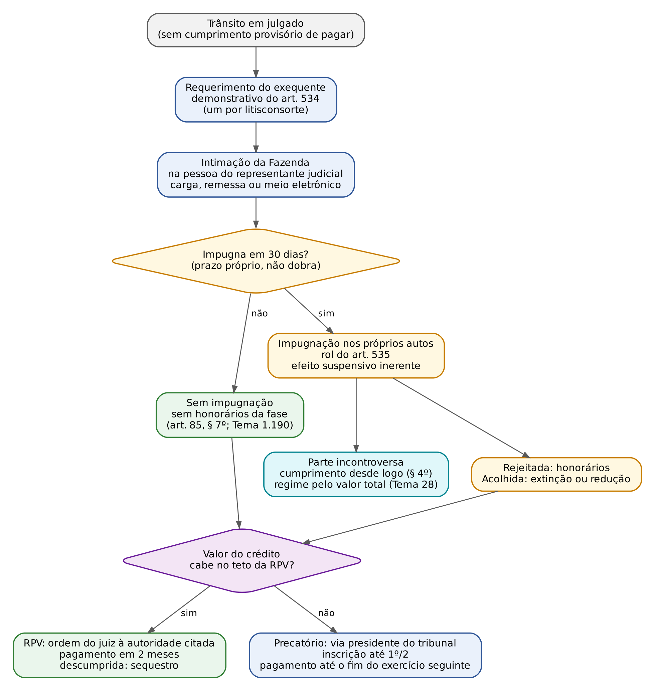
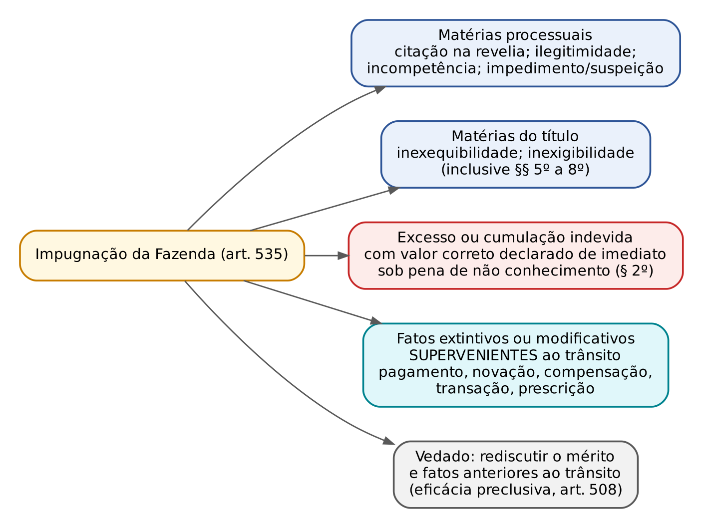
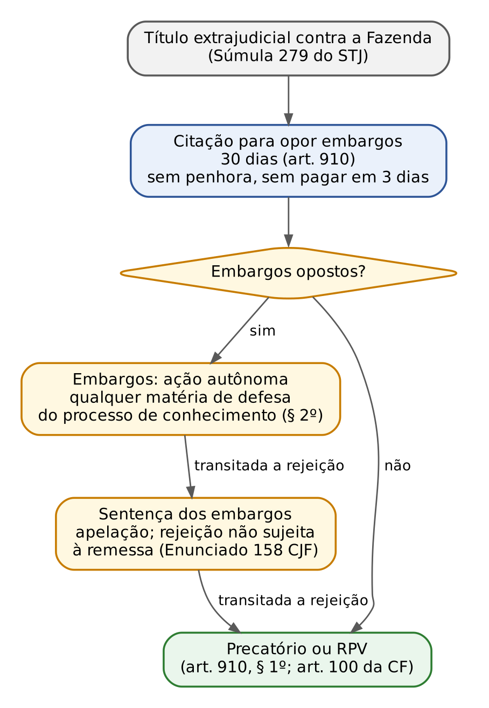
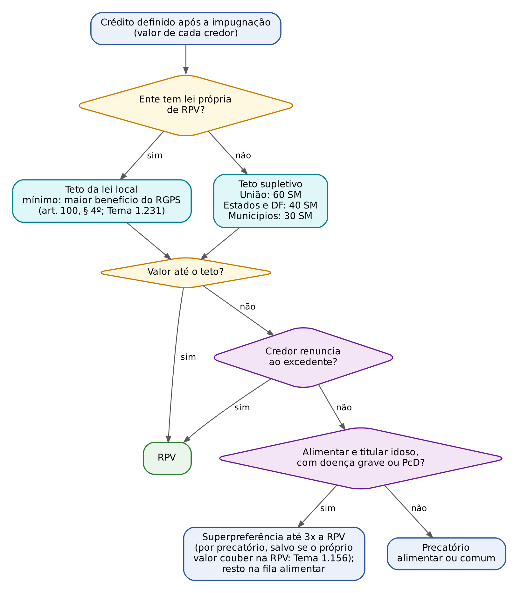
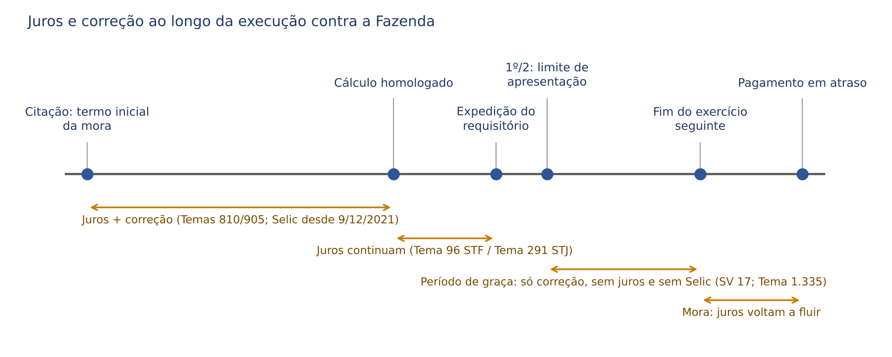
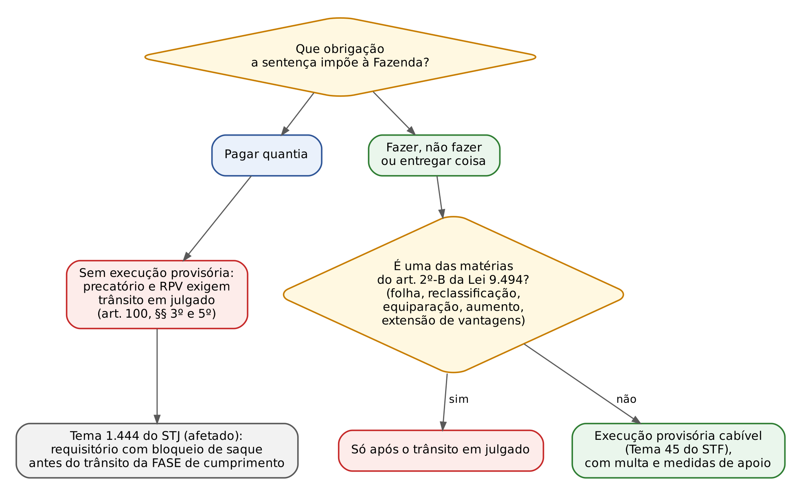

# CAPÍTULO 27 — FAZENDA PÚBLICA EM JUÍZO E EXECUÇÃO CONTRA A FAZENDA PÚBLICA

:::INCIDENCIA
Pontos: TRF5 p. 14; TJRS p. 11 e 14; TJSC p. 11, 14 e 17 (Decreto 20.910/1932 e DL 4.597/1942). Nível A+. Lote: 32 questões (FGV 27; FCC 5), mais 7 correlatas de outros lotes.
O que mais cai: impugnação do art. 535 (prazo de 30 dias, rol restrito, excesso sem valor declarado), ausência da multa do art. 523 e da penhora, honorários na fase de cumprimento, superpreferência e cessão de precatório, sequestro, estatais no regime de precatórios, prazo em dobro e prazo próprio, índices supervenientes x coisa julgada.
:::

#### Mapa de cobrança

| Subtema | FGV | FCC | Padrão |
|---|---|---|---|
| Cumprimento de sentença (arts. 534 e 535) e impugnação | 8 | 1 | Caso com impugnação defeituosa (excesso sem cálculo, matéria anterior ao trânsito, garantia do juízo); honorários com ou sem impugnação; multa do art. 523 |
| Precatórios e RPV (art. 100 da CF) | 12 | 2 | Superpreferência e fracionamento; cessão; estatais; sequestro; ADIs 4.357 e 4.425; juros entre o cálculo e a requisição |
| Prerrogativas processuais | 6 | 2 | Prazo em dobro e prazo próprio; intimação pessoal; preparo; autarquia municipal e remessa; litisconsórcio com particular |
| Execução por título extrajudicial (art. 910) | 1 | 0 | Embargos não opostos: precatório, não penhora |

A FGV cobra o capítulo em CASOS com personagens (servidor, Estado, Município) e alternativas que misturam o regime do particular executado (multa de 10%, penhora, garantia do juízo, prazo de 15 dias) com o da Fazenda. Nas provas de juiz (TRF1, TRF2, TRF3, TRF5, TJPE, TJPR), aparecem a jurisprudência do STF sobre precatórios e os temas de índices supervenientes; nas de procuradorias, a literalidade dos arts. 183, 534, 535 e 910.

Divisão de tarefas com outros capítulos e apostilas: prazo em dobro em geral (Cap. 11, item 11.8.5); Advocacia Pública (Cap. 10, item 10.6); honorários da Fazenda e do cumprimento contra ela (Cap. 8, itens 08.5.1 a 08.5.3); remessa necessária (Cap. 20, item 20.11, desenvolvida por inteiro); tutela provisória contra a Fazenda e suspensão de liminar (Cap. 15, itens 15.7 e 15.8); coisa julgada inconstitucional (Cap. 21); Juizados da Fazenda e Federais (Caps. 36 e 37); regime constitucional e financeiro dos precatórios, juros e correção e prescrição material contra a Fazenda (Apostila de Direito Administrativo, Caps. 24 e 26). Aqui se desenvolve o PROCESSO: o estatuto processual da Fazenda como parte, a prescrição sob o ângulo processual, os ritos dos arts. 534, 535 e 910, a impugnação, a requisição de pagamento como ato do processo, a execução das obrigações específicas e a execução provisória contra entes públicos.

## 27.1 A Fazenda Pública como parte: o estatuto processual

### 27.1.1 Quem goza das prerrogativas

Fazenda Pública, para o CPC, são as pessoas jurídicas de direito público: União, Estados, Distrito Federal, Municípios e suas autarquias e fundações de direito público (arts. 183, 242, § 3º, 269, § 3º, e 496, I). Associações públicas (consórcios de direito público) e agências reguladoras são autarquias e entram no conceito. Ficam de fora as empresas públicas e as sociedades de economia mista, mesmo as prestadoras de serviço público, salvo norma legal específica (a ECT, por exemplo, tem prerrogativas por lei própria) e salvo as extensões pontuais feitas pelo STF quanto a precatório e impenhorabilidade (27.5.3). O conceito e o fundamento das prerrogativas (isonomia material, indisponibilidade do interesse público) estão na Apostila de Direito Administrativo, Cap. 26, item 26.1.

Duas consequências práticas no gabinete:

- A extensão do regime de precatórios a uma estatal NÃO lhe dá prazo em dobro nem remessa necessária: os regimes são independentes e dependem de previsão legal específica.
- O fato de a ré ser Fazenda define procedimento, mas não necessariamente competência: a vara da Fazenda Pública é questão de organização judiciária; a competência da Justiça Federal decorre do art. 109 da CF (Cap. 5).

### 27.1.2 Quadro das prerrogativas e onde estudá-las

| Prerrogativa | Regra | Exceção ou detalhe cobrado | Fundamento | Onde se desenvolve |
|---|---|---|---|---|
| Citação | Perante o órgão de Advocacia Pública | Constitucional quanto a Estados, DF e Municípios (ADI 5.492) | Art. 242, § 3º | 27.1.3 |
| Intimação | Pessoal, por carga, remessa ou meio eletrônico, perante a Advocacia Pública | Publicação no Diário não basta | Arts. 183, § 1º, e 269, § 3º | 27.1.3; Cap. 12 |
| Prazo | Em dobro para todas as manifestações | Não dobra havendo prazo próprio expresso (arts. 535 e 910; Juizados) | Art. 183, § 2º | 27.1.4; Cap. 11 |
| Revelia | Sem efeito material | Direitos indisponíveis | Art. 345, II | 27.1.5 |
| Despesas | Pagas ao final pelo vencido | Perícia: entidade pública ou adiantamento se houver previsão orçamentária | Art. 91 | 27.1.5; Cap. 8 |
| Preparo e depósitos | Dispensados (inclusive porte de remessa e retorno) | Depósito recursal e depósito da rescisória também dispensados | Art. 1.007, § 1º; art. 968, § 1º; Lei 9.494, art. 1º-A | 27.1.5 |
| Honorários | Faixas escalonadas | Cumprimento não impugnado: sem honorários (precatório ou RPV) | Art. 85, §§ 3º a 7º | Cap. 8 |
| Remessa necessária | Sentença contra pessoa jurídica de direito público | Dispensas por valor e por precedente | Art. 496 | Cap. 20 |
| Tutela provisória | Cabível, com vedações | Arts. 1º a 4º da Lei 8.437 | Art. 1.059 | Cap. 15 |
| Execução por quantia | Sem penhora; precatório ou RPV | Multa do art. 523 inaplicável | Arts. 534, 535 e 910; CF, art. 100 | 27.3 a 27.5 |
| Prescrição | Cinco anos; interrupção uma só vez, pela metade | Súmula 383 do STF | Decreto 20.910; DL 4.597 | 27.2 |

### 27.1.3 Citação e intimação

A citação e a intimação dos entes públicos e de suas autarquias e fundações de direito público fazem-se "perante o órgão de Advocacia Pública responsável por sua representação judicial" (arts. 242, § 3º, e 269, § 3º). A representação decorre da lei e do cargo, sem procuração (Cap. 10). Os entes públicos são obrigados a manter cadastro nos sistemas de processo eletrônico para receber citações e intimações (art. 246, § 2º, e art. 1.050; ver Cap. 12 sobre o Domicílio Judicial Eletrônico).

:::JURIS STF, ADIS 5.492 E 5.737, PLENÁRIO, J. 24/4/2023
No bloco de dispositivos do CPC impugnados pelos Estados, o STF declarou constitucional a expressão "dos Estados, do Distrito Federal e dos Municípios" do art. 242, § 3º (citação perante a Advocacia Pública não fere a autonomia do ente) e o art. 75, § 4º (convênio entre procuradorias é faculdade). Declarou INCONSTITUCIONAL a expressão "de banco oficial" do art. 535, § 3º, II: o depósito da RPV pode ser feito em instituição financeira pública ou privada, conforme a escolha do ente (autonomia federativa e livre concorrência). Deu interpretação conforme aos arts. 46, § 5º, e 52, parágrafo único (foro limitado ao território do ente; v. Cap. 4) e manteve o art. 15 e a evidência do art. 311, II, sem oitiva (v. Cap. 1). Antes, na ADI 5.534 (Plenário, sessão virtual encerrada em 18/12/2020, Relator Ministro Dias Toffoli), o STF havia declarado constitucional o PRAZO de dois meses para pagamento da RPV no art. 535, § 3º, II, por ser matéria processual (competência privativa da União), cabendo aos entes apenas fixar o valor da RPV, e dado interpretação conforme ao § 4º: o regime da parcela incontroversa (precatório ou RPV) é definido pelo valor TOTAL da condenação.
:::

:::QUESTAO FCC 2024 — PGE-GO — PROCURADOR DO ESTADO SUBSTITUTO (Q2654855)
Cinco dispositivos do CPC transcritos; qual é incompatível com a Constituição segundo o STF? Gabarito: D, o pagamento da RPV em "banco oficial" (art. 535, § 3º, II), declarado inconstitucional na ADI 5.492. Armadilha: as demais alternativas (citação pela Advocacia Pública; art. 15 e processos administrativos; convênio entre procuradorias; presunção de repercussão geral do art. 1.035, § 3º, III) foram mantidas. Atenção à sutileza: o PRAZO de dois meses do mesmo inciso é constitucional (ADI 5.534); só a expressão "de banco oficial" caiu. Comentário complementar no Cap. 1.
:::

Intimação pessoal: o art. 183, § 1º, admite carga, remessa ou meio eletrônico. Nos autos eletrônicos, a intimação pelo portal do sistema é pessoal (Lei 11.419/2006, art. 5º; Cap. 12), e o prazo corre da consulta ou do decurso do prazo de dez dias corridos para consulta. Publicação no Diário de Justiça, isolada, não intima a Fazenda.

:::QUESTAO FCC 2026 — TJ-CE — ANALISTA JUDICIÁRIO (Q4231778, CORRELATA DO CAP. 12)
Fazenda citada por meio eletrônico pratica ato fora do prazo; alega-se nulidade por vício de intimação. Gabarito: A, a citação válida da Fazenda constitui em mora e abre o prazo de resposta, contado em dobro. Erradas: intimação "exclusivamente física" (o art. 183, § 1º, admite meio eletrônico); dobra "inclusive quando houver disposição legal expressa em sentido contrário" (art. 183, § 2º); nulidade sem prejuízo (art. 282, § 1º); ato intempestivo da Fazenda imune à preclusão (as prerrogativas não afastam a preclusão temporal).
:::

### 27.1.4 Prazos: a dobra e o prazo próprio

O regime geral do art. 183 (dobra para todas as manifestações, contada da intimação pessoal) está no Cap. 11, item 11.8.5. Para este capítulo, o que importa é a lista de PRAZOS PRÓPRIOS, que não se dobram, e as situações em que a dobra se combina com outros prazos.

| Ato | Prazo | Dobra? | Fundamento |
|---|---|---|---|
| Contestar, recorrer, contrarrazoar, falar nos autos | Prazo comum x 2 (ex.: contestação em 30 dias úteis; apelação em 30) | Sim | Art. 183, caput |
| Impugnar o cumprimento de sentença de pagar quantia | 30 dias úteis | NÃO (prazo próprio) | Art. 535, caput |
| Embargar a execução por título extrajudicial | 30 dias úteis | NÃO (prazo próprio) | Art. 910, caput; Lei 9.494, art. 1º-B (Tema 137 do STF, ver Adm. Cap. 26) |
| Pagar RPV no cumprimento do CPC | 2 meses da entrega da requisição | Prazo de cumprimento, não de manifestação | Art. 535, § 3º, II (ADI 5.534) |
| Informações da autoridade no MS | 10 dias | NÃO | Lei 12.016, art. 7º, I (Cap. 32) |
| Qualquer ato no JEFP e no JEF | Prazo comum | NÃO ("não haverá prazo diferenciado") | Lei 12.153, art. 7º; Lei 10.259, art. 9º |
| Agravo da decisão de suspensão de liminar | Ver Cap. 15 | Discussão sobre unificação em 15 dias | Lei 8.437, art. 4º, § 3º |
| Antecedência da citação para a audiência do art. 334 | 20 dias (audiência com pelo menos 30 dias) | NÃO (não é prazo para manifestação da Fazenda) | Art. 334, caput |

:::QUESTAO FGV 2025 — TRF 1ª REGIÃO — JUIZ FEDERAL SUBSTITUTO (Q3425317)
Afirmativa correta sobre a Fazenda em juízo. Gabarito: D, prazo em dobro para todas as manifestações, contado da intimação pessoal (art. 183, caput). Erradas: A (dobra mesmo com prazo próprio expresso, contra o § 2º); B (advogado público responde por "dolo ou culpa": o art. 184 exige dolo ou fraude); C (impugnação em 15 dias: são 30, art. 535); E (monitória incabível contra a Fazenda: é admitida, art. 700, § 6º, e Súmula 339 do STJ). No mesmo sentido, quanto ao § 2º: Q3538759 (FCC 2025, TRF4, gabarito E: a União, em ação de vítima das enchentes do RS, tem dobra para todas as manifestações, salvo prazo próprio expresso; o distrator da "calamidade" é invenção) e Q3373891 (FGV 2025, TRF5, Juiz Federal, gabarito B: só a afirmação sobre o prazo próprio estava certa; 1.000 salários mínimos é o limite da União, não do Estado, e a RPV paga-se em dois meses, não em 90 dias; comentada no Cap. 20).
:::

:::QUESTAO FGV 2024 — AL-PR — PROCURADOR (Q2448992)
Ação indenizatória contra o Estado do Paraná (350.000 (trezentos e cinquenta mil) reais). Recebida a inicial, qual a providência? Gabarito: A, designa-se audiência de conciliação ou mediação com antecedência mínima de 30 dias, com citação da Fazenda com pelo menos 20 dias de antecedência, e a Fazenda tem prazo em dobro para todas as manifestações. Armadilhas: B e C transplantam o art. 7º da Lei 12.153/2009 (sem prazo diferenciado e citação com 30 dias de antecedência), que só vale no JUIZADO da Fazenda; D e E dobram a antecedência da audiência (40 ou 60 dias), que não é prazo de manifestação. Lição: a causa de 350.000 reais excede o teto do JEFP (60 salários mínimos), logo segue o procedimento comum, com audiência do art. 334 (a Fazenda pode transigir nos limites da lei autorizadora; ver Cap. 2).
:::

:::QUESTAO FGV 2024 — AL-TO — PROCURADOR JURÍDICO (Q2457284)
Ação de responsabilidade civil contra o Estado e um cantor particular. Gabarito oficial: D, o cantor tem 15 dias contados da juntada do mandado e o Estado 30 dias contados da carga dos autos pelo procurador. Fundamento: cada réu tem o seu prazo (15 x 2 para o Estado, art. 183) e o seu termo inicial (art. 231, II, para o mandado; art. 183, § 1º, para a carga). Armadilhas: "prazo comum" de 15 ou de 30 dias e prazo de 30 dias ao particular por extensão da prerrogativa. Gabarito discutível: pelo art. 231, § 1º, havendo mais de um réu, o prazo de contestação começa na ÚLTIMA das datas de citação, e, no procedimento comum, o termo inicial é a audiência do art. 334 ou o protocolo do pedido de cancelamento (art. 335, I e II); a questão ignorou ambas as regras. Em prova, a lição útil é a de que a dobra é pessoal (não se estende ao litisconsorte particular) e não se soma à do art. 229.
:::

### 27.1.5 Revelia, despesas, preparo e depósitos

- Revelia: a Fazenda pode ser revel, mas sem presunção de veracidade, porque o litígio versa sobre direitos indisponíveis (art. 345, II). O autor mantém o ônus do fato constitutivo. A revelia também não dispensa a intimação pessoal dos atos subsequentes, se o ente constituir procurador. A confissão de fato contrário ao interesse público por procurador é ineficaz quanto a direitos indisponíveis (art. 392).
- Despesas dos atos requeridos pela Fazenda: pagas AO FINAL pelo vencido (art. 91). Perícia requerida pela Fazenda: por entidade pública ou com adiantamento se houver previsão orçamentária; sem previsão, paga no exercício seguinte ou ao final (art. 91, §§ 1º e 2º; Súmula 232 do STJ e sua leitura atual no Cap. 8, item 08.1.4).
- Custas: a isenção depende da lei de cada ente (na Justiça Federal, Lei 9.289/1996, art. 4º, I); a isenção não dispensa o reembolso das custas adiantadas pelo vencedor.
- Preparo: dispensado, "inclusive porte de remessa e de retorno", nos recursos da União, DF, Estados, Municípios e respectivas autarquias (art. 1.007, § 1º). O texto não menciona fundações de direito público, que se beneficiam pela isenção legal ("pelos que gozam de isenção legal") e pela natureza autárquica.
- Depósito prévio para recorrer: dispensado às pessoas jurídicas de direito público (Lei 9.494/1997, art. 1º-A). Depósito de 5% da ação rescisória: não se aplica à União, Estados, DF, Municípios, suas autarquias e fundações de direito público, MP, Defensoria e beneficiários da gratuidade (art. 968, § 1º; Cap. 40).
- Multas processuais: a Fazenda está sujeita às multas por litigância de má-fé e por embargos protelatórios; o depósito prévio da multa do art. 1.021, § 4º, e do art. 1.026, § 3º, é dispensado à Fazenda, que paga ao final (arts. 1.021, § 5º, e 1.026, § 3º).

:::QUESTAO FGV 2024 — PREFEITURA DE SÃO JOSÉ DOS CAMPOS — ANALISTA (Q2362720)
Servidor obtém sentença de procedência contra o Município em ação de cobrança de gratificação reconhecida por parecer vinculante da Procuradoria. Gabarito: B, eventual apelação do Município está dispensada de preparo, inclusive porte de remessa e retorno (art. 1.007, § 1º). Erradas: A (remessa "em todo e qualquer caso": a sentença coincide com orientação vinculante do próprio ente, hipótese de dispensa do art. 496, § 4º, IV, ver Cap. 20); C (15 dias para pagar sob pena de penhora: rito do art. 523, inaplicável à Fazenda, que é intimada para impugnar em 30 dias); D (fundamentação dispensável: absurdo, art. 93, IX, da CF); E (ampliação do colegiado "restrita" à rescisória e ao agravo: a técnica do art. 942 nasce justamente na apelação).
:::

:::QUESTAO FGV 2024 — TJ-PE — JUIZ SUBSTITUTO (Q3117516)
Autarquia previdenciária de Município que NÃO é capital, condenada em 200 salários mínimos; apelação protocolada 20 dias úteis após a intimação pessoal do procurador, sem preparo. Gabarito: C, a apelação pode ser conhecida apesar da falta de preparo. Passos: (1) legitimidade: a autarquia tem personalidade própria e recorre por sua procuradoria (A errada); (2) tempestividade: 15 x 2 = 30 dias úteis (art. 183); 20 é tempestivo (B errada); (3) preparo dispensado às autarquias (art. 1.007, § 1º); (4) remessa necessária: alcança autarquias (art. 496, I; D errada) e, para Município não capital e suas autarquias, o limite é de 100 salários mínimos (art. 496, § 3º, III); 200 excede, logo há remessa (E errada).
:::

### 27.1.6 Autocomposição, provas e outros pontos de atrito

- Audiência de conciliação: a Fazenda participa da audiência do art. 334; a autocomposição depende de lei autorizadora do ente (no plano federal, Lei 9.469/1997; Cap. 2). A indisponibilidade do interesse público não impede a transação, apenas a condiciona à lei. O não comparecimento injustificado da Fazenda à audiência é ato atentatório (art. 334, § 8º), aplicável também ao ente público.
- Prova: os atos administrativos gozam de presunção relativa de legitimidade e veracidade, o que distribui, na prática, o ônus de prova contra a Administração; as certidões e informações de repartições podem ser requisitadas pelo juiz (art. 438).
- Ação monitória contra a Fazenda: admitida (art. 700, § 6º; Súmula 339 do STJ); não opostos embargos, aplica-se a remessa necessária antes da formação do título e, a seguir, o cumprimento do art. 534 (art. 701, § 4º).
- Tutela provisória, vedações (Lei 8.437/1992, Lei 9.494/1997, art. 1º, ADC 4, Súmula 729 do STF) e suspensão de liminar: Cap. 15, itens 15.7 e 15.8. A EXECUÇÃO provisória contra a Fazenda é tratada em 27.7.

## 27.2 Prescrição contra a Fazenda Pública: aspectos processuais

### 27.2.1 O regime material em uma tabela

O Decreto 20.910/1932 e o DL 4.597/1942 estão transcritos e comentados na Apostila de Direito Administrativo, Cap. 24, item 24.15 (inclusive a Súmula 383 do STF com exemplos, o trato sucessivo, a Súmula 85 do STJ e os Temas 553, 602, 1.017 e 1.410 do STJ). Aqui, só o quadro de memorização e os pontos de processo.

| Regra | Conteúdo | Fonte |
|---|---|---|
| Prazo | Cinco anos da data do ato ou fato, "seja qual for a sua natureza" | Decreto 20.910, art. 1º |
| Destinatários | União, Estados, Municípios, DF, autarquias e entidades paraestatais mantidas por tributos; prestadoras privadas de serviço público só para indenização | DL 4.597, art. 2º; Lei 9.494, art. 1º-C |
| Prestações periódicas | Prescrição progressiva das parcelas | Decreto 20.910, art. 3º; Súmula 85 do STJ |
| Suspensão | Requerimento administrativo pendente de estudo, reconhecimento ou pagamento | Decreto 20.910, art. 4º |
| Demora do credor | Não suspende | Decreto 20.910, art. 5º |
| Reclamação administrativa sem prazo | Um ano | Decreto 20.910, art. 6º |
| Citação em processo anulado | Não interrompe | Decreto 20.910, art. 7º |
| Interrupção | Uma única vez; recomeça pela metade (2,5 anos) | Decreto 20.910, arts. 8º e 9º; DL 4.597, art. 3º |
| Piso | Nunca menos de cinco anos contados do fato | Súmula 383 do STF |
| No curso da lide | Consuma-se se, do último ato ou termo do processo, decorrerem 2,5 anos | DL 4.597, art. 3º |

### 27.2.2 A prescrição no processo

- Reconhecimento de ofício: a prescrição é matéria de mérito cognoscível de ofício (art. 487, II), inclusive liminarmente (art. 332, § 1º), mas o juiz deve ouvir as partes antes de decidir com base nela, salvo na improcedência liminar (art. 487, parágrafo único; vedação da decisão-surpresa, Cap. 1).
- Momento: a prescrição da PRETENSÃO DE CONHECIMENTO deve ser alegada na fase de conhecimento. Transitada em julgado a sentença, fica coberta pela eficácia preclusiva da coisa julgada (art. 508), e a impugnação só admite prescrição SUPERVENIENTE ao trânsito (art. 535, VI).
- Interrupção pela citação: a citação válida, ordenada por juiz ainda que incompetente, interrompe a prescrição, com retroação à data da propositura (art. 240, § 1º); contra a Fazenda, a interrupção é única e o prazo recomeça pela metade a partir do último ato do processo (art. 9º do Decreto 20.910). O STJ precisou: interrompida a prescrição por protesto judicial, o recomeço se conta da data do último ato praticado no processo de protesto, e não do seu ajuizamento (AgInt no REsp 2.036.964-RJ, Relatora Ministra Regina Helena Costa, Primeira Turma, j. 20/3/2025, Informativo 849).
- Parcelamento: na pretensão de redimensionar a base de cálculo de débito parcelado, o prazo flui a partir da adesão ao parcelamento, não da quitação (REsp 1.978.133-SP, Relatora Ministra Regina Helena Costa, Primeira Turma, j. 16/6/2026, Informativo 893).

:::QUESTAO FGV 2024 — CÂMARA MUNICIPAL DE SÃO PAULO — PROCURADOR LEGISLATIVO (Q2351264, CORRELATA DO CAP. 21)
Em impugnação ao cumprimento contra o Município, alega-se que a AÇÃO DE CONHECIMENTO foi proposta após o prazo prescricional (fato em janeiro de 2015; trânsito em maio de 2023). Gabarito: A, a alegação não procede, por força da eficácia preclusiva da coisa julgada. Lição: o art. 535, VI, só admite prescrição superveniente ao trânsito (a da pretensão EXECUTÓRIA); a prescrição da pretensão de conhecimento era alegável (e dedutível) no processo de conhecimento e foi alcançada pelo art. 508. "Matéria de ordem pública" (B) não sobrevive à coisa julgada; o meio próprio seria a rescisória, se cabível.
:::

### 27.2.3 Prescrição da pretensão executória e intercorrente

A execução prescreve no mesmo prazo da ação (Súmula 150 do STF; v. Cap. 22): contra a Fazenda, cinco anos contados do trânsito em julgado. O trânsito NÃO é causa interruptiva, de modo que não se aplica a recontagem pela metade (orientação descrita na Apostila de Direito Administrativo, item 24.15.5). Requerido o cumprimento, a paralisação por inércia exclusiva do exequente pode gerar prescrição intercorrente, e a demora imputável ao serviço judiciário não prejudica o credor.

Teses do STJ que decidem casos:

:::JURIS STJ, TEMA 1.311 (REPETITIVO) — RESP 2.139.074 E OUTROS, PRIMEIRA SEÇÃO
Tese (síntese fiel): o curso do prazo prescricional da obrigação de PAGAR quantia certa pela Fazenda Pública não é suspenso durante o cumprimento da obrigação de FAZER de implantar a verba em folha de pagamento imposta no mesmo título. Lógica: são pretensões executórias autônomas; enquanto se discute a implantação, o credor deve promover a execução das parcelas vencidas, sob pena de prescrição; as parcelas posteriores podem ser incluídas depois ou pagas administrativamente.
:::

:::JURIS STJ, TEMA 880 (REPETITIVO)
Tese (síntese fiel): desde a Lei 10.444/2002, não é imprescindível, para o acertamento da conta exequenda, a juntada de documentos pela parte executada; por isso, para as decisões transitadas em julgado sob o CPC/1973, a demora na juntada das fichas financeiras ou de documentos correlatos, ainda que a cargo do ente público executado, "não obsta o transcurso do lapso prescricional executório", nos termos da Súmula 150 do STF. Modulação: para as decisões transitadas em julgado até 17/3/2016 que dependiam de documentos do executado, o prazo quinquenal conta-se a partir de 30/6/2017. Sob o CPC/2015, a regra está no art. 524, §§ 3º a 5º: o juiz pode requisitar os dados ao executado, sob pena de desobediência, e, não apresentados, presumem-se corretos os cálculos do exequente.
:::

- Execução individual de sentença coletiva: o prazo prescricional (quinquenal) conta-se do trânsito em julgado da sentença coletiva, "sendo desnecessária a providência de que trata o art. 94" do CDC (Tema 877 do STJ). Prescrição e liquidação coletiva: Cap. 34.
- Reexpedição de requisitório cancelado (Lei 13.463/2017): a pretensão de expedir novo precatório ou RPV após o cancelamento por falta de levantamento em dois anos prescreve em cinco anos (art. 1º do Decreto 20.910), contados da notificação do credor prevista no art. 2º, § 4º, da Lei 13.463 (Tema 1.141 do STJ). E é válido o cancelamento automático feito entre 6/7/2017 e 6/7/2022 (data da ata da ADI 5.755) se houve inércia do credor por dois anos, mas ilegal se circunstâncias alheias à sua vontade impediam o levantamento (Tema 1.217 do STJ).

:::QUESTAO FCC 2026 — PGM MANAUS — PROCURADOR DO MUNICÍPIO (Q4338820)
Afirmativa correta sobre o cumprimento contra a Fazenda. Gabarito: D, a prescrição da pretensão de executar as parcelas remuneratórias vencidas pode beneficiar a Fazenda, e as providências administrativas para implantar a vantagem em folha (verbas futuras) não suspendem o prazo (Tema 1.311 do STJ). Erradas: A (objeto "amplo" da impugnação, com qualquer matéria de defesa: isso é o art. 910, § 2º, para título EXTRAJUDICIAL; no cumprimento, o rol é o do art. 535); B (excesso apreciado mesmo sem indicação do valor correto: o § 2º impõe o não conhecimento); C (sem honorários no cumprimento INDIVIDUAL de sentença coletiva não impugnado: a Súmula 345 do STJ os reconhece devidos); E (honorários devidos sem impugnação quando RPV: superado pelo Tema 1.190 do STJ).
:::

:::DICA OS QUATRO PRAZOS QUE A BANCA MISTURA
(1) Pretensão de conhecimento contra a Fazenda: cinco anos do fato (Decreto 20.910, art. 1º). (2) Pretensão executória: cinco anos do trânsito (Súmula 150 do STF), autônoma em relação à obrigação de fazer (Tema 1.311). (3) Execução individual de sentença coletiva: cinco anos do trânsito da coletiva (Tema 877). (4) Reexpedição de requisitório cancelado: cinco anos da notificação do credor (Tema 1.141). Recontagem pela metade só após INTERRUPÇÃO, nunca após o trânsito.
:::

## 27.3 Cumprimento de sentença que reconheça a exigibilidade de obrigação de pagar quantia pela Fazenda Pública

### 27.3.1 Por que o rito é diferente

Os bens públicos são impenhoráveis (art. 833, I; CC, arts. 100 e 101) e os pagamentos judiciais da Fazenda seguem a ordem do art. 100 da CF. Logo, a execução por quantia contra a Fazenda não tem penhora, avaliação nem expropriação: é uma execução "imprópria", que termina com uma REQUISIÇÃO de pagamento (precatório ou RPV). Desse dado estrutural decorrem todas as diferenças em relação ao art. 523:

| Ponto | Devedor particular (arts. 523 a 525) | Fazenda Pública (arts. 534 e 535) |
|---|---|---|
| Ato inicial | Intimação para PAGAR em 15 dias | Intimação para IMPUGNAR em 30 dias |
| Multa de 10% e honorários de 10% pelo não pagamento | Sim (art. 523, § 1º) | Multa NÃO (art. 534, § 2º); honorários conforme o art. 85, § 7º, e o Tema 1.190 |
| Constrição | Penhora e expropriação | Nenhuma; requisição de pagamento |
| Prazo da defesa | 15 dias úteis, contados após o prazo de pagamento (art. 525) | 30 dias úteis da intimação, sem dobra (art. 535) |
| Garantia do juízo | Desnecessária para impugnar; exigida para efeito suspensivo (art. 525, § 6º) | Inexistente; efeito suspensivo inerente quanto ao controvertido |
| Matérias | Art. 525, § 1º (inclui penhora incorreta e avaliação errônea) | Art. 535 (sem penhora e avaliação) |
| Excesso sem valor declarado | Rejeição liminar ou não conhecimento (art. 525, §§ 4º e 5º) | Não conhecimento da arguição (art. 535, § 2º) |
| Cumprimento provisório | Admitido (arts. 520 a 522) | Inadmitido para pagar quantia (art. 100, §§ 3º e 5º, da CF) |
| Satisfação | Levantamento do dinheiro ou adjudicação | Precatório (via presidente do tribunal) ou RPV (ordem do juiz) |

:::LEI CPC, ART. 534
Art. 534. No cumprimento de sentença que impuser à Fazenda Pública o dever de pagar quantia certa, o exequente apresentará demonstrativo discriminado e atualizado do crédito contendo:
I - o nome completo e o número de inscrição no Cadastro de Pessoas Físicas ou no Cadastro Nacional da Pessoa Jurídica do exequente;
II - o índice de correção monetária adotado;
III - os juros aplicados e as respectivas taxas;
IV - o termo inicial e o termo final dos juros e da correção monetária utilizados;
V - a periodicidade da capitalização dos juros, se for o caso;
VI - a especificação dos eventuais descontos obrigatórios realizados.
§ 1º Havendo pluralidade de exequentes, cada um deverá apresentar o seu próprio demonstrativo, aplicando-se à hipótese, se for o caso, o disposto nos §§ 1º e 2º do art. 113.
§ 2º A multa prevista no § 1º do art. 523 não se aplica à Fazenda Pública.
:::

Pontos de aplicação:

- O demonstrativo é requisito do requerimento. Falta ou deficiência gera intimação para emenda (art. 321 por analogia), não extinção de plano. A alternativa que manda "extinguir o feito principal com resolução do mérito" por falta de demonstrativo é sempre errada.
- O § 1º (um demonstrativo por exequente) prepara a individualização dos créditos para fins de RPV ou precatório (cada litisconsorte tem o seu crédito; 27.5.4) e remete à limitação do litisconsórcio multitudinário na fase de cumprimento (art. 113, §§ 1º e 2º; Cap. 9).
- Descontos obrigatórios (inciso VI): contribuição previdenciária e imposto de renda retidos na fonte; a retenção é feita no pagamento do requisitório.
- Liquidação: se a sentença for ilíquida, liquida-se antes (arts. 509 a 512; Cap. 22); dependendo de cálculo, o próprio demonstrativo cumpre a função (art. 509, § 2º).
- Competência: juízo que decidiu a causa em primeiro grau (art. 516, II), com as opções do parágrafo único do art. 516 (Cap. 22).

:::QUESTAO FGV 2024 — PREFEITURA DE CARAGUATATUBA — PROCURADOR (Q2346681)
Credor do Município pede cumprimento com multa de 10% e honorários de 10% se não houver pagamento em 15 dias. Na defesa do Município, qual a resposta correta? Gabarito: B, a multa pleiteada não se aplica à Fazenda (art. 534, § 2º). Erradas: A ("quinze dias úteis" para impugnar: são 30, art. 535); C (impugnação por "embargos" com livre distribuição: no cumprimento, é impugnação nos próprios autos; embargos só no art. 910); D (oferta de bens à penhora: bens públicos são impenhoráveis); E (extinção com resolução de mérito por falta de demonstrativo: cabe emenda).
:::

### 27.3.2 Intimação e prazo

A Fazenda é INTIMADA (não citada) na pessoa de seu representante judicial, por carga, remessa ou meio eletrônico, para, "querendo", impugnar em 30 dias, nos próprios autos (art. 535, caput). Três observações:

- O prazo de 30 dias é próprio e não se dobra (art. 183, § 2º). Conta-se em dias úteis (art. 219), por ser prazo processual.
- Não há prazo para pagamento voluntário: a Fazenda não pode pagar fora do art. 100, de modo que a intimação já abre o prazo de defesa.
- Nos Juizados da Fazenda e Federais, o cumprimento segue o regime próprio (Lei 12.153/2009, art. 13; Lei 10.259/2001, art. 17; Caps. 36 e 37), sem o prazo de 30 dias.

### 27.3.3 Matérias da impugnação

:::LEI CPC, ART. 535, CAPUT, §§ 1º E 2º
Art. 535. A Fazenda Pública será intimada na pessoa de seu representante judicial, por carga, remessa ou meio eletrônico, para, querendo, no prazo de 30 (trinta) dias e nos próprios autos, impugnar a execução, podendo arguir:
I - falta ou nulidade da citação se, na fase de conhecimento, o processo correu à revelia;
II - ilegitimidade de parte;
III - inexequibilidade do título ou inexigibilidade da obrigação;
IV - excesso de execução ou cumulação indevida de execuções;
V - incompetência absoluta ou relativa do juízo da execução;
VI - qualquer causa modificativa ou extintiva da obrigação, como pagamento, novação, compensação, transação ou prescrição, desde que supervenientes ao trânsito em julgado da sentença.
§ 1º A alegação de impedimento ou suspeição observará o disposto nos arts. 146 e 148.
§ 2º Quando se alegar que o exequente, em excesso de execução, pleiteia quantia superior à resultante do título, cumprirá à executada declarar de imediato o valor que entende correto, sob pena de não conhecimento da arguição.
:::

Leitura de cada inciso:

- I: única hipótese em que se volta à fase de conhecimento, e só se o processo correu à REVELIA; é a *querela nullitatis* veiculada por impugnação (Cap. 13). Se a Fazenda compareceu e se defendeu, o vício está sanado (art. 239, § 1º).
- II: ilegitimidade para a EXECUÇÃO (exequente que não é o credor do título, sucessor não habilitado, ente diverso do condenado), não a ilegitimidade da fase de conhecimento, coberta pela coisa julgada.
- III: inexequibilidade (título sem os atributos do art. 783, sentença sujeita a remessa não reexaminada, termo ou condição não verificados) e inexigibilidade, inclusive pela coisa julgada inconstitucional dos §§ 5º a 8º (27.3.4).
- IV: excesso (art. 917, § 2º, por analogia: quantia superior à do título, coisa diversa, condição não cumprida) e cumulação indevida (procedimentos incompatíveis).
- V: incompetência ABSOLUTA ou RELATIVA do juízo da execução; a relativa, se não alegada aqui, prorroga-se. Impedimento e suspeição seguem o incidente próprio (§ 1º; arts. 146 e 148).
- VI: fatos extintivos ou modificativos SUPERVENIENTES ao trânsito. Pagamento administrativo após o trânsito, transação com o servidor, compensação autorizada por lei e prescrição executória (27.2.3) entram aqui; fatos anteriores ao trânsito ficaram cobertos pela eficácia preclusiva (art. 508).

O rol é RESTRITO: a impugnação não reabre o mérito. A amplitude de defesa ("qualquer matéria que lhe seria lícito deduzir como defesa no processo de conhecimento") só existe nos embargos à execução de título extrajudicial (art. 910, § 2º), porque ali não houve processo de conhecimento anterior.

:::QUESTAO FGV 2024 — TJ-MT — OFICIAL DE JUSTIÇA (Q3114499)
União condenada a pagar 50.000 (cinquenta mil) reais a servidor (férias não gozadas); intimada no cumprimento por 62.000 (sessenta e dois mil) reais, impugna dizendo que nada é devido porque o servidor ainda poderia gozar as férias, e que os índices de juros e correção do exequente são inaplicáveis; não oferece garantia. Gabarito: A, a impugnação não deve ser conhecida quanto à inexistência do dever de pagar, matéria de mérito coberta pela coisa julgada. Passos: (1) "nada é devido" por fato anterior ao trânsito: fora do rol do art. 535 (art. 508); (2) garantia do juízo: nunca exigida da Fazenda, nem para conhecer nem para suspender (B e D erradas); (3) a Fazenda não pode "alegar qualquer questão a qualquer tempo" (C errada); (4) E erra duas vezes: para a União o limite da RPV é de 60 salários mínimos, e 62.000 reais cabem nesse teto. Quanto ao excesso por índices, a arguição é conhecível SE a União declarar o valor que entende correto (§ 2º).
:::

:::QUESTAO FGV 2024 — AL-TO — PROCURADOR JURÍDICO (Q2457285)
Matéria arguível pela Fazenda estadual na impugnação. Gabarito: E, inexigibilidade da obrigação reconhecida em título fundado em lei considerada inconstitucional pelo STF (art. 535, III e § 5º). Erradas: A (falta ou nulidade de citação SEM a condicionante da revelia); B (causas extintivas "ocorridas a qualquer tempo": só supervenientes ao trânsito); C ("toda e qualquer matéria" com base na ampla defesa: rol restrito); D (excesso sem ônus de indicar o valor: o ônus é da Fazenda, § 2º).
:::

### 27.3.4 Inexigibilidade e coisa julgada inconstitucional (§§ 5º a 8º)

:::LEI CPC, ART. 535, §§ 5º A 8º
§ 5º Para efeito do disposto no inciso III do caput deste artigo, considera-se também inexigível a obrigação reconhecida em título executivo judicial fundado em lei ou ato normativo considerado inconstitucional pelo Supremo Tribunal Federal, ou fundado em aplicação ou interpretação da lei ou do ato normativo tido pelo Supremo Tribunal Federal como incompatível com a Constituição Federal, em controle de constitucionalidade concentrado ou difuso.
§ 6º No caso do § 5º, os efeitos da decisão do Supremo Tribunal Federal poderão ser modulados no tempo, de modo a favorecer a segurança jurídica.
§ 7º A decisão do Supremo Tribunal Federal referida no § 5º deve ter sido proferida antes do trânsito em julgado da decisão exequenda.
§ 8º Se a decisão referida no § 5º for proferida após o trânsito em julgado da decisão exequenda, caberá ação rescisória, cujo prazo será contado do trânsito em julgado da decisão proferida pelo Supremo Tribunal Federal.
:::

A regra é espelho do art. 525, §§ 12 a 15, e sua teoria (constitucionalidade, Temas 360 e 733 do STF, alcance do § 8º e a AR 2.876) está no Cap. 21. Para a execução contra a Fazenda, o roteiro é:

:::PASSO INEXIGIBILIDADE DO TÍTULO CONTRA A FAZENDA
1. Identificar a decisão do STF: declaração de inconstitucionalidade da norma, ou de interpretação incompatível, em controle CONCENTRADO ou DIFUSO (o texto fala em ambos; no difuso, a doutrina exige decisão do Plenário com eficácia geral, como em repercussão geral).
2. Comparar datas: decisão do STF ANTERIOR ao trânsito da sentença exequenda = impugnação com base no § 5º (inexigibilidade). POSTERIOR = não cabe impugnação; cabe ação rescisória, com prazo de dois anos contado do trânsito da decisão do STF (§ 8º).
3. Verificar modulação (§ 6º): se o STF modulou para preservar situações anteriores, o título continua exigível.
4. Não confundir com mudança de ÍNDICES de juros e correção: aí não há inexigibilidade, mas ajuste do critério de cálculo, sem ofensa à coisa julgada (27.6.2).
:::

### 27.3.5 Excesso de execução: o ônus do § 2º

A Fazenda que alega excesso deve declarar "de imediato" o valor que entende correto, sob pena de NÃO CONHECIMENTO da arguição (§ 2º). A regra não comporta a flexibilização que o regime das verbas públicas poderia sugerir: o interesse público não dispensa o ônus. Se a impugnação tiver outros fundamentos, só a arguição de excesso deixa de ser conhecida, e o restante é examinado. A memória de cálculo é a forma natural de declarar o valor; o texto exige a DECLARAÇÃO do valor correto.

:::QUESTAO FGV 2026 — TJ-SC — ANALISTA JURÍDICO (Q4150718)
O Estado de Santa Catarina impugna alegando excesso e causa impeditiva superveniente à sentença, mas não declara o valor correto nem apresenta cálculo, instruindo apenas a causa impeditiva. Gabarito: B, a impugnação não será conhecida quanto ao excesso, mas o juiz deverá apreciar a causa impeditiva. Erradas: A (rejeição integral: o § 2º atinge só a arguição de excesso); C (emenda em 15 dias: o texto impõe declaração "de imediato"; a corrente que admite emenda é minoritária e não foi acolhida pela banca); D (precatório imediato do "incontroverso": sem valor declarado pela Fazenda, não há parcela incontroversa delimitada por ela); E (excesso como matéria de ordem pública conhecível de ofício: o juiz pode corrigir erro material, mas não supre o ônus da executada). No mesmo sentido, quanto ao § 2º: Q4338820, alternativa B (27.2.3), e Q2457285, alternativa D.
:::

:::ATENCAO ERRO MATERIAL X EXCESSO
O erro material de cálculo (soma errada, duplicidade de parcela, índice aplicado em mês inexistente) pode ser corrigido de ofício e a qualquer tempo, mesmo após a homologação, porque não transita em julgado. Já a divergência de CRITÉRIO (índice, termo inicial dos juros, base de cálculo) é excesso, sujeito ao § 2º e à preclusão. A mesma distinção limita a revisão de contas pelo presidente do tribunal no precatório (art. 1º-E da Lei 9.494/1997: só erro material e inexatidão aritmética; ver Adm. Cap. 26, item 26.4.1).
:::

### 27.3.6 Efeito suspensivo, parte incontroversa e decisão da impugnação

A impugnação da Fazenda tem efeito suspensivo prático, independentemente de garantia ou de requerimento, porque o § 3º do art. 535 só autoriza a requisição quando "não impugnada a execução ou rejeitadas as arguições da executada", e o art. 100 da CF exige trânsito em julgado. Mas o efeito é limitado ao que foi impugnado:

:::LEI CPC, ART. 535, §§ 3º E 4º
§ 3º Não impugnada a execução ou rejeitadas as arguições da executada:
I - expedir-se-á, por intermédio do presidente do tribunal competente, precatório em favor do exequente, observando-se o disposto na Constituição Federal;
II - por ordem do juiz, dirigida à autoridade na pessoa de quem o ente público foi citado para o processo, o pagamento de obrigação de pequeno valor será realizado no prazo de 2 (dois) meses contado da entrega da requisição, mediante depósito na agência de banco oficial mais próxima da residência do exequente.
§ 4º Tratando-se de impugnação parcial, a parte não questionada pela executada será, desde logo, objeto de cumprimento.
:::

Parte incontroversa: expede-se desde logo o requisitório da parcela não impugnada. O STF admitiu a expedição de precatório da parcela incontroversa em execução contra a Fazenda (Tema 28 do STF, RE 1.205.530) e, na ADI 5.534, deu interpretação conforme ao § 4º: o regime de pagamento (precatório ou RPV) da parte incontroversa observa o VALOR TOTAL da condenação, para evitar o fracionamento vedado pelo art. 100, § 8º.

:::QUESTAO FCC 2024 — PGE-GO — PROCURADOR DO ESTADO SUBSTITUTO (Q2654942)
Afirmativa correta sobre precatórios e RPV à luz do STF. Gabarito: A, é constitucional expedir ordem de pagamento da parcela incontroversa na pendência de impugnação parcial, sem fracionamento, desde que o regime (precatório ou RPV) seja definido pelo valor total da condenação. Erradas: B (cessionário herda a superpreferência: o art. 100, § 13, a exclui); C (cumprimentos individuais de sentença coletiva violariam a vedação do fracionamento: o STF diz o contrário, 27.5.4); D (por analogia ao litisconsórcio, o advogado poderia repartir o total dos honorários sucumbenciais em várias requisições, ainda que o montante exija precatório: vedado, os honorários são crédito único e indivisível do advogado, ver Cap. 8, item 08.3.1); E (fracionar os honorários CONTRATUAIS para pagá-los por RPV, com o principal em precatório: a orientação do STF é contrária, porque o contratual pertence ao crédito do cliente e seu destaque não cria crédito autônomo, diferentemente dos sucumbenciais).
:::

Decisão da impugnação e recurso: este é ponto em disputa e com repetitivo afetado.

- Decisão que REJEITA a impugnação e manda prosseguir: interlocutória, recorrível por agravo de instrumento (art. 1.015, parágrafo único: cabe agravo contra decisões interlocutórias proferidas na fase de cumprimento de sentença).
- Decisão que ACOLHE a impugnação e EXTINGUE a execução: sentença, recorrível por apelação (arts. 203, § 1º, e 925).
- Decisão que julga a impugnação, homologa os cálculos e determina a expedição do precatório ou RPV: a Segunda Turma do STJ entendeu cabível a APELAÇÃO (REsp 2.202.015, Info 875), e a questão, com a fungibilidade, está afetada no Tema 1.458 do STJ, pendente (v. Cap. 22).

:::QUESTAO FGV 2024 — AL-TO — PROCURADOR JURÍDICO (Q2457282, CORRELATA DO CAP. 42)
Decisão interlocutória que rejeita a impugnação da Fazenda no cumprimento. Gabarito: A, cabe agravo de instrumento porque a lei prevê a recorribilidade das interlocutórias na fase de cumprimento (art. 1.015, parágrafo único). Erradas: B (taxatividade mitigada: desnecessária, há previsão expressa); C (preliminar de apelação: regime do art. 1.009, § 1º, só para a fase de conhecimento); D (irrecorrível); E ("hipótese expressamente prevista": a previsão é genérica, para toda interlocutória do cumprimento, e não específica da rejeição da impugnação, o que tornou A a mais precisa). Observe a fronteira com o Informativo 875: se a decisão encerra a fase e determina a expedição do requisitório, há quem a qualifique como sentença (Tema 1.458 pendente).
:::

### 27.3.7 Honorários na fase de cumprimento contra a Fazenda

O regime está desenvolvido no Cap. 8, item 08.5.2 (art. 85, § 7º; art. 1º-D da Lei 9.494/1997; Tema 1.190 do STJ; Súmula 345 do STJ; Tema 1.392 do STJ, afetado). Em uma linha: sem impugnação, não há honorários da fase, seja precatório, seja RPV; com impugnação rejeitada, há; na execução individual de sentença coletiva, há mesmo sem impugnação. Dois complementos:

- Renúncia ao excedente da RPV depois de iniciada a execução não gera honorários, porque a Fazenda não deu causa à execução que, ao tempo da propositura, se submetia ao precatório (Tema 721 do STJ, sob o CPC/1973; aplica-se o art. 1º-D da Lei 9.494/1997 se não houve embargos).
- Honorários sucumbenciais podem ser executados por RPV quando não excederem o limite, ainda que o principal siga o precatório (Tema 608 do STJ; Tema 18 do STF e SV 47); mas os honorários fixados em ação coletiva são crédito único e indivisível e não podem ser fracionados pelo número de substituídos (Cap. 8). O cessionário de honorários sucumbenciais pode habilitar-se no precatório, comprovada a validade da cessão por escritura pública e discriminada a verba no requisitório (Tema 2 do STJ).

:::QUESTAO FGV 2026 — TJ-MS — DELEGAÇÕES DE NOTAS E DE REGISTRO (Q3914504)
Cumprimento contra a Fazenda (precatório) com honorários fixados na sentença; a impugnação foi rejeitada, com trânsito. Gabarito: D, há nova incidência de honorários, além dos fixados no título. Fundamento: art. 85, § 1º (honorários no cumprimento) e § 7º, a contrario sensu (a dispensa só existe sem impugnação). Erradas: A (só os do título); B (indevidos os do título); C (não cabe impugnação contra a Fazenda); E (execução autônoma fora do sincretismo: o cumprimento contra a Fazenda é fase do mesmo processo). Questões do mesmo bloco comentadas no Cap. 8: Q3117524 (FGV 2024, TJPE, Juiz, gabarito A: sem impugnação, sem honorários; a alternativa C, que admitia cumprimento provisório "inclusive para recebimento de quantia" na pendência da apelação, é errada pelo art. 100, §§ 3º e 5º, da CF, ver 27.7) e Q3044219 (FGV 2024, Procurador de Vitória, gabarito E: sem impugnação, honorários indevidos ainda que RPV, Tema 1.190).
:::

:::SENTENCA DECISÃO QUE JULGA A IMPUGNAÇÃO DA FAZENDA
"Rejeito a arguição de excesso de execução, que não conheço por ausência de declaração do valor reputado correto (art. 535, § 2º, do CPC), e rejeito a alegação de pagamento parcial, por se referir a fato anterior ao trânsito em julgado (art. 535, VI, e art. 508 do CPC). Homologo o cálculo do exequente, de 180.000 (cento e oitenta mil) reais, atualizado até 31/8/2026. Condeno o Estado ao pagamento de honorários na fase de cumprimento, fixados no percentual mínimo da faixa do art. 85, § 3º, I, sobre o valor da impugnação rejeitada (art. 85, §§ 1º e 7º, do CPC). Preclusa esta decisão, expeça-se precatório (art. 535, § 3º, I), observando-se a natureza alimentar do crédito, e requisite-se por RPV a verba honorária, se dentro do limite legal (SV 47)."
Erros a evitar: fixar multa de 10%; exigir garantia; determinar bloqueio de contas para pagamento de quantia; expedir requisitório antes da preclusão da decisão quanto à parte controvertida.
:::

## 27.4 Execução por título extrajudicial contra a Fazenda (art. 910) e monitória

### 27.4.1 Cabimento e rito

Cabe execução por título extrajudicial contra a Fazenda Pública (Súmula 279 do STJ; v. Cap. 24). Títulos típicos: contratos administrativos assinados por duas testemunhas, termos de ajustamento de conduta, cheques e notas promissórias emitidos pelo ente, acórdãos do TCU contra entes (raro). O rito é o do art. 910:

:::LEI CPC, ART. 910
Art. 910. Na execução fundada em título extrajudicial, a Fazenda Pública será citada para opor embargos em 30 (trinta) dias.
§ 1º Não opostos embargos ou transitada em julgado a decisão que os rejeitar, expedir-se-á precatório ou requisição de pequeno valor em favor do exequente, observando-se o disposto no art. 100 da Constituição Federal.
§ 2º Nos embargos, a Fazenda Pública poderá alegar qualquer matéria que lhe seria lícito deduzir como defesa no processo de conhecimento.
§ 3º Aplica-se a este Capítulo, no que couber, o disposto nos artigos 534 e 535.
:::

| Ponto | Cumprimento (arts. 534 e 535) | Título extrajudicial (art. 910) |
|---|---|---|
| Ato de comunicação | Intimação | CITAÇÃO (processo autônomo) |
| Defesa | Impugnação nos próprios autos | Embargos (ação autônoma, distribuída por dependência) |
| Prazo | 30 dias (sem dobra) | 30 dias (sem dobra) |
| Matérias | Rol restrito do art. 535 | Amplas: qualquer matéria de defesa do processo de conhecimento (§ 2º) |
| Requisição | Após a não impugnação ou a rejeição (preclusão) | Após a não oposição de embargos ou o TRÂNSITO da decisão que os rejeitar (§ 1º) |
| Excesso | Ônus de declarar o valor correto (§ 2º do art. 535) | Idem, por remissão (§ 3º do art. 910 e art. 917, §§ 3º e 4º) |
| Remessa necessária | Não se aplica à decisão da impugnação | Sentença que rejeita os embargos da Fazenda: sem remessa (Enunciado 158 da II Jornada do CJF, ver Cap. 20) |

Por que a remessa não incide na rejeição dos embargos da Fazenda? Porque a sentença dos embargos não é "proferida contra" a Fazenda no sentido do art. 496, I (não a condena; apenas mantém o título), e a única hipótese ligada a embargos no art. 496 é a PROCEDÊNCIA dos embargos à execução FISCAL (inciso II), em favor do particular.

:::QUESTAO FGV 2026 — PGE-AC — PROCURADOR DO ESTADO (Q4079388)
Empresa contratada por Município executa título extrajudicial de mais de cem milhões de reais; a Fazenda não embarga no prazo e depois sustenta que o pagamento se faria por penhora on-line e que o excesso só seria discutível em ação autônoma. Gabarito: A, não opostos embargos, o pagamento se dá por precatório ou RPV, conforme o caso (art. 910, § 1º). Erradas: B (penhora on-line de ativos públicos: impenhorabilidade); C (multa do art. 523 à Fazenda: afastada pelo art. 534, § 2º, aplicável por remissão do art. 910, § 3º); D (embargos restritos a matérias supervenientes ao título: no título extrajudicial, a defesa é ampla, § 2º); E (excesso "exclusivamente" por ação autônoma: é matéria típica dos embargos; a ação autônoma é possível, mas não exclusiva). Observação: o caso não descreve preclusão do excesso; não embargado o título, a Fazenda só poderia discutir matérias de ordem pública por exceção de pré-executividade ou em ação própria.
:::

### 27.4.2 Monitória contra a Fazenda

Admitida (art. 700, § 6º; Súmula 339 do STJ). Particularidades: (a) a citação da Fazenda segue o art. 242, § 3º; (b) o prazo de 15 dias para pagar ou embargar dobra (art. 183), porque não há prazo próprio; (c) não opostos os embargos monitórios, "aplicar-se-á o disposto no art. 496" e, depois, o cumprimento (art. 701, § 4º): o mandado monitório não se converte automaticamente em título; sujeita-se à remessa, salvo as dispensas do art. 496, §§ 3º e 4º; (d) o cumprimento segue os arts. 534 e 535.

## 27.5 Requisições de pequeno valor e precatórios: a requisição como ato do processo

O regime constitucional (art. 100 da CF e as ECs 30, 37, 62, 94, 99, 109, 113, 114 e 136), a evolução histórica, as ADIs 4.357 e 4.425, os limites de pagamento de Estados e Municípios e o quadro completo de RPV por ente estão na Apostila de Direito Administrativo, Cap. 26, item 26.5. Aqui: (a) o que o juiz da execução faz e o que o presidente do tribunal faz; (b) o que muda no processo com as emendas; (c) as teses que decidem questões de prova.

### 27.5.1 Juízo da execução x presidente do tribunal

| Ato | Quem pratica | Natureza | Controle |
|---|---|---|---|
| Decidir a impugnação, homologar o cálculo, definir o regime (RPV ou precatório), a natureza (alimentar ou comum) e a preferência | Juiz da execução | Jurisdicional | Agravo ou apelação (27.3.6) |
| Expedir o ofício requisitório ao tribunal (precatório) | Juiz da execução | Jurisdicional (ato de execução) | Recurso contra a decisão que o determina |
| Requisitar a RPV diretamente à autoridade citada | Juiz da execução | Jurisdicional | Idem |
| Processar, inscrever, ordenar, revisar contas por erro material e pagar o precatório | Presidente do tribunal | ADMINISTRATIVA | MS e, contra o acórdão, recurso ordinário ou especial; NÃO cabe recurso extraordinário (Súmula 733 do STF) |
| Sequestrar no precatório (preterição; não alocação; § 27) | Presidente do tribunal | Administrativa, por previsão constitucional | Idem |
| Sequestrar na RPV descumprida | Juiz da execução | Jurisdicional | Agravo |

"Os atos do presidente do tribunal que disponham sobre processamento e pagamento de precatório não têm caráter jurisdicional" (Súmula 311 do STJ). Por isso o presidente não pode alterar critério de cálculo, índice ou termo de juros fixados pelo juízo da execução: só corrige erro material ou inexatidão aritmética (art. 1º-E da Lei 9.494/1997; Resolução CNJ 303/2019). Questões que exijam cognição (sucessão do credor, validade de cessão contestada, compensação) voltam ao juízo da execução.

:::LEI LEI 9.494/1997, ARTS. 1º-B, 1º-D E 1º-E
Art. 1º-B. O prazo a que se refere o caput dos arts. 730 do Código de Processo Civil, e 884 da Consolidação das Leis do Trabalho, aprovada pelo Decreto-Lei nº 5.452, de 1º de maio de 1943, passa a ser de trinta dias.
Art. 1º-D. Não serão devidos honorários advocatícios pela Fazenda Pública nas execuções não embargadas.
Art. 1º-E. São passíveis de revisão, pelo Presidente do Tribunal, de ofício ou a requerimento das partes, as contas elaboradas para aferir o valor dos precatórios antes de seu pagamento ao credor.
:::

### 27.5.2 RPV: o procedimento

- Teto: definido em lei de cada ente, com piso no maior benefício do RGPS (art. 100, § 4º); sem lei, 60 salários mínimos para a União (Lei 10.259/2001, art. 17, § 1º), 40 para Estados e DF e 30 para Municípios (art. 87 do ADCT). Em Santa Catarina, 10 salários mínimos para o Estado (Lei SC 15.945/2013, mantida na ADI 5.100, sem alcançar condenações já transitadas). Ver Adm. Cap. 26, item 26.5.5.
- A iniciativa da lei que define o pequeno valor NÃO é reservada ao chefe do Executivo (Tema 1.326 do STF, RE 1.496.204).
- A lei que reduz o teto não retroage para alcançar execuções em curso (Tema 792 do STF, RE 729.107).
- Pagamento: dois meses da entrega da requisição, no cumprimento do CPC (art. 535, § 3º, II; ADI 5.534); 60 dias nos Juizados Federais e da Fazenda (Lei 10.259, art. 17; Lei 12.153, art. 13, I). O depósito pode ser feito em banco público ou privado (ADI 5.492). Descumprido o prazo, o juiz determina o sequestro do numerário suficiente (nos Juizados, por previsão expressa: Lei 10.259, art. 17, § 2º; Lei 12.153, art. 13, § 1º).
- Renúncia ao excedente: o credor pode renunciar ao que exceder o teto para receber tudo por RPV (art. 87, parágrafo único, do ADCT; Lei 12.153, art. 13, § 5º). A renúncia é ato do credor, deve ser expressa e, se o advogado a manifestar, exige poder especial (art. 105).
- Compensação unilateral: não se aplica à RPV a compensação obrigatória dos antigos §§ 9º e 10 do art. 100 (Tema 511 do STF); e a compensação da EC 62 foi declarada inconstitucional também quanto aos precatórios (Tema 558 do STF, RE 678.360, j. 27/11/2024). Hoje, o § 9º (EC 113) manda DEPOSITAR no juízo da cobrança o valor correspondente aos débitos inscritos em dívida ativa contra o credor, sem interromper o pagamento.

:::QUESTAO FGV 2026 — TJ-BA — JUIZ LEIGO (Q4102077, CORRELATA DO CAP. 36)
Condenação de 5 salários mínimos no JEFP contra Município cuja lei fixa a RPV em 10 salários mínimos. Gabarito: B, pagamento em até 60 dias da entrega da requisição à autoridade competente (Lei 12.153, art. 13, I). Armadilhas: 30 dias, precatório "independentemente do valor", autorização do chefe do Executivo e inclusão no orçamento. Contraste com o CPC: fora dos Juizados, o prazo é de DOIS MESES (art. 535, § 3º, II).
:::

### 27.5.3 Quem paga por precatório (síntese)

Pagam por precatório: União, Estados, DF, Municípios, autarquias (inclusive associações públicas) e fundações de direito público; e, por extensão jurisprudencial, as estatais que prestam serviço público próprio do Estado, em regime não concorrencial e sem finalidade primária de lucro. NÃO pagam: estatais em regime concorrencial ou que distribuem lucros a acionistas (Tema 253 do STF, RE 599.628: "Sociedades de economia mista que desenvolvem atividade econômica em regime concorrencial não se beneficiam do regime de precatórios"); conselhos de fiscalização profissional, embora autárquicos (Tema 877 do STF, ver Adm. Cap. 26). E o indébito tributário reconhecido em juízo não pode ser restituído na via administrativa, devendo seguir o precatório, sem prejuízo da opção pela compensação (Súmula 461 do STJ; Tema 228 do STJ: "O contribuinte pode optar por receber, por meio de precatório ou por compensação, o indébito tributário certificado por sentença declaratória transitada em julgado").

:::QUESTAO FGV 2024 — PREFEITURA DE MACAÉ — PROCURADOR (Q3049937)
Orientação do STF sobre estatais e precatório. Gabarito: C, aplica-se o regime às sociedades de economia mista prestadoras de serviço público próprio do Estado, de natureza não concorrencial e sem finalidade de lucro. Erradas: A (empresa pública em regime concorrencial); B (nunca às estatais); D (ações negociadas em bolsa: finalidade lucrativa afasta); E (só se exercerem atividade econômica: inverte o critério). No mesmo sentido: Q2466069 (FGV 2024, Câmara de Fortaleza, gabarito D: serviço público essencial, regime não concorrencial e sem finalidade primária de distribuir lucros, requisitos cumulativos); Q2524484 (FGV 2024, TCE-GO, gabarito C: corretas a afirmação I, pagamento do complemento da desapropriação por depósito judicial direto se o ente estiver em atraso com precatórios, Tema 865 do STF, e a III, privilégios da Fazenda inextensíveis às estatais em regime concorrencial ou que distribuem lucros; ERRADA a II, porque INCIDEM juros de mora entre a data dos cálculos e a da requisição, Tema 96 do STF).
:::

:::QUESTAO FGV 2025 — TRF 3ª REGIÃO — JUIZ FEDERAL SUBSTITUTO (Q3179506)
Gabarito: B, a execução de créditos individuais e divisíveis decorrentes de título coletivo, promovida por substituto processual, não caracteriza o fracionamento vedado pelo § 8º do art. 100 (Tema 1.317 do STF). Erradas: A (conselhos de fiscalização pagam por precatório: o STF diz que não, Tema 877); C (sociedade de economia mista em regime concorrencial: Tema 253). As alternativas D (expropriação do art. 243 da CF) e E (competência no MS contra dirigente de estatal) pertencem a outros capítulos. No mesmo sentido, quanto aos conselhos e às estatais: Q3009024 (FGV 2024, Abreu e Lima, gabarito E: a execução provisória de obrigação de fazer contra a Fazenda não atrai o regime de precatórios, Tema 45 do STF; erradas as alternativas sobre conselhos, cessão alimentar que alteraria a natureza do crédito, restituição administrativa do indébito judicial e estatais concorrenciais).
:::

### 27.5.4 Fracionamento: a regra e as exceções

"É vedada a expedição de precatórios complementares ou suplementares de valor pago, bem como o fracionamento, repartição ou quebra do valor da execução para fins de enquadramento de parcela do total ao que dispõe o § 3º deste artigo" (art. 100, § 8º). A vedação mira a quebra ARTIFICIAL de um mesmo crédito. Não há fracionamento:

- no litisconsórcio ativo facultativo, porque cada litisconsorte tem crédito próprio (daí o demonstrativo individual do art. 534, § 1º);
- na execução individual de sentença coletiva e na execução, pelo substituto processual, de créditos individuais e divisíveis (Tema 1.317 do STF);
- nos honorários sucumbenciais, crédito autônomo do advogado, requisitáveis por RPV ainda que o principal vá a precatório (SV 47; Tema 18 do STF; Tema 608 do STJ);
- na parcela incontroversa, definido o regime pelo valor total (Tema 28 do STF; ADI 5.534);
- na superpreferência até o triplo da RPV, "admitido o fracionamento para essa finalidade" (art. 100, § 2º).

Há fracionamento vedado: (a) pagar parte do crédito por RPV e o restante por precatório, sem renúncia; (b) repartir os honorários sucumbenciais fixados em ação coletiva pelo número de substituídos para enquadrá-los em RPVs (crédito único e indivisível; Cap. 8, item 08.3.1); (c) destacar custas do principal para pagá-las por RPV.

:::QUESTAO FGV 2026 — TJ-BA — JUIZ SUBSTITUTO (Q4083725, CORRELATA DO CAP. 40)
Advogado de sindicato fraciona os honorários sucumbenciais de 1.000.000 (um milhão) de reais pelo número de substituídos para receber por RPVs; o juiz extingue as execuções e depois "rejeita" as apelações invocando repercussão geral. Gabarito: C, o juiz usurpou a competência do tribunal ao obstar a apelação (art. 1.010, § 3º: o primeiro grau não faz juízo de admissibilidade), cabendo reclamação ou agravo. Ligação com este capítulo: a alternativa A reproduzia a tese do STF com o sinal invertido ("não viola" o § 8º); o fracionamento dos honorários coletivos VIOLA o § 8º. No mesmo sentido, com o mesmo enredo: Q3786355 (FGV 2025, TJMS, Juiz, gabarito B: cabível e procedente a reclamação por usurpação de competência; ver Cap. 40).
:::

### 27.5.5 Preferências e superpreferência

Três filas: superpreferência (§ 2º), alimentares (§ 1º) e comuns (caput), sempre por ordem cronológica dentro de cada fila. "Os créditos de natureza alimentícia gozam de preferência, desvinculados os precatórios da ordem cronológica dos créditos de natureza diversa" (Súmula 144 do STJ); a preferência não dispensa o precatório (Súmula 655 do STF).

Superpreferência: créditos ALIMENTARES de titulares (originários ou por sucessão hereditária) com 60 anos, portadores de doença grave ou pessoas com deficiência, até o TRIPLO do valor da RPV, admitido o fracionamento para isso; o restante segue a fila alimentar (§ 2º). Três precisões de prova:

- Idade: basta completar 60 anos enquanto pendente o precatório; a restrição "na data de expedição" caiu nas ADIs 4.357 e 4.425.
- Natureza: só crédito ALIMENTAR. Crédito indenizatório (por exemplo, conversão de licença-prêmio em pecúnia) não tem superpreferência, por mais idoso que seja o credor.
- Forma: a parcela superpreferencial paga-se POR PRECATÓRIO, salvo se o próprio valor couber no limite da RPV.

:::JURIS STF, TEMA 1.156 (RG) — RE 1.326.178, PLENÁRIO, J. 23/5/2025
Tese: "O pagamento de crédito superpreferencial (art. 100, § 2º, da CF/1988) deve ser realizado por meio de precatório, exceto se o valor a ser adimplido encontrar-se dentro do limite estabelecido por lei como pequeno valor." O STF reformou acórdão do TRF4 que admitia pagar por RPV a parcela superpreferencial (até 180 salários mínimos, o triplo da RPV federal) e o excedente por precatório. A superpreferência antecipa a POSIÇÃO na fila, não troca o instrumento: a RPV é exceção que depende de lei e é vedado fracionar para enquadrar parte do crédito no § 3º.
:::

:::QUESTAO FGV 2026 — PGE-AC — PROCURADOR DO ESTADO (Q4079346)
Credor com mais de 60 anos e crédito alimentar contra o Estado. Gabarito: E, o crédito é pago por precatório, com preferência, juntamente com os de pessoas com doença grave ou deficiência, até o triplo do limite da RPV. Erradas: A (RPV qualquer que seja o valor); B (superpreferência só se tivesse 60 anos na expedição: restrição invalidada pelo STF); C (80 anos: confusão com a prioridade especial de tramitação do Estatuto da Pessoa Idosa); D (RPV até o triplo e o restante na fila alimentar: contraria o Tema 1.156, a superpreferência é paga por precatório). Contraste com Q2448991 (FGV 2024, AL-PR, credora de 75 anos com crédito alimentar de 500.000 (quinhentos mil) reais), em que o gabarito D afirmou que ela pode fracionar o crédito para receber ANTECIPADAMENTE até o triplo do pequeno valor, ficando o restante na fila do precatório, e a alternativa A, que dizia receber esse montante "por requisição de pagamento de pequeno valor", foi tida como errada. Lição: antecipação até o triplo, SIM; por RPV, NÃO (salvo se o crédito inteiro couber na RPV).
:::

:::QUESTAO FGV 2025 — TCE-PE — AUDITOR DE CONTROLE EXTERNO (Q3593794)
Servidor aposentado de 65 anos, credor da União por vencimentos não pagos, acima do teto da RPV; a União diz que não pode pagar no exercício e que compensará parte com tributos do credor. Gabarito: C, o credor tem direito de receber antecipadamente parte do precatório, até três vezes o valor da RPV. Erradas: A (adiamento sem limite temporal: o § 5º impõe inclusão orçamentária e pagamento até o fim do exercício seguinte); B (compensação automática com débitos tributários: inconstitucional, Temas 511 e 558 do STF; hoje, depósito no juízo da cobrança, § 9º); D (juros de mora no prazo regular: SV 17 e Tema 1.037 do STF, 27.6.1); E (crédito alimentar integralmente por RPV acima do teto: a natureza alimentar só dá preferência, Súmula 655 do STF).
:::

### 27.5.6 Cessão de precatório

O credor pode ceder, total ou parcialmente, seus créditos em precatórios, "independentemente da concordância do devedor, não se aplicando ao cessionário o disposto nos §§ 2º e 3º" (art. 100, § 13); a cessão só produz efeitos após comunicação, por petição protocolizada, ao tribunal de origem e ao ente devedor (§ 14). Consequências:

- O cessionário NÃO herda a superpreferência (§ 2º) nem o enquadramento como RPV (§ 3º).
- O cessionário HERDA a natureza alimentar (preferência do § 1º): "Se um precatório de natureza alimentar é cedido, ele permanece sendo crédito de natureza alimentar e, portanto, deverá ser pago de forma preferencial" (Tema 361 do STF, RE 631.537).
- Está afetada no STJ a cessão de crédito previdenciário inscrito em precatório e o controle judicial, de ofício, da regularidade do negócio (Tema 1.418 do STJ, afetação em 17/3/2026, Informativo 882), por causa da vedação de cessão de benefícios previdenciários (art. 114 da Lei 8.213/1991). Pendente.
- A Fazenda pode recusar a substituição do bem penhorado por precatório, na execução que ela move (Tema 120 do STJ; o precatório não equivale a dinheiro na ordem de penhora, Cap. 28).

:::QUESTAO FGV 2025 — TRF 1ª REGIÃO — JUIZ FEDERAL SUBSTITUTO (Q3425328)
Servidora aposentada, 59 anos, credora da União por conversão de licença-prêmio em pecúnia (110.000 (cento e dez mil) reais), precatório expedido em 21/2/2024. Gabarito: A, ela pode, independentemente de anuência da União, ceder parte do crédito a pessoa com deficiência, e o crédito cedido não gozará das prerrogativas dos precatórios alimentares especiais. Passos: (1) § 13: cessão livre, sem os §§ 2º e 3º para o cessionário (A certa); (2) B: superpreferência ao completar 60 anos exige crédito ALIMENTAR, e a conversão de licença-prêmio tem natureza indenizatória; (3) D: pelo mesmo motivo, não é crédito alimentar do § 1º; (4) C: o uso do crédito para quitar dívida ativa (§ 11) não é autoaplicável à União, porque o STF, nas ADIs 7.047 e 7.064, deu interpretação conforme ao § 11 para excluir a expressão "com autoaplicabilidade para a União"; (5) E: mesmo raciocínio da natureza não alimentar, além da exigência de comunicação ao tribunal e ao ente.
:::

:::QUESTAO FGV 2024 — PREFEITURA DE MACAÉ — PROCURADOR (Q3049943)
Credor de precatório alimentar cede o crédito a fundo de investimento. Gabarito: C, a cessão é válida e a natureza alimentar permanece (Tema 361 do STF). Erradas: conversão em crédito comum; cessão só de crédito de pequeno valor; inconstitucionalidade por natureza personalíssima; necessidade de concordância da Fazenda (o § 13 diz o contrário). Atenção: o que o cessionário perde é a SUPERpreferência (§ 2º), não a preferência alimentar (§ 1º).
:::

### 27.5.7 Sequestro, parcelamento e regimes especiais

Sequestro pelo presidente do tribunal: "exclusivamente" nos casos de preterição do direito de precedência ou de não alocação orçamentária do valor necessário (art. 100, § 6º). A mera demora ou a insuficiência financeira não autorizam o sequestro ordinário; a intervenção (arts. 34, VI, e 35, IV, da CF) exige descumprimento voluntário e intencional (Adm. Cap. 26, item 26.5.6). Exceções constitucionais: (a) o atraso no pagamento das parcelas do antigo parcelamento do art. 78 do ADCT autoriza o sequestro de verbas (Tema 231 do STF, RE 597.092); (b) o § 27 do art. 100 (EC 136/2025) manda sequestrar nas contas de Estados, DF e Municípios que não liberarem tempestivamente os recursos do limite do § 23.

:::QUESTAO FGV 2026 — TRF 2ª REGIÃO — JUIZ FEDERAL SUBSTITUTO (Q3996879)
Estado não incluiu na LOA o valor do precatório e pagou precatórios mais recentes antes do da empresa credora, que pede sequestro. Gabarito: E, o sequestro é cabível nas hipóteses taxativas da Constituição, como a quebra da ordem cronológica e a não alocação orçamentária. Erradas: A (medida ordinária contra qualquer atraso); B (exigência de dolo do gestor); C (atraso superior a um exercício, independentemente de previsão orçamentária ou ordem); D (insuficiência financeira). O caso tinha AS DUAS hipóteses: preterição e não alocação.
:::

:::QUESTAO FCC 2025 — PREFEITURA DE SÃO PAULO — AUDITOR MUNICIPAL (Q3281757)
Sindicato obtém condenação do Município em créditos patrimoniais de empregados públicos, não classificados como de pequeno valor. Gabarito: B, a execução financeira ocorre conforme a ordem cronológica de apresentação dos precatórios (art. 100, caput). Erradas: emissão de títulos da dívida (lógica do antigo art. 33 do ADCT), liberação da União, prioridade sobre empenhos e liquidação pela Corregedoria do Município. Observe que a execução coletiva pelo sindicato não converte os créditos individuais em um só (Tema 1.317 do STF).
:::

Regimes de moratória e o STF:

- EC 30/2000 (art. 78 do ADCT, parcelamento em até dez anos): inconstitucional (ADIs 2.356 e 2.362, Informativo 1135, j. 7/5/2024). Quando não pagas as parcelas, podem incidir juros de mora durante o prazo do parcelamento, excluído o período de graça (ARE 1.462.538 AgR/PR, Informativo 1145).
- EC 62/2009 (regime especial do art. 97 do ADCT, leilões, compensação e índice da poupança): parcialmente inconstitucional nas ADIs 4.357 e 4.425, com modulação (detalhes em Adm. Cap. 26).
- EC 94/2016 e EC 99/2017 (arts. 101 a 105 do ADCT): regime especial para entes em mora, depósitos judiciais e acordos com deságio de até 40%; superpreferência até o quíntuplo da RPV no regime especial.
- EC 113 e EC 114/2021: Selic única; teto federal (art. 107-A do ADCT), afastado nas ADIs 7.047 e 7.064.
- EC 136/2025: limites de 1% a 5% da RCL para Estados, DF e Municípios, aplicáveis inclusive ao regime especial, cujo prazo de 2029 deixou de existir; data de apresentação em 1º de fevereiro; novo índice dos requisitórios; precatórios da União fora do limite de despesas a partir de 2026. ADI 7.873 pendente (ver Adm. Cap. 26, item 26.5.7).

:::QUESTAO FGV 2024 — PREFEITURA DE ABREU E LIMA — TÉCNICO EM CONTROLE INTERNO (Q3009025)
Segundo o STF, o regime especial da EC 62/2009, por veicular nova moratória e contingenciamento, viola quais princípios? Gabarito: A, a separação de Poderes e a isonomia, o acesso à justiça e a efetividade da tutela jurisdicional, o direito adquirido e a coisa julgada (ADIs 4.357 e 4.425). As demais trocam elementos por princípios estranhos ao fundamento (legalidade, exclusividade, impessoalidade). Lição: memorize o quinteto da ementa; a FGV troca um item por outro.
:::

:::ATENCAO RPV SE DEFINE PELO VALOR, NÃO PELA NATUREZA NEM PELO RITO
É inconstitucional lei estadual que preveja que todas as dívidas provenientes dos Juizados Especiais da Fazenda Pública e de natureza alimentícia estão dispensadas do regime de precatórios, independentemente do valor (STF, ADI 5.706, Info 1125; v. Cap. 36). O § 4º do art. 100 autoriza o ente a fixar o VALOR da RPV; a natureza alimentar só gera preferência na fila (Súmula 655 do STF), e o rito do Juizado não converte em RPV o que excede o teto.
:::

## 27.6 Atualização monetária, juros e Selic: os pontos processuais

### 27.6.1 Linha do tempo do crédito

| Período | O que incide | Fonte |
|---|---|---|
| Da citação (obrigação ilíquida) até 8/12/2021 | Correção (IPCA-E nas condenações em geral; INPC nas previdenciárias; critérios tributários nas tributárias) e juros conforme a natureza | Temas 810 do STF e 905 do STJ (ver Adm. Cap. 26, item 26.6.1) |
| De 9/12/2021 até a expedição | Selic, uma única vez, englobando correção e juros, "em qualquer discussão ou condenação da Fazenda", inclusive tributária | EC 113/2021, art. 3º (redação original); Tema 1.419 do STF |
| Entre a data do cálculo e a expedição do requisitório | Juros de mora continuam | Tema 96 do STF; Tema 291 do STJ |
| Da expedição ao pagamento, no período de graça | Só correção monetária; sem juros e sem Selic | SV 17; Temas 1.037 e 1.335 do STF; EC 113, art. 3º, § 3º (EC 136) |
| Requisitórios expedidos a partir da EC 136/2025 | IPCA + juros simples de 2% ao ano, limitado à Selic do período | EC 113, art. 3º, caput e § 1º (redação da EC 136); ADCT, art. 97, §§ 16 e 16-A |
| RPV: do cálculo ao pagamento | Correção monetária | Tema 292 do STJ |
| Após o fim do prazo constitucional sem pagamento | Juros de mora | Tema 1.037 do STF |

:::JURIS STF, TEMA 1.335 (RG) — RE 1.515.163
Tese: "1. Não incide a taxa SELIC, prevista no art. 3º da EC nº 113/2021, no prazo constitucional de pagamento de precatórios do § 5º do art. 100 da Constituição. 2. Durante o denominado 'período de graça', os valores inscritos em precatório terão exclusivamente correção monetária, nos termos decididos na ADI 4.357-QO/DF e na ADI 4.425-QO/DF." Razão: a Selic embute juros; aplicá-la no período de graça reintroduziria juros onde não há mora (SV 17).
:::

:::JURIS STF, TEMA 96 (RG) — RE 579.431 / STJ, TEMA 291 (REPETITIVO, REVISADO)
Tese: "Incidem os juros da mora no período compreendido entre a data da realização dos cálculos e a da requisição ou do precatório." O STJ revisou o Tema 291 em questão de ordem no REsp 1.665.599/RS (Corte Especial, 20/3/2019) para alinhá-lo ao STF, superando a antiga orientação que negava juros nesse intervalo. Complemento: na RPV, "Incide correção monetária no período compreendido entre a elaboração dos cálculos e o efetivo pagamento da RPV, ressalvada a observância dos critérios de atualização porventura fixados na sentença de liquidação" (Tema 292 do STJ).
:::

:::JURIS STF, TEMA 1.419 (RG) — ARE 1.557.312
Tese: "Após a vigência do art. 3º da EC nº 113/2021, os valores devidos nas demandas em que a Fazenda Pública figure como parte devem ser atualizados pelo índice da taxa referencial do Sistema Especial de Liquidação e de Custódia (SELIC)". A Selic, por englobar juros e correção, não se cumula com outro índice (no indébito tributário federal, a mesma lógica já estava no Tema 145 do STJ).
:::

### 27.6.2 Índices supervenientes e coisa julgada

O juiz da execução lida com títulos que fixaram índice hoje superado (TR, poupança, IPCA-E) e com leis e emendas posteriores. A regra atual: a definição dos índices é relação de trato continuado, que se ajusta à legislação e aos precedentes vinculantes supervenientes, sem violar a coisa julgada.

:::JURIS STF, TEMA 1.170 (RG) — RE 1.317.982 E TEMA 1.361 (RG) — RE 1.505.031
Tema 1.170: "É aplicável às condenações da Fazenda Pública envolvendo relações jurídicas não tributárias o índice de juros moratórios estabelecido no art. 1º-F da Lei n. 9.494/1997, na redação dada pela Lei n. 11.960/2009, a partir da vigência da referida legislação, mesmo havendo previsão diversa em título executivo judicial transitado em julgado." Tema 1.361: "Os parâmetros posteriores de correção monetária para a atualização de débitos da Fazenda Pública devem ser aplicados, mesmo que o título executivo tenha transitado em julgado com a determinação de um índice diferente" (síntese do Radar). Na aplicação, a Primeira Seção do STJ admitiu adequar os índices de correção do título transitado aos parâmetros supervenientes, para observar o IPCA-E (Tema 810 do STF), sem violação da coisa julgada (AgInt no PUIL 2.437-DF, Relatora Ministra Regina Helena Costa, Primeira Seção, j. 14/4/2026, Informativo 895).
:::

:::QUESTAO FGV 2026 — TJ-PR — JUIZ SUBSTITUTO (Q3898943)
O título fixou o índice x de correção; na execução contra o Município, aplicou-se o índice y, instituído por legislação superveniente. Gabarito: D, não há afronta à coisa julgada, estando a aplicação associada à necessidade de uniformizar os critérios de atualização dos débitos da Fazenda (Temas 1.170 e 1.361 do STF). Erradas: A e B (afronta à coisa julgada material ou formal); C (exigência de declarar inconstitucional o índice x: o ajuste decorre da superveniência normativa, não de invalidação); E (só os juros poderiam mudar, não a correção: o Tema 1.361 estendeu à correção a lógica que o Tema 1.170 fixara para os juros).
:::

Limites do ajuste:

- Precatório já pago: vedado precatório complementar ou suplementar, salvo erro material, inexatidão aritmética ou substituição de índices por força de alteração normativa (Tema 1.360 do STF; e o Tema 1.426 do STJ, afetado, discute a complementação com base nos Temas 810, 1.170 e 1.361, ver Adm. Cap. 26, item 26.5.5).
- Quem decide a troca de índice é o juízo da execução, não o presidente do tribunal (critério de cálculo, não erro material).
- Ponto aberto: o regime da fase anterior ao requisitório após a EC 136/2025 (que só reescreveu o art. 3º da EC 113 para os requisitórios) e o termo inicial da Selic (Tema 1.457 do STF, pendente). Ver Adm. Cap. 26, item 26.6.3.

:::DICA ROTEIRO DE DESPACHO NA CONTA DA FAZENDA
1. Natureza do crédito (tributário, previdenciário, servidor, indenização). 2. Termo inicial dos juros: citação, nas obrigações ilíquidas. 3. Até 8/12/2021: índices dos Temas 810 e 905; a partir de 9/12/2021: Selic única. 4. Entre o cálculo e a expedição: juros. 5. Período de graça: só correção. 6. Título com índice diverso: ajustar (Temas 1.170 e 1.361), sem precatório complementar fora das ressalvas do Tema 1.360. 7. Não cumular Selic com juros de mora.
:::

## 27.7 Obrigações de fazer, não fazer e entregar coisa contra entes públicos

### 27.7.1 Regime geral: tutela específica sem precatório

O art. 100 da CF regula pagamentos "em virtude de sentença judiciária". Obrigações de fazer, não fazer e entregar coisa não são pagamentos: cumprem-se pelos arts. 536 a 538 do CPC (Cap. 23), com tutela específica, resultado prático equivalente, multa coercitiva e medidas de apoio, também contra a Fazenda.

:::JURIS STF, TEMA 45 (RG) — RE 573.872
Tese: "A execução provisória de obrigação de fazer em face da Fazenda Pública não atrai o regime constitucional dos precatórios." É a chave de leitura do capítulo: o trânsito em julgado e a fila do art. 100 são exigências do PAGAMENTO, não de toda execução contra o Estado. Implantar benefício, nomear candidato, fornecer medicamento, realizar obra, reintegrar servidor, expedir documento: tudo isso se executa pelos arts. 536 e 537, inclusive provisoriamente, salvo vedação legal específica (27.8).
:::

Particularidades contra a Fazenda:

- Multa coercitiva contra o ente: cabível, inclusive para compelir ao fornecimento de medicamentos (Tema 98 do STJ; v. Cap. 15). A fixação, a alteração e a exigibilidade das *astreintes* seguem o regime geral (Cap. 23).
- Pagamento da multa: a multa vencida é QUANTIA; cobra-se pelos arts. 534 e 535 e paga-se por precatório ou RPV, depois do trânsito em julgado. O cumprimento provisório da multa (art. 537, § 3º) contra a Fazenda esbarra no art. 100, §§ 3º e 5º: pode-se liquidar, mas não requisitar.
- Multa contra o agente público: o STJ não admite impor multa cominatória a quem não participou do processo, como o governador ou o secretário quando a ré é o ente (STJ, REsp n. 847.907, Relatora Ministra Laurita Vaz, Quinta Turma; data não confirmada). No mandado de segurança, em que a autoridade coatora integra a relação processual e é destinatária da ordem, a doutrina e julgados do STJ admitem a multa pessoal (número de julgado não conferido). Fora daí, a resposta à recalcitrância do agente é a responsabilização (desobediência, improbidade, ato atentatório do art. 77, § 2º, com multa pessoal ao agente que é parte ou participa do processo, Cap. 7).
- Bloqueio de verbas: nas demandas de saúde, admite-se o bloqueio de valores para assegurar o fornecimento, como medida de apoio à obrigação de FAZER, e não como execução por quantia; parâmetros e Temas 6, 793 e 1.234 do STF na Apostila de Direito Administrativo, Cap. 32.
- Conversão em perdas e danos (art. 499): a obrigação convertida passa a ser de pagar quantia e volta ao regime do art. 100.
- Implantação em folha x atrasados: a implantação é obrigação de fazer; os atrasados, de pagar. Execuções autônomas, com prescrições autônomas (Tema 1.311 do STJ, 27.2.3).
- Políticas públicas e processos estruturais: decisões em cascata, cronogramas e monitoramento (Cap. 34).

:::EXEMPLO SENTENÇA COM CAPÍTULO DE FAZER E CAPÍTULO DE PAGAR CONTRA O ESTADO
Servidora obtém o reconhecimento de gratificação. Capítulo 1 (fazer): incluir a gratificação em folha em 30 dias, sob multa diária de 500 (quinhentos) reais, limitada a 30.000 (trinta mil) reais. Capítulo 2 (pagar): atrasados desde o quinquênio anterior ao ajuizamento (Súmula 85 do STJ), com Selic desde 9/12/2021. Efeitos: (a) o capítulo 1, por se tratar de "inclusão em folha de pagamento" de vantagem de servidor, só se executa após o trânsito (art. 2º-B da Lei 9.494/1997); (b) o capítulo 2 depende do trânsito e segue os arts. 534 e 535; (c) a prescrição executória dos atrasados corre desde o trânsito, mesmo enquanto se discute a implantação (Tema 1.311); (d) a multa vencida, se houver, será requisitada por precatório ou RPV.
:::

:::SENTENCA DISPOSITIVO DE OBRIGAÇÃO DE FAZER CONTRA O MUNICÍPIO
"Julgo procedente o pedido para condenar o Município a fornecer ao autor o medicamento X, na dosagem prescrita, enquanto perdurar a necessidade comprovada por relatório médico semestral, no prazo de 10 dias da intimação, sob pena de multa diária de 300 (trezentos) reais, limitada a 15.000 (quinze mil) reais, sem prejuízo do bloqueio de valores suficientes à aquisição, como medida de apoio (arts. 497, 536 e 537 do CPC). Confirmo a tutela de urgência. Sentença sujeita à remessa necessária, por ser ilíquido o proveito econômico (art. 496, I, do CPC; Súmula 490 do STJ)."
Erros a evitar: impor a multa ao prefeito, que não é parte; condicionar o fornecimento a precatório; omitir a periodicidade da comprovação da necessidade.
:::

## 27.8 Execução provisória contra a Fazenda nos limites legais

### 27.8.1 Pagar quantia: não há execução provisória

O art. 100 exige sentença "transitada em julgado" para inscrição do precatório (§ 5º) e para a RPV (§ 3º), exigência introduzida pela EC 30/2000 e mantida pelas emendas seguintes. Logo, não há cumprimento provisório de obrigação de PAGAR contra a Fazenda: pode-se liquidar o julgado na pendência de recurso (art. 512), mas não requisitar. A alternativa que admite cumprimento provisório "inclusive para recebimento de quantia" na pendência de apelação é errada (Q3117524, 27.3.7).

Duas zonas cinzentas:

- Parcela incontroversa: não é execução provisória. A parte não impugnada da EXECUÇÃO (transitada a fase de conhecimento) é cumprida desde logo (art. 535, § 4º; Tema 28 do STF).
- Recurso pendente na FASE de cumprimento: está afetado no STJ saber se é possível expedir precatório ou RPV, com ordem de restrição ao saque, antes do trânsito em julgado da decisão do cumprimento de sentença (Tema 1.444 do STJ, REsp 2.250.310 e 2.250.079, Relator Ministro Teodoro Silva Santos, Primeira Seção, com suspensão nacional dos recursos especiais e agravos em recurso especial sobre a questão). Pendente.

### 27.8.2 Obrigações de fazer: cabível, salvo vedação legal

:::LEI LEI 9.494/1997, ART. 2º-B
Art. 2º-B. A sentença que tenha por objeto a liberação de recurso, inclusão em folha de pagamento, reclassificação, equiparação, concessão de aumento ou extensão de vantagens a servidores da União, dos Estados, do Distrito Federal e dos Municípios, inclusive de suas autarquias e fundações, somente poderá ser executada após seu trânsito em julgado.
:::

:::LEI LEI 12.016/2009, ART. 14, §§ 3º E 4º
§ 3º A sentença que conceder o mandado de segurança pode ser executada provisoriamente, salvo nos casos em que for vedada a concessão da medida liminar.
§ 4º O pagamento de vencimentos e vantagens pecuniárias assegurados em sentença concessiva de mandado de segurança a servidor público da administração direta ou autárquica federal, estadual e municipal somente será efetuado relativamente às prestações que se vencerem a contar da data do ajuizamento da inicial.
:::

Leitura do art. 2º-B:

- O rol é de matérias remuneratórias de SERVIDORES (liberação de recurso, inclusão em folha, reclassificação, equiparação, aumento, extensão de vantagens). Por ser norma restritiva de direito, interpreta-se estritamente: não alcança benefícios previdenciários do RGPS (Súmula 729 do STF, por paralelismo com a ADC 4), prestações de saúde, nem obrigações de fazer não remuneratórias. A jurisprudência do STJ tem afastado o dispositivo em situações que não se enquadram no rol, como a nomeação e posse de candidato aprovado em concurso (orientação descrita na Apostila de Direito Administrativo, Cap. 26, item 26.3.1; julgado não conferido nesta tarefa).
- Relação com a tutela provisória: o art. 2º-B trata da execução da SENTENÇA; as vedações à tutela provisória estão no art. 1º da Lei 9.494, na Lei 8.437 e no art. 1.059 do CPC (Cap. 15). A ADC 4 declarou constitucional o art. 1º da Lei 9.494.
- No mandado de segurança, a execução provisória da sentença concessiva é a regra (art. 14, § 3º), salvo onde vedada a liminar; os efeitos financeiros alcançam apenas as prestações vencidas desde o ajuizamento (art. 14, § 4º), e as anteriores dependem de ação de cobrança (Súmulas 269 e 271 do STF; Cap. 32).

| Situação | Execução provisória? | Fundamento |
|---|---|---|
| Pagamento de atrasados, indenização, multa vencida, honorários | Não (requisição exige trânsito) | Art. 100, §§ 3º e 5º, da CF |
| Parcela incontroversa da execução (conhecimento já transitado) | Sim, não é provisória | Art. 535, § 4º; Tema 28 do STF |
| Implantar vantagem de servidor em folha, reclassificar, equiparar, aumentar | Não | Lei 9.494, art. 2º-B |
| Implantar benefício previdenciário do RGPS | Sim | Tema 45 do STF; Súmula 729 do STF |
| Fornecer medicamento, realizar cirurgia, matricular em creche | Sim, com multa e medidas de apoio | Tema 45 do STF; arts. 536 e 537 do CPC |
| MS concessivo | Sim, salvo onde vedada a liminar | Lei 12.016, art. 14, § 3º |
| Requisitório na pendência de recurso na fase de cumprimento | Em discussão | Tema 1.444 do STJ (afetado) |

:::PRATIQUE EXERCÍCIOS ELABORADOS PARA ESTA APOSTILA (NÃO SÃO QUESTÕES DE BANCA)
1. Sentença condena o Estado a reintegrar servidor demitido e a pagar os vencimentos do período de afastamento; o Estado apela. O servidor pode promover cumprimento provisório? Resolução: quanto à reintegração (fazer), discute-se o enquadramento no art. 2º-B: a reintegração não está literalmente no rol, mas os vencimentos dela decorrentes implicam "inclusão em folha"; a solução mais segura em prova é admitir a execução provisória da reintegração e negar a do pagamento dos atrasados (art. 100 da CF), ressalvando que a inclusão em folha das vantagens futuras é alcançada pelo art. 2º-B. Quanto aos atrasados, só após o trânsito.
2. Município impugna apenas os juros do cálculo de 90.000 (noventa mil) reais; o principal incontroverso é de 20.000 (vinte mil) reais; a lei municipal fixa a RPV em 30 salários mínimos. O incontroverso vai por RPV? Resolução: não, se o valor TOTAL da execução exceder o teto; o regime da parcela incontroversa é definido pelo total (ADI 5.534; Tema 28 do STF). Expede-se precatório do incontroverso, salvo renúncia ao excedente sobre o total.
3. O juiz fixa multa diária contra o Secretário de Saúde, que não é parte, pelo não fornecimento de insumo. Correto? Resolução: não; a multa recai sobre o ente réu; o agente que não integrou o processo não pode ser multado (STJ, REsp 847.907); cabem bloqueio de verbas como medida de apoio e comunicação ao MP para apuração de responsabilidade.
:::

## 27.9 Resumo para revisão pré-prova

| Instituto | Regra | Exceções e detalhes | Fundamento |
|---|---|---|---|
| Fazenda Pública em juízo | Pessoas jurídicas de direito público | Estatais: só extensões pontuais (precatório, impenhorabilidade), sem dobra nem remessa | Arts. 183, 242, § 3º, e 496 |
| Citação e intimação | Perante a Advocacia Pública; intimação pessoal (carga, remessa, meio eletrônico) | Art. 242, § 3º, constitucional para Estados e Municípios | Arts. 183, § 1º, 242, § 3º, 269, § 3º; ADI 5.492 |
| Prazo em dobro | Todas as manifestações | Prazo próprio: 30 dias dos arts. 535 e 910; Juizados sem prazo diferenciado; dobra é pessoal | Art. 183, § 2º; Cap. 11 |
| Revelia, despesas, preparo | Sem efeito material; despesas ao final; preparo e porte dispensados | Perícia com previsão orçamentária; depósitos recursal e da rescisória dispensados | Arts. 91, 345, II, 968, § 1º, 1.007, § 1º; Lei 9.494, art. 1º-A |
| Prescrição | Cinco anos; interrupção única, recontagem pela metade, piso de cinco anos | No processo: só a superveniente ao trânsito na impugnação | Decreto 20.910; DL 4.597; Súmula 383 do STF; art. 535, VI |
| Prescrição executória | Cinco anos do trânsito | Não suspensa pela implantação em folha; demora de documentos não obsta; coletiva: do trânsito da coletiva; reexpedição: da notificação | Súmula 150 do STF; Temas 1.311, 880, 877 e 1.141 do STJ |
| Cumprimento (art. 534) | Demonstrativo discriminado, um por exequente | Sem multa de 10%; sem penhora | Art. 534, §§ 1º e 2º |
| Impugnação (art. 535) | Intimação; 30 dias; nos próprios autos; rol restrito | Excesso: declarar valor sob pena de não conhecimento (só da arguição); sem garantia do juízo | Art. 535, caput e § 2º |
| Inexigibilidade | Título fundado em norma ou interpretação tida por inconstitucional pelo STF | Decisão do STF anterior ao trânsito: impugnação; posterior: rescisória do trânsito da decisão do STF; modulação | Art. 535, §§ 5º a 8º; Cap. 21 |
| Parte incontroversa | Cumprimento desde logo | Regime pelo valor total | Art. 535, § 4º; ADI 5.534; Tema 28 do STF |
| Recurso | Rejeição da impugnação: agravo; extinção: apelação | Homologa cálculo e manda expedir: apelação (Info 875); Tema 1.458 pendente | Art. 1.015, parágrafo único |
| Honorários na fase | Sem impugnação: não; rejeitada: sim | Execução individual de sentença coletiva: sim; renúncia superveniente ao excedente: não | Art. 85, § 7º; Temas 1.190 e 721 do STJ; Súmula 345 do STJ; Cap. 8 |
| Título extrajudicial | Citação; embargos em 30 dias; defesa ampla | Requisição só após o trânsito da rejeição dos embargos; sem remessa na rejeição | Art. 910; Súmula 279 do STJ |
| Monitória | Cabível | Sem embargos: remessa necessária e depois art. 534 | Art. 700, § 6º; art. 701, § 4º; Súmula 339 do STJ |
| Requisição | Precatório pelo presidente do tribunal; RPV por ordem do juiz | Atos do presidente são administrativos; sem RE | Art. 535, § 3º; Súmulas 311 do STJ e 733 do STF |
| RPV | Teto local (piso: maior benefício do RGPS) ou 60/40/30 SM; dois meses (CPC) ou 60 dias (Juizados) | Banco público ou privado; iniciativa legislativa livre; lei nova não retroage | ADIs 5.534 e 5.492; Temas 1.326 e 792 do STF |
| Fracionamento | Vedado | Permitidos: litisconsórcio facultativo, substituto processual, honorários sucumbenciais, incontroverso, superpreferência | Art. 100, § 8º; Temas 1.317, 18 e 28 do STF; SV 47 |
| Superpreferência | Alimentar; 60 anos, doença grave ou PcD; até o triplo da RPV | Paga por precatório, salvo se couber na RPV | Art. 100, § 2º; Tema 1.156 do STF |
| Cessão | Livre, eficaz após comunicação | Cessionário perde superpreferência e RPV; mantém natureza alimentar | Art. 100, §§ 13 e 14; Tema 361 do STF; Tema 1.418 do STJ pendente |
| Sequestro | Só preterição ou não alocação orçamentária | § 27 (EC 136) para entes subnacionais; parcelas do art. 78 do ADCT | Art. 100, §§ 6º e 27; Tema 231 do STF |
| Juros e correção | Selic única desde 9/12/2021; juros entre cálculo e requisição; período de graça só correção | Requisitórios pós-EC 136: IPCA + 2% limitado à Selic | EC 113, art. 3º; Temas 96, 1.037, 1.335 e 1.419 do STF; Temas 291 e 292 do STJ |
| Índices supervenientes | Aplicam-se mesmo contra o título transitado | Sem precatório complementar fora das ressalvas | Temas 1.170, 1.361 e 1.360 do STF; Info 895 do STJ |
| Obrigação de fazer | Arts. 536 e 537, sem precatório, inclusive provisoriamente | Multa contra o ente, não contra agente não parte; multa vencida por precatório | Tema 45 do STF; Tema 98 do STJ |
| Execução provisória | Pagar: não; fazer: sim | Art. 2º-B (servidores); MS: salvo onde vedada liminar; Tema 1.444 pendente | CF, art. 100, §§ 3º e 5º; Lei 9.494, art. 2º-B; Lei 12.016, art. 14, § 3º |

## 27.10 Artigos de lei incidentes

- CF: art. 100 (caput e §§ 1º a 9º, 11, 13, 14, 23 e 27); arts. 34, VI, e 35, IV.
- ADCT: arts. 78, 87, 97, §§ 16 e 16-A, 101 a 105 e 107-A.
- EC 113/2021: art. 3º (redações original e da EC 136/2025).
- CPC (Lei 13.105/2015): arts. 85, §§ 1º, 3º, 7º e 13; 91; 183; 219; 231; 239; 240, § 1º; 242, § 3º; 246, § 2º; 269, § 3º; 334; 345, II; 392; 487, II; 496; 508; 509 a 512; 516; 524, §§ 3º a 5º; 534; 535; 536 a 538; 700, § 6º; 701, § 4º; 833, I; 910; 968, § 1º; 1.007, § 1º; 1.015, parágrafo único; 1.021, § 5º; 1.026, § 3º; 1.050; 1.059.
- Lei 9.494/1997: arts. 1º, 1º-A, 1º-B, 1º-C, 1º-D, 1º-E, 1º-F e 2º-B.
- Decreto 20.910/1932: arts. 1º a 9º. DL 4.597/1942: arts. 2º e 3º.
- Lei 12.016/2009: art. 14, §§ 1º, 3º e 4º.
- Lei 10.259/2001: art. 17. Lei 12.153/2009: arts. 7º e 13.
- Lei 13.463/2017: art. 2º. Lei 11.419/2006: art. 5º.
- Lei SC 15.945/2013: art. 2º.

## 27.11 Julgados, temas e súmulas do capítulo

- STF, ADI 5.492 (só os aspectos da Fazenda; demais no Cap. 1): "de banco oficial" inconstitucional; art. 242, § 3º, constitucional.
- STF, ADI 5.534: prazo de dois meses da RPV constitucional; incontroverso pelo valor total.
- STF, ADIs 2.356 e 2.362: parcelamento do art. 78 do ADCT inconstitucional.
- STF, ARE 1.462.538 AgR: juros de mora no parcelamento inadimplido do art. 78, fora do período de graça.
- STF, Tema 28 (RG): precatório da parcela incontroversa.
- STF, Tema 45 (RG): execução provisória de fazer sem precatório.
- STF, Tema 96 (RG): juros entre o cálculo e a requisição.
- STF, Tema 231 (RG): sequestro por atraso nas parcelas do art. 78 do ADCT.
- STF, Tema 361 (RG): cessão mantém a natureza alimentar.
- STF, Tema 1.156 (RG): superpreferência paga por precatório, salvo valor de RPV.
- STF, Tema 1.170 (RG): juros do art. 1º-F aplicáveis mesmo contra o título.
- STF, Tema 1.326 (RG): iniciativa da lei da RPV não é reservada ao Executivo.
- STF, Tema 1.335 (RG): sem Selic no período de graça.
- STF, Tema 1.361 (RG): correção superveniente aplicável mesmo contra o título.
- STF, Tema 1.419 (RG): Selic da EC 113 para débitos da Fazenda.
- STF, Súmula 733: sem RE no processamento de precatórios.
- STJ, Súmula 144: preferência dos créditos alimentares.
- STJ, Súmula 311: atos do presidente no precatório são administrativos.
- STJ, Tema 2 (repetitivo): cessionário de honorários habilita-se no precatório.
- STJ, Tema 120 (repetitivo): Fazenda pode recusar precatório em substituição à penhora.
- STJ, Tema 228 (repetitivo): opção entre precatório e compensação do indébito.
- STJ, Tema 291 (repetitivo, revisado): juros entre o cálculo e a requisição.
- STJ, Tema 292 (repetitivo): correção entre o cálculo e o pagamento da RPV.
- STJ, Tema 608 (repetitivo): honorários por RPV com principal em precatório.
- STJ, Tema 721 (repetitivo): renúncia superveniente ao excedente não gera honorários.
- STJ, Tema 877 (repetitivo): prescrição da execução individual conta do trânsito da coletiva.
- STJ, Tema 880 (repetitivo): demora de documentos do ente não obsta a prescrição executória.
- STJ, Tema 1.141 (repetitivo): reexpedição de requisitório cancelado prescreve em cinco anos da notificação.
- STJ, Tema 1.217 (repetitivo): validade do cancelamento automático da Lei 13.463.
- STJ, Tema 1.311 (repetitivo): implantação em folha não suspende a prescrição dos atrasados.
- STJ, Tema 1.418 (afetado): cessão de precatório previdenciário.
- STJ, Tema 1.444 (afetado): requisitório antes do trânsito do cumprimento.
- STJ, AgInt no PUIL 2.437-DF (Info 895): adequação do índice do título ao IPCA-E.
- STJ, AgInt no REsp 2.036.964-RJ (Info 849): recomeço da prescrição após protesto judicial.
- STJ, REsp 1.978.133-SP (Info 893): prescrição na revisão de parcelamento conta da adesão.
- STJ, REsp 847.907: multa cominatória não alcança agente que não é parte.

Remissões a outros capítulos: ADI 5.492 quanto ao art. 15 e ao art. 311, II (Cap. 1); ADI 5.737 e foros contra o ente (Cap. 4); Súmula 150 do STF, REsp 2.202.015 e Tema 1.458 do STJ (Cap. 22); Súmula 279 do STJ (Cap. 24); ADI 5.706 (Cap. 36); Tema 98 do STJ (Cap. 15); prazo em dobro e art. 229 (Cap. 11); Advocacia Pública e art. 184 (Cap. 10); honorários, Tema 1.190, Súmula 345, Tema 1.392 e honorários coletivos indivisíveis (Cap. 8); remessa necessária, Súmulas 45, 325 e 490 do STJ (Cap. 20); tutela provisória contra a Fazenda, ADC 4, Súmula 729, suspensão de liminar (Cap. 15); coisa julgada inconstitucional e Temas 360 e 733 do STF (Cap. 21); *astreintes* (Cap. 23); Juizados (Caps. 36 e 37); MS e Súmulas 269 e 271 do STF (Cap. 32); reclamação por usurpação de competência (Cap. 40); regime constitucional dos precatórios, ADIs 4.357, 4.425, 7.047, 7.064 e 7.873, Temas 18, 253, 558, 810, 865, 877, 1.231, 1.317 e 1.360 do STF, Tema 905 do STJ e prescrição material (Apostila de Direito Administrativo, Caps. 24 e 26).

:::NOTA NOTAS DE VERIFICAÇÃO
- Conferido no Planalto em 6/11/2026: CPC, arts. 85, 91, 242, 269, 334, 534, 535 (com as anotações "Vide ADI 5534", "Vide ADI nº 5492" e "Vide AR 2876"), 700, 701, 910, 1.007 e 1.059; Lei 9.494/1997, arts. 1º a 2º-B; Lei 12.016/2009, art. 14; CF, art. 100, §§ 7º, 8º, 9º, 13 e 14. O art. 100, §§ 1º a 6º, 23 e 27, o art. 3º da EC 113 (redação da EC 136) e o Decreto 20.910/DL 4.597 foram tomados da Apostila de Direito Administrativo (conferidos lá em 13/10/2026). Demais dispositivos (arts. 183, 231, 239, 240, 246, 345, 392, 524, 968, 1.015, 1.021, 1.026 e 1.050 do CPC; Lei 10.259, art. 17; Lei 12.153, arts. 7º e 13; Lei 11.419, art. 5º) referidos sem nova conferência.
- ADIs 5.492 e 5.737: resultado conferido na ficha do acórdão no portal do Senado (legis.senado.leg.br). ADI 5.534: conferida em notícia da AASP (relator, data e interpretação conforme do § 4º).
- Teses conferidas em fontes secundárias (tesesesumulas, Damásio, Migalhas, wagner.adv.br): Temas 877, 880, 98 e 1.311 do STJ (este com REsp 2.139.074 indicado na notícia; data do julgamento não localizada); Tema 1.156 do STF (j. 23/5/2025; o Radar indica 26/5/2025); Tema 1.444 do STJ (relator e suspensão; data exata da afetação não confirmada, fim de junho ou início de julho de 2026). As demais teses vieram do Radar. Interpretação conforme do § 11 do art. 100 nas ADIs 7.047 e 7.064 (exclusão de "com autoaplicabilidade para a União"): conferida em artigo do Migalhas, não no acórdão.
- REsp 847.907 (multa a governador não parte): fonte secundária; data de julgamento não informada. Multa pessoal à autoridade no MS: orientação descrita sem número.
- Art. 2º-B e nomeação em concurso: orientação do STJ reproduzida da Apostila de Direito Administrativo, sem julgado conferido. A solução do PRATIQUE 1 (reintegração) é construção doutrinária desta apostila.
- Q2457284 (FGV 2024, AL-TO): gabarito oficial D discutível em face dos arts. 231, § 1º, e 335 do CPC; explicado no box.
- Q3425328 (FGV 2025, TRF1): a natureza indenizatória da conversão de licença-prêmio em pecúnia é a premissa que justifica o gabarito; a banca não a explicitou.
- Q2654942, alternativa E (honorários contratuais por RPV): orientação do STF descrita sem número de julgado.
- Drive: consultados apenas metadados dos volumes "Processo Civil 2 (2026.1)" (processos nos tribunais, fora do tema) e "Direito Processual Civil, Vol. 04 (2025)"; a leitura integral dos PDFs (5 a 8 MB) e da Sinopse do TJSC (23 MB) não foi feita, por inviável no conector; o capítulo apoia-se no Planalto, no Radar, no banco de questões e na Apostila de Direito Administrativo.
- Itens do Radar não desenvolvidos: Temas 19, 113, 145 (só mencionado), 296 e 357 do STJ (os dois últimos cancelados); Informativo 31 extraordinário do STJ (CPD-EN e partilha, tema de inventário, Cap. 30); Tema 810 do STF (remetido à Apostila de Direito Administrativo).
:::
