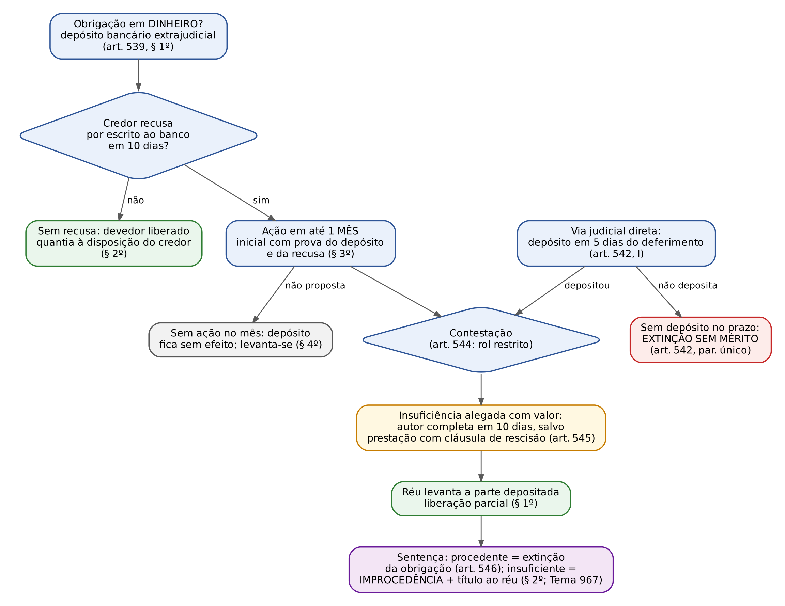
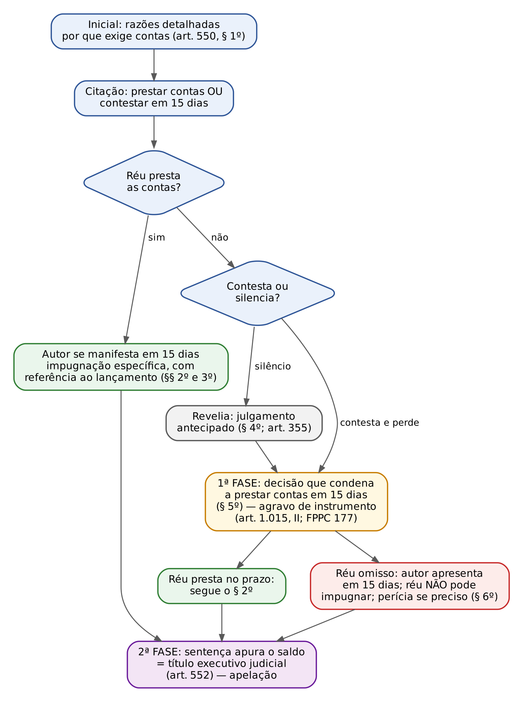
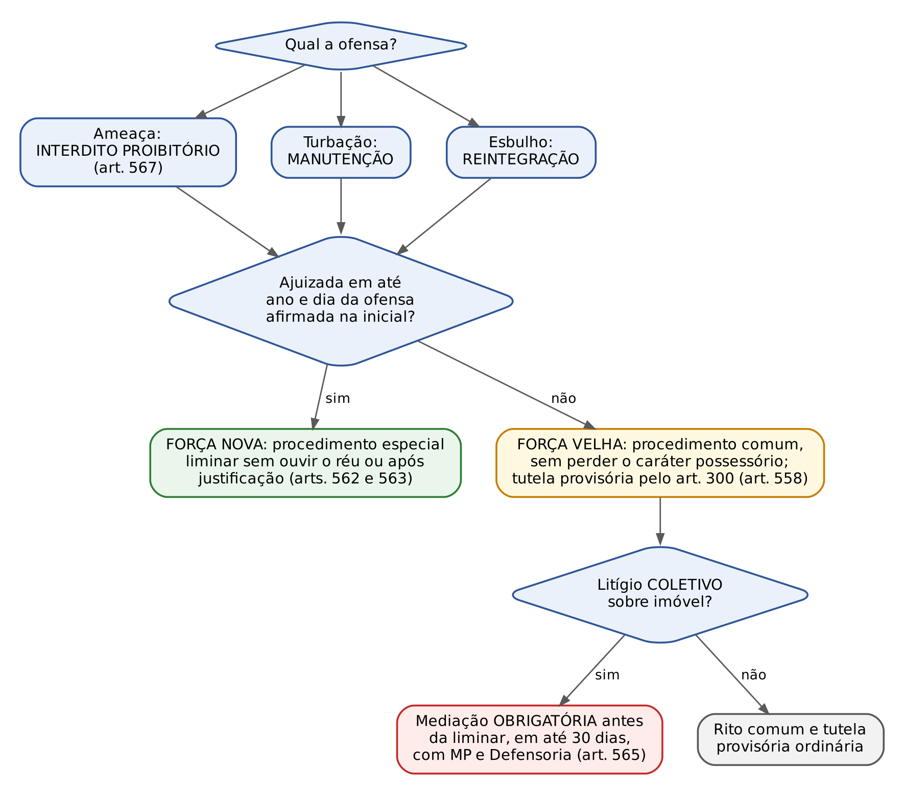
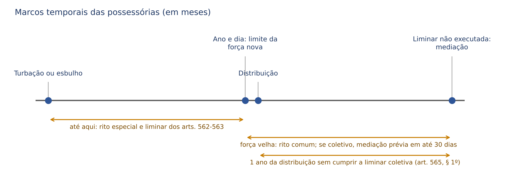
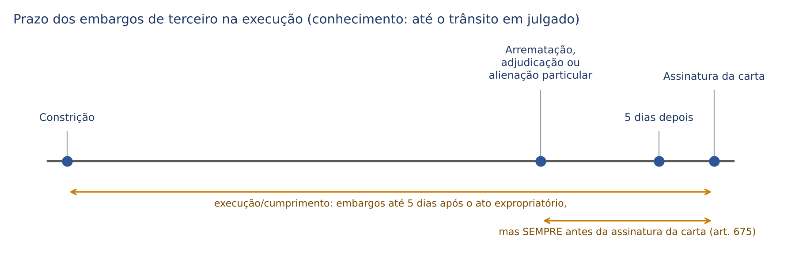
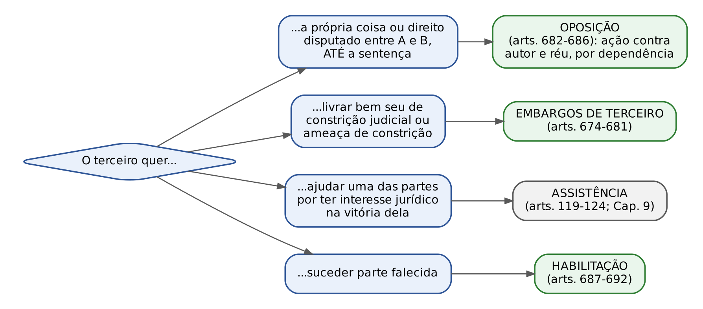
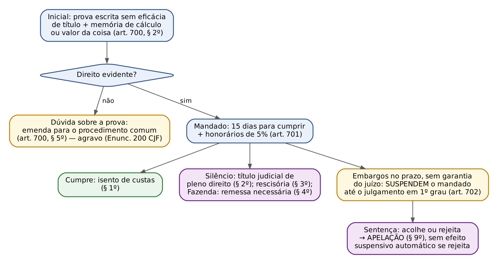

# CAPÍTULO 29 — PROCEDIMENTOS ESPECIAIS DO CPC I: CONSIGNAÇÃO, CONTAS, POSSESSÓRIAS, EMBARGOS DE TERCEIRO, OPOSIÇÃO, HABILITAÇÃO, MONITÓRIA E OUTROS

:::INCIDENCIA
Pontos: TRF5 p. 10; TJRS p. 12; TJSC p. 12. Nível A+. Lote: 46 questões (FGV 29, FCC 17).
O que mais cai: possessórias (fungibilidade, cumulação, caráter dúplice, força nova x força velha, polo passivo multitudinário e art. 565, Súmula 637 do STJ); monitória (objeto, devedor capaz, Fazenda e remessa necessária, embargos sem garantia, reconvenção, apelação); consignação (depósito em 5 dias, complementação em 10 dias, insuficiência = improcedência com título ao réu); embargos de terceiro (legitimados do art. 674, prazo do art. 675, polo passivo do art. 677, § 4º).
:::

#### Mapa de cobrança

| Subtema | FGV | FCC | Padrão |
|---|---|---|---|
| Ações possessórias (arts. 554 a 568) | 11 | 6 | caso com datas (ano e dia), ofensa trocada (manutenção x reintegração), cumulação de perdas e danos, réu pedindo proteção na contestação ou em reconvenção, ocupação coletiva, ente público alegando domínio |
| Ação monitória (arts. 700 a 702) | 8 | 2 | objeto (fazer e não fazer), devedor capaz, Fazenda ré (Súmula 339 e art. 701, § 4º), prova eletrônica ou oral documentada, embargos sem garantia, reconvenção, recurso cabível, honorários de 5% |
| Consignação em pagamento (arts. 539 a 549) | 4 | 3 | prazos de 5 e 10 dias e de 1 mês, efeito do depósito insuficiente (Tema 967 do STJ e art. 545, § 2º), prestações sucessivas, consequência do não depósito |
| Embargos de terceiro (arts. 674 a 681) | 3 | 3 | legitimados (fiduciário, cônjuge e companheiro, adquirente em fraude à execução, desconsideração), prazo, citação, polo passivo |
| Exigir contas, oposição, restauração de autos, dissolução parcial | 3 | 3 | prazo de 15 dias e art. 553; oposição até a sentença e julgada primeiro; restauração de ofício e contestação em 5 dias; honorários na dissolução consensual |

Divisão de tarefas: o direito material da posse (teorias, detenção, efeitos, autotutela, juízo petitório, imissão na posse, ADPF 828 e Resolução CNJ 510/2023) está na Apostila de Direito Civil, Cap. 27; o pagamento em consignação no plano material (art. 335 do CC), no Cap. 13 da mesma apostila; aqui ficam o procedimento, a cognição, os recursos e a casuística processual. Competência territorial absoluta da possessória imobiliária: Cap. 4. Sucessão processual por morte (arts. 110 e 313): Cap. 7. Reconvenção em geral: Cap. 17. Fraude à execução e o incidente do art. 792, § 4º: Cap. 24. Consignatória de aluguéis (Lei 8.245/1991): Cap. 35. Inventário, ações de família e usucapião: Cap. 30. Jurisdição voluntária: Cap. 31.

## 29.1 Procedimentos especiais: o que torna o rito especial e por que isso importa na prova

O CPC/2015 enxugou o rol do CPC/1973: desapareceram como procedimentos especiais codificados a ação de depósito, a nunciação de obra nova, a ação de usucapião (mantida a citação por edital do art. 259, I), a anulação e substituição de títulos ao portador e as vendas a crédito com reserva de domínio; a oposição deixou de ser intervenção de terceiros e passou a ação autônoma de procedimento especial (arts. 682 a 686); e surgiram a dissolução parcial de sociedade (arts. 599 a 609), as ações de família (arts. 693 a 699) e a regulação de avaria grossa (arts. 707 a 711). A especialidade aparece em técnicas pontuais, que são exatamente o que as bancas cobram:

| Técnica diferenciada | Onde aparece neste capítulo |
|---|---|
| Limitação da cognição (rol fechado de defesas) | consignação (art. 544); penhor legal (art. 704); embargos do credor com garantia real (art. 680) |
| Fungibilidade legal entre demandas | possessórias (art. 554) |
| Caráter dúplice (pedido do réu na contestação) | possessórias (art. 556); exigir contas (saldo em favor de qualquer das partes, art. 552) |
| Liminar típica com requisitos próprios | possessórias de força nova (art. 562); embargos de terceiro (art. 678) |
| Inversão do contraditório (cognição sumária e título pela inércia) | monitória (art. 701, § 2º) |
| Decisão parcial de mérito em fases | exigir contas (art. 550, § 5º); consignação com dúvida sobre o credor (art. 548, III) |
| Prazos de resposta diferentes de 15 dias | restauração de autos (5 dias, art. 714); habilitação (5 dias, art. 690) |
| Via extrajudicial facultativa | consignação bancária (art. 539, §§ 1º a 4º); homologação do penhor legal por notário (art. 703, §§ 2º a 4º) |

Dois dispositivos gerais completam o quadro. O art. 318, parágrafo único, manda aplicar subsidiariamente o procedimento comum aos especiais; e o art. 327, § 2º, permite cumular pedidos de ritos diferentes pelo procedimento comum, "sem prejuízo do emprego das técnicas processuais diferenciadas previstas nos procedimentos especiais a que se sujeitam um ou mais pedidos cumulados, que não forem incompatíveis com as disposições sobre o procedimento comum" (ver Cap. 16). A distinção entre jurisdição contenciosa e voluntária está no Cap. 3; os procedimentos de jurisdição voluntária, no Cap. 31.

## 29.2 Ação de consignação em pagamento (arts. 539 a 549)

### 29.2.1 Cabimento, legitimidade e foro

A consignação é o meio processual de exercer o direito de pagar e obter quitação quando o pagamento direto é impossível, recusado ou arriscado. As hipóteses materiais estão no art. 335 do CC (recusa injusta, *mora accipiendi*, credor incapaz, desconhecido, ausente ou em lugar incerto, dúvida sobre quem deva receber, litígio sobre o objeto) e em leis especiais (art. 67 da Lei 8.245/1991 — ver Cap. 35); o rol do art. 335 é tratado como exemplificativo e desenvolvido na Apostila de Direito Civil, Cap. 13. O CPC limita-se a remeter: "Nos casos previstos em lei, poderá o devedor ou terceiro requerer, com efeito de pagamento, a consignação da quantia ou da coisa devida" (art. 539, *caput*).

- Objeto: obrigações de DAR (quantia ou coisa, móvel ou imóvel). Não há consignação de obrigação de fazer ou de não fazer. A via EXTRAJUDICIAL, porém, só serve para obrigação em DINHEIRO (art. 539, § 1º).
- Legitimidade ativa: o devedor ou o TERCEIRO (interessado ou não, na linha dos arts. 304 e 305 do CC). Legitimidade passiva: o credor ou, na dúvida, os possíveis titulares do crédito (art. 547).
- Foro: lugar do pagamento (art. 540), regra territorial e, portanto, relativa. Quando a coisa devida for corpo certo que deva ser entregue no lugar onde está, o devedor pode consignar no foro da situação da coisa (art. 341 do CC; Enunciado 59 do FPPC).
- Efeito material do depósito: "cessando para o devedor, à data do depósito, os juros e os riscos, SALVO se a demanda for julgada improcedente" (art. 540). A FCC tornou falsa a afirmação de que os juros e riscos cessam "ainda que a demanda seja julgada improcedente" (Q3660531, item I).
- Aplicação ao resgate do aforamento (art. 549), resquício da enfiteuse (cuja constituição o CC/2002 proibiu, art. 2.038), e à consignação de aluguéis, com regras próprias da Lei do Inquilinato.

### 29.2.2 Consignação extrajudicial (bancária)

:::LEI CPC, ART. 539, §§ 1º A 4º
§ 1º Tratando-se de obrigação em dinheiro, poderá o valor ser depositado em estabelecimento bancário, oficial onde houver, situado no lugar do pagamento, cientificando-se o credor por carta com aviso de recebimento, assinado o prazo de 10 (dez) dias para a manifestação de recusa.
§ 2º Decorrido o prazo do § 1º, contado do retorno do aviso de recebimento, sem a manifestação de recusa, considerar-se-á o devedor liberado da obrigação, ficando à disposição do credor a quantia depositada.
§ 3º Ocorrendo a recusa, manifestada por escrito ao estabelecimento bancário, poderá ser proposta, dentro de 1 (um) mês, a ação de consignação, instruindo-se a inicial com a prova do depósito e da recusa.
§ 4º Não proposta a ação no prazo do § 3º, ficará sem efeito o depósito, podendo levantá-lo o depositante.
:::

Pontos que caem:

- A via extrajudicial é FACULTATIVA ("poderá"). A FGV (ENAM 2025.1, Q3362356) tornou falsa a alternativa segundo a qual o CPC "apenas admite a consignação se o depósito é feito extrajudicialmente" e a ação deve ser extinta se a via extrajudicial não foi tentada.
- O silêncio do credor por 10 dias, contados do RETORNO do AR, libera o devedor: é efeito liberatório sem sentença.
- A recusa deve ser escrita e dirigida ao BANCO. Recusada, o prazo para ajuizar é de 1 MÊS, contado de data a data (art. 132, § 3º, do CC); como corre antes do processo, prevalece a leitura de que não se conta em dias úteis, mas a natureza do prazo é discutida na doutrina. Proposta a ação nesse prazo, a inicial já vem com a prova do depósito, e o juiz não manda depositar de novo (ressalva do art. 542, I).
- Perdido o mês, o depósito "fica sem efeito", mas a ação continua possível pela via judicial direta, com novo depósito.

### 29.2.3 Procedimento judicial

- Petição inicial (art. 542): requerimento de depósito da quantia ou coisa no prazo de 5 DIAS contados do DEFERIMENTO (salvo se já houve depósito bancário, art. 539, § 3º) e de citação do réu "para levantar o depósito ou oferecer contestação".
- Não realizado o depósito no prazo, "o processo será extinto SEM resolução do mérito" (art. 542, parágrafo único). O depósito é pressuposto de desenvolvimento do procedimento, não questão de mérito. A FGV (TJ-MT 2024, Q3114270) e a FCC (Q3660531, item IV) cobram exatamente isso: não depositar NÃO leva a improcedência, multa ou novo prazo.
- Coisa indeterminada com escolha do credor (art. 543): citação para escolher em 5 dias (se outro prazo não constar de lei ou do contrato) ou aceitar que o devedor escolha; o juiz fixa lugar, dia e hora da entrega, sob pena de depósito.
- Prestações sucessivas (art. 541): consignada uma, o devedor pode continuar a depositar as que forem vencendo, NO MESMO PROCESSO e sem mais formalidades, desde que o faça em até 5 DIAS do respectivo vencimento. Não há necessidade de novas ações (erro das alternativas A e B da Q3324236).
- Credor que recebe e dá quitação: o juiz declara extinta a obrigação e condena o réu em custas e honorários (art. 546, parágrafo único). A lógica é a causalidade: se recebeu em juízo, sua recusa anterior foi injusta. Cuidado: a regra cabe à quitação do valor depositado; não se confunde com o levantamento da parte incontroversa do art. 545, § 1º.

:::QUESTAO FGV 2024 — TJ-MT — ANALISTA JUDICIÁRIO (Q3114270)
Caso: deferido o depósito, o autor deixa transcorrer os 5 dias sem depositar. Gabarito: D — extinção sem resolução do mérito (art. 542, parágrafo único).
Armadilhas: "improcedência" (confunde a ausência de depósito com a insuficiência, que essa sim leva a improcedência); "multa por ato atentatório" (não há tipificação); "novo prazo sob pena de extinção com resolução do mérito".
No mesmo sentido: FCC 2025 — TRT-2 (Q3660531), item IV falso.
:::

:::QUESTAO FCC 2026 — TJ-CE — OFICIAL DE JUSTIÇA (Q4240018)
Caso: credor recusa sem justa causa o pagamento; o devedor ajuíza ação. Gabarito: E — o depósito pode ser feito já no momento da propositura.
Armadilhas: "deve aguardar autorização judicial para depositar" (o depósito pode preceder a ação, inclusive pela via bancária, art. 539, § 3º; a autorização do art. 542, I, não impede que o autor já o tenha efetuado); consignação "apenas quando o credor for desconhecido ou incapaz" (o art. 335, I, do CC prevê a recusa injusta); monitória "com força de título executivo judicial" (é prova escrita SEM eficácia de título — ver 29.8); embargos de terceiro "apenas por quem integra a relação" (é o oposto — ver 29.5).
:::

### 29.2.4 Defesa do réu e insuficiência do depósito

:::LEI CPC, ARTS. 544 E 545
Art. 544. Na contestação, o réu poderá alegar que: I - não houve recusa ou mora em receber a quantia ou a coisa devida; II - foi justa a recusa; III - o depósito não se efetuou no prazo ou no lugar do pagamento; IV - o depósito não é integral.
Parágrafo único. No caso do inciso IV, a alegação SOMENTE será admissível se o réu indicar o montante que entende devido.
Art. 545. Alegada a insuficiência do depósito, é lícito ao autor completá-lo, em 10 (dez) dias, SALVO se corresponder a prestação cujo inadimplemento acarrete a rescisão do contrato.
§ 1º No caso do caput, poderá o réu levantar, desde logo, a quantia ou a coisa depositada, com a consequente liberação parcial do autor, prosseguindo o processo quanto à parcela controvertida.
§ 2º A sentença que concluir pela insuficiência do depósito determinará, sempre que possível, o montante devido e valerá como título executivo, facultado ao credor promover-lhe o cumprimento nos mesmos autos, após liquidação, se necessária.
:::

A restrição do art. 544 é de matéria de MÉRITO específica da consignação; não impede as defesas processuais do art. 337 nem a discussão do próprio débito quando ela é pressuposto da integralidade do depósito (a jurisprudência admite, na consignatória, discutir o valor devido e até a validade de cláusulas que o definem, porque sem isso não se afere a suficiência).

A ressalva final do art. 545 é a armadilha mais frequente: a complementação em 10 dias NÃO é permitida quando a prestação é daquelas cujo inadimplemento acarreta a rescisão do contrato, porque admitir a purga por depósito complementar subverteria a cláusula resolutiva. A FGV invertera a regra na alternativa C da Q3362356 (complementação em "30 dias" para escapar da cláusula de rescisão ou da cláusula penal): dois erros num só item.

O art. 545, § 2º, é o coração do caráter dúplice da consignação: a sentença que conclui pela insuficiência fixa o montante devido e vale como título executivo para o RÉU, independentemente de reconvenção, com cumprimento nos mesmos autos. A ação passa a servir também ao credor.

:::JURIS STJ, TEMA 967 (RECURSO REPETITIVO, J. 10/10/2018)
"Em ação consignatória, a insuficiência do depósito realizado pelo devedor conduz ao julgamento de improcedência do pedido, pois o pagamento parcial da dívida não extingue o vínculo obrigacional."
Leitura combinada com o art. 545: (i) improcedência, e não parcial procedência, ainda que o depósito tenha sido feito no tempo e no lugar certos; (ii) a liberação PARCIAL existe apenas na medida do levantamento pelo réu (art. 545, § 1º), não como capítulo de procedência; (iii) a mesma sentença de improcedência fixa o saldo e serve de título ao credor (§ 2º); (iv) sucumbência integral do autor.
:::

:::QUESTAO FGV 2025 — ENAM 2025.1 (Q3362356)
Caso: devedor reconhece dever 100.000 (cem mil) reais; credor afirma 200.000 (duzentos mil) reais; o devedor consigna. Gabarito: D — comprovado que o valor indicado na contestação é o correto, a sentença determina o montante e vale como título em favor do réu, executável nos mesmos autos, independentemente de reconvenção.
Armadilhas: parcial procedência com sucumbência proporcional (E — contraria o Tema 967); via extrajudicial obrigatória (A); complementação em 30 dias para escapar da cláusula de rescisão (C — prazo é de 10 dias e a ressalva é inversa); autor vencedor "levanta" o depósito (B — quem levanta é o credor-réu).
:::

:::QUESTAO FGV 2026 — TJ-PA — JUIZ SUBSTITUTO (Q3951733)
Caso: banco contesta alegando e comprovando a insuficiência e indicando o valor correto; o autor, intimado, não complementa em 10 dias; sentença de improcedência fixa o montante. Gabarito: B — a insuficiência conduz à improcedência e a sentença que fixa o montante vale como título, com cumprimento nos mesmos autos, após liquidação, se necessária (art. 545, § 2º).
Armadilhas: prazo de complementação de "15 dias" (A); parcial procedência (C); improcedência mesmo sem o réu indicar o valor (D — sem a indicação, a alegação nem é admissível, art. 544, parágrafo único); vedação ao cumprimento nos mesmos autos (E).
No mesmo sentido: FCC 2025 — PGE-MT (Q3745789), gabarito E (improcedência, porque o pagamento parcial não extingue o vínculo; o réu não precisava reconvir para discutir a insuficiência nem pedir o levantamento).
:::

:::QUESTAO FGV 2025 — TJ-SC — JUIZ SUBSTITUTO (Q3324236)
Gabarito: D — alegada a insuficiência, o autor pode complementar em 10 dias, exceto se a prestação for daquelas cujo inadimplemento leva à rescisão do contrato (art. 545).
Erradas: vedação a depositar as prestações que vencem no curso do processo, com novas ações apensadas ou separadas (A e B — art. 541); proibição da dúvida sobre quem deva receber como causa de pedir, por suposta incompatibilidade com litisconsórcio passivo (C — art. 547 é justamente consignação com pluralidade de réus); sentença de insuficiência sem força de título (E — art. 545, § 2º).
:::

:::QUESTAO FCC 2025 — TRT-2 — OFICIAL DE JUSTIÇA (Q3660531)
Gabarito: B (itens II e III). II: prestações sucessivas depositadas no mesmo processo em até 5 dias do vencimento (art. 541). III: credor que recebe e dá quitação — extinção da obrigação e condenação do réu em custas e honorários (art. 546, parágrafo único).
Falsos: I (juros e riscos cessam "ainda que" improcedente — o art. 540 diz "salvo"); IV (falta de depósito = improcedência — é extinção sem mérito).
:::

### 29.2.5 Dúvida sobre quem deva receber (arts. 547 e 548)

O autor requer o depósito e a citação dos possíveis titulares do crédito "para provarem o seu direito". Desdobramento:

| Comparecimento | Consequência | Natureza |
|---|---|---|
| Nenhum pretendente | depósito convertido em arrecadação de coisas vagas (art. 548, I; arts. 746 e seguintes) | conversão em procedimento de jurisdição voluntária |
| Apenas um | o juiz decide de plano (II) | sentença |
| Mais de um | o juiz declara efetuado o depósito e extinta a obrigação; o processo continua SÓ entre os presuntivos credores, pelo procedimento comum (III) | decisão parcial de mérito: libera o devedor e transforma a ação numa disputa entre os credores |

A decisão do inciso III é de mérito quanto à extinção da obrigação: faz coisa julgada e desafia ação rescisória (Enunciados 534 e 535 do FPPC). Mas só se aplica se o VALOR depositado não for controvertido; impugnada a suficiência, o devedor não sai do processo (Enunciado 62 do FPPC). Como é decisão parcial de mérito, o recurso é o agravo de instrumento (art. 356, § 5º, combinado com o art. 1.015, II — ver Cap. 42).

:::PEGADINHA CONSIGNATÓRIA COM DÚVIDA X OPOSIÇÃO
Na consignação do art. 547, o DEVEDOR toma a iniciativa e se retira do litígio depositando; os credores disputam entre si. Na oposição (29.6), é o TERCEIRO que se diz titular do direito disputado por autor e réu e ataca ambos. Se a questão narra devedor que não sabe a quem pagar, a resposta é consignação, e não oposição nem denunciação.
:::

## 29.3 Ação de exigir contas (arts. 550 a 553)

### 29.3.1 Objeto, legitimidade e interesse

O CPC/2015 só regula como especial a ação de EXIGIR contas. A antiga ação de "dar contas" (CPC/1973, art. 914, II), proposta por quem quer prestá-las, deixou de ter rito próprio: quem pretende se desonerar apresentando contas usa o procedimento comum (e, se houver saldo a pagar, a consignação). O direito de exigir contas nasce de relação jurídica em que alguém administra bens ou interesses alheios: mandato, gestão de negócios, administração societária, condomínio, curatela, tutela, inventariança, depósito, contrato bancário de conta-corrente.

- Legitimidade ativa: "Aquele que afirmar ser titular do direito de exigir contas" (art. 550, *caput*), aferida *in statu assertionis*. Se o titular é incapaz, ele próprio é parte, representado ou assistido (erro da alternativa A da Q4088281, que atribuía a legitimidade à mãe).
- Interesse: a inicial deve especificar "detalhadamente, as razões pelas quais exige as contas" e trazer documentos que demonstrem a necessidade, se existirem (art. 550, § 1º). Pedido genérico de contas, sem indicar o período e os lançamentos duvidosos, pode levar a emenda e indeferimento.
- Conta-corrente: "O titular de conta-corrente bancária pode propor ação de prestação de contas" (Súmula 259 do STJ). O prazo decadencial do art. 26 do CDC não se aplica à prestação de contas que busca esclarecimentos sobre tarifas, taxas e encargos bancários (Súmula 477 do STJ; Tema 449).
- Mútuo e financiamento: "Nos contratos de mútuo e financiamento, o devedor não possui interesse de agir para a ação de prestação de contas" (Tema 528 do STJ): o banco não administra recursos do mutuário; o que existe é dívida, a ser discutida em revisional.
- Revisão de cláusulas: não é possível revisar cláusulas contratuais na segunda fase da ação de prestação de contas (Tema 908 do STJ, tese resumida conforme a base de precedentes consultada). A ação apura o saldo segundo o contrato; a revisão exige demanda própria.
- Alimentos: o alimentante pode exigir contas do guardião sobre a aplicação da pensão, com base no dever de supervisão do art. 1.583, § 5º, do CC e na proteção integral da criança e do adolescente; a ação não serve para apurar crédito (alimentos são irrepetíveis) nem para perseguir o guardião (STJ, REsp 1.814.639-RS, Terceira Turma).

### 29.3.2 Procedimento bifásico

:::LEI CPC, ART. 550, §§ 4º A 6º, E ARTS. 552 E 553
§ 4º Se o réu não contestar o pedido, observar-se-á o disposto no art. 355.
§ 5º A decisão que julgar procedente o pedido condenará o réu a prestar as contas no prazo de 15 (quinze) dias, sob pena de NÃO lhe ser lícito impugnar as que o autor apresentar.
§ 6º Se o réu apresentar as contas no prazo previsto no § 5º, seguir-se-á o procedimento do § 2º, caso contrário, o autor apresentá-las-á no prazo de 15 (quinze) dias, podendo o juiz determinar a realização de exame pericial, se necessário.
Art. 552. A sentença apurará o saldo e constituirá título executivo judicial.
Art. 553. As contas do inventariante, do tutor, do curador, do depositário e de qualquer outro administrador serão prestadas em apenso aos autos do processo em que tiver sido nomeado.
Parágrafo único. Se qualquer dos referidos no caput for condenado a pagar o saldo e não o fizer no prazo legal, o juiz poderá destituí-lo, sequestrar os bens sob sua guarda, glosar o prêmio ou a gratificação a que teria direito e determinar as medidas executivas necessárias à recomposição do prejuízo.
:::

Primeira fase (o réu deve prestar contas?). Citado, o réu tem 15 dias para (a) prestar as contas, (b) contestar ou (c) silenciar. Prestando-as sem resistir, passa-se direto à segunda fase: o autor tem 15 dias para se manifestar, e a impugnação deve ser "fundamentada e específica, com referência expressa ao lançamento questionado" (art. 550, §§ 2º e 3º). Silenciando, aplica-se o julgamento antecipado (§ 4º). Contestando e perdendo, o juiz condena a prestar contas em 15 dias, sob a sanção processual do § 5º: perda do direito de impugnar as contas do autor. O prazo de 15 dias corre automaticamente da intimação do réu, na pessoa do advogado, da decisão condenatória (STJ, REsp 1.847.194-MS, Relator Ministro Marco Aurélio Bellizze, Terceira Turma, j. 16/3/2021, Info 689).

Segunda fase (qual é o saldo?). Contas apresentadas "na forma adequada", com receitas, despesas e investimentos (art. 551); havendo impugnação específica, o juiz fixa prazo para o réu juntar os documentos dos lançamentos impugnados (§ 1º). Se o réu foi omisso, o autor apresenta as contas em 15 dias, já documentadas e com o saldo (§ 2º), e o juiz pode determinar perícia. A sentença apura o saldo, a favor de QUALQUER das partes, e é título executivo judicial (art. 552): eis o caráter dúplice.

Recursos. O pronunciamento que julga procedente a primeira fase não encerra a fase de conhecimento: é decisão interlocutória de mérito, agravável (art. 1.015, II; Enunciado 177 do FPPC). Se, ao contrário, o juiz julga improcedente o pedido de contas ou extingue o processo, o ato põe fim à fase de conhecimento e é sentença, apelável. A sentença da segunda fase é apelável. Como a natureza do ato da primeira fase gerou anos de dúvida, o STJ tem relevado o equívoco recursal quando o próprio juiz induz a parte em erro, por exemplo ao rotular a decisão como "sentença" (Info 886, processo em segredo de justiça, Terceira Turma, j. 7/4/2026).

:::PEGADINHA A DECISÃO DA PRIMEIRA FASE NÃO É "SENTENÇA CONDENATÓRIA"
A FGV (MPE-RJ 2026, Q4088281) tornou falsa a alternativa que qualificava como "sentença condenatória" o provimento que impõe ao réu prestar as contas. A ação prossegue para apurar o saldo; trata-se de decisão interlocutória de mérito, que condena a uma obrigação de fazer processual sob sanção de preclusão.
:::

:::QUESTAO FGV 2026 — MPE-RJ — PROMOTOR DE JUSTIÇA SUBSTITUTO (Q4088281)
Caso: criança de 5 anos, representada pela mãe, exige contas da inventariante sobre aluguéis do imóvel do espólio; ação distribuída por dependência ao inventário e apensada; revelia; decisão condena a prestar contas; contas apresentadas com saldo de 5.000 (cinco mil) reais a favor do autor; condenação ao pagamento. Gabarito: E — se a inventariante não pagar, o juiz pode destituí-la, sem prejuízo da execução (art. 553, parágrafo único).
Passos: (1) legitimidade é do herdeiro, não da mãe (A falsa); (2) contas do inventariante correm em apenso ao inventário, o que justifica a dependência (B falsa; art. 553, *caput*); (3) revelia leva a julgamento antecipado, não a extinção (C falsa; art. 550, § 4º); (4) a decisão da primeira fase não é sentença (D falsa); (5) as medidas do art. 553, parágrafo único, são cumulativas com a execução.
:::

:::QUESTAO FCC 2026 — DPE-MA — DEFENSOR PÚBLICO (Q4012609)
Caso: curatelado, que residia com o curador em Anapurus, quer exigir contas do curador, que se mudou para Imperatriz. Gabarito: E (II e III).
II verdadeiro: a Defensoria pode atuar como curadora especial, porque há colidência de interesses entre o incapaz e o representante (art. 72, I — ver Cap. 7). III verdadeiro: a sentença apura o saldo e constitui título judicial (art. 552).
I falso: o prazo de resposta é de 15 dias, não 5. IV falso: as contas do curador se prestam em apenso aos autos em que foi nomeado (art. 553), não no domicílio do réu.
:::

## 29.4 Ações possessórias (arts. 554 a 568)

### 29.4.1 Mapa e o que fica fora deste capítulo

Três interditos, conforme a intensidade da ofensa: interdito proibitório (ameaça), manutenção (turbação) e reintegração (esbulho); os conceitos materiais, a autotutela (desforço imediato), a distinção entre juízo possessório e petitório no plano material, a imissão na posse e a nunciação de obra nova estão na Apostila de Direito Civil, Cap. 27. O que interessa aqui é o regime processual: competência, fungibilidade, cumulação, caráter dúplice, vedação da petitória, rito de força nova e força velha, liminar, citação, polo passivo multitudinário, litígio coletivo e conversão em perdas e danos.

Competência. "A ação possessória imobiliária será proposta no foro de situação da coisa, cujo juízo tem competência ABSOLUTA" (art. 47, § 2º — ver Cap. 4). Possessória mobiliária segue a regra geral do domicílio do réu (art. 46). A ofensa à posse decorrente de greve de trabalhadores da iniciativa privada é da competência da Justiça do Trabalho (Súmula Vinculante 23).

:::QUESTAO FGV 2024 — TJ-SC — JUIZ SUBSTITUTO (Q3049348)
Caso: imóvel em Joinville ocupado clandestinamente; o proprietário ajuíza manutenção de posse, cumulada com danos materiais, em vara cível de Florianópolis, onde autor e réu têm domicílio. Gabarito: E — o juiz deve declinar de ofício para Joinville.
Passos: (1) antes de qualquer juízo sobre o mérito ou a via, verifica-se a competência; (2) possessória imobiliária: foro da situação, competência absoluta (art. 47, § 2º), reconhecível de ofício (art. 64, § 1º); (3) a escolha de "manutenção" diante de esbulho não leva a indeferimento nem a emenda (A e B falsas — fungibilidade, art. 554); (4) a cumulação com perdas e danos é lícita (C falsa — art. 555, I).
No mesmo sentido (competência): FGV 2024 — EBSERH (Q3248776) e FGV 2024 — TJ-RR (Q3087132), desenvolvidas no Cap. 4.
:::

### 29.4.2 Fungibilidade, cumulação e caráter dúplice

:::LEI CPC, ARTS. 554, CAPUT, 555 E 556
Art. 554. A propositura de uma ação possessória em vez de outra NÃO OBSTARÁ a que o juiz conheça do pedido e outorgue a proteção legal correspondente àquela cujos pressupostos estejam provados.
Art. 555. É lícito ao autor cumular ao pedido possessório o de: I - condenação em perdas e danos; II - indenização dos frutos.
Parágrafo único. Pode o autor requerer, ainda, imposição de medida necessária e adequada para: I - evitar nova turbação ou esbulho; II - cumprir-se a tutela provisória ou final.
Art. 556. É lícito ao réu, NA CONTESTAÇÃO, alegando que foi o ofendido em sua posse, demandar a proteção possessória e a indenização pelos prejuízos resultantes da turbação ou do esbulho cometido pelo autor.
:::

Fungibilidade. A razão é a dinâmica da ofensa: a ameaça vira turbação, a turbação vira esbulho, às vezes no curso do processo. O juiz outorga a proteção cujos pressupostos estejam PROVADOS, e isso não viola a congruência, porque a causa de pedir (posse e ofensa) é a mesma. Limites: só entre os três interditos; não converte reivindicatória, imissão na posse ou despejo em possessória (nem o inverso), porque aí muda a causa de pedir (domínio, título, locação).

Cumulação. O CPC/2015 simplificou a lista do CPC/1973 (que falava em cominação de pena e desfazimento de construção): perdas e danos, frutos e "medida necessária e adequada" para evitar nova ofensa ou cumprir a tutela. O desfazimento de construções e a multa cabem nesse conceito aberto. A cumulação não desnatura o rito especial; julgar só o pedido indenizatório e ignorar a reintegração é sentença *citra petita* (FGV, ENAM 2025.2, Q3692395 — ver Cap. 20).

Caráter dúplice. O réu pode, na própria contestação, pedir proteção possessória e indenização, sem reconvenção. É pedido contraposto de fonte legal, limitado ao conteúdo do art. 556 (proteção possessória e indenização pela ofensa cometida pelo autor). Por isso a FGV entende que a reconvenção que veicula apenas pedido de manutenção da posse do réu carece de interesse de agir: o que se busca já é alcançável pela contestação (Q2515307). Pedido que extrapole o art. 556 (por exemplo, rescisão de contrato ou cobrança de crédito alheio à ofensa) continua a exigir reconvenção, observado o art. 343.

:::QUESTAO FGV 2024 — TJ-SC — ANALISTA JURÍDICO (Q2515307)
Caso: réu de reintegração apresenta, na mesma peça, contestação negando o esbulho e reconvenção pedindo manutenção de sua posse. Gabarito: B — a contestação é conhecida; a reconvenção não, por falta de interesse de agir.
Armadilhas: C (não conhecer por estarem na mesma peça — o art. 343 exige justamente a mesma peça); E (só caberia pedido contraposto, logo nada se conhece — a contestação sempre se conhece); A (ambas conhecidas).
Observação: parte da doutrina admite a reconvenção nas possessórias, inclusive para o pedido do art. 556, por aplicação da fungibilidade das formas; para prova FGV, prevalece o gabarito.
:::

:::QUESTAO FCC 2025 — MPE-PI — ANALISTA MINISTERIAL (Q3530389)
Gabarito: A — as possessórias são fungíveis e dúplices e admitem cumulação de pedido condenatório.
Falsas: vedação de litisconsórcio passivo; procedimento especial "independentemente do tempo" (art. 558); suspensão pela propositura de ação de domínio (a petitória é VEDADA na pendência da possessória, art. 557, e não causa de suspensão); pedido contraposto "por meio de reconvenção" (art. 556: na contestação).
No mesmo sentido: FCC 2024 — TRT-20 (Q3233115), gabarito B (alegação de propriedade não impede a proteção possessória; falsas: rito sempre especial, vedação de cumular perdas e danos, pedido do réu só por reconvenção, vedação de proteção diversa da pedida); FGV 2024 — SES-MT (Q2482659), gabarito A (cumulação lícita; falsas: impossibilidade de conceder interdito proibitório por "taxatividade", alegação de propriedade obstando a reintegração, rito comum para ação ajuizada dentro de ano e dia).
:::

:::QUESTAO FGV 2025 — TJ-GO — RESIDENTE JURÍDICO (Q3345935)
Caso: invasão com moradia em 2/3/2023; a proprietária possuidora, ciente dois meses antes, ajuíza em 5/9/2023 "manutenção de posse" com pedido liminar de reintegração e perdas e danos. Gabarito: B — é lícita a cumulação com perdas e danos.
Passos: (1) ofensa é esbulho, mas a fungibilidade afasta o obstáculo (A falsa); (2) ajuizamento cerca de 6 meses após o esbulho, dentro de ano e dia: rito especial (E falsa — o limite é ano e dia, não seis meses); (3) alegação de propriedade do réu não impede a reintegração (C falsa — art. 557, parágrafo único); (4) inicial devidamente instruída permite liminar SEM ouvir o réu (D falsa — art. 562).
:::

:::QUESTAO FCC 2024 — PREFEITURA DE JABOATÃO DOS GUARARAPES — PROCURADOR (Q3542119)
Caso: esbulho; a possuidora ajuíza, dentro de ano e dia, ação de manutenção, com prova documental da posse e do esbulho. Gabarito: B — o juiz deferirá, sem ouvir o réu, mandado de REINTEGRAÇÃO.
Armadilhas: justificação prévia sem citação (A — havendo justificação, o réu é citado para comparecer, art. 562); contestação antes da liminar (C); emenda ou indeferimento por erro de nome da ação (D e E — art. 554).
:::

### 29.4.3 Vedação da petitória e intervenção do ente público

:::LEI CPC, ART. 557
Na pendência de ação possessória é VEDADO, tanto ao autor quanto ao réu, propor ação de reconhecimento do domínio, EXCETO se a pretensão for deduzida em face de terceira pessoa.
Parágrafo único. Não obsta à manutenção ou à reintegração de posse a alegação de propriedade ou de outro direito sobre a coisa.
:::

A vedação é processual e temporária: enquanto pende a possessória, as partes não podem propor uma contra a outra ação de reconhecimento do domínio (reivindicatória, declaratória de propriedade, usucapião como ação autônoma). Não é causa de suspensão; é impedimento de ajuizamento, que leva à extinção da petitória sem resolução do mérito. A exceção é a demanda contra terceiro. O autor pode, porém, cumular desde a inicial reivindicatória e possessória com fundamentos distintos (Enunciado 65 do FPPC), e o réu pode alegar usucapião como defesa (Enunciado 443 do FPPC; Súmula 237 do STF, ver Apostila de Direito Civil, Cap. 29).

:::JURIS STJ, SÚMULA 637
"O ente público detém legitimidade e interesse para intervir, incidentalmente, na ação possessória entre particulares, podendo deduzir qualquer matéria defensiva, inclusive, se for o caso, o domínio."
Por que o domínio pode ser alegado pelo ente público: perante o Poder Público, o particular que ocupa bem público é mero DETENTOR (Súmula 619 do STJ — ver Apostila de Direito Civil, Cap. 27); a discussão de domínio, quando a coisa é pública, define a própria existência de posse tutelável. Entre particulares, contudo, cabe a possessória sobre bem público dominical, porque a disputa é sobre a posse e a decisão não afeta a titularidade estatal (STJ, REsp 1.296.964-DF, Relator Ministro Luis Felipe Salomão, Quarta Turma, j. 18/10/2016, Info 594).
Repercussão na competência: a intervenção da União ou de entidade federal desloca o processo para a Justiça Federal (art. 109, I, da CF; art. 45 do CPC — ver Cap. 5). Nas possessórias de concessionária sobre faixa de domínio de rodovia ou ferrovia federal, União, DNIT e ANTT não podem ser compelidos a integrar a lide, e o feito permanece na Justiça Estadual (Tema 1.384 do STJ, julgado em 9/9/2026; v. Cap. 9).
:::

:::QUESTAO FGV 2024 — TRF1 — ANALISTA JUDICIÁRIO (Q3028435)
Caso: reintegração movida por possuidora há 6 anos contra quem invadiu há 6 meses; o réu contesta alegando ser proprietário (comprou da União em licitação) e ajuíza ação de reconhecimento de domínio; na instrução, a União pede para intervir alegando ser a dona e que o título é nulo. Gabarito: B — a União tem interesse e legitimidade para intervir, podendo alegar o domínio (Súmula 637).
Falsas: o réu "pode" ajuizar a ação de domínio (A — art. 557); extinção sem mérito se houver turbação (C — fungibilidade); alegação de propriedade obsta a reintegração (D); rito comum pelo tempo (E — 6 meses: força nova).
No mesmo sentido: FGV 2024 — Câmara Municipal de São Paulo — Procurador (Q2351265), gabarito E (Município intervém e pode alegar domínio; falsas: ilegitimidade do ente, vedação de petitória a "qualquer interessado", vedação do domínio como defesa, posse a quem "evidentemente tiver o domínio" — Súmula 487 do STF, superada como regra pelo art. 1.210, § 2º, do CC).
:::

:::QUESTAO FGV 2025 — TRF1 — JUIZ FEDERAL SUBSTITUTO (Q3425320)
Gabarito: C — a propositura de uma possessória em vez de outra não impede a proteção correspondente à que estiver provada (art. 554).
Falsas, todas por troca de detalhe da letra: (A) audiência de mediação no litígio coletivo de força velha "em até 60 dias" (são 30); (B) vedação da petitória "em face de terceira pessoa" (a exceção é exatamente a pretensão contra terceiro); (D) proteção e indenização pedidas pelo réu "em reconvenção" (art. 556: na contestação); (E) citação "nos 15 dias" subsequentes à liminar (art. 564: 5 dias para promover a citação; 15 dias para contestar).
:::

### 29.4.4 Força nova x força velha

:::LEI CPC, ART. 558
Regem o procedimento de manutenção e de reintegração de posse as normas da Seção II deste Capítulo quando a ação for proposta dentro de ano e dia da turbação ou do esbulho afirmado na petição inicial.
Parágrafo único. Passado o prazo referido no caput, será comum o procedimento, NÃO PERDENDO, contudo, o caráter possessório.
:::

- O termo inicial é a data da ofensa "afirmada na petição inicial" (*in statu assertionis*); se a prova revelar data diversa, o rito não se anula retroativamente, mas a liminar deferida com base em fato falso pode ser revogada.
- O caráter possessório subsiste na força velha: continuam aplicáveis a fungibilidade, a cumulação, o caráter dúplice e a vedação da petitória, que são disposições gerais (Seção I). O que se perde é a liminar típica (arts. 562 e 563). Resta a tutela provisória pelos requisitos gerais (art. 300, urgência; art. 311, evidência).
- A FCC (UNICAMP 2025, Q3891324) e a FGV (TRF1 2024, Q3028435) cobram que a ação de força velha "perde o caráter possessório": FALSO.
- Na força nova, a liminar dispensa o perigo de dano: basta a prova dos requisitos do art. 561 (posse, ofensa, data e continuação ou perda da posse). Trata-se de tutela de evidência típica.

### 29.4.5 Liminar, justificação, citação e caução

:::LEI CPC, ARTS. 562 E 564
Art. 562. Estando a petição inicial devidamente instruída, o juiz deferirá, SEM OUVIR O RÉU, a expedição do mandado liminar de manutenção ou de reintegração, caso contrário, determinará que o autor justifique previamente o alegado, citando-se o réu para comparecer à audiência que for designada.
Parágrafo único. Contra as pessoas jurídicas de direito público NÃO será deferida a manutenção ou a reintegração liminar sem prévia audiência dos respectivos representantes judiciais.
Art. 564. Concedido ou não o mandado liminar de manutenção ou de reintegração, o autor promoverá, nos 5 (cinco) dias subsequentes, a citação do réu para, querendo, contestar a ação no prazo de 15 (quinze) dias.
Parágrafo único. Quando for ordenada a justificação prévia, o prazo para contestar será contado da intimação da decisão que deferir ou não a medida liminar.
:::

| Situação | Regra | Fundamento |
|---|---|---|
| Inicial instruída (prova documental bastante) | liminar *inaudita altera parte* | art. 562, primeira parte |
| Prova insuficiente | audiência de justificação, com CITAÇÃO do réu para comparecer; o réu pode participar (reperguntas, contradita), mas não produz prova própria nem contesta ali | art. 562, segunda parte |
| Justificação suficiente | o juiz "fará logo expedir" o mandado | art. 563 |
| Réu pessoa jurídica de direito público | liminar só após ouvir seus representantes judiciais | art. 562, parágrafo único |
| Citação | o autor a promove em 5 dias da decisão sobre a liminar, concedida ou não | art. 564 |
| Prazo de contestação | 15 dias; se houve justificação, da intimação da decisão sobre a liminar | art. 564, parágrafo único |
| Autor provisoriamente mantido ou reintegrado sem idoneidade financeira | o réu prova, a qualquer tempo; o juiz dá 5 dias para caução real ou fidejussória, sob pena de depósito da coisa, salvo hipossuficiência | art. 559 |
| Recurso contra a decisão liminar (deferindo ou indeferindo) | agravo de instrumento | art. 1.015, I |

Notas: (i) a caução do art. 559 NÃO é requisito para a liminar; é contracautela posterior, a requerimento do réu (alternativa B da Q3891324, falsa); o prazo de 5 dias pode ser dilatado (art. 139, VI; Enunciado 179 do FPPC) e a caução pode ser exigida também do réu que obtém proteção na contestação (Enunciado 180 do FPPC); (ii) os prazos de contestação contam-se em dias úteis (art. 219), mas o de 5 dias para promover a citação é ônus do autor, cuja inobservância não extingue o processo automaticamente; (iii) os atos processuais realizam-se em dias úteis, das 6 às 20 horas, mas "serão concluídos após as 20 (vinte) horas os atos iniciados antes, quando o adiamento prejudicar a diligência ou causar grave dano" (art. 212, *caput* e § 1º); a dispensa de autorização para atos fora do horário (§ 2º) abrange citações, intimações e penhoras, e qualquer ingresso em domicílio observa o art. 5º, XI, da CF. Por isso é falsa a alternativa que veda a conclusão do mandado depois das 20 horas (Q4153618, D).

:::QUESTAO FGV 2026 — TJ-SC — OFICIAL DE JUSTIÇA E AVALIADOR (Q4153618)
Caso: gleba invadida há exatamente 10 meses; construções; inicial com prova da posse anterior e do esbulho; liminar *inaudita altera parte* com ordem de paralisação de obras. Gabarito: C — aplica-se o procedimento especial, pois o esbulho ocorreu há menos de ano e dia.
Falsas: prova da propriedade substituindo a da posse (A — art. 561, I, exige POSSE); nulidade por falta de mediação (B — litígio individual e de força nova: não há mediação obrigatória); mandado "peremptoriamente até 20 horas, vedada a conclusão" (D — art. 212, § 1º); citação em 10 dias (E — 5 dias).
:::

:::SENTENCA DECISÃO LIMINAR EM REINTEGRAÇÃO DE FORÇA NOVA
"Os documentos que instruem a inicial (contrato de comodato, notificação recebida em 3/2/2026 e fotografias datadas) demonstram a posse anterior da autora, o esbulho consistente na recusa de restituição após o prazo da notificação, sua data, inferior a ano e dia do ajuizamento, e a perda da posse (art. 561 do CPC). Presentes os requisitos, defiro, sem ouvir o réu, a expedição de mandado liminar de reintegração de posse (art. 562), a ser cumprido em 15 dias, facultada a desocupação voluntária nesse prazo, sob pena de remoção com auxílio de força policial, e comino multa de 500 (quinhentos) reais por dia de nova ofensa após o cumprimento, limitada a 30.000 (trinta mil) reais (art. 555, parágrafo único, I). Promova a autora a citação em 5 dias (art. 564)."
:::

### 29.4.6 Polo passivo com grande número de pessoas (art. 554, §§ 1º a 3º)

:::LEI CPC, ART. 554, §§ 1º A 3º
§ 1º No caso de ação possessória em que figure no polo passivo grande número de pessoas, serão feitas a citação pessoal dos ocupantes que forem encontrados no local e a citação por edital dos demais, determinando-se, ainda, a intimação do Ministério Público e, se envolver pessoas em situação de hipossuficiência econômica, da Defensoria Pública.
§ 2º Para fim da citação pessoal prevista no § 1º, o oficial de justiça procurará os ocupantes no local por UMA vez, citando-se por edital os que não forem encontrados.
§ 3º O juiz deverá determinar que se dê ampla publicidade da existência da ação prevista no § 1º e dos respectivos prazos processuais, podendo, para tanto, valer-se de anúncios em jornal ou rádio locais, da publicação de cartazes na região do conflito e de outros meios.
:::

Os três parágrafos aplicam-se a QUALQUER possessória multitudinária, de força nova ou velha. Dispensam a qualificação individual de todos os réus na inicial (art. 319, § 3º, admite a inicial sem dados completos quando a obtenção for impossível ou excessivamente onerosa), mas não dispensam a tentativa de citação pessoal. A intervenção do MP decorre do art. 178, III (litígios coletivos pela posse de terra rural ou urbana); a da Defensoria, da hipossuficiência, como *custos vulnerabilis*. A publicidade pode incluir registro de protesto na matrícula (Enunciado 63 do FPPC). Os arts. 554 e 565 aplicam-se também à usucapião coletiva e à desapropriação judicial privada do art. 1.228, §§ 4º e 5º, do CC (Enunciado 328 do FPPC).

:::QUESTAO FGV 2026 — DPE-RJ — DEFENSOR PÚBLICO (Q4289335)
Caso: reintegração contra cerca de 120 famílias, esbulho há 8 meses, ocupantes não identificados, indícios de hipossuficiência. Gabarito: B — citação pessoal dos encontrados e por edital dos demais, intimação do MP e da Defensoria e publicidade da ação e dos prazos.
Falsas: edital exclusivo (A); Defensoria dispensa o MP (C); mediação prévia como requisito da liminar "ainda que o esbulho tenha ocorrido há menos de ano e dia" (D — força nova); três diligências do oficial (E).
No mesmo sentido: FCC 2025 — DPE-AM (Q3531633), gabarito B; FCC 2024 — TRT-7 (Q3088394), gabarito E (oficial procura uma vez; falsas: vedação de cartazes, mediação obrigatória sempre, vedação de cumular perdas e danos, edital para todos).
:::

:::QUESTAO FGV 2026 — MPE-RJ — PROMOTOR DE JUSTIÇA SUBSTITUTO (Q4088285)
Litígio coletivo de posse de imóvel. Gabarito: B — os réus serão citados ordinariamente por oficial de justiça, admitida a citação por edital.
Falsas: vedação de o juiz comparecer à área (A — art. 565, § 3º, autoriza); vedação de cumular ressarcimento de danos (C — art. 555, I); irrecorribilidade do indeferimento da liminar (D — agravo, art. 1.015, I); inaplicabilidade da fungibilidade na manutenção ajuizada diante de esbulho (E — art. 554).
:::

### 29.4.7 Litígio coletivo pela posse de imóvel (art. 565)

:::LEI CPC, ART. 565, CAPUT E §§ 1º A 5º
No litígio coletivo pela posse de imóvel, quando o esbulho ou a turbação afirmado na petição inicial houver ocorrido há MAIS de ano e dia, o juiz, ANTES de apreciar o pedido de concessão da medida liminar, DEVERÁ designar audiência de mediação, a realizar-se em até 30 (trinta) dias, que observará o disposto nos §§ 2º e 4º.
§ 1º Concedida a liminar, se essa não for executada no prazo de 1 (um) ano, a contar da data de distribuição, caberá ao juiz designar audiência de mediação, nos termos dos §§ 2º a 4º deste artigo.
§ 2º O Ministério Público será intimado para comparecer à audiência, e a Defensoria Pública será intimada sempre que houver parte beneficiária de gratuidade da justiça.
§ 3º O juiz poderá comparecer à área objeto do litígio quando sua presença se fizer necessária à efetivação da tutela jurisdicional.
§ 4º Os órgãos responsáveis pela política agrária e pela política urbana da União, de Estado ou do Distrito Federal e de Município onde se situe a área objeto do litígio poderão ser intimados para a audiência, a fim de se manifestarem sobre seu interesse no processo e sobre a existência de possibilidade de solução para o conflito possessório.
§ 5º Aplica-se o disposto neste artigo ao litígio sobre propriedade de imóvel.
:::

Observações de técnica:

- A "liminar" do art. 565 é tutela provisória de força velha, ou seja, tutela antecipada pelos requisitos gerais (Enunciado 66 do FPPC), e não a liminar típica do art. 562.
- O § 1º vale para liminar concedida em QUALQUER litígio coletivo (inclusive de força nova): passado 1 ano DA DISTRIBUIÇÃO sem execução, o juiz designa mediação. A FGV trocou para "seis meses" (Q3966655, alternativa C).
- A intimação da Defensoria no § 2º depende de haver beneficiário da gratuidade; no art. 554, § 1º, de hipossuficiência econômica. Na prática, coincidem.
- O § 5º estende a técnica ao litígio coletivo sobre PROPRIEDADE (reivindicatórias contra ocupações coletivas).
- Comissões de soluções fundiárias, visitas técnicas e protocolos de cumprimento (ADPF 828 e Resolução CNJ 510/2023): ver Apostila de Direito Civil, Cap. 27, 27.7. O STF, na ADPF 828 (Relator Ministro Luís Roberto Barroso, julgamento virtual finalizado em 2/11/2022, Info 1075), determinou regime de transição com instalação de comissões e mediação prévia às ordens de desocupação coletiva de pessoas vulneráveis, inclusive de mandados já expedidos.

:::QUESTAO FCC 2025 — UNICAMP — PROCURADOR DE UNIVERSIDADE (Q3891324)
Caso: 50 famílias ocupam área do campus há 1 ano e 4 meses e constroem casas; a universidade pede reintegração. Gabarito: E — a apreciação da liminar deve ser precedida de audiência de mediação (art. 565).
Falsas: rito comum com perda do caráter possessório (A); caução prévia obrigatória (B); citação desde logo por edital (C); dispensa do MP com intervenção obrigatória da Defensoria (D).
Nota: sendo autarquia estadual a autora, a ocupação de bem público gera, perante ela, mera detenção (Súmula 619 do STJ), o que não muda a resposta processual da banca.
:::

### 29.4.8 Conversão da possessória em indenizatória

Quando a ocupação se consolida (área urbanizada, com serviços públicos e moradias, muitas vezes com a participação do próprio Poder Público), a reintegração se torna fática ou socialmente impossível. O STJ admite converter, inclusive de ofício, a possessória em ação indenizatória, assegurando ao particular a tutela pelo equivalente monetário, com inclusão do ente público no polo passivo, sem que isso configure julgamento *extra* ou *ultra petita*, à luz da teoria da substanciação e da primazia da tutela específica ou do resultado prático equivalente (STJ, REsp 1.442.440-AC, Relator Ministro Gurgel de Faria, Primeira Turma, j. 7/12/2017). No caso julgado, a solução foi construída à luz do art. 1.228, §§ 4º e 5º, do CC (desapropriação judicial privada), e não como desapropriação indireta em sentido estrito.

:::QUESTAO FGV 2026 — TJ-GO — JUIZ SUBSTITUTO (Q3966655)
Caso: terreno invadido por famílias de baixa renda; liminar de reintegração deferida e nunca cumprida; Município e Estado estruturam a ocupação; o juiz converte de ofício em indenizatória e manda incluir os entes no polo passivo. Gabarito: B — a conversão é correta, ainda que sem pedido expresso, para assegurar tutela alternativa equivalente.
Falsas: (A) falta de prova da posse leva a extinção sem mérito (é improcedência: prova da posse é mérito, não condição da ação); (C) mediação se a liminar não for executada em "seis meses" (é 1 ano); (D) notificação extrajudicial prévia como condição do interesse de agir (inexistente); (E) conversão só a requerimento e com anuência da Fazenda.
:::

:::SENTENCA CONVERSÃO EM PERDAS E DANOS
"Comprovadas a posse do autor e a ocupação consolidada da área por cerca de 300 famílias, com infraestrutura implantada pelo Município, a reintegração tornou-se inviável sem grave lesão a direitos fundamentais de terceiros. Com fundamento nos arts. 499 e 536 do CPC e na orientação do STJ (REsp 1.442.440-AC), converto a pretensão reintegratória em reparação pelo equivalente e, observado o contraditório prévio (arts. 9º e 10), julgo procedente o pedido para condenar o Município a pagar ao autor o valor de mercado da área, apurado em liquidação por arbitramento, com correção e juros na forma da lei (ver Cap. 27 quanto à Fazenda Pública)."
Antes de converter: intimar as partes sobre a possibilidade (vedação da decisão-surpresa), integrar o ente público ao polo passivo e reabrir a defesa.
:::

### 29.4.9 Interdito proibitório

"O possuidor direto ou indireto que tenha justo receio de ser molestado na posse poderá requerer ao juiz que o segure da turbação ou esbulho iminente, mediante mandado proibitório em que se comine ao réu determinada pena pecuniária caso transgrida o preceito" (art. 567); aplica-se o rito da manutenção e da reintegração (art. 568), inclusive a liminar de força nova. Pontos: (i) é tutela inibitória típica; a ameaça deve ser concreta e atual (justo receio), não mera conjectura; (ii) consumada a ofensa no curso do processo, a fungibilidade converte o interdito em manutenção ou reintegração; (iii) o possuidor INDIRETO (locador, comodante) também é legitimado; (iv) não cabe interdito proibitório para proteger direito autoral (Súmula 228 do STJ — ver Apostila de Direito Civil, Cap. 27), porque não há posse de bem incorpóreo.

## 29.5 Embargos de terceiro (arts. 674 a 681)

### 29.5.1 Natureza e cabimento

Ação autônoma de conhecimento, de procedimento especial, com que quem NÃO é parte no processo busca desfazer (embargos repressivos) ou impedir (embargos preventivos) constrição judicial sobre bem que possua ou sobre o qual tenha "direito incompatível com o ato constritivo" (art. 674, *caput*). A tutela é constitutivo-negativa (desconstitui a constrição) com eficácia mandamental de manutenção ou reintegração; o art. 681 acrescenta o "reconhecimento do domínio, da manutenção da posse ou da reintegração definitiva". Por ser essa a sua finalidade, o STJ não admite cumular pedidos estranhos à sua natureza, como indenização por danos morais pela constrição (STJ, REsp 1.703.707-RS, Relator Ministro Marco Aurélio Bellizze, Terceira Turma, j. 25/5/2021, Info 698).

Cabem em qualquer processo em que haja constrição judicial: execução, cumprimento de sentença, processo de conhecimento (arresto, sequestro, busca e apreensão, imissão na posse, tutela provisória), inclusive na fase de cumprimento (Enunciado 184 do FPPC). A FCC tornou falsa a assertiva de que "não cabem embargos de terceiro na fase de conhecimento" (Q3542121, III): o art. 675 prevê expressamente o prazo no processo de conhecimento.

### 29.5.2 Legitimidade ativa: quem é "terceiro"

:::LEI CPC, ART. 674, §§ 1º E 2º
§ 1º Os embargos podem ser de terceiro proprietário, INCLUSIVE FIDUCIÁRIO, ou possuidor.
§ 2º Considera-se terceiro, para ajuizamento dos embargos: I - o cônjuge ou companheiro, quando defende a posse de bens próprios ou de sua meação, ressalvado o disposto no art. 843; II - o adquirente de bens cuja constrição decorreu de decisão que declara a ineficácia da alienação realizada em fraude à execução; III - quem sofre constrição judicial de seus bens por força de desconsideração da personalidade jurídica, de cujo incidente não fez parte; IV - o credor com garantia real para obstar expropriação judicial do objeto de direito real de garantia, caso não tenha sido intimado, nos termos legais dos atos expropriatórios respectivos.
:::

| Legitimado | Observações de prova |
|---|---|
| Possuidor (direto ou indireto) | não precisa ser proprietário; o possuidor direto pode alegar, além da posse, o domínio alheio (art. 677, § 2º) |
| Proprietário, inclusive o fiduciário | o credor fiduciário (banco, agente fiduciário que representa a comunhão de debenturistas) defende a propriedade resolúvel contra penhora por dívida do fiduciante; a "resolubilidade" não afasta a legitimidade (alternativa D da Q2375299, falsa) |
| Compromissário comprador com posse | admitidos os embargos "ainda que desprovido do registro" o compromisso (Súmula 84 do STJ), que superou a Súmula 621 do STF; ressalvadas a má-fé e a fraude |
| Cônjuge ou companheiro | defende bens próprios ou a meação, MESMO intimado da penhora (Súmula 134 do STJ, aplicada à união estável por força do inciso I); se o bem for indivisível, aplica-se o art. 843: aliena-se o bem inteiro e a meação recai sobre o produto (ver Cap. 25) |
| Adquirente em fraude à execução | antes de declarar a fraude, o juiz intima o adquirente, que pode opor embargos em 15 dias (art. 792, § 4º — ver Cap. 24); a omissão nesses embargos preventivos não impede os repressivos no prazo do art. 675 (Enunciado 102 da I Jornada de Direito Processual Civil do CJF) |
| Atingido por desconsideração sem ter participado do incidente | se foi citado no IDPJ, é parte e se defende por impugnação ou embargos à execução, não por embargos de terceiro (ver Cap. 9) |
| Credor com garantia real não intimado da expropriação | defesa do embargado restrita (art. 680): insolvência do devedor comum; nulidade do título ou ineficácia perante terceiro; outra é a coisa dada em garantia |

:::QUESTAO FGV 2026 — TJ-PE — JUIZ SUBSTITUTO (Q4349462)
Caso: na execução, penhorou-se o direito aquisitivo do executado sobre ações alienadas fiduciariamente a debenturistas; depois, o executado deu parte dessas ações em pagamento aos debenturistas; reconhecida fraude contra credores, o juiz manda penhorar as próprias ações; o agente fiduciário opõe embargos de terceiro. Gabarito: E — o agente fiduciário tem legitimidade para defender em nome próprio os interesses dos debenturistas, e os embargos devem ser acolhidos para limitar a penhora ao direito aquisitivo, porque a consequência da fraude contra credores é a INEFICÁCIA, que não apaga a garantia fiduciária anterior.
Passos: (1) legitimidade: o proprietário fiduciário é embargante típico (art. 674, § 1º), e o agente fiduciário atua em nome próprio na defesa da comunhão (substituição processual legal, Lei 6.404/1976); (2) reconhecida a ineficácia da dação em pagamento, volta-se ao estado anterior: as ações continuam alienadas fiduciariamente, e o que pertence ao devedor é só o direito aquisitivo; (3) as alternativas com "nulidade" ou com manutenção da penhora sobre as ações ignoram o efeito da ineficácia.
:::

:::QUESTAO FCC 2025 — MPE-PI — ANALISTA MINISTERIAL (Q3530386)
Gabarito: A — os embargos podem ser de terceiro proprietário, inclusive fiduciário, ou possuidor.
Falsas: prazo de 5 dias depois da formalização da PENHORA (o marco é a adjudicação, a alienação por iniciativa particular ou a arrematação); alegação de posse mas não de domínio alheio (art. 677, § 2º, permite); vedação ao cônjuge em separação obrigatória (o inciso I não distingue regimes; cônjuge defende bens próprios); citação sempre pessoal (só se o embargado não tiver procurador nos autos principais).
No mesmo sentido: FCC 2024 — Prefeitura de Jaboatão dos Guararapes (Q3542121), gabarito C (I e II: proprietário inclusive fiduciário; atingido por desconsideração de cujo incidente não participou; falsas: descabimento na fase de conhecimento e citação sempre pessoal).
:::

:::QUESTAO FCC 2024 — TRT-11 — ANALISTA JUDICIÁRIO (Q2400474)
Caso: companheira há 10 anos tem a meação atingida pela penhora do imóvel do casal, em execução de dívida particular do companheiro, só ele executado. Gabarito: B — embargos de terceiro (art. 674, § 2º, I; Súmula 134 do STJ).
Distratores: impugnação ao cumprimento e embargos monitórios (meios do executado ou do réu); chamamento e denunciação (intervenções do processo de conhecimento).
:::

### 29.5.3 Prazo

:::LEI CPC, ART. 675
Os embargos podem ser opostos a qualquer tempo no processo de conhecimento enquanto não transitada em julgado a sentença e, no cumprimento de sentença ou no processo de execução, até 5 (cinco) dias depois da adjudicação, da alienação por iniciativa particular ou da arrematação, mas SEMPRE antes da assinatura da respectiva carta.
Parágrafo único. Caso identifique a existência de terceiro titular de interesse em embargar o ato, o juiz mandará intimá-lo pessoalmente.
:::

- O prazo é processual e conta-se em dias úteis (Enunciado 132 da II Jornada de Direito Processual Civil do CJF).
- O limite final é DUPLO: 5 dias do ato expropriatório E antes da assinatura da carta. Assinada a carta antes dos 5 dias, o prazo se encerra com a assinatura; depois disso, resta ao terceiro a ação autônoma (reivindicatória, anulatória), que não ataca mais a constrição, mas a aquisição.
- Na penhora em dinheiro, em que não há arrematação, o STJ fixou como termo inicial do prazo de 5 dias o momento em que o valor é colocado à disposição do credor, com a autorização de levantamento, e não o bloqueio (STJ, REsp 1.298.780, Terceira Turma, Relator Ministro João Otávio de Noronha, notícia de 24/4/2015). O STJ também tem flexibilizado o termo inicial quando o terceiro não teve ciência da execução, contando-o da efetiva turbação da posse (orientação descrita sem número de julgado conferido).
- Antes de mandar intimar o terceiro (parágrafo único), o juiz deve ouvir as partes (Enunciado 185 do FPPC).
- A FGV tornou falsa a afirmação de que os embargos devem ser opostos "em 15 dias da ciência da constrição, sob pena de preclusão" (Q2375299, A).

### 29.5.4 Competência, petição inicial e polo passivo

- Distribuição por DEPENDÊNCIA ao juízo que ordenou a constrição, autuação em apartado (art. 676). Constrição por carta: embargos no juízo DEPRECADO, salvo se o bem foi indicado pelo deprecante ou a carta já foi devolvida (parágrafo único). Livre distribuição é erro (Q2375299, C).
- Inicial: prova sumária da posse ou do domínio e da qualidade de terceiro, com documentos e rol de testemunhas; prova da posse em audiência preliminar facultativa (art. 677, *caput* e § 1º). "Posse" e "domínio" se leem amplamente, como qualquer direito incompatível com a constrição (Enunciado 186 do FPPC).
- Citação: pessoal SE o embargado não tiver procurador constituído nos autos principais; havendo, faz-se na pessoa do advogado (art. 677, § 3º).
- Polo passivo (art. 677, § 4º): "o sujeito a quem o ato de constrição aproveita" (o exequente) e, também, "seu adversário no processo principal quando for sua a indicação do bem para a constrição judicial" (o executado que nomeou o bem). Se foi o exequente quem indicou o bem, o executado não é legitimado passivo necessário.

:::QUESTAO FGV 2025 — TJ-TO — JUIZ SUBSTITUTO (Q3453237)
Caso: o exequente indicou à penhora imóvel que afirmava ser do executado; o terceiro, dizendo-se proprietário, embargou contra exequente e executado; o juiz excluiu o executado; o embargante agravou. Gabarito: D — o agravo deve ser conhecido, mas desprovido.
Passos: (1) cabimento: decisão que exclui litisconsorte é agravável (art. 1.015, VII), e o procedimento especial não afasta o agravo (A e B falsas); (2) interesse e legitimidade recursal do embargante existem (C falsa); (3) mérito: pelo art. 677, § 4º, o executado só integra o polo passivo se tiver indicado o bem; aqui quem indicou foi o exequente, logo a exclusão estava correta.
Nota: o Enunciado 53 da I Jornada de Direito Processual Civil do CJF sustenta que, para o reconhecimento DEFINITIVO do domínio ou da posse (art. 681), o executado a quem se imputa a titularidade deve ser incluído no polo passivo. A banca seguiu a letra do § 4º; em prova discursiva, vale mencionar a tensão: sem o executado, a sentença cancela a constrição, mas a declaração de domínio não o vincula.
:::

### 29.5.5 Liminar, resposta e cognição

- Liminar (art. 678): reconhecido "suficientemente provado o domínio ou a posse", o juiz SUSPENDE as medidas constritivas sobre os bens embargados e determina a manutenção ou reintegração provisória, se requerida; pode exigir caução, ressalvada a hipossuficiência. Se os embargos forem parciais, a execução prossegue quanto aos demais bens. Recurso: agravo de instrumento (art. 1.015, I).
- Contestação em 15 dias, "findo o qual se seguirá o procedimento comum" (art. 679) — gabarito E da Q2375299.
- Reconvenção: admitida, "inclusive para o propósito de veicular pedido típico de ação pauliana, nas hipóteses de fraude contra credores" (Enunciado 133 da II Jornada do CJF). Isso convive com a Súmula 195 do STJ ("Em embargos de terceiro não se anula ato jurídico, por fraude contra credores"): a fraude contra credores não pode ser reconhecida como simples DEFESA do embargado, porque exige ação pauliana com contraditório do adquirente e do devedor; a reconvenção supre exatamente essa exigência. Já a fraude à EXECUÇÃO e a simulação (nulidade) podem ser reconhecidas incidentalmente (ver Apostila de Direito Civil, Cap. 9).
- Sentença de procedência: cancelamento da constrição, com reconhecimento do domínio, da manutenção ou da reintegração definitiva (art. 681). Recurso: apelação, que não está no rol do art. 1.012, § 1º, e, portanto, tem efeito suspensivo *ope legis*; a liminar do art. 678, porém, permanece eficaz se confirmada na sentença (art. 1.012, § 1º, V).

:::JURIS HONORÁRIOS NOS EMBARGOS DE TERCEIRO: SÚMULA 303 E TEMA 872 DO STJ
Súmula 303: "Em embargos de terceiro, quem deu causa à constrição indevida deve arcar com os honorários advocatícios."
Tema 872 (REsp 1.452.840-SP, Relator Ministro Herman Benjamin): acolhidos os embargos, os honorários seguem a causalidade, respondendo o embargante que não atualizou os dados cadastrais ou registrais (não registrou o compromisso, não transferiu o veículo); mas o embargado responde pela sucumbência se, depois de tomar ciência da transmissão do bem, apresentar ou insistir na impugnação ou recurso para manter a penhora.
Perda superveniente do objeto (levantamento da constrição no curso dos embargos): os ônus sucumbenciais cabem a quem deu causa à constrição indevida, aplicando-se o art. 85, § 10, do CPC (STJ, REsp 2.131.651-PR, j. 21/5/2024, Info 819).
:::

:::SENTENCA EMBARGOS DE TERCEIRO DE COMPROMISSÁRIO COMPRADOR
"Comprovada a posse da embargante desde 10/5/2019, fundada em compromisso de compra e venda quitado e não registrado, anterior ao ajuizamento da execução, e ausente prova de má-fé ou de fraude à execução, julgo procedentes os embargos de terceiro para cancelar a penhora do imóvel de matrícula n. X e manter a embargante na posse (art. 681 do CPC; Súmula 84 do STJ). Tendo a constrição decorrido da falta de registro do compromisso, e não tendo o embargado resistido após conhecer a transmissão, condeno a embargante ao pagamento das custas e dos honorários do advogado do embargado, que fixo em 10% do valor atualizado da causa (Súmula 303 e Tema 872 do STJ)."
:::

:::QUESTAO FGV 2024 — TJ-RJ — PROGRAMA DE RESIDÊNCIA (Q2375299)
Gabarito: E — os embargos podem ser contestados em 15 dias, seguindo-se o procedimento comum (art. 679).
Falsas: prazo de 15 dias da ciência sob pena de preclusão (A); vedação de alegar domínio alheio (B); livre distribuição (C); ilegitimidade do proprietário fiduciário (D).
Correlatas de outros capítulos: FGV 2024 — ENAM 2024.2 (Q3058654) e FGV 2026 — ENAM 2026.1 (Q4102433), sobre a intimação do adquirente para embargos de terceiro antes de declarar a fraude à execução (Cap. 24); FGV 2026 — ENAM 2026.1 (Q4102436), sobre penhora de bem indivisível em condomínio e o art. 843, em que a banca considerou desnecessários os embargos dos coproprietários porque ficam sub-rogados no preço (Cap. 25).
:::

## 29.6 Oposição (arts. 682 a 686)

### 29.6.1 Natureza e cabimento

No CPC/1973 a oposição era intervenção de terceiros (arts. 56 a 61); no CPC/2015 é ação autônoma de procedimento especial, embora continue a pressupor processo pendente entre outros. O opoente pretende, "no todo ou em parte, a coisa ou o direito sobre que controvertem autor e réu" (art. 682) e demanda contra AMBOS, que formam litisconsórcio passivo necessário (a pretensão do opoente é excludente da de cada um deles), mas não necessariamente unitário: um dos opostos pode reconhecer a procedência e o processo segue contra o outro (art. 684).

- Termo final: "até ser proferida a sentença" (art. 682). Proferida a sentença, o terceiro deve ajuizar ação autônoma, sem as regras de conexão e prejudicialidade dos arts. 685 e 686. Não há limite pelo início da instrução (alternativa B da Q3531628, falsa); o início da audiência apenas altera a forma de tramitação (art. 685, parágrafo único).
- Objeto: qualquer coisa ou direito disputado, móvel, imóvel, crédito; não é restrita a imóveis (alternativa D da Q3531628, falsa).
- Petição inicial com os requisitos dos arts. 319 e 320 (art. 683); distribuição por dependência.

### 29.6.2 Procedimento

:::LEI CPC, ARTS. 683, PARÁGRAFO ÚNICO, 685 E 686
Art. 683, parágrafo único. Distribuída a oposição por dependência, serão os opostos citados, NA PESSOA DE SEUS RESPECTIVOS ADVOGADOS, para contestar o pedido no prazo COMUM de 15 (quinze) dias.
Art. 685. Admitido o processamento, a oposição será apensada aos autos e tramitará simultaneamente à ação originária, sendo ambas julgadas pela mesma sentença.
Parágrafo único. Se a oposição for proposta após o início da audiência de instrução, o juiz suspenderá o curso do processo ao fim da produção das provas, salvo se concluir que a unidade da instrução atende melhor ao princípio da duração razoável do processo.
Art. 686. Cabendo ao juiz decidir simultaneamente a ação originária e a oposição, desta conhecerá em primeiro lugar.
:::

- Citação na pessoa dos advogados (não pessoal) e prazo COMUM (não sucessivo). Opostos com advogados distintos, de escritórios diferentes, em autos físicos, têm prazo em dobro (art. 229), regra afastada nos autos eletrônicos (art. 229, § 2º).
- Ordem lógica (art. 686): a oposição é prejudicial; se procedente (o bem é do opoente), a ação originária fica prejudicada no que toca ao objeto disputado.
- Se um oposto reconhece o pedido, o opoente prossegue contra o outro (art. 684); o juiz não julga "imediatamente" a oposição ignorando a ação originária (alternativa E da Q3531628, falsa).

:::QUESTAO FCC 2025 — DPE-AM — DEFENSOR PÚBLICO (Q3531628)
Caso: em ação de cobrança por contrato verbal, durante a instrução, terceira oferece oposição contra ambas as partes, dizendo-se a verdadeira credora. Gabarito: C — admitida, a oposição será apensada, tramitará simultaneamente e ambas serão julgadas pela mesma sentença (art. 685).
Falsas: citação pessoal com prazo sucessivo de 15 dias para cada oposto (A); rejeição liminar por ter sido oferecida após o início da instrução (B); cabimento restrito à propriedade imobiliária (D); julgamento imediato da oposição se um oposto reconhecer o pedido (E).
:::

### 29.6.3 Oposição x embargos de terceiro x assistência

|  | Oposição | Embargos de terceiro | Assistência |
|---|---|---|---|
| Natureza | ação autônoma, procedimento especial | ação autônoma, procedimento especial | intervenção de terceiro (Cap. 9) |
| O terceiro quer | para si a coisa ou o direito disputado | livrar bem seu de constrição judicial | que uma das partes vença |
| Contra quem | autor e réu (litisconsórcio passivo necessário) | beneficiário da constrição (e o adversário que indicou o bem) | ninguém: adere a uma parte |
| Até quando | até a sentença | conhecimento: até o trânsito; execução: 5 dias após a expropriação, antes da carta | a qualquer tempo, recebendo o processo no estado em que se encontra |
| Julgamento | mesma sentença, oposição primeiro | sentença própria, nos autos apartados | não há pedido próprio |
| Ataca | a pretensão das partes | o ato judicial de constrição | — |

:::QUESTAO FGV 2026 — DPE-RJ — DEFENSOR PÚBLICO (Q4289341)
Diferenças entre embargos de terceiro e oposição. Gabarito: C — na oposição, o terceiro reivindica o direito disputado por autor e réu; nos embargos de terceiro, ataca-se o ato judicial que constringiu bem de quem não é parte.
Falsas: ambos seriam intervenção de terceiros pela "localização topográfica" (A — ambos estão no Título III, procedimentos especiais); decididos na mesma sentença do processo principal (B — só a oposição); embargante como litisconsorte facultativo ulterior e opostos como litisconsortes necessários "do oponente" (D — os opostos são litisconsortes entre si, no polo passivo); ambos admissíveis após o trânsito em julgado (E — a oposição só até a sentença; os embargos, no conhecimento, até o trânsito).
:::

## 29.7 Habilitação (arts. 687 a 692)

A habilitação é o procedimento para que os sucessores ocupem o lugar da parte falecida (art. 687). Ela se articula com os arts. 110 e 313, I, e §§ 1º e 2º, que tratam da sucessão e da suspensão do processo pela morte da parte e das providências do juiz quando ninguém a requer (prazos de 2 a 6 meses para citação dos sucessores do réu; intimação dos sucessores do autor sob pena de extinção) — desenvolvidos no Cap. 7.

| Regra | Conteúdo | Artigo |
|---|---|---|
| Quem requer | a parte, em relação aos sucessores do falecido; ou os sucessores, em relação à parte | art. 688 |
| Onde | nos autos do processo principal, NA INSTÂNCIA EM QUE ESTIVER; suspende-se o processo a partir de então | art. 689 |
| Em tribunal | segundo o regimento interno do tribunal | Enunciado 54 da I Jornada do CJF |
| Resposta | citação dos requeridos para se pronunciarem em 5 DIAS; pessoal se a parte não tiver procurador nos autos | art. 690 |
| Decisão | imediata, salvo impugnação com necessidade de prova não documental: autuação em apartado e instrução | art. 691 |
| Recurso | apelação contra a sentença do procedimento de habilitação | Enunciado 55 da I Jornada do CJF |
| Retomada | após o trânsito em julgado da sentença de habilitação, o principal retoma o curso, com cópia da sentença juntada | art. 692 |

Pontos de prova: (i) o processo fica suspenso desde a morte (art. 313, I), e não apenas desde o pedido de habilitação; os atos praticados no período são, em regra, nulos se houver prejuízo aos sucessores (ver Cap. 13); (ii) direito intransmissível (ação personalíssima) leva à extinção do processo (art. 485, IX), não à habilitação; (iii) se já houve partilha, habilitam-se os herdeiros; antes dela, o espólio, representado pelo inventariante; (iv) "habilitação" em execução coletiva (Enunciado 235 da III Jornada do CJF) e "habilitação de crédito" em falência ou perante a Receita (Tema 1.428 do STJ, afetado) são institutos diversos, que compartilham apenas o nome.

:::PRATIQUE EXERCÍCIO ELABORADO PARA ESTA APOSTILA (NÃO É QUESTÃO DE BANCA)
Na apelação de ação de cobrança, morre o apelado. O apelante requer, no tribunal, a habilitação dos herdeiros, que não têm advogado nos autos. Pergunta-se: onde se processa, como se citam os herdeiros, em que prazo respondem e qual o efeito sobre o recurso?
Resolução: processa-se no tribunal, na instância em que está o processo (art. 689), conforme o regimento interno (Enunciado 54 do CJF); a citação é pessoal, porque os requeridos não têm procurador nos autos (art. 690, parágrafo único); respondem em 5 dias (art. 690); o julgamento da apelação fica suspenso desde a morte até a habilitação (arts. 313, I, e 689), retomando-se após o trânsito da decisão de habilitação (art. 692).
:::

## 29.8 Ação monitória (arts. 700 a 702)

### 29.8.1 Natureza e técnica

A monitória é procedimento especial de cognição sumária e contraditório eventual (técnica de inversão da iniciativa do contraditório): o juiz, convencido pela prova escrita, expede de imediato o mandado; se o réu não paga nem embarga, forma-se título executivo judicial "de pleno direito"; se embarga, instaura-se cognição exauriente pelo procedimento comum. O CPC/2015 ampliou-a: objeto (fazer e não fazer), prova (oral documentada), Fazenda Pública (expressamente), reconvenção (expressamente), incentivo ao cumprimento (honorários de 5% e isenção de custas) e rescisória da decisão estabilizada.

:::LEI CPC, ART. 700, CAPUT E §§ 1º, 5º, 6º E 7º
A ação monitória pode ser proposta por aquele que afirmar, com base em prova escrita SEM eficácia de título executivo, ter direito de exigir do devedor CAPAZ: I - o pagamento de quantia em dinheiro; II - a entrega de coisa fungível ou infungível ou de bem móvel ou imóvel; III - o adimplemento de obrigação de fazer ou de não fazer.
§ 1º A prova escrita pode consistir em prova oral documentada, produzida antecipadamente nos termos do art. 381.
§ 5º Havendo dúvida quanto à idoneidade de prova documental apresentada pelo autor, o juiz intimá-lo-á para, querendo, emendar a petição inicial, adaptando-a ao procedimento comum.
§ 6º É admissível ação monitória em face da Fazenda Pública.
§ 7º Na ação monitória, admite-se citação por qualquer dos meios permitidos para o procedimento comum.
:::

### 29.8.2 Cabimento: objeto, partes e prova escrita

Objeto. Quantia, coisa fungível ou infungível, móvel ou imóvel, e obrigação de fazer ou de não fazer. No CPC/1973 o objeto era só quantia, coisa fungível ou móvel determinado; a pegadinha recorrente é negar o cabimento para fazer/não fazer ou para imóvel.

Partes. O réu deve ser devedor CAPAZ: a técnica monitória pressupõe que o silêncio do réu possa gerar título, o que é incompatível com a tutela do incapaz. A restrição é só para o polo PASSIVO: o credor incapaz, representado, pode propor monitória (FGV, Q4088284, alternativas A e B falsas). Contra a Fazenda Pública, cabe (Súmula 339 do STJ; art. 700, § 6º), com o temperamento da remessa necessária quando não houver embargos (art. 701, § 4º).

Prova escrita. É "todo e qualquer documento que sinalize o direito à cobrança e que seja hábil a convencer o juiz da pertinência da dívida, independentemente de modelo predefinido" (Jurisprudência em Teses do STJ, ed. 18, tese 1). Desdobramentos da mesma edição: não precisa ter sido emitida pelo devedor nem ter sua assinatura (tese 2); duplicata ou triplicata sem aceite servem (tese 3); nota fiscal com prova da entrega ou do serviço serve (tese 4); o credor com título executivo extrajudicial pode preferir o processo de conhecimento ou a monitória (tese 5; Enunciado 101 da I Jornada do CJF), mas é inadmissível converter a execução em monitória, de ofício ou a requerimento, depois da citação (Tema 320 do STJ). Prova eletrônica (mensagens, e-mails, capturas de tela) é prova escrita apta, desde que gere juízo de probabilidade; ata notarial e perícia não são requisitos de admissibilidade (FGV, TJ-PR 2026, Q3898909). A prova oral documentada em produção antecipada também é admitida (art. 700, § 1º; FGV, TJ-MS 2026, Q3856346).

| Documento | Monitória? | Fonte |
|---|---|---|
| Cheque prescrito | sim, dispensada menção ao negócio subjacente quando contra o emitente | Súmulas 299 e 531 do STJ; Tema 564 |
| Prazo para monitória de cheque sem força executiva | 5 anos do dia seguinte à data de EMISSÃO estampada na cártula | Súmula 503 do STJ; Tema 628 |
| Prazo para monitória de nota promissória sem força executiva | 5 anos do dia seguinte ao VENCIMENTO | Súmula 504 do STJ; Tema 641 |
| Contrato de abertura de crédito em conta-corrente com demonstrativo | sim; prescrição quinquenal (art. 206, § 5º, I, do CC) | Súmula 247 do STJ; JT ed. 18, tese 9 |
| Saldo remanescente da venda extrajudicial de bem alienado fiduciariamente | sim | Súmula 384 do STJ |
| Despesas de condomínio | sim | JT ed. 21, tese 2 |
| Título de crédito prescrito contra o AVALISTA | não, salvo locupletamento | JT ed. 21, tese 9 |
| Termo de ajustamento de conduta com obrigação líquida | não: o TAC é título executivo extrajudicial, cabe execução | FCC 2026, DPE-MT (Q3954624, gabarito D — Cap. 24) |

Requisitos da inicial (art. 700, §§ 2º a 4º): importância devida com memória de cálculo, valor atual da coisa ou conteúdo patrimonial do fazer/não fazer; o valor da causa corresponde a esse montante; a falta desses elementos leva ao indeferimento, além das hipóteses do art. 330. Antes do indeferimento, porém, deve-se oportunizar a emenda: a falta ou insuficiência do demonstrativo de débito atualizado gera direito à emenda (Tema 474 do STJ; art. 321; v. Cap. 16).

Dúvida sobre a idoneidade da prova (art. 700, § 5º): o juiz não indefere; intima para emendar, adaptando ao procedimento comum. Se a emenda reforçar a prova, a monitória pode prosseguir (Enunciado 188 do FPPC). A decisão que determina a conversão é agravável, por equivaler ao indeferimento de tutela da evidência (Enunciado 200 da III Jornada do CJF; art. 1.015, I).

:::QUESTAO FGV 2026 — TJ-PR — JUIZ SUBSTITUTO (Q3898909)
Caso: monitória de 50.000 (cinquenta mil) reais por fertilizantes, instruída com capturas de tela de mensagens e e-mails em que o réu reconhece a dívida e pede prazo, sem contrato assinado. Gabarito: D — receber a inicial: a prova escrita pode ser documento eletrônico apto a gerar juízo de probabilidade.
Falsas: exigência de instrumento físico (A); conversão obrigatória para perícia (B); ata notarial como requisito (C); mandado com honorários de 10% (E — são 5%, art. 701).
:::

:::QUESTAO FGV 2024 — MPE-GO — PROMOTOR DE JUSTIÇA SUBSTITUTO (Q2367629)
Caso: cheque de serviços devolvido por insuficiência de fundos. Gabarito: C — na monitória fundada em cheque prescrito contra o emitente, dispensa-se a menção ao negócio subjacente (Súmula 531; Tema 564).
Falsas: vedação de edital (A — Súmula 282 e art. 700, § 7º); inadmissibilidade de monitória fundada em cheque prescrito (B — Súmula 299); admissão de reconvenção à reconvenção (D — vedada, art. 702, § 6º); prazo trienal (E — quinquenal, Súmula 503).
:::

:::QUESTAO FCC 2025 — TRT-2 — OFICIAL DE JUSTIÇA (Q3660528)
Gabarito: A — a monitória pode ter por objeto coisa fungível ou infungível, bem móvel ou imóvel.
Falsas: só citação pessoal; vedação de reconvenção; vedação contra a Fazenda ou o incapaz (a vedação é só contra devedor incapaz); embargos dependentes de segurança do juízo.
No mesmo sentido: FCC 2025 — TRF-4 (Q3538965), gabarito B (obrigação de fazer; falsas: vedação contra a Fazenda, monitória só para constituir em mora, vedação para entrega de bens, ausência de previsão no CPC); FGV 2024 — ENAM (Q2459890), gabarito B (fazer; falsas: vedação contra a Fazenda, vedação de edital, prazo de 3 dias para cumprir, agravo contra a decisão dos embargos); FGV 2025 — TJ-TO — Juiz (Q3453238), gabarito B (devedor capaz, não incapaz; falsas: exclusão de fazer e não fazer, vedação contra a Fazenda, embargos condicionados à segurança do juízo, vedação de reconvenção).
:::

### 29.8.3 Mandado monitório e estabilização

:::LEI CPC, ART. 701
Sendo evidente o direito do autor, o juiz deferirá a expedição de mandado de pagamento, de entrega de coisa ou para execução de obrigação de fazer ou de não fazer, concedendo ao réu prazo de 15 (quinze) dias para o cumprimento e o pagamento de honorários advocatícios de CINCO POR CENTO do valor atribuído à causa.
§ 1º O réu será isento do pagamento de custas processuais se cumprir o mandado no prazo.
§ 2º Constituir-se-á de pleno direito o título executivo judicial, independentemente de qualquer formalidade, se não realizado o pagamento e não apresentados os embargos previstos no art. 702, observando-se, no que couber, o Título II do Livro I da Parte Especial.
§ 3º É cabível ação rescisória da decisão prevista no caput quando ocorrer a hipótese do § 2º.
§ 4º Sendo a ré Fazenda Pública, não apresentados os embargos previstos no art. 702, aplicar-se-á o disposto no art. 496, observando-se, a seguir, no que couber, o Título II do Livro I da Parte Especial.
§ 5º Aplica-se à ação monitória, no que couber, o art. 916.
:::

- "Direito evidente" é juízo de probabilidade documental, não certeza; a decisão deve ser fundamentada (art. 489, § 1º; Enunciado 699 do FPPC).
- Prazo de 15 dias (úteis) para cumprir ou embargar; honorários de 5% e isenção de custas são sanção premial ao cumprimento. É um dos casos em que os honorários ficam abaixo do mínimo de 10% do art. 85, § 2º (FGV 2026, TJ-PE — Juiz, Q4349482, gabarito C, ao lado da execução paga em 3 dias com honorários reduzidos à metade — art. 827, § 1º; ver Cap. 8).
- Sem pagamento e sem embargos não há sentença: o título se forma de pleno direito, e o STJ entende inviável, nessa fase inicial, fixar honorários na forma do art. 85, § 2º; incidem os 5% do art. 701 e, no cumprimento, os honorários próprios do art. 523, § 1º (STJ, AREsp 2.448.781-SP, Relator Ministro Raul Araújo, Quarta Turma, j. 3/3/2026, Info 880).
- A decisão que estabiliza é rescindível (art. 701, § 3º): eis a prova de que produz coisa julgada material, diferentemente da estabilização da tutela antecipada antecedente (art. 304, § 6º — ver Cap. 15).
- Parcelamento: aplica-se o art. 916 (depósito de 30% e o restante em até 6 parcelas), no prazo dos embargos, com renúncia ao direito de embargar (art. 916, § 6º).

Fazenda Pública ré. Não embargado o mandado, a decisão submete-se à remessa necessária, respeitadas as exceções do art. 496, §§ 3º e 4º (valor e precedentes ou orientação administrativa vinculante — ver Cap. 20); só depois se segue o cumprimento contra a Fazenda (arts. 534 e 535 — ver Cap. 27).

:::QUESTAO FGV 2026 — MPE-RJ — PROMOTOR DE JUSTIÇA SUBSTITUTO (Q4088284)
Caso: credor de 100 salários mínimos contra autarquia de Município do interior, com título extrajudicial que perdeu a eficácia executiva, torna-se incapaz, é interditado e propõe monitória representado pelo curador; mandado deferido; a autarquia não embarga. Gabarito: D — antes de constituído o título, incide a remessa necessária.
Passos: (1) o incapaz pode ser AUTOR (A e B falsas); (2) a Fazenda pode ser ré (C falsa; art. 700, § 6º); (3) não embargada, aplica-se o art. 496 (art. 701, § 4º); (4) 100 salários mínimos não é valor "inferior a 100 salários mínimos", limite para Municípios que não são capitais e suas autarquias (art. 496, § 3º, III), logo há remessa; (5) a decisão que acolhe ou rejeita embargos é sentença apelável (E falsa; art. 702, § 9º).
:::

:::QUESTAO FGV 2026 — TJ-MS — ANALISTA JUDICIÁRIO (Q3856346)
Caso: monitória de 50.000 (cinquenta mil) reais contra o Estado, instruída com depoimentos colhidos em produção antecipada de prova; mandado com honorários de 5%; o Estado, citado, não embarga porque os fatos têm amparo em súmula administrativa. Gabarito: E — constitui-se de pleno direito o título judicial, seguindo-se o cumprimento de sentença.
Passos: (1) cabe monitória contra a Fazenda (A falsa); (2) prova oral documentada é prova escrita (B falsa; art. 700, § 1º); (3) a remessa necessária seria a regra (art. 701, § 4º), mas não se aplica quando a decisão coincide com orientação vinculante firmada no âmbito administrativo do próprio ente, consolidada em súmula administrativa (art. 496, § 4º, IV) — por isso C é falsa; (4) não há "revelia" com presunção de veracidade na monitória: a consequência da inércia é a formação do título (D falsa).
Correlata: FGV 2025 — TRF1 — Juiz Federal (Q3425317, Cap. 27), alternativa E falsa (monitória contra a Fazenda "não é cabível" por incompatibilidade com o precatório).
:::

### 29.8.4 Embargos à ação monitória

:::LEI CPC, ART. 702, CAPUT E §§ 2º A 4º, 6º, 8º E 9º
Independentemente de prévia segurança do juízo, o réu poderá opor, nos próprios autos, no prazo previsto no art. 701, embargos à ação monitória.
§ 2º Quando o réu alegar que o autor pleiteia quantia superior à devida, cumprir-lhe-á declarar de imediato o valor que entende correto, apresentando demonstrativo discriminado e atualizado da dívida.
§ 3º Não apontado o valor correto ou não apresentado o demonstrativo, os embargos serão liminarmente rejeitados, se esse for o seu único fundamento, e, se houver outro fundamento, os embargos serão processados, mas o juiz deixará de examinar a alegação de excesso.
§ 4º A oposição dos embargos SUSPENDE a eficácia da decisão referida no caput do art. 701 até o julgamento em primeiro grau.
§ 6º Na ação monitória admite-se a reconvenção, sendo VEDADO o oferecimento de reconvenção à reconvenção.
§ 8º Rejeitados os embargos, constituir-se-á de pleno direito o título executivo judicial, prosseguindo-se o processo em observância ao disposto no Título II do Livro I da Parte Especial, no que for cabível.
§ 9º Cabe APELAÇÃO contra a sentença que acolhe ou rejeita os embargos.
:::

| Aspecto | Regra | Observação |
|---|---|---|
| Natureza | defesa (contestação com outro nome), nos próprios autos | matéria ampla: tudo o que se alegaria no procedimento comum (§ 1º) |
| Garantia do juízo | dispensada | erro frequente das alternativas |
| Excesso | declarar o valor correto com demonstrativo, sob pena de não conhecimento | rejeição liminar só se for o único fundamento (§ 3º) |
| Efeito | suspensão AUTOMÁTICA do mandado até o julgamento em 1º grau | não depende de pedido (Q3049353, D falsa) |
| Resposta do autor | 15 dias | não 10 (Q2370323, A falsa) |
| Embargos parciais | autuação em apartado, a critério do juiz; título de pleno direito quanto à parcela incontroversa | § 7º |
| Reconvenção | admitida; vedada a reconvenção à reconvenção | Súmula 292 do STJ (do CPC/1973) está superada na parte que exigia a "conversão do procedimento em ordinário" |
| Repetição em dobro (art. 940 do CC) | pode ser pedida nos próprios embargos | STJ, REsp 1.877.292-SP, Relatora Ministra Nancy Andrighi, Terceira Turma, j. 20/10/2020 (Info 682) |
| Má-fé | multa de até 10% do valor da causa ao autor de monitória indevida e de má-fé ou ao réu que embarga de má-fé | §§ 10 e 11 |
| Curador especial e negativa geral | o juiz deve indicar cooperativamente as provas antes de concluir pela insuficiência probatória | STJ, REsp 2.133.406-SC (Info 863) — ver Cap. 7 |
| Recurso | apelação, acolhidos ou rejeitados os embargos | § 9º |
| Efeito da apelação contra a rejeição | sem efeito suspensivo automático; cabe cumprimento provisório | art. 1.012, § 1º, V, por analogia; Enunciado 134 da II Jornada do CJF; STJ, REsp 2.235.316-SC, Quarta Turma, j. 30/3/2026 (Informativo de Jurisprudência, Edição Extraordinária n. 32) |

Prescrição: "A interrupção da prescrição ocorre uma única vez dentro da mesma relação jurídica, independentemente de seu fundamento" (art. 202, *caput*, do CC): se já houve causa interruptiva anterior na mesma relação, o ajuizamento da monitória não reinicia o prazo (STJ, REsp 2.238.389-GO, Relator para acórdão Ministro Ricardo Villas Bôas Cueva, Terceira Turma, j. 16/12/2025, Info 879). Juros de mora na monitória seguem a relação material: dívida líquida com termo certo, desde o vencimento (JT ed. 21, tese 1).

:::QUESTAO FGV 2024 — TJ-SC — JUIZ SUBSTITUTO (Q3049353)
Caso: embargos monitórios alegando prescrição e excesso sem indicar o valor correto; conhecidos só quanto à prescrição, rejeitada. Gabarito: B — o réu poderia ter reconvindo, vedada a reconvenção à reconvenção (art. 702, § 6º).
Falsas: agravo contra a decisão dos embargos (A — sentença, apelação, § 9º); afastar a prescrição levaria a julgamento "sem resolução do mérito" (C — prescrição é mérito, art. 487, II); os embargos não suspenderiam automaticamente o mandado (D — § 4º); dever de remeter à contadoria para apreciar o excesso, "em monitória contra a Fazenda" (E — não há Fazenda no caso e o § 3º impõe o não conhecimento do excesso sem valor declarado).
:::

:::QUESTAO FGV 2024 — TJ-RJ — MEDIADOR JUDICIÁRIO (Q2370323)
Caso: embargos monitórios alegando pagamento parcial. Gabarito: B — os embargos suspendem a eficácia do mandado até o julgamento em primeiro grau.
Falsas: resposta em 10 dias (A); rejeitados, forma-se título EXTRAjudicial com pagamento em 3 dias (C — título judicial, cumprimento de sentença); prévia segurança do juízo (D); agravo de instrumento (E).
No mesmo sentido, quanto à reconvenção: FCC 2026 — PGM-Manaus (Q4338814, Cap. 17), alternativa E falsa ("não é cabível na ação monitória").
:::

## 29.9 Homologação do penhor legal (arts. 703 a 706)

O penhor legal é garantia que nasce da lei, independentemente de convenção: são credores pignoratícios os hospedeiros e fornecedores de pousada ou alimento, sobre bagagens e bens dos hóspedes, pelas despesas; e o dono do prédio rústico ou urbano, sobre os móveis que o rendeiro ou inquilino tiver guarnecendo o prédio, pelos aluguéis (art. 1.467 do CC). O credor pode tomar os bens por autoridade própria, havendo perigo na demora, mas deve "ato contínuo" requerer a homologação (arts. 1.470 e 1.471 do CC e art. 703, *caput*, do CPC). O devedor pode impedir a constituição do penhor oferecendo caução idônea (art. 1.472 do CC), o que reaparece como defesa no art. 704, IV.

| Fase | Regra | Artigo |
|---|---|---|
| Inicial | contrato de locação ou conta pormenorizada das despesas, tabela de preços e relação dos objetos retidos; citação para PAGAR ou CONTESTAR na audiência preliminar | art. 703, § 1º |
| Via extrajudicial (facultativa) | requerimento a notário de livre escolha; notificação do devedor para, em 5 DIAS, pagar ou impugnar por escrito com uma das causas do art. 704; impugnado, o procedimento vai ao juízo; sem manifestação, o notário formaliza a homologação por escritura pública | art. 703, §§ 2º a 4º |
| Defesa (rol taxativo) | nulidade do processo; extinção da obrigação; dívida não prevista em lei ou bens não sujeitos ao penhor legal; caução idônea oferecida e rejeitada | art. 704 |
| Rito | a partir da audiência preliminar, procedimento comum | art. 705 |
| Homologado | consolida-se a posse do autor sobre o objeto | art. 706, *caput* |
| Negado | o objeto é entregue ao réu, ressalvada a cobrança pelo procedimento comum, SALVO se acolhida a extinção da obrigação | art. 706, § 1º |
| Recurso | apelação; na pendência, o relator pode ordenar que a coisa fique depositada ou em poder do autor | art. 706, § 2º |

A homologação não satisfaz o crédito: apenas confirma a garantia. Para expropriar o bem, o credor ainda precisa de título e execução (ou cumprimento). A ressalva do art. 706, § 1º, é lógica: se o juiz reconheceu a extinção da obrigação, há coisa julgada material sobre ela e não sobra cobrança.

## 29.10 Regulação de avaria grossa (arts. 707 a 711)

Avaria grossa (ou comum) é o dano ou a despesa extraordinária feita deliberadamente para salvar o navio e a carga de risco comum (alijamento de carga, arribada forçada, salvamento); por ser em benefício de todos, rateia-se entre o armador e os donos das cargas salvas, na proporção do valor salvo. A avaria simples ou particular, ao contrário, é suportada por quem a sofreu. A disciplina material está no Código Comercial (parte do comércio marítimo, ainda vigente); o CPC/2015 criou procedimento judicial próprio, que só se instaura quando não houver consenso sobre o regulador.

| Etapa | Regra | Artigo |
|---|---|---|
| Competência e nomeação | sem consenso sobre o regulador, o JUIZ DE DIREITO da comarca do PRIMEIRO PORTO onde o navio houver chegado, provocado por qualquer interessado, nomeia regulador de notório conhecimento | art. 707 |
| Declaração de abertura | o regulador declara, justificadamente, se os danos são passíveis de rateio como avaria grossa e exige garantias idôneas para liberar as cargas aos consignatários | art. 708, *caput* |
| Discordância | a parte que discorda da abertura justifica ao juiz, que decide em 10 DIAS | art. 708, § 1º |
| Sem garantia | o regulador fixa contribuição provisória, caucionada por depósito judicial ou garantia bancária | art. 708, § 2º |
| Recusa de caução | alienação judicial da carga (arts. 879 a 903), com levantamento por alvará das despesas e saldo em depósito até o fim da regulação | art. 708, §§ 3º e 4º |
| Documentos | em prazo razoável fixado pelo regulador | art. 709 |
| Regulamento | em até 12 MESES da entrega dos documentos, prorrogável pelo juiz; vista comum de 15 dias; sem impugnação, homologação por sentença; com impugnação, decisão em 10 dias após ouvir o regulador | art. 710 |
| Regime do regulador | aplicam-se, no que couber, as regras do perito (arts. 156 a 158: nomeação, impedimento e suspeição, responsabilidade) | art. 711 |

Leitura para prova: o texto diz "juiz de direito" (Justiça Estadual); a regra de competência é do primeiro porto de chegada, não do porto de destino nem do domicílio do armador. O regulador não é árbitro: sua declaração e seu regulamento passam pelo crivo do juiz.

## 29.11 Restauração de autos (arts. 712 a 718)

:::LEI CPC, ARTS. 712, 714 E 717
Art. 712. Verificado o desaparecimento dos autos, eletrônicos ou não, pode o juiz, DE OFÍCIO, qualquer das partes ou o Ministério Público, se for o caso, promover-lhes a restauração.
Parágrafo único. Havendo autos suplementares, nesses prosseguirá o processo.
Art. 714. A parte contrária será citada para contestar o pedido no prazo de 5 (cinco) dias, cabendo-lhe exibir as cópias, as contrafés e as reproduções dos atos e dos documentos que estiverem em seu poder.
Art. 717. Se o desaparecimento dos autos tiver ocorrido no tribunal, o processo de restauração será distribuído, sempre que possível, ao relator do processo.
:::

- Legitimidade: juiz de ofício, partes e MP "se for o caso" (quando parte ou fiscal da ordem jurídica no processo desaparecido). Vale também para autos eletrônicos (perda de dados).
- Inicial (art. 713): a parte declara o estado do processo ao tempo do desaparecimento, com certidões dos atos constantes do protocolo de audiências, cópias das peças em seu poder e outros documentos.
- Resposta: 5 DIAS. Concordância: lavra-se auto que, assinado pelas partes e homologado, supre o processo (art. 714, § 1º). Sem contestação ou com concordância parcial, procedimento comum (§ 2º). Note-se: a falta de contestação não gera homologação automática, e sim o procedimento comum.
- Repetição de provas (art. 715): reinquirição das MESMAS testemunhas, que, se impossível, podem ser SUBSTITUÍDAS de ofício ou a requerimento; nova perícia, sempre que possível pelo mesmo perito; documentos reconstituídos por cópias ou pelos meios ordinários; serventuários e auxiliares não podem se eximir de depor sobre atos que praticaram ou assistiram; cópia da sentença em poder do juiz ou do escrivão tem a mesma autoridade do original.
- Julgada a restauração, o processo segue; reaparecendo os originais, neles se prossegue, com apensamento dos autos da restauração (art. 716).
- Tribunal: distribuição, sempre que possível, ao RELATOR do processo (não a relator diverso); os atos praticados na origem restauram-se na origem; remetidos os autos ao tribunal, completa-se lá a restauração e julga-se (art. 717).
- Custas e honorários: a cargo de quem deu causa ao desaparecimento, sem prejuízo da responsabilidade civil ou penal (art. 718).
- O ato que julga a restauração é sentença, apelável.

:::QUESTAO FGV 2025 — TJ-CE — JUIZ SUBSTITUTO (Q3505779)
Gabarito: A — o juiz pode promover a restauração de ofício, independentemente da iniciativa das partes.
Falsas: ilegitimidade do MP (B — "se for o caso", o MP pode); contestação em 15 dias (C — 5 dias); vedação de substituir testemunha impossível de reinquirir (D — substituição de ofício ou a requerimento); distribuição a relator diverso do primitivo (E — ao relator do processo, sempre que possível).
:::

## 29.12 Nota sobre a ação de dissolução parcial de sociedade (arts. 599 a 609)

O tema não está no título deste capítulo nem no de outro, mas integra os procedimentos especiais do CPC e foi cobrado no lote; registro aqui apenas o essencial processual (o direito societário material está na Apostila de Direito Empresarial).

| Ponto | Regra | Artigo |
|---|---|---|
| Objeto | resolução da sociedade contratual ou simples quanto ao sócio falecido, excluído ou retirante, e/ou apuração de haveres; também S.A. fechada que não pode preencher seu fim, por acionistas com 5% ou mais | art. 599 |
| Inicial | necessariamente instruída com o contrato social consolidado | art. 599, § 1º |
| Ex-cônjuge ou ex-companheiro do sócio | pode requerer a apuração de seus haveres, pagos à conta da quota do sócio | art. 600, parágrafo único |
| Citação | sócios e sociedade, para concordar ou contestar em 15 dias; a sociedade NÃO é citada se todos os sócios forem, mas fica sujeita aos efeitos da decisão e à coisa julgada | art. 601 |
| Pedido da sociedade | indenização compensável com os haveres, na própria ação | art. 602 |
| Concordância unânime | decretação e liquidação imediata; SEM honorários; custas rateadas segundo a participação no capital social | art. 603, § 1º |
| Critério de haveres | o do contrato social; na omissão, balanço de determinação, a preço de saída, na data da resolução | arts. 604, II, e 606 |

:::QUESTAO FCC 2025 — PGE-TO — PROCURADOR DO ESTADO (Q3745602)
Gabarito: E — havendo manifestação expressa e unânime de concordância, o juiz decreta a dissolução sem condenar em honorários, e as custas são rateadas segundo a participação no capital social (art. 603, § 1º).
Falsas: critérios legais prevalecem sobre o contrato social (A — é o inverso, art. 604, II); indenização da sociedade só por ação autônoma (B — art. 602); sociedade não citada fica livre dos efeitos e da coisa julgada (C — art. 601, parágrafo único); ex-cônjuge sem direito a pedir haveres (D — art. 600, parágrafo único).
:::

## 29.13 Resumo para revisão pré-prova

| Prazo | Ato | Termo inicial | Fundamento |
|---|---|---|---|
| 10 dias | recusa do credor na consignação bancária | retorno do AR | art. 539, §§ 1º e 2º |
| 1 mês | ação após a recusa bancária | recusa | art. 539, § 3º |
| 5 dias | depósito na consignação judicial | deferimento | art. 542, I |
| 5 dias | depósito de prestações sucessivas | cada vencimento | art. 541 |
| 10 dias | complementação do depósito | alegação de insuficiência | art. 545 |
| 15 dias | prestar contas ou contestar; manifestar sobre contas; prestar após condenação; autor apresentar contas | citação; apresentação; intimação da decisão | art. 550 |
| ano e dia | limite da possessória de força nova | ofensa afirmada na inicial | art. 558 |
| 5 dias | promover a citação na possessória | decisão sobre a liminar | art. 564 |
| 5 dias | requerer caução (autor sem idoneidade) | decisão do juiz | art. 559 |
| até 30 dias | audiência de mediação no litígio coletivo de força velha | designação | art. 565 |
| 1 ano | liminar coletiva não executada: mediação | DISTRIBUIÇÃO | art. 565, § 1º |
| até 5 dias após expropriação, antes da carta | embargos de terceiro na execução | adjudicação, alienação particular ou arrematação | art. 675 |
| 15 dias | contestar embargos de terceiro; opostos contestarem (prazo comum) | citação | arts. 679 e 683 |
| 5 dias | pronunciar-se na habilitação | citação | art. 690 |
| 15 dias | cumprir o mandado monitório ou embargar; autor responder aos embargos | citação; intimação | arts. 701, 702 |
| 5 dias | devedor pagar ou impugnar penhor legal perante o notário | notificação | art. 703, § 3º |
| 10 dias / 12 meses / 15 dias | decisão sobre abertura; regulamento; vista do regulamento (avaria grossa) | — | arts. 708 e 710 |
| 5 dias | contestar a restauração de autos | citação | art. 714 |

| Instituto | Regra | Exceções e detalhes | Fundamento |
|---|---|---|---|
| Consignação | devedor ou terceiro; lugar do pagamento; juros e riscos cessam com o depósito | salvo improcedência; extrajudicial só para dinheiro | arts. 539 e 540 |
| Falta de depósito | extinção sem mérito | — | art. 542, parágrafo único |
| Insuficiência | improcedência; sentença fixa saldo e é título do réu | réu deve indicar o valor; complementação vedada se a prestação gera rescisão | Tema 967; arts. 544 e 545 |
| Dúvida sobre o credor | vários pretendentes: obrigação extinta, processo segue entre eles | só se o valor não for controvertido | arts. 547 e 548; Enunciado 62 do FPPC |
| Exigir contas | bifásica; 1ª fase agravável; sentença apura saldo para qualquer parte | Temas 528 e 908; Súmulas 259 e 477; alimentos | arts. 550 a 553 |
| Contas de administrador judicial | em apenso; destituição, sequestro, glosa | — | art. 553 |
| Possessórias: disposições gerais | fungibilidade, cumulação, pedido do réu na contestação, vedação da petitória | petitória contra terceiro; ente público alega domínio | arts. 554 a 557; Súmula 637 |
| Força nova x velha | ano e dia: liminar típica; depois: rito comum e tutela do art. 300 | não perde o caráter possessório | arts. 558 e 562 |
| Liminar | sem ouvir o réu ou após justificação com citação | PJ de direito público: prévia audiência; agravo | arts. 562, 563 e 1.015, I |
| Multitudinária | citação pessoal dos encontrados (uma diligência) e edital dos demais; MP e Defensoria; publicidade | — | art. 554, §§ 1º a 3º |
| Coletiva de força velha | mediação antes da liminar | também em litígio sobre propriedade | art. 565 |
| Conversão em indenizatória | possível de ofício, ocupação consolidada | contraditório prévio | REsp 1.442.440-AC |
| Embargos de terceiro | não parte; possuidor ou proprietário, inclusive fiduciário; rol do § 2º | Súmulas 84 e 134; dependência; juízo deprecado | arts. 674 a 677 |
| Embargos de terceiro: resposta e cognição | 15 dias e procedimento comum; reconvenção pauliana | Súmula 195; defesa restrita contra credor com garantia real | arts. 679 e 680; Enunciado 133 |
| Honorários nos embargos de terceiro | causalidade | embargado que resiste após ciência paga | Súmula 303; Tema 872 |
| Oposição | até a sentença; citação nos advogados; prazo comum; mesma sentença, oposição primeiro | após início da AIJ: suspensão ao fim das provas, salvo unidade da instrução | arts. 682 a 686 |
| Habilitação | nos autos, na instância em que estiver; 5 dias; sentença apelável | dilação não documental: autos apartados | arts. 687 a 692 |
| Monitória: cabimento | prova escrita sem eficácia de título; quantia, coisa, fazer e não fazer; devedor capaz; Fazenda | prova oral documentada; documento eletrônico | art. 700; Súmula 339 |
| Monitória: mandado | 15 dias; 5% de honorários; isenção de custas; título de pleno direito; rescisória | Fazenda: remessa necessária | art. 701 |
| Embargos monitórios | sem garantia; suspendem o mandado; reconvenção; apelação | excesso sem valor: não conhecido; apelação contra rejeição sem efeito suspensivo | art. 702; Enunciado 134 |
| Penhor legal | homologação judicial ou notarial; defesa restrita | negada: objeto devolvido, salvo cobrança comum | arts. 703 a 706 |
| Avaria grossa | juiz do primeiro porto nomeia regulador; regulamento homologado por sentença | caução ou alienação da carga | arts. 707 a 711 |
| Restauração | de ofício, partes ou MP; 5 dias; autos suplementares | no tribunal, mesmo relator | arts. 712 a 718 |
| Dissolução parcial | concordância unânime: sem honorários, custas pelo capital | sociedade não citada se todos os sócios forem, mas vinculada | arts. 599 a 609 |

## 29.14 Artigos de lei incidentes

- CPC: arts. 47, § 2º; 64, § 1º; 72, I; 85, § 10; 110; 178, III; 212; 229; 313, I, §§ 1º e 2º; 318, parágrafo único; 319, § 3º; 321; 327, § 2º; 343; 355; 356; 381; 489, § 1º; 496, §§ 3º e 4º; 523; 539 a 549; 550 a 553; 554 a 568; 599 a 609; 674 a 681; 682 a 686; 687 a 692; 700 a 702; 703 a 706; 707 a 711; 712 a 718; 792, § 4º; 827, § 1º; 843; 879 a 903; 916; 1.012, § 1º, V; 1.015, I, II e VII.
- Código Civil: arts. 132, § 3º; 202; 206, § 5º, I; 304 e 305; 335; 341; 940; 1.228, §§ 4º e 5º; 1.467, 1.470, 1.471 e 1.472; 1.583, § 5º.
- CF: art. 5º, XI; art. 109, I.
- Lei 6.404/1976 (agente fiduciário dos debenturistas).

## 29.15 Julgados, temas e súmulas do capítulo

- STJ, Tema 967: insuficiência do depósito leva à improcedência da consignatória.
- STJ, Temas 449 e 528 e Súmulas 259 e 477: interesse e decadência na prestação de contas bancária; mutuário sem interesse.
- STJ, Tema 908: prestação de contas não revisa cláusulas.
- STJ, REsp 1.814.639-RS: contas da pensão alimentícia pelo guardião.
- STJ, REsp 1.847.194-MS (Info 689): prazo da 1ª fase das contas corre da intimação do advogado.
- STJ, Info 886 (Terceira Turma, j. 7/4/2026): erro recursal induzido pelo juiz na ação de exigir contas.
- STJ, Súmula 637: ente público intervém na possessória e alega domínio.
- STJ, REsp 1.296.964-DF (Info 594): possessória entre particulares sobre bem público dominical.
- STJ, REsp 1.442.440-AC: conversão de ofício da possessória em indenizatória.
- STF, ADPF 828 (Info 1075): regime de transição e mediação prévia às desocupações coletivas.
- STF, Súmula Vinculante 23: possessória decorrente de greve na Justiça do Trabalho.
- STJ, Súmulas 84, 134, 195 e 303; STF, Súmula 621 (superada): embargos de terceiro.
- STJ, Tema 872 (REsp 1.452.840-SP): honorários nos embargos de terceiro e resistência do embargado.
- STJ, REsp 2.131.651-PR (Info 819): perda de objeto dos embargos de terceiro e causalidade.
- STJ, REsp 1.703.707-RS (Info 698): embargos de terceiro não admitem cumular danos morais.
- STJ, REsp 1.298.780: prazo dos embargos de terceiro na penhora de dinheiro.
- STJ, Súmulas 247, 282, 299, 339, 384, 503, 504 e 531; Temas 320, 564, 628 e 641: monitória.
- STJ, Jurisprudência em Teses, eds. 18 e 21 (Ação Monitória I e II).
- STJ, AREsp 2.448.781-SP (Info 880): sem embargos, não há honorários do art. 85, § 2º, na fase monitória.
- STJ, REsp 2.235.316-SC (Edição Extraordinária n. 32): apelação contra rejeição dos embargos monitórios sem efeito suspensivo.
- STJ, REsp 2.238.389-GO (Info 879): interrupção única da prescrição.
- STJ, REsp 1.877.292-SP (Info 682): repetição em dobro nos embargos monitórios.
- Enunciados do FPPC 17, 59, 60, 61, 62, 63, 65, 66, 177, 179, 180, 184, 185, 186, 188, 328, 443, 534, 535 e 699; Enunciados das Jornadas de Direito Processual Civil do CJF 53, 54, 55, 101, 102, 132, 133, 134 e 200.

Remissões a outros capítulos: Súmula 619 do STJ, Súmula 228 do STJ, Súmula 487 do STF, Resolução CNJ 510/2023 (Apostila de Direito Civil, Cap. 27); Súmula 237 do STF (Apostila de Direito Civil, Cap. 29); REsp 2.133.406-SC (Cap. 7); Súmula 292 do STJ e reconvenção (Cap. 17); Tema 1.384 do STJ (Cap. 9); Tema 474 do STJ (Cap. 16); art. 47, § 2º (Cap. 4); art. 792, § 4º (Cap. 24); art. 843 (Cap. 25); Fazenda Pública (Cap. 27); consignatória locatícia (Cap. 35).

:::NOTA NOTAS DE VERIFICAÇÃO
- Planalto (6/11/2026, Chrome, página compilada): conferidos literalmente os arts. 539 a 609, 674 a 692 e 700 a 718 do CPC. CPC, arts. 47, § 2º, 212, § 1º, 496, §§ 3º, III, e 4º, IV, e 827, § 1º: conferido em 5/11/2026 (Planalto, texto compilado), sem divergência. Ainda não conferidos (de memória, com alta segurança): arts. 1.467, 1.470 a 1.472 do CC. Nenhuma lei de 2024 a 2026 alterou os arts. 539 a 718 do CPC (conferido em 5/11/2026 no texto compilado: as alterações recentes do CPC são as Leis 14.879/2024, art. 63; 14.833/2024, art. 499; 14.939/2024, art. 1.003; 14.976/2024, art. 1.063; 15.109/2025, art. 82; 15.479/2026, arts. 196 e 529-A; e 15.484/2026, precedentes e recursos).
- Drive: lidos "Código de Processo Civil_ art. 528-553", "art. 554-598" e "art. 659-702" (CPC anotado, atualizado até 4/2/2026), fonte dos enunciados do FPPC e do CJF, das Súmulas e dos julgados REsp 1.847.194-MS, REsp 1.703.707-RS, REsp 1.877.292-SP e ADPF 828 (Info 1075). Não lidos por tamanho: Graal TRF6, Sinopse TJSC, Caderno Dizer o Direito, Súmulas de Processo Civil, Processo Civil 2 e Vol. 04.
- Internet: Tema 872 (tesesesumulas.com.br; data do julgamento não vista), REsp 1.442.440-AC (íntegra no site do TJPR), REsp 1.298.780 (notícia de 24/4/2015, data do julgamento não vista), REsp 1.296.964-DF (Dizer o Direito), Súmula Vinculante 23 (texto parcial), Temas 449, 528 e 908 e Súmulas 259 e 477 (Enciclopédia NUGEP do TJMG; o número do REsp de cada tema não foi visto), Tema 967 (data 10/10/2018; REsp 1.108.058-DF conforme o Radar). REsp 1.814.639-RS: número visto em título de artigo; Turma e relator em notícia; data não vista.
- Não citados por falta de fonte vista: número de julgado do STJ sobre termo inicial dos embargos de terceiro para o terceiro sem ciência da execução; julgado do STJ sobre a natureza interlocutória da decisão da 1ª fase da ação de exigir contas (usado o Enunciado 177 do FPPC).
- Gabaritos que merecem nota: Q2515307 (reconvenção do réu possessório sem interesse — parte da doutrina a admite); Q3453237 (exclusão do executado dos embargos de terceiro, em tensão com o Enunciado 53 da I Jornada do CJF); Q4240018 (depósito "no momento da propositura" — a lei prevê depósito em 5 dias do deferimento, mas não o proíbe antes); Q3891324 (reintegração por autarquia: ocupação de bem público é detenção perante o ente, o que a banca não considerou).
- Escopo: a dissolução parcial de sociedade (29.12) foi tratada brevemente por estar no lote e não pertencer a outro capítulo; divisão e demarcação de terras (arts. 569 a 598) não constam dos pontos e não foram desenvolvidas.
:::
