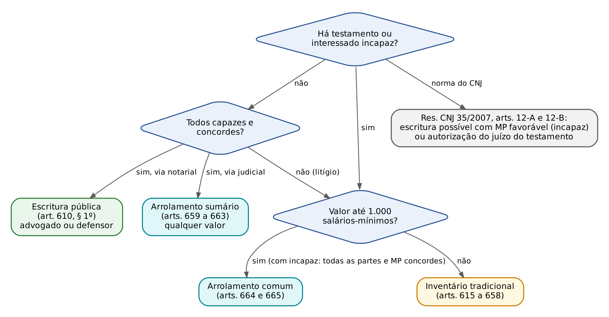
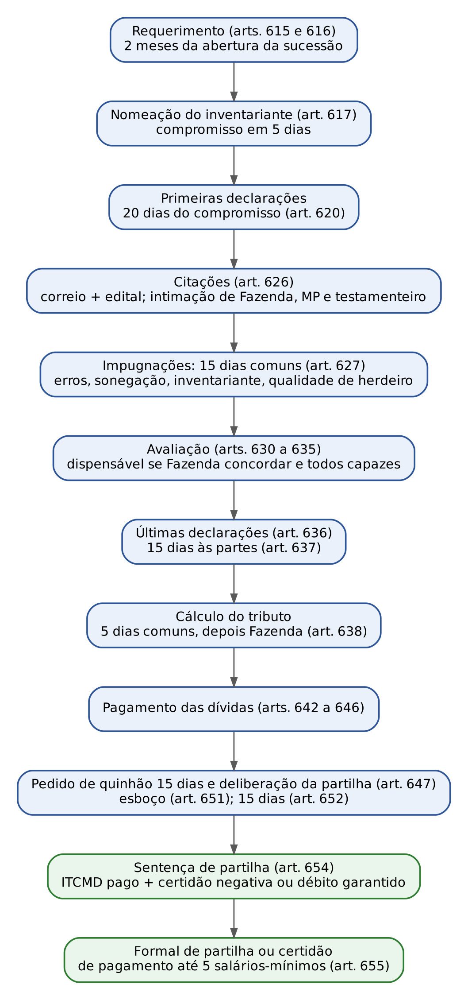
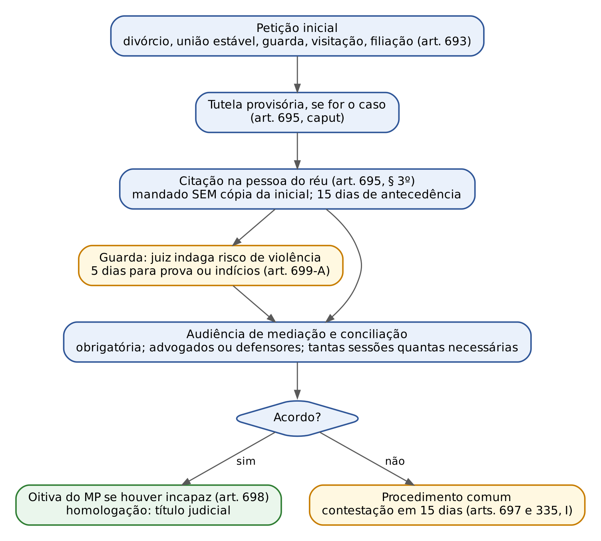
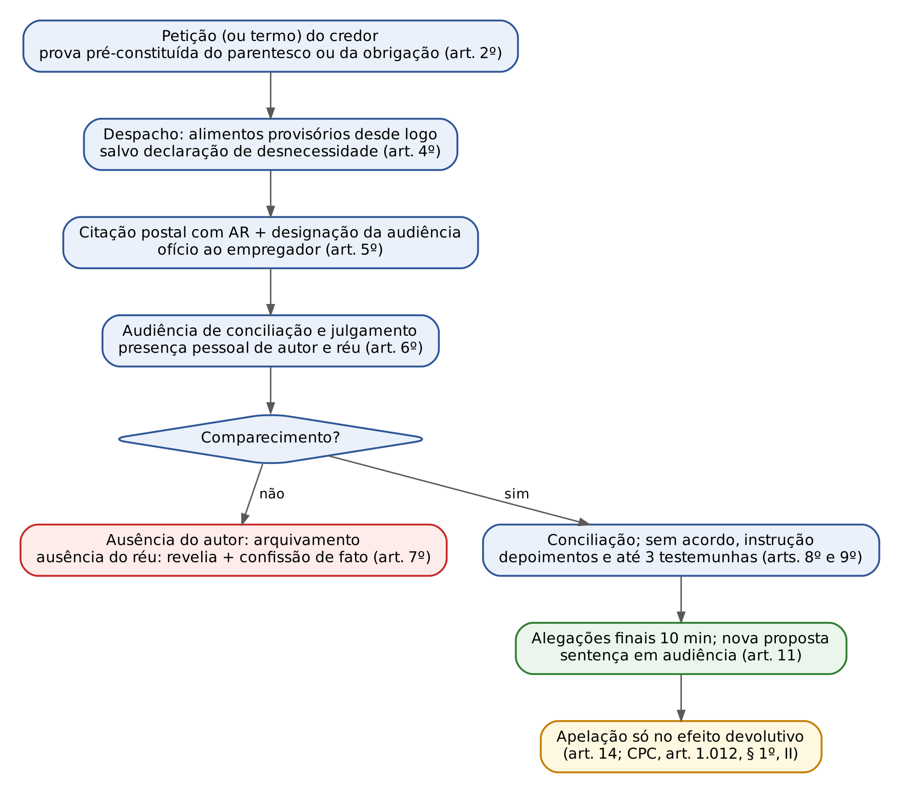
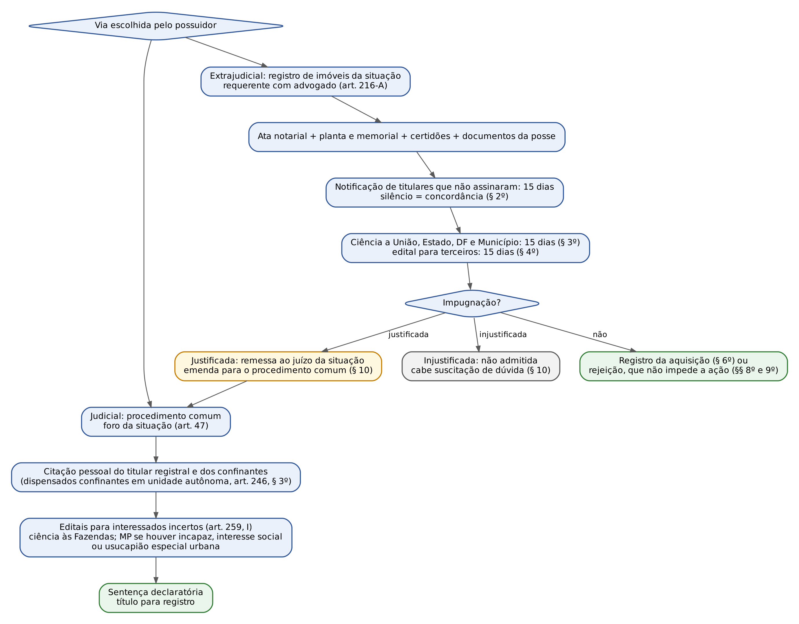

# CAPÍTULO 30 — PROCEDIMENTOS ESPECIAIS II: INVENTÁRIO E PARTILHA, AÇÕES DE FAMÍLIA, ALIMENTOS, FILIAÇÃO E USUCAPIÃO

:::INCIDENCIA
TJRS p. 12; TJSC p. 12 e 17 (TRF5: só a competência federal e a usucapião, por remissão). Nível A. Lote: 30 questões (FGV 28, FCC 2), quatro de provas de juiz (TJSC 2024, TJMT 2024, ENAM 2024 e TJPE 2026).
O que mais cai: letra dos arts. 610 a 673 (prazos de 2 meses, 5, 15 e 20 dias; ordem do art. 617; remoção de ofício; art. 612 e alta indagação; arrolamento e tributos); arts. 693 a 699-A (citação sem cópia da inicial, 15 dias, audiência obrigatória, MP só com incapaz); usucapião extrajudicial do art. 216-A da Lei 6.015/1973 (ata notarial, silêncio = concordância, impugnação justificada x injustificada).
:::

| Subtema | FGV | FCC | Padrão de cobrança |
|---|---|---|---|
| Inventário judicial: prazos, legitimidade, inventariante, alta indagação, recursos | 7 | 2 | Caso concreto com letra do CPC trocada (30 dias, 3 meses, "documento ou testemunha", alienação sem autorização); agravo das interlocutórias; legitimidade do MP e do credor do herdeiro; sobrepartilha |
| Inventário extrajudicial e Resolução CNJ 35/2007 | 5 | 0 | Escritura pública (nunca instrumento particular); incapaz com MP favorável; testamento que reconhece filho; sobrepartilha por escritura; alienação de bem do espólio pelo inventariante |
| Arrolamentos e tributos | 1 | 0 | Arrolamento comum com incapaz (art. 665); 1.000 salários-mínimos; Fazenda não adstrita ao valor dos herdeiros |
| Ações de família (arts. 693 a 699-A) | 5 | 0 | Mandado sem cópia da inicial; antecedência de 15 dias; audiência obrigatória; MP só com incapaz; apelação de alimentos sem efeito suspensivo; decisão parcial que decreta o divórcio |
| Usucapião judicial | 4 | 0 | Foro da situação; litisconsórcio com o titular registral; herdeiro condômino; MP obrigatório na especial urbana; sobrestamento de possessórias |
| Usucapião extrajudicial | 7 | 0 | Ata notarial; advogado; prenotação prorrogada; ciência às Fazendas em 15 dias; impugnação de confrontante; rejeição não impede a ação |

O capítulo é processual. Requisitos materiais da herança, colação, sonegados, regimes de bens, alimentos, filiação e usucapião estão na Apostila de Direito Civil (Caps. 29, 34 a 39 e 42 a 45), à qual se remete sempre que o ponto é substancial. Jurisdição voluntária (divórcio e extinção consensual de união estável homologados em juízo, testamentos, herança jacente) é do Cap. 31; cumprimento e execução de alimentos, do Cap. 23 (rito da prisão) e do Cap. 25 (execução por título extrajudicial).

## 30.1 Inventário e partilha: natureza, competência e vias

### 30.1.1 Natureza e juízo do inventário

O inventário é procedimento especial de jurisdição contenciosa (está no Título III do Livro I da Parte Especial, entre os contenciosos), ainda que muitas vezes sem litígio. Serve para descrever o acervo, pagar as dívidas, conferir as liberalidades, apurar e recolher o imposto e converter as quotas ideais da herança, indivisível até a partilha, em bens determinados. O espólio, universalidade sem personalidade, tem capacidade de ser parte e é representado pelo inventariante (art. 75, VII; se dativo, os sucessores são intimados nas ações em que o espólio for parte, art. 75, § 1º).

Competência:

| Critério | Regra | Fundamento |
|---|---|---|
| Internacional | autoridade brasileira, com EXCLUSÃO de qualquer outra, para inventário e partilha de bens situados no Brasil, ainda que o autor da herança seja estrangeiro ou domiciliado no exterior; não se homologa decisão estrangeira que os partilhe | CPC, arts. 23, II, e 964 (Cap. 3) |
| Bens no exterior | a Justiça brasileira não delibera sobre a sucessão corrente no exterior (pluralidade de juízos sucessórios); mas é competente para alvará que autorize a curadora de herdeiro incapaz domiciliado no Brasil a outorgar procuração para atuar em inventário estrangeiro | STJ, AgInt no AREsp 1.330.909 (v. Cap. 31, 31.1) |
| Territorial | foro do domicílio do autor da herança, no Brasil, ainda que o óbito tenha ocorrido no estrangeiro; sem domicílio certo: situação dos imóveis; imóveis em foros diferentes, qualquer deles; sem imóveis, local de qualquer dos bens | CPC, art. 48 |
| Ações atraídas | inventário, partilha, arrecadação, cumprimento de disposições de última vontade, impugnação ou ANULAÇÃO DE PARTILHA EXTRAJUDICIAL e todas as ações em que o espólio for RÉU | CPC, art. 48, *caput* |
| Natureza | competência territorial, portanto relativa (prorroga-se se não arguida) | arts. 63 e 65 (Cap. 4) |

:::PEGADINHA ART. 48 X ART. 47: A ANULAÇÃO DE PARTILHA EXTRAJUDICIAL CUMULADA COM PEDIDO REAL
O art. 48 atrai a ação de anulação de partilha extrajudicial ao foro do domicílio do autor da herança, mas a regra é de competência relativa e cede ao foro da situação do imóvel quando a demanda cumula pedido possessório ou real imobiliário, que o art. 47, § 2º, torna absoluto para as possessórias. Na Q3914307 (FGV 2026, TJMS, Outorga de Delegações, ch=4), o herdeiro pede a anulação da partilha extrajudicial lavrada em Dourados cumulada com reintegração de posse de imóvel em Corumbá; o último domicílio do falecido era Ponta Porã e a morte ocorreu em Três Lagoas. Gabarito: E (Corumbá), porque o critério absoluto da possessória prevalece sobre o relativo do art. 48. Distratores: local do óbito, cartório da escritura, domicílio do autor da ação.
:::

O juízo do inventário não é juízo universal no sentido falimentar: não atrai as ações em que o espólio é AUTOR (seguem a regra geral), nem a execução fiscal contra o espólio (a cobrança da dívida ativa não se sujeita a habilitação em inventário ou arrolamento, Lei 6.830/1980, art. 29). Também não decide pretensões que fogem ao seu objeto, como a partilha de bens em contexto de violência doméstica: a pretensão de partilha exclui-se da competência dos Juizados de Violência Doméstica e Familiar contra a Mulher, seguindo para o juízo de família ou sucessões (STJ, processo em segredo de justiça, Relatora Ministra Maria Isabel Gallotti, Quarta Turma, j. 10/12/2024, Informativo de Jurisprudência n. 23, Edição Extraordinária; a competência híbrida do art. 14-A da Lei 11.340/2006 alcança o divórcio e a dissolução da união estável, mas o próprio dispositivo exclui a partilha).

### 30.1.2 As vias e os ritos

:::LEI CPC, ART. 610
Art. 610. Havendo testamento ou interessado incapaz, proceder-se-á ao inventário judicial.
§ 1º Se todos forem capazes e concordes, o inventário e a partilha poderão ser feitos por escritura pública, a qual constituirá documento hábil para qualquer ato de registro, bem como para levantamento de importância depositada em instituições financeiras.
§ 2º O tabelião somente lavrará a escritura pública se todas as partes interessadas estiverem assistidas por advogado ou por defensor público, cuja qualificação e assinatura constarão do ato notarial.
:::

Quatro trilhas, em ordem decrescente de simplicidade:

| Via | Cabimento | Traço decisivo |
|---|---|---|
| Escritura pública | todos capazes e concordes; advogado ou defensor; facultativa ("poderão") | sem homologação; título para registro e levantamento de valores |
| Arrolamento sumário (arts. 659 a 663) | partilha amigável entre partes capazes, QUALQUER valor; adjudicação a herdeiro único | homologação de plano; sem termos e sem avaliação; tributos de transmissão fora do processo |
| Arrolamento comum (arts. 664 e 665) | acervo de até 1.000 salários-mínimos, com ou sem acordo; com incapaz, se todas as partes e o MP concordarem | inventariante sem termo de compromisso; avaliação só se houver impugnação da estimativa; audiência única |
| Inventário tradicional (arts. 615 a 658) | residual: litígio acima de 1.000 salários-mínimos, incapaz sem consenso para o arrolamento, testamento com disputa | primeiras declarações, citações, impugnações, avaliação, cálculo do imposto, partilha por sentença |

O art. 666 completa o quadro: o pagamento dos valores da Lei 6.858/1980 (FGTS, PIS-PASEP, restituições e saldos de pequeno valor) independe de inventário ou arrolamento e se faz por alvará.

:::QUESTAO FGV 2025 — TJ-ES — ATIVIDADE NOTARIAL E DE REGISTRO, PROVIMENTO (Q3520610)
Herdeiros capazes, concordes e assistidos por advogado fazem "inventário extrajudicial por instrumento particular", com reconhecimento de filiação socioafetiva e definição dos quinhões. Gabarito oficial: A (não é válido; exige-se instrumento público ou procedimento judicial). A armadilha está nas alternativas D e E, que tomam a capacidade e o consenso como suficientes: a FORMA é da substância (art. 610, § 1º: "escritura pública"). Erradas também B (o reconhecimento de filiação socioafetiva tem via extrajudicial própria no registro civil — Apostila de Direito Civil, Cap. 37) e C (o inventário extrajudicial existe desde a Lei 11.441/2007).
:::

### 30.1.3 Inventário extrajudicial: o CPC e a Resolução CNJ 35/2007

O art. 610, *caput*, mantém a via judicial obrigatória havendo testamento ou interessado incapaz. A Resolução CNJ 35/2007, com a redação da Resolução CNJ 571/2024, admitiu a escritura nessas duas hipóteses, sob condições (e, desde a Resolução CNJ 695/2026, dispensou o prévio recolhimento do ITCMD), e é o que as bancas de cartório e de magistratura vêm cobrando (detalhamento e crítica de legalidade na Apostila de Direito Civil, Cap. 45, 45.2.1):

| Situação | O que a Resolução exige | Questão |
|---|---|---|
| Herdeiro criança, adolescente ou incapaz (art. 12-A) | quinhão ou meação em parte ideal de cada bem; manifestação FAVORÁVEL do MP, condição de eficácia; vedado ato de disposição sobre os bens do incapaz; impugnação do MP ou de terceiro leva o caso ao juiz | Q3914507: escritura válida |
| Testamento (art. 12-B) | autorização expressa do juízo sucessório na ação de abertura e cumprimento, com trânsito em julgado; todos capazes e concordes (ou art. 12-A); se o testamento RECONHECER FILHO ou contiver declaração irrevogável, a via judicial é obrigatória (§ 1º) | Q3914309: escritura vedada |
| Sobrepartilha (art. 25) | por escritura, ainda que o inventário tenha sido judicial e que o herdeiro, hoje capaz, fosse incapaz ao tempo do processo | Q3914275 |
| Alienação de bem do espólio para custear o inventário (art. 11-A) | autorização na escritura, independentemente de alvará; garantia real ou fidejussória quanto à destinação do preço; prazo para pagar as despesas de até 1 ano; bem alienado relacionado no acervo para emolumentos, quinhões e imposto, mas não partilhado | Q3673828 |
| ITCMD (art. 15, redação da Resolução CNJ 695/2026) | a lavratura da escritura de inventário e partilha "não se condiciona à comprovação do prévio recolhimento" do ITCMD; o tabelião consigna a declaração das partes, orientadas pelos advogados, quanto à ciência das obrigações tributárias e à apuração e recolhimento do imposto, com eventuais isenções ou não incidências (§ 1º); sem recolhimento prévio, o tabelião informa a lavratura ao fisco em 5 dias, ou conforme a legislação tributária (§ 2º) | paralelo extrajudicial do Tema 1.074 do STJ (30.3.1) |

A Resolução CNJ 695, de 26/8/2026 (DJe/CNJ de 28/8/2026, vigência na publicação), deu nova redação ao art. 15 da Resolução 35/2007 e retirou o prévio recolhimento do ITCMD como condição da escritura de inventário e partilha, alinhando a via notarial à lógica do arrolamento sumário judicial (art. 659, § 2º, do CPC e Tema 1.074 do STJ): o imposto é lançado e cobrado pelo fisco, que recebe a comunicação do tabelião. A resolução não trata dos demais tributos sobre bens e rendas do espólio nem das exigências do registro de imóveis, pontos em que a aplicação prática ainda é discutida em doutrina notarial e registral.

O Enunciado 51 da I Jornada de Direito Processual Civil do CJF antecipou o regime do testamento: havendo registro judicial ou autorização expressa do juízo sucessório nos autos de abertura, registro e cumprimento de testamento, sendo todos capazes e concordes, inventário e partilha podem ser feitos por escritura pública.

:::QUESTAO FGV 2026 — TJ-MS — OUTORGA DE DELEGAÇÕES, REMOÇÃO (Q3914309)
Ação de abertura e cumprimento de testamento transitada; há autorização do juízo para a via extrajudicial "se cabível"; o testamento reconhece filho de 10 anos até então desconhecido. Gabarito oficial: E (escritura vedada; inventário obrigatoriamente judicial). Passos: (1) o art. 610 do CPC exigiria via judicial por haver testamento e incapaz; (2) a Resolução 35/2007 abre a via notarial com autorização judicial (art. 12-B), mas a exclui quando o testamento reconhece filho (§ 1º); (3) a representação por advogados e o trânsito em julgado do cumprimento são irrelevantes diante da vedação específica. Armadilhas: A e C (advogados e trânsito em julgado bastariam); B (escritura com homologação: categoria inexistente).
:::

:::QUESTAO FGV 2026 — TJ-MS — OUTORGA DE DELEGAÇÕES, PROVIMENTO (Q3914507)
Inventário extrajudicial com herdeiro de 11 anos representado pela mãe, partilha equitativa, remessa ao MP e concordância deste. Gabarito oficial: D (escritura válida, porque autorizada pelo CNJ com observância da lei e sem prejuízo ao incapaz). Erradas: A (homologação judicial), B (o MP deveria opor-se), C (remessa obrigatória ao juízo) e E (o tabelião não pode recusar: pode, fundamentadamente, diante de indícios de fraude). Em prova que pergunte "segundo o CPC", a resposta seria a via judicial do art. 610, *caput*.
:::

No mesmo sentido: FGV 2026 — TJ-MS — Outorga, Remoção (Q3914275), gabarito D: descoberto bem não inventariado anos depois de inventário judicial com crianças hoje maiores, cabe sobrepartilha por escritura, sem autorização judicial e sem MP. FGV 2025 — ENAC, 2º Exame (Q3673828), gabarito D: corretas as afirmativas II (cumprida a destinação do preço, extingue-se a garantia) e III (bem relacionado no acervo para cálculo, mas não partilhado); errada a I, que fixava prazo máximo de seis meses para pagar as despesas.

:::DICA COMO RESPONDER QUESTÕES SOBRE A VIA EXTRAJUDICIAL
Primeiro identifique a fonte que o enunciado pede: "nos termos do CPC" (letra do art. 610: judicial com testamento ou incapaz) ou "considerando as normas do CNJ" (Resolução 35/2007). Depois aplique os filtros: escritura PÚBLICA, advogado ou defensor de TODAS as partes, consenso de todos. Faltando qualquer um, não há via notarial; a escolha do tabelião é livre (sem regra de competência territorial).
:::

## 30.2 Inventário judicial tradicional

### 30.2.1 Prazo de abertura, administrador provisório e legitimidade

O processo deve ser instaurado em 2 meses da abertura da sucessão e ultimado nos 12 meses SUBSEQUENTES, prorrogáveis pelo juiz de ofício ou a requerimento (art. 611). O prazo é impróprio: não há extinção nem preclusão; a sanção pelo atraso é a multa tributária estadual (Súmula 542 do STF). Os 30 dias do art. 1.796 do CC e os 60 dias de leis antigas são distratores recorrentes.

Até o compromisso do inventariante, o espólio permanece na posse do administrador provisório (art. 613), que o representa ativa e passivamente, traz ao acervo os frutos percebidos desde a abertura, tem direito ao reembolso das despesas necessárias e úteis e responde pelo dano que causar por dolo ou culpa (art. 614; quem é o administrador: CC, art. 1.797, Apostila de Direito Civil, Cap. 42).

:::QUESTAO FGV 2025 — TJ-ES — ATIVIDADE NOTARIAL E DE REGISTRO, PROVIMENTO (Q3520573)
Gabarito oficial: A (letra do art. 614). As demais trocam a letra: B acrescenta exceção inexistente ao art. 610, § 1º (a escritura serve TAMBÉM para levantar depósitos); C fala em 30 dias (são 2 meses); D admite "documento ou prova testemunhal" no art. 612 (só documento); E diz que o administrador fica com o espólio até a INTIMAÇÃO do inventariante (é até o COMPROMISSO, art. 613).
:::

Legitimidade. Requer o inventário quem estiver na posse e administração do espólio, instruindo o pedido com a certidão de óbito (art. 615); têm legitimidade CONCORRENTE (art. 616): cônjuge ou companheiro supérstite; herdeiro; legatário; testamenteiro; cessionário do herdeiro ou do legatário; credor do herdeiro, do legatário ou do autor da herança; MP, havendo herdeiros incapazes; Fazenda Pública, quando tiver interesse; administrador judicial da falência do herdeiro, do legatário, do autor da herança ou do cônjuge ou companheiro. O juiz NÃO instaura o inventário de ofício (o art. 989 do CPC/1973 não foi reproduzido).

:::QUESTAO FGV 2024 — TJ-SC — JUIZ SUBSTITUTO, EDITAL 44 (Q3049345)
Gabarito oficial: A (o credor do herdeiro tem legitimidade concorrente para requerer a abertura — art. 616, VI). Armadilhas: B (foro do domicílio do herdeiro inventariante: é o do autor da herança, art. 48); C (primazia do testamenteiro: ele está no inciso V do art. 617, depois do cônjuge, dos herdeiros e do "herdeiro menor, por seu representante legal", na letra do inciso IV); D (remoção só a requerimento: o art. 622 diz "de ofício ou a requerimento"); E (irrecorribilidade das interlocutórias com mandado de segurança: no inventário, TODA interlocutória é agravável, art. 1.015, parágrafo único).
Nota de prova: o credor do herdeiro legitima-se a REQUERER o inventário, mas não a pedir habilitação de crédito no inventário, reservada ao credor do espólio (art. 642), nem a atuar amplamente como parte (Apostila de Direito Civil, Cap. 45, 45.1.3).
:::

### 30.2.2 Inventariante: nomeação, deveres e remoção

:::LEI CPC, ART. 617
Art. 617. O juiz nomeará inventariante na seguinte ordem:
I - o cônjuge ou companheiro sobrevivente, desde que estivesse convivendo com o outro ao tempo da morte deste;
II - o herdeiro que se achar na posse e na administração do espólio, se não houver cônjuge ou companheiro sobrevivente ou se estes não puderem ser nomeados;
III - qualquer herdeiro, quando nenhum deles estiver na posse e na administração do espólio;
IV - o herdeiro menor, por seu representante legal;
V - o testamenteiro, se lhe tiver sido confiada a administração do espólio ou se toda a herança estiver distribuída em legados;
VI - o cessionário do herdeiro ou do legatário;
VII - o inventariante judicial, se houver;
VIII - pessoa estranha idônea, quando não houver inventariante judicial.
Parágrafo único. O inventariante, intimado da nomeação, prestará, dentro de 5 (cinco) dias, o compromisso de bem e fielmente desempenhar a função.
:::

A ordem é preferencial: o STJ admite afastá-la, fundamentadamente, diante de litigiosidade ou inaptidão do preferido (Apostila de Direito Civil, Cap. 45, 45.1.4). O inventariante dativo (incisos VII e VIII) não representa sozinho o espólio em juízo (art. 75, § 1º).

:::QUESTAO FGV 2025 — TJ-ES — ATIVIDADE NOTARIAL E DE REGISTRO, PROVIMENTO (Q3520593)
Pede-se a ordem do art. 617. Gabarito oficial: B. A armadilha principal é a alternativa A, idêntica salvo por "AINDA QUE não estivesse convivendo" com o falecido: o cônjuge separado de fato perde a preferência. As alternativas C, D e E invertem a posição do herdeiro na posse com a do cônjuge ou deslocam o cônjuge para o fim da lista.
:::

Deveres. O art. 618 lista o que o inventariante faz sozinho (representar o espólio, administrar com a diligência que teria se os bens fossem seus, prestar as primeiras e as últimas declarações, exibir documentos, juntar certidão do testamento, trazer à colação os bens do herdeiro ausente, renunciante ou excluído, prestar contas ao deixar o cargo ou quando determinado, requerer a insolvência). O art. 619 lista o que exige OITIVA DOS INTERESSADOS E AUTORIZAÇÃO DO JUIZ: alienar bens de qualquer espécie, transigir em juízo ou fora dele, pagar dívidas do espólio e fazer despesas de conservação e melhoramento.

:::QUESTAO FCC 2025 — MPE-PI — ANALISTA MINISTERIAL, ÁREA PROCESSUAL (Q3530385)
Quatro proposições. Gabarito oficial: E (corretas II e IV). II é a letra do art. 619, I e II; IV é a do art. 647, parágrafo único (uso e fruição antecipados de bem que integrará o quinhão, com ônus e bônus desde o deferimento). Erradas: I (legitimidade "exclusiva" de quem está na posse: há legitimidade concorrente, art. 616) e III (a dívida com a Fazenda não impede o julgamento da partilha se o pagamento estiver garantido, art. 654, parágrafo único).
:::

Remoção. O art. 622 permite remover o inventariante DE OFÍCIO OU A REQUERIMENTO quando não prestar as declarações no prazo; não der andamento regular, suscitar dúvidas infundadas ou praticar atos protelatórios; deixar, por culpa, que bens se deteriorem, sejam dilapidados ou sofram dano; não defender o espólio, não cobrar dívidas ativas ou não evitar o perecimento de direitos; não prestar contas ou tê-las rejeitadas; sonegar, ocultar ou desviar bens. Rito do incidente:

- Intimação do inventariante para, em 15 dias, defender-se e produzir provas (art. 623); o incidente corre EM APENSO aos autos do inventário (parágrafo único) — não é distribuído livremente.
- Com ou sem defesa, o juiz decide (art. 624); removido, nomeia outro pela ordem do art. 617.
- O removido entrega imediatamente os bens, sob pena de busca e apreensão (móveis) ou imissão na posse (imóveis), sem prejuízo de multa de até 3% do valor dos bens inventariados (art. 625).
- A decisão é interlocutória, agravável por instrumento (art. 1.015, parágrafo único).
- O rol do art. 622 não é taxativo para a doutrina majoritária (atos graves análogos também removem), mas em prova objetiva cobre-se a letra.

A remoção não se confunde com a destituição do inventariante dativo nem com a pena de sonegados (perda do direito sobre os bens, que exige ação própria — Apostila de Direito Civil, Cap. 45, 45.3). Na Q4088281 (FGV 2026, MPE-RJ, ch=29), o inventariante condenado em ação de exigir contas que não paga o saldo pode ser destituído (art. 553, parágrafo único), sem prejuízo da execução do crédito (Cap. 29).

:::QUESTAO FGV 2025 — MPE-RJ — PROMOTOR DE JUSTIÇA SUBSTITUTO (Q3532389)
Caso: MP requer a abertura do inventário (herdeiro de 10 anos); a mãe do incapaz, companheira do falecido, é nomeada inventariante; meses depois, não presta as primeiras declarações no prazo e deixa bens se deteriorarem por culpa; o MP pede a remoção; o juiz indefere de plano porque só o herdeiro maior poderia pedi-la.
Gabarito oficial: C (a decisão que indefere a remoção é impugnável por agravo de instrumento).
Passos: (1) o MP tinha legitimidade para requerer a abertura (art. 616, VII) — erra a A, que fala em vício sanado; (2) a remoção cabe de ofício ou a requerimento de qualquer interessado, inclusive o MP que oficia por haver incapaz (art. 622, *caput*) — erra a B; (3) as causas narradas estão nos incisos I e III do art. 622 — erra a D; (4) o incidente corre em apenso, não por livre distribuição (art. 623, parágrafo único) — erra a E; (5) a decisão é interlocutória proferida no processo de inventário: agravo de instrumento (art. 1.015, parágrafo único).
:::

### 30.2.3 Primeiras declarações, citações, impugnações e questões de alta indagação

O inventariante presta as primeiras declarações em 20 dias do compromisso, pessoalmente ou por procurador com poderes especiais, admitida petição à qual o termo se reporta (art. 620, § 2º). O conteúdo (art. 620, I a IV) inclui o regime de bens do cônjuge ou companheiro, a qualidade dos herdeiros e a relação individualizada dos bens, inclusive os sujeitos à colação; se o falecido era empresário individual, o juiz determina o balanço do estabelecimento; se sócio de sociedade não anônima, a apuração de haveres (§ 1º). A sonegação só pode ser arguida ao inventariante depois de encerrada a descrição dos bens com a declaração de não existirem outros (art. 621).

Feitas as primeiras declarações (art. 626): CITAM-SE o cônjuge, o companheiro, os herdeiros e os legatários, pelo correio (observado o art. 247), publicando-se também edital (art. 259, III), com cópia das primeiras declarações; INTIMAM-SE a Fazenda Pública, o MP (se houver herdeiro incapaz ou ausente) e o testamenteiro (se houver testamento).

Concluídas as citações, abre-se vista comum de 15 dias para (art. 627): arguir erros, omissões e sonegação; reclamar contra a nomeação do inventariante; contestar a qualidade de quem foi incluído como herdeiro. A Fazenda, em 15 dias após essa vista, informa o valor cadastral dos imóveis (art. 629).

:::LEI CPC, ART. 612
Art. 612. O juiz decidirá todas as questões de direito desde que os fatos relevantes estejam provados por documento, só remetendo para as vias ordinárias as questões que dependerem de outras provas.
:::

O art. 612 é o eixo cognitivo do inventário: cognição horizontalmente ampla (qualquer questão de direito) e verticalmente limitada à prova DOCUMENTAL. A antiga expressão "questões de alta indagação" (art. 984 do CPC/1973) foi substituída pelo critério probatório: é de "alta indagação" a questão de fato que depende de prova não documental (testemunhal, pericial, depoimento). O CPC aplica o critério em vários pontos:

| Questão | Prova só documental | Depende de outras provas | Fundamento |
|---|---|---|---|
| Qualidade de herdeiro impugnada | decide no inventário | vias ordinárias + sobrestamento da entrega do quinhão do herdeiro admitido | art. 627, § 3º |
| Herdeiro preterido (pede admissão antes da partilha) | decide em 15 dias | vias ordinárias + reserva do quinhão em poder do inventariante | art. 628, § 2º |
| Negativa de colação | decide; improcedente a oposição e não conferidos em 15 dias, sequestro ou imputação | vias ordinárias; o herdeiro só recebe o quinhão com caução | art. 641, §§ 1º e 2º |
| Crédito contra o espólio impugnado | habilitação | vias ordinárias + reserva, se a dívida constar de documento suficiente e a impugnação não for de quitação | art. 643 |
| União estável do falecido | reconhecimento incidental, se comprovada documentalmente | ação própria contra os herdeiros (Apostila de Direito Civil, Cap. 35) | art. 627, § 3º; Enunciado 179 da III Jornada do CJF |

A tutela provisória concedida nessas seções (reservas, sobrestamentos) CESSA se a ação não for proposta em 30 dias da intimação do impugnante, do herdeiro excluído ou do credor não admitido, ou se o inventário for extinto (art. 668).

:::QUESTAO FGV 2024 — TJ-MT — JUIZ SUBSTITUTO (Q3086934)
Caso: testamento público reconhecendo filho e legando imóvel às sobrinhas; cumprimento deferido; as legatárias requerem o inventário; filha do falecido alega falsidade da assinatura, a ser provada por perícia; o juiz do inventário rejeita a alegação com base na presunção de veracidade do ato notarial, sem prova; a filha recorre.
Gabarito oficial: B (a autenticidade da assinatura e a validade do testamento, dependentes de perícia, deveriam ser discutidas nas vias ordinárias).
Passos: (1) a questão é de fato e depende de prova pericial: fora do alcance do art. 612; (2) o juiz não podia decidi-la no inventário, nem para rejeitar; (3) legatárias têm legitimidade concorrente (art. 616, III) — erra a C; (4) o recurso é agravo de instrumento (art. 1.015, parágrafo único), mas sem efeito suspensivo automático (art. 1.019, I) — erra a D; (5) não se trata de questão que "sobe" na apelação (art. 1.009, § 1º), porque no inventário a interlocutória é agravável — erra a A; (6) o procedimento especial é complementado pelo comum (art. 318, parágrafo único) — erra a E.
:::

:::QUESTAO FGV 2025 — TJ-GO — RESIDENTE JURÍDICO (Q3345936)
Viúva e dois filhos capazes; acervo de 200.000 (duzentos mil) reais. Gabarito oficial: C (letra do art. 612). Armadilhas: A (3 meses: são 2); B (alienação sem oitiva nem autorização: art. 619, I); D (primeiras declarações em 15 dias: são 20, art. 620); E (o arrolamento comum vai até 1.000 salários-mínimos, e o sumário não tem teto, art. 659: "50 salários-mínimos" é invenção).
:::

### 30.2.4 Avaliação, cálculo do imposto, colação e dívidas

Avaliação. Findo o prazo do art. 627 sem impugnação, ou decidida a impugnação, o juiz nomeia perito, se não houver avaliador judicial (art. 630), aplicando-se no que couber os arts. 872 e 873 (art. 631). Não se expede precatória para avaliar bens de pequeno valor ou conhecidos do perito (art. 632). Dispensa-se a avaliação se, sendo todos capazes, a Fazenda, intimada PESSOALMENTE, concordar EXPRESSAMENTE com os valores das primeiras declarações (art. 633); se os herdeiros concordarem com os valores da Fazenda, a avaliação cinge-se aos demais bens (art. 634). Impugnação ao laudo em 15 dias; a que versar sobre o valor é decidida de plano (art. 635). Seguem-se as últimas declarações, em que o inventariante pode emendar, aditar ou completar as primeiras (art. 636), vista de 15 dias e cálculo do tributo (art. 637), sobre o qual as partes falam em 5 dias comuns e depois a Fazenda; o juiz julga o cálculo (art. 638).

Colação (arts. 639 a 641): o herdeiro obrigado confere os bens no prazo do art. 627, por termo ou petição; o valor é o do tempo da abertura da sucessão (art. 639, parágrafo único, em antinomia com o art. 2.004 do CC, tratada na Apostila de Direito Civil, Cap. 45, 45.5.5). Renunciante e excluído também conferem para repor a parte inoficiosa (art. 640); imóvel indivisível com parte inoficiosa vai a licitação entre herdeiros, com preferência do donatário em igualdade de condições.

Dívidas (arts. 642 a 646): o credor do espólio pode, ANTES da partilha, requerer o pagamento de dívidas vencidas e exigíveis, por petição com prova literal, distribuída por dependência e autuada em apenso. Com a concordância de todas as partes, o juiz declara habilitado o credor e manda separar dinheiro ou bens, que serão alienados pelas regras da expropriação, ou adjudicados ao credor se todos concordarem (art. 642, §§ 2º a 4º). Sem concordância de todos, o credor vai às vias ordinárias, com reserva de bens nas condições do art. 643, parágrafo único (cuja ação deve ser proposta em 30 dias: art. 668, I; CC, art. 1.997, § 2º). Dívida líquida e certa ainda não vencida também se habilita (art. 644). A habilitação é FACULTATIVA: o credor pode preferir a execução contra o espólio. O legatário manifesta-se sobre as dívidas quando a herança estiver toda em legados ou quando o reconhecimento reduzir legados (art. 645).

### 30.2.5 Partilha, sentença e recursos

Cumprido o art. 642, § 3º, as partes formulam pedido de quinhão em 15 dias comuns, e o juiz profere a DECISÃO DE DELIBERAÇÃO DA PARTILHA, resolvendo os pedidos e designando os bens de cada quinhão (art. 647). Natureza: decisão interlocutória (agravável, art. 1.015, parágrafo único), que orienta o partidor; a sentença vem depois.

:::DOUTRINA USO E FRUIÇÃO ANTECIPADOS (ART. 647, PARÁGRAFO ÚNICO)
O juiz pode deferir antecipadamente a qualquer herdeiro, em decisão fundamentada, o exercício dos direitos de usar e fruir de determinado bem, com a condição de que ele integre a cota desse herdeiro ao término do inventário, cabendo-lhe desde o deferimento os ônus e bônus. O Enunciado 184 da III Jornada do CJF qualifica a medida como TUTELA PROVISÓRIA SATISFATIVA (e não julgamento antecipado do mérito), exigindo do juiz a análise da probabilidade de o bem vir a integrar o quinhão. Consequências: revogabilidade (art. 296), cessação da eficácia nas hipóteses do art. 668 e agravo de instrumento (arts. 1.015, I, e parágrafo único).
:::

Regras de composição (art. 648): máxima igualdade quanto ao valor, natureza e qualidade dos bens; prevenção de litígios futuros; máxima comodidade dos coerdeiros e do cônjuge ou companheiro. Bens insuscetíveis de divisão cômoda que não caibam na meação ou em um quinhão são licitados entre os interessados ou vendidos judicialmente, salvo acordo para adjudicá-los a todos (art. 649). O quinhão do NASCITURO fica reservado em poder do inventariante até o nascimento (art. 650).

O partidor organiza o esboço observando a ordem do art. 651: dívidas atendidas, meação do cônjuge, meação disponível e quinhões hereditários, a começar pelo coerdeiro mais velho. O Enunciado 52 da I Jornada do CJF manda incluir a meação do COMPANHEIRO no esboço. As partes falam sobre o esboço em 15 dias e, resolvidas as reclamações, lança-se a partilha (art. 652), composta de auto de orçamento e folhas de pagamento assinados pelo juiz e pelo escrivão (art. 653).

:::LEI CPC, ARTS. 654 E 655, PARÁGRAFO ÚNICO
Art. 654. Pago o imposto de transmissão a título de morte e juntada aos autos certidão ou informação negativa de dívida para com a Fazenda Pública, o juiz julgará por sentença a partilha.
Parágrafo único. A existência de dívida para com a Fazenda Pública não impedirá o julgamento da partilha, desde que o seu pagamento esteja devidamente garantido.
Art. 655 [...] Parágrafo único. O formal de partilha poderá ser substituído por certidão de pagamento do quinhão hereditário quando esse não exceder a 5 (cinco) vezes o salário-mínimo, caso em que se transcreverá nela a sentença de partilha transitada em julgado.
:::

A certidão positiva com efeitos de negativa basta: o STJ entendeu que a CPD-EN emitida por suspensão da exigibilidade decorrente de pedido de compensação do crédito tributário com precatório devido pelo ente satisfaz a prova de quitação do art. 192 do CTN e autoriza a homologação da partilha e a expedição do formal (STJ, REsp 2.167.136-DF, Relator Ministro Gurgel de Faria, Primeira Turma, j. 9/6/2026, Informativo de Jurisprudência n. 31, Edição Extraordinária).

Recursos no inventário:

| Pronunciamento | Natureza | Recurso |
|---|---|---|
| Nomeação, remoção, impugnações do art. 627, admissão de herdeiro, remessa às vias ordinárias, colação, habilitação de crédito, avaliação, cálculo do imposto, deliberação da partilha, uso antecipado | interlocutória | agravo de instrumento, sem restrição de matéria (art. 1.015, parágrafo único) |
| Sentença que julga a partilha (art. 654) ou homologa a partilha amigável ou adjudicação (art. 659) | sentença | apelação, com efeito suspensivo (regra do art. 1.012) |
| Sentença que extingue o inventário sem partilha | sentença | apelação |
| Decisão sobre emenda da partilha por erro de fato ou inexatidão material (art. 656) | interlocutória posterior à sentença | agravo de instrumento |

:::SENTENCA DISPOSITIVO DA SENTENÇA DE PARTILHA (ART. 654)
"Comprovado o recolhimento do imposto de transmissão *causa mortis* (fls. x) e juntadas as certidões negativas de débitos fiscais (fls. y), JULGO POR SENTENÇA a partilha lançada às fls. z, nos autos do inventário dos bens deixados por A. B., atribuindo aos herdeiros e à meeira os respectivos quinhões, salvo erro ou omissão e ressalvados direitos de terceiros. Reservados à sobrepartilha os bens litigiosos descritos às fls. w, sob a guarda da inventariante (art. 669, III e parágrafo único). Transitada em julgado, expeçam-se formais de partilha (art. 655) ou, para os quinhões de até 5 salários-mínimos, certidões de pagamento. Custas pelo espólio. Sem honorários de sucumbência, à falta de litigiosidade." Se houver débito fiscal garantido: "A existência de débito com a Fazenda Estadual, garantido por penhora em execução fiscal, não impede o julgamento (art. 654, parágrafo único)."
:::

### 30.2.6 Disposições comuns: sobrepartilha, curador especial e cumulação

- Sobrepartilha (art. 669): bens sonegados; descobertos após a partilha; litigiosos ou de liquidação difícil ou morosa; situados em lugar remoto da sede do juízo. Os dos incisos III e IV são reservados sob a guarda do mesmo ou de outro inventariante, com consentimento da MAIORIA dos herdeiros. Observa-se o processo de inventário e partilha e corre NOS AUTOS do inventário do autor da herança (art. 670), ou por escritura (Resolução CNJ 35/2007, art. 25).
- Curador especial (art. 671): ao ausente que não o tiver; ao incapaz que concorra na partilha com seu representante, havendo colisão de interesses. É o caso típico do filho incapaz e da mãe viúva meeira.
- Cumulação de inventários (art. 672): identidade de pessoas entre as quais se repartem os bens; heranças dos dois cônjuges ou companheiros; dependência de uma partilha em relação à outra (se parcial, o juiz pode ordenar tramitação separada). Na cumulação de heranças dos cônjuges, prevalecem as primeiras declarações e o laudo, salvo alteração do valor (art. 673).

:::ATENCAO ERRO MATERIAL NO ART. 664, § 4º
O art. 664, § 4º, remete "às disposições do art. 672" quanto à taxa judiciária e ao imposto de transmissão, mas o art. 672 trata de cumulação de inventários. O Enunciado 131 da II Jornada do CJF reconhece o erro material de renumeração: a remissão deve ser lida como feita ao art. 662.
:::

### 30.2.7 Invalidação e correção da partilha

O mapa completo (natureza, termos iniciais e herdeiro não citado) está na Apostila de Direito Civil, Cap. 45, 45.8. Para a prova de processo, a síntese:

| Situação | Meio | Prazo | Fundamento |
|---|---|---|---|
| Erro de fato na descrição dos bens | emenda nos mesmos autos, com acordo de todos | a qualquer tempo | art. 656 |
| Inexatidão material | correção de ofício ou a requerimento | a qualquer tempo | art. 656 |
| Partilha AMIGÁVEL (escritura, termo nos autos ou escrito particular homologado) viciada por dolo, coação, erro essencial ou intervenção de incapaz | ação anulatória (art. 966, § 4º) | 1 ano: da cessação da coação; da realização do ato (erro ou dolo); da cessação da incapacidade | art. 657 |
| Partilha JULGADA POR SENTENÇA | ação rescisória: vícios do art. 657, preterição de formalidades, preterição de herdeiro ou inclusão de quem não o seja | 2 anos do trânsito (art. 975) | art. 658 |
| Herdeiro que não foi parte | petição de herança (com ou sem investigação) | prescrição de 10 anos da abertura da sucessão | Apostila de Direito Civil, Cap. 42 |
| Bem não partilhado ou sonegado | sobrepartilha | ver abaixo | arts. 669 e 670 |

:::QUESTAO FCC 2025 — DPE-AM — DEFENSOR PÚBLICO (Q3531626)
Partilha consensual homologada em divórcio; depois, a ex-mulher descobre ativos financeiros sonegados pelo ex-marido. Gabarito oficial: E (sobrepartilha no prazo de 10 anos contados da homologação). Fundamento jurisprudencial: o STJ afirmou que o prazo prescricional da ação de sobrepartilha é decenal, contado da homologação da divisão originária (AgInt no AREsp 1.410.926/DF, Relator Ministro Antonio Carlos Ferreira, Quarta Turma, j. 22/11/2021, segundo a fonte consultada). Armadilhas: A (5 anos da descoberta), B (condição ligada a novo casamento), C (nulidade a qualquer tempo por "ordem pública") e D (impossibilidade por ter havido consenso: o bem sonegado não foi objeto do acordo).
Cuidado: a Quarta Turma afirmou depois que a partilha em si é direito potestativo dos ex-cônjuges, sem prazo prescricional ou decadencial (REsp 1.817.812-SP, Relator Ministro Marco Buzzi). Os entendimentos convivem com dificuldade; na prova objetiva, a sobrepartilha de bem sonegado em 10 anos é o gabarito cobrado (ver nota de verificação).
:::

## 30.3 Arrolamentos e alvará

### 30.3.1 Arrolamento sumário (arts. 659 a 663)

Pressupostos: partilha amigável celebrada entre partes CAPAZES, ou pedido de adjudicação por herdeiro único, qualquer que seja o valor do acervo (art. 659, *caput* e § 1º). Na petição, os herdeiros requerem a nomeação do inventariante que designarem, declaram os títulos dos herdeiros e os bens e lhes atribuem valor para fins de partilha, independentemente de termos (art. 660). Não há avaliação "para nenhuma finalidade" (art. 661), salvo a reserva de bens para credor do espólio que impugne a estimativa (art. 663, parágrafo único); a existência de credores não impede a homologação se reservados bens suficientes (art. 663).

:::LEI CPC, ARTS. 659, § 2º, E 662
Art. 659 [...] § 2º Transitada em julgado a sentença de homologação de partilha ou de adjudicação, será lavrado o formal de partilha ou elaborada a carta de adjudicação e, em seguida, serão expedidos os alvarás referentes aos bens e às rendas por ele abrangidos, intimando-se o fisco para lançamento administrativo do imposto de transmissão e de outros tributos porventura incidentes, conforme dispuser a legislação tributária, nos termos do § 2º do art. 662.
Art. 662. No arrolamento, não serão conhecidas ou apreciadas questões relativas ao lançamento, ao pagamento ou à quitação de taxas judiciárias e de tributos incidentes sobre a transmissão da propriedade dos bens do espólio.
§ 1º A taxa judiciária, se devida, será calculada com base no valor atribuído pelos herdeiros, cabendo ao fisco, se apurar em processo administrativo valor diverso do estimado, exigir a eventual diferença pelos meios adequados ao lançamento de créditos tributários em geral.
§ 2º O imposto de transmissão será objeto de lançamento administrativo, conforme dispuser a legislação tributária, não ficando as autoridades fazendárias adstritas aos valores dos bens do espólio atribuídos pelos herdeiros.
:::

:::JURIS STJ, TEMA 1.074 (RESP 1.896.526-DF, J. 26/10/2022)
"No arrolamento sumário, para que seja possível homologar a partilha não é necessária a comprovação de pagamento do ITCMD, mas é indispensável a prova da quitação dos tributos relativos aos bens do espólio e às suas rendas."
Lógica: o CPC/2015 deslocou o ITCMD para o lançamento administrativo posterior (arts. 659, § 2º, e 662), mas o art. 192 do CTN continua a exigir a quitação dos demais tributos (IPTU, ITR, IR do espólio) para a sentença de partilha.
:::

:::JURIS STJ, TEMA 391 (RESP 1.150.356-SP)
"O juízo do inventário, na modalidade de arrolamento sumário, não detém competência para apreciar pedido de reconhecimento da isenção do ITCMD [...] à luz do disposto no *caput* do artigo 179, do CTN." A isenção é reconhecida pela autoridade administrativa (desenvolvimento tributário na Apostila de Direito Tributário).
:::

### 30.3.2 Arrolamento comum (arts. 664 e 665)

Cabe quando o valor dos bens for igual ou inferior a 1.000 salários-mínimos, com ou sem acordo entre os herdeiros. O inventariante nomeado, independentemente de termo de compromisso, apresenta com suas declarações a atribuição de valor e o plano de partilha. Se qualquer parte ou o MP impugnar a estimativa, nomeia-se avaliador, com laudo em 10 dias; apresentado o laudo, o juiz, em audiência, delibera sobre a partilha, decide de plano as reclamações e manda pagar as dívidas não impugnadas, lavrando-se um só termo (art. 664, §§ 1º a 3º). Provada a quitação dos tributos relativos aos bens do espólio e às suas rendas, o juiz julga a partilha (§ 5º).

O art. 665 admite o arrolamento comum AINDA QUE haja interessado incapaz, desde que concordem todas as partes e o MP. E o Enunciado 175 da III Jornada do CJF estende ao arrolamento comum a lógica do Tema 1.074: o prévio recolhimento do ITCMD não condiciona a expedição do formal e da carta de adjudicação, mantida a prova de pagamento dos tributos relativos aos bens e às rendas do espólio.

:::QUESTAO FGV 2024 — ENAM — 1º EXAME NACIONAL DA MAGISTRATURA, REAPLICAÇÃO (Q2507028)
Arrolamento comum com herdeiro de 10 anos; o MP não se opôs; o inventariante comprova o recolhimento dos impostos relativos aos bens do espólio, e o juiz julga a partilha. Gabarito oficial: B (a Fazenda não fica adstrita aos valores atribuídos pelos herdeiros no lançamento administrativo do imposto — art. 662, § 2º, aplicável ao arrolamento comum por força do art. 664, § 4º, lido com o Enunciado 131).
Armadilhas: A (a presença de incapaz não impõe o rito tradicional: art. 665); C (não se exige a prova de quitação do ITCMD; basta a dos tributos sobre bens e rendas: art. 664, § 5º, e Enunciado 175); D (o teto é 1.000, não 2.000 salários-mínimos); E (o arrolamento NÃO examina lançamento, pagamento e quitação de taxas e tributos de transmissão: art. 662).
:::

:::PEGADINHA SUMÁRIO X COMUM: OS TRÊS NÚMEROS
Sumário: sem teto de valor, todos capazes, partilha amigável. Comum: até 1.000 salários-mínimos, com ou sem acordo, admite incapaz com anuência de todos e do MP. Certidão de pagamento em lugar do formal: quinhão de até 5 salários-mínimos (art. 655, parágrafo único). Questões que trazem 50, 500 ou 2.000 salários-mínimos estão erradas.
:::

## 30.4 Ações de família (arts. 693 a 699-A)

### 30.4.1 Âmbito de aplicação

:::LEI CPC, ART. 693
Art. 693. As normas deste Capítulo aplicam-se aos processos contenciosos de divórcio, separação, reconhecimento e extinção de união estável, guarda, visitação e filiação.
Parágrafo único. A ação de alimentos e a que versar sobre interesse de criança ou de adolescente observarão o procedimento previsto em legislação específica, aplicando-se, no que couber, as disposições deste Capítulo.
:::

Três leituras que a prova explora:

- Só os processos CONTENCIOSOS. Divórcio, separação e extinção consensual de união estável seguem a jurisdição voluntária (arts. 731 a 734; Cap. 31) ou a escritura (art. 733).
- Rol de ações de estado e de convivência familiar. Alimentos e ações do ECA (adoção, destituição do poder familiar) têm rito próprio (Lei 5.478/1968; ECA), com aplicação SUBSIDIÁRIA do capítulo (parágrafo único). Ação de investigação de paternidade é ação de "filiação": segue os arts. 693 e seguintes, ainda que cumulada com alimentos.
- Cumulações (divórcio com partilha, guarda e alimentos) seguem o procedimento especial no que for comum, com as adaptações do art. 327, § 2º.

### 30.4.2 O procedimento

:::LEI CPC, ARTS. 694 A 697
Art. 694. Nas ações de família, todos os esforços serão empreendidos para a solução consensual da controvérsia, devendo o juiz dispor do auxílio de profissionais de outras áreas de conhecimento para a mediação e conciliação.
Parágrafo único. A requerimento das partes, o juiz pode determinar a suspensão do processo enquanto os litigantes se submetem a mediação extrajudicial ou a atendimento multidisciplinar.
Art. 695. Recebida a petição inicial e, se for o caso, tomadas as providências referentes à tutela provisória, o juiz ordenará a citação do réu para comparecer à audiência de mediação e conciliação, observado o disposto no art. 694.
§ 1º O mandado de citação conterá apenas os dados necessários à audiência e deverá estar desacompanhado de cópia da petição inicial, assegurado ao réu o direito de examinar seu conteúdo a qualquer tempo.
§ 2º A citação ocorrerá com antecedência mínima de 15 (quinze) dias da data designada para a audiência.
§ 3º A citação será feita na pessoa do réu.
§ 4º Na audiência, as partes deverão estar acompanhadas de seus advogados ou de defensores públicos.
Art. 696. A audiência de mediação e conciliação poderá dividir-se em tantas sessões quantas sejam necessárias para viabilizar a solução consensual, sem prejuízo de providências jurisdicionais para evitar o perecimento do direito.
Art. 697. Não realizado o acordo, passarão a incidir, a partir de então, as normas do procedimento comum, observado o art. 335.
:::

Comparação com o procedimento comum (o quadro resolve a maioria das questões):

| Ponto | Procedimento comum (art. 334) | Ações de família (arts. 694 a 697) |
|---|---|---|
| Audiência inicial | conciliação ou mediação; não se realiza se AMBAS as partes manifestarem desinteresse ou se não se admitir autocomposição | mediação e conciliação OBRIGATÓRIA; o desinteresse do autor não a dispensa |
| Antecedência | designação com 30 dias de antecedência e citação com pelo menos 20 dias | citação com antecedência mínima de 15 dias |
| Mandado | acompanhado de cópia da inicial (contrafé) | SEM cópia da inicial; só os dados da audiência; o réu pode examinar os autos a qualquer tempo |
| Forma da citação | preferencialmente eletrônica (art. 246) | na pessoa do réu; vedada a citação por meio eletrônico ou pelo correio nas ações de estado (art. 247, I, que remete ao art. 695, § 3º) |
| Sessões | até 2 meses da primeira (art. 334, § 2º) | tantas quantas necessárias, sem limite numérico |
| Advogado | acompanhamento obrigatório (art. 334, § 9º) | obrigatório: advogados ou defensores públicos (art. 695, § 4º) |
| Suspensão para mediação | não há previsão específica | a requerimento das partes, para mediação EXTRAJUDICIAL ou atendimento multidisciplinar (art. 694, parágrafo único) |
| Ausência injustificada | ato atentatório, multa de até 2% (art. 334, § 8º) | não há regra própria; aplica-se subsidiariamente o § 8º do art. 334 (posição majoritária) |
| Contestação | 15 dias da audiência (art. 335, I) | idem (art. 697) |

A razão do mandado sem contrafé é evitar que o réu chegue à audiência já "armado" pela narrativa da inicial, o que frustraria a mediação. A ausência de cópia não gera nulidade: o réu tem acesso irrestrito aos autos.

:::QUESTAO FGV 2025 — DPE-PE — DEFENSOR PÚBLICO (Q3390848)
Divórcio litigioso cumulado com partilha e alimentos para dois filhos. Gabarito oficial: C (letra do art. 695, § 1º). Armadilhas: A ("até quatro sessões": são tantas quantas necessárias, art. 696); B (indagação sobre violência doméstica com prazo de 10 dias: o art. 699-A prevê 5 dias e se aplica às ações de GUARDA); D (advogados "facultativos": são obrigatórios, art. 695, § 4º); E (suspensão para mediação "judicial, exclusivamente": o parágrafo único do art. 694 fala em mediação EXTRAJUDICIAL ou atendimento multidisciplinar).
:::

No mesmo sentido: FGV 2024 — TJ-AP — Analista Judiciário, Execução de Mandados (Q2449084), gabarito D: em ação de guarda com busca e apreensão liminar, é válida a citação cujo mandado só traz data, hora e local da audiência; erram as alternativas que exigem contrafé, citação anterior à tutela (o art. 695 manda tomar primeiro as providências de tutela provisória) ou que negam a audiência de mediação nas ações de família. FGV 2024 — TJ-RJ — Mediador Judiciário (Q2370300), gabarito A: mesmo com desinteresse manifestado pela autora, o réu é citado para a audiência de mediação e conciliação, "cuja realização é obrigatória"; distratores: contestação em 20 dias, manifestação de interesse em 5 dias, desinteresse do réu 10 dias antes (regra do procedimento comum, art. 334, § 5º).

:::QUESTAO FGV 2024 — TJ-RJ — MEDIADOR JUDICIÁRIO (Q2370320)
Ex-companheiros capazes, sem filhos, divórcio e partilha; citação 25 dias antes da audiência, sem contrafé; ambos acompanhados por advogado ou defensor; designa-se nova sessão. Gabarito oficial: C (frustrado o acordo, incidem a partir de então as normas do procedimento comum — art. 697). Armadilhas: A (MP obrigatório em toda ação de família: só com incapaz ou vítima de violência doméstica, art. 698); B (antecedência de 30 dias: são 15, e 25 dias bastam); D (nulidade pela falta da inicial: o § 1º a proíbe); E (dispensa de advogado: o § 4º a exige).
:::

### 30.4.3 Ministério Público, violência doméstica e depoimento especial

:::LEI CPC, ARTS. 698, 699 E 699-A
Art. 698. Nas ações de família, o Ministério Público somente intervirá quando houver interesse de incapaz e deverá ser ouvido previamente à homologação de acordo.
Parágrafo único. O Ministério Público intervirá, quando não for parte, nas ações de família em que figure como parte vítima de violência doméstica e familiar, nos termos da Lei nº 11.340, de 7 de agosto de 2006 (Lei Maria da Penha). (Incluído pela Lei nº 13.894, de 2019)
Art. 699. Quando o processo envolver discussão sobre fato relacionado a abuso ou a alienação parental, o juiz, ao tomar o depoimento do incapaz, deverá estar acompanhado por especialista.
Art. 699-A. Nas ações de guarda, antes de iniciada a audiência de mediação e conciliação de que trata o art. 695 deste Código, o juiz indagará às partes e ao Ministério Público se há risco de violência doméstica ou familiar, fixando o prazo de 5 (cinco) dias para a apresentação de prova ou de indícios pertinentes. (Incluído pela Lei nº 14.713, de 2023)
:::

- O CPC/2015 rompeu com a intervenção ampla do MP em "causas concernentes ao estado da pessoa" (art. 82, II, do CPC/1973). Hoje, entre capazes, sem violência doméstica, NÃO há intervenção, ainda que a ação verse sobre casamento ou união estável.
- Havendo incapaz, o MP é ouvido ANTES da homologação do acordo. Acordo celebrado em sessão sem intimação do MP não é nulo de pleno direito: a solução é submeter o acordo ao MP antes da homologação (Q4153613, FGV 2026, TJ-SC, Oficial de Justiça, ch=10, gabarito C); a nulidade por falta de intervenção pressupõe prejuízo (art. 279, § 2º; Cap. 13).
- O art. 699-A (Lei 14.713/2023) liga-se à vedação da guarda compartilhada quando houver elementos que evidenciem risco de violência doméstica ou familiar (art. 1.584, § 2º, do CC, na redação da mesma lei; Apostila de Direito Civil, Cap. 38).
- Depoimento de criança ou adolescente em fatos de abuso ou alienação parental: acompanhamento por especialista (art. 699), em diálogo com a escuta especializada e o depoimento especial da Lei 13.431/2017.

:::QUESTAO FGV 2024 — MPE-GO — PROMOTOR DE JUSTIÇA SUBSTITUTO (Q2367635)
Divórcio cumulado com partilha e alimentos entre ex-cônjuges capazes, sem filhos; após a contestação, o juiz decreta o divórcio e prossegue quanto aos demais pedidos; ninguém recorre; ao final, o promotor, embora entenda não ser obrigatória a intervenção, oferece parecer; a sentença fixa alimentos transitórios à ex-mulher; o réu apela só desse capítulo.
Gabarito oficial: D (a apelação terá efeito meramente devolutivo — art. 1.012, § 1º, II: sentença que condena a pagar alimentos produz efeitos imediatos).
Passos e armadilhas: (A) intervenção obrigatória do MP em toda ação de família: falso (art. 698); (B) a decisão que decretou o divórcio é DECISÃO PARCIAL DE MÉRITO, interlocutória, impugnável por agravo de instrumento (art. 356, § 5º), não sentença apelável; (C) a busca da autocomposição é dever em toda ação de família (art. 694), haja ou não incapaz; (E) o mandado de citação vai SEM cópia da inicial (art. 695, § 1º).
:::

No mesmo sentido, correlatas de outros capítulos: Q3744583 (FGV 2025, TJ-RS, Analista, ch=41): apelação contra sentença de alimentos e contra sentença que concede tutela provisória (art. 1.012, § 1º, II e V) não têm efeito suspensivo automático, cuja concessão depende de decisão judicial (gabarito D); Q4012610 (FCC 2026, DPE-MA, ch=2): na mediação PRÉ-PROCESSUAL ou extrajudicial, a assistência por advogado é facultativa (Lei 13.140/2015, art. 10), diferentemente da audiência judicial do art. 695, § 4º (gabarito D).

### 30.4.4 Competência, segredo de justiça e tutela

:::LEI CPC, ART. 53, I E II
Art. 53. É competente o foro:
I - para a ação de divórcio, separação, anulação de casamento e reconhecimento ou dissolução de união estável:
a) de domicílio do guardião de filho incapaz;
b) do último domicílio do casal, caso não haja filho incapaz;
c) de domicílio do réu, se nenhuma das partes residir no antigo domicílio do casal;
d) de domicílio da vítima de violência doméstica e familiar, nos termos da Lei nº 11.340, de 7 de agosto de 2006 (Lei Maria da Penha); (Incluída pela Lei nº 13.894, de 2019)
II - de domicílio ou residência do alimentando, para a ação em que se pedem alimentos;
:::

O CPC/2015 aboliu o foro privilegiado da mulher (art. 100, I, do CPC/1973, na redação dada pelo art. 52 da Lei 6.515/1977). As alíneas são SUCESSIVAS (a, depois b, depois c), e a alínea d é foro concorrente de proteção à vítima. O STJ aplica a alínea b à ação de reconhecimento de união estável proposta após o falecimento do convivente, sem filhos incapazes (REsp 1.909.279-SP). A competência é territorial e relativa (desenvolvimento de ambos os pontos no Cap. 4).

:::PASSO QUAL O FORO DO DIVÓRCIO?
1. Há violência doméstica contra a autora? Pode propor no SEU domicílio (alínea d). Q3304119 (FCC 2025, DPE-SP, ch=4): domicílio da mulher, gabarito C.
2. Há filho incapaz? Domicílio do guardião (alínea a).
3. Não há filho incapaz: alguma das partes ainda reside no último domicílio do casal? Se sim, esse foro (alínea b).
4. Nenhuma reside lá: domicílio do réu (alínea c). Q3214735 (FCC 2025, TRT6, ch=4): casal sem filhos, ninguém no antigo domicílio, sem violência: domicílio do réu, gabarito A.
5. Cumulado com alimentos para os filhos: o foro do alimentando (inciso II) costuma coincidir com o do guardião.
:::

Segredo de justiça: tramitam em segredo os processos que versem sobre casamento, separação de corpos, divórcio, separação, união estável, filiação, alimentos e guarda de crianças e adolescentes (art. 189, II), sem necessidade de prova de risco concreto (Q4223059, FGV 2026, NAV Brasil, ch=1, gabarito C). Consulta aos autos e certidões: só partes e procuradores; o terceiro com interesse jurídico pode pedir certidão do dispositivo da sentença e de inventário e partilha resultantes de divórcio ou separação (art. 189, §§ 1º e 2º). A Lei 9.278/1996, art. 9º, já assegurava o segredo para toda matéria de união estável. O segredo também pode ser decretado com base no art. 189, III (dados protegidos pela intimidade), a requerimento do MP: na Q3301233 (FGV 2025, TJ-SE, Juiz, ch=42), o agravo do MP contra o indeferimento do segredo em inventário com herdeiro de 15 anos foi conhecido (prazo em dobro, 30 dias úteis; interlocutória de inventário) e provido (gabarito C).

Tutela provisória e divórcio. O divórcio é direito potestativo e incondicionado após a EC 66/2010: dispensa prova e não admite defesa de mérito capaz de impedi-lo. Daí duas técnicas:

- Julgamento antecipado parcial do mérito (art. 356, I e II), por decisão interlocutória agravável (§ 5º), prosseguindo o processo quanto a partilha, guarda e alimentos (Q2367635, acima). O STJ admitiu também a decretação liminar do divórcio (REsp 2.189.143, Relatora Ministra Nancy Andrighi, Terceira Turma, 2025, conforme a Apostila de Direito Civil, Cap. 34).
- Tutela de evidência: sendo a pretensão de divórcio fundada em direito potestativo cujo único fato constitutivo (o casamento) se prova documentalmente, a jurisprudência e a doutrina admitem tutela de evidência para decretá-lo antes da citação ou da resposta. Na Q3304120 (FCC 2025, DPE-SP, ch=15), em divórcio com dificuldade de citação, gabarito C (tutela provisória da evidência). A objeção técnica (o art. 311, parágrafo único, só autoriza liminar nos incisos II e III, e a tutela provisória não deveria produzir efeito irreversível como a dissolução do vínculo) é a razão pela qual parte dos tribunais prefere aguardar a citação; ver Cap. 15.

Outras regras processuais úteis:

- Reunião x litispendência em guarda: duas ações de guarda unilateral, uma de cada genitor, sobre o mesmo filho, não são idênticas (partes em polos invertidos e pedidos opostos): reúnem-se por conexão para julgamento conjunto (Q3870735, FGV 2026, TJ-RJ, ch=5, gabarito D).
- Acordo homologado com vício de vontade (coação em contexto de violência doméstica): ação anulatória perante o próprio juízo (art. 966, § 4º), não rescisória (Q3531632, FCC 2025, DPE-AM, ch=40, gabarito C).

## 30.5 Divórcio, separação e união estável: Leis 6.515/1977 e 9.278/1996 nos aspectos processuais

### 30.5.1 O que resta da Lei 6.515/1977

A Lei do Divórcio continua formalmente no Planalto sem anotação de revogação expressa da maior parte dos artigos, mas foi esvaziada por três camadas: o Código Civil de 2002 (arts. 1.571 a 1.590, que regularam inteiramente separação, divórcio e proteção dos filhos), a EC 66/2010 (fim dos prazos e da separação prévia) e o CPC/2015 (procedimentos). O STF encerrou a discussão sobre a separação:

:::JURIS STF, TEMA 1.053 (RE 1.167.478/RJ), J. 8/11/2023
"Após a promulgação da EC nº 66/2010, a separação judicial não é mais requisito para o divórcio nem subsiste como figura autônoma no ordenamento jurídico. Sem prejuízo, preserva-se o estado civil das pessoas que já estão separadas, por decisão judicial ou escritura pública, por se tratar de ato jurídico perfeito (art. 5º, XXXVI, da CF)."
:::

Consequências processuais do Tema 1.053:

| Situação | Tratamento |
|---|---|
| Ação de separação judicial ajuizada hoje | não há mais a figura: o juiz oportuniza a emenda para divórcio (arts. 10 e 321); persistindo o pedido, extinção sem mérito por ausência de interesse ou impossibilidade jurídica superveniente (posição prevalente após o tema) |
| Processos de separação em curso em 8/11/2023 | adaptação ao divórcio, com contraditório |
| Já separados judicial ou extrajudicialmente | mantêm o estado; podem converter em divórcio (sem os prazos do art. 25 da Lei 6.515 e do art. 1.580 do CC) ou restabelecer a sociedade conjugal, nos próprios autos (art. 46 da Lei 6.515; CC, art. 1.577) ou por escritura |
| Expressões "separação" nos arts. 53, 189, 693, 731 a 733 do CPC | sobrevivem no texto, aplicáveis às separações preexistentes e à conversão |

Dispositivos da Lei 6.515 que ainda têm leitura processual:

- Art. 24, parágrafo único (pedido de divórcio compete só aos cônjuges; em caso de incapacidade, por curador, ascendente ou irmão), hoje reproduzido no art. 1.582 do CC: legitimidade extraordinária restrita.
- Art. 34, § 2º, e CC, art. 1.574, parágrafo único: o juiz pode recusar a homologação do acordo que não preserve suficientemente os interesses dos filhos ou de um dos cônjuges (Cap. 31).
- Art. 46: restabelecimento da sociedade conjugal mediante requerimento NOS AUTOS da separação, ressalvados direitos de terceiros.
- Art. 32: a sentença de divórcio produz efeitos depois de registrada (averbada) no registro civil — o que explica o mandado de averbação expedido após o trânsito do capítulo do divórcio, ainda que prossiga a discussão dos efeitos.
- Arts. 35 a 37 (conversão da separação em divórcio, contestação limitada e vedação de reconvenção) e art. 40, § 2º (divórcio consensual com audiência de ratificação obrigatória): superados. A audiência de ratificação não é exigida no CPC/2015 (art. 731 não a prevê).
- Art. 52: alterou o CPC/1973 (foro da mulher, segredo, prisão do alimentante); substituído pelos arts. 53, 189 e 528 do CPC/2015.

:::PEGADINHA DIVÓRCIO E PARTILHA
O divórcio pode ser concedido sem prévia partilha (CC, art. 1.581; Súmula 197 do STJ). No divórcio judicial consensual sem acordo sobre os bens, a partilha se faz depois de homologado o divórcio, "na forma estabelecida nos arts. 647 a 658" (art. 731, parágrafo único), isto é, pelas regras da partilha do inventário. O art. 31 da Lei 6.515 (divórcio só com partilha decidida) está superado. Bens não partilhados ficam em mancomunhão; a pretensão de partilhar é potestativa (Apostila de Direito Civil, Cap. 34).
:::

### 30.5.2 Lei 9.278/1996 e as ações de união estável

A Lei 9.278/1996 tem, hoje, relevância sobretudo processual:

:::LEI LEI 9.278/1996, ART. 9º
Art. 9º Toda a matéria relativa à união estável é de competência do juízo da Vara de Família, assegurado o segredo de justiça.
:::

- Competência material da vara de família para TODA a matéria (reconhecimento, dissolução, partilha, alimentos entre companheiros), inclusive união homoafetiva. Onde não houver vara especializada, aplica-se a organização judiciária local (o art. 9º não cria competência de foro).
- Justiça Federal: pode examinar a união estável INCIDENTALMENTE, como questão prejudicial, quando o pedido principal é benefício previdenciário contra o INSS (sem coisa julgada sobre a prejudicial, salvo nas condições do art. 503, § 1º).
- Os arts. 5º (presunção de esforço comum) e 7º (alimentos e direito real de habitação) têm conteúdo material (Apostila de Direito Civil, Cap. 35); o art. 8º (conversão em casamento por requerimento ao registro civil) é regulado também pelo CC, art. 1.726, e pelo Código Nacional de Normas.

Procedimento: as ações contenciosas de reconhecimento e extinção de união estável seguem os arts. 693 a 699-A; a homologação da extinção consensual, o rito do divórcio consensual (art. 732); a escritura, o art. 733. Reconhecimento *post mortem*: ação contra os HERDEIROS (não contra o espólio), com curador especial se houver filhos incapazes em conflito com a autora (art. 72, I; Apostila de Direito Civil, Cap. 35, 35.8.3). No inventário, a união comprovada documentalmente pode ser reconhecida incidentalmente (Enunciado 179 da III Jornada do CJF).

:::SENTENCA DIVÓRCIO LITIGIOSO COM DECISÃO PARCIAL E PROSSEGUIMENTO
Decisão parcial (interlocutória): "O divórcio é direito potestativo (CF, art. 226, § 6º, na redação da EC 66/2010; STF, Tema 1.053) e o casamento está provado pela certidão de fls. x. Não há controvérsia possível sobre o próprio direito. Com fundamento no art. 356, I e II, do CPC, DECRETO o divórcio de A. e B., prosseguindo o feito quanto à partilha, à guarda e aos alimentos. A autora voltará a usar o nome de solteira, conforme requereu (a manutenção do nome de casada é opção sua, CC, art. 1.571, § 2º). Expeça-se mandado de averbação após a preclusão desta decisão."
Sentença final: "JULGO PARCIALMENTE PROCEDENTES os pedidos remanescentes para: (a) partilhar igualmente o imóvel da matrícula n. y; (b) fixar a guarda compartilhada de C., com residência-base materna; (c) condenar o réu a pagar alimentos à filha de 20% de seus rendimentos líquidos, incluídos 13º salário e terço de férias, devidos desde a citação (Lei 5.478/1968, art. 13, § 2º). A apelação quanto aos alimentos não terá efeito suspensivo (art. 1.012, § 1º, II)."
:::

## 30.6 Ação de alimentos (Lei 5.478/1968) e alimentos gravídicos (Lei 11.804/2008)

O direito material (trinômio, sujeitos, obrigação avoenga, transitoriedade, irrepetibilidade, base de cálculo) está na Apostila de Direito Civil, Cap. 39; o cumprimento de sentença e a execução de alimentos (prisão, penhora, desconto em folha, protesto, Súmula 309 do STJ), no Cap. 23 desta apostila. Aqui, o processo de conhecimento.

### 30.6.1 O rito especial e seus pressupostos

:::LEI LEI 5.478/1968, ARTS. 1º, 2º E 4º
Art. 1º. A ação de alimentos é de rito especial, independente de prévia distribuição e de anterior concessão do benefício de gratuidade.
[...]
Art. 2º. O credor, pessoalmente, ou por intermédio de advogado, dirigir-se-á ao juiz competente, qualificando-se, e exporá suas necessidades, provando, apenas o parentesco ou a obrigação de alimentar do devedor, indicando seu nome e sobrenome, residência ou local de trabalho, profissão e naturalidade, quanto ganha aproximadamente ou os recursos de que dispõe.
[...]
Art. 4º As despachar o pedido, o juiz fixará desde logo alimentos provisórios a serem pagos pelo devedor, salvo se o credor expressamente declarar que deles não necessita.
:::

O pressuposto do rito é a PROVA PRÉ-CONSTITUÍDA do parentesco ou da obrigação alimentar (certidão de nascimento ou de casamento, escritura ou sentença que reconheça a união estável, acordo anterior). Sem ela (filho não reconhecido, união estável não documentada), o pedido de alimentos segue o procedimento comum ou o das ações de família, cumulado com a investigação ou o reconhecimento da união, e os alimentos antecipados dependem dos requisitos da tutela de urgência (art. 300): são os chamados provisionais. O § 1º do art. 2º dispensa a prova documental inicial quando os documentos estiverem em repartições públicas com impedimento ou demora na certidão, ou em poder do obrigado ou de terceiro em lugar incerto.

Particularidades de letra:

| Tema | Regra da Lei 5.478 | Observação |
|---|---|---|
| Distribuição | independente de prévia distribuição; feita depois por ofício do juízo (art. 1º, § 1º) | permite o despacho imediato dos provisórios |
| Gratuidade | por simples afirmativa, sob pena de pagamento até o DÉCUPLO das custas; impugnação em autos apartados, sem suspender o processo (art. 1º, §§ 2º a 4º) | hoje convive com os arts. 98 a 102 do CPC (Cap. 8) |
| Capacidade postulatória | o credor pode dirigir-se pessoalmente ao juiz; se não indicar profissional, o juiz designa quem o assista (art. 2º, § 3º), que formula o pedido em 24 horas (art. 3º, § 1º) | compatibilidade com a CF afirmada pelo STF na ADPF 591 (Apostila de Direito Civil, Cap. 39) |
| Provisórios | fixados "desde logo", de ofício, ao despachar, salvo declaração expressa de desnecessidade (art. 4º); no regime da comunhão universal, também parte da renda líquida dos bens comuns administrados pelo devedor (parágrafo único) | não dependem de pedido nem de urgência demonstrada: decorrem da prova pré-constituída |
| Citação | remessa postal com AR pelo escrivão em 48 horas, que "importa em citação"; frustrada, oficial de justiça; depois, edital publicado 3 vezes (art. 5º, §§ 2º a 4º) | regra especial frente ao art. 247, I, do CPC (Cap. 12) |
| Informação salarial | o juiz oficia ao empregador ou à repartição para informar a remuneração até a audiência (art. 5º, § 7º); a omissão é crime (art. 22) |  |
| Audiência | autor e réu presentes independentemente de intimação de seus representantes (art. 6º) |  |
| Ausências | do AUTOR: arquivamento; do RÉU: revelia e confissão quanto à matéria de fato (art. 7º) | a confissão ficta não dispensa o juiz de aferir o trinômio |
| Provas | até 3 testemunhas por parte, levadas à audiência (art. 8º) |  |
| Instrução e sentença | conciliação; sem acordo, depoimentos, testemunhas e peritos; alegações finais de até 10 minutos; nova proposta de acordo; sentença ditada em audiência (arts. 9º a 11) | intimação na própria audiência (art. 12) |
| Retroação | "Em qualquer caso, os alimentos fixados retroagem à data da citação" (art. 13, § 2º) | inclusive na redução e na exoneração (Súmula 621 do STJ, Apostila de Direito Civil, Cap. 39) |
| Duração dos provisórios | devidos até a decisão final, inclusive o julgamento do recurso extraordinário (art. 13, § 3º); revisáveis a qualquer tempo, em apartado (§ 1º) |  |
| Recurso | apelação no efeito devolutivo (art. 14) | CPC, art. 1.012, § 1º, II |
| Ação de oferta | quem deixa a residência comum pode comunicar seus rendimentos e pedir a citação do credor para a audiência de fixação (art. 24) | o devedor é o autor |
| Aplicação subsidiária | CPC (art. 27) | o capítulo das ações de família também, no que couber (CPC, art. 693, parágrafo único) |

:::PEGADINHA "A DECISÃO JUDICIAL SOBRE ALIMENTOS NÃO TRANSITA EM JULGADO" (ART. 15)
A letra do art. 15 é cobrada, mas tecnicamente a sentença de alimentos TRANSITA em julgado e forma coisa julgada material; o que ocorre é que a relação é continuativa e a sentença traz implícita a cláusula *rebus sic stantibus*: sobrevindo modificação no estado de fato, a parte pede revisão por nova ação (CPC, art. 505, I; Cap. 21). Em questão literal, marque o art. 15; em questão conceitual ("a sentença de alimentos faz coisa julgada?"), a resposta técnica é sim, sujeita a revisão.
:::

:::ATENCAO PRISÃO: 60 DIAS (LEI 5.478) X 1 A 3 MESES (CPC)
O art. 19 da Lei 5.478 prevê prisão "até 60 dias" e agravo de instrumento sem efeito suspensivo contra o decreto (§§ 2º e 3º); o art. 528, § 3º, do CPC fixa prisão de 1 a 3 meses, em regime fechado. A antinomia, o regime e a Súmula 309 do STJ são do Cap. 23.
:::

### 30.6.2 Competência, legitimidade e outras questões processuais

- Foro: domicílio ou residência do ALIMENTANDO (CPC, art. 53, II; Súmula 1 do STJ para a investigação cumulada com alimentos). Competência territorial relativa e instituída em favor do credor, que pode renunciá-la ajuizando no foro do réu. No cumprimento, o credor pode optar pelo juízo de seu domicílio atual (art. 528, § 9º); o melhor interesse da criança autoriza, ainda, o deslocamento da execução quando a família se muda (Q2351268, FGV 2024, Câmara de São Paulo, ch=4, gabarito D; Cap. 23). A Lei 15.479, de 29/7/2026, incluiu o art. 529-A (transferência automática, mês a mês, da pensão para a conta do exequente, requerível em qualquer fase do cumprimento), com vigência UM ANO após a publicação: ainda não vigente em novembro de 2026 (Cap. 23).
- Jurisdição internacional: a autoridade brasileira julga alimentos quando o credor tiver domicílio ou residência no Brasil ou o réu mantiver vínculos no país, como bens, renda ou benefícios econômicos (art. 22, I). A ação fundada na Convenção de Nova York sobre prestação de alimentos no estrangeiro é da competência da Justiça Federal da capital do Estado em que reside o devedor, com a Procuradoria-Geral da República como instituição intermediária (Lei 5.478, art. 26; CF, art. 109, III). O regime atual da Convenção da Haia de 2007 está na Apostila de Direito Civil, Cap. 39, 39.10.
- MP: legitimidade para a ação de alimentos e para a execução em favor de criança ou adolescente, independentemente do exercício do poder familiar ou da atuação da Defensoria (Tema 717 e Súmula 594 do STJ; v. Cap. 10). O MP também pode corrigir o polo passivo após o saneamento quando o DNA aponta outro genitor, mantidos pedido e causa de pedir, sem a anuência do réu original (Q4116974, FGV 2026, MPE-MT, ch=16, gabarito D; estabilização da demanda no Cap. 16).
- Obrigação avoenga: o STJ afetou ao rito repetitivo a questão de saber se há litisconsórcio necessário entre avós maternos e paternos na ação de alimentos complementares (Tema 1.310, afetação em 11/2/2025 pela Segunda Seção, Informativo 840; pendente de julgamento segundo a fonte consultada em 6/11/2026). Até lá, prevalece a leitura do art. 1.698 do CC como hipótese de intervenção provocada, facultativa (litisconsórcio sucessivo e divisível — Cap. 9 e Apostila de Direito Civil, Cap. 39).
- Réu preso citado pessoalmente e revel: curador especial, exercido pela Defensoria Pública (CPC, art. 72, II, e parágrafo único; Q3215746, FCC 2025, TRT6, ch=7, gabarito D). Não há citação por edital.
- Revisional e exoneratória: ações autônomas, pelo mesmo rito, por força do art. 13 da Lei 5.478 ("revisão de sentenças proferidas em pedidos de alimentos"). A exoneração do filho que atinge a maioridade não é automática: depende de decisão judicial, com contraditório, ainda que nos próprios autos (Súmula 358 do STJ — Apostila de Direito Civil, Cap. 39, 39.6.6).
- Alimentos fixados como medida protetiva da Lei Maria da Penha (art. 22, V) têm natureza satisfativa, não dependem de ação principal e autorizam a execução pelo rito da prisão (Q3966644, FGV 2026, TJ-GO, Juiz, ch=23, gabarito D; Cap. 23).

:::SENTENCA DISPOSITIVO DE SENTENÇA DE ALIMENTOS (LEI 5.478/1968)
"Presente a prova do parentesco (certidão de fls. x), demonstradas as necessidades ordinárias da autora, criança de 6 anos, e comprovado que o réu é empregado com remuneração líquida de cerca de 4.000 (quatro mil) reais, JULGO PROCEDENTE o pedido para condenar o réu a pagar à autora alimentos mensais de 25% de seus rendimentos líquidos, assim entendidos os brutos menos os descontos obrigatórios, com incidência sobre 13º salário e terço de férias, mediante desconto em folha (art. 529 do CPC), oficiando-se ao empregador; em caso de desemprego, 30% do salário mínimo, até o dia 10 de cada mês. Os alimentos são devidos desde a citação (art. 13, § 2º, da Lei 5.478/1968), compensados os provisórios pagos. Sentença publicada e partes intimadas em audiência (art. 12). A apelação terá efeito apenas devolutivo (art. 14)."
:::

### 30.6.3 Alimentos gravídicos (Lei 11.804/2008)

:::LEI LEI 11.804/2008, ARTS. 1º, 6º, 7º E 11
Art. 1º Esta Lei disciplina o direito de alimentos da mulher gestante e a forma como será exercido.
Art. 6º Convencido da existência de indícios da paternidade, o juiz fixará alimentos gravídicos que perdurarão até o nascimento da criança, sopesando as necessidades da parte autora e as possibilidades da parte ré.
Parágrafo único. Após o nascimento com vida, os alimentos gravídicos ficam convertidos em pensão alimentícia em favor do menor até que uma das partes solicite a sua revisão.
Art. 7º O réu será citado para apresentar resposta em 5 (cinco) dias.
Art. 11. Aplicam-se supletivamente nos processos regulados por esta Lei as disposições das Leis nos 5.478, de 25 de julho de 1968, e 5.869, de 11 de janeiro de 1973 - Código de Processo Civil.
:::

Pontos processuais (o conteúdo das despesas e o rateio entre os genitores, art. 2º, estão na Apostila de Direito Civil, Cap. 39, 39.6.4):

| Ponto | Regra |
|---|---|
| Legitimidade ativa | a LEI atribui o direito à "mulher gestante" (art. 1º), que age em nome próprio; o STJ, em leitura concepcionista, afirmou que a titularidade material é do nascituro (REsp 1.415.727/SC, conforme a Apostila de Direito Civil, Cap. 39). Para a prova: "segundo a Lei 11.804", legitimada é a gestante (Cap. 7, 7.1) |
| Cognição | sumária: bastam "indícios da paternidade" (art. 6º); não há DNA na gestação (o art. 8º do projeto, que previa perícia, foi vetado) |
| Resposta | 5 dias (art. 7º), não 15 |
| Foro | domicílio da gestante (aplicação do art. 53, II, do CPC; o art. 3º do projeto, que tratava da competência, foi vetado) |
| Conversão | automática no nascimento com vida, em pensão em favor da criança, sem pedido e sem decisão, até eventual revisão; a ação não perde o objeto com o parto (REsp 1.629.423/SP, Relator Ministro Marco Aurélio Bellizze, Terceira Turma, j. 6/6/2017) |
| Sucessão processual | com o nascimento, a criança assume o polo ativo e pode executar inclusive as parcelas anteriores |
| Discussão da paternidade após o nascimento | por revisional, exoneratória, negatória ou investigatória, não nos autos dos gravídicos convertidos |
| Responsabilidade da autora | subjetiva (o art. 10 do projeto, que previa responsabilidade objetiva, foi vetado); os valores pagos são irrepetíveis |
| Execução | rito da prisão cabível também para os gravídicos (Cap. 23) |

:::DICA GRAVÍDICOS X PROVISÓRIOS DA LEI 5.478 X PROVISIONAIS
Provisórios (Lei 5.478, art. 4º): prova pré-constituída do vínculo; fixados de ofício ao despachar. Provisionais: tutela de urgência em ação sem prova pré-constituída (investigação, reconhecimento de união estável), exigem probabilidade e perigo (CPC, art. 300). Gravídicos: indícios de paternidade, gestação em curso, resposta em 5 dias, conversão automática no nascimento.
:::

## 30.7 Investigação de paternidade (Lei 8.560/1992)

### 30.7.1 Averiguação oficiosa e legitimidade do Ministério Público

:::LEI LEI 8.560/1992, ART. 2º, §§ 1º, 3º A 6º
Art. 2° Em registro de nascimento de menor apenas com a maternidade estabelecida, o oficial remeterá ao juiz certidão integral do registro e o nome e prenome, profissão, identidade e residência do suposto pai, a fim de ser averiguada oficiosamente a procedência da alegação.
§ 1° O juiz, sempre que possível, ouvirá a mãe sobre a paternidade alegada e mandará, em qualquer caso, notificar o suposto pai, independente de seu estado civil, para que se manifeste sobre a paternidade que lhe é atribuída.
[...]
§ 3° No caso do suposto pai confirmar expressamente a paternidade, será lavrado termo de reconhecimento e remetida certidão ao oficial do registro, para a devida averbação.
§ 4° Se o suposto pai não atender no prazo de trinta dias, a notificação judicial, ou negar a alegada paternidade, o juiz remeterá os autos ao representante do Ministério Público para que intente, havendo elementos suficientes, a ação de investigação de paternidade.
§ 5o Nas hipóteses previstas no § 4o deste artigo, é dispensável o ajuizamento de ação de investigação de paternidade pelo Ministério Público se, após o não comparecimento ou a recusa do suposto pai em assumir a paternidade a ele atribuída, a criança for encaminhada para adoção. (Redação dada pela Lei nº 12.010, de 2009)
§ 6o A iniciativa conferida ao Ministério Público não impede a quem tenha legítimo interesse de intentar investigação, visando a obter o pretendido reconhecimento da paternidade. (Incluído pela Lei nº 12.010, de 2009)
:::

A averiguação oficiosa é procedimento de natureza administrativa conduzido pelo juiz (sem contraditório, sem sentença de mérito e sem coisa julgada), que pode ser realizado em segredo de justiça (§ 2º). Desfechos: reconhecimento por termo e averbação (§ 3º) ou, havendo silêncio em 30 dias ou negativa, remessa ao MP. O MP ajuíza a investigação "havendo elementos suficientes", como legitimado EXTRAORDINÁRIO (substituto processual da criança, que pode ingressar como assistente litisconsorcial — Cap. 9); a legitimidade é concorrente com a de quem tenha legítimo interesse (§ 6º), e o ajuizamento é dispensável se a criança for encaminhada para adoção (§ 5º). O reconhecimento voluntário pode ser feito também por manifestação expressa e direta perante o juiz, ainda que esse não seja o objeto do ato (art. 1º, IV), e o filho maior não pode ser reconhecido sem consentimento (art. 4º).

### 30.7.2 A ação: procedimento, revelia e prova

- Natureza e rito: ação declaratória de estado, imprescritível (ECA, art. 27), de "filiação": segue os arts. 693 a 699-A (citação pessoal sem cópia da inicial, audiência de mediação obrigatória), em segredo de justiça (art. 189, II).
- Partes: o filho (representado ou assistido) ou o MP; réu é o suposto pai ou, falecido, seus HERDEIROS (não o espólio). Detalhamento na Apostila de Direito Civil, Cap. 37, 37.10.
- Competência: regra geral do domicílio do réu (art. 46); cumulada com alimentos, foro do alimentando (Súmula 1 do STJ; art. 53, II).
- Revelia: o direito à filiação é indisponível; a revelia não produz o efeito material de presunção de veracidade (art. 345, II), e o autor continua com o ônus de provar (Q3870736, abaixo).
- Prova: todos os meios legais e moralmente legítimos (art. 2º-A). A recusa do réu ao DNA gera presunção de paternidade apreciada com o contexto probatório (§ 1º; Súmula 301 do STJ: presunção *juris tantum*, v. Cap. 18); falecido ou desaparecido o suposto pai, DNA em parentes consanguíneos, a expensas do autor, preferindo-se os de grau mais próximo, e a recusa deles também gera presunção (§ 2º, Lei 14.138/2021). Ninguém é conduzido coercitivamente. Ao beneficiário da gratuidade, o exame é custeado pelo Estado (CPC, art. 98, § 1º, V).
- Nova perícia: o juiz determina segunda perícia, de ofício ou a requerimento, quando a matéria não estiver suficientemente esclarecida; ela não substitui a primeira, e ambas são valoradas livremente (arts. 480 e 479; Cap. 19). O inconformismo com o resultado do DNA, sem apontar omissão ou inexatidão do laudo, não justifica nova perícia (Q3336640, FGV 2025, MPU, ch=19, gabarito B).

Questão: FGV 2026 — TJ-RJ (Q3870736), investigação com réu revel; gabarito D (o autor deve protestar por provas, porque o efeito material da revelia não incide no direito indisponível, art. 345, II). Resolução em passos: Cap. 17.

### 30.7.3 Sentença, alimentos e coisa julgada

:::LEI LEI 8.560/1992, ART. 7º
Art. 7° Sempre que na sentença de primeiro grau se reconhecer a paternidade, nela se fixarão os alimentos provisionais ou definitivos do reconhecido que deles necessite.
:::

O art. 7º autoriza a fixação de alimentos na sentença de procedência independentemente de pedido expresso: é hipótese legal de pedido implícito, que afasta a alegação de julgamento *extra petita* (Cap. 20). Os alimentos são devidos desde a citação (Súmula 277 do STJ), e a apelação, no capítulo dos alimentos, não tem efeito suspensivo (art. 1.012, § 1º, II). A sentença é declaratória, com efeitos *ex tunc*, e determina a averbação no registro de nascimento.

Coisa julgada. A regra é a imutabilidade da sentença de mérito, procedente ou improcedente; o STF admitiu a repropositura quando a ação anterior foi julgada sem DNA por razões alheias à vontade do autor (Tema 392 do STF; desenvolvimento e limites no Cap. 21). No mesmo sentido, FGV 2025 — SEFAZ-RS (Q3154665), gabarito D (coisa julgada de contornos relativos pela ausência de DNA), comentada no Cap. 21.

:::SENTENCA PROCEDÊNCIA COM RECUSA AO DNA
"O réu, intimado pessoalmente, deixou de comparecer às duas coletas designadas, sem justificativa. A recusa gera presunção relativa de paternidade (Lei 8.560/1992, art. 2º-A, § 1º; Súmula 301 do STJ), corroborada pelos depoimentos que confirmam o relacionamento das partes à época da concepção. JULGO PROCEDENTE o pedido para declarar que R. é pai de J., determinando a averbação no registro de nascimento, com inclusão do patronímico paterno e dos avós paternos. Com fundamento no art. 7º da Lei 8.560/1992, fixo alimentos de 20% dos rendimentos líquidos do réu, devidos desde a citação (Súmula 277 do STJ). Segredo de justiça."
:::

## 30.8 Usucapião: procedimento judicial e extrajudicial

Requisitos e espécies (extraordinária, ordinária, especiais urbana, coletiva, rural e familiar), bens públicos e a ficha comparativa estão na Apostila de Direito Civil, Cap. 29. Aqui, só o procedimento.

### 30.8.1 A ação de usucapião no CPC/2015

O CPC/2015 extinguiu o procedimento especial da ação de usucapião (arts. 941 a 945 do CPC/1973): a ação segue o PROCEDIMENTO COMUM, com regras pontuais espalhadas pelo Código.

| Ponto | Regra | Fundamento |
|---|---|---|
| Natureza da sentença | declaratória da aquisição originária; título para registro | CC, art. 1.241, parágrafo único |
| Foro | situação do imóvel; competência absoluta, porque o litígio recai sobre direito de propriedade | CPC, art. 47, *caput* e § 1º (Cap. 4) |
| Justiça | estadual, salvo interesse jurídico da União, autarquia ou empresa pública federal (CF, art. 109, I); posse originada de vínculo de emprego já extinto não desloca para a Justiça do Trabalho | STJ, CC 211.941-PR, Relatora Ministra Nancy Andrighi, Segunda Seção, j. 5/6/2025 (Info 856) |
| Usucapião especial e União | a presença da União não afasta o foro da situação do imóvel | Súmula 11 do STJ (editada sob a Lei 6.969/1981; leitura cautelosa diante do art. 109, I, da CF) |
| Polo passivo | o titular do domínio no registro (e seu cônjuge, nas ações reais imobiliárias, art. 73, § 1º, I): litisconsórcio passivo NECESSÁRIO | arts. 114 e 73 |
| Confinantes | citados PESSOALMENTE, salvo se o objeto for unidade autônoma de prédio em condomínio, caso em que a citação é dispensada; o possuidor também deve ser citado pessoalmente | art. 246, § 3º; Súmulas 263 e 391 do STF |
| Interessados incertos | editais obrigatórios | art. 259, I |
| Entes públicos | intimação da União, do Estado e do Município para manifestarem interesse: não há mais regra expressa no CPC (era o art. 943 do CPC/1973), mas a prática persiste por simetria com o art. 216-A, § 3º, da Lei 6.015/1973 | ver nota |
| MP | não intervém só por ser usucapião; intervém se houver incapaz, interesse público ou social ou litígio coletivo pela posse (art. 178); na especial urbana, a intervenção é OBRIGATÓRIA (Estatuto da Cidade, art. 12, § 1º) |  |
| Réus revéis citados por edital | curador especial (art. 72, II); a Defensoria como curadora não responde por honorários (Cap. 8) |  |
| Interesse de agir | não depende de prévio pedido extrajudicial, e a rejeição extrajudicial não impede a ação | Lei 6.015/1973, art. 216-A, § 9º; STJ, REsp 1.796.394-RJ (Apostila de Direito Civil, Cap. 29) |
| Tempo completado no curso do processo | considera-se como fato superveniente | art. 493 |
| Defesa | a usucapião pode ser arguida em defesa (Súmula 237 do STF); para obter título registral, reconvenção ou, na especial urbana, a própria sentença que acolhe a defesa (Estatuto, art. 13) | Cap. 17 |

:::QUESTAO FGV 2025 — AL-AM — ASSESSOR JURÍDICO (Q3777489)
Possuidor de imóvel rural em Codajás há mais de 15 anos; proprietários registrais (irmãos solteiros) residem em Manaus. Gabarito oficial: C (foro da situação do imóvel; litisconsórcio passivo necessário entre os titulares registrais). Armadilhas: A, D e E deslocam o foro para o domicílio dos réus ou para a capital, tratando a usucapião como ação pessoal; B inventa competência alternativa. O litisconsórcio é necessário porque a sentença declara a aquisição originária e cancela o domínio de todos os titulares registrais: só os vincula se citados (art. 115).
:::

Os confinantes são citados para defender os limites do próprio imóvel (eventual invasão), não como titulares do bem usucapiendo; daí a dispensa quando se trata de unidade autônoma de condomínio, cujas divisas são internas e definidas pela instituição do condomínio. As questões da FGV sobre usucapião de unidade autônoma (juiz que manda incluir confinantes; autor que inclui quinze confinantes e pede limitação do litisconsórcio) estão resolvidas no Cap. 9 (Q3086930 e Q3453235).

:::QUESTAO FGV 2026 — TJ-PE — JUIZ SUBSTITUTO (Q4349484)
Herdeiro reside há 17 anos no imóvel deixado pelo pai, sem oposição do irmão; o pedido extrajudicial é rejeitado por documentação insuficiente; ele ajuíza usucapião. Gabarito oficial: D (o juiz reconhece legitimidade e interesse e dá prosseguimento). Passos: (1) o herdeiro condômino pode usucapir contra os demais se provar posse exclusiva, com ânimo de dono e sem oposição (STJ, REsp 1.631.859-SP; Apostila de Direito Civil, Cap. 29, onde a questão é resolvida em detalhe) — erram A e B; (2) a rejeição extrajudicial não impede a ação (art. 216-A, § 9º) — erra E; (3) o irmão é réu, não litisconsorte ativo necessário — erra C.
:::

### 30.8.2 Estatuto da Cidade e usucapião especial rural

O processo da usucapião especial urbana tem regras próprias (Lei 10.257/2001, arts. 11 a 14): sobrestamento de quaisquer ações petitórias ou possessórias propostas sobre o imóvel na pendência da ação (art. 11); legitimidade do possuidor, isoladamente ou em litisconsórcio originário ou superveniente, dos possuidores em composse e, como substituta processual, da associação de moradores com personalidade jurídica, explicitamente autorizada pelos representados (art. 12); intervenção OBRIGATÓRIA do MP (art. 12, § 1º); gratuidade da justiça e da assistência judiciária, inclusive perante o registro de imóveis (§ 2º); usucapião como matéria de defesa, valendo a sentença como título para registro (art. 13); rito sumário (art. 14), que hoje se lê como procedimento comum (CPC, art. 1.049, parágrafo único). A usucapião especial rural da Lei 6.969/1981 também remetia ao rito sumário, com a mesma conversão.

:::QUESTAO FGV 2025 — MPE-ES — PROMOTOR DE JUSTIÇA SUBSTITUTO (Q3752726)
Pede-se a alternativa INCORRETA sobre o processo da usucapião especial urbana. Gabarito oficial: E ("a intervenção do MP é facultativa": é obrigatória, art. 12, § 1º). As demais são letra dos arts. 11, 13, 12, *caput*, e 12, § 2º.
:::

No mesmo sentido: FGV 2024 — TJ-AP — Analista Judiciário (Q2442309), gabarito B: na usucapião especial urbana, o analista anota a intervenção obrigatória do MP, ainda que não haja incapaz nem ente público. Erradas: C (é a possessória posterior que fica sobrestada, não a usucapião); A (os autores têm gratuidade por força de lei, independentemente de pedido); D (a própria sentença é o título, sem "título específico"); E (o estado civil dos autores não condiciona o pedido).

### 30.8.3 Usucapião extrajudicial (Lei 6.015/1973, art. 216-A)

:::LEI LEI 6.015/1973, ART. 216-A, \*CAPUT\* E §§ 1º A 4º
Art. 216-A. Sem prejuízo da via jurisdicional, é admitido o pedido de reconhecimento extrajudicial de usucapião, que será processado diretamente perante o cartório do registro de imóveis da comarca em que estiver situado o imóvel usucapiendo, a requerimento do interessado, representado por advogado, instruído com:
I - ata notarial lavrada pelo tabelião, atestando o tempo de posse do requerente e de seus antecessores, conforme o caso e suas circunstâncias, aplicando-se o disposto no art. 384 da Lei no 13.105, de 16 de março de 2015 (Código de Processo Civil);
II - planta e memorial descritivo assinado por profissional legalmente habilitado, com prova de anotação de responsabilidade técnica no respectivo conselho de fiscalização profissional, e pelos titulares de direitos registrados ou averbados na matrícula do imóvel usucapiendo ou na matrícula dos imóveis confinantes;
III - certidões negativas dos distribuidores da comarca da situação do imóvel e do domicílio do requerente;
IV - justo título ou quaisquer outros documentos que demonstrem a origem, a continuidade, a natureza e o tempo da posse, tais como o pagamento dos impostos e das taxas que incidirem sobre o imóvel.
§ 1º O pedido será autuado pelo registrador, prorrogando-se o prazo da prenotação até o acolhimento ou a rejeição do pedido.
§ 2º Se a planta não contiver a assinatura de qualquer um dos titulares de direitos registrados ou averbados na matrícula do imóvel usucapiendo ou na matrícula dos imóveis confinantes, o titular será notificado pelo registrador competente, pessoalmente ou pelo correio com aviso de recebimento, para manifestar consentimento expresso em quinze dias, interpretado o silêncio como concordância.
§ 3º O oficial de registro de imóveis dará ciência à União, ao Estado, ao Distrito Federal e ao Município, pessoalmente, por intermédio do oficial de registro de títulos e documentos, ou pelo correio com aviso de recebimento, para que se manifestem, em 15 (quinze) dias, sobre o pedido.
§ 4º O oficial de registro de imóveis promoverá a publicação de edital em jornal de grande circulação, onde houver, para a ciência de terceiros eventualmente interessados, que poderão se manifestar em 15 (quinze) dias.
:::

Os demais parágrafos, em síntese de letra: diligências pelo registrador para elucidar dúvidas (§ 5º); transcorrido o prazo do edital, sem diligências pendentes e com documentação em ordem, REGISTRO da aquisição, com abertura de matrícula se for o caso (§ 6º); dúvida sempre suscitável (§ 7º); documentação fora de ordem: REJEIÇÃO (§ 8º), que NÃO impede a ação judicial (§ 9º); impugnação JUSTIFICADA: remessa dos autos ao juízo competente da comarca da situação, cabendo ao requerente emendar a inicial para o procedimento comum; impugnação INJUSTIFICADA: não admitida pelo registrador, cabendo ao interessado suscitar dúvida (§ 10, redação da Lei 14.382/2022); unidade autônoma: dispensado o consentimento dos titulares dos confinantes, bastando notificar o síndico (§ 11); confinante em condomínio edilício: basta notificar o síndico (§ 12); notificando não encontrado: edital publicado duas vezes, 15 dias cada, silêncio como concordância (§ 13); edital eletrônico se regulamentado pela corregedoria (§ 14); falta ou insuficiência de documentos da posse: justificação administrativa na serventia, pelo rito dos arts. 381, § 5º, 382 e 383 do CPC (§ 15). O Código Nacional de Normas (Provimento CNJ 149/2023, arts. 398 a 423) regulamenta o procedimento (detalhes na Apostila de Direito Civil, Cap. 29, 29.12).

| Ponto | Via judicial | Via extrajudicial |
|---|---|---|
| Caráter | sempre disponível | facultativa ("sem prejuízo da via jurisdicional") |
| Representação | advogado (capacidade postulatória) | requerente "representado por advogado" (o CNN admite defensor público) |
| Prova da posse | qualquer meio | ata notarial obrigatória + documentos; justificação administrativa |
| Titulares registrais e confinantes | citação; revelia gera curador se por edital | notificação; silêncio = CONCORDÂNCIA (desde a Lei 13.465/2017) |
| Entes públicos | intimação para manifestar interesse | ciência com 15 dias para manifestação |
| Terceiros | editais (art. 259, I) | edital com 15 dias |
| Litígio | resolvido por sentença | impugnação justificada leva ao juízo; injustificada é rejeitada, cabendo dúvida |
| Resultado | sentença declaratória | registro pelo oficial ou rejeição, que não faz coisa julgada |

:::QUESTAO FGV 2026 — ENAC — 3º EXAME NACIONAL DOS CARTÓRIOS (Q4130108)
Confrontante impugna com documentos que indicam sobreposição de áreas; a conciliação na serventia falha. Gabarito oficial: E (o registrador analisa a impugnação, refutando-a se injustificada ou encaminhando o caso ao Judiciário se a considerar fundamentada). Armadilhas: A (registro parcial da área incontroversa), B (remessa imediata, sem juízo do registrador sobre a justificação — era a regra anterior à Lei 14.382/2022), C (desconsiderar a impugnação) e D (indeferir de plano por falta de consenso).
:::

No mesmo sentido: FGV 2025 — TJ-ES — Atividade Notarial, Remoção (Q3520295), gabarito A: impugnação formal de confrontante que alega invasão parcial de seu terreno registrado é impugnação com potencial conflito real e justifica a remessa ao juízo, com emenda para o procedimento comum; erradas as alternativas segundo as quais a ata notarial teria efeito vinculante ou só o proprietário tabular poderia impugnar.

:::QUESTAO FGV 2025 — ENAC — 1º EXAME NACIONAL DOS CARTÓRIOS (Q3328163)
Gabarito oficial: C (letra do § 3º: ciência a União, Estado, DF e Município, pessoalmente, por RTD ou correio com AR, para manifestação em 15 dias). Armadilhas de letra: A (consentimento em 30 dias e silêncio como discordância: são 15 dias e o silêncio é concordância, § 2º); B (remessa ao juízo também da impugnação injustificada: o § 10 a exclui); D (notificação de todos os condôminos do confinante: basta o síndico, § 12); E (a rejeição impediria nova ação com idêntico fundamento: o § 9º diz o contrário).
:::

Mais quatro questões do mesmo exame e do ENAC 2025 cobram a letra do artigo:

- FGV 2025 — ENAC, 1º Exame (Q3328129), gabarito D: o requerimento é autuado pelo registrador, com prorrogação da prenotação até o acolhimento ou a rejeição (§ 1º). A alternativa A (instrução com ata notarial "atestando o tempo de posse") reproduz parte do inciso I e, curiosamente, foi a CORRETA na Q3673782 do exame seguinte; aqui a banca a tratou como errada (ver nota). Erradas sem discussão: edital por RTD (é o registrador de imóveis quem publica, § 4º), comunicações às Fazendas feitas pelo requerente (é o oficial quem dá ciência, § 3º) e consentimento dos titulares dos confinantes em unidade autônoma (dispensado, § 11).
- FGV 2025 — ENAC, 2º Exame (Q3673782), gabarito A: o requerimento é instruído com ata notarial lavrada por tabelião (inciso I).
- FGV 2025 — ENAC, 2º Exame (Q3673811), gabarito C: a usucapião extrajudicial de unidade autônoma é cabível e exige, entre outros requisitos, representação por advogado; erradas as que exigem notificação de todos os condôminos (basta o síndico, § 11) ou limitam o valor do imóvel.
- FGV 2026 — ENAC, 3º Exame (Q4130118), gabarito E: a rejeição fundamentada do pedido extrajudicial não impede a ação de usucapião, sem exigência de fatos novos (§ 9º).

:::PEGADINHA SILÊNCIO DO NOTIFICADO: A REDAÇÃO ORIGINAL FOI INVERTIDA
Na redação original do art. 216-A, § 2º (CPC/2015), o silêncio do titular notificado era interpretado como DISCORDÂNCIA. A Lei 13.465/2017 inverteu: silêncio = CONCORDÂNCIA, e o prazo é de 15 dias. Questões anteriores a 2017 têm gabarito desatualizado. Na via judicial não há equivalente: revelia do réu citado por edital gera curador especial, e a revelia do citado pessoalmente não dispensa a prova dos requisitos da usucapião quando há interesse público (bem possivelmente público) ou indisponibilidade.
:::

:::SENTENCA DISPOSITIVO DE USUCAPIÃO JUDICIAL (PROCEDIMENTO COMUM)
"Citados pessoalmente o titular registral e os confinantes, e por edital os interessados incertos (art. 259, I), e intimados os entes públicos, que declararam não ter interesse, comprovou o autor posse mansa, pacífica e ininterrupta, com ânimo de dono, por mais de 15 anos (art. 1.238 do CC). JULGO PROCEDENTE o pedido para DECLARAR a aquisição, pelo autor, por usucapião extraordinária, da propriedade do imóvel descrito na planta e no memorial de fls. x, matriculado sob n. y. Esta sentença servirá de título para registro (art. 1.241, parágrafo único, do CC), com abertura de nova matrícula, se necessário, independentemente do recolhimento de ITBI. Sem honorários em favor da curadoria especial; custas pelo autor, que se beneficia do provimento, à falta de resistência dos réus."
:::

## 30.9 Resumo para revisão pré-prova

| Instituto | Regra | Exceções e detalhes | Fundamento |
|---|---|---|---|
| Foro do inventário | domicílio do autor da herança no Brasil | sem domicílio certo: imóveis; bens no Brasil: jurisdição exclusiva | arts. 23, II, e 48 |
| Inventário extrajudicial | todos capazes e concordes, escritura pública, advogado ou defensor | Res. CNJ 35/2007: incapaz com MP favorável; testamento com autorização judicial, salvo reconhecimento de filho; escritura sem prévio recolhimento do ITCMD (art. 15, Res. 695/2026) | art. 610 |
| Prazo do inventário | 2 meses da abertura, conclusão em 12 meses subsequentes | prorrogável de ofício; multa estadual (Súmula 542 do STF) | art. 611 |
| Legitimidade | quem está na posse e administração | concorrentes: cônjuge, herdeiro, legatário, testamenteiro, cessionário, credores, MP (incapaz), Fazenda, administrador judicial; juiz não abre de ofício | arts. 615 e 616 |
| Inventariante | ordem do art. 617; compromisso em 5 dias | cônjuge só se convivia; ordem preferencial; dativo não representa sozinho | arts. 617 e 75, § 1º |
| Atos com autorização judicial | alienar, transigir, pagar dívidas, despesas de conservação | oitiva dos interessados | art. 619 |
| Remoção | de ofício ou a requerimento | incidente em apenso; defesa em 15 dias; multa até 3%; agravo | arts. 622 a 625 |
| Primeiras declarações e impugnação | 20 dias do compromisso; impugnações em 15 dias comuns | citação por correio e edital; intimação de Fazenda, MP e testamenteiro | arts. 620, 626 e 627 |
| Cognição do inventário | questões de direito e de fato provadas por documento | outras provas: vias ordinárias, reserva ou sobrestamento; tutela cessa em 30 dias | arts. 612, 627, § 3º, 628 e 668 |
| Avaliação | perito ou avaliador | dispensa: todos capazes e Fazenda concorda expressamente | arts. 630 a 635 |
| Partilha | pedido de quinhão em 15 dias; deliberação; esboço; sentença | uso e fruição antecipados (tutela provisória, Enunciado 184); nascituro: reserva | arts. 647 a 654 |
| Sentença de partilha | ITCMD pago e certidão negativa | débito garantido não impede; CPD-EN basta | art. 654 |
| Recursos | interlocutórias agraváveis sem restrição; sentença apelável |  | art. 1.015, parágrafo único |
| Invalidação | amigável: anulatória em 1 ano; judicial: rescisória em 2 anos | herdeiro não citado: petição de herança; sobrepartilha decenal (STJ) | arts. 657, 658 e 975 |
| Arrolamento sumário | capazes, partilha amigável, qualquer valor | sem avaliação; ITCMD fora (Tema 1.074); isenção fora (Tema 391) | arts. 659 a 663 |
| Arrolamento comum | até 1.000 salários-mínimos | incapaz com anuência de todos e do MP; laudo em 10 dias; Enunciado 175 | arts. 664 e 665 |
| Ações de família | divórcio, separação, união estável, guarda, visitação, filiação contenciosos | alimentos e ECA: lei própria, CPC subsidiário | art. 693 |
| Citação na ação de família | pessoal, sem cópia da inicial, 15 dias antes da audiência | réu pode ver os autos a qualquer tempo | art. 695 |
| Audiência de família | obrigatória; advogados ou defensores; tantas sessões quantas necessárias | suspensão para mediação extrajudicial ou atendimento multidisciplinar | arts. 694 a 696 |
| MP nas ações de família | só com incapaz ou vítima de violência doméstica | ouvido antes da homologação do acordo | art. 698 |
| Guarda e violência | juiz indaga as partes e o MP antes da audiência | 5 dias para prova ou indícios | art. 699-A |
| Foro do divórcio e da união estável | guardião de incapaz; último domicílio; domicílio do réu | domicílio da vítima de violência doméstica | art. 53, I |
| Divórcio | potestativo; decisão parcial de mérito agravável | separação judicial não subsiste (Tema 1.053) | art. 356, § 5º |
| União estável | vara de família, segredo de justiça | reconhecimento incidental no inventário se documental | Lei 9.278, art. 9º; Enunciado 179 |
| Ação de alimentos | rito especial com prova pré-constituída | provisórios de ofício; ausência do autor arquiva, do réu gera revelia | Lei 5.478, arts. 1º a 7º |
| Alimentos: sentença e recurso | retroagem à citação; apelação só devolutiva | provisórios até o RE | arts. 13 e 14; CPC, art. 1.012, § 1º, II |
| Gravídicos | indícios; resposta em 5 dias | conversão automática no nascimento | Lei 11.804, arts. 6º e 7º |
| Averiguação oficiosa | notificação do suposto pai; 30 dias | silêncio ou negativa: MP ajuíza se houver elementos | Lei 8.560, art. 2º |
| Investigação | ação de filiação; revelia sem efeito material | recusa ao DNA: presunção relativa; alimentos na sentença; coisa julgada relativizável sem DNA (Tema 392) | Lei 8.560, arts. 2º-A e 7º; art. 345, II |
| Usucapião judicial | procedimento comum; foro da situação | citação pessoal de titular e confinantes (salvo unidade autônoma); editais | arts. 47, 246, § 3º, e 259, I |
| Usucapião especial urbana | MP obrigatório; sobrestamento de petitórias e possessórias | gratuidade inclusive no registro; associação como substituta | Estatuto da Cidade, arts. 11 a 14 |
| Usucapião extrajudicial | registro de imóveis da situação; advogado; ata notarial | silêncio = concordância; impugnação justificada vai ao juízo; rejeição não impede a ação | Lei 6.015, art. 216-A |

## 30.10 Artigos de lei incidentes

- CPC (Lei 13.105/2015): arts. 23, II e III; 46; 47; 48; 53, I e II; 72; 73, § 1º; 75, VII e § 1º; 178; 189; 246, § 3º; 247, I; 259, I e III; 327, § 2º; 334; 335; 345, II; 356; 480; 493; 505, I; 553, parágrafo único; 610 a 673; 693 a 699-A; 731 a 733; 966, § 4º; 975; 1.012, § 1º, II e V; 1.015, parágrafo único; 1.049, parágrafo único.
- Lei 5.478/1968: arts. 1º a 15, 19, 24, 26 e 27.
- Lei 11.804/2008: arts. 1º, 2º, 6º, 7º e 11.
- Lei 8.560/1992: arts. 1º, 2º, 2º-A, 4º e 7º.
- Lei 6.515/1977: arts. 24, 32, 34, § 2º, 35 a 37, 40, § 2º, 46 e 52 (leitura histórica e residual).
- Lei 9.278/1996: arts. 5º, 7º, 8º e 9º.
- Lei 6.015/1973: art. 216-A.
- Lei 10.257/2001 (Estatuto da Cidade): arts. 11 a 14.
- Lei 6.830/1980: art. 29.
- Lei 11.340/2006: art. 14-A.
- Código Civil: arts. 1.571, § 2º, 1.581, 1.582, 1.796, 1.797, 1.997 e 2.027.
- CF: arts. 109, I e III, e 226, § 6º.
- Resolução CNJ 35/2007 (redação da Resolução CNJ 571/2024): arts. 11-A, 12-A, 12-B e 25; art. 15 (redação da Resolução CNJ 695/2026); Provimento CNJ 149/2023, arts. 398 a 423.

## 30.11 Julgados, temas e súmulas do capítulo

- STF, Tema 1.053 (RE 1.167.478/RJ): separação judicial não subsiste após a EC 66/2010; preservados os já separados.
- STF, Súmulas 263 e 391: citação pessoal do possuidor e do confinante certo na usucapião.
- STF, Súmula 237: usucapião arguível em defesa.
- STF, Súmula 542: multa estadual pelo atraso do inventário.
- STJ, Tema 1.074 (REsp 1.896.526-DF): arrolamento sumário homologa sem prova do ITCMD, com prova dos tributos sobre bens e rendas.
- STJ, Tema 391 (REsp 1.150.356-SP): arrolamento sumário não reconhece isenção de ITCMD.
- STJ, Tema 1.310 (afetado; sem julgamento noticiado até 5/11/2026): litisconsórcio necessário entre avós maternos e paternos.
- STJ, Súmula 594: legitimidade do MP para alimentos de criança e adolescente.
- STJ, Súmulas 277 e 358: alimentos desde a citação na investigação; exoneração depende de decisão.
- STJ, Súmula 11: usucapião especial e presença da União.
- STJ, REsp 2.167.136-DF (Info 31, Ed. Extraordinária): CPD-EN autoriza homologar a partilha.
- STJ, Quarta Turma, j. 10/12/2024 (Info 23, Ed. Extraordinária): partilha fora da competência do juizado de violência doméstica.
- STJ, AgInt no AREsp 1.410.926/DF e REsp 1.817.812-SP: sobrepartilha decenal x partilha sem prazo.
- STJ, REsp 1.629.423/SP: conversão automática dos gravídicos.
- STJ, CC 211.941-PR (Info 856): usucapião com posse oriunda de emprego extinto na Justiça Estadual.
- CJF, Jornadas de Direito Processual Civil: Enunciados 51, 52, 131, 175, 179 e 184.

Remissões a outros capítulos: Súmula 1 e REsp 1.909.279 do STJ (Cap. 4); Tema 717 do STJ (Cap. 10); Súmula 301 do STJ (Cap. 18); Tema 392 do STF (Cap. 21); AgInt no AREsp 1.330.909 (Cap. 31); jurisdição internacional e homologação (Caps. 3 e 38); foros do art. 53 e conexão (Caps. 4 e 5); curador especial e capacidade da gestante e do nascituro (Cap. 7); custas e curadoria (Cap. 8); litisconsórcio na usucapião e assistência do filho na investigação (Cap. 9); intervenção do MP (Cap. 10); citação e editais (Cap. 12); nulidade por falta de intervenção do MP (Cap. 13); tutela de evidência no divórcio (Cap. 15); estabilização da demanda (Cap. 16); revelia e reconvenção (Cap. 17); prova pericial (Cap. 19); pedido implícito e congruência (Cap. 20); coisa julgada e relações continuativas (Cap. 21); cumprimento e execução de alimentos (Caps. 23 e 25); ação de exigir contas e restauração (Cap. 29); jurisdição voluntária, divórcio consensual e testamentos (Cap. 31); rescisória e anulatória (Cap. 40); efeitos da apelação e agravo (Caps. 41 e 42); direito material (Apostila de Direito Civil, Caps. 29, 34 a 39 e 42 a 45); ITCMD (Apostila de Direito Tributário).

:::NOTA NOTAS DE VERIFICAÇÃO
1) Conferidos no Planalto em 6/11/2026 (Chrome): CPC, arts. 23, 48, 53, 178, 189, 246, 259, 345, 356, 610 a 673, 693 a 699-A, 731 a 733, 1.012, 1.015 e 1.049 (o art. 699-A tem redação da Lei 14.713/2023 e o art. 698, parágrafo único, da Lei 13.894/2019; nenhuma outra alteração legislativa nesses artigos); Lei 5.478/1968 (íntegra; arts. 16 a 18 revogados pelo CPC/2015); Lei 8.560/1992 (íntegra); Lei 11.804/2008 (íntegra); Lei 9.278/1996 (íntegra); Lei 6.515/1977 (íntegra; a página do Planalto não anota revogação da maior parte dos artigos superados pelo CC/2002 e pela EC 66/2010); Lei 6.015/1973, art. 216-A. CPC, arts. 528, § 9º, 553 e 616: conferido em 5/11/2026 (Planalto). Lei 15.479/2026 (art. 529-A do CPC, transferência automática da pensão no cumprimento; vigência um ano após a publicação de 29/7/2026): conferido em 5/11/2026 (Planalto); desenvolvimento no Cap. 23. Citados de memória, com alta segurança, sem conferência nesta tarefa: CPC, arts. 47, 72, 73, 247, 334, 335, 346, 479, 480, 505 e 1.019; Lei 6.830/1980, art. 29; Lei 11.340/2006, art. 14-A, § 1º; Lei 13.140/2015, art. 10; Estatuto da Cidade, arts. 11 a 14, e Resolução CNJ 35/2007 (lidos na Apostila de Direito Civil, que registra conferência no Planalto e no CNJ em 29 e 30/10/2026).
2) Fontes do Drive: Graal TRF6 e Caderno Dizer o Direito lidos nas partes do tema (competência internacional, Info 879, REsp 1.909.279-SP); Direito Processual Civil Vol. 04 (CP Iuris, 2025) lido só no trecho de competência, porque a API devolveu o arquivo sem o capítulo de procedimentos especiais; Sinopse TJSC, Súmulas de Processo Civil e Processo Civil 2 não lidos (tamanho). Nenhuma posição foi atribuída a autor.
3) Julgados vistos no Radar do briefing (Temas 391, 1.074 e 1.310; Info 23 Ed. Extraordinária; Info 31 Ed. Extraordinária; CC 211.941-PR; Súmulas 263 e 391 do STF — o Radar transcreve a Súmula 391 com "continante", lido aqui como "confinante"; Enunciados 51, 52, 131, 175, 179 e 184) e no Caderno Dizer o Direito. Tema 1.053, Tema 392, REsp 1.629.423/SP, REsp 1.415.727/SC, REsp 1.631.859-SP, REsp 1.796.394-RJ, REsp 2.189.143, ADPF 591, Tema 717 e Súmulas 1, 11, 197, 277, 301, 358, 542, 594 e 621 foram vistos na Apostila de Direito Civil (Caps. 29, 34, 37, 39 e 45), não em fonte primária nesta tarefa. O relator e a data do REsp 2.189.143 e a data do REsp 1.817.812-SP não foram conferidos.
4) Tema 1.310: em 5/11/2026, nenhuma fonte localizada noticia julgamento (juris.damasio.com.br, cadastro de 5/2/2026, "afetado"; notícia do IBDFAM de 11/6/2026 sobre pedido de ingresso como *amicus curiae*, ainda sem tese); o portal de repetitivos do STJ não abriu. Conferir antes da prova.
5) Sobrepartilha: o prazo decenal (AgInt no AREsp 1.410.926/DF, j. 22/11/2021) e a tese de que a partilha não se sujeita a prazo (REsp 1.817.812-SP) foram vistos em artigo do ConJur (retrospectiva de 2024), não no inteiro teor. A Q3531626 adota o prazo decenal; o tema é instável.
6) Intimação dos entes públicos na usucapião judicial: sem previsão expressa no CPC/2015; a afirmação de que a prática persiste é orientação adotada, não conferida em precedente.
7) Divórcio por tutela de evidência (Q3304120): gabarito oficial sustentado por parte da jurisprudência estadual; não se localizou precedente do STJ que o afirme; registrada a objeção técnica.
8) Gabaritos discutíveis: Q3328129 (a alternativa A reproduz parte do inciso I do art. 216-A e equivale ao gabarito da Q3673782; a questão tem duas assertivas defensáveis, A e D, e o gabarito oficial é D; crítica conferida em 5/11/2026 contra a letra do art. 216-A, I e § 1º, da Lei 6.015/1973). A observação antes feita sobre a Q3086934 foi retirada: o gabarito B decorre diretamente do art. 612 do CPC (falsidade dependente de perícia é questão de alta indagação), sem margem séria de impugnação.
Atualização de 13/11/2026: em 30.1.3, acrescentada a Resolução CNJ 695, de 26/8/2026 (DJe/CNJ n. 206/2026, de 28/8/2026; vigência na publicação), que deu nova redação ao art. 15 da Resolução 35/2007: a escritura de inventário e partilha não depende da prova do prévio recolhimento do ITCMD, com declaração das partes na escritura e comunicação ao fisco em 5 dias; ajustadas a tabela de revisão e a lista de dispositivos. Fonte: texto da Resolução 695/2026 no portal atos.cnj.jus.br (Chrome, 13/11/2026). Pendência: a repercussão no registro de imóveis e nas exigências fiscais estaduais é discutida em doutrina notarial e não foi desenvolvida.
:::
