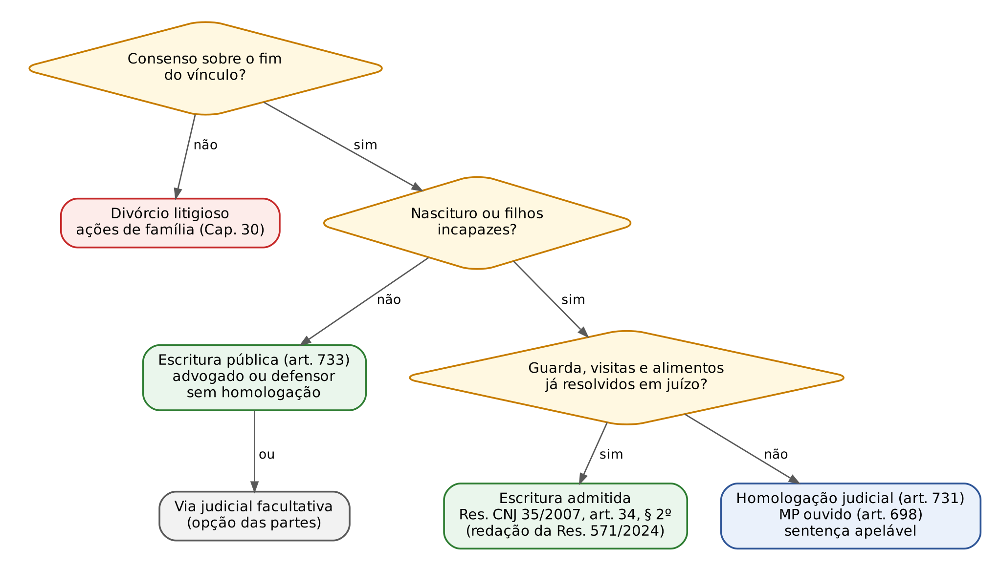
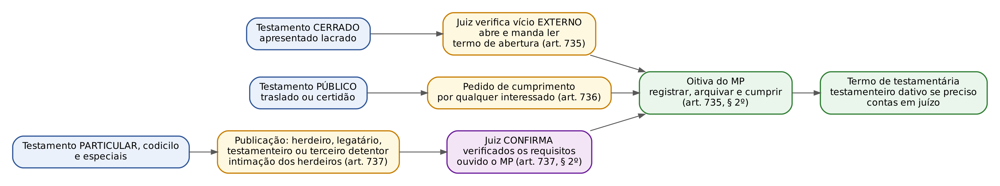
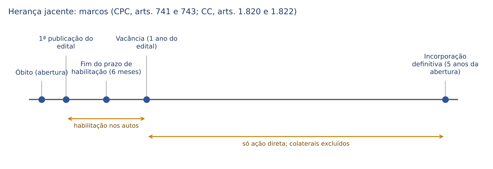
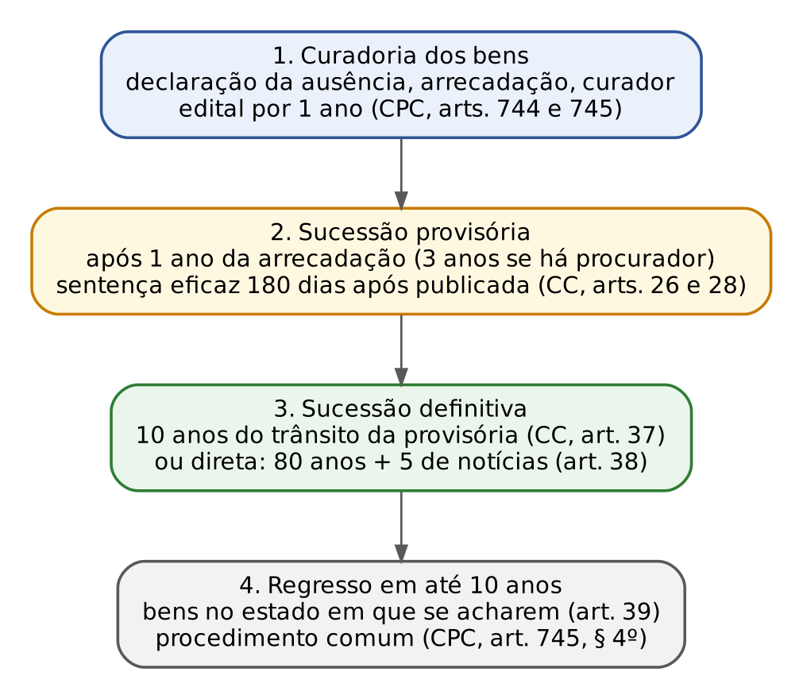
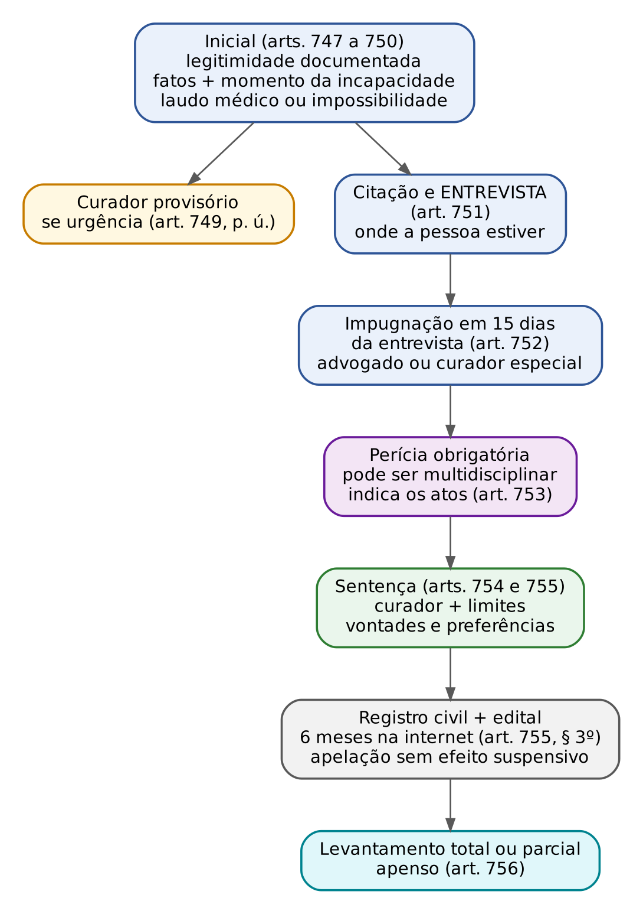

# CAPÍTULO 31 — PROCEDIMENTOS DE JURISDIÇÃO VOLUNTÁRIA E REGISTROS PÚBLICOS

:::INCIDENCIA
TRF5 p. 10; TJRS p. 13; TJSC p. 13, 17. Nível A. Lote: 5 questões (FGV 5, FCC 0), uma de magistratura (TJPE 2024), além de correlatas de outros capítulos (TJMT 2024, MPE-ES 2025, PGE-AC 2026, TJMS 2026).
O que mais cai: letra dos arts. 720 a 725 (quem provoca, MP só no art. 178, equidade, apelação); entrevista e perícia na curatela (arts. 751 a 755); alteração do regime de bens (art. 734: MP, edital, 30 dias, averbações); escritura do art. 733 e seus limites; prazos de edital da herança jacente e dos ausentes; competência e efeitos da dúvida registral.
:::

## 31.1 Disposições gerais (arts. 719 a 725)

A teoria da jurisdição voluntária (natureza, correntes administrativista e jurisdicionalista, coisa julgada, quadro comparativo com a contenciosa) e a transcrição dos arts. 720 a 724 estão no 03.3.1. Aqui interessa o funcionamento do procedimento e as pegadinhas que dele decorrem.

### 31.1.1 Estrutura: procedimento comum de jurisdição voluntária e procedimentos especiais

O Capítulo XV do Título III do Livro I da Parte Especial tem doze seções. A Seção I (arts. 719 a 725) é, ao mesmo tempo, o procedimento comum da jurisdição voluntária para os pedidos do art. 725 e para os pedidos sem rito próprio (art. 719: "Quando este Código não estabelecer procedimento especial"), e a parte geral, subsidiária, dos procedimentos das Seções II a XII (art. 725, parágrafo único). O procedimento comum do art. 318 (contencioso) aplica-se ainda subsidiariamente a tudo (art. 318, parágrafo único).

| Seção | Procedimento | Artigos |
|---|---|---|
| I | Disposições gerais e rol do art. 725 | 719 a 725 |
| II | Notificação e interpelação (e protesto) | 726 a 729 |
| III | Alienação judicial | 730 |
| IV | Divórcio e separação consensuais, extinção consensual de união estável, alteração do regime de bens | 731 a 734 |
| V | Testamentos e codicilos | 735 a 737 |
| VI | Herança jacente | 738 a 743 |
| VII | Bens dos ausentes | 744 e 745 |
| VIII | Coisas vagas | 746 |
| IX | Interdição | 747 a 758 |
| X | Disposições comuns à tutela e à curatela | 759 a 763 |
| XI | Organização e fiscalização das fundações | 764 e 765 |
| XII | Ratificação dos protestos marítimos e processos testemunháveis formados a bordo | 766 a 770 |

O rol do art. 725 é exemplificativo quanto ao cabimento do rito (o art. 719 abrange qualquer pedido sem procedimento especial), mas é taxativo como lista legal das hipóteses que o CPC expressamente submete à Seção I. Fora do CPC há procedimentos de jurisdição voluntária em leis extravagantes (por exemplo, retificação de registro civil, LRP, art. 109; tomada de decisão apoiada, CC, art. 1.783-A; pedidos do ECA), aos quais se aplicam, no que couber, os arts. 719 a 725.

:::LEI CPC, ART. 725
Art. 725. Processar-se-á na forma estabelecida nesta Seção o pedido de: I - emancipação; II - sub-rogação; III - alienação, arrendamento ou oneração de bens de crianças ou adolescentes, de órfãos e de interditos; IV - alienação, locação e administração da coisa comum; V - alienação de quinhão em coisa comum; VI - extinção de usufruto, quando não decorrer da morte do usufrutuário, do termo da sua duração ou da consolidação, e de fideicomisso, quando decorrer de renúncia ou quando ocorrer antes do evento que caracterizar a condição resolutória; VII - expedição de alvará judicial; VIII - homologação de autocomposição extrajudicial, de qualquer natureza ou valor.
Parágrafo único. As normas desta Seção aplicam-se, no que couber, aos procedimentos regulados nas seções seguintes.
:::

Leitura de prova do art. 725:

- Inciso I: a emancipação JUDICIAL é a do tutelado (CC, art. 5º, parágrafo único, I, parte final: "por sentença do juiz, ouvido o tutor, se o menor tiver dezesseis anos completos"). A emancipação pelos pais é por instrumento público, sem juiz (ver Apostila de Direito Civil, Cap. 3).
- Inciso VI, armadilha de redação: o usufruto que se extingue pela MORTE do usufrutuário, pelo TERMO ou pela CONSOLIDAÇÃO NÃO depende do procedimento (cancela-se no registro à vista da prova); o procedimento serve às demais causas (renúncia não registrada, culpa do usufrutuário, não uso). No fideicomisso, o procedimento é para a renúncia ou para a extinção antes do implemento da condição.
- Inciso VII: alvará é o veículo de autorizações judiciais avulsas (levantamento de valores do falecido não sujeitos a inventário, venda de bem de incapaz, outorga de procuração por curador). O STJ reconheceu a competência brasileira para o alvará que autoriza a curadora de herdeiro interditado domiciliado no Brasil a outorgar procuração para atuar em inventário que corre em Portugal, porque a capacidade para suceder rege-se pela lei do domicílio do herdeiro (LINDB, arts. 7º e 10, § 2º); o juízo brasileiro, porém, não pode deliberar sobre a sucessão estrangeira nem criar obstáculos a ela (STJ, AgInt no AREsp n. 1.330.909, Relator Ministro Raul Araújo, Quarta Turma, j. 16/12/2025, Informativo 879).
- Inciso VIII: a homologação de autocomposição extrajudicial "de qualquer natureza ou valor" gera título executivo JUDICIAL (art. 515, III). Distinção com o acordo celebrado dentro de processo contencioso: 03.3.1 (PEGADINHA).

### 31.1.2 Regras procedimentais gerais

O quadro abaixo reúne as regras gerais com os pontos de distinção que as bancas exploram.

| Tema | Regra | Detalhe que cai | Fundamento |
|---|---|---|---|
| Iniciativa | Interessado, MP ou Defensoria | A legitimidade da Defensoria do art. 720 abrange os procedimentos de jurisdição voluntária da legislação extravagante, notadamente o ECA (Enunciado 56 da I Jornada de Direito Processual Civil do CJF) | art. 720 |
| Início de ofício | Excepcional | Herança jacente (arrecadação "imediatamente", art. 738), bens de ausente (art. 744, declarada a ausência), alienação judicial (art. 730, "de ofício"), suspensão de tutor ou curador (art. 762) | arts. 730, 738, 744 |
| Citação | De todos os interessados, para manifestação em 15 dias | Prazo comum, não é contestação típica; revelia sem presunção forte, porque o juiz não fica adstrito à legalidade estrita | art. 721 |
| MP | Só nos casos do art. 178 | Não é obrigatório "em todos os casos"; na alteração do regime de bens, apesar da letra do art. 734, § 1º, o Enunciado 177 da III Jornada (CJF) restringe a intimação aos casos dos arts. 178 e 721 | arts. 721 e 178 |
| Fazenda Pública | "Sempre ouvida" quando tiver interesse | Não é parte necessária em todos | art. 722 |
| Decisão | 10 dias (prazo impróprio) | Sem legalidade estrita: conveniência e oportunidade | art. 723 |
| Recurso | Apelação | Decisões interlocutórias: agravo de instrumento só nas hipóteses do art. 1.015 (por exemplo, tutela provisória, como a nomeação de curador provisório) | arts. 724 e 1.015 |
| Despesas | Adiantadas pelo requerente e RATEADAS entre os interessados | Na contenciosa, quem pede adianta e o vencido paga | art. 88 |
| Férias forenses | Processam-se nelas quando o adiamento puder prejudicá-los | Nomeação ou remoção de tutor e curador também | art. 215, I e II |

Pontos que exigem atenção:

- Honorários: como não há vencido em sentido próprio, a regra é o rateio de despesas do art. 88, sem sucumbência. Quando o procedimento se torna litigioso (impugnação, resistência ao pedido), a doutrina e a prática admitem a aplicação do princípio da causalidade (Cap. 8). Em prova objetiva, a regra literal é o rateio.
- Conversão: o procedimento de jurisdição voluntária pode desembocar em litígio. A lei prevê expressamente a remessa ao procedimento comum em alguns casos (regresso do ausente, art. 745, § 4º; remoção de tutor ou curador após a contestação, art. 761, parágrafo único) e a remessa às vias ordinárias de questões que dependam de outras provas (lógica do art. 612 no inventário). Fora disso, a impugnação não muda, por si, a natureza do procedimento: a interdição contestada continua sendo jurisdição voluntária, com sentença apelável.
- Equidade: o art. 723, parágrafo único, autoriza o juiz a escolher a solução "mais conveniente ou oportuna", mas não o libera da lei material cogente (não pode, por exemplo, homologar alteração do regime de bens sem pedido de ambos os cônjuges, nem autorizar a alienação de bem de incapaz sem demonstrar a vantagem). Equidade aqui é liberdade de meio e de solução dentro do quadro legal.

:::QUESTAO FGV 2024 — TJ-PE — JUIZ SUBSTITUTO (Q3117519)
Questão conceitual sobre os procedimentos de jurisdição voluntária, comentada no 03.3.1. Gabarito: A (extinção por sentença, apelável — art. 724). Armadilhas: decisão interlocutória irrecorrível, MP obrigatório em todos os casos, vedação de oitiva da Fazenda e legalidade estrita. Fixe a tríade de letra: MP só no art. 178 (art. 721), Fazenda ouvida quando tiver interesse (art. 722) e dispensa da legalidade estrita (art. 723, parágrafo único).
No mesmo sentido, sobre a qualificação de pedido consensual de homologação de partilha de união estável como jurisdição voluntária: FGV 2025, PGM-RJ (Q3606019), resolvida no 03.3.1.
:::

:::PEGADINHA INTERVENÇÃO DO MP E NULIDADE
A falta de intimação do MP, quando obrigatória (por exemplo, curatela), gera nulidade a partir do momento em que ele deveria intervir (art. 279, § 1º), mas a nulidade "só pode ser decretada após a intimação do Ministério Público, que se manifestará sobre a existência ou a inexistência de prejuízo" (§ 2º). O STJ não admite nulidade automática na interdição sem demonstração de prejuízo (STJ, REsp n. 1.694.984, Relator Ministro Luis Felipe Salomão, Quarta Turma, conforme notícia institucional). As questões de banca já exploraram os dois lados: FGV 2025, MPE-ES (Q3752740, gabarito "nulo a partir do momento em que deveria intervir", Cap. 10) e FGV 2026, PGE-AC (Q4079389, gabarito "a decretação depende de prévia intimação do MP para se pronunciar sobre o prejuízo", Cap. 13). Não há contradição: o § 1º diz QUAIS atos caem; o § 2º diz QUANDO a nulidade pode ser decretada.
:::

## 31.2 Notificação, interpelação e protesto (arts. 726 a 729)

O CPC/2015 extinguiu as "medidas cautelares específicas" de protesto, notificação e interpelação do CPC/1973 e as transferiu para a jurisdição voluntária. A finalidade é dar ciência formal de vontade juridicamente relevante, com fé pública e data certa.

| Figura | Conteúdo | Destinatário | Base |
|---|---|---|---|
| Notificação | Manifestar formalmente vontade sobre assunto juridicamente relevante, "para dar-lhes ciência de seu propósito" | Pessoas participantes da MESMA relação jurídica | art. 726 |
| Notificação por edital | Dar conhecimento geral ao público | O público; só se o juiz a tiver "por fundada e necessária ao resguardo de direito" | art. 726, § 1º |
| Interpelação | Exigir que o requerido faça ou deixe de fazer o que o requerente entende ser seu direito | O requerido | art. 727 |
| Protesto judicial | Conservar ou ressalvar direitos, prevenir responsabilidade (por exemplo, interromper a prescrição — CC, art. 202, II) | Interessados | art. 726, § 2º |

:::LEI CPC, ARTS. 728 E 729
Art. 728. O requerido será previamente ouvido antes do deferimento da notificação ou do respectivo edital: I - se houver suspeita de que o requerente, por meio da notificação ou do edital, pretende alcançar fim ilícito; II - se tiver sido requerida a averbação da notificação em registro público.
Art. 729. Deferida e realizada a notificação ou interpelação, os autos serão entregues ao requerente.
:::

Pontos de prova:

- Contraditório prévio é EXCEÇÃO e só nas duas hipóteses do art. 728 (suspeita de fim ilícito; pedido de averbação em registro público). Fora delas, a notificação é deferida sem oitiva.
- Não há sentença de mérito sobre o direito afirmado: o juiz não declara que o requerente tem razão; apenas verifica a regularidade e a ausência de fim ilícito. Por isso não há coisa julgada sobre o conteúdo da notificação.
- Autos entregues ao requerente (art. 729), o que, nos autos eletrônicos, se traduz em disponibilização e baixa.
- Interesse processual: a notificação judicial não é, em regra, condição para outras demandas; pode ser substituída pela extrajudicial (cartório de títulos e documentos, correspondência com AR), salvo quando a lei exige a judicial. O protesto judicial é uma das causas interruptivas da prescrição (CC, art. 202, II), e a interrupção só ocorre uma vez (art. 202, *caput*).
- Mora *ex persona*: a interpelação judicial é um dos meios de constituir o devedor em mora nas obrigações sem termo (CC, art. 397, parágrafo único).

:::DICA NOTIFICAÇÃO X INTERPELAÇÃO EM UMA FRASE
Notificar é COMUNICAR um propósito ("vou rescindir"); interpelar é EXIGIR uma conduta ("pague", "desocupe", "abstenha-se"). A banca troca os verbos.
:::

## 31.3 Alienação judicial (art. 730) e alienações do art. 725

O art. 730 tem incidência residual: "nos casos expressos em lei", quando não houver acordo entre os interessados sobre o modo de alienar, o juiz, de ofício ou a requerimento dos interessados ou do depositário, manda alienar em LEILÃO, observando a Seção I e, no que couber, os arts. 879 a 903 (expropriação na execução; Cap. 25). Casos expressos: bens da herança jacente (art. 742), coisas vagas não reclamadas (CC, art. 1.237), coisa comum indivisível (CC, art. 1.322), entre outros.

Distinga três situações que as bancas misturam:

| Situação | Procedimento | Regra material |
|---|---|---|
| Alienação de bem de criança, adolescente, órfão ou interdito | Art. 725, III (procedimento comum de jurisdição voluntária), com MP (art. 178, II) | Imóvel do tutelado só se vende "quando houver manifesta vantagem, mediante prévia avaliação judicial e aprovação do juiz" (CC, art. 1.750), regra estendida à curatela (CC, art. 1.774, que manda aplicar a ela as disposições da tutela) |
| Alienação, locação e administração da coisa comum; alienação de quinhão | Art. 725, IV e V | Coisa indivisível: qualquer condômino pode exigir a venda, com preferência do condômino ao estranho e, entre condôminos, ao que tiver benfeitorias mais valiosas ou maior quinhão (CC, art. 1.322) |
| Alienação forçada sem acordo sobre o modo | Art. 730 (leilão, arts. 879 a 903) | Casos expressos em lei |

A chamada "ação de extinção de condomínio" de bem indivisível costuma ser processada como procedimento de jurisdição voluntária (art. 725, IV), mas, havendo resistência quanto ao próprio direito de dividir ou de vender (alegação de que o bem não é comum, de que há usucapião, de que a cotitularidade é controvertida), a questão é contenciosa e deve ser resolvida como tal, com contraditório pleno. O ex-casal cotitular de imóvel já partilhado é o exemplo forense mais frequente; a partilha anterior é que transforma a mancomunhão em condomínio comum (ver Cap. 30).

:::PEGADINHA ALIENAÇÃO DE BEM DE INCAPAZ
Não há "alienação judicial" em leilão obrigatório: o juiz AUTORIZA a venda (alvará), que pode ser particular, desde que pelo valor da avaliação judicial e com demonstração da vantagem. O leilão do art. 730 é a forma de alienação quando não há acordo dos interessados sobre o modo, não o rito necessário de toda venda de bem de incapaz. O MP intervém (interesse de incapaz).
:::

:::EXEMPLO ALVARÁ PARA VENDA DE IMÓVEL DE CRIANÇA
Pai e mãe, titulares do poder familiar, pedem autorização para vender o apartamento herdado pelo filho de 9 anos, a fim de adquirir outro maior, em nome da criança. Passos: (1) procedimento do art. 725, III, com citação dos interessados e intimação do MP (art. 178, II); (2) avaliação judicial do imóvel e prova da vantagem (sub-rogação no novo imóvel); (3) o juiz pode condicionar o alvará ao depósito do preço em conta judicial ou à aquisição simultânea do novo bem em nome da criança (art. 723, parágrafo único, permite a solução mais conveniente); (4) sentença apelável (art. 724). Erro comum: exigir leilão (art. 730), que não é a regra.
:::

## 31.4 Divórcio e separação consensuais, extinção consensual de união estável e alteração do regime de bens (arts. 731 a 734)

O divórcio e a dissolução litigiosos são ações de família (arts. 693 a 699; Cap. 30). Aqui estão as vias CONSENSUAIS, judicial (homologação) e extrajudicial (escritura), e a alteração do regime de bens.

### 31.4.1 Separação: o que restou após o Tema 1.053 do STF

O CPC/2015 manteve a separação consensual nos arts. 731 e 733, mas, após a EC 66/2010, a separação não subsiste como figura autônoma, preservado o estado dos já separados (STF, Tema 1.053; tese e consequências processuais no Cap. 30, 30.5.1). Para este capítulo: as referências à separação nos arts. 731 a 733 tornaram-se inaplicáveis para novos pedidos; quem já é separado pode converter a separação em divórcio ou restabelecer a sociedade conjugal, inclusive por escritura. Em prova objetiva que transcreve a letra do CPC ("homologação do divórcio ou da separação consensuais"), a assertiva literal continua correta como reprodução do texto; se a questão perguntar pelo direito vigente segundo o STF, a separação não subsiste como figura autônoma (ver Apostila de Direito Civil, Cap. 34, para o regime material).

### 31.4.2 Homologação judicial (arts. 731 e 732)

:::LEI CPC, ART. 731
Art. 731. A homologação do divórcio ou da separação consensuais, observados os requisitos legais, poderá ser requerida em petição assinada por ambos os cônjuges, da qual constarão: I - as disposições relativas à descrição e à partilha dos bens comuns; II - as disposições relativas à pensão alimentícia entre os cônjuges; III - o acordo relativo à guarda dos filhos incapazes e ao regime de visitas; e IV - o valor da contribuição para criar e educar os filhos.
Parágrafo único. Se os cônjuges não acordarem sobre a partilha dos bens, far-se-á esta depois de homologado o divórcio, na forma estabelecida nos arts. 647 a 658.
:::

- Petição assinada por AMBOS os cônjuges (e por advogado, comum ou de cada um).
- A partilha pode ficar para depois (parágrafo único), seguindo as regras da partilha do inventário (arts. 647 a 658); o divórcio pode ser decretado sem prévia partilha (CC, art. 1.581).
- O CPC/2015 não reproduziu a audiência obrigatória de ratificação do art. 1.122 do CPC/1973; o juiz pode designá-la se entender necessário, mas não é requisito.
- MP: só se houver interesse de incapaz, devendo ser ouvido antes da homologação (art. 698).
- Extinção consensual de união estável: aplicam-se, no que couber, as mesmas regras (art. 732). Se houver controvérsia sobre a própria existência ou o termo inicial da união, o caso é de ação de reconhecimento e dissolução (contenciosa).
- Competência: a do art. 53, I (domicílio do guardião de filho incapaz; último domicílio do casal; domicílio do réu), que é relativa (Cap. 4); no pedido conjunto, os requerentes escolhem entre os foros possíveis.

:::SENTENCA HOMOLOGAÇÃO DE DIVÓRCIO CONSENSUAL COM FILHO INCAPAZ
"Vistos. A. (requerente) e B. (requerente) pedem a homologação de divórcio consensual, com partilha, guarda compartilhada de C. (filha), residência materna, regime de convivência e alimentos de 20% dos rendimentos líquidos do genitor. O Ministério Público opinou favoravelmente (art. 698 do CPC). O acordo preserva os interesses da criança e observa os requisitos do art. 731 do CPC. Ante o exposto, HOMOLOGO o acordo e DECRETO o divórcio de A. e B., com fundamento no art. 226, § 6º, da Constituição Federal e nos arts. 731 e 487, III, 'b', do CPC. A requerente voltará a usar o nome de solteira. Custas pro rata (art. 88 do CPC), observada a gratuidade. Após o trânsito em julgado, expeça-se mandado de averbação ao registro civil e, quanto à partilha, o formal ou a carta de sentença."
Observação: a sentença homologatória, no capítulo de alimentos e guarda, é título executivo judicial (art. 515, II) e se submete à cláusula *rebus sic stantibus* (art. 505, I).
:::

### 31.4.3 Escritura pública (art. 733) e Resolução CNJ 35/2007

:::LEI CPC, ART. 733
Art. 733. O divórcio consensual, a separação consensual e a extinção consensual de união estável, não havendo nascituro ou filhos incapazes e observados os requisitos legais, poderão ser realizados por escritura pública, da qual constarão as disposições de que trata o art. 731.
§ 1º A escritura não depende de homologação judicial e constitui título hábil para qualquer ato de registro, bem como para levantamento de importância depositada em instituições financeiras.
§ 2º O tabelião somente lavrará a escritura se os interessados estiverem assistidos por advogado ou por defensor público, cuja qualificação e assinatura constarão do ato notarial.
:::

- A via é FACULTATIVA ("poderão"): as partes podem preferir a homologação judicial.
- Requisitos legais: consenso; ausência de NASCITURO e de filhos INCAPAZES; assistência por advogado ou defensor público (§ 2º), que pode ser comum.
- Efeitos: dispensa homologação; título hábil para QUALQUER ato de registro e para LEVANTAMENTO de valores em instituições financeiras (§ 1º). A FGV já transformou "exceto para levantamento de importância depositada" em alternativa falsa (Q3520573, Cap. 30, na versão do inventário extrajudicial, art. 610, § 1º, que tem redação paralela).
- Livre escolha do tabelião, independentemente do domicílio das partes (regra da Resolução CNJ 35/2007, mantida no regime atual).

A Resolução CNJ 571, de 26/8/2024, alterou a Resolução CNJ 35/2007 e flexibilizou o requisito da ausência de filhos incapazes: havendo filhos comuns crianças, adolescentes ou incapazes, a escritura de divórcio é admitida se comprovada a PRÉVIA resolução judicial de guarda, visitação e alimentos, consignada no corpo da escritura (art. 34, § 2º, da Resolução 35); na dúvida sobre os interesses do incapaz, o tabelião submete a questão ao juiz prolator daquela decisão (§ 3º). As partes declaram ainda que não há gravidez ou que a desconhecem (§ 1º).

:::ATENCAO RESOLUÇÃO X LEI
A Resolução 571/2024 é ato normativo do CNJ que interpreta o art. 733 à luz de sua finalidade (proteger o incapaz, cujas questões já foram decididas em juízo). Em prova que pergunte "segundo o CPC", a resposta é a letra do art. 733 (vedada a escritura havendo nascituro ou filhos incapazes); em prova que mencione a regulamentação do CNJ, a escritura é possível com as questões dos filhos previamente resolvidas em juízo. A banca de cartórios cobra a Resolução; a de magistratura, até aqui, a letra do CPC.
:::

### 31.4.4 Alteração do regime de bens do casamento (art. 734)

A alteração do regime de bens do CASAMENTO exige autorização judicial em pedido motivado de ambos os cônjuges, apurada a procedência das razões e ressalvados os direitos de terceiros (CC, art. 1.639, § 2º). Não existe via extrajudicial para o casamento. Na UNIÃO ESTÁVEL, basta novo contrato escrito e o Código Nacional de Normas admite a alteração diretamente no registro civil (Provimento CNJ 149/2023, arts. 547 e 548; ver 31.12 e Apostila de Direito Civil, Caps. 35 e 36).

:::LEI CPC, ART. 734
Art. 734. A alteração do regime de bens do casamento, observados os requisitos legais, poderá ser requerida, motivadamente, em petição assinada por ambos os cônjuges, na qual serão expostas as razões que justificam a alteração, ressalvados os direitos de terceiros.
§ 1º Ao receber a petição inicial, o juiz determinará a intimação do Ministério Público e a publicação de edital que divulgue a pretendida alteração de bens, somente podendo decidir depois de decorrido o prazo de 30 (trinta) dias da publicação do edital.
§ 2º Os cônjuges, na petição inicial ou em petição avulsa, podem propor ao juiz meio alternativo de divulgação da alteração do regime de bens, a fim de resguardar direitos de terceiros.
§ 3º Após o trânsito em julgado da sentença, serão expedidos mandados de averbação aos cartórios de registro civil e de imóveis e, caso qualquer dos cônjuges seja empresário, ao Registro Público de Empresas Mercantis e Atividades Afins.
:::

Pontos de prova:

- Legitimidade conjunta e necessária: petição assinada por ambos. Não há alteração litigiosa, nem a pedido de um só, nem de ofício.
- MP: a letra manda intimar sempre (§ 1º); o Enunciado 177 da III Jornada de Direito Processual Civil (CJF) restringe a intimação aos casos dos arts. 178 e 721 (por exemplo, interesse de incapaz). Em prova de letra, a assertiva que reproduz o § 1º está correta.
- Edital e prazo: decisão só DEPOIS de 30 dias da publicação; meio alternativo de divulgação pode ser proposto pelos cônjuges (§ 2º).
- Averbações APÓS o trânsito em julgado (§ 3º): registro civil, registro de imóveis e, se empresário, Junta Comercial.
- Motivação: o STJ não exige justificativas ou provas exageradas nem relação pormenorizada do patrimônio quando não há partilha; presume-se a boa-fé, bastando justificativa plausível e ausência de prejuízo a terceiros, que de todo modo ficam ressalvados (STJ, REsp n. 1.904.498, Relatora Ministra Nancy Andrighi, 2021, conforme notícia institucional). Havendo pedido de partilha do patrimônio do regime anterior, a exigência documental é maior.
- Eficácia no tempo: em regra *ex nunc*, ressalvados terceiros; a discussão sobre retroatividade na passagem para a comunhão universal é material (Apostila de Direito Civil, Cap. 36).

:::QUESTAO FGV 2025 — TJ-ES — ATIVIDADE NOTARIAL E DE REGISTRO, REMOÇÃO (Q3520271)
Casal casado quer alterar o regime; a banca apresenta três afirmações extraídas do art. 734: (I) intimação do MP e edital, decisão só após 30 dias da publicação; (II) proposta de meio alternativo de divulgação na inicial ou em petição avulsa; (III) mandados de averbação, após o trânsito, ao registro civil, ao de imóveis e, se empresário, à Junta. Gabarito: E (I, II e III corretas). Armadilha: o candidato que conhece o Enunciado 177 do CJF pode hesitar em I, mas a pergunta era "considerando as disposições do Código de Processo Civil", e o § 1º manda intimar o MP. Regra de prova: pergunta de letra, resposta de letra.
:::

:::PEGADINHA TRÊS "30 DIAS" DIFERENTES NO CAPÍTULO
Alteração do regime de bens: decisão só depois de 30 dias da publicação do edital (art. 734, § 1º). Interdição: não há prazo de 30 dias; a impugnação é de 15 dias contados da ENTREVISTA (art. 752). Ausência: edital por 1 ano, reproduzido de 2 em 2 meses na falta de sítio (art. 745). Herança jacente: edital por 3 meses na internet, habilitação em 6 meses (art. 741).
:::

## 31.5 Testamentos e codicilos (arts. 735 a 737)

A sucessão testamentária (formas, capacidade, disposições, invalidade) é da Apostila de Direito Civil, Cap. 44. Aqui está o procedimento judicial de abertura, registro, publicação, confirmação e cumprimento, que é condição para que o testamento produza efeitos no inventário.

| Espécie | Ato do juiz | Quem provoca | Particularidade | Artigo |
|---|---|---|---|---|
| Cerrado | Verifica vício EXTERNO; abre; manda o escrivão ler na presença do apresentante; lavra termo de abertura | Apresentante (quem o detém) | Termo com nome do apresentante, como obteve o testamento, data e lugar do óbito com provas e qualquer circunstância digna de nota | art. 735 |
| Público | Ordena o cumprimento | Qualquer interessado, com traslado ou certidão | Aplicam-se, no que couber, os parágrafos do art. 735 | art. 736 |
| Particular, codicilo, marítimo, aeronáutico, militar e nuncupativo | CONFIRMA o testamento, verificados os requisitos da lei, ouvido o MP | Herdeiro, legatário, testamenteiro ou terceiro detentor impossibilitado de entregá-lo aos legitimados | Intimação dos herdeiros que não requereram a publicação; confirmação depende da oitiva das testemunhas na forma do CC, art. 1.878 | art. 737 |

Regras comuns (art. 735, §§ 2º a 5º): ouvido o MP e não havendo dúvidas, o juiz manda REGISTRAR, ARQUIVAR e CUMPRIR; o testamenteiro é intimado a assinar o termo da testamentária; não havendo testamenteiro, ou se ausente ou recusar, o juiz nomeia testamenteiro DATIVO, observada a preferência legal (CC, art. 1.984: cônjuge, e na falta, herdeiro nomeado pelo juiz); o testamenteiro cumpre as disposições e presta contas em juízo.

Cognição limitada. O procedimento é de jurisdição voluntária e de cognição restrita aos aspectos EXTRÍNSECOS: o juiz verifica se o documento tem aparência de regularidade formal (no cerrado, se o lacre está íntegro e não há "vício externo que o torne suspeito de nulidade ou falsidade"; no particular, se as testemunhas confirmam o ato). A validade intrínseca (capacidade do testador, vícios de vontade, falsidade da assinatura, rompimento, redução de disposições) é discutida em ação própria. A decisão que manda cumprir não faz coisa julgada sobre a validade.

:::QUESTAO FGV 2024 — TJ-MT — JUIZ SUBSTITUTO (Q3086934; QUESTÃO DO CAP. 30, USADA PELO FUNDAMENTO)
Gabarito: B (falsidade da assinatura do testamento já mandado cumprir, dependente de perícia, é questão de alta indagação remetida às vias ordinárias, art. 612). O ponto próprio deste capítulo: o "cumpra-se" do art. 736 não resolve a autenticidade do testamento, que continua discutível. Resolução em passos e armadilhas: Cap. 30 (30.2.3).
:::

### 31.5.1 Testamento e inventário extrajudicial

A existência de testamento, pela letra do art. 610, *caput*, impõe o inventário judicial. O STJ, porém, admitiu o inventário extrajudicial mesmo havendo testamento, se os interessados forem capazes e concordes, assistidos por advogado, e o testamento tiver sido previamente registrado em juízo ou houver autorização do juiz competente (STJ, REsp n. 1.808.767, Relator Ministro Luis Felipe Salomão, Quarta Turma, j. 15/10/2019, Informativo 663). A Resolução CNJ 571/2024 positivou a orientação no art. 12-B da Resolução 35/2007: exige advogado para todos, autorização expressa do juízo sucessório em sentença transitada em julgado no procedimento de abertura e cumprimento, e interessados capazes e concordes; VEDA a escritura, impondo o inventário judicial, se o testamento contiver reconhecimento de filho ou outra declaração irrevogável (§ 1º); na dúvida, o tabelião a suscita ao juízo de registros públicos (§ 2º).

:::QUESTAO FGV 2026 — TJ-MS — OUTORGA DE DELEGAÇÕES DE NOTAS E DE REGISTRO, REMOÇÃO (Q3914309; CORRELATA)
Gabarito: E (testamento que reconhece filho: escritura vedada pelo art. 12-B, § 1º, da Resolução 35/2007; resolução em passos no Cap. 30, 30.1.3). O acréscimo útil aqui: a autorização condicional do juízo ("se cabível") não supera a vedação, e a presença do filho de 10 anos, isoladamente, já não seria impeditivo absoluto depois da mesma resolução (art. 12-A: inventário com interessado incapaz, com quinhão em parte ideal de cada bem e manifestação favorável do MP), o que reforça que o fundamento decisivo é o reconhecimento de filho.
:::

## 31.6 Herança jacente (arts. 738 a 743)

O regime material (conceitos de jacência e vacância, exclusão dos colaterais, destino dos bens, posição do ente público) está na Apostila de Direito Civil, Cap. 42 (42.7), com quadro do procedimento. Aqui, os pontos processuais e de prazo.

- Competência: juiz da comarca do DOMICÍLIO do falecido (art. 738), coerente com o art. 48.
- Iniciativa de ofício: o juiz procede "imediatamente" à arrecadação (art. 738), exceção ao princípio da inércia (art. 2º). Qualquer interessado, o MP e a Fazenda também podem provocar.
- Curador: guarda, conserva e administra; REPRESENTA a herança em juízo ou fora dele, com intervenção do MP; balancete MENSAL; contas ao final (art. 739). Responde como depositário e administrador (arts. 159 a 161). A herança jacente tem capacidade de ser parte (art. 75, VI).
- Arrecadação: oficial de justiça, escrivão ou chefe de secretaria e curador; se o juiz não puder comparecer, requisita a autoridade policial, com 2 testemunhas (art. 740, § 1º); sem curador ainda, depositário compromissado (§ 2º); papéis examinados reservadamente pelo juiz (§ 4º); bens em outra comarca, por precatória (§ 5º).
- Não se arrecada, ou suspende-se a arrecadação, se comparecerem cônjuge, companheiro, herdeiro ou testamenteiro NOTORIAMENTE reconhecido e não houver oposição motivada do curador, de interessado, do MP ou da Fazenda (art. 740, § 6º).
- Edital: na internet (sítio do tribunal e plataforma de editais do CNJ) por 3 MESES, ou, sem sítio, no órgão oficial e na imprensa da comarca 3 VEZES com intervalo de 1 MÊS, para habilitação no prazo de 6 MESES da primeira publicação (art. 741); sucessor em lugar certo é citado (§ 1º); falecido estrangeiro: comunicação à autoridade consular (§ 2º).
- Conversão: julgada a habilitação do herdeiro, reconhecida a qualidade do testamenteiro ou provada a identidade do cônjuge ou companheiro, a arrecadação CONVERTE-SE em inventário (§ 3º).
- Credores: habilitam-se como nos inventários ou propõem ação de cobrança (§ 4º).
- Alienação antecipada: hipóteses taxativas do art. 742 (móveis de conservação difícil ou dispendiosa, semoventes não empregados em indústria, títulos com receio de depreciação, ações com integralização reclamada sem dinheiro, imóveis em ruína ou hipotecados com dívida vencida); não se vende se a Fazenda ou o habilitando adiantar as despesas; bens de valor de afeição só depois da vacância.
- Vacância: passado 1 ANO da primeira publicação do edital sem herdeiro habilitado nem habilitação pendente (art. 743); pendente habilitação, a vacância é declarada na sentença que a julgar improcedente (§ 1º). Transitada em julgado a sentença de vacância, cônjuge, companheiro, herdeiros e credores só reclamam por AÇÃO DIRETA (§ 2º).

:::DICA USUCAPIÃO E HERANÇA JACENTE
O ente público não adquire pela *saisine*; adquire com a declaração de vacância, em caráter resolúvel, consolidando-se o domínio cinco anos após a abertura da sucessão (CC, art. 1.822). Daí a orientação do STJ, citada em doutrina e em material de concurso, de que o imóvel da herança jacente pode ser usucapido se o prazo se completar antes da declaração de vacância (orientação descrita sem número de precedente; ver nota de verificação). Para o processo de usucapião, o curador da herança jacente é quem a representa no polo passivo.
:::

## 31.7 Bens dos ausentes (arts. 744 e 745)

O regime material da ausência (curadoria, sucessão provisória, sucessão definitiva, regresso, morte presumida sem ausência) é da Apostila de Direito Civil, Cap. 3 (03.6). O CPC disciplina a arrecadação e os editais e remete à "lei" (o CC) quanto às fases sucessórias.

| Fase | Regra processual | Regra material |
|---|---|---|
| Declaração e arrecadação | Juiz manda arrecadar os bens e nomeia curador, pela forma da herança jacente (art. 744) | Requerimento de qualquer interessado ou do MP (CC, art. 22); também quando o mandatário não quer, não pode ou não tem poderes suficientes (art. 23) |
| Editais | Internet (sítio do tribunal e plataforma do CNJ) por 1 ANO, ou, sem sítio, órgão oficial e imprensa da comarca durante 1 ano, reproduzido de 2 EM 2 MESES, chamando o ausente (art. 745) | Fim do prazo do edital abre a fase seguinte |
| Sucessão provisória | Interessados requerem; citação PESSOAL dos herdeiros presentes e do curador, e por EDITAL dos ausentes, para habilitação na forma dos arts. 689 a 692 (art. 745, §§ 1º e 2º) | 1 ano da arrecadação, ou 3 anos se deixou representante (CC, art. 26); sentença produz efeito 180 dias depois de publicada, mas, transitada em julgado, já se abre testamento e inventário (art. 28); sem interessados, o MP requer (art. 28, § 1º) |
| Sucessão definitiva | Requerimento de conversão (art. 745, § 3º) | 10 anos do trânsito da provisória (CC, art. 37) ou, diretamente, se o ausente conta 80 anos e de 5 datam as últimas notícias (art. 38) |
| Regresso | Ausente, descendente ou ascendente requer a entrega; citação dos sucessores, do MP e da Fazenda; PROCEDIMENTO COMUM (art. 745, § 4º) | Nos 10 anos seguintes à definitiva, recebe os bens no estado em que se acharem, os sub-rogados ou o preço (CC, art. 39) |

:::QUESTAO FGV 2025 — ENAC — 2º EXAME NACIONAL DOS CARTÓRIOS (Q3673863)
Ausente que desapareceu aos 79 anos, sem notícias há mais de seis, sem bens; os herdeiros precisam sucedê-lo em contrato de locação não residencial para propor renovatória e pedem diretamente a sucessão definitiva. Gabarito: E (é possível pedir diretamente a definitiva, porque, ao tempo do requerimento, o ausente já teria 85 anos e as últimas notícias datam de mais de cinco; e não é necessário que existam bens, arrecadáveis ou não, para justificar o procedimento). Passos: (1) o art. 38 do CC é hipótese AUTÔNOMA de sucessão definitiva e a idade de 80 anos é aferida na data do requerimento, não na do desaparecimento (STJ, REsp n. 1.924.451, Relatora Ministra Nancy Andrighi, Terceira Turma, j. 19/10/2021, Informativo 716) — isso derruba A e D; (2) o interesse processual não depende da existência de bens, porque a ausência produz efeitos sobre posições contratuais e outras situações jurídicas do ausente — isso derruba B e C. A questão é comentada também na Apostila de Direito Civil, Cap. 3.
:::

:::PEGADINHA DESTINATÁRIO DOS BENS E PRAZOS QUE SE CONFUNDEM
Na ausência, se nos 10 anos posteriores à definitiva o ausente não regressar e nenhum interessado promover a definitiva, os bens passam ao MUNICÍPIO ou ao DF da situação, ou à União se em território federal (CC, art. 39, parágrafo único) — o mesmo destino da herança vacante (art. 1.822). O Estado-membro não recebe. Os editais: ausência = 1 ano (de 2 em 2 meses sem sítio); jacente = 3 meses na internet (3 vezes, de mês em mês, sem sítio), com habilitação em 6 meses.
:::

## 31.8 Coisas vagas (art. 746)

Coisa vaga é a coisa alheia PERDIDA (não abandonada: a abandonada é *res derelicta*, adquirível por ocupação). O descobridor deve restituí-la ao dono ou legítimo possuidor; não o encontrando, entrega-a à autoridade competente (CC, art. 1.233).

Procedimento (art. 746): recebida a coisa do descobridor, o juiz manda lavrar AUTO com a descrição do bem e as declarações do descobridor; se recebida pela autoridade POLICIAL, esta a remete ao juízo competente (§ 1º); depositada a coisa, publica-se edital na internet (sítio do tribunal e plataforma do CNJ) ou, sem sítio, no órgão oficial e na imprensa da comarca, para que o dono ou legítimo possuidor a reclame; se a coisa for de PEQUENO VALOR e não for possível publicar no sítio do tribunal, o edital é apenas afixado no átrio do fórum (§ 2º). No mais, observa-se a lei civil (§ 3º).

| Ponto | Regra | Fundamento |
|---|---|---|
| Recompensa (achádego) | Não inferior a 5% do valor, mais indenização das despesas de conservação e transporte, se o dono não preferir abandonar a coisa | CC, art. 1.234 |
| Critérios da recompensa | Esforço do descobridor, possibilidades do dono de encontrá-la e situação econômica de ambos | CC, art. 1.234, parágrafo único |
| Responsabilidade do descobridor | Só por dolo | CC, art. 1.235 |
| Divulgação | Imprensa e outros meios; editais só se o valor os comportar | CC, art. 1.236 |
| Prazo | 60 dias da divulgação ou do edital sem reclamação | CC, art. 1.237 |
| Destino | Venda em hasta pública; deduzidas despesas e recompensa, o remanescente pertence ao MUNICÍPIO onde se achou a coisa; se de diminuto valor, o Município pode abandoná-la em favor de quem a achou | CC, art. 1.237 e parágrafo único |

:::DICA OS "MUNICÍPIOS" DO CAPÍTULO
Três destinos municipais: herança vacante (CC, art. 1.822), bens do ausente não reclamados (art. 39, parágrafo único) e remanescente da coisa vaga (art. 1.237). Na coisa vaga, o Município é o do LUGAR em que a coisa foi achada; nas duas outras hipóteses, o da SITUAÇÃO dos bens.
:::

## 31.9 Interdição e curatela após o Estatuto da Pessoa com Deficiência (arts. 747 a 758)

O regime material (hipóteses do art. 1.767 do CC, incapacidade relativa, curatela proporcional e restrita aos atos patrimoniais e negociais — EPD, arts. 84 e 85 —, escolha do curador, curatela compartilhada, tomada de decisão apoiada, "atropelamento legislativo" entre o EPD e o CPC) está na Apostila de Direito Civil, Cap. 41, que também traz um quadro do procedimento. Aqui, a disciplina processual, com o que a prova de processo cobra.

:::ATENCAO TERMINOLOGIA
O CPC/2015 (publicado em março de 2015, antes da vigência do EPD) fala em "interdição"; o EPD fala em "curatela" e a trata como medida extraordinária e proporcional (art. 84, § 3º). A doutrina e a jurisprudência preferem "ação de curatela" ou "processo de definição de curatela", mas o procedimento é o dos arts. 747 a 758. Depois do EPD, a curatela só alcança relativamente incapazes (CC, art. 4º, III), e ninguém maior é absolutamente incapaz (art. 3º).
:::

### 31.9.1 Legitimidade e petição inicial

- Legitimados (art. 747): cônjuge ou companheiro; parentes ou tutores; representante da entidade em que se encontra abrigado o interditando; MP. A legitimidade é CONCORRENTE e o rol não estabelece ordem de preferência (STJ, REsp n. 1.346.013, Informativo 571, conforme a Apostila de Direito Civil, Cap. 41). Deve ser comprovada por documentos com a inicial (parágrafo único).
- O próprio interditando: o art. 747 não o menciona; parte da doutrina admite a "autocuratela" com base no art. 1.768, IV, do CC (inserido pelo EPD e revogado pelo CPC), e o Enunciado 57 da I Jornada de Direito Processual Civil (CJF) afirma que o rol de legitimados para promover a curatela "deve incluir o próprio sujeito a ser curatelado", estendendo a todos eles a legitimidade para pedir o levantamento.
- MP: legitimidade SUBSIDIÁRIA e qualificada — só "em caso de doença mental grave" e se os legitimados dos incisos I a III não existirem ou não promoverem a interdição, ou se os dos incisos I e II forem incapazes (art. 748).
- Inicial (art. 749): especificar os fatos que demonstram a incapacidade para administrar bens e, se for o caso, para praticar atos da vida civil, e o MOMENTO em que a incapacidade se revelou (dado relevante para a invalidação de atos anteriores, que exige ação própria).
- Laudo médico (art. 750): juntar OU informar a impossibilidade de fazê-lo. O STJ admite a dispensa quando o interditando se recusa ao exame; o laudo inicial só precisa demonstrar plausibilidade, porque a prova decisiva é a perícia judicial (Terceira Turma, Relatora Ministra Nancy Andrighi, processo em segredo de justiça, conforme notícia institucional).
- Curador provisório (art. 749, parágrafo único): justificada a urgência, para a prática de DETERMINADOS atos. É tutela provisória: a decisão é agravável (art. 1.015, I). O EPD prevê a nomeação de curador provisório, de ofício ou a requerimento, ouvido o MP, em casos de relevância e urgência (Lei 13.146/2015, art. 87).

### 31.9.2 Citação, entrevista e defesa

:::LEI CPC, ART. 751
Art. 751. O interditando será citado para, em dia designado, comparecer perante o juiz, que o entrevistará minuciosamente acerca de sua vida, negócios, bens, vontades, preferências e laços familiares e afetivos e sobre o que mais lhe parecer necessário para convencimento quanto à sua capacidade para praticar atos da vida civil, devendo ser reduzidas a termo as perguntas e respostas.
§ 1º Não podendo o interditando deslocar-se, o juiz o ouvirá no local onde estiver.
§ 2º A entrevista poderá ser acompanhada por especialista.
§ 3º Durante a entrevista, é assegurado o emprego de recursos tecnológicos capazes de permitir ou de auxiliar o interditando a expressar suas vontades e preferências e a responder às perguntas formuladas.
§ 4º A critério do juiz, poderá ser requisitada a oitiva de parentes e de pessoas próximas.
:::

- A entrevista substituiu o "interrogatório" do CPC/1973 e é ato OBRIGATÓRIO e pessoal do juiz; sua falta gera nulidade, segundo orientação da Terceira Turma do STJ (Relatora Ministra Nancy Andrighi, processo em segredo de justiça, conforme notícia institucional). Se o interditando não puder se deslocar, o juiz vai até ele (§ 1º).
- Impugnação: 15 dias contados DA ENTREVISTA (art. 752), não da citação nem da juntada do mandado.
- MP: intervém como fiscal da ordem jurídica (art. 752, § 1º). Segundo a Terceira Turma do STJ, o MP que atua como fiscal na interdição que não ajuizou não pode acumular a função de defensor do interditando; não constituído advogado, nomeia-se curador especial (Defensoria Pública ou, na falta, advogado dativo) (processo em segredo de justiça, Relatora Ministra Nancy Andrighi, dezembro de 2019, conforme notícia institucional).
- Defesa técnica: o interditando pode constituir advogado; se não o fizer, DEVE ser nomeado curador especial (art. 752, § 2º); nesse caso, cônjuge, companheiro ou parente sucessível podem intervir como ASSISTENTES (§ 3º).

### 31.9.3 Perícia, sentença e recursos

- Perícia (art. 753): decorrido o prazo da impugnação, o juiz DETERMINA a prova pericial, que pode ser feita por equipe MULTIDISCIPLINAR; o laudo indica especificadamente os atos para os quais haverá necessidade de curatela. A Terceira Turma do STJ decidiu, em 2024, que a perícia é indispensável e que não cabe julgamento antecipado com base em laudo médico unilateral ou apenas na entrevista: julgar sem perícia é cerceamento de defesa (Relatora Ministra Nancy Andrighi, processo em segredo de justiça, conforme notícia institucional). Em sentido mais flexível, o Enunciado 178 da III Jornada de Direito Processual Civil (CJF) admite que, em casos EXCEPCIONAIS, o juiz dispense a perícia, na forma do art. 472 do CPC e ouvido o MP, quando houver pareceres técnicos ou documentos elucidativos e entrevista do interditando. Para a prova, a regra é a obrigatoriedade.
- Sentença (art. 755): nomeia curador, que PODE ser o requerente; fixa os LIMITES da curatela segundo o estado e o desenvolvimento mental do interdito; considera características pessoais, potencialidades, habilidades, vontades e preferências; a curatela deve ser atribuída a quem melhor possa atender aos interesses do curatelado (§ 1º); havendo incapaz sob a guarda do interdito, a curatela vai a quem melhor atender a ambos (§ 2º), e a autoridade do curador se estende à pessoa e aos bens desse incapaz, salvo solução mais conveniente (art. 757).
- Publicidade (art. 755, § 3º): inscrição no registro civil das pessoas naturais e publicação imediata na internet (sítio do tribunal e plataforma de editais do CNJ) por 6 MESES, na imprensa local 1 VEZ e no órgão oficial 3 VEZES com intervalo de 10 DIAS, constando nomes do interdito e do curador, causa, limites da curatela e, não sendo total, os atos que o interdito pode praticar sozinho.
- Natureza e efeitos: a sentença é constitutiva, com efeitos *ex nunc*; atos anteriores não são automaticamente nulos, exigindo ação própria em que se prove a incapacidade ao tempo do ato (STJ, AgInt nos EDcl no REsp n. 1.834.877, Relator Ministro Raul Araújo, Quarta Turma, conforme notícia institucional).
- Recurso: apelação SEM efeito suspensivo, porque a sentença que "decreta a interdição" produz efeitos imediatamente após a publicação (art. 1.012, § 1º, VI). A sentença de improcedência segue a regra (efeito suspensivo).
- Dever do curador: buscar tratamento e apoio apropriados à conquista da autonomia pelo interdito (art. 758).

:::QUESTAO FGV 2025 — MPE-RJ — ANALISTA DO MP, ÁREA PROCESSUAL (Q3362520)
Idoso de 68 anos com redução do discernimento para gestão patrimonial; um filho pede a curatela com relatório médico; o interditando se opõe com apoio da filha; o juiz faz entrevista, determina perícia (que confirma a redução) e decreta curatela PARCIAL, limitada a atos patrimoniais de grande vulto, nomeando o filho requerente. Gabarito: C (o juízo agiu corretamente ao entrevistar o curatelando, que deve ser ouvido pessoalmente antes da decisão, inclusive onde estiver se não puder se deslocar — art. 751, *caput* e § 1º).
Passos: (1) A é falsa: a curatela é proporcional e o juiz fixa os limites (CPC, art. 755, I; EPD, art. 84, § 3º); "total" é exceção que não decorre automaticamente do reconhecimento da incapacidade; (2) B é falsa: não há ordem rígida nem vedação a substituto; vale o melhor interesse e as preferências do curatelado (art. 755, § 1º); (3) D é falsa: a oposição do interditando não impede a curatela quando a prova demonstra a necessidade, e a tomada de decisão apoiada depende de pedido da própria pessoa (CC, art. 1.783-A); (4) E é falsa: a curatela parcial restringe exatamente os atos fixados na sentença.
:::

:::QUESTAO FGV 2026 — MPE-ES — AGENTE ESPECIALIZADO, MÉDICO PSIQUIATRA (Q4217302)
Três afirmações: (I) transcrição do art. 751 (entrevista minuciosa, perguntas e respostas reduzidas a termo); (II) transcrição do art. 753 (perícia, equipe multidisciplinar, laudo que indica os atos sujeitos a curatela); (III) transcrição do art. 12 do EPD (consentimento prévio, livre e esclarecido da pessoa com deficiência para tratamento, procedimento, hospitalização e pesquisa; na curatela, participação "no maior grau possível"). Gabarito: E (todas corretas). A armadilha estava em III: a curatela não suprime a participação da pessoa nas decisões sobre o próprio corpo e saúde, em sintonia com o EPD, art. 85, § 1º.
:::

### 31.9.4 Levantamento da curatela (art. 756)

- Causa: cessação da causa que determinou a curatela (*caput*); pode ser PARCIAL, se demonstrada a capacidade para alguns atos (§ 4º).
- Legitimados: interdito, curador ou MP (§ 1º), e, segundo o Enunciado 57 do CJF, todos os legitimados a promover a curatela; o pedido é APENSADO aos autos da interdição.
- Instrução: perito ou equipe multidisciplinar e audiência de instrução e julgamento APÓS o laudo (§ 2º).
- Sentença de levantamento: publicada APÓS o trânsito em julgado, na forma do art. 755, § 3º, ou, não sendo possível, na imprensa local e no órgão oficial 3 vezes com intervalo de 10 dias, seguindo-se a AVERBAÇÃO no registro civil (§ 3º). Compare: a sentença que decreta a interdição é publicada "imediatamente"; a que a levanta, depois do trânsito.

:::PEGADINHA CURATELA X TOMADA DE DECISÃO APOIADA (ASPECTOS PROCESSUAIS)
|  | Curatela | Tomada de decisão apoiada |
|---|---|---|
| Quem pede | Legitimados do art. 747 (e, para o Enunciado 57, o próprio) | SOMENTE a pessoa a ser apoiada (CC, art. 1.783-A, § 2º) |
| Natureza do procedimento | Especial (arts. 747 a 758) | Jurisdição voluntária, com rito do CC e aplicação subsidiária dos arts. 719 a 725 |
| Prova | Entrevista e perícia | Juiz, assistido por equipe multidisciplinar, ouve o MP, o requerente e os apoiadores (art. 1.783-A, § 3º) |
| Efeito sobre a capacidade | Restringe os atos fixados | Preserva a capacidade plena |
A TDA não é decretada de ofício nem a pedido de parentes ou do MP, e o juiz não pode "converter" a curatela em TDA sem pedido da própria pessoa (ver Apostila de Direito Civil, Cap. 41).
:::

## 31.10 Disposições comuns à tutela e à curatela (arts. 759 a 763)

A tutela (hipóteses, espécies, incapazes de exercê-la, escusas, exercício, contas) é regulada no CC (arts. 1.728 a 1.766) e no ECA (arts. 36 a 38); a nomeação de tutor de criança ou adolescente em situação do art. 98 do ECA é da competência da Justiça da Infância e da Juventude (ECA, art. 148, parágrafo único, "a"). O CPC traz as regras procedimentais comuns.

| Ato | Prazo | Termo inicial | Consequência | Artigo |
|---|---|---|---|---|
| Compromisso do tutor ou curador | 5 dias | Nomeação ou intimação do despacho que mandar cumprir o testamento ou o instrumento público que instituiu o encargo | Prestado o compromisso, assume a administração dos bens | art. 759 |
| Escusa antes de aceitar | 5 dias | Intimação para prestar compromisso | Não alegada no prazo: renúncia ao direito de alegá-la | art. 760, I, e § 1º |
| Escusa superveniente | 5 dias | Dia em que sobrevier o motivo | Idem | art. 760, II |
| Decisão sobre escusa | De plano | — | Não admitida, o nomeado exerce o encargo enquanto não dispensado por sentença transitada em julgado | art. 760, § 2º |
| Contestação à remoção | 5 dias | Citação | Depois, procedimento comum | art. 761, parágrafo único |
| Pedido de exoneração ao fim do prazo legal | 10 dias | Expiração do termo | Não requerida: recondução, salvo dispensa pelo juiz | art. 763, § 1º |

- Escusa: o CC dá 10 dias (art. 1.738); prevalece o prazo processual de 5 dias do art. 760, posterior e específico (posição dominante; ver Apostila de Direito Civil, Cap. 41).
- Remoção: requerida pelo MP ou por quem tenha legítimo interesse, nos casos da lei (art. 761; CC, art. 1.766: negligência, prevaricação ou incapacidade). É procedimento contencioso incidental.
- Suspensão: em caso de EXTREMA GRAVIDADE, o juiz pode suspender o tutor ou curador e nomear substituto interino (art. 762) — medida que pode ser tomada de ofício.
- Fim do encargo: cessada a tutela ou a curatela, é INDISPENSÁVEL a prestação de contas, na forma da lei civil (art. 763, § 2º). O tutor serve por 2 anos (CC, art. 1.765), daí a regra de exoneração e recondução do art. 763.
- Férias forenses: os processos de nomeação ou remoção de tutor e curador tramitam durante elas (art. 215, II).

## 31.11 Organização e fiscalização das fundações (arts. 764 e 765)

Quem vela pelas fundações é o Ministério Público do Estado onde situadas (CC, art. 66); se funcionarem no DF ou em Território, o MPDFT (§ 1º, redação da Lei 13.151/2015); se estenderem a atividade por mais de um Estado, o MP de cada um (§ 2º). A redação original do § 1º, que atribuía o encargo ao Ministério Público Federal no DF, foi declarada inconstitucional pelo STF na ADI 2.794 (j. 14/12/2006), e a Lei 13.151/2015 alinhou o texto à decisão. As fundações de direito público e as instituídas pela União seguem outro regime; a fiscalização do MP estadual alcança as fundações privadas.

:::LEI CPC, ARTS. 764 E 765
Art. 764. O juiz decidirá sobre a aprovação do estatuto das fundações e de suas alterações sempre que o requeira o interessado, quando: I - ela for negada previamente pelo Ministério Público ou por este forem exigidas modificações com as quais o interessado não concorde; II - o interessado discordar do estatuto elaborado pelo Ministério Público.
§ 1º O estatuto das fundações deve observar o disposto na Lei nº 10.406, de 10 de janeiro de 2002 (Código Civil).
§ 2º Antes de suprir a aprovação, o juiz poderá mandar fazer no estatuto modificações a fim de adaptá-lo ao objetivo do instituidor.
Art. 765. Qualquer interessado ou o Ministério Público promoverá em juízo a extinção da fundação quando: I - se tornar ilícito o seu objeto; II - for impossível a sua manutenção; III - vencer o prazo de sua existência.
:::

Estrutura em três momentos:

- Elaboração do estatuto: pelos incumbidos pelo instituidor; se não o fizerem no prazo assinado ou, sem prazo, em 180 dias, a incumbência passa ao MP (CC, art. 65, parágrafo único). O interessado que discordar do estatuto elaborado pelo MP pode pedir ao juiz que decida (art. 764, II).
- Aprovação e alteração: a aprovação cabe ao MP, "com recurso ao juiz" (CC, art. 65). Na reforma do estatuto, exigem-se deliberação de 2/3 dos competentes para gerir e representar a fundação, respeito ao fim e aprovação do MP em até 45 DIAS; findo o prazo sem manifestação ou havendo denegação, o juiz pode suprir a aprovação a requerimento do interessado (CC, art. 67, redação da Lei 13.151/2015). Se a reforma não foi unânime, os administradores, ao submetê-la ao MP, requerem que se dê ciência à minoria vencida para impugná-la em 10 dias (CC, art. 68). O juiz, antes de suprir a aprovação, pode mandar adaptar o estatuto ao objetivo do instituidor (art. 764, § 2º).
- Extinção: por qualquer interessado ou pelo MP quando o objeto se tornar ilícito, a manutenção impossível ou vencer o prazo (art. 765). O CC acrescenta a finalidade "inútil" (art. 69) e destina o patrimônio, salvo disposição em contrário no ato constitutivo ou no estatuto, a outra fundação designada pelo juiz, de fim igual ou semelhante.

:::PEGADINHA ROL DO CPC X ROL DO CC NA EXTINÇÃO
CPC, art. 765: ilícito, impossível, prazo vencido. CC, art. 69: ilícita, impossível ou INÚTIL a finalidade, ou vencido o prazo. A banca que pergunta "segundo o CPC" pode tratar como incorreta a inclusão da inutilidade; a que pergunta "segundo o CC", como correta. O procedimento judicial de extinção é contencioso quanto à pretensão (há interessados que podem resistir), embora topologicamente esteja na jurisdição voluntária.
:::

A natureza do procedimento de suprimento é de jurisdição voluntária: o juiz atua como instância revisora da recusa do MP, com a liberdade do art. 723, parágrafo único, mas vinculado às finalidades permitidas pelo art. 62, parágrafo único, do CC (assistência social; cultura e patrimônio histórico e artístico; educação; saúde; segurança alimentar; meio ambiente; pesquisa científica e tecnologia; ética, cidadania, democracia e direitos humanos; atividades religiosas).

## 31.12 Ratificação dos protestos marítimos e processos testemunháveis formados a bordo (arts. 766 a 770)

Fora dos editais, mas na mesma Seção do CPC: o comandante apresenta os protestos e processos testemunháveis lançados no Diário da Navegação ao juiz de direito do PRIMEIRO PORTO, nas primeiras 24 HORAS da chegada (art. 766); inicial com transcrição dos termos e documentos, traduzidos de forma livre quando necessário (art. 767); distribuição com urgência; oitiva, sob compromisso no mesmo dia, do comandante e de 2 a 4 testemunhas que comparecem independentemente de intimação, com tradutor (art. 768); pregão dos consignatários das cargas, com curador aos ausentes (art. 769); convencido da veracidade, o juiz RATIFICA por sentença em audiência, dispensado o relatório, e entrega os autos ao autor independentemente do trânsito em julgado (art. 770).

## 31.13 Registros públicos: aspectos processuais da dúvida e das retificações; o Provimento CNJ 149/2023

O direito registral (princípios, matrícula, registro x averbação, prazos do registro de imóveis, procedimento de dúvida em detalhe, retificações no registro de imóveis e no registro civil, restauração e suprimento, Provimento 195/2025) está na Apostila de Direito Civil, Cap. 33, com fluxos da dúvida e da retificação. Os processos de registros públicos de competência da Justiça Federal estão no Cap. 35 desta apostila. Aqui, o enquadramento processual: natureza, recursos, coisa julgada, competência e a relação com a jurisdição voluntária.

### 31.13.1 Três naturezas diferentes

| Procedimento | Natureza | Ato final e recurso | Coisa julgada | Fundamento |
|---|---|---|---|---|
| Dúvida registral (oficial x apresentante) | ADMINISTRATIVA, por força de lei | Sentença; apelação com efeitos devolutivo e suspensivo, pelo interessado, pelo MP ou pelo terceiro prejudicado | NÃO impede o processo contencioso | LRP, arts. 198 a 204 |
| Retificação, restauração e suprimento de assento do registro civil, pela via judicial | Jurisdição voluntária | Sentença; apelação | Controvertida (como toda jurisdição voluntária) | LRP, art. 109 |
| Retificação no registro de imóveis | Administrativa perante o oficial, FACULTADA a via judicial | Impugnação fundamentada não resolvida: remessa ao juiz, que decide de plano ou após instrução sumária, salvo controvérsia sobre o direito de propriedade, que vai às vias ordinárias | A opção administrativa não exclui a prestação jurisdicional a pedido do prejudicado | LRP, arts. 212 e 213 |

### 31.13.2 Dúvida: o que a prova de processo cobra

- Natureza administrativa e consequências recursais: o STJ não conhece de recurso especial interposto contra decisão proferida em procedimento de dúvida, porque não há "causa decidida" em sentido jurisdicional (CF, art. 105, III); a eventual litigiosidade (impugnação por terceiro) não altera essa natureza (STJ, REsp n. 1.396.421, Relator Ministro Luis Felipe Salomão, decisão de 23/3/2018). Também não cabe recurso extraordinário pela mesma razão.
- Coisa julgada: a decisão "tem natureza administrativa e não impede o uso do processo contencioso competente" (LRP, art. 204). O apresentante vencido pode propor ação (por exemplo, adjudicação compulsória ou declaratória), e o terceiro prejudicado pelo registro feito após dúvida improcedente pode impugná-lo em ação própria.
- Legitimidade recursal: interessado, MP e terceiro prejudicado; o OFICIAL não recorre (LRP, art. 202).
- Efeitos da sentença: dúvida PROCEDENTE = exigência mantida = registro negado (documentos restituídos, prenotação cancelada); IMPROCEDENTE = registro feito com aproveitamento da prioridade da prenotação original (art. 203).
- Competência: do juízo indicado pela lei de organização judiciária (vara de registros públicos ou juiz corregedor permanente, conforme o Estado); a apelação vai, segundo o regimento local, a órgão do tribunal com competência administrativa ou jurisdicional. Questão de competência federal (imóvel de autarquia federal): ver Cap. 35.
- Honorários: a natureza administrativa e a ausência de partes em sentido próprio levam a doutrina majoritária a negar sucumbência no procedimento de dúvida (ver nota de verificação).

:::PRATIQUE EXERCÍCIO ELABORADO PARA ESTA APOSTILA (NÃO É QUESTÃO DE BANCA)
Item: "Julgada procedente a dúvida suscitada pelo oficial do registro de imóveis, o apresentante pode, transitada em julgado a sentença, ajuizar ação de rito comum para obter o registro com o mesmo título, sem que se lhe oponha coisa julgada." Resposta: CERTO. A decisão da dúvida tem natureza administrativa e não impede o processo contencioso competente (LRP, art. 204). Item: "Da sentença que julga a dúvida cabe apelação, que pode ser interposta pelo oficial registrador." Resposta: ERRADO. Recorrem o interessado, o MP e o terceiro prejudicado (LRP, art. 202). Item: "O acórdão do tribunal que julga apelação em dúvida registral desafia recurso especial." Resposta: ERRADO (natureza administrativa; REsp 1.396.421).
:::

### 31.13.3 Retificações e jurisdição voluntária

- A retificação JUDICIAL de assento do registro civil (LRP, art. 109) é procedimento de jurisdição voluntária típico: petição fundamentada, oitiva do MP e dos interessados, sentença apelável, mandado de averbação. A retificação EXTRAJUDICIAL (art. 110, redação da Lei 13.484/2017) dispensa juiz e MP nas hipóteses legais de erro evidente (ver Apostila de Direito Civil, Cap. 33).
- Interesse processual: com a ampliação das vias extrajudiciais, o juiz pode exigir que a parte demonstre por que precisa da via judicial? Não: a via extrajudicial é FACULTATIVA (o art. 110 atribui a retificação ao próprio oficial, de ofício ou a requerimento, e o art. 212 faculta ao interessado a via judicial). Só não há interesse quando a lei impõe exclusivamente a via administrativa.
- Limite de jurisdição voluntária: na retificação de registro imobiliário, a impugnação que versa sobre o DIREITO DE PROPRIEDADE desloca a matéria para as vias ordinárias (LRP, art. 213, § 6º); não se resolve propriedade em procedimento de retificação. Retificação de área que avança sobre imóvel vizinho é, na substância, demarcatória ou reivindicatória.
- Homologação de acordo: é inadmissível homologar em juízo acordo extrajudicial de retificação de registro civil de criança, porque a retificação segue a forma legal e os direitos da personalidade não se transacionam (Jurisprudência em Teses do STJ, edição 226, conforme a Apostila de Direito Civil, Cap. 33). O art. 725, VIII, não serve de atalho para alterar o estado da pessoa.

### 31.13.4 Provimento CNJ 149/2023 (Código Nacional de Normas do Foro Extrajudicial): aspectos processuais

O Provimento CNJ 149/2023 instituiu o Código Nacional de Normas da Corregedoria Nacional de Justiça — Foro Extrajudicial (CNN), consolidando provimentos anteriores, e vem sendo alterado por provimentos posteriores. O que interessa ao processo civil é o desenho da DESJUDICIALIZAÇÃO e o ponto de retorno ao juiz em cada procedimento.

| Procedimento extrajudicial | Base | Advogado | Retorno ao juiz | Remissão |
|---|---|---|---|---|
| Divórcio, separação e extinção de união estável consensuais | CPC, art. 733; Resolução CNJ 35/2007 (redação da Resolução 571/2024) | Obrigatório (advogado ou defensor) | Dúvida do tabelião sobre interesse de incapaz: juiz prolator da decisão de guarda e alimentos (art. 34, § 3º, da Resolução 35) | 31.4.3 |
| Inventário e partilha | CPC, art. 610, §§ 1º e 2º; Resolução 35 (arts. 12-A e 12-B) | Obrigatório | Incapaz: eficácia depende de manifestação favorável do MP; impugnação: juízo competente; testamento: autorização do juízo sucessório e dúvida ao juízo de registros públicos | Cap. 30; 31.5.1 |
| Alteração do regime de bens da UNIÃO ESTÁVEL | CNN, arts. 547 e 548 | Obrigatório se houver partilha ou certidões positivas de dívidas | Certidão de interdição POSITIVA impõe a via judicial | Apostila de Direito Civil, Cap. 35 |
| Adjudicação compulsória extrajudicial | LRP, art. 216-B (Lei 14.382/2022); CNN, arts. 440-A a 440-AM (Provimento CNJ 150/2023) | Obrigatório (procuração específica) | Impugnação em 15 dias úteis; decisão do oficial; recurso em 10 dias úteis; o juízo examina só a procedência da impugnação (acolhida, extingue-se o procedimento e cancela-se a prenotação; rejeitada, volta ao oficial); exigência ou rejeição do pedido: dúvida (art. 198 da LRP) | 31.13.2 |
| Usucapião extrajudicial | LRP, art. 216-A; CNN | Obrigatório | Rejeição do pedido extrajudicial NÃO impede a ação de usucapião | Cap. 30; Apostila de Direito Civil, Cap. 29 |
| Retificação, restauração e suprimento | LRP, arts. 110 e 213; CNN (Provimento 195/2025) | Não, em regra | Autotutela registral sem consenso: remessa ao juiz corregedor (LRP, art. 214) | Apostila de Direito Civil, Cap. 33 |

Três ideias organizam o tema para a prova:

- Facultatividade: salvo exceção legal, a via extrajudicial é opção, não condição da ação. A rejeição administrativa não gera coisa julgada nem impede a ação judicial (na usucapião extrajudicial, a FGV cobrou exatamente isso: ENAC 2026, Q4130118, gabarito "não impedirá a interessada de ajuizar ação de usucapião", questão do Cap. 30).
- Exigência de advogado: todos os procedimentos extrajudiciais que substituem processo judicial com efeito constitutivo de direitos (divórcio, inventário, usucapião, adjudicação compulsória) exigem advogado ou defensor; a retificação de erro evidente não.
- Controle judicial residual: impugnação fundamentada ou situação não prevista leva ao juiz, seja pela dúvida (art. 198 da LRP), seja pela remessa ao juízo competente prevista em cada ato. Ato normativo do CNJ não pode criar competência jurisdicional nem afastar o controle judicial, apenas disciplinar o serviço extrajudicial (CF, arts. 103-B, § 4º, e 236, § 1º).

:::ATENCAO COMPETÊNCIA NORMATIVA DO CNJ
O CNJ regulamenta o serviço notarial e registral, mas não legisla sobre processo (CF, art. 22, I). Por isso, onde o CPC impõe a via judicial (art. 733: nascituro ou filhos incapazes; art. 610: testamento ou interessado incapaz), as resoluções e provimentos que ampliam a via extrajudicial são lidos como interpretação teleológica dos requisitos legais, sujeita a questionamento. Em discursiva, mencione a tensão; em objetiva, siga o comando da questão (letra do CPC ou norma do CNJ).
:::

## 31.14 Quadro de prazos da jurisdição voluntária

| Prazo | Ato | Termo inicial | Fundamento |
|---|---|---|---|
| 15 dias | Manifestação dos interessados citados | Citação | CPC, art. 721 |
| 10 dias (impróprio) | Decisão do juiz | Conclusão | art. 723 |
| 30 dias | Espera mínima para decidir a alteração do regime de bens | Publicação do edital | art. 734, § 1º |
| 3 meses (internet) ou 3 vezes com intervalo de 1 mês | Edital da herança jacente | Arrecadação | art. 741 |
| 6 meses | Habilitação na herança jacente | Primeira publicação do edital | art. 741 |
| 1 ano | Declaração de vacância | Primeira publicação do edital | art. 743; CC, art. 1.820 |
| 5 anos | Incorporação definitiva dos bens vacantes ao Município, DF ou União | Abertura da sucessão | CC, art. 1.822 |
| 1 ano (internet), ou 1 ano reproduzido de 2 em 2 meses | Edital dos bens do ausente | Arrecadação | art. 745 |
| 180 dias | Eficácia da sentença de sucessão provisória | Publicação pela imprensa | CC, art. 28 |
| 10 anos | Sucessão definitiva | Trânsito em julgado da provisória | CC, art. 37 |
| 60 dias | Reclamação de coisa vaga | Divulgação ou edital | CC, art. 1.237 |
| 15 dias | Impugnação do interditando | ENTREVISTA | CPC, art. 752 |
| 6 meses (internet); 1 vez (imprensa local); 3 vezes com intervalo de 10 dias (órgão oficial) | Publicação da sentença de interdição | Imediatamente | art. 755, § 3º |
| 5 dias | Compromisso de tutor ou curador; escusa; contestação à remoção | Nomeação ou intimação; motivo superveniente; citação | arts. 759, 760 e 761 |
| 10 dias | Pedido de exoneração do tutor ou curador | Expiração do termo | art. 763, § 1º |
| 45 dias | Aprovação, pelo MP, da reforma do estatuto da fundação | Submissão | CC, art. 67, III |
| 180 dias | Elaboração do estatuto da fundação, sem prazo do instituidor (depois, MP) | Ciência do encargo | CC, art. 65, parágrafo único |
| 24 horas | Apresentação do protesto marítimo | Chegada ao primeiro porto | CPC, art. 766 |
| 15 dias | Impugnação da dúvida pelo apresentante | Notificação pelo oficial | LRP, art. 198, § 1º, III |

## 31.15 Resumo para revisão pré-prova

| Instituto | Regra | Exceções e detalhes | Fundamento |
|---|---|---|---|
| Procedimento comum da jurisdição voluntária | Pedidos sem rito próprio e rol do art. 725; subsidiário às seções seguintes | Rol: emancipação, sub-rogação, bens de incapazes, coisa comum, usufruto e fideicomisso, alvará, homologação de autocomposição extrajudicial | arts. 719 e 725 |
| Iniciativa | Interessado, MP ou Defensoria | De ofício: jacente, ausentes, alienação judicial, suspensão de tutor; Defensoria também na legislação extravagante (Enunciado 56) | arts. 720, 730, 738, 744, 762 |
| MP e Fazenda | MP só no art. 178; Fazenda ouvida quando tiver interesse | Nulidade por falta do MP só após sua oitiva sobre prejuízo | arts. 721, 722 e 279 |
| Julgamento e recurso | 10 dias; sem legalidade estrita; apelação | Interlocutórias: art. 1.015 | arts. 723 e 724 |
| Despesas | Adiantadas pelo requerente, rateadas | Litigiosidade: causalidade | art. 88 |
| Notificação e interpelação | Ciência de propósito x exigência de conduta | Oitiva prévia só se suspeita de fim ilícito ou pedido de averbação; protesto judicial interrompe prescrição | arts. 726 a 729; CC, art. 202, II |
| Alienação judicial | Leilão, nos casos expressos em lei, sem acordo sobre o modo | Bem de incapaz: alvará com avaliação e vantagem, não leilão obrigatório | art. 730; CC, arts. 1.322, 1.750 e 1.774 |
| Divórcio consensual judicial | Petição de ambos com partilha, alimentos, guarda e visitas | Partilha pode ser posterior; MP só com incapaz; separação não subsiste (Tema 1.053) | arts. 731 e 732 |
| Divórcio extrajudicial | Escritura sem homologação, advogado obrigatório, título para registro e levantamento | Vedado com nascituro ou filho incapaz; Resolução 571/2024 admite se guarda, visitas e alimentos já resolvidos em juízo | art. 733 |
| Alteração do regime (casamento) | Pedido motivado de ambos; MP; edital; decisão após 30 dias; averbações após o trânsito | Meio alternativo de divulgação; sem exigência de relação pormenorizada de bens (REsp 1.904.498); união estável: via extrajudicial | art. 734; CC, art. 1.639, § 2º |
| Testamentos | Cerrado: abertura; público: cumprimento; particular: confirmação | Cognição só extrínseca; validade em ação própria; inventário extrajudicial com testamento, salvo reconhecimento de filho | arts. 735 a 737; REsp 1.808.767 |
| Herança jacente | Arrecadação imediata no domicílio do falecido; curador; edital; habilitação em 6 meses | Vacância 1 ano da 1ª publicação; depois, só ação direta; incorporação 5 anos da abertura | arts. 738 a 743; CC, arts. 1.819 a 1.823 |
| Ausentes | Arrecadação, curador, edital de 1 ano; provisória; definitiva | Definitiva direta: 80 anos e 5 de notícias (idade no requerimento); regresso pelo procedimento comum | arts. 744 e 745; CC, arts. 22 a 39 |
| Coisas vagas | Auto, depósito, edital | Pequeno valor: átrio do fórum; 60 dias; hasta; remanescente ao Município do achado; recompensa mínima de 5% | art. 746; CC, arts. 1.233 a 1.237 |
| Curatela: legitimidade | Cônjuge ou companheiro, parentes ou tutores, entidade de abrigo, MP | MP só em doença mental grave e subsidiariamente; o próprio (Enunciado 57) | arts. 747 e 748 |
| Curatela: instrução | Entrevista obrigatória; impugnação em 15 dias da entrevista; curador especial; perícia | Perícia indispensável (STJ, 2024); Enunciado 178 admite dispensa excepcional | arts. 751 a 753 |
| Curatela: sentença | Curador, limites, vontades e preferências; registro e publicação imediata | Constitutiva, *ex nunc*; apelação sem efeito suspensivo | arts. 755 e 1.012, § 1º, VI |
| Levantamento | Cessada a causa; interdito, curador ou MP; apenso; perícia e audiência | Parcial possível; publicação após o trânsito | art. 756 |
| Tutela e curatela: regras comuns | Compromisso em 5 dias; escusa em 5 dias; remoção com contestação em 5 dias | Suspensão em extrema gravidade; recondução se não pedir exoneração em 10 dias; contas obrigatórias | arts. 759 a 763 |
| Fundações | MP vela; juiz supre aprovação negada ou não dada em 45 dias | Extinção: ilícito, impossível, prazo (CPC) + inútil (CC); MPDFT no DF (ADI 2.794) | arts. 764 e 765; CC, arts. 65 a 69 |
| Dúvida registral | Natureza administrativa; apelação do interessado, MP ou terceiro | Sem coisa julgada; sem recurso especial; oficial não recorre | LRP, arts. 198 a 204 |
| Retificações | RCPN: judicial (jurisdição voluntária) ou extrajudicial; RI: administrativa, facultada a judicial | Propriedade controvertida: vias ordinárias | LRP, arts. 109, 110, 212 e 213 |
| CNN (Provimento 149/2023) | Via extrajudicial facultativa, com advogado nos procedimentos substitutivos | Retorno ao juiz por impugnação ou dúvida; adjudicação compulsória: arts. 440-A a 440-AM | CNN; LRP, arts. 216-A e 216-B |

## 31.16 Artigos de lei incidentes

- CPC: arts. 2º, 48, 53, I, 75, VI, 88, 159 a 161, 178, 215, 279, 318, parágrafo único, 472, 505, I, 515, II e III, 610, 612, 616, 647 a 658, 689 a 692, 698, 719 a 770, 879 a 903, 1.012, § 1º, VI, e 1.015.
- CF: arts. 22, I, 103-B, § 4º, 105, III, 226, § 6º (EC 66/2010), e 236, § 1º.
- CC: arts. 3º, 4º, III, 5º, parágrafo único, I, 22, 23, 26, 28, 30, 37 a 39, 62, 65 a 69, 202, II, 397, parágrafo único, 1.233 a 1.237, 1.322, 1.581, 1.639, § 2º, 1.738, 1.750, 1.765, 1.766, 1.767, 1.774, 1.783-A, 1.819 a 1.823, 1.878 e 1.984.
- Lei 13.146/2015 (EPD): arts. 12, 84, 85 e 87.
- Lei 6.015/1973 (LRP): arts. 109, 110, 198 a 204, 212 a 214, 216-A e 216-B.
- ECA: arts. 36 a 38 e 148, parágrafo único, "a".
- LINDB: arts. 7º e 10, § 2º.
- Resolução CNJ 35/2007 (redação da Resolução CNJ 571/2024): arts. 12-A, 12-B e 34.
- Provimento CNJ 149/2023 (CNN): arts. 440-A a 440-AM (Provimento 150/2023), 547 e 548.

## 31.17 Julgados, temas e súmulas do capítulo

- STF, ADI 2.794: inconstitucional a atribuição ao MPF da fiscalização das fundações do DF (CC, art. 66, § 1º, redação original).
- STJ, REsp 1.904.498: alteração do regime de bens sem exigência de provas exageradas ou de relação pormenorizada do patrimônio.
- STJ, REsp 1.808.767 (Informativo 663): inventário extrajudicial possível mesmo com testamento registrado ou autorizado em juízo.
- STJ, REsp 1.924.451 (Informativo 716): sucessão definitiva direta do ausente com 80 anos, aferidos no requerimento.
- STJ, AgInt no AREsp 1.330.909 (Informativo 879): competência brasileira para alvará de procuração de curador de herdeiro domiciliado no Brasil em inventário estrangeiro.
- STJ, REsp 1.694.984: falta de intimação do MP na interdição não gera nulidade sem prejuízo.
- STJ, AgInt nos EDcl no REsp 1.834.877: sentença de interdição constitutiva, *ex nunc*.
- STJ, REsp 1.396.421: dúvida registral é administrativa; não cabe recurso especial.
- STJ, Terceira Turma (segredo de justiça): entrevista obrigatória; perícia indispensável na interdição (2024); laudo inicial dispensável se o interditando recusa o exame; MP fiscal não acumula a defesa do interditando.
- Enunciados 56 e 57 (I Jornada) e 177 e 178 (III Jornada) de Direito Processual Civil do CJF.

Remissões a outros capítulos: STF, Tema 1.053 (RE 1.167.478), separação após a EC 66/2010 (Cap. 30); natureza da jurisdição voluntária e quadro contenciosa x voluntária (Cap. 3); competência nas ações de família (Cap. 4); honorários e causalidade (Cap. 8); MP como fiscal e nulidade (Caps. 10 e 13); inventário, partilha, ações de família e usucapião (Cap. 30); registros públicos de competência federal (Cap. 35); apelação e efeito suspensivo (Cap. 41); agravo de instrumento (Cap. 42). Na Apostila de Direito Civil: ausência (Cap. 3), fundações (Cap. 5), registros públicos (Cap. 33), união estável e regime de bens (Caps. 35 e 36), tutela, curatela e TDA (Cap. 41), herança jacente (Cap. 42), testamentos (Cap. 44).

:::NOTA NOTAS DE VERIFICAÇÃO
Conferidos no Planalto em 6/11/2026 (Chrome): CPC, arts. 88, 178, 215, 279, 698 e 725 a 770; CC, arts. 22, 23, 26, 28, 30, 37 a 39, 62, 65 a 67, 69 e 1.233 a 1.237. CPC, arts. 616 e 1.012, § 1º, VI: conferido em 5/11/2026 (Planalto); nenhuma lei de 2024 a 2026 alterou os arts. 719 a 770. Não conferidos nesta tarefa (transcrição ou referência de memória, alta segurança): CPC, arts. 610, 612 e 1.015; CC, arts. 68, 202, 397, 1.322, 1.581, 1.639, 1.738, 1.750, 1.765, 1.766, 1.774, 1.783-A, 1.819 a 1.823, 1.878 e 1.984; LRP, arts. 109, 110, 198 a 204, 212 a 214, 216-A e 216-B (estes conforme a Apostila de Direito Civil, Cap. 33); EPD, arts. 12, 84, 85 e 87; ECA, art. 148; Provimento 149, arts. 547 e 548 (conforme a Apostila de Direito Civil, Cap. 35).
Resolução CNJ 571/2024 (arts. 12-A, 12-B e 34 da Resolução 35) conferida no PDF oficial do CNJ. Provimento 150/2023 e arts. 440-A a 440-AM do CNN conferidos em página de serventia (26º Tabelionato de SP), não no portal do CNJ.
Julgados: Tema 1.053 reduzido a remissão ao Cap. 30 (titular); ADI 2.794 (data e resultado) em compilação de jurisprudência (Damásio), relator não visto; REsp 1.904.498 (relatora) em notícia da ARPEN-SP, sem turma e data; REsp 1.808.767 no site Dizer o Direito; AgInt no AREsp 1.330.909 no Caderno do Dizer o Direito (Drive); REsp 1.924.451 e REsp 1.346.013 apenas por meio da Apostila de Direito Civil (que os conferiu no Radar), não revistos aqui; REsp 1.694.984 e AgInt nos EDcl no REsp 1.834.877 e os julgados sem número da Terceira Turma (entrevista, perícia, laudo inicial, MP x defesa) só em notícias institucionais (ARPEN-SP e Jurinews), sem inteiro teor; REsp 1.396.421 em reprodução da ementa (Portal DORI), que indica decisão de 23/3/2018, aparentemente monocrática: conferir antes de citar em peça.
Sem número de precedente, por não localizado em fonte: usucapião de bem da herança jacente antes da vacância; inexistência de honorários no procedimento de dúvida (afirmada como orientação doutrinária, não como tese do STJ).
Gabaritos: Q3520271 adota a letra do art. 734, § 1º (MP sempre intimado), em tensão com o Enunciado 177 do CJF; Q3914309 coerente com o art. 12-B, § 1º, da Resolução 35. Os demais, compatíveis com a lei vigente. Fontes do Drive lidas (por busca de palavras): Graal TRF6 (parte inicial, sem o ponto 10), Sinopse TJSC 2026, Caderno Dizer o Direito, Vol. 04 (2025) e Processo Civil 2 (2026.1); pouco conteúdo específico sobre o tema.
:::
