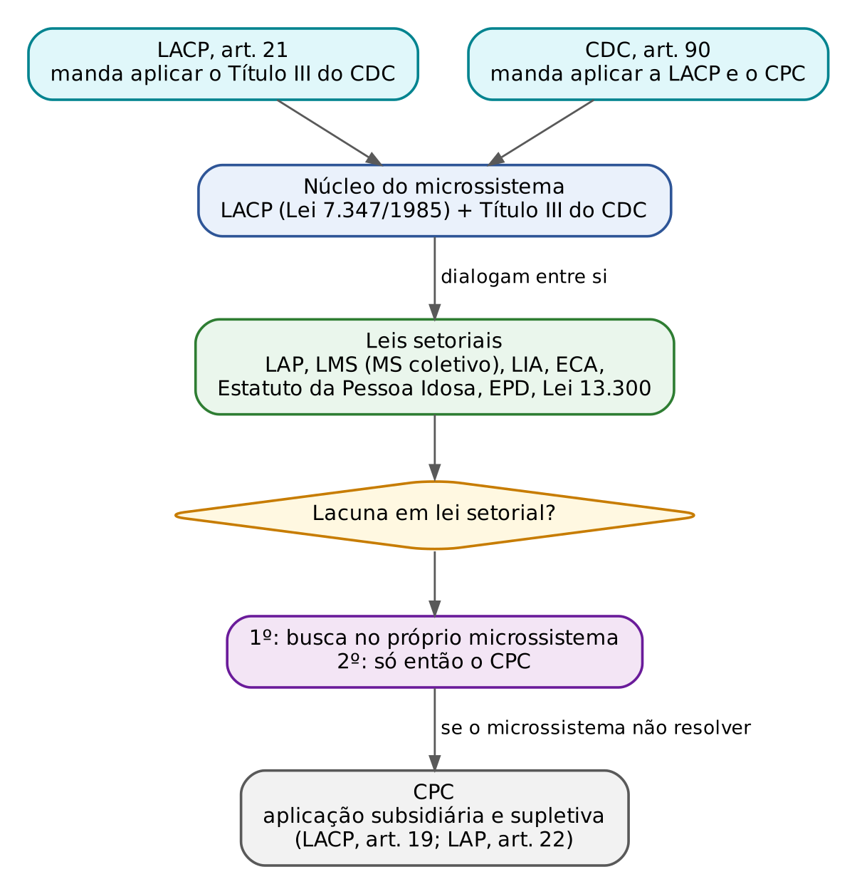
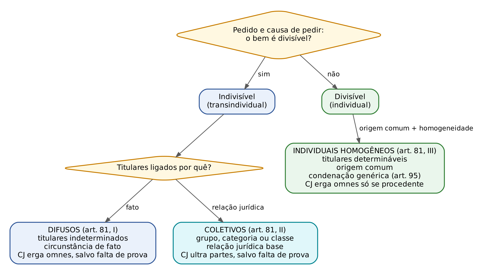
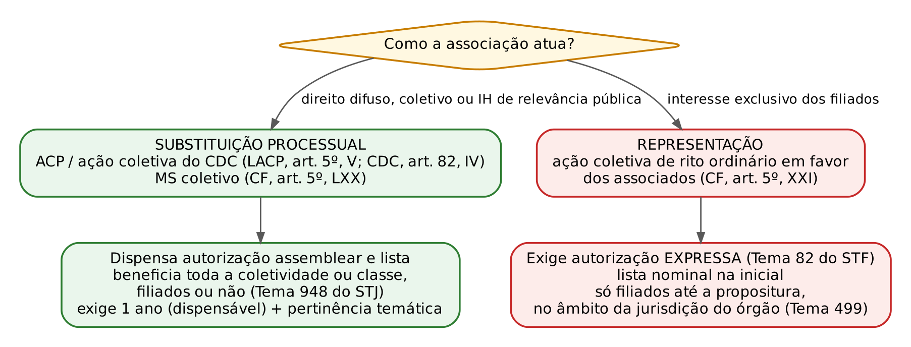
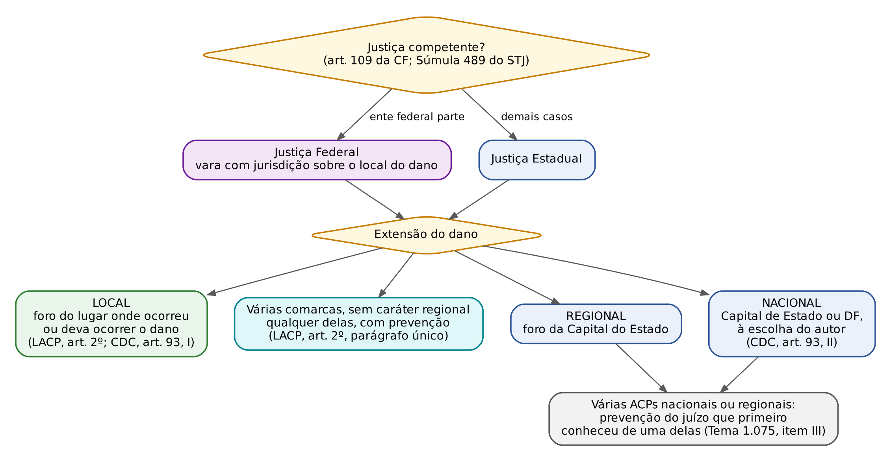
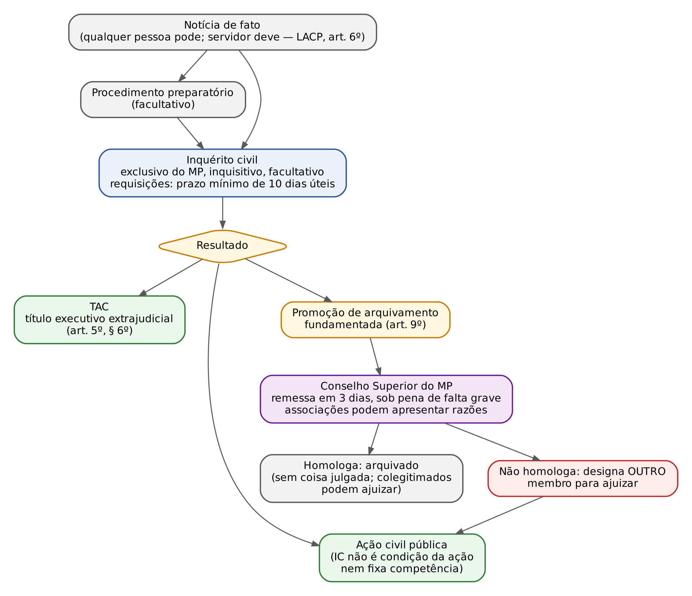
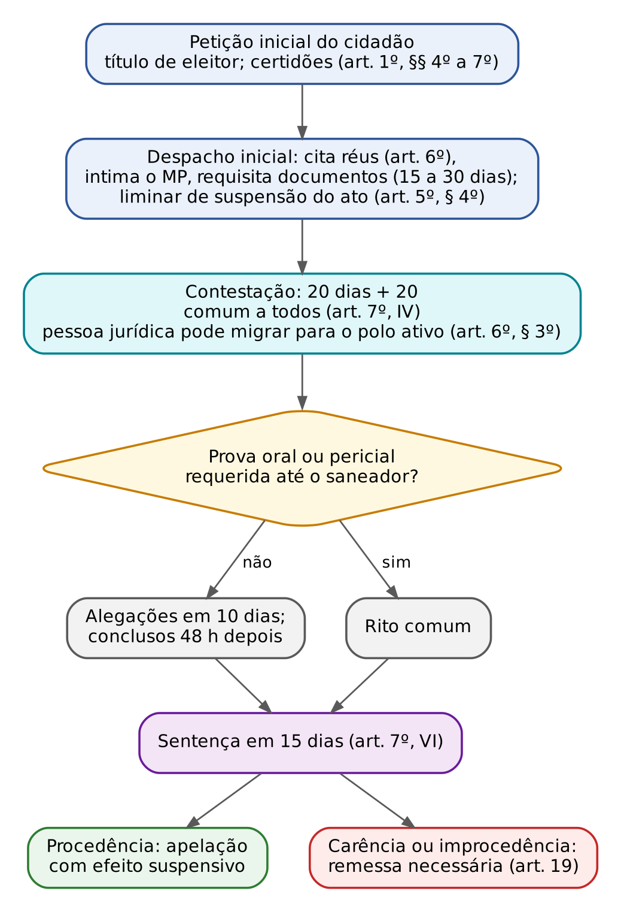

# CAPÍTULO 33 — PROCESSO COLETIVO I: MICROSSISTEMA, AÇÃO CIVIL PÚBLICA, LEGITIMIDADE, COMPETÊNCIA, INQUÉRITO CIVIL, TAC E AÇÃO POPULAR

:::INCIDENCIA
Pontos: TRF5 p. 10 e 12; TJRS p. 14 e 16; TJSC p. 17 (Leis 4.717/1965, 7.347/1985 e 8.078/1990). Nível A+; 25 questões no lote (FGV 20, FCC 5), com três provas de magistratura (TJ-SC 2024, TJ-PE 2024, TJ-TO 2025) e a ENAM.
O que mais cai: legitimidade (MP em individuais homogêneos de relevância social, Defensoria, associação como substituta x representante — Temas 82 e 499 do STF), natureza do TAC (título extrajudicial sem homologação), facultatividade do inquérito civil, competência do local do dano (absoluta) e art. 93 do CDC, e a ação popular (reexame invertido do art. 19, assunção do polo pelo MP, coisa julgada *secundum eventum probationis*).
:::

#### Mapa de cobrança

| Subtema | FGV | FCC | Padrão |
|---|---|---|---|
| Microssistema, modelos e espécies de direitos | 3 | 1 | Normas de reenvio (LACP, art. 21; CDC, art. 90); atipicidade (CDC, art. 83); conceitos do art. 81 trocados; polo passivo coletivo |
| Legitimidade ativa | 5 | 1 | MP e saúde (individualizáveis); associação ambiental sem limite territorial; *custos vulnerabilis*; autorização assemblear dispensada na ACP |
| Competência | 1 | 1 | Local do dano, competência funcional (absoluta); prevenção entre ações populares |
| Inquérito civil e TAC | 5 | 1 | IC facultativo e unilateral; TAC título extrajudicial sem homologação; prescrição das cláusulas patrimoniais |
| Regime da ACP (custas, honorários, perícia) | 2 | 0 | Art. 18 dirige-se só ao autor; simetria; perícia do MP custeada pela Fazenda |
| Ação popular | 4 | 1 | Art. 19 (reexame da improcedência e da carência; agravo); art. 9º (MP prossegue); Tema 836; analfabeto eleitor |

Remissões de base: tutela provisória e prova no processo coletivo, coisa julgada coletiva (*secundum eventum litis*, *in utilibus*), litispendência entre coletiva e individual, liquidação e execução coletivas, soluções consensuais em juízo, processo estrutural e improbidade estão no Cap. 34; mandado de segurança coletivo, no Cap. 32; suspensão de liminar, no Cap. 15; competência da Justiça Federal, no Cap. 5. A ACP ambiental (IC, TAC, Súmula 618 do STJ, responsabilidade *propter rem*) está desenvolvida na Apostila de Direito Ambiental, Cap. 9; os requisitos materiais da ação popular (atos nulos e anuláveis dos arts. 2º a 4º da Lei 4.717/1965) e o quadro ACP x ação popular, na Apostila de Direito Administrativo, Cap. 25 (25.8 e 25.9). Aqui fica o regime PROCESSUAL.

## 33.1 Tutela coletiva: fundamentos, modelos e microssistema

### 33.1.1 Por que existe um processo coletivo

O processo civil clássico (CPC/1973) foi desenhado para o litígio bipolar entre titulares do direito: legitimidade ordinária (art. 18 do CPC) e coisa julgada *inter partes* (art. 506). Esse desenho falha em três situações: (a) quando o bem é indivisível e de titularidade indeterminada (meio ambiente, publicidade enganosa), porque ninguém tem legitimidade ordinária para defendê-lo por inteiro; (b) quando a lesão individual é pequena e a soma é enorme (tarifa indevida de centavos), porque o indivíduo não litiga; (c) quando há milhares de litígios idênticos, porque a repetição gera custo, insegurança e decisões contraditórias. O processo coletivo responde com três técnicas que reaparecem em todo o capítulo: legitimação extraordinária de entes representativos, regime próprio de coisa julgada (Cap. 34) e condenação genérica seguida de liquidação individual.

### 33.1.2 Modelos comparados (Q2367604)

- *Class actions* norte-americanas (Rule 23 das Federal Rules of Civil Procedure): o autor é um membro da classe; o juiz controla a representatividade adequada (*adequacy of representation*) e a certificação da classe; a coisa julgada vincula a classe (*pro et contra*), com direito de exclusão (*opt-out*) nas ações indenizatórias. Modelo AMPLO, que abrange pretensões indenizatórias e injuntivas.
- *Verbandsklage* (Alemanha e Europa continental): ação de associações, legitimadas por lei, voltada tradicionalmente a pretensões inibitórias (obrigações de fazer e não fazer: cessação de cláusulas abusivas, de concorrência desleal), e não à indenização dos indivíduos.
- Brasil: modelo híbrido, de legitimação *ope legis* (rol legal de entes, sem o indivíduo, salvo o cidadão na ação popular), com atipicidade das ações (CDC, art. 83: "todas as espécies de ações capazes de propiciar sua adequada e efetiva tutela"), não taxatividade dos direitos tutelados (LACP, art. 1º, IV: "qualquer outro interesse difuso ou coletivo") e coisa julgada *secundum eventum litis* ou *secundum eventum probationis*, que não prejudica o indivíduo.

:::QUESTAO FGV 2024 — MPE-GO — PROMOTOR DE JUSTIÇA SUBSTITUTO (Q2367604)
Modelos de tutela coletiva. Gabarito: C, o modelo brasileiro se caracteriza pela não taxatividade dos direitos tutelados e pela atipicidade da ação (CDC, art. 83). Armadilhas: (A) inverte a realidade, dizendo que as *class actions* seriam mais restritas e focadas em fazer e não fazer; (B) atribui à *Verbandsklage* vocação indenizatória (é inibitória); (D) exige sujeito coletivo nos dois polos (o que qualifica o processo coletivo é a situação jurídica coletiva levada a juízo, não a presença de grupo nos dois polos); (E) nega a legitimidade do MP para mensalidades escolares, contra a Súmula 643 do STF (33.4.2).
:::

### 33.1.3 O microssistema e as normas de reenvio

Não há código de processo coletivo no Brasil (projetos de lei sucessivos não foram aprovados). O que existe é um microssistema formado por normas que se remetem reciprocamente: o art. 21 da LACP, incluído pelo art. 117 do CDC, manda aplicar "à defesa dos direitos e interesses difusos, coletivos e individuais, no que for cabível, os dispositivos do Título III" do CDC; o art. 90 do CDC devolve a remissão, mandando aplicar às ações do Título III o CPC e a LACP, "inclusive no que respeita ao inquérito civil". Essas são as chamadas normas de reenvio. Em volta do núcleo LACP + Título III do CDC orbitam a Lei da Ação Popular, a Lei do Mandado de Segurança (MS coletivo), a Lei de Improbidade, a Lei 13.300/2016 (MI coletivo), o ECA, o Estatuto da Pessoa Idosa e o Estatuto da Pessoa com Deficiência.

Consequência prática, que resolve questões: havendo lacuna numa lei do microssistema, o intérprete busca primeiro nas OUTRAS leis do microssistema e só depois no CPC (LACP, art. 19; LAP, art. 22). Exemplos cobrados: o reexame necessário da sentença de improcedência da ação popular (LAP, art. 19) é aplicado à ACP (33.3.7); o prazo quinquenal da ação popular (LAP, art. 21) é aplicado por analogia a ACPs sem prazo legal (33.3.8); o agravo de instrumento do art. 19, § 1º, da LAP afasta a restrição do art. 1.015 do CPC (33.8.8); a inversão do ônus da prova do art. 6º, VIII, do CDC alcança a ACP ambiental (Súmula 618 do STJ — Apostila de Direito Ambiental, Cap. 9).

:::QUESTAO FGV 2024 — MPE-GO — PROMOTOR DE JUSTIÇA SUBSTITUTO (Q2367602)
Panorama legislativo do microssistema. Gabarito: B, o CDC incluiu na LACP o atual art. 21 (por força do seu art. 117), permitindo a aplicação recíproca, fenômeno chamado de "normas de reenvio". Armadilhas: (A) e (C) colocam a Lei dos Juizados (9.099/1995) como pilar do microssistema (não é; e o JEFP sequer julga demandas sobre direitos difusos e coletivos — Lei 12.153/2009, art. 2º, § 1º, I); (D) atribui aos DIFUSOS a definição legal dos COLETIVOS ("grupo, categoria ou classe" e "relação jurídica base"); (E) afirma existir lei única codificada.
:::

### 33.1.4 Princípios do processo coletivo

A doutrina (Didier e Zaneti; Gregório Assagra; Ada Pellegrini Grinover) sistematiza princípios próprios, que funcionam como chave de leitura das regras:

| Princípio | Conteúdo | Regras que o concretizam |
|---|---|---|
| Acesso à justiça e universalidade da jurisdição | Levar a juízo litígios que, individualmente, não chegariam | Legitimação extraordinária; isenção de adiantamento (LACP, art. 18) |
| Atipicidade (máxima amplitude) | Todas as ações e pedidos adequados | CDC, art. 83; LACP, arts. 3º e 4º; Súmula 629 do STJ (cumulação na ACP ambiental) |
| Indisponibilidade (mitigada) da demanda | Desistência ou abandono não extinguem a tutela | LACP, art. 5º, § 3º; LAP, art. 9º; execução obrigatória pelo MP (LACP, art. 15; LAP, art. 16) |
| Primazia do julgamento de mérito | Vício de legitimidade não extingue de pronto; sucessão por outro legitimado | Jurisprudência em Teses do STJ, ed. 22, tese 7 (33.4.7) |
| Adequada representação | Quem conduz deve defender bem o grupo | Pertinência temática; pré-constituição; controle judicial (33.4.6) |
| Ampla divulgação e informação | O grupo precisa saber da ação | CDC, art. 94 (edital); CPC, art. 139, X |
| Coisa julgada *secundum eventum* e transporte *in utilibus* | Derrota coletiva não prejudica o indivíduo | CDC, arts. 103 e 104 (Cap. 34) |
| Integratividade do microssistema | Lacuna se resolve dentro do sistema | LACP, art. 21; CDC, art. 90 |
| Ativismo judicial (poder-dever de impulso) | Juiz com poderes ampliados | Multa de ofício (LACP, art. 11; CDC, art. 84, § 4º); efeito suspensivo *ope judicis* (LACP, art. 14) |

:::DICA CPC, ART. 139, X
O juiz, ao se deparar com diversas demandas individuais repetitivas, deve oficiar o MP, a Defensoria e, na medida do possível, outros legitimados dos arts. 5º da LACP e 82 do CDC, para, se for o caso, promover a ação coletiva respectiva. É o elo entre o processo individual e o coletivo que o CPC/2015 preservou (o "incidente de conversão" de ação individual em coletiva, do art. 333, foi VETADO).
:::

### 33.1.5 Espécies de processo coletivo

Processo coletivo é aquele em que se postula ou se discute uma situação jurídica coletiva (ativa ou passiva), não aquele com muitos litigantes: o litisconsórcio multitudinário é processo individual plúrimo (Cap. 9). Espécies: ação civil pública (Lei 7.347/1985); ação civil coletiva para individuais homogêneos (CDC, arts. 91 a 100); ação popular (Lei 4.717/1965); mandado de segurança coletivo (Lei 12.016/2009, arts. 21 e 22 — Cap. 32); mandado de injunção coletivo (Lei 13.300/2016, art. 12); ação de improbidade administrativa (Lei 8.429/1992 — Cap. 34), que após a Lei 14.230/2021 deixou de ser tratada como ACP (art. 17-D); ações do controle concentrado (processo objetivo, que a doutrina inclui em sentido amplo); e as técnicas de julgamento de casos repetitivos (IRDR e recursos repetitivos), que tutelam direitos individuais em massa sem legitimação extraordinária (Caps. 39 e 43). A doutrina contemporânea agrega o processo estrutural (Cap. 34).

#### Processo coletivo passivo (ação contra a coletividade)

Ação coletiva passiva é aquela em que um grupo, por meio de ente que o represente adequadamente, figura no polo PASSIVO (pretensão deduzida contra a coletividade): ação contra sindicato para impedir greve abusiva da categoria, possessória contra movimento organizado, ação contra associação empresarial que padroniza conduta dos associados. Não há disciplina legal geral; a admissibilidade é construída a partir do art. 83 do CDC, do art. 5º, § 2º, da LACP (habilitação como litisconsorte "de qualquer das partes") e de exemplos legais esparsos (art. 554, § 1º, do CPC, nas possessórias multitudinárias — Cap. 29). O controle da representatividade adequada do ente demandado é o ponto central: só se admite quando o ente efetivamente coordena ou padroniza a conduta impugnada, e há debate doutrinário sobre a extensão da coisa julgada aos membros ausentes.

:::QUESTAO FCC 2026 — DPE-MA — DEFENSOR PÚBLICO (Q4012623)
Associação empresarial edita orientações padronizadas que levam os associados a restringir, de modo uniforme, o uso de banheiros por pessoas trans conforme a identidade de gênero. Gabarito: A, admite-se polo passivo coletivo quando a entidade coordena ou padroniza condutas com repercussão uniforme, desde que haja representatividade adequada e relação objetiva entre as diretrizes e a prática impugnada. Armadilhas: (B) a legitimação extraordinária não é "apenas ativa"; (C) a entidade não precisa praticar pessoalmente o ato; (D) a ausência de lei específica não impede (atipicidade); (E) restringir a eficácia às partes formais esvazia o instituto.
:::

## 33.2 Direitos difusos, coletivos e individuais homogêneos

### 33.2.1 Conceitos legais

:::LEI CDC (LEI 8.078/1990), ART. 81, PARÁGRAFO ÚNICO
A defesa coletiva será exercida quando se tratar de:
I - interesses ou direitos difusos, assim entendidos, para efeitos deste código, os transindividuais, de natureza indivisível, de que sejam titulares pessoas indeterminadas e ligadas por circunstâncias de fato;
II - interesses ou direitos coletivos, assim entendidos, para efeitos deste código, os transindividuais, de natureza indivisível de que seja titular grupo, categoria ou classe de pessoas ligadas entre si ou com a parte contrária por uma relação jurídica base;
III - interesses ou direitos individuais homogêneos, assim entendidos os decorrentes de origem comum.
:::

| Critério | Difusos | Coletivos (*stricto sensu*) | Individuais homogêneos |
|---|---|---|---|
| Natureza do objeto | Indivisível | Indivisível | Divisível |
| Titularidade | Pessoas indeterminadas (e indetermináveis) | Grupo, categoria ou classe (determinável) | Pessoas determinadas ou determináveis |
| Vínculo | Circunstância de fato | Relação jurídica base (entre si ou com a parte contrária) | Origem comum (de fato ou de direito) |
| Disponibilidade | Indisponíveis | Indisponíveis para o legitimado | Disponíveis pelo titular |
| Sentença | Condenação reverte ao fundo (LACP, art. 13) | Idem | Condenação genérica (CDC, art. 95), liquidada pelas vítimas |
| Coisa julgada (Cap. 34) | *Erga omnes*, salvo improcedência por insuficiência de provas | *Ultra partes* (limitada ao grupo), salvo insuficiência de provas | *Erga omnes* só na procedência |
| Exemplos | Ar puro; publicidade enganosa veiculada na TV; patrimônio cultural | Ilegalidade de cláusula de reajuste de todos os contratos de um plano de saúde; direitos de uma categoria profissional ao ambiente de trabalho sadio | Restituição de tarifa paga por cada consumidor; indenização às vítimas de um produto defeituoso |

Duas observações de rigor técnico:

- Nos coletivos, a relação jurídica base deve ser ANTERIOR à lesão (o contrato de adesão comum, a filiação à categoria). Se o vínculo nasce da própria lesão, o direito é difuso ou individual homogêneo.
- Os individuais homogêneos são, na essência, direitos individuais tratados coletivamente por técnica processual (Barbosa Moreira os chamava de acidentalmente coletivos, por oposição aos essencialmente coletivos). Por isso a condenação é genérica e a satisfação depende de liquidação individual, na qual cada vítima prova o dano e o nexo com o fato comum (Cap. 34). A homogeneidade exige prevalência das questões comuns sobre as individuais: se a solução depende predominantemente de questões particulares de cada vítima, falta interesse-adequação à tutela coletiva (a doutrina importa os requisitos de predominância e superioridade da Rule 23(b)(3)).

### 33.2.2 Um mesmo fato, três pretensões: o critério é o pedido

Um único evento pode gerar os três tipos de pretensão. Exemplo clássico (Nelson Nery Jr.): acidente com o *Bateau Mouche* gera pretensão difusa (proibir a embarcação de navegar sem segurança, em favor de todos os potenciais passageiros), coletiva (obrigar a empresa a cumprir o regulamento em relação aos contratantes de passeios) e individual homogênea (indenizar as famílias das vítimas). Daí a lição dominante: o que define a espécie, no processo, é o PEDIDO e a causa de pedir deduzidos (a tutela jurisdicional pretendida), e não a matéria em abstrato. Questão que descreve só o "tema" (meio ambiente, consumidor) sem dizer o pedido é incompleta; questão que descreve o pedido (indenizar cada vítima x cessar a prática) permite classificar.

:::EXEMPLO CLASSIFICAÇÃO A PARTIR DO PEDIDO
Banco cobra tarifa ilegal de todos os correntistas. (1) Pedido de que o banco se abstenha de cobrar a tarifa e retire a cláusula dos contratos: direito coletivo (indivisível; titulares ligados ao banco por relação jurídica base preexistente). (2) Pedido de restituição em dobro do que cada correntista pagou: individual homogêneo (divisível; origem comum). (3) Pedido de dano moral coletivo pela prática abusiva difundida no mercado: difuso. As três pretensões podem ser cumuladas na mesma ACP (CDC, art. 83; LACP, art. 3º).
:::

### 33.2.3 Direitos individuais indisponíveis

Fora da tríade do art. 81 está a tutela, pelo MP, de direito individual INDISPONÍVEL de pessoa determinada (CF, art. 127, *caput*): fornecimento de medicamento a um paciente, vaga em creche para uma criança, atendimento a pessoa idosa. Não é processo coletivo em sentido técnico (não há situação jurídica coletiva), mas o STJ e o STF admitem a via da ACP pelo MP, como se verá em 33.4.2 (Tema 262 do STF; Jurisprudência em Teses, ed. 19, teses 3, 5 e 11).

:::QUESTAO FGV 2024 — DATAPREV — ADVOCACIA (Q3085868)
ACP do MP por despejo de resíduos tóxicos em APP, com dano moral coletivo; o Estado ingressa como litisconsorte ativo; trabalhadores que perderam a renda procuram a Defensoria para ações individuais. Gabarito: E, a Defensoria tem atribuição para representar os trabalhadores nas demandas individuais relativas aos danos ambientais. Passos: (1) o MP é legitimado para ACP ambiental (CF, art. 129, III; LACP, art. 5º, I), o que afasta A e B; (2) o Estado pode habilitar-se como litisconsorte (LACP, art. 5º, § 2º), o que afasta C; (3) a alternativa D reproduz a redação do art. 16 da LACP dada pela Lei 9.494/1997 ("limites da competência territorial do órgão prolator"), declarada inconstitucional no Tema 1.075 do STF (33.5.4), e chama de *ultra partes* o que, em difusos, é *erga omnes*. Lição: a ação coletiva ambiental não impede as ações individuais por danos pessoalmente sofridos (CDC, art. 103, § 3º — Cap. 34).
:::

## 33.3 Ação civil pública: objeto, cabimento e regime processual

### 33.3.1 Objeto e pedidos

O art. 1º da LACP enumera os bens tutelados, "sem prejuízo da ação popular": meio ambiente, consumidor, bens e direitos de valor artístico, estético, histórico, turístico e paisagístico, "qualquer outro interesse difuso ou coletivo" (inciso IV, incluído pelo CDC, que tornou o rol exemplificativo), ordem econômica, ordem urbanística, honra e dignidade de grupos raciais, étnicos ou religiosos (Lei 12.966/2014) e patrimônio público e social (Lei 13.004/2014). A ação pode ter por objeto "a condenação em dinheiro ou o cumprimento de obrigação de fazer ou não fazer" (art. 3º), mas o "ou" não impede a cumulação, que decorre do art. 83 do CDC (na matéria ambiental, Súmula 629 do STJ). Cabem também pedidos declaratórios e constitutivos (anulação de contrato, de licença, de ato administrativo) e a tutela preventiva (art. 4º: "ação cautelar" para evitar o dano, hoje lida como tutela provisória ou inibitória no próprio processo — Caps. 14 e 34).

Controle de constitucionalidade: a ACP admite a declaração INCIDENTAL de inconstitucionalidade de lei ou ato normativo quando a controvérsia constitucional for causa de pedir ou questão prejudicial indispensável à resolução do pedido principal (Jurisprudência em Teses do STJ, ed. 273, tese 9). O que não se admite é a ACP como sucedâneo de ADI, com pedido principal de declaração de inconstitucionalidade com efeitos *erga omnes*, sob pena de usurpação da competência do STF.

### 33.3.2 Vedações do parágrafo único do art. 1º e matéria tributária

:::LEI LEI 7.347/1985, ART. 1º, PARÁGRAFO ÚNICO
Não será cabível ação civil pública para veicular pretensões que envolvam tributos, contribuições previdenciárias, o Fundo de Garantia do Tempo de Serviço - FGTS ou outros fundos de natureza institucional cujos beneficiários podem ser individualmente determinados.
:::

- O dispositivo, incluído pela MP 2.180-35/2001, veda a ACP para pretensões de natureza individual homogênea do contribuinte, do segurado ou do beneficiário de fundo (repetição de tributo, revisão de contribuição).
- O STF fixou que o MP não tem legitimidade para, em ACP, deduzir pretensão relativa a matéria tributária (Tema 645 da repercussão geral, ARE 694.294). No mesmo sentido, o STJ negou ao MP legitimidade para ACP de restituição de empréstimo compulsório sobre automóveis (REsp 1.709.093/ES, Informativo 731).
- A vedação NÃO alcança a ACP em defesa do PATRIMÔNIO PÚBLICO contra benefício fiscal ilegal: o MP pode anular Termo de Acordo de Regime Especial (TARE) lesivo ao erário (Jurisprudência em Teses do STJ, ed. 22, tese 8), porque aí a pretensão é difusa (patrimônio público e social), não individual do contribuinte.
- Ação popular também não serve para discutir interesses individuais homogêneos de caráter tributário (STJ, REsp 2.167.861/SE, Relator Ministro Francisco Falcão, Segunda Turma, j. 11/3/2025, Informativo 852).

:::PEGADINHA FGTS X PATRIMÔNIO PÚBLICO
"MP ajuíza ACP para que a CEF corrija os saldos de FGTS de todos os trabalhadores": vedada (fundo institucional com beneficiários individualizáveis). "MP ajuíza ACP para anular renúncia fiscal concedida por lei de efeitos concretos que lesa o erário municipal": cabível (patrimônio público e social; Súmula 329 do STJ). O critério é quem é o titular da pretensão: o contribuinte individual (vedado) ou a coletividade (permitido).
:::

### 33.3.3 Procedimento: rito comum com regras especiais

A LACP não tem procedimento próprio: aplica-se o procedimento comum do CPC "naquilo em que não contrarie suas disposições" (art. 19). Regras especiais que caem:

- Intervenção obrigatória do MP como fiscal da ordem jurídica, se não for parte (art. 5º, § 1º; CDC, art. 92). A falta de intimação gera nulidade, salvo ausência de prejuízo (Cap. 13).
- Edital nas ações para individuais homogêneos, para que os interessados intervenham como litisconsortes (CDC, art. 94), sem prejuízo de ampla divulgação. A publicação NÃO é requisito para o início do prazo prescricional da execução individual (Tema 877 do STJ — Cap. 34).
- Audiência de conciliação (CPC, art. 334): cabível quando o direito admitir autocomposição; o objeto difuso é indisponível, mas admite acordo sobre modo, tempo e lugar de cumprimento (33.7 e Cap. 34).
- Liminar e multa (art. 12), efeito suspensivo dos recursos *ope judicis* (art. 14), isenção de adiantamento (art. 18) e destinação ao fundo (art. 13), a seguir.

### 33.3.4 Liminar, multa e o Poder Público

:::LEI LEI 7.347/1985, ARTS. 11 E 12
Art. 11. Na ação que tenha por objeto o cumprimento de obrigação de fazer ou não fazer, o juiz determinará o cumprimento da prestação da atividade devida ou a cessação da atividade nociva, sob pena de execução específica, ou de cominação de multa diária, se esta for suficiente ou compatível, independentemente de requerimento do autor.
Art. 12. Poderá o juiz conceder mandado liminar, com ou sem justificação prévia, em decisão sujeita a agravo.
§ 1º A requerimento de pessoa jurídica de direito público interessada, e para evitar grave lesão à ordem, à saúde, à segurança e à economia pública, poderá o Presidente do Tribunal a que competir o conhecimento do respectivo recurso suspender a execução da liminar, em decisão fundamentada, da qual caberá agravo para uma das turmas julgadoras, no prazo de 5 (cinco) dias a partir da publicação do ato.
§ 2º A multa cominada liminarmente só será exigível do réu após o trânsito em julgado da decisão favorável ao autor, mas será devida desde o dia em que se houver configurado o descumprimento.
:::

- Multa de ofício: art. 11 da LACP e art. 84, § 4º, do CDC ("independentemente de pedido do autor").
- Exigibilidade da multa liminar: a LACP diz que só é exigível após o TRÂNSITO EM JULGADO da decisão favorável ao autor, mas devida desde o descumprimento. O CPC (art. 537, § 3º) admite o cumprimento provisório da multa, com levantamento só após o trânsito. Há debate sobre a prevalência da regra especial na ACP; para prova, se a questão citar a LACP, a resposta é a literalidade do art. 12, § 2º (detalhes das *astreintes* no Cap. 23).
- Agravo contra a suspensão (art. 12, § 1º): a LACP fala em 5 dias, mas o art. 1.070 do CPC unificou em 15 dias o prazo de agravo contra decisão unipessoal em tribunal (Cap. 15).
- Fazenda Pública: na ACP e no MS coletivo, a liminar é concedida "após a audiência do representante judicial da pessoa jurídica de direito público, que deverá se pronunciar no prazo de setenta e duas horas" (Lei 8.437/1992, art. 2º). O STF declarou inconstitucional a regra equivalente da Lei do MS (art. 22, § 2º, da Lei 12.016/2009) na ADI 4.296 (Cap. 32); a doutrina estende o raciocínio ao art. 2º da Lei 8.437 em situações de urgência extrema, em que a oitiva prévia frustraria a tutela. A vedação de liminar de primeiro grau contra autoridade sujeita a MS originário em tribunal NÃO se aplica à ação popular e à ACP (Lei 8.437/1992, art. 1º, § 2º). A suspensão de liminar e de sentença na ACP e na ação popular segue o art. 4º, § 1º, da Lei 8.437/1992 (Cap. 15).

### 33.3.5 Efeitos dos recursos

Na ACP, a apelação NÃO tem efeito suspensivo automático: o juiz "poderá conferir efeito suspensivo aos recursos, para evitar dano irreparável à parte" (art. 14). É regra especial que prevalece sobre o art. 1.012 do CPC (efeito suspensivo *ope legis*): a sentença da ACP produz efeitos imediatamente, salvo concessão judicial do efeito suspensivo. Contraste: na ação popular, a apelação contra a sentença de procedência TEM efeito suspensivo por lei (LAP, art. 19), e a de improcedência sequer produz efeito antes do reexame.

:::ATENCAO AGRAVO DE INSTRUMENTO NO MICROSSISTEMA
O art. 19, § 1º, da Lei 4.717/1965 (agravo de instrumento contra as interlocutórias) prevalece sobre o rol do art. 1.015 do CPC (inciso XIII) e, pelo microssistema, estende-se à ACP e à improbidade (STJ, AREsp 2.159.586; v. Cap. 42).
:::

### 33.3.6 Despesas, honorários e perícia

:::LEI LEI 7.347/1985, ARTS. 17 E 18
Art. 17. Em caso de litigância de má-fé, a associação autora e os diretores responsáveis pela propositura da ação serão solidariamente condenados em honorários advocatícios e ao décuplo das custas, sem prejuízo da responsabilidade por perdas e danos.
Art. 18. Nas ações de que trata esta lei, não haverá adiantamento de custas, emolumentos, honorários periciais e quaisquer outras despesas, nem condenação da associação autora, salvo comprovada má-fé, em honorários de advogado, custas e despesas processuais.
:::

O CDC repete a regra (art. 87). As consequências, todas cobradas:

| Situação | Regra | Fonte |
|---|---|---|
| Isenção de adiantamento | Beneficia só o AUTOR da ACP; o réu adianta normalmente | Jurisprudência em Teses do STJ, ed. 25, tese 5 |
| Perícia requerida pelo MP autor | Não se exige do MP o adiantamento; o encargo fica com a Fazenda Pública a que vinculado o MP (aplicação analógica da Súmula 232 do STJ) | Repetitivo da Primeira Seção (REsp 1.253.844/SC, 2013); Jurisprudência em Teses, ed. 25, tese 6, e ed. 272, tese 8 |
| MP vencido sem má-fé | Não paga honorários nem custas | Art. 18 e simetria |
| MP ou ente público vencedor | Não recebe honorários do réu, salvo má-fé (simetria) | Jurisprudência em Teses, ed. 25, tese 1, e ed. 273, tese 7 |
| União vencida em ACP | Não paga honorários, salvo má-fé (simetria com a isenção do art. 18) | Tema 1.177 do STJ |
| Associação ou fundação privada vencedora | O réu vencido PAGA honorários: a simetria não se aplica | STJ, EREsp 1.304.939/RS, Corte Especial, j. 20/8/2025 (Informativo 872); Jurisprudência em Teses, ed. 273, tese 6 |
| Associação vencida | Só paga honorários, custas e despesas se comprovada má-fé (e então o décuplo das custas, solidariamente com os diretores) | Arts. 17 e 18 |
| Defensoria vencedora contra o ente a que pertence | Honorários devidos (superada a tese da confusão pelo STF em repercussão geral) | Cap. 8 (Q3954607) |

:::QUESTAO FGV 2025 — TCE-PE — ANALISTA DE GESTÃO (Q3593095)
Afirmações sobre a jurisprudência em ACP. Gabarito: B, a dispensa de adiantamento do art. 18 dirige-se apenas ao autor da ACP (a alternativa cita, por erro material, "Lei nº 7.345/1985"). Armadilhas, uma por tese da Jurisprudência em Teses, ed. 25: (A) na execução individual contra a Fazenda, iniciada a execução coletiva, o prazo interrompido volta a correr "por inteiro" (é PELA METADE — tese 4); (C) honorários ao MP "independentemente de má-fé" (simetria — tese 1); (D) MP adiantaria honorários periciais com recursos próprios (encargo da Fazenda — tese 6); (E) abrangência nacional declarada na sentença "pode ser alterada" na execução (não pode, sob pena de ofensa à coisa julgada — tese 9).
:::

:::PEGADINHA ASSOCIAÇÃO VENCEDORA X MP VENCEDOR
A simetria nasceu para o MP e para os entes públicos: se não pagam honorários quando perdem (art. 18), não os recebem quando ganham. A Corte Especial do STJ, em 2025, recusou estendê-la às associações e fundações privadas, que dependem de advogados contratados: vencedoras, recebem honorários do réu. Questão que diga "por simetria, a associação autora vitoriosa não faz jus a honorários" está ERRADA.
:::

### 33.3.7 Remessa necessária

A LACP não prevê reexame. O STJ aplica, por analogia, o art. 19 da LAP: "a sentença que julga improcedente o pedido feito em ação civil pública se sujeita à remessa oficial" (Jurisprudência em Teses, ed. 273, tese 5). É o reexame INVERTIDO: protege a coletividade autora, não o Poder Público réu. A sentença de procedência contra a Fazenda em ACP segue o art. 496 do CPC, com seus limites de valor (Cap. 20). Na ação de improbidade, a Lei 14.230/2021 afastou a remessa necessária (Lei 8.429/1992, art. 17-C, § 3º — Cap. 34).

### 33.3.8 Prescrição

A LACP não tem prazo. Regras que se extraem da jurisprudência:

- Pretensões de reparação de dano ambiental: imprescritíveis (Tema 999 do STF — Apostila de Direito Ambiental).
- ACP sem prazo legal específico: o STJ aplica, por analogia, o prazo quinquenal da ação popular (LAP, art. 21), por integrarem o mesmo microssistema; exemplo, ACP sobre direitos relativos a planos de saúde (Jurisprudência em Teses, ed. 273, tese 3).
- Execução individual de sentença coletiva: cinco anos no âmbito do direito privado (Tema 515 do STJ), contados do trânsito em julgado, independentemente do edital do art. 94 do CDC (Tema 877 do STJ) — desenvolvimento no Cap. 34.
- Ressarcimento ao erário por ato de improbidade doloso: imprescritível (Apostila de Direito Administrativo, Cap. 27).

### 33.3.9 Destinação do dinheiro: o fundo do art. 13

Havendo condenação em dinheiro por lesão a direito difuso ou coletivo, a indenização "reverterá a um fundo gerido por um Conselho Federal ou por Conselhos Estaduais de que participarão necessariamente o Ministério Público e representantes da comunidade, sendo seus recursos destinados à reconstituição dos bens lesados" (art. 13). No âmbito federal é o Fundo de Defesa de Direitos Difusos (FDD, Lei 9.008/1995). Enquanto o fundo não for regulamentado, o dinheiro fica em estabelecimento oficial de crédito, com correção (§ 1º). Regra especial cobrada literalmente:

:::LEI LEI 7.347/1985, ART. 13, § 2º
§ 2º Havendo acordo ou condenação com fundamento em dano causado por ato de discriminação étnica nos termos do disposto no art. 1º desta Lei, a prestação em dinheiro reverterá diretamente ao fundo de que trata o caput e será utilizada para ações de promoção da igualdade étnica, conforme definição do Conselho Nacional de Promoção da Igualdade Racial, na hipótese de extensão nacional, ou dos Conselhos de Promoção de Igualdade Racial estaduais ou locais, nas hipóteses de danos com extensão regional ou local, respectivamente.
:::

Nos individuais homogêneos, o dinheiro vai às vítimas; só o resíduo não reclamado em um ano vai ao fundo (*fluid recovery*, CDC, art. 100), e as indenizações individuais têm preferência sobre a condenação difusa no concurso de créditos (CDC, art. 99) — Cap. 34.

:::QUESTAO FGV 2024 — MPE-GO — PROMOTOR DE JUSTIÇA SUBSTITUTO (Q2367603)
Representação ao MP sobre violação de direitos de comunidades raciais, étnicas ou religiosas. Gabarito: D, os valores decorrentes de danos por discriminação étnica são destinados a ações de promoção da igualdade étnica conforme definição dos Conselhos de Promoção de Igualdade Racial estaduais ou locais, nos danos de extensão regional ou local (art. 13, § 2º). Armadilhas: (A) legitimidade "exclusiva" de ONGs (o MP é legitimado, art. 5º, I); (B) só servidor e associação poderiam provocar o MP (QUALQUER PESSOA pode, e o servidor DEVE — art. 6º); (C) associação constituída "há pelo menos 2 anos" OU com finalidade pertinente (é UM ano E finalidade, requisitos concomitantes — art. 5º, V); (E) prazo de "noventa dias" e exclusividade do MP na execução (são SESSENTA dias, facultada igual iniciativa aos demais legitimados — art. 15).
:::

:::SENTENCA DISPOSITIVO DE ACP DO MP (DIFUSO + OBRIGAÇÃO DE FAZER + DINHEIRO)
"Ante o exposto, JULGO PROCEDENTES os pedidos, com resolução do mérito (CPC, art. 487, I), para: a) condenar a ré a cessar, no prazo de 30 dias, o lançamento de efluentes sem tratamento no córrego X, sob pena de multa diária de 10.000 (dez mil) reais, limitada inicialmente a 1.000.000 (um milhão) de reais, sem prejuízo de outras medidas do art. 536, § 1º, do CPC; b) condenar a ré a executar o plano de recuperação de área degradada aprovado pelo órgão ambiental, no prazo de 180 dias; c) condenar a ré ao pagamento de 500.000 (quinhentos mil) reais a título de dano moral coletivo, corrigidos e acrescidos de juros na forma da fundamentação, a reverter ao fundo do art. 13 da Lei 7.347/1985. Confirmo a tutela provisória. Sem condenação em honorários advocatícios em favor do Ministério Público (art. 18 da Lei 7.347/1985 e simetria). Custas pela ré. Eventual apelação será recebida apenas no efeito devolutivo (art. 14 da Lei 7.347/1985)." Notas: se fosse de improcedência, acrescentar "Sentença sujeita a reexame necessário, por aplicação analógica do art. 19 da Lei 4.717/1965"; em individuais homogêneos, a condenação é genérica, "fixando a responsabilidade do réu pelos danos causados" (CDC, art. 95), com determinação de publicação de edital e divulgação (Cap. 34).
:::

:::QUESTAO FGV 2026 — MPE-GO — PROMOTOR DE JUSTIÇA SUBSTITUTO (Q3865802)
ACP do MP contra os responsáveis por fazenda tombada como exemplar de arquitetura rural tradicional, depredada. Gabarito: E, a degradação do patrimônio cultural é espécie de poluição, sujeita à responsabilidade civil objetiva, cabendo condenação por dano moral coletivo. Armadilhas: extinção por se tratar de propriedade privada (A), *in dubio pro* propriedade (B), legitimidade passiva só do Município (C) e violação à separação de poderes (D). O fundamento material (responsabilidade objetiva e conceito amplo de meio ambiente cultural) está na Apostila de Direito Ambiental; o processual é a legitimidade do MP (art. 1º, III, da LACP) e o cabimento da cumulação de reparação e dano moral coletivo.
:::

## 33.4 Legitimidade ativa

### 33.4.1 Natureza e características

:::LEI LEI 7.347/1985, ART. 5º (CAPUT, INCISOS E §§ 1º A 5º)
Art. 5º Têm legitimidade para propor a ação principal e a ação cautelar:
I - o Ministério Público;
II - a Defensoria Pública;
III - a União, os Estados, o Distrito Federal e os Municípios;
IV - a autarquia, empresa pública, fundação ou sociedade de economia mista;
V - a associação que, concomitantemente:
a) esteja constituída há pelo menos 1 (um) ano nos termos da lei civil;
b) inclua, entre suas finalidades institucionais, a proteção ao patrimônio público e social, ao meio ambiente, ao consumidor, à ordem econômica, à livre concorrência, aos direitos de grupos raciais, étnicos ou religiosos ou ao patrimônio artístico, estético, histórico, turístico e paisagístico.
§ 1º O Ministério Público, se não intervier no processo como parte, atuará obrigatoriamente como fiscal da lei.
§ 2º Fica facultado ao Poder Público e a outras associações legitimadas nos termos deste artigo habilitar-se como litisconsortes de qualquer das partes.
§ 3º Em caso de desistência infundada ou abandono da ação por associação legitimada, o Ministério Público ou outro legitimado assumirá a titularidade ativa.
§ 4.° O requisito da pré-constituição poderá ser dispensado pelo juiz, quando haja manifesto interesse social evidenciado pela dimensão ou característica do dano, ou pela relevância do bem jurídico a ser protegido.
§ 5.° Admitir-se-á o litisconsórcio facultativo entre os Ministérios Públicos da União, do Distrito Federal e dos Estados na defesa dos interesses e direitos de que cuida esta lei.
:::

O CDC (art. 82) acrescenta "as entidades e órgãos da Administração Pública, direta ou indireta, AINDA QUE SEM PERSONALIDADE JURÍDICA, especificamente destinados à defesa" do consumidor (Procon, comissões legislativas de defesa do consumidor) e, para as associações, a expressão "dispensada a autorização assemblear".

Características da legitimação coletiva:

- Concorrente e disjuntiva: todos podem agir, cada um independentemente dos demais; o litisconsórcio entre colegitimados é facultativo e ulterior (§ 2º; CDC, art. 82, *caput*: "concorrentemente").
- Natureza: para a maioria (e para o STJ), legitimação extraordinária (substituição processual), porque o legitimado defende em nome próprio direito alheio. Nelson Nery Jr. a qualifica, nos difusos e coletivos, como "legitimação autônoma para a condução do processo", categoria que dispensa a dicotomia ordinária/extraordinária porque não há titular individual identificável. Para os individuais homogêneos, é pacífico tratar-se de substituição processual (o art. 91 do CDC diz "em nome próprio e no interesse das vítimas").
- Legitimação *ope legis*, com controle judicial complementar (pertinência temática e representatividade — 33.4.6).
- O indivíduo NÃO é legitimado à ACP. Pode ingressar como litisconsorte nas ações sobre individuais homogêneos (CDC, art. 94), mas não propõe a ação coletiva; o cidadão só tem a ação popular.

### 33.4.2 Ministério Público

Fundamento: art. 129, III, da CF (promover o inquérito civil e a ação civil pública para a proteção do patrimônio público e social, do meio ambiente e de outros interesses difusos e coletivos), com a ressalva do § 1º (a legitimação do MP "não impede a de terceiros"). Nos difusos e coletivos, a legitimidade do MP é ampla e presumida. Nos INDIVIDUAIS HOMOGÊNEOS, que a CF não menciona, a jurisprudência exige RELEVÂNCIA SOCIAL (pela natureza do bem, pela dimensão do dano ou pela vulnerabilidade dos titulares), ou indisponibilidade do direito (CF, art. 127).

| Hipótese | Legitimidade do MP | Fonte |
|---|---|---|
| Mensalidades escolares ilegais | Sim | Súmula 643 do STF; Jurisprudência em Teses do STJ, ed. 19, tese 7 |
| Patrimônio público | Sim | Súmula 329 do STJ |
| Consumidores, inclusive de serviço público (difusos, coletivos e individuais homogêneos) | Sim | Súmula 601 do STJ |
| Fornecimento de medicamento, inclusive a pessoa determinada | Sim | Tema 262 do STF (RE 605.533); Jurisprudência em Teses, ed. 19, tese 11 |
| Criança, adolescente, pessoa idosa e pessoa desprovida de recursos, mesmo individualmente considerados | Sim (direito individual indisponível) | Jurisprudência em Teses, ed. 19, teses 3 e 5 |
| Saúde indígena | Sim (hipervulnerabilidade) | Jurisprudência em Teses, ed. 19, tese 4 |
| Beneficiários do DPVAT | Sim (cancelada a Súmula 470 do STJ) | Tema 471 do STF; Jurisprudência em Teses, ed. 19, tese 13 |
| Mutuários do SFH | Sim | Jurisprudência em Teses, ed. 19, tese 12 |
| Jazigos em cemitérios (consumidores) | Sim | Jurisprudência em Teses, ed. 19, tese 6 |
| Concurso público sem observância dos princípios constitucionais | Sim | Jurisprudência em Teses, ed. 19, tese 14 |
| Anular aposentadoria lesiva ao erário | Sim | STF, RE 409.356/RO (repercussão geral, 2018) |
| Cessação de jogos de azar | Sim | Jurisprudência em Teses, ed. 19, tese 9 |
| Anular TARE lesivo ao erário | Sim | Jurisprudência em Teses, ed. 22, tese 8 |
| Pretensão tributária (do contribuinte) | NÃO | Tema 645 do STF; LACP, art. 1º, parágrafo único |
| Restituição de empréstimo compulsório | NÃO | STJ, REsp 1.709.093/ES (Informativo 731) |
| MP estadual em defesa de bem da União | NÃO (atribuição do MPF) | Jurisprudência em Teses, ed. 19, tese 8 |

:::QUESTAO FGV 2026 — MPE-MT — PROMOTOR DE JUSTIÇA SUBSTITUTO (Q4116966)
IC sobre omissão municipal no fornecimento de medicamentos de uso contínuo; frustrado o TAC, ACP com tutela de urgência e pedido estrutural. Preliminares do Município: ilegitimidade do MP (individuais homogêneos "de origem acidental"), nulidade por falta de homologação do IC pelo Conselho Superior e carência por ausência de TAC prévio. Gabarito: C (I, III e IV corretas). Passos: (I) correta, o MP tutela coletivamente o direito à saúde ainda que os titulares sejam individualizáveis (Tema 262 do STF; relevância social e indisponibilidade); (II) errada, o IC é unilateral, mas FACULTATIVO, e sua ausência não gera nulidade (33.6.2); o Conselho Superior homologa ARQUIVAMENTO, não o ajuizamento; (III) correta, as provas do IC têm valor probatório, sujeitas à livre apreciação motivada com os demais elementos (33.6.3); (IV) correta, o TAC não é condição de procedibilidade. Armadilha: a expressão "origem acidental" evoca os "acidentalmente coletivos" para sugerir ilegitimidade.
:::

Atuação: o MP que não é parte intervém obrigatoriamente como fiscal da ordem jurídica (art. 5º, § 1º); assume a titularidade em caso de desistência infundada ou abandono por associação (§ 3º); promove a execução se a associação autora não o fizer em 60 dias do trânsito (art. 15). Admite-se litisconsórcio facultativo entre Ministérios Públicos da União, dos Estados e do DF (§ 5º), mas a atribuição de cada ramo segue a competência da Justiça perante a qual atua: o MPF não pode assumir o polo ativo de ACP em curso na Justiça estadual, em substituição a associação extinta, ainda que o processo esteja no STJ (Jurisprudência em Teses, ed. 272, tese 7), e sua intimação como litisconsorte não é obrigatória quando a matéria não é da competência federal (tese 6). O MP estadual, por sua vez, pode substituir associação autora extinta judicialmente (tese 5).

:::QUESTAO FGV 2026 — MPE-MT — PROMOTOR DE JUSTIÇA SUBSTITUTO (Q4116967)
MP estadual instaura IC sobre desvio de verbas federais repassadas a Município para serviços socioassistenciais; o Prefeito alega (1) incompetência do MP estadual, (2) impedimento do Promotor porque a notícia veio de vereador da oposição e (3) necessidade de aguardar 30 dias após o TAC frustrado. Gabarito: C, a alegação (3) é improcedente, pois não há prazo de espera nem o TAC é condição de procedibilidade. Armadilhas: (A) afirma atribuição EXCLUSIVA do MPF, com nulidade (a definição depende de saber se a verba se incorporou ao patrimônio municipal ou permanece sujeita à fiscalização federal, e eventual declínio não nulifica os atos de investigação); (B) a origem politicamente interessada da notícia não gera impedimento: qualquer pessoa pode provocar o MP (art. 6º); (D) e (E) criam deveres de comunicação e de espera sem base legal.
:::

### 33.4.3 Defensoria Pública

A Lei 11.448/2007 incluiu a Defensoria no art. 5º da LACP; o STF julgou improcedente a ADI 3.943 e fixou, no Tema 607 da repercussão geral (RE 733.433, j. 4/11/2015), que a Defensoria tem legitimidade para a ACP na tutela de direitos difusos e coletivos de que sejam titulares, EM TESE, pessoas necessitadas. A EC 80/2014 positivou a tutela coletiva entre as funções institucionais (art. 134 da CF).

- Difusos: a legitimidade é praticamente ampla, pois basta que, entre os beneficiários potenciais, haja necessitados.
- Coletivos e individuais homogêneos: exige-se pertinência com a função (grupo integrado, ainda que em parte, por necessitados). A Jurisprudência em Teses do STJ (ed. 22, tese 4) passou a registrar que a Defensoria tem legitimidade para a ACP de direitos difusos ou coletivos "cujos titulares sejam, em tese, pessoas necessitadas", abandonando a redação anterior que restringia sua legitimidade, nos coletivos e individuais homogêneos, às pessoas necessitadas; a tese 3 afirma a legitimidade para as três espécies.
- Necessitado em sentido amplo: inclui a vulnerabilidade organizacional, e não só a econômica (Didier e Zaneti; Ada Pellegrini Grinover).

#### Defensoria como *custos vulnerabilis*

Além de autora, a Defensoria pode intervir em processo alheio como guardiã dos vulneráveis (*custos vulnerabilis*), em defesa do grupo afetado, com faculdades de manifestação, produção de prova e recurso. A intervenção é atípica (não está no rol do CPC), fundada no art. 134 da CF e na LC 80/1994, e o STJ a tem admitido, sobretudo em litígios coletivos possessórios e em processos que afetam grupos vulneráveis. Não se confunde com assistência (não há interesse jurídico próprio), com *amicus curiae* (não é mera colaboração técnica) nem com o MP fiscal da ordem jurídica (defende o vulnerável, não a ordem jurídica em abstrato).

:::QUESTAO FGV 2025 — DPE-PE — DEFENSOR PÚBLICO (Q3390849)
ACP do MP para impedir obra de túnel que exigiria remoção de ocupação com duzentas famílias de baixa renda; o Núcleo de Habitação da Defensoria pede ingresso. Gabarito: B, é admissível a intervenção da Defensoria como *custos vulnerabilis*, em defesa direta do grupo de moradores. Armadilhas: (A) a legitimidade do MP para direitos difusos (meio ambiente) não depende de "interesse de incapaz"; (C) honorários periciais antecipados pelo próprio MP com recursos do seu orçamento, "vedado" o pagamento pela Fazenda (é o contrário: 33.3.6); (D) a intervenção não é denunciação da lide; (E) a atipicidade não impede a intervenção. No mesmo sentido, sobre a Defensoria como *amicus curiae* em ACP de saúde mental: Q4116968 (Cap. 9).
:::

### 33.4.4 Entes federativos e administração indireta

União, Estados, DF e Municípios têm legitimidade ampla, aferida pela correlação com seus interesses institucionais. Para as pessoas da administração indireta (autarquia, empresa pública, fundação, sociedade de economia mista), exige-se pertinência temática entre suas finalidades institucionais e o interesse tutelado (Jurisprudência em Teses do STJ, ed. 272, tese 10). Órgãos sem personalidade jurídica destinados à defesa do consumidor (Procon, Comissão de Defesa do Consumidor de Assembleia Legislativa) são legitimados pelo art. 82, III, do CDC, regra que, pelo microssistema, se estende às demais ACPs.

:::ATENCAO ENTE PÚBLICO COMO RÉU QUE MUDA DE POLO
Pelo art. 6º, § 3º, da LAP, aplicado ao microssistema, a pessoa jurídica de direito público demandada pode abster-se de contestar ou atuar ao lado do autor, se útil ao interesse público (legitimação "bifronte" ou intervenção móvel). Também o Poder Público pode habilitar-se como litisconsorte "de qualquer das partes" (LACP, art. 5º, § 2º).
:::

:::EXEMPLO AÇÃO COLETIVA CONTRA O PRÓPRIO MUNICÍPIO: USO ABUSIVO DA ACP
O STJ considerou ausente o interesse coletivo na utilização em massa, por Município, de ACPs "individuais" para demolir imóveis de moradores de baixa renda em loteamentos cuja regularização era de sua própria responsabilidade: a via mascarava a omissão do poder público em política habitacional e violava o direito à moradia (AREsp 2.765.693/SP, Relator Ministro Paulo Sérgio Domingues, Primeira Turma, j. 18/8/2026, Informativo 900). Lição: a ACP exige pretensão efetivamente coletiva; o rótulo não basta.
:::

### 33.4.5 Associações: requisitos, substituição e representação

Requisitos (art. 5º, V, da LACP; art. 82, IV, do CDC), CONCOMITANTES:

- Pré-constituição há pelo menos 1 ano, nos termos da lei civil. Pode ser dispensada pelo juiz "quando haja manifesto interesse social evidenciado pela dimensão ou característica do dano, ou pela relevância do bem jurídico a ser protegido" (art. 5º, § 4º).
- Pertinência temática: finalidade institucional compatível com o objeto da demanda (Jurisprudência em Teses do STJ, ed. 22, tese 6). O STJ recusa finalidades estatutárias tão genéricas que abarquem qualquer tema (associações "genéricas").

A distinção que mais cai é a posição processual da associação:

|  | Substituição processual | Representação processual |
|---|---|---|
| Base | LACP, art. 5º, V; CDC, art. 82, IV; CF, art. 5º, LXX (MS coletivo) | CF, art. 5º, XXI ("quando expressamente autorizadas") |
| Ação | ACP ou ação civil coletiva (difusos, coletivos, individuais homogêneos) | Ação coletiva de rito ordinário na defesa de interesses dos associados |
| Autorização dos associados | Dispensada (CDC, art. 82, IV: "dispensada a autorização assemblear"; Súmula 629 do STF no MS coletivo) | Exigida, EXPRESSA (individual ou por assembleia); previsão genérica no estatuto não basta (Tema 82 do STF, RE 573.232, j. 14/5/2014) |
| Lista de associados | Dispensada (Jurisprudência em Teses, ed. 22, tese 5) | Exigida com a inicial |
| Beneficiários | Toda a coletividade, grupo ou classe, filiados ou não; todos os beneficiados podem liquidar e executar (Tema 948 do STJ) | Só filiados residentes no âmbito da jurisdição do órgão julgador, que o fossem até a propositura e constantes da relação juntada à inicial (Tema 499 do STF, RE 612.043, j. 10/5/2017) |

:::JURIS STF, TEMA 499 (RE 612.043, J. 10/5/2017)
Tese: a eficácia subjetiva da coisa julgada formada a partir de ação coletiva, de rito ordinário, ajuizada por associação civil na defesa de interesses dos associados, somente alcança os filiados, residentes no âmbito da jurisdição do órgão julgador, que o fossem em momento anterior ou até a data da propositura da demanda, constantes da relação jurídica juntada à inicial do processo de conhecimento.
Leitura correta: o Tema 499 NÃO se aplica à ACP nem à ação civil coletiva do CDC, em que a associação é substituta processual. O STJ: associações de defesa do consumidor propõem ACP em defesa de individuais homogêneos sem autorização expressa dos associados (Jurisprudência em Teses, ed. 272, tese 1); e, em ação coletiva de rito ordinário, o título abrange os associados residentes no âmbito da jurisdição do TRIBUNAL de segundo grau, não apenas do juízo de primeiro grau (REsp 2.021.777/SC, Relator Ministro Paulo Sérgio Domingues, Primeira Turma, j. 11/2/2025, Informativo 842). A limitação territorial do Tema 499 convive em tensão com o Tema 1.075 (33.5.4); trate o ponto com cautela.
:::

Situações-limite:

- Associação que defende interesse EXCLUSIVO de seus filiados, sem reflexo no interesse público de defesa do consumidor: a Quarta Turma exigiu autorização ou procuração específica (ou da assembleia) e lista nominal (AgInt no AREsp 1.404.482/GO, j. 3/12/2024, Informativo de Jurisprudência 23, edição extraordinária). O critério é a natureza da pretensão, não o nome da ação.
- Mandado de segurança coletivo de associação: dispensa autorização, lista e filiação prévia para a execução de valores pretéritos (Tema 1.119 do STF, ARE 1.293.130, 2020), mas a 2ª Turma do STF afastou essa tese para associações GENÉRICAS, sem categoria definida (ARE 1.339.496 AgR/RJ, j. 7/2/2023, Informativo 1082). Detalhes no Cap. 32.
- Execução: na execução da sentença coletiva substitutiva, a associação que atuou como substituta passa a exercer função representativa e deve apresentar procurações individuais dos beneficiários (Jurisprudência em Teses, ed. 272, tese 4) — Cap. 34.

:::QUESTAO FGV 2024 — MPE-GO — PROMOTOR DE JUSTIÇA SUBSTITUTO (Q2367634)
Associação de proteção animal, com finalidade estatutária pertinente, ajuíza ACP para que o Município construa hospitais veterinários; o juízo exige autorização assemblear e relação de filiados. Gabarito: E, na ACP para defesa de direito difuso, com finalidade estatutária pertinente, a autorização assemblear e a relação de filiados são desnecessárias, porque a associação atua como SUBSTITUTA processual. Armadilhas: (A), (B) e (C) tratam a hipótese como representação (CF, art. 5º, XXI, e Tema 82); (D) transporta para o difuso a lógica do Tema 499 (rol de filiados para a eficácia subjetiva do título).
:::

:::QUESTAO FGV 2026 — MPE-GO — PROMOTOR DE JUSTIÇA SUBSTITUTO (Q3865822)
Associação ambiental com sede em Goiânia e finalidade estatutária de defesa do meio ambiente "no Estado de Goiás" ajuíza ACP contra mineradora por danos em Goiás e em Minas Gerais; o juízo extingue a parte mineira por ilegitimidade. Gabarito: B, a associação é plenamente legítima, pois a tutela ambiental é difusa e supraterritorial, sem limitação territorial à legitimidade ativa, independentemente do estatuto ou da sede. Armadilhas: (A) exige filiação de atingidos (lógica da representação); (C) autoriza o juiz a restringir o alcance territorial da sentença (contra o Tema 1.075); (D) monopólio do MP; (E) associação como mera coautora do MP. Observação: a assertiva "independentemente do estatuto" deve ser lida com a pertinência temática, que aqui existe (defesa do meio ambiente); o que a questão afasta é o recorte geográfico estatutário como limite da legitimidade. Note-se ainda que, mesmo se houvesse vício, a solução seria abrir prazo para outro colegitimado (33.4.7), e não extinguir.
:::

### 33.4.6 Representatividade adequada

No modelo norte-americano, o juiz controla a adequação do representante. No Brasil, a legitimação é *ope legis*, mas a doutrina majoritária contemporânea (Didier e Zaneti; Ada Pellegrini Grinover; Antonio Gidi) defende o controle judicial da representatividade adequada em concreto (*ope judicis*), a partir de critérios como seriedade, credibilidade, capacidade técnica e financeira, histórico de atuação e coincidência de interesses com o grupo. O direito positivo traz manifestações desse controle: pertinência temática, pré-constituição (e sua dispensa) e os critérios do Enunciado 202 da III Jornada de Direito Processual Civil do CJF (contribuição argumentativa, representatividade dos membros do grupo e grau de interesse), referido ao microssistema de casos repetitivos. Na jurisprudência, o controle aparece sobretudo pela pertinência temática e pela recusa às associações genéricas.

Participação dos próprios grupos: a atuação processual de comunidades indígenas, quilombolas ou tradicionais, para tutela coletiva de seus direitos, pode ser feita por lideranças, entidades representativas ou associações culturais, ainda que não formalmente pré-constituídas (Enunciado 226 da III Jornada do CJF); e, nas ações ajuizadas por legitimados políticos ou institucionais (MP, Defensoria), admite-se a participação dos representantes adequados dos grupos titulares (Enunciado 230).

### 33.4.7 Sindicatos, sucessão no polo ativo e vícios de legitimidade

Sindicatos: ampla legitimidade extraordinária (CF, art. 8º, III) para defesa de direitos coletivos e individuais da categoria, nas fases de conhecimento, liquidação e execução, independentemente de autorização (Tema 823 do STF, v. Cap. 34; Jurisprudência em Teses, ed. 22, teses 2 e 5). Pontos recentes do STJ:

- Sem delimitação expressa, a coisa julgada da ação do sindicato alcança toda a categoria, filiados ou não (Informativo de Jurisprudência 22, edição extraordinária); o integrante da categoria pode executar individualmente sem filiação (Jurisprudência em Teses, ed. 22, tese 1). A questão está afetada no Tema 1.302 do STJ (Primeira Seção; afetação em 18/12/2024), que define se, sem limitação expressa na sentença, todos os servidores da categoria podem promover o cumprimento individual da sentença coletiva do sindicato, independentemente de filiação ou de constar em lista; em 6/11/2026 o portal do STJ o indicava "em julgamento", sem tese, com suspensão dos processos sobre a matéria.
- Sindicato estadual: título restrito aos integrantes da categoria com domicílio necessário na base territorial da entidade (Tema 1.130 do STJ).
- Sindicato não tem legítimo interesse para ACP buscando diferenças de complementação do FUNDEF ou do FUNDEB (Tema 1.408 do STJ; v. Cap. 6).

Sucessão e vícios:

- Desistência infundada ou abandono por associação: o MP ou outro legitimado ASSUME a titularidade ativa (art. 5º, § 3º). A desistência fundamentada é possível, mas o MP fiscaliza.
- Ilegitimidade ativa ou irregularidade de representação não implicam extinção imediata: o juiz deve abrir prazo para o ingresso de outro colegitimado (Jurisprudência em Teses, ed. 22, tese 7). É a primazia do mérito no processo coletivo, em harmonia com os arts. 4º, 139, IX, e 317 do CPC.

### 33.4.8 Legitimidade passiva e litisconsórcio

Qualquer pessoa, física ou jurídica, de direito público ou privado, pode ser ré na ACP. Nas ações por danos ambientais e urbanísticos, o litisconsórcio passivo é, em regra, FACULTATIVO (Jurisprudência em Teses, ed. 272, tese 9): a responsabilidade solidária permite ao autor escolher contra quem demandar (Apostila de Direito Ambiental, Cap. 9). A denunciação da lide e o chamamento ao processo são, em regra, indeferidos na ACP ambiental (Cap. 9). Há, porém, casos de litisconsórcio necessário, como os beneficiários diretos de ato anulado: em ACP que pede a anulação de critério de pontuação de concurso e a reclassificação, os candidatos favorecidos devem integrar o polo passivo (Q3532391, Cap. 9).

## 33.5 Competência

### 33.5.1 Foro do local do dano: competência "funcional" absoluta

:::LEI LEI 7.347/1985, ART. 2º, E CDC, ART. 93
LACP, art. 2º As ações previstas nesta Lei serão propostas no foro do local onde ocorrer o dano, cujo juízo terá competência funcional para processar e julgar a causa.
Parágrafo único A propositura da ação prevenirá a jurisdição do juízo para todas as ações posteriormente intentadas que possuam a mesma causa de pedir ou o mesmo objeto.
CDC, art. 93. Ressalvada a competência da Justiça Federal, é competente para a causa a justiça local:
I - no foro do lugar onde ocorreu ou deva ocorrer o dano, quando de âmbito local;
II - no foro da Capital do Estado ou no do Distrito Federal, para os danos de âmbito nacional ou regional, aplicando-se as regras do Código de Processo Civil aos casos de competência concorrente.
:::

Ao qualificar como "funcional" a competência do foro do local do dano, a lei a tornou ABSOLUTA: improrrogável, inderrogável por eleição, declarável de ofício (CPC, art. 64, § 1º). A razão é instrumental: proximidade com o dano, facilidade da prova (perícia, inspeção) e efetividade da execução. Na ACP preventiva, o foro é o do lugar onde o dano "deva ocorrer" (CDC, art. 93, I). O STJ, em IAC, afirmou que a competência de foro do local do dano para a ACP prevalece sobre quaisquer normas locais, primárias ou secundárias, legislativas ou administrativas (IAC 10, Jurisprudência em Teses, ed. 273, tese 1): lei de organização judiciária pode criar varas especializadas no foro, mas não deslocar a ação para outro foro.

:::QUESTAO FCC 2026 — MPE-AL — ANALISTA DO MP (Q4092738)
MP de Alagoas ajuíza ACP contra mineradora com sede no Rio de Janeiro, por danos em Maceió e em pequenos municípios da região metropolitana. Gabarito: E, local do dano, competência de natureza absoluta. Armadilhas: (A) foro do DF "independentemente do local do dano" (o DF é alternativa para dano nacional, não regra geral); (B) Capital "independentemente do local do dano"; (C) e (D) sede da empresa (critério do réu é irrelevante). Observação: como o dano atinge a Capital e cidades vizinhas, a solução coincide com o foro da Capital (CDC, art. 93, II), e o Enunciado 229 do CJF qualifica como regional o dano que atinge mais de uma cidade, sendo uma delas a capital; de qualquer modo, a competência é a do local do dano e é absoluta.
:::

### 33.5.2 Dano local, regional e nacional

O art. 93 do CDC, embora inserido no capítulo dos individuais homogêneos, aplica-se a toda ACP, pelo microssistema (e o STF o adotou no Tema 1.075, item II). A lei não define dano "regional" ou "nacional". Critérios:

- Local: atinge uma cidade (ou várias, sem alcançar a capital) — foro do lugar. Se atinge várias comarcas sem caráter regional, qualquer delas é competente, firmando-se a prevenção pela propositura (LACP, art. 2º, parágrafo único). O Enunciado 229 da III Jornada do CJF propõe: dano local é o que atinja uma cidade ou, atingindo mais de uma, não atinja a capital; regional, o que atinja mais de uma cidade, sendo uma delas a capital.
- Regional: foro da Capital do Estado.
- Nacional: foro da Capital de qualquer Estado atingido OU do DF, à escolha do autor (competência concorrente). O STJ afirmou que, mesmo na ação de improbidade, envolvendo dano de âmbito nacional, aplica-se o microssistema e a ação pode ser proposta no foro da capital do estado ou do DF, à escolha do autor, nada obstante o art. 17, § 4º-A, da LIA (AgInt nos EDcl no CC 209.919/DF, Relator Ministro Gurgel de Faria, Primeira Seção, j. 12/8/2026, Informativo 900).

### 33.5.3 Justiça competente e prevenção

- Justiça Federal: o art. 93 ressalva a competência federal (CF, art. 109, I). Se a União, entidade autárquica ou empresa pública federal for parte (inclusive o MPF como autor, segundo o STJ), a ACP vai à vara federal com jurisdição sobre o local do dano; não há delegação à Justiça estadual (a Súmula 183 do STJ foi cancelada). Reconhecida a continência entre ACPs na Justiça Federal e na estadual, reúnem-se na FEDERAL (Súmula 489 do STJ). Detalhes no Cap. 5.
- Justiça do Trabalho: compete-lhe a ACP do MPT que pede medidas de saúde, higiene e segurança no ambiente de trabalho de hospital público, qualquer que seja o regime jurídico dos servidores (STF, RE 1.566.015 AgR/AM, j. 19/5/2026, Informativo 1218).
- Cisão: na ação popular sobre desocupação da orla do Lago Paranoá, o STJ cindiu o processo, mantendo na Justiça Federal só a parte relativa aos imóveis da União (CC 146.213/DF, Primeira Seção, j. 13/6/2018).
- Inquérito civil não fixa competência: o IC não atrai nem define a competência funcional para o ajuizamento da ACP (AREsp 2.902.262/GO, Relator Ministro Gurgel de Faria, Primeira Turma, j. 1/9/2026, Informativo 904). O MP que conduziu o IC numa comarca ajuíza a ação onde ocorreu o dano.
- Prevenção: na ACP, decorre da PROPOSITURA (LACP, art. 2º, parágrafo único), não da citação nem do despacho; abrange ações posteriores com a mesma causa de pedir OU o mesmo objeto (conceito mais largo que a conexão do art. 55 do CPC). Na ação popular, a regra equivalente está no art. 5º, § 3º, da LAP (33.8.5).
- Competência adequada: o STJ admite, excepcionalmente, superar a *perpetuatio jurisdictionis* (CPC, art. 43) quando o juízo não é adequado à causa, mas recusou aplicar a teoria para deslocar automaticamente ação de improbidade em razão de deslocamento da ação penal correlata (Informativo 900). Ver Cap. 4.

### 33.5.4 O Tema 1.075 do STF e o art. 16 da LACP

:::JURIS STF, TEMA 1.075 (RE 1.101.937, PLENÁRIO, J. 8/4/2021)
I - É inconstitucional a redação do art. 16 da Lei 7.347/1985, alterada pela Lei 9.494/1997, sendo repristinada sua redação original. II - Em se tratando de ação civil pública de efeitos nacionais ou regionais, a competência deve observar o art. 93, II, da Lei 8.078/1990 (Código de Defesa do Consumidor). III - Ajuizadas múltiplas ações civis públicas de âmbito nacional ou regional e fixada a competência nos termos do item II, firma-se a prevenção do juízo que primeiro conheceu de uma delas, para o julgamento de todas as demandas conexas.
Lição: competência (onde se propõe) e eficácia subjetiva da coisa julgada (quem é alcançado) são coisas distintas. A coisa julgada coletiva não se limita ao território do juiz; seu limite é o do pedido e o da extensão do dano (STJ, Jurisprudência em Teses, ed. 25, tese 10). Desenvolvimento da coisa julgada no Cap. 34.
:::

:::PEGADINHA O PLANALTO AINDA EXIBE A REDAÇÃO DE 1997
O texto compilado do art. 16 da LACP no Planalto continua a mostrar "nos limites da competência territorial do órgão prolator" (conferido nesta edição), porque a declaração de inconstitucionalidade não altera o texto publicado. A questão que pedir "segundo a jurisprudência do STF" exige o Tema 1.075; a que pedir a literalidade pode cobrar a redação vigente no papel. Sobre sentença coletiva transitada antes do Tema 1.075, pende o Tema 1.433 do STJ (v. Cap. 34).
:::

## 33.6 Inquérito civil

### 33.6.1 Conceito, base normativa e exclusividade

O inquérito civil (IC) é procedimento administrativo investigatório, instaurado e presidido EXCLUSIVAMENTE pelo Ministério Público (CF, art. 129, III; LACP, art. 8º, § 1º; CDC, art. 90), destinado a colher elementos para a propositura da ACP, para a celebração de TAC ou para a expedição de recomendação. A regulamentação está na Resolução CNMP 23/2007 (prazo de um ano, prorrogável fundamentadamente) e, para a notícia de fato e o procedimento administrativo, na Resolução CNMP 174/2017. Os detalhes desses atos normativos, cobrados em provas do MP, estão na Apostila de Direito Ambiental, Cap. 9 (09.2); aqui, os aspectos que interessam ao juiz.

:::LEI LEI 7.347/1985, ARTS. 6º A 9º (ESSENCIAL)
Art. 6º Qualquer pessoa poderá e o servidor público deverá provocar a iniciativa do Ministério Público, ministrando-lhe informações sobre fatos que constituam objeto da ação civil e indicando-lhe os elementos de convicção.
Art. 7º Se, no exercício de suas funções, os juízes e tribunais tiverem conhecimento de fatos que possam ensejar a propositura da ação civil, remeterão peças ao Ministério Público para as providências cabíveis.
Art. 8º Para instruir a inicial, o interessado poderá requerer às autoridades competentes as certidões e informações que julgar necessárias, a serem fornecidas no prazo de 15 (quinze) dias.
§ 1º O Ministério Público poderá instaurar, sob sua presidência, inquérito civil, ou requisitar, de qualquer organismo público ou particular, certidões, informações, exames ou perícias, no prazo que assinalar, o qual não poderá ser inferior a 10 (dez) dias úteis.
§ 2º Somente nos casos em que a lei impuser sigilo, poderá ser negada certidão ou informação, hipótese em que a ação poderá ser proposta desacompanhada daqueles documentos, cabendo ao juiz requisitá-los.
Art. 9º Se o órgão do Ministério Público, esgotadas todas as diligências, se convencer da inexistência de fundamento para a propositura da ação civil, promoverá o arquivamento dos autos do inquérito civil ou das peças informativas, fazendo-o fundamentadamente.
§ 1º Os autos do inquérito civil ou das peças de informação arquivadas serão remetidos, sob pena de se incorrer em falta grave, no prazo de 3 (três) dias, ao Conselho Superior do Ministério Público.
(...)
§ 4º Deixando o Conselho Superior de homologar a promoção de arquivamento, designará, desde logo, outro órgão do Ministério Público para o ajuizamento da ação.
:::

Pontos de literalidade: (a) qualquer pessoa PODE, o servidor DEVE provocar o MP; (b) o juiz que toma conhecimento de fato REMETE peças ao MP (art. 7º), dever que, para demandas repetitivas, o CPC ampliou (art. 139, X); (c) o interessado em geral obtém certidões em 15 dias; a requisição do MP tem prazo não inferior a 10 dias ÚTEIS, e a recusa, o retardamento ou a omissão de dados técnicos indispensáveis, quando requisitados pelo MP, é CRIME (art. 10: reclusão de 1 a 3 anos e multa); (d) só o sigilo LEGAL autoriza a negativa, e então o juiz requisita.

### 33.6.2 Características

- Facultativo: não é pressuposto nem condição da ACP. O MP pode ajuizar com base em peças de informação; os demais legitimados nunca dependem dele (Q4116966, item II).
- Inquisitivo e unilateral: não há contraditório e ampla defesa em sentido próprio, porque não se aplica sanção. A Resolução CNMP 23/2007 admite manifestação e juntada de documentos pelo investigado, mas como faculdade.
- Público, salvo sigilo fundamentado.
- Não fixa competência (Informativo 904 — 33.5.3).
- Arquivamento controlado INTERNAMENTE: a promoção vai ao Conselho Superior do MP em 3 dias (falta grave se descumprido); até a sessão, as ASSOCIAÇÕES legitimadas podem apresentar razões e documentos (art. 9º, § 2º); se o Conselho não homologa, designa OUTRO membro para ajuizar (§ 4º), preservada a independência funcional de quem arquivou. O juiz não participa do arquivamento. No MPF, o papel é das Câmaras de Coordenação e Revisão.
- O arquivamento não faz coisa julgada: novas provas autorizam desarquivamento, e os colegitimados podem ajuizar a ACP a qualquer tempo.

### 33.6.3 Valor probatório e vícios

Os elementos colhidos no IC são aproveitáveis em juízo: têm valor probatório relativo e são livremente apreciados, em conjunto com as demais provas, podendo fundamentar a decisão se não infirmados por contraprova produzida sob contraditório (Q4116966, item III). Perícias e documentos técnicos do IC submetem-se ao contraditório diferido no processo. Vícios do IC, por ser peça informativa e dispensável, não contaminam a ACP; quando muito, retiram valor do elemento viciado. A prova ilícita, porém, não se convalida pela via do IC (Cap. 18).

:::DICA PRAZO DO IC NA IMPROBIDADE
A Lei 14.230/2021 criou regra própria para o IC que apura improbidade: conclusão em 365 dias corridos, prorrogável uma única vez por igual período, mediante ato fundamentado submetido à revisão da instância competente do órgão ministerial (Lei 8.429/1992, art. 23, § 2º; Q2516212, Cap. 34). Não confundir com o prazo de um ano, prorrogável quantas vezes necessário, da Resolução CNMP 23/2007 para o IC em geral.
:::

## 33.7 Termo (compromisso) de ajustamento de conduta

### 33.7.1 Base legal e legitimados

:::LEI LEI 7.347/1985, ART. 5º, § 6º
§ 6° Os órgãos públicos legitimados poderão tomar dos interessados compromisso de ajustamento de sua conduta às exigências legais, mediante cominações, que terá eficácia de título executivo extrajudicial.
:::

- Legitimados: os ÓRGÃOS PÚBLICOS legitimados à ACP (MP, Defensoria, União, Estados, DF, Municípios, autarquias, fundações públicas, Procon). ASSOCIAÇÕES NÃO tomam TAC. Empresas públicas e sociedades de economia mista: a doutrina (Hugo Nigro Mazzilli) só admite quando prestadoras de serviço público.
- Compromissário: qualquer interessado (pessoa física, jurídica, inclusive ente público).
- "Mediante cominações": o termo deve prever consequência para o descumprimento (em regra, multa).
- Momento: antes do processo (no IC ou fora dele) ou no curso da ação.

### 33.7.2 Natureza e eficácia executiva

O TAC não é transação em sentido civil (o órgão público não é titular do direito difuso e não pode renunciá-lo), mas negócio jurídico (ato administrativo negocial, para parte da doutrina) que especifica as obrigações legais quanto a modo, tempo e lugar de cumprimento. Consequências:

- É título executivo EXTRAJUDICIAL desde a celebração (art. 5º, § 6º; CPC, art. 784, XII), sem necessidade de homologação judicial: descumprido, executa-se diretamente (execução de fazer, não fazer ou pagar, e da multa cominada).
- Celebrado em juízo e homologado, torna-se título executivo JUDICIAL (CPC, art. 515, II e III), executado por cumprimento de sentença.
- Não vincula os demais colegitimados: se insuficiente, outro legitimado pode ajuizar ACP para a reparação integral. Também não impede ação individual da vítima.
- Não é condição de procedibilidade da ACP, e sua frustração não impõe prazo de espera (Q4116966, item IV; Q4116967).
- Diálogo com a Lei 13.140/2015: o consenso que envolva direitos indisponíveis que admitam transação, obtido em MEDIAÇÃO, deve ser homologado em juízo, exigida a oitiva do MP (art. 3º, § 2º). O TAC tomado pelo órgão público com base na LACP não depende dessa homologação (Q3786345, Cap. 2).

:::QUESTAO FGV 2026 — MPE-GO — PROMOTOR DE JUSTIÇA SUBSTITUTO (Q3865796)
TAC firmado pelo MP, Município e indústria (sistema de filtragem em 12 meses, reflorestamento, multa diária); dois anos de inércia; execução direta; o juízo a extingue por falta de homologação judicial e de perícia confirmatória. Gabarito: A, o TAC é título executivo extrajudicial, prescinde de homologação e basta demonstrar o descumprimento. Armadilhas: ato político sem efeitos (B), contrato administrativo da Lei 14.133/2021 homologado pela PGJ (C), dependência de sentença (D) e mera recomendação (E). No mesmo sentido: Q3752745 (FGV 2025, MPE-ES — Promotor; gabarito E, título executivo extrajudicial executável diretamente; a alternativa B, que falava em execução pelo MP "ou por qualquer legitimado coletivo, em litisconsórcio ativo facultativo", foi preterida por agregar condição que a lei não prevê) e Q4037431 (FCC 2026, DPE-BA; gabarito C, acordo entre Administração e particular, com obrigações e possibilidade de execução judicial; armadilhas: dispensa de publicidade, caráter sancionatório, ato unilateral, celebração só pelo Judiciário).
:::

### 33.7.3 Execução do TAC por beneficiário individual

Se o TAC prevê obrigação líquida e certa em favor de pessoas determinadas (indenização individual a moradores atingidos), o beneficiário pode executá-lo diretamente, como título extrajudicial. É o caso cobrado pela FCC: TAC nacional firmado pela Defensoria após rompimento de barragem, com indenização certa por morador; a medida adequada para a moradora que teve o pagamento negado é a execução de título extrajudicial em seu nome (Q3954624, FCC 2026, DPE-MT, gabarito D — Cap. 24). Armadilhas da questão: execução "só coletiva" pelo legitimado que firmou o TAC, monitória e nova ação de conhecimento.

### 33.7.4 Prescrição e limites do TAC

- Prescrição da pretensão executória: obrigações de recompor o meio ambiente são imprescritíveis; cláusulas meramente patrimoniais (pavimentação, pintura, telhas como contrapartida à comunidade) prescrevem em cinco anos (Q3044199, FGV 2024, Procurador de Vitória, gabarito D, desenvolvido na Apostila de Direito Ambiental, Cap. 9).
- Responsabilidade do anterior proprietário: a obrigação *propter rem* pode ser exigida do proprietário atual ou dos anteriores, mas fica isento o alienante cujo direito real cessou antes da causação do dano, se para ele não concorreu; e a conversão em perdas e danos não torna prescritível a pretensão (Q4088272, FGV 2026, MPE-RJ — Promotor, gabarito A: só a tese i do executado procede; fundamentos materiais — Tema 1.204 do STJ e Tema 1.194 do STF — na Apostila de Direito Ambiental, Cap. 6).
- Limites substanciais: o TAC não legaliza o ilícito nem dispensa licenciamento; na fase de cumprimento de sentença, MPF e particular não podem converter, por acordo, a obrigação de demolir em indenizar (AgInt no REsp 2.154.598; v. Cap. 23); conversão de multa ambiental em doação de bens para uso administrativo de secretaria municipal é ilegal (AREsp 2.682.705/PR, Informativo 885).
- Desconstituição: TAC extrajudicial por ação anulatória comum; TAC homologado em juízo pela anulatória do art. 966, § 4º, do CPC (Cap. 40).

|  | TAC (LACP, art. 5º, § 6º) | Acordo de não persecução civil (LIA, art. 17-B) |
|---|---|---|
| Quem celebra | Órgãos públicos legitimados | MP (Cap. 34) |
| Objeto | Ajuste de conduta às exigências legais (fazer, não fazer, pagar) | Ressarcimento e reversão da vantagem indevida, com sanções |
| Homologação | Dispensada (título extrajudicial) | Exigida, ainda que antes da ação, com oitiva do ente lesado |
| Associação | Não celebra | Não celebra |

## 33.8 Ação popular (Lei 4.717/1965)

### 33.8.1 Natureza e objeto (síntese processual)

Garantia constitucional de participação política (CF, art. 5º, LXXIII): qualquer cidadão é parte legítima para propor ação popular que vise a anular ato lesivo ao patrimônio público ou de entidade de que o Estado participe, à moralidade administrativa, ao meio ambiente e ao patrimônio histórico e cultural, ficando o autor, salvo comprovada má-fé, isento de custas judiciais e do ônus da sucumbência. É ação coletiva (tutela difusa do patrimônio público em sentido amplo) em que a legitimação extraordinária é conferida ao cidadão. Os vícios do ato (arts. 2º a 4º da LAP: atos nulos, anuláveis e de lesividade presumida) e a teoria do binômio ilegalidade-lesividade estão na Apostila de Direito Administrativo, Cap. 25 (25.8.2). Para o processo, interessam:

- Lesividade sem prejuízo material: não é condição da ação popular a demonstração de prejuízo material aos cofres públicos (Tema 836 do STF, ARE 824.781). Mas a condenação ao RESSARCIMENTO exige dano comprovado (Apostila de Direito Administrativo, 25.8.2).
- Pedidos: desconstitutivo (anulação ou declaração de nulidade do ato) e condenatório (perdas e danos contra responsáveis e beneficiários — art. 11), podendo ser preventivo e repressivo ao mesmo tempo, com suspensão liminar do ato (art. 5º, § 4º).
- Objeto inadequado: lei em tese ou ato normativo geral e abstrato (salvo lei de efeitos concretos); a inconstitucionalidade pode ser causa de pedir, nunca pedido principal; a ação popular não substitui ADI ou ADO. Também não se presta a discutir interesses individuais homogêneos tributários (Informativo 852 — 33.3.2). O mandado de segurança não substitui a ação popular (Súmula 101 do STF; v. Cap. 32).

:::QUESTAO FGV 2025 — TJ-TO — JUIZ SUBSTITUTO (Q3453303)
Cidadão ajuíza ação popular imputando a secretário municipal de cidade vizinha à de sua residência ato lesivo à moralidade administrativa. Gabarito: A, o cabimento não depende da demonstração de prejuízo material aos cofres públicos (Tema 836 do STF). Armadilhas: (B) ação popular com causa de pedir ou pedido de ADO; (C) vedação de cumular pedidos preventivo e repressivo (não há); (D) cabimento contra ato normativo geral e abstrato (não cabe); (E) competência só do foro do município do agente, "não sendo lícito" o domicílio do autor (o STJ admite o foro do domicílio do autor popular — 33.8.5).
:::

:::QUESTAO FCC 2026 — SEFAZ-GO — AUDITOR FISCAL (Q4066803)
Hipótese em que tanto o cidadão (ação popular) quanto o MP (ACP) estão legitimados. Gabarito: C, anular ato de aposentadoria de servidor que importe lesão ao patrimônio público (para o MP, STF, RE 409.356/RO). Armadilhas: (A) executar condenações patrimoniais de Tribunais de Contas (a legitimidade é do ente beneficiário, não do MP nem do cidadão); (B) pretensão tributária (Tema 645 do STF para o MP); (D) discussão do domínio de bem expropriado; (E) exige prejuízo ao erário para atacar ato lesivo à moralidade (contra o Tema 836).
:::

### 33.8.2 Legitimidade ativa: o cidadão

- Cidadão é o nacional no gozo dos direitos políticos; a prova faz-se com o título eleitoral ou documento correspondente (art. 1º, § 3º). Por isso: pessoa jurídica não tem legitimidade (Súmula 365 do STF); estrangeiro não tem (ressalvado o português equiparado com direitos políticos); o MP não propõe.
- Analfabeto: o alistamento é facultativo (CF, art. 14, § 1º, II, "a"), mas, alistado, é cidadão e pode propor ação popular (Q3154045, item III). O adolescente eleitor de 16 ou 17 anos também é legitimado; a doutrina diverge sobre a necessidade de assistência.
- Domicílio eleitoral: o cidadão não precisa residir ou ser eleitor no município do ato (Q3453303). A legitimidade decorre da cidadania, não do domicílio.
- Litisconsórcio e assistência: "É facultado a qualquer cidadão habilitar-se como litisconsorte ou assistente do autor da ação popular" (art. 6º, § 5º). Litisconsórcio ativo ulterior admitido.
- Natureza: substituição processual (o cidadão defende direito da coletividade), embora parte da doutrina (José Afonso da Silva) veja legitimação ordinária, por ser direito político próprio de participação.

### 33.8.3 Sujeitos passivos e a posição da pessoa jurídica

:::LEI LEI 4.717/1965, ART. 6º, CAPUT E §§ 3º A 5º
Art. 6º A ação será proposta contra as pessoas públicas ou privadas e as entidades referidas no art. 1º, contra as autoridades, funcionários ou administradores que houverem autorizado, aprovado, ratificado ou praticado o ato impugnado, ou que, por omissas, tiverem dado oportunidade à lesão, e contra os beneficiários diretos do mesmo.
§ 3º A pessoas jurídica de direito público ou de direito privado, cujo ato seja objeto de impugnação, poderá abster-se de contestar o pedido, ou poderá atuar ao lado do autor, desde que isso se afigure útil ao interesse público, a juízo do respectivo representante legal ou dirigente.
§ 4º O Ministério Público acompanhará a ação, cabendo-lhe apressar a produção da prova e promover a responsabilidade, civil ou criminal, dos que nela incidirem, sendo-lhe vedado, em qualquer hipótese, assumir a defesa do ato impugnado ou dos seus autores.
§ 5º É facultado a qualquer cidadão habilitar-se como litisconsorte ou assistente do autor da ação popular.
:::

- Litisconsórcio passivo NECESSÁRIO entre a entidade lesada, os agentes (inclusive omissos) e os beneficiários diretos. Se não houver beneficiário direto, ou se for indeterminado ou desconhecido, a ação é proposta só contra os demais (§ 1º). Beneficiário ou responsável descoberto no curso do processo, antes da sentença, deve ser citado, com restituição de prazo (art. 7º, III).
- Entidades abrangidas (art. 1º): União, DF, Estados, Municípios, autarquias, SOCIEDADES DE ECONOMIA MISTA, empresas públicas, serviços sociais autônomos, fundações e instituições custeadas pelo tesouro com mais de 50% do patrimônio ou receita anual, entidades subvencionadas; quanto às custeadas com menos de 50% e às subvencionadas, as consequências patrimoniais limitam-se à repercussão sobre a contribuição pública (§ 2º). Questão que exclua as sociedades de economia mista está errada (Q3745786, alternativa E).
- Legitimação bifronte (intervenção móvel): a pessoa jurídica pode contestar, abster-se ou migrar para o polo ativo (§ 3º). E, ainda que tenha contestado, pode promover, a qualquer tempo, a execução da sentença contra os demais réus, no que a beneficiar (art. 17).

### 33.8.4 O Ministério Público na ação popular

| Pode | Não pode |
|---|---|
| Acompanhar a ação como fiscal, apressar a prova, promover a responsabilidade civil e criminal (art. 6º, § 4º) | PROPOR a ação popular |
| Prosseguir na ação se o autor desistir ou der causa à extinção, em 90 dias da última publicação do edital (art. 9º) | Assumir, "em qualquer hipótese", a defesa do ato impugnado ou de seus autores (art. 6º, § 4º) |
| Recorrer das sentenças e decisões proferidas contra o autor (art. 19, § 2º) |  |
| Promover a execução se, em 60 dias da publicação da sentença condenatória de segunda instância, autor ou terceiro não o fizerem (art. 16: nos 30 dias seguintes, sob pena de falta grave) |  |

O MP não é obrigado a prosseguir (o art. 9º "assegura" o prosseguimento), mas a doutrina sustenta que deve fazê-lo se houver fundamento, à luz da indisponibilidade do interesse.

:::QUESTAO FGV 2024 — TJ-SC — JUIZ SUBSTITUTO (Q2386974)
Assertivas sobre ação popular. Gabarito: B, a legitimidade é do cidadão, mas o MP pode assumir posteriormente o polo ativo, observados os requisitos (art. 9º). Armadilhas: (A) improcedência por insuficiência de provas impugnável por rescisória (não forma coisa julgada material: qualquer cidadão pode propor nova ação com nova prova — art. 18); (C) sentença terminativa por carência "não sujeita a reexame" (está sujeita: art. 19); (D) a pessoa jurídica que contestou não poderia executar (pode: art. 17); (E) interlocutórias irrecorríveis (cabe agravo de instrumento: art. 19, § 1º).
:::

:::QUESTAO FCC 2025 — PGE-MT — PROCURADOR DO ESTADO (Q3745786)
Gabarito: B, embora o MP não tenha legitimidade para propor a ação, pode assumir o polo ativo se o autor desistir. Armadilhas: (A) coisa julgada *erga omnes* condicionada a "objeção do réu" (inexistente); (C) legitimidade privativa do cidadão "vedada qualquer forma de intervenção de terceiros" (o art. 6º, § 5º, admite litisconsórcio e assistência); (D) sentença de PROCEDÊNCIA sujeita ao duplo grau (o reexame é da carência e da improcedência; da procedência cabe apelação com efeito suspensivo); (E) sociedades de economia mista excluídas (estão no art. 1º).
:::

### 33.8.5 Competência e prevenção

- Juízo de primeiro grau, conforme a origem do ato: competente é o juiz que, pela organização judiciária, o for para as causas que interessem à União, ao DF, ao Estado ou ao Município (art. 5º). Equiparam-se aos atos dessas pessoas os das entidades por elas criadas, mantidas, controladas ou subvencionadas (§ 1º). Não há foro por prerrogativa de função, ainda que o ato seja do Presidente da República.
- Interesse simultâneo da União e de outra entidade: juiz das causas da União; do Estado e do Município: juiz das causas do Estado, se houver (§ 2º).
- Foro territorial: a LAP não fixa; o STJ admite o ajuizamento no domicílio do autor popular, para facilitar o exercício do direito político, regra que cede em litígios de massa, como no rompimento da barragem de Brumadinho, em que se aplicou o foro do local do fato para concentrar as ações (CC 164.362/MG, Primeira Seção — Apostila de Direito Ambiental, 09.7.2).
- Prevenção: "A propositura da ação prevenirá a jurisdição do juízo para todas as ações, que forem posteriormente intentadas contra as mesmas partes e sob os mesmos fundamentos" (§ 3º).

:::QUESTAO FGV 2024 — ENAM — EXAME NACIONAL DA MAGISTRATURA (Q2459885)
André ajuíza ação popular para anular contrato administrativo, por lesividade e desvio de finalidade (distribuída em 27/2/2024; citações em 25 e 28/3/2024). Bruno, ignorando a primeira, ajuíza outra ação popular contra o mesmo contrato, por vício de forma e incompetência do agente (distribuída em 5/3/2024; citações em 18 e 21/3/2024), em outro juízo fazendário da mesma comarca. Gabarito: A, há CONEXÃO e as ações devem ser reunidas no juízo da ação de André. Passos: (1) mesmo pedido (anulação do mesmo contrato) e causas de pedir diferentes: conexão (CPC, art. 55), e não continência, que exige identidade de partes e de causa de pedir, com um pedido mais amplo que o outro (art. 56); (2) critério de prevenção: na ação popular, a PROPOSITURA previne (LAP, art. 5º, § 3º); no CPC, o registro ou a distribuição da inicial torna prevento o juízo (art. 59) — ambos apontam para André, que distribuiu primeiro; (3) a ordem das citações é irrelevante (a citação válida só previne no regime do CPC/1973). Armadilha: as citações do processo de Bruno ocorreram ANTES, para atrair quem ainda raciocina com o art. 219 do CPC/1973. No IAC 7, o STJ afirmou que a sentença transitada em uma das ações populares conexas sobre a privatização da Vale tem coisa julgada *erga omnes* oponível a todas as demais com o mesmo objeto.
:::

### 33.8.6 Procedimento

Rito comum, com as normas modificativas do art. 7º:

| Ato | Regra | Fundamento |
|---|---|---|
| Certidões para instruir a inicial | Fornecidas em 15 dias do requerimento; só utilizáveis na ação popular; negativa só por sigilo justificado, caso em que o juiz requisita (salvo segurança nacional) e o processo corre em segredo até o trânsito da condenação | Art. 1º, §§ 4º a 7º |
| Despacho inicial | Citação dos réus, intimação do MP e requisição de documentos em 15 a 30 dias (prorrogáveis) | Art. 7º, I |
| Citação dos beneficiários | Por edital de 30 dias, se o autor preferir | Art. 7º, II |
| Contestação | 20 dias, prorrogáveis por mais 20 se difícil a prova documental; prazo COMUM, correndo da entrega em cartório do mandado cumprido ou do fim do prazo do edital | Art. 7º, IV |
| Sem prova oral ou pericial requerida até o saneador | Vista por 10 dias para alegações; conclusos 48 horas depois | Art. 7º, V |
| Sentença | 15 dias do recebimento dos autos, sob pena de perda de lista de merecimento por 2 anos e de dias para antiguidade | Art. 7º, VI e parágrafo único |
| Desistência ou extinção por fato do autor | Editais; qualquer cidadão ou o MP podem prosseguir em 90 dias da última publicação | Art. 9º |
| Custas e preparo | Pagos só a final | Art. 10 |

O prazo de contestação de 20 dias (mais 20) é regra especial e COMUM a todos os réus. Se sobre ele incidem as dobras dos arts. 183 (Fazenda) e 229 (litisconsortes com procuradores distintos) do CPC é ponto controvertido, sem precedente conferido nesta edição; em prova objetiva, prevalece a literalidade do art. 7º, IV.

:::PROCESSO AÇÃO POPULAR EM CINCO PERGUNTAS DO JUIZ
1. O autor é cidadão (título de eleitor)? Pessoa jurídica, estrangeiro e MP não propõem.
2. O polo passivo está completo (entidade, agentes que praticaram, autorizaram, aprovaram ou se omitiram, e beneficiários diretos)? Litisconsórcio necessário; beneficiário desconhecido pode vir depois (art. 7º, III).
3. Há pedido liminar de suspensão do ato (art. 5º, § 4º)? A restrição do art. 1º, § 1º, da Lei 8.437/1992 não se aplica (art. 1º, § 2º).
4. O MP foi intimado? Ele fiscaliza, não defende o ato.
5. Na sentença: procedência (invalidade + perdas e danos + custas e honorários ao autor) ou improcedência/carência (reexame obrigatório)? Lide manifestamente temerária: décuplo das custas.
:::

### 33.8.7 Sentença, despesas e coisa julgada

- Procedência: decreta a invalidade e condena responsáveis e beneficiários em perdas e danos, ressalvada a ação regressiva contra funcionários culpados (art. 11); inclui sempre custas, despesas e honorários do advogado do autor (art. 12). O valor da lesão, se provado, é indicado na sentença; se depender de avaliação ou perícia, é apurado na execução (art. 14). Réu que recebe dos cofres públicos pode sofrer desconto em folha (§ 3º); o condenado a restituir fica sujeito a sequestro e penhora desde a sentença condenatória (§ 4º).
- Autor vencido: isento de custas e sucumbência, salvo má-fé (CF, art. 5º, LXXIII); se a lide for manifestamente temerária, paga o décuplo das custas (art. 13).
- Perda do objeto por satisfação da pretensão (a Administração revoga o ato depois de citada): o STJ admite condenar o réu em honorários, pelo princípio da causalidade (Q3154045, item I, falso).
- Coisa julgada *erga omnes*, salvo improcedência por deficiência de prova, caso em que qualquer cidadão pode intentar outra ação com idêntico fundamento, valendo-se de nova prova (art. 18): coisa julgada *secundum eventum probationis*. Cap. 34.

:::SENTENCA DISPOSITIVO DE PROCEDÊNCIA EM AÇÃO POPULAR
"Ante o exposto, JULGO PROCEDENTE o pedido para: a) declarar a nulidade do contrato n. X, celebrado entre o Município de Y e a sociedade Z, por desvio de finalidade (art. 2º, "e", da Lei 4.717/1965); b) condenar solidariamente os réus W (Prefeito que o autorizou) e Z (beneficiária direta) ao ressarcimento dos danos ao erário, no valor de 250.000 (duzentos e cinquenta mil) reais, corrigido desde cada desembolso e acrescido de juros desde a citação, ressalvada ao Município a ação regressiva cabível (art. 11); c) condenar os réus ao pagamento ao autor das custas, despesas comprovadas e honorários advocatícios, que fixo em 10% sobre o valor da condenação (art. 12). O Município, que aderiu ao pedido (art. 6º, § 3º), poderá promover a execução contra os demais réus (art. 17). Apelação, se interposta, terá efeito suspensivo (art. 19)." Se de improcedência: "Sem custas e honorários, ante a ausência de má-fé (CF, art. 5º, LXXIII). Sentença sujeita ao duplo grau obrigatório (art. 19 da Lei 4.717/1965)."
:::

### 33.8.8 Remessa necessária e recursos

:::LEI LEI 4.717/1965, ARTS. 18 E 19
Art. 18. A sentença terá eficácia de coisa julgada oponível "erga omnes", exceto no caso de haver sido a ação julgada improcedente por deficiência de prova; neste caso, qualquer cidadão poderá intentar outra ação com idêntico fundamento, valendo-se de nova prova.
Art. 19. A sentença que concluir pela carência ou pela improcedência da ação está sujeita ao duplo grau de jurisdição, não produzindo efeito senão depois de confirmada pelo tribunal; da que julgar a ação procedente caberá apelação, com efeito suspensivo.
§ 1º Das decisões interlocutórias cabe agravo de instrumento.
§ 2º Das sentenças e decisões proferidas contra o autor da ação e suscetíveis de recurso, poderá recorrer qualquer cidadão e também o Ministério Público.
:::

| Sentença | Remessa necessária | Recurso voluntário | Efeito |
|---|---|---|---|
| Procedência | NÃO (reexame invertido: protege a coletividade, não a Fazenda) | Apelação com efeito suspensivo *ope legis* | Suspensa até o julgamento da apelação |
| Improcedência (qualquer fundamento) | SIM | Apelação do autor, de qualquer cidadão ou do MP | Não produz efeito senão depois de confirmada |
| Carência (extinção sem mérito) | SIM | Idem | Idem |
| Interlocutórias | — | Agravo de instrumento, sem a restrição do art. 1.015 do CPC (Informativo 838) | — |

Legitimidade recursal ampliada: das decisões contra o autor podem recorrer qualquer cidadão (ainda que não tenha sido parte) e o MP (art. 19, § 2º).

:::QUESTAO FGV 2024 — TJ-PE — JUIZ SUBSTITUTO (Q3117522)
Assertivas sobre ação popular. Gabarito: B, a sentença que rejeita o pedido está sujeita ao duplo grau obrigatório (art. 19). Armadilhas: (A) improcedência por insuficiência de provas formaria coisa julgada material (art. 18: não forma, para fins de nova ação com nova prova); (C) liminar insuscetível de agravo (cabe: art. 19, § 1º); (D) o MP "deverá defender a validade do ato" e não teria legitimidade recursal (vedado defender; pode recorrer: arts. 6º, § 4º, e 19, § 2º); (E) litisconsórcio ativo vedado e assistência inadmissível (admitidos: art. 6º, § 5º).
:::

:::QUESTAO FGV 2025 — SEFAZ-RS — AUDITOR DO ESTADO (Q3154045)
Afirmativas: I, extinção por perda de objeto pela satisfação da pretensão impediria honorários; II, não caberia ação popular contra ato com vício de competência; III, analfabeto pode ajuizar. Gabarito: B (só III). Fundamentos: I falsa (causalidade: quem deu causa à ação paga honorários); II falsa (incompetência é a primeira hipótese de nulidade do art. 2º, "a"); III verdadeira (analfabeto alistado é cidadão).
:::

#### Correlatas da ENAM (outros capítulos)

- Ação rescisória em ação popular (Q4102435, FGV 2026, ENAM, Cap. 40): improcedência de um pedido por prescrição e de outro por insuficiência de provas, confirmada em reexame; a rescisória só é cabível, em tese, quanto ao primeiro (gabarito C), porque a improcedência por deficiência de prova não gera coisa julgada material que impeça nova ação com nova prova (art. 18).
- Apelação da Fazenda contra a fundamentação de sentença de improcedência por falta de provas (Q3362353, FGV 2025, ENAM, Cap. 41): a Fazenda tem interesse recursal em trocar o fundamento (insuficiência de provas por licitude do ato), porque o fundamento define se haverá coisa julgada material (art. 18); o gabarito admitiu o conhecimento dos recursos (B).

### 33.8.9 Execução e prescrição

- Execução: pelo autor ou por terceiro; se ninguém a promover em 60 dias da publicação da sentença condenatória de segunda instância, o MP a promove nos 30 dias seguintes, sob pena de falta grave (art. 16). As entidades do art. 1º podem executar contra os demais réus a qualquer tempo, ainda que tenham contestado (art. 17).
- Prescrição: "A ação prevista nesta lei prescreve em 5 (cinco) anos" (art. 21), contados, segundo a orientação dominante, da publicidade do ato lesivo. A pretensão de reparação de dano ambiental é imprescritível, e o ressarcimento ao erário segue as teses do STF sobre prescrição do ressarcimento (Apostila de Direito Administrativo, Caps. 24 e 27).

### 33.8.10 Quadro comparativo processual

| Aspecto | Ação popular | Ação civil pública | MS coletivo (Cap. 32) |
|---|---|---|---|
| Legitimidade ativa | Cidadão eleitor | MP, Defensoria, entes, indireta, associações (1 ano + pertinência) | Partido com representação no Congresso; sindicato, entidade de classe ou associação (1 ano) |
| MP | Fiscal; prossegue (art. 9º); recorre; nunca defende o ato | Autor ou fiscal obrigatório; IC exclusivo | Fiscal |
| Objeto | Anular ato lesivo + perdas e danos | Qualquer tutela adequada a difusos, coletivos e individuais homogêneos | Direito líquido e certo coletivo ou individual homogêneo |
| Competência | Origem do ato; domicílio do autor admitido | Local do dano, absoluta; art. 93 do CDC | Sede da autoridade coatora |
| Prova | Ampla | Ampla | Pré-constituída |
| Custas e sucumbência | Autor isento, salvo má-fé; décuplo na lide temerária | Sem adiantamento; associação só paga com má-fé; simetria para MP e entes | Sem honorários (art. 25 da Lei 12.016/2009) |
| Apelação | Procedência: efeito suspensivo *ope legis* | Efeito suspensivo *ope judicis* (art. 14) | Sentença concessiva executável provisoriamente, salvo vedação de liminar (art. 14, § 3º, da Lei 12.016/2009) |
| Remessa necessária | Da improcedência e da carência | Da improcedência, por analogia | Da concessão da segurança |
| Prescrição | 5 anos (art. 21) | Sem prazo legal; 5 anos por analogia, salvo imprescritíveis | Decadência de 120 dias |

## 33.9 Resumo para revisão pré-prova

| Instituto | Regra | Exceções/detalhes | Fundamento |
|---|---|---|---|
| Microssistema | LACP + Título III do CDC, com reenvio recíproco; lacuna resolvida dentro do sistema antes do CPC | Institutos migram: reexame e prazo da LAP; agravo do art. 19, § 1º; art. 93 do CDC | LACP, arts. 19 e 21; CDC, art. 90 |
| Atipicidade | Todas as ações e pedidos adequados, cumuláveis | Vedação do art. 1º, parágrafo único (tributos, contribuições, FGTS, fundos) | CDC, art. 83; LACP, arts. 1º e 3º |
| Difusos | Indivisíveis; indeterminados; circunstância de fato | Classificação pelo pedido | CDC, art. 81, I |
| Coletivos | Indivisíveis; grupo, categoria ou classe; relação jurídica base | Relação base anterior à lesão | CDC, art. 81, II |
| Individuais homogêneos | Divisíveis; origem comum; condenação genérica | Exige homogeneidade (prevalência das questões comuns) | CDC, arts. 81, III, e 95 |
| Legitimação | Concorrente e disjuntiva; litisconsórcio facultativo; indivíduo não propõe ACP | Indivíduo pode ser litisconsorte nos individuais homogêneos (edital) | LACP, art. 5º; CDC, arts. 82 e 94 |
| MP | Amplo em difusos e coletivos; individuais homogêneos com relevância social; individuais indisponíveis | Não: matéria tributária; MP estadual por bem da União | CF, art. 129, III; Súmulas 643 do STF, 329 e 601 do STJ; Temas 262, 471 e 645 do STF |
| Defensoria | ACP quando titulares sejam, em tese, necessitados | *Custos vulnerabilis* como intervenção atípica | ADI 3.943; Tema 607 do STF |
| Administração indireta | Legitimada com pertinência temática | Órgãos sem personalidade (Procon) | LACP, art. 5º, IV; CDC, art. 82, III |
| Associação substituta | 1 ano (dispensável) + pertinência; sem autorização nem lista; beneficia todos | Sem limitação territorial estatutária na tutela difusa | LACP, art. 5º, V e § 4º; CDC, art. 82, IV; Tema 948 do STJ |
| Associação representante | Autorização expressa; lista; só filiados até a propositura | Associações genéricas; Tema 1.119 só no MS coletivo | CF, art. 5º, XXI; Temas 82 e 499 do STF |
| Vício de legitimidade | Não extingue: abre-se prazo a outro colegitimado | Desistência infundada/abandono: MP ou outro assume | LACP, art. 5º, § 3º; JT ed. 22, tese 7 |
| Competência | Local do dano, funcional (absoluta) | Regional: Capital; nacional: Capital ou DF; prevenção pela propositura | LACP, art. 2º; CDC, art. 93; Tema 1.075 do STF |
| Justiça Federal | Ente federal parte: vara federal do local do dano | Continência: reúne na Federal | Súmula 489 do STJ |
| Art. 16 da LACP | Redação de 1997 inconstitucional; eficácia não se limita ao território | Planalto ainda exibe a redação de 1997 | Tema 1.075 do STF |
| Liminar | Com ou sem justificação; multa de ofício | Fazenda: oitiva em 72 h; multa liminar exigível após o trânsito (LACP) | LACP, arts. 11 e 12; Lei 8.437/1992, art. 2º |
| Recursos | Efeito suspensivo *ope judicis* | Agravo de instrumento amplo (art. 19, § 1º, da LAP) | LACP, art. 14 |
| Despesas | Sem adiantamento para o AUTOR; associação só paga com má-fé (décuplo) | Perícia do MP: Fazenda vinculada | LACP, arts. 17 e 18; REsp 1.253.844/SC |
| Honorários | MP/ente/União vencedor ou vencido: não (simetria), salvo má-fé | Associação ou fundação privada vencedora: recebe | Tema 1.177 do STJ; EREsp 1.304.939/RS |
| Remessa | Improcedência da ACP: reexame por analogia | Improbidade: sem remessa | JT ed. 273, tese 5; LAP, art. 19 |
| Prescrição da ACP | Sem prazo legal; 5 anos por analogia | Dano ambiental imprescritível | JT ed. 273, tese 3; Tema 999 do STF |
| Fundo | Dinheiro de difusos e coletivos vai ao fundo do art. 13 | Discriminação étnica: igualdade étnica, conforme os Conselhos (nacional, estadual ou local) | LACP, art. 13, § 2º |
| Inquérito civil | Exclusivo do MP; facultativo; inquisitivo; não fixa competência | Requisição: mínimo 10 dias úteis; recusa de dados técnicos é crime | LACP, arts. 8º a 10; Informativo 904 |
| Arquivamento do IC | Conselho Superior em 3 dias (falta grave); associações apresentam razões | Não homologado: OUTRO membro ajuíza | LACP, art. 9º |
| TAC | Órgãos públicos; título extrajudicial sem homologação | Homologado em juízo: título judicial; associação não toma | LACP, art. 5º, § 6º; CPC, arts. 784, XII, e 515 |
| TAC e terceiros | Não vincula colegitimados nem vítimas; beneficiário individual executa cláusula líquida | Cláusula patrimonial prescreve em 5 anos | Q3954624; Q3044199 |
| Ação popular: legitimidade | Cidadão (título de eleitor), inclusive analfabeto e adolescente eleitor | PJ não (Súmula 365 do STF); MP não propõe | CF, art. 5º, LXXIII; LAP, art. 1º, § 3º |
| Ação popular: polo passivo | Entidade + agentes + beneficiários diretos (necessário) | Pessoa jurídica pode migrar para o polo ativo | LAP, art. 6º e § 3º |
| Ação popular: MP | Fiscal; prossegue em 90 dias; recorre; executa | Nunca defende o ato | LAP, arts. 6º, § 4º, 9º, 16 e 19, § 2º |
| Ação popular: competência | Origem do ato; sem foro por prerrogativa | Domicílio do autor admitido; prevenção pela propositura | LAP, art. 5º |
| Ação popular: prazos | Contestação 20 + 20 (comum); alegações 10; sentença 15 | Certidões 15 dias; requisições 15 a 30 | LAP, arts. 1º e 7º |
| Ação popular: sentença | Procedência: invalidade + perdas e danos + honorários | Lide temerária: décuplo das custas | LAP, arts. 11 a 14 |
| Ação popular: reexame e recursos | Improcedência e carência: reexame; procedência: apelação com efeito suspensivo | Interlocutórias: agravo de instrumento | LAP, art. 19 |
| Ação popular: coisa julgada | *Erga omnes* | Salvo improcedência por deficiência de prova | LAP, art. 18 |
| Ação popular: prazo | 5 anos | Dano ambiental imprescritível | LAP, art. 21 |

## 33.10 Artigos de lei incidentes

- Constituição Federal: arts. 5º, XXI, LXX e LXXIII; 8º, III; 109, I; 127; 129, III e § 1º; 134.
- Lei 7.347/1985 (LACP): arts. 1º a 21 (em especial 1º, parágrafo único; 2º; 3º; 5º e §§; 6º a 10; 11 a 14; 13, § 2º; 15 a 19; 21).
- Lei 8.078/1990 (CDC): arts. 81 a 84, 87, 90 a 100, 103, 104 e 117.
- Lei 4.717/1965 (LAP): arts. 1º, 2º, 5º, 6º, 7º, 9º, 10 a 14, 16 a 19, 21 e 22.
- CPC: arts. 18, 43, 55, 56, 59, 64, § 1º, 139, X, 496, 515, II e III, 537, § 3º, 784, XII, 1.015, XIII, e 1.070.
- Lei 8.437/1992: arts. 1º, §§ 1º e 2º, 2º e 4º, § 1º.
- Lei 8.429/1992: arts. 17, § 4º-A, 17-B, 17-C, § 3º, 17-D e 23, § 2º (remissão ao Cap. 34).
- Lei 13.140/2015: art. 3º, § 2º.
- Lei 12.153/2009: art. 2º, § 1º, I (exclusão das demandas sobre direitos difusos e coletivos e das ações populares do JEFP).
- Resoluções CNMP 23/2007 e 174/2017 (inquérito civil, notícia de fato e procedimento administrativo — remissão).

## 33.11 Julgados, temas e súmulas do capítulo

- STF, Súmula 643: MP legitimado para ACP sobre reajuste ilegal de mensalidades escolares.
- STF, Súmula 365: pessoa jurídica não propõe ação popular.
- STJ, Súmula 329: MP legitimado para ACP em defesa do patrimônio público.
- STJ, Súmula 601: MP legitimado para direitos dos consumidores, inclusive de serviço público.
- STF, Tema 1.075 (RE 1.101.937): art. 16 da LACP inconstitucional; competência pelo art. 93, II, do CDC; prevenção.
- STF, Tema 499 (RE 612.043): associação em ação de rito ordinário, só filiados até a propositura e no âmbito da jurisdição.
- STF, Tema 82 (RE 573.232): representação exige autorização expressa dos associados.
- STF, Tema 1.119 (ARE 1.293.130) e ARE 1.339.496 AgR (Informativo 1082): MS coletivo de associação; inaplicável a associações genéricas.
- STF, Tema 607 (RE 733.433) e ADI 3.943: Defensoria na ACP de direitos de necessitados, em tese.
- STF, Tema 262 (RE 605.533): MP e fornecimento de medicamento.
- STF, Tema 471: MP e DPVAT.
- STF, Tema 645 (ARE 694.294): MP sem legitimidade para matéria tributária em ACP.
- STF, RE 409.356/RO: MP pode anular aposentadoria lesiva ao erário por ACP.
- STF, Tema 836 (ARE 824.781): ação popular sem prejuízo material ao erário.
- STF, RE 1.566.015 AgR/AM (Informativo 1218): ACP do MPT sobre meio ambiente de trabalho em hospital público, Justiça do Trabalho.
- STJ, Tema 948: todos os beneficiados executam a sentença de ACP de associação substituta.
- STJ, Tema 1.130: título de sindicato estadual limitado à base territorial.
- STJ, Tema 1.177: União vencida em ACP não paga honorários (simetria).
- STJ, Tema 1.302 (em julgamento): cumprimento individual por não filiados da sentença coletiva de sindicato.
- STJ, IAC 7: coisa julgada *erga omnes* entre ações populares conexas (Vale).
- STJ, IAC 10: foro do local do dano prevalece sobre normas locais.
- STJ, REsp 1.253.844/SC (repetitivo): perícia requerida pelo MP custeada pela Fazenda vinculada.
- STJ, EREsp 1.304.939/RS (Informativo 872): associação vencedora recebe honorários.
- STJ, REsp 1.709.093/ES (Informativo 731): MP sem legitimidade para restituição de empréstimo compulsório.
- STJ, REsp 2.167.861/SE (Informativo 852): ação popular inadequada para individuais homogêneos tributários.
- STJ, REsp 2.021.777/SC (Informativo 842): título de associação abrange associados da jurisdição do tribunal.
- STJ, AgInt no AREsp 1.404.482/GO (Informativo 23, ed. extraordinária): associação em interesse exclusivo dos filiados precisa de autorização.
- STJ, AREsp 2.902.262/GO (Informativo 904): inquérito civil não define competência.
- STJ, AgInt nos EDcl no CC 209.919/DF (Informativo 900): improbidade de dano nacional, capital ou DF; competência adequada.
- STJ, AREsp 2.765.693/SP (Informativo 900): ACPs em massa do Município contra moradores, ausência de interesse coletivo.
- STJ, CC 146.213/DF: cisão de ação popular entre Justiça Federal e distrital.
- STJ, Jurisprudência em Teses, ed. 19 (teses 3 a 14), ed. 22 (teses 1 a 8), ed. 25 (teses 1, 4, 5, 6, 9 e 10), ed. 272 (teses 1, 4 a 10) e ed. 273 (teses 1, 3, 5 a 7 e 9).
- CJF, Enunciados 202, 226, 229 e 230 (III Jornada de Direito Processual Civil).

Remissões a outros capítulos: Súmula 489 do STJ (Cap. 5); Tema 1.408 do STJ (Cap. 6); AgInt no REsp 2.154.598 (Cap. 23); Súmula 101 do STF (Cap. 32); Tema 823 do STF e Tema 1.433 do STJ (Cap. 34); AREsp 2.159.586 (Cap. 42); Súmula 618 do STJ, Temas 999 e 1.194 do STF e Tema 1.204 do STJ (Apostila de Direito Ambiental, Caps. 6 e 9); Temas 60/589, 482, 515, 685, 724, 877, 887 e 890 do STJ, Tema 873 do STF, Súmula 345 do STJ e coisa julgada coletiva (Cap. 34); ADI 4.296 e Súmulas 629 e 630 do STF (Cap. 32); suspensão de liminar (Cap. 15); Súmulas 150, 183 (cancelada), 224 e 254 do STJ (Cap. 5).

:::NOTA NOTAS DE VERIFICAÇÃO
Conferido no Planalto (6/11/2026), texto compilado: Lei 7.347/1985, arts. 1º a 23 (o art. 16 ainda exibe a redação da Lei 9.494/1997); CDC, arts. 81 a 104 e 117; Lei 4.717/1965, arts. 1º a 22. Lei 8.437/1992, arts. 1º, 2º e 4º, conferidos no compêndio "Leis Extravagantes" do Drive. Conferidos em 5/11/2026 (Planalto, na limpeza): CPC, arts. 55, 56, 59, 139, X, 537, § 3º, 784, XII, e 1.070; Lei 8.429/1992, art. 23, §§ 1º a 3º (365 dias corridos, prorrogável uma única vez); Lei 12.016/2009, arts. 14 e 25 (conferidos no Cap. 32). Referências de memória com alta segurança, não conferidas: CF, arts. 5º, XXI, LXX e LXXIII, 127, 129, III e § 1º, e 14, § 1º, II; Lei 13.140/2015, art. 3º, § 2º.
Julgados: teses dos Temas 1.075, 499, 82, 607, 262, 471, 645, 823, 836 e 1.119 do STF, dos Temas 948, 1.130, 1.177, 1.302, 1.408 e 1.433 e IACs 7 e 10 do STJ, súmulas e Jurisprudência em Teses conferidos no Radar de Editais, no caderno de súmulas do Drive, na Apostila de Direito Administrativo (Cap. 25) e em fontes secundárias (Damásio Jurisprudência para o Tema 499; Dizer o Direito para o Tema 1.119 e o ARE 1.339.496 AgR). Relatores do Tema 499 e de alguns acórdãos citados não foram vistos: omitidos. Tema 1.302 do STJ conferido no portal de precedentes do STJ em 6/11/2026: "em julgamento", sem tese (REsp 2.146.834 e 2.146.839, afetação em 18/12/2024). Art. 16 da LACP conferido no Planalto em 5/11/2026 (texto compilado com a redação da Lei 9.494/1997, sem alteração posterior). CC 164.362/MG (Brumadinho), Súmula 629 do STJ e Súmula 183 do STJ (cancelada) foram vistos apenas na Apostila de Direito Ambiental. A atribuição de doutrina (Nery Jr. — legitimação autônoma e exemplo do *Bateau Mouche*; Barbosa Moreira — acidentalmente coletivos; Mazzilli — TAC por estatais; José Afonso da Silva — natureza da legitimação do autor popular) segue a doutrina corrente, sem conferência de página. O controle do prazo de contestação da ação popular pelas dobras dos arts. 183 e 229 do CPC ficou em aberto. A afirmação de que o MPF como autor atrai a Justiça Federal e a extensão, pela doutrina, da ADI 4.296 ao art. 2º da Lei 8.437/1992 são registradas como orientação, sem número de julgado.
Gabaritos discutíveis: Q3865822 (FGV 2026, MPE-GO), a alternativa B fala em legitimidade "independentemente do estatuto", o que só é correto se lido como irrelevância do recorte territorial estatutário, mantida a pertinência temática; Q3752745 (FGV 2025, MPE-ES), a alternativa B (execução também por outros legitimados) é defensável na doutrina, mas o gabarito oficial preferiu a E; Q3593095 (FGV 2025, TCE-PE) contém erro material ("Lei nº 7.345/1985") na alternativa correta.
Fontes do Drive lidas: "Processo Civil — Leis Extravagantes (2024)" (Lei 8.437/1992 e Lei 12.153/2009); caderno de Súmulas de Processo Civil (ACP, ação popular, MS coletivo); Buscador Dizer o Direito (CC 146.213/DF e julgados de competência; conector truncou o arquivo); Direito Processual Civil, vol. 04 (sem trecho de processo coletivo); Graal TRF6 truncado pelo conector antes do tema; Sinopse TJSC e Processo Civil 2 não lidos (tamanho).
:::
