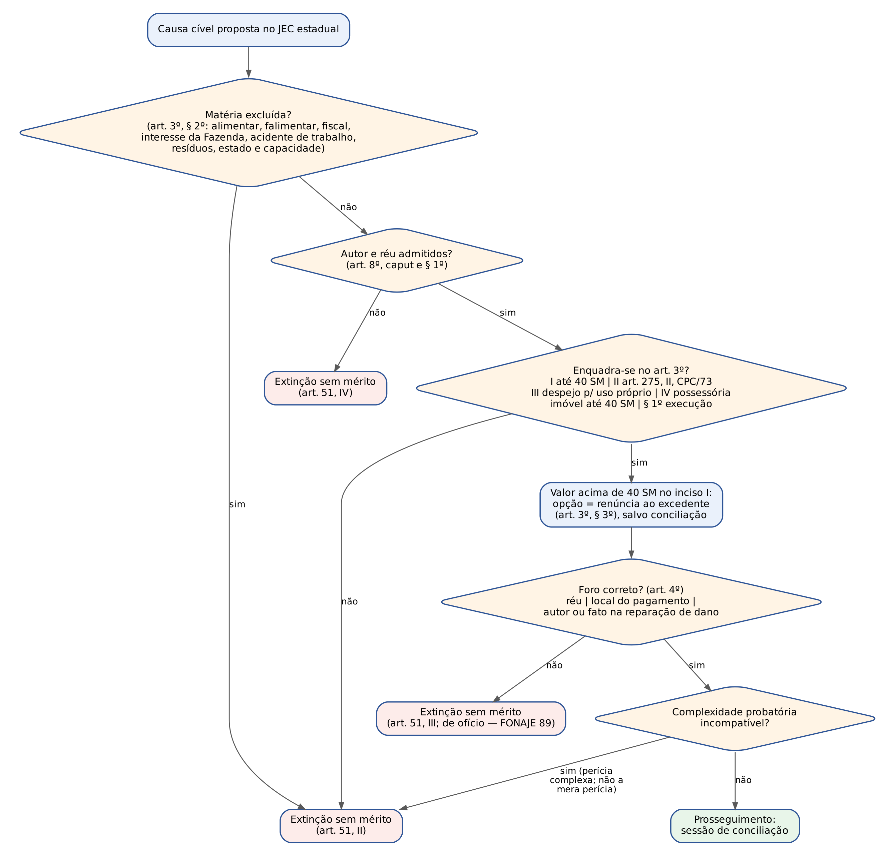
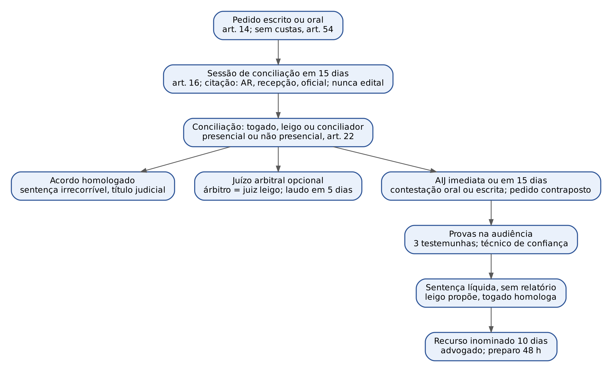
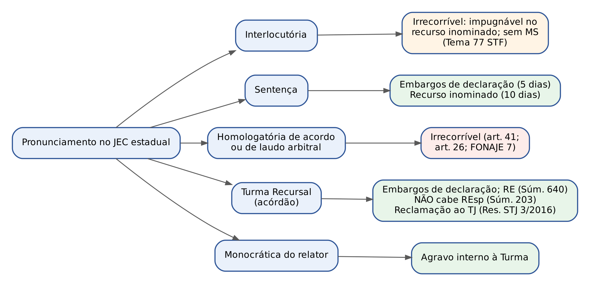
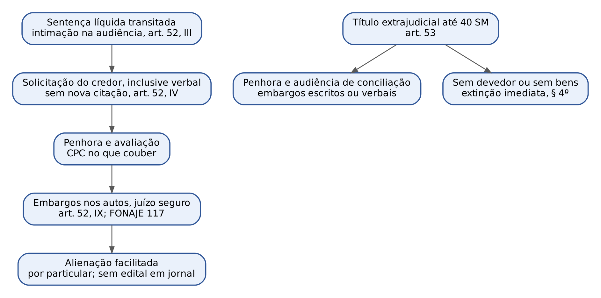
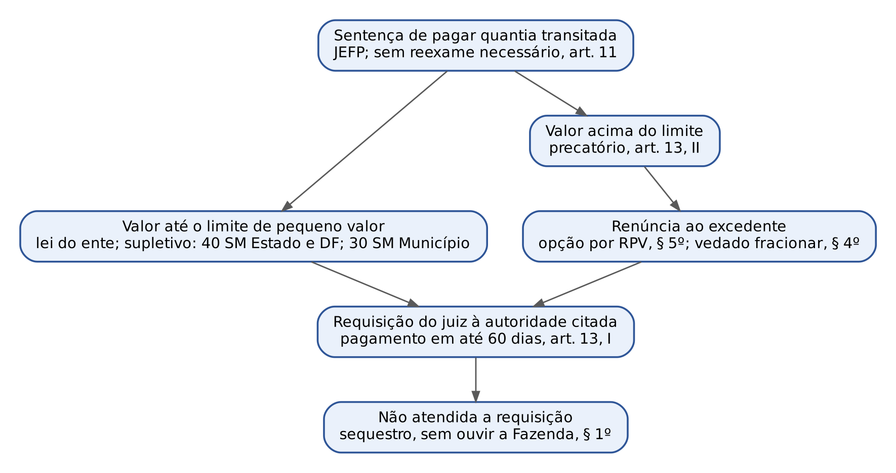
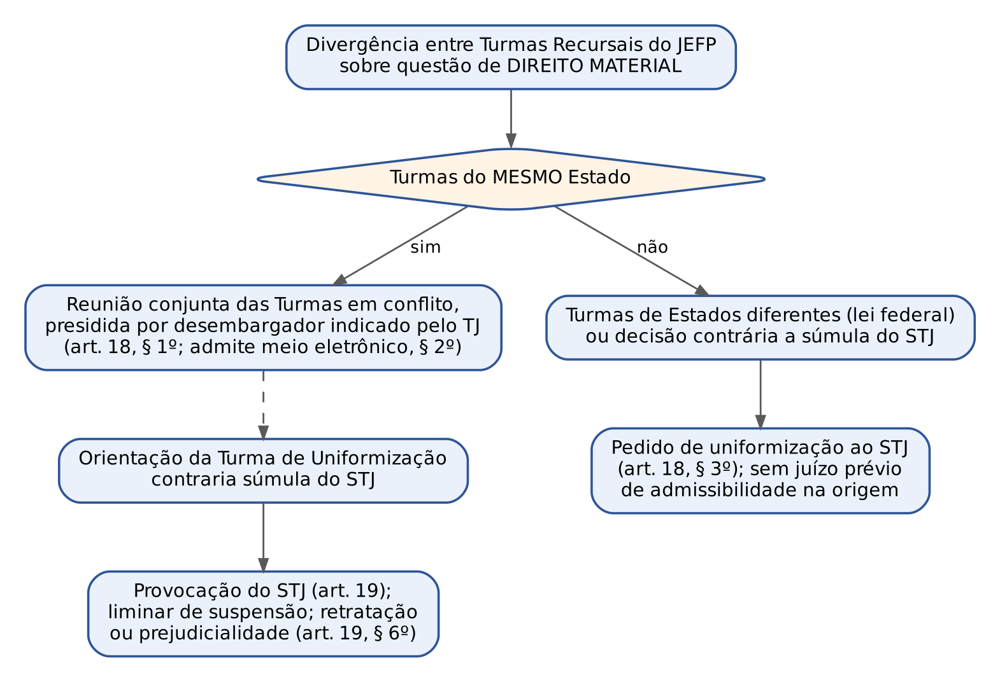

# CAPÍTULO 36 — JUIZADOS ESPECIAIS CÍVEIS ESTADUAIS E JUIZADO ESPECIAL DA FAZENDA PÚBLICA

:::INCIDENCIA
TJRS p. 15; TJSC p. 17. Nível A. Lote: 87 questões (FGV 80, FCC 7), com forte peso das provas de Juiz Leigo (TJ-SC 2025, TJ-RS 2026, TJ-BA 2026) e de Juiz Substituto (TJ-SC 2024, TJ-PE 2024, TJ-PR 2026, ENAM).
O que mais cai: competência e exclusões (arts. 3º e 4º da Lei 9.099; art. 2º da Lei 12.153), partes e advogado (arts. 8º e 9º), vedações (edital, reconvenção, intervenção de terceiros, rescisória), recurso inominado (prazo, preparo, efeito), execução (arts. 52 e 53), Tema 100 do STF e execução invertida, JEFP sem prazo diferenciado e sem reexame.
:::

#### Mapa de cobrança

| Subtema | FGV | FCC | Padrão |
|---|---|---|---|
| Competência, opção, valor e exclusões (JEC) | 16 | 4 | Renúncia ao excedente, "excetuada a hipótese de conciliação"; matérias excluídas; foro do art. 4º; extinção por incompetência territorial |
| Partes, advogado, intervenção de terceiros, IDPJ | 10 | 2 | Rol do art. 8º, § 1º; 20 salários mínimos; mandato verbal; IDPJ cabe (art. 1.062 do CPC) |
| Citação, revelia, conciliação, provas, sentença | 15 | 1 | Sem edital; revelia pela ausência pessoal; 3 testemunhas e 5 dias; sentença líquida e sem relatório |
| Recursos, embargos, Turma Recursal, honorários | 10 | 3 | 10 dias, advogado, preparo em 48 horas, efeito só devolutivo; interlocutória irrecorrível; agravo interno |
| Rescisória vedada e Tema 100 do STF | 5 | 0 | Simples petição no prazo da rescisória (2 anos do trânsito da decisão do STF) |
| Execução no JEC | 4 | 0 | Pedido verbal, sem nova citação; multa; embargos do art. 52, IX |
| JEFP (Lei 12.153) | 18 | 0 | Competência absoluta e exclusões; partes; sem prazo diferenciado; recurso de 10 dias contra tutela; RPV em 60 dias; PUIL ao STJ |
| Juiz leigo (Resolução CNJ 174/2013) | 5 | 0 | Projeto em 10 dias; impedimentos iguais aos do togado; vedação de advogar |

Divisão de tarefas: o JEF (Lei 10.259/2001) é do Cap. 37, ao qual se remete sempre que o tema for federal (valor de 60 salários mínimos no JEF, Turma Nacional de Uniformização, Tema 1.030 do STJ, Tema 1.277 do STF). A arbitragem nos Juizados foi desenvolvida no Cap. 2 (item 02.7.7), o IDPJ no Cap. 9, a incompatibilidade da tutela antecedente no Cap. 15 (item 15.1.1), a arguição de impedimento no JEC no Cap. 10, o regime constitucional de precatórios e RPV no Cap. 27 e a coisa julgada inconstitucional fora dos Juizados no Cap. 21. Aqui fica o que é próprio do sistema estadual dos Juizados.

## 36.1 O sistema dos Juizados Especiais estaduais

### 36.1.1 Base constitucional, natureza e fontes

O art. 98, I, da CF manda criar juizados especiais, providos por juízes togados ou togados e leigos, competentes para a conciliação, o julgamento e a execução de causas cíveis de menor complexidade, mediante procedimento oral e sumaríssimo, com julgamento de recursos por turmas de juízes de primeiro grau. Daí três consequências cobradas: (i) os Juizados são órgãos da Justiça ORDINÁRIA (art. 1º da Lei 9.099; a Lei 12.153, art. 1º, diz "órgãos da justiça comum"); (ii) as Turmas Recursais NÃO são tribunais, mas órgãos de segundo grau compostos por juízes de primeiro grau (art. 41, § 1º) — o que explica a Súmula 203 do STJ (sem recurso especial) e a Súmula 640 do STF (com recurso extraordinário, que não exige "tribunal"); (iii) o Sistema dos Juizados Especiais dos Estados e do DF é formado pelos Juizados Cíveis, Criminais e da Fazenda Pública (Lei 12.153, art. 1º, parágrafo único), regido por um microssistema próprio (Leis 9.099/1995, 10.259/2001 e 12.153/2009), em que o CPC entra apenas de forma supletiva e subsidiária.

A aplicação do CPC no microssistema obedece a um filtro de compatibilidade: as disposições do CPC aplicam-se "supletiva e subsidiariamente" às três leis, "desde que não sejam incompatíveis com as regras e princípios dessas Leis" (Enunciado 2 da I Jornada de Direito Processual Civil do CJF). O próprio CPC fez opções pontuais: art. 1.062 (o IDPJ aplica-se aos Juizados), art. 1.063 (até lei específica, os Juizados continuam competentes para as causas do art. 275, II, do CPC/1973), art. 1.064 a 1.066 (redação dos arts. 48, 50 e 83 da Lei 9.099 sobre embargos de declaração) e art. 985, I (a tese do IRDR aplica-se aos processos dos juizados especiais do respectivo Estado ou região). Enunciados das Jornadas do CJF vistos nesta tarefa: Enunciado 16 (negócios processuais e calendário dos arts. 190 e 191 aplicam-se aos Juizados, sem ofensa aos seus princípios), Enunciado 19 (prazo em dias úteis do art. 219 aplica-se às três leis), Enunciado 37 (aplicam-se aos Juizados os parágrafos do art. 489 do CPC) e Enunciado 167 (contraditório sobre o laudo pericial antes da sentença, inclusive nos JEFs).

O FONAJE (Fórum Nacional de Juizados Especiais) edita enunciados sem força normativa, mas a FGV os cobra literalmente nas provas de Juiz Leigo e já os cobrou em prova de Juiz Substituto (Q3898952, TJ-PR 2026). Há enunciados cíveis, criminais e da Fazenda Pública (estes numerados à parte; o Enunciado 1 da Fazenda manda aplicar aos JEFPs, no que couber, os enunciados cíveis).

### 36.1.2 Princípios (critérios) do art. 2º

O art. 2º da Lei 9.099 elenca cinco CRITÉRIOS — oralidade, simplicidade, informalidade, economia processual e celeridade — e uma diretriz: buscar, sempre que possível, a conciliação ou a transação. A FGV troca a lista por "publicidade", "instrumentalidade" ou "eficiência"; a letra é a dos cinco. Desdobramentos normativos que caem como pegadinha:

- Oralidade: pedido oral reduzido a escrito pela Secretaria (art. 14, § 3º); contestação oral (art. 30); embargos de declaração orais (art. 49); pedido verbal de execução (art. 52, IV); prova oral não reduzida a escrito (art. 36). O recurso inominado, ao contrário, é por PETIÇÃO ESCRITA (art. 42).
- Instrumentalidade das formas: atos válidos se atingem a finalidade (art. 13, caput); nenhuma nulidade sem prejuízo (§ 1º); atos em outras comarcas solicitados por qualquer meio idôneo (§ 2º).
- Poderes do juiz: liberdade para determinar e apreciar provas, com "especial valor às regras de experiência comum ou técnica" (art. 5º), e decisão "mais justa e equânime", atendendo aos fins sociais da lei e ao bem comum (art. 6º). O art. 6º não autoriza julgamento por equidade no sentido do art. 140, parágrafo único, do CPC; quem pode decidir por equidade, expressamente, é o ÁRBITRO (art. 25).
- Prazos: o art. 12-A (incluído pela Lei 13.728/2018) manda computar "somente os dias úteis" na contagem de prazo em dias, "inclusive para a interposição de recursos". O antigo Enunciado 165 do FONAJE (prazos contínuos) ficou superado no JEC.

:::QUESTAO FGV 2024 — TJ-SC — JUIZ SUBSTITUTO (Q2386965)
Assertivas sobre a tramitação no JEC. Gabarito: E, as sociedades de crédito ao microempreendedor podem ser autoras (art. 8º, § 1º, IV). Armadilhas: citação por edital (vedada, art. 18, § 2º), assistência (vedada, art. 10, embora o litisconsórcio seja admitido), incompatibilidade do MP (falsa: intervém nos casos previstos em lei, art. 11) e prazos em dias corridos (falsa desde a Lei 13.728/2018, art. 12-A).
No mesmo sentido: Q3531631 (FCC 2025, DPE-AM, gabarito C: corretos o pedido contraposto fundado nos mesmos fatos, a inquirição de técnicos de confiança e o advogado obrigatório na fase recursal; erradas a contagem em dias corridos e a vedação do litisconsórcio) e Q2400475 (FCC 2024, TRT-11, gabarito A: sociedades de crédito ao microempreendedor; não podem ser autores o incapaz, o insolvente civil, o preso e a pessoa jurídica de direito público).
:::

### 36.1.3 Juízes leigos e conciliadores

Conciliadores e juízes leigos são AUXILIARES DA JUSTIÇA (art. 7º): os conciliadores recrutados "preferentemente" entre bacharéis em Direito, os juízes leigos entre advogados com mais de CINCO anos de experiência. No JEFP, a Lei 12.153 fala em advogados com mais de DOIS anos de experiência (art. 15, § 1º) e a Resolução CNJ 174/2013, que disciplina a atividade do juiz leigo no sistema estadual, seguiu essa linha (ver nota). Vedações de advocacia — distinção literal muito cobrada:

| Lei | Alcance da vedação | Fundamento |
|---|---|---|
| Lei 9.099 (JEC) | "perante os Juizados Especiais, enquanto no desempenho de suas funções" | art. 7º, parágrafo único |
| Lei 12.153 (JEFP) | advocacia "perante todos os Juizados Especiais da Fazenda Pública instalados em território nacional, enquanto no desempenho de suas funções" | art. 15, § 2º |
| CPC (conciliador e mediador judiciais) | advocacia nos juízos em que exerçam as funções; quarentena de 1 ano | arts. 167, § 5º, e 172 (Cap. 10) |

O juiz leigo pode conduzir a conciliação (art. 22), dirigir a instrução sob supervisão do togado (art. 37) e proferir decisão que submete imediatamente ao togado, que pode homologá-la, proferir outra em substituição ou, antes, determinar atos probatórios indispensáveis (art. 40). Só o TOGADO homologa a conciliação (art. 22, § 1º) e o laudo arbitral (art. 26) e só o togado sentencia diante da ausência do réu na conciliação não presencial (art. 23). O projeto do leigo não é sentença; sentença é o ato homologatório do togado, e é ele que deve observar a fundamentação adequada (ver 36.4.1).

:::QUESTAO FGV 2025 — TJ-SC — JUIZ LEIGO (Q3592836)
Juiz leigo do JEFP de Chapecó, que advoga no JEFP de Niterói, apresenta projeto de sentença. Gabarito: E, o projeto não pode ser homologado, porque o juiz leigo do JEFP está impedido de advogar nos JEFPs de TODO o território nacional (art. 15, § 2º, da Lei 12.153). Armadilha: transpor a regra mais branda do art. 7º, parágrafo único, da Lei 9.099 (impedimento restrito aos Juizados em que atua) ou imaginar limitação ao Estado ou à comarca (B e C).
:::

:::QUESTAO FGV 2025/2026 — JUIZ LEIGO — RESOLUÇÃO CNJ 174/2013 (Q4102136, Q4102139, Q3978629, Q3592886)
Bloco sobre o regime ético-administrativo do juiz leigo. Gabaritos oficiais: encerrada a instrução, o leigo apresenta o projeto de sentença no prazo de 10 dias (Q4102136, A; no mesmo sentido, o Enunciado 95 do FONAJE, prazo de 10 dias com intimação das partes no termo); a avaliação funcional prevista na resolução inclui a aferição da satisfação do usuário (Q4102139, A); o Código de Ética (Anexo II) sujeita o leigo aos MESMOS motivos de impedimento e suspeição dos togados (Q3592886, A), o que torna errada a afirmação de que suas causas seriam "mais estritas" (Q3978629, E); e, segundo o gabarito da Q3978629 (B), o leigo observa o entendimento jurídico do togado do respectivo Juizado — coerente com o art. 40, pelo qual o togado pode substituir o projeto. Armadilhas: externar pré-julgamento para forçar acordo, linguagem técnica inacessível, tratamento privilegiado a uma das partes.
:::

## 36.2 Competência do Juizado Especial Cível

### 36.2.1 Opção do autor: competência relativa no sistema estadual

No JEC estadual, a escolha do procedimento é OPÇÃO do autor: o processamento perante o Juizado Especial Estadual é facultativo, podendo o autor preferir a Justiça Comum (STJ, Jurisprudência em Teses, ed. 89, tese 1; Enunciado 1 do FONAJE). Consequência: o juiz da vara cível não pode, de ofício, remeter ao Juizado a causa de pequeno valor (Súmula 33 do STJ; no mesmo sentido, segundo a Lei 9.099 anotada do Drive, STJ, RMS 61.604, Quarta Turma, j. 17/12/2019). Essa liberdade NÃO existe no JEFP (competência absoluta onde instalado, art. 2º, § 4º, da Lei 12.153) nem no JEF (art. 3º, § 3º, da Lei 10.259; Cap. 37).

:::QUESTAO FGV 2026 — TJ-BA — JUIZ LEIGO (Q4102120)
MEI ajuíza na vara cível indenizatória de 60.000 (sessenta mil) reais contra banco por fraude; o juiz remete ao JEC por ser causa simples. Pergunta: por que deve ficar na vara? Gabarito: C, o processamento no JEC é opção do autor. A alternativa A (valor acima da alçada) é armadilha: 60.000 (sessenta mil) reais não superam 40 salários mínimos aos valores de 2026 (40 x 1.621 = 64.840), e, de todo modo, a banca quis a razão de PRINCÍPIO: ainda que o valor coubesse no JEC, o juiz não poderia impor o rito; a alegada "baixa complexidade" (B) também não autoriza a remessa. MEI e bancos podem estar no Juizado (D e E erradas).
No mesmo sentido: Q3304115 (FCC 2025, DPE-SP, gabarito B: em conciliação o valor acordado pode superar 40 salários mínimos; erradas a competência absoluta do JEC, a dispensa de advogado "em todas as instâncias", o edital e a vedação do litisconsórcio).
:::

### 36.2.2 Critérios do art. 3º e o art. 1.063 do CPC

O JEC é competente para "causas cíveis de menor complexidade", assim consideradas (art. 3º):

- I: causas cujo valor não exceda a 40 vezes o salário mínimo (critério quantitativo);
- II: as enumeradas no art. 275, II, do CPC/1973 (critério qualitativo, QUALQUER valor). O CPC/2015 extinguiu o rito sumário, mas o art. 1.063 manteve a competência dos Juizados para essas causas até a edição de lei específica: arrendamento rural e parceria agrícola, cobrança ao condômino de quantias devidas ao condomínio, ressarcimento por danos em prédio urbano ou rústico, ressarcimento por danos causados em acidente de veículo de via terrestre, cobrança de seguro relativa a acidente de veículo (ressalvada a execução), cobrança de honorários de profissionais liberais (ressalvado o disposto em legislação especial) e as demais causas previstas em lei (rol do CPC/1973, transcrição não conferida nesta tarefa — ver nota);
- III: a ação de despejo PARA USO PRÓPRIO (qualquer valor); o despejo por falta de pagamento, a renovatória, a revisional e a consignatória locatícia não estão no rol;
- IV: as ações possessórias sobre bens IMÓVEIS de valor não excedente a 40 salários mínimos (as possessórias de móveis entram pelo inciso I).

Competência executiva (art. 3º, § 1º): o JEC executa (I) os seus julgados e (II) títulos extrajudiciais de até 40 salários mínimos, observado o rol de legitimados ativos do art. 8º, § 1º. Só os SEUS julgados: título judicial formado na Justiça Comum não se executa no JEC, nem a sentença coletiva da Vara da Fazenda se executa no JEFP (Tema 1.029 do STJ, ver 36.9.2).

Exclusões do § 2º (rol taxativo e memorizável): causas de natureza ALIMENTAR, FALIMENTAR, FISCAL e de INTERESSE DA FAZENDA PÚBLICA, e também as relativas a ACIDENTES DE TRABALHO, a RESÍDUOS e ao ESTADO E CAPACIDADE das pessoas, "ainda que de cunho patrimonial". O Enunciado 139 do FONAJE estende a exclusão às demandas sobre direitos difusos, coletivos e individuais homogêneos, inclusive as individuais de natureza multitudinária.

:::QUESTAO FGV 2026 — TJ-BA — JUIZ LEIGO (Q4102073)
No JEC foram propostas: ação de alimentos, ação de acidente de trabalho e execução de título extrajudicial de 5 salários mínimos. Gabarito: E, só a execução (art. 3º, § 1º, II). Alimentos e acidente de trabalho estão no § 2º.
No mesmo sentido: Q2370306 (FGV 2024, TJ-RJ, Mediador, gabarito E: excluídas as causas alimentares, falimentares, fiscais e de interesse da Fazenda; erradas a alçada de 60 salários mínimos, a exclusão do despejo para uso próprio e a exclusão dos títulos judiciais), Q2370292 (FGV 2024, TJ-RJ, Mediador, gabarito B: causas de até 40 salários mínimos; erradas "o JEC não executa seus julgados", bens imóveis dos Estados no JEC, MS e desapropriação no JEF e competência relativa do JEFP), Q2489725 (FGV 2024, TJ-MS, gabarito E: vedada a citação por edital; erradas a vedação de títulos extrajudiciais, o declínio por incompetência territorial, a vedação do litisconsórcio e a reconvenção).
:::

:::QUESTAO FGV 2025 — TJ-SC — JUIZ LEIGO (Q3592824)
Juiz leigo elabora projeto de improcedência em declaratória de inexistência de DÉBITO FISCAL, de 10 salários mínimos, com réu ausente. O que deve fazer o togado? Gabarito: D, extinguir sem resolução do mérito: causa FISCAL está fora do JEC (art. 3º, § 2º), sendo inadmissível o procedimento (art. 51, II). Armadilhas: julgar o mérito pela revelia ou pela súmula do STJ (A e C) e declinar para o juízo comum (B) — no JEC a incompatibilidade gera extinção, não remessa.
:::

:::QUESTAO FGV 2025 — TJ-SC — JUIZ LEIGO (Q3592837)
Despejo POR FALTA DE PAGAMENTO cumulado com cobrança de 50.000 (cinquenta mil) reais distribuído ao JEC. Gabarito: A, extinguir sem resolução do mérito por falta de competência. O art. 3º, III, só abrange o despejo para uso próprio; e o valor supera a alçada. Erradas: declinar para a vara (B), citar (C e E) e mandar emendar (D) — o sistema não converte o rito.
:::

:::QUESTAO FCC 2025 — TRT-6 — ANALISTA (Q3214738)
Reintegração de posse de bem de até 40 salários mínimos no JEC. Em contestação, a ré poderá formular: gabarito B, pedido contraposto de indenização por benfeitorias, desde que não exceda 40 salários mínimos (arts. 3º, IV, e 31). Armadilhas: reconvenção (vedada, art. 31) e incompetência do JEC para possessória (falsa: o inciso IV a admite, para imóveis no limite de valor).
:::

### 36.2.3 Valor da causa, alçada e renúncia

Regras centrais:

- Opção = renúncia: a opção pelo procedimento "importará em renúncia ao crédito excedente ao limite estabelecido neste artigo, EXCETUADA a hipótese de conciliação" (art. 3º, § 3º). O juiz deve advertir as partes sobre isso ao abrir a sessão (art. 21). A conciliação pode, portanto, superar 40 salários mínimos.
- Ineficácia: é ineficaz a sentença condenatória na parte que exceder a alçada (art. 39). Não é nulidade da sentença inteira; é ineficácia do excesso.
- Valor da causa = pretensão econômica (Enunciado 39 do FONAJE). Cumulação de pedidos: admitida se conexos e se a soma não ultrapassar o limite (art. 15).
- Dano moral: o Enunciado 170 do FONAJE afasta, no JEC, a obrigatoriedade do art. 292, V, do CPC; se o autor optar por atribuir valor ao dano moral, ele soma-se ao dano material para efeito de alçada e custas.
- Litisconsórcio ativo facultativo: a alçada é aferida individualmente por autor, ainda que a soma ultrapasse o teto (Jurisprudência em Teses, ed. 89, tese 2; no JEFP, Enunciado 2 da Fazenda Pública do FONAJE, até 60 salários mínimos por autor).
- Acessórios supervenientes: compete ao Juizado executar seus julgados independentemente do valor executado, desde que respeitada a alçada na propositura (Jurisprudência em Teses, ed. 89, tese 6; segundo a Lei 9.099 anotada do Drive, STJ, Rcl 7.861, Segunda Seção, j. 11/9/2013). Juros, correção e multa que façam a execução superar 40 salários mínimos não deslocam a competência.
- A multa cominatória não fica limitada a 40 salários mínimos (Enunciado 144 do FONAJE): a alçada se dirige ao principal, não às *astreintes*.

:::QUESTAO FGV 2026 — TJ-RS — JUIZ LEIGO (Q3978630)
Indenização por danos morais e materiais no JEC, segundo os enunciados do FONAJE. Gabarito: E, o autor TEM A FACULDADE de indicar o valor do dano moral; se o fizer, ele é somado ao dano material para alçada e custas (Enunciado 170). Armadilhas: obrigatoriedade de indicar (A e C, que seriam a regra do art. 292, V, do CPC no procedimento comum) e falta de interesse recursal se não indicar (D).
:::

:::QUESTAO FCC 2024 E 2025 — TRT-7 E TRT-6 — RENÚNCIA AO EXCEDENTE (Q3089742, Q3215748)
Crédito atualizado de 42 salários mínimos (Q3089742) e ação de valor superior a 40 salários mínimos ajuizada por opção no JEC (Q3215748). Gabaritos: D e A — a opção implica renúncia ao excedente, EXCETUADA a conciliação. Armadilha recorrente: "inclusive na hipótese de conciliação" (C e E) e remessa ao juízo comum. Literalidade do art. 3º, § 3º.
:::

:::QUESTAO FGV 2026 — TJ-PR — JUIZ SUBSTITUTO (Q3898954)
Três assertivas sobre valor da causa. Gabarito: B, só a II: a opção pelo JEC implica renúncia ao crédito excedente, abrangendo os pedidos interdependentes (principal e acessórios) da mesma causa de pedir. A I erra ao dizer que a renúncia inclui a conciliação; a III erra ao excluir as possessórias sobre imóveis "qualquer que seja o valor" (o art. 3º, IV, as admite até 40 salários mínimos).
:::

:::QUESTAO FGV 2025 — TJ-SC — JUIZ LEIGO (Q3592832)
Pedidos de 40 salários mínimos (dano material) e 20 (dano moral); o juiz, antes da conciliação, extingue o feito porque a soma excede a alçada. Gabarito oficial: A, decisão equivocada porque a questão só poderia ser examinada após a etapa de autocomposição — raciocínio: como a conciliação pode superar o teto (art. 3º, § 3º), a extinção prematura frustra a tentativa de acordo; e a opção do autor implica renúncia ao excedente, não extinção. Gabarito discutível (o art. 15 condiciona a cumulação a que a soma não ultrapasse o limite, e o art. 39 resolve o excesso pela ineficácia); ver nota.
:::

:::QUESTAO FGV 2025 — TJ-SC — JUIZ LEIGO (Q3592908)
Condenação em obrigação de fazer estimada em 40 salários mínimos, com multa diária de 1.000 (mil) reais não pedida; o credor converte em perdas e danos e cobra principal mais multa. Gabarito: B, sentença correta, porque a alçada incide sobre o principal, não sobre acessórios (Enunciado 144 do FONAJE; art. 52, V). A multa é técnica de efetivação imponível de ofício (art. 537 do CPC; Cap. 20), logo não há julgamento *ultra petita* (E) nem pedido implícito vedado (D).
No mesmo sentido: Q2370293 (FGV 2024, TJ-RJ, Mediador, gabarito C: descumprida a obrigação de fazer, a multa pode ser elevada ou transformada em perdas e danos, que o juiz arbitra de imediato — art. 52, V; litisconsórcio ativo é admitido e os acréscimos da execução não afastam a competência).
:::

### 36.2.4 Menor complexidade e prova técnica

"Menor complexidade" refere-se ao objeto da prova, não ao valor ou à matéria em abstrato. A necessidade de prova pericial, por si só, não exclui a competência dos Juizados (Jurisprudência em Teses, ed. 89, tese 3); o Enunciado 70 do FONAJE diz que a discussão sobre ilegalidade de juros não é complexa, salvo se exigir perícia contábil. O instrumento é a prova técnica simplificada: o juiz pode inquirir técnicos de sua confiança, permitida às partes a apresentação de parecer técnico (art. 35), e fazer inspeção em pessoas ou coisas no curso da audiência (parágrafo único); o Enunciado 12 do FONAJE admite a perícia informal nessa hipótese. Persistindo complexidade incompatível, extingue-se o processo (art. 51, II). No JEFP há regra própria (art. 10 da Lei 12.153, ver 36.9.4).

### 36.2.5 Competência territorial (art. 4º) e incompetência

Foros do JEC (art. 4º): I — domicílio do réu ou, a critério do autor, local onde aquele exerça atividades profissionais ou econômicas ou mantenha estabelecimento, filial, agência, sucursal ou escritório; II — lugar onde a obrigação deva ser satisfeita; III — domicílio do AUTOR ou local do ato ou fato, nas ações para reparação de dano de QUALQUER natureza. Em qualquer hipótese, a ação pode ser proposta no foro do inciso I (parágrafo único). Note que o CPC não dá, em regra, o foro do domicílio do autor para reparação de dano (salvo acidente de veículo, art. 53, V); no JEC, a regra é ampla.

Incompetência territorial: gera EXTINÇÃO sem resolução do mérito (art. 51, III), não remessa (no CPC, art. 64, § 3º, remete-se). E pode ser reconhecida DE OFÍCIO (Enunciado 89 do FONAJE), afastando a Súmula 33 do STJ no microssistema. A extinção independe de prévia intimação pessoal das partes (art. 51, § 1º). Sobre a razão do tratamento e a *translatio iudicii*, ver Cap. 4.

:::QUESTAO FGV 2024 — TJ-SC — JUIZ SUBSTITUTO (Q3049349)
Indenizatória por danos morais (ofensas à honra), de 30 salários mínimos, proposta no JEC do domicílio do autor, diverso do réu. Gabarito: E, prosseguimento regular: o art. 4º, III, dá o foro do domicílio do autor nas ações de reparação de dano de qualquer natureza. Armadilhas: tratar como incompetência territorial com declínio (A) ou extinção (B) — se houvesse incompetência, a consequência seria a extinção, nunca o declínio.
No mesmo sentido: Q3592833 (FGV 2025, TJ-SC, Juiz Leigo, gabarito C: motorista de aplicativo de Florianópolis demanda a plataforma por suspensão da conta, pedindo danos materiais e morais; competente o juízo do domicílio do autor, art. 4º, III).
:::

:::QUESTAO FGV 2026 — TJ-BA — JUIZ LEIGO (Q4102070)
Reconhecida a incompetência territorial do JEC. Gabarito: A, extinção do processo, cabendo à parte ajuizar nova ação no juízo competente (art. 51, III). Erradas: remessa ao Juizado competente (B), redistribuição automática (C), dependência de provocação ou de intimação pessoal (D — contraria o Enunciado 89 e o art. 51, § 1º) e suspensão (E).
No mesmo sentido: Q3978623 (FGV 2026, TJ-RS, Juiz Leigo, gabarito E: extingue-se o processo quando reconhecida a incompetência territorial, independentemente de prévia intimação pessoal das partes; as demais alternativas trocam o prazo de 30 dias dos incisos V e VI por 60 ou 15 dias, deslocam o termo inicial e trocam "autor" por "réu" na ausência às audiências).
:::

### 36.2.6 Conflitos, conexão com a vara comum e controle da competência

- Conflito de competência entre juízes de Juizados vinculados à mesma Turma Recursal: decide a própria Turma; sem vinculação comum, decide a Turma para a qual o conflito for distribuído (Enunciado 91 do FONAJE). O juízo de admissibilidade do recurso extraordinário cabe ao Presidente da TURMA RECURSAL, salvo disposição em contrário (Enunciado 84 do FONAJE). Conflito entre JEF e juízo federal da mesma seção: TRF (Súmula 428 do STJ; Cap. 37).
- Conexão entre causa no JEC e causa na vara comum: não há reunião, porque os juízos têm competências e procedimentos inconciliáveis (a vara não pode atrair a causa do Juizado, que é opção do autor e tem rito próprio, nem o Juizado pode receber causa acima da alçada). O instrumento que evita decisões conflitantes é a suspensão por prejudicialidade (art. 313, V, a, do CPC).
- Controle da competência dos Juizados por mandado de segurança: em regra, compete à Turma Recursal julgar MS contra ato de Juizado (Súmula 376 do STJ; v. Cap. 37), mas admite-se MS no TJ (ou no TRF) para o controle de competência dos Juizados (Jurisprudência em Teses, ed. 89, tese 9). Esse MS não cabe contra decisão já transitada em julgado (art. 5º, III, da Lei 12.016; Informativo 868; v. Cap. 32).

:::QUESTAO FGV 2026 — TJ-PR — JUIZ SUBSTITUTO (Q3898952)
Três assertivas segundo os enunciados do FONAJE. Gabarito: C (II e III). Correta a II (incompetência territorial reconhecível de ofício — Enunciado 89) e a III (conflito entre juízes vinculados à mesma Turma Recursal é decidido por ela; sem vinculação, pela Turma a que for distribuído — Enunciado 91). Errada a I: a admissibilidade do RE é do Presidente da TURMA RECURSAL, não do Presidente do TJ (Enunciado 84).
:::

:::QUESTAO FGV 2025 — TJ-SC — JUIZ LEIGO (Q3592826)
João propõe no JEC indenizatória de 30 salários mínimos por acidente de trânsito; Marcos, depois, propõe na vara cível, pelo procedimento comum, ação de 60 salários mínimos pelo mesmo acidente. O juiz da vara agirá corretamente se: gabarito D, suspender o processo da vara. Passos: (1) há conexão (mesma causa de pedir); (2) não é possível reunir no JEC (valor de 60 salários mínimos e vedação de reconvenção; o pedido contraposto teria de respeitar a alçada) nem na vara (o Juizado é opção do autor e tem competência própria); (3) resta a suspensão por prejudicialidade externa (art. 313, V, a, do CPC). Armadilhas: reunião por conexão ou continência (A, B, E) e extinção (C).
:::

## 36.3 Partes, capacidade, advogado e intervenção de terceiros

### 36.3.1 Quem não pode ser parte e quem pode ser autor

O art. 8º, caput, veda como PARTES (ativa e passiva): o incapaz, o preso, as pessoas jurídicas de direito público, as empresas públicas da União, a massa falida e o insolvente civil. Note que empresa pública ESTADUAL ou MUNICIPAL e sociedade de economia mista podem ser rés no JEC; e a pessoa jurídica de direito privado em geral pode ser ré.

Polo ativo (art. 8º, § 1º, rol "somente"): I — pessoas físicas capazes, excluídos os cessionários de direito de pessoas jurídicas; II — microempreendedores individuais, microempresas e empresas de pequeno porte na forma da LC 123/2006; III — OSCIPs (Lei 9.790/1999); IV — sociedades de crédito ao microempreendedor (Lei 10.194/2001). O maior de 18 anos pode ser autor independentemente de assistência, inclusive para conciliação (art. 8º, § 2º). O Enunciado 172 do FONAJE impede a empresa integrante de grupo econômico de demandar se a receita bruta do grupo superar o limite da EPP. A LC 123/2006 também prevê o acesso de ME e EPP aos Juizados (Q2459909, ENAM 2024, gabarito E, com afirmação sobre o art. 74 do Estatuto da ME e EPP, inclusive sua admissão como autoras no JEF).

Sobrevindo impedimento do art. 8º (por exemplo, o autor que se torna incapaz ou é preso, ou a ré cuja falência é decretada), extingue-se o processo (art. 51, IV). Falecido o autor, extingue-se se a habilitação depender de sentença ou não se der em 30 dias; falecido o réu, se o autor não promover a citação dos sucessores em 30 dias da ciência do fato (art. 51, V e VI). A incapacidade do autor é vício insanável no JEC (extinção), não se resolvendo por representação: Q3324241 e Q3301239 (ambas de magistratura, Caps. 16 e 24) usam o incapaz justamente para afastar a alternativa que remetia ao JEC.

:::QUESTAO FGV 2026 — TJ-BA — JUIZ LEIGO (Q4102067)
Estudante de 19 anos propõe, sem advogado, ação de 4.000 (quatro mil) reais contra EPP; a ré apresenta reconvenção. Gabarito: D, em razão do valor (até 20 salários mínimos) pode litigar sem advogado (art. 9º). Armadilhas: menor de 21 anos (A; o § 2º fala em maior de 18), estudante (B), reconvenção admitida para EPP (C; vedada a reconvenção em qualquer caso, art. 31) e EPP proibida no polo passivo (E; pode ser ré e até autora).
:::

### 36.3.2 Capacidade postulatória: a linha dos 20 salários mínimos

Nas causas de até 20 salários mínimos, as partes comparecem pessoalmente, PODENDO ser assistidas por advogado; nas de valor superior, a assistência é OBRIGATÓRIA (art. 9º, caput). Detalhes:

- Equilíbrio: sendo facultativa a assistência, se uma parte comparecer com advogado, ou se o réu for pessoa jurídica ou firma individual, a outra terá, se quiser, assistência judiciária por órgão instituído junto ao Juizado (§ 1º).
- Dever de alerta: o juiz alertará as partes da conveniência do patrocínio por advogado quando a causa o recomendar (§ 2º).
- Mandato: pode ser VERBAL, salvo quanto aos poderes especiais (§ 3º); constando do termo a presença do advogado com a parte, há mandato.
- Preposto: o réu pessoa jurídica ou titular de firma individual pode ser representado por preposto credenciado, com carta de preposição e poderes para transigir, sem necessidade de vínculo empregatício (§ 4º, redação da Lei 12.137/2009). É vedado acumular, na mesma pessoa, as condições de preposto e advogado (Enunciado 98 do FONAJE).
- Momento: o Enunciado 36 do FONAJE entende que a assistência obrigatória tem lugar a partir da fase instrutória, não se aplicando à formulação do pedido e à sessão de conciliação.
- Fase recursal: no recurso, as partes serão OBRIGATORIAMENTE representadas por advogado, qualquer que seja o valor (art. 41, § 2º).

:::QUESTAO FGV 2025 — TJ-SC — JUIZ LEIGO (Q3592896)
Juiz leigo percebe que a autora, sem advogado, numa causa de 8.000 (oito mil) reais contra banco, não compreende a proposta. Gabarito: B, alertá-la da conveniência do patrocínio por advogado (art. 9º, § 2º). Erradas: homologar mesmo assim, impor a solução, indicar escritório e explicar a proposta "para terminar mais um processo" (violações da imparcialidade e da decisão informada; Cap. 2).
:::

:::QUESTAO FGV 2025 — TJ-SC — JUIZ LEIGO (Q3592828)
Advogado comparece à audiência com a autora, sem juntar procuração; consta sua presença no termo; depois interpõe recurso inominado. Gabarito: A, recurso conhecido, porque o instrumento era dispensável: o mandato pode ser verbal, salvo poderes especiais (art. 9º, § 3º), e a presença no termo o documenta. Armadilha: exigir o instrumento escrito (E) ou anular o processo (C). Distinga: dispensável é o INSTRUMENTO de mandato, não o advogado no recurso, que é obrigatório (art. 41, § 2º).
:::

### 36.3.3 Litisconsórcio sim; intervenção de terceiros e assistência não; IDPJ sim

Art. 10: "Não se admitirá, no processo, qualquer forma de intervenção de terceiro nem de assistência. Admitir-se-á o litisconsórcio." A vedação alcança assistência simples e litisconsorcial, denunciação, chamamento e oposição. Exceção legal: o incidente de desconsideração da personalidade jurídica aplica-se aos Juizados (art. 1.062 do CPC), inclusive na fase de execução (Enunciado 60 do FONAJE). O desenvolvimento do IDPJ e do art. 1.062 está no Cap. 9 (item da tabela de procedimentos e box da Q4153619); aqui basta o essencial: no JEC, o sócio só é atingido por meio do incidente, com citação (art. 135 do CPC), não por constrição direta. O MP intervém nos casos previstos em lei (art. 11). A técnica de ampliação do colegiado (art. 942 do CPC) não se aplica aos julgamentos não unânimes nos Juizados (Enunciado 552 do FPPC, citado na Lei 9.099 anotada do Drive).

:::QUESTAO FGV 2026 — TJ-SC — OFICIAL DE JUSTIÇA (Q4153619)
Cumprimento de sentença no JEC (40.000 (quarenta mil) reais) sem bens da sociedade; credor pede IDPJ. Gabarito: B, admissível por expressa previsão do CPC (art. 1.062). Comentário completo no Cap. 9.
No mesmo sentido: Q3592830 (FGV 2025, TJ-SC, Juiz Leigo, gabarito A: pedido de apreensão direta de bens da sócia, "cuja citação era prescindível", é equivocado; o caminho é a desconsideração, com incidente e citação), Q4102116 (FGV 2026, TJ-BA, Juiz Leigo, gabarito A: o IDPJ é o instrumento compatível com os Juizados; assistência, denunciação, intervenção de terceiros em geral e reexame necessário não são) e Q3692397 (FGV 2025, ENAM, segunda assertiva verdadeira: IDPJ compatível com o rito dos Juizados).
:::

:::QUESTAO FGV 2026 — ENAM 2026.1 (Q4102434)
Afirmativas comparando Juizado e rito comum. Gabarito: D (II e III). I falsa: nos Juizados não se admite NENHUMA assistência, nem simples nem litisconsorcial (art. 10). II verdadeira: no JEC não cabe reconvenção, mas cabe pedido contraposto (art. 31); no procedimento comum, a reconvenção pode incluir terceiro ou ser proposta contra o autor e terceiro (art. 343, §§ 3º e 4º, do CPC). III verdadeira: a rescisória é vedada (art. 59), mas a coisa julgada contrária ao entendimento do STF pode ser desconstituída (Tema 100 do STF; ver 36.7).
:::

## 36.4 Procedimento do JEC: do pedido à sentença

### 36.4.1 Pedido, sessão de conciliação e citação

O processo instaura-se com o pedido, escrito ou oral, à Secretaria (art. 14), contendo, "de forma simples e em linguagem acessível", nome, qualificação e endereço das partes, fatos e fundamentos sucintos, objeto e valor (§ 1º). Pedido genérico é lícito quando não for possível determinar desde logo a extensão da obrigação (§ 2º) — mas a SENTENÇA condenatória nunca pode ser ilíquida (art. 38, parágrafo único). Pedidos alternativos ou cumulados: cumulados só se conexos e se a soma não ultrapassar o limite (art. 15). Registrado o pedido, independentemente de distribuição e autuação, a Secretaria designa a sessão de conciliação em 15 dias (art. 16). Se ambas as partes comparecerem INICIALMENTE, instaura-se desde logo a sessão, dispensados o registro prévio do pedido e a citação (art. 17); havendo pedidos contrapostos, pode ser dispensada a contestação formal, apreciando-se ambos na mesma sentença (parágrafo único).

Citação (art. 18): I — por correspondência, com aviso de recebimento EM MÃO PRÓPRIA; II — pessoa jurídica ou firma individual: entrega ao encarregado da recepção, obrigatoriamente identificado; III — sendo necessário, por oficial de justiça, independentemente de mandado ou carta precatória. A citação contém cópia do pedido, dia e hora de comparecimento e advertência de que, não comparecendo o citando, considerar-se-ão verdadeiras as alegações iniciais e será proferido julgamento de plano (§ 1º). "Não se fará citação por edital" (§ 2º). O comparecimento espontâneo supre a falta ou nulidade da citação (§ 3º). Intimações: na forma da citação ou por qualquer meio idôneo (art. 19); dos atos praticados em audiência, as partes consideram-se desde logo cientes (§ 1º); reputam-se eficazes as intimações enviadas ao endereço anterior se a parte não comunicou a mudança (§ 2º).

Réu não localizado: como não há edital, frustradas as diligências de citação pessoal, o processo é extinto sem resolução do mérito, por inadmissibilidade do procedimento (art. 51, II), podendo o autor demandar na Justiça Comum, onde o edital é possível. Não há nomeação de curador especial no JEC.

:::QUESTAO FGV 2025 E 2026 — TJ-SC E TJ-BA — JUIZ LEIGO — CITAÇÃO POR EDITAL (Q3592827, Q4102125)
Q3592827: réu de endereço e telefone desconhecidos em comunidade não pacificada; frustradas as diligências. Gabarito: B, extinguir sem resolução do mérito, podendo o autor propor a ação no juízo comum. Q4102125: AR negativo; oficial certifica local inacessível; autor pede edital. Gabarito: B, não se admite citação por edital no JEC (art. 18, § 2º). Armadilhas: edital "sem publicação no Diário" ou com curador especial (Q3592827, D e E), edital por local inacessível (Q4102125, A) e exigência de mandado para o oficial (E — o art. 18, III, dispensa mandado).
:::

:::QUESTAO FGV 2026 — TJ-BA — JUIZ LEIGO (Q4102068)
Consumidor e representante da loja comparecem juntos ao JEC; o caso é levado imediatamente ao conciliador, sem registro nem citação. Gabarito: C, comparecendo inicialmente ambas as partes, a sessão é instaurada de imediato, dispensados o registro prévio e a citação (art. 17). Armadilhas: nulidade absoluta por falta de citação (D) e intervalo mínimo de 10 dias (E).
:::

### 36.4.2 Revelia: comparecimento pessoal

A revelia no JEC decorre do NÃO COMPARECIMENTO do demandado à sessão de conciliação ou à audiência de instrução e julgamento: reputam-se verdadeiros os fatos alegados no pedido inicial, "salvo se o contrário resultar da convicção do Juiz" (art. 20). Daí as distinções cobradas:

- A presença do advogado não supre a ausência pessoal da parte: o oferecimento de resposta, oral ou escrita, não dispensa o comparecimento pessoal, ensejando os efeitos da revelia (Enunciado 78 do FONAJE). Pessoa jurídica comparece por preposto (art. 9º, § 4º).
- Inversamente, nas causas acima de 20 salários mínimos, a falta de contestação, escrita ou oral, implica revelia ainda que o réu esteja presente (Enunciado 11 do FONAJE).
- A presunção é relativa (convicção do juiz), como no CPC (art. 345).
- Conciliação não presencial (Lei 13.994/2020): é cabível a conciliação por meio de recursos tecnológicos de transmissão de sons e imagens em tempo real, reduzindo-se o resultado a escrito (art. 22, § 2º); se o demandado não comparecer ou recusar-se a participar da tentativa de conciliação não presencial, o juiz TOGADO proferirá sentença (art. 23).
- Ausência do AUTOR a qualquer audiência: extinção sem resolução do mérito (art. 51, I), com possível isenção de custas se comprovada força maior (§ 2º). No procedimento comum, a ausência injustificada à audiência do art. 334 gera multa, não extinção (Cap. 16).

:::QUESTAO FGV 2025 — TJ-SC — JUIZ LEIGO (Q3592902)
Na AIJ, a advogada do réu ausente pretende contestar oralmente e juntar documentos; o juiz indefere, decreta a revelia e julga procedente. Gabarito oficial: A, o juiz agiu corretamente, porque a presença pessoal do réu é obrigatória para afastar o efeito material da revelia (art. 20; Enunciado 78). Armadilhas: D (a presença da advogada impediria a revelia) e E (a revelia não gera presunção) — esta é verdadeira em abstrato no sentido de que a presunção é relativa (art. 20, parte final), o que torna a questão sensível; ver nota.
:::

:::QUESTAO FGV 2026 — TJ-BA — JUIZ LEIGO (Q4102065)
Réu regularmente citado permanece revel, sem comparecer e sem advogado. Gabarito oficial: C, não há necessidade de intimá-lo por publicação no Diário Eletrônico. Lógica da banca: no microssistema, o revel que não comparece nem constitui advogado não precisa ser intimado dos atos subsequentes; o julgamento é "de plano" (art. 18, § 1º) e as intimações seguem forma simplificada (art. 19). No CPC, os prazos contra o revel sem patrono fluem da publicação do ato decisório no órgão oficial (art. 346), o que torna o gabarito discutível; ver nota. Erradas, segundo a banca: suspensão (A) e intimação pessoal (B).
:::

### 36.4.3 Conciliação e juízo arbitral

Aberta a sessão, o juiz togado ou leigo esclarecerá as partes sobre as vantagens da conciliação, os riscos e as consequências do litígio, "especialmente quanto ao disposto no § 3º do art. 3º" (art. 21) — a renúncia ao excedente. A conciliação é conduzida pelo juiz togado ou leigo ou por conciliador sob sua orientação (art. 22). Obtida, é reduzida a escrito e homologada pelo juiz togado por sentença com eficácia de título executivo (§ 1º), IRRECORRÍVEL (art. 41, caput). O acordo extrajudicial, de qualquer natureza ou valor, pode ser homologado no juízo competente, independentemente de termo, valendo a sentença como título executivo judicial (art. 57); o acordo por instrumento escrito referendado pelo Ministério Público vale como título extrajudicial (parágrafo único). As normas de organização judiciária podem estender a conciliação dos arts. 22 e 23 a causas não abrangidas pela lei (art. 58).

Não obtida a conciliação, as partes podem optar, de comum acordo, pelo juízo arbitral (arts. 24 a 26): instaura-se independentemente de termo de compromisso, com a escolha do árbitro dentre os juízes leigos; o árbitro pode decidir por equidade e apresenta o laudo ao término da instrução ou nos 5 dias subsequentes, para homologação por sentença irrecorrível. Desenvolvimento no Cap. 2 (item 02.7.7), onde está o box da Q3592834 (FGV 2025, TJ-SC, Juiz Leigo, gabarito D: é imprescindível a homologação do laudo pelo juiz togado).

:::QUESTAO FGV 2026 — TJ-BA — JUIZ LEIGO (Q4102112)
Vítima de acidente ajuíza no JEC indenização pelos danos ao veículo e representa criminalmente; o causador oferece acordo extrajudicial de 100.000 (cem mil) reais, abrangendo reparação cível e criminal. Gabarito: B, acordo válido integralmente, homologável no juízo cível, com posterior comunicação ao juízo criminal. Fundamento: art. 57 ("de qualquer natureza ou valor") e a exceção da conciliação ao limite de alçada (art. 3º, § 3º). Armadilhas: limite de 40 ou 20 salários mínimos (C e E) e vedação de homologação de acordo extrajudicial (D).
:::

:::QUESTAO FGV 2024 — TJ-RJ — MEDIADOR (Q2370293, PARTE FINAL)
Na mesma questão do box de 36.2.3, a alternativa E (vedado ao conciliador propor pagamento a prazo ou em prestações) é falsa: na audiência de conciliação da execução de título extrajudicial, o conciliador DEVE propor, entre outras medidas, o pagamento a prazo ou a prestação, a dação em pagamento ou a adjudicação imediata (art. 53, § 2º; ver 36.8).
:::

### 36.4.4 Audiência de instrução e julgamento, contestação e pedido contraposto

Não instituído o juízo arbitral, procede-se IMEDIATAMENTE à AIJ, "desde que não resulte prejuízo para a defesa" (art. 27); não sendo possível, ela é designada para um dos 15 dias subsequentes, cientes as partes e testemunhas presentes (parágrafo único). Na AIJ, ouvem-se as partes, colhe-se a prova e, em seguida, profere-se a sentença (art. 28). Os incidentes que possam interferir no prosseguimento são decididos de plano; as demais questões, na sentença (art. 29); sobre documentos de uma parte, a outra manifesta-se imediatamente, sem interrupção da audiência (parágrafo único).

Contestação (art. 30): oral ou escrita, concentra toda a matéria de defesa, EXCETO a arguição de suspeição ou impedimento do juiz, que se processa na forma da legislação em vigor (arts. 146 do CPC; Cap. 10, box da Q4102123). O prazo da contestação é a audiência: não há os 15 dias do art. 335 do CPC.

Reconvenção: vedada. Pedido contraposto (art. 31): é lícito ao réu, na contestação, formular pedido em seu favor, nos limites do art. 3º (valor e matéria), "desde que fundado nos mesmos fatos que constituem objeto da controvérsia"; o autor pode responder na própria audiência ou requerer nova data, desde logo fixada (parágrafo único). O pedido contraposto é mais estreito que a reconvenção (que admite conexão com a ação principal ou com o fundamento da defesa, art. 343 do CPC): exige identidade FÁTICA. O Enunciado 31 do FONAJE admite pedido contraposto de ré pessoa jurídica (que não poderia ser autora, salvo ME, EPP etc.).

| Aspecto | Reconvenção (CPC) | Pedido contraposto (JEC) |
|---|---|---|
| Cabimento | procedimento comum | só no JEC (vedada a reconvenção, art. 31) |
| Vínculo | conexão com a ação principal ou com o fundamento da defesa | MESMOS FATOS objeto da controvérsia |
| Limite | competência do juízo | limites do art. 3º (40 salários mínimos e matérias) |
| Terceiros | pode incluir terceiro (art. 343, §§ 3º e 4º) | não (art. 10) |
| Ré pessoa jurídica | sempre | admitida (Enunciado 31 do FONAJE) |

:::QUESTAO FGV 2025 — TJ-SC — JUIZ LEIGO (Q3592829)
Cobrança de 20 salários mínimos por locação de terreno para propaganda; o réu nega o contrato e formula pedido contraposto de 30 salários mínimos por dano moral decorrente da forma vexatória da cobrança. Gabarito: E, inadmissível, porque os fatos do pedido contraposto (cobrança vexatória) são diversos dos fatos do pedido principal (contrato e inadimplemento). Armadilhas: limite ao valor do pedido autoral (A e D — o limite é o do art. 3º, não o do pedido do autor) e reconvenção (C).
:::

:::QUESTAO FGV 2026 — TJ-BA — JUIZ LEIGO (Q4102078)
JEFP: Estado citado com 60 dias de antecedência; na conciliação, sem acordo e sem contestação, designa-se AIJ. Gabarito: D, a contestação pode ser apresentada até a AIJ, sem prazo diferenciado para a Fazenda (art. 7º da Lei 12.153; art. 30 da Lei 9.099). Armadilhas: prazo em dobro (A), preclusão por não contestar antes ou na conciliação (B) e 15 dias da citação (C).
:::

### 36.4.5 Provas

Todos os meios de prova moralmente legítimos, ainda que não especificados em lei, são hábeis (art. 32). TODAS as provas são produzidas na AIJ, "ainda que não requeridas previamente", podendo o juiz limitar ou excluir as excessivas, impertinentes ou protelatórias (art. 33). Testemunhas (art. 34): até o máximo de TRÊS para cada parte, levadas pela parte independentemente de intimação, ou intimadas se assim requerido; o requerimento de intimação deve ser apresentado à Secretaria no mínimo CINCO dias antes da AIJ (§ 1º); a testemunha intimada que não comparece pode ser conduzida, com força pública (§ 2º). Prova técnica: técnicos de confiança do juiz e parecer técnico das partes (art. 35); inspeção judicial informal (parágrafo único). A prova oral não é reduzida a escrito; a sentença refere, no essencial, os informes dos depoimentos (art. 36); as partes podem requerer a transcrição da gravação, às suas expensas (art. 44). A instrução pode ser dirigida por juiz leigo sob supervisão do togado (art. 37).

| Item | JEC (Lei 9.099) | Procedimento comum (CPC) |
|---|---|---|
| Testemunhas | até 3 por parte | até 10, no máximo 3 por fato (art. 357, § 6º) |
| Intimação da testemunha | pela parte, ou pelo juízo se requerido 5 dias antes da AIJ | em regra pelo advogado (art. 455) |
| Requerimento prévio de provas | dispensado (art. 33) | especificação e saneamento (art. 357) |
| Perícia | técnico de confiança e parecer (art. 35) | perícia formal ou prova técnica simplificada (art. 464, §§ 2º a 4º) |
| Registro da prova oral | não reduzida a escrito (art. 36) | gravação e termo (arts. 367 e 460) |

Ônus da prova: aplica-se a distribuição dinâmica e a inversão do CDC, com uma exigência de contraditório que a FGV cobra no JEC: se o juiz redistribui o ônus em audiência, deve dar à parte onerada oportunidade de se desincumbir (art. 373, § 1º, parte final, do CPC), o que pode exigir o adiamento — a concentração do art. 27 cede quando houver "prejuízo para a defesa". A regra de instrução não pode ser aplicada como regra de julgamento surpresa (Cap. 18).

:::QUESTAO FGV 2026 — TJ-RS — JUIZ LEIGO (Q3978621)
Três afirmativas sobre provas no JEC. Gabarito: C, só a III (técnicos de confiança e parecer técnico, art. 35). I errada: o máximo é de TRÊS testemunhas, não cinco. II errada: o requerimento de intimação é de no mínimo CINCO dias, não dez (art. 34, § 1º).
No mesmo sentido: Q3592903 (FGV 2025, TJ-SC, Juiz Leigo, gabarito B: indeferir a oitiva de testemunha PRESENTE porque o requerimento de intimação foi feito na véspera é cerceamento de defesa — as testemunhas podem comparecer independentemente de intimação; o prazo de 5 dias só importa para a intimação).
:::

:::QUESTAO FGV 2025 — TJ-SC — JUIZ LEIGO (Q3592901)
Na AIJ, o réu alega falta de tempo para a defesa e pede inversão do ônus porque o autor teria melhores condições de provar o pagamento; o juiz inverte e exige que o autor se manifeste imediatamente, recusando o adiamento pela concentração. Gabarito: E, incorreto, pois o adiamento se fazia necessário para dar ao autor oportunidade de se desincumbir do novo ônus. Armadilhas: audiência "una e improrrogável" (A), adiamento só por força maior (B), inversão na sentença (C) e vedação de inversão na AIJ (D).
:::

:::QUESTAO FGV 2026 — TJ-BA — JUIZ LEIGO (Q4102122)
Questão do CPC aplicada a caso de JEC (ordem da prova oral, tentativa de conciliação na AIJ, adiamento ou cisão por ausência justificada de testemunha). Gabarito: C (F, V, V). I falsa: a ordem preferencial do art. 361 do CPC é perito e assistentes, depoimentos pessoais do autor e do réu e, depois, testemunhas do autor e do réu (e não testemunhas antes dos depoimentos). II verdadeira: o juiz tenta conciliar na abertura da AIJ, ainda que antes frustrada a conciliação (art. 359). III verdadeira, segundo a banca: a cisão da audiência por ausência de testemunha depende de concordância das partes (art. 365, caput, do CPC); o adiamento por motivo justificado de quem deva participar está no art. 362, II.
:::

### 36.4.6 Tutela provisória no JEC

Cabe tutela de urgência e de evidência incidentais (Enunciado 2 do CJF). Os procedimentos ANTECEDENTES (arts. 303 a 310 do CPC) são incompatíveis com o Sistema dos Juizados (Enunciado 163 do FONAJE; Cap. 15, item 15.1.1). No JEC estadual não há recurso previsto contra a decisão sobre tutela (só da sentença, art. 41), e não cabe MS contra interlocutória (Tema 77 do STF); no JEFP a lei prevê recurso (art. 4º da Lei 12.153; ver 36.9.5). Na prática local, há Turmas que admitem impugnação de tutela por construção regimental; não é regra federal.

:::QUESTAO FGV 2026 — TJ-BA — JUIZ LEIGO (Q4102066)
Autor com farta prova e urgência contemporânea requer, no JEC, tutela de urgência em caráter antecedente pelo procedimento do CPC. Gabarito: D, não pode ser aplicado nem o procedimento da tutela antecipada antecedente nem o da evidência. Fundamento: Enunciado 163 do FONAJE (antecedentes incompatíveis) e inexistência de evidência antecedente no CPC (art. 294, parágrafo único). Comentário de fundo no Cap. 15.
:::

### 36.4.7 Extinção sem resolução do mérito (art. 51)

| Inciso | Hipótese | Observação |
|---|---|---|
| I | autor deixa de comparecer a QUALQUER das audiências | força maior comprovada: isenção de custas (§ 2º) |
| II | inadmissível o procedimento ou seu prosseguimento, após a conciliação | complexidade, matéria excluída, réu não citado pessoalmente |
| III | incompetência territorial reconhecida | de ofício (Enunciado 89); sem remessa |
| IV | sobrevém impedimento do art. 8º | incapacidade, prisão, falência, insolvência |
| V | falecido o autor, habilitação depende de sentença ou não se dá em 30 dias | prazo de 30 dias |
| VI | falecido o réu, autor não promove citação dos sucessores em 30 dias da ciência do fato | termo: ciência do fato, não a morte |
| § 1º | extinção independe de prévia intimação pessoal das partes | contraste com o art. 485, § 1º, do CPC |

:::PEGADINHA OS 30 DIAS DO ART. 51 E A INTIMAÇÃO PESSOAL
A FGV (Q3978623) troca 30 por 60 ou 15 dias, "data da morte" por "ciência do fato" e "autor" por "réu" no inciso I, e afirma que a extinção "dependerá de prévia intimação". No JEC, a extinção NUNCA depende de prévia intimação pessoal (art. 51, § 1º), ao contrário do abandono no CPC (art. 485, § 1º).
:::

## 36.5 Sentença, despesas e honorários

### 36.5.1 Requisitos e limites da sentença

A sentença "mencionará os elementos de convicção do Juiz, com breve resumo dos fatos relevantes ocorridos em audiência, dispensado o relatório" (art. 38). Dispensa-se o RELATÓRIO, não a FUNDAMENTAÇÃO: aplicam-se aos Juizados os parágrafos do art. 489 do CPC (Enunciado 37 do CJF), e a fundamentação genérica, que apenas afirma estarem presentes os requisitos, é nula (art. 93, IX, da CF; art. 489, § 1º, III, do CPC). Na Turma Recursal, o julgamento consta apenas da ata, com indicação suficiente do processo, fundamentação sucinta e dispositivo; confirmada a sentença pelos próprios fundamentos, "a súmula do julgamento servirá de acórdão" (art. 46). O STF tem admitido essa motivação *per relationem* como compatível com o art. 93, IX (orientação descrita, sem número conferido nesta tarefa).

Sentença líquida: não se admite sentença condenatória por quantia ilíquida, "ainda que genérico o pedido" (art. 38, parágrafo único); as sentenças serão necessariamente líquidas (art. 52, I), e os cálculos de conversão de índices, honorários e juros são feitos por servidor judicial (art. 52, II). A condenação deve limitar-se ao que foi provado no processo; não se relega a apuração do montante a liquidação.

:::QUESTAO FGV 2025 — TJ-SC — JUIZ LEIGO (Q3592906)
Repetição de cobranças mensais de 100 (cem) reais, mas o autor só comprovou alguns descontos; a sentença manda restituir em dobro "todas as parcelas eventualmente descontadas" no período integral do contrato, mais 3.000 (três mil) reais de dano moral. Gabarito: D, sentença inválida, porque ilíquida (art. 38, parágrafo único), devendo a restituição limitar-se ao valor comprovadamente pago. Armadilhas: liquidação na execução (B) e perícia contábil (C), incompatíveis com o sistema; cumulação de pedidos é admitida (E).
:::

:::QUESTAO FGV 2025 — TJ-SC — JUIZ LEIGO (Q3592907)
Projeto de sentença sem relatório, com breve relato dos fatos e fundamentação que só afirma estarem presentes os requisitos. Gabarito: C, sentença nula por ausência de fundamentação. A dispensa do relatório (art. 38) é legítima; a fundamentação não pode ser genérica (art. 489, § 1º, do CPC; Enunciado 37 do CJF). Armadilha: "a fundamentação pode ser concisa" (A) — concisa sim, genérica não.
No mesmo sentido: Q2370310, alternativa C (FGV 2024, TJ-RJ, Mediador): é falso que a sentença do JEC seja "necessariamente composta por relatório".
:::

:::SENTENCA DISPOSITIVO DE SENTENÇA CONDENATÓRIA NO JEC (MODELO CURTO)
Ante o exposto, homologo o projeto de sentença do juiz leigo e JULGO PROCEDENTE EM PARTE o pedido para condenar a ré a pagar ao autor: (a) 1.240 (mil duzentos e quarenta) reais, em dobro das cobranças comprovadas nos autos (art. 42, parágrafo único, do CDC), com correção monetária desde cada desembolso e juros de mora desde a citação; (b) 3.000 (três mil) reais por danos morais, corrigidos desde esta data e com juros desde a citação. Rejeito o pedido contraposto. Sem custas e honorários nesta instância (art. 55 da Lei 9.099/1995). Fica a ré advertida de que, transitada em julgado e não cumprida voluntariamente a obrigação, a execução se fará a pedido do credor, inclusive verbal, sem nova citação (art. 52, III e IV). Publicada e registrada eletronicamente. Intimem-se.
:::

### 36.5.2 Despesas, custas e honorários

- Primeiro grau: o acesso ao Juizado independe do pagamento de custas, taxas ou despesas (art. 54, caput), e a sentença de primeiro grau NÃO condena o vencido em custas e honorários, ressalvada a litigância de má-fé (art. 55, caput, primeira parte).
- Recurso: o preparo compreende TODAS as despesas processuais, inclusive as dispensadas em primeiro grau, ressalvada a gratuidade (art. 54, parágrafo único).
- Segundo grau: o RECORRENTE VENCIDO paga custas e honorários, fixados entre 10% e 20% do valor da condenação ou, não havendo condenação, do valor corrigido da causa (art. 55, caput, segunda parte). Recorrido vencido não paga; recorrente vencedor não paga; recorrentes reciprocamente vencidos, cada um responde por seu recurso.
- Recurso não conhecido: o recorrente é considerado vencido e paga os ônus (Enunciado 122 do FONAJE; STJ, EDcl no AgInt no PUIL 1.327, Relator Ministro Paulo Sérgio Domingues, Primeira Seção, j. 24/5/2023, Informativo 777, segundo a Lei 9.099 anotada do Drive). A condenação em honorários independe de contrarrazões (Enunciado 96 do FONAJE).
- Execução: não se contam custas, salvo litigância de má-fé reconhecida, embargos do devedor improcedentes ou execução de sentença objeto de recurso improvido do devedor (art. 55, parágrafo único).
- Reclamação contra acórdão de Turma Recursal: cabe condenação em honorários (Jurisprudência em Teses, ed. 277, tese 9).
- A gratuidade e a ADC 80 (presunção de hipossuficiência e seus limites, com ressalva do Juizado de primeiro grau) estão no Cap. 8.

:::QUESTAO FGV 2026 — TJ-RS — JUIZ LEIGO (Q3978622)
Três afirmativas sobre custas e honorários. Gabarito: E (V, V, V): o preparo compreende todas as despesas, inclusive as dispensadas em primeiro grau, salvo gratuidade (art. 54, parágrafo único); a sentença de primeiro grau não condena em custas e honorários, salvo má-fé; em segundo grau, o recorrente vencido paga custas e honorários de 10% a 20% da condenação ou do valor corrigido da causa (art. 55). Literalidade pura.
:::

:::QUESTAO FGV 2026 — TJ-BA — JUIZ LEIGO (Q4102118)
Recurso inominado sem preparo; intimada para sanar, a recorrente fica inerte; a Turma não conhece por deserção e a condena em custas e honorários. Gabarito: D, acertou, porque o não conhecimento indica que a recorrente foi vencida (Enunciado 122 do FONAJE; Informativo 777 do STJ). Armadilhas: admissibilidade exclusiva do juízo *a quo* (A), honorários só "quando vencida" no mérito (B), previsão "expressa" na lei para deserção (C — a previsão é de enunciado e jurisprudência, não da lei) e deserção como desprovimento (E).
:::

## 36.6 Sistema recursal do JEC e meios de impugnação

### 36.6.1 Irrecorribilidade das interlocutórias

A Lei 9.099 só prevê recurso da SENTENÇA (art. 41) e embargos de declaração (art. 48). As interlocutórias são irrecorríveis de imediato, mas NÃO precluem: são impugnáveis no recurso inominado. Não cabe mandado de segurança contra elas (STF, RE 576.847, Relator Ministro Eros Grau, Plenário, j. 20/5/2009, Tema 77 da repercussão geral: "Não cabe mandado de segurança das decisões interlocutórias exaradas em processos submetidos ao rito da Lei 9.099/1995"). Não cabe agravo de instrumento nem recurso adesivo (Enunciados 15 e 88 do FONAJE). A lógica é a mesma do art. 1.009, § 1º, do CPC (questões não agraváveis suscitadas na apelação), levada ao extremo.

:::QUESTAO FGV 2025 — TJ-SC — JUIZ LEIGO (Q3592831)
Interlocutória redistribui o ônus da prova; três meses depois, sem nova prova, sobrevém procedência. Gabarito: B, recurso inominado impugnando a interlocutória e a sentença. Armadilhas: preclusão da interlocutória (A), agravo de instrumento (C e D) e MS por falta de recurso próprio (E — vedado pelo Tema 77).
:::

### 36.6.2 Recurso inominado

| Requisito | Regra | Fundamento |
|---|---|---|
| Cabimento | sentença, EXCETO a homologatória de conciliação ou de laudo arbitral | art. 41, caput |
| Órgão | Turma de três juízes togados em exercício no primeiro grau, reunidos na sede do Juizado | art. 41, § 1º |
| Capacidade postulatória | advogado obrigatório, qualquer que seja o valor | art. 41, § 2º |
| Forma e prazo | petição ESCRITA com razões e pedido; 10 dias da ciência da sentença (úteis) | arts. 42 e 12-A |
| Preparo | nas 48 horas seguintes à interposição, independentemente de intimação, sob pena de deserção; abrange todas as despesas | arts. 42, § 1º, e 54, parágrafo único |
| Contrarrazões | 10 dias, após o preparo, por intimação da Secretaria | art. 42, § 2º |
| Efeitos | SOMENTE devolutivo; o juiz pode dar efeito suspensivo para evitar dano irreparável | art. 43 |
| Julgamento | partes intimadas da sessão; ata com fundamentação sucinta; súmula serve de acórdão se confirmada a sentença pelos próprios fundamentos | arts. 45 e 46 |

Detalhes que caem:

- O preparo é POSTERIOR à interposição (48 horas), e não simultâneo como no CPC (art. 1.007). Sem recolhimento integral e comprovação nas 48 horas, deserção, sem complementação intempestiva (Enunciado 80 do FONAJE). Não se aplica a regra do art. 1.007, § 4º, do CPC (recolhimento em dobro) segundo a orientação do FONAJE; o tema é sensível, porque o Enunciado 2 do CJF manda aplicar o CPC no que for compatível (ver nota). Indeferida a gratuidade no recurso, concede-se 48 horas para o preparo (Enunciado 115 do FONAJE).
- O efeito apenas devolutivo permite a execução provisória da sentença; o efeito suspensivo é *ope iudicis*, para evitar dano irreparável.
- Contra decisões das Turmas Recursais cabem somente embargos de declaração e recurso extraordinário (Enunciado 63 do FONAJE), ressalvados o agravo interno e as ações e incidentes (MS, reclamação) vistos adiante.
- Decisão monocrática do relator: os Enunciados 102 e 103 do FONAJE permitem ao relator negar seguimento a recurso em desacordo com súmula ou jurisprudência dominante das Turmas Recursais ou dos Tribunais Superiores, ou dar-lhe provimento nas hipóteses simétricas, cabendo recurso interno ao colegiado; o art. 932 do CPC tem aplicação subsidiária (Cap. 38).

:::QUESTAO FGV 2026 — TJ-BA — JUIZ LEIGO (Q4102069)
Parte sem advogado apresenta razões de recurso 12 dias após a ciência da sentença e não recolhe o preparo. Gabarito: C, o recurso não pode ser conhecido, pois a representação por advogado é obrigatória na fase recursal. Concorrem outros vícios (intempestividade, se contados 12 dias úteis, e deserção), mas o gabarito destaca o advogado. Armadilhas: julgamento pelo TJ (A), 15 dias úteis (B), efeito suspensivo automático (D) e gratuidade "em todo o procedimento" (E).
No mesmo sentido: Q3088396 (FCC 2024, TRT-7, gabarito D: advogado obrigatório no recurso independentemente do valor; erradas a dispensa de preparo, o preparo "juntamente com a petição" e a dispensa de advogado até 20 salários mínimos) e Q2370310 (FGV 2024, TJ-RJ, Mediador, gabarito A: recurso sem advogado e sem preparo não deve ser conhecido; erradas a nulidade do processo por falta de advogado em primeiro grau, o relatório obrigatório, a turma de quatro juízes e o prazo de 5 dias).
:::

:::QUESTAO FGV 2026 — TJ-RS — JUIZ LEIGO (Q3978620)
Recurso contra sentença de improcedência, julgado por turma de três juízes togados. Efeito: gabarito A, devolutivo, podendo o juiz dar-lhe efeito suspensivo para evitar dano irreparável (art. 43). Armadilhas: efeito suspensivo legal com efeito devolutivo "concedido" pelo juiz (B e C), vedação ao efeito suspensivo (D) e duplo efeito *ex lege* (E).
:::

:::QUESTAO FGV 2025 — TJ-SC — JUIZ LEIGO (Q3592835)
Relator da Turma Recursal nega seguimento, monocraticamente, a recurso inominado em desacordo com a jurisprudência dominante das Turmas. Gabarito: A, cabe agravo interno (recurso interno ao colegiado; Enunciados 102 e 103 do FONAJE; art. 1.021 do CPC). Armadilhas: RE ou REsp direto contra monocrática (B e C — o RE exige esgotamento da instância, e REsp nunca cabe), agravo de instrumento (D) e irrecorribilidade (E).
:::

### 36.6.3 Embargos de declaração

Cabem contra sentença ou acórdão "nos casos previstos no Código de Processo Civil" (art. 48, redação do CPC/2015): obscuridade, contradição, omissão e erro material (art. 1.022 do CPC). Os erros materiais podem ser corrigidos de ofício (art. 48, parágrafo único). Interpõem-se por escrito OU ORALMENTE, em 5 dias da ciência da decisão (art. 49). INTERROMPEM o prazo para o recurso (art. 50, redação do CPC/2015) — antes do CPC/2015, contra sentença, apenas suspendiam; a mudança é pegadinha clássica. O Enunciado 483 do FPPC estende a interrupção ao prazo da reclamação constitucional para o STJ.

:::QUESTAO FGV 2026 — TJ-BA — JUIZ LEIGO (Q4102072)
Sentença com contradição na fundamentação e erro material no valor; autor opõe embargos. Gabarito: C, os embargos interrompem o prazo para o recurso, e os erros materiais podem ser corrigidos de ofício (arts. 48, parágrafo único, e 50). Armadilhas: inadmissibilidade no JEC (A), cabimento só contra acórdão (B), natureza de ação autônoma (D) e forma escrita em 10 dias (E — são 5 dias, escritos ou orais).
:::

### 36.6.4 Recurso extraordinário, recurso especial e mandado de segurança

- Recurso extraordinário: cabe contra acórdão de Turma Recursal (Súmula 640 do STF; v. Cap. 37), com admissibilidade pelo Presidente da Turma Recursal (Enunciado 84 do FONAJE); o agravo contra a inadmissão sobe ao STF (Súmula 727 do STF; agravo do art. 1.042 do CPC, v. Cap. 43). Q3324237 (FGV 2025, TJ-SC, Juiz Substituto, Cap. 43) usa precisamente isso: acórdão de Turma Recursal é, em tese, impugnável por RE.
- Recurso especial: NÃO cabe contra decisão de Turma Recursal, que não é tribunal (Súmula 203 do STJ; v. Cap. 37); a divergência com o STJ resolve-se por reclamação no sistema estadual cível (36.6.5) e por PUIL no JEFP. Por isso, "recurso especial contra acórdão de Turma Recursal que contraria súmula do STJ" é sempre errado (Q3044220, C).
- Mandado de segurança contra ato de Juizado: competência da Turma Recursal (Súmula 376 do STJ; v. Cap. 37; Enunciado 62 do FONAJE, que inclui o *habeas corpus*); das decisões das Turmas em MS não cabe recurso ordinário (Enunciado 124 do FONAJE). Exceção: MS no TJ para controle da competência dos Juizados (ver 36.2.6). Não cabe MS contra interlocutória (Tema 77). O box da Q2654931 (FCC 2024, PGE-GO, Cap. 32) explora a mesma regra para o JEFP: é falsa a competência do TJ para MS contra ato judicial do JEFP.

### 36.6.5 Reclamação no sistema estadual cível

Até 2016, a reclamação ao STJ contra acórdão de Turma Recursal estadual que divergisse de sua jurisprudência era regulada pela Resolução STJ 12/2009, editada a partir do entendimento do STF de que, ausente um órgão uniformizador nacional nos Juizados estaduais cíveis, caberia reclamação para preservar a autoridade da jurisprudência do STJ. A Resolução 12/2009 foi revogada pela Emenda Regimental 22/2016, e a Resolução STJ/GP 3/2016 atribuiu às Câmaras Reunidas ou à Seção Especializada dos Tribunais de Justiça a competência para processar e julgar as reclamações destinadas a dirimir divergência entre acórdão de Turma Recursal Estadual (ou do DF) e a jurisprudência do STJ consolidada em incidente de assunção de competência, IRDR, julgamento de recurso especial repetitivo e súmulas do STJ, bem como para garantir a observância de precedentes (art. 1º, segundo a síntese do Dizer o Direito vista nesta tarefa). A resolução é criticada pela doutrina (competência criada por ato regimental), mas é o regime aplicado.

Ainda sobre reclamação (Jurisprudência em Teses do STJ):

- Teses da ed. 89 sobre a Resolução 12/2009 (irrecorribilidade da decisão do relator, prazo contado da ciência do acórdão da Turma e não da decisão sobre o RE, descabimento para causas de interesse da Fazenda porque há o PUIL dos arts. 18 e 19 da Lei 12.153) têm valor histórico, pois a resolução foi revogada.
- Não cabe reclamação contra decisões de turmas recursais em demandas dos JEFs (ed. 277, tese 11): lá há PUIL (art. 14 da Lei 10.259; Cap. 37).
- Cabe reclamação por usurpação de competência do STJ quando a turma recursal exerce juízo prévio de admissibilidade de PUIL nos JEFPs (ed. 278, tese 11; ed. 89, tese 15).
- Cabe condenação em honorários em reclamação ajuizada contra acórdão de turma recursal (ed. 277, tese 9).
- A reclamação de modo geral (hipóteses, esgotamento das instâncias, art. 988 do CPC) está no Cap. 40.

### 36.6.6 Quadro de prazos do JEC

| Prazo | Ato | Termo inicial | Dobra? | Fundamento |
|---|---|---|---|---|
| 15 dias | sessão de conciliação após o registro | registro do pedido | não | art. 16 |
| 15 dias | AIJ não realizável de imediato | sessão de conciliação | não | art. 27, parágrafo único |
| 5 dias antes | requerimento de intimação de testemunha | contagem regressiva da AIJ | não | art. 34, § 1º |
| 5 dias | laudo arbitral | término da instrução | não | art. 26 |
| 5 dias | embargos de declaração (escritos ou orais) | ciência da decisão | não | art. 49 |
| 10 dias | recurso inominado (petição escrita) | ciência da sentença | não (sem dobra no microssistema; ver 36.9.3) | art. 42 |
| 48 horas | preparo | interposição, sem intimação | não | art. 42, § 1º |
| 10 dias | contrarrazões | intimação após o preparo | não | art. 42, § 2º |
| 30 dias | habilitação (morte do autor) e citação dos sucessores (morte do réu) | morte do autor; ciência do fato | não | art. 51, V e VI |
| prazo da rescisória (2 anos) | simples petição do Tema 100 | trânsito em julgado da decisão do STF | — | Tema 100 do STF |

Todos os prazos em dias contam-se em dias úteis (art. 12-A; Enunciado 19 do CJF). As 48 horas do preparo contam-se em horas.

## 36.7 Ação rescisória vedada e coisa julgada inconstitucional nos Juizados

### 36.7.1 Art. 59 e alternativas

"Não se admitirá ação rescisória nas causas sujeitas ao procedimento instituído por esta Lei" (art. 59). A vedação reforça a celeridade e a estabilidade, mas não blinda o julgado contra vícios gravíssimos: a *querela nullitatis* (falta ou nulidade de citação em processo que correu à revelia) permanece, inclusive como matéria dos embargos à execução do art. 52, IX, a (Cap. 13). O MS no TJ para controle de competência não cabe após o trânsito (Informativo 868; ver 36.2.6).

### 36.7.2 Tema 100 do STF

Pelo Tema 100 do STF (RE 586.068, tese modificada em embargos de declaração, Informativo 1207), o art. 59 não impede, no JEC, a arguição de INEXIGIBILIDADE do título contrário à interpretação do Plenário do STF (decisão anterior ou posterior ao trânsito, salvo preclusão) nem a desconstituição por SIMPLES PETIÇÃO no prazo decadencial de 2 anos do trânsito da decisão do STF, com retroação de até 5 anos da petição, salvo modulação; a tese, a ADPF 615 e o roteiro de aplicação estão desenvolvidos no Cap. 37 (37.9.2). O regime da coisa julgada inconstitucional fora dos Juizados (arts. 525, §§ 12 a 15, e 535, §§ 5º a 8º) está no Cap. 21.

:::QUESTAO FGV 2026 — TJ-PR — JUIZ SUBSTITUTO (Q3898953)
Art. 59 e jurisprudência do STF. Gabarito: A, o art. 59 não impede a desconstituição da coisa julgada contrária à interpretação da Suprema Corte, por simples petição em prazo equivalente ao da rescisória. Erradas: B (inverte o item 4 da tese; v. Cap. 37), C (o STF pode definir também a repercussão sobre a coisa julgada), D (troca 5 anos e 2 anos por 3 anos e 1 ano) e E (o art. 535, § 5º, aplica-se ao sumaríssimo, com trânsito após 27/8/2001).
:::

:::QUESTAO FGV 2026 — TJ-BA — JUIZ LEIGO (Q4102114)
Condenação no JEC por biografia não autorizada; no cumprimento, o STF julga a ADI 4.815 e afasta a exigência de autorização. Gabarito: D, simples petição, no prazo da ação rescisória, arguindo a inexigibilidade do título. Armadilhas: imutabilidade (A), reclamação ao STF (B — a decisão do STF é posterior ao título, não há afronta a ela pelo julgado anterior), embargos "sem preclusão" (C) e ação rescisória (E, vedada).
No mesmo sentido: Q3592838 (FGV 2025, TJ-SC, Juiz Leigo, gabarito D: decisão do JEC fundada em lei depois declarada inconstitucional pelo STF pode ser invalidada por simples petição em 2 anos — observe que o prazo de 2 anos conta do trânsito da decisão do STF, e não do trânsito do julgado do JEC, como sugere a redação da alternativa; ver nota) e Q4102434, item III (ENAM 2026.1).
:::

## 36.8 Execução no JEC

### 36.8.1 Execução da sentença (título judicial)

A execução da sentença processa-se NO PRÓPRIO JUIZADO, aplicando-se o CPC no que couber, com as alterações do art. 52:

- I e II: sentenças necessariamente líquidas; cálculos por servidor judicial.
- III: intimação da sentença, sempre que possível, na própria audiência, com advertência de que o vencido deve cumpri-la tão logo transite e dos efeitos do descumprimento.
- IV: não cumprida voluntariamente a sentença transitada, e "tendo havido solicitação do interessado, que poderá ser VERBAL", procede-se desde logo à execução, DISPENSADA NOVA CITAÇÃO. É fase do mesmo processo (sincretismo antes do CPC/2015). A multa de 10% do art. 523, § 1º, do CPC é aplicada no JEC por subsidiariedade (orientação corrente no FONAJE; número do enunciado não conferido — ver nota); os honorários do mesmo dispositivo esbarram no art. 55.
- V: nas obrigações de entregar, fazer ou não fazer, o juiz, na sentença ou na execução, comina multa diária, arbitrada de acordo com as condições econômicas do devedor; não cumprida, o credor pode requerer a elevação da multa ou a transformação em perdas e danos, que o juiz arbitra de imediato, seguindo-se execução por quantia certa.
- VI: na obrigação de fazer, cumprimento por outrem, fixado o valor a depositar pelo devedor para as despesas, sob pena de multa diária.
- VII e VIII: alienação por iniciativa do devedor, do credor ou de terceiro idôneo, aperfeiçoada em juízo até a data da praça ou leilão (preço inferior à avaliação: ouvir as partes; pagamento a prazo: caução ou hipoteca); dispensada publicação de editais em jornais para bens de pequeno valor.
- IX: embargos do devedor, NOS AUTOS da execução, restritos a: a) falta ou nulidade da citação no processo, se correu à revelia; b) manifesto excesso de execução; c) erro de cálculo; d) causa impeditiva, modificativa ou extintiva da obrigação, superveniente à sentença. Para o FONAJE, os embargos exigem segurança do juízo pela penhora (Enunciado 117), e a decisão que os põe fim é sentença, impugnável apenas por recurso inominado (Enunciado 143). Acrescente-se a inexigibilidade do Tema 100 (36.7.2).

Outros enunciados úteis do FONAJE: penhora on-line equivale a penhora, dispensado o termo (Enunciado 140), e pode ser feita de ofício (Enunciado 147, segundo a compilação do TJSC vista nesta tarefa); na execução de título judicial, a penhora pode ser feita sem localizar o executado (Enunciado 43); esgotados os meios e sem bens, aplica-se a extinção do art. 53, § 4º, também ao título judicial, com certidão do crédito (Enunciado 75).

:::QUESTAO FGV 2026 — TJ-BA — JUIZ LEIGO (Q4102071)
Consumidora, após o trânsito, comparece à Secretaria e pede verbalmente o início da execução. Gabarito: B, a execução ocorre no próprio Juizado, iniciada por simples solicitação, inclusive verbal (art. 52, caput e IV). Armadilhas: ação autônoma com nova citação (A), petição escrita com advogado (C), nova intimação formal (D) e aplicação integral do CPC sem adaptação (E).
:::

### 36.8.2 Execução de título extrajudicial (art. 53)

A execução de título executivo extrajudicial de até 40 salários mínimos segue o CPC, com as modificações da lei (art. 53), e somente pode ser proposta pelos legitimados do art. 8º, § 1º (art. 3º, § 1º, II). Efetuada a penhora, o devedor é intimado a comparecer à audiência de conciliação, quando pode oferecer embargos (art. 52, IX), por escrito ou verbalmente (§ 1º). Na audiência, busca-se o meio mais rápido e eficaz, se possível sem alienação judicial, devendo o conciliador propor, entre outras medidas, o pagamento a prazo ou a prestação, a dação em pagamento ou a imediata adjudicação do bem penhorado (§ 2º); não apresentados os embargos, ou julgados improcedentes, qualquer parte pode requerer uma dessas alternativas (§ 3º). Não encontrado o devedor ou inexistindo bens penhoráveis, o processo é IMEDIATAMENTE EXTINTO, devolvendo-se os documentos ao autor (§ 4º) — e não suspenso, como no art. 921, III, do CPC (Cap. 26). O Enunciado 145 do FONAJE dispensa a penhora para designar a audiência de conciliação na execução de título extrajudicial.

:::PEGADINHA SUSPENSÃO DO CPC X EXTINÇÃO DO JEC
Sem bens penhoráveis: no CPC, suspensão por 1 ano e prescrição intercorrente (art. 921, III e §§ 1º a 4º); no JEC, extinção imediata (art. 53, § 4º; Enunciado 75 do FONAJE para o título judicial). A FGV usa a alternativa "o processo deveria ser suspenso" como distrator (Q3592830, C).
:::

## 36.9 Juizado Especial da Fazenda Pública (Lei 12.153/2009)

### 36.9.1 Natureza, aplicação subsidiária e competência absoluta

Os JEFPs são órgãos da justiça comum e integram o Sistema dos Juizados Especiais dos Estados e do DF, criados pela União (no DF e nos Territórios) e pelos Estados para conciliação, processo, julgamento e execução nas causas de sua competência (art. 1º). Aplicam-se subsidiariamente o CPC, a Lei 9.099/1995 e a Lei 10.259/2001 (art. 27); citações e intimações seguem o CPC (art. 6º). Competência (art. 2º, caput): causas cíveis de interesse dos Estados, do DF, dos Territórios e dos Municípios, até 60 salários mínimos. Diferenças estruturais em relação ao JEC: (i) competência ABSOLUTA no foro onde instalado o Juizado (art. 2º, § 4º); (ii) não há opção do autor; (iii) a alçada é de 60 salários mínimos; (iv) a Fazenda é ré, e não autora.

O STJ, no IAC 10 (Tese B, iii e iv), afirmou que é absoluta a competência do JEFP nos foros em que instalado, para as causas da sua alçada e matéria, e que o autor pode optar livremente pelo foro (domicílio, fato, coisa ou capital do Estado, art. 52, parágrafo único, do CPC), observada a competência absoluta do Juizado, se existente no local de opção; e (Tese C) que a vara especializada criada por lei estadual não altera a competência territorial (Súmula 206 do STJ). Nos foros sem JEFP instalado, as causas vão às varas competentes ou às designadas pelo tribunal (Enunciado 9 da Fazenda Pública do FONAJE); os tribunais puderam limitar a competência por até 5 anos da vigência (art. 23), e as ações ajuizadas antes da instalação não foram remetidas (art. 24).

Obrigações vincendas (art. 2º, § 2º): a soma de 12 parcelas vincendas e de eventuais vencidas não pode exceder o teto do caput. Litisconsórcio ativo: valor por autor (Enunciado 2 da Fazenda Pública do FONAJE). Direitos difusos e coletivos defendidos por ações individuais dos titulares ou substitutos são da competência dos JEFPs e JEFs (Jurisprudência em Teses, ed. 89, tese 4).

### 36.9.2 Exclusões e temas repetitivos

Não se incluem na competência do JEFP (art. 2º, § 1º):

- I: ações de mandado de segurança, de desapropriação, de divisão e demarcação, populares, por improbidade administrativa, execuções fiscais e demandas sobre direitos ou interesses difusos e coletivos;
- II: causas sobre bens imóveis dos Estados, DF, Territórios e Municípios, autarquias e fundações públicas a eles vinculadas (note: o inciso NÃO menciona empresas públicas);
- III: causas que tenham como objeto a impugnação da pena de demissão imposta a servidores públicos civis ou sanções disciplinares aplicadas a militares.

Jurisprudência vinculante:

- Tema 1.029 do STJ: o JEFP não executa título formado em ação coletiva de rito ordinário (v. Cap. 34).
- Tema 1.053 do STJ: mesmo quando o INSS for réu na Justiça Estadual (acidente de trabalho, competência delegada), a ação não pode tramitar no JEFP (o INSS é autarquia federal, fora do rol do art. 5º, II).
- Complexidade probatória que persista após o exame técnico do art. 10 afasta o JEFP (Enunciados 11 e 12 da Fazenda Pública do FONAJE).
- Tema 1.311 do STJ: a implantação em folha não suspende a prescrição da obrigação de pagar imposta na mesma sentença (v. Cap. 27).

:::QUESTAO FGV 2024 — ENAM 2024.2 (Q3058648)
Quatro teses sobre Juizados. Gabarito: D (I, II e IV). I correta: JEFPs são órgãos da justiça comum, com competência absoluta onde instalados (art. 1º e art. 2º, § 4º; IAC 10). II correta: renúncia expressa ao excedente de 60 salários mínimos no JEF, incluídas até 12 vincendas (Tema 1.030 do STJ; Cap. 37). III ERRADA: JEFP não julga acidente de trabalho com o INSS (Tema 1.053). IV correta: Tema 1.029.
No mesmo sentido: Q3951731 (FGV 2026, TJ-PA, Juiz Substituto, Cap. 34, gabarito E: cumprimento individual de sentença de ação civil pública processa-se na Vara da Fazenda, pelo rito ordinário, ainda que o valor seja inferior a 60 salários mínimos).
:::

:::QUESTAO FGV 2026 — TJ-RJ — ANALISTA (Q3868605)
Servidor de autarquia estadual demitido após PAD impugna a demissão no JEFP. Gabarito: A, inadequado: estão excluídas as causas que tenham por objeto a impugnação da pena de demissão de servidores civis (art. 2º, § 1º, III). Armadilhas: restrição a servidores da administração direta (B), vedação de autarquias como partes (C) e competência absoluta como fundamento de adequação (D).
:::

:::QUESTAO FGV 2026 — TJ-RS — JUIZ LEIGO (Q3978625)
EPP propõe renovatória de aluguel, de 50 salários mínimos, contra EMPRESA PÚBLICA estadual proprietária do imóvel. Gabarito: C, pode ser distribuída no JEFP, porque a exclusão do art. 2º, § 1º, II, alcança imóveis dos entes, autarquias e fundações públicas, NÃO os das empresas públicas; e empresa pública estadual pode ser ré (art. 5º, II). Armadilhas: teto de 40 salários mínimos (A), vedação de empresas públicas como rés (B) e leitura ampliada da exclusão (D e E).
:::

:::QUESTAO FGV 2026 — TJ-BA — JUIZ LEIGO (Q4102074)
Cidadão, sem advogado, impetra MS de 30 salários mínimos no JEFP contra Município, pedindo medicamento. Gabarito: C, o JEFP não tem competência para MS (art. 2º, § 1º, I) e, além disso, o valor ultrapassa o limite da assistência facultativa (20 salários mínimos, art. 9º da Lei 9.099 aplicado ao JEFP — Enunciado 14 da Fazenda Pública do FONAJE). Armadilhas: competência pelo valor (A), pelo réu (B), pela matéria saúde (D) e competência com advogado (E).
:::

### 36.9.3 Partes, advogado e prazos

Podem ser partes no JEFP (art. 5º): I — como AUTORES, as pessoas físicas e as microempresas e empresas de pequeno porte (LC 123/2006); II — como RÉUS, os Estados, o DF, os Territórios e os Municípios, bem como autarquias, fundações e empresas públicas a eles vinculadas. O rol é taxativo: não podem ser rés a União e suas entidades (Enunciado 8 da Fazenda Pública do FONAJE; nem o INSS, Tema 1.053), nem sociedades de economia mista (que vão ao JEC, se cabível); não podem ser autoras pessoas jurídicas que não sejam ME ou EPP, nem a Fazenda. A Lei 12.153 não reproduz a vedação do art. 8º da Lei 9.099 ao incapaz; a Lei 9.099 anotada do Drive registra que o JEFP não veda o incapaz como autor (o tema é controvertido diante da aplicação subsidiária do art. 8º; ver nota).

Advogado: a obrigatoriedade acima de 20 salários mínimos do art. 9º da Lei 9.099 aplica-se ao JEFP (Enunciado 14 da Fazenda Pública do FONAJE, transcrito na Lei 9.099 anotada do Drive). No recurso, advogado sempre (art. 41, § 2º, da Lei 9.099, subsidiário).

Prazos: "Não haverá prazo diferenciado para a prática de qualquer ato processual pelas pessoas jurídicas de direito público, inclusive a interposição de recursos" (art. 7º, primeira parte). Não se aplica o art. 183 do CPC (prazo em dobro), nem à Defensoria (Enunciado 3 da Fazenda Pública do FONAJE). A citação para a audiência de conciliação deve ser efetuada com antecedência mínima de 30 dias (art. 7º, parte final). A contagem: o Enunciado 13 da Fazenda Pública do FONAJE manda contar de forma contínua; o Enunciado 19 do CJF manda contar em dias úteis nas três leis; a Lei 12.153 é silente e o art. 12-A da Lei 9.099 aplica-se subsidiariamente (art. 27). A FGV, em 2026, deu como certa a contagem contínua no JEFP (Q4102064); em prova de magistratura, prefira a resposta que a questão exigir, sabendo que a contagem em dias úteis tem melhor base legal (ver nota). Intimação: os procuradores federais não são intimados pessoalmente nos juizados (Tema 549 do STF, firmado para o JEF; a lógica da simplificação vale para o sistema).

:::QUESTAO FGV 2026 — TJ-RJ — ANALISTA (Q3870781)
Ações contra o Estado no JEFP propostas por pessoa física, EPP e sociedade anônima. Gabarito: A, pessoa física e EPP podem ser autoras; a S.A. não (art. 5º, I).
No mesmo sentido: Q4102076 (FGV 2026, TJ-BA, Juiz Leigo, gabarito E: EPP não pode demandar no JEFP contra empresa pública FEDERAL, que não tem legitimidade passiva — o art. 5º, II, só abrange entidades vinculadas a Estados, DF, Territórios e Municípios).
:::

:::QUESTAO FGV 2026 — TJ-BA — JUIZ LEIGO (Q4102064)
Autor sem advogado em causa de 30 salários mínimos contra Município no JEFP; a Fazenda alega necessidade de advogado e prazo diferenciado. Gabarito oficial: B, a contagem dos prazos é contínua e não há prazo diferenciado para a Fazenda. Comentário: a parte "sem prazo diferenciado" é letra do art. 7º; a "contagem contínua" reproduz o Enunciado 13 da Fazenda Pública do FONAJE e conflita com o art. 12-A da Lei 9.099 e o Enunciado 19 do CJF; a questão silencia sobre o advogado (que, pelo Enunciado 14 do FONAJE, seria obrigatório acima de 20 salários mínimos). Gabarito discutível; ver nota.
:::

:::QUESTAO FGV 2026 — AL-RO — ANALISTA LEGISLATIVO (Q3883085)
Prazo do Estado para o recurso inominado contra sentença do JEFP. Gabarito: A, 10 dias da ciência da sentença, sem prazo em dobro, por disposição expressa da Lei 12.153 (art. 7º; art. 42 da Lei 9.099, subsidiário). Armadilhas: 15 dias do CPC (B), 30 dias (C), 20 dias pela dobra (D) e 5 dias (E).
:::

:::QUESTAO FGV 2024 — TJ-RJ — MEDIADOR (Q2370297)
Indenização de 20.000 (vinte mil) reais contra o Estado por colisão com viatura, no JEFP. Gabarito: C, o conciliador pode, para fins de encaminhamento da composição amigável, ouvir as partes e testemunhas sobre os contornos fáticos da controvérsia (art. 16, § 1º). Erradas: prazo em dobro (A; art. 7º), remessa necessária (B; art. 11), competência relativa (D; art. 2º, § 4º) e antecedência de 20 dias (E; são 30 dias, art. 7º).
:::

### 36.9.4 Procedimento: conciliação, documentos e prova técnica

- Conciliação: os representantes judiciais dos réus presentes à audiência "poderão conciliar, transigir ou desistir nos processos da competência dos Juizados Especiais, nos termos e nas hipóteses previstas na lei do respectivo ente da Federação" (art. 8º). O acordo é possível, mas depende de autorização legal do ente.
- Conciliador: sob supervisão do juiz, conduz a audiência e pode, para fins de encaminhamento da composição, ouvir as partes e testemunhas sobre os contornos fáticos da controvérsia (art. 16, § 1º); não obtida a conciliação, o juiz preside a instrução e pode dispensar novos depoimentos se entender suficientes as informações já colhidas (art. 16, § 2º). O art. 26 estende o art. 16 aos JEFs.
- Documentos: a entidade ré deve fornecer ao Juizado a documentação de que disponha para o esclarecimento da causa, apresentando-a até a instalação da audiência de conciliação (art. 9º).
- Prova técnica: para conciliar, julgar ou executar, havendo necessidade de exame técnico, o juiz nomeia pessoa habilitada, que apresentará o laudo até 5 dias antes da audiência (art. 10). Persistindo dúvida técnica, o juiz pode extinguir o processo pela complexidade (Enunciado 12 da Fazenda Pública do FONAJE). A prova técnica simplificada do CPC (art. 464, §§ 2º a 4º: inquirição de especialista pelo juiz sobre ponto controvertido de menor complexidade) é compatível com o sistema.
- Contestação: até a audiência de instrução, sem prazo diferenciado (Q4102078, box em 36.4.4).

:::QUESTAO FGV 2026 — TJ-BA — JUIZ LEIGO (Q4102075)
Servidora estadual cobra diferenças de progressão (40.000 (quarenta mil) reais); na conciliação, acordo de pagamento parcelado homologado. Gabarito: C, o acordo pode ser celebrado e homologado, observadas as hipóteses e condições da lei do ente (art. 8º). Armadilhas: indisponibilidade absoluta (A), autorização do chefe do Executivo caso a caso (B), conciliação só antes da contestação (D) e Fazenda como terceira interessada (E).
:::

:::QUESTAO FGV 2026 — TJ-BA — JUIZ LEIGO (Q4102079)
Controvérsia sobre cálculo de tributo municipal dependente de esclarecimento técnico contábil simples. Gabarito: A, prova técnica simplificada, por inquirição de especialista pelo juiz sobre o ponto controvertido (art. 464, §§ 2º e 3º, do CPC; art. 10 da Lei 12.153; art. 35 da Lei 9.099). Erradas: perícia formal obrigatória (B e D), vedação da prova pericial com extinção (C) e exigência de requerimento conjunto (E).
:::

### 36.9.5 Tutela provisória, recursos e ausência de reexame

- Tutela: o juiz pode, DE OFÍCIO ou a requerimento das partes, deferir quaisquer providências cautelares e antecipatórias no curso do processo, para evitar dano de difícil ou de incerta reparação (art. 3º). O "de ofício" é peculiaridade do microssistema (no CPC, a tutela de urgência depende de requerimento, Cap. 14).
- Recursos: "Exceto nos casos do art. 3º, somente será admitido recurso contra a sentença" (art. 4º). Logo, CABE recurso contra a decisão sobre tutela provisória no JEFP (Enunciado 191 do CJF: contra a decisão que defere OU INDEFERE tutela provisória), no prazo de 10 dias (Enunciado 5 da Fazenda Pública do FONAJE), para a Turma Recursal; as demais interlocutórias são irrecorríveis.
- Reexame necessário: "Nas causas de que trata esta Lei, não haverá reexame necessário" (art. 11). Também não no JEF (art. 13 da Lei 10.259; Cap. 20).
- Honorários: recorrente vencido paga (art. 55 da Lei 9.099, subsidiário); o Enunciado 6 da Fazenda Pública do FONAJE, ainda referido ao art. 20, § 4º, do CPC/1973, falava em fixação equitativa contra a Fazenda — a matéria hoje se rege pelo art. 85 do CPC e pelo Tema 1.076 do STJ (Cap. 8), com a alíquota de 10% a 20% do art. 55.

:::QUESTAO FGV 2026 E 2025 — TJ-BA E TJ-SC — JUIZ LEIGO — RECURSO CONTRA TUTELA NO JEFP (Q4102080, Q3592825)
Q4102080: tutela antecipada para fornecimento de medicamento de alto custo. Gabarito: D, impugnável por recurso no prazo de 10 dias (art. 4º; Enunciado 5 da Fazenda Pública do FONAJE). Q3592825: microempresa demanda Município (50 salários mínimos); o juiz defere de ofício tutela antecipada; o procurador interpõe agravo de instrumento em 15 dias úteis. Gabarito: C, recurso não conhecido por INTEMPESTIVIDADE (10 dias, sem dobra, art. 7º). Armadilhas: prazo em dobro (A), prazo do CPC (B), descabimento de recurso (D — há previsão no art. 4º) e incompetência (E — microempresa pode ser autora e o valor cabe).
:::

### 36.9.6 Cumprimento: obrigações específicas, RPV, sequestro e execução invertida

- Obrigação de fazer, não fazer ou entregar coisa certa: cumprida mediante OFÍCIO do juiz à autoridade citada para a causa, com cópia da sentença ou do acordo (art. 12).
- Quantia certa, após o trânsito (art. 13): I — no prazo máximo de 60 DIAS, contado da entrega da requisição do juiz à autoridade citada para a causa, INDEPENDENTEMENTE DE PRECATÓRIO, na hipótese de obrigação de pequeno valor (art. 100, § 3º, da CF; diferentemente do art. 17 da Lei 10.259, a Lei 12.153 não menciona a agência bancária); II — mediante precatório, se superior. Desatendida a requisição, o juiz determina o SEQUESTRO do numerário suficiente, dispensada a audiência da Fazenda (§ 1º), possível pelo sistema eletrônico (Enunciado 7 da Fazenda Pública do FONAJE, que fala em BACENJUD).
- Pequeno valor: o definido em lei de cada ente (§ 2º); até a edição dessas leis, 40 salários mínimos para Estados e DF e 30 salários mínimos para Municípios (§ 3º). Vedados fracionamento, repartição ou quebra do valor da execução, para pagar parte por RPV e parte por precatório (§ 4º). Excedido o limite, paga-se por precatório, sendo facultada a renúncia ao excedente para receber por RPV (§ 5º). O saque pode ser feito pelo próprio autor, independentemente de alvará (§ 6º), ou por procurador com poderes específicos e firma reconhecida (§ 7º).
- Natureza alimentar não dispensa precatório: é inconstitucional lei estadual que dispense do regime de precatórios todas as dívidas alimentares oriundas dos JEFPs, independentemente do valor (STF, ADI 5.706, j. 26/2/2024, Informativo 1125). O regime constitucional de precatórios e RPVs está no Cap. 27.
- Execução invertida: cabe exigir da Fazenda documentos e cálculos no cumprimento nos Juizados, mas a hipossuficiência do credor é questão fática a demonstrar, não presunção (Tema 1.396 do STF; v. Cap. 37, 37.10.1). Fora dos Juizados, o STJ não impõe a execução invertida (Cap. 22).

:::QUESTAO FGV 2026 — TJ-BA — JUIZ LEIGO (Q4102077)
Condenação do Município no JEFP de 5 salários mínimos; lei municipal fixa RPV em 10 salários mínimos. Gabarito: B, pagamento em até 60 dias da entrega da requisição à autoridade (art. 13, I). Armadilhas: precatório sempre (A), autorização do chefe do Executivo (C), 30 dias (D — é prazo de outro regime) e inclusão no orçamento (E).
:::

:::QUESTAO FGV 2026 E 2025 — TJ-BA E ENAM — EXECUÇÃO INVERTIDA (Q4102113, Q4102063, Q3692397)
Q4102113: servidora pede que o Município apresente os documentos do cumprimento. Gabarito: E, cabe, condicionada à demonstração fática da impossibilidade de a credora apresentar documentos e cálculos e da facilidade do Poder Público (Tema 1.396 do STF). Armadilhas: hipossuficiência presumida (A), descabimento (B e D) e aceitação do encargo pela Fazenda (C). Q4102063: sentença de pagar quantia contra ente subnacional no JEFP. Gabarito: A, execução invertida cabível, intimando-se o ente a apresentar o cálculo (a banca não cobrou, aqui, a condicionante fática). Q3692397 (ENAM 2025.2): gabarito A (V, V, F): execução invertida para parte hipossuficiente no JEFP (V); IDPJ compatível com os Juizados (V); "não se admite IRDR no âmbito dos Juizados" (F; ver 36.10).
:::

### 36.9.7 Turmas Recursais e uniformização no JEFP

As Turmas Recursais do sistema dos Juizados são compostas por juízes em exercício no primeiro grau, na forma da legislação dos Estados e do DF, com mandato de 2 anos, integradas preferencialmente por juízes do sistema dos Juizados (art. 17); a designação obedece a antiguidade e merecimento (§ 1º), vedada a recondução, salvo se não houver outro juiz na sede da Turma (§ 2º).

Pedido de uniformização de interpretação de lei (PUIL) — arts. 18 e 19:

- Cabimento: divergência entre decisões proferidas por Turmas Recursais sobre questões de DIREITO MATERIAL (art. 18, caput). Matéria processual não comporta PUIL (Jurisprudência em Teses, ed. 89, tese 13, firmada para o sistema federal).
- Turmas do mesmo Estado: o pedido é julgado em reunião conjunta das Turmas em conflito, sob a presidência de desembargador indicado pelo Tribunal de Justiça (§ 1º); admite-se reunião por meio eletrônico (§ 2º).
- Turmas de Estados diferentes (interpretação de lei federal) ou decisão proferida em contrariedade a súmula do STJ: o pedido é julgado pelo STJ (§ 3º).
- Turma de Uniformização que contraria súmula do STJ: a parte pode provocar a manifestação do STJ (art. 19); há retenção dos pedidos idênticos, possibilidade de liminar de suspensão dos processos (plausibilidade e receio de dano), informações, parecer do MP em 5 dias, julgamento com preferência e, publicado o acórdão, retratação ou prejudicialidade dos pedidos retidos (§§ 1º a 6º; § 4º vetado).
- Admissibilidade: não há juízo prévio de admissibilidade do PUIL pela Turma Recursal; negar processamento usurpa a competência do STJ e enseja reclamação (Jurisprudência em Teses, ed. 89, teses 14 e 15; ed. 278, tese 11). Não cabe reclamação fundada na antiga Resolução 12/2009 em causas de interesse da Fazenda, porque há o PUIL (ed. 89, tese 12).
- RE: segue o art. 19, no que couber, e os regimentos (art. 21); os tribunais, o STJ e o STF expedirão normas sobre o PUIL e o RE (art. 20).

:::QUESTAO FGV 2026 — TJ-RS — JUIZ LEIGO (Q3978624)
Turma Recursal do JEFP de SC decide favoravelmente sobre gratificação de servidores de universidade estadual (autarquia); Turma do JEFP do RS decide em sentido contrário sobre lei equivalente. Gabarito: D, pedido de uniformização de interpretação de lei ao STJ (art. 18, § 3º). Armadilhas: reclamação ao STJ (A), REsp (B; Súmula 203), "nada pode ser feito" (C) e TNU (E — é órgão do JEF). Observação: a hipótese exige que a divergência seja sobre lei FEDERAL; se cada Turma interpretou lei estadual própria, não haveria lei federal a uniformizar — a banca pressupôs questão de direito material comum.
:::

:::QUESTAO FGV 2024 — PREFEITURA DE VITÓRIA — PROCURADOR (Q3044220)
Turma Recursal Fazendária dá provimento a recurso inominado contra o Município com base em entendimento contrário a súmula do STJ. Gabarito: E, pedido de uniformização ao STJ (art. 18, § 3º). Armadilhas: reclamação ao TJ (A — é o regime da Resolução STJ 3/2016 para os JECs cíveis, não para o JEFP, que tem PUIL), REsp (C) e "nenhum instrumento" (B).
:::

## 36.10 Uniformização e precedentes no sistema estadual; quadro comparativo

### 36.10.1 JEC estadual: sem PUIL legal

A Lei 9.099 não prevê pedido de uniformização. No JEC estadual cível, a uniformização faz-se: (i) por mecanismos regimentais locais (turmas ou sessões de uniformização criadas pelos tribunais), sem previsão na lei federal; (ii) pela reclamação às Câmaras Reunidas ou Seção Especializada do TJ, nos termos da Resolução STJ/GP 3/2016 (36.6.5); (iii) pelo RE ao STF, quando houver questão constitucional; (iv) pela observância dos precedentes obrigatórios (art. 927 do CPC), inclusive a tese de IRDR, que se aplica a todos os processos que tramitem nos juizados especiais do respectivo Estado ou região (art. 985, I, do CPC).

IRDR e Juizados: o CPC expressamente vincula os Juizados à tese do IRDR julgado pelo TJ (art. 985, I), e a FGV considerou FALSA a afirmação de que "não se admite a instauração de IRDR no âmbito dos Juizados" (Q3692397). Há debate doutrinário sobre a possibilidade de o incidente ser suscitado a partir de processo em curso nos Juizados e sobre o órgão que o julgaria; a matéria está no Cap. 39.

### 36.10.2 Quadro comparativo JEC x JEFP x JEF

| Aspecto | JEC (Lei 9.099) | JEFP (Lei 12.153) | JEF (Lei 10.259; Cap. 37) |
|---|---|---|---|
| Alçada | 40 salários mínimos (e matérias do art. 3º, II a IV) | 60 salários mínimos | 60 salários mínimos |
| Natureza da competência | relativa: opção do autor | absoluta onde instalado (art. 2º, § 4º) | absoluta quanto ao valor (Tema 1.277 do STF) |
| Autores | pessoas físicas capazes, MEI, ME, EPP, OSCIP, sociedade de crédito ao microempreendedor | pessoas físicas, ME e EPP | pessoas físicas, ME e EPP |
| Réus | qualquer, salvo os do art. 8º (PJ de direito público, empresa pública da União, massa falida...) | Estados, DF, Territórios, Municípios, suas autarquias, fundações e empresas públicas | União, autarquias, fundações e empresas públicas federais |
| Advogado | facultativo até 20 salários mínimos; obrigatório no recurso | idem, por subsidiariedade (Enunciado 14 FONAJE-FP) | facultativo em primeiro grau, qualquer valor (Cap. 37) |
| Prazo da Fazenda | — | sem prazo diferenciado; citação com 30 dias de antecedência | sem prazo diferenciado |
| Tutela | sem recurso específico | de ofício ou a requerimento; recorrível (art. 4º), 10 dias | recorrível (art. 5º da Lei 10.259) |
| Reexame necessário | — | não há (art. 11) | não há (art. 13) |
| Uniformização | sem PUIL; reclamação ao TJ (Res. STJ 3/2016) | PUIL: reunião conjunta no Estado; STJ (arts. 18 e 19) | PUIL regional, nacional (TNU) e ao STJ (art. 14) |
| Pagamento | execução no próprio Juizado | RPV em 60 dias ou precatório (art. 13) | RPV em 60 dias ou precatório (art. 17) |
| Rescisória | vedada (art. 59) | vedada (art. 59 da Lei 9.099, subsidiário) | vedada (art. 59, subsidiário) |

:::QUESTAO FGV 2024 — TJ-PE — JUIZ SUBSTITUTO (Q3117526)
Servidor estadual propõe no JEFP revisão de vencimentos de 30.000 (trinta mil) reais; segurada propõe no JEF revisão de aposentadoria de 150.000 (cento e cinquenta mil) reais. Gabarito: A, o servidor pode demandar no JEFP (dentro dos 60 salários mínimos), e a segurada deve demandar no juízo comum, porque o valor ultrapassa a alçada do JEF. Armadilhas: JEF privativo para previdenciário e responsabilidade civil (B), exclusão de servidores do JEFP (C), complexidade de causas de servidores (D) e teto de 40 salários mínimos para ambos (E).
:::

## 36.11 Resumo para revisão pré-prova

| Instituto | Regra | Exceções e detalhes | Fundamento |
|---|---|---|---|
| Critérios | oralidade, simplicidade, informalidade, economia processual, celeridade; busca da conciliação | CPC supletivo e subsidiário se compatível | Lei 9.099, art. 2º; Enunciado 2 do CJF |
| Prazos no JEC | dias úteis, inclusive recursos | 48 horas do preparo em horas | art. 12-A (Lei 13.728/2018) |
| Competência do JEC | até 40 salários mínimos; art. 275, II, do CPC/1973; despejo para uso próprio; possessória de imóvel até 40 salários mínimos | opção do autor; execução dos seus julgados e de títulos extrajudiciais até 40 salários mínimos | art. 3º; CPC, art. 1.063; JT 89, tese 1 |
| Exclusões do JEC | alimentar, falimentar, fiscal, interesse da Fazenda, acidente de trabalho, resíduos, estado e capacidade | também difusos, coletivos e homogêneos (Enunciado 139) | art. 3º, § 2º |
| Renúncia | opção implica renúncia ao excedente | EXCETO conciliação; sentença ineficaz no excesso | arts. 3º, § 3º, e 39 |
| Valor | pretensão econômica; litisconsórcio ativo por autor | dano moral facultativo, somado se indicado; multa não limitada a 40 salários mínimos | Enunciados 39, 170 e 144; JT 89, tese 2 |
| Foro | réu; local de cumprimento; autor ou fato na reparação de dano | foro do réu sempre possível | art. 4º |
| Incompetência territorial | extinção sem mérito, de ofício, sem intimação pessoal | não há remessa | art. 51, III e § 1º; Enunciado 89 |
| Partes | vedados incapaz, preso, PJ de direito público, empresa pública da União, massa falida, insolvente | autores: pessoa física capaz, MEI, ME, EPP, OSCIP, sociedade de crédito ao microempreendedor | art. 8º |
| Advogado | facultativo até 20 salários mínimos | obrigatório acima e no recurso; mandato verbal salvo poderes especiais; preposto sem vínculo | arts. 9º e 41, § 2º |
| Terceiros | vedada intervenção e assistência; litisconsórcio admitido | IDPJ cabe, inclusive na execução | art. 10; CPC, art. 1.062 |
| Citação | AR em mão própria, recepção identificada, oficial sem mandado | nunca edital: réu não achado gera extinção | art. 18 |
| Revelia | ausência pessoal à conciliação ou à AIJ | advogado presente não supre; presunção relativa | art. 20; Enunciado 78 |
| Contestação | oral ou escrita, até a AIJ, toda a defesa | impedimento e suspeição em separado | art. 30 |
| Pedido contraposto | mesmos fatos, limites do art. 3º | reconvenção vedada | art. 31 |
| Provas | todas na AIJ, sem requerimento prévio; 3 testemunhas; intimação requerida 5 dias antes | técnico de confiança e parecer; inspeção | arts. 33 a 35 |
| Sentença | sem relatório; fundamentada; líquida | art. 489, § 1º, aplica-se | art. 38; Enunciado 37 do CJF |
| Extinção | ausência do autor, inadmissibilidade, incompetência territorial, art. 8º, morte (30 dias) | independe de intimação pessoal | art. 51 |
| Custas e honorários | primeiro grau sem custas nem honorários, salvo má-fé | recorrente vencido paga 10% a 20%; recurso não conhecido = vencido | arts. 54 e 55; Enunciado 122 |
| Interlocutórias | irrecorríveis; impugnáveis no recurso inominado | sem MS (Tema 77); sem agravo | art. 41 |
| Recurso inominado | 10 dias, escrito, advogado, preparo em 48 horas, contrarrazões em 10 dias | só devolutivo; suspensivo *ope iudicis* | arts. 41 a 43 |
| Embargos de declaração | 5 dias, escritos ou orais; interrompem o prazo | erro material de ofício | arts. 48 a 50 |
| Turma Recursal | RE cabe; REsp não; MS contra ato de Juizado na Turma | MS no TJ para controle de competência, antes do trânsito | Súmulas 640 e 727 do STF; 203 e 376 do STJ; Info 868 |
| Reclamação (JEC) | às Câmaras Reunidas ou Seção Especializada do TJ | contra acórdão de Turma que diverge de IAC, IRDR, repetitivo ou súmula do STJ | Res. STJ/GP 3/2016 |
| Rescisória | vedada | Tema 100: inexigibilidade ou simples petição em 2 anos do trânsito da decisão do STF; retroação de 5 anos | art. 59; RE 586.068 |
| Execução de sentença | no próprio Juizado, pedido verbal, sem nova citação | multa diária, perdas e danos, cumprimento por outrem; embargos restritos | art. 52 |
| Título extrajudicial | até 40 salários mínimos; penhora e audiência de conciliação | sem devedor ou bens: extinção imediata | art. 53 |
| JEFP: competência | até 60 salários mínimos, absoluta onde instalado | exclui MS, desapropriação, divisão, demarcação, popular, improbidade, execução fiscal, coletivas, imóveis de entes, autarquias e fundações, demissão de servidor e sanção de militar | Lei 12.153, art. 2º; IAC 10 |
| JEFP: partes | autores pessoas físicas, ME e EPP; réus entes estaduais e municipais e suas autarquias, fundações e empresas públicas | não: União e entidades federais, INSS | art. 5º; Tema 1.053 |
| JEFP: prazos e audiência | sem prazo diferenciado; citação com 30 dias de antecedência | contagem contínua (FONAJE-FP 13) x dias úteis (CJF 19) | art. 7º |
| JEFP: tutela e recurso | de ofício ou a requerimento; recurso em 10 dias | demais interlocutórias irrecorríveis; sem reexame | arts. 3º, 4º e 11 |
| JEFP: pagamento | RPV em 60 dias da requisição; sequestro sem ouvir a Fazenda | limites supletivos 40 (Estado e DF) e 30 (Município) salários mínimos; vedado fracionar; renúncia ao excedente | art. 13; ADI 5.706 |
| Execução invertida | possível exigir da Fazenda documentos e cálculos | depende de prova da hipossuficiência do credor | Tema 1.396 do STF |
| JEFP: uniformização | PUIL sobre direito material: reunião conjunta no Estado; STJ entre Estados ou contra súmula do STJ | sem juízo prévio da Turma; reclamação por usurpação | arts. 18 e 19; JT 89, teses 14 e 15 |

## 36.12 Artigos de lei incidentes

- CF: arts. 98, I, 102, III, e 105, III.
- Lei 9.099/1995: arts. 1º a 59 (especialmente 2º, 3º, 4º, 7º, 8º, 9º, 10, 12-A, 14 a 20, 22 a 24, 26, 27, 30, 31, 33 a 35, 38 a 43, 46, 48 a 55, 57 e 59).
- Lei 12.153/2009: arts. 1º a 27 (especialmente 2º, 3º, 4º, 5º, 7º, 8º, 9º, 10, 11, 12, 13, 15, 16, 17, 18, 19 e 27).
- CPC: arts. 219, 313, V, a, 343, §§ 3º e 4º, 359, 361, 362, 365, 373, § 1º, 464, §§ 2º a 4º, 489, § 1º, 535, § 5º, 921, III, 985, I, 1.062 a 1.066.
- LC 123/2006: art. 74 (acesso de ME e EPP aos Juizados).
- Resolução CNJ 174/2013 (juízes leigos) e Resolução STJ/GP 3/2016 (reclamação).

## 36.13 Julgados, temas e súmulas do capítulo

- Tema 77 do STF: não cabe MS contra interlocutória no rito da Lei 9.099.
- ADI 5.706 (STF, Info 1125): lei estadual não pode dispensar de precatório todas as dívidas alimentares do JEFP.
- Tema 1.053 do STJ: INSS não litiga no JEFP.
- IAC 10 do STJ (Teses B, iii e iv, e C): competência absoluta do JEFP onde instalado; escolha de foro preservada.
- Jurisprudência em Teses, ed. 89, teses 1, 2, 3, 4, 6, 9, 12 a 15: opção do autor; litisconsórcio por autor; perícia não exclui; ações individuais sobre difusos; execução dos próprios julgados; MS no TJ para controle de competência; PUIL e reclamação.
- Jurisprudência em Teses, ed. 277, teses 9 e 11, e ed. 278, tese 11: honorários na reclamação; sem reclamação no JEF; reclamação por usurpação no PUIL do JEFP.
- STJ, EDcl no AgInt no PUIL 1.327 (Info 777): recurso inominado não conhecido gera honorários.
- Enunciados do CJF 2, 16, 19, 37, 167 e 191; FPPC 483 e 552.
- FONAJE cíveis 1, 11, 12, 31, 36, 39, 60, 62, 63, 70, 78, 80, 84, 88, 89, 91, 95, 98, 102, 103, 117, 122, 139, 143, 144, 163, 170 e 172; FONAJE Fazenda Pública 2, 3, 5, 7, 8, 9, 11, 12, 13 e 14.

Remissões a outros capítulos: arbitragem no JEC (Cap. 2); competência territorial e *translatio iudicii* (Cap. 4); honorários, gratuidade e ADC 80 (Cap. 8); IDPJ e art. 1.062 (Cap. 9); arguição de impedimento no JEC (Cap. 10); tutela antecedente e Enunciado 163 (Cap. 15); ausência do autor e art. 334 (Cap. 16); ônus da prova (Cap. 18); remessa necessária e art. 489 (Cap. 20); coisa julgada inconstitucional no CPC (Cap. 21); execução invertida fora dos Juizados (Cap. 22); prescrição intercorrente (Cap. 26); precatórios e RPV e Tema 1.311 do STJ (Cap. 27); MS e RMS 69.603, Informativo 868 (Cap. 32); Tema 1.029 do STJ (Cap. 34); JEF, TNU, Súmulas 640 do STF e 203 e 376 do STJ, Temas 100 e 1.396 do STF, 1.030 do STJ e 1.277 do STF (Cap. 37); poderes do relator (Cap. 38); IRDR (Cap. 39); reclamação e rescisória (Cap. 40); RE, agravo do art. 1.042 e Súmula 727 do STF (Cap. 43).

:::NOTA NOTAS DE VERIFICAÇÃO
- Texto legal: trechos transcritos da Lei 9.099/1995 e da Lei 12.153/2009 conferidos em 5/11/2026 no Planalto (texto compilado, aba própria do Chrome); corrigidas a citação do art. 15, § 2º, da Lei 12.153 e a paráfrase do art. 13, I (que não menciona agência bancária). A Lei 12.153 não tem alterações registradas no Planalto. Transcrição não conferida: rol do art. 275, II, do CPC/1973; dispositivos do CPC citados de memória com alta segurança (arts. 343, 357, § 6º, 361, 362, 365, 373, § 1º, 464, 985, I, 1.062 a 1.066).
- Tema 100: tese pós-embargos (Informativo 1207) conferida em 5/11/2026 em transcrição literal do portal Damásio Jurisprudência (fonte secundária; o portal do STF não foi acessado); desenvolvimento transferido ao Cap. 37 (titular).
- Enunciados do FONAJE: cíveis conferidos na compilação do TJSC (até o 43º encontro) e na Lei 9.099 anotada; podem ter sido renumerados ou cancelados em encontros posteriores. Os da Fazenda Pública, conferidos no portal LegJur, que avisa estar em conferência com a lista oficial. Enunciados 102 e 103 (decisão monocrática e recurso interno): conteúdo visto só em síntese. A aplicação da multa do art. 523, § 1º, no JEC foi afirmada sem número de enunciado.
- Resolução CNJ 174/2013 não lida diretamente (portal do CNJ indisponível): prazo de 10 dias do projeto e equiparação de impedimentos vistos em resolução de TJ que a regulamenta e nos gabaritos; o requisito de 2 anos de experiência no JEFP está conferido na Lei 12.153 (art. 15, § 1º, Planalto, 5/11/2026), mas não se conferiu se a resolução o adotou.
- Resolução STJ/GP 3/2016: conteúdo visto em síntese do Dizer o Direito.
- Gabaritos discutíveis: Q3592832 (extinção pela soma dos pedidos antes da conciliação; o art. 15 e o art. 39 apontam outra solução); Q3592902 (revelia: a presunção é relativa, art. 20, parte final); Q4102065 (dispensa de intimação do revel, em tensão com o art. 346 do CPC); Q4102064 (contagem contínua no JEFP x art. 12-A e Enunciado 19 do CJF; silêncio sobre o advogado acima de 20 salários mínimos); Q3592838 (termo inicial dos 2 anos é o trânsito da decisão do STF); Q3978624 (PUIL ao STJ pressupõe divergência sobre lei federal).
- Incapaz como autor no JEFP: a Lei 12.153 não reproduz o art. 8º da Lei 9.099; a afirmação de que é admitido vem da Lei 9.099 anotada; há divergência.
- Salário mínimo de 2026: 1.621 (mil seiscentos e vinte e um) reais (Decreto 12.797, de 23/12/2025), conferido em 5/11/2026 (notícias oficiais e reprodução do DOU); 40 salários mínimos = 64.840.
- MS para controle de competência após o trânsito: há precedentes de 2013 (RMS 37.775 e 37.959) em sentido contrário ao Informativo 868 (2025); adotado o mais recente.
:::
