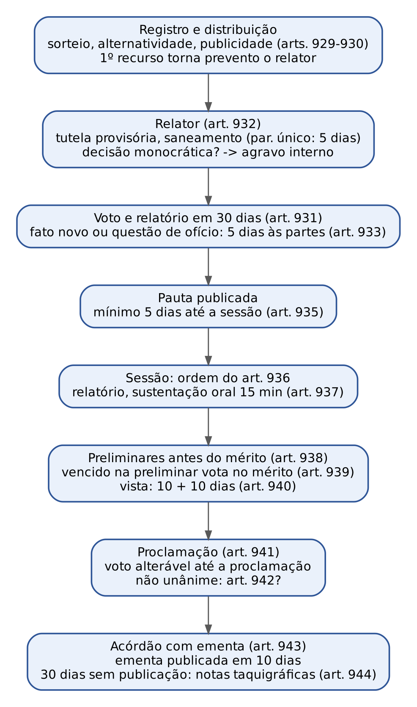
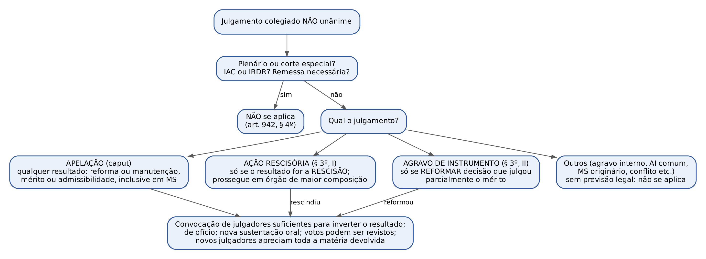
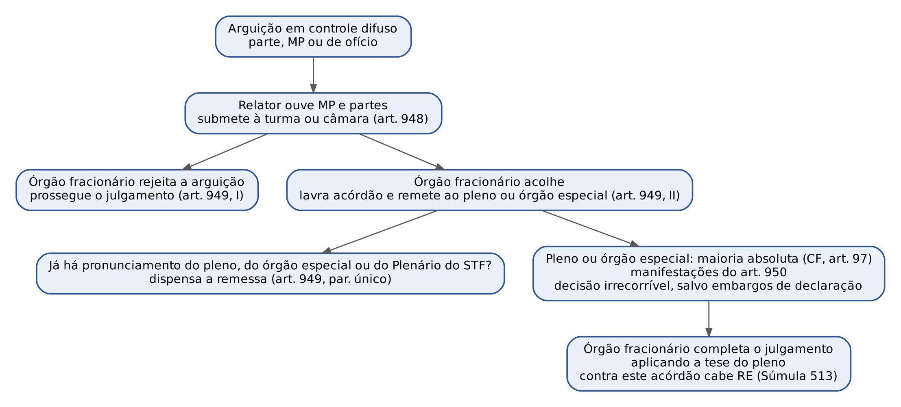
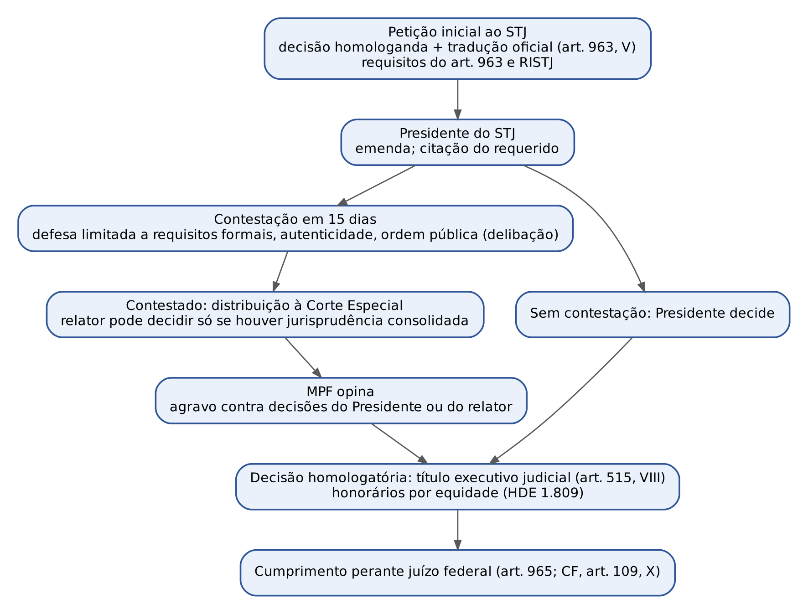

# CAPÍTULO 38 — PROCESSOS NOS TRIBUNAIS: RELATOR, JULGAMENTO COLEGIADO, INCIDENTES E COMPETÊNCIA ORIGINÁRIA

:::INCIDENCIA
TRF5 p. 16; TJRS p. 19; TJSC p. 15. Nível A; lote de 17 questões (FGV 13, FCC 4), mais correlatas de outros lotes.
O que mais cai: técnica de ampliação do colegiado (art. 942: quando incide e quando não incide), IAC x IRDR (requisitos, iniciativa, vinculação), poderes do relator (art. 932) e regras da sessão (arts. 933 a 941), reserva de plenário (CF, art. 97; SV 10; art. 949, parágrafo único).
:::

| Subtema | FGV | FCC | Padrão de cobrança |
|---|---|---|---|
| Ampliação do colegiado (art. 942) | 5 | 1 | Caso de apelação, rescisória ou agravo por maioria: incide? de ofício? nulidade? remessa necessária e IAC excluídos |
| Incidente de assunção de competência | 5 | 2 | Requisitos (questão de direito, grande repercussão, SEM repetição), iniciativa de ofício, vinculação, efeitos (art. 332, art. 496), distinção do IRDR |
| Arguição de inconstitucionalidade | 1 | 0 | Dispensa da remessa ao pleno (art. 949, parágrafo único), norma pré-constitucional, irrecorribilidade da decisão do pleno |
| Relator e julgamento colegiado | 2 | 1 | Literalidade dos arts. 932, 933, 938 a 944; julgamento monocrático do agravo; efeito suspensivo na apelação |
| Sustentação oral | 0 | 1 | Rol do art. 937 (AI só de tutela provisória; agravo interno só no § 3º) |

Distribuição de tarefas: uniformização da jurisprudência (art. 926) e precedentes obrigatórios (art. 927), IRDR e súmulas ficam no Cap. 39; reclamação e ação rescisória, no Cap. 40; apelação e efeitos dos recursos, no Cap. 41; agravo interno (prazo, multa e depósito) e embargos de declaração, no Cap. 42; recursos excepcionais, relevância e repetitivos, no Cap. 43. Noções de conflito de competência (art. 66) estão em 04.9, e as de homologação e carta rogatória (requisitos do art. 963, dispensa no divórcio consensual), em 03.6.3 e 03.6.4: aqui se desenvolve o PROCEDIMENTO nos tribunais.

## 38.1 Ordem dos processos no tribunal: registro, distribuição e prevenção

O Livro III da Parte Especial abre com a ordem dos processos e os processos de competência originária (arts. 926 a 993). As disposições gerais dos arts. 929 a 946 valem para TODO julgamento colegiado: recursos, remessa necessária e ações originárias (art. 936, caput, menciona as três categorias).

- Registro: os autos são registrados no protocolo do tribunal no dia da entrada e distribuídos imediatamente (art. 929). O protocolo pode ser descentralizado, por delegação a ofícios de primeiro grau (parágrafo único).
- Distribuição: segundo o regimento interno, observando ALTERNATIVIDADE, SORTEIO ELETRÔNICO e PUBLICIDADE (art. 930).
- Prevenção: "o primeiro recurso protocolado no tribunal tornará prevento o relator para eventual recurso subsequente interposto no mesmo processo ou em processo conexo" (art. 930, parágrafo único). A prevenção é do RELATOR (e, por via regimental, do órgão), e se estende a processo CONEXO. O marco é o protocolo do primeiro recurso, não o seu julgamento.
- Prazo do relator: 30 dias para elaborar o voto e restituir os autos com relatório à secretaria (art. 931). Prazo impróprio.
- O revisor do CPC/1973 foi suprimido: não há mais revisão em apelação, rescisória ou embargos infringentes (estes também extintos e substituídos, na função, pela técnica do art. 942).

:::DICA PREVENÇÃO E ANULAÇÃO DO ACÓRDÃO
Anulado pelo STJ o julgamento de embargos de declaração por falta de intimação para contrarrazões, o regimento pode determinar que o processo volte ao gabinete do relator originário do agravo, e não ao relator para o acórdão dos embargos anulados; a redistribuição conforme o regimento não viola o juiz natural (caso noticiado pelo Buscador Dizer o Direito, Caderno de Processo Civil, sem que se tenha confirmado o número do julgado — ver nota).
:::

## 38.2 Poderes do relator (art. 932)

### 38.2.1 O rol e sua lógica

O relator é o juiz preparador do recurso ou da causa originária e, nas hipóteses legais, julgador singular por delegação do colegiado. A decisão monocrática é sempre impugnável por agravo interno ao órgão colegiado (art. 1.021), o que preserva o princípio da colegialidade. O STJ tem afirmado que eventual vício da decisão monocrática fica superado com o julgamento colegiado do agravo interno (Jurisprudência em Teses, edição 183, tese 10, ver 13.4.1).

:::LEI CPC, ART. 932 (REDAÇÃO VIGENTE; INCISOS IV, B, E V, B, PELA LEI 15.484/2026)
Art. 932. Incumbe ao relator:
I - dirigir e ordenar o processo no tribunal, inclusive em relação à produção de prova, bem como, quando for o caso, homologar autocomposição das partes;
II - apreciar o pedido de tutela provisória nos recursos e nos processos de competência originária do tribunal;
III - não conhecer de recurso inadmissível, prejudicado ou que não tenha impugnado especificamente os fundamentos da decisão recorrida;
IV - negar provimento a recurso que for contrário a:
a) súmula do Supremo Tribunal Federal, do Superior Tribunal de Justiça ou do próprio tribunal;
b) acórdão proferido pelo Supremo Tribunal Federal ou pelo Superior Tribunal de Justiça em julgamento de recursos repetitivos ou de recursos especiais com a relevância da questão de direito federal infraconstitucional reconhecida;
c) entendimento firmado em incidente de resolução de demandas repetitivas ou de assunção de competência;
V - depois de facultada a apresentação de contrarrazões, dar provimento ao recurso se a decisão recorrida for contrária a: [mesmas alíneas a, b e c]
VI - decidir o incidente de desconsideração da personalidade jurídica, quando este for instaurado originariamente perante o tribunal;
VII - determinar a intimação do Ministério Público, quando for o caso;
VIII - exercer outras atribuições estabelecidas no regimento interno do tribunal.
Parágrafo único. Antes de considerar inadmissível o recurso, o relator concederá o prazo de 5 (cinco) dias ao recorrente para que seja sanado vício ou complementada a documentação exigível.
:::

Pontos de prova:

- Inciso III: três hipóteses de NÃO CONHECIMENTO — inadmissível, prejudicado, ou sem impugnação específica dos fundamentos (dialeticidade; ver Cap. 41). Não depende de contrarrazões.
- Inciso IV (NEGAR provimento): pode ser feito sem ouvir o recorrido, porque a decisão não o prejudica. Inciso V (DAR provimento): exige que se tenha FACULTADO contrarrazões ("depois de facultada a apresentação de contrarrazões"). Provimento monocrático sem intimação do recorrido é nulo (Cap. 13, Tema 376 do STJ).
- Os paradigmas são QUALIFICADOS: súmula do STF, do STJ ou do PRÓPRIO tribunal; acórdão de repetitivos; desde a Lei 15.484/2026, também acórdão de recurso especial com RELEVÂNCIA reconhecida; tese de IRDR ou de IAC. "Jurisprudência dominante de tribunal superior" sem esse formato NÃO está no rol do CPC (pegadinha recorrente: Q2654933, alternativa C).
- Súmula 568 do STJ: "O relator, monocraticamente e no Superior Tribunal de Justiça, poderá dar ou negar provimento ao recurso quando houver entendimento dominante acerca do tema." Editada em 16/3/2016, já sob o CPC/2015, amplia, no âmbito do STJ (e por regimento de vários tribunais, via inciso VIII), o julgamento monocrático para além do rol estrito. A prova deve ser lida com cuidado: pela LETRA do art. 932, a jurisprudência dominante não autoriza; pela súmula, no STJ, autoriza.
- Súmula 253 do STJ (editada sob o art. 557 do CPC/1973): o poder de decidir monocraticamente alcança o REEXAME NECESSÁRIO; leia-se hoje art. 932, III a V.
- Inciso II: tutela provisória nos recursos e nas ações originárias (efeito suspensivo, antecipação da tutela recursal; art. 1.012, §§ 3º e 4º, para a apelação; art. 1.019, I, para o agravo de instrumento; Cap. 14).
- Inciso VI: o relator DECIDE o IDPJ instaurado originariamente no tribunal; dessa decisão cabe agravo interno (art. 136, parágrafo único).
- Inciso I: homologar autocomposição e dirigir a instrução no tribunal (prova pode ser produzida no tribunal ou em primeiro grau, art. 938, § 3º).
- Embargos de declaração contra decisão monocrática são julgados MONOCRATICAMENTE pelo próprio relator (art. 1.024, § 2º); se o embargante pretender efeito infringente, o relator pode convertê-los em agravo interno, intimando o recorrente para complementar as razões em 5 dias (art. 1.024, § 3º; Cap. 42).

:::ATENCAO LEI 15.484/2026 E O ART. 932
A Lei 15.484, de 4/8/2026 (DOU de 4/8/2026, edição extra; vigência 30 dias após a publicação), regulamentou a relevância da questão de direito federal no recurso especial (CF, art. 105, § 2º), criou o art. 1.035-A do CPC e alterou os arts. 927, 932, 979, 988, 998, 1.030, 1.039 e 1.042. No art. 932, as alíneas b dos incisos IV e V passaram a incluir o "acórdão proferido [...] em julgamento de recursos repetitivos ou de recursos especiais com a relevância da questão de direito federal infraconstitucional reconhecida". O regime da relevância em si é do Cap. 43; para o relator, basta saber que o REsp julgado sob relevância passou a ser paradigma do julgamento monocrático e precedente do art. 927 (novo inciso III-A).
:::

### 38.2.2 O dever de prevenção (art. 932, parágrafo único) e seus limites

Antes de inadmitir, o relator concede 5 dias para sanar vício ou complementar documentação. É concretização da primazia do mérito (art. 4º) e se combina com regras específicas: art. 1.007, §§ 2º e 4º (preparo insuficiente: complementação em 5 dias; ausência de preparo: recolhimento EM DOBRO, sob pena de deserção), art. 1.017, § 3º (peças do agravo de instrumento) e art. 1.029, § 3º (vício formal não grave nos recursos excepcionais).

Limites cobrados:

- O prazo serve para vícios FORMAIS sanáveis; não permite complementar a fundamentação recursal deficiente nem suprir a ausência de impugnação específica, porque isso reabriria o prazo recursal (orientação reiterada no STJ; ver Cap. 41).
- Intempestividade não se sana. A comprovação de feriado local, porém, passou a ser expressamente sanável (art. 1.003, § 6º, na redação da Lei 14.939/2024; Enunciado 66 da I Jornada do CJF já admitia a correção posterior com base no art. 932, parágrafo único; ver Cap. 11).

:::QUESTAO FCC 2024 — PGE-GO — PROCURADOR DO ESTADO SUBSTITUTO (Q2654933)
Pergunta: o que o relator DEVERÁ fazer monocraticamente. Gabarito: A, conceder efeito suspensivo à apelação, presentes os requisitos, nos casos em que a sentença produz efeitos imediatos (art. 1.012, §§ 1º, 3º e 4º, combinado com o art. 932, II).
Armadilhas: B (embargos de declaração contra decisão monocrática vão ao colegiado: falso, o relator os decide monocraticamente, art. 1.024, § 2º); C (negar provimento a recurso contrário a "jurisprudência de Tribunal Superior": o rol exige súmula, repetitivo, relevância, IRDR ou IAC); D (preparo não recolhido "sem qualquer acréscimo" em 5 dias: a falta de recolhimento exige pagamento em dobro, § 4º do art. 1.007; os 5 dias simples são para o preparo INSUFICIENTE, § 2º); E (prazo de 30 a 60 dias para contestar a rescisória: o art. 970 fixa de 15 a 30 dias; ver Cap. 40).
:::

:::QUESTAO FGV 2024 — TJ-SC — JUIZ SUBSTITUTO, EDITAL N. 44 (Q3049355)
Caso: pré-candidato obtém liminar que proíbe jornal de publicar reportagem (inibitória, multa única); o jornal agrava e ajuíza reclamação no STF invocando a ADPF 130. Gabarito oficial da banca (conferido no QConcursos): C ("não cabe o julgamento monocrático do agravo, à míngua de previsão no CPC").
Análise: a alternativa C contraria a letra do art. 932, III a V, que autoriza o relator a decidir monocraticamente QUALQUER recurso, inclusive agravo de instrumento. As demais também são falsas: A (a tutela inibitória é PREVENTIVA, não repressiva; Cap. 14); B (reclamação para garantir decisão do STF em controle concentrado NÃO exige esgotamento das instâncias, exigido só para repercussão geral e repetitivos, art. 988, § 5º, II; Cap. 40); D (não cabe recurso excepcional contra acórdão que aprecia liminar, por não haver decisão definitiva; Cap. 43); E (o julgamento do recurso não prejudica a reclamação, art. 988, § 6º). O gabarito é oficial, mas a banca diverge da letra do art. 932, que não distingue a espécie recursal; ver nota. O que fica para a prova: o relator pode julgar monocraticamente o agravo de instrumento, nas hipóteses do art. 932.
:::

### 38.2.3 Impugnação da decisão monocrática

- Recurso próprio: agravo interno, em 15 dias úteis, ao órgão colegiado competente (art. 1.021; Cap. 42). Antes de interpor recurso especial ou extraordinário, a parte deve exaurir a instância com o agravo interno: decisão monocrática do relator, sem agravo interno, não é "causa decidida em única ou última instância" (Q3324237, FGV 2025, TJ-SC, Juiz Substituto, lote do Cap. 43: o único pronunciamento que nem em tese desafia RE é o do relator que nega provimento à apelação contrária a súmula do STF; no mesmo sentido, Q2449079).
- O STJ afetou à Corte Especial a controvérsia sobre a "(in)admissibilidade de recurso especial interposto contra decisão monocrática de relator proferida em segunda instância" (Tema 1.423 do STJ, ProAfR no REsp 2.234.706, Relator Ministro Sebastião Reis Júnior, Corte Especial, j. 24/3/2026, Informativo 884). Pendente.
- Multa do art. 1.021, § 4º: o agravo interno contra decisão baseada em precedente qualificado do STJ ou do STF, ainda que para exaurir a instância, autoriza a multa, salvo alegação fundamentada de distinção ou superação (Tema 1.201 do STJ, que revisou o Tema 434; v. Cap. 42, com percentual, depósito prévio e exceções).

## 38.3 Pauta, sessão e sustentação oral

### 38.3.1 Fato superveniente e questão de ofício (art. 933)

O art. 933 projeta para o tribunal a vedação da decisão-surpresa (art. 10). Se o relator constatar fato superveniente à decisão recorrida ou questão apreciável de ofício ainda não examinada, intima as partes para manifestação em 5 dias. Se a constatação ocorrer NA SESSÃO, o julgamento é imediatamente suspenso para manifestação específica (§ 1º); se ocorrer em vista dos autos, o juiz que a solicitou encaminha os autos ao relator, que intima as partes e reinclui o feito em pauta, com submissão integral da nova questão aos julgadores (§ 2º).

- Enunciado 60 da I Jornada de Direito Processual Civil (CJF): "É direito das partes a manifestação por escrito, no prazo de cinco dias, sobre fato superveniente ou questão de ofício na hipótese do art. 933, § 1º, do CPC, ressalvada a concordância expressa com a forma oral em sessão."
- Pegadinha: o prazo é de 5 DIAS (não 15), e a suspensão é IMEDIATA (Q2386964, alternativa A).

### 38.3.2 Pauta e ordem de julgamento (arts. 934 a 936)

- O presidente designa dia e ordena a publicação da pauta "em todas as hipóteses previstas neste Livro" (art. 934).
- Antecedência mínima: 5 dias entre a publicação da pauta e a sessão (art. 935). Os processos não julgados entram em nova pauta, salvo se o julgamento tiver sido expressamente adiado para a primeira sessão seguinte. A Súmula 117 do STJ (nulidade pela inobservância de 48 horas) foi editada sob o CPC/1973 e tem hoje o prazo substituído pelos 5 dias.
- Vista em cartório após a pauta e afixação da pauta na entrada da sala (art. 935, §§ 1º e 2º).
- Ordem (art. 936), ressalvadas as preferências legais e regimentais: (I) processos com sustentação oral, na ordem dos requerimentos; (II) requerimentos de preferência apresentados até o início da sessão; (III) julgamentos iniciados em sessão anterior; (IV) demais casos.
- Agravo de instrumento antes da apelação do mesmo processo; se na mesma sessão, o agravo tem precedência (art. 946).
- O art. 945 (julgamento eletrônico) foi revogado pela Lei 13.256/2016; o julgamento virtual é hoje disciplinado por regimentos e atos dos tribunais.

### 38.3.3 Sustentação oral (art. 937 e Estatuto da Advocacia)

:::LEI CPC, ART. 937, CAPUT, INCISOS E §§ 3º E 4º
Art. 937. Na sessão de julgamento, depois da exposição da causa pelo relator, o presidente dará a palavra, sucessivamente, ao recorrente, ao recorrido e, nos casos de sua intervenção, ao membro do Ministério Público, pelo prazo improrrogável de 15 (quinze) minutos para cada um, a fim de sustentarem suas razões, nas seguintes hipóteses, nos termos da parte final do caput do art. 1.021:
I - no recurso de apelação;
II - no recurso ordinário;
III - no recurso especial;
IV - no recurso extraordinário;
V - nos embargos de divergência;
VI - na ação rescisória, no mandado de segurança e na reclamação;
VII - (VETADO);
VIII - no agravo de instrumento interposto contra decisões interlocutórias que versem sobre tutelas provisórias de urgência ou da evidência;
IX - em outras hipóteses previstas em lei ou no regimento interno do tribunal.
[...]
§ 3º Nos processos de competência originária previstos no inciso VI, caberá sustentação oral no agravo interno interposto contra decisão de relator que o extinga.
§ 4º É permitido ao advogado com domicílio profissional em cidade diversa daquela onde está sediado o tribunal realizar sustentação oral por meio de videoconferência ou outro recurso tecnológico de transmissão de sons e imagens em tempo real, desde que o requeira até o dia anterior ao da sessão.
:::

Leitura dirigida:

- Ordem: relatório; recorrente; recorrido; MP (quando intervém). 15 minutos IMPRORROGÁVEIS para cada um.
- Agravo de instrumento: só cabe sustentação, pelo CPC, quando a interlocutória versar sobre TUTELA PROVISÓRIA (urgência ou evidência). Agravo contra decisão de cumprimento de sentença, de produção de prova etc. não tem sustentação pelo CPC (Q3745792). A I Jornada do CJF (Enunciado 61, ver Cap. 17) estende a sustentação ao agravo contra decisão que julga parcialmente o mérito, por equivalência funcional à apelação.
- Ações originárias: rescisória, MS e reclamação (inciso VI). No agravo interno contra a decisão do relator que EXTINGUE essas ações, cabe sustentação (§ 3º).
- Embargos de declaração e agravo interno, em regra, não têm sustentação pelo CPC (o veto ao inciso VII retirou o agravo interno do rol geral).
- IRDR: segue o art. 984 (prazos próprios: 30 minutos para autor, réu e MP; demais interessados, 30 minutos divididos, com inscrição prévia; Cap. 39), por remissão do § 1º.
- Requerimento de preferência até o início da sessão (§ 2º); videoconferência para advogado com domicílio em outra cidade, requerida até o dia anterior (§ 4º).
- Ampliação do colegiado (art. 942): nova sustentação perante os novos julgadores é assegurada às partes e a eventuais terceiros.

:::LEI LEI 8.906/1994 (ESTATUTO DA ADVOCACIA), ART. 7º, § 2º-B (INCLUÍDO PELA LEI 14.365/2022)
§ 2º-B. Poderá o advogado realizar a sustentação oral no recurso interposto contra a decisão monocrática de relator que julgar o mérito ou não conhecer dos seguintes recursos ou ações:
I - recurso de apelação;
II - recurso ordinário;
III - recurso especial;
IV - recurso extraordinário;
V - embargos de divergência;
VI - ação rescisória, mandado de segurança, reclamação, habeas corpus e outras ações de competência originária.
:::

O dispositivo do Estatuto é mais amplo que o § 3º do art. 937: abrange o recurso (agravo interno) contra decisão monocrática que julgar o mérito ou não conhecer de apelação, recursos ordinário, especial e extraordinário, embargos de divergência e ações originárias (inclusive habeas corpus). Para a prova objetiva baseada no CPC, prevalece a letra do art. 937; questão que mencione "Estatuto da Advocacia" exige o § 2º-B. Lei posterior e especial, o Estatuto se combina com o inciso IX do art. 937 ("outras hipóteses previstas em lei").

:::QUESTAO FCC 2025 — PGE-MT — PROCURADOR DO ESTADO (Q3745792)
Pergunta: em qual julgamento colegiado NÃO cabe sustentação oral. Gabarito: D, agravo de instrumento contra interlocutória proferida no cumprimento de sentença (art. 937, VIII, só contempla tutela provisória).
Armadilhas: A (IRDR tem sustentação, art. 937, § 1º, e art. 984); B (agravo interno contra decisão que extingue MS originário: § 3º); C (rescisória: inciso VI); E (apelação: inciso I).
:::

## 38.4 Julgamento colegiado (arts. 938 a 946)

### 38.4.1 Preliminares, saneamento e conversão em diligência

- A preliminar suscitada é decidida ANTES do mérito, deste não se conhecendo se incompatível (art. 938, caput).
- Vício sanável, inclusive cognoscível de ofício: o relator determina a realização ou renovação do ato, no tribunal ou em primeiro grau, intimadas as partes, e, cumprida a diligência, prossegue sempre que possível (§§ 1º e 2º). É a versão recursal do dever de sanear (primazia do mérito).
- Necessidade de prova: o relator CONVERTE o julgamento em diligência, no tribunal ou em primeiro grau, e decide após a instrução (§ 3º). Se o relator não o fizer, o órgão colegiado pode determinar (§ 4º).
- Rejeitada a preliminar ou compatível o mérito, os juízes VENCIDOS na preliminar DEVEM pronunciar-se sobre o mérito (art. 939). Não há abstenção: é a regra que evita "maioria de ninguém". Pegadinha de Q2386964 (alternativa B dizia o contrário).

### 38.4.2 Pedido de vista

Prazo máximo de 10 dias, com reinclusão em pauta na sessão seguinte à devolução (art. 940). Não devolvidos os autos nem pedida prorrogação de no máximo mais 10 dias, o presidente do órgão fracionário os requisita para a sessão ordinária subsequente, com publicação da pauta (§ 1º); se o julgador que pediu vista ainda não se sentir habilitado, o presidente convoca SUBSTITUTO para votar, na forma regimental (§ 2º).

### 38.4.3 Proclamação, voto vencido e acórdão

:::LEI CPC, ART. 941
Art. 941. Proferidos os votos, o presidente anunciará o resultado do julgamento, designando para redigir o acórdão o relator ou, se vencido este, o autor do primeiro voto vencedor.
§ 1º O voto poderá ser alterado até o momento da proclamação do resultado pelo presidente, salvo aquele já proferido por juiz afastado ou substituído.
§ 2º No julgamento de apelação ou de agravo de instrumento, a decisão será tomada, no órgão colegiado, pelo voto de 3 (três) juízes.
§ 3º O voto vencido será necessariamente declarado e considerado parte integrante do acórdão para todos os fins legais, inclusive de pré-questionamento.
:::

- Redator: o relator ou, vencido este, o autor do PRIMEIRO voto vencedor.
- Alteração do voto: até a PROCLAMAÇÃO; exceção — voto de juiz AFASTADO ou SUBSTITUÍDO (fica cristalizado). Na técnica do art. 942, os que já votaram podem rever o voto no prosseguimento (art. 942, § 2º), mas o substituto não revê o voto do substituído (Enunciado 187 da III Jornada do CJF: "É vedada a revisão pelo julgador substituto do voto proferido pelo substituído, no julgamento estendido previsto no art. 942 do CPC").
- Quórum: 3 juízes na apelação e no agravo de instrumento (§ 2º).
- Voto vencido: NECESSARIAMENTE declarado e parte integrante do acórdão, inclusive para prequestionamento (§ 3º), de modo que a Súmula 320 do STJ (questão ventilada só no voto vencido não atende ao prequestionamento) perdeu base legal; prequestionamento e art. 1.025: v. Cap. 43, 43.6.
- Acórdão: pode ser eletrônico; todo acórdão conterá EMENTA; lavrado, a ementa é publicada em 10 dias (art. 943).
- Não publicado o acórdão em 30 dias da sessão, as NOTAS TAQUIGRÁFICAS o substituem para todos os fins, independentemente de revisão, e o PRESIDENTE DO TRIBUNAL lavra de imediato as conclusões e a ementa e manda publicar (art. 944). Pegadinha de Q2386964, D (15 dias e relator: errado duas vezes).

:::QUESTAO FGV 2024 — TJ-SC — JUIZ SUBSTITUTO (Q2386964)
Caso: apelação levada a julgamento colegiado após o relator concluir que não era hipótese de decisão monocrática. Gabarito: E, o voto vencido será necessariamente declarado e integra o acórdão, inclusive para prequestionamento (art. 941, § 3º).
Armadilhas, uma por artigo: A (fato superveniente constatado na sessão: manifestação em 15 dias — são 5 dias, com suspensão imediata, art. 933, caput e § 1º); B (vencido na preliminar não vota o mérito — deve votar, art. 939); C (voto alterável até a proclamação "inclusive" o do juiz afastado ou substituído — é a exceção, art. 941, § 1º); D (15 dias e relator — são 30 dias e presidente do tribunal, art. 944).
:::

:::DICA NÚMEROS DA SESSÃO EM UMA LINHA
Relator: 30 dias para o voto (art. 931). Saneamento recursal: 5 dias (art. 932, parágrafo único). Fato novo: 5 dias (art. 933). Pauta: 5 dias de antecedência (art. 935). Sustentação: 15 minutos (art. 937). Vista: 10 + 10 dias (art. 940). Quórum: 3 (art. 941, § 2º). Ementa publicada: 10 dias (art. 943, § 2º). Acórdão não publicado: 30 dias, notas taquigráficas (art. 944).
:::

## 38.5 Técnica de ampliação do colegiado (art. 942)

### 38.5.1 Natureza e lógica

O CPC/2015 extinguiu os embargos infringentes e pôs no lugar uma TÉCNICA DE JULGAMENTO: quando o resultado não é unânime, o julgamento não termina; prossegue com julgadores convocados em número suficiente para inverter o resultado. Consequências práticas que caem em prova:

- Não é recurso: não depende de requerimento, preparo nem prazo. É aplicada DE OFÍCIO e é OBRIGATÓRIA; a parte não precisa pedir na sessão, e não há preclusão por falta de requerimento.
- O julgamento ainda não terminou: por isso os que já votaram podem rever seus votos (§ 2º), e o acórdão só é lavrado ao final do julgamento ampliado.
- A inobservância gera NULIDADE do julgamento, com determinação de prosseguimento na forma do art. 942 (o STJ anulou acórdãos que deixaram de ampliar o colegiado, por exemplo, no REsp 1.733.820, Relator Ministro Luis Felipe Salomão, Quarta Turma, noticiado em 3/10/2018, e no REsp 1.798.705, Relator Ministro Paulo de Tarso Sanseverino, Terceira Turma, noticiado em 22/10/2019).

:::LEI CPC, ART. 942
Art. 942. Quando o resultado da apelação for não unânime, o julgamento terá prosseguimento em sessão a ser designada com a presença de outros julgadores, que serão convocados nos termos previamente definidos no regimento interno, em número suficiente para garantir a possibilidade de inversão do resultado inicial, assegurado às partes e a eventuais terceiros o direito de sustentar oralmente suas razões perante os novos julgadores.
§ 1º Sendo possível, o prosseguimento do julgamento dar-se-á na mesma sessão, colhendo-se os votos de outros julgadores que porventura componham o órgão colegiado.
§ 2º Os julgadores que já tiverem votado poderão rever seus votos por ocasião do prosseguimento do julgamento.
§ 3º A técnica de julgamento prevista neste artigo aplica-se, igualmente, ao julgamento não unânime proferido em:
I - ação rescisória, quando o resultado for a rescisão da sentença, devendo, nesse caso, seu prosseguimento ocorrer em órgão de maior composição previsto no regimento interno;
II - agravo de instrumento, quando houver reforma da decisão que julgar parcialmente o mérito.
§ 4º Não se aplica o disposto neste artigo ao julgamento:
I - do incidente de assunção de competência e ao de resolução de demandas repetitivas;
II - da remessa necessária;
III - não unânime proferido, nos tribunais, pelo plenário ou pela corte especial.
:::

### 38.5.2 Hipóteses de incidência: a assimetria entre apelação, rescisória e agravo

| Julgamento não unânime | Incide? | Requisito adicional | Detalhe |
|---|---|---|---|
| Apelação | SIM | NENHUM: tanto faz reformar ou manter a sentença, julgar mérito ou admissibilidade, sentença terminativa ou definitiva | Prossegue no mesmo órgão, com novos julgadores (preferencialmente na mesma sessão, § 1º) |
| Ação rescisória | Só se o resultado for a RESCISÃO | Juízo rescindente procedente por maioria | Prossegue em ÓRGÃO DE MAIOR COMPOSIÇÃO previsto no regimento |
| Agravo de instrumento | Só se houver REFORMA de decisão que julgou PARCIALMENTE O MÉRITO | Decisão agravada do art. 356 (ou equivalente) + reforma | Agravo contra liminar, prova, competência etc.: não incide |
| IAC e IRDR | NÃO | — | § 4º, I |
| Remessa necessária | NÃO | — | § 4º, II; ver Cap. 20 |
| Plenário ou corte especial | NÃO | — | § 4º, III (não há órgão maior para ampliar) |
| Agravo interno, embargos de declaração autônomos, MS originário, conflito de competência | NÃO, por falta de previsão | — | Exceção: embargos de declaração contra acórdão de apelação julgada com a técnica, ver abaixo |

A lógica da assimetria: na apelação, o legislador quis máxima qualificação do julgamento de segundo grau (substituindo os infringentes, que exigiam reforma, por uma técnica mais ampla). Na rescisória e no agravo de mérito, quis reforçar só a decisão que desconstitui a coisa julgada ou reforma o mérito.

Desenvolvimentos jurisprudenciais (STJ) e enunciados:

- Apelação, qualquer resultado: a técnica se aplica à apelação não unânime, seja a sentença reformada, seja mantida; a exigência de reforma limita-se ao agravo de instrumento e à rescisória (REsp 1.733.820, Quarta Turma; e as teses fixadas pela Terceira Turma no REsp 1.762.236, voto-vista prevalecente do Ministro Villas Bôas Cueva, noticiado em 5/4/2019, que também fixaram o marco temporal: a técnica incide nos julgamentos cujo resultado não unânime foi PROCLAMADO a partir de 18/3/2016, aplicada de ofício).
- Divergência em preliminar ou admissibilidade: a técnica alcança "qualquer julgamento não unânime, incluindo as questões preliminares" (REsp 1.798.705). Enunciado 193 da III Jornada do CJF: "A técnica de ampliação do colegiado é aplicável a qualquer hipótese de divergência no julgamento da apelação, seja no juízo de admissibilidade ou no de mérito."
- Mandado de segurança: aplica-se à apelação não unânime contra sentença proferida em MS; a especialidade da Lei 12.016/2009 não afasta a técnica (STJ, REsp 1.868.072, Relator Ministro Francisco Falcão, Segunda Turma, j. 4/5/2021; Enunciado 62 da I Jornada do CJF, ver 32.9.1). A orientação da Súmula 597 do STF e da Súmula 169 do STJ (não cabimento de embargos infringentes em MS) não se transporta para a técnica, que não é recurso. Para o MS ORIGINÁRIO julgado por câmara, não há previsão no art. 942 (só rescisória e agravo, no § 3º), ver a questão Q2507027 abaixo.
- Extensão da cognição: os novos julgadores podem examinar TODA a matéria devolvida no recurso, e não apenas o ponto da divergência (STJ, REsp 1.771.815, j. 13/11/2018). Combinado com o § 2º, o resultado pode até mudar em capítulo que fora unânime.
- Embargos de declaração: a técnica deve ser observada nos embargos de declaração não unânimes opostos contra acórdão de apelação, quando o voto vencido tiver aptidão para alterar o resultado da apelação, sejam os embargos acolhidos ou rejeitados (STJ, REsp 1.833.497, Relatora originária Ministra Nancy Andrighi, Relator para o acórdão Ministro Marco Aurélio Bellizze, Terceira Turma, j. 25/8/2020). Se a apelação já fora julgada com composição ampliada, os embargos são julgados pela mesma composição ampliada (Enunciado 137 da II Jornada do CJF).
- Rescisão parcial: a técnica do § 3º, I, aplica-se à rescisão PARCIAL (Enunciado 63 da I Jornada do CJF).
- Rescisória e regimento: na rescisão por maioria, o julgamento prossegue no órgão de maior composição com a convocação dos julgadores originários, sem que o regimento possa dispor em contrário (REsp 2.171.572; v. Cap. 40).
- Substituto não revê voto do substituído (Enunciado 187 da III Jornada).

:::PEGADINHA "INVERSÃO DO RESULTADO" E NÚMERO DE CONVOCADOS
O caput não manda convocar "dois" julgadores: manda convocar número SUFICIENTE para garantir a possibilidade de inversão. Numa turma de três com resultado 2 x 1, bastam dois novos votos (o placar pode virar 3 x 2). Os convocados seguem o regimento ("nos termos previamente definidos no regimento interno"), e, se o órgão tiver outros membros presentes, colhem-se os votos na MESMA sessão (§ 1º). Também é pegadinha dizer que o prosseguimento "depende de requerimento da parte na sessão, sob pena de preclusão" (Q3777491, A).
:::

### 38.5.3 Questões

:::QUESTAO FGV 2025 — AL-AM — ASSESSOR JURÍDICO (Q3777491)
Caso: câmara reforma, por 2 x 1, a sentença de improcedência; o presidente proclama e encerra; a apelada, cinco dias depois, alega nulidade por falta de ampliação. Gabarito: E, há nulidade, a técnica era obrigatória e o julgamento deve prosseguir com novos julgadores.
Passos: 1) apelação não unânime: incide o caput, independentemente do sentido; 2) a técnica é de ofício: não há preclusão pela ausência de requerimento na sessão (A falsa); 3) não se supre na lavratura do acórdão com votos colhidos eletronicamente sem nova sessão e sem sustentação (B falsa); 4) C inverte a regra (a técnica nasce na apelação); D cria requisito de "manutenção da sentença" inexistente.
:::

:::QUESTAO FGV 2025 — TJ-CE — JUIZ SUBSTITUTO (Q3505778)
Pergunta: em qual julgamento a técnica NÃO incide. Gabarito: B, ação rescisória cujo resultado majoritário é a REJEIÇÃO do pedido de rescisão (o § 3º, I, exige que o resultado seja a rescisão).
Armadilhas: A (agravo contra decisão parcial de mérito com maioria pela reforma: incide, § 3º, II); C e D (apelação em MS, concessiva ou denegatória: incide, REsp 1.868.072); E (apelação contra sentença terminativa: incide, o caput não distingue).
No mesmo sentido: Q3592167 (FGV 2025, TCE-PE, Procurador; gabarito C: certos Tício, que reproduziu o caput, e Caio, que excluiu a remessa necessária; errado Mévio, que aplicou a técnica à rescisória julgada IMPROCEDENTE).
:::

:::QUESTAO FGV 2024 — PREFEITURA DE MACAÉ — PROCURADOR (Q3049931)
Caso: apelação do Município desprovida por 2 x 1; designa-se nova sessão com dois novos desembargadores. Gabarito: E, a técnica não se aplica à remessa necessária (§ 4º, II).
Armadilhas: A (os que já votaram não podem rever: podem, § 2º); B (só se aplicaria se a sentença fosse reformada: na apelação basta a não unanimidade); C (não se aplica a MS: aplica-se); D (nunca em agravo de instrumento: aplica-se na reforma da decisão parcial de mérito).
Correlatas de outros lotes: Q2362720 (FGV 2024, São José dos Campos, Cap. 27; alternativa E falsa ao "restringir" a técnica à rescisória e ao agravo); remessa necessária sem art. 942, ver 20.11.1.
:::

:::QUESTAO FGV 2025 — TJ-MS — JUIZ SUBSTITUTO (Q3786423)
Caso: rescisória contra sentença por erro de fato; o órgão de segunda instância, por maioria, rescinde. A pergunta é sobre o Regimento Interno do TJMS. Gabarito: E, o acórdão foi proferido por Seção Cível, e o julgamento deve prosseguir na Seção Especial Cível, com número suficiente de votos para inverter o resultado.
Fundamento geral: art. 942, § 3º, I (rescisão por maioria: prosseguimento em órgão de maior composição definido no regimento). A distribuição concreta dos órgãos é regimental e não foi conferida nesta tarefa no texto do RITJMS; o que se extrai para TJSC e TJRS é a regra do CPC e o limite fixado pelo STJ no Informativo 842 (o regimento escolhe o órgão maior, mas não pode descartar o julgamento já iniciado nem excluir os julgadores originais).
:::

:::NOTA Q2507027 (FGV 2024, ENAM — REAPLICAÇÃO, LOTE DO CAP. 32)
MS de competência originária concedido por maioria por câmara de direito público. Gabarito oficial: B (valores anteriores à impetração exigem via própria, Súmulas 269 e 271 do STF). A alternativa D (inaplicabilidade da técnica do art. 942 ao julgamento da câmara, "conforme entendimento do STJ") foi tratada como falsa. Pela letra do art. 942, o MS originário não está no caput nem no § 3º, de modo que a técnica não incidiria; não se localizou, nesta tarefa, julgado do STJ afirmando ou negando a técnica no MS originário. Para a prova: a técnica incide na APELAÇÃO em MS (REsp 1.868.072); no MS originário, não há previsão legal.
:::

## 38.6 Incidente de assunção de competência (art. 947)

### 38.6.1 Requisitos e procedimento

:::LEI CPC, ART. 947
Art. 947. É admissível a assunção de competência quando o julgamento de recurso, de remessa necessária ou de processo de competência originária envolver relevante questão de direito, com grande repercussão social, sem repetição em múltiplos processos.
§ 1º Ocorrendo a hipótese de assunção de competência, o relator proporá, de ofício ou a requerimento da parte, do Ministério Público ou da Defensoria Pública, que seja o recurso, a remessa necessária ou o processo de competência originária julgado pelo órgão colegiado que o regimento indicar.
§ 2º O órgão colegiado julgará o recurso, a remessa necessária ou o processo de competência originária se reconhecer interesse público na assunção de competência.
§ 3º O acórdão proferido em assunção de competência vinculará todos os juízes e órgãos fracionários, exceto se houver revisão de tese.
§ 4º Aplica-se o disposto neste artigo quando ocorrer relevante questão de direito a respeito da qual seja conveniente a prevenção ou a composição de divergência entre câmaras ou turmas do tribunal.
:::

Decomposição:

- Cabimento: julgamento de RECURSO, de REMESSA NECESSÁRIA ou de PROCESSO DE COMPETÊNCIA ORIGINÁRIA (três objetos; Q2367633 e Q4338817, C).
- Requisitos do caput, cumulativos: (1) questão de DIREITO (não de fato; Q2759002, Denise), material ou processual; (2) RELEVANTE e com GRANDE REPERCUSSÃO SOCIAL; (3) SEM repetição em múltiplos processos. A ausência de "repetição em múltiplos processos" não significa processo único: a existência de mais de um processo não impede o IAC, desde que não haja repetição massiva que reclame IRDR ou repetitivo (Q3966646, C).
- Hipótese do § 4º (IAC preventivo ou de composição de divergência): relevante questão de direito em que seja conveniente PREVENIR ou COMPOR divergência entre câmaras ou turmas. Aqui a lei não exige "grande repercussão social"; a doutrina vê no § 4º a função do antigo incidente de uniformização de jurisprudência do CPC/1973.
- Iniciativa: o RELATOR PROPÕE, de ofício ou a requerimento da parte, do MP ou da Defensoria Pública. Não há legitimidade do juiz de primeiro grau (diferente do IRDR, em que o juiz pode oficiar, art. 977, I) nem iniciativa exclusiva das partes (Q3777945, C, e Q4338817, D, falsas).
- Admissão: o órgão colegiado indicado pelo REGIMENTO julga se reconhecer INTERESSE PÚBLICO na assunção (§ 2º).
- Deslocamento integral: o órgão que assume a competência JULGA o recurso, a remessa ou a causa, e não apenas fixa a tese (diferença em relação ao modelo de "cisão" do incidente de inconstitucionalidade; Q4338817, B, falsa). No IRDR, o órgão que fixa a tese também julga o caso de que se originou o incidente (art. 978, parágrafo único; Cap. 39).
- Sem suspensão automática de processos: o IAC não prevê suspensão de outros processos, muito menos nacional (Q4338817, A, falsa).
- Sem ampliação do colegiado (art. 942, § 4º, I; Q3745793, item I).
- Desistência do recurso não impede o exame da questão objeto do IAC (Enunciado 65 da I Jornada do CJF; paralelo ao art. 976, § 1º, do IRDR).
- Tribunais superiores: o IAC também existe no STJ (há IACs numerados do STJ, como o IAC 14, cujas teses abstratas foram revogadas pela Primeira Seção por contrariarem o Tema 1.234 do STF, Informativo de Jurisprudência n. 22, edição extraordinária, CC 187.276, Relator Ministro Gurgel de Faria, Primeira Seção, j. 27/11/2024). Material de jurisprudência sistematizada usado no concurso do TJGO 2026 registra a admissibilidade do IAC no STF em processos originários e recursos ordinários, e não em recurso extraordinário (substituído pela repercussão geral), sem indicar o julgado (ver nota).

### 38.6.2 Efeitos da tese firmada em IAC

A tese do IAC é PRECEDENTE OBRIGATÓRIO (art. 927, III) e "vinculará todos os juízes e órgãos fracionários, exceto se houver revisão de tese" (§ 3º). O IAC não é instrumento de julgamento de casos repetitivos (art. 928 só inclui IRDR e recursos repetitivos), mas o CPC estende a ele quase todos os efeitos dos precedentes qualificados:

| Efeito | Dispositivo | Observação |
|---|---|---|
| Improcedência liminar do pedido | art. 332, III | Q4338817, gabarito E |
| Dispensa de remessa necessária | art. 496, § 4º, III | Independe do valor (Q3745793, item III) |
| Julgamento monocrático do relator (negar e dar provimento) | art. 932, IV, c, e V, c |  |
| Julgamento de plano do conflito de competência | art. 955, parágrafo único, II |  |
| Reclamação | art. 988, IV, e § 4º | Sem exigência de esgotamento das instâncias |
| Omissão nos embargos de declaração (decisão que não se manifesta sobre tese aplicável) | art. 1.022, parágrafo único, I | Cap. 42 |
| Tutela de evidência | Enunciado 135 da II Jornada do CJF | Analogia ao art. 311, II |
| Dispensa de caução no cumprimento provisório | Enunciado 136 da II Jornada do CJF | Analogia ao art. 521, IV |
| Ação rescisória por violação a norma (art. 966, V, e § 5º) | Enunciado 206 da III Jornada do CJF | Cap. 40 |
| Publicidade e cadastro | art. 979, § 3º | Inclui o IAC no regime de divulgação |

Reclamação por descumprimento de tese de IAC: não se exige esgotamento das instâncias ordinárias (Jurisprudência em Teses do STJ, edição 277, tese 5); e não cabe reclamação se, na data da decisão reclamada, ainda não havia tese fixada em IAC (edição 277, tese 6). O regime da reclamação é do Cap. 40.

### 38.6.3 IAC x IRDR x recursos repetitivos

| Critério | IAC | IRDR | Repetitivos (RE e REsp) |
|---|---|---|---|
| Pressuposto fático | SEM repetição em múltiplos processos | EFETIVA repetição de processos + risco à isonomia e à segurança jurídica | Multiplicidade de recursos com idêntica questão de direito |
| Questão | De direito (material ou processual), relevante, grande repercussão social (ou prevenção/composição de divergência, § 4º) | Unicamente de direito | De direito federal ou constitucional |
| Onde | Qualquer tribunal, em recurso, remessa ou causa originária | TJ e TRF (STJ admite IRDR em sua competência originária e recursal ordinária; Cap. 39) | STF e STJ |
| Iniciativa | Relator propõe, de ofício ou a requerimento de parte, MP ou Defensoria | Juiz ou relator, de ofício; partes, MP ou Defensoria, por petição (art. 977) | Presidente ou vice do tribunal de origem; relator no tribunal superior |
| Suspensão de processos | Não prevista | Sim, no Estado ou região (art. 982, I); nacional por requerimento ao STF ou STJ | Sim (arts. 1.036 e 1.037) |
| Julgamento | Órgão regimental julga o próprio caso | Órgão regimental fixa a tese e julga o caso originário | Tese fixada e aplicada aos sobrestados |
| Art. 942 | Não (§ 4º, I) | Não (§ 4º, I) | Não se aplica nos superiores (plenário ou corte especial, § 4º, III; turmas e seções não julgam apelação) |
| Classificação | Precedente obrigatório (art. 927, III); NÃO é "caso repetitivo" | Caso repetitivo (art. 928, I) | Caso repetitivo (art. 928, II) |
| Conversão | Pode converter-se em IRDR se demonstrada a efetiva repetição (Enunciado 141 da II Jornada do CJF) | — | — |

:::QUESTAO FGV 2025 — TRF6 — JUIZ FEDERAL SUBSTITUTO (Q3742392)
Três afirmativas sobre IAC. Gabarito: C (I e III corretas).
I. "Prescinde da existência de questão relevante de direito MATERIAL": CORRETA, porque a lei exige "relevante questão de direito", que pode ser processual. A armadilha é ler a afirmativa como "prescinde de questão relevante".
II. Não há fungibilidade entre IAC e IRDR mesmo havendo repetição: FALSA, admite-se a conversão do IAC em IRDR demonstrada a efetiva repetição (Enunciado 141).
III. Descumprida tese de IAC do STJ, a reclamação dispensa o esgotamento das vias ordinárias: CORRETA (Jurisprudência em Teses, ed. 277, tese 5; art. 988, IV e § 5º, II, que só exige esgotamento para repercussão geral, relevância e repetitivos).
:::

:::QUESTAO FCC 2026 — PGM MANAUS — PROCURADOR (Q4338817)
Gabarito: E, embora o IAC não seja instrumento de gestão de casos repetitivos, a tese nele firmada autoriza a improcedência liminar em casos futuros (art. 332, III).
Armadilhas: A (suspensão automática nacional: não há); B (o órgão só fixaria a tese e devolveria o caso: julga o próprio recurso, § 2º); C (só em recurso: cabe em remessa e em causa originária); D (providência exclusiva do relator, vedado requerimento das partes: as partes, o MP e a Defensoria podem requerer, § 1º).
:::

:::QUESTAO FCC 2025 — PGE-MT — PROCURADOR DO ESTADO (Q3745793)
Gabarito: D (I e III corretas). I: não se aplica a ampliação do colegiado ao IAC (art. 942, § 4º, I). III: tese de IAC dispensa a remessa necessária, independentemente do valor (art. 496, § 4º, III). Falsas: II ("repercussão social motivada pela sua repetição em múltiplos processos" é exatamente o oposto do requisito); IV (cabe de ofício, § 1º).
:::

:::QUESTAO FGV 2025 — AL-AM — PROCURADOR (Q3777945)
Caso: relator de apelação identifica questão de direito relevante, de grande impacto social, sem multiplicidade, e quer tese vinculante. Gabarito: E, propor a assunção de competência para julgamento pelo órgão colegiado regimental.
Armadilhas: A (IRDR exige repetição); B (arguição de inconstitucionalidade: não há questão constitucional no caso); C (vedada a iniciativa de ofício: o § 1º a admite); D (remessa à Presidência para sobrestar: mecanismo dos repetitivos, não do IAC).
No mesmo sentido: Q2367633 (FGV 2024, MPE-GO; gabarito C: só João acertou ao dizer que o IAC cabe em processo de competência originária; erraram quem exigiu questão "de direito e de fato" e quem exigiu "repetição em múltiplos processos").
:::

:::QUESTAO FGV 2026 — TJ-GO — JUIZ SUBSTITUTO (Q3966646)
Afirmações sobre incidentes nos tribunais. Gabarito: E, é irrecorrível a decisão do plenário ou do órgão especial que julga a questão prejudicial de inconstitucionalidade, ressalvados os embargos de declaração (ver 38.7.3).
Armadilhas: A (IAC inadmissível no STF por causa da repercussão geral: o gabarito tratou como falsa, ver 38.6.1); B (agravo interno contra a decisão que admite manifestação de órgãos ou entidades no incidente de inconstitucionalidade: o art. 950, § 3º, fala em "despacho irrecorrível"); C (IAC inadmissível se houver mais de um processo: a lei veda a repetição em múltiplos processos, não a pluralidade); D (descreve o IRDR, art. 976).
:::

## 38.7 Incidente de arguição de inconstitucionalidade e reserva de plenário

### 38.7.1 Fundamento constitucional

:::LEI CF, ART. 97
Art. 97. Somente pelo voto da maioria absoluta de seus membros ou dos membros do respectivo órgão especial poderão os tribunais declarar a inconstitucionalidade de lei ou ato normativo do Poder Público.
:::

A cláusula de reserva de plenário (*full bench*) é condição de eficácia da declaração de inconstitucionalidade pelos TRIBUNAIS. O incidente dos arts. 948 a 950 é o modo de cumpri-la no controle DIFUSO: o órgão fracionário (turma, câmara, seção) não pode, sozinho, declarar a inconstitucionalidade; cinde-se o julgamento — o pleno ou o órgão especial resolve a questão prejudicial constitucional; o órgão fracionário julga o caso (cisão funcional horizontal de competência).

:::LEI SÚMULA VINCULANTE 10 DO STF
Viola a cláusula de reserva de plenário (CF, artigo 97) a decisão de órgão fracionário de Tribunal que, embora não declare expressamente a inconstitucionalidade de lei ou ato normativo do poder público, afasta sua incidência, no todo ou em parte.
:::

A SV 10 fecha a porta da "inconstitucionalidade disfarçada": afastar a incidência da norma, no todo ou em parte, com fundamento constitucional, equivale a declará-la inconstitucional. O STF reiterou que esvaziar a eficácia de dispositivo legal por órgão fracionário "implica contrariedade à cláusula de reserva de plenário" (STF, RE 635.088 AgR-segundo, Relator Ministro Marco Aurélio, j. 4/2/2020, Informativo 965). Violação da SV 10 desafia reclamação ao STF (art. 103-A, § 3º, da CF; Cap. 40).

### 38.7.2 Onde a reserva NÃO se aplica

| Situação | Aplica o art. 97? | Fundamento |
|---|---|---|
| Juiz singular de primeiro grau | NÃO | A norma é dirigida a órgãos colegiados de tribunais (STF, HC 69.921, Relator Ministro Celso de Mello, DJ 26/3/1993, apud Sinopse TJSC 2026) |
| Órgão fracionário que declara a CONSTITUCIONALIDADE (rejeita a arguição) | NÃO | Presunção de constitucionalidade: prossegue o julgamento (art. 949, I) |
| Já há pronunciamento do pleno ou órgão especial do próprio tribunal, ou do Plenário do STF | NÃO (dispensa a remessa) | Art. 949, parágrafo único; Tema 856 do STF, item I: desnecessária a reserva quando a decisão se funda em jurisprudência do Plenário ou súmula do STF |
| Norma pré-constitucional (juízo de recepção ou não recepção) | NÃO, pela orientação tradicional do STF | Não recepção é revogação, não inconstitucionalidade; a questão está submetida ao Tema 441 do STF (RE 660.968), pendente (ver Apostila de Direito Administrativo, Cap. 3) |
| Ato infralegal que contraria a lei (ilegalidade) | NÃO | Questão de legalidade, não de constitucionalidade (ver Apostila de Direito Tributário, Cap. 8) |
| Turmas recursais dos Juizados | NÃO, segundo orientação do STF | Não são "tribunais" para fins do art. 97 (número do julgado não conferido; ver nota) |
| Decisão monocrática do relator que aplica precedente do Plenário do STF | NÃO | Incide a dispensa do parágrafo único do art. 949 |

:::QUESTAO FGV 2026 — MPE-MT — PROMOTOR DE JUSTIÇA SUBSTITUTO (Q4116931)
Caso: ACP de associação contra Município; sentença favorável baseada na Lei estadual X/1985; na apelação, o Procurador de Justiça, como fiscal da ordem jurídica, sustenta a desconformidade da lei com a Constituição. Gabarito: C, o órgão fracionário deve apreciar a conformidade da lei com a Constituição da República ou a Estadual, podendo deixar de aplicá-la em caso de desconformidade.
Chave: a lei é de 1985, ANTERIOR às Constituições de 1988 e do Estado (1989). O exame é de recepção, não de inconstitucionalidade, e por isso não se submete ao incidente nem à reserva de plenário (orientação tradicional; Tema 441 pendente). Armadilhas: A e D (remessa obrigatória ao pleno, e D ainda atribui efeito *erga omnes* ao incidente difuso, que não o tem); B (o MP fiscal da ordem jurídica pode opinar em qualquer sentido, inclusive contra a parte que foi favorecida); E (condicionar o exame a decisão anterior do STF ou do TJ inverte o art. 949, parágrafo único, que DISPENSA a remessa quando há precedente).
:::

:::QUESTAO FGV 2024 — EPE — ADVOGADO (Q2759002)
Três afirmações. Gabarito: D (João e Regina certos; Denise errada). João: o incidente não é instaurado se já houver pronunciamento do Plenário do STF (art. 949, parágrafo único). Regina: o IRDR pode ser instaurado pelo juiz ou relator, por ofício (art. 977, I). Denise: o IAC exige questão de DIREITO, não de fato (art. 947).
:::

### 38.7.3 Procedimento (arts. 948 a 950)

- Arguição em controle difuso por qualquer das partes, pelo MP, ou suscitada de ofício pelo relator ou por qualquer integrante do órgão (a questão constitucional é de ordem pública).
- O relator, APÓS OUVIR O MP E AS PARTES, submete a questão à turma ou câmara competente para o processo (art. 948).
- Rejeitada a arguição, prossegue o julgamento (art. 949, I). Acolhida, a questão é submetida ao plenário ou ao órgão especial, onde houver (art. 949, II), salvo precedente do próprio pleno ou órgão especial, ou do Plenário do STF (parágrafo único).
- No pleno: remetida cópia do acórdão a todos os juízes, o presidente designa a sessão (art. 950). Participação: as pessoas jurídicas de direito público responsáveis pela edição do ato podem manifestar-se, se requererem (§ 1º); os legitimados do art. 103 da CF podem manifestar-se por escrito, apresentar memoriais e requerer juntada de documentos (§ 2º); o relator pode admitir, "por despacho irrecorrível", a manifestação de outros órgãos ou entidades, considerando a relevância da matéria e a representatividade (§ 3º) — é a figura do *amicus curiae* no controle difuso.
- Quórum: maioria ABSOLUTA dos membros do tribunal ou do órgão especial (CF, art. 97).
- Vinculação: o que o pleno decidir sobre a prejudicial vincula o órgão fracionário NAQUELE processo e, pelo art. 949, parágrafo único, dispensa futuras remessas sobre a mesma questão; a orientação do plenário ou órgão especial ao qual os juízes estão vinculados é também precedente a ser observado (art. 927, V; Cap. 39).
- Recursos: a decisão do pleno sobre a prejudicial é irrecorrível, salvo embargos de declaração; o recurso extraordinário é interposto contra o acórdão do órgão fracionário que COMPLETA o julgamento (Súmula 513 do STF: "A decisão que enseja a interposição de recurso ordinário ou extraordinário não é a do plenário, que resolve o incidente de inconstitucionalidade, mas a do órgão (Câmaras, Grupos ou Turmas) que completa o julgamento do feito").
- O processo não fica "suspenso" por causa própria do art. 313: a admissão do incidente não é causa legal de suspensão do processo; o julgamento simplesmente se cinde (Q2375298, FGV 2024, TJRJ, lote do Cap. 6, gabarito D — impedimento e suspeição; alternativa B falsa).

:::EXEMPLO REMESSA NECESSÁRIA E RESERVA DE PLENÁRIO
Sentença concede MS reconhecendo a constitucionalidade de lei estadual, rejeitando a tese do ente público; sem apelação, sobe a remessa; a câmara confirma a constitucionalidade. Não havia incidente a instaurar: o órgão fracionário que AFIRMA a constitucionalidade não está sujeito ao art. 97 (art. 949, I). É a premissa da Q3532388 (FGV 2025, MPE-RJ, lote do Cap. 32, alternativas C e D falsas; gabarito E, sobre cumprimento de parcelas posteriores à impetração).
:::

:::SENTENCA ACÓRDÃO QUE SUSCITA O INCIDENTE (TRECHO DISPOSITIVO)
"Acordam os integrantes da [n.ª] Câmara de Direito [Público], por maioria, ACOLHER a arguição de inconstitucionalidade do art. [X] da Lei estadual n. [Y], suscitada pelo [apelante], e determinar a remessa dos autos ao Órgão Especial, nos termos do art. 97 da Constituição Federal e do art. 949, II, do Código de Processo Civil, inexistindo pronunciamento anterior do Órgão Especial ou do Plenário do Supremo Tribunal Federal sobre a questão (art. 949, parágrafo único), sobrestando-se o julgamento da apelação até a resolução do incidente."
:::

## 38.8 Conflito de competência no tribunal (arts. 951 a 959)

Hipóteses do art. 66, legitimidade e a regra do art. 952 (a parte que arguiu incompetência relativa não suscita conflito) estão em 04.9; os conflitos que envolvem a Justiça Federal e as Súmulas 3, 59, 224 e 428 do STJ, em 05.6.6. Aqui, o procedimento e o órgão competente.

### 38.8.1 Quem julga

| Conflito entre | Órgão competente | Fundamento |
|---|---|---|
| Juízes estaduais vinculados ao mesmo TJ | TJ (órgão definido no regimento) | CF, art. 125, § 1º; regimento |
| Juízes federais da mesma região; juiz federal x juiz estadual com jurisdição federal delegada | TRF | CF, art. 108, I, e; Súmula 3 do STJ |
| Juizado Especial Federal x juízo federal da mesma seção | TRF | Súmula 428 do STJ |
| Juízes de Juizados estaduais | Turma Recursal (FONAJE; ver Q3898952 no Cap. 36) | Enunciado do FONAJE |
| Quaisquer tribunais; tribunal x juiz a ele não vinculado; juízes vinculados a tribunais diversos (por exemplo, juiz estadual x juiz federal sem delegação; juízes de Estados diferentes) | STJ | CF, art. 105, I, d |
| STJ x quaisquer tribunais; Tribunais Superiores entre si ou com qualquer outro tribunal | STF | CF, art. 102, I, o |
| Juízes trabalhistas de TRTs diversos | TST (não o STJ) | Súmula 236 do STJ |
| Órgãos fracionários do tribunal, desembargadores e juízes em exercício no tribunal | Conforme o regimento | Art. 958 |
| Conflito de atribuições entre autoridade judiciária e administrativa | Regimento (no STJ, CF, art. 105, I, g) | Art. 959 |

Limites: não há conflito se já existe sentença transitada em julgado de um dos juízos (Súmula 59 do STJ); não há conflito quando o juiz federal exclui o ente federal e devolve os autos (art. 45, § 3º; Súmula 224) — e o conflito não serve de sucedâneo recursal (Cap. 5).

### 38.8.2 Procedimento

- Instauração: pelo juiz, por OFÍCIO; pela parte e pelo MP, por PETIÇÃO; instruídos com os documentos que provem o conflito (art. 953).
- Distribuído, o relator determina a oitiva dos juízes em conflito ou, se um deles for o suscitante, apenas do SUSCITADO, que presta informações no prazo designado (art. 954).
- Medidas: no conflito POSITIVO, o relator pode, de ofício ou a requerimento, SOBRESTAR o processo; nesse caso e no conflito NEGATIVO, DESIGNA um dos juízes para resolver, em caráter provisório, as medidas urgentes (art. 955, caput).
- Julgamento de plano pelo relator quando a decisão se fundar em súmula do STF, do STJ ou do próprio tribunal, ou em tese firmada em casos repetitivos ou em IAC (art. 955, parágrafo único). Note-se que a lista é mais curta que a do art. 932 (não menciona o REsp com relevância, que entra, porém, no gênero "precedente" do art. 927, III-A).
- MP: ouvido em 5 dias, AINDA QUE as informações não tenham sido prestadas, e em seguida o conflito vai a julgamento (art. 956). Mas o MP só é ouvido nos conflitos relativos às causas do art. 178, embora seja parte nos que suscitar (art. 951, parágrafo único).
- Decisão: o tribunal declara o juízo competente e se pronuncia sobre a VALIDADE dos atos do juízo incompetente (art. 957); os autos vão ao juízo declarado competente (parágrafo único). A regra combina-se com a *translatio iudicii* do art. 64, § 4º (conservação dos efeitos, salvo decisão em contrário; ver 04.8).

:::DICA CONFLITO X ARGUIÇÃO: DOIS DETALHES QUE A BANCA TROCA
1) O MP tem prazo de 5 dias no conflito (art. 956) e é ouvido mesmo sem as informações dos juízes. 2) O juiz designado no art. 955 decide só as medidas URGENTES, provisoriamente; não instrui nem sentencia. Sobrestamento é faculdade do relator e só faz sentido no conflito POSITIVO (no negativo, ninguém está processando).
:::

:::PASSO ROTEIRO DE DECISÃO DO CONFLITO (RELATOR)
1) Há dois juízos que se manifestaram (art. 66)? Há sentença transitada (Súmula 59)? Há exclusão do ente federal (Súmula 224)? Se sim, não conhecer. 2) O tribunal é competente para o conflito (quadro de 38.8.1)? 3) Legitimidade do suscitante (art. 951) e vedação do art. 952. 4) Urgência: designar juízo provisório; sobrestar se positivo (art. 955). 5) Há súmula, repetitivo ou IAC? Julgar de plano (art. 955, parágrafo único). 6) Informações, MP em 5 dias nas causas do art. 178, julgamento declarando o competente e a validade dos atos (arts. 956 e 957).
:::

:::PRATIQUE EXERCÍCIOS ELABORADOS PARA ESTA APOSTILA (NÃO SÃO QUESTÕES DE BANCA)
1. Juiz de Joinville declina para Curitiba a competência em ação de cobrança; o juiz de Curitiba se declara incompetente e suscita conflito. Quem julga e o que o relator pode fazer de imediato?
Resolução: juízes vinculados a tribunais diversos (TJSC e TJPR): STJ (CF, art. 105, I, d). Conflito negativo: o relator designa um dos juízes para medidas urgentes (art. 955) e, havendo súmula ou repetitivo sobre o foro, pode julgar de plano.
2. Juiz estadual de comarca sem vara federal, no exercício de competência delegada, e juiz federal da subseção divergem sobre execução fiscal. Quem julga?
Resolução: o TRF da região (Súmula 3 do STJ; CF, art. 108, I, e). Sobre a competência delegada após a Lei 13.876/2019, ver Cap. 5.
:::

## 38.9 Homologação de decisão estrangeira e *exequatur* à carta rogatória

Objeto, dispensa (divórcio consensual), requisitos do art. 963, vedação por competência exclusiva (art. 964), quadro auxílio direto x rogatória x homologação e a citação de réu domiciliado no Brasil por rogatória (Informativo 891) estão em 03.6.3 e 03.6.4. Aqui se desenvolvem a competência, o procedimento e os pontos de jurisprudência próprios da fase no STJ.

### 38.9.1 Competência e fontes

- Competência originária do STJ (CF, art. 105, I, i: homologação de sentenças estrangeiras e concessão de *exequatur* às cartas rogatórias, desde a EC 45/2004; antes, do STF).
- Fontes: tratados em vigor, o CPC (arts. 960 a 965) e o Regimento Interno do STJ (art. 960, § 2º; RISTJ, Título VII-A, arts. 216-A a 216-X, na redação da Emenda Regimental 24/2016). Decisão ARBITRAL estrangeira: tratado (Convenção de Nova York) e Lei 9.307/1996, arts. 34 a 40, aplicando-se o CPC subsidiariamente (art. 960, § 3º).
- Via: AÇÃO de homologação de decisão estrangeira, salvo disposição especial em tratado (art. 960, caput). Decisão INTERLOCUTÓRIA estrangeira executa-se por carta rogatória (art. 960, § 1º; art. 962, § 1º).
- Execução fiscal estrangeira: só com tratado ou promessa de reciprocidade (art. 961, § 4º).
- Cumprimento: juízo FEDERAL competente, a requerimento da parte, pelas normas do cumprimento de decisão nacional, instruído com cópia autenticada da decisão homologatória ou do *exequatur* (art. 965; CF, art. 109, X). Q3345941 (FGV 2025, TJGO, lote do Cap. 5): homologação de sentença estrangeira é do STJ.

### 38.9.2 Procedimento no STJ

- Petição inicial com os requisitos da lei processual, instruída com a decisão homologanda e documentos indispensáveis, com tradução oficial (salvo dispensa em tratado, art. 963, V) e, quando for o caso, chancela consular (RISTJ, art. 216-C); o Presidente pode conceder prazo para emenda, sob pena de arquivamento (art. 216-E).
- Competência interna: o PRESIDENTE do STJ homologa (RISTJ, art. 216-A). Se houver CONTESTAÇÃO, o processo é distribuído a relator na CORTE ESPECIAL, que pode decidir monocraticamente quando houver jurisprudência consolidada da Corte Especial sobre a matéria (RISTJ, art. 216-K e parágrafo único).
- Citação do requerido para contestar em 15 dias (RISTJ, art. 216-H). Revel ou incapaz o requerido, nomeia-se curador especial, que será pessoalmente notificado (art. 216-I). Contestado o pedido, réplica e tréplica em 5 dias (art. 216-J).
- Defesa limitada (delibação): a contestação só pode versar sobre a inteligência da decisão estrangeira e a observância dos requisitos de homologação (RISTJ, art. 216-H, parágrafo único, remetendo aos arts. 216-C, 216-D e 216-F; autenticidade, autoridade competente, citação, eficácia, coisa julgada brasileira, tradução, ordem pública, soberania e dignidade da pessoa humana — o RISTJ, art. 216-F, acrescenta soberania e dignidade). Vedada a revisão do mérito (art. 36, § 2º, aplicado à homologação por força do sistema).
- Ministério Público: tem vista dos autos por 15 dias e pode impugnar o pedido (RISTJ, art. 216-L).
- Recursos: agravo (interno) contra as decisões do Presidente ou do relator (RISTJ, art. 216-M); embargos de declaração; recurso extraordinário contra o acórdão da Corte Especial, se houver questão constitucional.
- Medidas de urgência e execução provisória podem ser deferidas no próprio processo de homologação (art. 961, § 3º); homologação parcial admitida (§ 2º).

Pontos de jurisprudência:

- Eficácia, não trânsito: sob o CPC/2015 basta que a decisão seja EFICAZ no país de origem (art. 963, III), superada a exigência de trânsito em julgado da antiga Súmula 420 do STF (ver 03.6.4, com a Jurisprudência em Teses, ed. 255, tese 4). Atenção: o texto do RISTJ (art. 216-D) ainda menciona trânsito em julgado, mas prevalece a lei.
- Honorários: "Em sede de homologação de decisão estrangeira, aplica-se o § 8º do art. 85 do CPC, fixando-se os honorários advocatícios por equidade" (STJ, HDE 1.809, Relator Ministro Raul Araújo, Corte Especial, j. 22/4/2021, Informativo 693). Razão: a homologação é juízo de delibação, sem condenação nem proveito econômico próprio; o valor da condenação estrangeira não é base de cálculo. Q3966650 (FGV 2026, TJGO, Juiz Substituto, lote do Cap. 8): a alternativa C, que mandava observar a ordem do § 2º do art. 85 na homologação, é FALSA.
- Citação de réu domiciliado no Brasil por rogatória (Informativo 891) e citação por meio eletrônico em ação de estado (Q4088905, FGV 2026, TCE-SC, lote do Cap. 12, gabarito B: citação por chamada de WhatsApp em homologação de divórcio é inválida): ver Caps. 3 e 12.

### 38.9.3 Sentença arbitral estrangeira (Lei 9.307/1996, arts. 34 a 40)

- Conceito: proferida FORA do território nacional (art. 34, parágrafo único) — critério territorial, não de nacionalidade das partes ou da lei aplicada.
- Sujeita "unicamente" à homologação do STJ (art. 35, redação da Lei 13.129/2015).
- Petição instruída com o original ou cópia certificada da sentença arbitral, autenticada pelo consulado e traduzida, e com a convenção de arbitragem traduzida (art. 37).
- Causas de denegação que o RÉU deve demonstrar (art. 38): incapacidade das partes; invalidade da convenção segundo a lei escolhida ou, na falta, a do país da sentença; falta de notificação da designação do árbitro ou do procedimento, ou violação do contraditório; sentença fora dos limites da convenção (sem possibilidade de separar o excesso); instituição em desacordo com o compromisso ou a cláusula; sentença ainda não obrigatória, anulada ou suspensa por órgão judicial do país da prolação.
- Causas cognoscíveis pelo STJ (art. 39): objeto não arbitrável pela lei brasileira; ofensa à ordem pública nacional. NÃO ofende a ordem pública a citação da parte domiciliada no Brasil nos moldes da convenção ou da lei processual do país da arbitragem, inclusive postal com prova inequívoca de recebimento, desde que assegurado tempo hábil para a defesa (parágrafo único). Contraste com a sentença judicial estrangeira, em que a citação de domiciliado no Brasil deve ser por rogatória (Informativo 891).
- Denegação por vício FORMAL não impede renovação do pedido, sanado o vício (art. 40).

:::LEI LEI 9.307/1996, ART. 39, PARÁGRAFO ÚNICO
Parágrafo único. Não será considerada ofensa à ordem pública nacional a efetivação da citação da parte residente ou domiciliada no Brasil, nos moldes da convenção de arbitragem ou da lei processual do país onde se realizou a arbitragem, admitindo-se, inclusive, a citação postal com prova inequívoca de recebimento, desde que assegure à parte brasileira tempo hábil para o exercício do direito de defesa.
:::

### 38.9.4 *Exequatur* à carta rogatória

- Competência: Presidente do STJ (RISTJ, art. 216-O); pedidos que não dependam de juízo de delibação do STJ são encaminhados ao Ministério da Justiça para cumprimento por auxílio direto (art. 216-O, § 2º).
- Procedimento CONTENCIOSO, com contraditório (art. 36 do CPC); intimação do interessado para impugnar em 15 dias (RISTJ, art. 216-Q), dispensada a oitiva prévia quando ela puder tornar ineficaz a cooperação (§ 1º); a defesa restringe-se à autenticidade dos documentos, à inteligência da decisão e à observância dos requisitos regimentais (§ 2º); vedada a revisão do mérito.
- Pressupostos: os do art. 963 e o do art. 962, § 2º (medida de urgência concedida sem audiência do réu pode ser cumprida, garantido contraditório posterior); vedação em matéria de competência exclusiva brasileira (art. 964, parágrafo único); o juízo sobre a urgência é exclusivo da autoridade estrangeira (art. 962, § 3º).
- Concedido o *exequatur*, o cumprimento cabe ao juiz federal (CF, art. 109, X); a interlocutória estrangeira com *exequatur* é título executivo judicial (art. 515, IX).
- Quando dispensada a homologação para a sentença produzir efeitos (por exemplo, divórcio consensual), a medida de urgência estrangeira depende de ter sua validade reconhecida pelo juiz competente para cumpri-la, dispensada a homologação pelo STJ (art. 962, § 4º).

| Ponto | Homologação de decisão estrangeira | *Exequatur* à rogatória |
|---|---|---|
| Objeto | Decisão definitiva (judicial ou não judicial de natureza jurisdicional) | Ato de comunicação, prova ou decisão interlocutória (inclusive urgente) |
| Via | Ação de homologação | Carta rogatória passiva |
| Quem decide sem impugnação | Presidente do STJ | Presidente do STJ |
| Com contestação ou impugnação | Corte Especial (relator) | Conforme o RISTJ (agravo ao órgão colegiado) |
| Prazo de defesa | 15 dias | 15 dias |
| Cumprimento | Juízo federal (art. 965) | Juízo federal (CF, art. 109, X) |
| Título | Art. 515, VIII | Art. 515, IX |

## 38.10 Resumo para revisão pré-prova

| Instituto | Regra | Exceções e detalhes | Fundamento |
|---|---|---|---|
| Distribuição e prevenção | Alternatividade, sorteio eletrônico, publicidade; 1º recurso previne o relator (inclusive em processo conexo) | Protocolo pode ser descentralizado | arts. 929 e 930 |
| Relator: não conhecer | Inadmissível, prejudicado, sem impugnação específica | Antes, 5 dias para sanar vício formal | art. 932, III e parágrafo único |
| Relator: negar provimento | Contrário a súmula (STF, STJ, próprio tribunal), repetitivo, REsp com relevância, IRDR ou IAC | No STJ, também jurisprudência dominante (Súmula 568) | art. 932, IV; Lei 15.484/2026 |
| Relator: dar provimento | Mesmos paradigmas | Só depois de facultar contrarrazões | art. 932, V |
| Impugnação | Agravo interno (15 dias); EDcl julgados pelo relator | Multa: Tema 1.201; REsp contra monocrática: Tema 1.423 (pendente) | arts. 1.021 e 1.024, § 2º |
| Fato novo ou questão de ofício | 5 dias às partes | Na sessão: suspensão imediata | art. 933 |
| Pauta | 5 dias de antecedência | Adiamento expresso para a sessão seguinte dispensa nova pauta | art. 935 |
| Ordem | Sustentação; preferências; iniciados; demais | AI antes da apelação | arts. 936 e 946 |
| Sustentação oral | 15 min: apelação, RO, REsp, RE, EDiv, rescisória, MS, reclamação, AI de tutela provisória | Agravo interno contra decisão que extingue ação originária; EAOAB, art. 7º, § 2º-B; IRDR pelo art. 984 | art. 937 |
| Preliminares e vista | Preliminar antes do mérito; vencido vota o mérito; vista 10 + 10 dias | Substituto se o juiz não se habilitar | arts. 938 a 940 |
| Proclamação e acórdão | Voto alterável até a proclamação; voto vencido integra o acórdão; quórum 3 | Salvo voto de juiz afastado ou substituído; 30 dias sem publicação: notas taquigráficas, presidente do tribunal lavra | arts. 941, 943 e 944 |
| Ampliação do colegiado | Apelação não unânime, qualquer resultado, mérito ou admissibilidade, inclusive em MS; de ofício; nulidade se omitida | Rescisória só se rescindir (órgão maior); AI só se reformar decisão parcial de mérito; não: IAC, IRDR, remessa, plenário, corte especial | art. 942; REsp 1.868.072; Info 842 |
| Ampliação: dinâmica | Convocados em número para inverter; mesma sessão se possível; votos revisáveis; novos julgadores veem toda a matéria | EDcl contra apelação não unânime também; substituto não revê voto do substituído | REsp 1.771.815 e 1.833.497; Enunciados 137, 187 e 193 |
| IAC | Questão de direito relevante, grande repercussão social, SEM repetição; recurso, remessa ou originária | § 4º: prevenir ou compor divergência interna; relator propõe de ofício ou a pedido de parte, MP, DP | art. 947 |
| IAC: efeitos | Vincula juízes e órgãos fracionários; órgão regimental julga o caso | Arts. 332, III; 496, § 4º, III; 932; 955; 988 (sem esgotamento); conversão em IRDR | arts. 927, III, e 947, § 3º; Enunciados 65, 135, 136, 141 |
| Reserva de plenário | Só maioria absoluta do pleno ou órgão especial declara inconstitucionalidade; SV 10 (afastar incidência) | Não: juiz singular, declaração de constitucionalidade, precedente do pleno ou do STF, recepção, ilegalidade | CF, art. 97; arts. 948 a 950 |
| Incidente de inconstitucionalidade | Relator ouve MP e partes; câmara acolhe e remete; pleno decide a prejudicial; câmara completa | Despacho irrecorrível admite entidades; RE contra o acórdão da câmara | arts. 948 a 950; Súmula 513 do STF |
| Conflito de competência | Juiz por ofício; parte e MP por petição; informações; MP em 5 dias (causas do art. 178) | Sobrestamento no positivo; juiz designado para urgências; julgamento de plano com súmula, repetitivo ou IAC | arts. 951 a 957 |
| Conflito: órgão | TJ/TRF (vinculados); STJ (tribunais diversos); STF (STJ ou Superiores) | Súmulas 3, 59, 236 e 428 do STJ | CF, arts. 102, I, o, 105, I, d, 108, I, e |
| Homologação | Ação no STJ; Presidente decide; contestação em 15 dias leva à Corte Especial | Delibação; eficácia (não trânsito); honorários por equidade; cumprimento na Justiça Federal | arts. 960 a 965; HDE 1.809 |
| Arbitral estrangeira | Proferida fora do território; só homologação do STJ | Causas taxativas (arts. 38 e 39); citação postal admitida; renovação após vício formal | Lei 9.307, arts. 34 a 40 |
| *Exequatur* | Presidente do STJ; contencioso; impugnação em 15 dias | Urgência *inaudita altera parte* com contraditório posterior; vedação na competência exclusiva | arts. 36, 962 a 964 |

## 38.11 Artigos de lei incidentes

- CF: arts. 97, 102, I, o, 103-A, § 3º, 105, I, d, g e i, 108, I, e, 109, X, 125, § 1º.
- CPC: arts. 4º, 10, 36, 66, 136, parágrafo único, 178, 332, III, 496, § 4º, III, 515, VIII e IX, 926 a 965 (em especial 929 a 944, 946 a 965), 976, 977, 978, 984, 988, IV e § 5º, 1.003, § 6º, 1.007, §§ 2º e 4º, 1.012, §§ 3º e 4º, 1.021, 1.024, §§ 2º e 3º, 1.025, 1.035-A (remissão).
- Lei 15.484/2026: arts. 3º e 7º (alteração do art. 932, IV, b, e V, b).
- Lei 8.906/1994 (Estatuto da Advocacia): art. 7º, § 2º-B.
- Lei 9.307/1996: arts. 34 a 40.
- RISTJ: arts. 216-A a 216-X (homologação e carta rogatória).

## 38.12 Julgados, temas e súmulas do capítulo

- Súmula 568 do STJ: relator do STJ dá ou nega provimento com base em entendimento dominante.
- Súmula 253 do STJ: julgamento monocrático alcança a remessa necessária.
- STJ, Tema 1.423 (afetado): REsp contra decisão monocrática de relator de segunda instância.
- STJ, REsp 1.733.820 e 1.762.236: art. 942 em qualquer apelação não unânime, de ofício; marco na proclamação.
- STJ, REsp 1.798.705: art. 942 também na divergência em preliminar ou admissibilidade.
- STJ, REsp 1.868.072: art. 942 na apelação em MS.
- STJ, REsp 1.771.815: novos julgadores apreciam toda a matéria devolvida.
- STJ, REsp 1.833.497: art. 942 nos embargos de declaração contra acórdão de apelação não unânime.
- Enunciados 60, 63 e 65 (I Jornada), 135, 136, 137 e 141 (II Jornada), 187, 193 e 206 (III Jornada) do CJF.
- STJ, Jurisprudência em Teses, ed. 277, teses 5 e 6: reclamação por tese de IAC sem esgotamento; não cabe se ainda não havia tese.
- STJ, IAC 14 (teses revogadas, CC 187.276, Informativo extraordinário n. 22).
- Súmula Vinculante 10: afastar a incidência da norma equivale a declarar inconstitucionalidade.
- Súmula 513 do STF: RE contra o acórdão do órgão que completa o julgamento.
- STF, Tema 856, item I: dispensa da reserva quando há jurisprudência do Plenário ou súmula do STF.
- STF, RE 635.088 AgR-segundo (Info 965): esvaziar a norma viola a reserva de plenário.
- STF, HC 69.921: art. 97 não se aplica ao juiz singular.
- STF, Tema 441 (pendente): reserva de plenário e norma pré-constitucional.
- Súmulas 59 e 236 do STJ: sem conflito após trânsito; conflito entre juízes de TRTs diversos é do TST.
- STJ, HDE 1.809 (Info 693): honorários por equidade na homologação.

Remissões a outros capítulos: Súmulas 3, 224 e 428 do STJ e Informativo 891 sobre conflito (Caps. 4 e 5); requisitos da homologação, divórcio consensual, Informativo 891 sobre citação por rogatória e Jurisprudência em Teses ed. 255, tese 4 (Cap. 3); Súmula 117 do STJ, Tema 376 do STJ e Jurisprudência em Teses ed. 183, tese 10 (Cap. 13); remessa necessária e Súmula 45 do STJ (Cap. 20); IRDR, art. 927 e Enunciados 140 a 143 (Cap. 39); reclamação, Súmula 734 do STF, Teses das eds. 276 a 278 e REsp 2.171.572 (Cap. 40); agravo interno, embargos de declaração e Temas 1.201 e 434 do STJ (Cap. 42); relevância do REsp e Lei 15.484/2026 (Cap. 43); MS e Súmulas 169 do STJ e 597 do STF (Cap. 32).

:::NOTA NOTAS DE VERIFICAÇÃO
Conferidos no Planalto em 6/11/2026 (aba própria do Chrome): CPC, arts. 926 e 929 a 965 (redação vigente, inclusive art. 932 com a Lei 15.484/2026); Lei 15.484/2026 (íntegra); EAOAB, art. 7º, § 2º-B; CF, arts. 97, 102, I, o, e 105, I, d; Lei 9.307/1996, arts. 34 a 40. Arts. 105, I, i, 108, I, e, e 109, X, da CF citados de memória com alta segurança.
RISTJ, arts. 216-A a 216-Q: conferidos em 5/11/2026 no texto do Regimento publicado no portal do STJ (publicacaoinstitucional; redações das ERs 18/2014 e 24/2016), por extração automatizada do conteúdo; corrigidos: curador especial (art. 216-I), réplica e tréplica (216-J), vista ao Ministério Público por 15 dias (216-L, que fala em Ministério Público, sem especificar o MPF) e limites da impugnação à rogatória (216-Q, §§ 1º e 2º); confirmado que o art. 216-D, III, exige trânsito em julgado. Arts. 216-R a 216-X não conferidos.
Julgados do art. 942: números e datas conferidos em notícias (AASP, Migalhas, Empório do Direito, Trilhante, Dizer o Direito); relator e órgão do REsp 1.771.815 não confirmados. HDE 1.809 conferida no Trilhante e na Sinopse TJSC 2026 (Drive). Turmas recursais e reserva de plenário: orientação do STF sem número conferido. IAC no STF: afirmação da Sinopse TJSC 2026 sem indicação do julgado. Caso da redistribuição ao relator originário (38.1): colhido no Caderno do Buscador Dizer o Direito, sem número do julgado.
Gabaritos discutíveis: Q3049355 (gabarito oficial C, conferido no QConcursos; a banca diverge da letra do art. 932, que admite decisão monocrática em qualquer recurso); Q2507027 (alternativa D defensável pela letra do art. 942; gabarito B).
Fontes do Drive lidas: Caderno Processo Civil (Buscador Dizer o Direito), Súmulas de Direito Processual Civil, Sinopse TJSC 2026 (busca por tema). Graal TRF6 e volumes doutrinários não lidos.
:::
