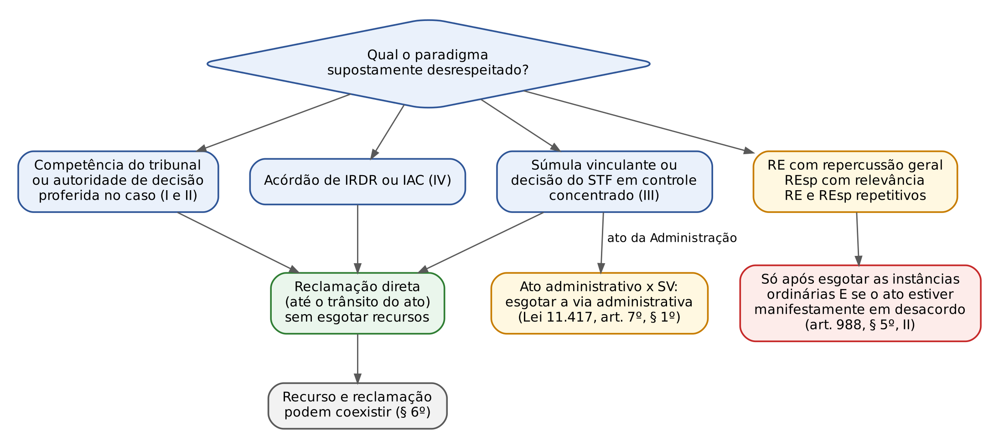
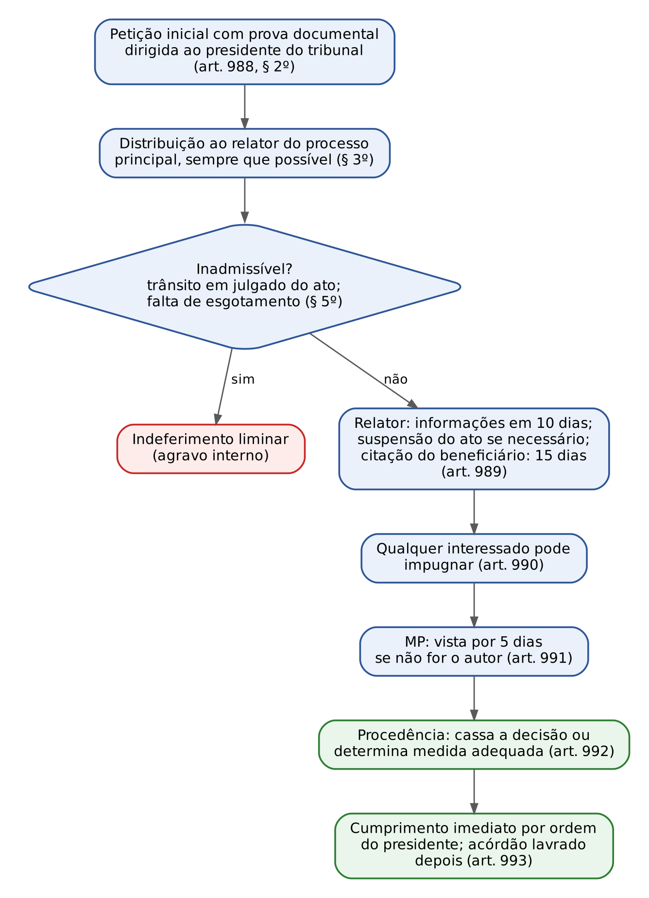
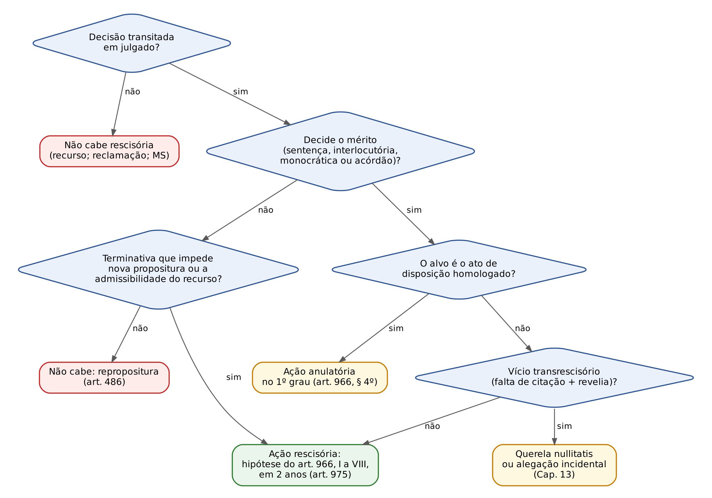
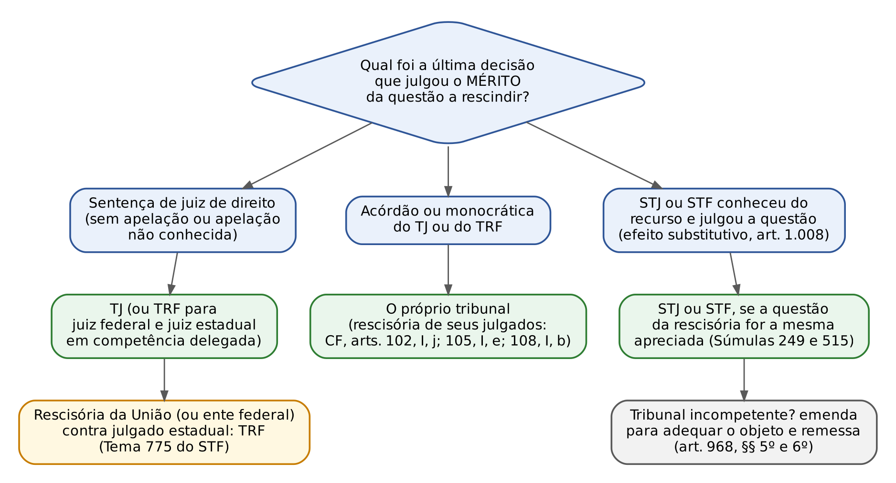
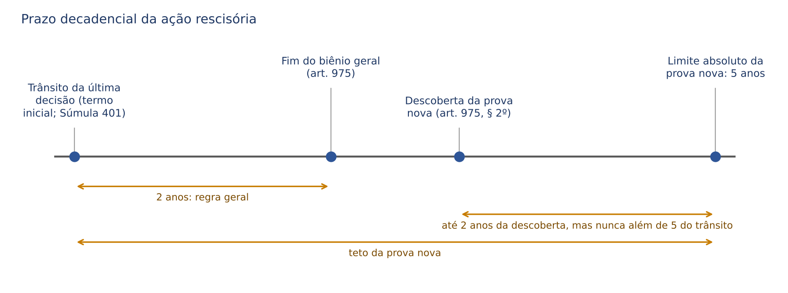
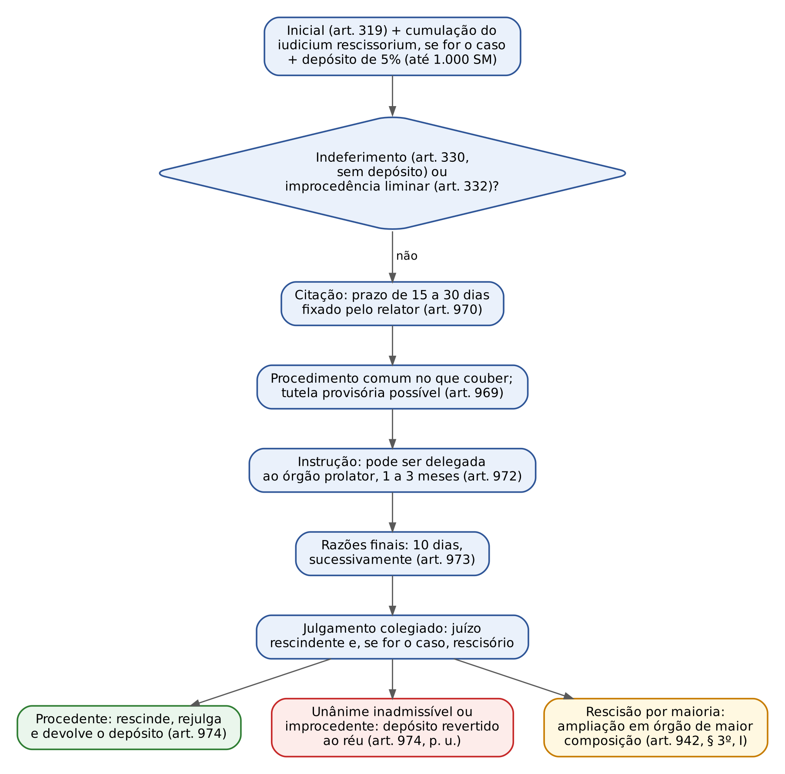

# CAPÍTULO 40 — RECLAMAÇÃO E AÇÃO RESCISÓRIA

:::INCIDENCIA
Pontos: TRF5 p. 9 e 16; TJRS p. 19; TJSC p. 15. Nível A+. Lote: 28 questões (FGV 23; FCC 5), mais correlatas de outros lotes (TJ-CE, MPE-RJ, MPE-GO, TRF6, PGE-MT).
O que mais cai: literalidade dos arts. 966 a 975 (hipóteses, depósito de 5%, art. 969, prazo de 2 anos e prova nova) e do art. 988 (hipóteses e esgotamento das instâncias); casos de usurpação de competência pelo juiz de primeiro grau; competência para a rescisória depois de recurso aos tribunais superiores; ofensa à coisa julgada sem juízo rescisório.
:::

#### Mapa de cobrança

| Subtema | FGV | FCC | Padrão |
|---|---|---|---|
| Reclamação: hipóteses, esgotamento, procedimento | 6 | 2 | Juiz que nega seguimento à apelação ou suspende execução por causa de rescisória (usurpação); SV e ato administrativo; IRDR sem esgotamento; prazo de 15 dias do beneficiário |
| Rescisória: decisões rescindíveis e hipóteses do art. 966 | 5 | 3 | Decisão parcial de mérito irrecorrida; terminativa do § 2º; juízo absolutamente incompetente; prova nova; ato homologado (anulatória) |
| Prazo e termo inicial | 4 | 0 | Biênio do trânsito da última decisão (Súmula 401); prova nova até 5 anos; decisão do STF posterior ao trânsito |
| Competência e legitimidade | 2 | 0 | AREsp desprovido não desloca a competência para o STJ; rescisória da União contra julgado estadual no TRF |
| Procedimento e juízos rescindente e rescisório | 5 | 0 | Art. 969 e tutela provisória; depósito de 5% e multa por unanimidade; emenda para cumular o rejulgamento; ofensa à coisa julgada sem rejulgamento |
| Coisa julgada inconstitucional e modulação | 1 | 0 | Rescisória nos limites da modulação do STF |

## 40.1 Reclamação e rescisória: o que as aproxima e o que as separa

As duas são ações de competência originária dos tribunais que atacam decisões judiciais sem serem recursos, e por isso aparecem juntas nos editais (TRF5 p. 16; TJRS p. 19; TJSC p. 15). A lógica, porém, é oposta: a reclamação é instrumento de PRESERVAÇÃO (da competência do tribunal, da autoridade de suas decisões e da eficácia dos precedentes qualificados que a lei lhe confia) e só cabe ANTES do trânsito em julgado do ato reclamado; a rescisória é instrumento de DESCONSTITUIÇÃO da coisa julgada e só cabe DEPOIS do trânsito, por fundamentos taxativos e em prazo decadencial. Questões de caso costumam exigir a escolha entre elas e entre ambas e os recursos.

| Aspecto | Reclamação | Ação rescisória |
|---|---|---|
| Natureza | Ação originária (não é recurso nem sucedâneo recursal); na origem constitucional, ligada ao direito de petição | Ação autônoma de impugnação, desconstitutiva, de competência originária dos tribunais |
| Objeto | Ato judicial ou administrativo que usurpa competência ou desrespeita decisão ou precedente com eficácia vinculante | Decisão de mérito transitada em julgado (ou terminativa do art. 966, § 2º), no todo ou em capítulo |
| Momento | Até o trânsito em julgado do ato reclamado (art. 988, § 5º, I; Súmula 734 do STF) | Após o trânsito, em 2 anos (art. 975), com termos iniciais especiais |
| Fundamentos | Rol do art. 988 (e CF, arts. 102, I, *l*; 103-A, § 3º; 105, I, *f*) | Rol taxativo do art. 966, I a VIII |
| Prazo | Não há prazo próprio, mas há o limite do trânsito | Decadencial de 2 anos; prova nova: da descoberta, teto de 5 anos |
| Custo de acesso | Sem depósito | Depósito de 5% do valor da causa (art. 968, II), com isenções |
| Efeito sobre o ato | Suspensão do processo ou do ato pelo relator, se necessário (art. 989, II) | Não impede o cumprimento, salvo tutela provisória (art. 969) |
| Resultado | Cassação da decisão ou medida adequada; cumprimento imediato (arts. 992 e 993) | Rescisão (juízo rescindente) e, se for o caso, novo julgamento (juízo rescisório) (art. 974) |
| Legitimidade | Parte interessada ou MP (art. 988, caput) | Parte, sucessor, terceiro juridicamente interessado, MP e quem devia ter sido ouvido (art. 967) |

A *querela nullitatis* (Cap. 13, 13.8), a impugnação por inexigibilidade do título fundado em norma inconstitucional (Cap. 21, 21.7) e a ação anulatória do art. 966, § 4º, completam o quadro dos meios de ataque à decisão transitada ou ao ato homologado; o quadro comparativo de todos está em 40.4.

## 40.2 Reclamação

### 40.2.1 Natureza, fundamento e previsão constitucional

A reclamação nasceu na jurisprudência do STF como corolário da teoria dos poderes implícitos (a Corte que tem competência precisa ter meio de preservá-la) e foi constitucionalizada para o STF e o STJ: compete-lhes processar e julgar originariamente "a reclamação para a preservação de sua competência e garantia da autoridade de suas decisões" (CF, art. 102, I, *l*, e art. 105, I, *f*). A EC 45/2004 acrescentou a reclamação ao STF contra ato administrativo ou decisão judicial que contrariar súmula vinculante ou a aplicar indevidamente (art. 103-A, § 3º).

O STF qualificou a reclamação como manifestação do direito de petição (CF, art. 5º, XXXIV, *a*), e não como recurso ou ação de natureza processual típica, o que lhe permitiu reconhecer a validade da previsão de reclamação nas Constituições estaduais para os Tribunais de Justiça (STF, ADI n. 2.212, j. 2/10/2003; orientação também registrada na Apostila de Direito Administrativo, Cap. 25). O CPC/2015 resolveu a questão no plano infraconstitucional: a reclamação "pode ser proposta perante qualquer tribunal" (art. 988, § 1º), inclusive TRFs e TJs, independentemente de previsão regimental ou na Constituição estadual. Na doutrina majoritária (Didier e Leonardo Carneiro da Cunha; Marinoni, Arenhart e Mitidiero), a reclamação é AÇÃO de competência originária, com partes, causa de pedir e pedido, sujeita a contraditório (citação do beneficiário) e apta a formar coisa julgada.

:::PEGADINHA RECLAMAÇÃO NÃO É RECURSO
Afirmações do tipo "o CPC prevê a reclamação como recurso" estão erradas: ela está no Livro III, Título I (processos nos tribunais), Capítulo IX, e não no rol do art. 994. Consequências cobradas: não se submete à taxatividade recursal nem ao prazo de 15 dias; não exige preparo recursal; pode coexistir com o recurso cabível contra a mesma decisão (art. 988, § 6º); e não serve como sucedâneo recursal para rediscutir a justiça da decisão (o STF e o STJ repetem que a reclamação não é "atalho processual" para o tribunal).
:::

:::QUESTAO FCC 2024 — PGE-GO — PROCURADOR DO ESTADO SUBSTITUTO (Q2654945)
Cobrado: proposições sobre a reclamação. Gabarito: B (não é cabível contra decisão do tribunal de segundo grau que, com base em precedente de repercussão geral, nega admissão a recurso extraordinário). Fundamento: contra essa decisão cabe agravo interno ao próprio tribunal de origem (art. 1.030, § 2º; art. 1.042, caput, parte final), e só depois de esgotada essa via se cogita de reclamação ao STF (art. 988, § 5º, II). Armadilhas: A (sobrestamento indevido de processo para aguardar IRDR não desafia reclamação; a parte requer a distinção ao juízo e recorre da decisão que a indeferir, art. 1.037, §§ 9º a 13, aplicado por analogia, ver Cap. 39); C (o relator pode suspender o ato impugnado, art. 989, II: há tutela provisória); D (não é recurso); E (qualquer interessado pode impugnar o pedido, art. 990).
:::

### 40.2.2 Hipóteses de cabimento: o art. 988 e a Lei 15.484/2026

:::LEI CPC, ART. 988, CAPUT E §§ 4º A 6º (REDAÇÃO VIGENTE; INCISOS III E IV PELA LEI 13.256/2016; INCISO V, § 4º E § 5º, CAPUT E II, PELA LEI 15.484/2026)
Art. 988. Caberá reclamação da parte interessada ou do Ministério Público para:
I - preservar a competência do tribunal;
II - garantir a autoridade das decisões do tribunal;
III – garantir a observância de enunciado de súmula vinculante e de decisão do Supremo Tribunal Federal em controle concentrado de constitucionalidade;
IV – garantir a observância de acórdão proferido em julgamento de incidente de resolução de demandas repetitivas ou de incidente de assunção de competência;
V – em casos excepcionais, garantir a observância de acórdão proferido em julgamento de recurso especial sob o regime de relevância.
(...)
§ 4º As hipóteses dos incisos III, IV e V compreendem a aplicação indevida da tese jurídica e sua não aplicação aos casos que a ela correspondam.
§ 5º Será liminarmente indeferida a reclamação:
I – proposta após o trânsito em julgado da decisão reclamada;
II – proposta para garantir a observância de acórdão de recurso extraordinário com repercussão geral reconhecida, de acórdão de recurso especial com relevância da questão de direito federal infraconstitucional reconhecida ou de acórdãos proferidos em julgamento de recursos extraordinários ou especiais repetitivos, quando não esgotadas as instâncias ordinárias ou o ato atacado não se mostrar manifestamente em desacordo com o precedente qualificado.
§ 6º A inadmissibilidade ou o julgamento do recurso interposto contra a decisão proferida pelo órgão reclamado não prejudica a reclamação.
:::

Três camadas de redação convivem no Planalto e são fonte de pegadinha:

- Redação original do CPC (16/3/2015): o inciso IV previa reclamação para garantir a observância de súmula vinculante e de "precedente proferido em julgamento de casos repetitivos", o que incluía os recursos repetitivos, sem exigência de esgotamento.
- Lei 13.256/2016 (antes da vigência do CPC): deslocou a súmula vinculante para o inciso III, restringiu o inciso IV a IRDR e IAC e criou o § 5º, II, admitindo a reclamação baseada em repercussão geral ou em recurso repetitivo somente depois de esgotadas as instâncias ordinárias. O § 5º, I, já dizia "inadmissível" a reclamação proposta após o trânsito.
- Lei 15.484, de 4/8/2026 (regulamenta a relevância da questão federal no recurso especial, EC 125/2022; vigência 30 dias após a publicação, art. 7º): incluiu o inciso V ("em casos excepcionais", acórdão de recurso especial sob o regime de relevância), estendeu o § 4º a esse inciso, transformou o § 5º em hipóteses de INDEFERIMENTO LIMINAR e acrescentou ao inciso II dois elementos: o recurso especial com relevância reconhecida e a exigência cumulativa de que o ato atacado se mostre "manifestamente em desacordo com o precedente qualificado". A mesma lei incluiu no art. 927 o inciso III-A (acórdãos de recurso especial sob o regime de relevância como precedentes de observância obrigatória).

| Hipótese | Paradigma | Exige esgotamento? | Observação |
|---|---|---|---|
| I | Competência do próprio tribunal | Não | Usurpação por juízo inferior ou por outro órgão |
| II | Decisão do tribunal no caso concreto (eficácia *inter partes*) | Não | Desobediência ao que o tribunal decidiu no mesmo processo ou em processo conexo |
| III | Súmula vinculante; decisão do STF em ADI, ADC, ADPF (efeito vinculante) | Não, salvo ato administrativo x SV (esgota a via administrativa) | Exige aderência estrita entre o ato e o paradigma |
| IV | Acórdão de IRDR ou IAC | Não | Cabível no próprio TJ ou TRF, ou no STJ ou STF quando o IAC for deles |
| V | Acórdão de REsp julgado sob relevância | Sim (§ 5º, II), e só "em casos excepcionais" | Novidade de 2026; requer desacordo manifesto |
| § 5º, II | RE com repercussão geral; RE e REsp repetitivos | Sim, e desacordo manifesto | Antes de 2026 o STJ recusava reclamação para repetitivo (ver 40.2.6) |

:::QUESTAO FCC 2025 — TRT 15ª REGIÃO — ANALISTA JUDICIÁRIO (Q3295851)
Cobrado: hipótese de cabimento pela letra do CPC. Gabarito: A (preservar a competência do tribunal, art. 988, I). Armadilhas: B e C inventam reclamação contra qualquer ato judicial cujo recurso não tenha efeito suspensivo (a falta de efeito suspensivo se resolve por tutela recursal, não por reclamação); D generaliza a súmula: a reclamação protege súmula VINCULANTE (art. 988, III), não "enunciado de súmula de qualquer tribunal"; E descreve omissão sanável por embargos de declaração e recurso, não reclamação.
:::

### 40.2.3 Preservação da competência do tribunal: a usurpação pelo juízo inferior

A hipótese do inciso I tem dois campos de cobrança: (a) o juízo de primeiro grau que pratica ato reservado ao tribunal; (b) o tribunal local que usurpa competência do STJ ou do STF (por exemplo, ao processar causa de competência originária deles, ou ao negar seguimento a agravo em recurso especial ou extraordinário, cujo julgamento é do tribunal superior, art. 1.042, § 4º).

Situações típicas de usurpação pelo primeiro grau, todas cobradas pela FGV em 2024 a 2026:

- Juiz que exerce juízo de admissibilidade da apelação e lhe nega seguimento. O CPC/2015 suprimiu o juízo de admissibilidade da apelação no primeiro grau: o juiz intima o apelado para contrarrazões e remete os autos ao tribunal "independentemente de juízo de admissibilidade" (art. 1.010, § 3º). Ao negar seguimento, ainda que por intempestividade certificada, o juiz usurpa a competência do tribunal. O fundamento da recusa (intempestividade, contrariedade a tese de repercussão geral, inutilidade) é irrelevante para o cabimento da reclamação.
- Juiz que suspende o cumprimento de sentença porque foi ajuizada ação rescisória. A propositura da rescisória não impede o cumprimento (art. 969); a suspensão da eficácia executiva da decisão rescindenda é tutela provisória que só o TRIBUNAL competente para a rescisória (seu relator) pode conceder. Ao suspendê-la por conta própria, o juiz usurpa competência do tribunal, e a FGV aponta a reclamação como meio adequado (Q3520300; ver também Q4088282, em 40.3.8).
- Outras hipóteses usuais: juiz que aprecia pedido de efeito suspensivo à apelação, reservado ao tribunal (art. 1.012, § 3º); juiz que julga agravo de instrumento ou que deixa de remeter o recurso; juiz que, depois de afetado IRDR, decide a questão contra a ordem de suspensão do relator (ver adiante, Q3865824).

:::QUESTAO FGV 2025 — TJ-MS — JUIZ SUBSTITUTO (Q3786355)
Caso: advogado de sindicato fraciona a execução dos honorários fixados em ação coletiva contra o Estado em milhares de execuções individuais de pequeno valor; o juiz extingue cada uma (honorários são crédito único e indivisível) e, interpostas apelações, nega-lhes seguimento por estar a sentença conforme tese de repercussão geral; o advogado ajuíza reclamação ao TJ.
Gabarito: B (é cabível e deve ser julgada PROCEDENTE: houve usurpação da competência do tribunal). Passos: 1) o ato reclamado é a decisão que negou seguimento à apelação; 2) o art. 1.010, § 3º, retirou do juiz o juízo de admissibilidade; 3) logo, inciso I do art. 988, sem exigência de esgotamento; 4) o acerto da tese de mérito do juiz (vedação ao fracionamento, que o STF de fato adota, ver Cap. 27) não afasta a usurpação.
Armadilhas: E (cabível, mas improcedente porque a tese do juiz está certa) confunde o mérito da causa com o mérito da reclamação; A (rol taxativo sem a hipótese) ignora o inciso I; C e D oferecem agravo e mandado de segurança como excludentes.
No mesmo sentido, com o mesmo caso: Q4083725 (FGV 2026, TJ-BA, Juiz Substituto), gabarito C: houve usurpação da competência do tribunal, e o advogado pode ajuizar reclamação OU interpor agravo de instrumento (a decisão foi proferida em fase de execução, em que toda interlocutória é agravável, art. 1.015, parágrafo único). A alternativa que afirmava subsistir o juízo de admissibilidade no primeiro grau está errada.
:::

:::QUESTAO FGV 2024 — TJ-SC — ANALISTA JURÍDICO (Q2515304)
Caso: apelação certificada intempestiva; o juiz nega-lhe seguimento; cinco dias depois o autor ajuíza reclamação. Gabarito: D (o beneficiário do ato impugnado será citado e terá 15 dias para contestar, art. 989, III). Armadilhas: A (inadequação) está errada porque a negativa de seguimento usurpa a competência do tribunal (art. 1.010, § 3º), ainda que a apelação seja de fato intempestiva: quem declara a intempestividade é o relator (art. 932, III); B (intempestividade) é errada porque a reclamação não tem prazo, só o limite do trânsito em julgado; C (vedação de suspensão) contraria o art. 989, II; E (distribuição ao prolator para retratação) não existe: a distribuição é ao relator do processo principal, sempre que possível (art. 988, § 3º).
:::

:::QUESTAO FGV 2025 — TJ-ES — ATIVIDADE NOTARIAL E DE REGISTRO (Q3520300)
Caso: no cumprimento de sentença, o juiz toma conhecimento de rescisória ajuizada pelo executado e, vendo risco à efetividade, suspende a execução. Gabarito: C (decisão equivocada, cabendo reclamação ao Tribunal de Justiça). Fundamento: art. 969 (a rescisória não impede o cumprimento, ressalvada tutela provisória, que é do tribunal da rescisória); a suspensão determinada pelo juízo da execução usurpa a competência do relator da rescisória. Armadilhas: D e E (correta, por cautela ou por obrigatoriedade) invertem o art. 969; A e B indicam recursos inadequados (recurso ordinário e extraordinário). Observação: na prática, a decisão também é agravável (art. 1.015, parágrafo único), e o gabarito não exclui esse recurso; a banca quis o meio que tutela a competência do tribunal.
:::

### 40.2.4 Garantia da autoridade das decisões do tribunal

O inciso II protege a decisão proferida pelo tribunal NO CASO (eficácia *inter partes*): o juízo inferior que, ao cumprir acórdão, decide em sentido contrário ao que foi julgado (liquida diferentemente do comando, restabelece liminar cassada, ignora a anulação da sentença) desrespeita a autoridade do tribunal. Pressupostos que a jurisprudência exige e que caem como pegadinha:

- Identidade de relação processual: quem não foi parte no processo em que proferida a decisão sem eficácia vinculante não pode invocá-la por reclamação (a decisão em processo subjetivo só vincula as partes); para terceiros, o caminho é o inciso III ou IV (paradigmas com eficácia geral) ou o § 5º, II.
- Aderência estrita: o ato reclamado deve guardar identidade material com o conteúdo do paradigma. Reclamação fundada em semelhança temática, em fundamentos do paradigma ou em interpretação extensiva é inadmitida.
- Decisões em controle concentrado com efeito vinculante e súmula vinculante têm eficácia *erga omnes*: aqui qualquer prejudicado pode reclamar (inciso III), inclusive o terceiro que não participou da ADI.

:::DOUTRINA TRANSCENDÊNCIA DOS MOTIVOS DETERMINANTES
A tese de que os fundamentos determinantes (*ratio decidendi*) de decisão do STF em controle concentrado também vinculariam, de modo a permitir reclamação contra ato que aplicasse lei de OUTRO ente com o mesmo conteúdo da declarada inconstitucional, foi acolhida em julgados isolados e depois rejeitada pela maioria do STF: a reclamação protege o dispositivo da decisão (e, nos precedentes do art. 988, IV e V, e § 5º, II, a tese fixada), não os fundamentos. Lei de conteúdo idêntico editada por outro ente exige nova ação de controle ou controle difuso. O art. 988, § 4º, ao falar em "aplicação indevida da tese jurídica", reforça que o objeto protegido é a tese, não a motivação lateral.
:::

### 40.2.5 Súmula vinculante e controle concentrado (inciso III)

:::LEI LEI 11.417/2006, ART. 7º, CAPUT E §§ 1º E 2º
Art. 7º Da decisão judicial ou do ato administrativo que contrariar enunciado de súmula vinculante, negar-lhe vigência ou aplicá-lo indevidamente caberá reclamação ao Supremo Tribunal Federal, sem prejuízo dos recursos ou outros meios admissíveis de impugnação.
§ 1º Contra omissão ou ato da administração pública, o uso da reclamação só será admitido após esgotamento das vias administrativas.
§ 2º Ao julgar procedente a reclamação, o Supremo Tribunal Federal anulará o ato administrativo ou cassará a decisão judicial impugnada, determinando que outra seja proferida com ou sem aplicação da súmula, conforme o caso.
:::

Pontos de prova:

- Objeto: decisão judicial e ato (ou omissão) administrativo. NÃO cabe reclamação contra LEI ou ato legislativo que contrarie súmula vinculante: a súmula vincula "os demais órgãos do Poder Judiciário e a administração pública direta e indireta" (CF, art. 103-A, caput), não o Legislativo na função legiferante; a lei contrária se ataca por ação de controle de constitucionalidade. Pela mesma razão, a decisão em ADI não impede o Legislativo de editar nova lei de igual teor (sem reclamação contra a lei).
- Esgotamento das vias administrativas: exigido SÓ para reclamação contra ato ou omissão da Administração fundada em súmula VINCULANTE (art. 7º, § 1º). Não se exige contra decisão judicial nem contra ato administrativo que desrespeite decisão em ADI, ADC ou ADPF.
- Revisão e cancelamento da súmula vinculante NÃO se fazem por reclamação: seguem o procedimento da Lei 11.417/2006 (arts. 2º e 3º), de ofício ou por provocação dos legitimados, com quórum de dois terços do STF. A reclamação pode, no máximo, servir de ocasião para que o STF reconheça a necessidade de revisão.
- Resultado: procedente a reclamação, o STF anula o ato administrativo ou cassa a decisão judicial e determina que outra seja proferida (art. 103-A, § 3º); o STF não substitui o ato reclamado por decisão própria sobre o caso.

:::QUESTAO FGV 2026 — ENAM 2026.1 — EXAME NACIONAL DA MAGISTRATURA (Q4102422)
Cobrado: três afirmações sobre reclamação e súmula vinculante. Gabarito: A (só I correta). I: correta, reclamação contra ato administrativo que viola SV, após esgotamento das vias administrativas (Lei 11.417/2006, art. 7º, § 1º). II: errada, a reclamação não serve para cancelar ou revisar SV (procedimento próprio da Lei 11.417/2006). III: errada, não cabe reclamação contra lei, porque o Legislativo, na função legislativa, não está vinculado à SV.
:::

:::PEGADINHA TRÊS "ESGOTAMENTOS" DIFERENTES
(1) Esgotamento da via ADMINISTRATIVA: reclamação contra ato da Administração que viola SV (Lei 11.417/2006, art. 7º, § 1º). (2) Esgotamento das instâncias ORDINÁRIAS judiciais: reclamação fundada em RE com repercussão geral, REsp com relevância ou recursos repetitivos (art. 988, § 5º, II). (3) Nenhum esgotamento: competência, autoridade da decisão no caso, SV contra decisão judicial, controle concentrado, IRDR e IAC.
:::

### 40.2.6 Reclamação para garantir precedentes: IRDR, IAC, repetitivos, repercussão geral e relevância

O CPC não deu a TODOS os precedentes do art. 927 a proteção pela reclamação. A tabela resume o regime vigente:

| Precedente (art. 927) | Reclamação? | Esgotamento | Onde |
|---|---|---|---|
| Decisão do STF em controle concentrado (I) | Sim (art. 988, III) | Não | STF |
| Súmula vinculante (II) | Sim (art. 988, III) | Não (salvo ato administrativo) | STF |
| IAC e IRDR (III) | Sim (art. 988, IV) | Não | Tribunal que fixou a tese (TJ, TRF, STJ ou STF) |
| RE e REsp repetitivos (III) | Sim, mas filtrada (art. 988, § 5º, II) | Sim, e desacordo manifesto | STF ou STJ (ver controvérsia no STJ abaixo) |
| RE com repercussão geral | Sim, filtrada (§ 5º, II) | Sim, e desacordo manifesto | STF |
| REsp sob relevância (III-A) | Só "em casos excepcionais" (art. 988, V, e § 5º, II) | Sim, e desacordo manifesto | STJ |
| Súmulas do STF e do STJ não vinculantes (IV) | Não | — | Recurso |
| Orientação do plenário ou órgão especial (V) | Não | — | Recurso |

IRDR e IAC: a reclamação é direta, sem esgotamento, porque a tese é formada pelo próprio tribunal ao qual estão vinculados os juízes da área (art. 985, § 1º: "Não observada a tese adotada no incidente, caberá reclamação"). O § 4º do art. 988 abrange tanto a não aplicação da tese ao caso que a ela corresponde quanto a aplicação indevida ao caso distinto. Se a tese do IRDR for objeto de recurso especial ou extraordinário e o tribunal superior a apreciar no mérito, a tese passa a ser a do tribunal superior, aplicável em todo o território nacional (art. 987, § 2º), e o regime da reclamação passa a ser o do precedente do tribunal superior: o STJ entendeu INCABÍVEL reclamação fundada em inobservância de acórdão de recurso especial julgado em IRDR, equiparando-o ao repetitivo (STJ, Rcl n. 43.019, j. 28/9/2022, Informativo 758).

:::QUESTAO FGV 2026 — AL-RO — CONSULTOR LEGISLATIVO (Q3882043)
Caso: o TJ fixa tese em IRDR; meses depois, juiz de vara fazendária sentencia em sentido oposto. Gabarito: B (cabe reclamação ao próprio TJ para garantir a observância do acórdão do IRDR, sem necessidade de esgotar as instâncias ordinárias e sem prejuízo do recurso cabível). Armadilhas: A (mandado de segurança por "teratologia"); C (só apelação, porque reclamação seria sucedâneo recursal: o art. 988, § 6º, admite a coexistência); D (rescisória antes do trânsito); E (reclamação ao STJ após esgotamento: confunde IRDR com repetitivo).
:::

No mesmo sentido, sobre IAC: Q3742392 (FGV 2025, TRF6, Juiz Federal Substituto), item III correto (descumprimento de tese de IAC do STJ admite reclamação ao STJ sem esgotamento das vias ordinárias); e Q3865824 (FGV 2026, MPE-GO, Promotor), gabarito D: a ordem de suspensão do relator do IRDR (art. 982, I) vincula os juízes da área, que não podem, por conta própria, afastá-la por distinção sem submeter o pedido ao procedimento próprio, e o descumprimento enseja reclamação (art. 988, II: autoridade da decisão do tribunal).

Recursos repetitivos no STJ: a Corte Especial decidiu que NÃO cabe reclamação para controlar a aplicação de tese fixada em recurso especial repetitivo, ainda que esgotadas as instâncias ordinárias, entendendo que a Lei 13.256/2016 suprimira essa hipótese e que o § 5º, II, não a recriava; a correção se faz pelos recursos (agravo interno contra a decisão do art. 1.030, I, *b*, e recurso especial quando houver distinção não examinada) (STJ, Rcl n. 36.476, Relatora Ministra Nancy Andrighi, Corte Especial, j. 5/2/2020, Informativo 669). O STF, ao contrário, admite a reclamação baseada em tese de repercussão geral depois de esgotadas as instâncias, interpretando a exigência de modo restritivo: inclui a interposição do agravo interno contra a decisão de inadmissão ou de negativa de seguimento no tribunal de origem (art. 1.030, § 2º) e, segundo julgados das Turmas, até os recursos aos tribunais superiores intermediários (STF, Rcl n. 28.789 AgR, Relator Ministro Dias Toffoli, Segunda Turma, j. 29/5/2020; STF, Rcl n. 37.492 AgR, Relator Ministro Edson Fachin, Segunda Turma, j. 22/5/2020).

:::ATENCAO LEI 15.484/2026 E A RCL 36.476
A nova redação do § 5º, II, menciona expressamente "acórdãos proferidos em julgamento de recursos extraordinários ou especiais repetitivos" e o REsp com relevância, e o inciso V admite reclamação "em casos excepcionais" para o REsp sob relevância. A leitura literal indica que, a partir da vigência da lei (30 dias depois de 4/8/2026), a reclamação para garantir tese de REsp repetitivo é admissível, mas sob dois filtros cumulativos: esgotamento das instâncias ordinárias E ato manifestamente em desacordo com o precedente. A orientação da Rcl 36.476 foi construída sobre a redação anterior e não há, até o fechamento desta apostila, pronunciamento da Corte Especial sobre a lei nova. Em prova objetiva: se a questão reproduzir a letra do CPC, aplique-a; se perguntar "segundo a jurisprudência do STJ" com enunciado anterior a 2026, a resposta esperada é a da Rcl 36.476. Não confundir com IRDR e IAC, em que a reclamação é direta.
:::

:::QUESTAO FGV 2026 — DATAPREV — ANALISTA (ADVOCACIA) (Q4389179, LOTE DO CAP. 39)
Ligação com este capítulo: a alternativa C (após esgotar as instâncias, reclamação ao STJ para garantir tese de repetitivo) foi dada como ERRADA, em linha com a Rcl 36.476; o gabarito (E) trata do dever de fundamentação analítica diante de distinção suscitada (art. 489, § 1º, VI; Cap. 20). No mesmo sentido, Q4289340 (FGV 2026, DPE-RJ): contra a negativa de seguimento de REsp com base em repetitivo cabe agravo interno no tribunal de origem, e não reclamação ao STJ (Cap. 43).
:::

:::DICA COMO DECIDIR EM 20 SEGUNDOS
Pergunte: (1) o ato já transitou? Se sim, reclamação não cabe (só rescisória). (2) O paradigma é competência, decisão no caso, SV, controle concentrado, IRDR ou IAC? Reclamação direta. (3) É repercussão geral, repetitivo ou relevância? Só depois do agravo interno na origem (esgotamento) e se o desacordo for manifesto; no STJ, repetitivo era incabível até a Lei 15.484/2026. (4) É súmula não vinculante ou jurisprudência dominante? Não cabe: recurso.
:::

### 40.2.7 Limites: trânsito em julgado, sucedâneo recursal e convivência com o recurso

- Trânsito em julgado do ato reclamado: a reclamação deve ser ajuizada antes. Proposta depois, é liminarmente indeferida (art. 988, § 5º, I, na redação de 2026; antes, "inadmissível"). Súmula 734 do STF: "Não cabe reclamação quando já houver transitado em julgado o ato judicial que se alega tenha desrespeitado decisão do Supremo Tribunal Federal." Ajuizada a tempo, o trânsito posterior do ato reclamado não prejudica a reclamação, que pode cassá-lo (a lógica do § 6º).
- Não há prazo decadencial próprio: a reclamação não está sujeita aos 15 dias recursais; o limite é o trânsito do ato reclamado (decisão judicial) ou, para atos administrativos, o esgotamento da via administrativa quando exigido.
- Convivência com o recurso: a reclamação não exclui o recurso cabível, e "a inadmissibilidade ou o julgamento do recurso interposto contra a decisão proferida pelo órgão reclamado não prejudica a reclamação" (§ 6º). A parte prudente recorre e reclama: o recurso evita o trânsito, que fecharia a porta da reclamação.
- Não é sucedâneo recursal: a reclamação não corrige erro de julgamento que não envolva usurpação de competência ou desrespeito a paradigma; nem permite rediscutir fatos ou reexaminar a justiça da decisão.
- Não cabe reclamação contra decisão do próprio órgão cuja autoridade se quer preservar (o plenário do STF não "desrespeita" a si mesmo), nem para impugnar decisões de órgãos fracionários do mesmo tribunal sem hierarquia de paradigma (salvo IRDR, IAC e decisões do órgão especial ou plenário com eficácia vinculante, conforme o regimento).

### 40.2.8 Legitimidade e competência

- Legitimidade ativa: "parte interessada ou o Ministério Público" (art. 988, caput). Parte interessada é quem sofre os efeitos do ato reclamado: as partes do processo de origem, o terceiro juridicamente prejudicado e, nas hipóteses de eficácia *erga omnes* (SV, controle concentrado), qualquer pessoa atingida pelo ato. Pessoas jurídicas de direito público, inclusive entes federativos, reclamam com frequência contra decisões que contrariam ADI ou SV.
- MP: legitimado ativo autônomo; quando não for autor, atua como fiscal (art. 991). No STF, o Procurador-Geral da República; nos tribunais estaduais, o MP estadual, que o STF admite reclamar diretamente perante o STF em defesa de suas atribuições.
- Legitimidade passiva: a autoridade a quem se imputa o ato presta INFORMAÇÕES (não é ré); réu é o BENEFICIÁRIO da decisão impugnada, que é citado e pode contestar (art. 989, I e III).
- Competência: julga a reclamação o órgão "cuja competência se busca preservar ou cuja autoridade se pretenda garantir" (art. 988, § 1º). A petição é dirigida ao PRESIDENTE do tribunal, instruída com prova documental, e distribuída ao relator do processo principal sempre que possível (§§ 2º e 3º). O órgão interno competente é definido pelo regimento.

:::PEGADINHA PROVA DOCUMENTAL PRÉ-CONSTITUÍDA
O § 2º exige que a reclamação seja "instruída com prova documental": não há dilação probatória. É traço comum com o mandado de segurança e o oposto da rescisória, que admite instrução ampla, inclusive delegada ao juízo de origem (art. 972).
:::

### 40.2.9 Procedimento

:::PROCESSO RECLAMAÇÃO: PRAZOS E ATOS
| Ato | Prazo ou regra | Fundamento |
|---|---|---|
| Petição inicial com prova documental, ao presidente do tribunal | Até o trânsito do ato reclamado | Art. 988, §§ 2º e 5º, I |
| Distribuição | Ao relator do processo principal, sempre que possível | Art. 988, § 3º |
| Indeferimento liminar | Trânsito em julgado; falta de esgotamento ou de desacordo manifesto (§ 5º, II); demais hipóteses de inadmissibilidade | Art. 988, § 5º; art. 932, III |
| Informações da autoridade reclamada | 10 dias | Art. 989, I |
| Suspensão do processo ou do ato impugnado | Se necessário, para evitar dano irreparável | Art. 989, II |
| Citação e contestação do beneficiário | 15 dias | Art. 989, III |
| Impugnação por qualquer interessado | Sem prazo próprio fixado no CPC | Art. 990 |
| Vista ao MP que não for autor | 5 dias, após informações e contestação | Art. 991 |
| Julgamento | Cassação da decisão exorbitante ou medida adequada | Art. 992 |
| Cumprimento | Imediato, por determinação do presidente; acórdão lavrado posteriormente | Art. 993 |
:::

- Tutela provisória: o art. 989, II, autoriza a suspensão do processo ou do ato impugnado; trata-se de tutela de urgência típica (risco de dano irreparável), deferida monocraticamente pelo relator e impugnável por agravo interno (art. 1.021).
- Poderes do relator: aplicam-se os do art. 932, inclusive para negar seguimento a reclamação manifestamente inadmissível ou julgá-la monocraticamente quando houver entendimento firmado (os regimentos do STF e do STJ preveem). Contra a decisão monocrática, agravo interno.
- Prazos em dobro: aplicam-se à Fazenda Pública, ao MP e à Defensoria nos atos em que atuam como partes (arts. 180, 183 e 186), salvo o prazo de informações da autoridade, que não é ato de parte.

:::SENTENCA DISPOSITIVO DE ACÓRDÃO EM RECLAMAÇÃO POR USURPAÇÃO DE COMPETÊNCIA
"Ante o exposto, JULGO PROCEDENTE a reclamação para cassar a decisão que negou seguimento à apelação interposta nos autos n. (...), por usurpação da competência deste Tribunal (CPC, art. 988, I, e art. 1.010, § 3º), e determinar a imediata remessa dos autos a esta Corte, independentemente de juízo de admissibilidade. Comunique-se, com urgência, ao juízo reclamado (CPC, art. 993). Formado o contraditório com a contestação do beneficiário, condeno-o ao pagamento de honorários advocatícios de 10% sobre o valor atualizado da causa da reclamação (CPC, art. 85, § 2º)."
:::

### 40.2.10 Julgamento, efeitos, honorários e recursos

- Conteúdo da procedência: o tribunal "cassará a decisão exorbitante de seu julgado ou determinará medida adequada à solução da controvérsia" (art. 992). Na reclamação por usurpação, avoca os autos ou determina sua remessa; na reclamação por desrespeito a paradigma, cassa o ato e determina que outro seja proferido com observância do precedente (ou, no caso de ato administrativo x SV, anula o ato). O tribunal não reforma a decisão reclamada, nem julga o mérito da causa de origem, em regra.
- Cumprimento imediato: o presidente determina o imediato cumprimento, lavrando-se o acórdão depois (art. 993): a eficácia independe da publicação do acórdão.
- Honorários: por ser ação com contraditório (citação do beneficiário), o STF e o STJ admitem honorários de sucumbência nas reclamações ajuizadas sob o CPC/2015 quando formada a relação processual. O STJ fixou que são devidos honorários mesmo na reclamação liminarmente indeferida quando o beneficiário comparece espontaneamente e apresenta defesa (contrarrazões ao agravo interno) (STJ, Rcl n. 41.569, Relator Ministro Ricardo Villas Bôas Cueva, Segunda Seção, j. 9/2/2022, Informativo 724). Sem contraditório formado (indeferimento liminar sem resposta), não há honorários.
- Recursos: contra decisão monocrática do relator, agravo interno; contra o acórdão, embargos de declaração e, conforme o tribunal, recurso especial ou extraordinário (acórdão de TJ ou TRF em reclamação é causa decidida em única instância). Súmula 368 do STF ("Não há embargos infringentes no processo de reclamação") é de interesse histórico: os embargos infringentes foram extintos pelo CPC/2015, e a técnica do art. 942 não se aplica à reclamação (o § 3º só a estende à rescisória e ao agravo de instrumento).

### 40.2.11 Reclamação nos Juizados Especiais (remissão)

O sistema dos Juizados tem regras próprias, desenvolvidas nos Caps. 36 e 37. Em síntese: nos Juizados Especiais Federais e da Fazenda Pública, a divergência com súmula ou jurisprudência dominante do STJ se resolve por pedido de uniformização (Lei 10.259/2001, art. 14; Lei 12.153/2009, arts. 18 e 19), não por reclamação nem por recurso especial (Súmula 203 do STJ); nos Juizados Especiais Cíveis estaduais, o STJ, por resolução de 2016, transferiu aos Tribunais de Justiça o julgamento das reclamações contra acórdãos de Turmas Recursais que contrariem sua jurisprudência consolidada (ver Cap. 36). Questões correlatas: Q3742395 (TRF6: afirmação de que cabe reclamação ao STJ contra acórdão de Turma Recursal do JEF que viole súmula do STJ foi considerada errada), Q3044220 e Q3978624 (pedido de uniformização ao STJ no JEFP).

## 40.3 Ação rescisória

### 40.3.1 Natureza e pressupostos

A ação rescisória é ação autônoma de impugnação, de natureza desconstitutiva (constitutiva negativa) quanto ao juízo rescindente, que instaura processo novo, de competência originária de tribunal, para desfazer decisão transitada em julgado por um dos vícios taxativamente previstos em lei e, se for o caso, rejulgar a causa. Não é recurso: pressupõe justamente o esgotamento ou a não utilização dos recursos e o trânsito em julgado. Pressupostos específicos: (a) decisão de mérito ou terminativa do art. 966, § 2º; (b) trânsito em julgado; (c) enquadramento em hipótese do art. 966; (d) prazo do art. 975; (e) depósito do art. 968, II, salvo isenção.

:::LEI CPC, ART. 966 (TEXTO INTEGRAL CONFERIDO; §§ 5º E 6º PELA LEI 13.256/2016)
Art. 966. A decisão de mérito, transitada em julgado, pode ser rescindida quando:
I - se verificar que foi proferida por força de prevaricação, concussão ou corrupção do juiz;
II - for proferida por juiz impedido ou por juízo absolutamente incompetente;
III - resultar de dolo ou coação da parte vencedora em detrimento da parte vencida ou, ainda, de simulação ou colusão entre as partes, a fim de fraudar a lei;
IV - ofender a coisa julgada;
V - violar manifestamente norma jurídica;
VI - for fundada em prova cuja falsidade tenha sido apurada em processo criminal ou venha a ser demonstrada na própria ação rescisória;
VII - obtiver o autor, posteriormente ao trânsito em julgado, prova nova cuja existência ignorava ou de que não pôde fazer uso, capaz, por si só, de lhe assegurar pronunciamento favorável;
VIII - for fundada em erro de fato verificável do exame dos autos.
§ 1º Há erro de fato quando a decisão rescindenda admitir fato inexistente ou quando considerar inexistente fato efetivamente ocorrido, sendo indispensável, em ambos os casos, que o fato não represente ponto controvertido sobre o qual o juiz deveria ter se pronunciado.
§ 2º Nas hipóteses previstas nos incisos do caput, será rescindível a decisão transitada em julgado que, embora não seja de mérito, impeça:
I - nova propositura da demanda; ou
II - admissibilidade do recurso correspondente.
§ 3º A ação rescisória pode ter por objeto apenas 1 (um) capítulo da decisão.
§ 4º Os atos de disposição de direitos, praticados pelas partes ou por outros participantes do processo e homologados pelo juízo, bem como os atos homologatórios praticados no curso da execução, estão sujeitos à anulação, nos termos da lei.
§ 5º Cabe ação rescisória, com fundamento no inciso V do caput deste artigo, contra decisão baseada em enunciado de súmula ou acórdão proferido em julgamento de casos repetitivos que não tenha considerado a existência de distinção entre a questão discutida no processo e o padrão decisório que lhe deu fundamento.
§ 6º Quando a ação rescisória fundar-se na hipótese do § 5º deste artigo, caberá ao autor, sob pena de inépcia, demonstrar, fundamentadamente, tratar-se de situação particularizada por hipótese fática distinta ou de questão jurídica não examinada, a impor outra solução jurídica.
:::

O que mudou do CPC/1973 (art. 485) e ainda cai: (1) "decisão de mérito" em vez de "sentença de mérito" (alcança interlocutórias e decisões monocráticas); (2) a hipótese de "fundamento para invalidar confissão, desistência ou transação" (antigo inciso VIII) saiu do rol e passou à anulatória (§ 4º); a suspeição continua fora (já o CPC/1973 só falava em juiz impedido); (3) "violar manifestamente norma jurídica" em vez de "violar literal disposição de lei"; (4) "prova nova" em vez de "documento novo"; (5) novidades sem correspondente: rescisão de decisão terminativa (§ 2º), rescisória de capítulo (§ 3º), distinção não considerada (§§ 5º e 6º); (6) prazo de 2 anos mantido, com termos iniciais especiais (art. 975, §§ 2º e 3º).

### 40.3.2 Decisões rescindíveis

Decisão de mérito transitada em julgado, qualquer que seja a forma:

- Sentença definitiva (art. 487), inclusive a que pronuncia prescrição ou decadência (art. 487, II) e a de improcedência liminar (art. 332), que faz coisa julgada material mesmo sem citação do réu.
- Decisão interlocutória de mérito: julgamento antecipado parcial (art. 356), decisão que rejeita prescrição ou a pronuncia em relação a um dos pedidos, decisão em liquidação que fixa o *quantum*, decisão que resolve questão de mérito na execução (por exemplo, a titularidade de crédito de precatório). O STJ admitiu rescisória contra acórdão de agravo de instrumento que determinou a retificação do beneficiário de precatório, atribuindo à parte a verba honorária que o juízo havia destinado ao advogado, porque a decisão julgou relação de direito material surgida após a sentença (STJ, REsp n. 1.745.513, Relator Ministro Paulo Sérgio Domingues, Primeira Turma, j. 12/3/2024, Informativo 804).
- Decisão monocrática de relator que julga o mérito do recurso (art. 932, IV e V) e acórdão.
- Decisão homologatória de autocomposição? Aqui está a pegadinha: o que se ataca por vício do ato de vontade (coação, dolo, erro, simulação) é o ATO homologado, por ação anulatória (art. 966, § 4º), no primeiro grau, com o prazo do direito material; a rescisória cabe se o vício estiver na própria decisão homologatória (juiz impedido, incompetência absoluta) ou se o juiz, em vez de apenas homologar, decidiu o mérito.

Decisão terminativa (§ 2º): é rescindível a decisão que, "embora não seja de mérito", impeça (I) nova propositura da demanda (por exemplo, a extinção por perempção, litispendência ou coisa julgada, art. 486, § 1º, e a extinção cujo vício não pode ser corrigido) ou (II) a admissibilidade do recurso correspondente (o acórdão que não conhece da apelação por intempestividade equivocada: a rescisão visa a que o recurso seja conhecido e julgado). Em ambos os casos, exige-se que o vício se enquadre em um dos incisos do art. 966.

:::QUESTAO FCC 2026 — DPE-MA — DEFENSOR PÚBLICO (Q4012617)
Cobrado: orientação a assistido sobre rescisória. Gabarito: B (é rescindível a decisão transitada que, embora não seja de mérito, impeça nova propositura da demanda, art. 966, § 2º, I). Armadilhas: A (o MP tem legitimidade em três hipóteses, não "apenas" na colusão, art. 967, III); C (a propositura não impede o cumprimento, art. 969); D (o prazo é de 2 anos, não 5); E (a rescisória pode ter por objeto um só capítulo, art. 966, § 3º).
:::

:::QUESTAO FGV 2025 — TJ-TO — JUIZ SUBSTITUTO (Q3453240)
Caso: julgamento antecipado parcial acolhe o primeiro pedido (com honorários e custas ao réu beneficiário da gratuidade), e o processo prossegue quanto ao segundo; o réu não recorre. Gabarito: A (a decisão pode ser impugnada por ação rescisória). Passos: 1) a decisão do art. 356 é interlocutória de mérito, impugnável por agravo de instrumento (art. 356, § 5º); 2) não agravada, transita em julgado de imediato e forma coisa julgada material sobre o capítulo (art. 356, § 3º, e art. 502); 3) logo, rescindível (art. 966, caput e § 3º), e o prazo corre do seu trânsito (ver 40.3.11). Armadilhas: B (apelação só da sentença final, e o capítulo já transitou); C e D (mandado de segurança e reclamação não atacam decisão transitada); E (a coisa julgada não é intangível no biênio).
:::

Não cabe rescisória (lista de revisão):

- Decisão não transitada em julgado: o remédio é o recurso (e, se for o caso, reclamação ou mandado de segurança). Mas NÃO se exige o esgotamento dos recursos: "Admite-se ação rescisória contra sentença transitada em julgado, ainda que contra ela não se tenham esgotado todos os recursos" (Súmula 514 do STF). Quem não apelou pode rescindir.
- Decisões sem coisa julgada material: tutela provisória (inclusive a estabilizada, que se ataca pela ação do art. 304, § 2º, no prazo de 2 anos, ver Cap. 15); decisões em procedimentos de jurisdição voluntária sem conteúdo de mérito litigioso; sentença de improcedência por insuficiência de provas em ação popular, ação civil pública e mandado de segurança coletivo, que não impede nova ação com prova nova (coisa julgada *secundum eventum probationis*, Lei 4.717/1965, art. 18; Lei 7.347/1985, art. 16; ver Cap. 34); decisão terminativa que não se enquadre no § 2º (a parte simplesmente repropõe, art. 486).
- Processo dos Juizados Especiais Cíveis: "Não se admitirá ação rescisória nas causas sujeitas ao procedimento instituído por esta Lei" (Lei 9.099/1995, art. 59), regra aplicada aos Juizados Federais e da Fazenda Pública (Caps. 36 e 37). Para a inexigibilidade do título fundado em norma inconstitucional, o STF admite simples petição no prazo da rescisória ou impugnação (Q4102114 e Q3898953, lotes do Cap. 36).
- Decisão de mérito em ADI, ADC e ADPF: a Lei 9.868/1999 (art. 26) e a Lei 9.882/1999 (art. 12) vedam a rescisória (a decisão "não podendo, igualmente, ser objeto de ação rescisória", na ADI e na ADC; na ADPF, "não podendo ser objeto de ação rescisória").
- Sentença arbitral: o controle judicial se faz por ação anulatória no prazo de 90 dias (Lei 9.307/1996, art. 33) ou por impugnação ao cumprimento, não por rescisória (Cap. 2).
- Ato de disposição homologado (transação, renúncia, reconhecimento) e atos homologatórios da execução (adjudicação, arrematação): anulatória, art. 966, § 4º. Partilha amigável: anulável no prazo de 1 ano (art. 657); partilha julgada por sentença: rescindível (art. 658).
- Justiça do Trabalho: a Súmula 338 do STF ("Não cabe ação rescisória no âmbito da justiça do trabalho") está superada pela CLT, que prevê rescisória (art. 836); o tema é de outra disciplina, mas a súmula aparece em listas de revisão como pegadinha.

:::QUESTAO FGV 2026 — ENAM 2026.1 — EXAME NACIONAL DA MAGISTRATURA (Q4102435)
Caso: ação popular com dois pedidos; o primeiro rejeitado por prescrição, o segundo por insuficiência de provas; o tribunal confirma em reexame necessário; trânsito. Gabarito: C (rescisória cabível, em tese, só quanto ao primeiro pedido). Passos: 1) prescrição é mérito (art. 487, II): coisa julgada material, rescindível; 2) improcedência por deficiência de prova na ação popular não faz coisa julgada material (art. 18 da Lei 4.717/1965): qualquer cidadão pode propor nova ação com nova prova, falta interesse na rescisória; 3) o acórdão da remessa necessária é decisão de mérito como qualquer outro (E errada); 4) o sistema coletivo não exclui a rescisória (D errada). A remessa da ação popular está no Cap. 20 e a coisa julgada coletiva no Cap. 34.
:::

:::QUESTAO FCC 2025 — DPE-AM — DEFENSOR PÚBLICO (Q3531632, TAMBÉM REFERIDA NO CAP. 30)
Caso: acordo de divórcio, guarda e alimentos celebrado no CEJUSC sem a presença dos defensores, homologado e transitado; a mulher relata coação decorrente de violência doméstica. Gabarito: C (ação anulatória no juízo da Vara de Família). Fundamento: o vício é do ATO de disposição (coação), não da sentença homologatória: art. 966, § 4º, com competência do primeiro grau. Armadilhas: A e B (rescisória no TJ ou no juízo de origem); D e E (reconsideração e embargos de declaração não atacam decisão transitada).
:::

:::QUESTAO FCC 2025 — UNICAMP — PROCURADOR DE UNIVERSIDADE (Q3891323)
Cobrado: cinco afirmações; gabarito C (só I e II). I: correta, rescisória de um só capítulo (§ 3º). II: correta, terceiro juridicamente interessado (art. 967, II). III: errada, a propositura não impede o cumprimento (art. 969). IV: errada, atos de disposição homologados são anuláveis (§ 4º), não rescindíveis. V: errada, a incompetência RELATIVA não é hipótese de rescisão; só a absoluta (art. 966, II).
:::

### 40.3.3 As hipóteses do art. 966

O rol é taxativo, e cada inciso é uma causa de pedir distinta: o tribunal não pode acolher a rescisória por fundamento diverso do invocado, porque isso violaria a congruência (Enunciado 196 da III Jornada de Direito Processual Civil do CJF: "O tribunal não deve acolher ação rescisória com base em causa de pedir diversa daquela indicada na petição inicial"). A qualificação jurídica errada dos fatos, porém, não impede o acolhimento se os fatos narrados se enquadrarem em outro inciso (*iura novit curia*), desde que respeitado o contraditório (art. 10).

#### Inciso I: prevaricação, concussão ou corrupção do juiz

Os tipos são os do Código Penal (arts. 319, 316 e 317). Não se exige condenação criminal prévia: a prática pode ser demonstrada na própria rescisória. Em julgamento colegiado, basta que o voto corrompido tenha sido determinante? A doutrina majoritária entende que o vício contamina o acórdão se o voto do juiz corrompido integrou a maioria.

#### Inciso II: juiz impedido ou juízo absolutamente incompetente

- Só IMPEDIMENTO (art. 144), não suspeição (art. 145): a suspeição preclui se não arguida no prazo do art. 146. Questão clássica: "pode ter como causa de pedir a decisão ter sido proferida por juiz suspeito" é ERRADA (Q2386971, Q2511445).
- Só incompetência ABSOLUTA (matéria, pessoa, função): a relativa, não arguida, prorroga-se (art. 65).
- O impedimento do juiz que participou do julgamento rescindendo não o impede de julgar a rescisória: "Na ação rescisória, não estão impedidos juízes que participaram do julgamento rescindendo" (Súmula 252 do STF). Mas o relator deve ser, sempre que possível, juiz que não participou (art. 971, parágrafo único).

:::QUESTAO FGV 2025 — MPU — ANALISTA DO MPU (Q3339804)
Caso: improcedência liminar do pedido por contrariedade a súmula de TJ sobre direito local, sem recurso; um ano depois, o sucessor universal do autor percebe que o juízo era absolutamente incompetente e propõe rescisória. Gabarito: E (pode ser procedente: há vício processual no julgamento originário, art. 966, II). Passos: 1) improcedência liminar é sentença de mérito (art. 332, IV, autoriza o fundamento em súmula de TJ sobre direito local) e faz coisa julgada; 2) sucessor universal é legitimado (art. 967, I); 3) não se exige esgotamento de recursos (Súmula 514 do STF; A errada); 4) prazo de 2 anos observado; 5) contraditório: não há violação, porque a improcedência liminar dispensa citação por beneficiar o réu (D errada).
:::

#### Inciso III: dolo ou coação da parte vencedora; simulação ou colusão

- Dolo processual da parte vencedora (não do advogado isoladamente, nem dolo de terceiro): conduta maliciosa que impede ou dificulta a atuação da parte contrária ou induz o juiz a erro (por exemplo, impedir a citação real do réu, ocultar fatos com violação ao dever de lealdade), com nexo causal com o resultado.
- Coação da parte vencedora sobre a vencida (inovação do CPC/2015).
- Simulação ou colusão entre as partes para fraudar a lei (processo simulado, art. 142): a legitimidade se estende ao terceiro prejudicado e ao MP, com prazo contado da ciência (art. 975, § 3º).

#### Inciso IV: ofensa à coisa julgada

A segunda decisão que julga de novo demanda idêntica (mesmas partes, causa de pedir e pedido, art. 337, §§ 1º a 4º) ou que contraria o comando da anterior. Particularidade cobrada: o pedido é SÓ de rescisão; não há juízo rescisório, porque a causa já está julgada pela primeira coisa julgada, que prevalece. Rescindida a segunda decisão, restabelece-se a primeira (ver 40.3.9). Se o prazo da rescisória contra a segunda decisão se esgotou, a jurisprudência do STJ tem afirmado que prevalece a segunda coisa julgada (a última a se formar), por segurança jurídica, embora parte da doutrina sustente a prevalência da primeira; o tema é controvertido e cabe na prova discursiva.

#### Inciso V: violação manifesta de norma jurídica

É a hipótese de maior incidência prática e de prova.

- "Norma jurídica" é mais amplo que a "literal disposição de lei" do CPC/1973: abrange Constituição, lei, decreto, princípios, costume, norma processual e material, nacional, estrangeira (quando aplicável), e norma extraída de precedente obrigatório. Violação de enunciado de súmula NÃO é, por si, violação de norma (a súmula interpreta norma): o que se alega é a violação da norma interpretada.
- "Manifestamente": a violação deve ser evidente, aferível sem reexame de fatos e provas; a rescisória por esse inciso não serve para reapreciar a prova nem para rediscutir interpretação razoável.
- Súmula 343 do STF: "Não cabe ação rescisória por ofensa a literal disposição de lei, quando a decisão rescindenda se tiver baseado em texto legal de interpretação controvertida nos tribunais." Segue aplicada pelo STJ ao inciso V do CPC/2015.
- Marco temporal da controvérsia: o que importa é se a interpretação era controvertida na data da PUBLICAÇÃO da decisão rescindenda, não na data do trânsito (STJ, EREsp n. 1.711.942, Relator Ministro João Otávio de Noronha, Segunda Seção, j. 12/2/2025, Informativo 840). E, se à época do julgamento a divergência já havia cessado, a decisão que adotou a tese vencida viola a lei e a rescisória é cabível (STJ, Tema 239, REsp n. 1.001.779).
- Aplicação recente pelo STJ em repetitivo: incide a Súmula 343 nas rescisórias contra decisões anteriores a 11/9/2013 (julgamento do Tema 548) que admitiram a compensação do reajuste de 28,86% sobre a Retribuição Adicional Variável com os reposicionamentos da Lei 8.627/1993 (STJ, Tema 1.299, EREsp n. 1.431.163 e EREsp n. 1.910.729, Informativo 881).
- Matéria constitucional: por muito tempo se disse que a Súmula 343 não se aplicaria à violação da Constituição. O STF, contudo, fixou que "não cabe ação rescisória quando o julgado estiver em harmonia com o entendimento firmado pelo Plenário do Supremo à época da formalização do acórdão rescindendo, ainda que ocorra posterior superação do precedente" (STF, Tema 136, RE n. 590.809, Relator Ministro Marco Aurélio, Plenário, j. 22/10/2014, Informativo 764); no mesmo sentido, STF, AR n. 2.199, Relator para o acórdão Ministro Gilmar Mendes, Plenário, j. 23/4/2015, Informativo 782. A superveniência de decisão do STF em controle de constitucionalidade tem regime próprio (arts. 525, § 15, e 535, § 8º; ver 40.3.12).
- Precedente do STJ superveniente não reabre prazo nem equivale a decisão do STF: "a superveniência de precedente qualificado do Superior Tribunal de Justiça, ainda que firmado sob o rito dos recursos repetitivos, não possui o condão de alterar o termo inicial do prazo decadencial da ação rescisória" (STJ, AgInt na AR n. 7.954, Relator Ministro Sérgio Kukina, Primeira Seção, j. 22/4/2026, Informativo de Jurisprudência n. 31, Edição Extraordinária).
- Precedentes qualificados e distinção (§§ 5º e 6º): cabe rescisória pelo inciso V contra decisão baseada em súmula ou acórdão de casos repetitivos que não considerou a distinção; o autor deve demonstrar, sob pena de INÉPCIA, a situação particularizada por hipótese fática distinta ou questão jurídica não examinada. O Enunciado 206 da III Jornada de Direito Processual Civil do CJF estende a lógica ao IAC ("Admite-se a propositura de ação rescisória fundada em acórdão proferido em julgamento de Incidente de Assunção de Competência (IAC) (art. 966, inciso V, e §5º, CPC)").

:::QUESTAO FGV 2024 — DIREITO TRIBUTÁRIO (PROVA NÃO IDENTIFICADA NO BANCO) (Q3113979)
Cobrado: rescisória em matéria tributária. Gabarito: A (só III). I: errada (2 anos, não 5, art. 975). II: errada, inverte o Tema 136 do STF (não cabe rescisória quando o acórdão estava em harmonia com o Plenário à época, ainda que superado depois). III: correta, Tema 733 do STF (a decisão do STF não rescinde automaticamente julgados anteriores; é indispensável recurso ou rescisória, ver Cap. 21, 21.7.2).
:::

Questão correlata (lote do Cap. 39): Q3745610 (FCC 2025, PGE-TO), em que a afirmação de que NÃO cabe rescisória contra decisão que aplicou súmula sem considerar a distinção foi tida por errada (art. 966, § 5º). E Q3856341 (FGV 2026, TJ-MS, Analista), gabarito B, que cobrou a hipótese de inépcia da inicial da rescisória fundada em distinção não demonstrada (§ 6º).

#### Inciso VI: prova falsa

A falsidade (material ou ideológica) pode ter sido apurada em processo criminal ou ser demonstrada na própria rescisória, com instrução. Exige-se que a decisão rescindenda se tenha FUNDADO na prova falsa (nexo de causalidade: sem ela, a conclusão seria outra). O STJ admite rescisória por falsidade ideológica de laudo pericial incorreto, incompleto ou inadequado e, nesse caso, considera indispensável a produção de nova perícia na rescisória para confrontar o laudo, sob pena de cerceamento de defesa (STJ, REsp n. 2.113.173; v. Cap. 19).

#### Inciso VII: prova nova

- "Prova nova", e não só "documento novo": a doutrina e o FPPC admitem outros meios (testemunhal, pericial), desde que preexistentes ao trânsito (a prova deve ser "nova" quanto ao uso, não quanto à existência). O STJ, em repetitivo do CPC/1973, considerou documentos novos os microfilmes de cheques que comprovavam a restituição já ocorrida (STJ, Tema 586, REsps n. 1.114.605 e n. 1.135.563).
- Requisitos: (a) prova obtida após o trânsito; (b) cuja existência o autor ignorava ou de que não pôde fazer uso (por motivo alheio à sua vontade; negligência não serve); (c) capaz, POR SI SÓ, de assegurar pronunciamento favorável.
- Fato posterior não é prova nova: a absolvição penal superveniente à decisão cível NÃO configura prova nova para o inciso VII, por não ser preexistente; mas a decisão cível que presumiu participação não narrada nem provada pode cair por erro de fato (STJ, REsp n. 2.248.144, Relator Ministro João Otávio de Noronha, Quarta Turma, j. 7/4/2026, Informativo 884).
- Prazo especial: 2 anos da descoberta, com teto de 5 anos do trânsito (art. 975, § 2º; ver 40.3.6).

:::QUESTAO FGV 2026 — PGE-AC — PROCURADOR DO ESTADO (Q4079385)
Caso: após o trânsito, a parte vencida descobre documento preexistente, arquivado em órgão público e inacessível apesar de diligências, suficiente por si só para a procedência. Gabarito: D (cabe rescisória por prova nova, art. 966, VII, na letra da lei). Armadilhas: A (o depósito é de 5%, não "caução de 10%"); B (o ajuizamento não impede o cumprimento); C ("simples reexame" sem ação autônoma não existe depois do trânsito); E (restringe a rescisória a erro de fato e nulidade formal).
:::

#### Inciso VIII: erro de fato verificável do exame dos autos

:::ESQUEMA REQUISITOS DO ERRO DE FATO (ART. 966, VIII, E § 1º)
- A decisão admitiu fato inexistente ou considerou inexistente fato efetivamente ocorrido.
- O erro é aferível pelo simples exame dos autos (documentos e atos do processo originário), sem produção de nova prova na rescisória.
- O fato NÃO era ponto controvertido sobre o qual o juiz devesse se pronunciar (se houve controvérsia e o juiz decidiu, o caso é de má apreciação da prova, não rescindível).
- O erro foi causa determinante da conclusão (nexo).
:::

O STJ admitiu o erro de fato quando o julgador constrói a decisão sobre pressuposto fático inexistente (participação do réu em ilícito não narrada na inicial nem provada nos autos, mas tomada como premissa indiscutível), ainda que o equívoco só se revele posteriormente, e afirmou que a rescisão nesse caso não viola a independência entre as instâncias cível e penal nem converte a rescisória em sucedâneo recursal (REsp n. 2.248.144, citado).

:::QUESTAO FGV 2024 — CÂMARA DOS DEPUTADOS — CONSULTOR LEGISLATIVO (REAPLICAÇÃO) (Q2511445)
Caso: empresa condenada em reclamação trabalhista, depois de usar todos os recursos, quer rescindir o julgado. Gabarito: E (erro de fato verificável do exame dos autos). Armadilhas: A (juiz suspeito: só impedido); B (falsidade apurada em processo CIVIL: a lei fala em processo criminal ou na própria rescisória); C (incompetência territorial é relativa); D ("não ofender" a coisa julgada). O CPC aplica-se subsidiariamente à rescisória trabalhista (CLT, art. 836).
:::

### 40.3.4 Legitimidade

:::LEI CPC, ART. 967
Art. 967. Têm legitimidade para propor a ação rescisória:
I - quem foi parte no processo ou o seu sucessor a título universal ou singular;
II - o terceiro juridicamente interessado;
III - o Ministério Público:
a) se não foi ouvido no processo em que lhe era obrigatória a intervenção;
b) quando a decisão rescindenda é o efeito de simulação ou de colusão das partes, a fim de fraudar a lei;
c) em outros casos em que se imponha sua atuação;
IV - aquele que não foi ouvido no processo em que lhe era obrigatória a intervenção.
Parágrafo único. Nas hipóteses do art. 178, o Ministério Público será intimado para intervir como fiscal da ordem jurídica quando não for parte.
:::

- Parte e sucessores (I): inclui o sucessor a título singular (cessionário do direito litigioso, adquirente da coisa) e o universal (herdeiro, espólio, sociedade incorporadora), e também o assistente litisconsorcial, que é parte.
- Terceiro juridicamente interessado (II): quem é atingido pela eficácia da decisão em sua esfera jurídica (titular de relação conexa ou dependente), não o que tem mero interesse econômico ou de fato. Exemplo de prova: a União, que tinha interesse jurídico em área objeto de sentença estadual e não foi intimada (Q3914542).
- MP (III): três hipóteses, sendo a alínea *c* cláusula aberta ("outros casos em que se imponha sua atuação"), o que torna errada a afirmação de que o MP só pode propor rescisória "apenas" na colusão (Q4012617). Quando não for autor, intervém nas hipóteses do art. 178.
- Quem devia ter sido ouvido e não foi (IV): inovação do CPC/2015 para os entes cuja intervenção é obrigatória por lei (por exemplo, a autarquia de defesa da concorrência e a comissão de valores mobiliários nos processos em que a lei impõe sua intimação).
- Legitimidade passiva: todos os que foram partes no processo originário e se beneficiam da decisão rescindenda, em litisconsórcio necessário e, em regra, unitário (a rescisão não pode valer para uns e não para outros). Na rescisória que ataca o capítulo dos honorários de sucumbência, o advogado, titular do direito autônomo à verba (Lei 8.906/1994, art. 23), também deve ser citado, porque a rescisão atinge sua esfera jurídica (orientação descrita sem precedente numerado; ver nota).

:::EXEMPLO RESCISÓRIA PELO TERCEIRO E COMPETÊNCIA AO MESMO TEMPO
Q3914542 (FGV 2026, TJ-MS, Outorga de Delegações): juiz de direito de comarca sem vara federal decide litígio entre particulares sobre o uso de área rural; após o trânsito, a União constata interesse na área (não foi intimada) e cogita da rescisória. Gabarito: D (a rescisória será julgada pelo TRF). Passos: 1) a União é terceira juridicamente interessada (art. 967, II), o que afasta A; 2) a presença da União desloca a competência para a Justiça Federal (CF, art. 109, I); 3) o STF fixou que compete ao TRF processar a ação rescisória proposta pela União contra sentença transitada em julgado de juiz estadual que afete interesses de órgão federal (Tema 775, ver 40.3.5); 4) C (TJ) e E (lei autorizadora) erram por ignorar o critério pessoal.
:::

### 40.3.5 Competência

A rescisória é sempre de competência originária de TRIBUNAL; nunca do juízo de primeiro grau, nem quando ataca sentença (a FGV usa essa armadilha com frequência: "remeta ao juízo prolator"). Regra-matriz: cada tribunal rescinde os seus julgados e os dos juízes a ele vinculados (CF, art. 102, I, *j*; art. 105, I, *e*; art. 108, I, *b*: "as revisões criminais e as ações rescisórias de julgados seus ou dos juízes federais da região"; Constituições estaduais e regimentos para os TJs).

O critério que resolve os casos é o do ÚLTIMO PRONUNCIAMENTO DE MÉRITO sobre a questão a rescindir, em razão do efeito substitutivo do recurso conhecido (art. 1.008):

| Situação | Competência | Fundamento |
|---|---|---|
| Sentença sem apelação | TJ (ou TRF, se juiz federal ou juiz estadual em competência federal delegada) | Rescinde julgados dos juízes vinculados |
| Apelação conhecida e julgada no mérito | Tribunal de segundo grau (rescinde o acórdão, que substituiu a sentença) | Art. 1.008 |
| Apelação não conhecida | Tribunal, mas o objeto é a sentença (a não ser que se queira rescindir o juízo de inadmissibilidade, § 2º, II) | Art. 966, § 2º |
| REsp ou RE não conhecido, ou agravo em REsp ou RE desprovido sem exame da questão | Tribunal de origem (TJ ou TRF): o tribunal superior não julgou o mérito | Efeito substitutivo só no recurso conhecido |
| STJ ou STF conheceu do recurso e julgou a questão federal ou constitucional | STJ ou STF, se a rescisória discutir a MESMA questão | Súmula 249 do STF |
| Tribunal superior apreciou questão diversa da suscitada na rescisória | Tribunal de origem | Súmula 515 do STF |
| União ou ente federal contra julgado da Justiça Estadual | TRF | STF, Tema 775 |

Súmula 249 do STF: "É competente o Supremo Tribunal Federal para a ação rescisória, quando, embora não tendo conhecido do recurso extraordinário, ou havendo negado provimento ao agravo, tiver apreciado a questão federal controvertida." Súmula 515 do STF: "A competência para a ação rescisória não é do Supremo Tribunal Federal, quando a questão federal, apreciada no recurso extraordinário ou no agravo de instrumento, seja diversa da que foi suscitada no pedido rescisório." A ideia de ambas: o tribunal superior é competente quando, sob a forma de "não conhecimento" (técnica antiga que misturava admissibilidade e mérito), na verdade apreciou a questão.

O STF fixou, em repercussão geral, que compete ao Tribunal Regional Federal processar a ação rescisória proposta pela União com o objetivo de desconstituir sentença transitada em julgado proferida por juiz estadual, quando afetar interesses de órgão federal (STF, Tema 775, RE n. 598.650, j. outubro de 2021): o critério pessoal do art. 109, I, da CF prevalece sobre a regra de que cada tribunal rescinde os próprios julgados (ver também Cap. 5, Q3745743).

:::LEI CPC, ART. 968, §§ 5º E 6º (CORREÇÃO DA COMPETÊNCIA)
§ 5º Reconhecida a incompetência do tribunal para julgar a ação rescisória, o autor será intimado para emendar a petição inicial, a fim de adequar o objeto da ação rescisória, quando a decisão apontada como rescindenda:
I - não tiver apreciado o mérito e não se enquadrar na situação prevista no § 2º do art. 966;
II - tiver sido substituída por decisão posterior.
§ 6º Na hipótese do § 5º, após a emenda da petição inicial, será permitido ao réu complementar os fundamentos de defesa, e, em seguida, os autos serão remetidos ao tribunal competente.
:::

Os §§ 5º e 6º positivaram o fim da extinção da rescisória por "erro na indicação da decisão rescindenda": se o autor apontou como rescindenda a decisão errada (a sentença substituída pelo acórdão, ou o acórdão do STJ que não conheceu do recurso), o tribunal não extingue o processo; manda emendar, abre ao réu a complementação da defesa e remete ao tribunal competente. É aplicação da primazia do mérito (art. 4º) e da *translatio iudicii* (Cap. 4).

:::QUESTAO FGV 2025 — TJ-GO — RESIDENTE JURÍDICO (Q3345943)
Caso: improcedência em vara cível do RJ, apelação conhecida e desprovida pelo TJRJ; REsp inadmitido na origem; agravo em REsp conhecido e desprovido pelo STJ; trânsito. Gabarito: B (TJRJ). Passos: 1) a última decisão de MÉRITO sobre a causa é o acórdão do TJRJ que julgou a apelação (substituiu a sentença); 2) o STJ, no agravo em REsp, examinou só a admissibilidade do recurso especial, sem julgar a questão federal: não houve efeito substitutivo; 3) Súmula 515 do STF por analogia. Armadilhas: A (STJ) seria correta só se o STJ tivesse conhecido do REsp e julgado a questão; C (vara) nunca é competente para rescisória.
:::

Questão correlata: Q3786423 (FGV 2025, TJ-MS, Juiz Substituto, lote do Cap. 38): pelo Regimento Interno do TJMS, a rescisória de sentença é julgada por Seção Cível e, havendo rescisão não unânime, o julgamento prossegue na Seção Especial Cível, com número suficiente de votos para inverter o resultado (art. 942, § 3º, I). A organização interna (câmaras, grupos, seções) depende do regimento de cada tribunal; consulte o RITJSC e o RITJRS para a sua prova.

### 40.3.6 Prazo e termo inicial

:::LEI CPC, ART. 975
Art. 975. O direito à rescisão se extingue em 2 (dois) anos contados do trânsito em julgado da última decisão proferida no processo.
§ 1º Prorroga-se até o primeiro dia útil imediatamente subsequente o prazo a que se refere o caput, quando expirar durante férias forenses, recesso, feriados ou em dia em que não houver expediente forense.
§ 2º Se fundada a ação no inciso VII do art. 966, o termo inicial do prazo será a data de descoberta da prova nova, observado o prazo máximo de 5 (cinco) anos, contado do trânsito em julgado da última decisão proferida no processo.
§ 3º Nas hipóteses de simulação ou de colusão das partes, o prazo começa a contar, para o terceiro prejudicado e para o Ministério Público, que não interveio no processo, a partir do momento em que têm ciência da simulação ou da colusão.
:::

:::PROCESSO PRAZOS DA AÇÃO RESCISÓRIA
| Situação | Prazo | Termo inicial | Fundamento |
|---|---|---|---|
| Regra | 2 anos (decadencial) | Trânsito em julgado da última decisão proferida no processo | Art. 975, caput; Súmula 401 do STJ |
| Prova nova (VII) | 2 anos | Descoberta da prova, observado o teto de 5 anos do trânsito | Art. 975, § 2º |
| Simulação ou colusão, para terceiro prejudicado e MP que não interveio | 2 anos | Ciência da simulação ou colusão | Art. 975, § 3º |
| Decisão do STF (controle concentrado ou difuso) posterior ao trânsito | 2 anos | Trânsito em julgado da decisão do STF (retroação dos efeitos limitada a 5 anos do ajuizamento, salvo definição diversa do STF) | Arts. 525, § 15, e 535, § 8º; AR 2.876 QO |
| Termo final em dia sem expediente | Prorroga-se ao primeiro dia útil | — | Art. 975, § 1º; STJ, Tema 552 |
:::

Pontos de prova:

- Natureza: decadencial, e por isso não se suspende nem se interrompe (CC, art. 207), salvo a prorrogação do termo final do § 1º. Antes do CPC/2015, o STJ já havia firmado, em repetitivo, que o termo final, embora decadencial, se prorroga para o primeiro dia útil subsequente se recair em dia de não funcionamento da secretaria do juízo competente (STJ, Tema 552; v. Cap. 11), regra hoje positivada no § 1º do art. 975. O prazo é contado em anos (de data a data), e não em dias úteis: o art. 219 não se aplica a prazo de direito material.
- Início: o dia do trânsito em julgado (o dia seguinte ao último dia do prazo do recurso cabível) é incluído na contagem, segundo a orientação reproduzida no caderno do Buscador Dizer o Direito.
- Súmula 401 do STJ: "O prazo decadencial da ação rescisória só se inicia quando não for cabível qualquer recurso do último pronunciamento judicial." O CPC/2015 adotou a súmula ("trânsito em julgado da última decisão proferida no processo"). Questão do TRF5 (Q3373888) cobrou a súmula pela letra.
- Recurso inadmissível e má-fé: se a parte interpõe recurso que depois não é conhecido (inclusive por intempestividade), o prazo conta do trânsito da última decisão que examinou a controvérsia sobre a admissibilidade, salvo comprovada má-fé (recurso manifestamente incabível manejado só para retardar o trânsito) (STJ, EREsp n. 1.352.730, Relator Ministro Raul Araújo, Corte Especial, j. 5/8/2015; STJ, REsp n. 1.887.912, Relator Ministro Marco Aurélio Bellizze, Terceira Turma, j. 21/9/2021, Informativo 711).
- Precedente do STJ superveniente, ainda que repetitivo, não altera o termo inicial (AgInt na AR n. 7.954, citado em 40.3.3): só a decisão do STF em controle de constitucionalidade tem o regime especial dos arts. 525, § 15, e 535, § 8º.
- Prescrição intercorrente na rescisória: a Súmula 264 do STF ("Verifica-se a prescrição intercorrente pela paralisação da ação rescisória por mais de cinco anos") é de 1963, quando o prazo da rescisória era de 5 anos; com o prazo atual de 2 anos, materiais de revisão sustentam a sua releitura (paralisação por mais de 2 anos), mas a aplicação depende de inércia imputável ao autor. Trate a súmula como de baixa incidência.

:::QUESTAO FGV 2024 — PROVA NÃO IDENTIFICADA NO BANCO (Q3113950)
Caso: condenação transitada em outubro de 2021; em março de 2024 o réu toma conhecimento de prova nova capaz de assegurar pronunciamento favorável; consulta em outubro de 2024. Gabarito: C (cabível, mesmo passados 3 anos do trânsito, por se tratar de prova nova). Passos: 1) biênio geral vencido em outubro de 2023; 2) prova nova: 2 anos da descoberta (até março de 2026), com teto de 5 anos do trânsito (outubro de 2026); 3) em outubro de 2024, dentro dos dois limites. Armadilhas: A (aplica o biênio geral); D ("a qualquer tempo"); E (prova nova não se alega em impugnação, e o "prazo bienal" não se esvaiu).
:::

:::QUESTAO FGV 2024 — AL-TO — ANALISTA LEGISLATIVO (Q2457696)
Caso: condenação ao pagamento de 10.000 (dez mil) reais; três anos depois do trânsito, o STF declara, em controle concentrado e sem modulação, a inconstitucionalidade da lei que fundou a pretensão; dois meses depois, o vencido propõe rescisória. Gabarito: C (dentro do prazo). Fundamento: o prazo conta do trânsito em julgado da decisão do STF (art. 525, § 15; art. 535, § 8º), e não do trânsito da decisão rescindenda; a AR 2.876 QO confirmou o biênio do trânsito da decisão do STF e limitou a retroação dos efeitos a 5 anos do ajuizamento (Cap. 21, 21.7.3). Armadilhas: A (depósito de 10%: é 5%, art. 968, II); B (prazo de resposta de 10 dias: é de 15 a 30, art. 970); D (efeito suspensivo automático: art. 969); E ("vedado novo julgamento em qualquer hipótese": art. 974 manda rejulgar quando for o caso).
:::

No mesmo sentido, pela letra do art. 975: Q2507026 (FGV 2024, ENAM, reaplicação), item IV errado ("três anos"); Q3673856 e Q3744578 (lote do Cap. 21), alternativas de "quatro" e "três" anos erradas; Q3606024 (lote do Cap. 21), alternativa de rescisória "a qualquer tempo" errada.

:::QUESTAO FGV 2025 — TRF 5ª REGIÃO — JUIZ FEDERAL SUBSTITUTO (Q3373888)
Cobrado: três afirmações; gabarito A (só I). I: correta, Súmula 401 do STJ. II: errada, o acolhimento da convenção de arbitragem leva à extinção do processo sem resolução de mérito (art. 485, VII) e é atacado por apelação, porque o agravo do art. 1.015, III, é contra a decisão que REJEITA a alegação de convenção (ver Caps. 2 e 42). III: errada, quem tem menos de 16 anos é incapaz para depor (art. 447, § 1º, III), não quem tem menos de 18 (Cap. 19).
:::

### 40.3.7 Petição inicial, depósito prévio e valor da causa

:::LEI CPC, ART. 968, CAPUT E §§ 1º A 4º
Art. 968. A petição inicial será elaborada com observância dos requisitos essenciais do art. 319, devendo o autor:
I - cumular ao pedido de rescisão, se for o caso, o de novo julgamento do processo;
II - depositar a importância de cinco por cento sobre o valor da causa, que se converterá em multa caso a ação seja, por unanimidade de votos, declarada inadmissível ou improcedente.
§ 1º Não se aplica o disposto no inciso II à União, aos Estados, ao Distrito Federal, aos Municípios, às suas respectivas autarquias e fundações de direito público, ao Ministério Público, à Defensoria Pública e aos que tenham obtido o benefício de gratuidade da justiça.
§ 2º O depósito previsto no inciso II do caput deste artigo não será superior a 1.000 (mil) salários-mínimos.
§ 3º Além dos casos previstos no art. 330, a petição inicial será indeferida quando não efetuado o depósito exigido pelo inciso II do caput deste artigo.
§ 4º Aplica-se à ação rescisória o disposto no art. 332.
:::

Depósito prévio: as palavras exatas que caem.

- Percentual: CINCO por cento do valor da causa (as bancas oferecem "dez por cento" e "caução"); teto de 1.000 salários mínimos (§ 2º).
- Destino: converte-se em MULTA (revertida ao réu, art. 974, parágrafo único) só se a ação for, por UNANIMIDADE, declarada inadmissível ou improcedente; procedente a rescisória, o depósito é restituído (art. 974, caput); julgada inadmissível ou improcedente por maioria, também é restituído.
- Isentos (§ 1º): União, Estados, DF, Municípios, autarquias e fundações públicas, MP, Defensoria e beneficiários da gratuidade. Súmula 175 do STJ: "Descabe o depósito prévio nas ações rescisórias propostas pelo INSS." Empresas públicas e sociedades de economia mista NÃO estão isentas.
- Falta do depósito: indeferimento da inicial (§ 3º), mas só depois de oportunidade para regularização (art. 321; primazia do mérito).
- Extinção sem resolução do mérito: o STJ entende que o depósito também deve ser revertido ao réu quando a rescisória é extinta sem julgamento de mérito (inadmissibilidade), com uma exceção: se a extinção decorrer da perda superveniente do objeto por retratação do órgão prolator da decisão rescindenda, o autor levanta o depósito (STJ, REsp n. 2.137.256, Relatora Ministra Nancy Andrighi, Terceira Turma, j. 13/8/2024, Informativo 821).
- Improcedência liminar (§ 4º): aplica-se o art. 332; o relator pode julgar liminarmente improcedente a rescisória que contrarie súmula ou precedente obrigatório, ou reconhecer de plano a decadência (art. 332, § 1º).

Valor da causa: em regra, o da ação originária, atualizado monetariamente; se o proveito econômico perseguido na rescisória for diverso (rescisão parcial, de um capítulo, ou benefício econômico distinto), corresponde a esse proveito (art. 292, II, por analogia). Sobre ele incidem o depósito e, em regra, os honorários.

:::QUESTAO FGV 2024 — AL-SC — ANALISTA LEGISLATIVO (Q2486006)
Caso: condenação a pagar 200.000 (duzentos mil) reais; o vencido foi intimado para pagar no cumprimento de sentença cinco dias antes de propor a rescisória por violação manifesta de norma jurídica. Gabarito: C (para a admissão da inicial, deve depositar 5% do valor da causa, que se converte em multa se a ação for, por unanimidade, declarada inadmissível ou improcedente). Armadilhas: A (efeito suspensivo automático: art. 969); B (prazo de "4 anos"); D (o prazo de impugnação de 15 dias começa depois de esgotado o prazo de 15 dias para pagamento voluntário, art. 525, caput, e não na mesma data da intimação); E (o protesto só depois de transcorrido o prazo de pagamento voluntário, art. 517).
:::

:::QUESTAO FGV 2026 — TJ-PR — JUIZ SUBSTITUTO (Q3898903)
Caso: condenação mantida em apelação; rescisória por violação manifesta de norma jurídica, distribuída a Seção Cível, visando a novo julgamento com improcedência, mas com pedido APENAS de rescisão; depósito de 5% feito. Gabarito: E (o relator concede prazo para emenda, para adequar o pedido, em prestígio à primazia do mérito). Passos: 1) na violação de norma jurídica, a rescisão sem rejulgamento é inútil: é caso de cumular o *iudicium rescissorium* (art. 968, I); 2) a falta de pedido é vício sanável: arts. 321 e 4º; 3) A (impossibilidade jurídica do pedido não existe como categoria no CPC/2015 e o vício é sanável); B (fungibilidade com REsp adesivo, absurdo); C (improcedência liminar fora das hipóteses do art. 332); D (rescisória nunca é do juízo de primeiro grau). Em sentido parcialmente diverso, a doutrina majoritária e a jurisprudência do STJ admitem até considerar implícito o pedido de rejulgamento quando decorre logicamente da causa de pedir.
:::

### 40.3.8 Procedimento e tutela provisória

:::PROCESSO RESCISÓRIA: ATOS E PRAZOS (ARTS. 968 A 975)
| Ato | Prazo ou regra | Fundamento |
|---|---|---|
| Propositura | 2 anos (termos iniciais especiais) | Art. 975 |
| Inicial | Requisitos do art. 319; cumulação do rejulgamento, se for o caso; depósito de 5% | Art. 968 |
| Indeferimento | Hipóteses do art. 330 e falta de depósito; improcedência liminar do art. 332 | Art. 968, §§ 3º e 4º |
| Tutela provisória | Suspensão da eficácia da decisão rescindenda, presentes os requisitos | Art. 969 |
| Citação e resposta | Prazo judicial "nunca inferior a 15 (quinze) dias nem superior a 30 (trinta) dias" | Art. 970 |
| Rito | Procedimento comum, no que couber | Art. 970 |
| Instrução | Delegável ao órgão que proferiu a decisão rescindenda, com prazo de 1 a 3 meses para devolução dos autos | Art. 972 |
| Razões finais | 10 dias, sucessivamente, autor e réu | Art. 973 |
| Relator | Sempre que possível, juiz que não participou do julgamento rescindendo | Art. 971, parágrafo único |
| Julgamento | Pelo órgão competente; ampliação do colegiado se a rescisão for por maioria | Arts. 973, parágrafo único, e 942, § 3º, I |
:::

:::LEI CPC, ARTS. 969 E 970
Art. 969. A propositura da ação rescisória não impede o cumprimento da decisão rescindenda, ressalvada a concessão de tutela provisória.
Art. 970. O relator ordenará a citação do réu, designando-lhe prazo nunca inferior a 15 (quinze) dias nem superior a 30 (trinta) dias para, querendo, apresentar resposta, ao fim do qual, com ou sem contestação, observar-se-á, no que couber, o procedimento comum.
:::

- Efeito sobre a execução: NENHUM automático. A suspensão da eficácia executiva da decisão rescindenda exige tutela provisória, de urgência (probabilidade do direito à rescisão e perigo de dano) ou mesmo de evidência, requerida AO TRIBUNAL e concedida pelo relator, com agravo interno. O juiz da execução não pode suspender o cumprimento por "cautela" com base na pendência da rescisória (usurpação, 40.2.3), nem exigir caução não prevista: no cumprimento definitivo, a simples pendência de rescisória sem ordem de suspensão não autoriza impor ao exequente fiança bancária para levantar valores (STJ, REsp n. 2.167.952; v. Cap. 14 e, quanto ao cumprimento, Cap. 22).
- Prazo de resposta: é JUDICIAL, entre 15 e 30 dias (pegadinhas: "10 dias", "entre 30 e 60 dias para a Fazenda"). Revelia: não induz o efeito material da presunção de veracidade quanto ao pedido de rescisão, porque a coisa julgada é matéria indisponível (art. 345, II, por analogia, posição consolidada na doutrina e na jurisprudência).
- Instrução: ampla (todos os meios de prova), ao contrário da reclamação; o relator pode delegar a colheita ao juízo de origem (carta de ordem).
- Intervenção do MP: só nas hipóteses do art. 178 (art. 967, parágrafo único); não há intervenção obrigatória pela simples natureza de ação rescisória.

:::QUESTAO FGV 2024 — TJ-SC — JUIZ SUBSTITUTO (Q2386971)
Cobrado: afirmações sobre a rescisória. Gabarito: D (é lícito ao autor requerer tutela provisória que suspenda a eficácia executiva da decisão rescindenda, art. 969). Armadilhas: A (juiz SUSPEITO não é hipótese; só impedido, art. 966, II); B (o prazo conta do TRÂNSITO da última decisão, não da prolação, art. 975); C (não se exige prova pré-constituída: há instrução, art. 972, que é traço da reclamação e do MS, não da rescisória); E (na ofensa à coisa julgada, acolhida a rescisão, NÃO há rejulgamento, 40.3.9).
:::

:::QUESTAO FGV 2025 — TJ-MS — JUIZ SUBSTITUTO (Q3786352)
Caso: rescisória por violação manifesta de norma jurídica com pedido liminar de suspensão da eficácia executiva; o relator (o enunciado fala em "juiz") indefere porque a propositura não impede o cumprimento. Gabarito: A (fundamentação incorreta: embora a propositura não impeça o cumprimento, o CPC ressalva a tutela provisória, se presentes seus requisitos). Armadilhas: B (efeito automático); C e E (vedação de tutela provisória); D (rescisória só depois de extinta a execução).
:::

:::QUESTAO FGV 2026 — MPE-RJ — PROMOTOR DE JUSTIÇA SUBSTITUTO (Q4088282, LOTE DO CAP. 34)
Caso: condenação por improbidade transitada sem apelação; dois meses depois, rescisória por violação manifesta de norma; tutela de suspensão negada pelo relator e mantida em agravo interno; na execução, o juiz suspende o cumprimento "por boa cautela" em razão da rescisória. Gabarito: E (a rescisória era cabível em tese, e a falta de apelação no processo originário não obsta o conhecimento do mérito: Súmula 514 do STF). Errada a alternativa D: o juiz não podia suspender a execução com base no poder geral de cautela, contrariando o art. 969 e a decisão do tribunal que negara a tutela na rescisória.
:::

### 40.3.9 Juízo rescindente e juízo rescisório

A rescisória pode conter dois pedidos sucessivos, julgados em duas etapas lógicas, ambas pelo tribunal:

- *Iudicium rescindens* (juízo rescindente): desconstituição da decisão (pedido de rescisão). É sempre necessário.
- *Iudicium rescissorium* (juízo rescisório): novo julgamento da causa originária, cumulado "se for o caso" (art. 968, I), no qual o tribunal profere decisão que substitui a rescindida (art. 974: "rescindirá a decisão, proferirá, se for o caso, novo julgamento").

| Fundamento | Há juízo rescisório? | Por quê |
|---|---|---|
| Ofensa à coisa julgada (IV) | Não | Rescindida a segunda decisão, prevalece a primeira; não há o que rejulgar |
| Juiz impedido, incompetência absoluta (II) | Em regra não pelo tribunal da rescisória: rescindida a decisão, os autos voltam ao juízo competente ou ao juiz desimpedido para novo julgamento | O tribunal da rescisória não pode suprimir a competência do juízo natural; há divergência doutrinária quando o próprio tribunal é o competente |
| Rescisão de decisão terminativa (§ 2º) | Não, em regra: rescinde-se para permitir a repropositura ou o julgamento do recurso | O objeto é a admissibilidade |
| Violação de norma, prova falsa, prova nova, erro de fato, dolo, colusão (V a VIII, III) | Sim | O tribunal rejulga a causa, aplicando a norma correta ou considerando a prova |
| Simulação ou colusão para fraudar a lei (III) | Em regra, o rejulgamento resulta na extinção do processo simulado (art. 142) | O processo não tinha lide real |

Não se exige, para o juízo rescisório, a mesma composição ou competência do julgamento originário: o tribunal da rescisória rejulga com cognição ampla sobre a causa, nos limites do pedido, e pode inclusive produzir provas (art. 972).

:::QUESTAO FGV 2026 — TJ-MS — OUTORGA DE DELEGAÇÕES DE NOTAS E DE REGISTRO (Q3914506)
Caso: rescisória por ofensa à coisa julgada só com pedido de rescisão; o relator manda emendar para incluir o pedido de rejulgamento, sob pena de indeferimento. Gabarito: C (conduta equivocada, porque, no caso, não é cabível pedido rescisório). Fundamento: na hipótese do art. 966, IV, a rescisão basta, e a primeira coisa julgada prevalece. Armadilhas: A e B (afirmam que sempre há juízo rescisório ou que ele é o principal); D (não havia pedido rescisório na inicial); E (ofensa à coisa julgada é hipótese expressa). Compare com Q3898903 (40.3.7), em que, na violação de norma jurídica, a emenda para incluir o rejulgamento era devida.
:::

### 40.3.10 Julgamento: ampliação do colegiado, depósito, honorários e recursos

- Ampliação do colegiado (art. 942, § 3º, I): aplica-se à ação rescisória "quando o resultado for a rescisão da sentença", devendo o julgamento prosseguir em órgão de maior composição previsto no regimento interno. Dois cortes cobrados: (a) só quando o resultado não unânime for de RESCISÃO, não quando a maioria rejeitar o pedido (Q3505778, FGV 2025, TJ-CE, Juiz, lote do Cap. 38: a técnica não incide na rescisória quando a maioria rejeita a rescisão); (b) só na rescisão de SENTENÇA (a rescisória de acórdão não unânime pela rescisão não amplia, segundo a letra). O STJ decidiu que os desembargadores que participaram do julgamento inicial devem ser convocados para o órgão de maior composição, caso dele não façam parte, e que o regimento não pode dispor de modo contrário, determinando novo julgamento do zero pela Seção (STJ, REsp n. 2.171.572, Relator Ministro Antonio Carlos Ferreira, Quarta Turma, j. 18/2/2025, Informativo 842). O desenvolvimento da técnica está no Cap. 38.
- Destino do depósito: restituição na procedência e nas decisões por maioria; reversão ao réu por unanimidade na inadmissibilidade ou improcedência, "sem prejuízo do disposto no § 2º do art. 82" (o vencido paga também as despesas) (art. 974, parágrafo único).
- Honorários: incidem segundo o art. 85, pela causalidade. Quando a rescisória decorre de erro do próprio Judiciário e o réu não se opõe ao pedido, não há causalidade que justifique condená-lo em honorários (STJ, AR n. 7.062, Relator Ministro Paulo Sérgio Domingues, Primeira Seção, j. 12/2/2025, Informativo 842). Reflexo na execução: procedente a rescisória da Fazenda que desconstitui sentença coletiva, a execução individual que dela dependia é extinta SEM honorários para qualquer das partes (STJ, Tema 1.399; v. Cap. 8).
- Recursos: contra decisões monocráticas do relator, agravo interno (art. 1.021); contra o acórdão, embargos de declaração, recurso especial e extraordinário (acórdão em causa decidida em única instância por tribunal) e, se a rescisória for de competência originária do STJ ou do STF, os recursos internos. Não há recurso ordinário constitucional contra acórdão de rescisória (salvo as hipóteses próprias do art. 105, II, e 102, II, da CF, que não a incluem). Súmula 295 do STF (inadmissíveis embargos infringentes contra decisão unânime do STF em rescisória) é histórica.
- Rescisória de rescisória: cabe contra o acórdão de mérito proferido na rescisória (juízo rescindente ou rescisório), por vício próprio desse acórdão, e não para rediscutir o vício da decisão originária.

:::SENTENCA DISPOSITIVO DE ACÓRDÃO DE PROCEDÊNCIA EM RESCISÓRIA COM REJULGAMENTO
"Ante o exposto, JULGO PROCEDENTE o pedido rescindente para desconstituir o acórdão proferido na Apelação n. (...), com fundamento no art. 966, V, do CPC, e, em juízo rescisório, DOU PROVIMENTO à apelação para julgar improcedente o pedido formulado na ação originária. Determino a restituição do depósito do art. 968, II, ao autor (CPC, art. 974). Condeno o réu ao pagamento das custas e de honorários advocatícios de 10% sobre o valor atualizado da causa da rescisória (CPC, art. 85, § 2º). Comunique-se ao juízo de origem."
Variante de improcedência unânime: "(...) JULGO IMPROCEDENTE o pedido, por unanimidade, e determino a reversão do depósito em favor do réu (CPC, art. 974, parágrafo único)."
:::

### 40.3.11 Rescisória de capítulo e coisa julgada progressiva

A rescisória pode ter por objeto apenas um capítulo da decisão (art. 966, § 3º), e capítulos autônomos podem transitar em momentos distintos (decisão parcial de mérito não agravada, art. 356, § 3º; capítulo não impugnado na apelação, art. 1.002). A questão que divide a doutrina e cai em segunda fase é a do PRAZO:

- Posição 1 (prazo único, Súmula 401 do STJ e letra do art. 975): o biênio conta do "trânsito em julgado da última decisão proferida no processo", ainda que o capítulo a rescindir tenha transitado antes. O STJ formulou a Súmula 401 justamente para rejeitar a contagem fracionada ("não se admite o fracionamento da coisa julgada para fins de rescisória", na formulação usual de seus julgados sob o CPC/1973).
- Posição 2 (prazos autônomos por capítulo): o STF, em julgado da Primeira Turma sob o CPC/1973, admitiu a formação progressiva da coisa julgada e o prazo autônomo para capítulos independentes; parte da doutrina (Didier, Câmara) sustenta que, no CPC/2015, a decisão parcial de mérito tem trânsito próprio e o biênio deveria correr dele, com risco de insegurança se não houver uniformização.
- Solução prática majoritária: o próprio CPC/2015 adotou a expressão da Súmula 401 ("última decisão"), o que permite ao interessado aguardar o fim do processo; a jurisprudência do STJ tem aplicado a lógica da coisa julgada progressiva apenas aos processos instaurados sob o CPC/2015, em analogia ao art. 1.054 (registro no Cap. 21, 21.9.1). Em prova objetiva, siga a letra: 2 anos do trânsito da última decisão.

:::PEGADINHA CAPÍTULO TRANSITADO X RESCISÓRIA "PREMATURA"
Proposta a rescisória contra o capítulo já transitado enquanto o processo segue quanto aos demais, ela é cabível (há coisa julgada material sobre o capítulo); o que se discute é apenas até quando ela pode ser proposta. Não confundir com rescisória contra decisão ainda recorrível, que é inadmissível.
:::

### 40.3.12 Rescisória e coisa julgada inconstitucional

O regime geral da coisa julgada inconstitucional (arts. 525, §§ 12 a 15, e 535, §§ 5º a 8º; Temas 360 e 733 do STF; AR 2.876 QO) está desenvolvido no Cap. 21 (21.7). Aqui, apenas o que é próprio da rescisória:

- Hipótese de cabimento: decisão do STF, em controle concentrado OU difuso (os §§ 12 do art. 525 e 5º do art. 535 abrangem ambos), que declara inconstitucional a norma em que se fundou o título, ou a interpretação adotada, proferida DEPOIS do trânsito em julgado da decisão rescindenda. O fundamento é o art. 966, V (violação manifesta de norma), com o termo inicial especial do trânsito em julgado da decisão do STF (arts. 525, § 15, e 535, § 8º). A Súmula 343 do STF não incide quando o paradigma é decisão do STF em controle de constitucionalidade posterior, por força dessa regra especial; mas o Tema 136 continua a vedar a rescisória quando o acórdão rescindendo seguia o entendimento do Plenário do STF à época.
- AR 2.876 QO (STF, Relator Ministro Gilmar Mendes, Plenário, j. 24/4/2025, Informativo 1177): interpretação conforme dos §§ 15 do art. 525 e 8º do art. 535, com efeitos *ex nunc*: (1) o STF pode, em cada caso, definir os efeitos temporais de seus precedentes sobre a coisa julgada, inclusive a extensão da retroação para fins de rescisória ou o seu NÃO cabimento, diante de grave risco à segurança jurídica ou ao interesse social; (2) no silêncio, os efeitos retroativos da rescisão não excedem CINCO anos da data do ajuizamento da rescisória, que deve ser proposta em DOIS anos contados do trânsito em julgado da decisão do STF; (3) a inexigibilidade pode ser arguida na execução, seja a decisão do STF anterior ou posterior ao trânsito, salvo preclusão (com declaração incidental de inconstitucionalidade dos §§ 14 do art. 525 e 7º do art. 535).
- Modulação: cabe rescisória para adequar a decisão transitada à modulação temporal fixada pelo STF (STF, Tema 1.338, ICMS na base do PIS e da Cofins, Tema 69; v. Cap. 21, 21.7.4); no mesmo sentido, para julgados anteriores a 13/5/2021, com base no art. 535, § 8º (STJ, Tema 1.245, REsps n. 2.054.759 e n. 2.066.696, Relator para o acórdão Ministro Gurgel de Faria, Primeira Seção, j. 11/9/2024, Informativo 827).
- Relações de trato continuado: depois dos Temas 881 e 885 do STF, a decisão do STF em ADI ou repercussão geral faz cessar automaticamente, para o FUTURO, os efeitos da coisa julgada tributária em sentido contrário; a rescisória continua útil para alcançar o PASSADO. Por isso, a superveniência desses temas não retira o interesse de agir da Fazenda na rescisória que busca eficácia *ex tunc* (STJ, AR n. 5.541, Relatora Ministra Regina Helena Costa, Primeira Seção, j. 3/9/2026, Informativo 903). Detalhes tributários na Apostila de Direito Tributário, Cap. 23.

:::QUESTAO FGV 2026 — ENAM 2026.1 (Q4102392, COMENTADA NO CAP. 21)
O STF declara inconstitucional, em ADI, lei estadual de benefício fiscal, com modulação *ex nunc*; antes, decisão transitada reconhecera a validade da lei. Gabarito: D (a rescisória é cabível, desde que respeitados os limites da modulação). Comentário completo em 21.7.4; aqui basta a regra: a modulação integra a decisão do STF e define o alcance da rescisória (Temas 1.338 do STF e 1.245 do STJ).
:::

:::ATENCAO PRECEDENTE DO STJ NÃO É DECISÃO DO STF
O regime especial dos arts. 525, § 15, e 535, § 8º (termo inicial no trânsito da decisão superveniente) é exclusivo de decisões do STF em controle de constitucionalidade. A tese firmada pelo STJ em repetitivo depois do trânsito não reabre o prazo nem afasta a Súmula 343 (AgInt na AR n. 7.954, 40.3.3; Tema 1.299, 40.3.3).
:::

## 40.4 Meios de ataque à decisão transitada e ao ato homologado: quadro final

| Meio | Objeto | Fundamento | Prazo | Competência |
|---|---|---|---|---|
| Ação rescisória | Decisão de mérito transitada (ou terminativa do art. 966, § 2º), no todo ou em capítulo | Art. 966, I a VIII (taxativo) | 2 anos (art. 975), com termos especiais | Tribunal (originária) |
| Ação anulatória (art. 966, § 4º) | Ato de disposição de direitos homologado; atos homologatórios da execução | Vícios do ato jurídico na lei material (erro, dolo, coação, simulação, fraude) | O da lei material (por exemplo, 4 anos para coação e dolo, CC, art. 178; 1 ano para a partilha amigável, art. 657) | Juízo de primeiro grau |
| *Querela nullitatis* | Decisão proferida sem citação válida, com revelia (vício transrescisório) | Inexistência ou nulidade qualificada | Não há | Juízo que proferiu a decisão (Cap. 13) |
| Impugnação por inexigibilidade (arts. 525, § 12, e 535, § 5º) | Título fundado em norma ou interpretação declarada inconstitucional pelo STF | Coisa julgada inconstitucional | Prazo da impugnação, salvo preclusão (AR 2.876 QO) | Juízo da execução (Cap. 21) |
| Ação do art. 304, § 2º | Tutela antecipada estabilizada | Rever, reformar ou invalidar a tutela | 2 anos da ciência da extinção | Juízo que concedeu (Cap. 15) |
| Reclamação | Ato ainda NÃO transitado que usurpa competência ou desrespeita decisão ou precedente vinculante | Art. 988 | Até o trânsito do ato | Tribunal cuja competência ou autoridade se preserva |

## 40.5 Resumo para revisão pré-prova

| Instituto | Regra | Exceções e detalhes | Fundamento |
|---|---|---|---|
| Reclamação: natureza | Ação originária; não é recurso | Pode coexistir com o recurso; não é sucedâneo recursal | Arts. 988 a 993; CF, arts. 102, I, *l*, e 105, I, *f* |
| Reclamação: hipóteses diretas | Competência; autoridade da decisão; SV; controle concentrado; IRDR e IAC | Abrange aplicação indevida e não aplicação da tese | Art. 988, I a IV, e § 4º |
| Reclamação filtrada | RE com repercussão geral, REsp com relevância, repetitivos | Esgotamento das instâncias ordinárias E desacordo manifesto; REsp sob relevância só em casos excepcionais | Art. 988, V, e § 5º, II (Lei 15.484/2026); STJ, Rcl 36.476 (antes da lei) |
| Reclamação: limite | Indeferimento liminar se proposta após o trânsito do ato | Súmula 734 do STF; recurso contra o ato não prejudica a reclamação | Art. 988, §§ 5º, I, e 6º |
| Reclamação x SV e Administração | Cabe contra ato administrativo, após esgotar a via administrativa | Não cabe contra lei; não serve para rever ou cancelar SV | Lei 11.417/2006, art. 7º; CF, art. 103-A, § 3º |
| Usurpação pelo primeiro grau | Juiz que nega seguimento à apelação ou suspende execução por rescisória | Reclamação ao tribunal (e, na execução, também agravo) | Arts. 1.010, § 3º, 969 e 988, I |
| Reclamação: procedimento | Prova documental; informações em 10 dias; suspensão do ato; contestação do beneficiário em 15 dias; MP em 5 dias | Qualquer interessado pode impugnar | Arts. 988, § 2º, 989 a 991 |
| Reclamação: julgamento | Cassa a decisão ou determina medida adequada; cumprimento imediato | Honorários se formado o contraditório (Rcl 41.569 do STJ) | Arts. 992 e 993 |
| Rescisória: objeto | Decisão de mérito transitada (sentença, interlocutória, monocrática, acórdão), ou capítulo | Terminativa que impede repropositura ou admissibilidade de recurso | Art. 966, caput, §§ 2º e 3º |
| Não cabe rescisória | Juizados; tutela provisória e estabilizada; ADI, ADC e ADPF; sentença arbitral; improcedência por falta de prova em ação popular e ACP | Ato de disposição homologado: anulatória no primeiro grau | Lei 9.099/1995, art. 59; art. 966, § 4º |
| Esgotamento de recursos | Não exigido | Súmula 514 do STF | — |
| Hipóteses | I corrupção; II impedimento e incompetência absoluta; III dolo, coação, simulação, colusão; IV coisa julgada; V norma; VI prova falsa; VII prova nova; VIII erro de fato | Suspeição e incompetência relativa NÃO; erro de fato só sobre ponto não controvertido | Art. 966, I a VIII, e § 1º |
| Violação de norma | Manifesta; norma em sentido amplo | Súmula 343 do STF (marco: publicação da decisão, EREsp 1.711.942); Tema 136 do STF; distinção não considerada (§§ 5º e 6º) | Art. 966, V |
| Prova nova | Preexistente, ignorada ou inacessível, suficiente por si só | Fato posterior (absolvição penal superveniente) não é prova nova | Art. 966, VII; REsp 2.248.144 |
| Legitimidade | Parte e sucessores; terceiro juridicamente interessado; MP (3 hipóteses); quem devia ter sido ouvido | Passivo: litisconsórcio necessário dos beneficiários | Art. 967 |
| Competência | Tribunal do último julgamento de mérito sobre a questão | STJ ou STF só se apreciaram a mesma questão (Súmulas 249 e 515); União contra julgado estadual: TRF (Tema 775); emenda e remessa se indicado o tribunal errado | CF, arts. 102, I, *j*, 105, I, *e*, 108, I, *b*; art. 968, §§ 5º e 6º |
| Prazo | 2 anos do trânsito da última decisão | Prova nova: da descoberta, teto de 5 anos; colusão: da ciência para terceiro e MP; STF posterior: do trânsito da decisão do STF; prorroga ao dia útil | Art. 975; Súmula 401 do STJ; Tema 552 do STJ |
| Depósito | 5% do valor da causa, até 1.000 salários mínimos | Isentos: entes públicos, autarquias e fundações, MP, Defensoria, gratuidade, INSS (Súmula 175 do STJ); multa só por unanimidade | Arts. 968, II, §§ 1º a 3º, e 974 |
| Efeito sobre a execução | Nenhum automático | Tutela provisória pelo relator | Art. 969 |
| Procedimento | Resposta em 15 a 30 dias; procedimento comum; instrução delegável (1 a 3 meses); razões finais em 10 dias | Improcedência liminar (art. 332) | Arts. 968, § 4º, 970 a 973 |
| Juízos | Rescindente sempre; rescisório "se for o caso" | Ofensa à coisa julgada: sem rejulgamento | Arts. 968, I, e 974 |
| Julgamento | Ampliação do colegiado se a maioria rescindir a sentença | Convocam-se os julgadores originários (REsp 2.171.572) | Art. 942, § 3º, I |
| Coisa julgada inconstitucional | Rescisória em 2 anos do trânsito da decisão do STF | Retroação até 5 anos do ajuizamento; STF pode excluir a rescisória; modulação delimita a rescisória | Arts. 525, § 15, e 535, § 8º; AR 2.876 QO; Temas 1.338 do STF e 1.245 do STJ |

## 40.6 Artigos de lei incidentes

- Constituição Federal: arts. 5º, XXXIV, *a*, e XXXVI; 102, I, *j* e *l*; 103-A, § 3º; 105, I, *e* e *f*; 108, I, *b*; 109, I.
- CPC (Lei 13.105/2015): arts. 4º, 10, 85, 142, 178, 292, 319, 321, 330, 332, 356, 486, 487, 502, 525, §§ 12 a 15, 535, §§ 5º a 8º, 657, 658, 927, 932, 942, § 3º, I, 966 a 975, 985, § 1º, 987, § 2º, 988 a 993, 1.008, 1.010, § 3º, 1.015, parágrafo único, 1.021, 1.030, § 2º, 1.042.
- Lei 15.484/2026: art. 3º (arts. 927, III-A, e 988, V, §§ 4º e 5º, do CPC), art. 7º (vigência).
- Lei 13.256/2016: redação dos arts. 966, §§ 5º e 6º, e 988, III, IV e § 5º.
- Lei 11.417/2006: arts. 2º, 3º e 7º.
- Lei 9.099/1995: art. 59. Lei 4.717/1965: art. 18. Lei 9.307/1996: art. 33. Lei 9.868/1999: art. 26. Lei 9.882/1999: art. 12. Lei 8.906/1994: art. 23. Código Civil: arts. 178 e 207.

## 40.7 Julgados, temas e súmulas do capítulo

- Súmulas do STF: 249 e 515 (competência do STF para a rescisória); 252 (juízes do julgamento rescindendo não impedidos); 264 (prescrição intercorrente na rescisória, histórica); 295 e 368 (embargos infringentes, históricas); 338 (Justiça do Trabalho, superada); 343 (interpretação controvertida); 514 (dispensa de esgotar recursos); 734 (reclamação após o trânsito).
- Súmulas do STJ: 175 (INSS isento do depósito); 401 (termo inicial: último pronunciamento).
- STF, Tema 136 (RE 590.809) e AR 2.199: não cabe rescisória contra acórdão conforme o Plenário do STF à época.
- STF, Tema 775 (RE 598.650): rescisória da União contra julgado estadual no TRF.
- STF, AR 2.876 QO: biênio do trânsito da decisão do STF, retroação de 5 anos, possibilidade de exclusão da rescisória.
- STJ, Tema 1.245: rescisória (art. 535, § 8º) para adequar julgado à modulação do STF.
- STF, ADI 2.212: reclamação nas Constituições estaduais (direito de petição).
- STF, Rcl 28.789 AgR e Rcl 37.492 AgR: esgotamento das instâncias para reclamação baseada em repercussão geral.
- STJ, Rcl 36.476: reclamação incabível para controle de tese de REsp repetitivo (antes da Lei 15.484/2026).
- STJ, Rcl 43.019: reclamação incabível por inobservância de REsp julgado em IRDR.
- STJ, Rcl 41.569: honorários na reclamação com contraditório formado.
- STJ, Tema 239 (REsp 1.001.779): Súmula 343 não incide se a divergência já cessara.
- STJ, Tema 586: microfilmes de cheques como documento novo.
- STJ, Tema 1.299: Súmula 343 nas rescisórias do reajuste de 28,86% sobre a RAV.
- STJ, EREsp 1.711.942: marco da Súmula 343 é a publicação da decisão rescindenda.
- STJ, EREsp 1.352.730 e REsp 1.887.912: recurso inadmitido não antecipa o termo inicial, salvo má-fé.
- STJ, AgInt na AR 7.954: precedente do STJ superveniente não altera o termo inicial.
- STJ, REsp 2.248.144: absolvição penal posterior não é prova nova; erro de fato por premissa inexistente.
- STJ, REsp 1.745.513: rescisória contra acórdão de agravo que define o titular do precatório.
- STJ, REsp 2.137.256: reversão do depósito na extinção sem mérito, salvo retratação do prolator.
- STJ, REsp 2.171.572 (Relator Ministro Antonio Carlos Ferreira, Quarta Turma, j. 18/2/2025, Informativo 842): ampliação do colegiado na rescisão não unânime com convocação dos julgadores originários.
- STJ, AR 7.062: sem honorários contra réu que não se opõe à rescisória fundada em erro judiciário.
- STJ, AR 5.541: Temas 881 e 885 não retiram o interesse na rescisória com eficácia *ex tunc*.
- Enunciados 196 e 206 da III Jornada de Direito Processual Civil do CJF: congruência na causa de pedir; rescisória fundada em IAC.

Remissões a outros capítulos: Tema 1.399 do STJ (Cap. 8); Tema 552 do STJ, REsp 1.112.864 (Cap. 11); REsp 2.167.952 (Cap. 14); REsp 2.113.173 (Cap. 19); Tema 1.338 do STF, RE 1.489.562 (Cap. 21); Temas 360 e 733 do STF e coisa julgada progressiva (Cap. 21); *querela nullitatis* e REsp 2.095.463 (Cap. 13); estabilização da tutela (Cap. 15); técnica do art. 942 e IAC (Cap. 38); IRDR, distinção e superação (Cap. 39); agravo interno e agravo em REsp, Lei 15.484/2026 na admissibilidade do REsp (Cap. 43); reclamação e uniformização nos Juizados (Caps. 36 e 37); competência da Justiça Federal e Tema 775 (Cap. 5); vedação ao fracionamento de honorários contra a Fazenda (Cap. 27).

:::NOTA NOTAS DE VERIFICAÇÃO
Conferido no Planalto em 6/11/2026 (aba própria do Chrome): CPC, arts. 966 a 975 e 988 a 993 (texto integral; o art. 988 exibe a redação da Lei 15.484/2026); Lei 15.484, de 4/8/2026 (texto integral, inclusive art. 7º: vigência 30 dias após a publicação, isto é, a partir de 3/9/2026 pela contagem da LC 95/1998, data calculada e não lida em fonte); CF, arts. 102, I, *j* e *l*, 103-A, § 3º, 105, I, *e* e *f*, e 108, I, *b*. Conferidos em 5/11/2026 (Planalto): CPC, arts. 304, 657, 658, 942, 1.030 e 1.042 (redação vigente; arts. 1.030 e 1.042 com a redação da Lei 15.484/2026, sem reflexo nas passagens do capítulo); Lei 9.868/1999, art. 26; Lei 9.882/1999, art. 12; Lei 9.307/1996, art. 33, § 1º (90 dias); Lei 9.099/1995, art. 59. Os arts. 701 e 937 não são usados no capítulo. Lei 11.417/2006, art. 7º: transcrição conferida na Apostila de Direito Administrativo, Cap. 25 (lá conferida no Planalto em 13/10/2026), não nesta tarefa.
Drive lido: Caderno Processo Civil (Buscador Dizer o Direito), parte de ação rescisória (fonte dos julgados de 2024 a 2026, Temas 136, 552, 733, 1.245, 1.338 e AR 2.876); caderno de Súmulas de Direito Processual Civil (Súmulas 175, 203, 249, 252, 264, 368, 401, 514, 515, 734); Graal TRF6 (texto disponível truncado, sem o ponto de reclamação e rescisória). Não lidos: Sinopse TJSC (23 MB), Processo Civil 2 e Vol. 04. Súmulas 295, 338 e 343 do STF vistas no Radar.
Conferidos na web: Rcl 36.476 (Dizer o Direito, Informativo 669) e julgados do STF sobre esgotamento (Rcl 28.789 AgR, Rcl 37.492 AgR); Rcl 43.019 (Informativo 758, sem relator visto); Rcl 41.569 (Informativo 724); EREsp 1.352.730 e REsp 1.887.912 (Informativo 711); tese do Tema 775 (portal Damásio, data 11/10/2021; o Cap. 5 registra 8/10/2021: por isso se indicou só "outubro de 2021") e do Tema 136. ADI 2.212 (data 2/10/2003) tomada da Apostila de Direito Administrativo, Cap. 25.
Descritos sem número por não terem sido vistos: julgado do STF que rejeitou a transcendência dos motivos determinantes; prevalência da segunda coisa julgada no conflito de coisas julgadas (orientação da Corte Especial do STJ lembrada, não conferida); julgado da Primeira Turma do STF sobre prazos autônomos por capítulo; exigência de agravo interno para esgotar a instância (orientação reiterada do STF); citação do advogado na rescisória do capítulo de honorários; resolução de 2016 do STJ sobre reclamação contra Turmas Recursais (vista apenas por títulos de resultados de busca). Atribuições doutrinárias (Didier, Cunha, Câmara, Marinoni, Arenhart e Mitidiero) feitas por posições amplamente conhecidas, sem conferência de página. Linha do juízo rescisório nas hipóteses de impedimento e incompetência: há divergência doutrinária, registrada no texto.
Gabaritos com ressalva: Q3520300 (reclamação) e Q4083725 (reclamação ou agravo): a decisão do juiz da execução também é agravável (art. 1.015, parágrafo único); gabaritos mantidos. Q3898903: gabarito E correto; registre-se que parte da jurisprudência considera implícito o pedido de rejulgamento. Q3113979 e Q3113950 sem identificação da prova no banco. Lei 15.484/2026 posterior a quase todas as questões do lote: nenhuma delas dependia do novo § 5º, II; a Q4389179 seguiu a Rcl 36.476. Questão correlata Q3049355 (TJ-SC 2024, lote do Cap. 38) não foi usada: o gabarito registrado no banco (C) parece incompatível com o art. 932, recomenda-se conferência no Cap. 38.
:::
