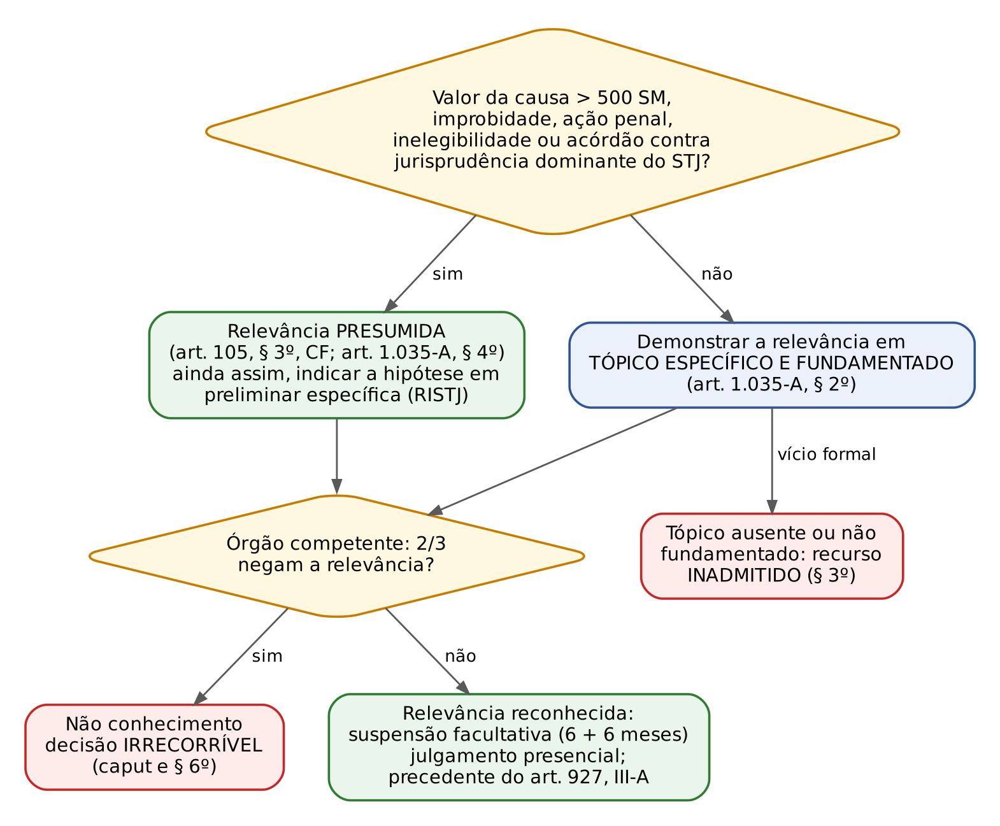
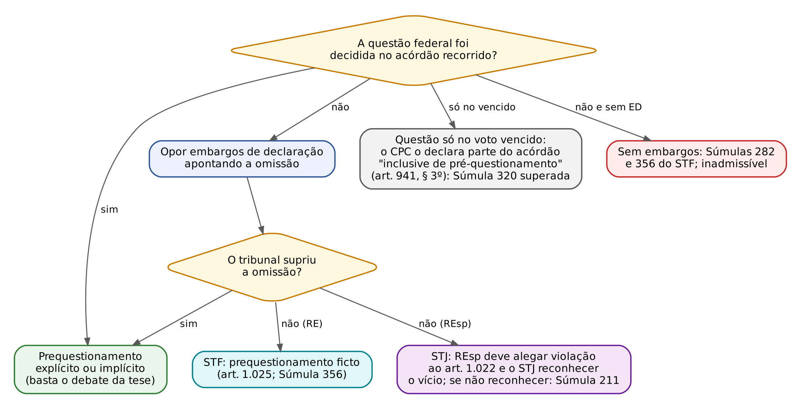
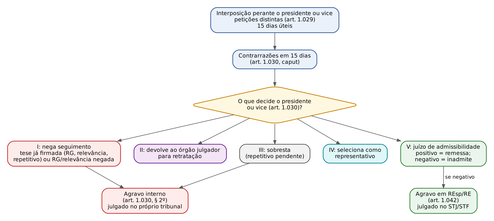
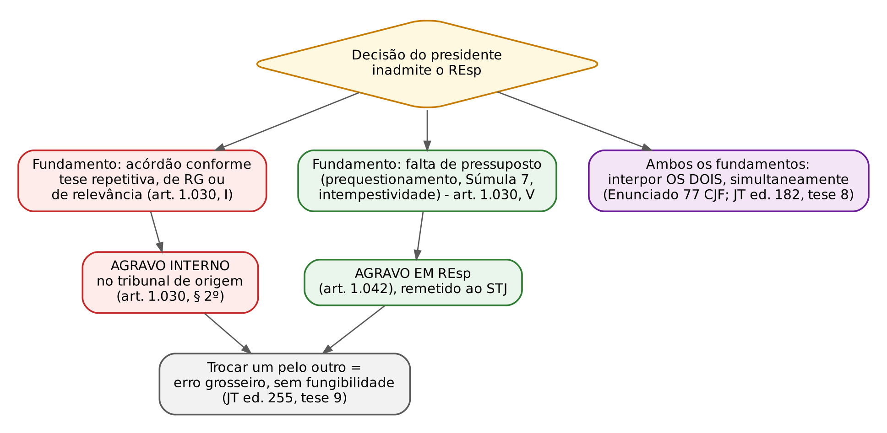
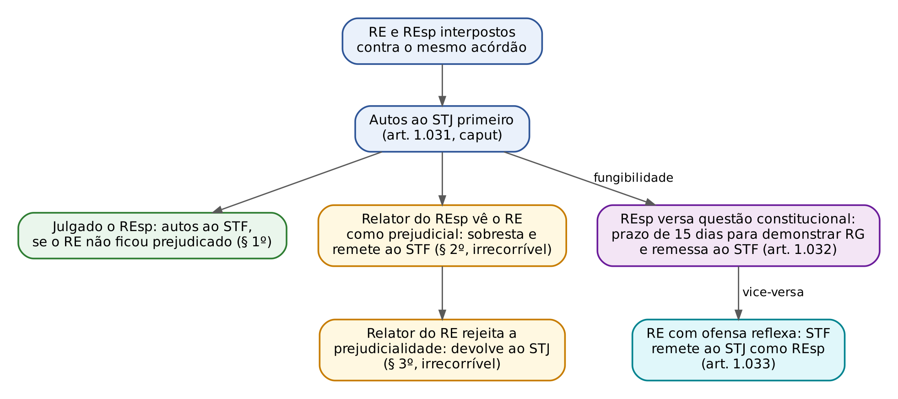
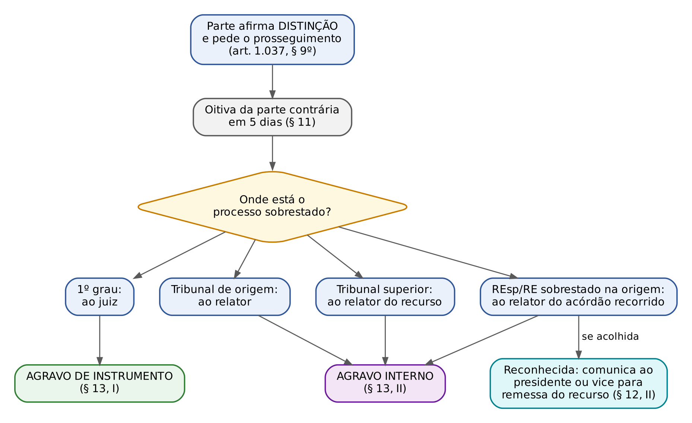
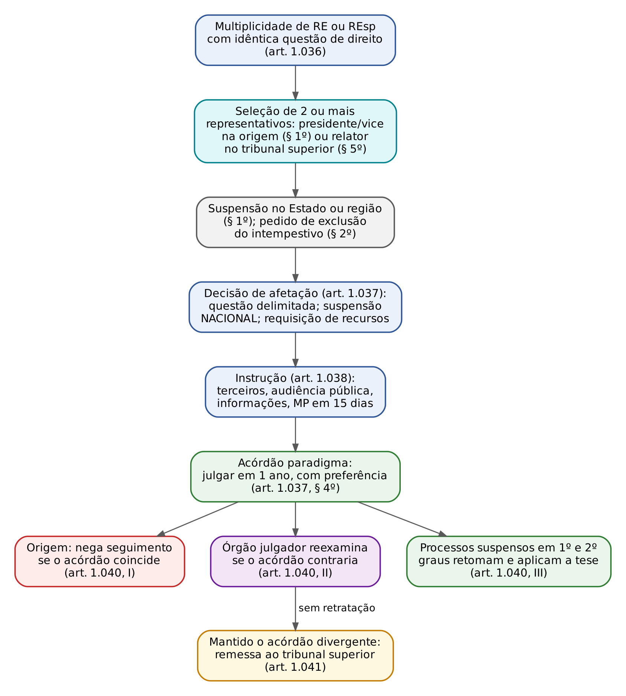
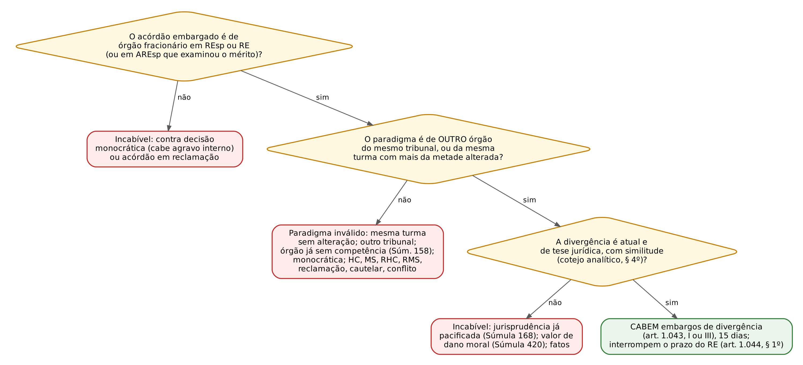

# CAPÍTULO 43 — RECURSOS EXCEPCIONAIS: RECURSO ESPECIAL E EXTRAORDINÁRIO, RELEVÂNCIA, REPERCUSSÃO GERAL, REPETITIVOS E EMBARGOS DE DIVERGÊNCIA

:::INCIDENCIA
TRF5 p. 16 e 17; TJRS p. 20; TJSC p. 16. Nível A+. Lote: 22 questões (FGV 17, FCC 5), mais correlatas do banco inteiro (TJ-CE, TJ-MT, PGE-TO).
O que mais cai: recurso cabível contra a decisão do presidente ou vice na origem (agravo interno x agravo do art. 1.042, inclusive a dupla impugnação), prequestionamento ficto (art. 1.025), sobrestamento e distinção nos repetitivos, presunções e procedimento da repercussão geral, fungibilidade entre RE e REsp (arts. 1.032 e 1.033), embargos de divergência com paradigma da mesma turma. Novidade de 2026: relevância da questão federal (Lei 15.484/2026).
:::

| Subtema | FGV | FCC | Padrão de cobrança |
|---|---|---|---|
| Decisão do presidente ou vice: agravo interno x AREsp | 2 | 1 | caso com dupla fundamentação; sobrestamento recorrível por agravo interno |
| Prequestionamento (ficto, embargos rejeitados, Súmulas 282 e 356) | 2 | 0 | letra do art. 1.025 em caso prático |
| Repercussão geral (presunções, suspensão, ata, terceiros, quórum) | 2 | 2 | letra do art. 1.035; suspensão não automática |
| Repetitivos: seleção, sobrestamento, retratação, distinção | 3 | 1 | art. 1.036, § 4º; art. 1.040, II; art. 1.037, § 13 |
| Fungibilidade RE x REsp e interposição conjunta | 3 | 0 | arts. 1.031 a 1.033 |
| Cabimento do REsp (divergência, valoração da prova, MS, súmulas) | 4 | 1 | cotejo analítico; Súmula 7 x valoração jurídica; interpretação divergente entre câmaras |
| Cabimento do RE (decisão monocrática, turma recursal) | 1 | 0 | Súmula 281 do STF |
| Embargos de divergência | 1 | 0 | art. 1.043, § 3º; art. 1.044, § 2º |
| Regularidade formal (procuração) | 1 | 0 | art. 76, § 2º, e Súmula 115 do STJ |

Este capítulo é o terceiro do bloco recursal. A teoria geral (prazo, preparo, tempestividade, feriado local, efeitos, desistência) está no Cap. 41; os embargos de declaração, a multa por embargos protelatórios e o agravo interno como recurso, no Cap. 42; o sistema de precedentes, o IRDR, a distinção e a superação em perspectiva geral, no Cap. 39; a reclamação, no Cap. 40; os poderes do relator (art. 932), no Cap. 38. Aqui fica tudo o que é específico das vias excepcionais: cabimento constitucional, filtros (relevância e repercussão geral), prequestionamento, súmulas de admissibilidade, juízo de admissibilidade na origem, técnica dos repetitivos, agravo do art. 1.042 e embargos de divergência.

## 43.1 Recursos excepcionais: o que os distingue

### 43.1.1 Função e consequências práticas

O recurso especial (REsp) e o recurso extraordinário (RE) não existem para fazer justiça no caso concreto, e sim para tutelar a integridade e a uniformidade do direito objetivo federal (STJ) e constitucional (STF). Dessa função nomofilácica e paradigmática derivam todas as regras que a banca cobra:

- só se discute questão de direito: o fato é o que o acórdão recorrido fixou (Súmula 7 do STJ: "A pretensão de simples reexame de prova não enseja recurso especial"; Súmula 279 do STF, idem para o RE);
- exige-se causa decidida em única ou última instância, o que pressupõe esgotamento das vias ordinárias (Súmula 281 do STF);
- a questão federal ou constitucional precisa ter sido decidida pelo tribunal de origem (prequestionamento, ver 43.6);
- a fundamentação é vinculada às hipóteses constitucionais (art. 102, III, e art. 105, III, da CF): não basta o inconformismo, é preciso enquadrar o vício numa alínea;
- o efeito devolutivo é restrito à questão federal ou constitucional, embora, admitido o recurso, o tribunal julgue a causa aplicando o direito (art. 1.034 do CPC; Súmula 456 do STF);
- não têm efeito suspensivo automático (art. 995 do CPC; pedido de efeito suspensivo pelo art. 1.029, § 5º, ver 43.8.6);
- há filtros de transcendência: repercussão geral para o RE (desde a EC 45/2004) e relevância da questão de direito federal para o REsp (EC 125/2022, regulamentada pela Lei 15.484/2026).

:::ESQUEMA RECURSO ESPECIAL X RECURSO EXTRAORDINÁRIO
| Aspecto | Recurso especial | Recurso extraordinário |
|---|---|---|
| Base constitucional | art. 105, III, CF | art. 102, III, CF |
| Questão | direito federal infraconstitucional (lei federal ou tratado) | questão constitucional |
| Origem possível | SOMENTE acórdão de TRF ou de TJ (e do TJDFT) | qualquer órgão que decida em única ou última instância, inclusive turma recursal e juiz de primeiro grau em causa de alçada (Súmula 640 do STF) |
| Divergência jurisprudencial | é hipótese própria (alínea c) | não há alínea de divergência (Súmula 369 do STF: julgados do mesmo tribunal não servem) |
| Filtro | relevância da questão de direito federal (art. 105, §§ 2º e 3º, CF; art. 1.035-A do CPC) | repercussão geral (art. 102, § 3º, CF; art. 1.035 do CPC) |
| Quórum para recusar | 2/3 dos membros do ÓRGÃO competente para o julgamento | 2/3 dos membros do TRIBUNAL |
| Suspensão nacional após reconhecer o filtro | o relator "poderá", por 6 meses prorrogáveis uma vez (art. 1.035-A, § 7º) | o relator "determinará" (art. 1.035, § 5º), mas o STF a lê como providência não automática |
| Prazo | 15 dias úteis (art. 1.003, § 5º) | 15 dias úteis |
| Interposição | perante o presidente ou vice do tribunal recorrido, em petição distinta (art. 1.029) | idem |
:::

### 43.1.2 Causa decidida em única ou última instância

"Causa" abrange qualquer decisão definitiva sobre questão de direito, ainda que interlocutória: cabe REsp contra acórdão que julga agravo de instrumento (Súmula 86 do STJ). Mas a instância tem de estar esgotada. Duas consequências que caem:

- Decisão monocrática do relator não é "última instância": contra ela cabe agravo interno (art. 1.021). O RE ou o REsp interposto diretamente contra a monocrática é inadmissível (Súmula 281 do STF; o mesmo raciocínio vale no STJ). O antigo Tema 434 do STJ afastava a multa do agravo interposto só para esgotar a instância, mas foi REVISTO pelo Tema 1.201: contra decisão baseada em precedente qualificado do STJ ou do STF, a multa do art. 1.021, § 4º, é aplicável, salvo se alegada fundamentadamente distinção ou superação, ou se a decisão agravada se amparar em julgado de tribunal de segundo grau (v. Cap. 42, 42.3.3).
- Embargos de declaração julgados contra a monocrática NÃO esgotam a instância, nem se julgados pelo colegiado sem que haja agravo interno, nem se julgados monocraticamente contra acórdão (Jurisprudência em Teses do STJ, ed. 190, teses 8 e 9).

:::QUESTAO FGV 2025 — TJ-SC — JUIZ SUBSTITUTO (Q3324237)
Pedia-se o provimento que "nem sequer em tese" admite RE. Gabarito E: a decisão do RELATOR que negou provimento a apelação contrária a súmula do STF. Ela é monocrática e desafia agravo interno, de modo que não é causa decidida em última instância (Súmula 281 do STF). As demais alternativas descrevem acórdãos que, em tese, admitem RE: órgão fracionário que julga a apelação depois do incidente de arguição de inconstitucionalidade; acórdão que julga rescisória (juízos rescindente e rescisório); acórdão em MS originário que CONCEDE a ordem (concessivo não desafia recurso ordinário, art. 105, II, b, só o denegatório); turma recursal de juizado (Súmula 640 do STF). Armadilha: a alternativa A sugere que a reserva de plenário impede o RE contra o órgão fracionário; não impede, pois é o acórdão do fracionário, integrado pela decisão do pleno, que encerra a causa.
:::

### 43.1.3 Questão de direito: reexame x valoração jurídica da prova

A Súmula 7 do STJ e a Súmula 279 do STF vedam o REEXAME do conjunto probatório, isto é, refazer o juízo sobre a ocorrência dos fatos. Não vedam o exame da VALORAÇÃO jurídica da prova: saber se determinado meio de prova é admissível, que eficácia a lei lhe atribui, se o tribunal violou regra de distribuição do ônus ou de valoração legal (por exemplo, a força probante de documento público, art. 405 do CPC). Isso é questão de direito federal (normas do CPC e do CC sobre prova), sindicável por REsp.

O mesmo se diga da qualificação jurídica de fatos incontroversos descritos no acórdão: tomar os fatos como fixados e discutir se configuram, por exemplo, dano moral indenizável ou culpa grave é questão de direito. Já rediscutir se houve incapacidade laboral, sua extensão ou duração é reexame (STJ, Tema 1.246). O mesmo filtro explica a Súmula 5 do STJ (simples interpretação de cláusula contratual não enseja REsp) e a Súmula 454 do STF: a interpretação do contrato é questão de fato-vontade das partes; a definição da natureza jurídica do contrato ou da validade de cláusula à luz da lei federal é questão de direito.

:::QUESTAO FGV 2026 — TJ-MS — OUTORGA DE DELEGAÇÕES (Q3914304)
Tabelião lavrou ata notarial atestando quitação à vista de recibo; as instâncias ordinárias negaram à ata valor de prova do pagamento. O REsp alegou violação das normas de direito probatório quanto à valoração da ata. Gabarito A: cabível, porque se discute a VALORAÇÃO jurídica do meio de prova (eficácia legal da ata notarial, arts. 384 e 405 do CPC), e não o reexame dos fatos. A alternativa D (incabível pela Súmula 7) é a armadilha clássica: só seria correta se o recorrente pretendesse que o STJ revisse se houve ou não pagamento.
:::

:::DICA COMO RECONHECER A SÚMULA 7 NO ENUNCIADO
Verbos como "rever", "reapreciar", "concluir de modo diverso do tribunal quanto à existência" indicam reexame (incabível). Expressões como "eficácia legal do documento", "admissibilidade da prova", "ônus da prova", "qualificação jurídica dos fatos descritos no acórdão" indicam questão de direito (cabível). A FGV costuma oferecer "cabível, porque admite reexame de provas" como alternativa errada e "cabível, porque há violação de norma de direito probatório" como correta.
:::

## 43.2 Recurso especial: hipóteses de cabimento

:::LEI CF, ART. 105, III (E §§ 2º E 3º, EC 125/2022)
III - julgar, em recurso especial, as causas decididas, em única ou última instância, pelos Tribunais Regionais Federais ou pelos tribunais dos Estados, do Distrito Federal e Territórios, quando a decisão recorrida:
a) contrariar tratado ou lei federal, ou negar-lhes vigência;
b) julgar válido ato de governo local contestado em face de lei federal;
c) der a lei federal interpretação divergente da que lhe haja atribuído outro tribunal.
§ 2º No recurso especial, o recorrente deve demonstrar a relevância das questões de direito federal infraconstitucional discutidas no caso, nos termos da lei, a fim de que a admissão do recurso seja examinada pelo Tribunal, o qual somente pode dele não conhecer com base nesse motivo pela manifestação de 2/3 (dois terços) dos membros do órgão competente para o julgamento.
:::

### 43.2.1 O órgão recorrido: só TRF e TJ

O texto constitucional é restritivo: "pelos Tribunais Regionais Federais ou pelos tribunais dos Estados, do Distrito Federal e Territórios". Daí:

- Não cabe REsp contra acórdão de turma recursal (Súmula 203 do STJ: "Não cabe recurso especial contra decisão proferida por órgão de segundo grau dos Juizados Especiais"). No JEF, a divergência com a jurisprudência do STJ resolve-se pelo pedido de uniformização, que pode chegar ao STJ (art. 14, § 4º, da Lei 10.259/2001; ver Cap. 37); nos juizados da Fazenda Pública, pelo pedido de uniformização da Lei 12.153/2009 (Cap. 36). No JEC estadual, a via residual para garantir a jurisprudência do STJ foi, historicamente, a reclamação, hoje sujeita à disciplina própria (Cap. 40).
- Cabe RE contra a mesma turma recursal (Súmula 640 do STF), porque o art. 102, III, não exige "tribunal" (Súmulas 203 do STJ e 640 do STF: v. Cap. 37).

:::QUESTAO FGV 2026 — TRF-2 — JUIZ FEDERAL SUBSTITUTO (Q3996865, CORRELATA DO CAP. 37)
Turma recursal do JEF manteve sentença previdenciária; o INSS alegava divergência com jurisprudência consolidada do STJ. Gabarito B: a divergência com o STJ pode ensejar pedido de uniformização, que em determinadas hipóteses chega ao próprio STJ. Errada a A (REsp direto contra turma recursal: Súmula 203) e a E (só o STF poderia rever): o RE cabe na matéria constitucional, mas não é a única via.
:::

### 43.2.2 Alínea a: contrariar ou negar vigência a tratado ou lei federal

"Lei federal" abrange lei ordinária, lei complementar, medida provisória, decreto-lei e decreto regulamentar federal autônomo; tratado internalizado. NÃO abrange (Jurisprudência em Teses do STJ, ed. 31, tese 12): resoluções, portarias, instruções normativas, circulares, regimentos internos (Súmula 399 do STF, lida hoje para o REsp) e enunciados de súmula (Súmula 518 do STJ: "Para fins do art. 105, III, a, da Constituição Federal, não é cabível recurso especial fundado em alegada violação de enunciado de súmula"). O recorrente deve indicar com precisão o DISPOSITIVO violado e explicar por quê; a indicação genérica ou de dispositivo que não ampara a tese torna o recurso deficiente (ed. 33, teses 7, 10, 13 e 15), atraindo, por analogia, a Súmula 284 do STF ("É inadmissível o recurso extraordinário, quando a deficiência na sua fundamentação não permitir a exata compreensão da controvérsia").

:::PEGADINHA LEI LOCAL E DIREITO LOCAL
Ofensa a lei estadual ou municipal não abre REsp nem RE (Súmula 280 do STF: "Por ofensa a direito local não cabe recurso extraordinário"). O conflito entre ATO de governo local e lei federal abre REsp (art. 105, III, b); o conflito entre LEI local e lei federal abre RE (art. 102, III, d, desde a EC 45/2004), porque envolve repartição constitucional de competência legislativa. Ato local x lei federal = STJ; lei local x lei federal = STF.
:::

### 43.2.3 Alínea c: divergência jurisprudencial

O dissídio precisa ser com OUTRO tribunal (Súmula 13 do STJ: "A divergência entre julgados do mesmo Tribunal não enseja recurso especial"); a uniformização interna faz-se pelos mecanismos do próprio tribunal (IRDR, IAC, art. 926). Requisitos formais (art. 1.029, § 1º): prova da divergência por certidão, cópia ou citação de repositório oficial ou credenciado, ou reprodução de julgado disponível na internet com indicação da fonte, e, em qualquer caso, menção às circunstâncias que identifiquem ou assemelhem os casos confrontados, o chamado cotejo analítico. A transcrição de ementas não basta.

Duas restrições jurisprudenciais: a divergência deve ser atual, de modo que não se conhece do REsp pela alínea c "quando a orientação do Tribunal se firmou no mesmo sentido da decisão recorrida" (Súmula 83 do STJ; no STF, Súmula 286); e a Súmula 83 é aplicada pelo STJ também ao recurso pela alínea a, quando o acórdão está alinhado à sua jurisprudência.

:::QUESTAO FGV 2024 — EPE — ADVOGADO (Q2759003)
Município, vencido em apelação, interpôs REsp por dissídio. Gabarito E: cabe ao recorrente provar a divergência e mencionar as circunstâncias que identifiquem ou assemelhem os casos confrontados (art. 1.029, § 1º). Erradas: B (cumprimento DEFINITIVO com precatório na pendência do REsp: a execução seria provisória e a expedição de precatório exige trânsito em julgado, art. 100, § 5º, da CF e art. 535, § 3º, do CPC; ver Cap. 27); C (se o relator no STJ entender que a matéria é constitucional, NÃO inadmite liminarmente: aplica o art. 1.032, ver 43.8.5); D (responsabilidade pela tutela revogada é objetiva, art. 302).
:::

:::QUESTAO FCC 2024 — PGE-GO — PROCURADOR DO ESTADO (Q2654938)
A 2ª Câmara do TJ adotou a interpretação Y de lei federal; a 1ª Câmara do mesmo tribunal já adotara a interpretação X. Gabarito E: recurso especial pela contrariedade à lei federal (alínea a), porque a interpretação Y viola o dispositivo. Armadilhas: embargos de divergência (só nos tribunais superiores, art. 1.043); "pedido de uniformização" (não há recurso com esse nome no CPC/2015 para a divergência interna entre câmaras do TJ; a antiga uniformização de jurisprudência do CPC/1973 desapareceu); REsp pela alínea c com paradigma do mesmo tribunal (Súmula 13 do STJ). Note que a FCC exigiu a alínea a precisamente porque a c estava bloqueada.
:::

### 43.2.4 Recurso especial contra acórdão em mandado de segurança

Contra acórdão de TJ ou TRF em MS de competência ORIGINÁRIA, a escolha depende do resultado: denegatório (inclusive extinção sem mérito) = recurso ordinário ao STJ (art. 105, II, b, CF; Cap. 42); concessivo = REsp e/ou RE. Contra acórdão em APELAÇÃO no MS (impetrado em primeiro grau), cabe REsp ou RE, nunca recurso ordinário, seja qual for o resultado.

:::QUESTAO FGV 2024 — TJ-AP — ANALISTA JUDICIÁRIO (Q2442315)
MS impetrado em primeiro grau, segurança denegada, apelação desprovida; dez dias após a intimação, o impetrante quer impugnar o acórdão. Gabarito B: recurso especial (prazo de 15 dias úteis ainda em curso). O recurso ordinário só cabe contra denegação em ÚNICA instância pelo tribunal (competência originária). No mesmo sentido, quanto à alternativa D da Q3058652 (ENAM): se denegada a ordem em apelação, não caberia recurso ordinário.
:::

No mesmo sentido, para o MS originário CONCEDIDO: Q3505782 (FGV 2025, TJ-CE, Juiz Substituto), gabarito E: RE contra acórdão concessivo alegando ofensa reflexa à legalidade é incabível, mas o STF pode remetê-lo ao STJ como REsp (art. 1.033); resolução em passos no Cap. 42 (42.5.2).

## 43.3 Relevância da questão de direito federal infraconstitucional (EC 125/2022 e Lei 15.484/2026)

### 43.3.1 Estado normativo em novembro de 2026

A EC 125/2022 inseriu os §§ 2º e 3º no art. 105 da CF, criando para o REsp um filtro análogo à repercussão geral, mas condicionou sua operação à lei ("nos termos da lei"). Enquanto não havia lei, o STJ não aplicou o filtro: o Pleno aprovou, em 19/10/2022, o Enunciado Administrativo 8, segundo o qual a indicação da relevância só seria exigida nos recursos contra acórdãos publicados após a entrada em vigor da lei regulamentadora.

A regulamentação veio com a Lei 15.484, de 4/8/2026 (DOU de 4/8/2026, edição extra), com vigência após 30 dias da publicação (art. 7º), isto é, a partir de 3/9/2026 pela contagem do art. 8º, § 1º, da LC 95/1998. A lei: (i) criou o art. 1.035-A do CPC; (ii) alterou os arts. 927 (novo inciso III-A), 932, IV, b, e V, b, 979, § 3º, 988 (inciso V e §§ 4º e 5º), 998, parágrafo único, 1.030, 1.039, parágrafo único, e 1.042 (caput e § 2º); (iii) fixou o direito intertemporal (art. 4º) e a eficácia da deliberação (art. 5º); (iv) delegou ao Regimento Interno do STJ as normas de execução (art. 6º). O STJ editou a Emenda Regimental 55/2026 ao RISTJ para disciplinar os ritos (ver 43.3.5).

:::LEI CPC, ART. 1.035-A (INCLUÍDO PELA LEI 15.484/2026)
Art. 1.035-A. O Superior Tribunal de Justiça, em decisão irrecorrível, não conhecerá do recurso especial quando a questão de direito federal infraconstitucional nele versada não for relevante, nos termos deste artigo.
§ 1º A deliberação a que se refere o caput deste artigo considerará a existência ou não de questões relevantes do ponto de vista econômico, político, social ou jurídico que ultrapassem os interesses subjetivos do processo.
§ 2º O recorrente deverá demonstrar a existência da relevância da questão de direito federal infraconstitucional para apreciação exclusiva pelo Superior Tribunal de Justiça, em tópico específico e fundamentado.
§ 3º Desatendida a forma prevista no § 2º, o recurso será inadmitido.
§ 4º Presume-se a relevância da questão de direito federal infraconstitucional nas hipóteses do art. 105, § 3º, da Constituição Federal.
§ 5º O relator poderá admitir, na análise da relevância da questão de direito federal infraconstitucional, a manifestação de terceiros subscrita por procurador habilitado.
§ 6º Somente não se conhecerá do recurso especial, nos termos do caput, pela manifestação de inexistência de relevância por parte de 2/3 (dois terços) dos membros do órgão competente para o julgamento.
§ 7º Reconhecida a relevância da questão de direito federal infraconstitucional, o relator no Superior Tribunal de Justiça poderá, mediante justificativa, determinar a suspensão, total ou parcial, do processamento de todos os processos pendentes, individuais ou coletivos, que versem sobre a questão e tramitem no território nacional, pelo prazo de 6 (seis) meses, prorrogável, uma única vez, por mais 6 (seis) meses quando houver a necessidade de audiência pública ou a participação de terceiros.
§ 8º O julgamento de recurso especial sob o regime da relevância da questão de direito federal infraconstitucional será realizado em sessão presencial, salvo se o voto do relator for no sentido de não reconhecer a relevância ou de reafirmar a jurisprudência dominante do Tribunal.
:::

### 43.3.2 Demonstração e presunções

Dois planos não se confundem. No plano FORMAL, o recorrente deve dedicar tópico específico e fundamentado à relevância; sem ele, o recurso é inadmitido (§§ 2º e 3º). Esse juízo formal pode ser feito pelo presidente ou vice na origem e pelo relator, porque não se confunde com a deliberação sobre a inexistência de relevância. No plano SUBSTANCIAL, só o STJ, pelo quórum qualificado, pode dizer que a questão NÃO é relevante (§ 6º e art. 105, § 2º, da CF): "apreciação exclusiva pelo Superior Tribunal de Justiça" (§ 2º).

As presunções são constitucionais (art. 105, § 3º, CF), e o § 4º do art. 1.035-A apenas remete a elas:

| Inciso do art. 105, § 3º, CF | Hipótese de relevância presumida |
|---|---|
| I | ações penais |
| II | ações de improbidade administrativa |
| III | ações cujo valor da causa ultrapasse 500 (quinhentos) salários mínimos |
| IV | ações que possam gerar inelegibilidade |
| V | acórdão recorrido que contrariar jurisprudência dominante do STJ |
| VI | outras hipóteses previstas em lei (a Lei 15.484/2026 NÃO criou novas) |

Segundo a disciplina regimental noticiada, mesmo nas hipóteses presumidas o recorrente deve apontar, em preliminar, a hipótese de presunção em que se enquadra, sob pena de não conhecimento (arts. 21-E, V-A, e 34, XVIII, "a", do RISTJ, na redação da ER 55/2026, segundo a fonte doutrinária consultada; o art. 255-K, § 1º, trata de outra coisa: permite que os casos de relevância presumida sigam o procedimento ordinário bifásico). A presunção dispensa a ARGUMENTAÇÃO sobre transcendência, não a indicação.

:::PEGADINHA REPERCUSSÃO GERAL X RELEVÂNCIA: AS PRESUNÇÕES SÃO DIFERENTES
Na repercussão geral, as presunções estão na LEI (art. 1.035, § 3º, do CPC): acórdão que contraria súmula ou jurisprudência dominante do STF e acórdão que reconheceu a inconstitucionalidade de tratado ou lei federal nos termos do art. 97 da CF (o inciso II, "julgamento de casos repetitivos", foi revogado pela Lei 13.256/2016). Na relevância, estão na CONSTITUIÇÃO (art. 105, § 3º) e incluem critérios objetivos que a repercussão geral não tem (valor da causa acima de 500 salários mínimos, natureza penal ou de improbidade, risco de inelegibilidade). Outra presunção de repercussão geral, fora do art. 1.035: a do RE contra o mérito do IRDR (art. 987, § 1º; Cap. 39).
:::

### 43.3.3 Quórum, irrecorribilidade, terceiros e suspensão

- Quórum: 2/3 dos membros do ÓRGÃO competente para o julgamento (não do tribunal, como no RE). Relevância é presumida até prova em contrário, por assim dizer: basta que mais de 1/3 do órgão a reconheça para o recurso seguir.
- A decisão que não conhece por ausência de relevância é IRRECORRÍVEL (caput), como na repercussão geral (art. 1.035, caput). Cabem, quando muito, embargos de declaração, que não são impugnação de mérito.
- Terceiros: o relator "poderá" admitir manifestação de terceiros, subscrita por procurador habilitado (§ 5º); redação praticamente idêntica ao art. 1.035, § 4º.
- Suspensão: FACULTATIVA, "mediante justificativa", total ou parcial, pelo prazo de 6 meses, prorrogável uma única vez por mais 6 quando houver necessidade de audiência pública ou participação de terceiros (§ 7º). É regra mais detalhada que a da repercussão geral, que não tem prazo de suspensão (o antigo § 10 do art. 1.035 foi revogado).
- Sessão presencial obrigatória (§ 8º), salvo voto do relator pelo não reconhecimento ou pela reafirmação de jurisprudência dominante.

### 43.3.4 Efeitos sistêmicos: o que a Lei 15.484/2026 mudou fora do art. 1.035-A

| Dispositivo | Mudança |
|---|---|
| art. 927, III-A | acórdãos em REsp submetido ao regime da relevância passam a ser de observância obrigatória |
| art. 932, IV, b, e V, b | o relator pode negar ou dar provimento monocraticamente com base em acórdão de REsp com relevância reconhecida (Cap. 38) |
| art. 979, § 3º | publicidade e cadastro aplicam-se também ao REsp com relevância reconhecida (Cap. 39) |
| art. 988, V e §§ 4º e 5º | reclamação, "em casos excepcionais", para garantir acórdão de REsp sob o regime de relevância; liminarmente indeferida sem esgotamento das instâncias ordinárias ou se o ato não estiver "manifestamente em desacordo" com o precedente (Cap. 40) |
| art. 998, parágrafo único | a desistência do recurso não impede a análise de questão cuja relevância já tenha sido reconhecida |
| art. 1.030, I, c | a origem nega seguimento ao REsp cuja questão o STJ não tenha considerado relevante ou interposto contra acórdão conforme o entendimento firmado no regime de relevância |
| art. 1.030, II e V, a | retratação também quando o acórdão diverge de entendimento firmado na relevância; o juízo de admissibilidade com remessa pressupõe recurso ainda não submetido ao regime |
| art. 1.039, parágrafo único | negada a relevância no REsp afetado, os REsp sobrestados consideram-se AUTOMATICAMENTE inadmitidos |
| art. 1.042, caput e § 2º | não cabe AREsp contra inadmissão fundada em entendimento firmado no regime de relevância (cabe agravo interno); ao AREsp aplica-se o regime de relevância, inclusive sobrestamento e retratação |

### 43.3.5 Direito intertemporal e disciplina regimental

O art. 4º da Lei 15.484/2026 é o ponto de prova mais provável: a indicação da relevância em tópico específico "será exigida em recursos interpostos contra ACÓRDÃOS PUBLICADOS após a data de entrada em vigor desta Lei". O marco é a publicação do acórdão recorrido, não a data da interposição do REsp nem do ajuizamento da ação (mesma lógica do Enunciado Administrativo 8). Em contrapartida, o art. 5º manda que os efeitos processuais e materiais do reconhecimento ou da recusa da relevância incidam "em processos em andamento" no STJ e nas instâncias de origem.

Pela Emenda Regimental 55/2026 (precedida da ER 53/2026, de julho de 2026, que preparou a estrutura do filtro), segundo a doutrina e o noticiário especializados: há duas técnicas de julgamento, a da formação de precedente qualificado, via preferencial (Corte Especial e Seções, com procedimento ordinário bifásico, fase de relevância em plenário virtual de sete dias corridos e mérito em sessão presencial, ou procedimento sumário de reafirmação quando houver jurisprudência dominante), e a do julgamento com efeito apenas para o caso concreto (Turmas, sem tese vinculante; não formados os 2/3 para rejeitar a relevância, o recurso é redistribuído a ministro sorteado entre os divergentes); a exclusão da relevância exige 2/3 do colegiado, e a afirmação da incompetência do STJ, maioria absoluta; Presidência e relatores não podem, sozinhos, declarar a ausência de relevância; os temas seguem a numeração dos repetitivos; repetitivos já afetados consideram-se, em regra, com relevância reconhecida; as Súmulas 5, 7 e 83 continuam aplicáveis. Esses pormenores regimentais são recentes e devem ser conferidos no texto oficial antes de prova discursiva (ver nota final).

:::ESQUEMA REPERCUSSÃO GERAL X RELEVÂNCIA DA QUESTÃO FEDERAL
| Ponto | Repercussão geral (RE) | Relevância (REsp) |
|---|---|---|
| Fonte | art. 102, § 3º, CF (EC 45/2004); art. 1.035 do CPC | art. 105, §§ 2º e 3º, CF (EC 125/2022); art. 1.035-A do CPC (Lei 15.484/2026) |
| Critério | questões relevantes do ponto de vista econômico, político, social ou jurídico que ultrapassem os interesses subjetivos | idêntico (§ 1º) |
| Demonstração | "deverá demonstrar" (§ 2º); preliminar formal exigida pelo RISTF | em "tópico específico e fundamentado" (§ 2º); sem ele, inadmissão (§ 3º) |
| Presunções | legais: súmula ou jurisprudência dominante do STF; inconstitucionalidade de tratado ou lei federal (art. 97) | constitucionais: penal, improbidade, mais de 500 SM, inelegibilidade, jurisprudência dominante do STJ, outras em lei |
| Quórum de recusa | 2/3 dos membros do Tribunal | 2/3 dos membros do órgão competente |
| Recorribilidade | irrecorrível | irrecorrível |
| Terceiros | relator pode admitir (§ 4º) | relator pode admitir (§ 5º) |
| Suspensão | "determinará" (§ 5º), sem prazo legal; não automática para o STF | "poderá", com justificativa, 6 + 6 meses (§ 7º) |
| Prazo de julgamento | 1 ano, com preferência (§ 9º) | não previsto no art. 1.035-A |
| Ata | súmula da decisão em ata publicada vale como acórdão (§ 11) | não previsto no artigo |
| Sessão | segue o RISTF (plenário virtual) | presencial, salvo voto do relator pela inexistência ou pela reafirmação |
| Efeito da recusa no sobrestado | origem nega seguimento (§ 8º; art. 1.039, parágrafo único) | inadmissão automática dos sobrestados (art. 1.039, parágrafo único) |
| Precedente obrigatório | via art. 927, III (repetitivos), e o STF trata a tese de RG como vinculante | art. 927, III-A |
:::

:::PRATIQUE RELEVÂNCIA DA QUESTÃO FEDERAL (EXERCÍCIOS ELABORADOS PARA ESTA APOSTILA, NÃO SÃO QUESTÕES DE BANCA)
1. Acórdão do TJSC publicado em 20/8/2026; REsp interposto em 10/9/2026, sem tópico de relevância. Pode o vice-presidente inadmiti-lo com base no art. 1.035-A, § 3º? Resolução: não. A exigência alcança recursos contra acórdãos publicados após a entrada em vigor da lei (art. 4º), que ocorreu em 3/9/2026; o acórdão foi publicado antes. A data da interposição é irrelevante.
2. Ação de cobrança com valor da causa de 600 salários mínimos; o REsp, contra acórdão publicado em outubro de 2026, não traz uma linha sobre relevância. Resolução: a relevância é presumida (art. 105, § 3º, III, CF), mas, segundo o regimento noticiado, a hipótese de presunção deve ser indicada em preliminar; a omissão total leva ao não conhecimento. A presunção dispensa demonstrar a transcendência, não o ônus de invocá-la.
3. A Turma do STJ, por 3 votos a 2, afirma que a questão não é relevante. Resolução: não há quórum de 2/3 (seriam necessários 4 de 5); o recurso não pode deixar de ser conhecido por esse motivo (art. 1.035-A, § 6º). Se fosse alcançado o quórum, a decisão seria irrecorrível.
:::

## 43.4 Recurso extraordinário: hipóteses de cabimento

:::LEI CF, ART. 102, III, E § 3º
III - julgar, mediante recurso extraordinário, as causas decididas em única ou última instância, quando a decisão recorrida:
a) contrariar dispositivo desta Constituição;
b) declarar a inconstitucionalidade de tratado ou lei federal;
c) julgar válida lei ou ato de governo local contestado em face desta Constituição.
d) julgar válida lei local contestada em face de lei federal.
§ 3º No recurso extraordinário o recorrente deverá demonstrar a repercussão geral das questões constitucionais discutidas no caso, nos termos da lei, a fim de que o Tribunal examine a admissão do recurso, somente podendo recusá-lo pela manifestação de dois terços de seus membros.
:::

### 43.4.1 As quatro alíneas e a lógica de cada uma

- Alínea a: contrariedade DIRETA à Constituição. A ofensa reflexa, que só se verifica depois de interpretar a lei infraconstitucional, não abre RE (Súmula 636 do STF: "Não cabe recurso extraordinário por contrariedade ao princípio constitucional da legalidade, quando a sua verificação pressuponha rever a interpretação dada a normas infraconstitucionais pela decisão recorrida"). É o campo do art. 1.033 (conversão em REsp).
- Alínea b: o acórdão DECLARA a inconstitucionalidade de tratado ou lei federal. Aqui a repercussão geral é presumida se a declaração observou o art. 97 da CF (art. 1.035, § 3º, III).
- Alínea c: o acórdão julga VÁLIDA lei ou ato de governo local contestado em face da Constituição.
- Alínea d: o acórdão julga válida LEI local contestada em face de lei federal (conflito de competência legislativa; ver a PEGADINHA de 43.2.2).

### 43.4.2 Única ou última instância, sem exigência de "tribunal"

Porque o art. 102, III, não fala em tribunal, cabe RE contra decisão de turma recursal de juizado e contra decisão de juiz de primeiro grau em causa de alçada (Súmula 640 do STF; no processo civil, o exemplo vivo é a execução fiscal de valor até 50 ORTN, art. 34 da LEF, em que só cabem embargos infringentes ao próprio juízo e, depois, RE; ver Apostila de Direito Tributário). Súmula 727 do STF: o magistrado não pode deixar de encaminhar ao STF o agravo contra a inadmissão do RE, "ainda que referente a causa instaurada no âmbito dos juizados especiais".

### 43.4.3 Restrições sumuladas ao cabimento do RE

| Súmula do STF | Regra | Por quê |
|---|---|---|
| 279 | não cabe RE para simples reexame de prova | questão de fato |
| 280 | não cabe RE por ofensa a direito local | não é questão constitucional |
| 281 | inadmissível RE quando cabível recurso ordinário na origem | falta de esgotamento |
| 282 | inadmissível RE quando não ventilada a questão federal na decisão recorrida | prequestionamento (43.6) |
| 283 | inadmissível RE quando a decisão assenta em mais de um fundamento suficiente e o recurso não abrange todos | fundamento autônomo não impugnado mantém o acórdão |
| 284 | inadmissível RE com fundamentação deficiente que impeça a compreensão da controvérsia | fundamentação vinculada |
| 356 | ponto omisso sem embargos declaratórios não prequestiona | prequestionamento |
| 454 | simples interpretação de cláusula contratual não dá lugar a RE | questão de fato-vontade |
| 636 | ofensa ao princípio da legalidade que pressupõe rever lei infraconstitucional | ofensa reflexa |
| 637 | não cabe RE contra acórdão do TJ que defere intervenção estadual em município | natureza político-administrativa |
| 733 | não cabe RE contra decisão no processamento de precatórios | ato administrativo (Súmula 311 do STJ; v. Cap. 27) |
| 735 | não cabe RE contra acórdão que defere medida liminar | juízo provisório, não "causa decidida"; o STJ aplica orientação análoga ao REsp, salvo questão estritamente jurídica sobre os requisitos legais da tutela (v. Cap. 15) |

## 43.5 Repercussão geral

### 43.5.1 Disciplina legal

:::LEI CPC, ART. 1.035, §§ 3º A 11 (REDAÇÃO VIGENTE)
§ 3º Haverá repercussão geral sempre que o recurso impugnar acórdão que:
I - contrarie súmula ou jurisprudência dominante do Supremo Tribunal Federal;
II – (Revogado);
III - tenha reconhecido a inconstitucionalidade de tratado ou de lei federal, nos termos do art. 97 da Constituição Federal.
§ 4º O relator poderá admitir, na análise da repercussão geral, a manifestação de terceiros, subscrita por procurador habilitado, nos termos do Regimento Interno do Supremo Tribunal Federal.
§ 5º Reconhecida a repercussão geral, o relator no Supremo Tribunal Federal determinará a suspensão do processamento de todos os processos pendentes, individuais ou coletivos, que versem sobre a questão e tramitem no território nacional.
§ 6º O interessado pode requerer, ao presidente ou ao vice-presidente do tribunal de origem, que exclua da decisão de sobrestamento e inadmita o recurso extraordinário que tenha sido interposto intempestivamente, tendo o recorrente o prazo de 5 (cinco) dias para manifestar-se sobre esse requerimento.
§ 7º Da decisão que indeferir o requerimento referido no § 6º ou que aplicar entendimento firmado em regime de repercussão geral ou em julgamento de recursos repetitivos caberá agravo interno.
§ 8º Negada a repercussão geral, o presidente ou o vice-presidente do tribunal de origem negará seguimento aos recursos extraordinários sobrestados na origem que versem sobre matéria idêntica.
§ 9º O recurso que tiver a repercussão geral reconhecida deverá ser julgado no prazo de 1 (um) ano e terá preferência sobre os demais feitos, ressalvados os que envolvam réu preso e os pedidos de habeas corpus.
§ 10. (Revogado).
§ 11. A súmula da decisão sobre a repercussão geral constará de ata, que será publicada no diário oficial e valerá como acórdão.
:::

Pontos de letra que a banca explora:

- O STF, "em decisão irrecorrível", não conhece do RE sem repercussão geral (caput). Não cabe agravo interno contra a decisão colegiada que nega a repercussão geral.
- A demonstração é ônus do recorrente "para apreciação exclusiva pelo Supremo Tribunal Federal" (§ 2º). O presidente ou vice da origem verifica a EXISTÊNCIA formal da preliminar, nunca a substância da repercussão.
- Presunções do § 3º: sempre que o acórdão contrariar súmula ou jurisprudência dominante do STF, ou tiver reconhecido a inconstitucionalidade de tratado ou lei federal nos termos do art. 97. O inciso II (acórdão em casos repetitivos) foi revogado.
- Terceiros com procurador habilitado (§ 4º).
- A súmula da decisão consta de ata e VALE COMO ACÓRDÃO (§ 11).
- Prazo de 1 ano e preferência (§ 9º); a regra de cessação da suspensão após 1 ano (§ 10) foi REVOGADA pela Lei 13.256/2016. Alternativa que afirma "não julgado em um ano, cessa a suspensão" reproduz texto revogado.
- Quórum de 2/3 para RECUSAR a repercussão geral (art. 102, § 3º, CF). Para RECONHECER, basta que não se alcance esse quórum negativo.

### 43.5.2 A suspensão nacional não é automática

Apesar do verbo "determinará" no § 5º, a suspensão dos processos pendentes depende de decisão expressa do relator, que avalia sua conveniência. É a leitura que o STF consolidou e que o STJ reproduz: "O reconhecimento de repercussão geral não impõe a suspensão automática das demais ações sobre o tema, pois é necessária decisão expressa do relator para que haja sobrestamento" (Jurisprudência em Teses do STJ, ed. 255, tese 5). Enquanto não houver ordem de suspensão, os processos seguem, e o juiz que nega o sobrestamento por falta de determinação expressa decide corretamente.

:::QUESTAO FGV 2025 — AL-AM — PROCURADOR (Q3777938)
Repercussão geral reconhecida em 17/10/2025 sem manifestação do relator sobre suspensão; em 27/10/2025, juiz federal indeferiu o sobrestamento de ação idêntica. Gabarito A: o reconhecimento não impõe suspensão automática; é necessária decisão expressa do relator (art. 1.035, § 5º, como interpretado pelo STF e pelo STJ). Armadilhas: B e D (suspensão automática pela letra do § 5º) e E (equiparar ao repetitivo, cuja suspensão decorre da própria decisão de afetação, art. 1.037, II).
:::

:::QUESTAO FGV 2024 — TJ-SC — JUIZ SUBSTITUTO (Q2386966)
Afirmações sobre repercussão geral. Gabarito D: "haverá repercussão geral sempre que o recurso impugnar acórdão que contrarie jurisprudência dominante do STF" (§ 3º, I). Erradas: A (terceiros são admitidos, § 4º); B (a ata VALE como acórdão, § 11); C (a decisão é irrecorrível, caput); E (mistura o § 5º com uma "audiência especial em 30 dias" que não existe).
:::

:::QUESTAO FCC 2025 — PGE-TO — PROCURADOR DO ESTADO (Q3745540)
Dois julgados do STF: em I, NEGOU repercussão geral (desligamento voluntário de praça antes do prazo legal); em II, RECONHECEU repercussão geral (inspeções médicas diferenciadas para mulheres em concursos das Forças Armadas). Gabarito C: em I, o presidente ou vice da origem negará seguimento aos RE sobrestados sobre matéria idêntica (§ 8º); em II, cabe ao relator determinar a suspensão nacional (§ 5º). Armadilhas: "em II, exigiu dois terços": o quórum qualificado é para RECUSAR, não para reconhecer; e o prazo de um ano com cessação da suspensão (§ 10 revogado).
:::

:::QUESTAO FCC 2025 — MPE-PI — ANALISTA MINISTERIAL (Q3530356)
Excerto de decisão do STF que reconheceu, por maioria, repercussão geral sobre o piso do magistério nas contratações temporárias. Gabarito A: o relator determinará a suspensão dos processos pendentes que versem sobre a questão (letra do § 5º). Note que a FCC cobra a LETRA do § 5º ("determinará"), enquanto a FGV (Q3777938) cobra a interpretação jurisprudencial (suspensão não automática). As duas convivem: o relator determina a suspensão, mas por ato expresso, que não decorre automaticamente do reconhecimento. Erradas: B (descreve requisitos de súmula vinculante, art. 103-A da CF); C (2/3 é para recusar e o reconhecimento não julga o mérito); D (§ 8º é para a repercussão NEGADA); E (relevância é do REsp).
:::

### 43.5.3 Procedimento no STF e na origem

No STF, a deliberação sobre a repercussão geral faz-se, em regra, em plenário virtual, e o tribunal pode, na mesma deliberação, reafirmar jurisprudência dominante, julgando o mérito. Na origem, o regime da repercussão geral produz quatro decisões possíveis do presidente ou vice (art. 1.030): negar seguimento ao RE cuja questão não tem repercussão geral ou cujo acórdão está conforme a tese (I, a); encaminhar ao órgão julgador para retratação se o acórdão divergir da tese (II); sobrestar enquanto pendente o tema (III); selecionar representativos (IV). As três primeiras são impugnáveis por agravo interno, NÃO pelo agravo do art. 1.042 (art. 1.030, § 2º; art. 1.035, § 7º), e a interposição do agravo do art. 1.042 nessas hipóteses é erro grosseiro (Jurisprudência em Teses do STJ, ed. 182, tese 9).

A tese firmada em repercussão geral aplica-se de imediato, sem esperar o trânsito em julgado do paradigma; mas o STJ, quando exerce ele próprio juízo de retratação em processo seu sobrestado, entendeu não ser conveniente fazê-lo antes do trânsito em julgado da tese do STF (Informativo 865 do STJ, Corte Especial, j. 23/9/2025). E, ao verificar a adequação de acórdão seu a tema de repercussão geral, o STJ examina apenas se o tema se aplica ao caso, sem reabrir a matéria infraconstitucional (Informativo de Jurisprudência do STJ, EAREsp 871.119, Edição 19, j. 10/6/2024).

## 43.6 Prequestionamento

### 43.6.1 Conceito e fundamento

Prequestionamento é a exigência de que a questão federal ou constitucional suscitada no recurso excepcional tenha sido DECIDIDA pelo tribunal de origem. O fundamento está na própria Constituição: só há "causa decidida" quanto ao que foi decidido (art. 102, III, e art. 105, III). Por isso o requisito é aferido no acórdão, não na conduta da parte: alegar a questão nas razões da apelação não basta se o acórdão silenciou.

Súmulas-chave:

- Súmula 282 do STF: inadmissível o RE "quando não ventilada, na decisão recorrida, a questão federal suscitada".
- Súmula 356 do STF: "O ponto omisso da decisão, sobre o qual não foram opostos embargos declaratórios, não pode ser objeto de recurso extraordinário, por faltar o requisito do prequestionamento". Interpretada a contrario, é a matriz do prequestionamento ficto: opostos os embargos, o ponto se considera prequestionado.
- Súmula 211 do STJ: "Inadmissível recurso especial quanto à questão que, a despeito da oposição de embargos declaratórios, não foi apreciada pelo Tribunal a quo". Era a negação do prequestionamento ficto no STJ.
- Súmula 98 do STJ: embargos de declaração com notório propósito de prequestionamento não têm caráter protelatório (ressalvado o caso de embargos que rediscutem matéria decidida conforme súmula ou repetitivo, Tema 698; ver Cap. 42).

### 43.6.2 Modalidades

| Modalidade | Conteúdo | Aceitação |
|---|---|---|
| Explícito | o acórdão debate a tese e menciona o dispositivo | sempre |
| Implícito | o acórdão debate a tese, sem citar o dispositivo | admitido pelo STJ "desde que o Tribunal de origem tenha efetivamente debatido a matéria federal invocada" (Jurisprudência em Teses, ed. 31, tese 3) |
| Ficto | a parte opõe embargos de declaração sobre o ponto; o tribunal não o supre | STF: admitido (Súmula 356). STJ: rejeitado antes do CPC/2015 (Súmula 211; ed. 31, tese 1); hoje, positivado no art. 1.025, com o requisito da violação ao art. 1.022 |
| Numérico | exigência de citação expressa do artigo | NÃO exigido |

:::LEI CPC, ART. 1.025
Art. 1.025. Consideram-se incluídos no acórdão os elementos que o embargante suscitou, para fins de pré-questionamento, ainda que os embargos de declaração sejam inadmitidos ou rejeitados, caso o tribunal superior considere existentes erro, omissão, contradição ou obscuridade.
:::

### 43.6.3 O art. 1.025 no STJ: a condicionante

O art. 1.025 tem uma condição final que a FGV adora omitir ou distorcer: "caso o tribunal superior considere existentes erro, omissão, contradição ou obscuridade". Para que o tribunal superior possa reconhecer o vício, o recorrente precisa ALEGÁ-LO no próprio recurso excepcional. Daí a orientação do STJ: a admissão do prequestionamento ficto exige que no mesmo REsp seja indicada violação ao art. 1.022 do CPC, e que o STJ reconheça o vício; se não o reconhecer (acórdão bem fundamentado, sem omissão relevante), incide a Súmula 211 (STJ, REsp n. 1.639.314, Relatora Ministra Nancy Andrighi, Terceira Turma, j. 4/4/2017). Reconhecido o vício, o STJ não precisa anular o acórdão e devolver os autos: considera a matéria prequestionada e julga a questão federal, se os fatos estiverem delineados.

Consequência estratégica: o REsp deve ter um capítulo preliminar de violação ao art. 1.022 (com pedido subsidiário de anulação do acórdão dos embargos) e o mérito federal; o STJ pode (i) reconhecer a omissão e aplicar o art. 1.025, julgando o mérito; (ii) reconhecer a omissão e anular para novo julgamento, quando a questão dependa de fatos não fixados; (iii) negar a omissão, caso em que a questão não está prequestionada. Não há contradição em rejeitar a violação ao art. 1.022 e não conhecer do mérito por falta de prequestionamento, desde que o acórdão esteja adequadamente fundamentado (Jurisprudência em Teses, ed. 31, tese 4).

Outros pontos:

- Voto vencido: o CPC/2015 declara que o voto vencido é "parte integrante do acórdão para todos os fins legais, inclusive de pré-questionamento" (art. 941, § 3º). Com isso, a Súmula 320 do STJ ("A questão federal somente ventilada no voto vencido não atende ao requisito do prequestionamento") perdeu base legal; prevalece o texto do Código.
- Matéria de ordem pública também precisa de prequestionamento nas instâncias excepcionais; o efeito translativo só opera depois de conhecido o recurso (art. 1.034, parágrafo único, e Súmula 456 do STF: conhecido o recurso, o tribunal julga a causa). Embargos de declaração não servem para inovar, nem com matéria de ordem pública (Jurisprudência em Teses, ed. 192, tese 1).
- Questão surgida no próprio acórdão (por exemplo, fundamento novo adotado de ofício): ainda assim é preciso opor embargos, porque o recorrente não teve oportunidade de debatê-la e o acórdão pode não ter enfrentado os dispositivos que a parte reputa violados.
- O STJ não examina dispositivos CONSTITUCIONAIS em embargos de declaração, nem para prequestionar, sob pena de usurpar a competência do STF (ed. 189, tese 4).

:::QUESTAO FGV 2026 — TRF-2 — JUIZ FEDERAL SUBSTITUTO (Q3996870)
Concessionária perdeu no TRF, que não enfrentou dispositivos federais centrais; embargos de declaração rejeitados por "suficiência da fundamentação"; REsp inadmitido por falta de prequestionamento; AREsp desprovido monocraticamente; agravo interno. Gabarito D: consideram-se incluídos no acórdão, para fins de prequestionamento, os elementos suscitados nos embargos, ainda que inadmitidos ou rejeitados, desde que a matéria tenha sido oportunamente submetida ao tribunal de origem. Armadilhas: A, B e E exigem pronunciamento explícito (é o regime anterior, da Súmula 211, que o art. 1.025 superou); C condiciona o efeito ao reconhecimento do vício pelo tribunal superior. Observação crítica: a alternativa C reproduz a letra final do art. 1.025, e a orientação do STJ exige, de fato, que o tribunal superior reconheça o vício; a banca preferiu a D, que descreve o efeito do art. 1.025 sem a condicionante, possivelmente porque a C restringe o vício a "erro, omissão ou obscuridade" e omite a contradição. Em prova FGV, a alternativa que reproduz "ainda que inadmitidos ou rejeitados" tende a ser a correta; em discursiva, mencione a condicionante.
:::

:::QUESTAO FGV 2026 — MPE-GO — PROMOTOR DE JUSTIÇA (Q3865825)
TJ afastou tese de repetitivo do STJ; embargos de declaração do MP rejeitados sem enfrentar a aderência ao repetitivo; REsp e RE inadmitidos por falta de prequestionamento (Súmulas 282 e 356); agravo do art. 1.042. Gabarito B: o agravo do art. 1.042 não supre o prequestionamento, mas os embargos rejeitados configuram prequestionamento ficto, permitindo o exame pelo STJ e pelo STF. Erradas: A (art. 1.025 não depende de manifestação expressa); C (a retratação do art. 1.030, II, não é facultativa: se o acórdão diverge da tese, a origem DEVE encaminhar ao órgão julgador; ver 43.10.5); D (o art. 1.025 vale para ambos os recursos); E (a retratação é de ofício). Mesma ressalva da questão anterior: no STJ, convém alegar violação ao art. 1.022.
:::

:::QUESTAO FGV 2024 — TJ-MT — JUIZ SUBSTITUTO (Q3086937, CORRELATA DO CAP. 41)
Câmara corrigiu de ofício erro material na sentença (100 mil para 10 mil, conforme o pedido) e silenciou sobre a tese de inexistência de dano moral; a parte foi direto ao REsp alegando violação ao art. 1.022, sem opor embargos. Gabarito E: erro material corrige-se de ofício e a qualquer tempo (art. 494, I). A alternativa C, que dispensaria o prequestionamento por haver omissão, está errada: a omissão é justamente o que exige embargos de declaração; sem eles, a violação ao art. 1.022 sequer pode ser alegada com êxito, pois não se provocou o tribunal a suprir o vício.
:::

## 43.7 Súmulas de admissibilidade: o mapa da "jurisprudência defensiva"

Boa parte da cobrança é a identificação do óbice sumular correto. O quadro abaixo reúne as súmulas do STJ que não foram tratadas nas seções anteriores e as cruza com as do STF.

| Óbice | STJ | STF | Observação |
|---|---|---|---|
| Reexame de prova | 7 | 279 | não alcança a valoração jurídica da prova (43.1.3) |
| Interpretação de cláusula contratual | 5 | 454 | qualificação jurídica do contrato é questão de direito |
| Fundamentos autônomos não impugnados | 283 do STF por analogia | 283 | todos os fundamentos suficientes devem ser atacados |
| Fundamento constitucional e infraconstitucional autônomos | 126 | — | sem RE, o REsp é inadmissível, porque o fundamento constitucional manteria o acórdão |
| Fundamentação deficiente | 284 do STF por analogia | 284 e 287 | dispositivo genérico ou que não ampara a tese |
| Divergência com o mesmo tribunal | 13 | 369 | — |
| Jurisprudência já firmada no sentido do acórdão | 83 | 286 | aplicada também à alínea a |
| Violação de súmula | 518 | — | súmula não é "lei federal" |
| Regimento interno | 399 do STF (lida para o REsp) | 399 | não é lei federal |
| Juizados | 203 | (cabe RE: 640) | — |
| Acórdão em agravo de instrumento | 86 (CABE) | — | causa decidida não é só sentença |
| Decisão de admissibilidade | 123: deve ser fundamentada, com exame dos pressupostos gerais e constitucionais | — | — |
| Porte de remessa e retorno | 187: deserto sem o recolhimento na origem | — | hoje dispensado em autos eletrônicos (art. 1.007, § 3º) |
| Embargos infringentes cabíveis | 207 | 281 | superada: o CPC/2015 extinguiu os infringentes (técnica do art. 942, Cap. 38) |
| Recurso antes do julgamento dos embargos de declaração | 418 (cancelada) e 579 | — | não há necessidade de ratificar se inalterado o resultado (Súmula 579; art. 1.024, § 5º) |
| Advogado sem procuração | 115 | — | mitigada pelo art. 76, § 2º, e pelo art. 932, parágrafo único |

### 43.7.1 Fundamentos autônomos: Súmula 283 do STF e Súmula 126 do STJ

Se o acórdão se apoia em dois fundamentos, cada um suficiente, e o recurso ataca só um, o outro sustenta a decisão e o recurso é inútil (Súmula 283 do STF, aplicada pelo STJ por analogia). A Súmula 126 do STJ é o caso particular em que um fundamento é constitucional e o outro infraconstitucional: o REsp sozinho não pode reformar o acórdão, porque o fundamento constitucional, fora do alcance do STJ, o manteria; é preciso interpor também o RE. A recíproca vale para o RE.

### 43.7.2 Vícios formais sanáveis: art. 1.029, § 3º, art. 932, parágrafo único, e art. 76, § 2º

O CPC/2015 combate a jurisprudência defensiva: o STF ou o STJ "poderá desconsiderar vício formal de recurso tempestivo ou determinar sua correção, desde que não o repute grave" (art. 1.029, § 3º); antes de inadmitir, o relator concede 5 dias para sanar o vício (art. 932, parágrafo único). A intempestividade não é sanável, e o STJ considera insanáveis a falta de cotejo analítico e a falta de juntada dos paradigmas nos embargos de divergência (Jurisprudência em Teses, ed. 172, teses 5 e 7). O feriado local, antes considerado vício insanável, passou a admitir comprovação posterior com a Lei 14.939/2024 (art. 1.003, § 6º; Cap. 41).

Quanto à representação, o art. 76, § 2º, I, manda que, descumprida a determinação de sanar a irregularidade "em fase recursal perante tribunal de justiça, tribunal regional federal ou tribunal superior", o relator não conheça do recurso. Logo, o primeiro passo é intimar para regularizar; a Súmula 115 do STJ ("Na instância especial é inexistente recurso interposto por advogado sem procuração nos autos") só incide se a regularização não ocorrer (v. Cap. 7). O ponto controvertido é a procuração outorgada DEPOIS da interposição, sem ratificação expressa dos atos anteriores.

:::QUESTAO FGV 2026 — TJ-GO — JUIZ SUBSTITUTO (Q3966648)
REsp interposto em outubro de 2025 por advogado sem procuração; intimado em novembro, o recorrente juntou no dia seguinte "procuração atualizada" por petição simples. Gabarito oficial D: o recurso não deve ser conhecido, porque a procuração deveria ter data anterior à interposição. A banca adotou a linha segundo a qual o mandato outorgado após a interposição, sem ratificação expressa dos atos praticados, não regulariza o recurso. Gabarito DISCUTÍVEL: há divergência entre turmas do STJ, e a orientação mais recente noticiada (STJ, EAREsp 2.702.128, decisão monocrática do Ministro João Otávio de Noronha em embargos de divergência, noticiada em 5/9/2025) considera a juntada tardia da procuração ato inequívoco de ratificação (art. 662 do CC), o que favoreceria a alternativa A ou a C. Além disso, o art. 76, § 2º, prestigia a sanação. Para prova FGV, memorize que a banca exigiu procuração anterior à interposição ou ratificação expressa; em discursiva, exponha a divergência.
:::

## 43.8 Interposição, processamento e juízo de admissibilidade na origem

### 43.8.1 Petição de interposição

O RE e o REsp são interpostos perante o presidente ou o vice-presidente do tribunal recorrido, em PETIÇÕES DISTINTAS, com exposição do fato e do direito, demonstração do cabimento e razões do pedido de reforma ou de invalidação (art. 1.029, I a III). Prazo de 15 dias úteis (art. 1.003, § 5º), com as dobras dos arts. 180, 183, 186 e 229 (Cap. 11 e Cap. 41). Preparo conforme a tabela do tribunal superior; o porte de remessa e de retorno é dispensado em autos eletrônicos (art. 1.007, § 3º), o que esvaziou a Súmula 187 do STJ no processo eletrônico. O pedido de gratuidade formulado no curso do processo não se faz nas razões do REsp, segundo antiga orientação do STJ (Jurisprudência em Teses, ed. 31, tese 10), e a gratuidade já deferida perdura sem necessidade de renovação (tese 11).

Na interposição conjunta, cada recurso vai em sua petição; a falta de RE quando o acórdão tem fundamento constitucional autônomo atrai a Súmula 126 do STJ (43.7.1). O recurso interposto antes do julgamento dos embargos de declaração da outra parte não precisa ser ratificado se o resultado não se alterar (art. 1.024, § 5º; Súmula 579 do STJ, v. Cap. 11); se os embargos alterarem o julgamento, o recorrente pode complementar as razões em 15 dias, nos limites da modificação (art. 1.024, § 4º; ver Cap. 42).

### 43.8.2 Contrarrazões e as cinco saídas do art. 1.030

:::LEI CPC, ART. 1.030 (REDAÇÃO DA LEI 13.256/2016 E DA LEI 15.484/2026)
Art. 1.030. Recebida a petição do recurso pela secretaria do tribunal, o recorrido será intimado para apresentar contrarrazões no prazo de 15 (quinze) dias, findo o qual os autos serão conclusos ao presidente ou ao vice-presidente do tribunal recorrido, que deverá:
I – negar seguimento:
a) a recurso extraordinário que discuta questão constitucional à qual o Supremo Tribunal Federal não tenha reconhecido a existência de repercussão geral ou a recurso extraordinário interposto contra acórdão que esteja em conformidade com entendimento do Supremo Tribunal Federal exarado no regime de repercussão geral;
b) a recurso extraordinário ou a recurso especial interposto contra acórdão que esteja em conformidade com entendimento do Supremo Tribunal Federal ou do Superior Tribunal de Justiça, respectivamente, exarado no regime de julgamento de recursos repetitivos;
c) a recurso especial que discuta questão de direito federal infraconstitucional à qual o Superior Tribunal de Justiça não tenha reconhecido a existência de relevância da questão de direito federal infraconstitucional ou a recurso especial interposto contra acórdão que esteja em conformidade com entendimento do Superior Tribunal de Justiça exarado no regime de relevância;
II – encaminhar o processo ao órgão julgador para realização do juízo de retratação, se o acórdão recorrido divergir do entendimento do Supremo Tribunal Federal ou do Superior Tribunal de Justiça, conforme o caso, nos regimes de repercussão geral, de relevância da questão de direito federal infraconstitucional ou de recursos repetitivos;
III – sobrestar o recurso que versar sobre controvérsia de caráter repetitivo ainda não decidida pelo Supremo Tribunal Federal ou pelo Superior Tribunal de Justiça, conforme se trate de matéria constitucional ou infraconstitucional;
IV – selecionar o recurso como representativo de controvérsia constitucional ou infraconstitucional, nos termos do § 6º do art. 1.036;
V – realizar o juízo de admissibilidade e, se positivo, remeter o feito ao Supremo Tribunal Federal ou ao Superior Tribunal de Justiça, desde que:
a) o recurso ainda não tenha sido submetido aos regimes de repercussão geral, de relevância da questão de direito federal infraconstitucional ou de julgamento de recursos repetitivos;
b) o recurso tenha sido selecionado como representativo da controvérsia; ou
c) o tribunal recorrido tenha refutado o juízo de retratação.
§ 1º Da decisão de inadmissibilidade proferida com fundamento no inciso V caberá agravo ao tribunal superior, nos termos do art. 1.042.
§ 2º Da decisão proferida com fundamento nos incisos I e III caberá agravo interno, nos termos do art. 1.021.
:::

A Lei 13.256/2016, editada ainda na *vacatio* do CPC, restabeleceu o duplo juízo de admissibilidade (o texto original do CPC suprimira a admissibilidade na origem). A lógica do sistema é de COMPETÊNCIA: o que diz respeito a precedente qualificado (tese firmada, filtro negado, sobrestamento) fica na origem, controlado por agravo interno perante o órgão do próprio tribunal indicado pelo regimento; o que diz respeito a pressupostos de admissibilidade comuns vai ao tribunal superior pelo agravo do art. 1.042. O tribunal superior não reexamina a aplicação de seus precedentes caso a caso; essa tarefa é da origem.

| Decisão do presidente ou vice | Fundamento | Recurso | Julgado por |
|---|---|---|---|
| Nega seguimento (tese firmada; RG ou relevância negada) | art. 1.030, I | agravo interno | órgão do tribunal de origem (art. 1.030, § 2º) |
| Sobresta por repetitivo pendente | art. 1.030, III | agravo interno | idem |
| Indefere exclusão do sobrestamento de recurso intempestivo | art. 1.035, § 6º; art. 1.036, § 2º | agravo interno | idem (art. 1.035, § 7º; art. 1.036, § 3º: "apenas agravo interno") |
| Inadmite por pressuposto (prequestionamento, Súmula 7, intempestividade, deserção, fundamentação) | art. 1.030, V | agravo do art. 1.042 | STJ ou STF |
| Admite | art. 1.030, V | irrecorrível; a admissibilidade é reexaminada no tribunal superior | — |
| Encaminha para retratação | art. 1.030, II | não há recurso próprio; o órgão julgador decide | — |

:::QUESTAO FGV 2026 — DPE-RJ — DEFENSOR PÚBLICO (Q4289340)
REsp com dois capítulos autônomos: quanto ao primeiro, o vice-presidente negou seguimento por conformidade com repetitivo do STJ; quanto ao segundo, inadmitiu por falta de prequestionamento. Para impugnar integralmente: gabarito D, agravo interno na origem contra o capítulo do repetitivo e, SIMULTANEAMENTE, agravo em REsp ao STJ contra o capítulo do prequestionamento. É exceção admitida à unirrecorribilidade (Enunciado 77 da I Jornada de Direito Processual Civil do CJF; Jurisprudência em Teses do STJ, ed. 182, tese 8). Armadilhas: A (só AREsp: erro grosseiro quanto ao capítulo do repetitivo); C (sucessivos: o prazo do AREsp correria e precluiria); E (reclamação não substitui o agravo interno e exige esgotamento, art. 988, § 5º, II).
:::

:::QUESTAO FCC 2024 — TRT-7 — ANALISTA JUDICIÁRIO (Q3089738)
RE sobrestado pela presidência do TJCE por versar controvérsia repetitiva ainda não decidida pelo STF. Gabarito D: recorrível por agravo interno (art. 1.030, III, e § 2º). Errada a B (agravo em RE, art. 1.042, só contra inadmissão pelo inciso V). Não confundir com a decisão do relator no STJ que sobresta REsp aguardando tema de repercussão geral no STF: o STJ entende que contra ela não cabe agravo interno (Jurisprudência em Teses, ed. 182, tese 10). E não cabe REsp contra acórdão que decide apenas se o caso se conforma à tese afetada, para fins de sobrestamento ou de seguimento (Informativo de Jurisprudência do STJ, Edição Extraordinária 28, AgInt no AREsp 2.780.620).
:::

:::PEGADINHA FUNGIBILIDADE ENTRE AGRAVO INTERNO E AGRAVO DO ART. 1.042
Não há. Interpor o agravo do art. 1.042 contra inadmissão fundada em repetitivo é erro grosseiro, e o STJ não devolve mais os autos à origem para processá-lo como agravo interno (Jurisprudência em Teses, ed. 255, tese 9, e ed. 183, tese 12). Interpor recurso diverso do agravo interno contra a negativa de seguimento fundada em repercussão geral também é erro grosseiro (ed. 182, tese 9). A razão: desde a Lei 13.256/2016 a lei é clara, não há dúvida objetiva.
:::

### 43.8.3 Embargos de declaração contra a decisão de inadmissão

Os embargos de declaração opostos na origem contra a decisão que inadmite o REsp, segundo o STJ, NÃO interrompem o prazo do agravo do art. 1.042, por serem incabíveis, salvo quando a decisão for tão genérica que impeça a parte de saber por que o recurso foi negado (Jurisprudência em Teses, ed. 190, tese 2; ed. 33, tese 1). A I Jornada de Direito Processual Civil aprovou orientação oposta (Enunciado 75: cabem embargos de declaração contra a decisão que não admite RE ou REsp, com interrupção do prazo). Para a prova: a jurisprudência do STJ é a mais cobrada pela FGV; o enunciado, pela doutrina. Na prática, a parte prudente interpõe diretamente o agravo.

### 43.8.4 Interposição conjunta de RE e REsp

O REsp é julgado primeiro (art. 1.031, caput); concluído, os autos vão ao STF para o RE, se não estiver prejudicado (§ 1º). Se o relator do REsp considerar o RE prejudicial, sobresta e remete ao STF, em decisão irrecorrível (§ 2º); se o relator do RE rejeitar a prejudicialidade, devolve ao STJ, também irrecorrivelmente (§ 3º). No agravo do art. 1.042, a mesma ordem: um agravo para cada recurso inadmitido, remessa ao STJ e depois ao STF (art. 1.042, §§ 6º a 8º).

:::QUESTAO FGV 2024 — ENAM — EXAME NACIONAL DA MAGISTRATURA (Q3058652)
Sentença concessiva de MS contra autarquia previdenciária municipal; apelação do Município desprovida por maioria; REsp e RE. Gabarito B: os autos vão primeiro ao STJ e, julgado o REsp, ao STF, se o RE não estiver prejudicado (art. 1.031, § 1º). Erradas: A (a remessa necessária da sentença concessiva, art. 14, § 1º, da Lei 12.016/2009, não retira o interesse recursal do ente público); C (há execução provisória da sentença concessiva, salvo nos casos em que vedada a liminar, art. 14, § 3º, da Lei 12.016/2009, ponto do Cap. 32); D (contra acórdão em apelação no MS cabe REsp/RE, não recurso ordinário); E (a repercussão geral é de apreciação exclusiva do STF). Observação: julgada por maioria a apelação, aplicar-se-ia a técnica do art. 942 se a sentença fosse reformada; mantida a sentença, não há ampliação (Cap. 38).
:::

### 43.8.5 Fungibilidade entre RE e REsp (arts. 1.032 e 1.033)

O CPC/2015 criou uma fungibilidade legal, nos dois sentidos, para evitar que a parte fique sem tribunal por divergência sobre a natureza constitucional ou legal da questão:

:::LEI CPC, ARTS. 1.032 E 1.033
Art. 1.032. Se o relator, no Superior Tribunal de Justiça, entender que o recurso especial versa sobre questão constitucional, deverá conceder prazo de 15 (quinze) dias para que o recorrente demonstre a existência de repercussão geral e se manifeste sobre a questão constitucional.
Parágrafo único. Cumprida a diligência de que trata o caput, o relator remeterá o recurso ao Supremo Tribunal Federal, que, em juízo de admissibilidade, poderá devolvê-lo ao Superior Tribunal de Justiça.
Art. 1.033. Se o Supremo Tribunal Federal considerar como reflexa a ofensa à Constituição afirmada no recurso extraordinário, por pressupor a revisão da interpretação de lei federal ou de tratado, remetê-lo-á ao Superior Tribunal de Justiça para julgamento como recurso especial.
:::

Assimetria que cai: no art. 1.032, o relator do STJ concede 15 dias para o recorrente demonstrar a repercussão geral e se manifestar sobre a questão constitucional, e o STF PODE DEVOLVER o recurso ao STJ (a última palavra sobre o que é constitucional é do STF). No art. 1.033, o STF simplesmente remete; a lei não prevê prazo, mas o Enunciado 80 da I Jornada de Direito Processual Civil recomenda conceder 15 dias para complementação de razões e contrarrazões antes da remessa. Não se aplica a fungibilidade se a parte interpôs os dois recursos e um deles é inadmitido por razões próprias, nem supre a falta de prequestionamento.

:::QUESTAO FGV 2024 — PREFEITURA DE VITÓRIA — PROCURADOR (Q3044221)
REsp admitido; o STJ entendeu que versava questão constitucional. Gabarito A: o relator concede 15 dias para o Município demonstrar a repercussão geral e se manifestar sobre a questão constitucional (art. 1.032). Erradas: B (remessa "imediata" ao STF, sem a diligência); C e E (inadmitir ou negar provimento); D (falar em "adequação" pela instrumentalidade, sem o rito legal). No mesmo sentido: FGV 2024, TJ-AP (Q2449086), gabarito E: o relator agiu corretamente, pois a lei permite converter o REsp em RE quando a questão é constitucional e há repercussão geral; armadilha na D, "não podendo devolver o recurso ao STJ": o STF pode devolver (art. 1.032, parágrafo único).
:::

### 43.8.6 Efeito suspensivo e execução provisória

RE e REsp não têm efeito suspensivo *ope legis* (art. 995); a decisão recorrida produz efeitos e admite cumprimento provisório (art. 520), mas nunca expedição de precatório ou RPV contra a Fazenda (art. 100, §§ 3º e 5º, CF; Cap. 27). O efeito suspensivo *ope iudicis* pede-se por requerimento (art. 1.029, § 5º):

| Momento | A quem se dirige | Fundamento |
|---|---|---|
| Entre a interposição e a publicação da decisão de admissão | presidente ou vice do tribunal recorrido | § 5º, III |
| Recurso sobrestado (art. 1.037) | presidente ou vice do tribunal recorrido | § 5º, III |
| Entre a publicação da decisão de admissão e a distribuição | tribunal superior, ficando prevento o relator designado | § 5º, I |
| Já distribuído | relator no tribunal superior | § 5º, II |

As Súmulas 634 e 635 do STF (o STF não concede cautelar para RE ainda não admitido na origem; cabe ao presidente do tribunal de origem decidir) foram incorporadas ao § 5º (v. Cap. 14). Se o recurso foi inadmitido e pende o agravo do art. 1.042, o pedido vai ao tribunal superior, por meio de tutela provisória; julgado o recurso principal, o pedido de efeito suspensivo ao agravo fica prejudicado (Informativo 897 do STJ, AgInt na TutAntAnt 551, Terceira Turma, j. 15/6/2026). Requisitos: os do art. 995, parágrafo único (risco de dano grave e probabilidade de provimento).

No IRDR, o RE e o REsp contra o julgamento do mérito do incidente têm efeito suspensivo *ope legis* e repercussão geral presumida (art. 987, § 1º; Cap. 39).

### 43.8.7 Recurso adesivo

Cabe RE ou REsp adesivo (art. 997, § 2º, II), subordinado ao principal: não conhecido o principal, o adesivo não é conhecido (Cap. 41).

## 43.9 Julgamento no tribunal superior

Admitido o recurso, "o Supremo Tribunal Federal ou o Superior Tribunal de Justiça julgará o processo, aplicando o direito" (art. 1.034; Súmula 456 do STF). Conhecido o recurso por um fundamento, devolve-se ao tribunal superior "o conhecimento dos demais fundamentos para a solução do capítulo impugnado" (art. 1.034, parágrafo único): é o efeito devolutivo em profundidade dos recursos excepcionais, que permite ao STJ examinar, no capítulo impugnado, matérias de ordem pública e fundamentos da defesa não apreciados, desde que não dependam de reexame de fatos. A Súmula 528 do STF (admissão parcial do RE na origem não limita a apreciação pelo STF) e a Súmula 292 (admissão por um só dos fundamentos constitucionais não prejudica o exame dos outros) seguem a mesma lógica, mas, sob o CPC/2015, a cautela recomenda que quem tiver capítulo expressamente inadmitido na origem interponha o agravo do art. 1.042 também quanto a ele, para evitar discussão sobre preclusão.

O relator pode decidir monocraticamente (art. 932, III a V, e regimentos internos), cabendo agravo interno (Cap. 42). O agravo interno deve impugnar especificamente os fundamentos da decisão agravada (art. 1.021, § 1º; Súmula 182 do STJ), mas a falta de impugnação de capítulo AUTÔNOMO da monocrática gera apenas preclusão desse capítulo, sem atrair a Súmula 182 (Jurisprudência em Teses, ed. 183, tese 2).

Concluído o julgamento, o acórdão do STJ ou do STF substitui o recorrido no que foi objeto do recurso conhecido (art. 1.008). A ação rescisória contra o julgado é de competência do tribunal superior quando ele apreciou a questão federal, ainda que não tenha conhecido do recurso (Súmula 249 do STF; Cap. 40).

## 43.10 Recursos extraordinário e especial repetitivos

### 43.10.1 Pressuposto e natureza

"Sempre que houver multiplicidade de recursos extraordinários ou especiais com fundamento em idêntica questão de direito, haverá afetação" (art. 1.036). O julgamento de recursos repetitivos é, ao lado do IRDR, espécie de "julgamento de casos repetitivos" (art. 928) e gera precedente de observância obrigatória (art. 927, III). Não se exige divergência prévia: "A afetação de um Recurso Extraordinário ou Especial como repetitivo não pressupõe a existência de decisões conflitantes" (Enunciado 204 da III Jornada de Direito Processual Civil). A questão pode ser de direito material ou processual.

### 43.10.2 Seleção dos representativos

- Na origem, o presidente ou vice de TJ ou TRF seleciona 2 (dois) ou mais recursos representativos e determina a suspensão dos processos pendentes no Estado ou na região (art. 1.036, § 1º).
- O interessado pode pedir que se exclua do sobrestamento e se inadmita o recurso INTEMPESTIVO; o recorrente se manifesta em 5 dias; contra o indeferimento cabe "apenas agravo interno" (§§ 2º e 3º).
- A escolha da origem NÃO vincula o relator no tribunal superior, que pode selecionar outros (§ 4º), e ele próprio pode selecionar representativos independentemente da origem (§ 5º).
- Só podem ser selecionados recursos ADMISSÍVEIS, com abrangente argumentação e discussão da questão (§ 6º).

:::QUESTAO FGV 2026 — PGE-AC — PROCURADOR DO ESTADO (Q4079396)
Vice-presidente do TJ selecionou representativos e sobrestou os processos; recorrente com RE intempestivo pediu exclusão, indeferida; no STF, o relator considerou inadequados os selecionados e escolheu outros. Gabarito E: o relator no STF pode desconsiderar os recursos selecionados na origem e indicar outros (art. 1.036, § 4º). Erradas: A (a suspensão alcança processos individuais e coletivos); B (a escolha não é exclusiva da origem, § 5º); C (o sobrestamento não "deve" deixar de incidir sobre o intempestivo de ofício: o interessado REQUER a exclusão, § 2º; o intempestivo nem pode ser selecionado como representativo, mas pode ficar sobrestado); D (o sobrestamento não impede a remessa dos representativos).
:::

### 43.10.3 Decisão de afetação e suspensão nacional

O relator, constatando o pressuposto, profere decisão de afetação, na qual (art. 1.037): (I) identifica com precisão a questão; (II) DETERMINA a suspensão de todos os processos pendentes, individuais ou coletivos, que versem sobre a questão em todo o território nacional; (III) pode requisitar representativos aos tribunais. Havendo mais de uma afetação, fica prevento o relator que primeiro proferiu a decisão de afetação (§ 3º). Os recursos afetados devem ser julgados em 1 ano, com preferência, ressalvados réu preso e *habeas corpus* (§ 4º); a cessação automática da suspensão após esse prazo (§ 5º) foi REVOGADA pela Lei 13.256/2016, assim como o § 2º. As partes devem ser intimadas da decisão de suspensão de seu processo, proferida pelo juiz ou relator do caso (§ 8º).

Diferentemente da repercussão geral, a suspensão decorre da própria afetação (o inciso II integra o conteúdo necessário da decisão), embora os tribunais superiores admitam modulá-la (por exemplo, suspender só recursos especiais e agravos, ou permitir tutelas de urgência). No STJ, os regimentos e a prática admitem suspensão parcial; a admissão de embargos de divergência, por sua vez, NÃO sobresta outros recursos sobre o mesmo tema (Jurisprudência em Teses, ed. 171, tese 8).

A suspensão alcança o capítulo afetado: "A suspensão do recurso prevista no art. 1.030, III, do CPC deve se dar apenas em relação ao capítulo da decisão afetada pelo repetitivo, devendo o recurso ter seguimento em relação ao remanescente da controvérsia, salvo se a questão repetitiva for prejudicial à solução das demais matérias" (Enunciado 78 da I Jornada de Direito Processual Civil). Durante a suspensão, o juízo do processo suspenso continua competente para tutelas de urgência (art. 314 c/c art. 982, § 2º, por analogia; Cap. 39).

### 43.10.4 Distinção e prosseguimento do processo

:::LEI CPC, ART. 1.037, §§ 9º A 13
§ 9º Demonstrando distinção entre a questão a ser decidida no processo e aquela a ser julgada no recurso especial ou extraordinário afetado, a parte poderá requerer o prosseguimento do seu processo.
§ 10. O requerimento a que se refere o § 9º será dirigido:
I - ao juiz, se o processo sobrestado estiver em primeiro grau;
II - ao relator, se o processo sobrestado estiver no tribunal de origem;
III - ao relator do acórdão recorrido, se for sobrestado recurso especial ou recurso extraordinário no tribunal de origem;
IV - ao relator, no tribunal superior, de recurso especial ou de recurso extraordinário cujo processamento houver sido sobrestado.
§ 11. A outra parte deverá ser ouvida sobre o requerimento a que se refere o § 9º, no prazo de 5 (cinco) dias.
§ 12. Reconhecida a distinção no caso:
I - dos incisos I, II e IV do § 10, o próprio juiz ou relator dará prosseguimento ao processo;
II - do inciso III do § 10, o relator comunicará a decisão ao presidente ou ao vice-presidente que houver determinado o sobrestamento, para que o recurso especial ou o recurso extraordinário seja encaminhado ao respectivo tribunal superior, na forma do art. 1.030, parágrafo único.
§ 13. Da decisão que resolver o requerimento a que se refere o § 9º caberá:
I - agravo de instrumento, se o processo estiver em primeiro grau;
II - agravo interno, se a decisão for de relator.
:::

Três detalhes de letra: (i) no REsp sobrestado na origem, o requerimento NÃO vai ao presidente ou vice, e sim ao relator do ACÓRDÃO RECORRIDO (§ 10, III), que, reconhecendo a distinção, comunica ao presidente ou vice para remessa (§ 12, II; a remissão ao "art. 1.030, parágrafo único" é resquício da redação original); (ii) a oitiva da parte contrária é obrigatória, em 5 dias (§ 11); (iii) o agravo de instrumento cabe da decisão do juiz que RESOLVE o requerimento, deferindo ou indeferindo, em qualquer fase (é hipótese de "outros casos expressamente referidos em lei", art. 1.015, XIII; Cap. 42).

:::QUESTAO FCC 2024 — TRT-7 — ANALISTA JUDICIÁRIO (Q3088395)
Ação em fase de conhecimento suspensa por afetação de repetitivo; o autor alegou distinção, e o juiz negou o prosseguimento. Gabarito B: agravo de instrumento (art. 1.037, § 13, I). Armadilhas: agravo interno (só se a decisão for de relator) e "apenas pedido de reconsideração". No mesmo sentido: FCC 2025, PGE-TO (Q3745610, correlata do Cap. 39), gabarito A: a demonstração da distinção autoriza a parte a requerer o prosseguimento do processo suspenso (§ 9º); errada a C, que negava o agravo de instrumento contra a decisão sobre a distinção.
:::

### 43.10.5 Instrução e julgamento

O relator pode (art. 1.038): solicitar ou admitir manifestação de pessoas, órgãos ou entidades com interesse na controvérsia (*amicus curiae* com regime próprio); designar audiência pública; requisitar informações aos tribunais inferiores, intimando depois o MP. Os prazos são de 15 dias, por meio eletrônico sempre que possível (§ 1º). O acórdão abrangerá a análise dos fundamentos RELEVANTES da tese (§ 3º, na redação da Lei 13.256/2016; a redação original exigia "todos os fundamentos, favoráveis ou contrários"). A desistência do recurso afetado não impede o julgamento da questão (art. 998, parágrafo único).

Não cabem embargos de divergência para discutir a modulação aplicada em repetitivo, por se tratar de regra técnica de julgamento do órgão competente (Informativo 893 do STJ, AgInt nos EREsp 1.905.870, Corte Especial, j. 3/6/2026).

### 43.10.6 Efeitos do acórdão paradigma (arts. 1.039 a 1.041)

Decididos os afetados, os órgãos colegiados do próprio tribunal superior declaram prejudicados os demais recursos sobre idêntica controvérsia ou os decidem aplicando a tese (art. 1.039). Negada a repercussão geral ou a relevância no recurso afetado, consideram-se automaticamente inadmitidos os sobrestados (parágrafo único, na redação da Lei 15.484/2026). Publicado o acórdão paradigma (art. 1.040):

| Situação do processo | Providência | Inciso |
|---|---|---|
| REsp ou RE sobrestado na origem, acórdão recorrido CONFORME a tese | presidente ou vice NEGA SEGUIMENTO (agravo interno) | I |
| REsp ou RE sobrestado na origem, acórdão recorrido CONTRÁRIO à tese | o órgão que proferiu o acórdão REEXAMINA (retratação) | II |
| Processos suspensos em primeiro e segundo graus | retomam o curso para julgamento e aplicação da tese | III |
| Serviço público concedido, permitido ou autorizado | comunicação ao órgão ou agência reguladora para fiscalizar a aplicação da tese | IV |

Mantido o acórdão divergente (recusada a retratação), o recurso sobe ao tribunal superior (art. 1.041; art. 1.030, V, c). Realizada a retratação, o tribunal de origem decide as demais questões cujo enfrentamento se tornou necessário (§ 1º); se o recurso versava outras questões, o presidente ou vice, depois do reexame e INDEPENDENTEMENTE DE RATIFICAÇÃO, faz o juízo de admissibilidade e remete o recurso quanto às demais (§ 2º). A ausência de retratação também dispensa ratificação expressa para o juízo de admissibilidade e a remessa (Enunciado 139 da II Jornada de Direito Processual Civil).

:::QUESTAO FGV 2025 — AL-AM — PROCURADOR (Q3777944)
REsp sobrestado pela presidência do TJ; o STJ julgou o repetitivo com tese contrária ao acórdão da 2ª Câmara. Gabarito C: a 2ª Câmara reexaminará a apelação, porque o acórdão diverge da tese (art. 1.040, II; art. 1.030, II). Erradas: A (não se anula a sentença); B (não se remete o REsp para o STJ aplicar a tese: a adequação é feita na origem); D (a retratação não depende de trânsito em julgado do repetitivo nem de provocação do MP: a tese aplica-se após a publicação do acórdão paradigma); E (o presidente não reforma acórdão de câmara: só nega seguimento ou encaminha para retratação). O mesmo raciocínio afasta a alternativa C da Q3865825 (43.6): o encaminhamento para retratação é DEVER (art. 1.030, II, "deverá").
:::

:::SENTENCA ACÓRDÃO EM JUÍZO DE RETRATAÇÃO (ART. 1.040, II) — MODELO
"Retornam os autos da 1ª Vice-Presidência, nos termos do art. 1.030, II, do CPC, para eventual adequação do acórdão de fls. ao entendimento firmado pelo Superior Tribunal de Justiça no Tema n. [número], julgado sob o rito dos recursos repetitivos, cuja tese é: '[tese]'. O acórdão desta Câmara adotou orientação diversa, ao [síntese]. A situação dos autos não apresenta particularidade fática ou jurídica capaz de justificar distinção, pois [fundamentação, art. 489, § 1º, V e VI]. Impõe-se, pois, o juízo de retratação. Ante o exposto, em juízo de retratação (art. 1.040, II, do CPC), dá-se provimento à apelação para [dispositivo], invertendo-se os ônus sucumbenciais. Remanescendo no recurso especial questões não abrangidas pela tese, retornem os autos à 1ª Vice-Presidência para o juízo de admissibilidade quanto a elas, independentemente de ratificação (art. 1.041, § 2º)."
Se a Câmara mantiver o acórdão por distinção: "mantém-se o acórdão, com a remessa do recurso especial ao STJ (art. 1.041, caput)", com fundamentação específica da distinção.
:::

### 43.10.7 Desistência da ação em primeiro grau

Publicado o paradigma, a parte pode desistir da ação em primeiro grau, antes da sentença, se a questão for idêntica à resolvida (art. 1.040, § 1º). Se a desistência ocorrer antes da contestação, fica isenta de custas e honorários (§ 2º); e a desistência INDEPENDE do consentimento do réu, ainda que já apresentada contestação (§ 3º), exceção expressa ao art. 485, § 4º.

### 43.10.8 Repetitivo, IRDR e repercussão geral: onde cada coisa está

O IRDR e sua comparação com o IAC e os repetitivos estão no Cap. 39. Para os fins deste capítulo, guarde: (i) o repetitivo nasce no tribunal superior a partir de recursos excepcionais; o IRDR nasce no TJ ou TRF a partir de processos pendentes; (ii) a afetação de repetitivo pelo tribunal superior impede a instauração de IRDR sobre a mesma questão (art. 976, § 4º); (iii) a suspensão nacional do IRDR depende de requerimento ao presidente do STF ou do STJ (art. 982, § 3º; art. 1.029, § 4º); (iv) reclamação para garantir repetitivo exige esgotamento das instâncias ordinárias (art. 988, § 5º, II; Cap. 40).

## 43.11 Agravo em recurso especial e em recurso extraordinário (art. 1.042)

### 43.11.1 Cabimento e procedimento

:::LEI CPC, ART. 1.042, CAPUT E §§ 2º A 8º (REDAÇÃO VIGENTE)
Art. 1.042. Cabe agravo contra decisão do presidente ou do vice-presidente do tribunal recorrido que inadmitir recurso extraordinário ou recurso especial, salvo quando fundada na aplicação de entendimento firmado em regimes de repercussão geral, de relevância da questão de direito federal infraconstitucional ou de julgamento de recursos repetitivos.
§ 2º A petição de agravo será dirigida ao presidente ou ao vice-presidente do tribunal de origem e independe do pagamento de custas e despesas postais, aplicando-se a ela o regime de repercussão geral, de relevância da questão de direito federal infraconstitucional e de recursos repetitivos, inclusive quanto à possibilidade de sobrestamento e do juízo de retratação.
§ 3º O agravado será intimado, de imediato, para oferecer resposta no prazo de 15 (quinze) dias.
§ 4º Após o prazo de resposta, não havendo retratação, o agravo será remetido ao tribunal superior competente.
§ 5º O agravo poderá ser julgado, conforme o caso, conjuntamente com o recurso especial ou extraordinário, assegurada, neste caso, sustentação oral, observando-se, ainda, o disposto no regimento interno do tribunal respectivo.
§ 6º Na hipótese de interposição conjunta de recursos extraordinário e especial, o agravante deverá interpor um agravo para cada recurso não admitido.
§ 7º Havendo apenas um agravo, o recurso será remetido ao tribunal competente, e, havendo interposição conjunta, os autos serão remetidos ao Superior Tribunal de Justiça.
§ 8º Concluído o julgamento do agravo pelo Superior Tribunal de Justiça e, se for o caso, do recurso especial, independentemente de pedido, os autos serão remetidos ao Supremo Tribunal Federal para apreciação do agravo a ele dirigido, salvo se estiver prejudicado.
:::

Pontos de prova:

- Prazo de 15 dias úteis; dirigido ao PRESIDENTE OU VICE DA ORIGEM (não ao tribunal superior); SEM custas nem despesas postais (§ 2º).
- O agravado é intimado de imediato para resposta em 15 dias (§ 3º); só depois, não havendo retratação, sobe ao tribunal superior (§ 4º). Não há remessa imediata sem contrarrazões, nem juízo de admissibilidade do agravo na origem: o presidente ou vice não pode negar seguimento ao agravo, sob pena de usurpação de competência (Súmula 727 do STF, ainda que em causa de juizado).
- Há juízo de retratação do próprio presidente ou vice (§ 4º).
- Um agravo para cada recurso inadmitido (§ 6º); se ambos, vai primeiro ao STJ (§ 7º) e, depois, ao STF, sem necessidade de pedido (§ 8º).
- Ao agravo aplicam-se os regimes de repercussão geral, relevância e repetitivos, inclusive sobrestamento e retratação (§ 2º, na redação da Lei 15.484/2026).
- O agravante deve impugnar especificamente TODOS os fundamentos da decisão de inadmissão (art. 932, III; Súmula 182 do STJ, editada para o antigo agravo do art. 545 do CPC/1973), sob pena de não conhecimento. A Corte Especial do STJ firmou que, no agravo em recurso especial, a decisão de inadmissão é incindível para esse fim, diferentemente do agravo interno contra monocrática com capítulos autônomos (Jurisprudência em Teses, ed. 183, tese 2). A impugnação tardia de fundamento, apenas no agravo interno contra a decisão que não conheceu do AREsp, é inovação e não sana o vício (ed. 183, tese 7).
- Julgamento conjunto com o recurso, com sustentação oral (§ 5º).

:::QUESTAO FGV 2026 — PGE-AC — PROCURADOR DO ESTADO (Q4079387)
Vice-presidente inadmitiu REsp (deficiência na demonstração da violação) e RE (falta de repercussão geral); o recorrente quer o encaminhamento imediato aos tribunais superiores, sem ouvir a parte contrária. Gabarito A: cabe agravo contra a inadmissão, dirigido ao presidente ou vice da origem (art. 1.042, § 2º). Erradas: B (há intimação do agravado, § 3º); C (não se endereça ao tribunal superior); D (a inadmissão do RE pela origem por "inexistência de repercussão geral" que não aplica precedente do STF é usurpação: a origem não pode avaliar a substância da repercussão; cabe, sim, o agravo do art. 1.042, e não o agravo interno, porque não se aplicou entendimento firmado em regime de repercussão geral); E (não há ordem de interposição sucessiva; os recursos e os agravos são simultâneos, §§ 6º a 8º).
:::

### 43.11.2 Agravo do art. 1.042 x agravo interno x reclamação

| Situação | Via |
|---|---|
| Inadmissão por pressuposto (art. 1.030, V) | agravo do art. 1.042 |
| Negativa de seguimento por tese de RG, relevância ou repetitivo (art. 1.030, I) | agravo interno na origem |
| Sobrestamento (art. 1.030, III) | agravo interno na origem |
| Presidente ou vice nega seguimento ao PRÓPRIO agravo do art. 1.042 | reclamação por usurpação de competência (art. 988, I) |
| Acórdão do agravo interno que mantém a aplicação do repetitivo | não cabe agravo do art. 1.042 nem novo REsp sobre a conformação; reclamação só nas hipóteses e condições do art. 988 (Cap. 40) |
| Decisão do relator no tribunal superior que não conhece do AREsp | agravo interno (art. 1.021) |

## 43.12 Embargos de divergência

### 43.12.1 Função e hipóteses

Os embargos de divergência são recurso de uniformização INTERNA do STJ e do STF: confrontam acórdão de órgão fracionário em RE ou REsp com acórdão de outro órgão do mesmo tribunal. Não servem para confrontar acórdãos de outros tribunais (Jurisprudência em Teses, ed. 170, tese 1).

:::LEI CPC, ART. 1.043 E ART. 1.044 (REDAÇÃO VIGENTE)
Art. 1.043. É embargável o acórdão de órgão fracionário que:
I - em recurso extraordinário ou em recurso especial, divergir do julgamento de qualquer outro órgão do mesmo tribunal, sendo os acórdãos, embargado e paradigma, de mérito;
II - (revogado);
III - em recurso extraordinário ou em recurso especial, divergir do julgamento de qualquer outro órgão do mesmo tribunal, sendo um acórdão de mérito e outro que não tenha conhecido do recurso, embora tenha apreciado a controvérsia;
IV - (revogado).
§ 1º Poderão ser confrontadas teses jurídicas contidas em julgamentos de recursos e de ações de competência originária.
§ 2º A divergência que autoriza a interposição de embargos de divergência pode verificar-se na aplicação do direito material ou do direito processual.
§ 3º Cabem embargos de divergência quando o acórdão paradigma for da mesma turma que proferiu a decisão embargada, desde que sua composição tenha sofrido alteração em mais da metade de seus membros.
§ 4º O recorrente provará a divergência com certidão, cópia ou citação de repositório oficial ou credenciado de jurisprudência, inclusive em mídia eletrônica, onde foi publicado o acórdão divergente, ou com a reprodução de julgado disponível na rede mundial de computadores, indicando a respectiva fonte, e mencionará as circunstâncias que identificam ou assemelham os casos confrontados.
Art. 1.044. No recurso de embargos de divergência, será observado o procedimento estabelecido no regimento interno do respectivo tribunal superior.
§ 1º A interposição de embargos de divergência no Superior Tribunal de Justiça interrompe o prazo para interposição de recurso extraordinário por qualquer das partes.
§ 2º Se os embargos de divergência forem desprovidos ou não alterarem a conclusão do julgamento anterior, o recurso extraordinário interposto pela outra parte antes da publicação do julgamento dos embargos de divergência será processado e julgado independentemente de ratificação.
:::

A Lei 13.256/2016 revogou os incisos II (divergência entre acórdãos de admissibilidade) e IV (processos de competência originária como acórdão embargado) e o § 5º (vedação de inadmissão por fundamento genérico). Ficaram: mérito x mérito (I) e mérito x não conhecimento que apreciou a controvérsia (III). O § 1º, porém, permite que o PARADIGMA venha de ação de competência originária; mesmo assim, o STJ exclui como paradigmas acórdãos em ações de garantia constitucional (HC, RHC, MS, RMS, HD, MI), em reclamação, em medida cautelar e em conflito de competência, bem como decisões monocráticas (Jurisprudência em Teses, ed. 171, tese 2; ed. 173, teses 6 e 7; ed. 172, tese 9; ed. 170, tese 7).

### 43.12.2 Requisitos construídos pela jurisprudência do STJ

| Requisito ou vedação | Fonte |
|---|---|
| Divergência ATUAL, contemporânea ou superveniente à interposição | ed. 172, tese 1; Súmula 168 ("Não cabem embargos de divergência, quando a jurisprudência do Tribunal se firmou no mesmo sentido do acórdão embargado") |
| Paradigma de turma ou seção que ainda tenha competência para a matéria | Súmula 158; ed. 171, tese 5 (vale sob o CPC/2015) |
| Paradigma da mesma turma: só com alteração de MAIS DA METADE da composição; ausência eventual de membros na sessão não conta | art. 1.043, § 3º; ed. 170, teses 9 e 10 |
| Divergência de tese jurídica sobre fatos semelhantes (cotejo analítico) | ed. 172, teses 2 e 6 |
| Em matéria processual, dispensa-se semelhança fática | art. 1.043, § 2º; ed. 172, tese 3 |
| Falta de cotejo e de juntada do inteiro teor dos paradigmas: vício insanável, sem art. 932, parágrafo único | ed. 172, teses 5 e 7 |
| Não cabem para discutir regra técnica de admissibilidade (Súmula 7 aplicada ou não) | ed. 170, tese 4; Informativo 27 extraordinário (embargos incabíveis quando o mérito do REsp não foi apreciado por incidência da Súmula 7) |
| Agravo que não admitiu o REsp: incabíveis, salvo se o julgado examinou o mérito do REsp | Súmula 315; ed. 170, tese 3 |
| Acórdão em agravo regimental ou interno que decide REsp: cabíveis | Súmula 316 |
| Valor do dano moral, de honorários, de *astreintes*, multa por embargos protelatórios, violação ao art. 1.022 | Súmula 420; ed. 173, teses 10, 12, 13 e 14 |
| Modulação aplicada em repetitivo | Informativo 893 |
| *Obiter dictum* do acórdão embargado não caracteriza dissídio | ed. 172, tese 10 |
| Embargos contra embargos de divergência: incabíveis | ed. 171, tese 6 |
| Contra decisão monocrática: erro grosseiro (cabe agravo interno), sem fungibilidade | ed. 171, tese 9; ed. 182, tese 5 |
| Preparo exigido | ed. 171, tese 10 |
| Fundamento não impugnado suficiente: Súmula 283 do STF por analogia | ed. 173, tese 5 |
| Novo grau recursal: majoração de honorários (art. 85, § 11) se indeferidos, não conhecidos ou desprovidos | ed. 173, tese 9 |
| RE anterior ou simultâneo da MESMA parte contra o mesmo acórdão impede os embargos (unirrecorribilidade e preclusão consumativa) | ed. 173, tese 4 |

### 43.12.3 Relação com o recurso extraordinário

A interposição de embargos de divergência no STJ INTERROMPE o prazo do RE "por qualquer das partes" (art. 1.044, § 1º). O RE interposto pela OUTRA parte antes do julgamento dos embargos não precisa ser ratificado se os embargos forem desprovidos ou não alterarem a conclusão (§ 2º); se alterarem, o recorrido que já interpusera RE pode complementar ou alterar suas razões em 15 dias, nos limites da modificação (Enunciado 83 da I Jornada de Direito Processual Civil, aplicando a lógica do art. 1.024, § 4º).

:::QUESTAO FGV 2026 — DPE-RJ — DEFENSOR PÚBLICO (Q4289339)
A Terceira Turma do STJ contrariou entendimento anterior da própria Turma em caso equivalente; entre os julgamentos, três dos cinco integrantes foram substituídos. O vencido opôs embargos de divergência com paradigma da mesma Turma; a parte adversa interpôs RE contra o acórdão embargado. Gabarito E: o paradigma da mesma Turma é admissível porque mais da metade da composição mudou (art. 1.043, § 3º), e, se os embargos forem desprovidos ou não alterarem a conclusão, o RE será processado independentemente de ratificação (art. 1.044, § 2º). Armadilhas: A (exige ratificação, regra da cancelada Súmula 418 do STJ); B e C (negam o paradigma da mesma turma); D (inventa exigência de maioria de votos e efeito suspensivo automático). Contraponto: se o RE tivesse sido interposto pela MESMA parte que embargou, os embargos não seriam conhecidos (Jurisprudência em Teses, ed. 173, tese 4).
:::

### 43.12.4 Processamento

Prazo de 15 dias úteis; procedimento regimental (art. 1.044, caput): no STJ, julgam a Seção (divergência entre turmas da mesma seção) ou a Corte Especial (divergência entre seções ou entre turmas de seções diversas, ou com a própria Corte Especial); não é necessária a cisão do julgamento quando se sustenta uma única tese com divergência envolvendo julgados de outras seções (Jurisprudência em Teses, ed. 172, tese 11). O relator pode indeferir liminarmente, mesmo depois de admitidos (ed. 173, tese 3). Não há efeito suspensivo automático. A admissão dos embargos não sobresta outros recursos sobre o tema (ed. 171, tese 8).

## 43.13 Roteiro para o juízo de admissibilidade na vice-presidência

:::PASSO DECISÃO DO PRESIDENTE OU VICE (ART. 1.030) EM ORDEM LÓGICA
1. O tema está afetado (repetitivo), com repercussão geral reconhecida ou relevância reconhecida e ainda pendente? Sobrestar (III); recorrível por agravo interno.
2. Há tese firmada, repercussão geral negada ou relevância negada? Acórdão conforme: negar seguimento (I). Acórdão divergente: encaminhar ao órgão julgador para retratação (II).
3. Recurso não submetido a esses regimes, ou selecionado como representativo, ou retratação recusada: juízo de admissibilidade (V).
4. Pressupostos genéricos: cabimento, tempestividade (feriado local, art. 1.003, § 6º), preparo, regularidade da representação (art. 76, § 2º), interesse.
5. Pressupostos específicos: causa decidida em última instância (Súmula 281), prequestionamento (art. 1.025), indicação do dispositivo e do permissivo, impugnação de todos os fundamentos (Súmulas 283 e 126), Súmulas 7 e 5, cotejo analítico na alínea c, tópico de relevância (REsp contra acórdão publicado após a vigência da Lei 15.484/2026) e preliminar de repercussão geral (RE), sem avaliar a substância dos filtros.
6. Capítulos com fundamentos diferentes: indicar, em cada capítulo, o inciso do art. 1.030 aplicado, para que a parte saiba qual recurso interpor (agravo interno, agravo do art. 1.042 ou ambos).
:::

:::SENTENCA DECISÃO DE ADMISSIBILIDADE FRACIONADA (MODELO)
"Trata-se de recurso especial interposto com fundamento no art. 105, III, a e c, da CF contra acórdão da [Câmara]. Quanto à alegada violação ao art. [x] da Lei [y] (capítulo 1), o acórdão recorrido está em conformidade com a tese firmada pelo STJ no Tema [n.], julgado sob o rito dos recursos repetitivos, razão pela qual nego seguimento ao recurso nesse ponto (art. 1.030, I, b, do CPC). Quanto ao capítulo 2, a matéria do art. [z] não foi debatida pelo acórdão, e não foram opostos embargos de declaração, o que atrai as Súmulas 282 e 356 do STF; ademais, a revisão da conclusão sobre [fato] exigiria reexame de provas (Súmula 7 do STJ). Pela alínea c, não houve cotejo analítico (art. 1.029, § 1º). Ante o exposto, nego seguimento ao recurso especial quanto ao capítulo 1 (art. 1.030, I, b) e não o admito quanto ao capítulo 2 (art. 1.030, V)."
A explicitação do inciso por capítulo orienta a impugnação: agravo interno contra o capítulo 1 (art. 1.030, § 2º) e agravo em recurso especial contra o capítulo 2 (art. 1.030, § 1º).
:::

## 43.14 Resumo para revisão pré-prova

| Instituto | Regra | Exceções e detalhes | Fundamento |
|---|---|---|---|
| Natureza | recursos de fundamentação vinculada, só questão de direito, causa decidida em única ou última instância | valoração jurídica da prova é questão de direito | CF, arts. 102, III, e 105, III; Súmulas 7 do STJ e 279 do STF |
| Origem do REsp | só acórdão de TRF ou TJ | não cabe contra turma recursal | Súmula 203 do STJ |
| Origem do RE | qualquer decisão de única ou última instância | turma recursal e causa de alçada | Súmula 640 do STF |
| Esgotamento | não cabe contra monocrática | agravo interno para esgotar contra decisão baseada em precedente qualificado admite multa, salvo distinção ou superação fundamentada (Tema 1.201, revisão do Tema 434) | Súmula 281 do STF; Tema 1.201 do STJ |
| Alínea c do REsp | divergência com outro tribunal, com cotejo analítico | divergência interna não serve; jurisprudência já firmada impede | art. 1.029, § 1º; Súmulas 13 e 83 do STJ |
| Lei local x lei federal | RE (alínea d) | ato local x lei federal: REsp (alínea b) | CF, arts. 102, III, d, e 105, III, b |
| Relevância | tópico específico e fundamentado; recusa por 2/3 do órgão; irrecorrível | presunções do art. 105, § 3º, CF; exigida contra acórdãos publicados após a vigência (3/9/2026) | art. 1.035-A; Lei 15.484/2026, arts. 4º e 7º |
| Suspensão na relevância | facultativa, justificada, 6 meses + 6 | prorrogação só com audiência pública ou terceiros | art. 1.035-A, § 7º |
| Repercussão geral | recusa por 2/3 do STF; decisão irrecorrível; ata vale como acórdão | presunções: súmula ou jurisprudência dominante do STF; inconstitucionalidade pelo art. 97 | CF, art. 102, § 3º; art. 1.035 |
| Suspensão na RG | "determinará", mas depende de decisão expressa | prazo de 1 ano para julgar; cessação da suspensão revogada | art. 1.035, §§ 5º, 9º e 10; JT ed. 255, tese 5 |
| Prequestionamento | questão decidida no acórdão; implícito admitido | ficto: embargos rejeitados (art. 1.025); no STJ, alegar violação ao art. 1.022 | Súmulas 282 e 356 do STF; 211 do STJ; REsp 1.639.314 |
| Voto vencido | integra o acórdão inclusive para prequestionamento | Súmula 320 do STJ sem base legal | art. 941, § 3º |
| Fundamentos autônomos | impugnar todos | constitucional e legal: RE e REsp | Súmula 283 do STF; Súmula 126 do STJ |
| Vício formal | tribunal superior pode desconsiderar ou mandar corrigir, se não grave | intempestividade insanável; feriado local comprovável depois | arts. 1.029, § 3º, 932, parágrafo único, e 1.003, § 6º |
| Procuração | intimar para sanar; não sanado, não conhece | procuração posterior sem ratificação: divergência | art. 76, § 2º; Súmula 115 do STJ |
| Saídas do art. 1.030 | I nega seguimento; II retratação; III sobresta; IV seleciona; V admissibilidade | I e III: agravo interno; V: agravo do art. 1.042 | art. 1.030, §§ 1º e 2º |
| Dupla fundamentação | agravo interno + AREsp simultâneos | trocar um pelo outro é erro grosseiro | Enunciado 77 CJF; JT ed. 182, tese 8; ed. 255, tese 9 |
| ED contra inadmissão | não interrompem o prazo do AREsp (STJ) | salvo decisão genérica; CJF diverge (En. 75) | JT ed. 190, tese 2 |
| Interposição conjunta | STJ primeiro, depois STF | prejudicialidade: decisões irrecorríveis | art. 1.031 |
| Fungibilidade RE x REsp | STJ: 15 dias para RG e remessa; STF pode devolver | STF: ofensa reflexa, remete como REsp | arts. 1.032 e 1.033; Enunciado 80 CJF |
| Efeito suspensivo | por requerimento: origem antes da admissão ou se sobrestado; tribunal superior depois | IRDR: efeito suspensivo legal | art. 1.029, § 5º; art. 987, § 1º |
| Repetitivos: seleção | 2 ou mais representativos admissíveis; origem não vincula o relator | intempestivo: pedido de exclusão, agravo interno | art. 1.036, §§ 1º a 6º |
| Afetação | questão precisa; suspensão nacional; julgamento em 1 ano | sem cessação automática da suspensão | art. 1.037, I a III e § 4º |
| Distinção | requerimento ao juiz ou relator conforme o caso; oitiva em 5 dias | AI se em primeiro grau; agravo interno se relator | art. 1.037, §§ 9º a 13 |
| Paradigma publicado | conforme: nega seguimento; contrário: retratação; suspensos retomam | mantido o acórdão: sobe | arts. 1.040 e 1.041 |
| Desistência da ação | antes da sentença, sem consentimento do réu; antes da contestação, sem custas e honorários | questão idêntica à do paradigma | art. 1.040, §§ 1º a 3º |
| AREsp e ARE | 15 dias, ao presidente ou vice, sem custas; resposta em 15; retratação; um agravo por recurso | não cabe se a inadmissão aplicou RG, relevância ou repetitivo | art. 1.042; Súmula 727 do STF |
| Embargos de divergência | mérito x mérito ou mérito x não conhecimento que apreciou a controvérsia | mesma turma só com mais da metade alterada | art. 1.043, I, III e § 3º |
| Embargos de divergência e RE | interrompem o prazo do RE; RE da outra parte não precisa ratificação | RE da mesma parte impede os embargos | art. 1.044; JT ed. 173, tese 4 |

## 43.15 Artigos de lei incidentes

- Constituição Federal: art. 102, III, a a d, e § 3º; art. 105, II, b, III, a a c, e §§ 2º e 3º (EC 125/2022); art. 100, §§ 3º e 5º (remissão).
- CPC: arts. 76, § 2º; 927, III e III-A; 928; 932, III a V e parágrafo único; 941, § 3º; 976, § 4º; 982, § 3º; 987; 988, V e § 5º (remissão); 995; 997, § 2º; 998, parágrafo único; 1.003, §§ 5º e 6º; 1.007, § 3º; 1.015, XIII; 1.021; 1.024, §§ 4º e 5º; 1.025; 1.029 a 1.044 (inclusive o art. 1.035-A).
- Lei 15.484/2026: arts. 1º a 7º (em especial arts. 4º, 5º e 7º).
- Lei 13.256/2016 (alterações no regime dos recursos excepcionais).
- Lei 10.259/2001, art. 14 (remissão); Lei 12.016/2009, art. 14 (remissão).

## 43.16 Julgados, temas e súmulas do capítulo

- Súmulas 279, 280, 281, 282, 283, 284, 356, 369, 454, 456, 528, 636 e 727 do STF — óbices e regras de cabimento do RE.
- Súmulas 5, 7, 13, 83, 86, 126, 158, 168, 211, 315, 316, 320, 420 e 518 do STJ — admissibilidade do REsp e dos embargos de divergência.
- STJ, REsp n. 1.639.314, Relatora Ministra Nancy Andrighi, Terceira Turma, j. 4/4/2017 — prequestionamento ficto exige alegação de violação ao art. 1.022.
- STJ, EAREsp 2.702.128 (decisão monocrática noticiada em 5/9/2025) — procuração juntada após o recurso como ratificação tácita.
- STJ, Tema 1.246 — Súmula 7 e requisito da incapacidade em benefícios.
- Jurisprudência em Teses do STJ: ed. 31 (teses 1, 3, 4, 10, 11, 12), ed. 33 (1, 7, 10, 13, 15), ed. 170 a 173 (embargos de divergência), ed. 182 (5, 8, 9, 10), ed. 183 (2, 7, 12), ed. 189 (4), ed. 190 (2, 8, 9), ed. 192 (1), ed. 255 (5 e 9).
- Informativos do STJ: 865 (retratação antes do trânsito da tese do STF), 893 (embargos de divergência e modulação), 897 (efeito suspensivo ao AREsp prejudicado), Edição Extraordinária 27 (embargos de divergência e Súmula 7), Edição Extraordinária 28 (REsp contra decisão de conformação ao repetitivo), Edição 19 (EAREsp 871.119, adequação a tema de RG).
- Enunciados das Jornadas de Direito Processual Civil do CJF: 75, 77, 78, 80, 83, 139 e 204.
- Enunciado Administrativo 8 do STJ — relevância só após a lei regulamentadora.

Remissões a outros capítulos: Súmula 115 do STJ (Cap. 7); Súmula 579 do STJ (Cap. 11); Súmulas 634 e 635 do STF (Cap. 14); Súmula 735 do STF (Cap. 15); Súmula 733 do STF (Cap. 27); Súmula 640 do STF e Súmula 203 do STJ (Cap. 37); Súmulas 182 e 187 do STJ (Cap. 41); Tema 434 do STJ e sua revisão pelo Tema 1.201 (Cap. 42); Tema 698 e Súmula 98 do STJ, multa por embargos protelatórios (Cap. 42); Lei 14.939/2024 e feriado local (Cap. 41); art. 988 e reclamação para garantir precedentes (Cap. 40); IRDR, art. 927 e distinção em geral (Cap. 39); art. 932 e art. 942 (Cap. 38); execução provisória e precatório (Cap. 27); recurso ordinário em MS (Cap. 42).

:::NOTA NOTAS DE VERIFICAÇÃO
Conferido nesta tarefa no Planalto (5 e 6/11/2026): Lei 15.484/2026 (íntegra); CPC, arts. 76, 927, 932, 941, 987, 988, 998, 1.003, 1.007, 1.024 a 1.026 e 1.029 a 1.044 (redação vigente); CF, arts. 102 e 105. Súmulas e teses: Radar do capítulo (súmulas do STF e do STJ, Jurisprudência em Teses, enunciados do CJF, informativos) e caderno de súmulas do Drive do usuário (Súmulas 249, 284, 287, 640, 727, 733 e 735 do STF; Súmula 83 do STJ). REsp 1.639.314: artigo do Conjur (2023). Lei 15.484 e Enunciado Administrativo 8: Informativo Justen, Pereira, Oliveira e Talamini n. 234. Emenda Regimental 55/2026: artigo doutrinário do Migalhas de 25/8/2026, relido em 6/11/2026, não o texto oficial; corrigida a indicação do dispositivo que exige a preliminar nas hipóteses presumidas (arts. 21-E, V-A, e 34, XVIII, "a", e não o art. 255-K, § 1º). EAREsp 2.702.128 (decisão monocrática do Ministro João Otávio de Noronha que deu provimento aos embargos de divergência; procuração posterior como ratificação tácita, art. 662 do CC): conferido em 6/11/2026 em notícia do Migalhas de 5/9/2025; data da decisão não vista. Lei 10.259/2001, art. 14, § 4º: conferido no Planalto em 6/11/2026.
Incerto: (i) a data de vigência (3/9/2026) foi calculada pelo art. 8º, § 1º, da LC 95/1998 e coincide com a fonte doutrinária consultada; (ii) os pormenores da ER 55/2026 (duas técnicas de julgamento, quóruns na Turma, preliminar nas hipóteses presumidas) vieram de fonte secundária e precisam ser conferidos no texto oficial do RISTJ; (iii) a leitura da Súmula 735 do STF quanto ao REsp e a afirmação sobre a incindibilidade da decisão de inadmissão no AREsp (orientação da Corte Especial do STJ) foram expostas sem conferência do acórdão de origem; (iv) a perda de base legal da Súmula 320 do STJ decorre do art. 941, § 3º, sem julgado de cancelamento visto.
Gabaritos discutíveis: Q3966648 (procuração posterior; há orientação recente do STJ em sentido contrário ao gabarito); Q3996870 (a alternativa C reproduz a condicionante final do art. 1.025, adotada pelo STJ, mas a banca deu como correta a D).
:::
