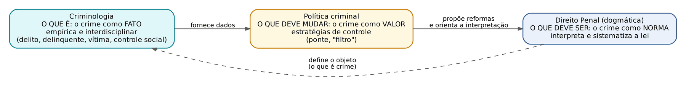
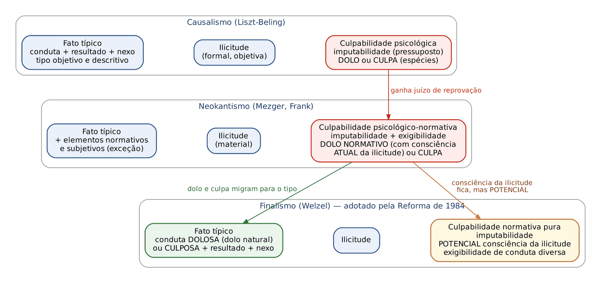
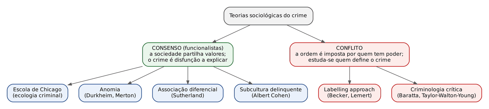

# CAPÍTULO 01 — FUNDAMENTOS DO DIREITO PENAL: CONCEITO, FUNÇÕES, CIÊNCIAS PENAIS, ESCOLAS E EVOLUÇÃO DOGMÁTICA, POLÍTICA CRIMINAL, CRIMINOLOGIA E PERSPECTIVAS CRÍTICAS

:::INCIDENCIA
TRF5 p. 1; TJRS p. 1; TJSC p. 1, 2 e 3. Nível B. Lote: nenhuma questão atribuída (FGV 0, FCC 0); o tema aparece em provas de magistratura como assertiva teórica isolada.
O que mais cai: atribuição de ideias a escolas e autores (Lombroso, Ferri, Liszt, Rocco, Ancel); posição do dolo e da culpa em cada sistema dogmático; garantismo, Direito Penal do inimigo e velocidades; labelling approach e cifra oculta; vitimização secundária; protocolos do CNJ (gênero, raça, indígenas).
:::

Este capítulo dá o vocabulário das assertivas teóricas que reaparece em toda a apostila (por que o dolo está no tipo, o que é "Direito Penal do autor", o que é "seletividade"). Princípios, Direito Penal e Constituição e bem jurídico estão no Cap. 2; fontes, norma penal e conflito aparente de normas, no Cap. 3; teorias da pena e sistemas penitenciários, no Cap. 12.

## 01.1 Conceito, caracteres e funções do Direito Penal

### 01.1.1 Conceito e denominações

Direito Penal é o ramo do Direito Público que define as infrações penais (crimes e contravenções) e estabelece as sanções correspondentes (penas e medidas de segurança), bem como os princípios e regras que orientam sua aplicação. A expressão designa duas coisas (Zaffaroni): a legislação penal e o saber jurídico que a interpreta e sistematiza (a ciência do Direito Penal ou dogmática penal).

Distinções terminológicas que a banca gosta de testar:

| Par | Um lado | Outro lado |
|---|---|---|
| Direito Penal objetivo x subjetivo | conjunto de normas penais em vigor | *ius puniendi*: o direito (poder-dever) de punir, monopólio do Estado, limitado quanto ao modo (direitos fundamentais), ao espaço (territorialidade) e ao tempo (prescrição) |
| Direito Penal x "Direito Criminal" | ênfase na consequência (a pena); denominação do CP de 1940 | ênfase no crime; denominação do Código Criminal do Império (1830) |
| Comum x especial | aplica-se a todos (CP, leis extravagantes) | aplica-se por órgãos jurisdicionais especiais (Direito Penal Militar, Cap. 51) |

Mesmo na ação penal privada, o ofendido tem apenas o *ius accusationis*, não o direito de punir (Bitencourt). A competência legislativa é privativa da União (art. 22, I, da CF); a delegação aos Estados por lei complementar (parágrafo único) nunca foi usada em matéria penal.

### 01.1.2 Caracteres

A fórmula clássica é de Magalhães Noronha, repetida por Bitencourt: o Direito Penal é ciência cultural, normativa, valorativa e finalista. Some-se a ela o caráter sancionador e a natureza pública.

| Caráter | Significado | Armadilha |
|---|---|---|
| Cultural | pertence às ciências do "dever ser", não às ciências naturais (do "ser") | a criminologia é que é empírica (ciência do "ser") |
| Normativo | seu objeto é a norma e a sistematização de critérios de valoração jurídica | |
| Valorativo | atua a partir de uma escala própria de valores, hierarquizada e subordinada à Constituição | |
| Finalista | tem finalidade prática: proteger bens jurídicos | NÃO tem relação com o finalismo de Welzel (01.5.3) |
| Sancionador | reforça, com a pena, a proteção de bens já tutelados por outros ramos | Zaffaroni: "predominantemente sancionador e excepcionalmente constitutivo" (ex.: omissão de socorro, tentativa branca, que protegem interesses sem correspondente em outro ramo); Bitencourt e Bettiol sustentam sua plena autonomia |
| Público | o bem protegido interessa à coletividade; a vítima não titulariza o *ius puniendi* | vale até na ação penal privada |
| Fragmentário e subsidiário | só os ataques mais graves aos bens mais importantes (*ultima ratio*) | desenvolvido no Cap. 2 (02.6) |

### 01.1.3 Funções

Na prova, cobra-se associar cada função ao seu sentido e, às vezes, ao autor.

| Função | Ideia | Autor ou observação |
|---|---|---|
| Proteção de bens jurídicos | tutelar os valores mais relevantes para a convivência | Roxin; majoritária |
| Proteção da vigência da norma | o crime nega a norma; a pena reafirma sua vigência | Jakobs |
| Garantia | protege o indivíduo contra o arbítrio: só se pune o que a lei prévia define | Liszt: "magna carta do delinquente" |
| Controle social | instrumento formal (o mais grave) de preservação da paz pública | |
| Motivadora | a ameaça da sanção motiva as pessoas a não delinquir | ligada à prevenção geral (Cap. 12) |
| Ético-social | reforça valores ético-sociais elementares ("mínimo ético") | Welzel; criticada como moralizadora |
| Simbólica | efeitos só na mente de governantes (aparência de ação) e governados (sensação de segurança) | ILEGÍTIMA; ligada ao populismo penal (01.7.3) |
| Redução da violência estatal | conter a própria violência do Estado | Silva Sánchez; Zaffaroni (função redutora) |
| Promocional | instrumento de transformação social | criticada por subverter a intervenção mínima |

:::PEGADINHA Função simbólica não é elogio
Assertiva que atribui à função simbólica "efetividade na proteção de bens jurídicos" está errada: ela produz efeitos aparentes, que rendem dividendos políticos a curto prazo e desacreditam o sistema a médio prazo. E a "magna carta do delinquente" é a função de GARANTIA, não a motivadora.
:::

## 01.2 Ciências penais e disciplinas auxiliares

A "enciclopédia das ciências penais" (Cerezo Mir) reúne os saberes sobre crime, criminoso, vítima e reação social; a "ciência total do Direito Penal" (*gesamte Strafrechtswissenschaft*) é a proposta de Liszt de integrar dogmática, criminologia e política criminal.

| Disciplina | Objeto | Método e natureza |
|---|---|---|
| Dogmática penal (Direito Penal em sentido estrito) | interpretação e sistematização das normas penais: o crime como NORMA | normativo, "dever ser"; não confundir dogmática com dogmatismo (aceitação acrítica de verdades) |
| Política criminal | estratégias e meios de controle da criminalidade; crítica e reforma da lei: o crime como VALOR | valorativa; ponte entre a realidade empírica e a norma ("filtro", na expressão de Masson) |
| Criminologia | delito, delinquente, vítima e controle social: o crime como FATO | empírica e interdisciplinar, "ser" (García-Pablos de Molina) |
| Vitimologia | papel da vítima na gênese do crime, vitimização e proteção (01.10) | hoje vista como ramo da criminologia, embora parte da doutrina a trate como autônoma |
| Penologia | as penas e sua execução (ciência penitenciária) | estuda os sistemas penitenciários (Cap. 12) |

Disciplinas auxiliares (dados técnicos, fora da dogmática): medicina legal, psiquiatria e psicologia forenses (imputabilidade, Cap. 10), criminalística, sociologia e estatística criminais, antropologia (laudo antropológico, 01.11.1).

Para Liszt, "o Direito Penal é a barreira intransponível da política criminal" (separação); para Roxin (1970), a política criminal deve ingressar no sistema dogmático, orientando a construção das categorias do delito (integração).

## 01.3 Evolução histórica do Direito Penal e do Direito Penal brasileiro

### 01.3.1 Fases da reação punitiva

Divisão didática, sem rigor cronológico (as fases se sobrepuseram): vingança divina (pena como purificação; Código de Manu); vingança privada, depois limitada pelo talião e pela composição (Código de Hamurabi, Lei das XII Tábuas); vingança pública (o soberano pune, com penas cruéis); período humanitário (Beccaria, *Dos delitos e das penas*, 1764: legalidade, proporcionalidade, humanização); período científico (Lombroso, *O homem delinquente*, 1876).

### 01.3.2 Direito Penal brasileiro

| Período | Diploma | Pontos cobráveis |
|---|---|---|
| Colônia | Ordenações Afonsinas, Manuelinas e Filipinas (Livro V) | penas cruéis, desigualdade por condição social, confusão entre crime e pecado; as Filipinas vigoraram até 1830 |
| Império | Código Criminal de 1830 | primeiro código autônomo da América Latina, liberal e de inspiração clássica; previa pena de morte e galés |
| República | Código Penal de 1890 | elaborado às pressas e muito criticado; a legislação esparsa levou à Consolidação das Leis Penais de Vicente Piragibe (1932) |
| Estado Novo | Código Penal de 1940 (Decreto-Lei 2.848, vigente desde 1/1/1942) | projeto de Alcântara Machado revisto por comissão com Nélson Hungria; eclético, de base técnico-jurídica e inspiração no Código Rocco (1930); sistema do duplo binário (pena + medida de segurança) |
| Regime militar | Código Penal de 1969 (Decreto-Lei 1.004) | nunca vigorou; revogado em 1978 |
| Reforma de 1984 | Lei 7.209/1984 (nova Parte Geral) e Lei 7.210/1984 (LEP) | comissão presidida por Francisco de Assis Toledo; base finalista; sistema vicariante (pena OU medida de segurança); penas alternativas; sistema trifásico |
| Constituição de 1988 e depois | CF e leis posteriores | Lei 8.072/1990; Lei 9.099/1995; Lei 9.714/1998; Lei 13.964/2019 (Pacote Anticrime); leis de 2024 a 2026 sobre violência contra a mulher e crime organizado (Caps. 27, 38 e 46) |

O CP de 1940 vigora como lei ordinária recepcionada; o projeto de novo Código (PLS 236/2012) não foi aprovado.

## 01.4 Escolas e tendências penais

### 01.4.1 Por que estudar as escolas

As escolas penais explicam institutos atuais: medida de segurança e periculosidade vêm da escola positiva; culpabilidade e proporcionalidade, da clássica; a convivência entre pena e medida de segurança, da *terza scuola* e de Liszt; o método do CP de 1940, da técnico-jurídica. A banca cobra quase sempre a ATRIBUIÇÃO (que autor ou ideia pertence a que escola).

### 01.4.2 Tabela comparativa

| Escola | Autores | Crime | Responsabilidade | Pena | Método |
|---|---|---|---|---|---|
| Clássica (séc. XVIII-XIX) | Beccaria (precursor), Carrara (*Programa*, 1859), Feuerbach, Romagnosi, Carmignani | ente jurídico (Carrara): infração da lei do Estado | moral, fundada no livre-arbítrio | retribuição proporcional, com função de tutela jurídica | racionalista, lógico-abstrato, dedutivo |
| Positiva (fim do séc. XIX) | Lombroso (fase antropológica), Ferri (sociológica), Garofalo (jurídica) | fenômeno natural e social; "delito natural" (Garofalo) | social: o homem é determinado; responde por viver em sociedade | defesa social; tempo indeterminado, conforme a periculosidade (temibilidade) | experimental, indutivo |
| Crítica ou *terza scuola* italiana | Carnevale, Alimena, Impallomeni | fenômeno individual e social | moral, mas sem livre-arbítrio (determinismo psicológico); distingue imputáveis e inimputáveis | caráter aflitivo e finalidade de defesa social; medida de segurança para os inimputáveis | eclético |
| Moderna alemã (político-criminal) | Franz von Liszt (Programa de Marburgo, 1882), Prins, van Hamel | fenômeno jurídico com causas sociais e individuais | imputáveis: pena; perigosos: medida de segurança | finalidade preventiva, sobretudo especial | separa Direito Penal (jurídico) de criminologia e política criminal (causais), mas os reúne na "ciência total" |
| Técnico-jurídica | Arturo Rocco (prolusão de Sassari, 1910), Manzini, Massari | fenômeno jurídico; o objeto é o direito positivo | moral (imputáveis) | retributiva e preventiva; medida de segurança para os perigosos | técnico-jurídico: exegese, dogmática e crítica do direito vigente, sem filosofia ou criminologia |
| Correcionalista | Karl Röder (1839); Dorado Montero e Concepción Arenal | expressão de vontade "defeituosa" | o delinquente é incapaz de vida jurídica livre e deve ser protegido | um BEM: correção, por tempo indeterminado; "Direito protetor dos criminosos" (Dorado Montero) | |
| Humanista | Vincenzo Lanza | violação da moral (só é crime o que é imoral) | | educação do culpado | identifica Direito e moral |
| Defesa social | Filippo Gramatica (radical, 1945) e Marc Ancel (Nova Defesa Social, 1954) | Gramatica: "antissocialidade"; Ancel mantém o crime | Ancel: responsabilidade como base da ressocialização | ressocialização com respeito aos direitos humanos | político-criminal |

### 01.4.3 Detalhes que a banca usa

- Clássica: o nome foi dado pejorativamente pelos positivistas (Ferri); sem unidade metodológica, tem por tronco comum o jusnaturalismo e o livre-arbítrio; o foco é o crime, não o delinquente.
- Positiva, em três fases: Lombroso, médico, com o "criminoso nato" identificável por estigmas físicos (atavismo); Ferri, sociólogo, com a classificação dos criminosos (natos, loucos, habituais, ocasionais, passionais), a responsabilidade social e os "substitutivos penais" (políticas sociais que previnem melhor que a pena); Garofalo, jurista, autor de *Criminologia* (1885), com o "delito natural" (ofensa aos sentimentos de piedade e probidade) e a temibilidade. Herança vigente: medida de segurança, periculosidade, exame criminológico.
- *Terza scuola* (também chamada escola crítica ou positivismo crítico): aceita o determinismo, contra os clássicos, mas mantém a distinção imputável (pena) x inimputável (medida de segurança), que os positivistas não faziam.
- Moderna alemã: pena finalística (*Zweckstrafe*), prevenção especial (correção, intimidação, inocuização — Cap. 12); fundação, com Prins e van Hamel, da União Internacional de Direito Penal (1889).
- Técnico-jurídica: reação ao "sociologismo" positivista; influenciou o Código Rocco (1930) e, por ele, o CP de 1940.
- Defesa social: Gramatica, radical, queria substituir pena e responsabilidade por medidas educativas e curativas; Ancel (Nova Defesa Social), moderado, preserva legalidade e responsabilidade e orienta o sistema à ressocialização com respeito à dignidade.

:::PEGADINHA Escola crítica x criminologia crítica
"Escola crítica" (ou *terza scuola*) é a corrente italiana do fim do século XIX, conciliadora entre clássicos e positivistas. "Criminologia crítica" é a vertente marxista dos anos 1970 (Baratta, Taylor, Walton e Young), que estuda a seletividade do sistema penal (01.9.2). Nomes parecidos, épocas e ideias opostas. Outra troca frequente: atribuir o "criminoso nato" a Ferri (é de Lombroso, embora Ferri tenha incorporado a categoria na sua classificação) ou o "delito natural" a Lombroso (é de Garofalo).
:::

:::DICA Uma pergunta para cada escola
Responsabilidade fundada em quê? Livre-arbítrio = clássica; responsabilidade social (determinismo) = positiva; determinismo psicológico com distinção imputável/inimputável = *terza scuola*. Pena para quê? Retribuir = clássica; defender a sociedade = positiva; prevenir (especialmente) = Liszt; corrigir como um bem = correcionalista; educar = humanista; ressocializar com direitos humanos = Nova Defesa Social. Estudar o quê? Só o direito positivo = técnico-jurídica.
:::

## 01.5 Evolução epistemológica (dogmática) do Direito Penal

### 01.5.1 O que muda de um sistema para outro

Os "sistemas" da teoria do delito organizam os mesmos elementos (conduta, tipo, ilicitude, culpabilidade); muda a base filosófica e, por consequência, ONDE cada elemento fica. Analogia cível: assim como a teoria adotada sobre a ação processual muda a natureza das condições da ação, o conceito de conduta muda o lugar do dolo e, com ele, as consequências do erro (Caps. 7 e 10).

### 01.5.2 Positivismo: sistema causal-naturalista (clássico)

Final do século XIX e início do XX (Liszt, Beling, Radbruch). Sob influência das ciências naturais, a conduta é movimento corporal voluntário que causa modificação no mundo exterior. Tudo o que é objetivo vai para o injusto (tipo descritivo e neutro — Beling, 1906; ilicitude formal); tudo o que é subjetivo vai para a culpabilidade psicológica, vínculo psíquico entre autor e fato, cujas espécies são dolo e culpa. Críticas: não explica a omissão, a culpa inconsciente (não há vínculo psíquico com o resultado) nem os elementos subjetivos do tipo (o "para si ou para outrem" do furto).

### 01.5.3 Neokantismo: sistema neoclássico (causal-valorativo)

Primeiras décadas do século XX (filosofia de Baden: Windelband, Rickert; no Direito Penal, Mezger, Frank, M. E. Mayer). O Direito é ciência cultural, referida a valores:
- tipo: ganha elementos normativos ("documento", "funcionário público") e, excepcionalmente, subjetivos; é indício da ilicitude (*ratio cognoscendi*, M. E. Mayer) ou sua razão de ser (*ratio essendi*, Mezger);
- ilicitude: material (lesão ao bem jurídico), abrindo espaço a justificantes supralegais;
- culpabilidade psicológico-normativa (Frank, 1907): dolo e culpa viram ELEMENTOS de um juízo de REPROVAÇÃO, ao lado da imputabilidade e da exigibilidade; o dolo é normativo (*dolus malus*), com consciência ATUAL da ilicitude.

### 01.5.4 Finalismo e o ontologismo de Welzel

Hans Welzel desenvolveu o finalismo a partir dos anos 1930. O ponto de partida é ontológico: o legislador está vinculado a "estruturas lógico-objetivas" (*sachlogische Strukturen*), dados do ser que não pode alterar, sendo a principal a estrutura FINAL da ação: o homem antevê consequências e dirige o curso causal a um fim ("a finalidade é vidente; a causalidade é cega").

Consequências (o que mais cai): dolo e culpa vão para o tipo, que ganha face objetiva e subjetiva; o dolo fica natural (consciência e vontade de realizar o tipo, sem consciência da ilicitude); a culpabilidade fica normativa pura (imputabilidade, POTENCIAL consciência da ilicitude, exigibilidade de conduta diversa). Daí a distinção entre erro de tipo (exclui o dolo, art. 20) e erro de proibição (afeta a culpabilidade, art. 21) — Caps. 7 e 10.

Crítica ao ontologismo: as estruturas "do ser" não vinculam o legislador como Welzel supunha; a ação final explica mal a culpa e a omissão. A Reforma de 1984 adotou o finalismo, segundo a doutrina amplamente majoritária (ver 6.1).

### 01.5.5 Pós-finalismo: o normativismo funcionalista

A partir dos anos 1970, a dogmática abandona o ponto de partida ontológico e passa a construir as categorias do delito a partir das FUNÇÕES do Direito Penal (normativismo). Duas vertentes:

| Aspecto | Funcionalismo teleológico (moderado, dualista, racional-final) | Funcionalismo sistêmico (radical, monista) |
|---|---|---|
| Autor e marco | Claus Roxin, *Política criminal e sistema jurídico-penal* (1970) | Günther Jakobs, *Strafrecht AT* (1983); base na teoria dos sistemas de Niklas Luhmann |
| Função do Direito Penal | proteção subsidiária de bens jurídicos | proteção da vigência da norma (estabilização de expectativas) |
| Relação com a política criminal | as categorias do delito são orientadas por valorações político-criminais; dualista porque o sistema penal convive com limites externos (garantias, bem jurídico) | monista: o Direito Penal é sistema autorreferente; a norma é seu próprio fundamento |
| Imputação objetiva | criação ou incremento de risco proibido, realização do risco no resultado e alcance do tipo | violação de papel social: risco permitido, princípio da confiança, proibição de regresso, competência da vítima |
| Culpabilidade | "responsabilidade" = culpabilidade (limite) + necessidade preventiva da pena | definida pelas necessidades de prevenção geral positiva (falta de fidelidade ao Direito) |
| Pena | prevenção geral e especial limitada pela culpabilidade (teoria dialética, Cap. 12) | prevenção geral positiva fundamentadora: reafirma a norma |
| Crítica | | funcionaliza o indivíduo, que vira subsistema; pode legitimar qualquer norma, inclusive o Direito Penal do inimigo (01.6.6) |

Os funcionalismos NÃO devolveram o dolo à culpabilidade; mudam o tipo objetivo (imputação objetiva, Cap. 6) e o conteúdo da culpabilidade (Cap. 10). Conhecer pelo nome: funcionalismo reducionista de Zaffaroni (conter o poder punitivo) e tipicidade conglobante (Cap. 7).

:::ESQUEMA Onde estão o dolo e a culpa
| Sistema | Conduta | Dolo e culpa | Consciência da ilicitude | Culpabilidade |
|---|---|---|---|---|
| Causal (Liszt-Beling) | movimento corporal voluntário que causa resultado | na culpabilidade, como suas espécies | integra o dolo (doutrina majoritária da época) | psicológica |
| Neokantiano (Mezger, Frank) | ação valorada, ainda causal | na culpabilidade, como elementos; dolo normativo | ATUAL, dentro do dolo | psicológico-normativa |
| Finalista (Welzel) | atividade final | no TIPO; dolo natural | POTENCIAL, na culpabilidade | normativa pura |
| Funcionalista (Roxin, Jakobs) | Roxin: manifestação da personalidade; Jakobs: causação evitável | no TIPO | potencial, na culpabilidade | Roxin: responsabilidade (culpabilidade + necessidade preventiva); Jakobs: prevenção geral positiva |
:::

:::QUESTAO Fixação 1 — questão de fixação elaborada para esta apostila (não é questão de banca)
Assertiva: "No sistema neokantiano, o dolo integra o tipo, que passa a conter elementos normativos e subjetivos; a culpabilidade, por isso, torna-se normativa pura." Falsa. No neokantismo o dolo continua na culpabilidade psicológico-normativa; o tipo ganha apenas elementos normativos e subjetivos ESPECIAIS. Dolo no tipo e culpabilidade normativa pura são do finalismo. Armadilha: mistura inovações de sistemas diferentes.
:::

## 01.6 Modelos de política criminal e de intervenção penal

### 01.6.1 Garantismo penal (Ferrajoli)

Luigi Ferrajoli, em *Direito e razão* (1989), formula um modelo-limite de Direito Penal mínimo, que legitima o poder punitivo só na medida em que observa um sistema de garantias. O garantismo tem três sentidos: modelo normativo (estrita legalidade), teoria da validade e da efetividade (crítica da distância entre norma e prática) e filosofia política (o Estado se justifica pela tutela dos direitos fundamentais). A pena é um mal menor, que previne delitos e reações informais desproporcionais (Cap. 12); o Direito Penal é a "lei do mais fraco".

Os dez axiomas do sistema garantista encadeiam-se; os seis primeiros são garantias penais, os quatro últimos, processuais.

| Axioma | Tradução | Princípio |
|---|---|---|
| *Nulla poena sine crimine* | não há pena sem crime | retributividade (a pena é consequência do delito) |
| *Nullum crimen sine lege* | não há crime sem lei | legalidade (estrita) |
| *Nulla lex (poenalis) sine necessitate* | não há lei penal sem necessidade | necessidade ou economia do Direito Penal |
| *Nulla necessitas sine iniuria* | não há necessidade sem ofensa | lesividade ou ofensividade |
| *Nulla iniuria sine actione* | não há ofensa sem ação | materialidade ou exterioridade da ação |
| *Nulla actio sine culpa* | não há ação (punível) sem culpa | culpabilidade ou responsabilidade pessoal |
| *Nulla culpa sine iudicio* | não há culpa sem processo | jurisdicionalidade |
| *Nullum iudicium sine accusatione* | não há processo sem acusação | princípio acusatório (separação entre juiz e acusação) |
| *Nulla accusatio sine probatione* | não há acusação (procedente) sem prova | ônus da prova ou verificação |
| *Nulla probatio sine defensione* | não há prova sem defesa | contraditório e ampla defesa (falseabilidade) |

Na doutrina brasileira: garantismo negativo (proibição do excesso) + positivo (proibição da proteção deficiente) = "garantismo integral" (Douglas Fischer), em crítica ao "garantismo hiperbólico monocular", que só enxergaria o réu (proporcionalidade: 02.10).

### 01.6.2 Direito Penal mínimo x Direito Penal máximo

Para Ferrajoli, são extremos de uma escala. O máximo é incondicionado (severidade, incerteza, punição sem garantias): aceita o risco de punir inocentes para que nenhum culpado escape. O mínimo é condicionado (certeza das proibições e das provas): aceita o risco de culpados impunes para que nenhum inocente seja punido (daí o *in dubio pro reo*). Matizes: em Ferrajoli, o minimalismo é modelo definitivo; em Baratta, estratégia de transição para a superação do sistema penal; em Zaffaroni ("realismo marginal"), contenção do poder punitivo.

### 01.6.3 Abolicionismo

Propõe abolir o sistema penal (ou a prisão), substituindo-o por formas de solução de conflitos civis, administrativas e comunitárias. Fundamentos: o sistema penal é seletivo, estigmatizante e incapaz de cumprir suas funções declaradas; cria o problema que diz resolver; "rouba" o conflito das partes.

| Autor | Ideia associada |
|---|---|
| Louk Hulsman (Holanda) | *Penas perdidas*: substituir a linguagem do "crime" pela de "situações-problema", resolvidas pelos envolvidos |
| Nils Christie (Noruega) | *Limites à dor*; os conflitos são "propriedade" das partes, expropriados pelo Estado |
| Thomas Mathiesen (Noruega) | abolicionismo de matriz marxista, centrado na abolição da prisão |
| Michel Foucault | influência teórica (*Vigiar e punir*, 1975): a prisão como tecnologia disciplinar |

Na prova: abolicionismo não se confunde com o minimalismo (que mantém o Direito Penal reduzido) nem com a justiça restaurativa (que convive com o sistema penal, 01.8).

### 01.6.4 Movimento Lei e Ordem e "tolerância zero"

No polo oposto, o movimento Lei e Ordem (*Law and Order*, EUA, anos 1970-1980) propõe expansão do Direito Penal, penas mais longas e menos garantias. Base criminológica: janelas quebradas (01.9.2), que inspirou a "tolerância zero" em Nova York nos anos 1990. Críticas: criminaliza a pobreza e alimenta o encarceramento em massa. No Brasil, a doutrina associa a ele a Lei 8.072/1990.

### 01.6.5 Direito Penal do fato x Direito Penal do autor

Direito Penal do fato pune o que a pessoa FEZ; Direito Penal do autor pune o que ela É (personalidade, estilo de vida, periculosidade). O primeiro decorre da legalidade, da materialidade e da culpabilidade; o segundo marcou o Direito Penal nazista (tipos de autor) e, no Brasil, as contravenções de vadiagem (art. 59 da LCP) e de mendicância (art. 60, revogado pela Lei 11.983/2009). O CP adota o Direito Penal do fato, admitindo dados pessoais apenas na MEDIDA da pena (reincidência, antecedentes). Culpabilidade do fato x do autor e co-culpabilidade: 10.1.3.

### 01.6.6 Direito Penal do inimigo (Jakobs)

Formulado por Günther Jakobs (1985, de modo descritivo-crítico; a partir de 1999 e sobretudo após 11/9/2001, de modo legitimador). Parte do funcionalismo sistêmico: pessoa é quem oferece garantia cognitiva mínima de que se comportará conforme a norma; quem se afasta de modo duradouro do Direito (terrorista, membro de organização criminosa, criminoso sexual habitual) perde esse status e passa a ser tratado como fonte de perigo.

| Aspecto | Direito Penal do cidadão | Direito Penal do inimigo |
|---|---|---|
| Destinatário | pessoa que delinquiu ocasionalmente | não-pessoa, fonte de perigo |
| Finalidade da pena | reafirmar a vigência da norma | eliminar um perigo (neutralização) |
| Características | garantias plenas | antecipação da tutela (punição de atos preparatórios), penas desproporcionais, relativização ou supressão de garantias processuais, legislação de "luta" ou "combate" |

Críticas (majoritárias no Brasil): é Direito Penal do autor; nega a condição de pessoa e, com ela, a dignidade; o "inimigo" é definido pelo poder político, com arbítrio e seletividade. A doutrina aponta como manifestações no Brasil o RDD (art. 52 da LEP, Cap. 23) e a Lei do Abate (Lei 9.614/1998), o que não significa que tenham sido declarados inconstitucionais.

### 01.6.7 As velocidades do Direito Penal (Silva Sánchez)

Jesús-María Silva Sánchez (*A expansão do Direito Penal*) separa "velocidades" conforme a sanção e o grau de garantias:

| Velocidade | Sanção | Garantias | Exemplo |
|---|---|---|---|
| Primeira | pena privativa de liberdade | mantidas integralmente (processo lento, garantista) | núcleo clássico do Direito Penal |
| Segunda | penas alternativas (restritivas, multa) | flexibilizadas, em troca da ausência de prisão | Lei 9.099/1995, ANPP (Cap. 25) |
| Terceira | pena privativa de liberdade | flexibilizadas | Direito Penal do inimigo |
| Quarta (Daniel Pastor) | | | neopunitivismo do Direito Penal internacional, voltado a ex-chefes de Estado, com relativização de garantias (Tribunal Penal Internacional, Cap. 47) |

Fala-se ainda em quinta velocidade (presença policial ostensiva, preventivo-administrativa), construção minoritária e sem consenso.

:::QUESTAO Fixação 2 — questão de fixação elaborada para esta apostila (não é questão de banca)
Assertiva: "A segunda velocidade do Direito Penal, segundo Silva Sánchez, corresponde ao Direito Penal do inimigo, em que se aplicam penas privativas de liberdade com flexibilização de garantias." Falsa. Descreve-se a TERCEIRA (prisão + garantias flexibilizadas); a segunda combina penas alternativas com flexibilização. O critério de distinção é a natureza da sanção.
:::

## 01.7 Política criminal, seletividade, populismo penal e macrocriminalidade

### 01.7.1 Política criminal e níveis de criminalização

Política criminal é o conjunto de estratégias do Estado contra a criminalidade e a disciplina que critica e propõe reformar o direito vigente (01.2). Níveis de criminalização:
- criminalização primária: o ato de criar a lei penal (Legislativo), programa abstrato e geral;
- criminalização secundária: a ação punitiva sobre pessoas concretas, exercida pelas agências do sistema penal (polícia, Ministério Público, Judiciário, sistema penitenciário);
- criminalização terciária (para parte da doutrina): os efeitos da passagem pelo sistema, sobretudo a prisão e o estigma, que reforçam a carreira criminal.

### 01.7.2 Seletividade das agências penais

Zaffaroni demonstra que o programa da criminalização primária é tão amplo que as agências de criminalização secundária, com capacidade operacional mínima, necessariamente SELECIONAM, e pelo caminho mais fácil: os fatos mais grosseiros (crimes patrimoniais de rua, tráfico varejista) e as pessoas mais vulneráveis, que correspondem ao estereótipo do criminoso (pobres, jovens, negros, sem defesa qualificada). A seletividade é estrutural; dela decorrem a cifra oculta (01.9.3), a sobrerrepresentação de vulneráveis nas prisões e a imunidade relativa do colarinho branco.

Dois conceitos correlatos de Zaffaroni que caem: sistema penal SUBTERRÂNEO é o exercício ilegal do poder punitivo pelas próprias agências oficiais (execuções, tortura, desaparecimentos); sistemas penais PARALELOS são poderes punitivos exercidos por instâncias que não integram o sistema penal formal (sanções disciplinares, banimentos esportivos, sanções administrativas de efeito punitivo).

:::JURIS STF, HC 208.240 (Plenário, j. 11/4/2024)
A busca pessoal sem mandado exige fundada suspeita baseada em elementos objetivos; não é lícita a busca motivada por raça, sexo, orientação sexual, cor da pele ou aparência física (no caso, a ordem foi denegada por haver outros elementos). Interessa aqui como reconhecimento institucional do perfilamento racial na criminalização secundária; a ilicitude da prova é tema processual.
:::

### 01.7.3 Populismo penal, Direito Penal simbólico e expansão

Populismo penal (expressão difundida a partir de Anthony Bottoms, *populist punitiveness*, e de John Pratt) é o uso eleitoral do Direito Penal, explorando medo e indignação, sem compromisso com eficácia ou evidências: leis após casos de repercussão ("legislação de emergência"), aumento de penas sem estudo de impacto, discurso de "guerra" contra grupos. É a face política da função simbólica (01.1.3). A expansão do Direito Penal (Silva Sánchez), ligada à sociedade de risco (Ulrich Beck), traz bens jurídicos coletivos, crimes de perigo abstrato e "administrativização" do Direito Penal, com a desmaterialização do bem jurídico (02.5).

### 01.7.4 Microcriminalidade x macrocriminalidade

| Aspecto | Microcriminalidade | Macrocriminalidade |
|---|---|---|
| Conteúdo | crimes individuais, de pequena e média gravidade (furtos, lesões, pequeno tráfico) | criminalidade estruturada, de grande escala e dano difuso: organizações criminosas, crimes econômicos e ambientais de empresas, corrupção sistêmica, crimes de Estado |
| Visibilidade | alta; alvo preferencial das agências | baixa; cifra dourada |
| Resposta | insignificância, penas alternativas, justiça consensual e restaurativa (Caps. 2 e 25) | técnicas especiais de investigação, confisco, responsabilidade da pessoa jurídica, cooperação internacional (Caps. 46 e 47) |

A expressão "macrocriminalidade" é associada a Herbert Jäger (crimes cometidos em estruturas coletivas, com respaldo ou tolerância estatal).

## 01.8 Justiça restaurativa

### 01.8.1 Conceito e lógica

A justiça restaurativa desloca o foco da pergunta "que lei foi violada, quem fez e que pena merece?" para "quem foi prejudicado, quais são suas necessidades e de quem é a obrigação de repará-las?" (Howard Zehr, *Trocando as lentes*). O crime é visto como violação de pessoas e relações, e a resposta busca reparação, responsabilização ativa do ofensor e reintegração, com participação de vítima, ofensor, famílias e comunidade, conduzida por facilitador.

| Aspecto | Justiça retributiva | Justiça restaurativa |
|---|---|---|
| Foco | violação da lei; o Estado como ofendido | dano causado a pessoas e relações |
| Vítima | testemunha, papel periférico | participante central |
| Ofensor | recebe passivamente a pena | assume ativamente a responsabilidade |
| Resposta | pena proporcional | reparação, acordo, plano de ação |
| Procedimento | formal, adversarial | informal, dialógico, voluntário |

### 01.8.2 Resolução CNJ 225/2016

A Resolução CNJ 225, de 31/5/2016 (alterada pelas Resoluções 300/2019 e 458/2022), instituiu a Política Nacional de Justiça Restaurativa no Judiciário. Pontos cobráveis:
- conceito (art. 1º): conjunto ordenado e sistêmico de princípios, métodos, técnicas e atividades, com participação do ofensor e, quando houver, da vítima, das famílias e da comunidade, conduzido por facilitadores; pode ser alternativo ou concorrente ao processo convencional (§ 2º);
- princípios (art. 2º): corresponsabilidade, reparação dos danos, atendimento às necessidades de todos, informalidade, voluntariedade, imparcialidade, participação, empoderamento, consensualidade, confidencialidade, celeridade e urbanidade;
- reconhecimento dos fatos essenciais sem admissão de culpa (art. 2º, § 1º); consentimento livre, retratável até a homologação (§ 2º);
- encaminhamento em qualquer fase, de ofício ou a requerimento; a autoridade policial pode sugeri-lo (art. 7º);
- vedada a intimação ou coação para as sessões; acordo homologável, ouvido o Ministério Público; o INSUCESSO não pode majorar a sanção nem servir de prova (art. 8º, § 5º).

:::PROCESSO Onde a justiça restaurativa encontra o processo penal
Não há causa de extinção da punibilidade "por acordo restaurativo". Os efeitos passam pelos institutos existentes: composição civil (art. 74 da Lei 9.099/1995), transação, suspensão condicional do processo e ANPP (Cap. 25); na dosimetria, reparação do dano como atenuante (art. 65, III, b) ou arrependimento posterior (art. 16, Cap. 8). Na violência doméstica há vedações legais à justiça consensual (Cap. 38).
:::

## 01.9 Criminologia

### 01.9.1 Objeto, método e controle social

Criminologia é ciência empírica e interdisciplinar que estuda o crime, o delinquente, a vítima e o controle social (García-Pablos de Molina). O controle social é informal (família, escola, religião) ou formal (polícia, Ministério Público, Justiça, prisão), este subsidiário e mais estigmatizante. A prevenção é primária (causas sociais, longo prazo: educação, emprego), secundária (grupos e locais de risco: policiamento, iluminação) ou terciária (o condenado, para evitar a reincidência).

### 01.9.2 Principais teorias

A escola positiva inaugurou o paradigma ETIOLÓGICO (busca das causas do crime no criminoso); o labelling inaugura o paradigma da REAÇÃO SOCIAL. A classificação mais usada no Brasil (Shecaira) separa teorias do consenso e do conflito (figura acima).

| Teoria | Autores | Ideia central | Gancho de prova |
|---|---|---|---|
| Escola de Chicago (ecologia criminal) | Park, Burgess, Shaw e McKay (anos 1920-1930) | o crime se concentra em zonas urbanas de desorganização social, não em tipos de pessoa | prevenção pela reorganização do espaço urbano |
| Anomia | Durkheim; Merton (1938) | Durkheim: o crime é normal e funcional; anomia é enfraquecimento das normas. Merton: tensão entre metas culturais e meios legítimos, com cinco adaptações (conformidade, inovação, ritualismo, retraimento, rebelião) | "inovação" = aceitar a meta e usar meios ilegítimos |
| Associação diferencial | Edwin Sutherland (1939) | o crime é comportamento APRENDIDO na interação com pessoas próximas | Sutherland cunhou "crime do colarinho branco" |
| Subcultura delinquente | Albert Cohen (1955) | jovens de classes baixas criam valores opostos aos da classe média, por frustração de status | delitos juvenis não utilitários e maliciosos |
| Labelling approach (etiquetamento, reação social) | Howard Becker (*Outsiders*, 1963), Edwin Lemert, Erving Goffman | o desvio resulta da aplicação de rótulos por terceiros; a reação social produz a identidade desviante | Lemert: desvio PRIMÁRIO (ato inicial) x SECUNDÁRIO (produzido pela reação e pelo estigma); política dos 4 Ds (descriminalização, diversão, devido processo, desinstitucionalização) |
| Criminologia crítica (radical, nova criminologia) | Baratta; Taylor, Walton e Young (*The New Criminology*, 1973) | marxista: o sistema penal reproduz desigualdades; a criminalidade é "bem negativo" distribuído seletivamente | Direito Penal mínimo como estratégia (01.6.2) |
| Escolha racional e atividades rotineiras | Cornish e Clarke; Cohen e Felson (1979) | crime como cálculo; ocorre quando convergem ofensor motivado, alvo adequado e ausência de guardião | base da prevenção situacional |
| Janelas quebradas | Wilson e Kelling (1982) | desordem não reprimida gera criminalidade grave | base da "tolerância zero" (01.6.4) |

:::PEGADINHA Associação diferencial x labelling
A associação diferencial ainda pergunta POR QUE alguém delinque (aprendizagem) e é teoria do consenso. O labelling pergunta por que certas pessoas são DEFINIDAS como criminosas e com que efeitos: marca a passagem ao paradigma da reação social. Erro comum: atribuir o "colarinho branco" à criminologia crítica (é de Sutherland, 1939) ou o desvio secundário a Becker (é de Lemert).
:::

### 01.9.3 Cifra oculta e suas espécies

Cifra oculta (ou negra) é a diferença entre a criminalidade real e a criminalidade registrada ou punida pelas instâncias formais. É gênero; a doutrina nomeia espécies conforme a área:

| Cifra | Refere-se a |
|---|---|
| Dourada | criminalidade do colarinho branco: econômica, tributária, financeira, corrupção |
| Cinza | ocorrências registradas que não chegam ao processo (resolvidas ou abandonadas na fase policial) |
| Amarela | violência policial não denunciada pelas vítimas, por medo de represália |
| Verde | crimes ambientais |
| Rosa | crimes de ódio contra pessoas LGBTQIA+ |

O instrumento mais conhecido para medir a cifra oculta são as pesquisas de vitimização (perguntar à população se foi vítima, independentemente de registro).

## 01.10 Vitimologia

### 01.10.1 Origem e tipologia

A vitimologia nasce após a Segunda Guerra, com Benjamin Mendelsohn (considerado fundador; conferência de 1947) e Hans von Hentig (*The Criminal and His Victim*, 1948). Fases do papel da vítima: protagonismo (vingança privada), neutralização (o Estado assume o conflito) e redescobrimento (segunda metade do século XX). Classificação de Mendelsohn, pelo grau de participação da vítima:

| Tipo | Exemplo |
|---|---|
| Vítima completamente inocente (ideal) | criança atingida por bala perdida |
| Vítima menos culpada que o infrator (por ignorância) | quem provoca o crime por imprudência não intencional |
| Vítima tão culpada quanto o infrator (voluntária) | participante de roleta-russa; quem aceita jogo fraudulento para enganar terceiro e é enganado |
| Vítima mais culpada que o infrator (provocadora) | quem provoca injustamente e recebe reação (base do homicídio privilegiado por violenta emoção após injusta provocação) |
| Vítima unicamente culpada | agressora (morta em legítima defesa), simuladora ou imaginária |

Na dosimetria, o comportamento da vítima é circunstância judicial do art. 59 (Cap. 13).

### 01.10.2 Vitimização primária, secundária e terciária

| Espécie | Causa | Exemplo |
|---|---|---|
| Primária | o próprio crime | danos físicos, psíquicos e materiais do roubo |
| Secundária (sobrevitimização) | as instâncias formais de controle, ao lidar com a vítima | repetição desnecessária de depoimentos, perguntas humilhantes sobre a vida sexual, descrédito da palavra da vítima |
| Terciária | o meio social (família, comunidade) ou o abandono estatal após o crime | estigmatização da vítima de crime sexual; ausência de amparo assistencial |

Respostas legislativas à vitimização secundária:
- Lei 14.245/2021 ("Lei Mariana Ferrer"): todas as partes e sujeitos processuais devem zelar pela integridade física e psicológica da vítima, vedadas manifestações sobre circunstâncias alheias aos fatos e linguagem ou material ofensivos à sua dignidade (arts. 400-A e 474-A do CPP; art. 81, § 1º-A, da Lei 9.099/1995); criou aumento no art. 344 do CP quando o processo envolve crime contra a dignidade sexual (Cap. 36);
- violência institucional (art. 15-A da Lei 13.869/2019, incluído pela Lei 14.321/2022 — Cap. 44); depoimento especial (Lei 13.431/2017 — Cap. 42);
- direitos do ofendido (art. 201 do CPP) e política judiciária de atenção às vítimas (Resolução CNJ 253/2018).

:::SENTENCA Vitimologia e valoração da prova na sentença
Dois lugares: no mérito, ao valorar a palavra da vítima em crimes clandestinos (sexuais, violência doméstica), sem exigir comportamento "ideal" nem perquirir sua vida pregressa; na dosimetria, no vetor "comportamento da vítima" (Cap. 13). Redação-modelo: "A ausência de reação física ou o retardo na comunicação do fato não infirmam a credibilidade do relato da vítima." Erro que a banca pune: usar a "conduta social" ou a vida sexual da vítima para desacreditá-la.
:::

## 01.11 Diversidade e antidiscriminação no Direito Penal

### 01.11.1 Povos indígenas e comunidades tradicionais

Pontos de partida: o reconhecimento da organização social, costumes, línguas, crenças e tradições indígenas (art. 231 da CF) e a Convenção 169 da OIT (respeito aos métodos tradicionais de solução de conflitos compatíveis com os direitos humanos). A lógica "integracionista" do Estatuto do Índio (Lei 6.001/1973: isolados, em vias de integração, integrados) é hoje questionada à luz da Constituição.

A Resolução CNJ 287, de 25/6/2019, disciplina o tratamento das pessoas indígenas acusadas, rés, condenadas ou presas:
- identificação por AUTODECLARAÇÃO, em qualquer fase, inclusive na audiência de custódia, com registro de etnia e língua;
- intérprete, preferencialmente da própria comunidade;
- perícia antropológica FACULTATIVA, de ofício ou a requerimento, abrangendo os costumes da comunidade e o entendimento dela sobre a conduta;
- responsabilização que considere os mecanismos próprios da comunidade, mediante consulta, podendo o juiz homologar práticas comunitárias nos termos do art. 57 do Estatuto do Índio (sanções tribais toleradas, salvo cruéis, infamantes ou de morte);
- penas restritivas adaptadas aos costumes e, não cabendo substituição, regime especial de semiliberdade (art. 56, parágrafo único, do Estatuto).

Regras penais do Estatuto do Índio e competência (Súmula 140 do STJ: Justiça Estadual, salvo disputa sobre direitos indígenas, art. 109, XI, da CF): Cap. 42. O raciocínio se estende, no que couber, a quilombolas e outras comunidades tradicionais.

### 01.11.2 Crimes culturalmente motivados

São condutas típicas praticadas por membro de grupo cultural minoritário, aceitas ou até exigidas pelos valores do grupo, mas criminalizadas pela cultura majoritária (uso ritual de substâncias, casamento precoce, castigos físicos tradicionais, mutilação genital feminina). A motivação cultural pode ser considerada em diferentes degraus da teoria do delito:

| Degrau | Solução possível | Onde aprofundar |
|---|---|---|
| Tipicidade | adequação social da conduta no seu contexto | 02.7 |
| Culpabilidade | erro de proibição culturalmente condicionado (em regra inevitável); inexigibilidade de conduta diversa | 10.4.3 e 10.6 |
| Dosimetria | motivos do crime (art. 59) e atenuantes (art. 66 do CP; art. 56 do Estatuto do Índio) | Caps. 13, 14 e 42 |
| Execução e alternativas | penas adaptadas, mecanismos comunitários (Res. CNJ 287/2019) | 01.11.1 |

Limite: a diversidade cultural não legitima violar a vida, a integridade ou a dignidade de membros vulneráveis do grupo (crianças, mulheres); aí a motivação cultural pode, no máximo, reduzir a reprovação.

### 01.11.3 Perspectivas de gênero, raça e antidiscriminação

A perspectiva de gênero e de raça aplica a lição da seletividade: normas e aplicação não são neutras, e estereótipos interferem na tipificação, na prova e na dosimetria. A criminologia feminista denuncia a invisibilidade histórica da violência contra a mulher e a seletividade contra mulheres criminalizadas; a criminologia crítica racial aponta o racismo estrutural na criminalização secundária. Instrumentos que vinculam o juiz:

| Instrumento | Conteúdo |
|---|---|
| Protocolo para Julgamento com Perspectiva de Gênero (CNJ, 2021), de observância OBRIGATÓRIA pela Resolução CNJ 492, de 17/3/2023 | orienta a identificar desigualdades estruturais, evitar estereótipos (a "vítima ideal", a mulher "honesta"), valorar adequadamente a palavra da vítima e considerar o contexto de violência nas decisões |
| Protocolo para Julgamento com Perspectiva Racial (Resolução CNJ 598, de 22/11/2024) | orienta a identificar o racismo estrutural e institucional na atuação judicial, inclusive em abordagens policiais, reconhecimento de pessoas e valoração de antecedentes e "atitude suspeita" |
| Resolução CNJ 287/2019 | pessoas indígenas (01.11.1) |

Remissões: legítima defesa da honra (STF, ADPF 779 — Cap. 9); Lei Maria da Penha e mulheres trans, feminicídio autônomo (Lei 14.994/2024 — Caps. 27 e 38); homotransfobia como racismo (ADO 26) e injúria racial (Lei 14.532/2023) — Cap. 41. No campo processual, o STJ passou a exigir o procedimento do art. 226 do CPP no reconhecimento de pessoas, atento ao risco de erro e ao viés racial (HC 598.886 — v. Cap. 26).

:::SENTENCA Julgamento com perspectiva de gênero e raça na sentença penal
Onde entra: na prova (credibilidade da vítima, licitude da abordagem e do reconhecimento) e na dosimetria (não valorar negativamente estereótipos, como "conduta social" baseada em local de moradia ou ocupação informal). Redação-modelo: "Na linha do Protocolo para Julgamento com Perspectiva de Gênero, de observância obrigatória (Resolução CNJ 492/2023), a palavra da vítima, firme e coerente, corroborada pelos demais elementos, é suficiente para a condenação, não se exigindo dela reação física ou comportamento pretérito 'exemplar'." Erro comum: invocar o protocolo genericamente, sem apontar o estereótipo afastado no caso.
:::

:::QUESTAO Fixação 3 — questão de fixação elaborada para esta apostila (não é questão de banca)
Assertiva: "Segundo a Resolução CNJ 287/2019, a condição de indígena depende de comprovação por laudo antropológico ou registro da Funai, sem o que o juiz não pode aplicar as garantias nela previstas." Falsa. A identificação se dá por AUTODECLARAÇÃO, em qualquer fase; o laudo antropológico é perícia FACULTATIVA sobre as peculiaridades culturais. Armadilha: confundir identificação com prova das peculiaridades culturais.
:::

## 01.12 Resumo para revisão pré-prova

| Instituto | Regra | Exceções e detalhes | Fundamento |
|---|---|---|---|
| Conceito e caracteres | normas penais + saber que as sistematiza; cultural, normativo, valorativo, finalista, sancionador | *ius puniendi* sempre estatal; "finalista" ≠ finalismo; excepcionalmente constitutivo | Noronha; Zaffaroni |
| Funções | proteção de bens jurídicos (Roxin) x vigência da norma (Jakobs); garantia (Liszt: "magna carta do delinquente") | simbólica é ilegítima; redutora (Silva Sánchez, Zaffaroni) | doutrina |
| Ciências penais | dogmática (dever ser), política criminal (valor), criminologia (ser) | vitimologia e penologia; disciplinas auxiliares | Liszt (ciência total); Roxin (integração) |
| Evolução brasileira | Ordenações Filipinas → Código Criminal 1830 → CP 1890 → Consolidação 1932 → CP 1940 → Reforma 1984 | CP 1969 nunca vigorou; duplo binário → vicariante (1984) | Leis 7.209 e 7.210/1984 |
| Escolas | clássica (livre-arbítrio, retribuição); positiva (determinismo, defesa social, periculosidade); *terza scuola* (imputável x inimputável); moderna alemã (Liszt, prevenção especial); técnico-jurídica (Rocco, direito positivo); correcionalista (pena como bem); humanista (Lanza); defesa social (Gramatica radical; Ancel moderado) | Lombroso (nato), Ferri (sociológico, responsabilidade social), Garofalo (delito natural, temibilidade) | 01.4 |
| Sistemas dogmáticos | causal (dolo e culpa na culpabilidade psicológica); neokantiano (dolo normativo na culpabilidade psicológico-normativa); finalista (dolo natural no tipo; culpabilidade normativa pura); funcionalista (dolo no tipo + imputação objetiva) | consciência da ilicitude: atual (no dolo) → potencial (na culpabilidade); Roxin teleológico x Jakobs sistêmico | CP, arts. 20 e 21 (finalismo) |
| Garantismo | 10 axiomas de Ferrajoli (6 penais + 4 processuais) | garantismo integral (negativo + positivo); "hiperbólico monocular" | *Direito e razão* (1989) |
| Modelos | mínimo (risco de culpado impune) x máximo (risco de inocente punido); abolicionismo; Lei e Ordem | Hulsman, Christie, Mathiesen; janelas quebradas | Ferrajoli; 01.6 |
| Direito Penal do inimigo | não-pessoa; antecipação, penas desproporcionais, supressão de garantias | críticas: Direito Penal do autor, dignidade; exemplos apontados: RDD, Lei do Abate | Jakobs |
| Velocidades | 1ª prisão + garantias; 2ª alternativas + flexibilização; 3ª prisão + flexibilização | 4ª: Daniel Pastor (neopunitivismo internacional) | Silva Sánchez |
| Criminalização | primária (lei), secundária (agências), terciária (efeitos da prisão) | seletividade estrutural; subterrâneo x paralelo; populismo penal | Zaffaroni |
| Justiça restaurativa | foco no dano e nas necessidades; voluntária; facilitador | insucesso não agrava sanção nem serve de prova; encaminhamento em qualquer fase | Res. CNJ 225/2016 |
| Criminologia | consenso (Chicago, anomia, associação diferencial, subcultura) x conflito (labelling, crítica) | Merton: inovação; Lemert: desvio secundário; Sutherland: colarinho branco | 01.9 |
| Cifras | oculta (gênero); dourada, cinza, amarela, verde, rosa | pesquisas de vitimização | 01.9.3 |
| Vitimologia | Mendelsohn (5 tipos), von Hentig | vitimização primária, secundária (instâncias formais), terciária (meio social) | Lei 14.245/2021; art. 201 do CPP |
| Indígenas | autodeclaração; intérprete; laudo facultativo; mecanismos comunitários; semiliberdade | Súmula 140 do STJ (competência estadual, salvo direitos indígenas) | Res. CNJ 287/2019; arts. 56 e 57 da Lei 6.001/1973 |
| Crimes culturalmente motivados | soluções na tipicidade, culpabilidade (erro culturalmente condicionado) ou pena | limite: direitos humanos das vítimas vulneráveis | 01.11.2 |
| Gênero e raça | protocolos do CNJ; gênero obrigatório | busca pessoal não pode basear-se em raça (HC 208.240) | Res. CNJ 492/2023 e 598/2024 |

## 01.13 Artigos de lei incidentes

- Constituição Federal: arts. 5º (garantias penais), 22, I e parágrafo único, 109, XI, e 231.
- Código Penal: arts. 20 e 21 (reflexo do finalismo), 59 (comportamento da vítima), 65, III, b, e 66.
- Código de Processo Penal: arts. 28-A, 201, 226, 400-A e 474-A.
- Lei 6.001/1973 (Estatuto do Índio): arts. 56 e 57.
- Lei 9.099/1995: arts. 74 e 81, § 1º-A.
- Lei 14.245/2021 (proteção da vítima no processo).
- Decreto-Lei 3.688/1941 (LCP): art. 59 (vadiagem) e art. 60 (mendicância, revogado pela Lei 11.983/2009).
- Atos normativos do CNJ: Resoluções 225/2016 (justiça restaurativa), 253/2018 (vítimas), 287/2019 (indígenas), 492/2023 (perspectiva de gênero) e 598/2024 (perspectiva racial).

## 01.14 Julgados, temas e súmulas do capítulo

- STF, HC 208.240 (Plenário, j. 11/4/2024): busca pessoal não pode ser motivada por raça, cor da pele ou aparência física; perfilamento racial como expressão de seletividade.

Remissões a outros capítulos: Tema 593 e Súmula 502 do STJ, adequação social (Cap. 2); ADPF 347 e Súmula Vinculante 56 (Caps. 2 e 23); ADPF 779 (Cap. 9); ADO 26 (Cap. 41); Súmula 140 do STJ (Cap. 42); HC 598.886 do STJ, reconhecimento de pessoas (Cap. 26).

:::NOTA Notas de verificação
- Questões: nenhuma atribuída; o Chrome não estava acessível (extensão desconectada), sem busca por palavra-chave no banco. Incluídos três itens de fixação próprios. Sugere-se rodar a busca (escola|garant|inimigo|funcional|finalis|criminolog|labelling|vitimiz|restaurat|indígen).
- Drive: lidos o Mapeamento FGV (baixa incidência do tema), os Cadernos Sistematizados 2022 e o Bitencourt, vol. 1, Cap. I; a extração parou antes dos Caps. IV e V (escolas e evolução epistemológica), redigidos com base na doutrina corrente.
- Conferidos: Res. CNJ 225/2016 (arts. 1º, 2º, 7º, 8º e alterações); Res. CNJ 287/2019 (arts. 1º a 7º no texto; demais pelo manual do CNJ); Res. CNJ 598/2024.
- Conferidos no Planalto em 15/10/2026: Lei 14.245/2021 (art. 344, parágrafo único, do CP; arts. 400-A e 474-A do CPP; art. 81, § 1º-A, da Lei 9.099/1995); art. 59 da LCP (vadiagem), que consta do texto do Planalto sem nota de revogação, e art. 60 (mendicância), revogado pela Lei 11.983/2009.
- Não conferidos na fonte primária: data da Res. CNJ 492/2023; Res. CNJ 253/2018; HC 208.240 (data e alcance).
- Datas e atribuições doutrinárias (Röder, Rocco, Gramatica, Ancel, Jäger, Bottoms, quinta velocidade) variam entre manuais.
- Sobreposição: a evolução dos sistemas dogmáticos também cabe no Cap. 5 (não redigido); sugere-se que ele remeta a 01.5.
:::
